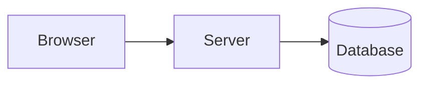

# How to add notes

A step-by-step guide for adding or editing notes on One Notes. Copy the templates below and change the text.

---

## 1. Quick version (adding one page)

1. Pick the folder in `docs/` that matches the topic (see the [folder map](#2-where-to-put-a-note)).
2. Create a file with a **lowercase, hyphenated** name: `docs/databases/redis.md`.
3. Paste the [page template](#3-page-template) and write your notes.
4. Check it locally: `npm start` → open http://localhost:3000/one-notes/
5. Publish:

   ```bash
   git add .
   git commit -m "Add Redis notes"
   git push
   ```

   The site updates by itself in about 2 minutes (GitHub → **Actions** tab shows progress).

---

## 2. Where to put a note

| Folder | Section on the site | Example new file |
|---|---|---|
| `docs/core-java/` | Core Java (has sub-folders: `basics`, `oops`, `strings`, `collections`, …) | `docs/core-java/oops/interfaces.md` |
| `docs/advanced-java/` | Advanced Java | `docs/advanced-java/microservices.md` |
| `docs/javascript/` | JavaScript | `docs/javascript/dom.md` |
| `docs/react/` | React | `docs/react/redux.md` |
| `docs/web/` | HTML, CSS & Tailwind | `docs/web/sass.md` |
| `docs/node/` | Node.js & Express | `docs/node/socket-io.md` |
| `docs/databases/` | Databases | `docs/databases/redis.md` |
| `docs/git/` | Git & GitHub | `docs/git/github-actions.md` |
| `docs/shell/` | Linux & Shell | `docs/shell/permissions.md` |
| `docs/system-design/` | System Design | `docs/system-design/url-shortener.md` |
| `docs/cs-fundamentals/` | CS Fundamentals | `docs/cs-fundamentals/oops-concepts.md` |
| `docs/interview/` | Interview Prep | `docs/interview/sql-questions.md` |
| `docs/resources/` | Resources | `docs/resources/books.md` |

**File name rules**

- Lowercase, words joined with `-`: `spring-security.md` ✅ — `Spring Security.md` ❌ — `1.md` ❌
- The file name becomes the URL: `docs/databases/redis.md` → `/one-notes/databases/redis/`
- **Don't** name a file the same as its folder (`git/git.md`) — that file silently replaces the folder's overview page.
- Files starting with `_` are ignored (useful for drafts: `_draft-kafka.md`).

---

## 3. Page template

Copy everything inside the box into your new `.md` file:

````md
---
title: Redis
sidebar_position: 4
description: One sentence about this page. It shows in search results and link previews.
---

Short intro: what it is and why it matters (2–3 lines).

## First topic

Explanation in short points:

- Point one
- Point two with **bold** and `inline code`

```java
// code example
System.out.println("Hello");
```

## Comparison

| | Option A | Option B |
|---|---|---|
| Speed | fast | slow |
| Use for | X | Y |

## Interview quick answers

- **Question one?** Short answer.
- **Question two?** Short answer.
````

### What the top block (front matter) means

| Field | Required | What it does |
|---|---|---|
| `title` | yes | Page heading **and** the name in the sidebar. Don't also add a `# Heading` line. |
| `sidebar_position` | recommended | Order in the sidebar: 1 = first. Look at the other files in the folder and pick the next number. |
| `description` | recommended | One-line summary for search results and Google/WhatsApp link previews. |
| `sidebar_label` | optional | A shorter name for the sidebar only, if the title is long. |

The three dashes `---` above and below are required, and must be the **very first line** of the file.

---

## 4. Formatting cheat sheet

### Headings

```md
## Main section        ← shows in the right-side table of contents
### Sub-section        ← also in the table of contents
#### Small heading     ← not in the table of contents
```

Start with `##`. The page title (`#`) comes from front matter.

### Text

```md
**bold**   *italic*   `inline code`   ~~strikethrough~~
<kbd>Ctrl</kbd> + <kbd>C</kbd>          ← keyboard keys
```

### Lists

```md
- bullet
  - nested bullet (2 spaces)

1. numbered
2. numbered
```

### Code blocks

Write the language after the three backticks so it gets colours:

````md
```java
public class Hello { }
```

```sql
SELECT * FROM users;
```

```bash
npm install
```
````

Supported: `java`, `js`, `jsx`, `ts`, `tsx`, `json`, `sql`, `bash`, `yaml`, `html`, `css`, `http`, `properties`, `docker`, `python`, `go`, `kotlin`, and more.

Extras:

````md
```java title="UserService.java"
// shows a file name above the code
```

```java {2}
int a = 1;
int b = 2;   // line 2 is highlighted
```
````

### Tables

```md
| Column 1 | Column 2 |
|---|---|
| value | value |
```

### Callout boxes

```md
:::tip
Helpful shortcut or best practice.
:::

:::note
Extra information.
:::

:::warning
Common mistake to avoid.
:::

:::danger
Something that can break things or lose data.
:::

:::tip Custom title
You can give any box its own title.
:::
```

### Collapsible Q&A (used on interview pages)

```md
<details>
<summary><b>What is a HashMap?</b></summary>

Answer goes here. Leave an empty line after `<summary>` so Markdown works inside.
</details>
```

### Diagrams (Mermaid)

````md

````

Other kinds: `sequenceDiagram`, `stateDiagram-v2`, `erDiagram`, `classDiagram`.
If a label has brackets or special characters, wrap it in quotes: `A["List [1, 2]"]`.
Try diagrams live at https://mermaid.live before pasting.

### Images

1. Put the image in an `img/` folder next to your note: `docs/databases/img/redis-arch.png`
2. Use it:

   ```md
   
   ```

Keep images under ~300 KB (use WebP or compressed PNG). Always write a short description inside `[...]`.

### Links

```md
[Another note](../core-java/strings/strings.md)          ← other notes: use the .md file path
[Section on same page](#interview-quick-answers)         ← heading in lowercase, spaces → -
[Section on another page](../databases/sql.md#indexes)
[External site](https://docs.spring.io)
```

Always link to other notes by their **`.md` file path**, not the website URL — then the build can catch broken links.

---

## 5. Adding a sub-folder or a new section

### Sub-folder inside an existing section

Example: a `spring` group inside Advanced Java.

```
docs/advanced-java/spring/
├── _category_.json
├── security.md
└── aop.md
```

`_category_.json`:

```json
{
  "label": "Spring",
  "position": 5
}
```

### A brand-new top-level section

Example: a **DevOps** section.

1. Create `docs/devops/` and add `docs/devops/_category_.json`:

   ```json
   {
     "label": "DevOps",
     "position": 13,
     "link": {
       "type": "generated-index",
       "description": "Docker, Kubernetes, CI/CD and cloud basics.",
       "slug": "/devops"
     }
   }
   ```

   `position` decides where it appears in the sidebar. Existing sections use 2–14, so renumber if you want it in between.

2. Add your notes (`docs/devops/docker.md`, …).

3. (Optional) Show it on the homepage: open `src/pages/index.js` and add one line to the `TOPICS` list:

   ```js
   { dir: 'devops', title: 'DevOps', mark: 'DO', tone: '#2496ed', text: 'Docker, Kubernetes, CI/CD and cloud basics.' },
   ```

   `mark` = 1–3 letters on the card, `tone` = card colour.

---

## 6. Things that break the build (and how to fix them)

The site is MDX, so a few characters are special **in normal text** (inside code blocks or `` `backticks` `` they're fine):

| Problem | Example that breaks | Fix |
|---|---|---|
| `<` followed by a letter | `List<String> is generic` | `` `List<String>` is generic `` |
| Curly braces | `use {name} here` | `` use `{name}` here `` or `\{name\}` |
| Broken link | `[x](../wrong/file.md)` | Check the path; the error message names the file |
| Missing image | `` | Check the file name and folder |
| Bad front matter | missing `---` or a `:` inside a title | Wrap the value in quotes: `title: "Java: Basics"` |

Always run before pushing:

```bash
npm run build
```

If it says **`[SUCCESS]`**, it's safe to push. If not, the error tells you the file and line.

---

## 7. Editing an existing note

- **On your computer:** open the file under `docs/`, edit, `npm start` to check, then commit and push.
- **On GitHub (no setup):** open any page on the site → click **Edit this page** at the bottom → edit → **Commit changes**. The site redeploys automatically.

---

## 8. Writing style that keeps notes useful

- Short points over long paragraphs.
- One small, runnable code example per idea.
- Use a table whenever you compare two or more things.
- End the page with `## Interview quick answers`.
- Link to related notes instead of repeating them.
