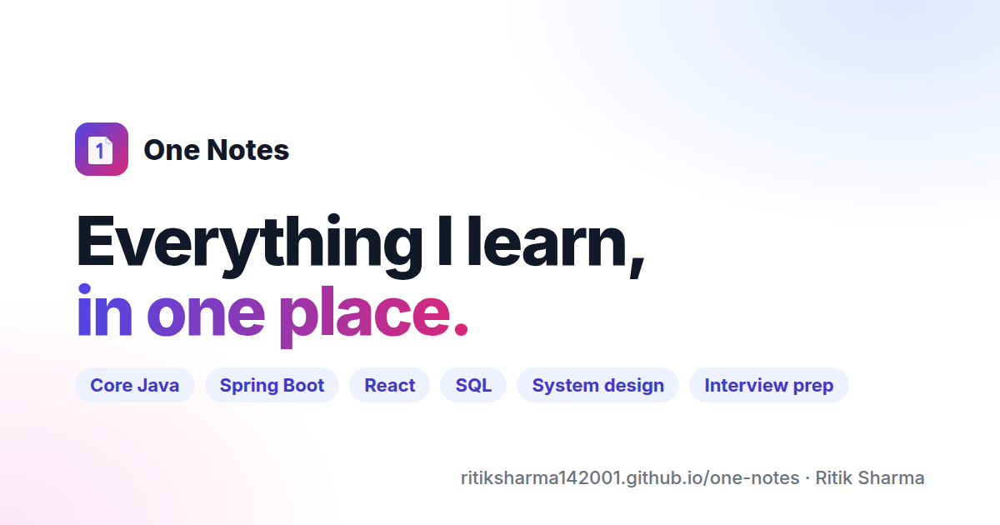

# One Notes

**Engineering notes for revising fast** — Core Java, Spring Boot, JPA, React, JavaScript, HTML/CSS/Tailwind, Node.js, SQL, PostgreSQL, MongoDB, Git, Linux, system design, OS/DBMS/networks and interview Q&A, in one searchable site.

**Live:** https://ritiksharma142001.github.io/one-notes/



## What's inside

| Section | Pages |
|---|---|
| Core Java | JVM, variables, methods, OOP (class, encapsulation, inheritance, polymorphism, abstraction), constructors, strings, exceptions, collections, multithreading, streams |
| Advanced Java | JDBC, Servlets & JSP, Spring & Spring Boot, JPA & Hibernate |
| JavaScript & React | Essentials, JSON/fetch/Axios, React fundamentals, hooks, routing & data fetching, performance |
| Web | HTML, CSS, Tailwind CSS |
| Node.js | Node & Express REST APIs |
| Databases | SQL (MySQL), PostgreSQL, MongoDB |
| Tools | Git & GitHub, Linux shell, Vim, keyboard shortcuts |
| System design & CS | System design fundamentals, operating systems, DBMS, computer networks |
| Interview prep | Java & Spring Q&A, frontend Q&A, question bank |

Every page is a cheat sheet: short explanations, runnable code, comparison tables, Mermaid diagrams and *interview quick answers*.

## Features

- Offline-style full-text search (<kbd>Ctrl</kbd>+<kbd>K</kbd>) — no third-party service
- Light/dark mode, mobile-friendly layout, collapsible sidebar
- Mermaid diagrams, syntax highlighting for Java, SQL, Bash, HTTP and more
- "Last updated" date and "Edit this page" link on every page
- Build fails on broken links, so navigation never rots
- Deployed automatically to GitHub Pages on every push to `main`

## Run locally

Requires Node.js 18+ (20+ recommended).

```bash
git clone https://github.com/ritiksharma142001/one-notes.git
cd one-notes
npm ci
npm start          # http://localhost:3000/one-notes/
npm run build      # production build in ./build
npm run serve      # preview the production build
```

## Add a note

1. Create a Markdown file in the right folder under `docs/`, e.g. `docs/databases/redis.md`.
2. Add front matter:

   ```md
   ---
   title: Redis
   sidebar_position: 4
   description: One line that appears in search results and link previews.
   ---
   ```

3. Link to other notes with relative file paths (`../core-java/strings/strings.md`) so the build can verify them.
4. New top-level section? Add a folder with a `_category_.json` (label, position, `link.slug`) and a card in `src/pages/index.js`.

## Deploy

Pushing to `main` runs `.github/workflows/deploy.yml`, which builds the site and publishes it to GitHub Pages (repository **Settings → Pages → Source: GitHub Actions**).

## Author

[Ritik Sharma](https://eritik.vercel.app/) · sharma.ritik2023@gmail.com
