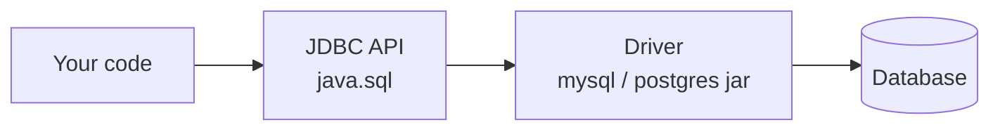

**JDBC (Java Database Connectivity)** is the standard Java API for talking to relational databases. Your code depends only on the `java.sql` interfaces; the database vendor ships a **driver** that implements them.



## The five steps

```java
String url = "jdbc:mysql://localhost:3306/shop";
try (Connection con = DriverManager.getConnection(url, "root", "secret");        // 1. connect
     PreparedStatement ps = con.prepareStatement(                                  // 2. statement
         "SELECT id, name, price FROM product WHERE price < ?")) {
    ps.setBigDecimal(1, new BigDecimal("500"));                                    // 3. bind
    try (ResultSet rs = ps.executeQuery()) {                                       // 4. execute
        while (rs.next()) {                                                        // 5. read
            System.out.println(rs.getLong("id") + " " + rs.getString("name"));
        }
    }
}   // try-with-resources closes ResultSet, Statement and Connection in reverse order
```

:::tip
Since JDBC 4.0 you **don't need** `Class.forName("com.mysql.cj.jdbc.Driver")` — drivers on the classpath register themselves.
:::

## Statement vs PreparedStatement vs CallableStatement

| | `Statement` | `PreparedStatement` | `CallableStatement` |
|---|---|---|---|
| SQL | Built as a string | Pre-compiled with `?` placeholders | Calls a stored procedure |
| SQL injection | **Vulnerable** | Safe — values are bound, never concatenated | Safe |
| Re-use | Parsed every time | Plan can be cached and reused | — |
| Use for | One-off DDL | **Almost everything** | `{call proc(?, ?)}` |

```java
// ❌ never do this
stmt.executeQuery("SELECT * FROM users WHERE name = '" + name + "'");
// ✅ always do this
PreparedStatement ps = con.prepareStatement("SELECT * FROM users WHERE name = ?");
ps.setString(1, name);
```

## execute methods

| Method | Returns | Use for |
|---|---|---|
| `executeQuery()` | `ResultSet` | `SELECT` |
| `executeUpdate()` | `int` rows affected | `INSERT`, `UPDATE`, `DELETE`, DDL |
| `execute()` | `boolean` (true if a ResultSet) | Unknown / mixed SQL |
| `executeBatch()` | `int[]` | Many statements in one round-trip |

## Getting a generated key

```java
PreparedStatement ps = con.prepareStatement(
    "INSERT INTO orders(customer_id, total) VALUES (?, ?)",
    Statement.RETURN_GENERATED_KEYS);
ps.setLong(1, 42); ps.setBigDecimal(2, total);
ps.executeUpdate();
try (ResultSet keys = ps.getGeneratedKeys()) {
    keys.next();
    long orderId = keys.getLong(1);
}
```

## Transactions

By default every statement auto-commits. Group statements that must succeed or fail together:

```java
con.setAutoCommit(false);
try {
    debit.executeUpdate();
    credit.executeUpdate();
    con.commit();
} catch (SQLException e) {
    con.rollback();
    throw e;
} finally {
    con.setAutoCommit(true);
}
```

- `con.setSavepoint()` / `con.rollback(savepoint)` — partial rollback.
- `con.setTransactionIsolation(Connection.TRANSACTION_READ_COMMITTED)` — see [isolation levels](../databases/sql.md#transactions--acid).

## Batching

```java
con.setAutoCommit(false);
try (PreparedStatement ps = con.prepareStatement("INSERT INTO log(msg) VALUES (?)")) {
    for (String m : messages) {
        ps.setString(1, m);
        ps.addBatch();
    }
    ps.executeBatch();      // one network round-trip instead of N
    con.commit();
}
```

:::tip MySQL
Add `?rewriteBatchedStatements=true` to the URL so the driver turns a batch into a single multi-row `INSERT`.
:::

## Connection pooling

Opening a connection is slow (TCP + auth). Real apps borrow connections from a **pool** — **HikariCP** is the default in Spring Boot.

```java
HikariConfig cfg = new HikariConfig();
cfg.setJdbcUrl("jdbc:postgresql://localhost:5432/shop");
cfg.setUsername("app"); cfg.setPassword("secret");
cfg.setMaximumPoolSize(10);
DataSource ds = new HikariDataSource(cfg);

try (Connection con = ds.getConnection()) { /* ... */ }  // close() returns it to the pool
```

## ResultSet types

```java
con.prepareStatement(sql, ResultSet.TYPE_SCROLL_INSENSITIVE, ResultSet.CONCUR_READ_ONLY);
```

- `TYPE_FORWARD_ONLY` (default) — `next()` only; fastest.
- `TYPE_SCROLL_INSENSITIVE` — `previous()`, `absolute(n)`, `last()`; doesn't see later changes.
- Use `rs.wasNull()` after `getInt()` — a SQL `NULL` comes back as `0`.

## Interview quick answers

- **What is a JDBC driver?** A vendor library implementing `java.sql` interfaces. Today almost all are **Type 4** (pure Java, talks the DB's network protocol directly).
- **Why PreparedStatement?** Prevents SQL injection, handles quoting/escaping, and lets the DB reuse the query plan.
- **What does `DriverManager` do?** Picks a registered driver that accepts the URL and returns a `Connection`. In production prefer a pooled `DataSource`.
- **What if you forget to close?** Connection leaks — the pool runs dry and the app hangs. Always use try-with-resources.
