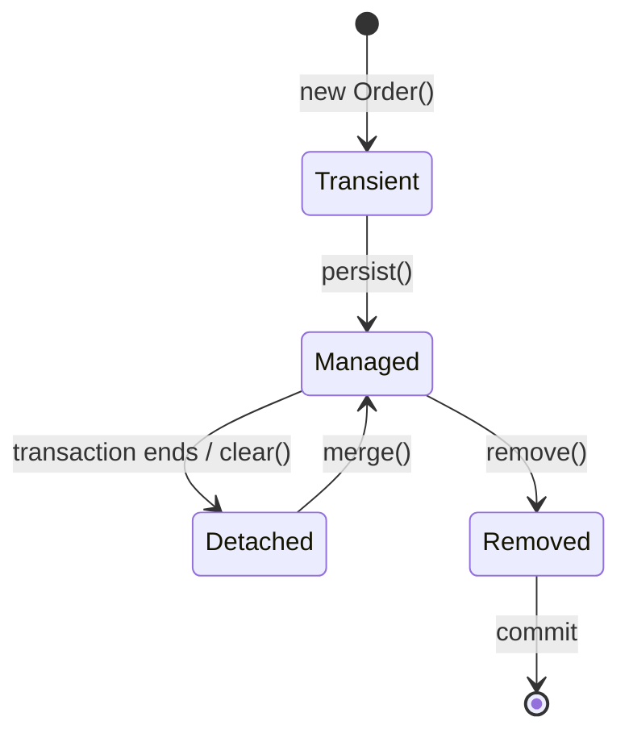

- **ORM** maps classes ↔ tables and objects ↔ rows so you work with objects instead of SQL strings.
- **JPA** (`jakarta.persistence`) is the specification; **Hibernate** is the most used implementation; **Spring Data JPA** generates repositories on top.

## An entity

```java
@Entity
@Table(name = "orders")
public class Order {
    @Id
    @GeneratedValue(strategy = GenerationType.IDENTITY)
    private Long id;

    @Column(nullable = false, length = 40)
    private String number;

    @Enumerated(EnumType.STRING)          // store "PAID", not 0/1/2
    private Status status;

    @ManyToOne(fetch = FetchType.LAZY)    // many orders → one customer
    @JoinColumn(name = "customer_id")
    private Customer customer;

    @OneToMany(mappedBy = "order", cascade = CascadeType.ALL, orphanRemoval = true)
    private List<OrderLine> lines = new ArrayList<>();

    @Version                              // optimistic locking
    private int version;

    protected Order() {}                  // JPA needs a no-arg constructor

    public void addLine(OrderLine l) { lines.add(l); l.setOrder(this); }   // keep both sides in sync
}
```

## Relationships

| Annotation | Example | Default fetch |
|---|---|---|
| `@OneToOne` | User ↔ Profile | EAGER |
| `@ManyToOne` | Order → Customer | **EAGER** (set it to LAZY) |
| `@OneToMany` | Customer → Orders | LAZY |
| `@ManyToMany` | Student ↔ Course | LAZY |

- The side with `@JoinColumn` (usually `@ManyToOne`) is the **owner** — it writes the foreign key.
- `mappedBy` marks the inverse side.
- **Make every `@ManyToOne` / `@OneToOne` LAZY** and fetch what you need per query.

## Entity states



While **managed**, Hibernate tracks changes (**dirty checking**): modify a field inside a transaction and it's saved at commit — no `save()` call needed.

## Spring Data JPA

```java
public interface OrderRepository extends JpaRepository<Order, Long> {
    List<Order> findByStatusOrderByIdDesc(Status status);         // derived query
    Optional<Order> findByNumber(String number);
    boolean existsByCustomerIdAndStatus(Long customerId, Status s);

    @Query("select o from Order o where o.total > :min")          // JPQL (entities, not tables)
    List<Order> bigOrders(@Param("min") BigDecimal min);

    Page<Order> findByCustomerId(Long id, Pageable pageable);
}

// usage
repo.findByCustomerId(7L, PageRequest.of(0, 20, Sort.by("createdAt").descending()));
```

## The N+1 problem

```java
List<Order> orders = repo.findAll();          // 1 query
for (Order o : orders)
    o.getCustomer().getName();                // +1 query per order 😱
```

Fixes:

```java
@Query("select o from Order o join fetch o.customer")      // JOIN FETCH
List<Order> findAllWithCustomer();

@EntityGraph(attributePaths = {"customer", "lines"})       // or an entity graph
List<Order> findByStatus(Status s);
```

Also: `spring.jpa.properties.hibernate.default_batch_fetch_size=50` batches lazy loads into `IN (...)` queries. Turn on SQL logging in dev (`spring.jpa.show-sql=true`) to spot N+1 early.

## LazyInitializationException

Thrown when you touch a lazy relation **after** the transaction/session closed (e.g. in the controller). Fix by fetching what you need in the query, or mapping to a DTO inside the `@Transactional` service method. Avoid `spring.jpa.open-in-view=true` in APIs.

## Projections — read only what you need

```java
public record OrderSummary(Long id, String number, BigDecimal total) {}

@Query("select new com.shop.OrderSummary(o.id, o.number, o.total) from Order o where o.customer.id = :id")
List<OrderSummary> summaries(Long id);
```

## Caching levels

- **First-level cache** — per persistence context (transaction). `find(id)` twice → one query. Always on.
- **Second-level cache** — shared across sessions (Ehcache, Caffeine). Off by default; use for read-mostly data.

## `save()` vs `persist()` vs `merge()`

- `persist` — new entity becomes managed; no return value.
- `merge` — copies a detached entity's state onto a managed copy and **returns that copy**.
- Spring Data `save` — calls `persist` for new entities, `merge` otherwise.

## Interview quick answers

- **JPA vs Hibernate?** Spec vs implementation.
- **`get` vs `load` / `find` vs `getReference`?** `find` hits the DB and returns null if missing; `getReference` returns a lazy proxy and throws on first access if missing.
- **Optimistic vs pessimistic locking?** `@Version` check at commit vs `SELECT … FOR UPDATE`.
- **`ddl-auto` in prod?** `validate` or `none` — manage schema with Flyway/Liquibase migrations.
