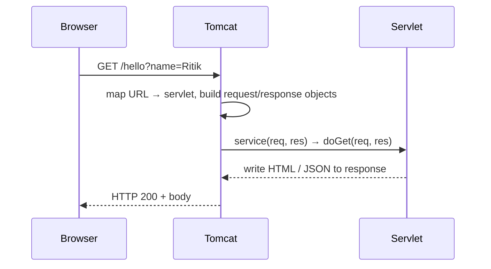
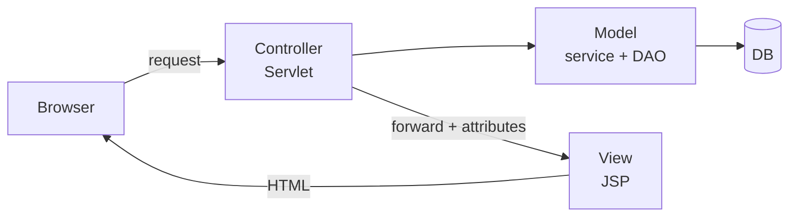

A **servlet** is a Java class that runs inside a **servlet container** (Tomcat, Jetty, Undertow) and answers HTTP requests. Spring MVC is built on top of one servlet — the `DispatcherServlet` — so understanding servlets explains how Spring works underneath.

## Request flow



## A minimal servlet (Jakarta EE 9+)

```java
@WebServlet("/hello")
public class HelloServlet extends HttpServlet {
    @Override
    protected void doGet(HttpServletRequest req, HttpServletResponse res) throws IOException {
        String name = Optional.ofNullable(req.getParameter("name")).orElse("world");
        res.setContentType("text/plain;charset=UTF-8");
        res.getWriter().println("Hello, " + name);
    }
}
```

:::note javax → jakarta
Tomcat 10+ uses `jakarta.servlet.*`. Older tutorials use `javax.servlet.*` — same API, renamed package.
:::

## Lifecycle

| Phase | Method | Called |
|---|---|---|
| Load & instantiate | constructor | once (on first request or at startup with `loadOnStartup`) |
| Initialise | `init(ServletConfig)` | **once** |
| Serve | `service()` → `doGet` / `doPost` / … | **every request**, on many threads at once |
| Destroy | `destroy()` | once, on shutdown/undeploy |

:::warning Thread safety
There is usually **one instance** of each servlet shared by all requests. Never keep per-request data in instance fields.
:::

## Request & response cheat sheet

```java
req.getParameter("q");            // query string or form field
req.getHeader("User-Agent");
req.getMethod();                  // GET, POST...
req.getRequestURI();              // /app/hello
req.getReader();                  // raw body (e.g. JSON)
req.setAttribute("user", u);      // pass data to a JSP/forward target

res.setStatus(201);
res.setHeader("Cache-Control", "no-store");
res.sendRedirect("/login");                       // new request from the browser (302)
req.getRequestDispatcher("/WEB-INF/home.jsp")
   .forward(req, res);                            // server-side, same request
```

**Forward vs redirect:** forward happens inside the server (URL doesn't change, attributes kept); redirect tells the browser to make a new request (URL changes, attributes lost). Use **Post/Redirect/Get** after a form submit so refresh doesn't re-submit.

## Session & cookies

HTTP is stateless. The container tracks users with a `JSESSIONID` cookie.

```java
HttpSession session = req.getSession();          // creates if absent
session.setAttribute("cart", cart);
session.setMaxInactiveInterval(30 * 60);         // seconds
session.invalidate();                            // logout

Cookie c = new Cookie("theme", "dark");
c.setHttpOnly(true); c.setSecure(true); c.setMaxAge(86400);
res.addCookie(c);
```

## Filters

Code that runs **before/after** servlets — logging, auth checks, CORS, compression.

```java
@WebFilter("/*")
public class TimingFilter implements Filter {
    public void doFilter(ServletRequest req, ServletResponse res, FilterChain chain)
            throws IOException, ServletException {
        long start = System.nanoTime();
        chain.doFilter(req, res);                // pass to the next filter / servlet
        System.out.printf("%s took %d ms%n",
            ((HttpServletRequest) req).getRequestURI(), (System.nanoTime() - start) / 1_000_000);
    }
}
```

Spring Security is just a chain of servlet filters.

## Scopes

| Scope | Object | Lives for |
|---|---|---|
| Request | `HttpServletRequest` | one request (incl. forwards) |
| Session | `HttpSession` | one user, until timeout/logout |
| Application | `ServletContext` | whole app, all users |

## JSP in one minute

JSP is HTML with Java inside; the container compiles it into a servlet. Modern JSP uses **EL** and **JSTL**, not scriptlets:

```jsp
<%@ taglib prefix="c" uri="jakarta.tags.core" %>
<h1>Hello, ${user.name}</h1>
<c:forEach var="p" items="${products}">
  <li>${p.name} — ₹${p.price}</li>
</c:forEach>
```

New projects usually render with **Thymeleaf** or return JSON to a React front-end instead.

## MVC with servlets



That is exactly what Spring MVC automates: `DispatcherServlet` = front controller, `@Controller` = your logic, view resolver = JSP/Thymeleaf.

## Interview quick answers

- **GET vs POST?** GET puts data in the URL, is cacheable/bookmarkable and should be idempotent; POST sends a body and changes state.
- **`init()` vs constructor?** `init` receives `ServletConfig`, which the constructor can't access.
- **`ServletConfig` vs `ServletContext`?** Per-servlet settings vs app-wide shared settings.
- **Why are servlets fast compared to CGI?** One instance + a thread per request instead of a new process per request.
