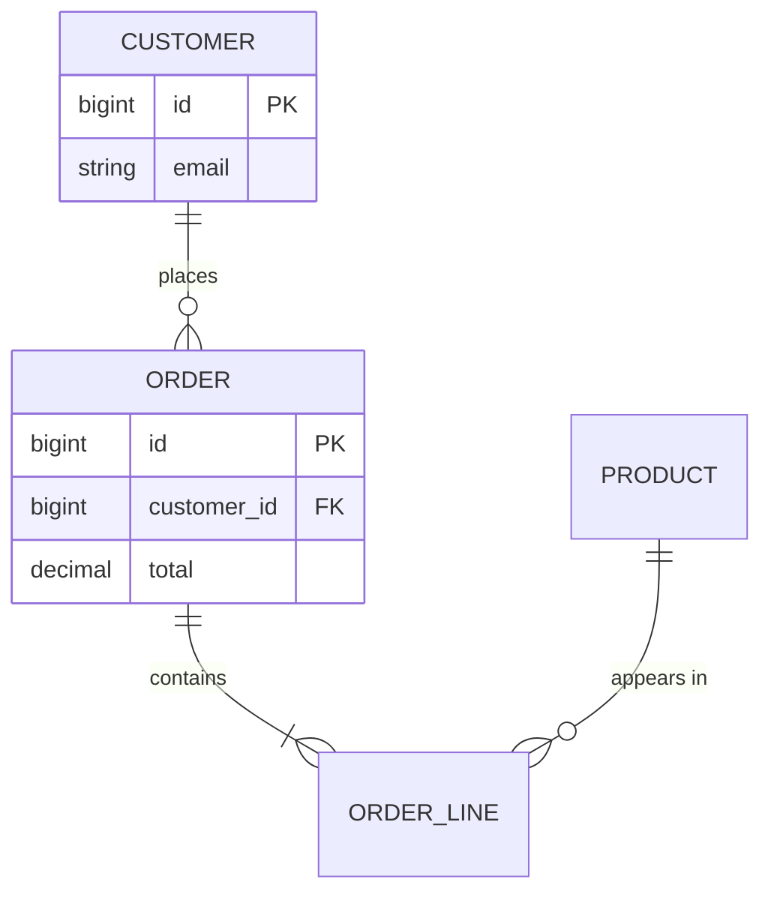

## DBMS vs file system

A DBMS gives you **data independence**, **concurrent access**, **integrity constraints**, **security**, **backup & recovery** and a query language — files give you none of these for free.

### Three-schema architecture

- **External** (views per user) → **Conceptual** (logical tables) → **Internal** (physical storage).
- **Logical data independence:** change tables without breaking views. **Physical:** change storage without changing tables.

## ER model

- **Entity** (table), **attribute** (column), **relationship** (FK or join table).
- Cardinality: one-to-one, one-to-many, many-to-many (needs a join table).
- **Weak entity** — can't be identified without its owner (an order line without an order).

## Keys

**Super key** (any set that's unique) ⊇ **candidate key** (minimal super key) ⊇ **primary key** (the one chosen). Others: alternate, foreign, composite, surrogate (auto id) vs natural (email, PAN).

## Normalisation

Functional dependency `A → B`: knowing A fixes B.

| Form | Removes |
|---|---|
| 1NF | multi-valued / repeating attributes |
| 2NF | partial dependency on part of a composite key |
| 3NF | transitive dependency (non-key → non-key) |
| BCNF | any dependency whose left side isn't a super key |

**Anomalies it prevents:** insertion (can't add a course without a student), update (same fact in many rows), deletion (deleting a student loses the course).

## Transactions

ACID: Atomicity, Consistency, Isolation, Durability (see [SQL notes](../databases/sql.md#transactions--acid)).

States: active → partially committed → committed, or → failed → aborted.

### Schedules

- **Serial** — transactions run one after another.
- **Serialisable** — a concurrent schedule whose result equals *some* serial order.
- **Conflict serialisable** — check with a **precedence graph**: no cycle ⇒ serialisable.
- **Recoverable** — a transaction commits only after those it read from commit. **Cascadeless** — read only committed data.

### Concurrency problems

| Problem | Example |
|---|---|
| Dirty read | read a value that later rolls back |
| Lost update | two writers overwrite each other |
| Non-repeatable read | same row read twice gives different values |
| Phantom read | same query returns new rows |

### Concurrency control

- **Two-phase locking (2PL):** growing phase (acquire locks) then shrinking phase (release) → guarantees conflict serialisability. **Strict 2PL** holds write locks until commit.
- Shared (read) vs exclusive (write) locks.
- **Timestamp ordering** and **MVCC** (multi-version — Postgres, InnoDB) let readers not block writers.
- **Optimistic** (check version at commit) vs **pessimistic** (lock first) control.

## Recovery

- **Write-ahead logging (WAL):** write the log record before the data page.
- **Checkpoints** limit how much log must be replayed.
- **Undo** uncommitted work, **redo** committed work after a crash.

## Indexing

- **B+ tree** — balanced, all data in leaves, leaves linked → fast lookups **and** range scans. Used by almost every relational DB.
- **Hash index** — O(1) equality, no ranges.
- **Clustered** — table rows stored in index order (one per table). **Non-clustered** — separate structure pointing to rows.
- **Dense** (entry per record) vs **sparse** (entry per block).

## Joins & relational algebra

Selection σ (rows), projection π (columns), union ∪, difference −, Cartesian product ×, join ⋈, rename ρ. Inner, left/right/full outer, self, cross, natural joins.

## Quick answers

- **DELETE vs TRUNCATE vs DROP?** Rows (logged, filterable) vs all rows fast vs the whole table.
- **View vs table?** A view is a stored query; materialised views store the result.
- **What is a deadlock in a DB?** Two transactions each waiting for a lock the other holds — the DB detects it and aborts one.
- **Why not index every column?** Writes slow down and storage grows.
