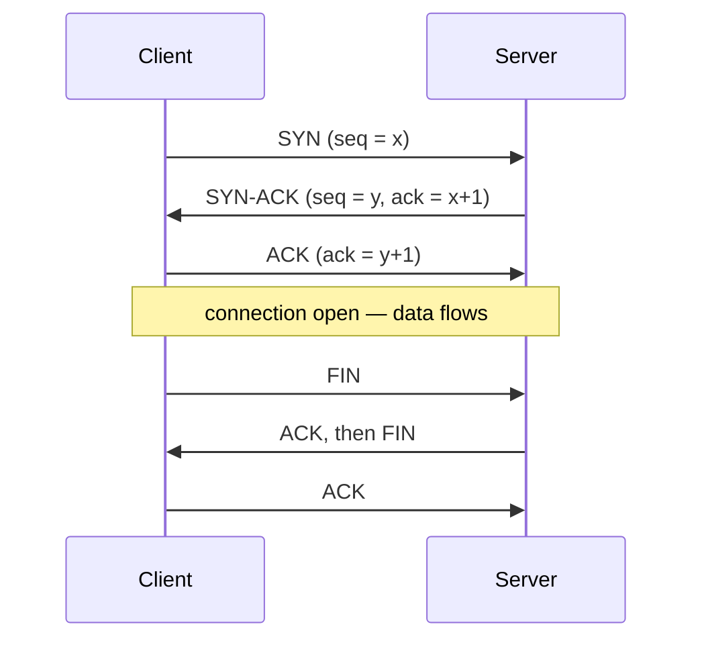

## Layers

| OSI | TCP/IP | Examples | Unit |
|---|---|---|---|
| 7 Application | Application | HTTP, DNS, SMTP, FTP, SSH | message |
| 6 Presentation | ↑ | TLS encryption, JSON/encoding | |
| 5 Session | ↑ | session setup | |
| 4 Transport | Transport | **TCP, UDP** | segment |
| 3 Network | Internet | **IP**, ICMP, routers | packet |
| 2 Data link | Link | Ethernet, Wi-Fi, MAC, switches | frame |
| 1 Physical | ↑ | cables, radio | bits |

Mnemonic (top→down): **A**ll **P**eople **S**eem **T**o **N**eed **D**ata **P**rocessing.

## TCP vs UDP

| TCP | UDP |
|---|---|
| Connection-oriented (handshake) | Connectionless |
| Reliable, ordered, retransmits | Best effort, may drop/reorder |
| Flow & congestion control | None — lower latency |
| HTTP/1.1, HTTP/2, SSH, email | DNS, video calls, games, **QUIC/HTTP/3** |

### Three-way handshake & teardown



## IP addressing

- IPv4: 32 bits (`192.168.1.10`); IPv6: 128 bits (`2001:db8::1`).
- **CIDR** `/24` → 24 network bits, 256 addresses (254 usable hosts).
- Private ranges: `10.0.0.0/8`, `172.16.0.0/12`, `192.168.0.0/16` — reach the internet through **NAT**.
- `127.0.0.1` = localhost. **Ports** pick the app on a host: 22 SSH, 53 DNS, 80 HTTP, 443 HTTPS, 3306 MySQL, 5432 Postgres, 27017 MongoDB.
- **ARP** maps IP → MAC on a local network; **DHCP** hands out IP addresses.

## DNS

Resolves names to IPs: browser cache → OS → **recursive resolver** (ISP/1.1.1.1) → **root** → **TLD** (`.com`) → **authoritative** server.

| Record | Points |
|---|---|
| A / AAAA | name → IPv4 / IPv6 |
| CNAME | name → another name |
| MX | mail servers |
| TXT | verification, SPF/DKIM |
| NS | authoritative name servers |

## HTTP

```http
GET /api/products?page=2 HTTP/1.1
Host: shop.example.com
Accept: application/json
Authorization: Bearer eyJ...
```

- **Methods:** GET (read), POST (create), PUT (replace), PATCH (partial update), DELETE. GET/PUT/DELETE are **idempotent**; GET is **safe**.
- **Status codes:** 1xx info · **2xx** success (200, 201, 204) · **3xx** redirect (301 permanent, 302/307 temporary, 304 not modified) · **4xx** client error (400, 401, 403, 404, 409, 429) · **5xx** server error (500, 502 bad gateway, 503, 504).
- **Stateless** — state travels in cookies or tokens.
- **HTTP/1.1** keep-alive · **HTTP/2** multiplexing over one TCP connection, header compression · **HTTP/3** over QUIC (UDP), no head-of-line blocking.

### Caching headers

`Cache-Control: public, max-age=31536000, immutable` for hashed assets; `no-store` for private data; `ETag` + `If-None-Match` → `304 Not Modified`.

## HTTPS & TLS

1. Client hello (supported ciphers) → server sends its **certificate** (public key, signed by a CA).
2. Client verifies the certificate chain.
3. Both derive a shared **session key** (ECDHE key exchange).
4. Data is encrypted with fast **symmetric** encryption (AES/ChaCha20).

**Asymmetric** crypto (public/private keys) is used to agree keys and verify identity; **symmetric** crypto encrypts the actual traffic.

## Cookies, sessions, tokens

```http
Set-Cookie: sid=abc; HttpOnly; Secure; SameSite=Lax; Max-Age=3600
```

- `HttpOnly` — JS can't read it (XSS protection). `Secure` — HTTPS only. `SameSite` — limits cross-site sending (CSRF protection).
- **Session** — server stores state, cookie holds an id. **JWT** — signed token holding claims, server stores nothing (harder to revoke).

## CORS

Browsers block a page on `a.com` from reading responses from `api.b.com` unless the API allows it:

```http
Access-Control-Allow-Origin: https://a.com
Access-Control-Allow-Methods: GET, POST
Access-Control-Allow-Headers: Content-Type, Authorization
```

Non-simple requests (JSON body, custom headers) first send an **`OPTIONS` preflight**. CORS is enforced by the browser — curl and servers ignore it.

## What happens when you type a URL?

1. Browser parses the URL; checks HSTS and its cache.
2. **DNS** lookup → IP address.
3. **TCP** handshake (or QUIC) with the server/CDN.
4. **TLS** handshake for HTTPS.
5. Sends the **HTTP request**; load balancer → app server → DB/cache.
6. Receives the **response** (HTML).
7. Browser **parses HTML → DOM**, CSS → CSSOM, runs JS, builds the render tree, **layout → paint → composite**, and fetches sub-resources (CSS, JS, images) in parallel.

## Network devices

**Hub** (repeats to all, L1) · **Switch** (forwards by MAC, L2) · **Router** (forwards by IP between networks, L3) · **Gateway / firewall / proxy** · **Reverse proxy & load balancer** (Nginx) sit in front of servers.

## Real-time on the web

| Technique | Direction | Use for |
|---|---|---|
| Polling | client asks repeatedly | simple, wasteful |
| Long polling | server holds the request until data | legacy chat |
| **Server-Sent Events** | server → client stream | notifications, live feeds, AI token streaming |
| **WebSocket** | full duplex over one TCP connection | chat, multiplayer, collaborative editing |
