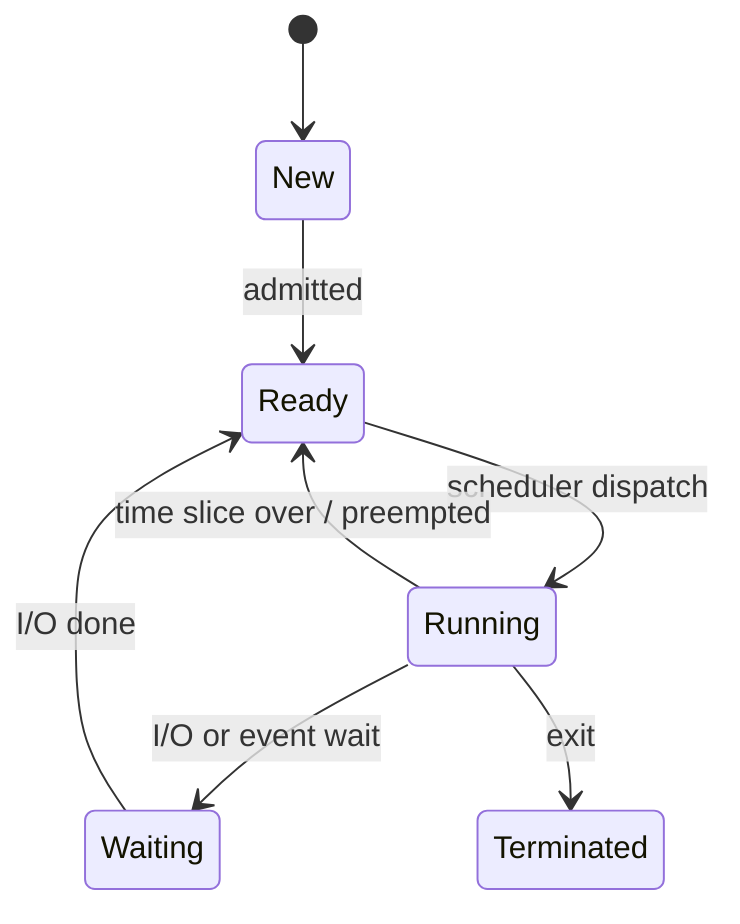

## Process vs thread

| Process | Thread |
|---|---|
| A program in execution with its **own** memory | A unit of execution **inside** a process |
| Heavy to create and switch | Light; shares code, heap and open files |
| Isolated — a crash doesn't affect others | A crash can take the whole process down |
| Communicate via IPC (pipes, sockets, shared memory) | Communicate via shared memory (needs locks) |

Each thread has its own **stack, registers and program counter**.

### Process states

The OS keeps each process's details in a **PCB** (process control block); a **context switch** saves one PCB and loads another.

## CPU scheduling

| Algorithm | Idea | Note |
|---|---|---|
| FCFS | first come, first served | convoy effect |
| SJF / SRTF | shortest job (remaining time) first | optimal average wait; starvation |
| Priority | highest priority first | starvation → fix with **aging** |
| Round robin | fixed time quantum, rotate | fair; good for time-sharing |
| Multilevel feedback queue | jobs move between queues by behaviour | what real OSes approximate |

Terms: **turnaround** = completion − arrival; **waiting** = turnaround − burst; **response** = first run − arrival.

## Synchronisation

A **race condition** happens when the result depends on the timing of threads touching shared data. The code that touches it is the **critical section**; it needs **mutual exclusion**, **progress** and **bounded waiting**.

- **Mutex** — a lock with an owner; only the locker can unlock.
- **Semaphore** — a counter: `wait()` (P) decrements and blocks at 0, `signal()` (V) increments. Binary semaphore ≈ lock; counting semaphore limits N concurrent users (e.g. a connection pool).
- **Monitor** — lock + condition variables bundled in a language construct (Java `synchronized` + `wait/notify`).

Classic problems: producer–consumer (bounded buffer), readers–writers, dining philosophers.

## Deadlock

Four conditions must **all** hold (Coffman):

1. **Mutual exclusion** — a resource is held by one at a time.
2. **Hold and wait** — holding one, waiting for another.
3. **No preemption** — resources can't be taken away.
4. **Circular wait** — T1 waits on T2 waits on T1.

Handle it by:
- **Prevention** — break a condition (e.g. always acquire locks in the same global order).
- **Avoidance** — grant requests only if the system stays in a safe state (**Banker's algorithm**).
- **Detection & recovery** — find cycles in the wait-for graph, kill/rollback a victim.
- **Ignore** (ostrich) — what most desktop OSes do.

**Livelock:** threads keep reacting to each other and make no progress. **Starvation:** one thread never gets the resource.

## Memory management

- **Contiguous allocation** suffers from **external fragmentation** (free memory in small gaps). Allocation strategies: first fit, best fit, worst fit.
- **Paging** splits logical memory into fixed **pages** and physical memory into **frames** of the same size → no external fragmentation, some **internal** fragmentation in the last page.
- The **page table** maps page → frame; the **TLB** caches recent translations.
- **Segmentation** splits memory into logical segments (code, stack, heap) of varying size.

## Virtual memory

Programs see a large private address space; only the pages in use are in RAM, the rest on disk.

- **Page fault** — accessed page isn't in RAM → OS loads it from disk.
- **Demand paging** — load pages only when needed.
- **Thrashing** — too little RAM, the system spends its time swapping pages instead of working.

### Page replacement

| Algorithm | Evicts | Note |
|---|---|---|
| FIFO | oldest loaded page | **Belady's anomaly**: more frames can cause more faults |
| Optimal | page not used for the longest time in future | theoretical best |
| LRU | least recently used | good in practice |
| Clock / second chance | approximates LRU cheaply | used by real OSes |

## Other must-knows

- **Kernel vs user mode** — system calls switch into the kernel (`read`, `write`, `fork`, `exec`).
- **`fork()`** creates a child copy of the process (copy-on-write); **`exec()`** replaces it with a new program.
- **Zombie** — finished child whose parent hasn't read its exit status. **Orphan** — child whose parent exited (adopted by init/systemd).
- **Interrupts** let hardware signal the CPU; **DMA** moves data without the CPU.
- **Spooling / buffering / caching** smooth speed differences between devices.
