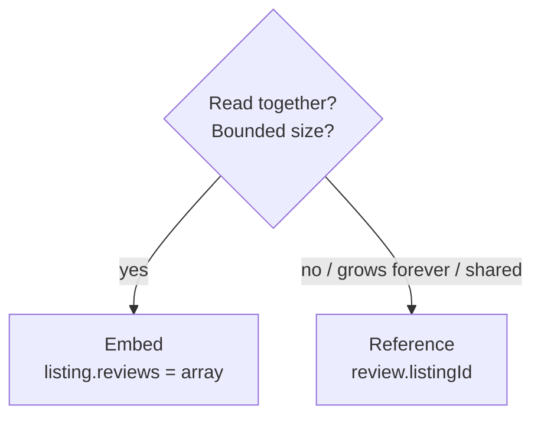

MongoDB stores **documents** (JSON-like BSON) in **collections**. There's no fixed schema, so related data is often stored together in one document.

| SQL | MongoDB |
|---|---|
| database | database |
| table | collection |
| row | document |
| column | field |
| primary key | `_id` (ObjectId by default) |
| JOIN | embedding or `$lookup` |

## CRUD in mongosh

```js
use shop

db.listings.insertOne({ title: "Sea-view flat", price: 2500, city: "Goa", tags: ["beach"], reviews: [] })
db.listings.insertMany([{ ... }, { ... }])

db.listings.find({ city: "Goa", price: { $lte: 3000 } }, { title: 1, price: 1 })   // filter + projection
  .sort({ price: 1 }).skip(20).limit(10)
db.listings.findOne({ _id: ObjectId("...") })
db.listings.countDocuments({ city: "Goa" })

db.listings.updateOne({ _id: id }, { $set: { price: 2700 }, $push: { tags: "pool" } })
db.listings.updateMany({ city: "goa" }, { $set: { city: "Goa" } })
db.listings.updateOne({ slug: "x" }, { $setOnInsert: { createdAt: new Date() } }, { upsert: true })

db.listings.deleteOne({ _id: id })
```

## Operators

| Kind | Operators |
|---|---|
| Compare | `$eq $ne $gt $gte $lt $lte $in $nin` |
| Logic | `$and $or $not $nor` |
| Element | `$exists $type` |
| Array | `$all $size $elemMatch` |
| Text / regex | `$regex`, `$text` (needs text index) |
| Update | `$set $unset $inc $push $pull $addToSet $rename` |

```js
db.users.find({ $or: [{ role: "admin" }, { age: { $gte: 60 } }] })
db.orders.find({ items: { $elemMatch: { sku: "A1", qty: { $gte: 2 } } } })
db.listings.updateOne({ _id: id }, { $inc: { views: 1 } })
```

## Aggregation pipeline

Documents flow through stages like a Unix pipe.

```js
db.orders.aggregate([
  { $match: { status: "PAID", createdAt: { $gte: ISODate("2026-01-01") } } },
  { $group: { _id: "$customerId", revenue: { $sum: "$total" }, orders: { $sum: 1 } } },
  { $sort: { revenue: -1 } },
  { $limit: 5 },
  { $lookup: { from: "customers", localField: "_id", foreignField: "_id", as: "customer" } },
  { $unwind: "$customer" },
  { $project: { _id: 0, name: "$customer.name", revenue: 1, orders: 1 } }
])
```

Common stages: `$match $group $sort $limit $skip $project $addFields $lookup $unwind $facet $count`. Put `$match` first so it can use an index.

## Indexes

```js
db.listings.createIndex({ city: 1, price: 1 })          // compound
db.users.createIndex({ email: 1 }, { unique: true })
db.sessions.createIndex({ createdAt: 1 }, { expireAfterSeconds: 3600 })   // TTL: auto-delete
db.listings.createIndex({ title: "text", description: "text" })
db.listings.find({ city: "Goa" }).explain("executionStats")   // COLLSCAN = no index used
```

**ESR rule** for compound indexes: **E**quality fields first, then **S**ort fields, then **R**ange fields.

## Schema design: embed or reference?



- **Embed** one-to-few data that's read with the parent (address in user, line items in order).
- **Reference** one-to-many that grows without bound, or data shared by many documents.
- A document is limited to **16 MB**.
- Design for your **queries**, not for normalisation.

## Mongoose (Node.js)

```js
import mongoose from "mongoose";
await mongoose.connect(process.env.MONGO_URL);

const listingSchema = new mongoose.Schema({
  title:  { type: String, required: true, trim: true },
  price:  { type: Number, min: 0, required: true },
  city:   { type: String, index: true },
  owner:  { type: mongoose.Schema.Types.ObjectId, ref: "User" },
  reviews: [{ type: mongoose.Schema.Types.ObjectId, ref: "Review" }],
}, { timestamps: true });

listingSchema.post("findOneAndDelete", async doc => {
  if (doc) await Review.deleteMany({ _id: { $in: doc.reviews } });   // cascade delete
});

export const Listing = mongoose.model("Listing", listingSchema);

const listing = await Listing.findById(id).populate("owner", "username").populate("reviews");
const cheap = await Listing.find({ price: { $lt: 2000 } }).lean();   // plain objects, faster
```

## Transactions

Multi-document transactions work on replica sets (Atlas clusters are replica sets):

```js
const session = await mongoose.startSession();
await session.withTransaction(async () => {
  await Account.updateOne({ _id: a }, { $inc: { balance: -500 } }, { session });
  await Account.updateOne({ _id: b }, { $inc: { balance: 500 } }, { session });
});
```

## SQL or MongoDB?

| Choose SQL when… | Choose MongoDB when… |
|---|---|
| data is relational with many joins | data is naturally hierarchical / document-shaped |
| strong consistency and constraints matter (money) | schema changes often or varies per record |
| complex reporting queries | you need simple horizontal scaling (sharding) |
