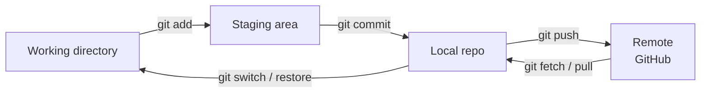
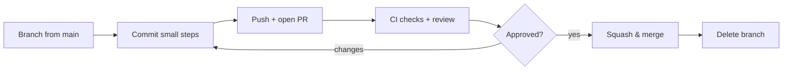

## How Git thinks



A **commit** is a snapshot plus a pointer to its parent. A **branch** is just a movable label pointing at a commit. `HEAD` is where you are now.

## First-time setup

```bash
git config --global user.name "Ritik Sharma"
git config --global user.email "you@example.com"
git config --global init.defaultBranch main
git config --global pull.rebase true          # linear history on pull
git config --global core.editor "code --wait"
```

### SSH key for GitHub

```bash
ssh-keygen -t ed25519 -C "you@example.com"
cat ~/.ssh/id_ed25519.pub          # paste into GitHub → Settings → SSH keys
ssh -T git@github.com               # test
```

## Everyday commands

```bash
git init                         # new repo        | git clone <url>   copy a repo
git status -sb                   # what changed (short)
git add -p                       # stage hunk by hunk — review as you go
git commit -m "Add login form"
git log --oneline --graph --all  # history as a graph
git diff                         # unstaged changes  | git diff --staged  staged changes
git show <commit>                # one commit
git blame file.js                # who changed each line
```

## Branches

```bash
git switch -c feature/login      # create + switch (older: git checkout -b)
git switch main
git branch -a                    # list local + remote
git branch -d feature/login      # delete merged branch (-D to force)
git push -u origin feature/login # publish and track
```

## Merge vs rebase

```bash
# merge: keeps history as it happened, adds a merge commit
git switch main && git merge feature/login

# rebase: replays your commits on top of main → straight line
git switch feature/login && git rebase main
```

| Merge | Rebase |
|---|---|
| Safe on shared branches | Rewrites commits — **never rebase a branch others have pulled** |
| True history, extra merge commits | Clean linear history |

**Resolving conflicts:** edit the files between `<<<<<<<` / `=======` / `>>>>>>>`, then `git add <file>` and `git merge --continue` (or `git rebase --continue`). Bail out with `--abort`.

## Undo anything

| Situation | Command |
|---|---|
| Discard changes in a file | `git restore file.js` |
| Unstage a file | `git restore --staged file.js` |
| Fix the last commit message / add a forgotten file | `git add x && git commit --amend` |
| Undo last commit, keep changes | `git reset --soft HEAD~1` |
| Undo last commit **and** changes | `git reset --hard HEAD~1` ⚠️ |
| Undo a commit that's already pushed | `git revert <commit>` (new commit that reverses it) |
| Recover "lost" commits | `git reflog` → `git reset --hard <sha>` |
| Stop tracking a file but keep it | `git rm --cached .env` (then add to `.gitignore`) |

`reset` moves the branch pointer: `--soft` keeps changes staged, `--mixed` (default) keeps them unstaged, `--hard` throws them away.

## Stash

```bash
git stash push -m "wip navbar"   # shelve uncommitted work
git stash list
git stash pop                    # re-apply and drop
git stash apply stash@{1}        # re-apply, keep in list
```

## Remotes

```bash
git remote -v
git fetch                        # download, don't touch your branch
git pull                         # fetch + merge/rebase
git push                         # upload
git push --force-with-lease      # safe force-push after a rebase (fails if someone else pushed)
git remote add upstream <url>    # fork workflow: track the original repo
```

## Picking & finding

```bash
git cherry-pick <sha>            # copy one commit onto the current branch
git bisect start; git bisect bad; git bisect good v1.0   # binary-search the commit that broke things
git log -S "functionName"        # commits that added/removed a string
git tag -a v1.0 -m "First release" && git push --tags
```

## GitHub pull-request flow



```bash
gh pr create --fill              # GitHub CLI
gh pr checkout 42
gh pr merge --squash --delete-branch
```

## Good commit messages

```
Add password reset by email                 ← imperative, ≤ 50 chars

Users can request a reset link that expires  ← why + what, wrapped at 72
after 30 minutes. Tokens are hashed in the DB.
```

Conventional style: `feat: …`, `fix: …`, `docs: …`, `refactor: …`, `test: …`, `chore: …`.

## .gitignore essentials

```
node_modules/
dist/  build/  target/  .next/
.env  .env.*
!.env.example
*.log
.DS_Store  .idea/  .vscode/
```

:::danger Pushed a secret?
Removing it in a new commit is not enough — it's still in history. **Rotate the key immediately**, then clean history with `git filter-repo` if needed.
:::

## Interview quick answers

- **`fetch` vs `pull`?** Fetch downloads; pull = fetch + merge (or rebase).
- **`reset` vs `revert`?** Reset rewrites history (local); revert adds an undo commit (safe for shared branches).
- **What is `HEAD`?** A pointer to the current branch/commit. "Detached HEAD" = pointing at a commit, not a branch.
- **Fork vs clone?** Fork = your copy on GitHub; clone = a copy on your machine.
