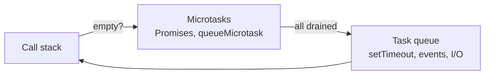

## Variables

```js
const user = { name: "Ritik" };   // can't be reassigned (object can still be mutated)
let count = 0;                    // block-scoped, reassignable
var old = 1;                      // function-scoped + hoisted — avoid
```

**Hoisting & TDZ:** `var` is hoisted as `undefined`; `let`/`const` are hoisted but in the *temporal dead zone* — reading them before the declaration throws.

## Types & equality

Primitives: `string`, `number`, `bigint`, `boolean`, `undefined`, `null`, `symbol`. Everything else is an **object** (arrays, functions, dates…).

```js
typeof null        // "object"  (historic bug)
typeof []          // "object"  → use Array.isArray([])
0.1 + 0.2 === 0.3  // false     → compare with Math.abs(a - b) < Number.EPSILON
"5" == 5           // true  (coercion)
"5" === 5          // false → always use ===
```

**Falsy values:** `false`, `0`, `-0`, `0n`, `""`, `null`, `undefined`, `NaN`. Everything else is truthy (including `[]` and `{}`).

```js
const port = config.port ?? 3000;     // ?? only falls back on null/undefined
const city = user?.address?.city;     // optional chaining
```

## Functions

```js
function add(a, b = 0) { return a + b; }           // declaration (hoisted)
const mul = (a, b) => a * b;                       // arrow
const sum = (...nums) => nums.reduce((s, n) => s + n, 0);   // rest params
```

### Closures

A function remembers the variables of the scope where it was created.

```js
function counter() {
  let n = 0;
  return () => ++n;
}
const next = counter();
next(); next();   // 2 — `n` lives on inside the closure
```

### `this`

| Call | `this` is |
|---|---|
| `obj.method()` | `obj` |
| `fn()` | `undefined` (strict) / `window` |
| `new Fn()` | the new object |
| `fn.call(x)` / `apply` / `bind(x)` | `x` |
| arrow function | `this` of the **enclosing** scope (never its own) |

## Objects & arrays

```js
const { name, age = 18, ...rest } = user;        // destructuring + default + rest
const [first, , third] = list;
const copy = { ...user, city: "Bengaluru" };      // shallow copy + override
const deep = structuredClone(user);               // deep copy

Object.keys(o); Object.values(o); Object.entries(o);
Object.fromEntries(Object.entries(o).map(([k, v]) => [k, v * 2]));
```

### Array methods you need daily

```js
const prices = [120, 80, 300];
prices.map(p => p * 1.18);              // transform → new array
prices.filter(p => p > 100);            // keep some
prices.reduce((sum, p) => sum + p, 0);  // fold into one value
prices.find(p => p > 100);              // first match (or undefined)
prices.some(p => p > 250);              // any?
prices.every(p => p > 50);              // all?
prices.includes(80);
[...prices].sort((a, b) => a - b);      // numeric sort — default sort is by string!
prices.toSorted((a, b) => b - a);       // ES2023 non-mutating sort
Object.groupBy(orders, o => o.status);  // ES2024 grouping
```

Mutating: `push pop shift unshift splice sort reverse`. Non-mutating: `map filter slice concat toSorted toReversed with`.

## Classes

```js
class Account {
  #balance = 0;                         // truly private field
  static count = 0;
  constructor(owner) { this.owner = owner; Account.count++; }
  deposit(amt) { this.#balance += amt; return this; }
  get balance() { return this.#balance; }
}
class Savings extends Account {
  constructor(owner, rate) { super(owner); this.rate = rate; }
}
```

Under the hood classes are sugar over **prototypes**: methods live on `Account.prototype` and objects look them up through the prototype chain.

## Modules

```js
// math.js
export const PI = 3.14;
export default function area(r) { return PI * r * r; }

// app.js
import area, { PI } from "./math.js";
const { heavy } = await import("./heavy.js");   // lazy-load
```

## The event loop

JavaScript runs on **one thread**. Slow work (timers, network, I/O) is handed to the browser/Node, and its callback is queued.



```js
console.log(1);
setTimeout(() => console.log(4), 0);
Promise.resolve().then(() => console.log(3));
console.log(2);
// 1 2 3 4 — microtasks run before the next task
```

## Promises & async/await

```js
async function loadUser(id) {
  try {
    const res = await fetch(`/api/users/${id}`);
    if (!res.ok) throw new Error(`HTTP ${res.status}`);   // fetch doesn't throw on 404/500
    return await res.json();
  } catch (err) {
    console.error(err);
    throw err;
  }
}

// run in parallel, not one after another
const [user, orders] = await Promise.all([loadUser(1), loadOrders(1)]);

Promise.allSettled(ps);   // never rejects — gives {status, value|reason} for each
Promise.race(ps);         // first to settle
Promise.any(ps);          // first to fulfil
```

See [JSON, fetch & Axios](./fetch-axios.md) for API calls in detail.

## Handy snippets

```js
// debounce: run after the user stops typing
const debounce = (fn, ms = 300) => {
  let t;
  return (...args) => { clearTimeout(t); t = setTimeout(() => fn(...args), ms); };
};

// unique values
const unique = [...new Set(items)];

// format money in India
new Intl.NumberFormat("en-IN", { style: "currency", currency: "INR" }).format(123456.5);
// "₹1,23,456.50"

// sleep
const sleep = (ms) => new Promise(r => setTimeout(r, ms));
```

## Interview quick answers

- **`==` vs `===`?** `===` compares without type coercion. Use it.
- **`null` vs `undefined`?** `undefined` = not assigned; `null` = intentionally empty.
- **What is a closure?** A function bundled with the variables of its outer scope.
- **`let` vs `var`?** Block vs function scope; `let` has a TDZ and can't be redeclared.
- **Arrow vs normal function?** Arrows have no own `this`, `arguments` or `prototype` and can't be used with `new`.
- **Deep vs shallow copy?** Spread copies one level; `structuredClone` copies everything.
