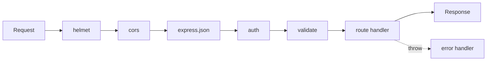

**Node.js** runs JavaScript outside the browser on Chrome's V8 engine. It is **single-threaded with non-blocking I/O**: while waiting on the disk or network it serves other requests, which makes it great for APIs and real-time apps (and poor for CPU-heavy work — use worker threads for that).

## Modules

```js
// ES modules — add "type": "module" to package.json
import fs from "node:fs/promises";
import path from "node:path";
import { fileURLToPath } from "node:url";
const __dirname = path.dirname(fileURLToPath(import.meta.url));   // no __dirname in ESM

export function slugify(s) { return s.toLowerCase().replace(/\W+/g, "-"); }

// CommonJS (older code)
const express = require("express");
module.exports = { slugify };
```

## npm essentials

```bash
npm init -y
npm i express zod             # dependency
npm i -D nodemon vitest       # dev dependency
npm ci                        # clean install from package-lock (CI)
npm outdated && npm update
npx some-cli                  # run without installing globally
```

```json
"scripts": {
  "dev": "node --watch --env-file=.env src/server.js",
  "start": "node src/server.js",
  "test": "vitest"
}
```

Node 20+ has `--watch` and `--env-file` built in — no nodemon/dotenv needed.

## Core APIs

```js
const text = await fs.readFile(path.join(__dirname, "data.json"), "utf8");
await fs.writeFile("out.txt", "hello");
await fs.mkdir("uploads", { recursive: true });

process.env.PORT;            // environment variables
process.argv.slice(2);       // CLI arguments
process.on("SIGTERM", shutdown);

import { EventEmitter } from "node:events";
import { createReadStream } from "node:fs";
createReadStream("big.csv").pipe(res);   // stream big files instead of loading them in memory
```

## Express REST API

```js
import express from "express";
import helmet from "helmet";
import cors from "cors";

const app = express();
app.use(helmet());                                   // security headers
app.use(cors({ origin: process.env.CLIENT_URL }));
app.use(express.json({ limit: "1mb" }));            // parse JSON bodies

app.get("/health", (req, res) => res.json({ ok: true }));
app.use("/api/listings", listingsRouter);

app.use((req, res) => res.status(404).json({ error: "Not found" }));
app.use(errorHandler);                               // must be last

app.listen(process.env.PORT ?? 3000, () => console.log("API ready"));
```

### Router

```js
const router = express.Router();

router.get("/", async (req, res) => {
  const { page = 1, q } = req.query;
  res.json(await Listing.find(q ? { title: new RegExp(q, "i") } : {}).skip((page - 1) * 20).limit(20));
});

router.get("/:id", async (req, res) => {
  const item = await Listing.findById(req.params.id);
  if (!item) return res.status(404).json({ error: "Listing not found" });
  res.json(item);
});

router.post("/", requireAuth, validate(listingSchema), async (req, res) => {
  const item = await Listing.create({ ...req.body, owner: req.user.id });
  res.status(201).json(item);
});

router.delete("/:id", requireAuth, async (req, res) => {
  await Listing.deleteOne({ _id: req.params.id, owner: req.user.id });
  res.status(204).end();
});
```

Express 5 forwards errors from `async` handlers to the error middleware automatically (Express 4 needed a wrapper).

## Middleware

A function `(req, res, next)` that runs in order for each request.



```js
function requireAuth(req, res, next) {
  const token = req.headers.authorization?.replace("Bearer ", "");
  try {
    req.user = jwt.verify(token, process.env.JWT_SECRET);
    next();
  } catch {
    res.status(401).json({ error: "Please log in" });
  }
}

const validate = schema => (req, res, next) => {
  const result = schema.safeParse(req.body);           // zod
  if (!result.success) return res.status(400).json({ errors: result.error.flatten().fieldErrors });
  req.body = result.data;
  next();
};

function errorHandler(err, req, res, next) {
  console.error(err);
  res.status(err.status ?? 500).json({ error: err.expose ? err.message : "Something went wrong" });
}
```

## Auth basics

```js
import bcrypt from "bcrypt";
import jwt from "jsonwebtoken";

const hash = await bcrypt.hash(password, 12);                 // on sign-up
const ok = await bcrypt.compare(password, user.passwordHash);  // on login
const token = jwt.sign({ id: user.id, role: user.role }, process.env.JWT_SECRET, { expiresIn: "1h" });
```

For server-rendered apps, sessions in an **httpOnly, secure, sameSite cookie** (e.g. `express-session` + a Mongo/Redis store) are simpler and safer than tokens in `localStorage`. Passport.js adds strategies (local, Google…).

## REST conventions

| Action | Method & path | Success |
|---|---|---|
| List | `GET /api/listings?page=2` | 200 |
| Read | `GET /api/listings/:id` | 200 / 404 |
| Create | `POST /api/listings` | 201 + body |
| Replace / update | `PUT` / `PATCH /api/listings/:id` | 200 |
| Delete | `DELETE /api/listings/:id` | 204 |

Errors: 400 bad input, 401 not logged in, 403 not allowed, 409 conflict, 422 validation, 429 rate-limited, 500 server.

## Production checklist

- Validate every input (zod / joi) and sanitise HTML.
- `helmet`, CORS allow-list, rate limiting (`express-rate-limit`), body size limits.
- Secrets in environment variables — never commit `.env`.
- Structured logs (`pino`), a `/health` endpoint, graceful shutdown on `SIGTERM`.
- Run behind a process manager or container (PM2, Docker) on Render/Railway/Fly.

## Interview quick answers

- **Is Node single-threaded?** Your JS runs on one thread; libuv uses a thread pool for file system, DNS, crypto and zlib.
- **`process.nextTick` vs `setImmediate`?** `nextTick` runs before other microtasks (right after the current operation); `setImmediate` runs in the check phase of the next loop iteration.
- **What is middleware?** A function in the request pipeline that can modify `req`/`res`, end the response or call `next()`.
- **`require` vs `import`?** CommonJS (sync, dynamic) vs ES modules (static, async loading, tree-shakable).
