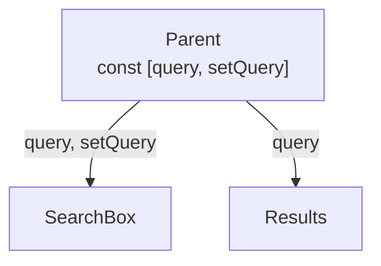

React builds UIs from **components** — functions that take **props** and return **JSX**. When state changes, React re-runs the component and updates only the parts of the DOM that changed.

## Start a project

```bash
npm create vite@latest my-app -- --template react-ts
cd my-app && npm install && npm run dev
```

For full-stack apps with routing, SSR and APIs built in, use **Next.js** (`npx create-next-app@latest`).

## JSX rules

```jsx
function Welcome({ name }) {
  return (
    <>                                         {/* fragment: one root, no extra div */}
      <h1 className="title">Hello, {name}</h1>  {/* className, not class */}
      <label htmlFor="email">Email</label>      {/* htmlFor, not for */}
      <input id="email" style={{ width: 200 }} />{/* style is an object */}
    </>
  );
}
```

`{}` holds any JavaScript **expression** (not statements like `if` / `for`).

## Props

```jsx
function Button({ variant = "primary", children, ...rest }) {
  return <button className={`btn btn-${variant}`} {...rest}>{children}</button>;
}

<Button onClick={save} disabled={busy}>Save</Button>
```

Props are **read-only**. Data flows **down**; events flow **up** through callback props.

## State

```jsx
import { useState } from "react";

function Counter() {
  const [count, setCount] = useState(0);
  return (
    <button onClick={() => setCount(c => c + 1)}>   {/* updater form: uses latest value */}
      Clicked {count} times
    </button>
  );
}
```

- Setting state **schedules** a re-render; `count` doesn't change until the next render.
- Never mutate state — create a new value:

```jsx
setUser(u => ({ ...u, name: "Ritik" }));
setTodos(t => [...t, newTodo]);                      // add
setTodos(t => t.filter(x => x.id !== id));           // remove
setTodos(t => t.map(x => x.id === id ? { ...x, done: !x.done } : x));   // update
```

## Conditional rendering

```jsx
{loading && <Spinner />}
{error ? <Error msg={error} /> : <List items={items} />}
{items.length === 0 && <p>No items yet.</p>}         {/* not {items.length && ...} — that prints 0 */}
```

## Lists & keys

```jsx
<ul>
  {todos.map(t => <TodoItem key={t.id} todo={t} />)}
</ul>
```

Keys must be **stable and unique among siblings** — use an id, not the array index, when the list can reorder or change.

## Forms (controlled inputs)

```jsx
function Signup() {
  const [form, setForm] = useState({ email: "", password: "" });
  const onChange = e => setForm(f => ({ ...f, [e.target.name]: e.target.value }));

  function onSubmit(e) {
    e.preventDefault();
    api.signup(form);
  }

  return (
    <form onSubmit={onSubmit}>
      <input name="email" type="email" value={form.email} onChange={onChange} required />
      <input name="password" type="password" value={form.password} onChange={onChange} minLength={8} />
      <button>Sign up</button>
    </form>
  );
}
```

For big forms, **React Hook Form + Zod** saves a lot of boilerplate.

## Lifting state up

When two siblings need the same data, move the state to their closest common parent and pass it down.



## Composition over inheritance

```jsx
function Card({ title, children, footer }) {
  return (
    <section className="card">
      <h2>{title}</h2>
      {children}
      {footer && <footer>{footer}</footer>}
    </section>
  );
}
```

## Rendering mental model

1. **Trigger** — initial render or a state change.
2. **Render** — React calls your components (must be **pure**: same props/state → same JSX, no side effects).
3. **Commit** — React applies the minimal DOM changes.

Side effects (fetching, subscriptions, timers) go in **event handlers** or [`useEffect`](./hooks.md#useeffect).

## Interview quick answers

- **Virtual DOM?** An in-memory tree React diffs (reconciliation) to compute the smallest DOM update.
- **Props vs state?** Props come from the parent and are read-only; state is owned by the component and changes over time.
- **Why keys?** So React can match items between renders and keep their state/DOM.
- **Controlled vs uncontrolled input?** Value lives in React state vs in the DOM (read with a ref).
