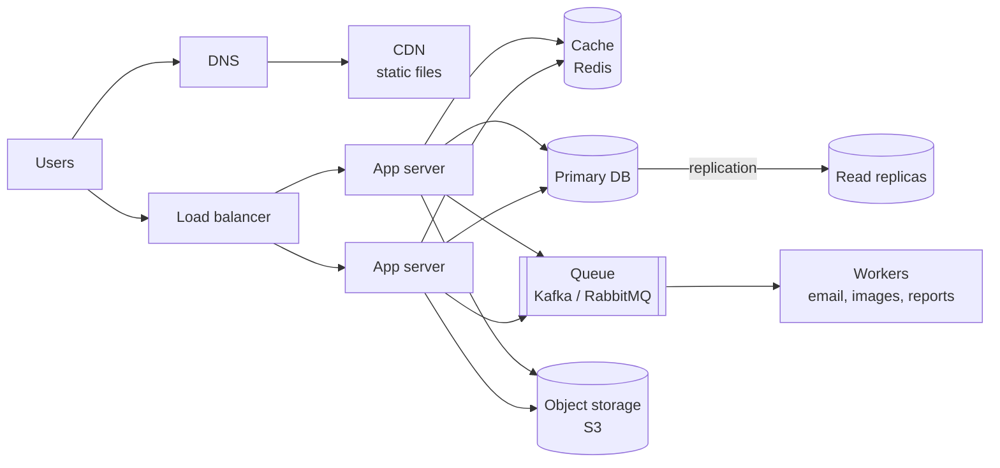
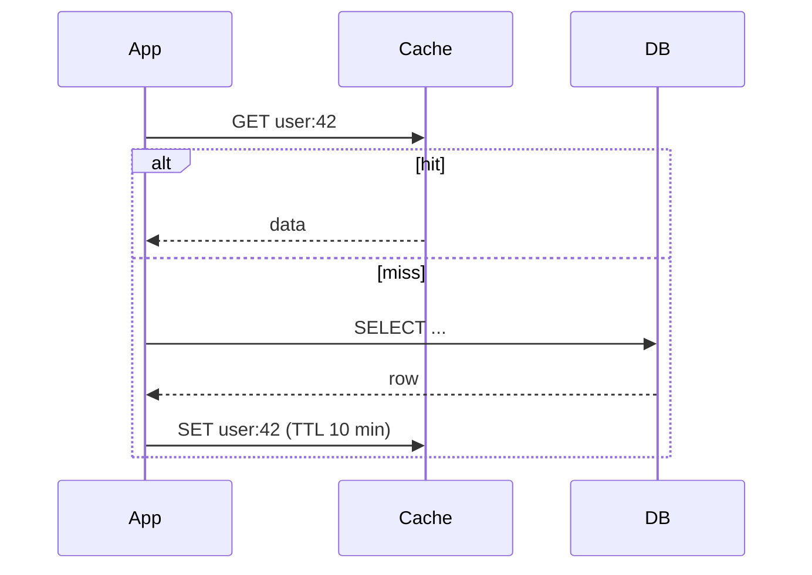

## The building blocks

## Scaling

- **Vertical (scale up):** bigger machine. Simple, but has a ceiling and a single point of failure.
- **Horizontal (scale out):** more machines behind a load balancer. Requires **stateless** app servers — keep sessions in Redis or use tokens.

## Load balancing

Spreads traffic and removes unhealthy servers (health checks).

| Algorithm | Idea |
|---|---|
| Round robin | next server in turn |
| Least connections | server with the fewest active connections |
| IP / consistent hash | same client → same server (sticky) |

L4 balancers route by IP/port (fast); L7 balancers read HTTP (route `/api` vs `/static`, terminate TLS).

## Caching

| Strategy | How it works |
|---|---|
| **Cache-aside** (most common) | app reads cache, falls back to DB, then fills cache |
| Write-through | write to cache and DB together |
| Write-back | write to cache, flush to DB later (fast, risk of loss) |

- **Invalidation:** delete the key on update, plus a TTL as a safety net.
- **Eviction:** LRU (least recently used) is the usual default.
- **Pitfalls:** stampede (many misses at once → lock or stagger TTLs), stale data, caching errors.
- Cache at every layer: browser (`Cache-Control`), CDN, app (Redis), DB buffer pool.

## Databases at scale

- **Indexes first** — most "scaling" problems are missing indexes.
- **Read replicas** — primary takes writes, replicas serve reads. Replication lag means a replica may be slightly behind ("read your own writes" from the primary).
- **Sharding (partitioning)** — split rows across databases by a **shard key** (`user_id % N`, ranges, or consistent hashing). Pick a key that spreads load evenly and keeps related data together; cross-shard joins are painful.
- **Denormalise** for hot read paths; precompute counts.

### SQL vs NoSQL

| SQL | NoSQL |
|---|---|
| Fixed schema, joins, ACID transactions | Flexible schema, built-in horizontal scaling |
| Payments, orders, inventory | Feeds, logs, sessions, catalogs, time-series |

## CAP theorem

In a **network partition** a distributed system must choose **Consistency** (every read sees the latest write, or errors) or **Availability** (every request gets a response, maybe stale). Partition tolerance isn't optional.

- **CP:** banking balances, inventory counts.
- **AP:** social feeds, likes, product views — **eventual consistency** is fine.

## Asynchronous processing

Put slow work on a **message queue** and return to the user immediately: sending emails, resizing images, generating PDFs, notifications.

- Queue (RabbitMQ, SQS): each message processed by one worker.
- Log/stream (Kafka): many consumers read the same events; replayable.
- Make consumers **idempotent** — messages can be delivered more than once.
- Failed messages go to a **dead-letter queue**.

## Rate limiting

Protects APIs from abuse. **Token bucket**: a bucket refills at R tokens/second up to capacity B; each request takes a token, or gets **429 Too Many Requests**. Store counters in Redis so all servers share them.

## Other patterns

- **CDN** — serve images/JS from edge locations close to users.
- **Object storage** — files go to S3/Blob storage, the DB stores only the URL.
- **Idempotency keys** — clients send a unique key so retrying a payment doesn't charge twice.
- **Circuit breaker** — stop calling a failing service for a while, return a fallback.
- **Pagination** — cursor-based (`WHERE id < :last LIMIT 20`) scales better than `OFFSET`.
- **Observability** — logs, metrics (latency p50/p95/p99, error rate), traces, alerts.

## Numbers to remember

| | Approx. |
|---|---|
| L1 cache / RAM access | 1 ns / 100 ns |
| SSD random read | 100 µs |
| Round trip in the same data centre | 0.5 ms |
| Round trip India ↔ US | ~200 ms |
| Seconds per day | ~86,400 ≈ 10⁵ |
| 1M requests/day | ≈ 12 requests/second (peak ≈ 2–3× average) |

**Estimate example:** 10M daily users × 5 posts read/day = 50M reads/day ≈ 600 reads/s average, ~1,500/s at peak → one DB can't serve that comfortably without caching; Redis can.

## Interview framework (45 minutes)

1. **Clarify requirements (5 min)** — functional (what features?) and non-functional (users, latency, availability, consistency).
2. **Estimate (5 min)** — QPS, storage, bandwidth.
3. **API & data model (5–10 min)** — endpoints and main tables/collections.
4. **High-level design (10 min)** — boxes and arrows like the diagram above.
5. **Deep dive (10–15 min)** — the hardest part: feed generation, ID generation, hot keys, consistency.
6. **Trade-offs & bottlenecks** — what fails first, what you'd monitor, how you'd scale 10×.

## Practice problems

URL shortener · rate limiter · news feed · chat (WebSockets) · notification system · ride-hailing (geo-indexing, matching) · hotel/doctor booking (double-booking with locks or unique constraints) · file storage (Drive) · search autocomplete (trie + cache).

### Example: URL shortener in brief

- `POST /urls {longUrl}` → `{code}`; `GET /{code}` → **301/302** redirect.
- Code = base62 of a unique ID (7 chars ≈ 3.5 trillion codes). IDs from a DB sequence or a Snowflake-style generator.
- Table `url(code PK, long_url, created_at, expires_at)`; reads ≫ writes → cache hot codes in Redis, put a CDN in front.
- Analytics (clicks) go through a queue so redirects stay fast.
