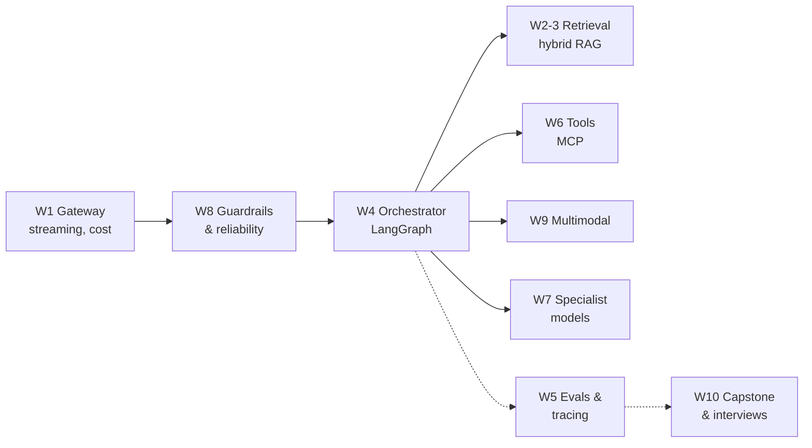

---
mdx:
  format: md
---

# AI Engineering - From Fundamentals to Production (Index)

> **Note**: Sections marked **(Interview Imp)** are frequently asked in interviews.
>
> **What this is:** a free, complete, 10-week path to becoming an AI engineer - Python and LLM internals, RAG, enterprise search, agents and state machines, evals and observability, MCP and multi-agent systems, fine-tuning, system design and security, multimodal AI, and a capstone - following the same syllabus as paid "SDE to AI Engineering" cohorts, built from fundamentals and free sources.
>
> **Who it's for:** anyone who can program in one language (Java, JavaScript, Python…). Python is taught from what you need. No ML background required.
>
> **How to read this wiki:** read the files in number order. Every file has its own table of contents, Previous/Next links, a **📘 Terms Explained** table for every new word, 10 interview questions and a cheat sheet. Each week ends with a **weekly build** - do it yourself before reading the solution.
>
> **Every runnable example runs offline** (no API key, no GPU): models are replaced by small, transparent stand-ins so you can see exactly what each technique computes. The real-world version (OpenRouter, Ollama, Qdrant, Langfuse, Whisper…) is shown next to it.
>
> **Related files:** [AI_ML_Roadmap.md](../ai-ml/AI_ML_Roadmap.md) (wider ML/AI career roadmap) · [Python_Complete_Guide.md](../ai-ml/Python_Complete_Guide.md) · [08_AI_ML_Pattern.md](../design-patterns/04_Specialized/08_AI_ML_Pattern.md) (serving, A/B tests, drift) · [00_Docker_Index.md](../docker/00_Docker_Index.md) · [00_Kubernetes_Index.md](../kubernetes/00_Kubernetes_Index.md)

## Table of Contents
1. [Study Levels](#1-study-levels)
2. [Files in Study Order](#2-files-in-study-order)
3. [Big Picture in One Diagram](#3-big-picture-in-one-diagram)
4. [Setup](#4-setup)
5. [Verification Status](#5-verification-status)

---

## 1. Study Levels

| Level | Files | You can… |
|---|---|---|
| **Beginner** | 01-02 | Call LLMs, stream answers, track cost, build a RAG system that cites sources |
| **Intermediate** | 03-05 | Build hybrid search with re-ranking, tool-using agents with human approval, and eval gates |
| **Advanced** | 06-09 | Expose systems via MCP, engineer context, fine-tune models, secure and harden agents, handle images and voice |
| **Mastery** | 10-11 | Ship a production capstone, defend design decisions, pass AI system design interviews |

## 2. Files in Study Order

| # | File | What you learn | Weekly build |
|---|---|---|---|
| 01 | [01_Python_and_LLM_Fundamentals.md](01_Python_and_LLM_Fundamentals.md) | Python for AI, Pydantic, async & streaming, tokens, attention, sampling, LLM lifecycle, model tiering | **The AI Gateway** - streaming chat backend with cost tracking |
| 02 | [02_RAG_Foundations.md](02_RAG_Foundations.md) | Embeddings, parsing, chunking, vector DBs & HNSW, multi-tenant isolation, grounded prompts | **The Knowledge Engine** - RAG that cites and says "I don't know" |
| 03 | [03_Enterprise_RAG.md](03_Enterprise_RAG.md) | BM25, hybrid search, RRF, cross-encoder re-ranking, query expansion & routing, Graph RAG, retrieval metrics | **The Enterprise Search Engine** - multi-tenant hybrid + re-ranked search |
| 04 | [04_Agents_and_State_Machines.md](04_Agents_and_State_Machines.md) | Workflows vs agents, tool calling, ReAct, reliable tools, LangGraph, interrupts, memory | **The Persistent Operator** - agent with human approval and memory |
| 05 | [05_Evals_and_Observability.md](05_Evals_and_Observability.md) | Tracing, unit economics, golden datasets, LLM-as-a-judge, RAGAS, trajectory evals, CI gates | **The Regression & Telemetry Gate** - blocks bad prompts in CI |
| 06 | [06_MCP_Context_Engineering_Multi_Agent.md](06_MCP_Context_Engineering_Multi_Agent.md) | MCP servers & clients, context engineering, memory policies, multi-agent patterns, tool security | **The Audited Tool Bridge** - legacy APIs as secure MCP tools |
| 07 | [07_ML_Fundamentals_and_Fine_Tuning.md](07_ML_Fundamentals_and_Fine_Tuning.md) | Gradient descent, fine-tune vs RAG vs prompt, LoRA/QLoRA, quantization, datasets, local serving | **The Specialist Model** - fine-tune and benchmark vs a frontier API |
| 08 | [08_Agentic_System_Design_and_Reliability.md](08_Agentic_System_Design_and_Reliability.md) | Architecture at scale, trade-offs, maker-checker, prompt injection, PII, fallbacks, caching, rate limits | **The Dual-Agent Supervisor** - survives an outage drill and attacks |
| 09 | [09_Multimodal_AI.md](09_Multimodal_AI.md) | Vision encoders, VLMs, Whisper & voice agents, video, low latency, multimodal RAG | **The Multimodal RAG Engine** - image + voice tickets, cost per ticket |
| 10 | [10_Capstone_and_Interview_Prep.md](10_Capstone_and_Interview_Prep.md) | How it all fits, capstone deploy, ADRs, AI system design interviews, question bank, free study plan | **The Finale Deploy** - production MVP + demo |
| 11 | [11_Tools_Reference.md](11_Tools_Reference.md) | The 20 tools (OpenRouter, Qdrant, pgvector, LangChain, LlamaIndex, CrewAI, LangGraph, Langfuse, RAGAS, MCP, Ollama, Whisper, AWS…) | - |

## 3. Big Picture in One Diagram



The full walkthrough is in [10_Capstone_and_Interview_Prep.md](10_Capstone_and_Interview_Prep.md#1-how-it-all-fits-together-interview-imp).

## 4. Setup

You need only Python 3.10+ for the examples. Each file lists any extra package at the top of its snippets.

```bash
python3 -m venv .venv && source .venv/bin/activate
pip install pydantic fastapi httpx langgraph mcp        # everything the runnable examples use
# Optional, for the "real" versions:
# Ollama (local models): https://ollama.com  then: ollama pull llama3.2 && ollama pull nomic-embed-text
# Docker for Qdrant / Redis / Langfuse: docker run -p 6333:6333 qdrant/qdrant
```

**Free model access:** Ollama (local), the free tiers/credits of OpenRouter, Google AI Studio (Gemini) and Groq are enough for every weekly build. Fine-tuning (Week 7) runs on free Google Colab or Kaggle GPUs.

## 5. Verification Status

| Item | Status |
|---|---|
| Python examples with an "Output (identical on all 3 runs)" block (60 examples in 01-10) | **Executed 3 times each** with Python 3.14 and pydantic 2.14, fastapi 0.162, httpx 0.28, langgraph 1.2, mcp 2.3 (November 2026). The pasted output is the real output; runs were identical. |
| Snippets marked *Not executed* (provider APIs, Ollama, Qdrant, pgvector, Redis, Langfuse, RAGAS, DeepEval, CrewAI, Whisper, Unsloth fine-tuning, GitHub Actions, Docker Compose) | **Not run here** - they need API keys, servers, model downloads or a GPU. They follow each project's documented API at the time of writing; check the docs if an API has changed. |
| Model prices, token-per-image and latency numbers | **Examples** for learning the calculations, not current price lists. |
| Mermaid diagrams | Checked with the mermaid parser |
| Links and anchors | Checked across the whole wiki |

#### 📘 Terms Explained

| Term | Simple meaning |
|---|---|
| **AI engineer** | A software engineer who builds products on top of AI models (RAG, agents, evals), as opposed to training models from scratch. |
| **LLM** | Large Language Model - a model trained on huge text corpora to predict the next token. |
| **RAG** | Retrieval-Augmented Generation - look up relevant data, then have the LLM answer from it. |
| **Agent** | An LLM in a loop that chooses tools/actions until a task is done. |
| **Eval** | A repeatable test of AI output quality. |
| **MCP** | Model Context Protocol - a standard for connecting AI apps to tools and data. |
