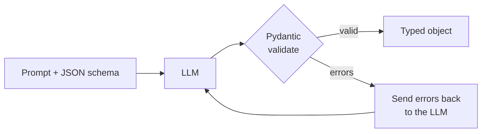
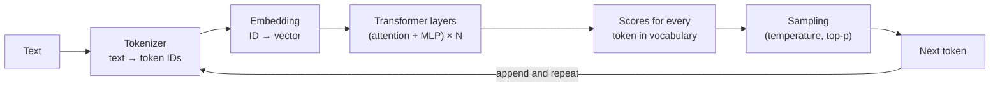
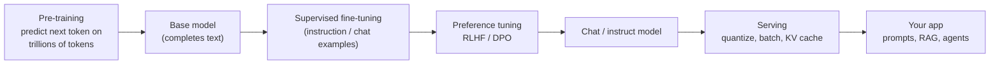
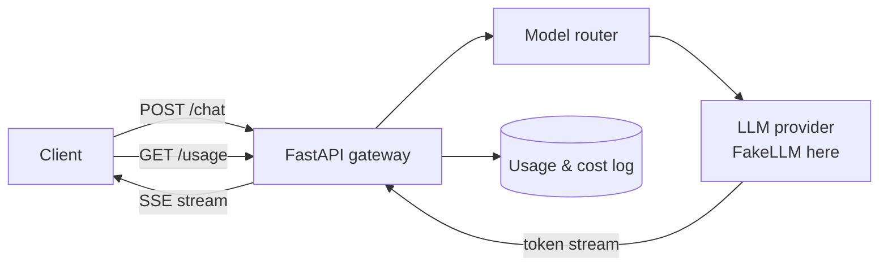

---
mdx:
  format: md
---

# 01 - Python for AI & LLM Fundamentals (Week 1)

> **Note**: Sections marked **(Interview Imp)** are frequently asked in interviews.
>
> **Goal of this week:** write the Python an AI engineer uses every day (classes, type hints, Pydantic, async, streaming) and understand what actually happens inside an LLM (tokens, embeddings, attention, sampling), then build your first LLM backend: **The AI Gateway**.
>
> **Every example runs offline.** Instead of a paid API we use a tiny `FakeLLM` that behaves like a real one (streams tokens, reports usage). Each section also shows the real-API version so you can switch when you have a key.
>
> ⬅️ [00 Index](00_AI_Engineering_Index.md) · ➡️ [02 RAG Foundations](02_RAG_Foundations.md)

## Table of Contents
1. [Python Essentials for AI Engineers](#1-python-essentials-for-ai-engineers)
2. [Pydantic - Typed, Validated Data (Interview Imp)](#2-pydantic---typed-validated-data-interview-imp)
3. [Async Python (Interview Imp)](#3-async-python-interview-imp)
4. [Calling LLM APIs and Streaming Responses](#4-calling-llm-apis-and-streaming-responses)
5. [How an LLM Works Inside (Interview Imp)](#5-how-an-llm-works-inside-interview-imp)
6. [The LLM Lifecycle and Model Tiering](#6-the-llm-lifecycle-and-model-tiering)
7. [Weekly Build - The AI Gateway](#7-weekly-build---the-ai-gateway)
8. [Interview Questions](#8-interview-questions)
9. [Cheat Sheet](#9-cheat-sheet)

---

## 1. Python Essentials for AI Engineers

**What is it?** The small part of Python you use in almost every AI project: functions, classes, dataclasses, type hints, comprehensions, dictionaries and exceptions.

**Why needed?** Nearly every AI library (LangChain, LangGraph, LlamaIndex, FastAPI, Hugging Face) is Python-first. You don't need advanced Python; you need to be fluent in the basics. Full language guide: [Python_Complete_Guide.md](../ai-ml/Python_Complete_Guide.md).

**How it works - one example that uses all of it:**

```python
from dataclasses import dataclass, field

@dataclass
class Message:
    role: str          # "system", "user" or "assistant"
    content: str

@dataclass
class Conversation:
    messages: list[Message] = field(default_factory=list)

    def add(self, role: str, content: str) -> None:
        if role not in {"system", "user", "assistant"}:
            raise ValueError(f"unknown role: {role}")
        self.messages.append(Message(role, content))

    def as_api_payload(self) -> list[dict]:
        # list comprehension -> the JSON shape every chat API expects
        return [{"role": m.role, "content": m.content} for m in self.messages]

chat = Conversation()
chat.add("system", "You are a helpful assistant.")
chat.add("user", "What is RAG?")
print(chat.as_api_payload())

try:
    chat.add("robot", "hi")
except ValueError as e:
    print("Error:", e)

word_counts = {m.role: len(m.content.split()) for m in chat.messages}
print(word_counts)
```

**Output (identical on all 3 runs):**

```text
[{'role': 'system', 'content': 'You are a helpful assistant.'}, {'role': 'user', 'content': 'What is RAG?'}]
Error: unknown role: robot
{'system': 5, 'user': 3}
```

**Pitfalls**
- Using a mutable default (`messages: list = []`) shares one list between all objects. Use `field(default_factory=list)`.
- Forgetting type hints. AI frameworks (Pydantic, FastAPI, LangGraph) *read* your type hints to validate data and build schemas.

#### 📘 Terms Explained

| Term | Simple meaning |
|---|---|
| **dataclass** | A class where Python writes `__init__`, `__repr__` and `__eq__` for you from the field list. |
| **Type hint** | `name: str` - a label saying what type a value should be. Tools use it; Python itself doesn't enforce it. |
| **Comprehension** | One-line loop that builds a list/dict: `[x*2 for x in xs]`. |
| **Payload** | The data you send in a request body (usually JSON). |

---

## 2. Pydantic - Typed, Validated Data (Interview Imp)

**What is it?** A library that turns type hints into **runtime validation**. You declare a model; Pydantic checks and converts incoming data and gives clear errors.

**Why needed?** LLMs return *text*. When you ask for JSON, you sometimes get a missing field, a string instead of a number, or extra chatter. Pydantic is how you turn "probably JSON" into a guaranteed Python object - or a clean error you can retry on. It is also how OpenAI/Anthropic "structured outputs", FastAPI and Pydantic AI define schemas.

**How it works:**

```python
from pydantic import BaseModel, Field, ValidationError

class Ticket(BaseModel):
    category: str = Field(description="billing, technical or other")
    priority: int = Field(ge=1, le=5)          # must be 1..5
    summary: str

# 1. A good LLM answer ("3" is converted to the int 3)
raw = '{"category": "billing", "priority": "3", "summary": "Charged twice"}'
t = Ticket.model_validate_json(raw)
print(t)
print(type(t.priority).__name__)

# 2. A bad LLM answer -> clear, machine-readable errors
bad = '{"category": "billing", "priority": 9}'
try:
    Ticket.model_validate_json(bad)
except ValidationError as e:
    for err in e.errors():
        print(err["loc"], "->", err["msg"])

# 3. The JSON Schema you can send to the model so it knows the shape
schema = Ticket.model_json_schema()
print(sorted(schema["properties"]), schema["required"])
```

**Output (identical on all 3 runs):**

```text
category='billing' priority=3 summary='Charged twice'
int
('priority',) -> Input should be less than or equal to 5
('summary',) -> Field required
['category', 'priority', 'summary'] ['category', 'priority', 'summary']
```

**The pattern you will use all course long - validate and retry:**



**Pitfalls**
- Trusting the model to always follow the schema. Always validate; cap retries (2-3).
- Asking for huge nested schemas. Smaller schemas = fewer mistakes.

#### 📘 Terms Explained

| Term | Simple meaning |
|---|---|
| **Validation** | Checking data matches the rules (types, ranges, required fields). |
| **JSON Schema** | A standard JSON description of what valid data looks like. LLM APIs accept it for structured output. |
| **Structured output** | Asking the model to answer in a fixed JSON shape instead of free text. |

---

## 3. Async Python (Interview Imp)

**What is it?** `async`/`await` lets one Python thread work on many tasks that are *waiting* (for a network reply, a database, an LLM) at the same time.

**Why needed?** An LLM call takes 1-30 seconds, and the program is just waiting. With async, a server can handle hundreds of users at once, and you can call several models in parallel.

**How it works:** `await` means "pause me here and let other tasks run until this result is ready". `asyncio.gather` runs tasks concurrently.

```python
import asyncio, time

async def fake_llm_call(name: str, seconds: float) -> str:
    await asyncio.sleep(seconds)        # stands in for waiting on the network
    return f"{name} done"

async def main():
    start = time.perf_counter()
    for n in ["a", "b", "c"]:                       # one after another
        await fake_llm_call(n, 0.2)
    print(f"sequential: {time.perf_counter() - start:.1f}s")

    start = time.perf_counter()
    results = await asyncio.gather(*(fake_llm_call(n, 0.2) for n in ["a", "b", "c"]))
    print(f"concurrent: {time.perf_counter() - start:.1f}s", results)

asyncio.run(main())
```

**Output (identical on all 3 runs):**

```text
sequential: 0.6s
concurrent: 0.2s ['a done', 'b done', 'c done']
```

**Async generators = streaming.** A function with `async def` + `yield` produces values one at a time. This is exactly how token streaming is written:

```python
import asyncio

async def stream_tokens(text: str):
    for word in text.split():
        await asyncio.sleep(0.01)       # tokens arrive over the network
        yield word + " "

async def main():
    received = []
    async for token in stream_tokens("Streaming shows text as it is generated"):
        received.append(token)
        print(f"got token {len(received)}: {token!r}")
    print("full:", "".join(received).strip())

asyncio.run(main())
```

**Output (identical on all 3 runs):**

```text
got token 1: 'Streaming '
got token 2: 'shows '
got token 3: 'text '
got token 4: 'as '
got token 5: 'it '
got token 6: 'is '
got token 7: 'generated '
full: Streaming shows text as it is generated
```

**Pitfalls**
- Calling a *blocking* function (`time.sleep`, `requests.get`, a sync DB driver) inside async code freezes every task. Use async libraries (`httpx.AsyncClient`, `asyncpg`) or `await asyncio.to_thread(fn)`.
- Firing 1,000 LLM calls at once and hitting rate limits. Limit concurrency with `asyncio.Semaphore(10)`.

#### 📘 Terms Explained

| Term | Simple meaning |
|---|---|
| **Coroutine** | A function defined with `async def`; it can pause at `await`. |
| **Event loop** | The scheduler that switches between waiting tasks. |
| **Concurrency** | Many tasks in progress at once (not necessarily at the same instant). |
| **Semaphore** | A counter that lets at most N tasks into a section at the same time. |

---

## 4. Calling LLM APIs and Streaming Responses

**What is it?** Almost every provider (OpenAI, OpenRouter, Groq, Together, Ollama, vLLM) speaks the **OpenAI-compatible Chat Completions** format: you POST a list of messages and get a reply plus token **usage**.

**The request and response shape:**

```python
# Not executed here: needs an API key and network.
# Works with OpenRouter (any model), OpenAI, or a local Ollama server.
import httpx, os

resp = httpx.post(
    "https://openrouter.ai/api/v1/chat/completions",   # Ollama: http://localhost:11434/v1/chat/completions
    headers={"Authorization": f"Bearer {os.environ['OPENROUTER_API_KEY']}"},
    json={
        "model": "meta-llama/llama-3.1-8b-instruct",
        "messages": [
            {"role": "system", "content": "Answer in one sentence."},
            {"role": "user", "content": "What is an embedding?"},
        ],
        "temperature": 0.2,
        "max_tokens": 100,
    },
    timeout=60,
)
data = resp.json()
print(data["choices"][0]["message"]["content"])
print(data["usage"])   # {"prompt_tokens": ..., "completion_tokens": ..., "total_tokens": ...}
```

**Streaming:** add `"stream": true` and the server sends **Server-Sent Events (SSE)** - lines starting with `data: `, each holding a small JSON "delta", ending with `data: [DONE]`. Parsing it:

```python
import json

# What a real streaming response body looks like (shortened)
sse_body = """data: {"choices":[{"delta":{"content":"Embeddings"}}]}

data: {"choices":[{"delta":{"content":" turn text"}}]}

data: {"choices":[{"delta":{"content":" into vectors."}}]}

data: {"choices":[{"delta":{}}],"usage":{"prompt_tokens":21,"completion_tokens":6}}

data: [DONE]
"""

text, usage = "", None
for line in sse_body.splitlines():
    if not line.startswith("data: "):
        continue                      # blank lines separate events
    payload = line[len("data: "):]
    if payload == "[DONE]":
        break
    event = json.loads(payload)
    text += event["choices"][0]["delta"].get("content", "")
    usage = event.get("usage", usage)

print(text)
print(usage)
```

**Output (identical on all 3 runs):**

```text
Embeddings turn text into vectors.
{'prompt_tokens': 21, 'completion_tokens': 6}
```

**Pitfalls**
- No timeout -> a stuck request hangs your server. Always set one.
- Not reading `usage` -> you can't track cost. Some providers only send usage in streams if you ask (`"stream_options": {"include_usage": true}`).
- Hard-coding one provider. Keep the base URL and model name in config so you can switch.

#### 📘 Terms Explained

| Term | Simple meaning |
|---|---|
| **OpenAI-compatible API** | The de-facto standard request format most LLM servers accept. |
| **Token usage** | How many tokens went in (prompt) and came out (completion). You pay per token. |
| **SSE (Server-Sent Events)** | A simple HTTP format for a server to push many small messages over one response. |
| **Delta** | The small new piece of text in one streamed event. |
| **OpenRouter** | One API key that gives access to hundreds of models from many providers. |

---

## 5. How an LLM Works Inside (Interview Imp)

An LLM is a function: **text in → probabilities for the next token out**. It generates by repeating that one step.



### 5.1 Tokenization

**What:** splitting text into **tokens** - pieces between a character and a word ("unbelievable" → "un", "believ", "able"). Models see token IDs, never letters.

**Why it matters to you:** you pay per token, context limits are in tokens, and odd behaviour (bad at counting letters, worse at rare languages) comes from tokenization.

**How (BPE - Byte Pair Encoding):** start from characters, repeatedly merge the most frequent neighbouring pair into a new token. A complete toy version:

```python
from collections import Counter

corpus = ["low", "lower", "lowest", "newer", "newest", "wider"]
words = [list(w) + ["</w>"] for w in corpus]       # </w> marks the end of a word

def most_common_pair(words):
    pairs = Counter()
    for w in words:
        for a, b in zip(w, w[1:]):
            pairs[(a, b)] += 1
    return pairs.most_common(1)[0][0]

def merge(words, pair):
    out = []
    for w in words:
        i, new = 0, []
        while i < len(w):
            if i < len(w) - 1 and (w[i], w[i + 1]) == pair:
                new.append(w[i] + w[i + 1]); i += 2
            else:
                new.append(w[i]); i += 1
        out.append(new)
    return out

for step in range(1, 6):
    pair = most_common_pair(words)
    words = merge(words, pair)
    print(f"merge {step}: {pair[0]} + {pair[1]}")

print([" ".join(w) for w in words])
```

**Output (identical on all 3 runs):**

```text
merge 1: w + e
merge 2: l + o
merge 3: r + </w>
merge 4: lo + we
merge 5: s + t
['lo w </w>', 'lowe r</w>', 'lowe st </w>', 'n e we r</w>', 'n e we st </w>', 'w i d e r</w>']
```

Real tokenizers (GPT's `tiktoken`, Llama's SentencePiece) do the same with ~100k-200k merges learned from terabytes of text. Rule of thumb: **1 token ≈ 4 English characters ≈ 0.75 words**; Hindi and other Indic scripts often use 2-4× more tokens for the same meaning.

### 5.2 Embeddings and vectorization

Each token ID is looked up in a table and becomes a **vector** (a list of e.g. 4,096 numbers). Training arranges these so that similar meanings point in similar directions. The same idea, applied to whole sentences, powers RAG in [Week 2](02_RAG_Foundations.md#1-embeddings-and-vector-geometry-interview-imp).

### 5.3 Attention - the core idea (Interview Imp)

**What:** every token looks at every earlier token and decides how much each one matters to it. In "The bank of the river", *bank* should attend strongly to *river*.

**How:** each token makes three vectors: **Query** (what am I looking for?), **Key** (what do I contain?), **Value** (what do I pass on?).
`attention = softmax(Q·Kᵀ / √d) · V` - score every pair, turn scores into weights that sum to 1, then take a weighted average of the values.

```python
import math

def softmax(xs):
    m = max(xs)
    exps = [math.exp(x - m) for x in xs]       # subtract max for numerical stability
    s = sum(exps)
    return [e / s for e in exps]

def dot(a, b):
    return sum(x * y for x, y in zip(a, b))

tokens = ["the", "bank", "of", "river"]
# Tiny hand-made 2-D vectors (real models learn them; d = thousands)
Q = {"bank": [1.0, 1.0]}
K = {"the": [0.1, 0.0], "bank": [0.5, 0.5], "of": [0.0, 0.1], "river": [1.2, 0.9]}
V = {"the": [0.0, 0.0], "bank": [1.0, 0.0], "of": [0.0, 0.0], "river": [0.0, 1.0]}

d = 2
scores = [dot(Q["bank"], K[t]) / math.sqrt(d) for t in tokens]
weights = softmax(scores)
for t, w in zip(tokens, weights):
    print(f"bank -> {t:5s} weight {w:.2f}")

new_bank = [sum(w * V[t][i] for t, w in zip(tokens, weights)) for i in range(d)]
print("new 'bank' vector:", [round(x, 2) for x in new_bank])
```

**Output (identical on all 3 runs):**

```text
bank -> the   weight 0.12
bank -> bank  weight 0.24
bank -> of    weight 0.12
bank -> river weight 0.51
new 'bank' vector: [0.24, 0.51]
```

"bank" now carries a lot of "river" meaning. A transformer does this with many **heads** in parallel, in dozens of **layers**. In a decoder (GPT-style) model a **causal mask** stops a token from looking at later tokens.

### 5.4 Sampling - temperature and top-p

The model outputs a score (**logit**) for every token in its vocabulary. Softmax turns them into probabilities, then we **sample**.

- **Temperature** divides logits before softmax: low (0-0.3) = predictable, high (0.8-1.2) = creative/random.
- **Top-p** keeps only the most likely tokens whose probabilities add up to *p* (e.g. 0.9), then samples among them.

```python
import math, random

logits = {"Paris": 4.0, "Lyon": 3.0, "London": 2.0, "banana": -1.0}

def probs(logits, temperature):
    scaled = {t: v / temperature for t, v in logits.items()}
    m = max(scaled.values())
    exps = {t: math.exp(v - m) for t, v in scaled.items()}
    s = sum(exps.values())
    return {t: e / s for t, e in exps.items()}

for temp in (0.2, 1.0, 2.0):
    p = probs(logits, temp)
    print(f"T={temp}: " + ", ".join(f"{t} {v:.2f}" for t, v in p.items()))

rng = random.Random(42)                         # fixed seed -> same result every run
for temp in (0.2, 1.0, 2.0):
    p = probs(logits, temp)
    draws = rng.choices(list(p), weights=list(p.values()), k=20)
    print(f"20 samples at T={temp}:", {t: draws.count(t) for t in logits})
```

**Output (identical on all 3 runs):**

```text
T=0.2: Paris 0.99, Lyon 0.01, London 0.00, banana 0.00
T=1.0: Paris 0.66, Lyon 0.24, London 0.09, banana 0.00
T=2.0: Paris 0.49, Lyon 0.29, London 0.18, banana 0.04
20 samples at T=0.2: {'Paris': 20, 'Lyon': 0, 'London': 0, 'banana': 0}
20 samples at T=1.0: {'Paris': 11, 'Lyon': 7, 'London': 2, 'banana': 0}
20 samples at T=2.0: {'Paris': 14, 'Lyon': 5, 'London': 1, 'banana': 0}
```

**Pitfalls**
- Thinking `temperature=0` is fully deterministic. On real GPU servers batching and floating-point order can still change outputs slightly.
- Raising temperature to "fix" a boring answer when the real problem is the prompt or missing context.

#### 📘 Terms Explained

| Term | Simple meaning |
|---|---|
| **Token** | A chunk of text (often part of a word) that the model reads and writes. |
| **BPE** | Byte Pair Encoding - builds a vocabulary by merging frequent character pairs. |
| **Vocabulary** | All tokens a model knows (e.g. 128k for Llama 3). |
| **Embedding** | A vector of numbers representing meaning. |
| **Attention** | Each token mixing in information from the tokens that matter to it. |
| **Q / K / V** | Query, Key, Value - the three vectors attention uses to score and mix tokens. |
| **Softmax** | Turns any list of scores into probabilities that add up to 1. |
| **Logit** | The raw score for a token before softmax. |
| **Transformer** | The neural-network design (attention + feed-forward layers) behind all modern LLMs. |
| **Context window** | Maximum tokens (input + output) a model can handle in one request. |

---

## 6. The LLM Lifecycle and Model Tiering

### 6.1 How a model is made



| Stage | What happens | Who does it |
|---|---|---|
| Pre-training | Learn language and facts by predicting the next token | Labs (OpenAI, Anthropic, Meta, Google) - months, millions of $ |
| SFT | Learn to follow instructions from example conversations | Labs; you can too (Week 7) |
| RLHF / DPO | Learn which answers humans prefer (helpful, safe) | Labs |
| Serving / inference | Run the model fast and cheap | Providers, or you with Ollama/vLLM |
| Application | Prompting, RAG, tools, agents, evals | **You - this whole course** |

**Inference has two phases:** *prefill* (read your whole prompt at once - fast per token) and *decode* (generate one token at a time - this is why output tokens cost more and why streaming helps). The **KV cache** stores attention keys/values so earlier tokens aren't recomputed.

### 6.2 Model tiering (Interview Imp)

**What:** use the cheapest model that is good enough for each request, and escalate only when needed.

**Why:** prices differ 10-100× between small and frontier models. Most traffic (greetings, classification, simple extraction) doesn't need the biggest model.

| Tier | Example use | Typical models (2026) |
|---|---|---|
| Small / fast | Classify intent, extract fields, route, summarise short text | Llama 3.x 8B, Qwen 2.5 7B, Gemini Flash, Claude Haiku, GPT-mini class |
| Mid | Most RAG answers, tool calling | Llama 70B class, Claude Sonnet, GPT-4o class |
| Frontier | Hard reasoning, long multi-step agents, code | Claude Opus, GPT-5 class, Gemini Pro |

```python
# A simple router: cheap rules first, escalate on signals of difficulty.
def pick_model(prompt: str) -> str:
    hard_words = ("prove", "design", "architecture", "step by step", "debug")
    if len(prompt) > 2000 or any(w in prompt.lower() for w in hard_words):
        return "frontier"
    if len(prompt) > 300:
        return "mid"
    return "small"

for p in ["hi!", "Summarise this paragraph: " + "x" * 400, "Design a fraud-detection architecture"]:
    print(f"{p[:30]!r:35} -> {pick_model(p)}")
```

**Output (identical on all 3 runs):**

```text
'hi!'                               -> small
'Summarise this paragraph: xxxx'    -> mid
'Design a fraud-detection archi'    -> frontier
```

In production the router is often a small model or classifier itself, and you check quality per tier with evals ([Week 5](05_Evals_and_Observability.md)).

#### 📘 Terms Explained

| Term | Simple meaning |
|---|---|
| **Base model** | A model that only continues text; not yet trained to chat. |
| **SFT** | Supervised Fine-Tuning - training on example input → ideal output pairs. |
| **RLHF / DPO** | Ways to train a model on human preferences between two answers. |
| **Inference** | Running a trained model to get outputs. |
| **Prefill / decode** | Reading the prompt (parallel) vs generating tokens one by one (sequential). |
| **KV cache** | Saved attention data for earlier tokens so they aren't recomputed. |
| **Model tiering / routing** | Sending each request to the cheapest model that can handle it. |

---

## 7. Weekly Build - The AI Gateway

**Goal:** a streaming, non-blocking chat backend that tracks token usage and cost per request - the first piece every AI product needs.



**What it does**
1. `POST /chat` streams the answer as SSE, token by token.
2. Counts prompt and completion tokens and computes cost from a price table.
3. Picks a model tier with the router from section 6.2.
4. `GET /usage` returns totals so you can see spend.

```python
import asyncio, json
from fastapi import FastAPI
from fastapi.responses import StreamingResponse
from fastapi.testclient import TestClient
from pydantic import BaseModel

# Example prices in USD per 1M tokens (input, output). Real prices change - keep them in config.
PRICES = {"small": (0.10, 0.40), "mid": (1.00, 4.00), "frontier": (5.00, 25.00)}

def count_tokens(text: str) -> int:
    return max(1, round(len(text) / 4))            # ~4 chars per token; use a real tokenizer in production

class FakeLLM:
    """Behaves like a streaming chat API: yields text pieces, then reports usage."""
    async def stream(self, model: str, prompt: str):
        answer = f"[{model}] You asked about: {prompt.strip()[:40]}. Here is a short answer."
        for word in answer.split(" "):
            await asyncio.sleep(0)                     # a real call waits on the network here
            yield {"delta": word + " "}
        yield {"usage": {"prompt_tokens": count_tokens(prompt), "completion_tokens": count_tokens(answer)}}

def pick_model(prompt: str) -> str:
    if any(w in prompt.lower() for w in ("design", "architecture", "prove")):
        return "frontier"
    return "mid" if len(prompt) > 300 else "small"

class ChatRequest(BaseModel):
    prompt: str
    user: str = "anonymous"

app = FastAPI()
llm = FakeLLM()
usage_log: list[dict] = []

@app.post("/chat")
async def chat(req: ChatRequest):
    model = pick_model(req.prompt)

    async def events():
        async for ev in llm.stream(model, req.prompt):
            if "delta" in ev:
                yield f"data: {json.dumps({'delta': ev['delta']})}\n\n"
            else:
                u = ev["usage"]
                pin, pout = PRICES[model]
                cost = u["prompt_tokens"] / 1e6 * pin + u["completion_tokens"] / 1e6 * pout
                record = {"user": req.user, "model": model, **u, "cost_usd": round(cost, 8)}
                usage_log.append(record)
                yield f"data: {json.dumps({'usage': record})}\n\n"
        yield "data: [DONE]\n\n"

    return StreamingResponse(events(), media_type="text/event-stream")

@app.get("/usage")
def usage():
    total = sum(r["cost_usd"] for r in usage_log)
    return {"requests": len(usage_log), "total_cost_usd": round(total, 8),
            "by_model": {m: sum(1 for r in usage_log if r["model"] == m) for m in PRICES}}

# ---- try it (TestClient calls the app in-process, no server needed)
client = TestClient(app)
for prompt in ["What is RAG?", "Design a multi-tenant RAG architecture for banks"]:
    with client.stream("POST", "/chat", json={"prompt": prompt, "user": "ritik"}) as r:
        text, final = "", None
        for line in r.iter_lines():
            if not line.startswith("data: ") or line == "data: [DONE]":
                continue
            ev = json.loads(line[6:])
            text += ev.get("delta", "")
            final = ev.get("usage", final)
    print("answer:", text.strip())
    print("usage :", final)
print(client.get("/usage").json())
```

**Output (identical on all 3 runs):**

```text
answer: [small] You asked about: What is RAG?. Here is a short answer.
usage : {'user': 'ritik', 'model': 'small', 'prompt_tokens': 3, 'completion_tokens': 16, 'cost_usd': 6.7e-06}
answer: [frontier] You asked about: Design a multi-tenant RAG architecture f. Here is a short answer.
usage : {'user': 'ritik', 'model': 'frontier', 'prompt_tokens': 12, 'completion_tokens': 23, 'cost_usd': 0.000635}
{'requests': 2, 'total_cost_usd': 0.0006417, 'by_model': {'small': 1, 'mid': 0, 'frontier': 1}}
```

**Run it as a real server:** save as `gateway.py` (without the TestClient part), `pip install fastapi uvicorn`, run `uvicorn gateway:app --reload`, then `curl -N -X POST localhost:8000/chat -H 'content-type: application/json' -d '{"prompt":"hi"}'` (`-N` turns off curl buffering so you see tokens arrive).

**Swap in a real model:** replace `FakeLLM.stream` with an `httpx.AsyncClient().stream("POST", ".../chat/completions", json={..., "stream": True, "stream_options": {"include_usage": True}})` loop that parses SSE lines exactly like section 4.

**Stretch goals**
- Per-user budgets: refuse a request when today's cost for that user is over a limit.
- Store usage in PostgreSQL/Redis instead of a list.
- Add a `/models` endpoint and let the client force a tier.
- Add request IDs and timing (time-to-first-token, total latency) - you will trace these properly in [Week 5](05_Evals_and_Observability.md).

**Outcome:** your first LLM-powered app with a streaming backend and cost tracking.

#### 📘 Terms Explained

| Term | Simple meaning |
|---|---|
| **Gateway** | One service all LLM calls go through, so you can add routing, limits, logging and caching in one place. |
| **FastAPI** | A Python web framework built on type hints and async. |
| **StreamingResponse** | A FastAPI response that sends data in pieces as it is produced. |
| **TestClient** | Calls your FastAPI app directly in tests, without starting a server. |
| **Time-to-first-token (TTFT)** | How long until the user sees the first word - the latency users feel most. |

---

## 8. Interview Questions

1. **What is a token, and why do LLM costs and limits depend on tokens rather than words?**
   The model reads and writes token IDs; compute (and therefore price) scales with tokens processed, and the context window is a token count.
2. **Explain attention in two sentences. (Interview Imp)**
   Each token builds a query and compares it with every earlier token's key; the softmax of those scores weights an average of the values, so each token absorbs context from the tokens most relevant to it.
3. **Why divide by √d in attention?** Dot products grow with vector size; dividing keeps scores in a range where softmax isn't saturated, which keeps training stable.
4. **What do temperature and top-p do?** Temperature sharpens or flattens the probability distribution; top-p cuts the long tail of unlikely tokens before sampling.
5. **Why are output tokens usually more expensive than input tokens?** Input is processed in parallel (prefill); output is generated one token at a time (decode), which uses the GPU less efficiently.
6. **Why use async for an LLM backend?** Requests spend almost all their time waiting on the network; async lets one process serve many users concurrently.
7. **How do you get reliable JSON from an LLM?** Give a schema (structured output / JSON mode), validate with Pydantic, send validation errors back for a limited number of retries.
8. **What is model tiering and why does it matter?** Routing requests to the cheapest capable model; it can cut cost by an order of magnitude with little quality loss when checked with evals.
9. **What is the KV cache?** Stored keys/values of past tokens so generation of each new token doesn't recompute attention over the whole prefix.
10. **Base model vs instruct model?** A base model only continues text; an instruct/chat model was further trained (SFT + preference tuning) to follow instructions.

---

## 9. Cheat Sheet

| Need | Use |
|---|---|
| Validate LLM JSON | `Model.model_validate_json(text)` + retry on `ValidationError` |
| Schema for the model | `Model.model_json_schema()` |
| Run calls in parallel | `await asyncio.gather(*calls)` with a `Semaphore` |
| Stream tokens | async generator (`async def` + `yield`), SSE `data: ...\n\n` |
| Any provider | OpenAI-compatible `/v1/chat/completions` (OpenRouter, Ollama, vLLM) |
| Estimate tokens | ~4 chars/token in English; use the model's tokenizer for real counts |
| Cost | `prompt_tokens × input_price + completion_tokens × output_price` |
| Less randomness | `temperature` 0-0.3 |
| Save money | model tiering + caching + shorter prompts |

⬅️ [00 Index](00_AI_Engineering_Index.md) · ➡️ [02 RAG Foundations](02_RAG_Foundations.md)
