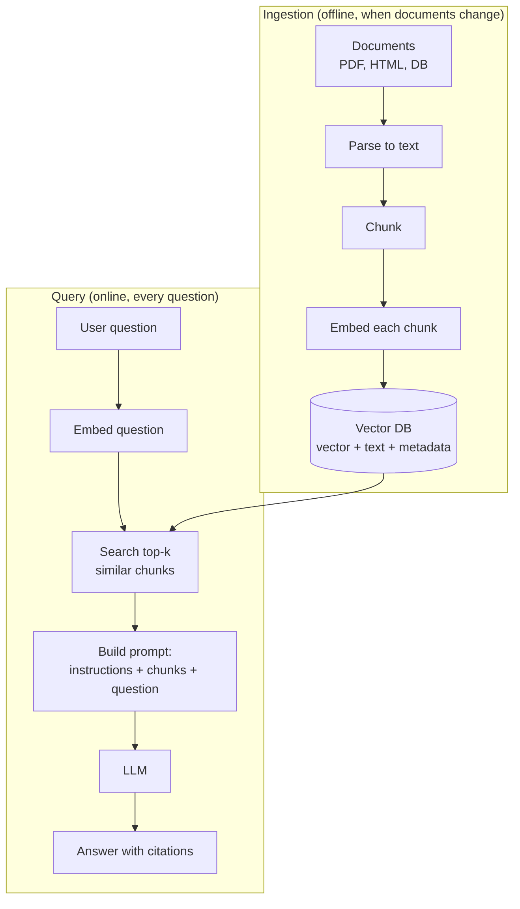

---
mdx:
  format: md
---

# 02 - Retrieval-Augmented Generation (RAG) Foundations (Week 2)

> **Note**: Sections marked **(Interview Imp)** are frequently asked in interviews.
>
> **Goal of this week:** make an LLM answer from *your* documents instead of its memory - embeddings, chunking, vector search, multi-tenant isolation and grounded prompts - and build **The Knowledge Engine**.
>
> **Every example runs offline** with plain Python. Where production uses an embedding model or a vector database (Qdrant, pgvector), the real code is shown and marked *not executed*.
>
> ⬅️ [01 Python & LLM Fundamentals](01_Python_and_LLM_Fundamentals.md) · ➡️ [03 Enterprise RAG](03_Enterprise_RAG.md)

## Table of Contents
1. [Embeddings and Vector Geometry (Interview Imp)](#1-embeddings-and-vector-geometry-interview-imp)
2. [What RAG Is and Why It Works (Interview Imp)](#2-what-rag-is-and-why-it-works-interview-imp)
3. [Document Parsing](#3-document-parsing)
4. [Chunking Strategies (Interview Imp)](#4-chunking-strategies-interview-imp)
5. [Vector Databases and Indexing (Interview Imp)](#5-vector-databases-and-indexing-interview-imp)
6. [Multi-Tenant Isolation Patterns](#6-multi-tenant-isolation-patterns)
7. [Grounded Prompts and Citations](#7-grounded-prompts-and-citations)
8. [Weekly Build - The Knowledge Engine](#8-weekly-build---the-knowledge-engine)
9. [Interview Questions](#9-interview-questions)
10. [Cheat Sheet](#10-cheat-sheet)

---

## 1. Embeddings and Vector Geometry (Interview Imp)

**What is it?** An **embedding** is a list of numbers (a vector) that represents the meaning of a piece of text. An embedding model is trained so that texts with similar meaning get vectors that point in similar directions.

**Why needed?** Computers can't compare meanings, but they can compare vectors very fast. "How do I reset my password?" and "I forgot my login" share no words, yet their embeddings are close - that is what makes semantic search possible.

**How we measure "close":**

| Measure | Formula | Notes |
|---|---|---|
| **Cosine similarity** | `a·b / (‖a‖‖b‖)` | Angle between vectors, -1..1. The default for text. |
| **Dot product** | `a·b` | Same as cosine when vectors are normalised to length 1 (most models do this). Fastest. |
| **Euclidean (L2) distance** | `‖a − b‖` | Straight-line distance; smaller = closer. |

```python
import math

def dot(a, b): return sum(x * y for x, y in zip(a, b))
def norm(a): return math.sqrt(dot(a, a))
def cosine(a, b): return dot(a, b) / (norm(a) * norm(b))
def l2(a, b): return math.sqrt(sum((x - y) ** 2 for x, y in zip(a, b)))

# Pretend 3-D embeddings: [about money, about login, about weather]
docs = {
    "refund my payment":      [0.9, 0.1, 0.0],
    "I was charged twice":    [0.8, 0.2, 0.1],
    "forgot my password":     [0.1, 0.9, 0.0],
    "will it rain tomorrow":  [0.0, 0.0, 1.0],
}
query = [0.9, 0.05, 0.05]           # "money taken from my account by mistake"

for text, vec in sorted(docs.items(), key=lambda kv: -cosine(query, kv[1])):
    print(f"{text:24s} cosine={cosine(query, vec):.3f}  l2={l2(query, vec):.3f}")
```

**Output (identical on all 3 runs):**

```text
refund my payment        cosine=0.997  l2=0.071
I was charged twice      cosine=0.980  l2=0.187
forgot my password       cosine=0.165  l2=1.168
will it rain tomorrow    cosine=0.055  l2=1.310
```

**Real embedding models** produce 384-3,072 numbers. Common choices: OpenAI `text-embedding-3-small`, Cohere `embed-v3`, open-source `bge-m3`, `nomic-embed-text`, `all-MiniLM-L6-v2` (fast, runs on CPU). Pick one and **never mix models** in the same index - vectors from different models live in different "spaces".

```python
# Not executed here: needs `ollama pull nomic-embed-text` (or an API key).
import httpx
r = httpx.post("http://localhost:11434/api/embed",
               json={"model": "nomic-embed-text", "input": ["refund my payment", "forgot my password"]})
vectors = r.json()["embeddings"]          # list of 768-number lists
print(len(vectors), len(vectors[0]))
```

**Pitfalls**
- Comparing vectors from two different embedding models (meaningless numbers).
- Embedding a whole 50-page document as one vector - the meaning gets averaged into mush. Chunk first (section 4).
- Forgetting that some models need a prefix such as `"query: "` / `"passage: "` (E5, nomic) - read the model card.

#### 📘 Terms Explained

| Term | Simple meaning |
|---|---|
| **Vector** | An ordered list of numbers, e.g. `[0.12, -0.5, 0.33]`. |
| **Dimension** | How many numbers are in the vector (384, 768, 1536…). |
| **Cosine similarity** | How similar two vectors' directions are; 1 = same direction. |
| **Normalised vector** | A vector scaled to length 1, so dot product = cosine. |
| **Embedding model** | A model that turns text (or images) into vectors. |
| **Semantic search** | Searching by meaning instead of exact words. |

---

## 2. What RAG Is and Why It Works (Interview Imp)

**What is it?** **Retrieval-Augmented Generation**: before asking the LLM, *retrieve* the most relevant pieces of your own data and put them in the prompt, so the model answers from them.

**Why needed?**
- LLMs don't know your private data (policies, tickets, code, contracts).
- Their knowledge stops at a training cut-off date.
- Without sources they **hallucinate** - confidently make things up.
- RAG is cheaper and faster to update than fine-tuning: add a document, it's searchable immediately.

**How it works - two pipelines:**



**RAG vs fine-tuning vs long context:**

| Approach | Best for | Weak at |
|---|---|---|
| RAG | Facts that change, private documents, citations | Teaching a new style or skill |
| Fine-tuning ([Week 7](07_ML_Fundamentals_and_Fine_Tuning.md)) | Format, tone, narrow skills, smaller/cheaper model | Frequently changing facts |
| Long context (paste everything) | Small corpora, one-off analysis | Cost and latency per request; "lost in the middle" |

#### 📘 Terms Explained

| Term | Simple meaning |
|---|---|
| **RAG** | Retrieve relevant text first, then let the LLM answer using it. |
| **Hallucination** | A fluent but false answer the model invented. |
| **Grounding** | Making the model base its answer on supplied sources. |
| **Top-k** | The k best matches returned by a search (e.g. top-5). |
| **Ingestion** | Loading, cleaning, chunking and indexing documents. |

---

## 3. Document Parsing

**What is it?** Turning PDFs, Word files, HTML, slides and scans into clean text (plus structure like headings and tables).

**Why needed?** Garbage in, garbage out: if a table's columns are scrambled or headers/footers repeat on every page, retrieval and answers fail no matter how good the model is. In practice **parsing quality is the #1 cause of bad RAG**.

**Tools by input type:**

| Input | Tools |
|---|---|
| Digital PDF | `pypdf`, `pdfplumber` (tables), PyMuPDF |
| Complex/scanned PDF, tables, layouts | Docling, Unstructured, LlamaParse, Azure/AWS document AI, OCR (Tesseract) |
| HTML | BeautifulSoup, `trafilatura` (removes menus/ads) |
| Office files | `python-docx`, `python-pptx`, Unstructured |

**Keep the structure.** Convert to Markdown-like text that keeps headings, because headings make the best chunk boundaries and great metadata:

```python
from html.parser import HTMLParser

html = """<html><nav>Home | Pricing | Login</nav>
<h1>Refund Policy</h1><p>Refunds are allowed within 30 days.</p>
<h2>Exceptions</h2><p>Gift cards cannot be refunded.</p>
<footer>© 2026 Acme</footer></html>"""

class ToMarkdown(HTMLParser):
    SKIP = {"nav", "footer", "script", "style"}
    def __init__(self):
        super().__init__(); self.out = []; self.skip = 0; self.prefix = ""
    def handle_starttag(self, tag, attrs):
        if tag in self.SKIP: self.skip += 1
        elif tag in ("h1", "h2", "h3"): self.prefix = "#" * int(tag[1]) + " "
    def handle_endtag(self, tag):
        if tag in self.SKIP: self.skip -= 1
    def handle_data(self, data):
        if self.skip or not data.strip(): return
        self.out.append(self.prefix + data.strip()); self.prefix = ""

p = ToMarkdown(); p.feed(html)
print("\n".join(p.out))
```

**Output (identical on all 3 runs):**

```text
# Refund Policy
Refunds are allowed within 30 days.
## Exceptions
Gift cards cannot be refunded.
```

**Pitfalls:** repeated headers/footers and page numbers inside chunks; tables flattened into one line (convert tables to Markdown or to one sentence per row); scanned PDFs with no text layer (need OCR).

#### 📘 Terms Explained

| Term | Simple meaning |
|---|---|
| **Parsing** | Extracting usable text and structure from a file. |
| **OCR** | Optical Character Recognition - reading text from images/scans. |
| **Boilerplate** | Repeated text that isn't content: menus, footers, cookie banners. |

---

## 4. Chunking Strategies (Interview Imp)

**What is it?** Splitting documents into pieces (**chunks**) that are embedded and retrieved one by one.

**Why needed?** Too big → the vector blurs several topics and wastes prompt tokens. Too small → the chunk loses the context needed to answer. Chunking is the single most important tuning knob in basic RAG.

**Strategies:**

| Strategy | How | When |
|---|---|---|
| Fixed-size + overlap | Every N characters/tokens, repeating the last M | Quick baseline, uniform text |
| Recursive | Split by paragraphs, then sentences, then words, until small enough | Good general default (LangChain `RecursiveCharacterTextSplitter`) |
| Structure-aware | Split on headings / sections / functions | Docs, manuals, code, Markdown |
| Semantic | Start a new chunk when the topic (embedding) changes | Long unstructured text |
| Parent-child | Search small chunks, but send the larger parent section to the LLM | Precise retrieval + enough context |

```python
import re

doc = """# Leave Policy
Employees get 24 paid leaves per year. Unused leaves carry over up to 10 days.

## Sick Leave
Sick leave needs a doctor's note after 2 days. It does not count against paid leave.

## Notice
Leave must be applied 3 days in advance through the HR portal."""

def fixed(text, size=80, overlap=20):
    step = size - overlap
    return [text[i:i + size] for i in range(0, len(text), step)]

def by_heading(text):
    parts = re.split(r"\n(?=#+ )", text)          # split before every heading line
    chunks = []
    for part in parts:
        title = part.splitlines()[0].lstrip("# ").strip()
        chunks.append({"section": title, "text": part.strip()})
    return chunks

print("Fixed-size chunks (note words cut in half):")
for c in fixed(doc)[:3]:
    print("  ", repr(c))
print("Heading-aware chunks:")
for c in by_heading(doc):
    print(f"   [{c['section']}] {c['text'].splitlines()[-1][:60]}")
```

**Output (identical on all 3 runs):**

```text
Fixed-size chunks (note words cut in half):
   '# Leave Policy\nEmployees get 24 paid leaves per year. Unused leaves carry over u'
   " leaves carry over up to 10 days.\n\n## Sick Leave\nSick leave needs a doctor's not"
   "needs a doctor's note after 2 days. It does not count against paid leave.\n\n## No"
Heading-aware chunks:
   [Leave Policy] Employees get 24 paid leaves per year. Unused leaves carry o
   [Sick Leave] Sick leave needs a doctor's note after 2 days. It does not c
   [Notice] Leave must be applied 3 days in advance through the HR porta
```

**Practical defaults:** 300-800 tokens per chunk, 10-20% overlap, split on structure first; store `doc_id`, `section`, `page`, `url`, `updated_at` as metadata on every chunk; prepend the section title (or a one-line document summary) to the chunk text before embedding - this "contextual chunk" trick noticeably improves retrieval.

**Pitfalls:** splitting tables or code in the middle; chunks with no idea which document they came from ("It must be applied 3 days in advance" - what must?); tuning chunk size without an eval set (measure, don't guess - [Week 5](05_Evals_and_Observability.md)).

#### 📘 Terms Explained

| Term | Simple meaning |
|---|---|
| **Chunk** | One piece of a document that is embedded and retrieved on its own. |
| **Overlap** | Text repeated at the start of the next chunk so ideas cut at a boundary aren't lost. |
| **Metadata** | Extra fields stored with a chunk (source, page, tenant, date) used for filtering and citations. |
| **Parent-child retrieval** | Find small chunks, return their bigger parent section. |

---

## 5. Vector Databases and Indexing (Interview Imp)

**What is it?** A database that stores vectors (plus text and metadata) and quickly finds the nearest ones to a query vector.

**Why needed?** Comparing the query with every vector ("flat"/brute-force search) is exact but slow at millions of vectors. Vector DBs use **ANN (Approximate Nearest Neighbour)** indexes that are ~100× faster and miss only a few true neighbours.

**Index types:**

| Index | Idea | Trade-off |
|---|---|---|
| Flat | Compare with everything | Exact, slow at scale; fine up to ~100k |
| IVF | Cluster vectors; search only the closest clusters | Fast; recall depends on how many clusters you probe |
| **HNSW** | Multi-layer graph; hop from neighbour to neighbour | Default in Qdrant, pgvector, Weaviate; great speed/recall; uses RAM |
| PQ (product quantization) | Compress vectors to bytes | Huge memory saving, some accuracy loss |

A tiny IVF to *see* the speed/recall trade-off:

```python
import math, random

rng = random.Random(7)
def rand_vec(center, spread=0.3):
    return [c + rng.uniform(-spread, spread) for c in center]

centers = [[rng.uniform(-1, 1) for _ in range(8)] for _ in range(20)]   # overlapping clusters, like real data
data = [rand_vec(rng.choice(centers), 0.8) for _ in range(5000)]

def dist(a, b): return math.dist(a, b)

# Build IVF: assign every vector to its nearest centroid ("list")
lists = {i: [] for i in range(len(centers))}
for idx, v in enumerate(data):
    lists[min(range(len(centers)), key=lambda c: dist(v, centers[c]))].append(idx)

def flat_search(q, k=5):
    return sorted(range(len(data)), key=lambda i: dist(q, data[i]))[:k], len(data)

def ivf_search(q, k=5, nprobe=1):
    near = sorted(range(len(centers)), key=lambda c: dist(q, centers[c]))[:nprobe]
    cand = [i for c in near for i in lists[c]]
    return sorted(cand, key=lambda i: dist(q, data[i]))[:k], len(cand)

queries = [rand_vec(rng.choice(centers), 1.2) for _ in range(50)]
for nprobe in (1, 2, 4):
    hits = compared = 0
    for q in queries:
        exact, _ = flat_search(q)
        approx, n = ivf_search(q, nprobe=nprobe)
        hits += len(set(exact) & set(approx)); compared += n
    print(f"nprobe={nprobe}: recall@5={hits / (5 * len(queries)):.2f}, "
          f"vectors compared per query={compared // len(queries)} (flat=5000)")
```

**Output (identical on all 3 runs):**

```text
nprobe=1: recall@5=0.83, vectors compared per query=252 (flat=5000)
nprobe=2: recall@5=0.93, vectors compared per query=498 (flat=5000)
nprobe=4: recall@5=0.98, vectors compared per query=998 (flat=5000)
```

**Which vector store?**

| Option | Use when |
|---|---|
| **pgvector** (PostgreSQL extension) | You already run Postgres; want SQL joins, transactions, row-level security. Great default for most apps. |
| **Qdrant** | Dedicated vector DB, strong filtering, hybrid search, easy Docker start. |
| Chroma / FAISS | Local prototypes, notebooks (FAISS is a library, not a server). |
| Pinecone, Weaviate, Milvus, Elasticsearch/OpenSearch | Managed scale, or you already run that search engine. |

```python
# Not executed here: needs PostgreSQL with the pgvector extension.
# CREATE EXTENSION vector;
# CREATE TABLE chunks (id bigserial PRIMARY KEY, tenant_id text NOT NULL,
#                      content text, embedding vector(768));
# CREATE INDEX ON chunks USING hnsw (embedding vector_cosine_ops);
# -- top-5 by cosine distance (<=> operator), filtered by tenant:
# SELECT content, 1 - (embedding <=> $1) AS score
# FROM chunks WHERE tenant_id = $2 ORDER BY embedding <=> $1 LIMIT 5;
```

```python
# Not executed here: needs `docker run -p 6333:6333 qdrant/qdrant` and `pip install qdrant-client`.
from qdrant_client import QdrantClient, models
client = QdrantClient("localhost", port=6333)
client.create_collection("docs", vectors_config=models.VectorParams(size=768, distance=models.Distance.COSINE))
client.upsert("docs", points=[models.PointStruct(id=1, vector=[0.1] * 768,
              payload={"tenant_id": "acme", "text": "Refunds within 30 days"})])
hits = client.query_points("docs", query=[0.1] * 768, limit=5,
         query_filter=models.Filter(must=[models.FieldCondition(key="tenant_id",
                                    match=models.MatchValue(value="acme"))])).points
```

#### 📘 Terms Explained

| Term | Simple meaning |
|---|---|
| **ANN** | Approximate Nearest Neighbour - finds *almost* the closest vectors, much faster. |
| **Recall@k** | Of the true top-k results, how many the search actually returned. |
| **HNSW** | Hierarchical Navigable Small World - a graph index used by most vector DBs. |
| **IVF** | Inverted File index - cluster first, search only nearby clusters. |
| **nprobe / ef_search** | Knobs that trade speed for recall at query time. |
| **pgvector** | PostgreSQL extension that adds a `vector` column type and indexes. |

---

## 6. Multi-Tenant Isolation Patterns

**What is it?** One RAG system serving many customers (tenants) where **no tenant can ever retrieve another tenant's data**.

**Why needed?** A missing filter in a vector search is a data breach - the LLM will happily summarise another bank's confidential document. This is the RAG version of the tenant isolation you'd build in any SaaS backend.

| Pattern | How | Pros | Cons |
|---|---|---|---|
| Collection / index per tenant | Separate collection (or DB) per tenant | Strongest isolation, easy delete | Many indexes to manage; hard with thousands of tenants |
| Shared index + tenant filter | `tenant_id` in metadata, filter on every query | Simple, scales to many tenants | One forgotten filter leaks data |
| Shared + enforced by the DB | Postgres Row-Level Security / Qdrant payload index + server-side guard | Filter can't be forgotten | More setup |

**Rule:** never let calling code *choose* whether to filter. Put the tenant in the store's API so it's impossible to search without it:

```python
class TenantVectorStore:
    """The tenant filter is applied inside the store - callers can't skip it."""
    def __init__(self):
        self._rows = []

    def add(self, tenant_id: str, text: str, vector: list[float]):
        self._rows.append({"tenant_id": tenant_id, "text": text, "vector": vector})

    def search(self, tenant_id: str, query: list[float], k: int = 2):
        if not tenant_id:
            raise PermissionError("tenant_id is required")
        def score(r): return sum(a * b for a, b in zip(query, r["vector"]))
        rows = [r for r in self._rows if r["tenant_id"] == tenant_id]   # filter BEFORE ranking
        return [r["text"] for r in sorted(rows, key=score, reverse=True)[:k]]

store = TenantVectorStore()
store.add("bank_a", "Bank A fraud threshold is 50,000 INR", [1.0, 0.0])
store.add("bank_b", "Bank B fraud threshold is 10,000 INR", [1.0, 0.0])
store.add("bank_a", "Bank A support hours are 9-6", [0.0, 1.0])

print("bank_a sees:", store.search("bank_a", [1.0, 0.1]))
print("bank_b sees:", store.search("bank_b", [1.0, 0.1]))
try:
    store.search("", [1.0, 0.0])
except PermissionError as e:
    print("blocked:", e)
```

**Output (identical on all 3 runs):**

```text
bank_a sees: ['Bank A fraud threshold is 50,000 INR', 'Bank A support hours are 9-6']
bank_b sees: ['Bank B fraud threshold is 10,000 INR']
blocked: tenant_id is required
```

**Pitfalls:** filtering *after* taking the global top-k (a tenant may get zero results because other tenants' chunks filled the top-k - always filter inside the search); caches keyed only by the question text (tenant B gets tenant A's cached answer - include the tenant in the cache key); embedding-model or prompt changes that aren't versioned per tenant.

#### 📘 Terms Explained

| Term | Simple meaning |
|---|---|
| **Tenant** | One customer organisation in a shared (multi-tenant) system. |
| **Row-Level Security (RLS)** | A PostgreSQL feature that automatically limits which rows a session can see. |
| **Pre-filtering** | Applying metadata filters during the vector search, not after it. |

---

## 7. Grounded Prompts and Citations

**What is it?** The prompt template that tells the model to answer *only* from the retrieved chunks, cite them, and admit when the answer isn't there.

```python
def build_prompt(question: str, chunks: list[dict]) -> str:
    context = "\n\n".join(f"[{i}] (source: {c['source']})\n{c['text']}" for i, c in enumerate(chunks, 1))
    return f"""You answer questions using ONLY the context below.
- Cite sources like [1] or [2] after each claim.
- If the context does not contain the answer, reply exactly: "I don't know based on the provided documents."

Context:
{context}

Question: {question}
Answer:"""

print(build_prompt("How many paid leaves do I get?", [
    {"source": "hr-policy.md#leave-policy", "text": "Employees get 24 paid leaves per year."},
    {"source": "hr-policy.md#notice", "text": "Leave must be applied 3 days in advance."},
]))
```

**Output (identical on all 3 runs):**

```text
You answer questions using ONLY the context below.
- Cite sources like [1] or [2] after each claim.
- If the context does not contain the answer, reply exactly: "I don't know based on the provided documents."

Context:
[1] (source: hr-policy.md#leave-policy)
Employees get 24 paid leaves per year.

[2] (source: hr-policy.md#notice)
Leave must be applied 3 days in advance.

Question: How many paid leaves do I get?
Answer:
```

**Tips:** put the instructions before the context and repeat the question at the end; order chunks by relevance (models pay most attention to the start and end - "lost in the middle"); include source IDs so the UI can link citations; keep the "I don't know" phrase fixed so your code and evals can detect it.

#### 📘 Terms Explained

| Term | Simple meaning |
|---|---|
| **Prompt template** | A reusable prompt with placeholders filled at runtime. |
| **Citation** | A marker showing which source a statement came from. |
| **Lost in the middle** | LLMs use information at the start and end of a long prompt better than the middle. |

---

## 8. Weekly Build - The Knowledge Engine

**Goal:** a context-aware RAG pipeline over a local vector store that answers questions from documents, cites its sources, and says "I don't know" when the documents don't contain the answer.

**Design (offline version):** heading-aware chunking → **TF-IDF vectors** as a stand-in for an embedding model (pure Python, no downloads) → cosine top-k → score threshold → grounded prompt → a `FakeLLM` that answers extractively from the best chunk. Swap in a real embedding model and LLM later without changing the pipeline.

```python
import math, re
from collections import Counter

DOCS = {
    "hr-policy.md": """# Leave Policy
Employees get 24 paid leaves per year. Unused leaves carry over up to 10 days.
## Sick Leave
Sick leave needs a doctor's note after 2 days and does not reduce paid leave.
## Work From Home
Employees may work from home 2 days per week with manager approval.""",
    "it-guide.md": """# Passwords
Passwords must be reset every 90 days and have at least 12 characters.
## VPN
Use the company VPN on public Wi-Fi. Install it from the IT portal.""",
}

STOP = {"the", "a", "an", "and", "or", "of", "to", "is", "are", "be", "do", "does", "i", "my",
        "how", "what", "many", "per", "it", "on", "at", "from", "with", "after", "every", "get", "can"}

def tokenize(text):
    return [w for w in re.findall(r"[a-z0-9]+", text.lower()) if w not in STOP]

def chunk(doc_id, text):
    for part in re.split(r"\n(?=#+ )", text):
        title = part.splitlines()[0].lstrip("# ").strip()
        yield {"source": f"{doc_id}#{title.lower().replace(' ', '-')}",
               "text": f"{title}: " + " ".join(part.splitlines()[1:])}   # contextual chunk

class KnowledgeEngine:
    def __init__(self, docs):
        self.chunks = [c for d, t in docs.items() for c in chunk(d, t)]
        n = len(self.chunks)
        df = Counter(w for c in self.chunks for w in set(tokenize(c["text"])))
        self.idf = {w: math.log((1 + n) / (1 + f)) + 1 for w, f in df.items()}
        self.vecs = [self.embed(c["text"]) for c in self.chunks]

    def embed(self, text):                      # TF-IDF, normalised to length 1
        tf = Counter(tokenize(text))
        v = {w: c * self.idf.get(w, 0.0) for w, c in tf.items()}
        n = math.sqrt(sum(x * x for x in v.values())) or 1.0
        return {w: x / n for w, x in v.items()}

    def search(self, q, k=2):
        qv = self.embed(q)
        scored = [(sum(qv.get(w, 0) * x for w, x in v.items()), c) for v, c in zip(self.vecs, self.chunks)]
        return sorted(scored, key=lambda s: -s[0])[:k]

    def answer(self, q, min_score=0.15):
        hits = [(s, c) for s, c in self.search(q) if s >= min_score]
        if not hits:
            return "I don't know based on the provided documents.", []
        best = hits[0][1]
        # FakeLLM: extract the sentence that overlaps most with the question, cite its chunk
        sentences = re.split(r"(?<=\.)\s+", best["text"].split(": ", 1)[1])
        qset = set(tokenize(q))
        sent = max(sentences, key=lambda s: len(qset & set(tokenize(s))))
        return f"{sent} [1]", [(round(s, 2), c["source"]) for s, c in hits]

kb = KnowledgeEngine(DOCS)
print(f"indexed {len(kb.chunks)} chunks")
for q in ["How many paid leaves do I get per year?",
          "How often must passwords be reset?",
          "Can I work from home?",
          "What is the office canteen menu?"]:
    ans, sources = kb.answer(q)
    print(f"\nQ: {q}\nA: {ans}\n   sources: {sources}")
```

**Output (identical on all 3 runs):**

```text
indexed 5 chunks

Q: How many paid leaves do I get per year?
A: Employees get 24 paid leaves per year. [1]
   sources: [(0.59, 'hr-policy.md#leave-policy')]

Q: How often must passwords be reset?
A: Passwords must be reset every 90 days and have at least 12 characters. [1]
   sources: [(0.69, 'it-guide.md#passwords')]

Q: Can I work from home?
A: Employees may work from home 2 days per week with manager approval. [1]
   sources: [(0.77, 'hr-policy.md#work-from-home')]

Q: What is the office canteen menu?
A: I don't know based on the provided documents.
   sources: []
```

**What to notice**
- "canteen menu" correctly returns *I don't know* - the score threshold is your first hallucination guard.
- TF-IDF only matches **exact words**. Ask "How many holidays do I get?" and it fails, because "holidays" ≠ "leaves". Dense embeddings fix synonyms; combining both (hybrid search) is [Week 3](03_Enterprise_RAG.md#1-hybrid-search-semantic--keyword-interview-imp).

**Production version (not executed here)** - same pipeline, real parts:

```python
# pip install qdrant-client httpx ; ollama pull nomic-embed-text ; ollama pull llama3.2
import httpx
from qdrant_client import QdrantClient, models

def embed(texts):
    return httpx.post("http://localhost:11434/api/embed",
                      json={"model": "nomic-embed-text", "input": texts}).json()["embeddings"]

qd = QdrantClient(":memory:")                       # or QdrantClient("localhost", port=6333)
qd.create_collection("kb", vectors_config=models.VectorParams(size=768, distance=models.Distance.COSINE))
# ... upsert chunks with embed([...]) and payload {"text", "source", "tenant_id"} ...
hits = qd.query_points("kb", query=embed([question])[0], limit=5).points
prompt = build_prompt(question, [h.payload for h in hits])           # section 7
reply = httpx.post("http://localhost:11434/v1/chat/completions",
                   json={"model": "llama3.2", "messages": [{"role": "user", "content": prompt}]}).json()
```

**Stretch goals:** add `tenant_id` and enforce it like section 6; return page numbers; re-index only changed documents (store a content hash per document); add a `/ask` endpoint to your [Week 1 gateway](01_Python_and_LLM_Fundamentals.md#7-weekly-build---the-ai-gateway).

**Outcome:** a retrieval system that answers from documents and refuses when it can't, instead of hallucinating.

#### 📘 Terms Explained

| Term | Simple meaning |
|---|---|
| **TF-IDF** | Term Frequency × Inverse Document Frequency - word weights that favour words that are frequent in this chunk but rare overall. |
| **Sparse vector** | A vector where most values are zero (one slot per vocabulary word), like TF-IDF or BM25. |
| **Dense vector** | A short vector where every value is used, like neural embeddings. |
| **Score threshold** | Minimum similarity to accept a result; below it, answer "I don't know". |
| **Extractive answer** | Returning a sentence from the source instead of generating new text. |

---

## 9. Interview Questions

1. **What is RAG and why use it instead of fine-tuning? (Interview Imp)** Retrieve relevant private/current data and put it in the prompt; it's cheaper to update, cites sources and reduces hallucination. Fine-tuning changes behaviour/style, not up-to-date facts.
2. **Cosine similarity vs dot product vs L2?** Cosine compares direction; dot equals cosine for normalised vectors (fastest); L2 is straight-line distance. Use what the embedding model was trained for.
3. **How do you choose chunk size?** Start ~300-800 tokens with 10-20% overlap, split on structure, then tune with a retrieval eval set (recall@k, answer accuracy).
4. **What is HNSW and what are its trade-offs?** A layered proximity graph for ANN search: fast with high recall but memory-heavy, with build-time (M, ef_construction) and query-time (ef_search) knobs.
5. **How do you keep tenants' data isolated in a shared vector index?** Mandatory tenant pre-filter enforced inside the data-access layer or by the DB (RLS / payload filters), tenant-scoped caches, tests that try cross-tenant access.
6. **Why can RAG still hallucinate?** Wrong or missing chunks retrieved, conflicting sources, or the model ignoring context. Mitigate with thresholds, "I don't know" instructions, citations and faithfulness evals.
7. **What is "lost in the middle"?** Models attend less to content in the middle of long contexts; put the best chunks first and keep context focused.
8. **Can you mix embeddings from two models in one index?** No - they live in different vector spaces. Re-embed everything when you change models.
9. **Pre-filtering vs post-filtering?** Pre-filtering applies metadata filters during search (correct k results); post-filtering after top-k can return too few or zero results.
10. **What metadata do you store with chunks?** Source/doc ID, section, page, URL, tenant, access level, timestamps, content hash, embedding model version.

---

## 10. Cheat Sheet

| Step | Default choice |
|---|---|
| Parse | Docling / Unstructured for complex PDFs; keep headings; strip boilerplate |
| Chunk | Structure-aware, 300-800 tokens, 10-20% overlap, prepend section title |
| Embed | `nomic-embed-text` / `bge-m3` (open) or `text-embedding-3-small` (API); one model per index |
| Store | pgvector (have Postgres) or Qdrant; HNSW index; cosine |
| Retrieve | top-k 3-8 with a score threshold, tenant pre-filter |
| Prompt | instructions → numbered chunks with sources → question; fixed "I don't know" phrase |
| Measure | recall@k on a small labelled question set before tuning anything |

⬅️ [01 Python & LLM Fundamentals](01_Python_and_LLM_Fundamentals.md) · ➡️ [03 Enterprise RAG](03_Enterprise_RAG.md)
