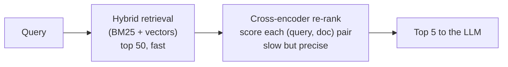
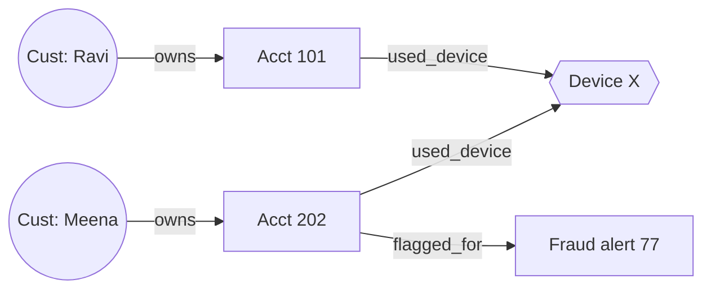
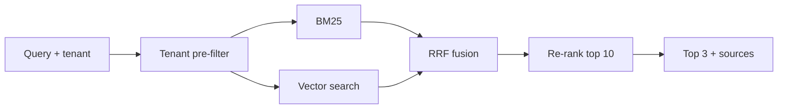

---
mdx:
  format: md
---

# 03 - Enterprise-grade RAG Pipelines (Week 3)

> **Note**: Sections marked **(Interview Imp)** are frequently asked in interviews.
>
> **Goal of this week:** go past "embed and take top-5". Combine keyword and semantic search, fuse rankings with RRF, re-rank with a cross-encoder, rewrite and route queries, use a knowledge graph, and measure retrieval quality - then build **The Enterprise Search Engine**.
>
> **Every example runs offline** with plain Python.
>
> ⬅️ [02 RAG Foundations](02_RAG_Foundations.md) · ➡️ [04 Agents & State Machines](04_Agents_and_State_Machines.md)

## Table of Contents
1. [Hybrid Search: Semantic + Keyword (Interview Imp)](#1-hybrid-search-semantic--keyword-interview-imp)
2. [Reciprocal Rank Fusion - RRF (Interview Imp)](#2-reciprocal-rank-fusion---rrf-interview-imp)
3. [Cross-Encoder Re-Ranking (Interview Imp)](#3-cross-encoder-re-ranking-interview-imp)
4. [Query Expansion, Rewriting and Routing](#4-query-expansion-rewriting-and-routing)
5. [Graph RAG Basics](#5-graph-rag-basics)
6. [Measuring Retrieval Quality (Interview Imp)](#6-measuring-retrieval-quality-interview-imp)
7. [Weekly Build - The Enterprise Search Engine](#7-weekly-build---the-enterprise-search-engine)
8. [Interview Questions](#8-interview-questions)
9. [Cheat Sheet](#9-cheat-sheet)

---

## 1. Hybrid Search: Semantic + Keyword (Interview Imp)

**What is it?** Running two searches for every query - **keyword search (BM25)** and **semantic/vector search** - and combining the results.

**Why needed?** Each fails where the other shines:

| Query | Keyword (BM25) | Semantic (embeddings) |
|---|---|---|
| "error ERR-4021" / "IFSC HDFC0001234" / product codes | ✅ exact match | ❌ IDs have no "meaning" |
| "I can't log in" vs document "password reset steps" | ❌ no shared words | ✅ same meaning |
| Rare names, acronyms, new jargon | ✅ | ❌ often unknown to the model |

**How BM25 works:** a smarter TF-IDF. A word scores higher if it is rare across documents (IDF) and appears in this document, but repeating it 50 times doesn't help forever (saturation, `k1`), and long documents are penalised a bit (`b`).

`score(D, Q) = Σ IDF(q) · tf·(k1+1) / (tf + k1·(1 − b + b·|D|/avgdl))`

```python
import math, re
from collections import Counter

docs = [
    "Reset your password from the login page using the forgot password link",
    "Error ERR-4021 means the payment gateway timed out; retry after 5 minutes",
    "To change your registered mobile number visit the nearest branch",
    "Payment failed? Check your card limit and internet banking status",
]

def tok(t): return re.findall(r"[a-z0-9-]+", t.lower())

class BM25:
    def __init__(self, docs, k1=1.5, b=0.75):
        self.docs = [tok(d) for d in docs]
        self.k1, self.b = k1, b
        self.avgdl = sum(map(len, self.docs)) / len(self.docs)
        df = Counter(w for d in self.docs for w in set(d))
        n = len(self.docs)
        self.idf = {w: math.log(1 + (n - f + 0.5) / (f + 0.5)) for w, f in df.items()}

    def scores(self, query):
        out = []
        for d in self.docs:
            tf = Counter(d)
            s = 0.0
            for q in tok(query):
                if q not in tf: continue
                f = tf[q]
                s += self.idf[q] * f * (self.k1 + 1) / (f + self.k1 * (1 - self.b + self.b * len(d) / self.avgdl))
            out.append(round(s, 3))
        return out

bm = BM25(docs)
for q in ["ERR-4021", "payment failed", "I can't sign in"]:
    print(f"{q!r:20} -> {bm.scores(q)}")
```

**Output (identical on all 3 runs):**

```text
'ERR-4021'           -> [0.0, 1.157, 0.0, 0.0]
'payment failed'     -> [0.0, 0.666, 0.0, 1.978]
"I can't sign in"    -> [0.0, 0.0, 0.0, 0.0]
```

"I can't sign in" scores **zero everywhere** - BM25 can't connect "sign in" with "login". That's exactly what the semantic half of hybrid search is for.

#### 📘 Terms Explained

| Term | Simple meaning |
|---|---|
| **BM25** | "Best Match 25" - the standard keyword-ranking formula used by Elasticsearch, OpenSearch, Lucene. |
| **IDF** | Inverse Document Frequency - rare words count more than common ones. |
| **Saturation (k1)** | After a few occurrences, more repeats of a word add little score. |
| **Length normalisation (b)** | Long documents don't win just because they contain more words. |
| **Hybrid search** | Combining keyword and vector search results. |

---

## 2. Reciprocal Rank Fusion - RRF (Interview Imp)

**What is it?** A simple way to merge several ranked lists. Each document gets `Σ 1 / (k + rank)` over the lists it appears in (`k` is usually 60).

**Why needed?** BM25 scores (0-20+) and cosine scores (0-1) are on different scales - you can't just add them. RRF only uses **ranks**, so no score tuning is needed, and a document ranked well by *both* searches rises to the top.

```python
def rrf(rankings: list[list[str]], k: int = 60) -> list[tuple[str, float]]:
    scores: dict[str, float] = {}
    for ranking in rankings:
        for rank, doc in enumerate(ranking, start=1):
            scores[doc] = scores.get(doc, 0.0) + 1 / (k + rank)
    return sorted(((d, round(s, 4)) for d, s in scores.items()), key=lambda x: -x[1])

keyword_results  = ["doc_err4021", "doc_payment_failed", "doc_card_limit"]
semantic_results = ["doc_payment_failed", "doc_gateway_timeout", "doc_err4021"]

for doc, score in rrf([keyword_results, semantic_results]):
    print(f"{doc:22} {score}")
```

**Output (identical on all 3 runs):**

```text
doc_payment_failed     0.0325
doc_err4021            0.0323
doc_gateway_timeout    0.0161
doc_card_limit         0.0159
```

**Alternatives:** weighted score fusion (normalise both scores to 0-1, then `α·semantic + (1−α)·keyword`) - needs tuning α per dataset. Qdrant, Weaviate, Elasticsearch and OpenSearch all have built-in hybrid search with RRF.

#### 📘 Terms Explained

| Term | Simple meaning |
|---|---|
| **RRF** | Reciprocal Rank Fusion - merge ranked lists by summing 1/(k + rank). |
| **Rank** | Position in a result list (1 = best). |
| **Score normalisation** | Rescaling scores to a common range (e.g. 0-1) before combining. |

---

## 3. Cross-Encoder Re-Ranking (Interview Imp)

**What is it?** A second, more accurate model that looks at the **query and one document together** and outputs a relevance score. You use it to re-order the top 20-100 candidates from retrieval and keep the best 3-8.

**Why needed?** Embedding search is a **bi-encoder**: query and documents are embedded *separately*, so the model never sees them side by side - fast, but it misses details like negation ("not refundable") or which entity a sentence is about. A **cross-encoder** reads both at once - much more accurate, but too slow to run on millions of documents. So: retrieve fast, then re-rank precisely.



| | Bi-encoder (embeddings) | Cross-encoder (re-ranker) |
|---|---|---|
| Input | query and doc separately | (query, doc) pair together |
| Speed | precompute doc vectors; ms over millions | one model call per pair |
| Accuracy | good | better |
| Examples | bge, nomic, text-embedding-3 | `bge-reranker-v2-m3`, `ms-marco-MiniLM-L-6-v2`, Cohere Rerank, Jina Reranker |

The offline stand-in below shows the key difference. The first stage scores each document by *which words* it shares with the query (a bag of words, like a single vector). The "cross-encoder" reads query and document *together*, so it can also reward the query's words appearing **as the same phrase**, in the same order.

```python
import re
def tok(t): return [w.rstrip("s") for w in re.findall(r"[a-z]+", t.lower())]   # crude singular

def first_stage(query, doc):                  # bag of words: order is invisible
    q, d = set(tok(query)), set(tok(doc))
    return round(len(q & d) / len(q), 3)

def toy_cross_encoder(query, doc):            # sees both texts together
    q, d = tok(query), " ".join(tok(doc))
    phrases = [" ".join(p) for p in zip(q, q[1:])]
    phrase_hits = sum(p in d for p in phrases) / len(phrases)
    return round(0.5 * first_stage(query, doc) + 0.5 * phrase_hits, 3)

query = "gift card refund"
candidates = [
    "Refund the card fee and receive a gift voucher",       # all 3 words, unrelated meaning
    "Gift card refunds are processed within 5 days",        # the real answer
    "Credit card refund window is 30 days",
]
print("first stage :", sorted(((first_stage(query, d), d[:32]) for d in candidates), reverse=True))
print("re-ranked   :")
for d in sorted(candidates, key=lambda d: -toy_cross_encoder(query, d)):
    print(f"  {toy_cross_encoder(query, d):5}  {d}")
```

**Output (identical on all 3 runs):**

```text
first stage : [(1.0, 'Refund the card fee and receive '), (1.0, 'Gift card refunds are processed '), (0.667, 'Credit card refund window is 30 ')]
re-ranked   :
    1.0  Gift card refunds are processed within 5 days
  0.584  Credit card refund window is 30 days
    0.5  Refund the card fee and receive a gift voucher
```

The bag-of-words stage ties the unrelated "gift voucher" sentence with the real answer; reading both texts together breaks the tie correctly. A real cross-encoder is a trained transformer, so it learns far more than phrase order (negation, which entity a sentence is about, whether it actually answers the question) - but the architecture is the same: **score each (query, document) pair jointly, after cheap retrieval.**

```python
# Not executed here: downloads a ~100 MB model. pip install sentence-transformers
from sentence_transformers import CrossEncoder
ce = CrossEncoder("cross-encoder/ms-marco-MiniLM-L-6-v2")
scores = ce.predict([(query, d) for d in candidates])
reranked = [d for _, d in sorted(zip(scores, candidates), reverse=True)]
```

#### 📘 Terms Explained

| Term | Simple meaning |
|---|---|
| **Bi-encoder** | Encodes query and document separately into vectors (what embedding search uses). |
| **Cross-encoder** | Reads query and document together and outputs one relevance score. |
| **Re-ranking** | Re-ordering a small candidate list with a more accurate (slower) scorer. |
| **Two-stage retrieval** | Cheap recall-oriented search first, precise re-ranking second. |

---

## 4. Query Expansion, Rewriting and Routing

**What is it?** Changing or analysing the *question* before searching.

**Why needed?** Users write short, vague or conversational questions ("what about for NRIs?"). The retriever needs a complete, searchable query.

| Technique | What it does | Example |
|---|---|---|
| **Rewriting / condensing** | Turn a follow-up into a standalone question using chat history | "what about NRIs?" → "What is the FD interest rate for NRI customers?" |
| **Multi-query expansion** | Ask the LLM for 3-5 paraphrases, search each, fuse with RRF | "can't log in" → "reset password", "account locked", "login error" |
| **HyDE** | Ask the LLM to write a *hypothetical answer*, embed that and search with it | Answers look more like documents than questions do |
| **Decomposition** | Split a multi-part question into sub-questions | "Compare FD and RD rates" → two searches |
| **Routing** | Decide *where* to search (which index, SQL vs docs, or no retrieval at all) | "my last 5 transactions" → SQL tool, not the policy docs |

```python
# Multi-query expansion + RRF. The paraphrases would come from an LLM; here they are fixed.
def rrf(rankings, k=60):
    s = {}
    for r in rankings:
        for i, d in enumerate(r, 1):
            s[d] = s.get(d, 0) + 1 / (k + i)
    return sorted(s, key=lambda d: -s[d])

INDEX = {   # pretend search engine: query -> ranked doc ids
    "can't log in":          ["faq_app_crash"],
    "reset password":        ["kb_password_reset", "faq_login"],
    "account locked":        ["kb_account_unlock", "kb_password_reset"],
    "login error message":   ["faq_login", "kb_password_reset"],
}
original = "can't log in"
paraphrases = ["reset password", "account locked", "login error message"]   # from the LLM

print("original only :", INDEX[original])
print("expanded + RRF:", rrf([INDEX[q] for q in [original] + paraphrases])[:3])

def route(question: str) -> str:
    q = question.lower()
    if any(w in q for w in ("my last", "my balance", "my transactions")): return "sql_tool"
    if any(w in q for w in ("policy", "rule", "allowed", "how do i")):   return "docs_index"
    if q.strip() in {"hi", "hello", "thanks"}:                           return "no_retrieval"
    return "docs_index"

for q in ["Show my last 5 transactions", "How do I raise a dispute?", "hi"]:
    print(f"route({q!r}) -> {route(q)}")
```

**Output (identical on all 3 runs):**

```text
original only : ['faq_app_crash']
expanded + RRF: ['kb_password_reset', 'faq_login', 'faq_app_crash']
route('Show my last 5 transactions') -> sql_tool
route('How do I raise a dispute?') -> docs_index
route('hi') -> no_retrieval
```

**Pitfalls:** expansion multiplies cost and latency (one search per paraphrase) - cache it, and use a small model; HyDE can hallucinate the hypothetical answer toward wrong documents - always combine with the original query.

#### 📘 Terms Explained

| Term | Simple meaning |
|---|---|
| **Query rewriting** | Turning the user's message into a clear, standalone search query. |
| **HyDE** | Hypothetical Document Embeddings - search with an LLM-written fake answer. |
| **Query routing** | Choosing which data source or tool should handle a question. |

---

## 5. Graph RAG Basics

**What is it?** Storing **entities and relationships** (a knowledge graph: `Customer -owns-> Account -linked_to-> Device`) and retrieving by walking the graph, often together with vector search.

**Why needed?** Some questions are about *connections*, not similar text: "Which accounts share a device with a flagged account?" or "Summarise everything about Project X across 200 documents." Chunks retrieved by similarity miss multi-hop links; a graph follows them.



```python
from collections import deque

edges = [
    ("Ravi", "owns", "Acct101"), ("Meena", "owns", "Acct202"), ("Arjun", "owns", "Acct303"),
    ("Acct101", "used_device", "DeviceX"), ("Acct202", "used_device", "DeviceX"),
    ("Acct303", "used_device", "DeviceY"), ("Acct202", "flagged_for", "Alert77"),
]
graph = {}
for s, rel, o in edges:                       # undirected view for traversal
    graph.setdefault(s, []).append((rel, o))
    graph.setdefault(o, []).append((f"inverse:{rel}", s))

def paths_within(start, max_hops=3):
    """Breadth-first search; returns every node reachable within max_hops and how."""
    seen, out, q = {start}, [], deque([(start, [])])
    while q:
        node, path = q.popleft()
        if len(path) == max_hops: continue
        for rel, nxt in graph.get(node, []):
            if nxt in seen: continue
            seen.add(nxt)
            out.append((nxt, path + [f"{node} -{rel}-> {nxt}"]))
            q.append((nxt, path + [f"{node} -{rel}-> {nxt}"]))
    return out

# "Is Ravi connected to any fraud alert?"
for node, path in paths_within("Ravi", max_hops=4):
    if node.startswith("Alert"):
        print("Found:", node)
        print("Evidence path (goes into the LLM prompt):")
        for step in path: print("  ", step)
```

**Output (identical on all 3 runs):**

```text
Found: Alert77
Evidence path (goes into the LLM prompt):
   Ravi -owns-> Acct101
   Acct101 -used_device-> DeviceX
   DeviceX -inverse:used_device-> Acct202
   Acct202 -flagged_for-> Alert77
```

**How Graph RAG is built in practice:** an LLM extracts `(entity, relation, entity)` triples from each chunk → stored in a graph DB (Neo4j, or tables in Postgres) → at query time, find the entities in the question, expand 1-3 hops, and give the facts *plus* the linked chunks to the LLM. Microsoft's **GraphRAG** also clusters the graph into communities and pre-writes summaries for "global" questions about a whole corpus.

**When it's worth it:** strongly connected domains (fraud rings, org charts, supply chains, legal references). For plain Q&A over manuals, hybrid search + re-ranking is usually enough and far cheaper.

#### 📘 Terms Explained

| Term | Simple meaning |
|---|---|
| **Knowledge graph** | Data stored as nodes (entities) and edges (relationships). |
| **Triple** | One fact as (subject, relation, object), e.g. (Ravi, owns, Acct101). |
| **Multi-hop** | Answering requires following several links in a row. |
| **BFS** | Breadth-first search - explore all neighbours, then their neighbours, and so on. |
| **Neo4j** | A popular graph database queried with the Cypher language. |

---

## 6. Measuring Retrieval Quality (Interview Imp)

**What is it?** Scoring the retriever alone, on a set of questions where you know which chunks are relevant.

**Why needed?** If retrieval is bad, no prompt or model can fix the answer. Measure retrieval *before* tuning prompts, and every time you change chunking, embeddings or re-ranking.

| Metric | Question it answers |
|---|---|
| **Recall@k** | Did the relevant chunks appear in the top k at all? (most important for RAG) |
| **Precision@k** | What fraction of the top k were relevant? |
| **MRR** | How high was the *first* relevant result, on average? (1/rank) |
| **nDCG@k** | Are the most relevant results near the top? (graded relevance, position-discounted) |

```python
import math

def recall_at_k(ranked, relevant, k):    return len(set(ranked[:k]) & relevant) / len(relevant)
def precision_at_k(ranked, relevant, k): return len(set(ranked[:k]) & relevant) / k
def mrr(ranked, relevant):
    return next((1 / i for i, d in enumerate(ranked, 1) if d in relevant), 0.0)
def ndcg_at_k(ranked, relevant, k):
    dcg = sum(1 / math.log2(i + 1) for i, d in enumerate(ranked[:k], 1) if d in relevant)
    ideal = sum(1 / math.log2(i + 1) for i in range(1, min(len(relevant), k) + 1))
    return dcg / ideal

eval_set = [   # question -> (what each system returned, which chunks are truly relevant)
    {"q": "refund window",  "vector": ["c7", "c2", "c9"], "hybrid": ["c2", "c7", "c4"], "relevant": {"c2", "c4"}},
    {"q": "ERR-4021",       "vector": ["c8", "c1", "c3"], "hybrid": ["c5", "c8", "c1"], "relevant": {"c5"}},
    {"q": "NRI FD rate",    "vector": ["c6", "c3", "c0"], "hybrid": ["c6", "c3", "c0"], "relevant": {"c6"}},
]
for system in ("vector", "hybrid"):
    r = [recall_at_k(e[system], e["relevant"], 3) for e in eval_set]
    m = [mrr(e[system], e["relevant"]) for e in eval_set]
    n = [ndcg_at_k(e[system], e["relevant"], 3) for e in eval_set]
    print(f"{system:7} recall@3={sum(r)/len(r):.2f}  MRR={sum(m)/len(m):.2f}  nDCG@3={sum(n)/len(n):.2f}")
```

**Output (identical on all 3 runs):**

```text
vector  recall@3=0.50  MRR=0.50  nDCG@3=0.46
hybrid  recall@3=1.00  MRR=1.00  nDCG@3=0.97
```

Start with 30-50 real questions labelled by hand; grow it from production logs. [Week 5](05_Evals_and_Observability.md) automates this with RAGAS and CI gates.

#### 📘 Terms Explained

| Term | Simple meaning |
|---|---|
| **Recall@k** | Share of the relevant items found in the top k. |
| **MRR** | Mean Reciprocal Rank - average of 1/(position of the first correct result). |
| **nDCG** | Normalised Discounted Cumulative Gain - rewards relevant results near the top. |
| **Golden set** | A hand-checked list of questions with known correct answers/sources. |

---

## 7. Weekly Build - The Enterprise Search Engine

**Goal:** a multi-tenant, re-ranked hybrid search system for enterprise data: tenant pre-filter → BM25 + vector search → RRF fusion → re-rank → top results with sources, plus a retrieval eval to prove hybrid beats either half.



```python
import math, re
from collections import Counter

SYN = {"login": "signin", "log": "signin", "sign": "signin", "signin": "signin",
       "money": "payment", "paid": "payment", "payment": "payment", "charged": "payment",
       "fd": "deposit", "deposit": "deposit"}          # stands in for what an embedding model learns

DOCS = [
    ("acme", "a1", "Reset your password from the login page using Forgot Password"),
    ("acme", "a2", "Error ERR-4021 means the payment gateway timed out, retry after 5 minutes"),
    ("acme", "a3", "Charged twice? Duplicate payment refunds are automatic within 3 days"),
    ("acme", "a4", "Fixed deposit interest is 7.1 percent for one year"),
    ("globex", "g1", "Globex fixed deposit interest is 6.5 percent for one year"),
    ("globex", "g2", "Globex sign-in uses OTP sent to your registered mobile"),
]

def tok(t): return re.findall(r"[a-z0-9-]+", t.lower())
def concepts(t):   # embeddings capture meaning but are weak at exact codes, so drop tokens with digits
    return [SYN.get(w, w) for w in tok(t) if (len(w) > 2 or w in SYN) and not any(c.isdigit() for c in w)]

class EnterpriseSearch:
    def __init__(self, docs):
        self.docs = docs
        self.df = Counter(w for _, _, t in docs for w in set(tok(t)))
        self.avgdl = sum(len(tok(t)) for _, _, t in docs) / len(docs)

    def _bm25(self, q, text, k1=1.5, b=0.75):
        d, n, s = tok(text), len(self.docs), 0.0
        tf = Counter(d)
        for w in tok(q):
            if w in tf:
                idf = math.log(1 + (n - self.df[w] + 0.5) / (self.df[w] + 0.5))
                s += idf * tf[w] * (k1 + 1) / (tf[w] + k1 * (1 - b + b * len(d) / self.avgdl))
        return s

    def _semantic(self, q, text):                      # cosine over "concept" bags
        a, b = Counter(concepts(q)), Counter(concepts(text))
        num = sum(a[w] * b[w] for w in a)
        den = math.sqrt(sum(v * v for v in a.values())) * math.sqrt(sum(v * v for v in b.values()))
        return num / den if den else 0.0

    def _rank(self, scores):
        return [doc_id for doc_id, s in sorted(scores, key=lambda x: -x[1]) if s > 0]

    def search(self, tenant, q, k=3, mode="hybrid"):
        pool = [(i, t) for ten, i, t in self.docs if ten == tenant]          # 1. tenant pre-filter
        kw = self._rank([(i, self._bm25(q, t)) for i, t in pool])            # 2a. keyword
        sem = self._rank([(i, self._semantic(q, t)) for i, t in pool])       # 2b. semantic
        if mode == "keyword": return kw[:k]
        if mode == "semantic": return sem[:k]
        fused = {}
        for ranking in (kw, sem):                                            # 3. RRF
            for r, i in enumerate(ranking, 1):
                fused[i] = fused.get(i, 0) + 1 / (60 + r)
        cand = sorted(fused, key=lambda i: -fused[i])[:10]
        text = dict(pool)                                                    # 4. re-rank: both signals
        return sorted(cand, key=lambda i: -(self._semantic(q, text[i]) + 0.1 * self._bm25(q, text[i])))[:k]

es = EnterpriseSearch(DOCS)
for tenant, q in [("acme", "ERR-4021"), ("acme", "I can't sign in"), ("acme", "money taken twice"),
                  ("globex", "FD interest rate")]:
    print(f"[{tenant}] {q!r:22} -> {es.search(tenant, q)}")

# Retrieval eval: which mode finds the right document (recall@1)?
gold = [("acme", "ERR-4021", "a2"), ("acme", "I can't sign in", "a1"),
        ("acme", "money taken twice", "a3"), ("acme", "deposit interest", "a4"),
        ("globex", "sign in OTP", "g2"), ("acme", "payment gateway timed out", "a2")]
for mode in ("keyword", "semantic", "hybrid"):
    hits = sum(es.search(t, q, k=1, mode=mode) == [want] for t, q, want in gold)
    print(f"{mode:8} recall@1 = {hits}/{len(gold)}")
```

**Output (identical on all 3 runs):**

```text
[acme] 'ERR-4021'             -> ['a2']
[acme] "I can't sign in"      -> ['a1']
[acme] 'money taken twice'    -> ['a3', 'a2']
[globex] 'FD interest rate'     -> ['g1']
keyword  recall@1 = 5/6
semantic recall@1 = 5/6
hybrid   recall@1 = 6/6
```

**What to notice:** keyword search nails `ERR-4021` but misses "I can't sign in"; the synonym-aware "semantic" half catches meaning but has no notion of exact codes; hybrid gets both. Tenant `globex` never sees `acme` data because the filter runs *before* ranking.

**Production version:** Qdrant with a dense vector + a sparse (BM25/SPLADE) vector per point and its built-in RRF query, or Elasticsearch/OpenSearch hybrid queries; `bge-reranker-v2-m3` or Cohere Rerank for stage two; tenant filter as a Qdrant payload filter or Postgres RLS ([Week 2 §6](02_RAG_Foundations.md#6-multi-tenant-isolation-patterns)).

**Stretch goals:** add query expansion with RRF; add recency boosting (newer policy versions win); log every query, its results and latency for [Week 5](05_Evals_and_Observability.md); expose `/search` from your [AI Gateway](01_Python_and_LLM_Fundamentals.md#7-weekly-build---the-ai-gateway).

**Outcome:** you can build and *measure* the enterprise search techniques used by production AI teams.

#### 📘 Terms Explained

| Term | Simple meaning |
|---|---|
| **Pipeline** | A chain of steps where each step's output feeds the next. |
| **Candidate set** | The first-stage results handed to the re-ranker. |
| **SPLADE** | A neural model that produces sparse (keyword-like) vectors, an upgrade on BM25. |
| **Recency boosting** | Ranking newer documents higher when freshness matters. |

---

## 8. Interview Questions

1. **Why hybrid search instead of only vectors? (Interview Imp)** Vectors miss exact tokens (IDs, codes, names); BM25 misses synonyms/paraphrases. Hybrid with RRF covers both.
2. **Explain RRF and why it's popular.** Sum 1/(k + rank) across lists; it ignores incompatible score scales and needs almost no tuning.
3. **Bi-encoder vs cross-encoder?** Bi-encoders embed separately (fast, precomputable); cross-encoders score query-doc pairs jointly (accurate, slow) - so use them as a re-ranker on top-N.
4. **How many candidates do you re-rank?** Typically 20-100: enough recall headroom, small enough for latency (each pair is a model call).
5. **What is HyDE?** Embed an LLM-written hypothetical answer instead of the question, because answers resemble documents more than questions do.
6. **How would you handle follow-up questions in chat RAG?** Condense the conversation + follow-up into a standalone query before retrieval.
7. **When is Graph RAG worth it?** Multi-hop, relationship-heavy questions or corpus-wide summaries; not for simple FAQ lookup.
8. **Which retrieval metrics do you track?** Recall@k (did we find it), MRR/nDCG (how high), plus latency and cost per query.
9. **How do you debug a wrong RAG answer?** Check in order: was the info parsed? chunked sensibly? retrieved (recall)? ranked high? included in the prompt? used by the model (faithfulness)?
10. **How do you make retrieval tenant-safe and still fast?** Pre-filter with an indexed tenant field (payload index / partial index), or per-tenant collections for large tenants.

---

## 9. Cheat Sheet

| Problem | Fix |
|---|---|
| Exact IDs/codes not found | Add BM25 → hybrid |
| Synonyms/paraphrases not found | Add dense embeddings → hybrid |
| Right doc retrieved but ranked low | Cross-encoder re-rank top 20-100 |
| Vague / follow-up questions | Rewrite to standalone; multi-query + RRF |
| Question needs a database, not docs | Route to a SQL/API tool |
| Multi-hop relationship questions | Graph RAG (entities + relations) |
| "Is it better now?" | Recall@k, MRR, nDCG on a golden set |

⬅️ [02 RAG Foundations](02_RAG_Foundations.md) · ➡️ [04 Agents & State Machines](04_Agents_and_State_Machines.md)
