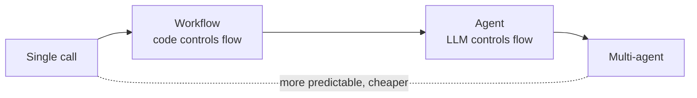
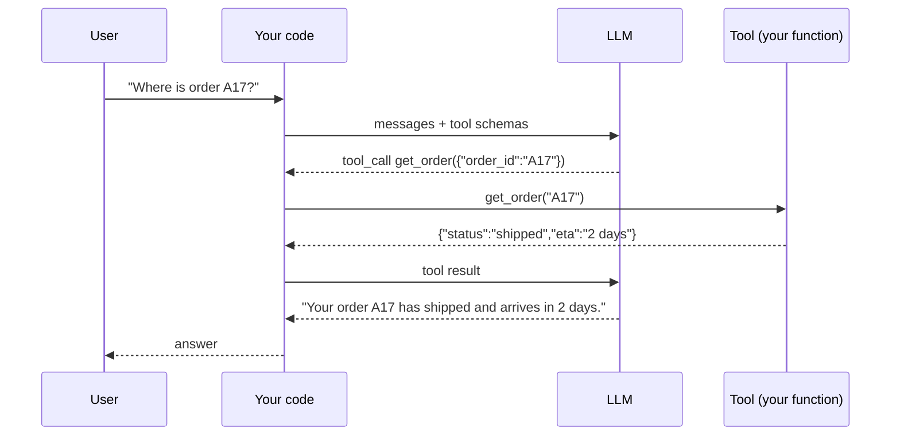
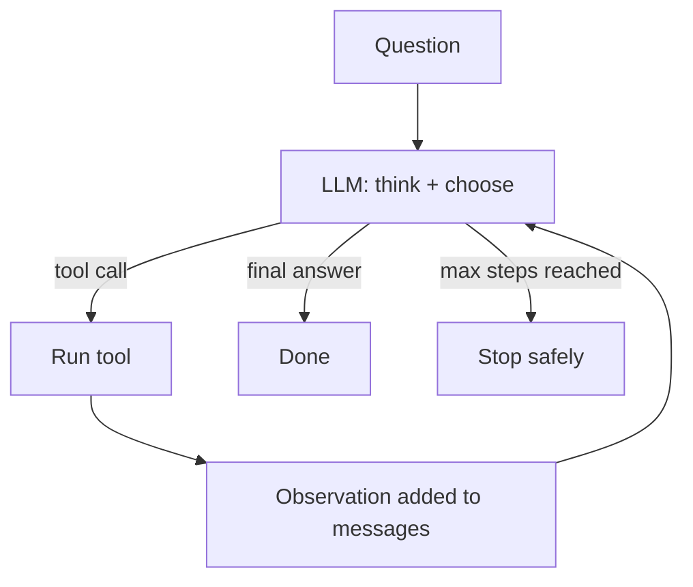
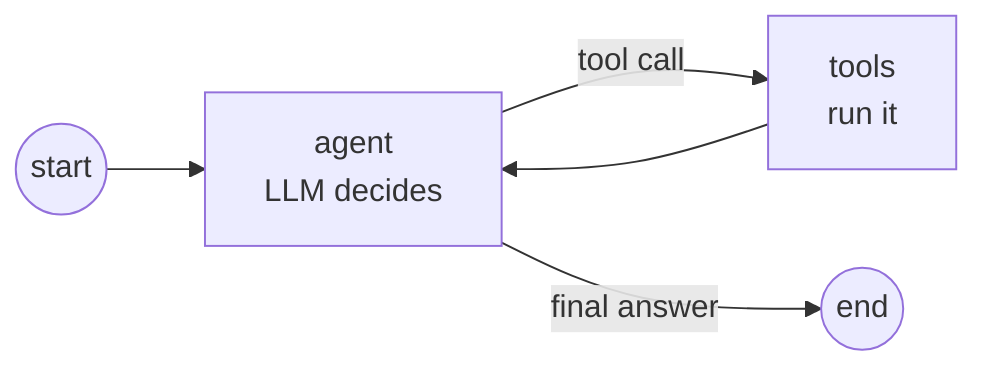
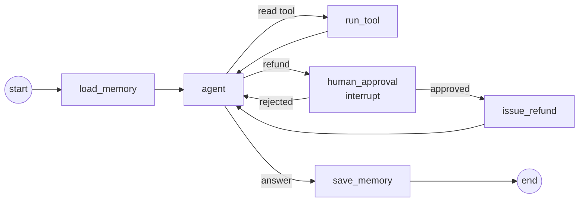

---
mdx:
  format: md
---

# 04 - AI Agents & State Machines (Week 4)

> **Note**: Sections marked **(Interview Imp)** are frequently asked in interviews.
>
> **Goal of this week:** move from one-shot prompts to systems that **decide, call tools, observe results and continue** - safely. You'll write the ReAct loop by hand, learn the workflow patterns, then model agents as **state machines with LangGraph**, including memory and human approval - and build **The Persistent Operator**.
>
> **Every example runs offline.** The model is a scripted `FakeLLM` that returns tool calls exactly like a real API would; the LangGraph examples run on the real `langgraph` library (v1.2).
>
> ⬅️ [03 Enterprise RAG](03_Enterprise_RAG.md) · ➡️ [05 Evals & Observability](05_Evals_and_Observability.md)

## Table of Contents
1. [LLM vs Workflow vs Agent vs Multi-Agent (Interview Imp)](#1-llm-vs-workflow-vs-agent-vs-multi-agent-interview-imp)
2. [Tool Calling - How It Really Works (Interview Imp)](#2-tool-calling---how-it-really-works-interview-imp)
3. [The ReAct Loop (Interview Imp)](#3-the-react-loop-interview-imp)
4. [Reliable Tool Calling](#4-reliable-tool-calling)
5. [Workflow Patterns: Chaining, Routing, Parallel, Orchestrator](#5-workflow-patterns-chaining-routing-parallel-orchestrator)
6. [State Machines with LangGraph (Interview Imp)](#6-state-machines-with-langgraph-interview-imp)
7. [Agent Memory](#7-agent-memory)
8. [Weekly Build - The Persistent Operator](#8-weekly-build---the-persistent-operator)
9. [Interview Questions](#9-interview-questions)
10. [Cheat Sheet](#10-cheat-sheet)

---

## 1. LLM vs Workflow vs Agent vs Multi-Agent (Interview Imp)

| | What decides the next step? | Example | Use when |
|---|---|---|---|
| **Single LLM call** | Nobody - one prompt, one answer | Summarise this email | The task fits in one step |
| **Workflow** | **Your code** - fixed steps, the LLM fills them in | Classify → retrieve → answer → check | Steps are known in advance (most production systems) |
| **Agent** | **The LLM** - picks tools in a loop until done | "Find why this payment failed and fix it" | Steps can't be known in advance |
| **Multi-agent** | Several agents, each with a role, coordinated | Researcher + writer + reviewer | Clearly separable roles, very long tasks |

**Rule of thumb (Interview Imp):** start with the simplest thing that works. A workflow is more predictable, cheaper, faster and easier to test than an agent. Reach for an agent only when the path genuinely depends on what the model discovers.



#### 📘 Terms Explained

| Term | Simple meaning |
|---|---|
| **Agent** | An LLM in a loop that chooses actions (tools) based on results so far. |
| **Workflow** | A fixed sequence of steps written in code, some of which call an LLM. |
| **Tool** | A function the model is allowed to request: search, SQL query, API call, calculator. |
| **Autonomy** | How much the model decides on its own versus following a script. |

---

## 2. Tool Calling - How It Really Works (Interview Imp)

**What is it?** You describe functions to the model (name, description, JSON schema of arguments). Instead of answering, the model can reply *"call `get_order` with `{"order_id": "A17"}`"*. **Your code runs the function** and sends the result back; the model then continues.

**Key point:** the model never executes anything. It only *asks*. You decide whether to run it - that's where safety lives.



The tool definition, in the OpenAI-compatible format most providers use:

```python
import json
from pydantic import BaseModel, Field

class GetOrder(BaseModel):
    """Look up an order's status by its ID."""
    order_id: str = Field(description="Order ID like A17")

tool_spec = {
    "type": "function",
    "function": {
        "name": "get_order",
        "description": GetOrder.__doc__,
        "parameters": GetOrder.model_json_schema(),
    },
}
print(json.dumps(tool_spec, indent=2))

# What the model sends back when it wants the tool (arguments arrive as a JSON *string*)
model_reply = {"tool_calls": [{"id": "call_1", "function": {"name": "get_order", "arguments": '{"order_id": "A17"}'}}]}
call = model_reply["tool_calls"][0]["function"]
args = GetOrder.model_validate_json(call["arguments"])        # validate before running!
print("model asked for:", call["name"], args)
```

**Output (identical on all 3 runs):**

```text
{
  "type": "function",
  "function": {
    "name": "get_order",
    "description": "Look up an order's status by its ID.",
    "parameters": {
      "description": "Look up an order's status by its ID.",
      "properties": {
        "order_id": {
          "description": "Order ID like A17",
          "title": "Order Id",
          "type": "string"
        }
      },
      "required": [
        "order_id"
      ],
      "title": "GetOrder",
      "type": "object"
    }
  }
}
model asked for: get_order order_id='A17'
```

**Tool design tips:** few, well-named tools with clear descriptions beat many overlapping ones; make arguments simple and validated; return compact JSON (not 5,000-row dumps); return helpful error messages the model can act on ("order_id must look like A17").

#### 📘 Terms Explained

| Term | Simple meaning |
|---|---|
| **Tool / function calling** | The model replies with a structured request to run one of your functions. |
| **Tool schema** | Name + description + JSON Schema of arguments that tells the model how to call a tool. |
| **tool_call id** | An ID linking each tool result back to the call that requested it. |

---

## 3. The ReAct Loop (Interview Imp)

**What is it?** **Re**ason + **Act**: the model thinks about what to do, calls a tool, observes the result, and repeats until it can answer. Every agent framework is a variation of this loop.



The whole loop in ~40 lines. `FakeLLM` replays what a real model would return for this conversation:

```python
import json

ORDERS = {"A17": {"status": "delayed", "carrier": "BlueDart", "days_late": 3}}
def get_order(order_id: str):      return ORDERS.get(order_id, {"error": f"no order {order_id}"})
def get_compensation(days_late: int): return {"voucher_inr": 100 * days_late}
TOOLS = {"get_order": get_order, "get_compensation": get_compensation}

class FakeLLM:
    """Scripted stand-in: returns the same kind of replies a real tool-calling model would."""
    def __init__(self):
        self.script = [
            {"thought": "I need the order status first.",
             "tool": "get_order", "args": {"order_id": "A17"}},
            {"thought": "It is 3 days late; check what compensation applies.",
             "tool": "get_compensation", "args": {"days_late": 3}},
            {"thought": "I have everything I need.",
             "answer": "Order A17 is delayed by 3 days (BlueDart). You get a 300 INR voucher."},
        ]
    def chat(self, messages):
        return self.script[sum(1 for m in messages if m["role"] == "assistant")]

def run_agent(question, llm, max_steps=5):
    messages = [{"role": "system", "content": "Use tools when needed."},
                {"role": "user", "content": question}]
    for step in range(1, max_steps + 1):
        reply = llm.chat(messages)
        messages.append({"role": "assistant", "content": json.dumps(reply)})
        print(f"step {step} thought: {reply['thought']}")
        if "answer" in reply:
            return reply["answer"]
        result = TOOLS[reply["tool"]](**reply["args"])
        print(f"        action : {reply['tool']}({reply['args']}) -> {result}")
        messages.append({"role": "tool", "content": json.dumps(result)})
    return "Stopped: too many steps."          # never loop forever

print("FINAL:", run_agent("Where is my order A17?", FakeLLM()))
```

**Output (identical on all 3 runs):**

```text
step 1 thought: I need the order status first.
        action : get_order({'order_id': 'A17'}) -> {'status': 'delayed', 'carrier': 'BlueDart', 'days_late': 3}
step 2 thought: It is 3 days late; check what compensation applies.
        action : get_compensation({'days_late': 3}) -> {'voucher_inr': 300}
step 3 thought: I have everything I need.
FINAL: Order A17 is delayed by 3 days (BlueDart). You get a 300 INR voucher.
```

With a real model you send `tools=[...]` in the request and read `choices[0].message.tool_calls`; the loop is identical. Modern APIs don't need a visible "thought" field - reasoning models think internally - but logging the model's reasoning when available is invaluable for debugging.

#### 📘 Terms Explained

| Term | Simple meaning |
|---|---|
| **ReAct** | A loop of Reasoning, Acting (tool call) and Observing the result. |
| **Observation** | The tool's result, fed back to the model as a message. |
| **max_steps** | A hard cap on loop iterations so a confused agent can't run (and spend) forever. |

---

## 4. Reliable Tool Calling

Agents fail in boring ways. Production agents add guard rails around every tool call:

| Failure | Guard |
|---|---|
| Bad / missing arguments | Validate with Pydantic; send the validation error back so the model can fix it |
| Model invents a tool name | Only dispatch names in an allowlist; reply "unknown tool, available: …" |
| Tool hangs | Timeout per call |
| Flaky API | Retry with backoff - **only for idempotent tools** (reads), never blindly for payments |
| Dangerous action | Human approval step (section 6.3) and per-tool permissions |
| Infinite loop / repeated call | `max_steps`, detect identical repeated calls |
| Huge tool output | Truncate / summarise before adding to context |

```python
import json, time
from pydantic import BaseModel, ValidationError, Field

class RefundArgs(BaseModel):
    order_id: str = Field(pattern=r"^A\d+$")
    amount_inr: int = Field(gt=0, le=10_000)

ALLOWED = {"refund": RefundArgs}
calls = {"n": 0}

def flaky_status_api(order_id):            # fails twice, then works
    calls["n"] += 1
    if calls["n"] < 3:
        raise TimeoutError("upstream timeout")
    return {"order_id": order_id, "status": "delivered"}

def with_retry(fn, *args, attempts=3, base_delay=0.01):
    for i in range(attempts):
        try:
            return fn(*args)
        except TimeoutError as e:
            print(f"  attempt {i + 1} failed: {e}")
            time.sleep(base_delay * 2 ** i)                 # exponential backoff
    return {"error": "service unavailable, try later"}

def dispatch(name, raw_args):
    if name not in ALLOWED:
        return {"error": f"unknown tool '{name}'. Available: {sorted(ALLOWED)}"}
    try:
        args = ALLOWED[name].model_validate_json(raw_args)
    except ValidationError as e:
        return {"error": "invalid arguments", "details": [f"{x['loc'][0]}: {x['msg']}" for x in e.errors()]}
    return {"ok": True, "would_refund": args.model_dump()}

print(dispatch("delete_database", "{}"))
print(dispatch("refund", '{"order_id": "17", "amount_inr": 50000}'))
print(dispatch("refund", '{"order_id": "A17", "amount_inr": 300}'))
print("retry result:", with_retry(flaky_status_api, "A17"))
```

**Output (identical on all 3 runs):**

```text
{'error': "unknown tool 'delete_database'. Available: ['refund']"}
{'error': 'invalid arguments', 'details': ["order_id: String should match pattern '^A\\d+$'", 'amount_inr: Input should be less than or equal to 10000']}
{'ok': True, 'would_refund': {'order_id': 'A17', 'amount_inr': 300}}
  attempt 1 failed: upstream timeout
  attempt 2 failed: upstream timeout
retry result: {'order_id': 'A17', 'status': 'delivered'}
```

#### 📘 Terms Explained

| Term | Simple meaning |
|---|---|
| **Allowlist** | The only tool names the dispatcher will run. |
| **Idempotent** | Safe to run twice with the same result (reads are; "send money" is not). |
| **Exponential backoff** | Waiting 1s, 2s, 4s… between retries so you don't hammer a failing service. |
| **Idempotency key** | A unique ID sent with a write so a retried request isn't executed twice. |

---

## 5. Workflow Patterns: Chaining, Routing, Parallel, Orchestrator

Most "agents" in production are really these patterns (Anthropic's *Building Effective Agents* names them):

| Pattern | Shape | Example |
|---|---|---|
| **Prompt chaining** | Step 1 → check → step 2 → step 3 | Extract fields → validate → draft email |
| **Routing** | Classify, then send to a specialised prompt/model | Billing vs tech vs fraud questions |
| **Parallelisation** | Run independent calls at once, combine | Check a transaction against 3 fraud rules simultaneously |
| **Orchestrator-workers** | An LLM splits a task into subtasks for workers | Research a topic across many sources |
| **Evaluator-optimiser** | One call drafts, another critiques, loop | Write code → review → fix |

```python
import asyncio

# Stand-in "LLM calls" (each would be one prompt to a model)
def classify(msg):  return "fraud" if "didn't make" in msg else "billing" if "charged" in msg else "general"
def extract(msg):   return {"amount": int("".join(c for c in msg if c.isdigit()) or 0)}
def draft(kind, f): return f"[{kind}] We are looking into the {f['amount']} INR transaction."
def check(text):    return "INR" in text and len(text) < 200

def chain(msg):                                     # chaining with a gate between steps
    kind = classify(msg)                            # routing decision
    fields = extract(msg)
    reply = draft(kind, fields)
    if not check(reply):                            # gate: don't send bad output
        return "escalate to human"
    return reply

print(chain("I was charged 4999 twice"))
print(chain("I didn't make this 12000 payment"))

async def rule(name, delay, flagged):               # parallel fraud checks
    await asyncio.sleep(delay)
    return name, flagged

async def parallel_checks():
    results = await asyncio.gather(rule("velocity", 0.03, False), rule("geo", 0.01, True), rule("device", 0.02, False))
    flagged = [n for n, f in results if f]
    return f"flagged by {flagged}" if flagged else "clean"

print(asyncio.run(parallel_checks()))
```

**Output (identical on all 3 runs):**

```text
[billing] We are looking into the 4999 INR transaction.
[fraud] We are looking into the 12000 INR transaction.
flagged by ['geo']
```

#### 📘 Terms Explained

| Term | Simple meaning |
|---|---|
| **Prompt chaining** | Splitting a task into several smaller LLM calls in sequence. |
| **Gate** | A code check between steps that stops bad output from flowing on. |
| **Orchestrator** | The component (code or LLM) that hands out subtasks and combines results. |

---

## 6. State Machines with LangGraph (Interview Imp)

**What is it?** **LangGraph** models an agent or workflow as a **graph**: nodes are steps (Python functions), edges say what runs next, and a typed **state** object flows through. Conditional edges let the LLM's output choose the path. A **checkpointer** saves state after every step.

**Why needed?** A hand-written `while` loop gets messy fast. A graph gives you: explicit control flow you can draw and test; persistence (resume after a crash or days later); **human-in-the-loop** pauses; streaming of intermediate steps; time-travel debugging.

### 6.1 Nodes, edges and conditional routing

```python
from typing import TypedDict
from langgraph.graph import StateGraph, START, END

class State(TypedDict):
    message: str
    category: str
    reply: str

def classify(state: State):
    m = state["message"].lower()
    return {"category": "fraud" if "unauthorised" in m else "billing" if "charge" in m else "general"}

def fraud_team(state: State):   return {"reply": "Card blocked. A fraud specialist will call you."}
def billing_team(state: State): return {"reply": "Refund for the duplicate charge started."}
def general(state: State):      return {"reply": "Thanks! How else can I help?"}

g = StateGraph(State)
g.add_node("classify", classify)
g.add_node("fraud", fraud_team)
g.add_node("billing", billing_team)
g.add_node("general", general)
g.add_edge(START, "classify")
g.add_conditional_edges("classify", lambda s: s["category"], {"fraud": "fraud", "billing": "billing", "general": "general"})
for n in ("fraud", "billing", "general"):
    g.add_edge(n, END)
app = g.compile()

for msg in ["There is an unauthorised payment on my card", "Double charge on my bill", "hello"]:
    out = app.invoke({"message": msg})
    print(f"{out['category']:8} -> {out['reply']}")
```

**Output (identical on all 3 runs):**

```text
fraud    -> Card blocked. A fraud specialist will call you.
billing  -> Refund for the duplicate charge started.
general  -> Thanks! How else can I help?
```

### 6.2 Loops: an agent is a graph with a cycle



LangGraph's prebuilt `create_react_agent` / `ToolNode` implement exactly this graph with a real chat model; section 8 builds it by hand so you see every part.

### 6.3 Human-in-the-loop with `interrupt` (Interview Imp)

`interrupt(...)` pauses the graph *inside a node* and saves state via the checkpointer. Later, `Command(resume=value)` continues from that exact point - even in another process, if the checkpointer is a database.

```python
from typing import TypedDict
from langgraph.graph import StateGraph, START, END
from langgraph.checkpoint.memory import InMemorySaver
from langgraph.types import interrupt, Command

class Refund(TypedDict):
    amount: int
    status: str

def propose(s: Refund):  return {"status": "proposed"}
def approval(s: Refund):
    decision = interrupt({"question": f"Approve refund of {s['amount']} INR?"})   # pauses here
    return {"status": "approved" if decision == "yes" else "rejected"}
def execute(s: Refund):  return {"status": s["status"] + (" + paid" if s["status"] == "approved" else "")}

g = StateGraph(Refund)
for name, fn in [("propose", propose), ("approval", approval), ("execute", execute)]:
    g.add_node(name, fn)
g.add_edge(START, "propose"); g.add_edge("propose", "approval")
g.add_edge("approval", "execute"); g.add_edge("execute", END)
app = g.compile(checkpointer=InMemorySaver())        # use a Postgres/Redis/SQLite saver in production

cfg = {"configurable": {"thread_id": "refund-42"}}
paused = app.invoke({"amount": 2500, "status": ""}, cfg)
print("paused, asking human:", paused["__interrupt__"][0].value)
print("waiting at node:", app.get_state(cfg).next)

final = app.invoke(Command(resume="yes"), cfg)       # the human clicked Approve
print("after approval:", final)
```

**Output (identical on all 3 runs):**

```text
paused, asking human: {'question': 'Approve refund of 2500 INR?'}
waiting at node: ('approval',)
after approval: {'amount': 2500, 'status': 'approved + paid'}
```

**Pitfalls:** code *before* `interrupt()` in a node runs again on resume - keep side effects (payments, emails) in a later node; always pass the same `thread_id` to resume; `InMemorySaver` loses everything on restart (use `langgraph-checkpoint-postgres` / `-sqlite` / Redis savers).

#### 📘 Terms Explained

| Term | Simple meaning |
|---|---|
| **State machine** | A system that is always in one state and moves between states by rules. |
| **Node** | One step in the graph (a Python function that returns state updates). |
| **Edge / conditional edge** | A fixed next step / a next step chosen by a function of the state. |
| **Checkpointer** | Saves the graph's state after each step so it can pause and resume. |
| **thread_id** | The ID of one conversation/run whose state the checkpointer stores. |
| **interrupt** | Pause the graph and wait for outside (human) input. |
| **Human-in-the-loop (HITL)** | A person approves or edits before the system continues. |

---

## 7. Agent Memory

| Type | Holds | Lives | Implementation |
|---|---|---|---|
| **Short-term (working)** | Messages and tool results of *this* conversation | One thread | Graph state + checkpointer |
| **Long-term (semantic)** | Facts about the user/customer across sessions ("prefers Hindi", "VIP") | Days-years | Key-value store (Redis), or a vector store for searchable memories |
| **Episodic** | Summaries of past interactions | Long | Summarise each finished thread and store it |
| **Procedural** | How to do things - instructions, learned rules | Long | System prompt / config, updated deliberately |

**Context window management:** conversations grow past the context limit. Keep the last N messages, summarise older ones, and pull long-term facts in only when relevant. [Week 6](06_MCP_Context_Engineering_Multi_Agent.md#2-context-engineering-interview-imp) goes deep on this.

```python
# Not executed here: needs a Redis server (docker run -p 6379:6379 redis) and `pip install redis`.
import json, redis
r = redis.Redis(decode_responses=True)
r.hset("customer:C42", mapping={"language": "Hindi", "tier": "gold"})     # long-term facts
r.rpush("customer:C42:episodes", json.dumps({"date": "2026-11-10", "summary": "Refund for A17 approved"}))
r.expire("customer:C42:episodes", 60 * 60 * 24 * 365)                    # keep for a year
facts = r.hgetall("customer:C42")
```

#### 📘 Terms Explained

| Term | Simple meaning |
|---|---|
| **Short-term memory** | What the agent remembers within the current conversation. |
| **Long-term memory** | Facts saved across conversations, loaded when needed. |
| **Redis** | A very fast in-memory key-value database, common for sessions, caches and agent memory. |
| **Summarisation memory** | Replacing old messages with a short summary to save tokens. |

---

## 8. Weekly Build - The Persistent Operator

**Goal:** an autonomous, tool-calling support agent that takes real actions, **pauses for human approval** before any refund, **resumes seamlessly**, and **remembers customer context** across sessions.



```python
from typing import TypedDict
from langgraph.graph import StateGraph, START, END
from langgraph.checkpoint.memory import InMemorySaver
from langgraph.types import interrupt, Command

# ---- "Redis": same get/set idea, kept in a dict so the example runs offline
class KV:
    def __init__(self): self.d = {}
    def hgetall(self, k): return dict(self.d.get(k, {}))
    def hset(self, k, mapping): self.d.setdefault(k, {}).update(mapping)
memory_db = KV()

ORDERS = {"A17": {"customer": "C42", "status": "delayed", "amount": 1800}}
PAYMENTS = []

class State(TypedDict, total=False):
    customer: str
    question: str
    profile: dict
    steps: list          # tool calls and results so far
    pending: dict        # a tool call waiting for approval or execution
    answer: str

def fake_llm(state):
    """Scripted policy standing in for a tool-calling model. Reads state, returns the next action."""
    done = [s["tool"] for s in state["steps"]]
    lang = state["profile"].get("language", "English")
    if "get_order" not in done:
        return {"tool": "get_order", "args": {"order_id": "A17"}}
    order = state["steps"][0]["result"]
    if order["status"] == "delayed" and "issue_refund" not in done and "refund_rejected" not in done:
        return {"tool": "issue_refund", "args": {"order_id": "A17", "amount": order["amount"]}}
    if "issue_refund" in done:
        return {"answer": f"({lang}) Sorry for the delay - {order['amount']} INR has been refunded."}
    return {"answer": f"({lang}) Your order is delayed; a supervisor declined the refund, we'll call you."}

def load_memory(s):  return {"profile": memory_db.hgetall(f"customer:{s['customer']}"), "steps": []}
def agent(s):
    action = fake_llm(s)
    return {"answer": action["answer"], "pending": {}} if "answer" in action else {"pending": action}

def route(s):
    if s.get("answer"): return "save_memory"
    return "human_approval" if s["pending"]["tool"] == "issue_refund" else "run_tool"

def run_tool(s):     # read-only tools run immediately
    p = s["pending"]
    result = ORDERS[p["args"]["order_id"]]
    return {"steps": s["steps"] + [{"tool": p["tool"], "result": result}], "pending": {}}

def human_approval(s):
    ok = interrupt({"approve?": s["pending"]})       # pause; state is checkpointed
    if ok:
        return {}
    return {"steps": s["steps"] + [{"tool": "refund_rejected", "result": {}}], "pending": {}}

def after_approval(s): return "issue_refund" if s.get("pending") else "agent"

def issue_refund(s):  # the side effect lives AFTER the interrupt node, so resume never repeats it
    a = s["pending"]["args"]
    PAYMENTS.append(a)
    return {"steps": s["steps"] + [{"tool": "issue_refund", "result": {"refunded": a["amount"]}}], "pending": {}}

def save_memory(s):
    memory_db.hset(f"customer:{s['customer']}", {"last_issue": "A17 delayed", "last_outcome": s["answer"][:40]})
    return {}

g = StateGraph(State)
for n, f in [("load_memory", load_memory), ("agent", agent), ("run_tool", run_tool),
             ("human_approval", human_approval), ("issue_refund", issue_refund), ("save_memory", save_memory)]:
    g.add_node(n, f)
g.add_edge(START, "load_memory"); g.add_edge("load_memory", "agent")
g.add_conditional_edges("agent", route, ["run_tool", "human_approval", "save_memory"])
g.add_edge("run_tool", "agent")
g.add_conditional_edges("human_approval", after_approval, ["issue_refund", "agent"])
g.add_edge("issue_refund", "agent"); g.add_edge("save_memory", END)
app = g.compile(checkpointer=InMemorySaver())

memory_db.hset("customer:C42", {"language": "Hindi"})             # known from an earlier session

# Session 1: agent runs, pauses before the refund
cfg = {"configurable": {"thread_id": "C42-session-1"}}
r = app.invoke({"customer": "C42", "question": "Where is order A17?"}, cfg)
print("PAUSED for approval:", r["__interrupt__"][0].value)
print("payments so far:", PAYMENTS)

# ...minutes or days later, a supervisor approves; the run continues where it stopped
r = app.invoke(Command(resume=True), cfg)
print("ANSWER:", r["answer"])
print("payments:", PAYMENTS)
print("tool trail:", [s["tool"] for s in r["steps"]])

# Session 2 (new thread): memory from session 1 is loaded automatically
cfg2 = {"configurable": {"thread_id": "C42-session-2"}}
r2 = app.invoke({"customer": "C42", "question": "Any update?"}, cfg2)
print("session 2 remembers:", r2["profile"])
app.invoke(Command(resume=False), cfg2)                             # supervisor rejects this time
print("payments unchanged:", len(PAYMENTS))
```

**Output (identical on all 3 runs):**

```text
PAUSED for approval: {'approve?': {'tool': 'issue_refund', 'args': {'order_id': 'A17', 'amount': 1800}}}
payments so far: []
ANSWER: (Hindi) Sorry for the delay - 1800 INR has been refunded.
payments: [{'order_id': 'A17', 'amount': 1800}]
tool trail: ['get_order', 'issue_refund']
session 2 remembers: {'language': 'Hindi', 'last_issue': 'A17 delayed', 'last_outcome': '(Hindi) Sorry for the delay - 1800 INR h'}
payments unchanged: 1
```

**Make it real:** replace `fake_llm` with a chat model bound to tools (`ChatOpenAI(base_url=openrouter, ...).bind_tools([...])` or LangGraph's `create_react_agent`), `KV` with Redis, and `InMemorySaver` with `PostgresSaver` so a paused approval survives restarts. Expose approve/reject as two endpoints in your gateway.

**Stretch goals:** per-tool permissions by user role; an approval timeout that auto-rejects; an audit log of every tool call with who approved it; stream intermediate steps to the UI with `app.stream(...)`.

**Outcome:** a tool-calling agent that pauses for human approval and resumes seamlessly, with persistent memory.

#### 📘 Terms Explained

| Term | Simple meaning |
|---|---|
| **Side effect** | An action that changes the outside world (payment, email, DB write). |
| **Audit log** | A permanent record of who did what and when. |
| **bind_tools** | LangChain method that attaches tool schemas to a chat model so it can call them. |

---

## 9. Interview Questions

1. **What's the difference between a workflow and an agent? (Interview Imp)** In a workflow, code fixes the steps; in an agent, the LLM decides the next step in a loop. Prefer workflows when the steps are known.
2. **Explain the ReAct pattern.** Loop: model reasons, calls a tool, observes the result, repeats until it answers; capped by max steps.
3. **Who executes a tool call?** Your application. The model only outputs a structured request - which is why validation, allowlists and permissions sit in your code.
4. **How do you make tool calling reliable?** Schema validation with error feedback, allowlist, timeouts, retries only for idempotent tools, idempotency keys for writes, max steps, output truncation.
5. **Why model agents as state machines/graphs?** Explicit, testable control flow; persistence and resume; human-in-the-loop; streaming; easier debugging than a free-form loop.
6. **How does human approval work in LangGraph? (Interview Imp)** `interrupt()` pauses inside a node and the checkpointer saves state; `Command(resume=...)` with the same `thread_id` continues from there.
7. **Short-term vs long-term memory?** Short-term = the current thread's messages/state; long-term = facts persisted across threads (Redis/DB/vector store), loaded when relevant.
8. **How do you stop an agent from looping or overspending?** Max steps, per-run token/cost budget, repeated-call detection, timeouts, and a fallback answer.
9. **Where should side effects live relative to an interrupt?** After it, in a separate node - code before `interrupt()` re-runs on resume.
10. **When would you use multiple agents?** When roles are clearly separable and context would otherwise overflow; otherwise one agent with good tools is simpler.

---

## 10. Cheat Sheet

| Need | Use |
|---|---|
| Fixed steps | Workflow (chaining / routing / parallel) |
| Unknown steps | Agent = LLM + tools + loop (ReAct) |
| Tool schema | Pydantic model → `model_json_schema()` |
| Safe dispatch | allowlist + validate + timeout + max_steps |
| Explicit control flow | LangGraph `StateGraph`, conditional edges |
| Pause for a human | `interrupt()` + checkpointer + `Command(resume=...)` |
| Persist runs | Postgres/SQLite/Redis checkpointer, same `thread_id` |
| Remember users | Redis/DB long-term memory, loaded at start, saved at end |

⬅️ [03 Enterprise RAG](03_Enterprise_RAG.md) · ➡️ [05 Evals & Observability](05_Evals_and_Observability.md)
