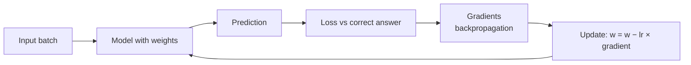

---
mdx:
  format: md
---

# 07 - ML Fundamentals & Fine-Tuning Models (Week 7)

> **Note**: Sections marked **(Interview Imp)** are frequently asked in interviews.
>
> **Goal of this week:** understand how models *learn* (loss, gradients, training loops), when fine-tuning beats prompting or RAG, how **LoRA/QLoRA** make fine-tuning cheap, how **quantization** makes models small and fast, how to prepare a fine-tuning dataset, and how to serve models locally - then build **The Specialist Model** and defend the choice with cost, latency and accuracy numbers.
>
> **What runs here:** the maths (gradient descent, LoRA, quantization, dataset checks, benchmark) in plain Python. Real LLM fine-tuning needs a GPU, so the training script is complete but *not executed* - run it free on Google Colab or Kaggle.
>
> ⬅️ [06 MCP, Context Engineering & Multi-Agent](06_MCP_Context_Engineering_Multi_Agent.md) · ➡️ [08 Agentic System Design & Reliability](08_Agentic_System_Design_and_Reliability.md)

## Table of Contents
1. [How Models Learn: Loss, Gradients, Training (Interview Imp)](#1-how-models-learn-loss-gradients-training-interview-imp)
2. [Fine-Tuning vs Prompting vs RAG (Interview Imp)](#2-fine-tuning-vs-prompting-vs-rag-interview-imp)
3. [LoRA and QLoRA (Interview Imp)](#3-lora-and-qlora-interview-imp)
4. [Quantization](#4-quantization)
5. [Dataset Engineering](#5-dataset-engineering)
6. [Local Model Serving](#6-local-model-serving)
7. [Weekly Build - The Specialist Model](#7-weekly-build---the-specialist-model)
8. [Interview Questions](#8-interview-questions)
9. [Cheat Sheet](#9-cheat-sheet)

---

## 1. How Models Learn: Loss, Gradients, Training (Interview Imp)

**What is it?** Training = repeatedly nudging a model's numbers (**weights**) to make a **loss** (how wrong it is) smaller, using the **gradient** (which direction makes the loss go up) and stepping the opposite way.

**Why an AI engineer needs it:** fine-tuning, learning rates, epochs, overfitting and evaluation all come from these few ideas. Deep maths is optional; the intuition is not. Full ML path: [AI_ML_Roadmap.md](../ai-ml/AI_ML_Roadmap.md).



Gradient descent on the smallest possible model, `y = w·x + b`:

```python
data = [(1, 3.1), (2, 4.9), (3, 7.2), (4, 8.8), (5, 11.1)]     # roughly y = 2x + 1

w, b, lr = 0.0, 0.0, 0.02
for epoch in range(1, 501):
    dw = db = loss = 0.0
    for x, y in data:
        pred = w * x + b
        err = pred - y
        loss += err ** 2 / len(data)                 # mean squared error
        dw += 2 * err * x / len(data)                # d(loss)/dw
        db += 2 * err / len(data)                    # d(loss)/db
    w -= lr * dw                                     # step against the gradient
    b -= lr * db
    if epoch in (1, 10, 50, 500):
        print(f"epoch {epoch:3}: loss={loss:7.3f}  w={w:.3f}  b={b:.3f}")
print(f"learned y = {w:.2f}x + {b:.2f}")
```

**Output (identical on all 3 runs):**

```text
epoch   1: loss= 57.222  w=1.002  b=0.281
epoch  10: loss=  0.057  w=2.106  b=0.616
epoch  50: loss=  0.041  w=2.081  b=0.720
epoch 500: loss=  0.021  w=1.994  b=1.034
learned y = 1.99x + 1.03
```

An LLM is the same loop with billions of weights, the loss is **cross-entropy** on the next token, and gradients come from **backpropagation** through the transformer.

**Overfitting (Interview Imp):** if training loss keeps falling but **validation loss** (on data the model never trains on) starts rising, the model is memorising, not learning. Stop early, use more/varied data, fewer epochs or a smaller learning rate.

| Hyperparameter | What it controls | Typical for LoRA fine-tuning |
|---|---|---|
| Learning rate | Step size | 1e-4 - 2e-4 |
| Epochs | Passes over the data | 1-3 |
| Batch size | Examples per update | 8-64 (use gradient accumulation on small GPUs) |
| Warm-up / schedule | Ramp lr up, then decay | 3-10% warm-up, cosine/linear decay |

#### 📘 Terms Explained

| Term | Simple meaning |
|---|---|
| **Weight / parameter** | A number inside the model that training adjusts. |
| **Loss** | A number measuring how wrong the predictions are. |
| **Gradient** | How much the loss changes if a weight changes a little - tells you which way to move. |
| **Learning rate (lr)** | How big each update step is. |
| **Epoch** | One full pass over the training data. |
| **Cross-entropy** | The loss for predicting categories (like the next token): punishes low probability on the right answer. |
| **Overfitting** | Doing great on training data, badly on new data. |

---

## 2. Fine-Tuning vs Prompting vs RAG (Interview Imp)

**Fine-tuning** = continue training a pre-trained model on your examples so its *behaviour* changes.

| Goal | Best tool | Why |
|---|---|---|
| Answer from company documents / fresh facts | **RAG** | Facts change; RAG updates instantly and cites sources |
| Follow a format, style, tone, or domain jargon reliably | **Fine-tuning** | Behaviour is learned from examples |
| Make a small cheap model do one narrow task as well as a big one | **Fine-tuning** (distillation) | Cut cost/latency 10-50× |
| Quick improvement, little data | **Prompting** (few-shot examples) | Minutes, no training |
| New knowledge the model must reason with deeply | RAG first; fine-tune + RAG together in hard cases | Fine-tuning alone is a poor way to add facts |

**Order to try:** prompt engineering → RAG → fine-tuning. Fine-tune only with an eval set proving the simpler options fall short ([Week 5](05_Evals_and_Observability.md)).

**Types of fine-tuning:** *full* (update every weight - expensive), **PEFT** like LoRA (update a tiny add-on - the default), *SFT* (input → ideal output pairs), *preference tuning* (DPO: chosen vs rejected answers), *distillation* (train a small model on a big model's outputs).

#### 📘 Terms Explained

| Term | Simple meaning |
|---|---|
| **Fine-tuning** | Further training a pre-trained model on your own examples. |
| **PEFT** | Parameter-Efficient Fine-Tuning - train only a small number of extra parameters. |
| **Distillation** | Teaching a small model to imitate a large model's answers. |
| **Few-shot prompting** | Putting a few examples in the prompt instead of training. |

---

## 3. LoRA and QLoRA (Interview Imp)

**What is it?** **LoRA (Low-Rank Adaptation)** freezes the original weight matrix `W` and learns a small update `ΔW = B·A`, where `B` is `d×r` and `A` is `r×k` with a small **rank** `r` (8-64). The output becomes `W·x + (B·A)·x`.

**Why needed?** A 7B-parameter model has ~7 billion weights; full fine-tuning needs ~100+ GB of GPU memory for weights, gradients and optimizer state. LoRA trains well under 1% of the parameters, fits on one consumer/Colab GPU, and the result is a small **adapter** file (tens of MB) you can swap per customer or task.

```python
d = k = 4096                                   # one attention projection in a 7B model
for r in (8, 16, 64):
    full = d * k
    lora = d * r + r * k
    print(f"rank {r:2}: LoRA trains {lora:>9,} params vs {full:,} full ({lora / full:.2%})")

# The idea on a tiny matrix: a rank-1 update B·A changes W everywhere with few numbers
W = [[1.0, 0.0, 0.0], [0.0, 1.0, 0.0], [0.0, 0.0, 1.0]]   # frozen
B = [[0.5], [0.0], [-0.5]]                                # 3x1, trained
A = [[1.0, 2.0, 0.0]]                                     # 1x3, trained
delta = [[B[i][0] * A[0][j] for j in range(3)] for i in range(3)]
W_new = [[W[i][j] + delta[i][j] for j in range(3)] for i in range(3)]
print("trainable numbers:", 3 + 3, "instead of", 9)
for row in W_new:
    print("  ", row)
```

**Output (identical on all 3 runs):**

```text
rank  8: LoRA trains    65,536 params vs 16,777,216 full (0.39%)
rank 16: LoRA trains   131,072 params vs 16,777,216 full (0.78%)
rank 64: LoRA trains   524,288 params vs 16,777,216 full (3.12%)
trainable numbers: 6 instead of 9
   [1.5, 1.0, 0.0]
   [0.0, 1.0, 0.0]
   [-0.5, -1.0, 1.0]
```

**QLoRA** = load the frozen base model in **4-bit** (section 4) and train LoRA adapters on top in 16-bit. A 7-8B model then fine-tunes in ~6-10 GB of GPU memory - a free Colab T4 can do it.

**Key LoRA settings:** `r` (rank: 8-16 is a good start), `lora_alpha` (scaling, often 2×r), `target_modules` (which layers get adapters - all linear layers usually works best), `lora_dropout` (0-0.1).

#### 📘 Terms Explained

| Term | Simple meaning |
|---|---|
| **LoRA** | Learn a small low-rank correction to frozen weights instead of changing all weights. |
| **Rank (r)** | Size of the LoRA "bottleneck"; higher = more capacity, more parameters. |
| **Adapter** | The small trained LoRA weights, stored separately from the base model. |
| **QLoRA** | LoRA training on top of a 4-bit quantized base model. |
| **Optimizer state** | Extra numbers the optimizer (e.g. Adam) keeps per weight - often 2× the weights' memory. |

---

## 4. Quantization

**What is it?** Storing weights with fewer bits: 16-bit floats → 8-bit or 4-bit integers plus a **scale** factor per group of weights.

**Why needed?** Memory and speed. LLM inference is mostly limited by moving weights from memory, so 4× smaller weights ≈ much faster and cheaper, with small quality loss.

```python
import random
rng = random.Random(0)
weights = [rng.gauss(0, 0.02) for _ in range(1024)]          # typical small weight values

def quantize(ws, bits, group=64):
    levels = 2 ** (bits - 1) - 1                                # int8 -> 127, int4 -> 7
    out = []
    for i in range(0, len(ws), group):
        g = ws[i:i + group]
        scale = max(abs(x) for x in g) / levels                 # one scale per group
        q = [round(x / scale) for x in g]                       # stored as small integers
        out += [v * scale for v in q]                           # de-quantized when used
    return out

for bits in (8, 4, 2):
    deq = quantize(weights, bits)
    err = sum(abs(a - b) for a, b in zip(weights, deq)) / len(weights)
    print(f"int{bits}: mean abs error {err:.6f}  ({err / 0.02:.1%} of a typical weight)")

print("\nMemory for weights only:")
for params_b in (8, 70):
    sizes = {name: params_b * bytes_ for name, bytes_ in (("fp16", 2), ("int8", 1), ("int4", 0.5))}
    print(f"  {params_b}B model: " + ", ".join(f"{n} ≈ {s:g} GB" for n, s in sizes.items()))
```

**Output (identical on all 3 runs):**

```text
int8: mean abs error 0.000098  (0.5% of a typical weight)
int4: mean abs error 0.001776  (8.9% of a typical weight)
int2: mean abs error 0.011568  (57.8% of a typical weight)

Memory for weights only:
  8B model: fp16 ≈ 16 GB, int8 ≈ 8 GB, int4 ≈ 4 GB
  70B model: fp16 ≈ 140 GB, int8 ≈ 70 GB, int4 ≈ 35 GB
```

| Format | Used by | Notes |
|---|---|---|
| **GGUF** (Q4_K_M, Q5_K_M, Q8_0) | llama.cpp, Ollama, LM Studio | CPU + GPU, laptops; Q4_K_M is the usual sweet spot |
| **GPTQ / AWQ** | vLLM, TGI, Transformers | GPU serving, 4-bit |
| **bitsandbytes NF4** | QLoRA training | 4-bit "normal float" designed for weight distributions |
| **FP8** | H100-class GPUs, vLLM | Near-lossless, fast |

**Rule of thumb:** 8-bit ≈ no noticeable loss; 4-bit = small loss, huge savings; below 4-bit quality drops quickly. Always re-run your evals after quantizing.

#### 📘 Terms Explained

| Term | Simple meaning |
|---|---|
| **Quantization** | Storing numbers with fewer bits to save memory and time. |
| **Scale / group size** | The multiplier that maps small integers back to real values; one per group of weights. |
| **GGUF** | The file format for quantized models used by llama.cpp and Ollama. |
| **fp16 / bf16** | 16-bit floating point formats used for most model weights. |

---

## 5. Dataset Engineering

**What is it?** Preparing the examples you fine-tune on. **Data quality matters more than model size or hyperparameters**: 500 clean, consistent examples beat 50,000 noisy ones.

**The standard format** - chat messages in JSONL (one JSON object per line), the same shape you send to a chat API:

```python
import json, hashlib, random

raw = [
    ("My card was charged twice for one order", "billing"),
    ("I see a payment I never made", "fraud"),
    ("App crashes when I open statements", "technical"),
    ("My card was charged twice for one order", "billing"),          # duplicate
    ("refund??", "billing"),                                          # too short / vague
    ("Someone used my card in another city", "fraud"),
    ("OTP is not arriving on my phone", "technical"),
    ("Double deduction on UPI payment", "billing"),
]
SYSTEM = "Classify the banking support ticket as billing, fraud or technical. Reply with one word."

seen, clean, dropped = set(), [], []
for text, label in raw:
    key = hashlib.md5(text.lower().strip().encode()).hexdigest()
    if key in seen: dropped.append((text, "duplicate")); continue
    if len(text.split()) < 3: dropped.append((text, "too short")); continue
    seen.add(key)
    clean.append({"messages": [{"role": "system", "content": SYSTEM},
                               {"role": "user", "content": text},
                               {"role": "assistant", "content": label}]})

random.Random(42).shuffle(clean)
split = int(len(clean) * 0.8)
train, val = clean[:split], clean[split:]
print(f"kept {len(clean)}, dropped {dropped}")
print(f"train={len(train)} val={len(val)}")
print("one JSONL line:", json.dumps(train[0]))
labels = [ex["messages"][2]["content"] for ex in clean]
print("label balance:", {l: labels.count(l) for l in sorted(set(labels))})
```

**Output (identical on all 3 runs):**

```text
kept 6, dropped [('My card was charged twice for one order', 'duplicate'), ('refund??', 'too short')]
train=4 val=2
one JSONL line: {"messages": [{"role": "system", "content": "Classify the banking support ticket as billing, fraud or technical. Reply with one word."}, {"role": "user", "content": "Someone used my card in another city"}, {"role": "assistant", "content": "fraud"}]}
label balance: {'billing': 2, 'fraud': 2, 'technical': 2}
```

**Checklist:** deduplicate (exact and near-duplicate); consistent labels and answer style; balanced classes (or weight them); keep a validation split and a *separate* test set; remove PII; include hard and edge cases; the system prompt at training time should match the one used in production. Generating examples with a frontier model and having humans review them (distillation data) is the most common way to build sets quickly.

#### 📘 Terms Explained

| Term | Simple meaning |
|---|---|
| **JSONL** | A file with one JSON object per line. |
| **Train / validation / test split** | Data used to learn / to tune and stop early / for the final honest score. |
| **Class balance** | Whether each label has a similar number of examples. |
| **Data leakage** | Test examples (or near-copies) sneaking into training, giving falsely good scores. |

---

## 6. Local Model Serving

| Tool | Best for | Start |
|---|---|---|
| **Ollama** | Laptops/dev machines, simplest | `ollama pull llama3.2` → OpenAI-compatible API on `:11434/v1` |
| llama.cpp / LM Studio | CPU or small GPUs, GGUF files | `llama-server -m model.gguf` |
| **vLLM** | Production GPU serving, high throughput (continuous batching, PagedAttention) | `vllm serve meta-llama/Llama-3.1-8B-Instruct` |
| TGI, SGLang, TensorRT-LLM | Production alternatives | - |
| **Hugging Face Hub** | Downloading open models, datasets, adapters | `huggingface-cli download …` |

All of them expose the OpenAI-compatible API, so your [AI Gateway](01_Python_and_LLM_Fundamentals.md#7-weekly-build---the-ai-gateway) can route to a local model by changing the base URL. Serving your fine-tuned adapter: vLLM can load LoRA adapters per request (`--enable-lora`), and Ollama can import a merged GGUF via a `Modelfile`.

#### 📘 Terms Explained

| Term | Simple meaning |
|---|---|
| **Ollama** | A tool that downloads and runs open models locally with one command. |
| **vLLM** | A high-performance inference server for GPUs. |
| **Continuous batching** | Mixing many users' requests into each GPU step to keep it busy. |
| **Hugging Face** | The main hub for open models, datasets and ML libraries. |

---

## 7. Weekly Build - The Specialist Model

**Goal:** fine-tune a small open model for one narrow task, then **benchmark it against a frontier API** on accuracy, cost and latency, and defend the choice with numbers.

### 7.1 The training script (not executed here: needs a GPU)

Run on a free Colab/Kaggle T4 with the dataset from section 5 (a few hundred examples):

```python
# Not executed here: needs a CUDA GPU. pip install unsloth trl datasets
from unsloth import FastLanguageModel
from trl import SFTTrainer, SFTConfig
from datasets import load_dataset

model, tokenizer = FastLanguageModel.from_pretrained(
    "unsloth/Llama-3.2-3B-Instruct", max_seq_length=1024, load_in_4bit=True)        # QLoRA base
model = FastLanguageModel.get_peft_model(
    model, r=16, lora_alpha=32, lora_dropout=0.0,
    target_modules=["q_proj", "k_proj", "v_proj", "o_proj", "gate_proj", "up_proj", "down_proj"])

ds = load_dataset("json", data_files={"train": "train.jsonl", "validation": "val.jsonl"})
trainer = SFTTrainer(
    model=model, tokenizer=tokenizer, train_dataset=ds["train"], eval_dataset=ds["validation"],
    args=SFTConfig(output_dir="out", num_train_epochs=2, learning_rate=2e-4,
                   per_device_train_batch_size=8, gradient_accumulation_steps=2,
                   eval_strategy="epoch", logging_steps=10, report_to="none"))
trainer.train()
model.save_pretrained("ticket-classifier-lora")                      # adapter only, ~50 MB
model.save_pretrained_gguf("ticket-classifier", tokenizer, quantization_method="q4_k_m")  # for Ollama
```

The same with plain Hugging Face libraries uses `transformers` + `peft` (`LoraConfig`, `get_peft_model`) + `bitsandbytes` (`BitsAndBytesConfig(load_in_4bit=True)`).

### 7.2 The benchmark harness (runs here)

The harness is what you'll actually reuse: same test set, same metrics, every candidate. Here the "specialist" is a tiny classifier trained in pure Python (standing in for the fine-tuned model) and the "frontier API" is simulated with realistic cost/latency numbers - plug in real calls and the dashboard is unchanged.

```python
import math, re, random
from collections import Counter, defaultdict

TRAIN = [
    ("charged twice for the same order", "billing"), ("refund not received yet", "billing"),
    ("double deduction on upi payment", "billing"), ("wrong amount debited for bill", "billing"),
    ("emi amount deducted twice", "billing"), ("cashback not credited to account", "billing"),
    ("payment i never made on my card", "fraud"), ("someone used my card abroad", "fraud"),
    ("unknown transaction at night", "fraud"), ("my card was stolen yesterday", "fraud"),
    ("strange login from another city", "fraud"), ("money sent without my otp", "fraud"),
    ("app crashes on statements page", "technical"), ("otp not arriving on phone", "technical"),
    ("cannot reset my password", "technical"), ("app shows blank screen", "technical"),
    ("netbanking page not loading", "technical"), ("face login keeps failing", "technical"),
]
TEST = [
    ("amount debited twice for one bill", "billing"), ("refund still pending after a week", "billing"),
    ("transaction i did not do appeared today", "fraud"), ("card used in a shop i never visited", "fraud"),
    ("otp sms never comes", "technical"), ("app crashes after the update", "technical"),
    ("cashback for my bill payment is missing", "billing"), ("login from a device i don't own", "fraud"),
]

def tok(t): return re.findall(r"[a-z]+", t.lower())

class NaiveBayes:                                   # stand-in for the fine-tuned small model
    def fit(self, data):
        self.counts, self.totals = defaultdict(Counter), Counter()
        for text, y in data:
            self.counts[y].update(tok(text)); self.totals[y] += 1
        self.vocab = {w for c in self.counts.values() for w in c}
        return self
    def predict(self, text):
        def logp(y):
            c, n = self.counts[y], sum(self.counts[y].values())
            return math.log(self.totals[y]) + sum(math.log((c[w] + 1) / (n + len(self.vocab))) for w in tok(text))
        return max(self.counts, key=logp)

specialist = NaiveBayes().fit(TRAIN)
rng = random.Random(3)

def frontier_api(text):                           # simulated: very accurate, slow and pricey
    gold = dict(TEST)[text]
    return gold if rng.random() > 0.02 else "billing"

CANDIDATES = {
    # name: (predict fn, USD per 1k requests, typical latency seconds)
    "fine-tuned 3B (self-hosted)": (specialist.predict, 0.05, 0.12),
    "frontier API":                (frontier_api,       2.50, 1.40),
}
print(f"{'model':30} {'accuracy':>8} {'$ / 1k req':>10} {'latency':>8} {'$ / 1M req/month':>17}")
for name, (fn, cost_k, lat) in CANDIDATES.items():
    acc = sum(fn(x) == y for x, y in TEST) / len(TEST)
    print(f"{name:30} {acc:8.0%} {cost_k:10.2f} {lat:7.2f}s {cost_k * 1000:17,.0f}")

wrong = [(x, specialist.predict(x), y) for x, y in TEST if specialist.predict(x) != y]
print("specialist mistakes:", wrong)
```

**Output (identical on all 3 runs):**

```text
model                          accuracy $ / 1k req  latency  $ / 1M req/month
fine-tuned 3B (self-hosted)         75%       0.05    0.12s                50
frontier API                       100%       2.50    1.40s             2,500
specialist mistakes: [('transaction i did not do appeared today', 'technical', 'fraud'), ('otp sms never comes', 'fraud', 'technical')]
```

**Reading the result:** with only 18 training examples the specialist reaches 75% - cheap and fast, but not good enough yet. Its mistakes ("transaction I did not do", "OTP SMS never comes") show exactly which kinds of examples to add. A real fine-tuned 3B model with a few hundred clean examples usually closes most of this gap; whatever remains is handled by routing low-confidence tickets to the frontier model.

**How to defend the decision (what interviewers want to hear):** "On our 400-ticket test set the fine-tuned 3B model scored X% vs Y% for the frontier model, at 1/50th of the cost and 10× lower latency. At 1M tickets/month that saves $Z. We route the low-confidence 5% to the frontier model (tiering), so overall accuracy matches." Back every number with the harness, and re-run it whenever the data or model changes.

**Stretch goals:** add a confidence threshold that escalates to the frontier model and measure the blended accuracy/cost; plot accuracy vs cost per candidate; add a quantized (q4) variant and measure its accuracy drop.

**Outcome:** you can defend a model choice with real cost, latency and accuracy numbers.

#### 📘 Terms Explained

| Term | Simple meaning |
|---|---|
| **Unsloth** | A library that makes LoRA/QLoRA fine-tuning faster and lighter on memory. |
| **TRL / SFTTrainer** | Hugging Face library and trainer class for supervised fine-tuning of LLMs. |
| **Naive Bayes** | A simple, fast probabilistic text classifier (word counts per class). |
| **Confidence threshold** | Below this certainty, hand the request to a stronger model or a human. |

---

## 8. Interview Questions

1. **When would you fine-tune instead of using RAG? (Interview Imp)** For behaviour (format, tone, narrow task skill, smaller/cheaper model), not for frequently changing facts - use RAG for those, or both together.
2. **Explain LoRA. (Interview Imp)** Freeze W, learn a low-rank update B·A (rank r ≪ d) added to the layer output; trains <1% of parameters, adapters are small and swappable.
3. **What does QLoRA add?** The frozen base model is quantized to 4-bit (NF4), so a 7-8B model fine-tunes on a single small GPU.
4. **What is quantization and its trade-off?** Fewer bits per weight with per-group scales; big memory/speed gains, small accuracy loss (8-bit ≈ lossless, 4-bit small loss). Re-run evals after.
5. **How do you detect overfitting during fine-tuning?** Validation loss rising while training loss falls; also eval-set accuracy dropping. Use fewer epochs, more data, lower lr.
6. **What makes a good fine-tuning dataset?** Clean, deduplicated, consistent, balanced, representative of production inputs (same system prompt), with held-out validation and test sets, no PII.
7. **How much memory does a 70B model need in fp16? In 4-bit?** About 140 GB vs about 35-40 GB for weights alone (plus KV cache and overhead).
8. **What is distillation?** Training a small model on a large model's outputs so it imitates it on a narrow task at a fraction of the cost.
9. **Ollama vs vLLM?** Ollama for simple local/dev use; vLLM for high-throughput production GPU serving with continuous batching and multi-LoRA.
10. **How would you decide between a fine-tuned small model and a frontier API?** Same test set and harness: accuracy, cost per 1k requests, p95 latency, plus ops burden (hosting, updates); often tier both.

---

## 9. Cheat Sheet

| Topic | Remember |
|---|---|
| Training loop | predict → loss → gradients → `w -= lr × grad`, watch validation loss |
| Try in order | prompting → RAG → fine-tuning (with evals proving the need) |
| LoRA | r = 8-16, alpha = 2r, all linear layers, lr ≈ 2e-4, 1-3 epochs |
| QLoRA | 4-bit NF4 base + LoRA → 7-8B on a free T4 |
| Quantization | GGUF Q4_K_M for Ollama/llama.cpp; AWQ/GPTQ/FP8 for vLLM |
| Memory | params × bytes per weight (fp16 = 2, int8 = 1, int4 = 0.5) + KV cache |
| Data | JSONL chat format, dedupe, balance, train/val/test, no PII |
| Decide | benchmark accuracy, $/1k, p95 latency on the same test set |

⬅️ [06 MCP, Context Engineering & Multi-Agent](06_MCP_Context_Engineering_Multi_Agent.md) · ➡️ [08 Agentic System Design & Reliability](08_Agentic_System_Design_and_Reliability.md)
