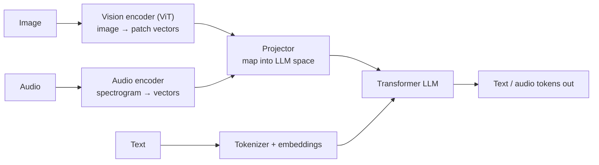
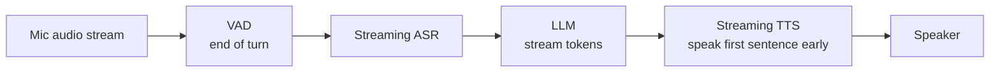
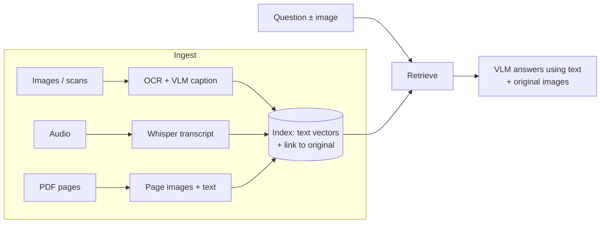

---
mdx:
  format: md
---

# 09 - Multimodal AI & Capstone Kickoff (Week 9)

> **Note**: Sections marked **(Interview Imp)** are frequently asked in interviews.
>
> **Goal of this week:** understand how models see images, hear audio and watch video; how vision-language and voice systems are built; how to make them fast; how to do RAG over images, scans and recordings - then start your capstone with **The Multimodal RAG Engine**.
>
> **What runs here:** the core mechanics (image patches → tokens, shared embedding spaces, audio chunking and voice-activity detection, latency budgets, structured extraction, cost per ticket) in plain Python. Calls to vision models and Whisper are shown as *not executed* snippets.
>
> ⬅️ [08 Agentic System Design & Reliability](08_Agentic_System_Design_and_Reliability.md) · ➡️ [10 Capstone & Interview Prep](10_Capstone_and_Interview_Prep.md)

## Table of Contents
1. [How Multimodal Models Work (Interview Imp)](#1-how-multimodal-models-work-interview-imp)
2. [Vision: Images and Documents](#2-vision-images-and-documents)
3. [Voice AI: Speech-to-Text, Text-to-Speech, Voice Agents](#3-voice-ai-speech-to-text-text-to-speech-voice-agents)
4. [Video Models](#4-video-models)
5. [Low-Latency Multimodal Systems](#5-low-latency-multimodal-systems)
6. [Multimodal RAG (Interview Imp)](#6-multimodal-rag-interview-imp)
7. [Capstone Sprint - The Multimodal RAG Engine](#7-capstone-sprint---the-multimodal-rag-engine)
8. [Scoping Your Capstone](#8-scoping-your-capstone)
9. [Interview Questions](#9-interview-questions)
10. [Cheat Sheet](#10-cheat-sheet)

---

## 1. How Multimodal Models Work (Interview Imp)

**What is it?** A **multimodal** model takes (and sometimes produces) more than text: images, audio, video. The trick is turning every modality into **tokens/vectors the transformer can process**, just like text.



**Two designs:**

| Design | How | Examples |
|---|---|---|
| **Encoder + projector + LLM** ("late fusion") | A pre-trained vision encoder (CLIP/SigLIP ViT) produces vectors; a small projector maps them into the LLM's embedding space; train mostly the projector, then fine-tune | LLaVA, Qwen-VL, Llama 3.2 Vision |
| **Natively multimodal** ("early fusion") | One model trained from the start on interleaved text, image and audio tokens | GPT-4o, Gemini, Claude (vision) |

**How they're trained:** (1) **contrastive pre-training** like CLIP - push matching image/caption pairs together and non-matching apart in one embedding space; (2) **alignment** - train the projector on image-caption data; (3) **instruction tuning** on visual Q&A conversations.

**Images become tokens through patches (ViT):** cut the image into 14×14 or 16×16-pixel squares, flatten each square into a vector, add position information. Each patch is one "word" to the transformer.

```python
# A 4x4 "image" (grayscale 0-255) cut into 2x2 patches -> 4 patch vectors
image = [
    [ 10,  20, 200, 210],
    [ 15,  25, 205, 215],
    [100, 110,  50,  60],
    [105, 115,  55,  65],
]
P = 2
patches = []
for r in range(0, len(image), P):
    for c in range(0, len(image[0]), P):
        patch = [image[r + i][c + j] for i in range(P) for j in range(P)]
        patches.append({"pos": (r // P, c // P), "vector": patch})
for p in patches:
    print(p)

# Why big images are expensive: tokens grow with the square of the side
for side in (224, 512, 1024, 2048):
    print(f"{side}x{side} image with 16px patches -> {(side // 16) ** 2:>6} patch tokens")
```

**Output (identical on all 3 runs):**

```text
{'pos': (0, 0), 'vector': [10, 20, 15, 25]}
{'pos': (0, 1), 'vector': [200, 210, 205, 215]}
{'pos': (1, 0), 'vector': [100, 110, 105, 115]}
{'pos': (1, 1), 'vector': [50, 60, 55, 65]}
224x224 image with 16px patches ->    196 patch tokens
512x512 image with 16px patches ->   1024 patch tokens
1024x1024 image with 16px patches ->   4096 patch tokens
2048x2048 image with 16px patches ->  16384 patch tokens
```

Providers resize and tile images, so real token counts differ per model (check the provider's pricing page), but the lesson holds: **downscale images to what the task needs** before sending them.

#### 📘 Terms Explained

| Term | Simple meaning |
|---|---|
| **Multimodal** | Working with more than one type of data (text, image, audio, video). |
| **ViT** | Vision Transformer - treats image patches like word tokens. |
| **Patch** | A small square of pixels turned into one vector/token. |
| **CLIP / SigLIP** | Models trained to put matching images and text close together in one vector space. |
| **Projector** | A small network that maps vision vectors into the LLM's embedding space. |
| **Contrastive learning** | Training by pulling matching pairs together and pushing non-matching pairs apart. |

---

## 2. Vision: Images and Documents

**What you can do with vision-language models (VLMs):** describe images, answer questions about them, read text (OCR), read charts and tables, extract fields from receipts, IDs, invoices and cheques, compare two images, check product damage, understand UI screenshots.

**A shared embedding space (CLIP idea)** lets you search images with text and vice versa:

```python
import math
def cos(a, b): return sum(x * y for x, y in zip(a, b)) / (math.sqrt(sum(x*x for x in a)) * math.sqrt(sum(y*y for y in b)))

# Pretend CLIP vectors: [document-ness, damage, food, vehicle]
images = {
    "receipt_photo.jpg":   [0.9, 0.0, 0.3, 0.0],
    "cracked_screen.jpg":  [0.1, 0.9, 0.0, 0.1],
    "car_dent.jpg":        [0.0, 0.8, 0.0, 0.9],
    "biryani.jpg":         [0.0, 0.0, 1.0, 0.0],
}
text_queries = {
    "a damaged phone":       [0.1, 0.9, 0.0, 0.0],
    "restaurant bill":       [0.8, 0.0, 0.6, 0.0],
    "accident damage to a vehicle": [0.0, 0.7, 0.0, 0.8],
}
for q, qv in text_queries.items():
    best = max(images, key=lambda name: cos(qv, images[name]))
    print(f"text {q!r:32} -> image {best} ({cos(qv, images[best]):.2f})")
```

**Output (identical on all 3 runs):**

```text
text 'a damaged phone'                -> image cracked_screen.jpg (0.99)
text 'restaurant bill'                -> image receipt_photo.jpg (0.95)
text 'accident damage to a vehicle'   -> image car_dent.jpg (1.00)
```

**Calling a vision model** (OpenAI-compatible format - works on OpenRouter, Ollama with `llava`/`llama3.2-vision`, vLLM):

```python
# Not executed here: needs an API key (or `ollama pull llama3.2-vision`).
import base64, httpx, os
img_b64 = base64.b64encode(open("receipt.jpg", "rb").read()).decode()
resp = httpx.post("https://openrouter.ai/api/v1/chat/completions",
    headers={"Authorization": f"Bearer {os.environ['OPENROUTER_API_KEY']}"},
    json={"model": "google/gemini-2.5-flash",
          "messages": [{"role": "user", "content": [
              {"type": "text", "text": "Extract merchant, date and total as JSON."},
              {"type": "image_url", "image_url": {"url": f"data:image/jpeg;base64,{img_b64}"}}]}],
          "response_format": {"type": "json_object"}}, timeout=60)
print(resp.json()["choices"][0]["message"]["content"])
```

**Document understanding options:** classic OCR (Tesseract, PaddleOCR) → text; layout-aware parsers (Docling, Unstructured, Azure Document Intelligence, AWS Textract) → text + tables + structure; or send the page **image** straight to a VLM and ask for structured JSON - often the most accurate for messy scans, forms and handwriting, at higher cost.

**Pitfalls:** VLMs still misread small digits - validate extracted numbers (totals add up, dates valid, checksums on IDs); huge images waste tokens; never send ID documents to a provider without a data agreement and redaction plan.

#### 📘 Terms Explained

| Term | Simple meaning |
|---|---|
| **VLM** | Vision-Language Model - takes images and text, outputs text. |
| **Base64** | A way to encode binary data (like an image) as text so it can go inside JSON. |
| **Layout-aware parsing** | Extracting text while keeping its position, tables and reading order. |

---

## 3. Voice AI: Speech-to-Text, Text-to-Speech, Voice Agents

| Component | Job | Examples |
|---|---|---|
| **VAD** (voice activity detection) | Find where someone is speaking; detect end of turn | Silero VAD, WebRTC VAD |
| **ASR / STT** (speech-to-text) | Audio → text | **OpenAI Whisper** (open source), faster-whisper, Deepgram, AssemblyAI, Sarvam (Indic) |
| **LLM** | Understand and respond | Any chat model |
| **TTS** (text-to-speech) | Text → natural audio | ElevenLabs, Cartesia, OpenAI TTS, Piper (local), Indic voices |
| **Speech-to-speech** | One model hears and speaks directly | OpenAI Realtime, Gemini Live |

**Audio basics:** sound is sampled thousands of times per second (16 kHz is standard for speech). Models usually look at a **spectrogram** (energy per frequency over time). Whisper processes audio in **30-second windows**, so long recordings are split - ideally at silences, which VAD finds:

```python
import math, random

SR = 1000                                     # samples per second (tiny, for the demo; speech uses 16000)
rng = random.Random(0)

def tone(seconds, freq, amp):                 # "speech" = a loud tone
    return [amp * math.sin(2 * math.pi * freq * i / SR) for i in range(int(seconds * SR))]
def silence(seconds):                          # background noise
    return [rng.uniform(-0.02, 0.02) for _ in range(int(seconds * SR))]

audio = silence(1.0) + tone(2.5, 120, 0.6) + silence(0.8) + tone(1.5, 150, 0.5) + silence(1.2)

def vad(samples, frame_ms=100, threshold=0.05):
    """Energy-based voice activity detection: which frames are louder than the threshold?"""
    n = int(SR * frame_ms / 1000)
    segments, start = [], None
    for i in range(0, len(samples), n):
        frame = samples[i:i + n]
        rms = math.sqrt(sum(x * x for x in frame) / len(frame))
        t = i / SR
        if rms > threshold and start is None: start = t
        if rms <= threshold and start is not None:
            segments.append((round(start, 1), round(t, 1))); start = None
    return segments

print(f"audio length: {len(audio) / SR:.1f}s")
print("speech segments (s):", vad(audio))
hours = 1
print(f"a {hours}h call = {hours * 3600 // 30} Whisper windows of 30s (split at silences, not mid-word)")
```

**Output (identical on all 3 runs):**

```text
audio length: 7.0s
speech segments (s): [(1.0, 3.5), (4.3, 5.8)]
a 1h call = 120 Whisper windows of 30s (split at silences, not mid-word)
```

```python
# Not executed here: downloads a Whisper model. pip install faster-whisper
from faster_whisper import WhisperModel
model = WhisperModel("small", device="cpu", compute_type="int8")      # quantized for CPU
segments, info = model.transcribe("call.wav", vad_filter=True, language=None)   # auto-detect language
print(info.language)
for s in segments:
    print(f"[{s.start:.1f}-{s.end:.1f}] {s.text}")
```

**Production concerns:** speaker diarisation (who spoke when), Indian languages and code-mixing (Hinglish) - test models on your real audio; PII in transcripts (redact - [Week 8](08_Agentic_System_Design_and_Reliability.md#42-pii-detection-and-redaction)); consent for recording.

#### 📘 Terms Explained

| Term | Simple meaning |
|---|---|
| **ASR / STT** | Automatic Speech Recognition / Speech-to-Text. |
| **TTS** | Text-to-Speech - generating spoken audio. |
| **VAD** | Voice Activity Detection - finding speech vs silence. |
| **Sample rate** | Audio measurements per second (16 kHz = 16,000). |
| **Spectrogram** | A picture of sound: frequencies (vertical) over time (horizontal). |
| **Diarisation** | Labelling which speaker said each part. |
| **Whisper** | OpenAI's open-source multilingual speech recognition model. |

---

## 4. Video Models

**Understanding video:** most systems **sample frames** (e.g. 1 frame per second), treat each as an image, and often add the audio transcript. Gemini and GPT-4o-class models accept video directly but still tokenise it as frames + audio, so long videos are expensive.

```python
def video_tokens(minutes, fps_sampled=1, tokens_per_frame=258, audio_tokens_per_s=32):
    frames = minutes * 60 * fps_sampled
    return frames * tokens_per_frame + minutes * 60 * audio_tokens_per_s

for m in (1, 10, 60):
    print(f"{m:2} min video -> ~{video_tokens(m):,} tokens at 1 fps (example per-frame cost)")
```

**Output (identical on all 3 runs):**

```text
 1 min video -> ~17,400 tokens at 1 fps (example per-frame cost)
10 min video -> ~174,000 tokens at 1 fps (example per-frame cost)
60 min video -> ~1,044,000 tokens at 1 fps (example per-frame cost)
```

**Practical approach for long video:** detect scene changes or sample sparsely, caption/OCR selected frames, transcribe audio, index the text with timestamps (RAG over video), and only send the relevant clip to the expensive model. **Generating video** (Veo, Sora, Kling) and images (diffusion models: start from noise and denoise step by step, guided by the text) are separate model families you call through APIs.

#### 📘 Terms Explained

| Term | Simple meaning |
|---|---|
| **Frame sampling** | Picking a few frames per second instead of all 30. |
| **Diffusion model** | Generates images/video by gradually removing noise, guided by a prompt. |

---

## 5. Low-Latency Multimodal Systems

**Why it matters:** in a voice conversation, a pause over ~1 second feels broken. A cascaded voice agent must fit VAD + ASR + LLM + TTS into that budget - which only works if **every stage streams** and you measure each stage.



```python
# Latency budget for one voice turn (milliseconds). Streaming lets stages overlap.
sequential = {"end-of-turn detection (VAD)": 300, "ASR final transcript": 300,
              "LLM full answer": 1800, "TTS full audio": 700, "network": 150}
streaming  = {"end-of-turn detection (VAD)": 200, "ASR final transcript": 100,
              "LLM first sentence (TTFT + ~15 tokens)": 450, "TTS first audio chunk": 150, "network": 100}

for name, budget in (("sequential", sequential), ("streaming", streaming)):
    total = sum(budget.values())
    print(f"{name:10} time to first audio = {total} ms  {'OK' if total <= 1000 else 'feels slow'}")
    for stage, ms in budget.items():
        print(f"    {stage:40} {ms:5} ms")
```

**Output (identical on all 3 runs):**

```text
sequential time to first audio = 3250 ms  feels slow
    end-of-turn detection (VAD)                300 ms
    ASR final transcript                       300 ms
    LLM full answer                           1800 ms
    TTS full audio                             700 ms
    network                                    150 ms
streaming  time to first audio = 1000 ms  OK
    end-of-turn detection (VAD)                200 ms
    ASR final transcript                       100 ms
    LLM first sentence (TTFT + ~15 tokens)     450 ms
    TTS first audio chunk                      150 ms
    network                                    100 ms
```

**Latency levers:** stream everything; start TTS on the first sentence; small fast models for the conversational turn (big model only for hard tool steps); keep the system prompt cached; co-locate services in one region; speech-to-speech models (OpenAI Realtime, Gemini Live) to remove two hops; frameworks like **Pipecat** and **LiveKit Agents** handle the plumbing (WebRTC, interruptions/barge-in, turn detection).

#### 📘 Terms Explained

| Term | Simple meaning |
|---|---|
| **Cascaded pipeline** | Separate ASR → LLM → TTS models chained together. |
| **Barge-in** | The user interrupting while the bot is speaking; the bot must stop and listen. |
| **WebRTC** | Real-time audio/video streaming technology used by browsers and calling apps. |
| **TTFT** | Time to first token. |

---

## 6. Multimodal RAG (Interview Imp)

**What is it?** RAG where the knowledge includes images, scanned pages, charts, audio and video - and sometimes the question includes an image ("is this damage covered?").

**Three approaches:**

| Approach | How | Pros / cons |
|---|---|---|
| **Convert to text** | OCR pages, caption images with a VLM, transcribe audio; embed the text; keep a link to the original | Simple, uses your existing text RAG; loses visual detail |
| **Multimodal embeddings** | Embed images and text in one space (CLIP, SigLIP, Cohere/Voyage multimodal) | Search images by text directly; weaker on dense documents |
| **Page-image retrieval** | Embed screenshots of pages (ColPali/ColQwen), retrieve page images, give them to a VLM | Best for charts, tables, complex layouts; more storage and VLM cost |

Most production systems combine (1) and (3): text for search, the original image for the final answer.



#### 📘 Terms Explained

| Term | Simple meaning |
|---|---|
| **Multimodal RAG** | Retrieval-augmented generation over non-text data too. |
| **Captioning** | Generating a text description of an image. |
| **ColPali** | A retriever that embeds page *images* directly, good for visually rich PDFs. |

---

## 7. Capstone Sprint - The Multimodal RAG Engine

**Goal:** a system that ingests support tickets arriving as **images** (receipts, damage photos) and **voice notes**, extracts **structured data**, answers policy questions with RAG, and tracks **cost per ticket** on a live dashboard.

**Offline version:** the OCR text and transcripts are given (as Whisper/a VLM would produce them), extraction is rule-based into a validated Pydantic schema, and costs use example per-unit prices. Swap in real models and the pipeline and dashboard stay the same.

```python
import re
from pydantic import BaseModel, Field

class TicketData(BaseModel):
    ticket_id: str
    channel: str = Field(pattern="^(image|voice)$")
    issue: str
    amount_inr: float | None = None
    merchant: str | None = None
    policy_answer: str

POLICIES = {
    "duplicate": "Duplicate charges are refunded automatically within 3 working days.",
    "damaged":   "Damaged items: refund or replacement within 7 days if a photo is provided.",
    "fraud":     "Unrecognised transactions: card is blocked and a dispute opened within 24 hours.",
}
PRICE = {"ocr_page": 0.0015, "vlm_image": 0.0040, "asr_minute": 0.0060, "llm_1k_tokens": 0.0006}

INBOX = [
    {"id": "T1", "channel": "image", "ocr": "SWIGGY Order #8812 Total Rs 1,249.00 PAID x2 duplicate debit"},
    {"id": "T2", "channel": "voice", "minutes": 0.8,
     "transcript": "hello I see a payment of 18500 rupees at some electronics store I never did this"},
    {"id": "T3", "channel": "image", "ocr": "AMAZON Invoice Total 3,499 item: phone case", "caption": "cracked phone case in box"},
    {"id": "T4", "channel": "voice", "minutes": 1.5, "transcript": "my app is very slow these days"},
]

def classify(text):
    t = text.lower()
    if "duplicate" in t or "x2" in t: return "duplicate"
    if "never did" in t or "not me" in t: return "fraud"
    if "cracked" in t or "damaged" in t or "broken" in t: return "damaged"
    return "other"

def extract(ticket):
    text = " ".join(str(ticket.get(k, "")) for k in ("ocr", "caption", "transcript"))
    amount = re.search(r"(?:rs\.?|total|payment of)\s*([\d,]+(?:\.\d+)?)", text, re.I)
    merchant = re.search(r"\b(SWIGGY|AMAZON|FLIPKART)\b|(electronics store)", text, re.I)
    issue = classify(text)
    return TicketData(
        ticket_id=ticket["id"], channel=ticket["channel"], issue=issue,
        amount_inr=float(amount.group(1).replace(",", "")) if amount else None,
        merchant=(merchant.group(0).title() if merchant else None),
        policy_answer=POLICIES.get(issue, "Routed to a human agent - no matching policy."))

def cost(ticket):
    c = PRICE["llm_1k_tokens"] * 1.2                                # extraction + answer prompt
    if ticket["channel"] == "image":
        c += PRICE["ocr_page"] + (PRICE["vlm_image"] if "caption" in ticket else 0)
    else:
        c += PRICE["asr_minute"] * ticket["minutes"]
    return c

rows = []
for t in INBOX:
    data = extract(t)
    rows.append((data, cost(t)))
    print(data.model_dump())

print("\n=== Dashboard ===")
print(f"{'ticket':6} {'channel':7} {'issue':10} {'amount':>9} {'cost $':>8}")
for d, c in rows:
    print(f"{d.ticket_id:6} {d.channel:7} {d.issue:10} {d.amount_inr or 0:9,.0f} {c:8.4f}")
total = sum(c for _, c in rows)
by_channel = {ch: sum(c for d, c in rows if d.channel == ch) / sum(1 for d, _ in rows if d.channel == ch) for ch in ("image", "voice")}
print(f"total ${total:.4f} | avg per ticket ${total / len(rows):.4f} | avg by channel {', '.join(f'{k} ${v:.4f}' for k, v in by_channel.items())}")
print("needs human:", [d.ticket_id for d, _ in rows if d.issue == "other"])
```

**Output (identical on all 3 runs):**

```text
{'ticket_id': 'T1', 'channel': 'image', 'issue': 'duplicate', 'amount_inr': 1249.0, 'merchant': 'Swiggy', 'policy_answer': 'Duplicate charges are refunded automatically within 3 working days.'}
{'ticket_id': 'T2', 'channel': 'voice', 'issue': 'fraud', 'amount_inr': 18500.0, 'merchant': 'Electronics Store', 'policy_answer': 'Unrecognised transactions: card is blocked and a dispute opened within 24 hours.'}
{'ticket_id': 'T3', 'channel': 'image', 'issue': 'damaged', 'amount_inr': 3499.0, 'merchant': 'Amazon', 'policy_answer': 'Damaged items: refund or replacement within 7 days if a photo is provided.'}
{'ticket_id': 'T4', 'channel': 'voice', 'issue': 'other', 'amount_inr': None, 'merchant': None, 'policy_answer': 'Routed to a human agent - no matching policy.'}

=== Dashboard ===
ticket channel issue         amount   cost $
T1     image   duplicate      1,249   0.0022
T2     voice   fraud         18,500   0.0055
T3     image   damaged        3,499   0.0062
T4     voice   other              0   0.0097
total $0.0237 | avg per ticket $0.0059 | avg by channel image $0.0042, voice $0.0076
needs human: ['T4']
```

**Make it real:**
- Images: send to a VLM with the `TicketData` JSON schema as the response format ([Week 1 §2](01_Python_and_LLM_Fundamentals.md#2-pydantic---typed-validated-data-interview-imp)); validate; retry on errors.
- Voice: faster-whisper with VAD; redact PII in transcripts before the LLM.
- Policies: answer with your [Knowledge Engine](02_RAG_Foundations.md#8-weekly-build---the-knowledge-engine) / [Enterprise Search](03_Enterprise_RAG.md#7-weekly-build---the-enterprise-search-engine) instead of a dict.
- Dashboard: Streamlit (`st.dataframe`, `st.metric`) reading the cost log; cost per ticket comes from your traces ([Week 5](05_Evals_and_Observability.md#3-unit-economics-cost-and-latency-per-request)).
- Evals: a golden set of 30 real tickets with expected fields; measure field-level accuracy per channel.

**Outcome:** a multimodal RAG system that ingests image and voice streams, plus the architecture for your production capstone.

#### 📘 Terms Explained

| Term | Simple meaning |
|---|---|
| **Structured extraction** | Turning messy input into fixed, validated fields (amount, merchant, date). |
| **Streamlit** | A Python library for building simple web dashboards and demo apps quickly. |
| **Field-level accuracy** | Share of extracted fields that are exactly right. |

---

## 8. Scoping Your Capstone

A good capstone is **narrow, real, measurable and deployed**. Pick one problem you understand (your job's domain is ideal) and ship the full stack from this course.

| Idea | Uses |
|---|---|
| Fraud-alert triage copilot: explains alerts from transaction data + policy docs, proposes actions with maker-checker | RAG, agents, MCP tools, HITL, evals |
| Banking support assistant for one product (cards/FDs), Hindi + English, voice optional | Hybrid RAG, multilingual, guardrails, PII |
| Code-review agent for your team's repo conventions | MCP (GitHub), evals, maker-checker |
| Document intake: KYC/claims forms → validated structured data + exception queue | Vision, extraction, Pydantic, HITL |
| Internal knowledge assistant over Confluence/Jira with permissions | Multi-tenant RAG, access control, citations |

**Scope checklist:** one user persona and 3-5 core tasks; a golden set of 30-50 cases written **before** building; target metrics (accuracy, p95 latency, cost per task); a 1-page architecture diagram; what is out of scope.

---

## 9. Interview Questions

1. **How does a vision-language model "see"? (Interview Imp)** A vision encoder (ViT) turns image patches into vectors; a projector maps them into the LLM's embedding space; the LLM attends over image and text tokens together.
2. **What is CLIP and why is it useful?** A contrastively trained text+image encoder pair sharing one embedding space - enables text↔image search and zero-shot classification.
3. **Why do large images cost more?** Patch tokens grow with the square of the side length; downscale or tile only what's needed.
4. **How would you build a voice agent with under 1 s response time?** Streaming VAD/ASR/LLM/TTS with overlap, small fast LLM, speak the first sentence early, cached prompts, co-located services, or a speech-to-speech model; measure each stage.
5. **How do you transcribe a 2-hour call?** VAD to split at silences, Whisper on chunks (≤30 s windows), merge with timestamps, diarise speakers, redact PII.
6. **What are the approaches to multimodal RAG? (Interview Imp)** Convert to text (OCR/caption/transcribe), multimodal embeddings (CLIP-like), page-image retrieval (ColPali) - usually text for retrieval plus original images for answering.
7. **How do you make VLM extraction reliable?** JSON schema output, Pydantic validation, business-rule checks (totals add up, ID checksums), retries, confidence-based human review.
8. **How do models handle video?** Sample frames (plus audio transcript) and process them as image tokens; for long video, index captions/transcripts with timestamps and send only relevant clips.
9. **Cascaded voice pipeline vs speech-to-speech model?** Cascaded = more control, any LLM, easier debugging, higher latency; speech-to-speech = lower latency and natural prosody, less control, fewer model choices.
10. **What would you measure in a multimodal system?** Field-level extraction accuracy per channel, ASR word error rate, retrieval recall, latency per stage, cost per item.

---

## 10. Cheat Sheet

| Task | Default choice |
|---|---|
| Read receipts/forms | VLM + JSON schema + Pydantic validation (or Docling/Textract + LLM) |
| Text ↔ image search | CLIP/SigLIP embeddings |
| Visually rich PDFs | ColPali page retrieval + VLM answer |
| Speech-to-text | faster-whisper (local) / hosted ASR; VAD; diarisation; PII redaction |
| Voice agent | Pipecat / LiveKit, streaming everything, < 1 s to first audio |
| Video | Sample 1 fps + transcript, index with timestamps |
| Cost control | Downscale images, sample frames, track cost per item |

⬅️ [08 Agentic System Design & Reliability](08_Agentic_System_Design_and_Reliability.md) · ➡️ [10 Capstone & Interview Prep](10_Capstone_and_Interview_Prep.md)
