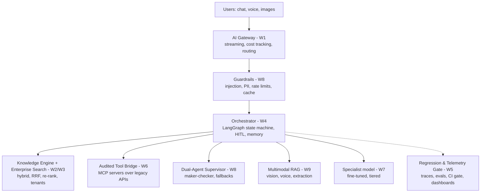
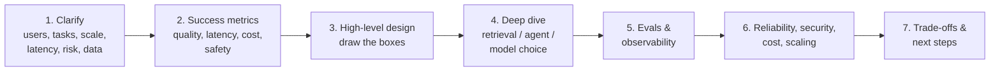

---
mdx:
  format: md
---

# 10 - Capstone Finale, Demo Day & AI Engineering Interviews (Week 10)

> **Note**: Sections marked **(Interview Imp)** are frequently asked in interviews.
>
> **Goal of this week:** put weeks 1-9 together into one production-grade MVP - agents, RAG, evals and an observability dashboard - deploy it, present and defend it, and get ready for AI engineering interviews.
>
> ⬅️ [09 Multimodal AI](09_Multimodal_AI.md) · ➡️ [11 Tools Reference](11_Tools_Reference.md)

## Table of Contents
1. [How It All Fits Together (Interview Imp)](#1-how-it-all-fits-together-interview-imp)
2. [Capstone: The Finale Deploy](#2-capstone-the-finale-deploy)
3. [Defending Design Decisions](#3-defending-design-decisions)
4. [AI System Design Interviews (Interview Imp)](#4-ai-system-design-interviews-interview-imp)
5. [Interview Question Bank (All Weeks)](#5-interview-question-bank-all-weeks)
6. [Demo Day and Portfolio](#6-demo-day-and-portfolio)
7. [Self-Study Plan Without Paying for a Course](#7-self-study-plan-without-paying-for-a-course)
8. [Master Cheat Sheet](#8-master-cheat-sheet)

---

## 1. How It All Fits Together (Interview Imp)

Every weekly build is one layer of the same production system:



**The one-paragraph story (use it in interviews):** requests enter through a gateway that streams responses and records cost; guardrails block injection and redact PII; a LangGraph orchestrator decides the path - answer from hybrid, re-ranked, tenant-filtered retrieval, call tools through audited MCP servers, or hand risky actions to a maker-checker pair and a human; a router sends each call to the cheapest model that passes our evals, with fallbacks when a provider fails; and every step is traced, so a CI eval gate blocks any change that makes quality worse.

---

## 2. Capstone: The Finale Deploy

**Goal:** build and deploy a complete enterprise-grade MVP with agents, evals and an observability dashboard, plus a demo-day architecture presentation.

### 2.1 Minimum bar ("production-grade" for a capstone)

| Area | Must have |
|---|---|
| Problem | One persona, 3-5 core tasks, out-of-scope list |
| Core | RAG with citations **or** a tool-using agent (ideally both) |
| Safety | Input guardrails, PII redaction, approval for any write action |
| Quality | Golden set (30-50 cases) + automated eval with thresholds in CI |
| Observability | Traces (Langfuse/LangSmith/OTel), cost and latency per request, a dashboard |
| Reliability | Timeouts, retries, one fallback provider, graceful error messages |
| Delivery | Dockerised, deployed at a public URL, README with architecture diagram and eval results |

### 2.2 Reference repository layout

```text
capstone/
├── app/
│   ├── api.py              # FastAPI: /chat (SSE), /approve, /usage, /health
│   ├── graph.py            # LangGraph orchestrator (nodes, edges, checkpointer)
│   ├── retrieval.py        # hybrid search, RRF, re-ranker, tenant filter
│   ├── tools/              # MCP servers / tool wrappers with validation + audit
│   ├── guardrails.py       # injection checks, PII redaction, output checks
│   ├── llm.py              # router, fallbacks, circuit breaker, cost tracking
│   └── prompts/            # versioned prompt templates
├── ingest/                 # parsing, chunking, embedding jobs
├── evals/
│   ├── golden.jsonl        # test cases
│   ├── run_evals.py        # scores + compares with baseline, exits 1 on regression
│   └── baseline.json
├── dashboard/streamlit_app.py
├── tests/                  # unit tests for tools, guardrails, retrieval
├── docker-compose.yml      # app + qdrant/pgvector + redis + langfuse
├── .github/workflows/ci.yml
└── README.md               # problem, architecture, eval results, decisions, demo link
```

### 2.3 Deploy

| Option | Good for |
|---|---|
| **Docker Compose on one VM** (AWS EC2/Lightsail, any VPS) | Simplest full stack incl. Qdrant/Redis/Langfuse |
| Render / Railway / Fly.io | Quick managed deploy of the API |
| **AWS**: ECS Fargate or App Runner (API), RDS Postgres + pgvector, ElastiCache Redis, Bedrock (managed models), CloudWatch | "Real" cloud architecture for interviews |
| Hugging Face Spaces / Streamlit Community Cloud | Free public demo UI |

Docker basics for this are in the wiki's [Docker guide](../docker/00_Docker_Index.md); Kubernetes in [Kubernetes guide](../kubernetes/00_Kubernetes_Index.md).

### 2.4 Back-of-envelope estimation (also an interview staple)

```python
def estimate(daily_users, req_per_user, in_tokens, out_tokens, price_in, price_out,
             cache_hit=0.0, small_model_share=0.0, small_price_ratio=0.05):
    reqs = daily_users * req_per_user
    paid = reqs * (1 - cache_hit)
    per_req_big = in_tokens / 1e6 * price_in + out_tokens / 1e6 * price_out
    per_req = per_req_big * ((1 - small_model_share) + small_model_share * small_price_ratio)
    daily = paid * per_req
    peak_rps = reqs / 86400 * 5                       # assume peak = 5x average
    return reqs, daily, daily * 30, peak_rps

scenarios = {
    "naive (frontier for all)":     dict(cache_hit=0.0, small_model_share=0.0),
    "+ semantic cache 20%":         dict(cache_hit=0.2, small_model_share=0.0),
    "+ cache + 70% to small model": dict(cache_hit=0.2, small_model_share=0.7),
}
for name, opts in scenarios.items():
    reqs, daily, monthly, rps = estimate(50_000, 4, 3000, 400, price_in=3.0, price_out=15.0, **opts)
    print(f"{name:30} {reqs:,} req/day  ${daily:8,.0f}/day  ${monthly:9,.0f}/month  peak≈{rps:.0f} req/s")
```

**Output (identical on all 3 runs):**

```text
naive (frontier for all)       200,000 req/day  $   3,000/day  $   90,000/month  peak≈12 req/s
+ semantic cache 20%           200,000 req/day  $   2,400/day  $   72,000/month  peak≈12 req/s
+ cache + 70% to small model   200,000 req/day  $     804/day  $   24,120/month  peak≈12 req/s
```

(Prices are example USD per million tokens; plug in current numbers for the models you choose.)

#### 📘 Terms Explained

| Term | Simple meaning |
|---|---|
| **MVP** | Minimum Viable Product - the smallest version that solves the real problem end to end. |
| **Docker Compose** | Runs several containers (app, DB, cache) together from one file. |
| **Amazon Bedrock** | AWS service that serves models from Anthropic, Meta, Mistral and others behind one API. |
| **Back-of-envelope estimate** | A quick rough calculation of scale and cost to guide design. |

---

## 3. Defending Design Decisions

Interviewers and reviewers care less about *what* you chose than *why*, *what you traded off*, and *how you know it works*. Write a short **Architecture Decision Record (ADR)** for each big choice:

```text
ADR-003: Hybrid search with cross-encoder re-ranking
Context:   Users search with exact error codes AND natural language. Vector-only recall@5 = 0.71.
Options:   (a) vector only  (b) BM25 only  (c) hybrid + RRF  (d) hybrid + RRF + re-ranker
Decision:  (d)
Evidence:  On 120 golden queries: recall@5 0.71 → 0.89 (c) → 0.93 (d); p95 latency +140 ms for (d).
Trade-off: +140 ms and one more model to host, accepted because wrong answers cost support time.
Revisit:   If p95 > 2.5 s or re-ranker cost > 15% of total.
```

**Questions to prepare for every component:** Why this and not the simpler option? What did you measure? What fails, and what happens then? What does it cost per request? How would it change at 100× traffic? What would you do with another month?

---

## 4. AI System Design Interviews (Interview Imp)

### 4.1 A framework (45-60 minutes)



| Step | Say out loud |
|---|---|
| Clarify | Who uses it? Which tasks? How many users/requests? Latency target? What can go wrong (money, privacy, compliance)? Which data, how fresh, who can see what? |
| Metrics | Offline (accuracy, faithfulness, recall@k), online (resolution rate, escalations, CSAT), p95 latency, cost/request |
| Design | Gateway → guardrails → orchestrator → retrieval/tools/models → output checks; ingestion pipeline separately |
| Deep dive | Chunking/hybrid/re-rank choices; workflow vs agent; tool permissions; model tiering |
| Evals | Golden set, judge calibration, CI gate, tracing, feedback loop |
| Reliability & security | Fallbacks, circuit breakers, caching, rate limits, injection defences, PII, tenant isolation, audit |
| Trade-offs | What you'd simplify for v1, what you'd add at scale |

### 4.2 Common prompts to practise

1. Design a customer-support assistant for a bank (RAG + tools + approvals).
2. Design an internal "chat with all company documents" system with per-user permissions.
3. Design a code-review agent for a large monorepo.
4. Design a voice agent for appointment booking with < 1 s latency.
5. Design a document-intake pipeline for loan applications (scans → structured data → human review).
6. Design an evaluation platform for 20 teams shipping LLM features.
7. Design fraud-alert triage where an agent explains each alert and proposes an action.

### 4.3 Other interview rounds

- **Coding:** usually normal DSA + Python; some companies ask you to build a small RAG/agent in 60-90 minutes - practise the weekly builds from scratch without notes.
- **ML/LLM fundamentals:** tokens, embeddings, attention, temperature, fine-tuning vs RAG, LoRA, quantization, evaluation metrics ([Weeks 1](01_Python_and_LLM_Fundamentals.md), [5](05_Evals_and_Observability.md), [7](07_ML_Fundamentals_and_Fine_Tuning.md)).
- **Project deep dive:** your capstone - be ready to whiteboard it and quote your eval numbers.
- **Behavioural:** a time you shipped under ambiguity, handled an incident, disagreed on a design.

---

## 5. Interview Question Bank (All Weeks)

Each weekly file ends with 10 questions and answers. The most-asked ones across the course:

| # | Question | Where answered |
|---|---|---|
| 1 | What is a token? Why does cost depend on tokens? | [W1 §8](01_Python_and_LLM_Fundamentals.md#8-interview-questions) |
| 2 | Explain attention. | [W1 §5.3](01_Python_and_LLM_Fundamentals.md#53-attention---the-core-idea-interview-imp) |
| 3 | Temperature vs top-p? | [W1 §5.4](01_Python_and_LLM_Fundamentals.md#54-sampling---temperature-and-top-p) |
| 4 | What is RAG and when do you use it instead of fine-tuning? | [W2 §2](02_RAG_Foundations.md#2-what-rag-is-and-why-it-works-interview-imp) |
| 5 | How do you choose a chunk size? | [W2 §4](02_RAG_Foundations.md#4-chunking-strategies-interview-imp) |
| 6 | What is HNSW? | [W2 §5](02_RAG_Foundations.md#5-vector-databases-and-indexing-interview-imp) |
| 7 | Why hybrid search? What is RRF? | [W3 §1-2](03_Enterprise_RAG.md#1-hybrid-search-semantic--keyword-interview-imp) |
| 8 | Bi-encoder vs cross-encoder? | [W3 §3](03_Enterprise_RAG.md#3-cross-encoder-re-ranking-interview-imp) |
| 9 | Workflow vs agent? | [W4 §1](04_Agents_and_State_Machines.md#1-llm-vs-workflow-vs-agent-vs-multi-agent-interview-imp) |
| 10 | How does tool calling work? Who executes the tool? | [W4 §2](04_Agents_and_State_Machines.md#2-tool-calling---how-it-really-works-interview-imp) |
| 11 | How do you add human approval to an agent? | [W4 §6.3](04_Agents_and_State_Machines.md#63-human-in-the-loop-with-interrupt-interview-imp) |
| 12 | How do you evaluate an LLM app? RAGAS metrics? | [W5 §1, §6](05_Evals_and_Observability.md#6-evaluating-rag-pipelines-interview-imp) |
| 13 | LLM-as-a-judge biases? | [W5 §5](05_Evals_and_Observability.md#5-llm-as-a-judge-interview-imp) |
| 14 | What is MCP? Tools vs resources vs prompts? | [W6 §1](06_MCP_Context_Engineering_Multi_Agent.md#1-mcp---the-model-context-protocol-interview-imp) |
| 15 | What is context engineering? | [W6 §2](06_MCP_Context_Engineering_Multi_Agent.md#2-context-engineering-interview-imp) |
| 16 | Explain LoRA / QLoRA. | [W7 §3](07_ML_Fundamentals_and_Fine_Tuning.md#3-lora-and-qlora-interview-imp) |
| 17 | Fine-tuning vs prompting vs RAG? | [W7 §2](07_ML_Fundamentals_and_Fine_Tuning.md#2-fine-tuning-vs-prompting-vs-rag-interview-imp) |
| 18 | How do you defend against prompt injection? | [W8 §4](08_Agentic_System_Design_and_Reliability.md#4-ai-security-prompt-injection-and-pii-interview-imp) |
| 19 | How do you survive provider outages? | [W8 §5](08_Agentic_System_Design_and_Reliability.md#5-fallbacks-circuit-breakers-semantic-caching-rate-limiting-interview-imp) |
| 20 | How do multimodal models see images? Multimodal RAG? | [W9 §1, §6](09_Multimodal_AI.md#6-multimodal-rag-interview-imp) |

**Rapid-fire extras**
- *What is hallucination and how do you reduce it?* Grounding (RAG), citations, "I don't know" instructions, score thresholds, faithfulness evals, lower temperature, smaller focused context.
- *What is the context window and what happens when you exceed it?* The max tokens per call; the API errors or truncates - manage it with summarisation, retrieval and sub-agents.
- *How do you version prompts?* As files/templates in Git or a prompt registry (Langfuse), with the version recorded in every trace and eval run.
- *Streaming - why?* Lower perceived latency (time to first token) and the ability to stop early.
- *What is structured output?* Constraining the model to a JSON schema (provider feature or validation + retry).
- *What is model drift for LLM apps?* The provider updates a model or your data changes; pin model versions and re-run evals on every change.

---

## 6. Demo Day and Portfolio

**10-minute presentation outline**
1. **Problem** (1 min) - who suffers, how much (time/money).
2. **Live demo** (3 min) - the happy path, then one failure handled well (injection blocked, approval requested, fallback).
3. **Architecture** (2 min) - one diagram; name each component and why.
4. **Evidence** (2 min) - eval table (before/after), cost per request, p95 latency, a trace screenshot.
5. **Trade-offs and next steps** (2 min) - what you'd change at 100× scale.

**Portfolio checklist:** public repo with a README that has the architecture diagram, eval results and decisions (ADRs); a live demo URL or a 2-minute video; a short write-up/blog post; add it to LinkedIn **Featured** and your résumé with numbers ("hybrid retrieval raised recall@5 from 0.71 to 0.93").

---

## 7. Self-Study Plan Without Paying for a Course

| Week | Read in this wiki | Free primary sources | Build |
|---|---|---|---|
| 1 | [01](01_Python_and_LLM_Fundamentals.md) | Python docs (asyncio), Pydantic docs, Karpathy "Let's build GPT" / "Intro to LLMs" videos, 3Blue1Brown transformer videos | AI Gateway |
| 2 | [02](02_RAG_Foundations.md) | Qdrant & pgvector docs, LangChain RAG tutorial | Knowledge Engine |
| 3 | [03](03_Enterprise_RAG.md) | Elasticsearch/Qdrant hybrid search docs, Sentence-Transformers cross-encoder docs, Microsoft GraphRAG docs | Enterprise Search |
| 4 | [04](04_Agents_and_State_Machines.md) | Anthropic "Building effective agents", LangGraph docs & free LangChain Academy course | Persistent Operator |
| 5 | [05](05_Evals_and_Observability.md) | Langfuse docs, RAGAS docs, DeepEval docs, Hamel Husain's eval articles | Regression Gate |
| 6 | [06](06_MCP_Context_Engineering_Multi_Agent.md) | modelcontextprotocol.io (spec + Python SDK), Anthropic context-engineering posts, CrewAI docs | Audited Tool Bridge |
| 7 | [07](07_ML_Fundamentals_and_Fine_Tuning.md) | Unsloth notebooks (free Colab), Hugging Face LLM course, LoRA & QLoRA papers | Specialist Model |
| 8 | [08](08_Agentic_System_Design_and_Reliability.md) | OWASP Top 10 for LLM Apps, Simon Willison on prompt injection, LiteLLM docs | Dual-Agent Supervisor |
| 9 | [09](09_Multimodal_AI.md) | OpenAI Whisper repo, CLIP & LLaVA papers, Pipecat/LiveKit docs, ColPali paper | Multimodal RAG Engine |
| 10 | this file | Chip Huyen's *AI Engineering* (book), Eugene Yan's "Patterns for LLM systems" | Capstone + demo |

**Time:** ~8-10 hours/week (2 weekend sessions like the paid cohort + 2-3 short weekday sessions). **Accountability substitute:** post each weekly build on GitHub and LinkedIn - public deadlines work.

---

## 8. Master Cheat Sheet

| Layer | Default stack | Key numbers |
|---|---|---|
| API | FastAPI + SSE streaming, OpenAI-compatible clients (OpenRouter / Ollama) | TTFT < 1 s chat |
| Retrieval | Docling parse → structure-aware chunks (300-800 tok) → hybrid (BM25 + dense) → RRF → cross-encoder → top 3-8 | recall@5 ≥ 0.85 target |
| Store | pgvector or Qdrant (HNSW, cosine), tenant pre-filter | - |
| Agents | LangGraph state machine, tools via MCP, `interrupt` for approvals, Redis memory | max steps, cost budget |
| Evals | Golden set in Git, code checks + calibrated judge, RAGAS, CI gate | kappa > 0.6 |
| Observability | Langfuse / LangSmith / OTel GenAI attributes | p50/p95/p99, $/request |
| Fine-tuning | QLoRA (Unsloth/PEFT), r=16, lr 2e-4, 1-3 epochs, GGUF q4 for serving | - |
| Reliability | timeouts, backoff+jitter, circuit breaker, fallback chain, semantic cache, token bucket | - |
| Security | least privilege, approvals, delimit untrusted text, classifiers, PII redaction, audit | OWASP LLM Top 10 |
| Multimodal | VLM + schema extraction, Whisper + VAD, ColPali for visual PDFs | < 1 s voice turn |

⬅️ [09 Multimodal AI](09_Multimodal_AI.md) · ➡️ [11 Tools Reference](11_Tools_Reference.md)
