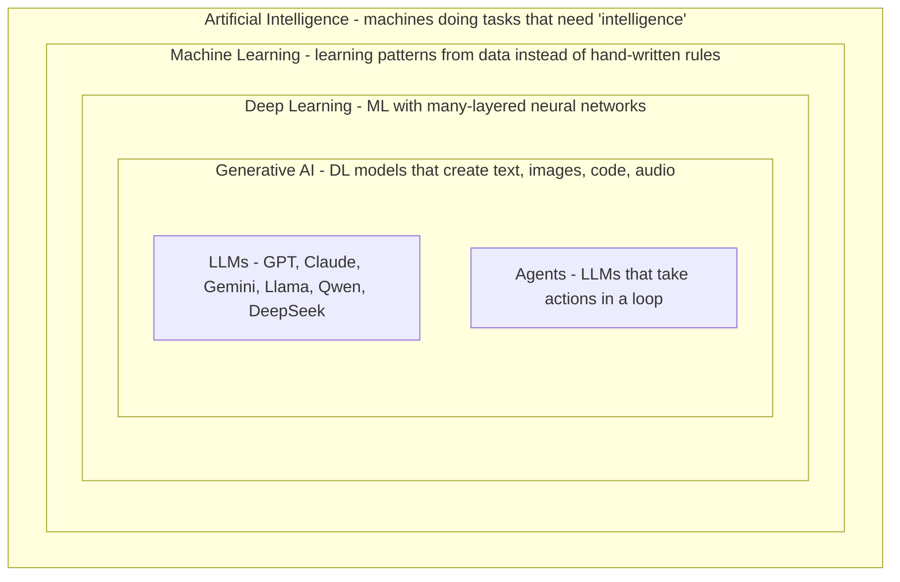
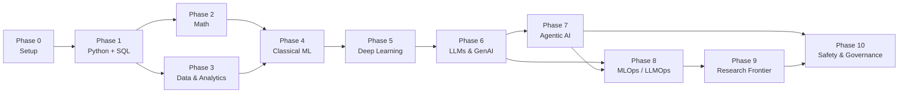
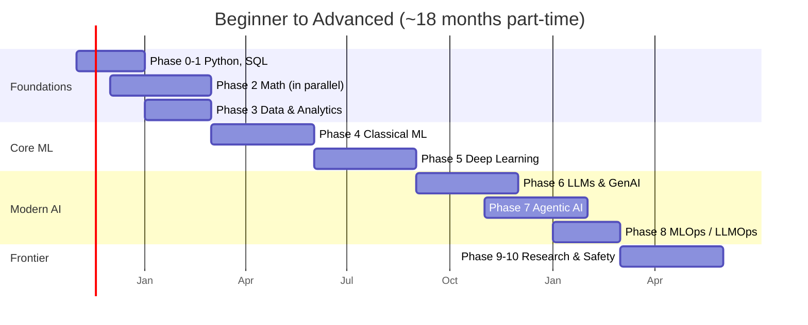
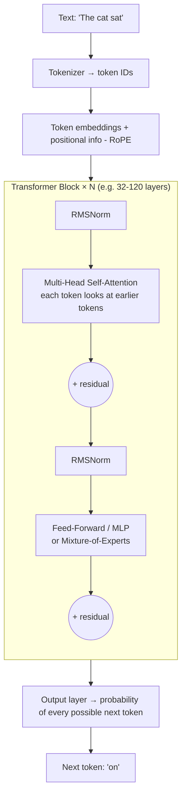
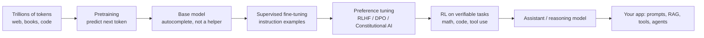
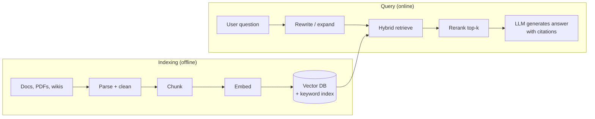
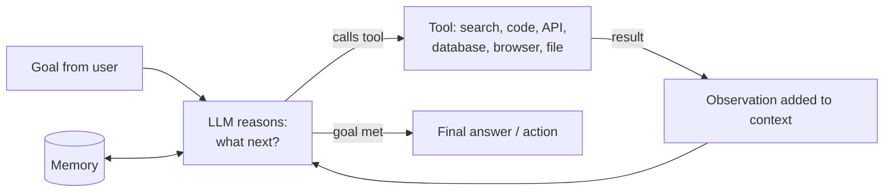
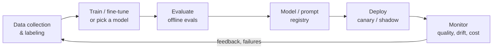
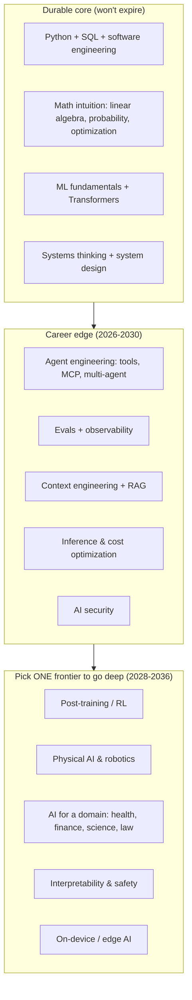

# AI / ML Roadmap - Beginner to Advanced (2026 → 2036)

> **Note**: Topics marked **⭐ Must-Know** are the core of the field: skip them and everything later gets harder. Topics marked **🔥 Hot (2025-26)** are what the industry is hiring for right now. Topics marked **🔮 Future (2027-36)** are bets on where the field is going.
>
> **How to read this file:** The roadmap goes in order. Each phase lists **what to learn**, **what to build**, and **how you know you're done**. Every phase ends with a **📘 Terms Explained** table. Use the `- [ ]` checkboxes to track progress (they're clickable in Obsidian).
>
> **Last updated:** October 2026. AI moves fast, so model names and tool versions will age. The concepts won't.

---

## Table of Contents
1. [The Big Picture](#1-the-big-picture)
   - [1.1 What AI, ML, DL and GenAI Actually Mean](#11-what-ai-ml-dl-and-genai-actually-mean)
   - [1.2 The Full Roadmap at a Glance](#12-the-full-roadmap-at-a-glance)
   - [1.3 Career Tracks - Pick Your Destination](#13-career-tracks---pick-your-destination)
   - [1.4 Time Plan](#14-time-plan)
2. [Phase 0 - Setup and Mindset](#2-phase-0---setup-and-mindset)
3. [Phase 1 - Programming Foundations](#3-phase-1---programming-foundations)
   - [3.1 Python](#31-python)
   - [3.2 Python Data Stack](#32-python-data-stack)
   - [3.3 SQL](#33-sql)
   - [3.4 Engineering Basics](#34-engineering-basics)
   - [3.5 AI for Java Developers](#35-ai-for-java-developers)
4. [Phase 2 - Math for ML](#4-phase-2---math-for-ml)
   - [4.1 Linear Algebra](#41-linear-algebra)
   - [4.2 Calculus](#42-calculus)
   - [4.3 Probability and Statistics](#43-probability-and-statistics)
   - [4.4 Optimization](#44-optimization)
5. [Phase 3 - Data and Analytics](#5-phase-3---data-and-analytics)
   - [5.1 Exploratory Data Analysis](#51-exploratory-data-analysis)
   - [5.2 Visualization and Storytelling](#52-visualization-and-storytelling)
   - [5.3 Statistics for Business Decisions](#53-statistics-for-business-decisions)
   - [5.4 BI and Analytics Tools](#54-bi-and-analytics-tools)
   - [5.5 Data Engineering for AI](#55-data-engineering-for-ai)
   - [5.6 AI-Powered Analytics](#56-ai-powered-analytics)
6. [Phase 4 - Classical Machine Learning](#6-phase-4---classical-machine-learning)
   - [6.1 Core Concepts](#61-core-concepts)
   - [6.2 Supervised Learning](#62-supervised-learning)
   - [6.3 Unsupervised Learning](#63-unsupervised-learning)
   - [6.4 Model Evaluation](#64-model-evaluation)
   - [6.5 Feature Engineering](#65-feature-engineering)
   - [6.6 Specialized ML Areas](#66-specialized-ml-areas)
7. [Phase 5 - Deep Learning](#7-phase-5---deep-learning)
   - [7.1 Neural Network Fundamentals](#71-neural-network-fundamentals)
   - [7.2 PyTorch](#72-pytorch)
   - [7.3 Architectures](#73-architectures)
   - [7.4 The Transformer](#74-the-transformer)
   - [7.5 Training at Scale](#75-training-at-scale)
8. [Phase 6 - LLMs and Generative AI](#8-phase-6---llms-and-generative-ai)
   - [8.1 How LLMs Work](#81-how-llms-work)
   - [8.2 Prompt and Context Engineering](#82-prompt-and-context-engineering)
   - [8.3 Embeddings and Vector Search](#83-embeddings-and-vector-search)
   - [8.4 RAG - Retrieval-Augmented Generation](#84-rag---retrieval-augmented-generation)
   - [8.5 Fine-Tuning](#85-fine-tuning)
   - [8.6 Alignment and Post-Training](#86-alignment-and-post-training)
   - [8.7 Multimodal and Diffusion Models](#87-multimodal-and-diffusion-models)
   - [8.8 Evaluating LLM Systems](#88-evaluating-llm-systems)
9. [Phase 7 - Agentic AI](#9-phase-7---agentic-ai)
   - [9.1 What Makes Something an Agent](#91-what-makes-something-an-agent)
   - [9.2 Tool Use and Function Calling](#92-tool-use-and-function-calling)
   - [9.3 Agent Design Patterns](#93-agent-design-patterns)
   - [9.4 Memory](#94-memory)
   - [9.5 Multi-Agent Systems](#95-multi-agent-systems)
   - [9.6 Protocols - MCP and A2A](#96-protocols---mcp-and-a2a)
   - [9.7 Frameworks and SDKs](#97-frameworks-and-sdks)
   - [9.8 Coding Agents and Computer Use](#98-coding-agents-and-computer-use)
   - [9.9 Agent Evaluation, Guardrails and AgentOps](#99-agent-evaluation-guardrails-and-agentops)
10. [Phase 8 - MLOps and LLMOps](#10-phase-8---mlops-and-llmops)
    - [10.1 The ML Lifecycle](#101-the-ml-lifecycle)
    - [10.2 Model Serving and Inference](#102-model-serving-and-inference)
    - [10.3 Making Models Smaller and Faster](#103-making-models-smaller-and-faster)
    - [10.4 Monitoring and Observability](#104-monitoring-and-observability)
    - [10.5 Cost Engineering](#105-cost-engineering)
11. [Phase 9 - Advanced and Research Frontier](#11-phase-9---advanced-and-research-frontier)
    - [11.1 Reasoning Models and Test-Time Compute](#111-reasoning-models-and-test-time-compute)
    - [11.2 Reinforcement Learning for LLMs](#112-reinforcement-learning-for-llms)
    - [11.3 Efficient Architectures](#113-efficient-architectures)
    - [11.4 Interpretability](#114-interpretability)
    - [11.5 Synthetic Data and Distillation](#115-synthetic-data-and-distillation)
    - [11.6 Reading Research Papers](#116-reading-research-papers)
12. [Phase 10 - Safety, Security and Governance](#12-phase-10---safety-security-and-governance)
    - [12.1 AI Security](#121-ai-security)
    - [12.2 Responsible AI](#122-responsible-ai)
    - [12.3 Regulation and Standards](#123-regulation-and-standards)
13. [Current Trends (2025-2026)](#13-current-trends-2025-2026)
14. [The Next 5-10 Years (2027-2036)](#14-the-next-5-10-years-2027-2036)
    - [14.1 High-Confidence Shifts](#141-high-confidence-shifts)
    - [14.2 Big Bets](#142-big-bets)
    - [14.3 What to Focus On](#143-what-to-focus-on)
    - [14.4 Skills That Won't Expire](#144-skills-that-wont-expire)
15. [Project Ladder](#15-project-ladder)
16. [Resources](#16-resources)
17. [Interview Prep](#17-interview-prep)
18. [Cheat Sheet](#18-cheat-sheet)

---

# 1. The Big Picture

## 1.1 What AI, ML, DL and GenAI Actually Mean

These words get used interchangeably, but they are nested circles:



**Real-life analogy:** Teaching a child to recognize cats.
- **Rule-based AI:** You write rules: "4 legs, whiskers, pointy ears = cat". Breaks the moment a cat has 3 legs.
- **Machine Learning:** You show 10,000 labeled photos. The child figures out the rules alone.
- **Deep Learning:** Same, but the child can learn *very* subtle patterns (fur texture, eye shape) without being told what to look for.
- **Generative AI:** The child can now *draw* a new cat that never existed.
- **Agentic AI:** The child can go adopt a cat: search shelters, compare options, fill the form, book a visit.

## 1.2 The Full Roadmap at a Glance



| Level | Phases | You can... |
|---|---|---|
| **Beginner** | 0 - 3 | Write Python, query data with SQL, analyze a dataset and explain it with charts |
| **Intermediate** | 4 - 5 | Train, evaluate and tune ML and deep learning models; understand how a Transformer works |
| **Advanced** | 6 - 8 | Build production LLM apps, RAG systems and agents; deploy, monitor and cost-optimize them |
| **Expert** | 9 - 10 | Read and implement papers, post-train models with RL, design safe, governed AI systems |

> **Shortcut for application builders:** If you want to *build with* AI (AI Engineer) rather than *build* models (ML Engineer / Researcher), you can do Phase 1 → 3 lightly → Phase 6 → 7 → 8, and come back to Phases 2, 4, 5 later. Many working AI engineers did exactly this. You'll hit a ceiling eventually without the fundamentals, but you'll be productive fast.

## 1.3 Career Tracks - Pick Your Destination

| Role | What they do | Phases to go deep on | Hot in 2026? |
|---|---|---|---|
| **Data Analyst** | Answer business questions with data, dashboards, reports | 1, 3 | Steady; AI tools are changing *how* the job is done |
| **Data Scientist** | Statistics, experiments, predictive models | 1, 2, 3, 4 | Steady |
| **ML Engineer** | Train, ship and maintain models in production | 1, 2, 4, 5, 8 | High |
| **AI Engineer** 🔥 | Build products on top of foundation models: RAG, agents, evals | 1, 6, 7, 8 | Very high |
| **Agent Engineer / Applied AI** 🔥 | Design autonomous multi-step systems, tool integrations, MCP servers | 1, 6, 7, 8, 10 | Very high |
| **MLOps / LLMOps / AI Platform** | Infrastructure for training, serving, monitoring | 1, 8 | High |
| **Research Engineer / Scientist** | New architectures, training methods, papers | All, especially 2, 5, 9 | High, but very competitive |
| **AI Safety / Security Engineer** 🔮 | Red teaming, alignment, guardrails, governance | 6, 7, 9, 10 | Growing fast |

## 1.4 Time Plan

Assuming **10-15 hours/week**. Halve the time if full-time.



**Rule of thumb:** 30% reading/watching, 70% building. If you've watched three videos in a row without writing code, stop and build something.

#### 📘 Terms Explained

| Term | Simple meaning |
|---|---|
| **AI (Artificial Intelligence)** | Any technique that makes a computer do something we'd call "smart". |
| **ML (Machine Learning)** | The computer learns patterns from examples instead of following rules a human wrote. |
| **DL (Deep Learning)** | ML using neural networks with many layers. Powers vision, speech and language models. |
| **GenAI (Generative AI)** | Models that *produce* new content: text, images, code, audio, video. |
| **LLM (Large Language Model)** | A huge neural network trained on text to predict the next word. GPT, Claude, Gemini, Llama are LLMs. |
| **Agent** | An LLM placed in a loop where it can use tools (search, code, APIs) and decide its next step until a goal is done. |
| **Foundation model** | A large general-purpose model trained once on broad data, then adapted for many tasks. |

---

# 2. Phase 0 - Setup and Mindset

**Goal:** A working environment and the right learning habits. **Time:** 1 week.

- [ ] Install **Python 3.12+** with **uv** (fast package/env manager) or conda
- [ ] Editor: **VS Code** or **Cursor**/**PyCharm** with Jupyter support
- [ ] **Jupyter Notebooks** for experiments; `.py` files for anything you'll reuse
- [ ] **Git + GitHub** account. Every project goes in a repo
- [ ] Free GPU access: **Google Colab**, **Kaggle Notebooks** (30 GPU hrs/week), later **Lightning AI**, **Modal**, **RunPod** for paid
- [ ] API keys for at least one frontier model provider (Anthropic, OpenAI, Google) + **Hugging Face** account
- [ ] Install **Ollama** or **LM Studio** to run small open models locally
- [ ] Use an AI coding assistant (Claude Code, Copilot, Cursor) from day one, but **type the code yourself first** while learning fundamentals

**Mindset rules:**
1. **Build in public.** A GitHub repo + short write-up per project beats any certificate.
2. **Learn just-in-time, not just-in-case.** Learn the math when a model needs it, not 6 months ahead.
3. **Reimplement things from scratch once.** Linear regression, backprop, attention, a tiny agent loop. Then use the library.
4. **Follow the field weekly, not hourly.** Pick 2-3 newsletters (see [Resources](#16-resources)). Ignore hype threads.

#### 📘 Terms Explained

| Term | Simple meaning |
|---|---|
| **Jupyter Notebook** | A document mixing code cells, output and notes. Great for exploring data step by step. |
| **GPU** | Graphics card. Does thousands of math operations in parallel, which is exactly what neural networks need. |
| **Hugging Face** | The "GitHub of AI": hosts open models, datasets and demo apps. |
| **Ollama** | A tool that downloads and runs open LLMs on your laptop with one command. |
| **API key** | A secret password that lets your code call a paid AI service. Never commit it to Git. |

---

# 3. Phase 1 - Programming Foundations

**Goal:** Write clean Python, manipulate data, query databases. **Time:** 6-8 weeks.

## 3.1 Python

⭐ **Must-Know**
- [ ] Variables, types, control flow, functions
- [ ] Lists, dicts, sets, tuples; comprehensions
- [ ] OOP: classes, inheritance, dataclasses
- [ ] Error handling, file I/O, `pathlib`, JSON
- [ ] Virtual environments, `pip`/`uv`, `pyproject.toml`
- [ ] Type hints + **Pydantic** (used everywhere in AI for structured data)
- [ ] `async`/`await` (LLM apps are I/O-bound; async matters)
- [ ] Generators, decorators, context managers
- [ ] Writing tests with `pytest`

## 3.2 Python Data Stack

| Library | Purpose | Priority |
|---|---|---|
| **NumPy** | Fast arrays and math. Everything else is built on it | ⭐ |
| **Pandas** | Tables (DataFrames): load, clean, group, join | ⭐ |
| **Polars** | Faster modern alternative to Pandas | 🔥 |
| **Matplotlib / Seaborn** | Static charts | ⭐ |
| **Plotly** | Interactive charts | Good to have |
| **scikit-learn** | Classical ML (Phase 4) | ⭐ |
| **requests / httpx** | Calling APIs | ⭐ |
| **FastAPI** | Turning your model into a web API | ⭐ |
| **Streamlit / Gradio** | Quick UI demos for models | Good to have |

## 3.3 SQL

⭐ Most real-world data lives in databases. SQL is non-negotiable for analytics *and* AI.

- [ ] `SELECT`, `WHERE`, `ORDER BY`, `LIMIT`
- [ ] `GROUP BY`, aggregates, `HAVING`
- [ ] `JOIN`s (inner, left, self)
- [ ] Subqueries and **CTEs** (`WITH`)
- [ ] **Window functions** (`ROW_NUMBER`, `LAG`, running totals). Asked in every analytics interview
- [ ] Indexes and query plans (basics)
- [ ] Practice: **DuckDB** locally on CSV/Parquet files; **PostgreSQL** (+ `pgvector` later for AI)

## 3.4 Engineering Basics

- [ ] Linux command line, shell scripting basics
- [ ] Git: branches, PRs, resolving conflicts
- [ ] **Docker**: build and run a container
- [ ] REST APIs and JSON
- [ ] One cloud basics: AWS, GCP or Azure (storage, compute, IAM)

## 3.5 AI for Java Developers

You don't have to abandon Java. Python is where models are *trained*, but production AI apps are increasingly built in any language.

| Tool | What it does |
|---|---|
| **Spring AI** | Spring-native abstraction over LLMs, embeddings, vector stores, tool calling and MCP |
| **LangChain4j** | Java port of LangChain ideas: chains, RAG, agents, many integrations |
| **DJL (Deep Java Library)** | Run PyTorch/ONNX models inside the JVM |
| **ONNX Runtime (Java)** | Run exported models fast in Java services |
| **Official SDKs** | Anthropic, OpenAI and Google all ship Java SDKs |
| **MCP Java SDK** | Build MCP servers/clients in Java (Spring AI integrates it) |

**Strategy:** Learn Python for Phases 2-5 and 9 (training, research). Use Java + Spring AI for Phases 6-8 if your company runs on the JVM: that's a strong niche, since most AI engineers only know Python.

#### 📘 Terms Explained

| Term | Simple meaning |
|---|---|
| **DataFrame** | A table in memory, like an Excel sheet you control with code. |
| **Pydantic** | Python library that validates data against a schema. LLM apps use it to force structured output. |
| **CTE (Common Table Expression)** | A named temporary result in SQL (`WITH x AS (...)`) that makes complex queries readable. |
| **Window function** | SQL that computes across related rows without collapsing them (e.g. rank within each department). |
| **Parquet** | A compressed, column-based file format. The standard for analytics data. |
| **Docker** | Packages an app with everything it needs so it runs the same on any machine. |
| **ONNX** | An open file format for trained models so they can run outside the framework they were built in. |

---

# 4. Phase 2 - Math for ML

**Goal:** Understand *why* models work, not just how to call them. **Time:** 8-12 weeks (run in parallel with Phases 1 and 3).

> You need **intuition + the ability to read the notation**, not the ability to prove theorems. 3Blue1Brown videos + implementing things in NumPy is the fastest path.

## 4.1 Linear Algebra

- [ ] Vectors, matrices, tensors ⭐
- [ ] Dot product (= similarity; this is how embeddings and attention work) ⭐
- [ ] Matrix multiplication (= what a neural network layer *is*) ⭐
- [ ] Transpose, inverse, identity
- [ ] Norms (L1, L2), distance, cosine similarity ⭐
- [ ] Eigenvalues/eigenvectors, **SVD** (PCA, LoRA, compression rely on it)
- [ ] Broadcasting in NumPy/PyTorch

## 4.2 Calculus

- [ ] Derivatives and what a slope means ⭐
- [ ] Partial derivatives and the **gradient** ⭐
- [ ] **Chain rule** (= backpropagation) ⭐
- [ ] Jacobians (light)

## 4.3 Probability and Statistics

- [ ] Random variables, distributions (normal, Bernoulli, binomial, Poisson, uniform) ⭐
- [ ] Mean, variance, standard deviation, percentiles ⭐
- [ ] Conditional probability and **Bayes' theorem** ⭐
- [ ] Expectation, independence, correlation vs causation ⭐
- [ ] Maximum likelihood estimation (why loss functions look the way they do)
- [ ] Hypothesis testing, p-values, confidence intervals (Phase 3 uses these)
- [ ] Entropy, cross-entropy, KL divergence (LLM training loss, distillation, RLHF all use these) ⭐

## 4.4 Optimization

- [ ] **Gradient descent** and learning rate ⭐
- [ ] Stochastic / mini-batch gradient descent ⭐
- [ ] Momentum, **Adam/AdamW** ⭐
- [ ] Convex vs non-convex, local minima, saddle points
- [ ] Regularization as constraints (L1/L2)

**Done when:** You can implement linear regression with gradient descent in pure NumPy and explain each line.

#### 📘 Terms Explained

| Term | Simple meaning |
|---|---|
| **Vector** | A list of numbers. An embedding of a word is a vector of ~1,000+ numbers. |
| **Tensor** | A multi-dimensional array (vector = 1D, matrix = 2D, a batch of images = 4D). |
| **Gradient** | The direction that increases a function fastest. Training goes the *opposite* way to reduce error. |
| **Chain rule** | How to differentiate nested functions. Backprop applies it layer by layer. |
| **Cross-entropy** | Measures how surprised the model is by the right answer. Lower = better predictions. |
| **KL divergence** | How different two probability distributions are. Used to keep a fine-tuned model close to the original. |
| **Learning rate** | How big each training step is. Too big = overshoot; too small = takes forever. |

---

# 5. Phase 3 - Data and Analytics

**Goal:** Turn raw data into decisions. This is valuable alone (Data Analyst) and is the base of every ML project. **Time:** 6-8 weeks.

## 5.1 Exploratory Data Analysis

- [ ] Load, inspect, profile data (`df.info()`, `describe()`, nulls, dtypes) ⭐
- [ ] Cleaning: missing values, duplicates, outliers, wrong types ⭐
- [ ] Univariate, bivariate, multivariate analysis
- [ ] Correlation matrices, distributions, segmentation
- [ ] Data quality checks (Great Expectations, Pandera)

## 5.2 Visualization and Storytelling

- [ ] Choosing the right chart (bar vs line vs scatter vs histogram) ⭐
- [ ] Avoiding misleading charts (truncated axes, too many colors)
- [ ] Dashboards: KPIs, trends, drill-downs
- [ ] **Storytelling:** context → insight → recommendation. The skill that gets analysts promoted

## 5.3 Statistics for Business Decisions

- [ ] **A/B testing**: hypothesis, sample size, power, significance ⭐
- [ ] Common traps: peeking, multiple comparisons, Simpson's paradox
- [ ] Cohort and retention analysis, funnels ⭐
- [ ] Causal inference basics: confounders, difference-in-differences, uplift
- [ ] Forecasting basics (trend, seasonality)

## 5.4 BI and Analytics Tools

| Tool | Use |
|---|---|
| **Excel / Google Sheets** | Still everywhere. Pivot tables, lookups |
| **Power BI / Tableau / Looker** | Enterprise dashboards |
| **Metabase / Superset** | Open-source BI |
| **dbt** | SQL-based data transformation with tests and version control (analytics engineering) 🔥 |
| **Snowflake / BigQuery / Databricks** | Cloud data warehouses / lakehouses |

## 5.5 Data Engineering for AI

Models are only as good as their data pipelines.

- [ ] ETL vs ELT; batch vs streaming
- [ ] Data warehouse vs data lake vs **lakehouse** (Delta Lake, Apache Iceberg) 🔥
- [ ] Orchestration: **Airflow**, **Dagster**, **Prefect**
- [ ] **Spark** / PySpark for big data
- [ ] Streaming: **Kafka**, Flink
- [ ] Unstructured data pipelines for AI: PDF/HTML parsing, chunking, OCR (Docling, Unstructured) 🔥
- [ ] Data versioning and lineage

## 5.6 AI-Powered Analytics

🔥 The analytics job is changing in 2025-26: natural language replaces part of the SQL-and-dashboard work.

- [ ] **Text-to-SQL**: LLMs writing queries from questions. Learn its failure modes (wrong joins, made-up columns)
- [ ] **Semantic layers** (dbt Semantic Layer, Cube, LookML): define metrics once so AI and humans compute "revenue" the same way 🔥
- [ ] AI features inside BI tools (Copilot in Power BI, Gemini in Looker, Snowflake Cortex, Databricks Genie)
- [ ] **Analytics agents**: agents that query, chart and summarize on their own (Phase 7)
- [ ] Your edge as an analyst: knowing *which question to ask* and *whether the answer is right*. AI can't own that

**Done when:** You can take a messy public dataset, clean it, find 3 non-obvious insights, back them with stats, and present them in a dashboard + 1-page memo.

#### 📘 Terms Explained

| Term | Simple meaning |
|---|---|
| **EDA (Exploratory Data Analysis)** | Poking at data with stats and charts before modeling, to understand what's in it. |
| **A/B test** | Show version A to some users and B to others; measure which performs better, with statistics to rule out luck. |
| **p-value** | Probability of seeing a result this extreme if there were actually no effect. Small = probably real. |
| **Cohort** | A group of users who share a start point (e.g. signed up in March). Used to track retention over time. |
| **ETL / ELT** | Extract-Transform-Load: move data from sources into a warehouse. ELT transforms *after* loading. |
| **Lakehouse** | Combines cheap data-lake storage with warehouse features (tables, transactions, SQL). |
| **Semantic layer** | A single shared definition of business metrics that every tool (and AI) reads from. |
| **Text-to-SQL** | Asking a question in English and having an LLM write the SQL query. |

---

# 6. Phase 4 - Classical Machine Learning

**Goal:** Train, evaluate and tune models on tabular data. **Time:** 10-12 weeks.

> Classical ML is **not obsolete**. For tabular business data (fraud, churn, pricing, credit risk), gradient-boosted trees still often beat deep learning and LLMs, and are far cheaper.

## 6.1 Core Concepts

- [ ] Supervised vs unsupervised vs reinforcement learning ⭐
- [ ] Train / validation / test split ⭐
- [ ] **Bias-variance tradeoff**, overfitting vs underfitting ⭐
- [ ] Loss functions (MSE, cross-entropy, hinge)
- [ ] **Cross-validation** ⭐
- [ ] Regularization (L1/Lasso, L2/Ridge, early stopping)
- [ ] **Data leakage** (the #1 silent killer of ML projects) ⭐

## 6.2 Supervised Learning

| Algorithm | Type | Learn it for |
|---|---|---|
| **Linear Regression** ⭐ | Regression | The baseline for everything |
| **Logistic Regression** ⭐ | Classification | Baseline classifier, interpretable |
| **k-Nearest Neighbors** | Both | Intuition for distance-based learning |
| **Naive Bayes** | Classification | Text classification, probability intuition |
| **Decision Trees** ⭐ | Both | Foundation of ensembles |
| **Random Forest** ⭐ | Both | Strong default, robust |
| **Gradient Boosting: XGBoost, LightGBM, CatBoost** ⭐ | Both | **Wins most tabular problems** |
| **Support Vector Machines** | Both | Margin intuition, kernels |

## 6.3 Unsupervised Learning

- [ ] **K-Means**, hierarchical clustering, DBSCAN ⭐
- [ ] **PCA** for dimensionality reduction ⭐
- [ ] t-SNE / UMAP for visualizing high-dimensional data (and embeddings!)
- [ ] Anomaly detection (Isolation Forest)

## 6.4 Model Evaluation

| Task | Metrics |
|---|---|
| **Classification** | Accuracy, **Precision, Recall, F1** ⭐, **ROC-AUC**, PR-AUC, confusion matrix ⭐ |
| **Regression** | MAE, RMSE, R², MAPE |
| **Ranking / Recsys** | Precision@k, Recall@k, NDCG, MRR |
| **Business** | The metric that actually matters: money saved, fraud caught, churn reduced |

- [ ] Class imbalance: resampling, class weights, threshold tuning ⭐
- [ ] Hyperparameter tuning: grid, random, **Optuna** (Bayesian)
- [ ] Model explainability: **SHAP**, feature importance, partial dependence

## 6.5 Feature Engineering

- [ ] Encoding categoricals (one-hot, target encoding) ⭐
- [ ] Scaling (standardization, normalization)
- [ ] Date/time features, aggregations, lags
- [ ] Text features: TF-IDF (still a great baseline)
- [ ] **scikit-learn Pipelines** to avoid leakage ⭐
- [ ] Feature stores (Feast) for production

## 6.6 Specialized ML Areas

- [ ] **Time series forecasting**: ARIMA, Prophet, gradient boosting with lags; foundation models for time series (TimesFM, Chronos) 🔥
- [ ] **Recommender systems**: collaborative filtering, matrix factorization, two-tower models
- [ ] **Reinforcement learning basics**: MDPs, Q-learning, policy gradients (needed for Phase 9: RLHF and reasoning models are RL) ⭐
- [ ] **Graph ML** basics (fraud networks, knowledge graphs)

**Done when:** You've done 2-3 Kaggle competitions (finish top 30%+ in one), and can explain why your model works and where it fails.

#### 📘 Terms Explained

| Term | Simple meaning |
|---|---|
| **Overfitting** | The model memorized the training data, including its noise, and fails on new data. |
| **Bias-variance tradeoff** | Simple models miss patterns (bias); complex models chase noise (variance). Find the balance. |
| **Cross-validation** | Split data into k parts; train on k-1 and test on the remaining one, rotating. Gives a reliable score. |
| **Data leakage** | Information from the test set (or the future) sneaks into training. Scores look amazing, production fails. |
| **Gradient boosting** | Builds many small trees one after another, each fixing the previous ones' mistakes. |
| **Precision / Recall** | Precision: of the ones I flagged, how many were right? Recall: of all the real ones, how many did I catch? |
| **SHAP** | Explains each prediction by showing how much each feature pushed it up or down. |
| **Reinforcement learning (RL)** | Learning by trial and error from rewards, like training a dog with treats. |

---

# 7. Phase 5 - Deep Learning

**Goal:** Build and train neural networks; understand the Transformer completely. **Time:** 10-12 weeks.

## 7.1 Neural Network Fundamentals

- [ ] Perceptron, neurons, layers, weights, biases ⭐
- [ ] Activation functions: ReLU, GELU, SiLU, sigmoid, softmax ⭐
- [ ] Forward pass and **backpropagation** ⭐ (implement it from scratch once: Karpathy's *micrograd*)
- [ ] Loss functions and optimizers (SGD, AdamW) ⭐
- [ ] Weight initialization, vanishing/exploding gradients
- [ ] **Normalization**: BatchNorm, LayerNorm, RMSNorm
- [ ] Regularization: dropout, weight decay, data augmentation
- [ ] Learning-rate schedules: warmup, cosine decay

## 7.2 PyTorch

⭐ PyTorch is the default framework for research and most industry work. (JAX is used at Google/DeepMind and some labs.)

- [ ] Tensors, autograd, devices (CPU/GPU)
- [ ] `nn.Module`, `Dataset`, `DataLoader`
- [ ] Writing a training loop by hand
- [ ] Saving/loading checkpoints
- [ ] Mixed precision (`bf16`), `torch.compile`
- [ ] **Hugging Face Transformers**, `datasets`, `accelerate` ⭐

## 7.3 Architectures

| Architecture | Used for | Status in 2026 |
|---|---|---|
| **MLP** (fully connected) | Tabular, building block of every model | ⭐ Foundation |
| **CNN** (ResNet, EfficientNet) | Images, video | Still used on edge/vision; ViTs dominate large scale |
| **RNN / LSTM / GRU** | Sequences | Mostly historical; learn the idea, not the details |
| **Autoencoders / VAEs** | Compression, latent spaces | Used inside diffusion models |
| **GANs** | Image generation | Largely replaced by diffusion |
| **Transformer** ⭐ | Text, images, audio, video, proteins, robotics | **The dominant architecture** |
| **Vision Transformer (ViT)** | Images | Standard for large-scale vision |
| **Diffusion models** | Images, video, audio | ⭐ Standard for image/video generation |
| **State Space Models (Mamba)** | Long sequences | 🔥 Used in hybrids with Transformers |
| **Graph Neural Networks** | Molecules, networks | Niche but important in science |

## 7.4 The Transformer

⭐⭐ The single most important thing in this roadmap. Every modern LLM is a Transformer.



- [ ] Self-attention: **Query, Key, Value** ⭐
- [ ] Scaled dot-product attention, softmax, causal masking ⭐
- [ ] Multi-head attention; **Grouped-Query Attention (GQA)**, Multi-head Latent Attention (MLA)
- [ ] Positional encoding: sinusoidal → **RoPE**
- [ ] Residual connections, pre-norm
- [ ] Encoder-only (BERT), decoder-only (GPT, Llama, Claude), encoder-decoder (T5)
- [ ] **Build GPT from scratch** (Karpathy's *nanoGPT* / "Let's build GPT") ⭐
- [ ] Read: *Attention Is All You Need* (2017)

## 7.5 Training at Scale

- [ ] Batch size, gradient accumulation
- [ ] Data parallelism: **DDP**, **FSDP**
- [ ] Model/tensor/pipeline parallelism (concepts)
- [ ] **DeepSpeed** / ZeRO, Megatron (concepts)
- [ ] **FlashAttention** (why memory, not compute, is often the bottleneck)
- [ ] Experiment tracking: **Weights & Biases**, MLflow
- [ ] GPU basics: memory, FLOPs, NVIDIA H100/B200 vs TPUs vs AMD MI-series

**Done when:** You've trained a small GPT on a text dataset from scratch and fine-tuned a pretrained vision or text model on your own data.

#### 📘 Terms Explained

| Term | Simple meaning |
|---|---|
| **Neural network** | Layers of simple math units (neurons) whose connection strengths (weights) are learned from data. |
| **Backpropagation** | Algorithm that works out how much each weight contributed to the error, so it can be adjusted. |
| **Activation function** | Adds non-linearity so the network can learn curves, not just straight lines. |
| **Attention** | Lets each word look at every other relevant word to understand context ("it" → which noun?). |
| **Token** | A chunk of text the model processes, roughly ¾ of a word in English. |
| **Embedding** | A vector representing meaning. Similar meanings → nearby vectors. |
| **RoPE** | Rotary Position Embedding: tells the model the order of tokens by rotating vectors. |
| **Residual connection** | A shortcut that adds a layer's input to its output, so deep networks train stably. |
| **FSDP** | Fully Sharded Data Parallel: splits a big model across GPUs so it fits in memory. |
| **FlashAttention** | A faster, memory-efficient way to compute attention on GPUs. |

---

# 8. Phase 6 - LLMs and Generative AI

**Goal:** Understand, use, adapt and evaluate large language models. **Time:** 10-12 weeks.

## 8.1 How LLMs Work

The lifecycle of a modern LLM:



- [ ] **Tokenization**: BPE, vocab size, why LLMs struggle to count letters ⭐
- [ ] Pretraining objective: next-token prediction ⭐
- [ ] **Scaling laws** (Kaplan, Chinchilla): more data + params + compute → predictably better
- [ ] **Context window** and why long context is expensive ⭐
- [ ] Decoding: temperature, top-p, top-k, greedy vs sampling ⭐
- [ ] **KV cache** (why the first token is slow and the rest are fast)
- [ ] Base vs instruct vs reasoning models ⭐
- [ ] **Hallucinations**: why they happen and how to reduce them ⭐
- [ ] Open-weight vs closed models (see table below)

**The model landscape (late 2026):** Names change every few months. Learn the *families* and *trade-offs*.

| Type | Examples | Choose when |
|---|---|---|
| **Frontier closed** | Claude (Anthropic), GPT (OpenAI), Gemini (Google), Grok (xAI) | Best quality, hardest tasks, agents |
| **Open-weight, large** | Llama (Meta), Qwen (Alibaba), DeepSeek, Mistral, Kimi (Moonshot), GLM (Zhipu), gpt-oss (OpenAI) | Data privacy, self-hosting, fine-tuning, cost at scale |
| **Small / on-device** | Gemma, Phi, Qwen small, Llama small, Apple on-device models | Laptops, phones, low latency, offline |
| **Specialized** | Code, embedding, reranking, speech (Whisper-style), vision models | A narrow task done cheaply and well |

## 8.2 Prompt and Context Engineering

🔥 In 2025 "prompt engineering" grew into **context engineering**: deciding *everything* that goes into the model's context window (instructions, examples, retrieved docs, tool results, memory) and what stays out.

- [ ] Clear instructions, role, task, constraints, output format ⭐
- [ ] Few-shot examples ⭐
- [ ] Chain-of-thought and "think step by step" (less needed with reasoning models)
- [ ] **Structured output**: JSON mode, schemas, Pydantic/Zod validation ⭐
- [ ] System prompts and prompt templates
- [ ] Long-context strategies: ordering, summarizing, compaction
- [ ] **Prompt caching** (huge cost/latency savings for repeated prefixes) 🔥
- [ ] Prompt versioning and testing (treat prompts like code)

## 8.3 Embeddings and Vector Search

- [ ] What embeddings are; text, image and multimodal embeddings ⭐
- [ ] Cosine similarity, dot product ⭐
- [ ] **Vector databases**: pgvector, Qdrant, Weaviate, Milvus, Pinecone, Chroma; Elasticsearch/OpenSearch ⭐
- [ ] ANN indexes: **HNSW**, IVF; recall vs speed trade-off
- [ ] Hybrid search: **BM25 keyword + vector** ⭐
- [ ] **Rerankers** (cross-encoders) ⭐
- [ ] Choosing an embedding model (MTEB leaderboard)

## 8.4 RAG - Retrieval-Augmented Generation

⭐ The most common production LLM pattern: give the model the right documents at question time instead of hoping it memorized them.



- [ ] Naive RAG end to end ⭐
- [ ] Chunking strategies: fixed, recursive, semantic, by document structure ⭐
- [ ] Metadata filtering, access control on documents ⭐
- [ ] Query rewriting, HyDE, multi-query
- [ ] **Contextual retrieval** (add document context to each chunk before embedding)
- [ ] **GraphRAG** / knowledge graphs for multi-hop questions
- [ ] **Agentic RAG**: the agent decides when and what to search, and searches again if needed 🔥
- [ ] RAG vs long context vs fine-tuning: when to use which ⭐
- [ ] RAG evaluation: retrieval recall, faithfulness, answer relevance (Ragas)

## 8.5 Fine-Tuning

> Rule: **Prompting → RAG → fine-tuning**, in that order. Fine-tune to change *behavior/format/style* or to make a small model do one task well, not to add knowledge.

- [ ] Full fine-tuning vs **PEFT** ⭐
- [ ] **LoRA**, **QLoRA** ⭐
- [ ] Dataset creation: quality > quantity; chat templates
- [ ] Tools: Hugging Face **TRL**, **PEFT**, **Unsloth**, Axolotl, torchtune
- [ ] Provider fine-tuning APIs
- [ ] Catastrophic forgetting; evaluate before vs after

## 8.6 Alignment and Post-Training

- [ ] **SFT** (supervised fine-tuning on instruction data) ⭐
- [ ] **RLHF**: reward model + PPO ⭐
- [ ] **DPO** and variants (simpler preference optimization) ⭐
- [ ] **Constitutional AI** / RLAIF (AI feedback guided by principles)
- [ ] **RLVR / GRPO**: RL with verifiable rewards (how reasoning models are trained, Phase 9) 🔥
- [ ] Reward hacking, sycophancy

## 8.7 Multimodal and Diffusion Models

- [ ] Vision-language models (image + text in, text out) ⭐
- [ ] **CLIP** and contrastive learning
- [ ] **Diffusion models**: forward noise, reverse denoising, latent diffusion, **flow matching**
- [ ] Text-to-image (Stable Diffusion, FLUX, Imagen, GPT-image), text-to-video (Veo, Sora, Kling, Wan)
- [ ] Speech: ASR (Whisper-style), TTS, **real-time voice agents** (speech-to-speech) 🔥
- [ ] **Native multimodal** models that read and write text, images and audio in one model 🔥
- [ ] Document AI: OCR-free PDF/chart/table understanding

## 8.8 Evaluating LLM Systems

⭐ **"Evals" are the most underrated skill in AI engineering.** Teams that ship good AI products have good evals. Teams that don't, guess.

- [ ] Public benchmarks and their limits (MMLU-Pro, GPQA, SWE-bench, Humanity's Last Exam, ARC-AGI, LMArena); contamination
- [ ] Build **your own eval set** from real use cases ⭐
- [ ] Deterministic checks (exact match, regex, JSON schema, unit tests for code) ⭐
- [ ] **LLM-as-a-judge**: rubrics, pairwise comparison, judge bias ⭐
- [ ] Human evaluation and annotation guidelines
- [ ] Regression testing on every prompt/model change ⭐
- [ ] Tools: promptfoo, DeepEval, Ragas, Inspect, OpenAI Evals, LangSmith, Langfuse, Braintrust

**Done when:** You've shipped a RAG chatbot over real documents with citations, an eval set of 50+ questions, and measured how changes to chunking/retrieval/prompt move the score.

#### 📘 Terms Explained

| Term | Simple meaning |
|---|---|
| **Pretraining** | The expensive first stage: the model reads trillions of tokens and learns to predict the next one. |
| **Context window** | How much text (in tokens) the model can see at once: prompt + documents + conversation + output. |
| **Temperature** | Randomness of output. 0 = most predictable; higher = more creative/varied. |
| **Hallucination** | The model states something false with confidence. |
| **Context engineering** | Designing everything the model sees (instructions, data, tools, memory), not just the question wording. |
| **RAG** | Retrieve relevant documents, paste them into the prompt, then generate. Like an open-book exam. |
| **Chunking** | Splitting long documents into smaller pieces so the relevant part can be found and fit in context. |
| **Reranker** | A second, more precise model that reorders search results by relevance. |
| **LoRA** | Fine-tuning by training small add-on matrices instead of all the weights. Cheap and fast. |
| **RLHF** | Humans rank model answers; the model is trained to prefer answers humans like. |
| **DPO** | Learns from "answer A is better than B" pairs directly, without a separate reward model. |
| **Diffusion** | Generate images by starting from random noise and removing noise step by step. |
| **LLM-as-a-judge** | Using a strong LLM with a rubric to grade another model's outputs. |

---

# 9. Phase 7 - Agentic AI

**Goal:** Build reliable systems where LLMs plan, use tools and act autonomously. **Time:** 10-12 weeks.

> 🔥 **This is the center of gravity of AI in 2026.** Agents moved from demos to production in narrow domains (coding, support, research, operations). The hard part isn't making an agent work once; it's making it work **reliably, safely and cheaply** 1,000 times.

## 9.1 What Makes Something an Agent



**Levels of autonomy** (know where your system sits):

| Level | Description | Example |
|---|---|---|
| **0 - Single call** | One prompt, one answer | Summarize this email |
| **1 - Workflow / chain** | Fixed steps written by you, LLM fills each step | Extract → classify → route ticket |
| **2 - Router / tool use** | LLM picks which tool or branch | Support bot choosing "refund" vs "FAQ" |
| **3 - Agent loop** | LLM decides steps until done | Research agent, coding agent |
| **4 - Multi-agent** | Several agents cooperate | Orchestrator + researcher + writer + reviewer |
| **5 - Long-running autonomous** 🔮 | Works for hours/days with checkpoints, minimal supervision | Agent that runs a migration across a codebase |

⭐ **Golden rule:** Use the *lowest* level that solves the problem. A workflow is cheaper, faster and easier to debug than an agent. Reach for an agent when the steps genuinely can't be known in advance.

## 9.2 Tool Use and Function Calling

- [ ] Function calling / tool use APIs (JSON schema tool definitions) ⭐
- [ ] Writing good tool descriptions (the model only knows what you tell it) ⭐
- [ ] Tool design: few, clear, well-named tools > many overlapping ones ⭐
- [ ] Parallel tool calls
- [ ] Handling tool errors and retries; returning useful error messages to the model ⭐
- [ ] Code execution sandboxes (containers, E2B, Modal, provider code tools)
- [ ] Web search / fetch tools
- [ ] Human-in-the-loop approval for risky actions ⭐

## 9.3 Agent Design Patterns

| Pattern | Idea |
|---|---|
| **Prompt chaining** ⭐ | Fixed sequence of LLM calls, each using the last one's output |
| **Routing** ⭐ | Classify input, send to a specialized prompt/model |
| **Parallelization** | Run sub-tasks at once (sectioning) or the same task several times and vote |
| **Orchestrator-workers** ⭐ | One LLM splits the task, delegates to workers, combines results |
| **Evaluator-optimizer** | One LLM generates, another critiques, loop until good |
| **ReAct** ⭐ | Reason → Act → Observe loop (the classic agent loop) |
| **Plan-and-execute** | Write a plan first, then execute steps, re-plan on failure |
| **Reflection / self-critique** | Agent reviews its own output before finishing |
| **Subagents** 🔥 | Spawn a fresh agent with clean context for a sub-task, get back only the summary |

(Read Anthropic's *Building Effective Agents* for the canonical write-up of these patterns.)

## 9.4 Memory

- [ ] **Short-term**: the context window itself; conversation history ⭐
- [ ] **Context management**: summarization, compaction, trimming old tool results ⭐
- [ ] **Long-term**: facts saved to files or databases and retrieved later (vector, key-value, graph)
- [ ] Episodic (what happened), semantic (facts), procedural (how-to/skills)
- [ ] Agent **skills**: reusable folders of instructions + scripts loaded on demand 🔥
- [ ] Tools: Mem0, Letta (MemGPT), Zep, LangGraph stores

## 9.5 Multi-Agent Systems

- [ ] Orchestrator / supervisor pattern ⭐
- [ ] Hierarchical teams; handoffs between agents
- [ ] Shared state vs message passing
- [ ] When multi-agent helps (parallel research, separation of concerns) vs hurts (coordination cost, 3-10× tokens, compounding errors) ⭐
- [ ] Debate and voting for accuracy

## 9.6 Protocols - MCP and A2A

🔥 The "USB / HTTP moment" for agents: standard ways to plug tools and agents together.

| Protocol | From | Connects | Think of it as |
|---|---|---|---|
| **MCP (Model Context Protocol)** ⭐ | Anthropic (Nov 2024), now under the Linux Foundation's Agentic AI Foundation | Agent ↔ **tools, data, prompts** | USB-C for AI: one standard plug for any tool |
| **A2A (Agent2Agent)** | Google (2025), now under the Linux Foundation | Agent ↔ **agent** | Agents discovering and delegating to each other |
| **AGENTS.md** | Community / OpenAI-led | Agent ↔ **codebase** | README for coding agents |

- [ ] Build an **MCP server** (Python, TypeScript or Java SDK) exposing your own API/database ⭐
- [ ] Connect it to Claude Code / Claude Desktop / Cursor / ChatGPT
- [ ] MCP concepts: tools, resources, prompts, transports (stdio, streamable HTTP), OAuth
- [ ] MCP security: tool poisoning, over-broad permissions, confused deputy ⭐

## 9.7 Frameworks and SDKs

> Learn **one framework well** and the raw API underneath it. Frameworks change fast; the agent loop doesn't.

| Framework | Best for |
|---|---|
| **Raw provider APIs** ⭐ | Learning; full control; simple agents (a while-loop + tools is ~50 lines) |
| **Claude Agent SDK** | The harness behind Claude Code, for building your own agents (Python/TS) |
| **OpenAI Agents SDK** | Agents with handoffs, guardrails, tracing |
| **Google ADK** | Google's Agent Development Kit, Gemini/Vertex ecosystem |
| **LangGraph** ⭐ | Stateful, graph-based agents with persistence and human-in-the-loop |
| **CrewAI** | Role-based multi-agent teams, quick to start |
| **Microsoft Agent Framework** (AutoGen + Semantic Kernel) | .NET/Python enterprise agents |
| **LlamaIndex** | Data/RAG-heavy agents |
| **Pydantic AI** | Type-safe Python agents |
| **Spring AI / LangChain4j** | Java agents (see [3.5](#35-ai-for-java-developers)) |
| **n8n / Zapier / low-code** | Business automation with AI steps |

## 9.8 Coding Agents and Computer Use

🔥 Coding agents became the first agent category with massive real adoption.

- [ ] Use coding agents daily: **Claude Code**, **OpenAI Codex**, **Cursor**, **GitHub Copilot agent**, Gemini CLI, Devin ⭐
- [ ] Learn how they work: repo search, file edit tools, test running, sandboxing, permissions
- [ ] Writing good `CLAUDE.md` / `AGENTS.md` / rules files
- [ ] SWE-bench and how coding agents are evaluated
- [ ] **Computer use / browser agents**: models that see screenshots and click/type (Claude computer use, OpenAI Operator/agent, Gemini computer use, Browser Use, Playwright MCP)
- [ ] **Deep research agents**: long multi-step web research with citations

## 9.9 Agent Evaluation, Guardrails and AgentOps

⭐ What separates a demo from a product.

- [ ] **Tracing**: log every LLM call, tool call, input, output, latency, tokens ⭐
- [ ] **Agent evals**: task success rate, steps taken, cost per task, tool-call accuracy; trajectory evaluation ⭐
- [ ] Benchmarks: SWE-bench, τ-bench (tool-agent-user), GAIA, OSWorld, WebArena, Terminal-Bench
- [ ] **Guardrails**: input/output filtering, PII redaction, policy checks (NeMo Guardrails, Guardrails AI, Llama Guard) ⭐
- [ ] **Least privilege**: scoped credentials, sandboxed execution, allowlists ⭐
- [ ] Budget limits: max steps, max tokens, timeouts, kill switches ⭐
- [ ] Failure modes: loops, giving up early, overreaching, hallucinated tool args, prompt injection via tool results
- [ ] **AgentOps** tools: LangSmith, Langfuse, Arize Phoenix, Weights & Biases Weave, Braintrust, OpenTelemetry GenAI conventions 🔥

**Done when:** You've built an agent that does a real multi-step job (e.g. "analyze this dataset and write a report", "triage GitHub issues"), with an MCP server you wrote, tracing, an eval set, cost limits and human approval for risky actions.

#### 📘 Terms Explained

| Term | Simple meaning |
|---|---|
| **Agent** | An LLM in a loop that chooses actions (tool calls) until a goal is reached. |
| **Tool / function calling** | The model outputs a structured request like `get_weather(city="Delhi")`; your code runs it and returns the result. |
| **ReAct** | "Reason + Act": think, take an action, look at the result, repeat. |
| **Orchestrator** | The lead agent that splits work and delegates to worker agents. |
| **MCP** | Open standard so any AI app can connect to any tool or data source through one interface. |
| **A2A** | Open standard for agents from different vendors to talk to and delegate to each other. |
| **Computer use** | The model controls a real computer: sees the screen, moves the mouse, types. |
| **Guardrails** | Checks around a model that block unsafe inputs/outputs or risky actions. |
| **Trajectory** | The full sequence of steps an agent took. Evaluating it shows *how* it got the answer, not just the answer. |
| **Human-in-the-loop** | A person must approve certain steps before the agent continues. |
| **Prompt injection** | Malicious text (e.g. hidden in a web page) that tricks the agent into following the attacker's instructions. |

---

# 10. Phase 8 - MLOps and LLMOps

**Goal:** Take models and AI apps to production and keep them healthy. **Time:** 6-8 weeks.

## 10.1 The ML Lifecycle



- [ ] Experiment tracking & model registry: **MLflow**, W&B ⭐
- [ ] CI/CD for ML: tests on data, models and prompts ⭐
- [ ] Containerization (Docker) and orchestration (**Kubernetes**, KServe, Ray)
- [ ] Deployment strategies: canary, shadow, A/B, blue-green
- [ ] Pipelines: Kubeflow, SageMaker, Vertex AI, Databricks, Azure ML
- [ ] **Infrastructure as Code** (Terraform)

## 10.2 Model Serving and Inference

🔥 Industry spend is shifting from training to **inference**. Serving efficiently is a high-value skill.

| Tool | Use |
|---|---|
| **vLLM** ⭐ | High-throughput open-model serving (PagedAttention, continuous batching) |
| **SGLang** | Fast serving, strong for structured/agentic workloads |
| **TensorRT-LLM / NVIDIA Dynamo** | Maximum performance on NVIDIA GPUs |
| **Hugging Face TGI** | Easy serving of HF models |
| **llama.cpp / Ollama / MLX** | CPU, laptop, Apple Silicon, edge |
| **ONNX Runtime / Triton** | Classical and vision models |
| **LiteLLM / AI gateways** | One API across many providers; routing, fallbacks, rate limits, budgets |

- [ ] Latency metrics: **TTFT** (time to first token), tokens/sec, p95/p99 ⭐
- [ ] Continuous batching, KV cache, PagedAttention
- [ ] **Speculative decoding**
- [ ] Prefill/decode disaggregation (concept)
- [ ] Streaming responses to users ⭐
- [ ] Batch APIs for offline jobs (≈50% cheaper)

## 10.3 Making Models Smaller and Faster

- [ ] **Quantization**: FP16/BF16 → FP8 → INT8 → INT4; GPTQ, AWQ, GGUF ⭐
- [ ] **Distillation**: train a small model to copy a big one
- [ ] Pruning, sparsity
- [ ] Small Language Models (SLMs) for specific tasks 🔥
- [ ] On-device / edge AI: phones, laptops (NPUs), browsers (WebGPU) 🔥

## 10.4 Monitoring and Observability

- [ ] Classical ML: data drift, concept drift, prediction distribution ⭐
- [ ] LLM apps: tracing, token usage, latency, error rates, user feedback ⭐
- [ ] Online evals on sampled production traffic ⭐
- [ ] Alerting and dashboards (Prometheus, Grafana, Datadog LLM Observability)
- [ ] Collect failures → turn them into eval cases → fix → re-test (the data flywheel) ⭐

## 10.5 Cost Engineering

⭐ An agent that costs $4 per task can kill a product that would succeed at $0.20.

- [ ] Understand pricing: input vs output vs cached tokens; reasoning tokens
- [ ] **Model routing**: cheap model for easy requests, expensive for hard ones ⭐
- [ ] **Prompt caching** and semantic caching ⭐
- [ ] Shorter contexts: better retrieval, compaction, trimming tool output
- [ ] Batch processing for non-urgent work
- [ ] Self-hosting break-even analysis (GPU cost vs API cost)

**Done when:** You've deployed a model or LLM app with CI, a dashboard showing latency/cost/quality, alerts, and a documented rollback.

#### 📘 Terms Explained

| Term | Simple meaning |
|---|---|
| **MLOps** | DevOps for machine learning: automating training, deployment and monitoring of models. |
| **LLMOps** | MLOps adapted for LLM apps: prompts, evals, tracing, cost and safety become first-class. |
| **Inference** | Running a trained model to get predictions (as opposed to training it). |
| **TTFT** | Time To First Token: how long the user waits before the answer starts appearing. |
| **Continuous batching** | Serving many users' requests together on one GPU, adding new ones as others finish. |
| **Quantization** | Storing weights with fewer bits (e.g. 4 instead of 16). Smaller, faster, slightly less accurate. |
| **Distillation** | A big "teacher" model's outputs train a small "student" model. |
| **Drift** | Real-world data changes over time, so a model trained on old data slowly gets worse. |
| **Speculative decoding** | A small model guesses several tokens ahead; the big model checks them all in one pass. Faster output. |
| **Model routing** | Sending each request to the cheapest model that can handle it well. |

---

# 11. Phase 9 - Advanced and Research Frontier

**Goal:** Understand and contribute to where the field is going. **Time:** ongoing.

## 11.1 Reasoning Models and Test-Time Compute

🔥 Since late 2024, the biggest capability jumps have come from models that **think before answering** (OpenAI o-series, DeepSeek-R1, Claude extended thinking, Gemini thinking models).

- [ ] **Test-time compute scaling**: spending more compute at answer time (longer thinking) improves accuracy, a second scaling axis after pretraining ⭐
- [ ] Chain-of-thought, self-consistency, tree search, best-of-N with verifiers
- [ ] Thinking budgets / reasoning effort as a product setting
- [ ] Process reward models vs outcome reward models
- [ ] Faithfulness: does the visible reasoning reflect what the model actually computed?

## 11.2 Reinforcement Learning for LLMs

- [ ] RL fundamentals: policy, reward, value, advantage ⭐
- [ ] PPO (the RLHF workhorse)
- [ ] **GRPO** (DeepSeek's simpler PPO variant without a value model) 🔥
- [ ] **RLVR**: RL from verifiable rewards (math answers, unit tests, tool-use success) 🔥
- [ ] **RL environments** for agents: training agents on simulated tools, websites, codebases 🔥
- [ ] Reward hacking and specification gaming
- [ ] Libraries: TRL, verl, OpenRLHF

## 11.3 Efficient Architectures

- [ ] **Mixture of Experts (MoE)**: many experts, only a few active per token. Most frontier and large open models use it ⭐
- [ ] Long-context techniques: sparse/sliding-window attention, ring attention, context extension
- [ ] **State space models** (Mamba) and hybrid Transformer-SSM models
- [ ] Linear attention variants
- [ ] Multi-token prediction
- [ ] Diffusion language models (an emerging alternative to token-by-token generation) 🔮

## 11.4 Interpretability

- [ ] Why it matters: we deploy systems we don't fully understand
- [ ] Probing, attention analysis (and why attention ≠ explanation)
- [ ] **Mechanistic interpretability**: circuits, features, superposition
- [ ] **Sparse autoencoders (SAEs)**, transcoders, attribution graphs (circuit tracing)
- [ ] Steering vectors / activation steering
- [ ] Tools: TransformerLens, nnsight, SAELens; Neuronpedia

## 11.5 Synthetic Data and Distillation

- [ ] Generating training data with LLMs; filtering for quality
- [ ] Self-improvement loops (model generates, verifier filters, model trains)
- [ ] Model collapse risk from training on AI output
- [ ] Distilling reasoning from large to small models

## 11.6 Reading Research Papers

**Must-read papers** (in order):

| # | Paper | Why |
|---|---|---|
| 1 | *ImageNet Classification with Deep CNNs* (AlexNet, 2012) | Started the deep learning era |
| 2 | *Adam* (2014) | The optimizer everyone uses |
| 3 | *Deep Residual Learning* (ResNet, 2015) | Residual connections |
| 4 | *Attention Is All You Need* (2017) ⭐ | The Transformer |
| 5 | *BERT* (2018) and *GPT-2/GPT-3* (2019/2020) | Pretraining + scaling |
| 6 | *Scaling Laws* (Kaplan 2020) and *Chinchilla* (2022) | How to spend compute |
| 7 | *DDPM* (2020) / *Latent Diffusion* (2021) | Diffusion models |
| 8 | *CLIP* (2021) | Connecting text and images |
| 9 | *LoRA* (2021) | Cheap fine-tuning |
| 10 | *InstructGPT* (2022) ⭐ | RLHF for assistants |
| 11 | *Chain-of-Thought Prompting* (2022) and *ReAct* (2022) | Reasoning and agents |
| 12 | *Constitutional AI* (2022) | AI feedback for alignment |
| 13 | *Toolformer* (2023) / *RAG* (Lewis 2020) | Tools and retrieval |
| 14 | *FlashAttention* (2022) | Efficient attention |
| 15 | *DPO* (2023) | Simpler preference tuning |
| 16 | *Mamba* (2023) | State space models |
| 17 | *DeepSeek-V3* and *DeepSeek-R1* (2024/2025) ⭐ | Efficient MoE + open reasoning via RL |
| 18 | *Towards Monosemanticity* / *Scaling Monosemanticity* (2023/2024) | Interpretability with SAEs |

**How to read a paper:** abstract → figures → conclusion → method → (only then) the math. Then find the code (Papers with Code / GitHub) and run it.

#### 📘 Terms Explained

| Term | Simple meaning |
|---|---|
| **Reasoning model** | An LLM trained to "think" in a long hidden or visible scratchpad before answering. |
| **Test-time compute** | Compute spent while answering (thinking longer), as opposed to during training. |
| **GRPO** | An RL method that scores several answers to the same prompt against each other, so no separate value model is needed. |
| **RLVR** | Reinforcement learning where the reward is automatically checkable (is the math answer right? do the tests pass?). |
| **MoE (Mixture of Experts)** | The model has many sub-networks; a router activates only a few per token. Huge capacity, lower cost. |
| **Mechanistic interpretability** | Reverse-engineering the internal algorithms a neural network has learned. |
| **Sparse autoencoder (SAE)** | A tool that decomposes a model's internal activations into human-understandable "features". |
| **Model collapse** | Quality degradation when models are repeatedly trained on AI-generated data. |

---

# 12. Phase 10 - Safety, Security and Governance

**Goal:** Build AI that's secure, fair and compliant. **Time:** 3-4 weeks + ongoing. This is no longer optional; it's a hiring criterion.

## 12.1 AI Security

⭐ **OWASP Top 10 for LLM Applications** + **OWASP Agentic AI threats** are the reference lists.

- [ ] **Prompt injection** (direct and indirect, via documents, web pages, emails, tool results) ⭐: the #1 unsolved agent security problem
- [ ] Jailbreaks
- [ ] Data exfiltration through agents (the "lethal trifecta": private data + untrusted content + ability to send data out) ⭐
- [ ] Insecure output handling (LLM output executed as code/SQL/HTML)
- [ ] Excessive agency: agents with too many permissions ⭐
- [ ] Training data poisoning, model supply chain (malicious model files, pickles)
- [ ] MCP/tool poisoning, rug pulls
- [ ] Defenses: least privilege, sandboxing, input/output filters, separating trusted and untrusted context, human approval, monitoring
- [ ] **Red teaming**: manual and automated (Garak, PyRIT, promptfoo red team)

## 12.2 Responsible AI

- [ ] Bias and fairness metrics; testing across groups
- [ ] Privacy: PII handling, data retention, differential privacy (concept)
- [ ] Transparency: model cards, system cards, data sheets
- [ ] Explainability for high-stakes decisions
- [ ] Alignment concepts: specification gaming, sycophancy, deceptive behavior, scalable oversight
- [ ] Frontier safety frameworks (Anthropic RSP, OpenAI Preparedness Framework, Google DeepMind Frontier Safety Framework)

## 12.3 Regulation and Standards

| Framework | Region | Key points |
|---|---|---|
| **EU AI Act** ⭐ | EU (applies to anyone serving EU users) | Risk tiers: banned / high-risk / limited / minimal. Bans applied from Feb 2025, general-purpose AI model rules from Aug 2025, high-risk rules phasing in 2026-2027 (check current dates; timelines have been debated) |
| **NIST AI RMF** | US | Voluntary risk management framework: Govern, Map, Measure, Manage |
| **ISO/IEC 42001** | Global | Certifiable AI management system standard |
| **India** | India | DPDP Act (data protection) + IndiaAI governance guidelines |
| **China** | China | Rules on generative AI, algorithm registration, labeling AI content |
| **Sector rules** | Various | Finance (model risk management), healthcare (FDA, medical devices), hiring (NYC Local Law 144) |

#### 📘 Terms Explained

| Term | Simple meaning |
|---|---|
| **Jailbreak** | A prompt that tricks a model into ignoring its safety rules. |
| **Indirect prompt injection** | Attack instructions hidden in content the agent reads (a web page, an email), not typed by the user. |
| **Excessive agency** | Giving an AI more permissions or autonomy than its task needs. |
| **Red teaming** | Deliberately attacking your own system to find weaknesses before others do. |
| **Model card** | A document describing what a model is for, how it was trained, and its limitations. |
| **EU AI Act** | The EU's AI law: stricter rules the riskier the use case. |
| **Alignment** | Making AI systems reliably do what their developers and users intend, and not do harmful things. |

---

# 13. Current Trends (2025-2026)

What actually defines AI right now, ranked by impact on jobs and products:

| # | Trend | What's happening | What to learn |
|---|---|---|---|
| 1 | **Agents in production** 🔥 | Moving from demos to real deployments in coding, customer support, IT ops, research, sales. Many projects still fail on reliability and ROI | Phase 7 entirely, especially evals and guardrails |
| 2 | **Coding agents** 🔥 | Claude Code, Codex, Cursor, Copilot, Devin write and ship large parts of software. Developer role shifting toward specifying, reviewing and orchestrating | Use them daily; learn to review AI code; agent configuration files |
| 3 | **Reasoning models** 🔥 | Thinking models dominate math, science, coding benchmarks; reasoning effort is a dial | Section 11.1; when to pay for thinking |
| 4 | **MCP as the standard** 🔥 | MCP became the common way to connect agents to tools, supported across major AI vendors and IDEs | Build MCP servers; MCP security |
| 5 | **Context engineering** | Focus moved from clever prompts to managing what's in context over long agent runs: retrieval, memory, compaction, subagents | Sections 8.2, 9.4 |
| 6 | **Open-weight models close the gap** | Chinese labs (DeepSeek, Qwen, Kimi, GLM) and others release strong open models; frontier still leads but the gap is months, not years | Self-hosting, fine-tuning, vLLM |
| 7 | **Inference is the cost center** | Spend shifts from training to serving; efficiency (MoE, quantization, caching, routing) is a business priority | Phase 8 |
| 8 | **Multimodal + voice** | Native image/audio understanding and generation; real-time voice agents; strong video generation | Section 8.7 |
| 9 | **Small and on-device models** | Capable models running on phones and laptops, privacy-first and offline | Quantization, MLX, llama.cpp |
| 10 | **AI security & governance** | Prompt injection, agent permissions, EU AI Act compliance become board-level topics | Phase 10 |
| 11 | **Physical AI / robotics** | Vision-language-action models and humanoid robot investment surge; still early in deployment | Section 14.2 |
| 12 | **AI for science** | Protein structure/design, materials, weather, drug discovery; AI "co-scientist" agents | Domain + ML; Section 14.2 |

---

# 14. The Next 5-10 Years (2027-2036)

> **Honesty note:** Nobody can predict AI 10 years out; experts who tried in 2016 were mostly wrong about *what* and *when*. Below, trends are grouped by confidence. Bet your **career** on the high-confidence ones; **explore** the big bets.

## 14.1 High-Confidence Shifts

These are already in motion; the question is speed, not direction.

| Trend | What it means | Why confident |
|---|---|---|
| **Agents become the default interface to software** 🔮 | You describe outcomes; agents operate apps, APIs and browsers. Many SaaS products expose agent interfaces (MCP/A2A) next to UIs | Protocols, models and economic pressure all point here |
| **Software engineering gets transformed** 🔮 | Most code is AI-written; engineers become designers, reviewers, and orchestrators of agent teams. Fundamentals (system design, testing, security) become *more* valuable | Already visible in 2025-26 |
| **Inference efficiency keeps compounding** | Cost per unit of intelligence keeps falling fast (historically ~10×+/year at fixed quality). Things too expensive today become free | Hardware + algorithms + competition |
| **Evals, observability and governance become a discipline** | Like testing and DevOps did for software: dedicated teams, tools and certifications | Regulation + agents causing real-world effects |
| **Specialized and small models multiply** | Fleets of task-specific models routed by an orchestrator; on-device AI in every phone, car and laptop | Cost, latency, privacy |
| **AI security becomes its own field** | Agent security, model supply chain and AI incident response become as standard as AppSec | Attack surface grows with autonomy |
| **Data + domain expertise beat generic skills** | Proprietary data, workflows and domain knowledge become the moat when models are commodities | Models converge; data doesn't |

## 14.2 Big Bets

Big potential, uncertain timing.

| Bet | What it means | Watch for |
|---|---|---|
| **Long-horizon autonomous agents** | Agents that work reliably for days on complex projects, with memory and self-correction | Task length agents can do doubling every few months (METR measurements) |
| **Physical AI & robotics** | Robot foundation models (vision-language-action), humanoids in factories, warehouses, homes | Cost per robot, reliability outside demos |
| **World models** | Models that simulate how the world works (video + physics + actions) for robots, games, planning | Interactive generated environments, sim-to-real transfer |
| **AI for science & discovery** | AI agents proposing hypotheses, running automated labs, discovering drugs/materials | AI-discovered drugs passing clinical trials |
| **Continual learning** | Models that learn on the job instead of being frozen after training | Models updating from experience without forgetting |
| **New architectures beyond the Transformer** | Hybrids, SSMs, diffusion LMs, neuro-symbolic systems | An architecture beating Transformers at frontier scale |
| **AGI / transformative AI** | Systems matching humans at most cognitive work | Expert forecasts vary widely, from late 2020s to never; plan for a range |
| **Brain-computer interfaces + AI** | Neural decoding for speech and movement | Medical approvals |
| **Energy & compute limits** | Power, chips and datacenters as the bottleneck; nuclear/renewables for AI; geopolitics of chips | Datacenter power deals, export controls |
| **Quantum + AI** | Mostly long-term (2030s+); hybrid quantum-classical for chemistry/optimization | Error-corrected qubits at scale |

## 14.3 What to Focus On

**If you're starting today (late 2026), the highest-leverage stack for the next 5-10 years:**



**Priority list:**
1. ⭐ **Agent engineering**: design, tools, MCP, memory, multi-agent orchestration
2. ⭐ **Evals**: the skill that makes everything else measurable
3. ⭐ **AI security**: prompt injection, permissions, sandboxing
4. ⭐ **Domain depth**: pair AI with one industry you know (your Java/backend background → enterprise AI integration is a natural fit)
5. **Inference & cost engineering**: making AI economical
6. **Post-training / RL**: if you want to work on models themselves
7. **Physical AI**: if you like hardware and want the 2030s bet

**What to deprioritize:**
- Memorizing framework APIs (they change every 6 months)
- "Prompt hacks" and magic phrases (models keep getting better at understanding plain instructions)
- Chasing every new model release
- Building wrappers with no data, workflow or distribution advantage

## 14.4 Skills That Won't Expire

| Skill | Why it lasts |
|---|---|
| **Problem framing** | Deciding *what* to build and *whether AI is the right tool* |
| **Evaluation mindset** | "How do I know this works?" applies to every future model |
| **Systems design** | Agents are distributed systems: retries, state, failure, cost, security |
| **Data intuition** | Garbage in, garbage out never changes |
| **Communication** | Explaining AI trade-offs to non-technical people |
| **Learning how to learn** | The field reinvents itself every 2-3 years |
| **Judgment + taste** | When AI can generate anything, choosing what's good is the job |

---

# 15. Project Ladder

Build these in order. Each one goes in its own GitHub repo with a README explaining the problem, approach, results and what you'd do next.

| Level | Project | Skills proved |
|---|---|---|
| **Beginner** | 1. Analyze a public dataset (e.g. Indian Premier League, Netflix, city air quality) → insights report | Pandas, viz, storytelling |
| | 2. SQL analytics on an e-commerce dataset: cohorts, funnels, retention | SQL, window functions |
| | 3. Interactive dashboard (Streamlit or Power BI) | BI, communication |
| **Intermediate** | 4. Churn/fraud prediction with XGBoost + SHAP explanations | Classical ML, evaluation, leakage |
| | 5. Time-series demand forecast | Forecasting |
| | 6. Image classifier with transfer learning, deployed with FastAPI | PyTorch, deployment |
| | 7. **Build GPT from scratch** (nanoGPT) on a small corpus | Transformers deeply |
| **Advanced** | 8. RAG chatbot over your own notes (this wiki!) with citations + eval set | Embeddings, RAG, evals |
| | 9. Fine-tune a small open model with LoRA for a narrow task; compare vs prompting a big model | Fine-tuning, cost/quality trade-offs |
| | 10. **MCP server** for a real API or database (in Java with Spring AI, or Python) | MCP, tool design |
| | 11. **Data analyst agent**: takes a CSV + question → writes SQL/Python, runs it, charts, writes a report | Agents, code execution, analytics |
| | 12. Multi-agent research system with orchestrator + subagents, tracing and cost limits | Multi-agent, AgentOps |
| **Expert** | 13. Serve an open model with vLLM, quantize it, benchmark latency/cost vs API | Inference engineering |
| | 14. GRPO/RL fine-tune a small model on a verifiable task (math, code tests) | Post-training |
| | 15. Red-team your own agent: prompt injection test suite + fixes | AI security |
| | 16. Reproduce a recent paper and write a blog post on it | Research skills |

---

# 16. Resources

**Courses (free unless noted)**

| Phase | Resource |
|---|---|
| Python | *Python for Everybody* (Dr. Chuck); *Automate the Boring Stuff* |
| Math | **3Blue1Brown** (Essence of Linear Algebra, Calculus, Neural Networks); *Mathematics for ML* (Deisenroth, free book); Khan Academy |
| Stats | **StatQuest** (YouTube); *Think Stats* |
| SQL | SQLBolt, Mode SQL tutorial, LeetCode/DataLemur SQL problems |
| Classical ML | **Andrew Ng's ML Specialization** (Coursera); Stanford CS229; *Hands-On ML* (Géron, paid book) ⭐ |
| Deep Learning | **fast.ai** Practical Deep Learning; **Karpathy - Neural Networks: Zero to Hero** ⭐; *Dive into Deep Learning* (d2l.ai); Stanford CS231n, CS224n |
| LLMs | **Hugging Face LLM Course**; Karpathy *Deep Dive into LLMs*; *Build a Large Language Model from Scratch* (Raschka, paid) ⭐; Stanford CS336 (LMs from scratch) |
| AI Engineering | *AI Engineering* (Chip Huyen, 2025, paid) ⭐; DeepLearning.AI short courses; provider docs and cookbooks (Anthropic, OpenAI, Google) |
| Agents | Anthropic *Building Effective Agents*; Hugging Face Agents Course; LangChain Academy (LangGraph); MCP official docs (modelcontextprotocol.io) |
| MLOps | *Designing Machine Learning Systems* (Chip Huyen, paid); Made With ML; MLOps Zoomcamp (DataTalks.Club) |
| RL | *Reinforcement Learning: An Introduction* (Sutton & Barto, free); Hugging Face Deep RL Course; Spinning Up (OpenAI) |
| Interpretability | ARENA curriculum; Anthropic Transformer Circuits thread; Neel Nanda's guides |
| Safety | BlueDot Impact AI Safety courses; OWASP GenAI Security Project |

**Stay current (pick 2-3, weekly)**
- Newsletters: *The Batch* (DeepLearning.AI), *Import AI* (Jack Clark), *Latent Space*, *Interconnects* (Nathan Lambert), *Ahead of AI* (Sebastian Raschka), Simon Willison's blog
- Reports: *State of AI Report* (yearly), Stanford *AI Index* (yearly), Epoch AI data
- Papers: Hugging Face Daily Papers, arXiv cs.LG / cs.CL
- Leaderboards: LMArena, Artificial Analysis (price/speed/quality), SWE-bench, MTEB

---

# 17. Interview Prep

**Classical ML**
1. Explain the bias-variance tradeoff with an example.
2. How do you handle class imbalance? Why is accuracy misleading there?
3. Precision vs recall: which matters more for fraud? For cancer screening?
4. How does gradient boosting differ from random forest?
5. What is data leakage? Give two real examples.
6. How would you design an A/B test for a new checkout button?

**Deep Learning**
7. Walk through backpropagation for a 2-layer network.
8. Why do we need non-linear activation functions?
9. Explain self-attention: what are Q, K, V and why scale by √d?
10. Why did Transformers replace RNNs?
11. What do LayerNorm and residual connections solve?

**LLMs**
12. What happens between typing a prompt and seeing the first token? (tokenize → prefill → KV cache → decode)
13. RAG vs fine-tuning vs long context: when do you pick each?
14. How do you reduce hallucinations in a RAG system?
15. Explain LoRA. Why does it work?
16. RLHF vs DPO vs RLVR: what's the difference?
17. How would you evaluate a customer-support chatbot before launch?

**Agents & Systems**
18. Workflow vs agent: how do you decide?
19. Design an agent that books travel. What tools? What can go wrong? Where do humans approve?
20. What is MCP and why does it matter?
21. How do you defend an email-reading agent against prompt injection?
22. Your agent costs $3 per task and needs to cost $0.30. What do you do?
23. Design a system to serve an open 70B model to 10,000 users. (GPUs, quantization, batching, autoscaling, caching)
24. How do you monitor an LLM app in production?

---

# 18. Cheat Sheet

```
BEGINNER       Python → Pandas/NumPy → SQL → Stats → EDA → Visualization → Dashboards
INTERMEDIATE   Linear algebra/calculus/probability → scikit-learn → XGBoost → Evaluation
               → PyTorch → Neural nets → CNN → Transformer (build GPT from scratch)
ADVANCED       LLM internals → Prompt/context engineering → Embeddings → RAG → Fine-tuning (LoRA)
               → Evals → Tool use → Agent patterns → MCP → Multi-agent → Guardrails
               → Serving (vLLM) → Quantization → Monitoring → Cost engineering
EXPERT         Reasoning models → RL (GRPO/RLVR) → MoE/SSMs → Interpretability → Papers
ALWAYS         Security · Governance · Evals · Build projects · Write about them
```

| Situation | Reach for |
|---|---|
| Tabular data prediction | XGBoost / LightGBM |
| Questions over your documents | RAG (hybrid search + reranker) |
| Fixed multi-step process | Workflow / prompt chain, not an agent |
| Open-ended multi-step task | Agent with tools + evals + limits |
| Connecting an AI app to a tool/API | MCP server |
| Specific format/style, cheap at scale | Fine-tune a small model (LoRA) |
| Hard math/code/planning | Reasoning model with higher effort |
| Sensitive data, no cloud | Open-weight model, self-hosted (vLLM / Ollama) |
| Too slow / too expensive | Routing, caching, quantization, smaller model, batch API |
| "Is it actually good?" | Evals. Always evals. |

**The 5 laws of applied AI:**
1. **Start simple.** Prompt → RAG → workflow → agent → fine-tune. Climb only when needed.
2. **No evals, no progress.** If you can't measure it, you can't improve it.
3. **Data beats algorithms.** Clean, relevant data matters more than the newest model.
4. **Least privilege for agents.** Give an agent only the permissions its task needs.
5. **Fundamentals compound; frameworks expire.** Spend your hours accordingly.
