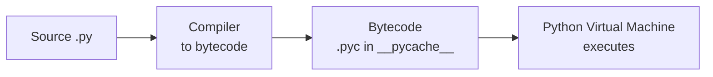
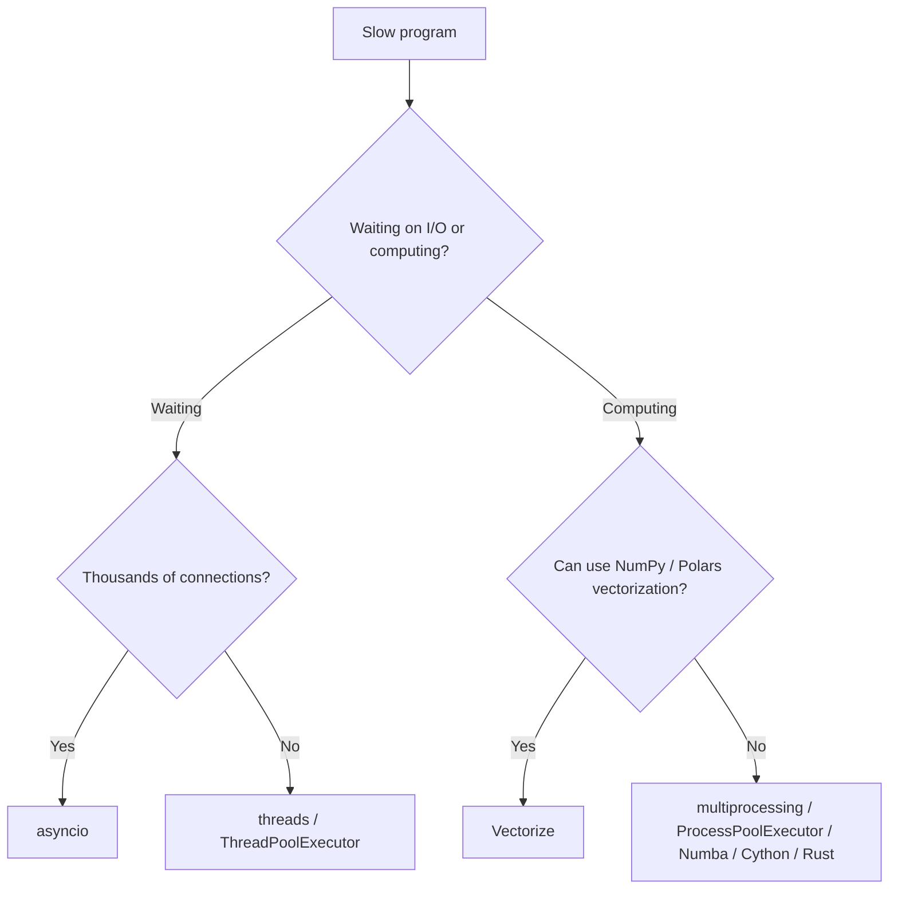

# Python Complete Guide - Basic to Advanced

> **Note**: Sections marked **(Interview Imp)** are frequently asked in interviews.
>
> **How to read this file:** Every chapter ends with (or contains) a **📘 Terms Explained** table. If you see a word you don't know, check the table right below that section.
>
> **Scope:** Python can't be covered "completely" in one file because the ecosystem has hundreds of thousands of packages. This guide covers the **entire language, the standard library essentials, internals, concurrency, performance, testing, packaging and deployment**, plus the **ecosystem that matters most for data, web and AI work** (NumPy, Pandas/Polars, FastAPI, SQLAlchemy, Pydantic, PyTorch, LLM apps). Each chapter points to the tools to learn next. Written for Python 3.12+ (notes for 3.13/3.14 features).
>
> **Related files:** [AI_ML_Roadmap.md](AI_ML_Roadmap.md) (what to learn after Python) and [02_Creational_Pattern.md](../design-patterns/01_LLD/02_Creational_Pattern.md) (design patterns, Java examples).

## Levels

| Level | Chapters |
|---|---|
| **Beginner** | 1-7 (setup, types, control flow, data structures, functions, modules, files/errors) |
| **Intermediate** | 8-12 (OOP, iterators/decorators, standard library, typing/Pydantic, testing) |
| **Advanced** | 13-17 (concurrency, internals, performance, metaprogramming, packaging/deployment) |
| **Ecosystem** | 18-24 (NumPy, Pandas, visualization, web, databases, AI/ML, other domains) |
| **Mastery** | 25-29 (algorithms, interview questions, projects, learning path, cheat sheet) |

---

## Table of Contents
1. [Getting Started with Python](#1-getting-started-with-python)
   - [1.1 What is Python?](#11-what-is-python)
   - [1.2 Installing Python and Tools](#12-installing-python-and-tools)
   - [1.3 Your First Programs](#13-your-first-programs)
   - [1.4 How Python Runs Your Code](#14-how-python-runs-your-code)
   - [1.5 Style and the Zen of Python](#15-style-and-the-zen-of-python)
2. [Python Basics - Values, Types and Operators](#2-python-basics---values-types-and-operators)
   - [2.1 Variables and Assignment](#21-variables-and-assignment)
   - [2.2 Built-in Types Overview](#22-built-in-types-overview)
   - [2.3 Numbers](#23-numbers)
   - [2.4 Strings (`str`)](#24-strings-str)
   - [2.5 Booleans, None and Truthiness](#25-booleans-none-and-truthiness)
   - [2.6 Type Conversion and Input/Output](#26-type-conversion-and-inputoutput)
3. [Control Flow](#3-control-flow)
   - [3.1 Conditionals](#31-conditionals)
   - [3.2 Loops](#32-loops)
   - [3.3 Exercises (Basic Level)](#33-exercises-basic-level)
4. [Data Structures](#4-data-structures)
   - [4.1 Lists](#41-lists)
   - [4.2 Tuples](#42-tuples)
   - [4.3 Dictionaries](#43-dictionaries)
   - [4.4 Sets](#44-sets)
   - [4.5 Comprehensions](#45-comprehensions)
   - [4.6 The `collections` Module](#46-the-collections-module)
   - [4.7 Complexity Cheat Sheet](#47-complexity-cheat-sheet)
5. [Functions](#5-functions)
   - [5.1 Defining and Calling](#51-defining-and-calling)
   - [5.2 Parameters in Depth](#52-parameters-in-depth)
   - [5.3 Scope: LEGB](#53-scope-legb)
   - [5.4 First-Class Functions, Lambdas, Closures](#54-first-class-functions-lambdas-closures)
   - [5.5 Recursion](#55-recursion)
   - [5.6 Type Hints (Preview; Chapter 11 goes deeper)](#56-type-hints-preview-chapter-11-goes-deeper)
   - [5.7 Docstrings and Annotations](#57-docstrings-and-annotations)
6. [Modules, Packages and Project Structure](#6-modules-packages-and-project-structure)
   - [6.1 Modules and Imports](#61-modules-and-imports)
   - [6.2 Dependencies and Environments](#62-dependencies-and-environments)
   - [6.3 Useful Dunder Variables](#63-useful-dunder-variables)
7. [Files, Errors and Logging](#7-files-errors-and-logging)
   - [7.1 Reading and Writing Files](#71-reading-and-writing-files)
   - [7.2 Common Formats](#72-common-formats)
   - [7.3 Exceptions](#73-exceptions)
   - [7.4 Logging (not `print`) (Interview Imp)](#74-logging-not-print-interview-imp)
8. [Object-Oriented Programming (OOP)](#8-object-oriented-programming-oop)
   - [8.1 Classes and Objects](#81-classes-and-objects)
   - [8.2 Inheritance](#82-inheritance)
   - [8.3 Special (Dunder) Methods](#83-special-dunder-methods)
   - [8.4 Dataclasses (Interview Imp)](#84-dataclasses-interview-imp)
   - [8.5 Abstract Classes, Protocols, Enums](#85-abstract-classes-protocols-enums)
   - [8.6 Advanced Class Features](#86-advanced-class-features)
9. [Iterators, Generators, Decorators and Context Managers](#9-iterators-generators-decorators-and-context-managers)
   - [9.1 Iterators (Interview Imp)](#91-iterators-interview-imp)
   - [9.2 Generators (Interview Imp)](#92-generators-interview-imp)
   - [9.3 Decorators (Interview Imp)](#93-decorators-interview-imp)
   - [9.4 Context Managers](#94-context-managers)
   - [9.5 `itertools` and `functools` (Power Tools)](#95-itertools-and-functools-power-tools)
10. [The Standard Library Tour](#10-the-standard-library-tour)
   - [10.1 Text, Dates and Numbers](#101-text-dates-and-numbers)
   - [10.2 System, OS and Processes](#102-system-os-and-processes)
   - [10.3 Networking and the Web](#103-networking-and-the-web)
   - [10.4 Data, Storage and Serialization](#104-data-storage-and-serialization)
   - [10.5 Utilities Worth Knowing](#105-utilities-worth-knowing)
11. [Type Hints, Pydantic and Data Validation](#11-type-hints-pydantic-and-data-validation)
   - [11.1 Type Hints (Interview Imp)](#111-type-hints-interview-imp)
   - [11.2 Pydantic (Essential for AI/LLM Apps) (Interview Imp)](#112-pydantic-essential-for-aillm-apps-interview-imp)
12. [Testing, Quality, Debugging and Profiling](#12-testing-quality-debugging-and-profiling)
   - [12.1 Testing with `pytest` (Interview Imp)](#121-testing-with-pytest-interview-imp)
   - [12.2 Code Quality Tools](#122-code-quality-tools)
   - [12.3 Debugging](#123-debugging)
   - [12.4 Profiling and Performance Measurement](#124-profiling-and-performance-measurement)
13. [Concurrency and Parallelism](#13-concurrency-and-parallelism)
   - [13.1 The Big Picture (Interview Imp)](#131-the-big-picture-interview-imp)
   - [13.2 The GIL (Global Interpreter Lock) (Interview Imp)](#132-the-gil-global-interpreter-lock-interview-imp)
   - [13.3 Threads](#133-threads)
   - [13.4 `concurrent.futures` (the Easy Way) (Interview Imp)](#134-concurrentfutures-the-easy-way-interview-imp)
   - [13.5 Multiprocessing](#135-multiprocessing)
   - [13.6 `asyncio` (Interview Imp)](#136-asyncio-interview-imp)
   - [13.7 Choosing and Comparing](#137-choosing-and-comparing)
14. [Python Internals](#14-python-internals)
   - [14.1 Everything Is an Object](#141-everything-is-an-object)
   - [14.2 Memory Management (Interview Imp)](#142-memory-management-interview-imp)
   - [14.3 Mutability, Identity and Interning](#143-mutability-identity-and-interning)
   - [14.4 How Attribute Lookup Works](#144-how-attribute-lookup-works)
   - [14.5 The Import System](#145-the-import-system)
   - [14.6 Bytecode, Frames and the Interpreter](#146-bytecode-frames-and-the-interpreter)
   - [14.7 Implementations and Extending Python](#147-implementations-and-extending-python)
15. [Performance Optimization](#15-performance-optimization)
   - [15.1 Rules of Performance](#151-rules-of-performance)
   - [15.2 Pure-Python Tips](#152-pure-python-tips)
   - [15.3 Vectorization with NumPy](#153-vectorization-with-numpy)
   - [15.4 Numba, Cython, Rust, PyPy](#154-numba-cython-rust-pypy)
   - [15.5 Caching](#155-caching)
   - [15.6 I/O and Data Performance](#156-io-and-data-performance)
   - [15.7 Startup and Import Time](#157-startup-and-import-time)
16. [Advanced Language Features and Idioms](#16-advanced-language-features-and-idioms)
   - [16.1 Modern Syntax Cheat List](#161-modern-syntax-cheat-list)
   - [16.2 Unpacking and Star Syntax](#162-unpacking-and-star-syntax)
   - [16.3 Slicing and Indexing Tricks](#163-slicing-and-indexing-tricks)
   - [16.4 Truthiness, Short-Circuiting, Chained Comparison](#164-truthiness-short-circuiting-chained-comparison)
   - [16.5 Introspection and Dynamic Features](#165-introspection-and-dynamic-features)
   - [16.6 Metaprogramming Patterns](#166-metaprogramming-patterns)
   - [16.7 Pythonic Idioms (Do This, Not That)](#167-pythonic-idioms-do-this-not-that)
   - [16.8 Design Patterns in Python](#168-design-patterns-in-python)
17. [Packaging, Distribution and Deployment](#17-packaging-distribution-and-deployment)
   - [17.1 Building and Publishing a Library](#171-building-and-publishing-a-library)
   - [17.2 Applications: Deploying](#172-applications-deploying)
   - [17.3 Configuration and Secrets (12-Factor)](#173-configuration-and-secrets-12-factor)
   - [17.4 Security Essentials](#174-security-essentials)
18. [NumPy - Numerical Computing](#18-numpy---numerical-computing)
   - [18.1 What and Why](#181-what-and-why)
   - [18.2 Creating Arrays](#182-creating-arrays)
   - [18.3 Indexing and Slicing](#183-indexing-and-slicing)
   - [18.4 Operations, Broadcasting, Aggregation](#184-operations-broadcasting-aggregation)
   - [18.5 Performance Notes](#185-performance-notes)
19. [Pandas and Polars - Tabular Data](#19-pandas-and-polars---tabular-data)
   - [19.1 Pandas Basics (Interview Imp)](#191-pandas-basics-interview-imp)
   - [19.2 Polars (Modern, Fast Alternative)](#192-polars-modern-fast-alternative)
   - [19.3 SQL on Files: DuckDB](#193-sql-on-files-duckdb)
   - [19.4 Choosing a Tool](#194-choosing-a-tool)
20. [Data Visualization](#20-data-visualization)
   - [20.1 Matplotlib (the Foundation)](#201-matplotlib-the-foundation)
   - [20.2 Chart Choice Guide](#202-chart-choice-guide)
   - [20.3 Seaborn, Plotly and Others](#203-seaborn-plotly-and-others)
21. [Web: HTTP Clients, APIs and Frameworks](#21-web-http-clients-apis-and-frameworks)
   - [21.1 HTTP Basics Refresher](#211-http-basics-refresher)
   - [21.2 Calling APIs: `httpx` / `requests`](#212-calling-apis-httpx--requests)
   - [21.3 FastAPI (Interview Imp, standard for AI backends)](#213-fastapi-interview-imp-standard-for-ai-backends)
   - [21.4 Other Frameworks](#214-other-frameworks)
   - [21.5 Auth and Security for APIs](#215-auth-and-security-for-apis)
22. [Databases and Persistence](#22-databases-and-persistence)
   - [22.1 SQL from Python](#221-sql-from-python)
   - [22.2 SQLAlchemy 2.0 (ORM) (Interview Imp)](#222-sqlalchemy-20-orm-interview-imp)
   - [22.3 NoSQL, Caches, Search, Vectors](#223-nosql-caches-search-vectors)
   - [22.4 Data Engineering Tools](#224-data-engineering-tools)
23. [The Python AI/ML Ecosystem](#23-the-python-aiml-ecosystem)
   - [23.1 Classical Machine Learning: scikit-learn](#231-classical-machine-learning-scikit-learn)
   - [23.2 Deep Learning](#232-deep-learning)
   - [23.3 LLM Applications in Python](#233-llm-applications-in-python)
   - [23.4 Scientific Python](#234-scientific-python)
24. [Python in Other Domains](#24-python-in-other-domains)
25. [Algorithms and Data Structures in Python](#25-algorithms-and-data-structures-in-python)
   - [25.1 Built-ins That Replace Hand-Written Structures](#251-built-ins-that-replace-hand-written-structures)
   - [25.2 Common Patterns](#252-common-patterns)
   - [25.3 Complexity Reminders](#253-complexity-reminders)
26. [Python Interview Questions (Basic to Advanced)](#26-python-interview-questions-basic-to-advanced)
   - [26.1 Basics](#261-basics)
   - [26.2 Intermediate](#262-intermediate)
   - [26.3 Advanced](#263-advanced)
   - [26.4 Tricky Output Questions](#264-tricky-output-questions)
27. [Practice Projects by Level](#27-practice-projects-by-level)
28. [Learning Path](#28-learning-path)
29. [Python Cheat Sheet](#29-python-cheat-sheet)

---

# 1. Getting Started with Python

## 1.1 What is Python?

**Python** is a high-level, general-purpose, interpreted programming language created by Guido van Rossum (first release 1991). It is designed to be **readable**: code looks close to plain English, and indentation (not braces) shows structure.

| Strength | Why it matters |
|---|---|
| **Readable syntax** | Faster to learn and maintain. |
| **Huge ecosystem** (400k+ packages on PyPI) | Data science, AI/ML, web, automation, DevOps, science, finance. |
| **Dynamic typing** | Less code; quick prototyping. |
| **Batteries included** | Large standard library ships with the language. |
| **Glue language** | Easily calls C/C++/Rust and system tools. |

| Weakness | Mitigation |
|---|---|
| Slower than C/Java/Go for raw CPU loops | NumPy/Polars (C/Rust inside), Numba, Cython, multiprocessing. |
| GIL limits CPU threads in CPython | Multiprocessing, async for I/O, free-threaded build (3.13+). |
| Runtime type errors | Type hints + `mypy`/`pyright`, tests. |
| Packaging history is messy | Use `uv` + `pyproject.toml`. |

**Where Python is used:** AI/ML (PyTorch, TensorFlow, scikit-learn), data analysis (Pandas), web backends (Django, FastAPI, Flask), automation/scripting, DevOps (Ansible), scientific computing, finance, testing, education.

#### 📘 Terms Explained

| Term | Simple meaning |
|---|---|
| **High-level language** | You describe *what* to do; the language handles memory and hardware details. |
| **Interpreted** | Code is executed by a program (the interpreter) at run time rather than compiled to machine code first (really: compiled to bytecode, then interpreted). |
| **Dynamic typing** | Types belong to values, not variables; a variable can hold an int and later a string. |
| **PyPI** | Python Package Index, the public repository where `pip install` downloads from. |
| **CPython** | The standard, most common Python implementation (written in C). Others: PyPy, Jython, MicroPython. |
| **GIL** | Global Interpreter Lock: in CPython only one thread runs Python bytecode at a time (see Chapter 14). |
| **Standard library** | Modules that come with Python (`os`, `json`, `datetime`...). |

---

## 1.2 Installing Python and Tools

### Check what you have

```bash
python3 --version        # e.g. Python 3.12.4
which python3
```

### Recommended setup (2026): `uv`

**uv** is a very fast Python package and project manager (written in Rust) that replaces `pip`, `venv`, `pip-tools`, `pyenv` and `poetry` for most work.

```bash
# install uv (Linux/macOS)
curl -LsSf https://astral.sh/uv/install.sh | sh

uv python install 3.12            # download Python 3.12
uv init myproject                 # new project with pyproject.toml
cd myproject
uv add requests pandas            # add dependencies
uv run main.py                    # run inside the project's virtual env
uv run pytest                     # run tools
```

### Classic way: `venv` + `pip`

```bash
python3 -m venv .venv             # create virtual environment
source .venv/bin/activate         # Linux/macOS  (Windows: .venv\Scripts\activate)
pip install requests              # install into the venv
pip freeze > requirements.txt     # save versions
deactivate                        # leave the venv
```

### Other options
| Tool | Use |
|---|---|
| **conda / mamba** | Scientific stack, binary packages (CUDA, MKL). |
| **pyenv** | Install and switch between many Python versions. |
| **poetry / pdm / hatch** | Project and dependency managers. |
| **Docker** | Reproducible environments for deployment. |

### Editors
VS Code (+ Python & Pylance extensions), PyCharm, Jupyter / JupyterLab (notebooks for data work), Neovim.

#### 📘 Terms Explained

| Term | Simple meaning |
|---|---|
| **Virtual environment (venv)** | An isolated folder with its own Python and packages, so projects don't clash. |
| **`pip`** | The standard installer for Python packages. |
| **`pyproject.toml`** | Standard project config file: name, version, dependencies, tool settings. |
| **`requirements.txt`** | Plain list of packages and versions for `pip install -r`. |
| **Lock file** | Records exact versions of all dependencies for repeatable installs (`uv.lock`). |
| **Jupyter notebook** | Interactive document mixing code, output and text. |

---

## 1.3 Your First Programs

### The REPL (interactive shell)

```bash
$ python3
>>> 2 + 3
5
>>> name = "Ritik"
>>> f"Hello {name}"
'Hello Ritik'
>>> exit()
```

### A script

```python
# hello.py
print("Hello, World!")
```

```bash
python3 hello.py
```

### Typical script structure

```python
"""Short description of what this file does."""

def main() -> None:
    name = input("Your name: ")
    print(f"Hello, {name}!")

if __name__ == "__main__":      # runs only when executed directly, not when imported
    main()
```

**What is `__name__ == "__main__"`?** Every module has a `__name__`. When you run a file directly it is `"__main__"`; when another file imports it, it is the module's name. The check lets a file be both a program and an importable library.

### Comments and docstrings

```python
# single-line comment

def area(r):
    """Return the area of a circle (docstring: shown by help())."""
    return 3.14159 * r * r

help(area)
```

---

## 1.4 How Python Runs Your Code



1. Python **compiles** your source to **bytecode** (low-level instructions).
2. The bytecode is cached in `__pycache__/*.pyc`.
3. The **Python Virtual Machine (PVM)** executes it instruction by instruction.

```python
import dis
dis.dis(lambda x: x + 1)       # see the bytecode
```

Python 3.11+ is much faster thanks to the **specializing adaptive interpreter**; 3.13 adds an experimental **JIT** and an optional **free-threaded** (no-GIL) build.

---

## 1.5 Style and the Zen of Python

- **PEP 8** is the style guide: 4-space indent, `snake_case` for functions/variables, `PascalCase` for classes, `UPPER_CASE` for constants, max ~88-100 chars per line.
- Use formatters/linters: **ruff** (lint + format), **black**.
- `import this` prints **The Zen of Python**:

```
Beautiful is better than ugly.
Explicit is better than implicit.
Simple is better than complex.
Readability counts.
Errors should never pass silently.
There should be one-- and preferably only one --obvious way to do it.
```

| Naming | Convention |
|---|---|
| variable / function | `user_name`, `get_total()` |
| class | `ShoppingCart` |
| constant | `MAX_RETRIES` |
| "private" by convention | `_internal` |
| name-mangled | `__very_private` |
| special ("dunder") | `__init__`, `__str__` |

#### 📘 Terms Explained

| Term | Simple meaning |
|---|---|
| **PEP** | Python Enhancement Proposal, a design document; PEP 8 = style, PEP 20 = Zen, PEP 484 = type hints. |
| **Linter** | Tool that finds probable bugs and style issues (`ruff`, `flake8`). |
| **Formatter** | Tool that rewrites code to a consistent style (`black`, `ruff format`). |
| **Dunder** | "Double underscore" name like `__init__`. |
| **Bytecode** | Compact instructions that the Python VM runs. |

---

# 2. Python Basics - Values, Types and Operators

## 2.1 Variables and Assignment

A variable is a **name that points to an object**. Python has no declarations.

```python
age = 28                 # int
price = 19.99            # float
name = "Asha"            # str
is_active = True         # bool
nothing = None           # NoneType

a, b = 1, 2              # multiple assignment
a, b = b, a              # swap, no temp variable
x = y = 0                # chained
first, *rest = [1, 2, 3, 4]      # first=1, rest=[2,3,4]   (unpacking)
```

```python
type(age)                # <class 'int'>
id(age)                  # object identity (memory address in CPython)
isinstance(age, int)     # True  (preferred over type(x) == int)
```

**Names, not boxes:** `b = a` makes both names refer to the **same object**; it does not copy.

```python
a = [1, 2]
b = a
b.append(3)
print(a)                 # [1, 2, 3]  <- same list
```

#### 📘 Terms Explained

| Term | Simple meaning |
|---|---|
| **Object** | Everything in Python (numbers, strings, functions, classes) is an object with a type, identity and value. |
| **Name binding** | `x = 5` binds the name `x` to the object `5`. |
| **Unpacking** | Splitting a sequence into separate variables. |
| **`id()`** | Returns a unique identity number for an object. |

---

## 2.2 Built-in Types Overview

| Type | Example | Mutable? | Notes |
|---|---|---|---|
| `int` | `42`, `1_000_000` | No | Arbitrary size (no overflow). |
| `float` | `3.14`, `1e-3` | No | 64-bit double precision. |
| `complex` | `3+4j` | No | |
| `bool` | `True`, `False` | No | Subclass of `int` (`True == 1`). |
| `str` | `"hello"` | No | Unicode text. |
| `bytes` | `b"abc"` | No | Raw bytes. |
| `bytearray` | `bytearray(b"abc")` | **Yes** | |
| `list` | `[1, 2, 3]` | **Yes** | Ordered, any types. |
| `tuple` | `(1, 2, 3)` | No | Ordered, fixed. |
| `dict` | `{"a": 1}` | **Yes** | Key→value; insertion ordered. |
| `set` | `{1, 2, 3}` | **Yes** | Unique items, unordered. |
| `frozenset` | `frozenset({1, 2})` | No | Immutable set. |
| `NoneType` | `None` | No | "No value". |
| `range` | `range(5)` | No | Lazy sequence of ints. |

**Mutable** = can be changed in place. **Immutable** = any "change" creates a new object.

---

## 2.3 Numbers

```python
7 + 2        # 9
7 - 2        # 5
7 * 2        # 14
7 / 2        # 3.5     true division (always float)
7 // 2       # 3       floor division
7 % 2        # 1       remainder (modulo)
7 ** 2       # 49      power
-7 // 2      # -4      floors toward negative infinity
divmod(7, 2) # (3, 1)

abs(-5); round(3.567, 2); pow(2, 10); max(1, 5, 3); min(...); sum([1, 2, 3])
10_000_000   # underscores for readability
0xFF, 0b1010, 0o17       # hex, binary, octal
```

### Floating-point surprise

```python
0.1 + 0.2                # 0.30000000000000004
0.1 + 0.2 == 0.3         # False
import math
math.isclose(0.1 + 0.2, 0.3)     # True
```

Computers store floats in binary, so many decimals can't be exact. For **money** use `decimal.Decimal` (or integer cents).

```python
from decimal import Decimal
Decimal("0.1") + Decimal("0.2")          # Decimal('0.3')
from fractions import Fraction
Fraction(1, 3) + Fraction(1, 6)          # Fraction(1, 2)
```

### `math` module
```python
import math
math.sqrt(16); math.floor(2.7); math.ceil(2.1); math.pi; math.e
math.log(100, 10); math.sin(math.pi / 2); math.gcd(12, 18); math.factorial(5)
math.inf; math.nan; math.isnan(x)
```

---

## 2.4 Strings (`str`)

```python
s = "Hello, World"
s2 = 'single quotes work too'
multi = """line one
line two"""
raw = r"C:\new\table"                # raw string: backslashes are literal

len(s)                               # 12
s[0]                                 # 'H'
s[-1]                                # 'd'  (negative = from end)
s[0:5]                               # 'Hello'  slice [start:stop)
s[::2]                               # every 2nd char
s[::-1]                              # reversed
```

### Common methods

```python
s.upper(); s.lower(); s.title(); s.capitalize(); s.swapcase()
s.strip(); s.lstrip(); s.rstrip()            # trim whitespace
s.split(",");   ",".join(["a", "b"])         # split / join
s.replace("World", "Python")
s.startswith("He"); s.endswith("ld")
s.find("lo")      # index or -1
s.index("lo")     # index or ValueError
s.count("l")
"abc".isalpha(); "123".isdigit(); "a1".isalnum(); " ".isspace()
"5".zfill(3)      # '005'
"hi".center(10, "*")
"a,b,c".partition(",")      # ('a', ',', 'b,c')
"Line1\nLine2".splitlines()
"hello world".removeprefix("hello ")      # 3.9+
```

### Formatting (use f-strings)

```python
name, price = "Pen", 12.5
f"{name} costs {price:.2f}"            # 'Pen costs 12.50'
f"{1234567:,}"                          # '1,234,567'
f"{0.256:.1%}"                          # '25.6%'
f"{42:08.3f}"                           # '0042.000'
f"{'left':<10}|{'right':>10}|{'mid':^10}"
f"{name=}"                              # "name='Pen'"   (debug form, 3.8+)
f"{3+4}"                                # expressions allowed
"{} is {}".format("a", 1)               # older
"%s is %d" % ("a", 1)                   # oldest
```

### Strings are immutable
```python
s = "abc"
# s[0] = "X"            # TypeError
s = "X" + s[1:]         # make a new string
```

Building many pieces: collect in a list and `"".join(parts)` (repeated `+=` in a loop can be slow).

### Unicode and bytes
```python
"नमस्ते".encode("utf-8")        # str -> bytes
b"\xe0\xa4...".decode("utf-8")   # bytes -> str
ord("A"); chr(65)                # code point <-> character
```
Always specify `encoding="utf-8"` when opening text files.

#### 📘 Terms Explained

| Term | Simple meaning |
|---|---|
| **Slice** | `seq[start:stop:step]`, a piece of a sequence (stop is excluded). |
| **f-string** | String with `f` prefix where `{expr}` is evaluated inside the text. |
| **Format spec** | The part after `:` in `{value:.2f}` telling how to display the value. |
| **Raw string** | `r"..."`, backslashes are not escape characters (good for regex, paths). |
| **Unicode** | Standard giving every character in every language a number. |
| **Encoding (UTF-8)** | Rule to convert text to bytes and back. |
| **Immutable** | Cannot change in place. |

---

## 2.5 Booleans, None and Truthiness

```python
True and False      # False
True or False       # True
not True            # False
```

**Short-circuit:** `a and b` returns `a` if falsy else `b`; `a or b` returns `a` if truthy else `b`.

```python
name = user_input or "Guest"        # default if empty
x = obj and obj.value               # safe access
```

### Falsy values (everything else is truthy)
`False`, `None`, `0`, `0.0`, `0j`, `""`, `[]`, `()`, `{}`, `set()`, `range(0)`, and objects whose `__bool__` returns False or `__len__` returns 0.

```python
if items:               # idiomatic "not empty"
    ...
if x is None:           # use `is` for None, not ==
    ...
```

### `is` vs `==`
- `==` compares **values**.
- `is` compares **identity** (same object).

```python
a = [1, 2]; b = [1, 2]
a == b      # True
a is b      # False
```
Small ints and interned strings may be shared, so never use `is` for numbers/strings.

### Comparison chaining
```python
0 < x < 10            # same as 0 < x and x < 10
```

### Operators summary

| Group | Operators |
|---|---|
| Arithmetic | `+ - * / // % **` |
| Comparison | `== != < > <= >=` |
| Logical | `and or not` |
| Bitwise | `& \| ^ ~ << >>` |
| Identity / membership | `is`, `is not`, `in`, `not in` |
| Assignment | `= += -= *= /= //= %= **= &= \|= ^= <<= >>=` |
| Walrus (3.8+) | `:=` assigns inside an expression |

```python
if (n := len(data)) > 10:
    print(f"too long: {n}")

x if cond else y         # conditional expression (ternary)
```

---

## 2.6 Type Conversion and Input/Output

```python
int("42"); int(3.9)             # 42, 3  (truncates)
float("3.5"); str(10); bool(0)
list("abc")                      # ['a','b','c']
tuple([1, 2]); set([1, 1, 2]); dict([("a", 1)])
int("abc")                       # ValueError

age = int(input("Age: "))        # input() always returns str

print("a", "b", sep="-", end="!\n")       # a-b!
print("error", file=sys.stderr)
```

### Safe conversion
```python
def to_int(text: str, default: int = 0) -> int:
    try:
        return int(text)
    except ValueError:
        return default
```

---

# 3. Control Flow

## 3.1 Conditionals

```python
score = 82
if score >= 90:
    grade = "A"
elif score >= 80:
    grade = "B"
else:
    grade = "C"
```

Indentation is the syntax: use 4 spaces consistently.

### `match` statement (structural pattern matching, 3.10+)

```python
def handle(command):
    match command:
        case "start" | "run":
            return "starting"
        case "stop":
            return "stopping"
        case ["move", x, y]:                      # sequence pattern
            return f"move to {x},{y}"
        case {"type": "click", "pos": (x, y)}:    # mapping pattern
            return f"click {x},{y}"
        case Point(x=0, y=0):                     # class pattern
            return "origin"
        case int(n) if n > 100:                   # guard
            return "big number"
        case _:                                   # default
            return "unknown"
```

It matches on **shape and contents**, not just equality, and can bind variables.

## 3.2 Loops

```python
for i in range(5):               # 0..4
    print(i)

for i in range(2, 10, 3):        # 2, 5, 8
    ...

for item in ["a", "b"]:
    ...

for idx, item in enumerate(["a", "b"], start=1):
    print(idx, item)

for a, b in zip([1, 2, 3], ["x", "y", "z"]):
    ...
for a, b in zip(xs, ys, strict=True):      # 3.10+: error if lengths differ
    ...

for k, v in {"a": 1}.items():
    ...

n = 0
while n < 5:
    n += 1
```

### `break`, `continue`, and loop `else`

```python
for n in range(2, 20):
    for d in range(2, n):
        if n % d == 0:
            break                 # found a divisor
    else:                         # runs only if the loop did NOT break
        print(n, "is prime")

for x in data:
    if x < 0:
        continue                  # skip to next iteration
```

### Useful loop helpers

| Function | Use |
|---|---|
| `range(n)` | Numbers 0..n-1 (lazy). |
| `enumerate(seq)` | Index + item. |
| `zip(a, b)` | Walk sequences together. |
| `reversed(seq)`, `sorted(seq)` | Reverse / sorted copy. |
| `any(...)`, `all(...)` | Any / all items true. |
| `sum`, `min`, `max`, `len` | Aggregates. |

#### 📘 Terms Explained

| Term | Simple meaning |
|---|---|
| **Iterable** | Anything you can loop over (list, str, dict, file, generator). |
| **Iterator** | Object that hands out items one at a time (`next()`). |
| **Pattern matching** | Checking a value against shapes (`["move", x, y]`) and capturing parts. |
| **Guard** | `if` condition added to a `case`. |
| **Ternary** | One-line if/else expression `a if cond else b`. |
| **Walrus operator** | `:=` assigns and returns the value in one expression. |

---

## 3.3 Exercises (Basic Level)

1. Print the FizzBuzz sequence 1-100.
2. Read a number and print whether it is prime.
3. Count vowels in a sentence.
4. Reverse the words of a sentence.
5. Print a multiplication table using nested loops.
6. Guess-the-number game with `random.randint` and a `while` loop.

```python
# FizzBuzz solution
for i in range(1, 101):
    out = ("Fizz" if i % 3 == 0 else "") + ("Buzz" if i % 5 == 0 else "")
    print(out or i)
```

---

# 4. Data Structures

## 4.1 Lists

An ordered, **mutable** sequence that can hold any types.

```python
nums = [3, 1, 4, 1, 5]
nums[0]; nums[-1]; nums[1:3]            # indexing and slicing

nums.append(9)                           # add to end            O(1)
nums.insert(0, 7)                        # add at index          O(n)
nums.extend([8, 9])                      # add many
nums += [10]
nums.remove(1)                           # remove first value 1  O(n)
last = nums.pop()                        # remove & return last  O(1)
nums.pop(0)                              # remove first          O(n)
del nums[0]
nums.clear()

nums.sort()                              # in place
nums.sort(key=lambda x: -x, reverse=False)
sorted(nums)                             # new sorted list
nums.reverse()
nums.index(4); nums.count(1)
len(nums); 4 in nums                     # membership is O(n)
```

```python
matrix = [[1, 2, 3], [4, 5, 6]]
matrix[1][2]                             # 6
[[0] * 3 for _ in range(2)]              # correct 2x3 grid
[[0] * 3] * 2                            # WRONG: both rows are the same list!
```

### Copying
```python
b = a                    # same object
b = a[:]                 # shallow copy   (also a.copy(), list(a))
import copy
b = copy.deepcopy(a)     # deep copy
```

### Sorting
Python's sort is **Timsort**: stable, O(n log n), very fast on partly sorted data.

```python
people = [("Asha", 30), ("Ravi", 25)]
sorted(people, key=lambda p: p[1])                 # by age
from operator import itemgetter
sorted(people, key=itemgetter(1), reverse=True)
```

## 4.2 Tuples

Ordered, **immutable**. Use for fixed records, dictionary keys, returning multiple values.

```python
point = (3, 4)
x, y = point
single = (5,)                    # comma makes it a tuple
def min_max(xs): return min(xs), max(xs)
lo, hi = min_max([3, 1, 4])

from collections import namedtuple
Point = namedtuple("Point", "x y")
p = Point(1, 2); p.x
```

Tuples are hashable if all items are, so `{(1, 2): "grid cell"}` works.

## 4.3 Dictionaries

Key → value map. **Insertion-ordered** (3.7+). Average O(1) lookup via hashing.

```python
user = {"name": "Asha", "age": 30}
user["name"]                       # KeyError if missing
user.get("email")                  # None
user.get("email", "n/a")           # default
user["email"] = "a@x.com"
user.update({"age": 31, "city": "Pune"})
user |= {"vip": True}              # merge (3.9+)
merged = user | other

del user["age"]
user.pop("city", None)
user.setdefault("tags", []).append("new")

for k in user: ...
for k, v in user.items(): ...
user.keys(); user.values()
"name" in user                      # key membership
```

### Dict comprehension
```python
squares = {n: n * n for n in range(5)}
inverted = {v: k for k, v in squares.items()}
```

### Key rules
Keys must be **hashable** (immutable-ish): `str`, `int`, `tuple` of hashables. Not `list`, `dict`, `set`.

### How a dict works (interview)
A **hash table**: `hash(key)` picks a slot; collisions are resolved by open addressing. Resizes as it grows. Lookups/inserts are O(1) average, O(n) worst.

## 4.4 Sets

Unordered, unique, **mutable**; fast membership (O(1)).

```python
a = {1, 2, 3}; b = {3, 4}
a | b          # union          {1,2,3,4}
a & b          # intersection   {3}
a - b          # difference     {1,2}
a ^ b          # symmetric diff {1,2,4}
a <= b         # subset
a.add(9); a.discard(1); a.remove(2)      # remove -> KeyError if missing
set()          # empty set  ({} is an empty DICT!)
unique = list(set([1, 1, 2]))
```

`frozenset` is the immutable version (can be a dict key).

## 4.5 Comprehensions

```python
[x * x for x in range(10)]                    # list
[x for x in range(20) if x % 2 == 0]          # with filter
[(x, y) for x in "ab" for y in (1, 2)]        # nested loops
{x % 3 for x in range(10)}                    # set
{k: len(k) for k in ["aa", "b"]}              # dict
(x * x for x in range(10))                    # GENERATOR expression (lazy)
[y for x in data if (y := f(x)) is not None]  # with walrus

sum(x * x for x in range(1_000_000))          # no list built in memory
```

Keep comprehensions short; if it needs more than one line of thought, use a loop.

## 4.6 The `collections` Module

| Class | Use |
|---|---|
| `Counter` | Count items: `Counter("hello").most_common(2)` |
| `defaultdict` | Dict with default values: `defaultdict(list)` |
| `deque` | Fast append/pop at both ends O(1) (queue, sliding window) |
| `namedtuple` | Tuple with named fields |
| `OrderedDict` | Dict with order operations (`move_to_end`) |
| `ChainMap` | Layered lookup across dicts |

```python
from collections import Counter, defaultdict, deque

Counter(["a", "b", "a"])                  # Counter({'a': 2, 'b': 1})

groups = defaultdict(list)
for word in ["apple", "bat", "ant"]:
    groups[word[0]].append(word)          # no KeyError

q = deque(maxlen=3)
q.append(1); q.appendleft(0); q.popleft()
```

Also: `heapq` (priority queue / min-heap), `bisect` (binary search in sorted lists), `array` (compact numeric arrays), `queue.Queue` (thread-safe queue).

```python
import heapq
h = []
heapq.heappush(h, (2, "b")); heapq.heappush(h, (1, "a"))
heapq.heappop(h)                          # (1, 'a')
heapq.nlargest(3, data)

import bisect
bisect.bisect_left([1, 3, 5], 4)          # 2
```

## 4.7 Complexity Cheat Sheet

| Operation | list | dict / set | deque |
|---|---|---|---|
| Index `x[i]` | O(1) | n/a | O(n) middle |
| Append | O(1) amortized | O(1) | O(1) |
| Insert/pop at front | O(n) | n/a | **O(1)** |
| `x in c` | O(n) | **O(1)** | O(n) |
| Delete by value/key | O(n) | O(1) | O(n) |
| Sort | O(n log n) | n/a | n/a |

#### 📘 Terms Explained

| Term | Simple meaning |
|---|---|
| **Hashable** | Has a fixed hash value for its lifetime, so it can be a dict key or set member. |
| **Hash table** | Structure that finds items by computing a number (hash) from the key. |
| **O(1), O(n)** | Big-O: how running time grows with input size n (constant, linear). |
| **Amortized** | Average cost over many operations (occasional resize costs spread out). |
| **Stable sort** | Equal items keep their original relative order. |
| **Shallow vs deep copy** | Shallow shares inner objects; deep copies everything. |
| **Generator expression** | Like a list comprehension but produces items lazily. |
| **Heap** | Tree-based structure that gives the smallest item fast. |

---

# 5. Functions

## 5.1 Defining and Calling

```python
def greet(name: str, greeting: str = "Hello") -> str:
    """Return a greeting."""
    return f"{greeting}, {name}!"

greet("Asha")                       # positional
greet("Asha", greeting="Hi")        # keyword
greet(greeting="Hi", name="Asha")   # order free with keywords
```

A function without `return` returns `None`. A function can return several values (really one tuple).

## 5.2 Parameters in Depth

```python
def f(a, b=2, *args, c, d=4, **kwargs): ...
#     |  |    |      |  |     |
#     |  |    |      |  |     extra keyword args -> dict
#     |  |    |      |  keyword-only with default
#     |  |    |      keyword-only, required (after *args or bare *)
#     |  |    extra positional args -> tuple
#     |  default value
#     required positional

def g(a, b, /, c, *, d): ...        # a,b positional-only; d keyword-only
g(1, 2, 3, d=4)
```

```python
def total(*numbers): return sum(numbers)
total(1, 2, 3)

def show(**opts): print(opts)
show(color="red", size=3)

nums = [1, 2, 3]; opts = {"sep": "-"}
print(*nums, **opts)                # unpack into arguments
```

### The mutable default argument trap (Interview Imp)

```python
def add(item, bucket=[]):           # BUG: default list created ONCE at definition
    bucket.append(item)
    return bucket

add(1); add(2)                      # [1, 2]  not [2]!

def add(item, bucket=None):         # fix
    if bucket is None:
        bucket = []
    bucket.append(item)
    return bucket
```

### Arguments are passed "by object reference"
A function receives a reference to the same object. Mutating a mutable argument is visible to the caller; rebinding the name is not.

```python
def mutate(lst): lst.append(1)       # caller sees the change
def rebind(lst): lst = [9]           # caller does NOT
```

## 5.3 Scope: LEGB

Python looks up a name in this order: **L**ocal → **E**nclosing → **G**lobal → **B**uilt-in.

```python
x = "global"
def outer():
    x = "enclosing"
    def inner():
        nonlocal x          # modify the enclosing variable
        x = "changed"
    inner()
    return x

counter = 0
def inc():
    global counter          # modify module-level variable (avoid when possible)
    counter += 1
```

## 5.4 First-Class Functions, Lambdas, Closures

Functions are objects: store them, pass them, return them.

```python
def apply(fn, value): return fn(value)
apply(str.upper, "hi")

square = lambda x: x * x                # anonymous, single expression
sorted(words, key=lambda w: (len(w), w))

def make_multiplier(n):                 # closure: inner function remembers n
    def mul(x): return x * n
    return mul
double = make_multiplier(2)
double(5)                                # 10
```

**Late binding gotcha**
```python
fs = [lambda: i for i in range(3)]
[f() for f in fs]                        # [2, 2, 2]  all see the final i
fs = [lambda i=i: i for i in range(3)]   # fix: bind now
```

### Functional tools
```python
list(map(str.upper, ["a", "b"]))
list(filter(lambda x: x > 0, [-1, 2]))
from functools import reduce, partial, lru_cache
reduce(lambda a, b: a + b, [1, 2, 3])
pow2 = partial(pow, 2)                   # pre-fill arguments
@lru_cache(maxsize=None)                 # memoization
def fib(n): return n if n < 2 else fib(n - 1) + fib(n - 2)
```
Comprehensions are usually clearer than `map`/`filter`.

## 5.5 Recursion

```python
def factorial(n):
    return 1 if n <= 1 else n * factorial(n - 1)
```
Python has **no tail-call optimization**; the default recursion limit is 1000 (`sys.setrecursionlimit`). Prefer loops for deep recursion.

## 5.6 Type Hints (Preview; Chapter 11 goes deeper)

```python
def mean(values: list[float]) -> float: ...
def find(id: int) -> dict[str, str] | None: ...      # 3.10+ union syntax
```
Hints are **not enforced at runtime**; tools like `mypy` / `pyright` check them.

## 5.7 Docstrings and Annotations

```python
def area(w: float, h: float) -> float:
    """Return rectangle area.

    Args:
        w: width
        h: height
    Raises:
        ValueError: if either is negative.
    """
```
Styles: Google, NumPy, reST. `help(f)` and IDEs show them.

#### 📘 Terms Explained

| Term | Simple meaning |
|---|---|
| **Parameter vs argument** | Parameter = name in the definition; argument = value passed in the call. |
| **`*args` / `**kwargs`** | Collect extra positional / keyword arguments. |
| **Keyword-only** | Parameter that must be passed by name. |
| **Closure** | A function that remembers variables from the scope where it was created. |
| **Lambda** | Small anonymous function with one expression. |
| **Memoization** | Caching function results for repeated inputs. |
| **LEGB** | Local, Enclosing, Global, Built-in lookup order. |
| **Late binding** | Closures look up variables when called, not when defined. |
| **Higher-order function** | Function that takes or returns functions. |

---

# 6. Modules, Packages and Project Structure

## 6.1 Modules and Imports

A **module** is a `.py` file. A **package** is a folder of modules (with `__init__.py`, optional in modern Python for namespace packages).

```python
import math
import math as m
from math import sqrt, pi
from math import *                    # avoid: pollutes namespace
from collections import Counter as C

import os.path
from pathlib import Path
```

```
myapp/
├── pyproject.toml
├── src/
│   └── myapp/
│       ├── __init__.py
│       ├── cli.py
│       ├── models.py
│       └── utils/
│           ├── __init__.py
│           └── text.py
└── tests/
    └── test_text.py
```

```python
# inside myapp/cli.py
from myapp.models import User            # absolute import (preferred)
from .models import User                  # relative import
from .utils.text import slugify
```

### How imports are found
`sys.path` is searched in order: script directory, `PYTHONPATH`, standard library, site-packages. Modules are cached in `sys.modules`, so a module runs once per process.

### Circular imports
`a.py` imports `b.py` which imports `a.py` → half-initialised module errors. Fix by restructuring, importing inside functions, or moving shared code to a third module.

### `__init__.py` and `__all__`
```python
# myapp/__init__.py
from .models import User
__all__ = ["User"]                        # controls `from myapp import *`
__version__ = "1.0.0"
```

## 6.2 Dependencies and Environments

```toml
# pyproject.toml
[project]
name = "myapp"
version = "0.1.0"
requires-python = ">=3.11"
dependencies = ["httpx>=0.27", "pydantic>=2"]

[project.optional-dependencies]
dev = ["pytest", "ruff", "mypy"]

[project.scripts]
myapp = "myapp.cli:main"                 # creates a `myapp` command

[tool.ruff]
line-length = 100
```

| Task | uv | pip |
|---|---|---|
| Add dependency | `uv add httpx` | `pip install httpx` |
| Dev dependency | `uv add --dev pytest` | `pip install pytest` |
| Install project | `uv sync` | `pip install -e .` |
| Run | `uv run python app.py` | `python app.py` (venv active) |

**Pinning:** use ranges in `pyproject.toml`; commit a lock file (`uv.lock`) for exact reproducible installs.

## 6.3 Useful Dunder Variables

| Name | Meaning |
|---|---|
| `__name__` | Module name or `"__main__"`. |
| `__file__` | Path of the module file. |
| `__doc__` | Module docstring. |
| `__all__` | Public names for `import *`. |
| `__package__` | Package the module belongs to. |

#### 📘 Terms Explained

| Term | Simple meaning |
|---|---|
| **Module** | One Python file you can import. |
| **Package** | A folder of modules. |
| **`sys.path`** | List of folders Python searches when importing. |
| **`site-packages`** | Folder where installed third-party packages live. |
| **Editable install (`-e`)** | Install that points to your source, so edits take effect immediately. |
| **Entry point / script** | A command generated from a function by packaging. |
| **Namespace package** | A package folder without `__init__.py`, possibly split across directories. |

---

# 7. Files, Errors and Logging

## 7.1 Reading and Writing Files

```python
# ALWAYS use `with`: the file is closed automatically, even on error
with open("notes.txt", "w", encoding="utf-8") as f:
    f.write("line 1\n")
    f.writelines(["a\n", "b\n"])

with open("notes.txt", encoding="utf-8") as f:       # mode "r" default
    text = f.read()                                    # whole file
with open("notes.txt", encoding="utf-8") as f:
    for line in f:                                     # lazy, memory-friendly
        print(line.rstrip("\n"))
    # f.readline(), f.readlines()
```

| Mode | Meaning |
|---|---|
| `r` / `w` / `a` | read / write (truncate) / append |
| `x` | create, fail if exists |
| `b` | binary (`rb`, `wb`) |
| `+` | read and write (`r+`) |

### `pathlib` (modern paths) (Interview Imp)

```python
from pathlib import Path

p = Path("data") / "users.csv"          # / joins paths, OS independent
p.exists(); p.is_file(); p.is_dir()
p.name; p.stem; p.suffix; p.parent
p.read_text(encoding="utf-8"); p.write_text("hi", encoding="utf-8")
p.read_bytes()
p.parent.mkdir(parents=True, exist_ok=True)
for f in Path(".").glob("**/*.py"): ...   # recursive search
p.unlink(missing_ok=True)                 # delete
Path.home(); Path.cwd(); p.resolve()
p.rename("new.csv"); p.stat().st_size
```

Also: `shutil` (copy/move/delete trees), `tempfile` (temporary files/dirs), `os` (older API), `glob`.

```python
import shutil, tempfile
shutil.copy("a.txt", "b.txt"); shutil.rmtree("old_dir"); shutil.move("a", "b")
with tempfile.TemporaryDirectory() as tmp: ...
```

## 7.2 Common Formats

### JSON
```python
import json
data = {"name": "Asha", "tags": ["a", "b"]}
s = json.dumps(data, indent=2, ensure_ascii=False)     # object -> string
obj = json.loads(s)                                     # string -> object
with open("d.json", "w", encoding="utf-8") as f: json.dump(data, f)
with open("d.json", encoding="utf-8") as f: obj = json.load(f)
```
`datetime`, `Decimal`, `set` aren't JSON-serializable by default; pass `default=str` or a custom encoder.

### CSV
```python
import csv
with open("people.csv", newline="", encoding="utf-8") as f:
    for row in csv.DictReader(f):                      # each row is a dict
        print(row["name"])
with open("out.csv", "w", newline="", encoding="utf-8") as f:
    w = csv.DictWriter(f, fieldnames=["name", "age"])
    w.writeheader(); w.writerow({"name": "Asha", "age": 30})
```

### Others
| Format | Tool |
|---|---|
| TOML (config) | `tomllib` (read, 3.11+) |
| YAML | `pyyaml` |
| XML | `xml.etree.ElementTree` |
| INI | `configparser` |
| Pickle (Python objects) | `pickle` (**never load untrusted pickles**: can run code) |
| Parquet / Arrow | `pyarrow`, `pandas`, `polars` |
| SQLite | `sqlite3` |

## 7.3 Exceptions

```python
try:
    value = int(text)
    result = 10 / value
except ValueError as e:
    print("not a number:", e)
except ZeroDivisionError:
    print("cannot divide by zero")
except (TypeError, KeyError) as e:        # several types
    ...
except Exception as e:                    # broad catch: log and re-raise or handle deliberately
    raise
else:
    print("only runs if no exception")
finally:
    print("always runs (cleanup)")
```

### Raising and custom exceptions
```python
class InsufficientFunds(Exception):
    def __init__(self, needed: float, available: float):
        super().__init__(f"need {needed}, have {available}")
        self.needed, self.available = needed, available

def withdraw(balance, amount):
    if amount > balance:
        raise InsufficientFunds(amount, balance)
    return balance - amount
```

### Chaining
```python
try:
    load_config()
except FileNotFoundError as e:
    raise RuntimeError("config missing") from e      # keeps original as __cause__
```

### Hierarchy (partial)
```
BaseException
├── KeyboardInterrupt, SystemExit
└── Exception
    ├── ArithmeticError → ZeroDivisionError
    ├── LookupError → IndexError, KeyError
    ├── OSError → FileNotFoundError, PermissionError
    ├── ValueError, TypeError, AttributeError, ImportError
    └── RuntimeError → RecursionError, NotImplementedError
```
Catch `Exception`, not `BaseException`/bare `except:` (which would swallow Ctrl-C).

### Exception groups (3.11+)
Raised by `asyncio.TaskGroup` and handled with `except*`:
```python
try:
    ...
except* ValueError as eg:
    print(eg.exceptions)
```

### EAFP vs LBYL
- **EAFP** (Easier to Ask Forgiveness than Permission): try it, handle errors. Pythonic.
- **LBYL** (Look Before You Leap): check conditions first.
```python
try: value = d[key]
except KeyError: value = default          # EAFP
value = d.get(key, default)               # even better here
```

### Good practices
- Catch specific exceptions; keep `try` blocks small.
- Never `except: pass` silently.
- Use `assert` only for developer checks (removed with `python -O`), not input validation.
- Use `contextlib.suppress(FileNotFoundError)` for intentionally ignored errors.
- Add notes (3.11+): `e.add_note("while loading user 5")`.

## 7.4 Logging (not `print`) (Interview Imp)

```python
import logging

logging.basicConfig(
    level=logging.INFO,
    format="%(asctime)s %(levelname)s %(name)s: %(message)s",
)
log = logging.getLogger(__name__)         # one logger per module

log.debug("details %s", x)                # lazy formatting: no cost if disabled
log.info("started")
log.warning("disk almost full")
log.error("failed to save", exc_info=True)
log.exception("something broke")          # inside except: includes traceback
```

| Level | Use |
|---|---|
| DEBUG (10) | Developer detail |
| INFO (20) | Normal events |
| WARNING (30) | Something unexpected, still working |
| ERROR (40) | A task failed |
| CRITICAL (50) | App may stop |

Concepts: **loggers** (named, hierarchical), **handlers** (where: console, file, rotating file, syslog), **formatters** (layout), **filters**. In production use JSON logs (`structlog`, `python-json-logger`) and ship them to a log system. Libraries should only create loggers, never configure handlers.

#### 📘 Terms Explained

| Term | Simple meaning |
|---|---|
| **Context manager (`with`)** | Object that sets something up and always cleans up (closing files, locks). |
| **Encoding** | Text-to-bytes rule; use `utf-8`. |
| **Serialization** | Converting objects to a storable/transmittable format (JSON, pickle). |
| **Exception** | An error event that unwinds the call stack until something handles it. |
| **Traceback** | The list of calls that led to an error. |
| **EAFP / LBYL** | "Try and handle" vs "check first" styles. |
| **Handler / Formatter** | Logging parts deciding destination and text layout. |
| **Structured logging** | Logs as key-value data (JSON) so they can be searched. |

---

# 8. Object-Oriented Programming (OOP)

## 8.1 Classes and Objects

```python
class BankAccount:
    bank_name = "PyBank"                      # class attribute (shared)

    def __init__(self, owner: str, balance: float = 0):
        self.owner = owner                    # instance attributes
        self._balance = balance               # _ = "protected" by convention

    def deposit(self, amount: float) -> None:
        if amount <= 0:
            raise ValueError("amount must be positive")
        self._balance += amount

    @property
    def balance(self) -> float:               # read-only attribute
        return self._balance

    def __repr__(self) -> str:                # for developers / debugging
        return f"BankAccount({self.owner!r}, {self._balance})"

    def __str__(self) -> str:                 # for users / print()
        return f"{self.owner}: {self._balance:.2f}"

acct = BankAccount("Asha", 100)
acct.deposit(50)
print(acct.balance)                           # 150 (property, no parentheses)
```

- `self` is the instance, passed automatically as the first argument.
- `__init__` initialises the new object (the constructor is really `__new__` + `__init__`).

### Method kinds

```python
class Temperature:
    def __init__(self, celsius): self.celsius = celsius

    def to_f(self):                           # instance method: uses self
        return self.celsius * 9 / 5 + 32

    @classmethod
    def from_fahrenheit(cls, f):              # class method: alternative constructor
        return cls((f - 32) * 5 / 9)

    @staticmethod
    def is_valid(c):                          # static method: no self/cls, a utility
        return c >= -273.15
```

### Properties with validation
```python
class User:
    def __init__(self, age): self.age = age   # goes through the setter

    @property
    def age(self): return self._age

    @age.setter
    def age(self, value):
        if not 0 <= value <= 150:
            raise ValueError("invalid age")
        self._age = value
```

### Encapsulation in Python
No real `private`. Conventions: `_name` (internal), `__name` (name-mangled to `_Class__name` to avoid subclass clashes). "We are all consenting adults."

## 8.2 Inheritance

```python
class Animal:
    def __init__(self, name): self.name = name
    def speak(self): raise NotImplementedError
    def __str__(self): return f"{type(self).__name__}({self.name})"

class Dog(Animal):
    def speak(self): return "Woof"

class Cat(Animal):
    def __init__(self, name, indoor=True):
        super().__init__(name)               # call parent
        self.indoor = indoor
    def speak(self): return "Meow"

for a in [Dog("Rex"), Cat("Tom")]:
    print(a, a.speak())                      # polymorphism
isinstance(Dog("x"), Animal)                 # True
issubclass(Dog, Animal)                      # True
```

### Multiple inheritance and MRO (Interview Imp)
```python
class A: 
    def hi(self): return "A"
class B(A):
    def hi(self): return "B" + super().hi()
class C(A):
    def hi(self): return "C" + super().hi()
class D(B, C): pass

D().hi()               # 'BCA'
D.__mro__              # (D, B, C, A, object)
```
**MRO (Method Resolution Order)** is computed by the **C3 linearization** algorithm; `super()` follows the MRO (not simply "the parent"). It solves the diamond problem.

### Mixins
Small classes that add one capability to others (`JsonMixin`, `LoggingMixin`). Prefer **composition over inheritance**: have an object *use* another rather than *be* one.

```python
class Engine: ...
class Car:
    def __init__(self): self.engine = Engine()      # composition
```

## 8.3 Special (Dunder) Methods

Python's data model lets your objects work with built-in syntax.

| Method | Triggered by |
|---|---|
| `__init__`, `__new__`, `__del__` | creation / destruction |
| `__repr__`, `__str__`, `__format__` | `repr()`, `str()`/`print`, f-string |
| `__eq__`, `__lt__`, `__hash__` | `==`, `<`, `hash()` (define `__eq__` ⇒ define `__hash__` or it becomes unhashable) |
| `__add__`, `__mul__`, `__neg__`, `__radd__`, `__iadd__` | `+`, `*`, `-x`, reflected, `+=` |
| `__len__`, `__getitem__`, `__setitem__`, `__contains__` | `len()`, `x[i]`, `x[i]=v`, `in` |
| `__iter__`, `__next__` | iteration |
| `__call__` | `obj()` |
| `__enter__`, `__exit__` | `with` |
| `__getattr__`, `__setattr__`, `__getattribute__` | attribute access |
| `__bool__` | truthiness |
| `__class_getitem__` | `MyClass[int]` |

```python
class Vector:
    def __init__(self, x, y): self.x, self.y = x, y
    def __add__(self, o): return Vector(self.x + o.x, self.y + o.y)
    def __mul__(self, k): return Vector(self.x * k, self.y * k)
    __rmul__ = __mul__                         # 3 * v
    def __eq__(self, o): return (self.x, self.y) == (o.x, o.y)
    def __hash__(self): return hash((self.x, self.y))
    def __abs__(self): return (self.x ** 2 + self.y ** 2) ** 0.5
    def __repr__(self): return f"Vector({self.x}, {self.y})"
    def __iter__(self): yield self.x; yield self.y
    def __bool__(self): return bool(abs(self))

Vector(1, 2) + Vector(3, 4)                    # Vector(4, 6)
x, y = Vector(5, 6)                            # unpacking via __iter__
```

Use `functools.total_ordering` to get all comparisons from `__eq__` + one of `__lt__` etc.

## 8.4 Dataclasses (Interview Imp)

Auto-generate `__init__`, `__repr__`, `__eq__` and more.

```python
from dataclasses import dataclass, field

@dataclass
class Product:
    name: str
    price: float
    tags: list[str] = field(default_factory=list)     # never use a mutable default directly
    qty: int = 0

p = Product("Pen", 12.5)

@dataclass(frozen=True, slots=True, order=True, kw_only=True)
class Point:
    x: float
    y: float
```

| Option | Effect |
|---|---|
| `frozen=True` | Immutable and hashable |
| `order=True` | Generates `<`, `>`... |
| `slots=True` (3.10+) | Less memory, faster attribute access |
| `kw_only=True` | All fields keyword-only |
| `__post_init__` | Hook for validation/derived fields |

```python
@dataclass
class Rect:
    w: float; h: float
    area: float = field(init=False)
    def __post_init__(self): self.area = self.w * self.h
```

Helpers: `asdict(p)`, `astuple(p)`, `replace(p, qty=5)`, `fields(p)`.

**Alternatives:** `NamedTuple` (immutable tuple with names), `TypedDict` (typed dict shape), **Pydantic** `BaseModel` (validation + parsing; Chapter 11), `attrs` (feature-rich dataclass ancestor).

## 8.5 Abstract Classes, Protocols, Enums

### Abstract base classes
```python
from abc import ABC, abstractmethod

class Shape(ABC):
    @abstractmethod
    def area(self) -> float: ...

class Circle(Shape):
    def __init__(self, r): self.r = r
    def area(self): return 3.14159 * self.r ** 2

# Shape()  -> TypeError: can't instantiate abstract class
```

### Duck typing and `Protocol` (structural typing)
"If it walks like a duck..." Python only needs the right methods.

```python
from typing import Protocol

class Drawable(Protocol):
    def draw(self) -> None: ...

def render(item: Drawable) -> None:       # any object with draw() qualifies, no inheritance needed
    item.draw()
```

### Enums
```python
from enum import Enum, IntEnum, auto, StrEnum, Flag

class Status(Enum):
    PENDING = auto()
    ACTIVE = auto()
    CLOSED = auto()

Status.ACTIVE.name; Status.ACTIVE.value; Status["ACTIVE"]; Status(2)
for s in Status: ...

class Color(StrEnum):                      # 3.11+: members are also strings
    RED = "red"; BLUE = "blue"
```

## 8.6 Advanced Class Features

### `__slots__`
Fixed attribute set, no per-instance `__dict__`; saves memory for millions of objects.
```python
class P:
    __slots__ = ("x", "y")
    def __init__(self, x, y): self.x, self.y = x, y
```

### Descriptors (how properties/methods really work)
An object with `__get__`/`__set__` placed on a class controls attribute access.
```python
class Positive:
    def __set_name__(self, owner, name): self.name = "_" + name
    def __get__(self, obj, objtype=None): return getattr(obj, self.name)
    def __set__(self, obj, value):
        if value <= 0: raise ValueError("must be positive")
        setattr(obj, self.name, value)

class Item:
    price = Positive()
    def __init__(self, price): self.price = price
```

### `__init_subclass__` and class decorators
```python
class Plugin:
    registry = {}
    def __init_subclass__(cls, **kw):
        super().__init_subclass__(**kw)
        Plugin.registry[cls.__name__] = cls      # auto-register subclasses
```

### Metaclasses
A **metaclass** is the class of a class (`type` by default). Used by ORMs, Enum, ABC. Use sparingly: prefer `__init_subclass__`, class decorators, or dataclasses.
```python
class Meta(type):
    def __new__(mcls, name, bases, ns):
        ns["created_by"] = "Meta"
        return super().__new__(mcls, name, bases, ns)
class A(metaclass=Meta): pass
```

### Other
| Feature | Idea |
|---|---|
| `__getattr__` | Fallback for missing attributes (lazy loading, proxies) |
| `functools.cached_property` | Compute once, store on instance |
| `weakref` | References that don't keep objects alive |
| `copy.copy` / `__copy__` | Control copying |
| Class-level generics | `class Stack[T]:` (3.12 syntax) |
| `typing.Self` (3.11+) | Return type for fluent methods |
| Singleton, Factory, Builder... | See [02_Creational_Pattern.md](../design-patterns/01_LLD/02_Creational_Pattern.md) for design patterns in Java; the same ideas apply in Python (modules are singletons) |

#### 📘 Terms Explained

| Term | Simple meaning |
|---|---|
| **Class / Instance** | Blueprint / an object made from it. |
| **Attribute** | A variable stored on an object or class. |
| **Method** | A function defined in a class. |
| **`self` / `cls`** | The current instance / the class itself. |
| **Property** | Method that behaves like an attribute (getter/setter). |
| **Polymorphism** | Different classes responding to the same method name. |
| **Duck typing** | Judging an object by its methods, not its class. |
| **MRO** | Order in which base classes are searched for a method. |
| **Composition** | Building objects from other objects ("has-a"). |
| **Data model** | The set of dunder methods that integrate objects with Python syntax. |
| **Descriptor** | Object that customizes attribute get/set when stored on a class. |
| **Metaclass** | The class that creates classes. |
| **Name mangling** | `__x` renamed to `_Class__x`. |

---

# 9. Iterators, Generators, Decorators and Context Managers

## 9.1 Iterators (Interview Imp)

- **Iterable:** has `__iter__()` returning an iterator (list, str, dict, file...).
- **Iterator:** has `__next__()` and `__iter__()`; raises `StopIteration` when finished.

```python
nums = [1, 2, 3]
it = iter(nums)
next(it)           # 1
next(it)           # 2
next(it); next(it) # StopIteration
```

A `for` loop calls `iter()` once, then `next()` repeatedly.

```python
class Countdown:
    def __init__(self, start): self.n = start
    def __iter__(self): return self
    def __next__(self):
        if self.n <= 0:
            raise StopIteration
        self.n -= 1
        return self.n + 1

list(Countdown(3))       # [3, 2, 1]
```

Iterators are **single-use**; iterables (lists) can be looped many times.

## 9.2 Generators (Interview Imp)

A function with `yield` becomes a **generator function**: calling it returns a lazy iterator. It pauses at `yield` and resumes where it stopped, keeping local state.

```python
def countdown(n):
    while n > 0:
        yield n
        n -= 1

for x in countdown(3): print(x)

def read_large(path):
    with open(path, encoding="utf-8") as f:
        for line in f:                       # never loads the whole file
            yield line.strip()

total = sum(len(l) for l in read_large("huge.log"))
```

### Why generators?
| Benefit | Detail |
|---|---|
| **Memory** | One item at a time; works on infinite or huge streams. |
| **Laziness** | Compute only what is consumed. |
| **Pipelines** | Chain stages without temporary lists. |

```python
def numbers():
    n = 0
    while True: yield n; n += 1                  # infinite

def evens(src):
    for n in src:
        if n % 2 == 0: yield n

from itertools import islice
list(islice(evens(numbers()), 5))                # [0, 2, 4, 6, 8]
```

### `yield from`, `send`, `close`
```python
def flatten(nested):
    for item in nested:
        if isinstance(item, list):
            yield from flatten(item)             # delegate to sub-generator
        else:
            yield item

def averager():
    total = count = 0
    while True:
        x = yield (total / count if count else None)
        total += x; count += 1

g = averager(); next(g); g.send(10); g.send(20)  # 10.0, 15.0
```
Generators are the foundation of `async`/`await` (coroutines).

## 9.3 Decorators (Interview Imp)

A **decorator** is a function that takes a function and returns a (usually wrapped) function. `@dec` is shorthand for `f = dec(f)`.

```python
import functools, time

def timer(func):
    @functools.wraps(func)                  # keep name/docstring of the original
    def wrapper(*args, **kwargs):
        start = time.perf_counter()
        result = func(*args, **kwargs)
        print(f"{func.__name__} took {time.perf_counter() - start:.4f}s")
        return result
    return wrapper

@timer
def slow(n): 
    time.sleep(n)
```

### Decorator with arguments
```python
def retry(times=3, delay=0.5, exceptions=(Exception,)):
    def decorator(func):
        @functools.wraps(func)
        def wrapper(*args, **kwargs):
            for attempt in range(1, times + 1):
                try:
                    return func(*args, **kwargs)
                except exceptions:
                    if attempt == times: raise
                    time.sleep(delay)
        return wrapper
    return decorator

@retry(times=5, exceptions=(ConnectionError,))
def fetch(): ...
```

### Class decorators and class-based decorators
```python
def register(cls):
    REGISTRY[cls.__name__] = cls
    return cls

class CountCalls:
    def __init__(self, func): self.func = func; self.calls = 0; functools.update_wrapper(self, func)
    def __call__(self, *a, **kw): self.calls += 1; return self.func(*a, **kw)
```

### Built-in/standard decorators
| Decorator | Purpose |
|---|---|
| `@property`, `@x.setter` | Computed attributes |
| `@staticmethod`, `@classmethod` | Method kinds |
| `@functools.wraps` | Preserve metadata |
| `@functools.lru_cache`, `@functools.cache` | Memoization |
| `@functools.cached_property` | Compute once per instance |
| `@functools.singledispatch` | Overload by type of first arg |
| `@dataclasses.dataclass` | Generate boilerplate |
| `@contextlib.contextmanager` | Build context managers |
| `@abc.abstractmethod` | Require override |
| `@typing.overload`, `@typing.final` | Typing helpers |
| `@pytest.fixture`, `@app.get("/")` | Frameworks use them heavily |

```python
from functools import singledispatch
@singledispatch
def show(x): print("object", x)
@show.register
def _(x: int): print("int", x)
@show.register
def _(x: list): print("list", x)
```

Stacking: decorators apply bottom-up.
```python
@a
@b
def f(): ...        # f = a(b(f))
```

## 9.4 Context Managers

An object usable with `with`: runs setup on entry and cleanup on exit, even if an error happens.

```python
class Timer:
    def __enter__(self):
        self.start = time.perf_counter(); return self
    def __exit__(self, exc_type, exc, tb):
        self.elapsed = time.perf_counter() - self.start
        return False             # False/None: do not swallow the exception

with Timer() as t:
    work()
print(t.elapsed)
```

### The easy way: `contextlib`
```python
from contextlib import contextmanager, suppress, ExitStack, redirect_stdout, closing

@contextmanager
def cd(path):
    old = os.getcwd(); os.chdir(path)
    try: yield
    finally: os.chdir(old)

with suppress(FileNotFoundError):
    os.remove("tmp")

with ExitStack() as stack:                              # variable number of contexts
    files = [stack.enter_context(open(f)) for f in names]
```

Common contexts: `open()`, `threading.Lock()`, `tempfile.TemporaryDirectory()`, database transactions, `httpx.Client()`, `unittest.mock.patch()`, `decimal.localcontext()`. Async version: `async with` (`__aenter__`/`__aexit__`, `@asynccontextmanager`).

## 9.5 `itertools` and `functools` (Power Tools)

```python
import itertools as it

it.count(10); it.cycle("ab"); it.repeat(7, 3)
it.chain([1, 2], [3]); it.chain.from_iterable(list_of_lists)
it.islice(gen, 5); it.takewhile(lambda x: x < 5, nums); it.dropwhile(...)
it.accumulate([1, 2, 3, 4])                  # 1,3,6,10
it.groupby(sorted(data, key=k), key=k)       # groups consecutive items
it.product("ab", repeat=2)                   # cartesian product
it.permutations("abc", 2); it.combinations("abc", 2); it.combinations_with_replacement(...)
it.zip_longest(a, b, fillvalue=0)
it.pairwise([1, 2, 3])                       # (1,2),(2,3)   3.10+
it.batched(range(10), 3)                     # chunks         3.12+
```

#### 📘 Terms Explained

| Term | Simple meaning |
|---|---|
| **Lazy evaluation** | Compute values only when asked. |
| **`yield`** | Gives a value back and pauses the function, keeping its state. |
| **Coroutine** | A function that can pause and resume (generators, `async def`). |
| **Wrapper** | The inner function a decorator returns. |
| **`@wraps`** | Copies `__name__`, `__doc__` etc. from the original function to the wrapper. |
| **Memoization** | Caching results by arguments. |
| **Single dispatch** | Choosing a function version by the argument's type. |
| **Context manager protocol** | `__enter__` + `__exit__`. |
| **StopIteration** | Signal that an iterator is exhausted. |

---

# 10. The Standard Library Tour

Python ships with 200+ modules. Know the ones below.

## 10.1 Text, Dates and Numbers

### `re` (regular expressions)
```python
import re
text = "Call 555-1234 or 555-9876"
re.findall(r"\d{3}-\d{4}", text)               # ['555-1234', '555-9876']
m = re.search(r"(?P<area>\d{3})-(?P<num>\d{4})", text)
m.group("area"), m.groups(), m.start()
re.sub(r"\s+", " ", "a   b    c")               # 'a b c'
re.split(r"[,;]\s*", "a, b;c")
pat = re.compile(r"^\w+@\w+\.\w+$", re.IGNORECASE)   # compile once if reused
pat.fullmatch("me@x.com")
```
| Pattern | Meaning |
|---|---|
| `.` `\d` `\w` `\s` | any char, digit, word char, whitespace |
| `* + ? {n,m}` | 0+, 1+, 0/1, count (greedy; add `?` for lazy) |
| `^ $` | start / end |
| `[abc]` `[^abc]` | class / negated |
| `( )` `(?: )` `(?P<n> )` | group, non-capturing, named |
| `\|` | alternation |
| `(?=...)` `(?<=...)` | look-ahead / look-behind |

### `datetime`, `zoneinfo`, `time`
```python
from datetime import datetime, date, timedelta, timezone
from zoneinfo import ZoneInfo

now = datetime.now(tz=timezone.utc)                  # ALWAYS prefer timezone-aware
ist = now.astimezone(ZoneInfo("Asia/Kolkata"))
d = date(2026, 10, 24)
d + timedelta(days=30)
datetime.strptime("2026-10-24 10:30", "%Y-%m-%d %H:%M")
now.strftime("%d %b %Y, %H:%M")
now.isoformat(); datetime.fromisoformat("2026-10-24T10:30:00+00:00")
(date(2027, 1, 1) - d).days
```
Store and compute in **UTC**, convert to local time only for display. `time.perf_counter()` for timing, `time.sleep(s)`.

### `random`, `secrets`, `statistics`
```python
import random, secrets, statistics
random.seed(42); random.random(); random.randint(1, 6); random.choice(seq)
random.sample(seq, 3); random.shuffle(lst); random.gauss(0, 1)
secrets.token_hex(16); secrets.token_urlsafe()        # for passwords/tokens (not `random`!)
statistics.mean(xs); statistics.median(xs); statistics.stdev(xs)
```

## 10.2 System, OS and Processes

```python
import os, sys, platform, shutil, subprocess, argparse

os.environ.get("HOME"); os.getenv("API_KEY", "")
os.cpu_count(); os.getpid(); os.listdir("."); os.walk(".")
sys.argv; sys.exit(1); sys.version_info; sys.platform; sys.path; sys.stdin/stdout/stderr
shutil.which("git")

result = subprocess.run(["ls", "-la"], capture_output=True, text=True, check=True, timeout=10)
print(result.stdout)                                  # use a LIST of args; avoid shell=True with user input
```

### `argparse` (command-line interfaces)
```python
parser = argparse.ArgumentParser(description="Resize images")
parser.add_argument("path")
parser.add_argument("-s", "--size", type=int, default=800, help="max width")
parser.add_argument("-v", "--verbose", action="store_true")
args = parser.parse_args()
```
Alternatives: **Typer** and **Click** (decorator-based CLIs), **Rich** (beautiful terminal output).

## 10.3 Networking and the Web

```python
import urllib.request, urllib.parse, http.server, socket, ssl, smtplib, email

urllib.parse.urlparse("https://a.com/p?x=1"); urllib.parse.quote("a b"); urllib.parse.urlencode({"q": "x y"})
python -m http.server 8000          # instant static file server (shell)
```
Third-party: **httpx** / **requests** for HTTP clients, **websockets**, **aiohttp** (see Chapters 13 and 21).

## 10.4 Data, Storage and Serialization

```python
import sqlite3
con = sqlite3.connect("app.db")
con.execute("CREATE TABLE IF NOT EXISTS users(id INTEGER PRIMARY KEY, name TEXT)")
con.execute("INSERT INTO users(name) VALUES (?)", ("Asha",))     # ALWAYS use ? placeholders (SQL injection)
con.commit()
for row in con.execute("SELECT * FROM users"): print(row)
con.close()
```
Others: `json`, `csv`, `pickle`, `shelve`, `zipfile`, `tarfile`, `gzip`, `base64`, `struct` (binary data), `hashlib`, `hmac`, `uuid`, `configparser`.

```python
import hashlib, uuid, base64, zipfile
hashlib.sha256(b"data").hexdigest()
uuid.uuid4()
base64.b64encode(b"hi")
```
For passwords use `hashlib.scrypt`/`bcrypt`/`argon2`, never plain SHA.

## 10.5 Utilities Worth Knowing

| Module | What it does |
|---|---|
| `collections`, `itertools`, `functools`, `operator` | Core data/functional tools |
| `typing`, `dataclasses`, `enum`, `abc` | Types and classes |
| `copy`, `pprint`, `textwrap`, `string`, `difflib` | Copying, printing, text |
| `heapq`, `bisect`, `queue`, `array` | Algorithms/structures |
| `decimal`, `fractions`, `math`, `cmath` | Numbers |
| `threading`, `multiprocessing`, `asyncio`, `concurrent.futures` | Concurrency |
| `logging`, `warnings`, `traceback`, `pdb`, `timeit`, `cProfile`, `tracemalloc` | Debug and performance |
| `unittest`, `doctest` | Built-in testing |
| `pathlib`, `shutil`, `tempfile`, `glob`, `fnmatch` | Files |
| `inspect`, `importlib`, `ast`, `dis`, `gc`, `weakref` | Introspection and internals |
| `contextvars`, `signal`, `atexit` | Context and process hooks |
| `tkinter`, `turtle` | Simple GUI / teaching |
| `zoneinfo`, `calendar`, `locale` | Time and locale |

```python
from pprint import pprint
import textwrap, timeit
timeit.timeit("sum(range(100))", number=10_000)
```

#### 📘 Terms Explained

| Term | Simple meaning |
|---|---|
| **Regex** | Mini-language for describing text patterns. |
| **Greedy vs lazy** | Greedy matches as much as possible; lazy (`*?`) as little as possible. |
| **Timezone-aware datetime** | A datetime that knows its UTC offset; naive ones don't. |
| **UTC** | The universal time standard; avoid DST problems by storing it. |
| **SQL injection** | Attack by putting SQL in user input; prevented with parameterized queries. |
| **Hash function** | Turns data into a fixed-size fingerprint; one-way. |
| **CLI** | Command-line interface. |
| **Subprocess** | A separate program started from Python. |

---

# 11. Type Hints, Pydantic and Data Validation

## 11.1 Type Hints (Interview Imp)

Python is dynamically typed, but you can **annotate** types. They are ignored at run time and checked by tools (`mypy`, `pyright`, IDEs). Benefits: fewer bugs, better autocomplete, living documentation.

```python
name: str = "Asha"
ages: list[int] = [1, 2]
scores: dict[str, float] = {}
point: tuple[int, int] = (1, 2)
coords: tuple[float, ...] = (1.0, 2.0, 3.0)      # variable length
maybe: int | None = None                           # 3.10+  (older: Optional[int])
ident: int | str = 5

def add(a: int, b: int = 0) -> int: return a + b
def log(msg: str) -> None: ...
def fail() -> NoReturn: raise RuntimeError
```

### The `typing` toolbox

| Tool | Meaning |
|---|---|
| `Any` | Opt out of checking |
| `Optional[X]` / `X \| None` | Value or None |
| `Union[A, B]` / `A \| B` | Either type |
| `Callable[[int, str], bool]` | Function type |
| `Iterable[T]`, `Sequence[T]`, `Mapping[K, V]` | Abstract inputs (prefer for parameters) |
| `Literal["r", "w"]` | Only these values |
| `Final` | Constant |
| `TypedDict` | Dict with known keys |
| `NamedTuple` | Typed tuple |
| `Protocol` | Structural interface |
| `TypeVar`, `Generic` | Generics |
| `Self` | Returns same class |
| `Annotated[int, "meta"]` | Type + metadata (used by FastAPI/Pydantic) |
| `TypeAlias`, `type X = ...` (3.12) | Alias |
| `ParamSpec`, `Concatenate` | Typing decorators |
| `Never`, `NoReturn` | Never returns |
| `@overload` | Several signatures |
| `TYPE_CHECKING` | Import only for checkers |
| `cast`, `assert_type` | Tell the checker |

### Generics

```python
# 3.12+ syntax
def first[T](items: list[T]) -> T: return items[0]

class Stack[T]:
    def __init__(self) -> None: self._items: list[T] = []
    def push(self, x: T) -> None: self._items.append(x)
    def pop(self) -> T: return self._items.pop()

# pre-3.12
from typing import TypeVar, Generic
T = TypeVar("T")
class Box(Generic[T]): ...
```

### TypedDict and Literal
```python
from typing import TypedDict, Literal, NotRequired

class Movie(TypedDict):
    title: str
    year: int
    rating: NotRequired[float]

Mode = Literal["r", "w", "a"]
```

### Static checking
```bash
uv add --dev mypy pyright
mypy src/            # or: pyright
```
Start gradually: add hints to new code, enable `--strict` over time. Use `# type: ignore[code]` sparingly.

## 11.2 Pydantic (Essential for AI/LLM Apps) (Interview Imp)

**Pydantic v2** validates and parses data using type hints. Used by FastAPI, LangChain, OpenAI/Anthropic SDK structured outputs, settings management.

```python
from pydantic import BaseModel, Field, EmailStr, field_validator, model_validator, ConfigDict
from datetime import datetime

class Address(BaseModel):
    city: str
    zip_code: str = Field(pattern=r"^\d{6}$")

class User(BaseModel):
    model_config = ConfigDict(str_strip_whitespace=True, frozen=False, extra="forbid")

    id: int
    name: str = Field(min_length=1, max_length=50)
    email: EmailStr                                   # pip install "pydantic[email]"
    age: int = Field(ge=0, le=150)
    tags: list[str] = []
    address: Address | None = None
    created: datetime = Field(default_factory=datetime.utcnow)

    @field_validator("name")
    @classmethod
    def title_case(cls, v: str) -> str:
        return v.title()

    @model_validator(mode="after")
    def check(self):
        if self.age < 18 and "adult" in self.tags:
            raise ValueError("minor cannot have adult tag")
        return self

u = User(id="5", name="  asha  ", email="a@x.com", age=30)   # "5" coerced to 5
u.model_dump()                    # -> dict
u.model_dump_json(indent=2)       # -> JSON string
User.model_validate({"id": 1, ...})
User.model_validate_json('{"id": 1, ...}')
User.model_json_schema()          # JSON Schema (used for LLM tool/structured output definitions)
u.model_copy(update={"age": 31})
```

Validation errors are detailed:
```python
from pydantic import ValidationError
try:
    User(id="x", name="", email="bad", age=-1)
except ValidationError as e:
    print(e.errors())              # list of {loc, msg, type}
```

### Why it matters for AI
```python
class Invoice(BaseModel):
    vendor: str
    total: float
    items: list[str]

# Ask an LLM for JSON matching Invoice.model_json_schema(), then:
invoice = Invoice.model_validate_json(llm_text)    # guaranteed valid object or clear error
```

### `pydantic-settings` (configuration)
```python
from pydantic_settings import BaseSettings, SettingsConfigDict

class Settings(BaseSettings):
    model_config = SettingsConfigDict(env_file=".env")
    openai_api_key: str
    debug: bool = False
    database_url: str

settings = Settings()              # reads environment variables / .env, validates types
```
Never hardcode secrets; keep them in env vars or a secrets manager, and `.env` out of git.

### Pydantic vs dataclass vs TypedDict

| | `dataclass` | `TypedDict` | `Pydantic BaseModel` |
|---|---|---|---|
| Runtime validation | No | No | **Yes** |
| Type coercion | No | No | Yes |
| JSON in/out | Manual | Manual | Built-in |
| Speed | Fastest | n/a | Fast (Rust core) |
| Use for | Internal plain data | Typing dict shapes | External/untrusted data, APIs, config, LLM output |

#### 📘 Terms Explained

| Term | Simple meaning |
|---|---|
| **Type hint / annotation** | A label saying what type a variable/parameter should be. |
| **Static type checker** | Tool that finds type errors without running the code. |
| **Generic** | A class/function that works for many types while staying type-safe (`list[int]`). |
| **Validation** | Checking data satisfies rules. |
| **Coercion** | Auto-converting `"5"` to `5`. |
| **JSON Schema** | Standard description of a JSON structure. |
| **Structured output** | Forcing an LLM to answer in a given JSON shape. |
| **Settings management** | Loading configuration from environment safely. |

---

# 12. Testing, Quality, Debugging and Profiling

## 12.1 Testing with `pytest` (Interview Imp)

```bash
uv add --dev pytest pytest-cov
pytest -q                       # run all
pytest tests/test_math.py::test_add -x -vv     # one test, stop at first failure
pytest -k "login and not slow"  # filter by name
pytest --cov=myapp --cov-report=term-missing
```

```python
# tests/test_cart.py
import pytest
from myapp.cart import Cart

def test_total():
    cart = Cart()
    cart.add("pen", 10, qty=2)
    assert cart.total() == 20                    # plain assert; pytest explains failures

def test_negative_qty_rejected():
    with pytest.raises(ValueError, match="positive"):
        Cart().add("pen", 10, qty=-1)

@pytest.mark.parametrize("a, b, expected", [(1, 2, 3), (0, 0, 0), (-1, 1, 0)])
def test_add(a, b, expected):
    assert a + b == expected

def test_float():
    assert 0.1 + 0.2 == pytest.approx(0.3)
```

### Fixtures
```python
@pytest.fixture
def cart():
    c = Cart(); c.add("pen", 10); return c         # injected by parameter name

@pytest.fixture(scope="session")
def db():
    conn = connect_test_db()
    yield conn                                      # teardown after yield
    conn.close()

def test_with_fixture(cart): assert cart.total() == 10

# built-in fixtures: tmp_path, monkeypatch, capsys, caplog, request
def test_file(tmp_path):
    f = tmp_path / "a.txt"; f.write_text("x"); assert f.read_text() == "x"
```

### Mocking
```python
from unittest.mock import Mock, patch, MagicMock

def test_fetch(monkeypatch):
    monkeypatch.setenv("API_URL", "http://fake")

@patch("myapp.service.requests.get")               # patch where it is USED
def test_service(mock_get):
    mock_get.return_value.json.return_value = {"ok": True}
    assert service.status() is True
    mock_get.assert_called_once_with("http://x/status", timeout=5)
```
Mock external boundaries (network, time, DB), not your own logic. Prefer fakes and dependency injection over deep patching.

### Test types and layout

| Type | What | Tools |
|---|---|---|
| **Unit** | One function/class in isolation | pytest |
| **Integration** | Several parts together (DB, API) | pytest + Testcontainers/Docker |
| **End-to-end** | Whole system | Playwright, Selenium |
| **Property-based** | Random inputs that must satisfy rules | **hypothesis** |
| **Snapshot / golden** | Compare against saved output | syrupy |
| **Load** | Performance under load | locust |
| **Async** | Test coroutines | `pytest-asyncio` / `anyio` |

```python
from hypothesis import given, strategies as st
@given(st.lists(st.integers()))
def test_sort_idempotent(xs): assert sorted(sorted(xs)) == sorted(xs)
```

Also: `unittest` (built-in, class based), `doctest` (tests inside docstrings), `tox`/`nox` (test across versions), coverage targets (aim for meaningful tests, not 100% for its own sake), **TDD** (write a failing test first).

## 12.2 Code Quality Tools

| Tool | Job |
|---|---|
| **ruff** | Ultra-fast linter + formatter (replaces flake8, isort, black, pyupgrade) |
| **mypy / pyright** | Static type checking |
| **pre-commit** | Run checks automatically before each git commit |
| **bandit / pip-audit / safety** | Security scanning of code and dependencies |
| **vulture** | Find dead code |
| **radon / xenon** | Complexity metrics |
| **commitizen / semantic-release** | Versioning conventions |

```bash
uv add --dev ruff mypy pre-commit
ruff check --fix . && ruff format .
mypy src
```

```yaml
# .pre-commit-config.yaml
repos:
  - repo: https://github.com/astral-sh/ruff-pre-commit
    rev: v0.6.0
    hooks: [{id: ruff, args: [--fix]}, {id: ruff-format}]
```

CI (GitHub Actions) should run: lint → type check → tests with coverage → build.

## 12.3 Debugging

```python
breakpoint()                    # drops into pdb (or your configured debugger)
```
| pdb command | Action |
|---|---|
| `n` / `s` / `c` | next line / step into / continue |
| `l` / `ll` | list code |
| `p x` / `pp x` | print / pretty print |
| `w` / `u` / `d` | stack, up, down |
| `b 42` | breakpoint at line 42 |
| `q` | quit |

- `python -m pdb script.py`, `python -i script.py` (inspect after run), `python -X dev` (extra warnings), `-W error` (warnings → errors).
- Post-mortem: `import pdb; pdb.post_mortem()`.
- IDE debuggers (VS Code/PyCharm), `icecream` (`ic(x)`), `rich.traceback`, `faulthandler` for crashes.
- Read tracebacks **from the bottom up**: the last line is the error, above it the call chain.
- Python 3.11+ tracebacks point to the exact failing expression.

## 12.4 Profiling and Performance Measurement

```python
import timeit, cProfile, pstats, tracemalloc

timeit.timeit("sum(range(1000))", number=10_000)         # micro-benchmarks
```
```bash
python -m cProfile -o out.prof script.py            # where does time go (function level)
python -m pstats out.prof
pip install snakeviz && snakeviz out.prof          # visualize
py-spy top --pid 1234                               # sample a running process, no code changes
py-spy record -o flame.svg -- python app.py         # flame graph
```
```python
tracemalloc.start()
...
snapshot = tracemalloc.take_snapshot()
for stat in snapshot.statistics("lineno")[:5]: print(stat)
```
Tools: `line_profiler` (line level), `memory_profiler`/`memray` (memory), `scalene` (CPU+memory+GPU). Rule: **measure first, optimize the hot 5%**.

#### 📘 Terms Explained

| Term | Simple meaning |
|---|---|
| **Assertion** | A statement that must be true, otherwise the test fails. |
| **Fixture** | Reusable setup (and teardown) provided to tests. |
| **Parametrize** | Run one test with many input sets. |
| **Mock** | A fake object that records how it was used. |
| **Coverage** | Percentage of code lines executed by tests. |
| **Property-based testing** | Testing rules with automatically generated inputs. |
| **Linter / pre-commit hook** | Style/bug checker; script run before commits. |
| **Profiler** | Tool measuring where time/memory goes. |
| **Flame graph** | Chart showing time spent per call stack. |
| **TDD** | Test-Driven Development: test first, then code. |

---

# 13. Concurrency and Parallelism

## 13.1 The Big Picture (Interview Imp)

| Kind of work | Best tool | Why |
|---|---|---|
| **I/O-bound** (network, disk, DB, API calls, LLM calls) | `asyncio` or threads | Time is spent *waiting*; others can run meanwhile |
| **CPU-bound** (math, parsing, image/video, training) | `multiprocessing` / `ProcessPoolExecutor` / NumPy / native code | Needs real parallel CPU cores |
| **Mixed** | Async + process pool for CPU parts | |



**Concurrency** = dealing with many things at once (interleaving). **Parallelism** = doing many things at the same instant on multiple cores.

## 13.2 The GIL (Global Interpreter Lock) (Interview Imp)

In standard CPython, a lock allows **only one thread to execute Python bytecode at a time**. Reason: CPython's memory management (reference counting) is not thread-safe, and the GIL is a simple fix.

| Consequence | Detail |
|---|---|
| CPU-bound threads don't run in parallel | 4 threads on 4 cores ≈ same speed as 1 |
| I/O-bound threads work well | GIL is released while waiting on I/O |
| C extensions can release the GIL | NumPy, hashing, compression, `time.sleep` do |
| Multiprocessing avoids it | Each process has its own interpreter and GIL |

**Python 3.13+** offers an experimental **free-threaded build** (`python3.13t`, PEP 703) without the GIL; library support is growing. **Sub-interpreters** (PEP 734, 3.14) give isolated interpreters with separate GILs.

The GIL does **not** make your code thread-safe: `counter += 1` is several bytecodes and can still race. Use locks.

## 13.3 Threads

```python
import threading, time

def worker(name, n):
    for i in range(n):
        time.sleep(0.5)
        print(name, i)

t1 = threading.Thread(target=worker, args=("A", 3))
t2 = threading.Thread(target=worker, args=("B", 3), daemon=True)   # daemon: dies with the program
t1.start(); t2.start()
t1.join(); t2.join()                                                # wait for them
```

### Synchronization
```python
lock = threading.Lock()
counter = 0
def inc():
    global counter
    for _ in range(100_000):
        with lock:                    # without this, updates are lost (race condition)
            counter += 1
```

| Primitive | Use |
|---|---|
| `Lock`, `RLock` | Mutual exclusion (RLock: re-entrant) |
| `Semaphore` | Limit concurrent access (N at once) |
| `Event` | One thread signals others |
| `Condition` | Wait for a condition |
| `Barrier` | Wait until N threads arrive |
| `queue.Queue` | **Thread-safe producer/consumer queue (preferred)** |
| `threading.local()` | Per-thread data |

```python
from queue import Queue
q = Queue(maxsize=100)
def producer(): 
    for i in range(10): q.put(i)
    q.put(None)                        # sentinel
def consumer():
    while (item := q.get()) is not None:
        process(item); q.task_done()
```

**Deadlock:** threads wait for each other's locks forever. Avoid with consistent lock ordering, timeouts, fewer locks.

## 13.4 `concurrent.futures` (the Easy Way) (Interview Imp)

```python
from concurrent.futures import ThreadPoolExecutor, ProcessPoolExecutor, as_completed
import httpx

def fetch(url): return httpx.get(url, timeout=10).status_code

with ThreadPoolExecutor(max_workers=16) as ex:                 # I/O-bound
    results = list(ex.map(fetch, urls))                        # keeps order

with ThreadPoolExecutor(8) as ex:
    futures = {ex.submit(fetch, u): u for u in urls}
    for fut in as_completed(futures):                          # as they finish
        try: print(futures[fut], fut.result())
        except Exception as e: print("failed", e)

with ProcessPoolExecutor() as ex:                              # CPU-bound: real parallelism
    squares = list(ex.map(heavy_compute, range(100), chunksize=10))
```
`Future` = promise of a result: `.result()`, `.done()`, `.cancel()`, `.exception()`.

## 13.5 Multiprocessing

```python
from multiprocessing import Process, Pool, Queue, Manager, shared_memory, cpu_count

def square(x): return x * x

if __name__ == "__main__":                 # REQUIRED on Windows/macOS (spawn start method)
    with Pool(cpu_count()) as pool:
        print(pool.map(square, range(10)))
```
| Point | Detail |
|---|---|
| Start methods | `fork` (fast, Linux default until 3.14), `spawn` (safe, default on macOS/Windows), `forkserver` |
| Data sharing | Arguments/results are **pickled** and copied; use `shared_memory`, `Manager`, or files for large data |
| Overhead | Process start + pickling; only worthwhile for heavy tasks |
| Debugging | Harder; log with process IDs |

## 13.6 `asyncio` (Interview Imp)

Single-threaded **cooperative multitasking**: tasks voluntarily pause at `await` so an **event loop** can run others. Excellent for thousands of concurrent I/O operations (web servers, scrapers, LLM API fan-out).

```python
import asyncio, httpx

async def fetch(client: httpx.AsyncClient, url: str) -> int:
    r = await client.get(url, timeout=10)          # await = "pause here, run others"
    return r.status_code

async def main():
    async with httpx.AsyncClient() as client:
        results = await asyncio.gather(*(fetch(client, u) for u in urls))   # run concurrently
    print(results)

asyncio.run(main())                                  # start the event loop
```

### Key concepts
| Concept | Meaning |
|---|---|
| `async def` | Defines a **coroutine function**; calling it returns a coroutine object (does not run yet) |
| `await` | Wait for a coroutine/awaitable; yields control to the loop |
| **Event loop** | Scheduler that runs ready tasks |
| **Task** | A coroutine scheduled to run (`asyncio.create_task`) |
| **Future** | Low-level placeholder for a result |
| `asyncio.gather` | Run many awaitables concurrently, collect results |
| `asyncio.TaskGroup` (3.11+) | **Structured concurrency**: all tasks finish or all are cancelled on error |
| `asyncio.timeout()` (3.11+) | Time limit for a block |
| `asyncio.Semaphore` | Limit concurrency (e.g. max 10 API calls) |
| `asyncio.Queue` | Async producer/consumer |
| `asyncio.to_thread()` | Run blocking code in a thread without freezing the loop |
| `run_in_executor` | Same, with custom executor (e.g. process pool for CPU work) |

```python
async def main():
    async with asyncio.TaskGroup() as tg:                  # preferred over bare create_task
        t1 = tg.create_task(fetch_user(1))
        t2 = tg.create_task(fetch_user(2))
    print(t1.result(), t2.result())

sem = asyncio.Semaphore(10)
async def limited(url):
    async with sem:
        return await fetch(url)

async def with_timeout():
    try:
        async with asyncio.timeout(5):
            await slow()
    except TimeoutError: ...

data = await asyncio.to_thread(blocking_function, arg)     # keep the loop responsive
```

### Async generators, iterators, context managers
```python
async def stream_tokens():
    for tok in ["a", "b"]:
        await asyncio.sleep(0.1)
        yield tok

async for tok in stream_tokens(): print(tok)
async with lock: ...
results = [x async for x in stream_tokens()]
```

### Common mistakes
| Mistake | Fix |
|---|---|
| Calling blocking code (`time.sleep`, `requests.get`, heavy CPU) inside `async def` | Use `await asyncio.sleep`, `httpx.AsyncClient`, `to_thread`, or a process pool |
| Forgetting `await` (coroutine never runs; "coroutine was never awaited") | Always `await` or schedule it |
| Unbounded `gather` over 100k items | Use a semaphore / batches |
| Creating tasks and losing references | Keep references (TaskGroup) |
| Ignoring cancellation | Handle `asyncio.CancelledError`, always re-raise |
| Mixing `asyncio.run` inside a running loop (Jupyter) | `await` directly in notebooks |

Other async ecosystems: **anyio** / **trio** (structured concurrency), **uvloop** (faster loop), **aiohttp**, **FastAPI/Starlette**, **asyncpg**, **SQLAlchemy async**, **aiofiles**.

## 13.7 Choosing and Comparing

| | Threads | Processes | asyncio |
|---|---|---|---|
| Parallel CPU (with GIL) | No | **Yes** | No |
| Many I/O tasks | OK (hundreds) | Heavy | **Best (10k+)** |
| Memory per unit | ~MBs (stack) | ~10s of MBs | ~KBs |
| Shared memory | Yes (needs locks) | No (copy/IPC) | Yes (single thread, no data races between awaits) |
| Code style | Normal | Normal | `async`/`await` everywhere |
| Gotchas | Races, deadlocks | Pickling, startup | Blocking calls, "function colouring" |

#### 📘 Terms Explained

| Term | Simple meaning |
|---|---|
| **I/O-bound / CPU-bound** | Limited by waiting / limited by computing. |
| **Thread / Process** | Lightweight execution path sharing memory / separate program instance. |
| **Race condition** | Result depends on timing of threads. |
| **Deadlock** | Two parties each wait for the other forever. |
| **Event loop** | Loop that runs and switches between async tasks. |
| **Coroutine** | Function that can pause at `await`. |
| **Cooperative multitasking** | Tasks must voluntarily yield; none is interrupted. |
| **Structured concurrency** | Child tasks cannot outlive their parent scope. |
| **Pickle** | Python's object serialization used to send data between processes. |
| **Daemon thread** | Background thread that doesn't block program exit. |
| **Sentinel** | Special value signalling "no more data". |

---

# 14. Python Internals

## 14.1 Everything Is an Object

Every value has an **identity** (`id`), a **type** and a **value**. Functions, classes and modules are objects too.

```python
import sys
x = 5
type(x)                 # int, which is itself an object of type `type`
type(type)              # type
sys.getsizeof(x)        # 28 bytes for a small int object
```

CPython object header: reference count + pointer to type (and more for variable-sized objects).

## 14.2 Memory Management (Interview Imp)

1. **Reference counting:** each object counts how many names/containers refer to it; at 0 it is freed immediately.
2. **Cyclic garbage collector:** finds groups of objects that reference each other (cycles) but are unreachable; generational (gen 0, 1, 2).
3. **Memory allocator (pymalloc):** small objects come from pools/arenas for speed.

```python
import sys, gc, weakref
a = []; sys.getrefcount(a)         # count (+1 for the call argument)
b = a; del b                        # decrements

class Node: pass
x = Node(); y = Node(); x.other = y; y.other = x      # cycle
del x, y; gc.collect()              # the cycle collector frees them

gc.get_threshold(); gc.disable(); gc.freeze()          # tuning (rare)

ref = weakref.ref(obj)              # doesn't keep obj alive; ref() -> obj or None
```

### Memory-saving techniques
| Technique | Effect |
|---|---|
| Generators/iterators instead of lists | Constant memory |
| `__slots__`, `dataclass(slots=True)` | No per-object dict |
| `array`, NumPy arrays | Packed numbers vs boxed Python ints |
| Interning / reuse of immutables | Shared small ints (-5..256) and some strings |
| `del` big objects / process pools for leaky tasks | Release memory |
| `tracemalloc`, `memray`, `objgraph` | Find leaks |

**Common leaks:** unbounded caches/globals, lists growing forever, closures or callbacks holding references, circular references with `__del__` (rare now), threads that never end.

## 14.3 Mutability, Identity and Interning

```python
a = 256; b = 256; a is b          # True  (cached small ints)
a = 257; b = 257                  # may be False in the REPL
s1 = "hello"; s2 = "hello"        # often the same object (interning)
import sys; sys.intern(s)
```
Immutable objects can be shared safely; mutable ones need defensive copies. Tuples containing lists are immutable only at the top level.

## 14.4 How Attribute Lookup Works

For `obj.attr`:
1. Look for a **data descriptor** on `type(obj)` (e.g. a property) via the MRO.
2. Look in `obj.__dict__` (instance variables).
3. Look for a non-data descriptor/plain attribute on the class (methods are functions = non-data descriptors, which bind `self`).
4. Call `__getattr__` as a last resort.

This is why `obj.method` creates a **bound method** and why `__slots__` removes `__dict__`.

## 14.5 The Import System

```python
import importlib, sys
sys.modules                       # cache: name -> module
importlib.import_module("json")
importlib.reload(mod)              # re-execute
importlib.util.find_spec("numpy")  # exists?
```
Order: check `sys.modules` → run finders on `sys.meta_path` → load → execute module code once → store. **Importing runs top-level code**, so keep side effects behind `if __name__ == "__main__"` or functions. Lazy imports inside functions speed startup (e.g. heavy libraries in CLIs).

## 14.6 Bytecode, Frames and the Interpreter

```python
import dis
def f(a, b): return a * b + 1
dis.dis(f)
# LOAD_FAST a, LOAD_FAST b, BINARY_OP *, LOAD_CONST 1, BINARY_OP +, RETURN_VALUE
```
- Each call creates a **frame** (stack of locals, evaluation stack).
- `inspect.currentframe()`, `traceback`, `sys._getframe()` expose them.
- 3.11+: specializing adaptive interpreter caches fast paths ("quickening"), zero-cost exceptions.
- 3.13: experimental copy-and-patch JIT (`PYTHON_JIT=1` builds), free-threaded mode.

## 14.7 Implementations and Extending Python

| Implementation | Notes |
|---|---|
| **CPython** | Reference implementation |
| **PyPy** | JIT; often 3-10x faster on pure Python loops |
| **MicroPython / CircuitPython** | Microcontrollers |
| **Jython / IronPython** | JVM / .NET (older) |
| **GraalPy** | Python on GraalVM |
| **Cython** | Python-like language compiled to C |
| **Nuitka** | Compile Python to C |
| **Mojo** | Python-family language for AI performance (separate) |

### Calling native code
| Method | Use |
|---|---|
| `ctypes` | Call C shared libraries without compiling |
| `cffi` | Cleaner C FFI |
| **Cython** | Typed Python → C extension |
| **pybind11 / nanobind** | C++ bindings |
| **PyO3 + maturin** | Write extensions in **Rust** (Pydantic, Polars, ruff, uv use Rust) |
| **Numba** | JIT-compile numeric Python functions with `@njit` |

#### 📘 Terms Explained

| Term | Simple meaning |
|---|---|
| **Reference count** | Number of references to an object; at 0 it's deleted. |
| **Garbage collector** | Reclaims memory of unreachable objects, including cycles. |
| **Weak reference** | Reference that doesn't prevent deletion. |
| **Interning** | Reusing one object for equal immutable values. |
| **Descriptor** | Object defining `__get__`/`__set__` for attribute access. |
| **Bound method** | A function already tied to an instance. |
| **Frame** | The record of one function call (locals and execution state). |
| **JIT** | Just-In-Time compiler: compiles hot code to machine code while running. |
| **FFI** | Foreign Function Interface: calling code in another language. |
| **Memory leak** | Memory that is no longer needed but still referenced. |

---

# 15. Performance Optimization

## 15.1 Rules of Performance

1. **Measure first** (Chapter 12.4). Guessing is wrong most of the time.
2. Fix the **algorithm and data structure** before micro-optimizing (O(n²) → O(n log n) beats any trick).
3. Push heavy loops into **C/Rust-backed libraries** (NumPy, Pandas, Polars).
4. Only then consider JIT, native code, or parallelism.

## 15.2 Pure-Python Tips

| Slow | Faster |
|---|---|
| `x in some_list` repeatedly | Convert to `set` / `dict` once |
| `s += piece` in a loop | `"".join(pieces)` |
| Building a list just to sum it | `sum(x for x in ...)` generator |
| Manual loop to build a list | List comprehension |
| `list.pop(0)` / `insert(0, x)` | `collections.deque` |
| Repeated attribute/global lookups in hot loops | Bind to local variable (`append = out.append`) |
| Recomputing the same result | `functools.cache` / `lru_cache` |
| `sorted(...)[0]` | `min(...)` |
| Many small file reads | Read once / buffered / chunked |
| Python loop over numbers | NumPy vectorization |

```python
# O(n^2)
dupes = [x for x in items if items.count(x) > 1]
# O(n)
from collections import Counter
dupes = [x for x, c in Counter(items).items() if c > 1]
```

## 15.3 Vectorization with NumPy

```python
import numpy as np
a = np.arange(1_000_000)

# slow: Python loop ~100 ms
out = [x * 2 + 1 for x in a]
# fast: vectorized in C ~1 ms
out = a * 2 + 1
```
Rules: avoid Python-level loops over array elements; use broadcasting, boolean masks, `np.where`, `np.einsum`, `np.dot`/`@`.

## 15.4 Numba, Cython, Rust, PyPy

```python
from numba import njit

@njit(cache=True)
def pairwise_sum(arr):
    total = 0.0
    for i in range(arr.size):          # compiled to machine code at first call
        total += arr[i]
    return total
```
| Option | When |
|---|---|
| **Numba** | Numeric loops over arrays; easiest big win |
| **Cython** | Mixed Python/C code, libraries |
| **PyO3 / maturin (Rust)** | Production-grade safe native extensions |
| **PyPy** | Pure-Python programs without many C extensions |
| **Polars / DuckDB** | Replace slow Pandas pipelines |
| **JAX / PyTorch / `torch.compile`** | GPU/accelerated numerics |

## 15.5 Caching

```python
from functools import cache, lru_cache

@cache                                   # unbounded
def fib(n): return n if n < 2 else fib(n - 1) + fib(n - 2)

@lru_cache(maxsize=1024)                 # bounded, evicts least-recently-used
def get_user(user_id): ...
get_user.cache_info(); get_user.cache_clear()
```
Arguments must be hashable. For multi-process / distributed caching use Redis (`redis-py`), `diskcache`, or `cachetools` (TTL caches).

## 15.6 I/O and Data Performance

- Read big files line by line or in chunks; use **Parquet** instead of CSV for analytics.
- Batch database writes (`executemany`, bulk inserts); use connection pools; add DB indexes.
- Compress and stream big HTTP responses; reuse HTTP sessions (`httpx.Client`).
- Use `orjson`/`msgspec` for fast JSON, `ujson` is older.
- Use `__slots__` and generators to cut memory.

## 15.7 Startup and Import Time

```bash
python -X importtime script.py 2> imports.txt      # see slow imports
```
Defer heavy imports (`torch`, `pandas`) into functions for CLI tools.

#### 📘 Terms Explained

| Term | Simple meaning |
|---|---|
| **Vectorization** | Applying an operation to a whole array at once in compiled code. |
| **Broadcasting** | NumPy's rule for combining arrays of different shapes. |
| **JIT** | Compiling code while the program runs. |
| **Cache eviction** | Removing old entries when the cache is full. |
| **Parquet** | Compressed, columnar file format for analytics. |

---

# 16. Advanced Language Features and Idioms

## 16.1 Modern Syntax Cheat List

| Feature | Version | Example |
|---|---|---|
| f-strings | 3.6 | `f"{x:.2f}"` |
| Walrus `:=` | 3.8 | `if (n := len(a)) > 3:` |
| Positional-only `/` | 3.8 | `def f(a, /, b)` |
| Dict merge `\|` | 3.9 | `a \| b` |
| `list[int]` generics | 3.9 | no `typing.List` needed |
| `match` statement | 3.10 | structural pattern matching |
| `X \| Y` unions | 3.10 | `int \| None` |
| Better error messages | 3.10-3.12 | suggestions like "Did you mean...?" |
| Exception groups, `except*`, `add_note` | 3.11 | |
| `tomllib` | 3.11 | read TOML |
| `Self`, `StrEnum` | 3.11 | |
| PEP 695 generics `class A[T]`, `type X = ...` | 3.12 | |
| f-string nesting improvements | 3.12 | |
| `itertools.batched` | 3.12 | |
| Free-threaded build, JIT (experimental) | 3.13 | |
| Deferred annotation evaluation | 3.14 | |
| Template strings (t-strings) | 3.14 | safer string templating |

## 16.2 Unpacking and Star Syntax

```python
first, *middle, last = [1, 2, 3, 4, 5]
a = [*list1, *list2, 99]
d = {**defaults, **overrides}
def f(*args, **kwargs): ...
f(*[1, 2], **{"x": 3})
(x, y), z = (1, 2), 3
for i, (a, b) in enumerate(pairs): ...
```

## 16.3 Slicing and Indexing Tricks

```python
a[::-1]                    # reverse
a[::2]                     # step
a[-3:]                     # last three
s = slice(1, 5); a[s]      # slice objects
a[1:3] = [9, 9, 9]         # slice assignment (lists)
```

## 16.4 Truthiness, Short-Circuiting, Chained Comparison

```python
value = config.get("x") or default       # beware: 0 / "" also trigger default
if 0 <= idx < len(a): ...
if any(x < 0 for x in nums): ...
if all(isinstance(x, int) for x in nums): ...
```

## 16.5 Introspection and Dynamic Features

```python
dir(obj); vars(obj); type(obj); isinstance(obj, (A, B))
getattr(obj, "name", None); setattr(obj, "name", 1); hasattr(obj, "name"); delattr(...)
callable(f)
import inspect
inspect.signature(f); inspect.getsource(f); inspect.getmembers(cls); inspect.isfunction(x)
globals(); locals()

# create classes dynamically
Point = type("Point", (), {"x": 0, "y": 0})
# eval/exec: run strings as code -- DANGEROUS with untrusted input
ast.literal_eval("[1, 2, {'a': 3}]")     # safe parsing of literals
```

## 16.6 Metaprogramming Patterns

| Technique | Use |
|---|---|
| Decorators | Add behaviour to functions/classes |
| `__getattr__`/`__getattribute__` | Dynamic attributes, proxies, lazy loading |
| Descriptors | Reusable attribute logic (validation, ORM fields) |
| `__init_subclass__` | Plugin registries |
| Metaclasses | Frameworks (Django models, SQLAlchemy declarative, Enum) |
| `ast` module | Analyse/transform Python code (linters, macros) |
| `importlib` hooks | Custom loaders |
| `functools.singledispatch`, `singledispatchmethod` | Type-based overloading |
| `typing.get_type_hints`, `dataclasses.fields` | Read declarations (how Pydantic/FastAPI work) |

```python
# How FastAPI/Pydantic-style frameworks read your type hints
import typing, inspect
def handler(user_id: int, q: str | None = None): ...
typing.get_type_hints(handler)                 # {'user_id': int, 'q': str | None}
inspect.signature(handler).parameters
```

## 16.7 Pythonic Idioms (Do This, Not That)

| Instead of | Write |
|---|---|
| `for i in range(len(xs)): xs[i]` | `for x in xs:` / `enumerate(xs)` |
| `if x == True:` | `if x:` |
| `if len(xs) == 0:` | `if not xs:` |
| `if x == None:` | `if x is None:` |
| `d = {}; if k in d: ...; else: ...` | `d.get(k, default)` / `defaultdict` / `setdefault` |
| `open()`/`close()` manually | `with open(...)` |
| `type(x) == int` | `isinstance(x, int)` |
| manual swap with temp | `a, b = b, a` |
| `"%s %s" % (a, b)` | `f"{a} {b}"` |
| string paths with `os.path.join` | `Path(a) / b` |
| `except:` | `except SomeError:` |
| `result = []; for ...: result.append(...)` | comprehension |
| `global` state | pass arguments / class / dependency |
| class with only static methods | module-level functions |

## 16.8 Design Patterns in Python

Many patterns from the Java guides become simpler in Python:

| Pattern | Pythonic form |
|---|---|
| **Singleton** | A module-level object (modules are imported once) |
| **Factory** | A dict of callables `{"csv": CsvReader, "json": JsonReader}[kind]()` |
| **Strategy** | Pass a function (first-class functions) |
| **Observer** | List of callbacks / signals / `asyncio` events |
| **Decorator** | The `@decorator` syntax |
| **Iterator** | Generators |
| **Builder** | Keyword arguments + dataclasses |
| **Prototype** | `copy.copy` / `copy.deepcopy` / `dataclasses.replace` |
| **Command** | Callable objects / `functools.partial` |
| **Template Method** | Base class hooks or function arguments |
| **Dependency Injection** | Constructor arguments (no framework needed) |

#### 📘 Terms Explained

| Term | Simple meaning |
|---|---|
| **Introspection** | Inspecting objects, types and code at run time. |
| **Metaprogramming** | Code that creates or modifies other code/classes. |
| **AST** | Abstract Syntax Tree: Python code as a tree of nodes. |
| **`eval` / `exec`** | Run text as code; never use with untrusted input. |
| **Idiom** | The customary, "natural" way of writing something in a language. |
| **Pythonic** | Following the style and spirit of Python. |

---

# 17. Packaging, Distribution and Deployment

## 17.1 Building and Publishing a Library

```toml
# pyproject.toml (src layout)
[build-system]
requires = ["hatchling"]
build-backend = "hatchling.build"

[project]
name = "mytool"
version = "0.1.0"
description = "Does useful things"
readme = "README.md"
requires-python = ">=3.10"
license = { text = "MIT" }
dependencies = ["httpx>=0.27"]

[project.scripts]
mytool = "mytool.cli:main"
```
```bash
uv build                      # creates dist/*.whl and *.tar.gz
uv publish                    # upload to PyPI (or: twine upload dist/*)
```
Use **semantic versioning** (MAJOR.MINOR.PATCH), tag releases in git, publish with trusted publishing from CI, and keep a CHANGELOG.

| Term | Meaning |
|---|---|
| **Wheel (`.whl`)** | Pre-built package, fast to install |
| **sdist** | Source distribution |
| **Build backend** | hatchling, setuptools, flit, maturin, poetry-core |
| **Extras** | Optional dependency groups: `pip install mytool[dev]` |

## 17.2 Applications: Deploying

### Docker (most common)
```dockerfile
FROM python:3.12-slim
ENV PYTHONDONTWRITEBYTECODE=1 PYTHONUNBUFFERED=1
WORKDIR /app
COPY --from=ghcr.io/astral-sh/uv:latest /uv /bin/uv
COPY pyproject.toml uv.lock ./
RUN uv sync --frozen --no-dev            # cached layer: dependencies first
COPY src ./src
RUN useradd -m app && chown -R app /app
USER app                                  # do not run as root
CMD ["uv", "run", "uvicorn", "myapp.main:app", "--host", "0.0.0.0", "--port", "8000"]
```
Tips: multi-stage builds, slim/distroless base images, `.dockerignore`, health checks, pin versions.

### Other deployment targets
| Target | Notes |
|---|---|
| **Kubernetes / ECS / Cloud Run** | Containers at scale |
| **AWS Lambda / Cloud Functions** | Serverless; mind cold start and package size |
| **systemd + gunicorn/uvicorn** | VM deployment |
| **PyInstaller / Nuitka / briefcase** | Single-file desktop executables |
| **pipx / uvx** | Install and run CLI tools in isolation |
| **zipapp** | Single `.pyz` runnable archive |

### Production web serving
`Uvicorn` (ASGI) behind Nginx/Gunicorn; `gunicorn -k uvicorn.workers.UvicornWorker -w 4 app:app`; workers ≈ CPU cores; use health endpoints, graceful shutdown and structured logging.

## 17.3 Configuration and Secrets (12-Factor)

- Config in **environment variables** (`pydantic-settings`), not in code.
- Secrets from a manager (AWS Secrets Manager, Vault, GCP Secret Manager, Doppler); `.env` only for local dev and **git-ignored**.
- One codebase, many environments (dev/staging/prod); logs to stdout; stateless processes.

## 17.4 Security Essentials

| Risk | Defence |
|---|---|
| SQL injection | Parameterized queries / ORM |
| `pickle.loads` / `yaml.load` / `eval` on untrusted data | Use JSON, `yaml.safe_load`, `ast.literal_eval` |
| Shell injection | `subprocess.run([...])` list form, never `shell=True` with user input |
| Dependency vulnerabilities / typosquatting | `pip-audit`, lock files, hash pinning, Dependabot |
| Weak password storage | `argon2` / `bcrypt` / `scrypt` |
| Secrets in git | `.gitignore`, `detect-secrets`, rotate leaked keys |
| Path traversal | Resolve and validate paths (`Path.resolve().is_relative_to(base)`) |
| Insecure randomness for tokens | `secrets` module |
| SSRF / unsafe URL fetching | Validate hosts, timeouts, allow lists |
| Prompt injection (LLM apps) | Treat model/tool output as untrusted; least-privilege tools |

#### 📘 Terms Explained

| Term | Simple meaning |
|---|---|
| **Wheel** | Ready-to-install package file. |
| **ASGI / WSGI** | Standards for async / sync Python web servers talking to apps. |
| **Multi-stage build** | Docker technique to keep only needed files in the final image. |
| **12-Factor App** | Guidelines for cloud-friendly applications. |
| **Typosquatting** | Malicious packages with names similar to popular ones. |
| **Serverless** | Run code on demand without managing servers. |

---

# 18. NumPy - Numerical Computing

## 18.1 What and Why

**NumPy** provides the `ndarray`: a fixed-type, contiguous block of memory with fast vectorized operations written in C. It is the foundation of Pandas, scikit-learn, SciPy, PyTorch tensors (similar API), Matplotlib and most of the scientific stack.

| | Python list | NumPy array |
|---|---|---|
| Element type | Any, per element (boxed objects) | One dtype for all (packed) |
| Memory | ~8 bytes pointer + 28+ bytes per int | 8 bytes per int64 |
| Math | Loops | Vectorized (10-100x faster) |

```python
import numpy as np
```

## 18.2 Creating Arrays

```python
a = np.array([1, 2, 3])                     # from list
m = np.array([[1, 2, 3], [4, 5, 6]])
np.zeros((3, 4)); np.ones(5); np.full((2, 2), 7); np.eye(3)
np.arange(0, 10, 2)                          # [0 2 4 6 8]
np.linspace(0, 1, 5)                         # 5 evenly spaced points
rng = np.random.default_rng(42)              # modern random generator (use this)
rng.random((2, 3)); rng.integers(0, 10, 5); rng.normal(0, 1, 1000)
rng.choice(a, 3, replace=False); rng.shuffle(a)

a.shape; a.ndim; a.size; a.dtype             # (3,), 1, 3, int64
a.astype(np.float32)
```

dtypes: `int8/16/32/64`, `uint8`, `float16/32/64`, `bool`, `complex128`, `str_`, `datetime64`. ML models often use `float32` (half the memory of `float64`).

## 18.3 Indexing and Slicing

```python
m[0, 1]; m[1]; m[:, 0]; m[0:2, 1:]; m[-1]
m[::2]                                       # slices are VIEWS (no copy!)
v = m[:, 0].copy()                           # explicit copy

# boolean masks
a[a > 2]
a[(a > 1) & (a < 5)]                         # use & | ~, with parentheses
a[a % 2 == 0] = 0

# fancy indexing (returns copy)
a[[0, 2]]; m[[0, 1], [2, 0]]
np.where(a > 2, "big", "small")
np.argmax(a); np.argsort(a); np.nonzero(a)
```

## 18.4 Operations, Broadcasting, Aggregation

```python
a + b; a * b; a ** 2; np.sqrt(a); np.exp(a); np.log(a); np.sin(a)    # element-wise
a @ b ; np.dot(a, b)                          # matrix multiplication
m.T                                           # transpose
np.linalg.inv(m); np.linalg.det(m); np.linalg.solve(A, b); np.linalg.eig(m); np.linalg.svd(m)

a.sum(); a.mean(); a.std(); a.min(); a.max(); np.median(a); np.percentile(a, 90)
m.sum(axis=0)                                 # down columns (collapses rows)
m.sum(axis=1)                                 # across rows
m.mean(axis=0, keepdims=True)
np.cumsum(a); np.diff(a); np.unique(a, return_counts=True)
```

### Broadcasting rule
Shapes are compared from the **right**; dimensions match if equal or one is 1 (the 1 is stretched).

```python
x = np.array([[1], [2], [3]])      # (3, 1)
y = np.array([10, 20, 30, 40])      # (4,)
x + y                                # (3, 4): no loops, no copies
(data - data.mean(axis=0)) / data.std(axis=0)   # standardize each column
```

### Reshape, stack, split
```python
a.reshape(2, 3); a.reshape(-1, 1); a.ravel(); a.flatten()
np.concatenate([a, b]); np.vstack([a, b]); np.hstack([a, b]); np.stack([a, b], axis=0)
np.split(a, 3); a[:, np.newaxis]; np.expand_dims(a, 0); np.squeeze(a)
np.einsum("ij,jk->ik", A, B)                  # general tensor operations
```

## 18.5 Performance Notes
- Use vectorized operations, `np.where`, masks; avoid Python loops.
- Pre-allocate (`np.empty`) instead of appending in loops.
- Mind **views vs copies**; memory layout (C order vs Fortran order); `float32` for big data.
- `np.memmap` for arrays larger than RAM; `dask` / `zarr` for out-of-core and chunked arrays.
- GPU-style arrays: **CuPy**, **JAX**, **PyTorch** share a NumPy-like API.

#### 📘 Terms Explained

| Term | Simple meaning |
|---|---|
| **ndarray** | NumPy's n-dimensional array. |
| **dtype** | Data type shared by all elements. |
| **Axis** | A dimension of the array (0 = rows direction, 1 = columns). |
| **View vs copy** | A view shares memory with the original; a copy doesn't. |
| **Broadcasting** | Automatic stretching of smaller arrays to match shapes. |
| **Mask** | Boolean array used to select elements. |
| **Vectorized** | Operating on whole arrays without Python loops. |

---

# 19. Pandas and Polars - Tabular Data

## 19.1 Pandas Basics (Interview Imp)

A **DataFrame** is a table (rows × named columns); a **Series** is one column. Built on NumPy.

```python
import pandas as pd

df = pd.read_csv("sales.csv", parse_dates=["date"])
df = pd.read_parquet("sales.parquet"); pd.read_excel("a.xlsx"); pd.read_sql(q, conn); pd.read_json(...)

df.head(); df.tail(); df.shape; df.info(); df.describe(); df.dtypes; df.columns
df["price"]; df[["name", "price"]]            # column(s)
df.loc[0:5, "name"]                            # label based (end inclusive)
df.iloc[0:5, 0:2]                              # position based
df[df["price"] > 100]
df.query("price > 100 and region == 'West'")
df["total"] = df["price"] * df["qty"]
df = df.assign(total=lambda d: d.price * d.qty)
df.sort_values(["region", "total"], ascending=[True, False])
df.rename(columns={"old": "new"}); df.drop(columns=["x"]); df.drop_duplicates()
```

### Cleaning
```python
df.isna().sum()
df.dropna(subset=["price"])
df["price"] = df["price"].fillna(df["price"].median())
df["date"] = pd.to_datetime(df["date"])
df["qty"] = pd.to_numeric(df["qty"], errors="coerce")
df["region"] = df["region"].str.strip().str.title()
df["cat"] = df["cat"].astype("category")        # saves memory for repeated strings
df["name"].str.contains("pen", case=False, na=False)
df["date"].dt.year; df["date"].dt.month_name()
```

### Group, aggregate, join, reshape
```python
df.groupby("region")["total"].sum()
df.groupby(["region", "month"]).agg(revenue=("total", "sum"), orders=("id", "count"), avg=("price", "mean"))
df.groupby("region")["total"].transform("mean")            # keep original row count
df.pivot_table(index="region", columns="month", values="total", aggfunc="sum", fill_value=0)
df.melt(id_vars="id", var_name="metric", value_name="value")

pd.merge(orders, customers, on="customer_id", how="left")   # SQL-style join
pd.concat([df1, df2], ignore_index=True)

df["rank"] = df.groupby("region")["total"].rank(ascending=False)
df["rolling_7d"] = df["total"].rolling(7).mean()
df["prev"] = df["total"].shift(1)
df.resample("M", on="date")["total"].sum()                  # time series
df.to_csv("out.csv", index=False); df.to_parquet("out.parquet")
```

### Pandas pitfalls
| Pitfall | Fix |
|---|---|
| `SettingWithCopyWarning` (chained indexing `df[a][b] = 1`) | `df.loc[mask, "col"] = 1`; Pandas 3 uses copy-on-write |
| Using `apply(axis=1)` row loops | Vectorize with column operations |
| Loading huge CSV into memory | `usecols`, `dtype`, `chunksize`, Parquet, Polars/DuckDB |
| `object` dtype strings | `string[pyarrow]` or `category` |
| Index confusion | `reset_index()`, explicit joins |
| Mixed timezones | Convert to UTC |

## 19.2 Polars (Modern, Fast Alternative)

Rust-based, multi-threaded, lazy, columnar. Often 5-50x faster than Pandas and uses less memory.

```python
import polars as pl

df = pl.read_csv("sales.csv")
result = (
    df.lazy()                                          # build a query plan, optimised before running
      .filter(pl.col("price") > 100)
      .with_columns((pl.col("price") * pl.col("qty")).alias("total"))
      .group_by("region")
      .agg(
          pl.col("total").sum().alias("revenue"),
          pl.len().alias("orders"),
      )
      .sort("revenue", descending=True)
      .collect()                                       # execute
)
pl.scan_parquet("big/*.parquet")                       # lazy scan bigger-than-RAM
```

| | Pandas | Polars |
|---|---|---|
| Execution | Eager, mostly single-thread | Lazy/eager, multi-thread |
| Memory | Higher | Lower (Arrow columnar) |
| Ecosystem | Largest | Growing fast |
| API style | Index-based | Expression-based, no index |

## 19.3 SQL on Files: DuckDB

```python
import duckdb
duckdb.sql("""
    SELECT region, SUM(price*qty) AS revenue
    FROM 'sales/*.parquet'
    GROUP BY region ORDER BY revenue DESC
""").df()
```
Great for analytics on CSV/Parquet without a server; interoperates with Pandas/Polars DataFrames.

## 19.4 Choosing a Tool

| Data size | Use |
|---|---|
| < 1 GB | Pandas or Polars |
| 1-100 GB (single machine) | Polars lazy, DuckDB |
| > RAM / cluster | Spark (PySpark), Dask, Ray, BigQuery/Snowflake |

#### 📘 Terms Explained

| Term | Simple meaning |
|---|---|
| **DataFrame / Series** | Table / single column. |
| **`loc` / `iloc`** | Select by label / by position. |
| **GroupBy** | Split rows into groups, apply an aggregation, combine. |
| **Merge/Join** | Combine tables on matching keys. |
| **Lazy evaluation** | Build a plan first, run it optimised later. |
| **Columnar format** | Stores each column together; fast for analytics. |
| **Apache Arrow** | In-memory columnar standard shared by Polars, Pandas, DuckDB. |
| **Resample** | Change time series frequency (daily → monthly). |

---

# 20. Data Visualization

## 20.1 Matplotlib (the Foundation)

```python
import matplotlib.pyplot as plt
import numpy as np

x = np.linspace(0, 10, 100)
fig, ax = plt.subplots(figsize=(8, 4))
ax.plot(x, np.sin(x), label="sin", color="tab:blue")
ax.plot(x, np.cos(x), label="cos", linestyle="--")
ax.set(title="Waves", xlabel="x", ylabel="y")
ax.legend(); ax.grid(alpha=.3)
fig.tight_layout()
fig.savefig("waves.png", dpi=150)
plt.show()

fig, axes = plt.subplots(1, 3, figsize=(12, 3))
axes[0].hist(data, bins=30); axes[1].scatter(x, y, s=10); axes[2].bar(names, values)
```
Prefer the **object-oriented** API (`fig, ax`) over `plt.plot` globals for anything beyond quick plots.

## 20.2 Chart Choice Guide

| Question | Chart |
|---|---|
| Trend over time | Line |
| Compare categories | Bar (horizontal for long labels) |
| Distribution of one variable | Histogram, box plot, violin, KDE |
| Relationship of two numbers | Scatter (+ trend line) |
| Part of a whole | Stacked bar, (rarely) pie |
| Correlation matrix | Heatmap |
| Geography | Map (choropleth) |
| Many dimensions | Pair plot, parallel coordinates |

## 20.3 Seaborn, Plotly and Others

```python
import seaborn as sns
sns.set_theme()
sns.histplot(df, x="price", hue="region", kde=True)
sns.boxplot(data=df, x="region", y="price")
sns.heatmap(df.corr(numeric_only=True), annot=True, cmap="coolwarm")
sns.pairplot(df, hue="species")

import plotly.express as px
fig = px.scatter(df, x="price", y="qty", color="region", hover_data=["name"])
fig.show()                                   # interactive
```
| Library | Best for |
|---|---|
| **Matplotlib** | Full control, publication figures |
| **Seaborn** | Statistical plots in few lines |
| **Plotly / Dash** | Interactive charts and dashboards |
| **Altair / Vega-Lite** | Declarative grammar of graphics |
| **Bokeh** | Interactive browser plots |
| **Streamlit / Gradio / Panel / Shiny for Python** | Turn scripts into web apps quickly |
| **Folium / GeoPandas / PyDeck** | Maps |

Good charts: label axes with units, avoid 3D and rainbow colours, start bars at zero, highlight the message, make them colour-blind safe.

---

# 21. Web: HTTP Clients, APIs and Frameworks

## 21.1 HTTP Basics Refresher

| Method | Purpose | Idempotent? |
|---|---|---|
| GET | Read | Yes |
| POST | Create / action | No |
| PUT | Replace | Yes |
| PATCH | Partial update | Not guaranteed |
| DELETE | Remove | Yes |

Status groups: 2xx success, 3xx redirect, 4xx client error (400 bad request, 401 unauthenticated, 403 forbidden, 404 not found, 422 validation, 429 rate limited), 5xx server error.

## 21.2 Calling APIs: `httpx` / `requests`

```python
import httpx

# sync
r = httpx.get("https://api.github.com/users/octocat", timeout=10)
r.raise_for_status()                    # raises on 4xx/5xx
data = r.json()

with httpx.Client(base_url="https://api.example.com", headers={"Authorization": f"Bearer {token}"}, timeout=10) as c:
    c.post("/items", json={"name": "pen"})
    c.get("/items", params={"page": 1})

# async
async with httpx.AsyncClient() as client:
    r = await client.get(url)
```
Good practice: always set **timeouts**, reuse a client (connection pooling), **retry with exponential backoff** for 429/5xx (`tenacity` library), respect rate limits, never log secrets.

```python
from tenacity import retry, stop_after_attempt, wait_exponential
@retry(stop=stop_after_attempt(5), wait=wait_exponential(multiplier=1, max=30))
def call(): 
    r = httpx.get(url, timeout=10); r.raise_for_status(); return r.json()
```

Web scraping: `httpx` + **BeautifulSoup** / `lxml` for HTML; **Playwright** for JavaScript-heavy sites; **Scrapy** for large crawlers. Respect `robots.txt` and site terms.

## 21.3 FastAPI (Interview Imp, standard for AI backends)

```python
from fastapi import FastAPI, HTTPException, Depends, Query, status
from pydantic import BaseModel, Field

app = FastAPI(title="Items API", version="1.0")

class ItemIn(BaseModel):
    name: str = Field(min_length=1)
    price: float = Field(gt=0)

class ItemOut(ItemIn):
    id: int

DB: dict[int, ItemOut] = {}

@app.post("/items", response_model=ItemOut, status_code=status.HTTP_201_CREATED)
async def create(item: ItemIn):
    new = ItemOut(id=len(DB) + 1, **item.model_dump())
    DB[new.id] = new
    return new

@app.get("/items/{item_id}", response_model=ItemOut)
async def read(item_id: int):
    if item_id not in DB:
        raise HTTPException(status_code=404, detail="Not found")
    return DB[item_id]

@app.get("/items", response_model=list[ItemOut])
async def list_items(limit: int = Query(10, le=100), q: str | None = None):
    items = list(DB.values())
    if q: items = [i for i in items if q.lower() in i.name.lower()]
    return items[:limit]
```
```bash
uv add "fastapi[standard]"
fastapi dev main.py              # dev server with reload  -> http://localhost:8000/docs (Swagger UI)
```

### Key features
| Feature | Description |
|---|---|
| **Type-driven validation** | Request bodies, query, path params validated via hints/Pydantic; 422 on error |
| **Auto docs** | OpenAPI at `/docs` and `/redoc` |
| **Dependency injection** | `Depends(get_db)` for DB sessions, auth, config |
| **Async + sync** | `async def` for I/O; plain `def` runs in a threadpool |
| **Middleware, CORS, routers** | `APIRouter` to split code; `CORSMiddleware` |
| **Background tasks, WebSockets, SSE/streaming** | Streaming LLM tokens |
| **Lifespan events** | Load a model once at startup |
| **Testing** | `TestClient` (or `httpx.AsyncClient`) |

```python
from contextlib import asynccontextmanager
models = {}

@asynccontextmanager
async def lifespan(app):
    models["clf"] = load_model()             # load once
    yield
    models.clear()

app = FastAPI(lifespan=lifespan)

def get_current_user(token: str = Depends(oauth2_scheme)): ...

@app.post("/predict")
async def predict(x: Features, user=Depends(get_current_user)):
    return {"label": models["clf"].predict([x.as_list()])[0]}

# streaming
from fastapi.responses import StreamingResponse
@app.get("/stream")
async def stream():
    async def gen():
        async for tok in llm_stream(): yield tok
    return StreamingResponse(gen(), media_type="text/event-stream")
```

## 21.4 Other Frameworks

| Framework | Style | Best for |
|---|---|---|
| **Django** (+ DRF/Ninja) | Batteries included: ORM, admin, auth, migrations, templates | Large full-stack apps, CMS, internal tools |
| **Flask** | Micro-framework, sync (WSGI) | Small services, simple apps |
| **Starlette** | ASGI toolkit (FastAPI is built on it) | Custom async apps |
| **Litestar, Sanic, Tornado, aiohttp** | Async alternatives | Specific needs |
| **Streamlit / Gradio / NiceGUI / Reflex** | Python-only UIs | Data apps, ML demos |
| **gRPC (`grpcio`)** | Binary RPC | Internal microservice calls |
| **Celery / RQ / Dramatiq / Arq / Temporal** | Background jobs, task queues | Emails, reports, ML jobs |

## 21.5 Auth and Security for APIs
- **JWT / OAuth2** (`python-jose`/`pyjwt`, `authlib`), password hashing with `argon2`/`bcrypt`.
- Rate limiting (`slowapi`), input validation (Pydantic), CORS allow-lists, HTTPS, secrets via env, structured logging, request IDs.

#### 📘 Terms Explained

| Term | Simple meaning |
|---|---|
| **REST API** | Web API organised around resources and HTTP methods. |
| **Idempotent** | Repeating the call gives the same end result. |
| **OpenAPI / Swagger** | Machine-readable API description and its interactive docs. |
| **Dependency injection (FastAPI)** | Declaring needed things (DB session) as parameters; the framework supplies them. |
| **ASGI / WSGI** | Async / sync server interfaces for Python web apps. |
| **Exponential backoff** | Waiting longer after each failed retry. |
| **SSE** | Server-Sent Events: server streams text to the browser over HTTP. |
| **Task queue** | System running work in the background on worker processes. |

---

# 22. Databases and Persistence

## 22.1 SQL from Python

```python
import sqlite3                     # built in, perfect for learning/small apps
import psycopg                     # PostgreSQL (psycopg 3)

with psycopg.connect("postgresql://user:pw@localhost/db") as conn:
    with conn.cursor() as cur:
        cur.execute("SELECT id, name FROM users WHERE age > %s", (18,))   # parameters, never f-strings
        rows = cur.fetchall()
```
Async: `asyncpg`, `psycopg` async. Others: `mysql-connector`, `pymysql`, `oracledb`, `pyodbc`, `duckdb`.

## 22.2 SQLAlchemy 2.0 (ORM) (Interview Imp)

```python
from sqlalchemy import create_engine, select, ForeignKey, String
from sqlalchemy.orm import DeclarativeBase, Mapped, mapped_column, relationship, Session

class Base(DeclarativeBase): pass

class User(Base):
    __tablename__ = "users"
    id: Mapped[int] = mapped_column(primary_key=True)
    name: Mapped[str] = mapped_column(String(50))
    orders: Mapped[list["Order"]] = relationship(back_populates="user")

class Order(Base):
    __tablename__ = "orders"
    id: Mapped[int] = mapped_column(primary_key=True)
    total: Mapped[float]
    user_id: Mapped[int] = mapped_column(ForeignKey("users.id"))
    user: Mapped[User] = relationship(back_populates="orders")

engine = create_engine("sqlite:///app.db", echo=False, pool_pre_ping=True)
Base.metadata.create_all(engine)

with Session(engine) as session:
    u = User(name="Asha", orders=[Order(total=99.5)])
    session.add(u); session.commit()
    stmt = select(User).where(User.name.like("A%")).order_by(User.id)
    for user in session.scalars(stmt): print(user.name, [o.total for o in user.orders])
```
| Topic | Note |
|---|---|
| **N+1 query problem** | Looping over parents and lazily loading children = 1+N queries; fix with `selectinload` / `joinedload` |
| **Sessions/transactions** | `commit()`, `rollback()`; one session per request/unit of work |
| **Migrations** | **Alembic** (`alembic revision --autogenerate`) |
| **Async** | `create_async_engine`, `AsyncSession` |
| **Alternatives** | SQLModel (SQLAlchemy+Pydantic), Django ORM, Tortoise, Peewee, raw SQL + Pydantic |

## 22.3 NoSQL, Caches, Search, Vectors

| Store | Python library | Use |
|---|---|---|
| **Redis** | `redis` | Cache, sessions, queues, rate limits |
| **MongoDB** | `pymongo`, `motor` | Document store |
| **Elasticsearch / OpenSearch** | official clients | Full-text search |
| **Cassandra, DynamoDB** | `cassandra-driver`, `boto3` | Wide-scale key/value |
| **Kafka** | `confluent-kafka`, `aiokafka` | Event streaming |
| **Vector DBs** (pgvector, Qdrant, Chroma, Pinecone, FAISS) | respective clients | Embedding search for RAG |
| **Object storage (S3)** | `boto3`, `s3fs` | Files / data lake |

## 22.4 Data Engineering Tools

| Tool | Role |
|---|---|
| **Airflow, Prefect, Dagster** | Workflow orchestration |
| **dbt** | SQL transformations |
| **PySpark, Dask, Ray** | Distributed processing |
| **Great Expectations / Pandera** | Data quality checks |
| **Pydantic / msgspec** | Schema validation |

#### 📘 Terms Explained

| Term | Simple meaning |
|---|---|
| **ORM** | Object-Relational Mapper: tables as Python classes. |
| **Migration** | A versioned change to the database schema. |
| **N+1 problem** | One query for a list plus one more per item. |
| **Connection pool** | Reusable set of open DB connections. |
| **Transaction** | Group of operations that all succeed or all roll back. |
| **Embedding / vector DB** | Numeric meaning-representation of text and a database searching by similarity. |

---

# 23. The Python AI/ML Ecosystem

(Detailed learning path is in `AI_ML_Roadmap.md`; this chapter shows how Python tools fit together.)

## 23.1 Classical Machine Learning: scikit-learn

```python
from sklearn.datasets import load_iris
from sklearn.model_selection import train_test_split, cross_val_score
from sklearn.pipeline import Pipeline
from sklearn.preprocessing import StandardScaler
from sklearn.ensemble import RandomForestClassifier
from sklearn.metrics import classification_report

X, y = load_iris(return_X_y=True)
X_train, X_test, y_train, y_test = train_test_split(X, y, test_size=0.2, random_state=42, stratify=y)

model = Pipeline([("scale", StandardScaler()), ("clf", RandomForestClassifier(n_estimators=200, random_state=42))])
model.fit(X_train, y_train)
print(classification_report(y_test, model.predict(X_test)))
print(cross_val_score(model, X, y, cv=5).mean())

import joblib; joblib.dump(model, "model.joblib")
```
Core idea: every estimator has `fit`, `predict`/`transform`. **Pipelines** prevent data leakage. Also: `GridSearchCV`/`Optuna` for tuning, **XGBoost / LightGBM / CatBoost** for tabular data.

## 23.2 Deep Learning

```python
import torch, torch.nn as nn

class Net(nn.Module):
    def __init__(self):
        super().__init__()
        self.layers = nn.Sequential(nn.Linear(10, 32), nn.ReLU(), nn.Linear(32, 1))
    def forward(self, x): return self.layers(x)

model = Net()
opt = torch.optim.Adam(model.parameters(), lr=1e-3)
loss_fn = nn.MSELoss()
for epoch in range(100):
    pred = model(X); loss = loss_fn(pred, y)
    opt.zero_grad(); loss.backward(); opt.step()       # autograd computes gradients
```
| Library | Use |
|---|---|
| **PyTorch** (+ Lightning) | Research & production deep learning (dominant) |
| **TensorFlow/Keras, JAX** | Alternatives (JAX for research/TPUs) |
| **Hugging Face** `transformers`, `datasets`, `peft`, `trl` | Pretrained models, fine-tuning |
| **ONNX, TorchScript, vLLM, TensorRT** | Fast inference/serving |

## 23.3 LLM Applications in Python

```python
# Anthropic SDK (check docs for current model IDs)
import anthropic
client = anthropic.Anthropic()                      # reads ANTHROPIC_API_KEY
msg = client.messages.create(
    model="claude-sonnet-5-5",
    max_tokens=500,
    messages=[{"role": "user", "content": "Explain the GIL in two sentences."}],
)
print(msg.content[0].text)
```
```python
# Typical pattern: prompt -> LLM -> validate with Pydantic -> use
class Ticket(BaseModel):
    category: Literal["bug", "feature", "question"]
    priority: int = Field(ge=1, le=5)
    summary: str

raw = call_llm(f"Classify this ticket as JSON matching {Ticket.model_json_schema()}: {text}")
ticket = Ticket.model_validate_json(raw)           # retry on ValidationError
```
Building blocks: async API calls with concurrency limits, **streaming**, **tool use / function calling**, **RAG** (embeddings + vector DB), **evals**, **observability** (tracing, cost), **agents** (loops of reason → tool → observe), **MCP** servers. Frameworks: LangChain/LangGraph, LlamaIndex, Pydantic AI, Claude Agent SDK, DSPy.

## 23.4 Scientific Python
| Library | Use |
|---|---|
| **SciPy** | Optimisation, statistics, signal processing, sparse matrices |
| **statsmodels** | Statistical models, regression, time series |
| **SymPy** | Symbolic maths |
| **NetworkX** | Graphs |
| **Prophet / statsforecast / sktime** | Forecasting |
| **OpenCV, Pillow, scikit-image** | Images |
| **librosa, torchaudio** | Audio |
| **spaCy, NLTK** | Classic NLP |
| **Biopython, Astropy, RDKit** | Bio, astronomy, chemistry |
| **MLflow, Weights & Biases, DVC** | Experiment tracking, data versioning |

#### 📘 Terms Explained

| Term | Simple meaning |
|---|---|
| **Estimator** | scikit-learn object that learns from data (`fit`). |
| **Data leakage** | Test information accidentally influencing training. |
| **Autograd** | Automatic computation of gradients for training. |
| **Tensor** | Multi-dimensional array (NumPy-like) possibly on GPU. |
| **RAG** | Retrieval-Augmented Generation: fetch relevant documents then ask the LLM. |
| **Function calling / tool use** | LLM asks your code to run a function and uses the result. |
| **Fine-tuning** | Further training a pretrained model on your data. |

---

# 24. Python in Other Domains

| Domain | Libraries / tools | Mini-project |
|---|---|---|
| **Automation & scripting** | `pathlib`, `shutil`, `subprocess`, `schedule`, `watchdog`, `openpyxl`, `python-docx`, `pypdf`, `smtplib` | Rename/organise files; send daily report e-mail |
| **Web scraping** | `httpx`, BeautifulSoup, Playwright, Scrapy | Price tracker |
| **CLI apps** | `argparse`, **Typer**, Click, Rich, Textual (terminal UI) | Todo manager |
| **Desktop GUI** | Tkinter, PyQt/PySide, Kivy, Flet, NiceGUI | Calculator, notes app |
| **Games** | `pygame`, Arcade, Panda3D, Godot (GDScript is Python-like) | Snake, Pong |
| **DevOps / cloud** | `boto3`, `google-cloud`, `azure-sdk`, Ansible, Fabric, Pulumi, `paramiko`, Docker SDK | Script to backup S3 |
| **Testing/QA automation** | pytest, Playwright, Selenium, Robot Framework, Locust | UI test suite |
| **Cybersecurity (authorised use)** | `scapy`, `requests`, `cryptography`, `pwntools` | CTF challenges, log analyzers |
| **Finance / quant** | Pandas, `yfinance`, `backtrader`, `vectorbt`, QuantLib | Backtest a strategy |
| **Embedded / IoT** | MicroPython, CircuitPython, Raspberry Pi `gpiozero` | Sensor logger |
| **Robotics** | ROS 2 (`rclpy`) | Simple navigation |
| **Blockchain** | `web3.py` | Read on-chain data |
| **Notebooks & reports** | Jupyter, Quarto, nbconvert, Papermill, Marimo | Parameterised reports |
| **Geospatial** | GeoPandas, Shapely, rasterio, Folium | Map of stores |
| **Audio/video** | `ffmpeg-python`, MoviePy, `pydub` | Batch convert videos |
| **Data apps** | Streamlit, Dash, Panel | KPI dashboard |

```python
# Typer CLI example
import typer
app = typer.Typer()

@app.command()
def hello(name: str, shout: bool = False):
    msg = f"Hello {name}"
    print(msg.upper() if shout else msg)

if __name__ == "__main__":
    app()
```

---

# 25. Algorithms and Data Structures in Python

## 25.1 Built-ins That Replace Hand-Written Structures

| Need | Use |
|---|---|
| Stack | `list` (`append`/`pop`) |
| Queue | `collections.deque` (`append`/`popleft`) |
| Priority queue | `heapq` (min-heap; negate values for max-heap) |
| Hash map / set | `dict` / `set` |
| Counting | `Counter` |
| Sorted container | `bisect` on a list; `sortedcontainers.SortedList` |
| Graph | `dict[node, list[node]]` or NetworkX |
| Union-Find, Trie, Segment tree | Write yourself (short) |

## 25.2 Common Patterns

```python
# Binary search
import bisect
def contains(sorted_list, x):
    i = bisect.bisect_left(sorted_list, x)
    return i < len(sorted_list) and sorted_list[i] == x

# Two pointers: pair with given sum in sorted list
def pair_sum(a, target):
    i, j = 0, len(a) - 1
    while i < j:
        s = a[i] + a[j]
        if s == target: return i, j
        i, j = (i + 1, j) if s < target else (i, j - 1)

# Sliding window: max sum of k consecutive
def max_window(a, k):
    cur = best = sum(a[:k])
    for i in range(k, len(a)):
        cur += a[i] - a[i - k]; best = max(best, cur)
    return best

# BFS shortest path (unweighted)
from collections import deque
def bfs(graph, start, goal):
    q, seen = deque([(start, 0)]), {start}
    while q:
        node, d = q.popleft()
        if node == goal: return d
        for nxt in graph[node]:
            if nxt not in seen: seen.add(nxt); q.append((nxt, d + 1))

# DFS (iterative)
def dfs(graph, start):
    stack, seen = [start], set()
    while stack:
        n = stack.pop()
        if n in seen: continue
        seen.add(n); stack.extend(graph[n])
    return seen

# Dijkstra
import heapq
def dijkstra(graph, src):                       # graph[u] = [(v, w), ...]
    dist = {src: 0}; pq = [(0, src)]
    while pq:
        d, u = heapq.heappop(pq)
        if d > dist.get(u, float("inf")): continue
        for v, w in graph[u]:
            nd = d + w
            if nd < dist.get(v, float("inf")):
                dist[v] = nd; heapq.heappush(pq, (nd, v))
    return dist

# Dynamic programming (memoized)
from functools import cache
@cache
def lcs(a, b):
    if not a or not b: return 0
    return 1 + lcs(a[1:], b[1:]) if a[0] == b[0] else max(lcs(a[1:], b), lcs(a, b[1:]))
```

## 25.3 Complexity Reminders
O(1) < O(log n) < O(n) < O(n log n) < O(n²) < O(2ⁿ). For n = 10⁶, aim for O(n) or O(n log n) in Python.

---

# 26. Python Interview Questions (Basic to Advanced)

## 26.1 Basics

**Q1. Is Python compiled or interpreted?**
Both: source is compiled to bytecode, which the Python VM interprets.

**Q2. Mutable vs immutable types?**
Mutable: list, dict, set, bytearray, most user objects. Immutable: int, float, str, tuple, frozenset, bytes, bool, None. Immutable objects are hashable (if contents are) and safe to share.

**Q3. List vs tuple vs set vs dict?**
List: ordered, mutable. Tuple: ordered, immutable. Set: unique, unordered, O(1) membership. Dict: key→value, insertion ordered, O(1) lookup.

**Q4. `is` vs `==`?**
`==` compares values; `is` compares identity. Use `is` only for `None`, `True`, `False`.

**Q5. What are `*args` and `**kwargs`?**
Collect extra positional arguments into a tuple and keyword arguments into a dict.

**Q6. What's the mutable default argument problem?**
Defaults are evaluated once at definition, so a default list is shared across calls. Use `None` and create inside.

**Q7. How is memory managed?**
Reference counting plus a generational cyclic garbage collector; small objects use the pymalloc allocator.

**Q8. Shallow vs deep copy?**
`copy.copy` copies the container but shares nested objects; `copy.deepcopy` copies recursively.

**Q9. List comprehension vs generator expression?**
Comprehension builds the whole list now; generator expression yields items lazily using constant memory.

**Q10. What does `if __name__ == "__main__":` do?**
Runs code only when the file is executed directly, not when imported.

## 26.2 Intermediate

**Q11. Explain decorators.**
A callable that takes a function and returns a replacement (usually a wrapper). `@d` equals `f = d(f)`. Use `functools.wraps` to keep metadata. Examples: caching, timing, auth, retry.

**Q12. Generators vs iterators?**
A generator function (using `yield`) produces an iterator automatically, keeping its state between `next()` calls; iterators can also be classes with `__iter__` and `__next__`.

**Q13. What are context managers?**
Objects implementing `__enter__`/`__exit__` for guaranteed setup/cleanup with `with`; also created via `@contextmanager`.

**Q14. `@staticmethod` vs `@classmethod` vs instance method?**
Instance: gets `self`. Class: gets `cls` (alternative constructors). Static: gets nothing (namespaced utility).

**Q15. What is MRO?**
Method Resolution Order: the C3-linearized order in which base classes are searched; see `Class.__mro__`. `super()` follows it.

**Q16. `__str__` vs `__repr__`?**
`__repr__` is unambiguous, for developers (ideally `eval`-able); `__str__` is readable, for end users. `print` uses `__str__` falling back to `__repr__`.

**Q17. How does a dict work internally? Why must keys be hashable?**
A hash table: `hash(key)` selects a slot; equal keys must have equal hashes and a stable hash, so mutable objects are disallowed.

**Q18. What are dataclasses and when to prefer Pydantic?**
Dataclasses generate boilerplate for plain data; Pydantic adds runtime validation/parsing, best for external input and config.

**Q19. How do you handle exceptions properly?**
Catch specific exceptions in small `try` blocks, use `else`/`finally`, chain with `raise ... from`, log with traceback, never silently `pass`.

**Q20. Explain `*` and `**` unpacking.**
`*` unpacks iterables into positions, `**` unpacks mappings into keywords; also used to merge lists/dicts.

## 26.3 Advanced

**Q21. What is the GIL, and how do you work around it?**
A lock allowing one thread to run Python bytecode at a time in CPython. For I/O-bound work use threads or asyncio; for CPU-bound work use multiprocessing, native/vectorized libraries, or the free-threaded build (3.13+).

**Q22. threading vs multiprocessing vs asyncio?**
Threads: shared memory, good for blocking I/O, limited by GIL for CPU. Processes: true parallelism, higher overhead, data must be pickled. Asyncio: single-thread cooperative scheduling for massive I/O concurrency.

**Q23. How does `async/await` work?**
`async def` creates coroutines; `await` suspends until the awaitable completes, letting the event loop run other tasks. Built on generators/`yield from` ideas. Blocking calls freeze the loop.

**Q24. What are metaclasses? When would you use one?**
The class of a class (`type`). They customize class creation (ORMs, registries). Prefer `__init_subclass__`, decorators, or dataclasses unless you really need them.

**Q25. What are descriptors?**
Objects with `__get__`, `__set__`, `__delete__` stored on a class; they power properties, methods, `classmethod`, `staticmethod`, and ORM fields.

**Q26. How does attribute lookup work?**
Data descriptors on the type, then instance `__dict__`, then non-data descriptors/class attributes along the MRO, then `__getattr__`.

**Q27. What is `__slots__`?**
Declares a fixed set of attributes so instances have no `__dict__`, saving memory and speeding access, at the cost of flexibility.

**Q28. Explain Python's garbage collection and how leaks happen.**
Refcount frees most objects immediately; the cyclic GC handles reference cycles. Leaks come from lingering references (global caches, closures, listeners, unclosed resources).

**Q29. How do you profile and optimize slow Python?**
Profile (cProfile, py-spy), fix algorithm/data structures, vectorize with NumPy/Polars, cache, batch I/O, then Numba/Cython/Rust or multiprocessing.

**Q30. Explain closures and late binding.**
Inner functions capture variables from enclosing scopes by reference; in loops all closures see the final value unless bound via default arguments or `functools.partial`.

**Q31. How do type hints work at runtime?**
They are stored in `__annotations__` and ignored by the interpreter; tools (mypy, Pydantic, FastAPI) read them for checking or validation.

**Q32. How would you design a thread-safe singleton or cache?**
Module-level object (modules import once), protect mutation with `Lock`, or use `functools.cache`/`lru_cache` (thread-safe for calls, but values may compute twice).

**Q33. What changed in Python 3.11-3.14?**
Faster CPython (3.11), exception groups/`tomllib`, PEP 695 generics (3.12), experimental JIT and free-threading (3.13), deferred annotations and t-strings (3.14).

**Q34. How do you make Python code secure?**
Parameterized SQL, avoid `eval`/`pickle`/`yaml.load` on untrusted data, no `shell=True` with user input, dependency audits, secrets in env/manager, strong password hashing, input validation.

**Q35. Design question: build a rate-limited async web scraper.**
`httpx.AsyncClient`, `asyncio.Semaphore` for concurrency, per-domain delay/token bucket, retries with exponential backoff, timeouts, queue of URLs, `TaskGroup`, store results in a database, respect `robots.txt`, log metrics.

## 26.4 Tricky Output Questions

```python
a = [1, 2, 3]
b = a; b.append(4)
print(a)                         # [1, 2, 3, 4]

print(0.1 + 0.2 == 0.3)         # False
print([] == [], [] is [])        # True False
print(bool("False"))             # True (non-empty string)
print(1 < 2 < 3, 1 < 3 < 2)     # True False
print("a" "b")                  # ab (adjacent literals join)

def f(x, l=[]): l.append(x); return l
print(f(1), f(2))               # [1, 2] [1, 2]  (same list)

x = 10
def g():
    print(x)                    # UnboundLocalError: x is assigned below so it is local
    x = 5

print(type(1 / 2), type(1 // 2))      # float int
print(-7 // 2, -7 % 2)                # -4 1
print(sum([[1], [2]], []))            # [1, 2]
t = ([1], 2); t[0].append(9)          # works: [1,9] (tuple holds a reference)
fs = [lambda: i for i in range(3)]; print([f() for f in fs])   # [2, 2, 2]
print(set("hello"))                   # unordered set of chars
print(True + True)                    # 2
d = {}; d[1] = "a"; d[1.0] = "b"; d[True] = "c"; print(d)   # {1: 'c'}  (1 == 1.0 == True)
```

---

# 27. Practice Projects by Level

| Level | Project | Skills practiced |
|---|---|---|
| **Beginner** | Number guessing game; calculator; temperature converter | I/O, loops, functions |
| | Todo list in a text/JSON file | Files, JSON, dicts, CLI |
| | Word counter / text statistics | Strings, `Counter`, files |
| | Password generator & validator | `secrets`, `string`, functions |
| | Expense tracker with CSV | CSV, `datetime`, classes |
| **Intermediate** | Contact book with SQLite & Typer CLI | OOP, SQL, CLI |
| | Web scraper that saves to CSV/DB | `httpx`, BeautifulSoup, error handling |
| | Weather dashboard (API + Streamlit) | APIs, JSON, charts |
| | Library management system with tests | OOP, pytest, packaging |
| | Log analyzer (regex + Pandas + charts) | `re`, Pandas, Matplotlib |
| | Telegram/Discord bot | Async, APIs |
| **Advanced** | REST API (FastAPI + PostgreSQL + Alembic + JWT + Docker) | Web, DB, auth, deploy |
| | Async crawler with rate limiting and retries | `asyncio`, queues |
| | Task queue (Celery/Arq) for report generation | Distributed jobs |
| | Package published to PyPI with CI | Packaging, GitHub Actions |
| | Plugin-based framework using metaclass/`__init_subclass__` | Metaprogramming |
| | Mini ORM or dependency-injection container | Descriptors, introspection |
| | C/Rust extension speed-up of a hot loop | Performance, FFI |
| **AI/ML** | House-price predictor (sklearn pipeline + FastAPI) | ML workflow, serving |
| | Text classifier with embeddings | NLP basics |
| | RAG chatbot over your own PDFs | LLM, embeddings, vector DB |
| | Data-analyst agent (CSV + question → SQL/Python → chart) | Agents, tool use |
| | MCP server exposing your database | Protocols, tools |

---

# 28. Learning Path

| Stage | Weeks | Cover | Output |
|---|---|---|---|
| **1. Basics** | 1-3 | Ch 1-6 | Solve 50 small problems; 2 CLI scripts |
| **2. Core Python** | 4-6 | Ch 7-10 | Projects using files, classes, stdlib |
| **3. Professional Python** | 7-9 | Ch 11-12, 17 | Typed, tested, packaged project in Git + Docker |
| **4. Data stack** | 10-12 | Ch 18-20, 22 | EDA report on a real dataset |
| **5. Web + APIs** | 13-15 | Ch 13, 21 | FastAPI service with DB and tests |
| **6. Advanced** | 16-20 | Ch 14-16, 25 | Profile & optimize; async project; read CPython/library source |
| **7. AI specialization** | 20+ | Ch 23, then `AI_ML_Roadmap.md` | ML model API and an LLM app |

### Study Tips
- Type every example; change it; break it.
- Read other people's code (requests, httpx, FastAPI, Pydantic source).
- Solve problems daily (Exercism, LeetCode, Advent of Code, Project Euler).
- Build projects you will actually use; deploy them.
- Use official docs: docs.python.org (Tutorial, Library Reference, Language Reference, HOWTOs), PEP index, "What's New in Python 3.x".

### Resources
| Type | Resource |
|---|---|
| Free books | *Automate the Boring Stuff*, *Think Python*, *Python for Everybody* |
| Deeper books | *Fluent Python* (Ramalho), *Effective Python* (Slatkin), *Python Cookbook* (Beazley), *Architecture Patterns with Python* |
| Courses | CS50P (Harvard), Real Python, Corey Schafer videos, mCoding |
| Practice | Exercism Python track, Codewars, LeetCode, HackerRank |
| Community | r/learnpython, Python Discord, PyCon talks (YouTube) |

---

# 29. Python Cheat Sheet

```
BASICS        Dynamic, indentation-based. int/float/str/bool/None. f"{x:.2f}". // floor, ** power.
              Falsy: 0 "" [] {} () set() None. Use `is None`. Chained compare: 0 < x < 10.
COLLECTIONS   list [] mutable | tuple () immutable | dict {k:v} O(1) | set {} unique O(1).
              Comprehensions: [f(x) for x in xs if c]. deque for queues, Counter, defaultdict, heapq.
FUNCTIONS     def f(a, b=1, *args, k, **kw). Never mutable defaults. LEGB scope. Closures. lambda.
OOP           class, __init__, self, @property, @classmethod, @staticmethod, super(), MRO.
              Dunders: __repr__ __eq__ __hash__ __iter__ __len__ __call__ __enter__ __exit__.
              @dataclass(frozen=True, slots=True). ABC / Protocol. Prefer composition.
ERRORS        try/except Specific/else/finally. raise X from e. Custom exception classes. logging not print.
FILES         with open(p, encoding="utf-8"). pathlib.Path. json, csv. Never trust pickle/eval.
ITERATION     for x in xs / enumerate / zip. Generators (yield) are lazy. itertools, functools.
DECORATORS    @functools.wraps; with args = 3 nested functions. lru_cache/cache, cached_property.
TYPES         def f(x: int | None) -> list[str]. mypy/pyright. Pydantic for runtime validation.
TESTING       pytest: assert, fixtures, parametrize, monkeypatch, tmp_path, approx. ruff + mypy + pre-commit.
CONCURRENCY   I/O: asyncio (gather, TaskGroup, Semaphore) or threads. CPU: multiprocessing / vectorize.
              GIL: one thread runs bytecode at a time (CPython). Free-threaded build in 3.13+.
INTERNALS     Everything is an object. Refcount + cyclic GC. Names refer to objects. dis for bytecode.
DATA          NumPy vectorize/broadcast. Pandas loc/iloc/groupby/merge. Polars lazy. DuckDB SQL on files.
WEB           FastAPI + Pydantic + Uvicorn. httpx with timeouts and retries. SQLAlchemy 2 + Alembic.
PACKAGING     pyproject.toml + uv (uv add / uv sync / uv run / uv build). Docker slim image, non-root user.
PERFORMANCE   Measure (cProfile, py-spy) -> better algorithm -> vectorize -> cache -> Numba/Cython/Rust.
SECURITY      Parametrized SQL, no shell=True with input, secrets in env, pip-audit, argon2/bcrypt.
```

### Top Interview Traps
1. Mutable default arguments are shared between calls.
2. `[[0]*3]*3` creates three references to the same inner list.
3. Late-binding closures in loops (`lambda: i`).
4. `is` vs `==`; floats are inexact (`math.isclose`, `Decimal`).
5. The GIL does not prevent race conditions on `x += 1`.
6. Blocking calls inside `async def` freeze the whole event loop.
7. Defining `__eq__` without `__hash__` makes the class unhashable.
8. `except:` / `except Exception: pass` hides bugs.
9. Naive `datetime` objects: store everything in UTC, use timezone-aware values.
10. `pickle`/`eval`/`yaml.load` on untrusted input can execute code.
