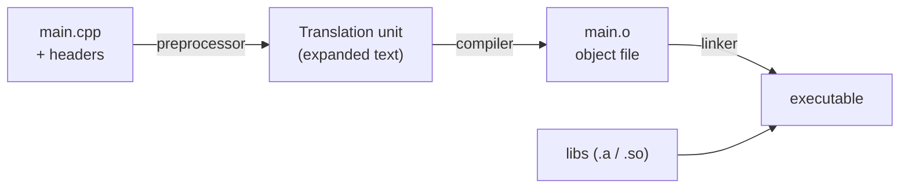

---
mdx:
  format: md
---

# C++ Complete Guide - Basic to Advanced

> **Note**: Sections marked **(Interview Imp)** are frequently asked in interviews.
>
> **How to read this file:** Every chapter has **📘 Terms Explained** tables. If you see a word you don't know, check the table right below that section.
>
> **Scope:** Modern C++ (C++11 through C++23, with notes on C++26): language fundamentals, memory model, OOP, RAII and smart pointers, templates and concepts, the STL and ranges, move semantics, lambdas, error handling, concurrency and the memory model, files/time/text, CMake and tooling (sanitizers, debuggers, testing), performance engineering, design idioms, DSA, interview questions, projects and a learning path.
>
> **Related files:** [02_Creational_Pattern.md](../design-patterns/01_LLD/02_Creational_Pattern.md) · [01_LLD_Design_Patterns.md](../design-patterns/01_LLD/01_LLD_Design_Patterns.md) · [01_Scalability_Pattern.md](../design-patterns/03_System_Design/01_Scalability_Pattern.md) · [Python_Complete_Guide.md](../ai-ml/Python_Complete_Guide.md)

| Level | Chapters |
|---|---|
| **Beginner** | 1-3 (toolchain, types, operators, strings, control flow, functions) |
| **Intermediate** | 4-8 (memory & pointers, OOP, RAII/smart pointers, templates, STL) |
| **Advanced** | 9-13 (move semantics, lambdas, modern features, error handling, concurrency) |
| **Professional** | 14-17 (system APIs, build/tools/testing, performance, design guidelines) |
| **Mastery** | 18-22 (DSA, interview questions, projects, learning path, cheat sheet) |

---

## Table of Contents
1. [Getting Started with C++](#1-getting-started-with-c)
   - [1.1 What is C++?](#11-what-is-c)
   - [1.2 Toolchain and Compilation Pipeline (Interview Imp)](#12-toolchain-and-compilation-pipeline-interview-imp)
   - [1.3 First Program](#13-first-program)
   - [1.4 Headers, Source Files, Declarations vs Definitions (Interview Imp)](#14-headers-source-files-declarations-vs-definitions-interview-imp)
2. [C++ Basics](#2-c-basics)
   - [2.1 Fundamental Types](#21-fundamental-types)
   - [2.2 Variables, Scope, Storage Duration, `const`](#22-variables-scope-storage-duration-const)
   - [2.3 Operators](#23-operators)
   - [2.4 References and Pointers (Intro)](#24-references-and-pointers-intro)
   - [2.5 Strings and I/O](#25-strings-and-io)
   - [2.6 Namespaces](#26-namespaces)
3. [Control Flow and Functions](#3-control-flow-and-functions)
   - [3.1 Control Flow](#31-control-flow)
   - [3.2 Functions](#32-functions)
4. [Memory, Pointers and Arrays (Interview Imp)](#4-memory-pointers-and-arrays-interview-imp)
   - [4.1 Process Memory Layout](#41-process-memory-layout)
   - [4.2 Pointers](#42-pointers)
   - [4.3 Undefined Behaviour (UB) (Interview Imp)](#43-undefined-behaviour-ub-interview-imp)
5. [Object-Oriented Programming in C++ (Interview Imp)](#5-object-oriented-programming-in-c-interview-imp)
   - [5.1 Classes and Structs](#51-classes-and-structs)
   - [5.2 Constructors, Destructors and the Rule of 0/3/5 (Interview Imp)](#52-constructors-destructors-and-the-rule-of-035-interview-imp)
   - [5.3 Inheritance, Virtual Functions, Polymorphism (Interview Imp)](#53-inheritance-virtual-functions-polymorphism-interview-imp)
   - [5.4 Operator Overloading, Friends, Conversion](#54-operator-overloading-friends-conversion)
   - [5.5 Enums, Unions, Structs as Data](#55-enums-unions-structs-as-data)
6. [RAII and Smart Pointers (Interview Imp)](#6-raii-and-smart-pointers-interview-imp)
   - [6.1 RAII: The Core Idiom of C++](#61-raii-the-core-idiom-of-c)
   - [6.2 `std::unique_ptr`: Exclusive Ownership (default choice)](#62-stdunique_ptr-exclusive-ownership-default-choice)
   - [6.3 `std::shared_ptr` and `std::weak_ptr`: Shared Ownership](#63-stdshared_ptr-and-stdweak_ptr-shared-ownership)
   - [6.4 Ownership Guidelines (Interview Imp)](#64-ownership-guidelines-interview-imp)
7. [Templates and Generic Programming (Interview Imp)](#7-templates-and-generic-programming-interview-imp)
   - [7.1 Function and Class Templates](#71-function-and-class-templates)
   - [7.2 Specialisation and Overloading](#72-specialisation-and-overloading)
   - [7.3 Variadic Templates, Fold Expressions, `if constexpr`](#73-variadic-templates-fold-expressions-if-constexpr)
   - [7.4 Concepts and Constraints (C++20) (Interview Imp)](#74-concepts-and-constraints-c20-interview-imp)
   - [7.5 Type Traits and Metaprogramming](#75-type-traits-and-metaprogramming)
   - [7.6 CRTP (Static Polymorphism)](#76-crtp-static-polymorphism)
   - [7.7 Template Pitfalls](#77-template-pitfalls)
8. [The Standard Library (STL) (Interview Imp)](#8-the-standard-library-stl-interview-imp)
   - [8.1 Overview](#81-overview)
   - [8.2 Containers and Complexity](#82-containers-and-complexity)
   - [8.3 Iterators](#83-iterators)
   - [8.4 Algorithms (`<algorithm>`, `<numeric>`)](#84-algorithms-algorithm-numeric)
   - [8.5 Ranges and Views (C++20/23)](#85-ranges-and-views-c2023)
   - [8.6 Utility Types](#86-utility-types)
9. [Move Semantics and Value Categories (Interview Imp)](#9-move-semantics-and-value-categories-interview-imp)
   - [9.1 lvalues and rvalues](#91-lvalues-and-rvalues)
   - [9.2 Why Move?](#92-why-move)
   - [9.3 Perfect Forwarding](#93-perfect-forwarding)
   - [9.4 Move-Related Rules](#94-move-related-rules)
10. [Lambdas and Functional Programming](#10-lambdas-and-functional-programming)
   - [10.1 Lambda Syntax](#101-lambda-syntax)
   - [10.2 Using Lambdas](#102-using-lambdas)
11. [Modern C++ Feature Map (C++11 to C++23)](#11-modern-c-feature-map-c11-to-c23)
12. [Error Handling](#12-error-handling)
   - [12.1 Exceptions](#121-exceptions)
   - [12.2 Alternatives to Exceptions](#122-alternatives-to-exceptions)
13. [Concurrency and Parallelism (Interview Imp)](#13-concurrency-and-parallelism-interview-imp)
   - [13.1 Threads](#131-threads)
   - [13.2 Data Races and Mutexes](#132-data-races-and-mutexes)
   - [13.3 Condition Variables (Producer/Consumer)](#133-condition-variables-producerconsumer)
   - [13.4 Atomics and the Memory Model (Interview Imp)](#134-atomics-and-the-memory-model-interview-imp)
   - [13.5 Futures, Async, Tasks](#135-futures-async-tasks)
   - [13.6 Parallel Algorithms and Other Tools](#136-parallel-algorithms-and-other-tools)
   - [13.7 Concurrency Rules of Thumb](#137-concurrency-rules-of-thumb)
14. [Files, Time, Randomness, Text and System APIs](#14-files-time-randomness-text-and-system-apis)
   - [14.1 File I/O and `std::filesystem`](#141-file-io-and-stdfilesystem)
   - [14.2 Time (`<chrono>`)](#142-time-chrono)
   - [14.3 Random Numbers](#143-random-numbers)
   - [14.4 Text, Unicode, Regex, Formatting](#144-text-unicode-regex-formatting)
   - [14.5 Command Line, Environment, Processes](#145-command-line-environment-processes)
   - [14.6 Interoperating with C and Other Languages](#146-interoperating-with-c-and-other-languages)
15. [Build Systems, Tooling and Testing](#15-build-systems-tooling-and-testing)
   - [15.1 CMake (the de facto standard) (Interview Imp)](#151-cmake-the-de-facto-standard-interview-imp)
   - [15.2 Debugging and Analysis Tools (Interview Imp)](#152-debugging-and-analysis-tools-interview-imp)
   - [15.3 Testing](#153-testing)
   - [15.4 Continuous Integration Checklist](#154-continuous-integration-checklist)
16. [Performance and Low-Level Optimisation (Interview Imp)](#16-performance-and-low-level-optimisation-interview-imp)
   - [16.1 Method](#161-method)
   - [16.2 CPU Caches and Data Layout](#162-cpu-caches-and-data-layout)
   - [16.3 Compiler Optimisations You Can Rely On](#163-compiler-optimisations-you-can-rely-on)
   - [16.4 Virtual Calls, `std::function`, Exceptions, RTTI Costs](#164-virtual-calls-stdfunction-exceptions-rtti-costs)
   - [16.5 SIMD, Intrinsics, GPUs](#165-simd-intrinsics-gpus)
   - [16.6 Micro-benchmark Traps](#166-micro-benchmark-traps)
17. [Design Guidelines, Patterns and Architecture in C++](#17-design-guidelines-patterns-and-architecture-in-c)
   - [17.1 C++ Core Guidelines (highlights)](#171-c-core-guidelines-highlights)
   - [17.2 Idioms (Interview Imp)](#172-idioms-interview-imp)
   - [17.3 GoF Design Patterns in Modern C++](#173-gof-design-patterns-in-modern-c)
   - [17.4 Project Layout and API Design](#174-project-layout-and-api-design)
   - [17.5 Memory Management Strategies Beyond `new`](#175-memory-management-strategies-beyond-new)
18. [Data Structures and Algorithms in C++](#18-data-structures-and-algorithms-in-c)
19. [C++ Interview Questions (Basic to Advanced)](#19-c-interview-questions-basic-to-advanced)
   - [19.1 Basics](#191-basics)
   - [19.2 OOP](#192-oop)
   - [19.3 Memory and Smart Pointers](#193-memory-and-smart-pointers)
   - [19.4 STL and Templates](#194-stl-and-templates)
   - [19.5 Concurrency, Modern C++ and Systems](#195-concurrency-modern-c-and-systems)
   - [19.6 Tricky Output Questions](#196-tricky-output-questions)
20. [Practice Projects by Level](#20-practice-projects-by-level)
21. [Learning Path](#21-learning-path)
22. [C++ Cheat Sheet](#22-c-cheat-sheet)

---

# 1. Getting Started with C++

## 1.1 What is C++?

**C++** is a compiled, statically typed, multi-paradigm language (procedural, object-oriented, generic, functional) created by Bjarne Stroustrup (1979 as "C with Classes", standardised 1998). It gives you **direct control over memory and hardware** with **zero-overhead abstractions**: "you don't pay for what you don't use".

| Strength | Why it matters |
|---|---|
| **Performance** | Compiles to native machine code; no garbage collector |
| **Control** | Memory layout, pointers, inline assembly, SIMD |
| **Abstraction** | Classes, templates, lambdas, RAII without runtime cost |
| **Huge ecosystem** | Game engines, browsers, databases, OS, finance, embedded, ML runtimes |
| **Interoperability** | Links with C, exposes APIs to Python/Rust/Java |
| **Standardised** | ISO standard every 3 years: C++11, 14, 17, 20, 23 (26 in progress) |

| Weakness | Mitigation |
|---|---|
| Steep learning curve, large language | Learn modern C++ subset + Core Guidelines |
| **Undefined behaviour** (UB), memory bugs | RAII, smart pointers, sanitizers, static analysis, `std::span`, bounds-checked hardening modes |
| Slow compile times, complex builds | Modules, precompiled headers, CMake + Ninja, ccache |
| No standard package manager | vcpkg, Conan, CPM |

**Where used:** game engines (Unreal), browsers (Chrome, Firefox), databases (MySQL, MongoDB, ClickHouse), OS & drivers, compilers (LLVM), HFT/finance, robotics, embedded/automotive, graphics (Vulkan, CUDA), ML runtimes (PyTorch, TensorFlow, ONNX Runtime internals).

#### 📘 Terms Explained

| Term | Simple meaning |
|---|---|
| **Compiled language** | Source is translated to machine code before running. |
| **Zero-overhead abstraction** | High-level features that compile to the same code you'd write by hand. |
| **Undefined behaviour (UB)** | Code the standard gives no meaning to; the program may crash or silently misbehave. |
| **RAII** | Resource Acquisition Is Initialization: objects own resources and free them in destructors. |
| **ISO standard** | Official language specification (C++20 = ISO/IEC 14882:2020). |
| **Static typing** | Types are checked at compile time. |

---

## 1.2 Toolchain and Compilation Pipeline (Interview Imp)



1. **Preprocessing:** handles `#include`, `#define`, `#if`; output is one big text file called a **translation unit**.
2. **Compilation:** parses, type-checks, optimises, emits machine code in an **object file** (`.o`/`.obj`).
3. **Linking:** joins object files and libraries into an executable/library; resolves symbols (undefined reference errors happen here).

```bash
g++ --version                              # or clang++ --version
g++ -std=c++20 -Wall -Wextra -Wpedantic -O2 main.cpp -o app
./app

g++ -E main.cpp > expanded.i               # preprocess only
g++ -S main.cpp                            # to assembly
g++ -c main.cpp                            # to object file
g++ main.o util.o -o app                   # link
```

| Flag | Meaning |
|---|---|
| `-std=c++20` / `c++23` | Language version |
| `-Wall -Wextra -Wpedantic -Werror` | Warnings (treat as errors in CI) |
| `-O0 -O1 -O2 -O3 -Os` | Optimisation levels (use `-O2` for release, `-O0 -g` for debugging) |
| `-g` | Debug symbols |
| `-fsanitize=address,undefined` | Catch memory errors and UB at run time |
| `-march=native` | Use all CPU instructions of this machine |
| `-I dir`, `-L dir`, `-l name` | Include path, library path, link library |
| `-DNAME=1` | Define macro |

**Compilers:** GCC (g++), Clang (LLVM), MSVC (Visual Studio), Intel oneAPI, Apple Clang. **Build systems:** CMake (standard), Make, Ninja, Bazel, Meson.

## 1.3 First Program

```cpp
#include <iostream>               // brings in declarations for std::cout etc.

int main() {                      // entry point; returns int (0 = success)
    std::cout << "Hello, World!\n";
    return 0;                     // optional in main
}
```

```cpp
#include <iostream>
#include <string>

int main() {
    std::string name;
    std::cout << "Name: ";
    std::getline(std::cin, name);
    std::cout << "Hello, " << name << '\n';
}
```

- `std::` is the **standard namespace**. Avoid `using namespace std;` in headers (name clashes).
- `\n` is a newline; `std::endl` also flushes the buffer (slower).
- C++23: `import std;` and `std::print("Hello {}\n", name);` (`<print>`).

## 1.4 Headers, Source Files, Declarations vs Definitions (Interview Imp)

```cpp
// math_utils.h  (declaration: the interface)
#pragma once                       // include guard (or #ifndef/#define/#endif)
int add(int a, int b);
inline int twice(int x) { return 2 * x; }   // inline: allowed in headers

// math_utils.cpp  (definition: the implementation)
#include "math_utils.h"
int add(int a, int b) { return a + b; }

// main.cpp
#include "math_utils.h"
int main() { return add(2, 3); }
```

| Concept | Meaning |
|---|---|
| **Declaration** | Tells the compiler a name exists (type/signature) |
| **Definition** | Provides the actual body/storage |
| **One Definition Rule (ODR)** | Each non-inline entity may be defined exactly once in the whole program |
| `#include <x>` vs `"x"` | System/library search vs project-local search first |
| **Include guard / `#pragma once`** | Prevents a header being included twice |
| **`inline`** | Allows definitions in headers without ODR violations |
| **`extern`** | Declares a global variable defined elsewhere |
| **Modules (C++20)** | `import` replaces textual includes: faster, no macro leakage (tool support improving) |

#### 📘 Terms Explained

| Term | Simple meaning |
|---|---|
| **Translation unit** | One `.cpp` file after all `#include`s are expanded. |
| **Object file** | Compiled but not yet linked machine code. |
| **Linker** | Combines object files and libraries into a program. |
| **Symbol** | A named function/variable known to the linker. |
| **Header** | File of declarations shared between source files. |
| **ODR** | One Definition Rule. |
| **Preprocessor** | Text-replacement stage before compilation (`#include`, `#define`). |
| **Sanitizer** | Compiler-inserted checks that report bugs at run time. |

---

# 2. C++ Basics

## 2.1 Fundamental Types

| Type | Typical size | Notes |
|---|---|---|
| `bool` | 1 byte | `true`/`false` |
| `char` | 1 byte | Character (signed or unsigned: implementation-defined) |
| `signed char`, `unsigned char` | 1 | |
| `short` | 2 | |
| `int` | 4 | At least 16 bits by standard |
| `long` | 4 or 8 | Platform dependent |
| `long long` | 8 | |
| `float` | 4 | ~7 digits |
| `double` | 8 | ~15 digits (default for literals) |
| `long double` | 8/12/16 | |
| `wchar_t`, `char8_t`, `char16_t`, `char32_t` | | Wide / Unicode characters |
| `void` | | No value |
| `std::nullptr_t` | | Type of `nullptr` |

**Fixed-width types** `<cstdint>`: `int8_t`, `uint8_t`, `int32_t`, `uint32_t`, `int64_t`, `uint64_t`, `size_t` (result of `sizeof`; unsigned), `ptrdiff_t`, `intptr_t`. Use these when size matters (binary formats, hashing).

```cpp
int a = 42;
long long big = 10'000'000'000LL;     // digit separators (C++14)
double pi = 3.14159;
float f = 1.5f;
char c = 'A';
bool ok = true;
unsigned int u = 5u;
auto x = 10;                          // deduced int
auto y = 2.5;                         // double
constexpr int N = 100;                // compile-time constant
const int M = N * 2;                  // run-time constant (cannot be modified)
int hex = 0xFF, bin = 0b1010, oct = 017;

sizeof(int); sizeof(a); alignof(double);
std::numeric_limits<int>::max();      // <limits>
```

### Initialisation (Interview Imp)

```cpp
int a = 5;          // copy initialisation
int b(5);           // direct
int c{5};           // brace (uniform) initialisation: prevents narrowing
int d{};            // value-initialised to 0
// int e{3.5};      // ERROR: narrowing conversion
int f;              // UNINITIALISED local: garbage value (UB to read)
```
Prefer `{}` initialisation; always initialise variables.

### Integer pitfalls
- **Signed overflow is UB** (e.g. `INT_MAX + 1`). **Unsigned overflow wraps** (well-defined).
- Mixing signed and unsigned: `-1 < 1u` is **false** (the -1 converts to a huge unsigned). Avoid unsigned for sizes you do arithmetic on; use `std::ssize()` or careful casts.
- Integer division truncates toward zero: `-7 / 2 == -3`, `-7 % 2 == -1`.
- Floating-point equality is unsafe: compare with an epsilon.

### Type conversions (casts)

```cpp
int i = static_cast<int>(3.99);              // normal checked-at-compile conversions
Base* b = dynamic_cast<Base*>(derived_ptr);  // safe downcast using RTTI (nullptr if wrong)
const_cast<char*>(cstr);                     // add/remove const (dangerous)
reinterpret_cast<uintptr_t>(ptr);            // bit-reinterpretation (dangerous)
(int)x;                                      // C-style cast: avoid
std::bit_cast<uint32_t>(1.0f);               // C++20: safe type punning
```

## 2.2 Variables, Scope, Storage Duration, `const`

| Storage | Lifetime |
|---|---|
| **Automatic** (local variables) | From declaration to end of block; on the stack |
| **Static** (`static`, globals) | Whole program |
| **Dynamic** (`new`/smart pointers) | Until freed; on the heap |
| **Thread-local** (`thread_local`) | Per thread |

```cpp
int global = 1;                     // static storage
void f() {
    int local = 2;                  // automatic
    static int counter = 0;         // initialised once; keeps value between calls
    ++counter;
}

const int k = 5;                    // value cannot change
const int* p1 = &k;                 // pointer to const int (cannot modify *p1)
int* const p2 = &x;                 // const pointer (cannot repoint p2)
const int* const p3 = &k;           // both
```
Read pointer declarations **right to left**: `const int* p` = "p is a pointer to an int that is const".

`const` vs `constexpr` vs `consteval` vs `constinit`

| Keyword | Meaning |
|---|---|
| `const` | Read-only after initialisation (may be set at run time) |
| `constexpr` | Can be evaluated at compile time (variables and functions) |
| `consteval` (C++20) | Function **must** run at compile time |
| `constinit` (C++20) | Static variable initialised at compile time (but mutable) |

## 2.3 Operators

| Group | Operators |
|---|---|
| Arithmetic | `+ - * / % ++ --` |
| Comparison | `== != < > <= >=` and **spaceship** `<=>` (C++20) |
| Logical | `&& \|\| !` (short-circuit) |
| Bitwise | `& \| ^ ~ << >>` |
| Assignment | `= += -= *= /= %= &= \|= ^= <<= >>=` |
| Member access | `.  ->  .*  ->*  ::` |
| Other | `?:  sizeof  alignof  typeid  new  delete  ,` |

```cpp
int x = 5;
int a = x++;     // a=5, x=6 (post)
int b = ++x;     // x=7, b=7 (pre; prefer pre-increment for iterators/objects)
bool r = (x > 3) && (x < 10);
unsigned flags = READ | WRITE;
flags &= ~WRITE;                              // clear a bit
bool has = (flags & READ) != 0;
auto cmp = (a <=> b);                         // < 0, == 0, > 0 ordering
```
Evaluation order of function arguments is **unspecified**; `i = i++ + 1` was UB (defined partly since C++17). Don't write such code.

## 2.4 References and Pointers (Intro)

```cpp
int x = 10;
int& r = x;          // reference: another name for x (must be initialised, cannot be reseated)
r = 20;              // x is now 20
int* p = &x;         // pointer: holds the address of x (can be null, can be reseated)
*p = 30;             // dereference: x is now 30
p = nullptr;         // null pointer (use nullptr, not NULL or 0)
```

| | Reference `T&` | Pointer `T*` |
|---|---|---|
| Can be null | No | Yes |
| Can be reseated | No | Yes |
| Must be initialised | Yes | No (should be) |
| Syntax | Used like the object | Needs `*` and `->` |
| Typical use | Function parameters, aliases | Optional/owning/arrays/data structures |

Full memory model is in Chapter 4.

## 2.5 Strings and I/O

```cpp
#include <string>
#include <string_view>
#include <iostream>
#include <sstream>
#include <iomanip>

std::string s = "Hello";
s += ", World";
s.size(); s.length(); s.empty(); s[0]; s.at(0);      // at() bounds-checked, throws
s.substr(0, 5); s.find("World"); s.replace(0, 5, "Bye"); s.erase(0, 1);
s.push_back('!'); s.c_str(); s.compare("x");
std::to_string(42); std::stoi("42"); std::stod("3.5");     // may throw invalid_argument/out_of_range
s == "x";  s < t;                                            // lexicographic compare

std::string_view v = s;       // non-owning view of characters (no copy). Beware dangling views!
std::cout << std::setw(8) << std::setprecision(3) << std::fixed << 3.14159 << '\n';

std::ostringstream os; os << "id=" << 5; std::string out = os.str();
std::istringstream is("10 20 30"); int a, b, c; is >> a >> b >> c;

int n; std::cin >> n;                     // formatted input
std::getline(std::cin, line);             // whole line
std::cerr << "error\n";                   // unbuffered error stream

// C++20 / C++23 formatting
#include <format>
std::string msg = std::format("{} is {:>5} years, pi={:.2f}", "Asha", 28, 3.14159);
std::print("{}\n", msg);                 // C++23 <print>
```
`std::string` has small-string optimisation (short strings live inside the object, no heap). It stores bytes; Unicode needs care (`char8_t`, ICU, UTF-8 libraries).

## 2.6 Namespaces

```cpp
namespace shop {
    int price = 10;
    namespace detail { void helper(); }      // nested
}
shop::price;
using shop::price;                           // bring one name in
namespace sd = shop::detail;                 // alias
namespace { int fileLocal = 1; }             // anonymous namespace: internal linkage (visible only in this file)
```

#### 📘 Terms Explained

| Term | Simple meaning |
|---|---|
| **Narrowing conversion** | Conversion that may lose data (double → int); `{}` forbids it. |
| **Storage duration** | How long a variable's memory lives. |
| **`constexpr`** | Can be computed by the compiler at compile time. |
| **Reference** | An alias for an existing object. |
| **Pointer** | A variable holding a memory address. |
| **`nullptr`** | The null pointer constant. |
| **`size_t`** | Unsigned integer type used for sizes and indices. |
| **`string_view`** | Lightweight read-only view into character data owned elsewhere. |
| **SSO** | Small String Optimisation: short strings stored inline. |
| **Namespace** | Named scope preventing name clashes. |
| **Spaceship operator `<=>`** | One operator that generates all comparison operators. |

---

# 3. Control Flow and Functions

## 3.1 Control Flow

```cpp
if (x > 0) { ... } else if (x == 0) { ... } else { ... }
if (auto it = m.find(k); it != m.end()) { use(it->second); }     // C++17 init-statement
if constexpr (std::is_integral_v<T>) { ... }                      // compile-time branch (templates)

switch (cmd) {
    case 1: doA(); break;                    // forgetting break = fall-through (use [[fallthrough]] when intended)
    case 2: case 3: doB(); break;
    default: break;
}

for (int i = 0; i < n; ++i) { ... }
for (const auto& item : items) { ... }       // range-based for (use const auto& to avoid copies)
for (auto& [key, value] : map) { ... }       // structured bindings (C++17)
while (cond) { ... }
do { ... } while (cond);
break; continue; goto label;                 // goto: avoid
```
Ranges (C++20): `for (int x : v | std::views::filter(even) | std::views::transform(sq))`.

## 3.2 Functions

```cpp
int add(int a, int b) { return a + b; }
int add(int a, int b, int c) { return a + b + c; }          // overloading (by parameter types, not return type)
double scale(double v, double k = 2.0);                      // default argument (in declaration)
inline int sq(int x) { return x * x; }
constexpr int fact(int n) { return n <= 1 ? 1 : n * fact(n - 1); }
static_assert(fact(5) == 120);                               // checked at compile time
auto area(double w, double h) -> double { return w * h; }    // trailing return type
auto twice(auto x) { return x * 2; }                         // abbreviated template (C++20)
[[nodiscard]] int compute();                                 // warn if caller ignores result
void fail [[noreturn]] ();
int main(int argc, char* argv[]);
```

### Parameter passing (Interview Imp)

| Style | Syntax | Use for |
|---|---|---|
| By value | `void f(T x)` | Small/cheap types (int, double, pointers, `string_view`, `span`); also when you need your own copy / "sink" parameters (then `std::move` it) |
| By const reference | `void f(const T& x)` | Large read-only objects (strings, vectors) |
| By non-const reference | `void f(T& x)` | Modify caller's object (out/in-out parameters) |
| By rvalue reference | `void f(T&& x)` | Take ownership of temporaries (move) |
| By pointer | `void f(T* p)` | Optional (nullable) argument, C APIs |
| Return by value | `T f()` | Default. Compilers apply **copy elision / (N)RVO**; C++17 guarantees elision for prvalues |

```cpp
void print(const std::string& s);          // no copy
void inc(int& x) { ++x; }                  // modifies caller's variable
std::vector<int> make() { std::vector<int> v(1000); return v; }   // no copy: elided/moved
```
**Never return a reference or pointer to a local variable** (dangling → UB).
Prefer returning values/`std::optional`/`std::expected` over output parameters. Use `std::span<const T>` for "any contiguous sequence" parameters.

### Function pointers, `std::function`, callables

```cpp
int (*fp)(int, int) = add;                   // function pointer
std::function<int(int, int)> fn = add;       // type-erased callable (has overhead; heap possible)
auto lam = [](int a, int b) { return a + b; };    // lambda (see Chapter 10): usually fastest
template <class F> void run(F&& f) { f(); }       // templates: zero overhead
```

### Recursion and the stack
Each call uses stack memory; very deep recursion → stack overflow (segfault). Compilers may optimise tail calls but the standard doesn't guarantee it.

### `main`, exit codes, `argc/argv`
`return 0` = success. `std::exit(code)`, `std::abort()`, `std::atexit`. Use `std::span(argv, argc)` to iterate safely.

#### 📘 Terms Explained

| Term | Simple meaning |
|---|---|
| **Overloading** | Several functions with the same name and different parameters. |
| **Default argument** | Value used when the caller omits the argument. |
| **Range-based for** | Loop directly over container elements. |
| **Structured binding** | Unpacking `pair`/`tuple`/struct into named variables (`auto [a, b]`). |
| **Copy elision / RVO** | Compiler constructs a returned object directly in the caller, skipping copies. |
| **Dangling reference** | Reference to an object that no longer exists. |
| **Type erasure** | Hiding a concrete type behind a uniform interface (`std::function`). |
| **`[[nodiscard]]`** | Attribute making the compiler warn if a result is ignored. |
| **Init-statement in `if`** | `if (init; condition)` limiting a variable's scope. |

---

# 4. Memory, Pointers and Arrays (Interview Imp)

## 4.1 Process Memory Layout

```
High addresses
┌──────────────────────┐
│ Stack                │ local variables, function frames; grows downward; fast, small (~1-8 MB)
│          ↓           │
│                      │
│          ↑           │
│ Heap (free store)    │ new / malloc; grows upward; large, manual lifetime
├──────────────────────┤
│ BSS                  │ zero-initialised globals/statics
│ Data                 │ initialised globals/statics
│ Text (code)          │ machine instructions, string literals (read-only)
└──────────────────────┘
Low addresses
```

| | Stack | Heap |
|---|---|---|
| Allocation | Automatic, just moves a pointer (very fast) | `new`/`malloc` (slower, may lock) |
| Lifetime | Until end of scope | Until you free it |
| Size | Small | Large |
| Fragmentation | None | Possible |
| Failure | Stack overflow | `std::bad_alloc` / `nullptr` |

## 4.2 Pointers

```cpp
int x = 10;
int* p = &x;            // p holds address of x
*p = 20;                // write through pointer
int** pp = &p;          // pointer to pointer
void* vp = p;           // untyped pointer; cast back before use
p == nullptr; if (p) { }
```

### Pointer arithmetic and arrays
```cpp
int a[5] = {1, 2, 3, 4, 5};
int* p = a;             // array decays to pointer to first element
*(p + 2) == a[2];       // a[i] is *(a + i)
p++;                    // moves by sizeof(int) bytes
ptrdiff_t d = &a[4] - &a[1];   // 3 (elements)
```
- `sizeof(a)` is 20 for the array but `sizeof(p)` is 8 (pointer): arrays **decay** to pointers when passed to functions, losing their size. Pass `std::span`/`std::array`/`std::vector` instead.
- Out-of-bounds access is UB (no automatic check).
- Multidimensional: `int m[3][4]` is contiguous (row-major).

### Dynamic memory

```cpp
int* p = new int(5);            // allocate one int on heap
delete p;                       // free it
int* arr = new int[100]{};      // array of 100 zeros
delete[] arr;                   // MUST use delete[] for new[]
```
**Common bugs:**

| Bug | Result |
|---|---|
| Memory leak (forget `delete`) | Memory grows until exhaustion |
| Double delete | Heap corruption / crash |
| Use after free (dangling pointer) | UB; may "work" then crash |
| `delete` vs `delete[]` mismatch | UB |
| Buffer overflow/underflow | Corruption, security holes |
| Uninitialised pointer | Wild writes |
| Returning address of local | Dangling pointer |
| Mixing `malloc/free` with `new/delete` | UB |

**Modern rule:** don't write raw `new`/`delete` in application code; use containers and smart pointers (Chapter 6).

### C-style strings and arrays (know them, avoid them)
```cpp
const char* s = "hi";           // string literal (read-only), null-terminated '\0'
char buf[16]; std::strncpy(buf, s, sizeof buf - 1);
std::strlen(s); std::strcmp(a, b);
```
Prefer `std::string`, `std::array<T, N>`, `std::vector<T>`, `std::span`.

### `const` correctness, `volatile`, alignment, `sizeof` of structs
```cpp
struct A { char c; int i; char d; };   // sizeof is 12 on typical ABIs (padding for alignment)
struct B { int i; char c; char d; };   // sizeof is 8: order members from large to small
alignas(64) char cacheLine[64];        // align to cache line
```

## 4.3 Undefined Behaviour (UB) (Interview Imp)

UB means the standard places **no requirements** on the program; the optimiser may assume UB never happens, so effects can appear far from the cause.

| Common UB | Example |
|---|---|
| Signed integer overflow | `INT_MAX + 1` |
| Out-of-bounds access | `a[10]` on `int a[5]` |
| Null / dangling dereference | `*nullptr` |
| Use of uninitialised variable | `int x; use(x);` |
| Data race | Two threads write same non-atomic variable |
| Violating strict aliasing | Reading a `float` through an `int*` |
| Modifying a `const` object / string literal | `char* s = "x"; s[0] = 'y';` |
| Invalid shift | `1 << 32` for 32-bit int |
| Missing return in non-void function | |
| Calling virtual function from constructor on derived (wrong dispatch) | Not UB but surprising |
| Iterator invalidation | Using iterator after `vector` reallocates |

Tools: `-fsanitize=address,undefined,thread`, Valgrind, static analysers (clang-tidy, cppcheck), compiler warnings, hardened libstdc++ (`-D_GLIBCXX_ASSERTIONS`), C++26 contracts/hardening.

#### 📘 Terms Explained

| Term | Simple meaning |
|---|---|
| **Stack** | Fast automatic memory for local variables. |
| **Heap / free store** | Memory you allocate and free explicitly. |
| **Pointer decay** | Array turning into a pointer to its first element. |
| **Memory leak** | Allocated memory never released. |
| **Dangling pointer** | Pointer to freed or out-of-scope memory. |
| **Padding / alignment** | Extra bytes inserted so members sit at addresses the CPU likes. |
| **Row-major** | Rows stored one after another in memory. |
| **Strict aliasing** | Rule that different types can't refer to the same memory (mostly). |
| **Data race** | Unsynchronised concurrent access with at least one write. |

---

# 5. Object-Oriented Programming in C++ (Interview Imp)

## 5.1 Classes and Structs

```cpp
class Account {
public:                                           // interface
    Account(std::string id, double balance = 0.0)
        : id_(std::move(id)), balance_(balance) {}      // member initialiser list (preferred over assignment)

    void deposit(double amt) {
        if (amt <= 0) throw std::invalid_argument("amount must be positive");
        balance_ += amt;
    }
    [[nodiscard]] double balance() const noexcept { return balance_; }   // const member function
    static int count() { return count_; }

private:                                          // hidden state
    std::string id_;
    double balance_;
    inline static int count_ = 0;                 // inline static (C++17): defined in class
};

Account a{"A1", 100};
a.deposit(50);
```

- `struct` is identical to `class` except default access is `public` (use for plain data); `class` defaults to `private`.
- **Member initialiser list** runs before the body, in **declaration order** (not list order). Required for `const`/reference members and base classes.
- `const` member functions promise not to modify the object; mark every non-mutating method `const`. `mutable` members may change in const methods (caches, mutexes).
- `explicit` on single-argument constructors/conversion operators stops accidental implicit conversions.
- `this` is a pointer to the current object. `static` members belong to the class.
- In-class default member initialisers: `int x_ = 0;`.

```cpp
class Widget {
    explicit Widget(int size);                    // no implicit int -> Widget
    Widget() = default;                           // ask for the compiler version
    Widget(const Widget&) = delete;               // forbid copying
};
```

### Access control
`public` (everyone), `protected` (class + derived), `private` (class only), `friend` (grants a specific function/class access: use sparingly).

## 5.2 Constructors, Destructors and the Rule of 0/3/5 (Interview Imp)

**Special member functions:** default ctor, destructor, copy ctor, copy assignment, move ctor, move assignment.

```cpp
class Buffer {
    size_t n_;
    int* data_;
public:
    explicit Buffer(size_t n) : n_(n), data_(new int[n]{}) {}          // acquire
    ~Buffer() { delete[] data_; }                                       // release

    Buffer(const Buffer& o) : n_(o.n_), data_(new int[o.n_]) {          // copy: deep copy
        std::copy(o.data_, o.data_ + n_, data_);
    }
    Buffer& operator=(const Buffer& o) {                                // copy assign
        if (this != &o) { Buffer tmp(o); swap(tmp); }                   // copy-and-swap: strong exception safety
        return *this;
    }
    Buffer(Buffer&& o) noexcept : n_(std::exchange(o.n_, 0)), data_(std::exchange(o.data_, nullptr)) {}   // move: steal
    Buffer& operator=(Buffer&& o) noexcept {
        if (this != &o) { delete[] data_; n_ = std::exchange(o.n_, 0); data_ = std::exchange(o.data_, nullptr); }
        return *this;
    }
    void swap(Buffer& o) noexcept { std::swap(n_, o.n_); std::swap(data_, o.data_); }
};
```

| Rule | Statement |
|---|---|
| **Rule of Zero** (best) | Design classes so they need **none** of the five: hold resources in members that manage themselves (`std::vector`, `std::string`, `std::unique_ptr`) |
| **Rule of Three** | If you define a destructor, copy ctor or copy assignment, define all three |
| **Rule of Five** | Plus move ctor and move assignment |

- Compiler-generated move operations are **not** generated if you declare a destructor or copy operation.
- Mark moves `noexcept` so `std::vector` uses them when growing.
- **Construction order:** base classes (in declaration order) → members (declaration order) → body. **Destruction** is the reverse.
- Never call virtual functions from constructors/destructors (dispatch stays in the class being constructed).
- Delegating constructors: `Widget() : Widget(10) {}`. Inheriting constructors: `using Base::Base;`.

```cpp
class Rule0 {
    std::string name_;
    std::vector<int> data_;
    std::unique_ptr<Impl> impl_;
    // compiler generates correct destructor and moves; copy is deleted because unique_ptr is move-only
};
```

## 5.3 Inheritance, Virtual Functions, Polymorphism (Interview Imp)

```cpp
class Shape {
public:
    virtual ~Shape() = default;                       // MUST be virtual in polymorphic base classes
    virtual double area() const = 0;                  // pure virtual => abstract class
    virtual void describe() const { std::cout << "area=" << area() << '\n'; }
};

class Circle final : public Shape {                   // final: cannot be derived from
    double r_;
public:
    explicit Circle(double r) : r_(r) {}
    double area() const override { return std::numbers::pi * r_ * r_; }   // override: compiler checks it overrides
};
class Rect : public Shape {
    double w_, h_;
public:
    Rect(double w, double h) : w_(w), h_(h) {}
    double area() const override { return w_ * h_; }
};

std::vector<std::unique_ptr<Shape>> shapes;
shapes.push_back(std::make_unique<Circle>(2.0));
shapes.push_back(std::make_unique<Rect>(3, 4));
for (const auto& s : shapes) s->describe();           // dynamic dispatch through vtable
```

**How virtual dispatch works:** each polymorphic class has a hidden **vtable** (table of function pointers); each object has a hidden **vptr** to its class's vtable. A virtual call = load vptr → index vtable → indirect call (small cost; prevents inlining).

```
Circle object:  [ vptr ] --> Circle vtable: [ ~Circle, area, describe ]
                [ r_   ]
```

| Concept | Notes |
|---|---|
| **Virtual destructor** | Deleting a derived object via base pointer without it = UB (leak/corruption) |
| `override` / `final` | Always write `override`; catches signature mismatches |
| **Slicing** | Copying a derived object into a base **value** chops off the derived part. Pass polymorphic objects by pointer/reference |
| **Pure virtual** | `= 0`; class becomes abstract; may still have a body |
| **Interface** | Class with only pure virtual functions (+ virtual destructor) |
| **Multiple inheritance** | Allowed; the **diamond problem** is solved with `virtual` inheritance (`class D : public virtual B`) |
| **Static vs dynamic binding** | Non-virtual call resolved at compile time; virtual at run time |
| **RTTI** | `typeid`, `dynamic_cast` need polymorphic types; can be disabled (`-fno-rtti`) |
| **Name hiding** | A derived function with the same name hides all base overloads; use `using Base::f;` |
| **Default arguments + virtual** | Default args are bound statically: don't change them in overrides |

```cpp
Shape s = Circle(2);       // SLICING: only the Shape part is copied. Don't.
Shape& r = circle;         // fine
```

### Composition over inheritance
"Has-a" beats "is-a" when you only need reuse. Inherit publicly only for true substitutability (Liskov). Private inheritance models "implemented-in-terms-of".

### Alternatives to virtual polymorphism
| Technique | Cost / use |
|---|---|
| Templates / concepts (static polymorphism) | Zero runtime overhead, compile-time binding |
| CRTP | Static polymorphism via base template |
| `std::variant` + `std::visit` | Closed set of types, value semantics, no heap |
| `std::function`, type erasure | Runtime polymorphism without a base class |

## 5.4 Operator Overloading, Friends, Conversion

```cpp
class Vec2 {
public:
    double x{}, y{};
    Vec2 operator+(const Vec2& o) const { return {x + o.x, y + o.y}; }
    Vec2& operator+=(const Vec2& o) { x += o.x; y += o.y; return *this; }
    bool operator==(const Vec2&) const = default;                     // C++20 defaulted comparison
    auto operator<=>(const Vec2&) const = default;                    // all six comparisons
    double& operator[](size_t i) { return i == 0 ? x : y; }
    explicit operator bool() const { return x != 0 || y != 0; }
    friend std::ostream& operator<<(std::ostream& os, const Vec2& v) { return os << '(' << v.x << ',' << v.y << ')'; }
};
Vec2 operator*(double k, const Vec2& v) { return {k * v.x, k * v.y}; }   // non-member for symmetric ops
```
Guidelines: overload to match natural meaning; keep operators consistent (`+` with `+=`); don't overload `&&`, `||`, `,`; `operator()` makes **functors**; `operator<<` is a non-member; user-defined literals: `operator""_km`.

## 5.5 Enums, Unions, Structs as Data

```cpp
enum class Color : uint8_t { Red, Green, Blue };     // scoped, strongly typed (prefer over plain enum)
Color c = Color::Green;
int v = static_cast<int>(c);
std::to_underlying(c);                                // C++23

struct Point { double x, y; };                        // aggregate: Point p{1.0, 2.0};
auto [x, y] = p;                                      // structured binding
union U { int i; float f; };                          // all members share memory; prefer std::variant
```
**Bit-fields:** `unsigned flags : 3;` (layout is implementation-defined).

#### 📘 Terms Explained

| Term | Simple meaning |
|---|---|
| **Member initialiser list** | `: a_(x), b_(y)` initialises members before the body runs. |
| **`const` member function** | Method that doesn't change the object. |
| **Rule of Zero / Three / Five** | Guidelines for which special member functions to write. |
| **Copy / Move** | Duplicate resources / steal them from a temporary. |
| **vtable / vptr** | Per-class table of virtual functions / per-object pointer to it. |
| **Pure virtual** | Virtual function with no implementation, forcing derived classes to provide one. |
| **Slicing** | Losing the derived part when copying into a base-class object. |
| **Friend** | Function or class allowed to access private members. |
| **Functor** | Object that can be called like a function. |
| **Aggregate** | Simple struct/array that can be brace-initialised. |
| **Scoped enum** | `enum class`: names don't leak and don't convert to int implicitly. |

---

# 6. RAII and Smart Pointers (Interview Imp)

## 6.1 RAII: The Core Idiom of C++

**Resource Acquisition Is Initialization:** bind a resource's lifetime to an object's lifetime. The constructor acquires it; the destructor releases it. Destructors run automatically when the scope ends, **including during exceptions** (stack unwinding), so cleanup can't be forgotten.

```cpp
// BAD: manual
void f() {
    FILE* fp = std::fopen("a.txt", "r");
    process(fp);                  // if this throws, fp leaks
    std::fclose(fp);
}

// GOOD: RAII wrapper
class File {
    FILE* fp_;
public:
    explicit File(const char* path) : fp_(std::fopen(path, "r")) { if (!fp_) throw std::runtime_error("open failed"); }
    ~File() { if (fp_) std::fclose(fp_); }
    File(const File&) = delete; File& operator=(const File&) = delete;
    FILE* get() const { return fp_; }
};
```
RAII types in the standard library: `std::vector`/`string` (memory), `unique_ptr`/`shared_ptr` (heap objects), `std::lock_guard`/`unique_lock`/`scoped_lock` (mutexes), `std::fstream` (files), `std::jthread` (threads). Also `std::scope_exit`-style guards (`absl::Cleanup`, `gsl::finally`).

## 6.2 `std::unique_ptr`: Exclusive Ownership (default choice)

```cpp
#include <memory>
auto p = std::make_unique<Widget>(42);          // prefer make_unique (exception-safe)
p->use(); (*p).use();
Widget* raw = p.get();                          // observe without owning
auto q = std::move(p);                          // transfer ownership; p becomes null
p.reset();  p.release();                        // delete / give up ownership
auto arr = std::make_unique<int[]>(100);        // arrays: automatic delete[]

std::unique_ptr<FILE, decltype(&fclose)> f(fopen("a", "r"), &fclose);   // custom deleter
```
Zero overhead (same size as a raw pointer by default). Move-only. Return it from factories: `std::unique_ptr<Shape> make(...)`.

## 6.3 `std::shared_ptr` and `std::weak_ptr`: Shared Ownership

```cpp
auto a = std::make_shared<Config>();           // one allocation for object + control block
auto b = a;                                    // reference count = 2
a.use_count();                                 // 2
a.reset();                                     // count = 1; object freed when count hits 0

struct Node {
    std::shared_ptr<Node> next;
    std::weak_ptr<Node> parent;                // weak_ptr breaks reference cycles
};
if (auto sp = weak.lock()) { sp->use(); }      // lock() gives shared_ptr or empty if destroyed
```
- **Control block** holds strong count, weak count, deleter; counts are atomic (thread-safe counting, but the *object* is not automatically thread-safe).
- **Cycles leak:** `A→shared→B→shared→A` never reaches 0. Use `weak_ptr` for back references.
- `enable_shared_from_this<T>` lets an object create a `shared_ptr` to itself.
- Costs: extra control block, atomic ops on copies. Prefer `unique_ptr`; convert to shared only when ownership is truly shared.
- Pass `shared_ptr` by `const&` (or raw pointer/reference) unless the callee shares ownership.

## 6.4 Ownership Guidelines (Interview Imp)

| Need | Use |
|---|---|
| Local object | Stack variable (no pointer at all) |
| Heap object with one owner | `std::unique_ptr` |
| Shared ownership | `std::shared_ptr` (+ `weak_ptr` for non-owning observers) |
| Non-owning access, never null | `T&` |
| Non-owning access, may be null | `T*` (raw pointer is fine as an *observer*) |
| Optional value | `std::optional<T>` |
| Collection | `std::vector<T>` / other containers |
| Polymorphic collection | `std::vector<std::unique_ptr<Base>>` |
| Interop with C APIs | `.get()`, custom deleters |

Rules: **no naked `new`/`delete`**; never `std::shared_ptr<T>(rawPtr)` twice from the same raw pointer; don't `delete` something you got from `.get()`; `auto_ptr` is removed.

#### 📘 Terms Explained

| Term | Simple meaning |
|---|---|
| **RAII** | Resource lifetime tied to object lifetime. |
| **Stack unwinding** | Destructors of local objects run when an exception propagates. |
| **Ownership** | Responsibility for freeing a resource. |
| **Smart pointer** | Object that behaves like a pointer and manages the lifetime of what it points to. |
| **Control block** | Hidden structure holding reference counts for `shared_ptr`. |
| **Reference cycle** | Objects owning each other, so counts never reach zero. |
| **Deleter** | Function that releases a resource. |
| **Observer pointer** | Non-owning pointer. |

---

# 7. Templates and Generic Programming (Interview Imp)

## 7.1 Function and Class Templates

A **template** is a blueprint the compiler instantiates for each set of types used, giving type-safe generic code with no runtime cost (**compile-time polymorphism**).

```cpp
template <typename T>
T maxOf(T a, T b) { return a > b ? a : b; }

maxOf(3, 7);            // T deduced as int
maxOf(2.5, 1.5);        // double
maxOf<double>(3, 2.5);  // explicit

template <typename T, size_t N>
class Stack {
    std::array<T, N> data_{};
    size_t size_ = 0;
public:
    void push(const T& v) { data_[size_++] = v; }
    T pop() { return data_[--size_]; }
    bool empty() const { return size_ == 0; }
};
Stack<int, 16> s;

template <typename T> using Vec = std::vector<T>;        // alias template
template <typename T> constexpr T pi = T(3.14159265358979L);   // variable template
```
- Template code lives in **headers** (the compiler needs the definition at instantiation). 
- **CTAD** (C++17): `std::pair p{1, 2.5};` `std::vector v{1, 2, 3};` deduce class template arguments.
- Errors appear at instantiation and can be long; concepts (below) fix that.

## 7.2 Specialisation and Overloading

```cpp
template <typename T> struct TypeName { static constexpr const char* value = "unknown"; };
template <> struct TypeName<int> { static constexpr const char* value = "int"; };      // full specialisation
template <typename T> struct TypeName<T*> { static constexpr const char* value = "pointer"; };   // partial (class templates only)
```
Function templates cannot be partially specialised: use overloading or `if constexpr`.

## 7.3 Variadic Templates, Fold Expressions, `if constexpr`

```cpp
template <typename... Args>
void print(const Args&... args) { ((std::cout << args << ' '), ...); std::cout << '\n'; }   // fold expression (C++17)

template <typename... Ts> auto sum(Ts... xs) { return (xs + ...); }
sum(1, 2, 3, 4);             // 10

template <typename T>
std::string describe(const T& v) {
    if constexpr (std::is_integral_v<T>) return "int:" + std::to_string(v);
    else if constexpr (std::is_same_v<T, std::string>) return "str:" + v;
    else return "other";
}
// perfect forwarding with a parameter pack
template <typename T, typename... Args>
std::unique_ptr<T> make(Args&&... args) { return std::unique_ptr<T>(new T(std::forward<Args>(args)...)); }
```

## 7.4 Concepts and Constraints (C++20) (Interview Imp)

Concepts name requirements on template parameters and give clear error messages.

```cpp
#include <concepts>
template <typename T>
concept Numeric = std::integral<T> || std::floating_point<T>;

template <Numeric T> T square(T x) { return x * x; }
auto cube(Numeric auto x) { return x * x * x; }                 // abbreviated syntax

template <typename T>
concept Printable = requires(T t, std::ostream& os) { { os << t } -> std::same_as<std::ostream&>; };

template <typename C>
    requires std::ranges::range<C> && Printable<std::ranges::range_value_t<C>>
void printAll(const C& c) { for (const auto& x : c) std::cout << x << ' '; }
```
Standard concepts: `std::integral`, `floating_point`, `same_as`, `derived_from`, `convertible_to`, `invocable`, `regular`, `copyable`, `movable`, `totally_ordered`, `ranges::range`, `input_iterator`, ...

Older technique **SFINAE** ("Substitution Failure Is Not An Error"): `std::enable_if_t<...>` removes overloads that don't fit. Concepts replace most of it.

## 7.5 Type Traits and Metaprogramming

```cpp
#include <type_traits>
std::is_integral_v<int>; std::is_pointer_v<T>; std::is_same_v<A, B>; std::is_base_of_v<Base, D>;
std::remove_reference_t<T>; std::decay_t<T>; std::conditional_t<cond, A, B>; std::invoke_result_t<F, Args...>;
static_assert(std::is_trivially_copyable_v<Packet>, "must be memcpy-able");

constexpr int fib(int n) { return n < 2 ? n : fib(n - 1) + fib(n - 2); }
constexpr int f20 = fib(20);                    // computed during compilation
consteval int sq(int x) { return x * x; }       // always compile time
```
`constexpr` containers (`std::vector`, `std::string`) work in C++20 inside constant evaluation.

## 7.6 CRTP (Static Polymorphism)

```cpp
template <typename Derived>
struct Shape {
    double area() const { return static_cast<const Derived*>(this)->areaImpl(); }   // resolved at compile time
};
struct Square : Shape<Square> {
    double s;
    double areaImpl() const { return s * s; }
};
```
Used for mixins and avoiding virtual-call overhead. C++23 "deducing this" (`this auto&& self`) often replaces CRTP.

## 7.7 Template Pitfalls

| Pitfall | Advice |
|---|---|
| Code bloat (each instantiation duplicates code) | Move non-dependent code to non-template helper |
| Long error messages | Concepts, `static_assert` |
| Needing definitions in headers → slow builds | Explicit instantiation (`extern template`), modules |
| Two-phase name lookup: dependent names need `typename`/`template` | `typename T::value_type`, `obj.template get<0>()` |
| Forwarding references vs rvalue references | `T&&` with deduced `T` is a *forwarding reference* |
| Overloading templates ambiguously | Prefer constrained overloads |

#### 📘 Terms Explained

| Term | Simple meaning |
|---|---|
| **Template** | Code pattern the compiler fills in with concrete types. |
| **Instantiation** | Compiler generating a concrete version for given types. |
| **CTAD** | Class Template Argument Deduction: type arguments inferred from constructor arguments. |
| **Specialisation** | A custom version of a template for particular types. |
| **Variadic template** | Template taking any number of type/value arguments. |
| **Fold expression** | Applying an operator over a parameter pack. |
| **Concept** | Named compile-time requirement on types. |
| **SFINAE** | Invalid substitutions silently discard a template candidate. |
| **Type trait** | Compile-time query/transformation of types (`is_integral`). |
| **CRTP** | Class derives from a template instantiated with itself. |
| **Forwarding reference** | `T&&` in a deduced context: binds both lvalues and rvalues. |

---

# 8. The Standard Library (STL) (Interview Imp)

## 8.1 Overview

The STL is built on three ideas: **containers** (store data), **iterators** (generalised pointers), **algorithms** (operate on ranges via iterators). Since C++20, **ranges** and **views** simplify this.

## 8.2 Containers and Complexity

| Container | Header | Structure | Access | Insert/erase | Notes |
|---|---|---|---|---|---|
| `std::array<T,N>` | `<array>` | Fixed contiguous | O(1) | n/a | Stack/static storage, size known at compile time |
| `std::vector<T>` | `<vector>` | Dynamic array | O(1) | O(1) amortized at end, O(n) middle | **Default container**; cache-friendly |
| `std::deque<T>` | `<deque>` | Chunked array | O(1) | O(1) both ends | |
| `std::list<T>` | `<list>` | Doubly linked | O(n) | O(1) given iterator | Cache-hostile; rarely best |
| `std::forward_list<T>` | `<forward_list>` | Singly linked | O(n) | O(1) after | |
| `std::set<T>`, `map<K,V>` | `<set>`,`<map>` | Red-black tree (ordered) | O(log n) | O(log n) | Sorted iteration, range queries |
| `std::multiset`, `multimap` | | Ordered, duplicates | | | |
| `std::unordered_set/map` | `<unordered_*>` | Hash table | O(1) avg, O(n) worst | O(1) avg | Needs `std::hash`; default fast lookup |
| `std::stack`, `queue`, `priority_queue` | adaptors | Wrap deque/vector | | | `priority_queue` = max-heap |
| `std::flat_map/flat_set` (C++23) | `<flat_map>` | Sorted vector(s) | O(log n) | O(n) | Cache-friendly small maps |
| `std::string`, `string_view`, `span<T>`, `mdspan` | | Contiguous sequences / views | | | |
| `std::bitset<N>`, `vector<bool>` | | Bits | | | `vector<bool>` is a quirky specialisation |

```cpp
std::vector<int> v{3, 1, 4, 1, 5};
v.push_back(9); v.emplace_back(2);            // emplace constructs in place
v.size(); v.capacity(); v.reserve(100);       // reserve to avoid reallocation
v[0]; v.at(0); v.front(); v.back(); v.data();
v.insert(v.begin() + 1, 7); v.erase(v.begin()); v.clear(); v.pop_back();
v.resize(10); v.shrink_to_fit();
std::erase(v, 1);  std::erase_if(v, [](int x){ return x < 0; });   // C++20 erase idiom

std::map<std::string, int> m;
m["a"] = 1;                                    // inserts default 0 if missing then assigns
m.insert({"b", 2}); m.emplace("c", 3); m.try_emplace("d", 4);
if (auto it = m.find("a"); it != m.end()) { it->second++; }
m.contains("a"); m.count("a"); m.at("a");      // at throws if missing
for (const auto& [k, val] : m) { }             // sorted by key
m.lower_bound("b"); m.upper_bound("b");

std::unordered_map<std::string, std::vector<int>> groups;
groups["x"].push_back(5);
groups.reserve(1000);

std::priority_queue<int> maxHeap;
std::priority_queue<int, std::vector<int>, std::greater<>> minHeap;
```

### Iterator invalidation (Interview Imp)

| Container | Invalidated by |
|---|---|
| `vector` | `push_back`/`insert` that reallocates → **all** iterators/pointers; erase → at/after the point |
| `deque` | insert/erase in the middle → all; at ends → iterators (references stay valid) |
| `list`, `set`, `map` | Only iterators to erased elements |
| `unordered_*` | Rehash invalidates iterators (not references) |

```cpp
for (auto it = v.begin(); it != v.end(); ) { if (*it % 2 == 0) it = v.erase(it); else ++it; }   // correct erase loop
```

### Choosing a container
Start with `std::vector`. Use `unordered_map` for key lookup, `map` when you need order/ranges, `deque` for queue-like, `array` for fixed size, `string_view`/`span` for read-only parameters. Measure before using `list`.

## 8.3 Iterators

| Category | Operations | Example |
|---|---|---|
| Input / Output | single pass | `istream_iterator` |
| Forward | multi-pass `++` | `forward_list` |
| Bidirectional | `++ --` | `list`, `set`, `map` |
| Random access | `+ - [] <` | `vector`, `deque`, `array` |
| Contiguous (C++17/20) | random access + contiguous memory | `vector`, `array`, `string` |

`begin()/end()` (half-open range `[begin, end)`), `cbegin/cend`, `rbegin/rend`, `std::next`, `std::prev`, `std::advance`, `std::distance`. Adapters: `back_inserter`, `front_inserter`, `inserter`, `move_iterator`, `reverse_iterator`.

## 8.4 Algorithms (`<algorithm>`, `<numeric>`)

```cpp
std::sort(v.begin(), v.end());                                  // O(n log n), introsort
std::sort(v.begin(), v.end(), std::greater<>{});
std::sort(people.begin(), people.end(), [](auto& a, auto& b){ return a.age < b.age; });
std::stable_sort(...); std::partial_sort(...); std::nth_element(...);
auto it = std::find(v.begin(), v.end(), 5);
auto it2 = std::find_if(v.begin(), v.end(), [](int x){ return x > 3; });
std::binary_search(v.begin(), v.end(), 4);                      // requires sorted range
std::lower_bound(v.begin(), v.end(), 4);
std::count(...); std::count_if(...); std::all_of(...); std::any_of(...); std::none_of(...);
std::transform(a.begin(), a.end(), out.begin(), [](int x){ return x * 2; });
std::for_each(...); std::copy(...); std::copy_if(...); std::fill(...); std::generate(...);
std::remove(...); std::unique(...); std::reverse(...); std::rotate(...); std::shuffle(...);
v.erase(std::remove_if(v.begin(), v.end(), pred), v.end());     // erase-remove idiom (pre-C++20)
std::min_element(...); std::max_element(...); std::minmax(...); std::clamp(x, lo, hi);
std::accumulate(v.begin(), v.end(), 0);                         // <numeric>
std::reduce(std::execution::par, v.begin(), v.end());           // parallel algorithm (C++17)
std::iota(v.begin(), v.end(), 1);                               // 1,2,3,...
std::partial_sum(...); std::inner_product(...); std::gcd(a, b); std::lcm(a, b);
std::merge(...); std::set_union(...); std::includes(...);
std::next_permutation(v.begin(), v.end());
```
`std::sort` needs a **strict weak ordering** comparator (`<`, never `<=`) or behaviour is UB.

## 8.5 Ranges and Views (C++20/23)

```cpp
#include <ranges>
namespace rv = std::views;
auto result = numbers
    | rv::filter([](int x){ return x % 2 == 0; })
    | rv::transform([](int x){ return x * x; })
    | rv::take(5);                                  // lazy: computed while iterating
for (int x : result) std::cout << x << ' ';

std::ranges::sort(v);                               // pass the container directly
std::ranges::find(v, 5);
auto parts = rv::split(str, ',');  rv::iota(1, 10);  rv::reverse(v);  rv::enumerate(v);  // enumerate: C++23
auto vec = result | std::ranges::to<std::vector>(); // C++23
```
Views are lazy, non-owning and composable (like Java streams but zero allocation).

## 8.6 Utility Types

| Type | Purpose | Example |
|---|---|---|
| `std::pair`, `std::tuple` | Group values | `auto [a, b] = std::make_pair(1, "x");` |
| `std::optional<T>` | Maybe a value | `std::optional<int> parse(string_view)`; `if (auto v = parse(s)) use(*v);` `v.value_or(0)` |
| `std::variant<A,B,...>` | Type-safe union | `std::visit(overloaded{...}, var)` |
| `std::any` | Holds any copyable type (type-erased) | |
| `std::expected<T,E>` (C++23) | Value or error without exceptions | `return std::unexpected(Err::NotFound);` |
| `std::span<T>` | Non-owning view of contiguous elements | `void f(std::span<const int> data)` |
| `std::string_view` | Non-owning string view | |
| `std::reference_wrapper` | Store references in containers | |
| `std::function`, `std::move_only_function` (C++23) | Callable wrappers | |
| `std::chrono`, `std::filesystem`, `std::format`, `std::source_location` | Time, files, formatting | |
| `std::random` | `std::mt19937 rng{seed}; std::uniform_int_distribution<int> d(1, 6); d(rng);` | Don't use `rand()` |
| `std::hash`, `std::equal_to` | Customising `unordered_*` | |

```cpp
// variant with visitor
using Value = std::variant<int, double, std::string>;
template <class... Ts> struct overloaded : Ts... { using Ts::operator()...; };
std::visit(overloaded{
    [](int i){ std::cout << "int " << i; },
    [](double d){ std::cout << "double " << d; },
    [](const std::string& s){ std::cout << "str " << s; }
}, value);

// custom hash for unordered_map key
struct P { int x, y; bool operator==(const P&) const = default; };
template <> struct std::hash<P> { size_t operator()(const P& p) const noexcept { return std::hash<int>{}(p.x) * 31 + std::hash<int>{}(p.y); } };
```

#### 📘 Terms Explained

| Term | Simple meaning |
|---|---|
| **Container** | Object that stores a collection of elements. |
| **Iterator** | Object that points into a container and can move along it. |
| **Algorithm** | Generic function working on iterator ranges. |
| **Half-open range** | `[begin, end)`: includes begin, excludes end. |
| **Iterator invalidation** | An iterator becoming unusable after the container changes. |
| **Amortized O(1)** | Average constant time over many operations. |
| **Strict weak ordering** | Comparison rules required by sorting and ordered containers. |
| **View** | Lazy, non-owning range adaptor. |
| **Erase-remove idiom** | `remove_if` moves kept items forward, then `erase` trims the tail. |
| **`std::expected`** | Return type holding either a value or an error. |

---

# 9. Move Semantics and Value Categories (Interview Imp)

## 9.1 lvalues and rvalues

| Category | Meaning | Example |
|---|---|---|
| **lvalue** | Has a name/address; persists | `x`, `*p`, `arr[0]` |
| **prvalue** | Pure temporary value | `42`, `a + b`, `f()` returning by value |
| **xvalue** | "Expiring" lvalue that can be moved from | `std::move(x)`, `static_cast<T&&>(x)` |
| **glvalue** / **rvalue** | Umbrella: lvalue+xvalue / xvalue+prvalue | |

## 9.2 Why Move?

Copying a `vector` of a million elements duplicates all memory. If the source is a temporary that is about to die, we can **steal** its internals (pointer swap) instead.

```cpp
std::vector<std::string> a(1000000);
std::vector<std::string> b = a;                // COPY: O(n) allocation + copy of each string
std::vector<std::string> c = std::move(a);     // MOVE: O(1), a is now valid but unspecified (usually empty)
```

`std::move` doesn't move anything: it **casts** to an rvalue reference, enabling the move constructor/assignment to be selected. After moving from an object, only destroy or reassign it.

```cpp
void take(std::string s) { store(std::move(s)); }      // sink parameter: by value + move
std::string make() { std::string r = "x"; return r; }  // do NOT write return std::move(r) (prevents NRVO)
```

## 9.3 Perfect Forwarding

```cpp
template <typename T, typename... Args>
T* create(Args&&... args) { return new T(std::forward<Args>(args)...); }
```
`T&&` on a deduced type is a **forwarding reference**: it binds lvalues (as `T&`) and rvalues (as `T&&`). `std::forward<Args>(args)` passes each argument on with its original value category. `emplace_back(args...)` uses this to construct elements in place.

## 9.4 Move-Related Rules

- Make move operations `noexcept`; otherwise containers copy during reallocation to keep the strong guarantee.
- Moving a `const` object copies (can't steal from const).
- Moved-from objects of standard types are valid but unspecified.
- Don't return rvalue references to locals.
- `std::move_if_noexcept`, `std::exchange`, `std::swap` are useful tools.
- Guaranteed copy elision (C++17): `T t = T(args);` and returning a prvalue construct directly in place with no copy/move at all.

#### 📘 Terms Explained

| Term | Simple meaning |
|---|---|
| **lvalue / rvalue** | Named persistent object / temporary value. |
| **Rvalue reference (`T&&`)** | Reference that binds to temporaries. |
| **`std::move`** | Cast that marks an object as movable-from. |
| **Move constructor** | Constructor that takes over another object's resources. |
| **Valid but unspecified** | The moved-from object can be destroyed or assigned but its value is unknown. |
| **Perfect forwarding** | Passing arguments along preserving lvalue/rvalue-ness. |
| **Sink parameter** | Function parameter taken by value that will be stored. |
| **Copy elision** | Omitting copy/move by constructing the object in its final place. |

---

# 10. Lambdas and Functional Programming

## 10.1 Lambda Syntax

```cpp
[capture](parameters) mutable noexcept -> return_type { body }
```
```cpp
auto add = [](int a, int b) { return a + b; };
auto greet = [] { std::cout << "hi\n"; };

int factor = 3;
auto byValue = [factor](int x) { return x * factor; };        // copy captured
auto byRef   = [&factor](int x) { factor += x; };             // reference captured
auto allVal  = [=](int x) { return x * factor; };             // copy everything used (avoid [=] with this)
auto allRef  = [&](int x) { factor += x; };
auto mixed   = [=, &counter]() { ++counter; };
auto init    = [v = std::move(vec)]() { return v.size(); };   // init-capture (C++14): move into lambda
auto counter = [n = 0]() mutable { return ++n; };             // mutable: modify the copy
auto generic = [](auto a, auto b) { return a + b; };          // generic lambda (C++14)
auto templ   = []<typename T>(T x) { return x; };             // template lambda (C++20)
auto self    = [](this auto&& self, int n) -> int { return n <= 1 ? 1 : n * self(n - 1); };   // C++23 recursion
```

A lambda is an **unnamed functor class** generated by the compiler: captures become members, the body becomes `operator()`. Each lambda has a unique type, so `auto` or templates are the zero-overhead way to store them; `std::function` type-erases (heap, indirect call).

### Capture dangers
- Capturing a local **by reference** and using the lambda after the function returns (callbacks, threads, async) → dangling reference.
- `[=]` inside a member function captures `this` (pointer), not a copy of members; C++20 deprecates implicit `this` capture by `[=]`. Capture `[*this]` to copy the object.
- Captured variables are fixed at lambda creation (for value capture).

## 10.2 Using Lambdas

```cpp
std::sort(v.begin(), v.end(), [](const auto& a, const auto& b){ return a.score > b.score; });
auto it = std::find_if(v.begin(), v.end(), [&](int x){ return x == target; });
std::thread t([&]{ work(); });
std::vector<std::function<int(int)>> ops{ [](int x){ return x+1; }, [](int x){ return x*2; } };

constexpr auto sq = [](int x) { return x * x; };      // lambdas are implicitly constexpr when possible
static_assert(sq(5) == 25);
```
Related tools: `std::function`, `std::bind` (prefer lambdas), `std::invoke`, `std::apply`, `std::ranges`, function objects `std::plus<>`, `std::less<>`, `std::greater<>`.

#### 📘 Terms Explained

| Term | Simple meaning |
|---|---|
| **Lambda** | Inline anonymous function object. |
| **Capture** | Making outside variables available inside the lambda, by copy or reference. |
| **Closure** | The runtime object created from a lambda expression. |
| **Generic lambda** | Lambda with `auto` parameters (a template). |
| **Init-capture** | Capture that creates a new variable from an expression (`x = std::move(y)`). |

---

# 11. Modern C++ Feature Map (C++11 to C++23)

| Standard | Headline features |
|---|---|
| **C++11** | `auto`, `nullptr`, range-for, lambdas, move semantics & rvalue refs, smart pointers, `constexpr`, variadic templates, `enum class`, `override`/`final`, `thread`/`mutex`/`atomic`, `unordered_*`, `std::function`, `static_assert`, `=default/=delete`, uniform init `{}`, `using` aliases |
| **C++14** | Generic lambdas, init-capture, `make_unique`, relaxed `constexpr`, return type deduction, variable templates, digit separators, `std::exchange` |
| **C++17** | Structured bindings, `if constexpr`, `if/switch` init-statements, `std::optional/variant/any/string_view`, fold expressions, CTAD, `std::filesystem`, parallel algorithms, `inline` variables, guaranteed copy elision, `[[nodiscard]]`, `[[maybe_unused]]`, nested namespaces |
| **C++20** | **Concepts**, **Ranges**, **Coroutines**, **Modules**, `<=>`, `consteval/constinit`, `std::span`, `std::format`, `jthread`/`stop_token`, `<numbers>`, calendar & time zones, `designated initialisers`, `std::bit_cast`, `std::source_location`, `[[likely]]/[[unlikely]]`, `using enum` |
| **C++23** | `std::expected`, `std::print`/`println`, `import std;`, deducing `this`, `std::flat_map`, `std::mdspan`, `std::generator`, `ranges::to`, `std::stacktrace`, `std::move_only_function`, `if consteval`, `std::unreachable`, `std::to_underlying`, multidimensional `operator[]` |
| **C++26** | Static reflection, contracts, `std::execution` (senders/receivers), hardened standard library, `#embed`, pack indexing, `std::inplace_vector`, `std::hive` (finalising; check compiler support) |

Compiler support differs: check cppreference.com's compiler support tables. Prefer `-std=c++20` (or `c++23`) for new code.

```cpp
// A taste of modern C++ combining several features
#include <print>
#include <ranges>
#include <vector>
#include <expected>

std::expected<int, std::string> parse(std::string_view s) {
    int v{};
    auto [ptr, ec] = std::from_chars(s.data(), s.data() + s.size(), v);
    if (ec != std::errc{}) return std::unexpected("bad number");
    return v;
}

int main() {
    std::vector<int> v{1, 2, 3, 4, 5, 6};
    auto evens = v | std::views::filter([](int x){ return x % 2 == 0; })
                   | std::views::transform([](int x){ return x * x; });
    for (int x : evens) std::println("{}", x);
    if (auto r = parse("42")) std::println("parsed {}", *r);
}
```

### Coroutines (C++20) in brief
Functions that can **suspend and resume** (`co_await`, `co_yield`, `co_return`). The language provides the mechanism; libraries provide types (`std::generator` in C++23, Boost.Asio awaitables, cppcoro, folly). Used for async I/O, lazy sequences and state machines.

```cpp
std::generator<int> iota(int n) { for (int i = 0; i < n; ++i) co_yield i; }
for (int x : iota(5)) std::println("{}", x);
```

### Modules (C++20) in brief
```cpp
// math.cppm
export module math;
export int add(int a, int b) { return a + b; }
// main.cpp
import math;
```
Faster builds and no header macro leaks; toolchain/CMake support is maturing.

---

# 12. Error Handling

## 12.1 Exceptions

```cpp
#include <stdexcept>
try {
    risky();
} catch (const std::invalid_argument& e) {          // catch by const reference
    std::cerr << e.what() << '\n';
} catch (const std::exception& e) {
    log(e.what());
    throw;                                           // rethrow the same exception
} catch (...) {                                      // anything else
    cleanup(); throw;
}

throw std::runtime_error("failed");
```
Standard hierarchy: `std::exception` → `logic_error` (`invalid_argument`, `out_of_range`, `domain_error`, `length_error`), `runtime_error` (`range_error`, `overflow_error`, `underflow_error`, `system_error`), `bad_alloc`, `bad_cast`, `bad_optional_access`, `bad_variant_access`.

```cpp
class DbError : public std::runtime_error {
public:
    DbError(const std::string& m, int code) : std::runtime_error(m), code_(code) {}
    int code() const noexcept { return code_; }
private:
    int code_;
};
```

### Exception safety guarantees (Interview Imp)

| Level | Promise |
|---|---|
| **No-throw** (`noexcept`) | Never fails (destructors, swap, moves) |
| **Strong** | Either succeeds or has no effect (commit-or-rollback), e.g. copy-and-swap |
| **Basic** | No leaks, invariants preserved, state may change |
| **None** | Leaks/corruption: unacceptable |

RAII + the guarantees make exception-safe code natural. Rules:
- Destructors are implicitly `noexcept`; **never throw from a destructor** (throwing during unwinding calls `std::terminate`).
- Mark functions that cannot throw `noexcept` (enables optimisations and move in containers).
- Throw by value, catch by (const) reference. Don't catch by value (slicing).
- Exceptions are for exceptional/unrecoverable-locally conditions; the happy path has near-zero cost but throwing is slow (microseconds).
- Many codebases (games, embedded, Google style) disable exceptions (`-fno-exceptions`) and use error codes/`expected`.

## 12.2 Alternatives to Exceptions

| Technique | Use |
|---|---|
| Return code / `std::error_code` | System-level APIs |
| `std::optional<T>` | "No result" is normal (lookup, parse) |
| `std::expected<T, E>` (C++23) | Result with error info (like Rust's `Result`) |
| `assert` / `static_assert` | Programmer errors (debug) / compile-time checks |
| Contracts (C++26) | Preconditions/postconditions |
| `std::terminate` / `abort` | Unrecoverable invariant violation |

```cpp
std::expected<Config, ParseError> load(const std::filesystem::path&);
if (auto cfg = load(p); cfg) use(*cfg); else report(cfg.error());
auto next = load(p).and_then(validate).transform(normalize);        // monadic chaining (C++23)
```

#### 📘 Terms Explained

| Term | Simple meaning |
|---|---|
| **Exception** | Object thrown to signal an error and unwind the stack. |
| **Stack unwinding** | Destroying local objects while an exception travels up. |
| **`noexcept`** | Promise that a function doesn't throw. |
| **Strong guarantee** | Operation is atomic: success or rollback. |
| **`std::terminate`** | Function that ends the program when error handling fails. |
| **`error_code`** | Lightweight error value (no exception). |
| **Monadic operations** | `and_then`, `transform`, `or_else` chaining on `optional`/`expected`. |

---

# 13. Concurrency and Parallelism (Interview Imp)

## 13.1 Threads

```cpp
#include <thread>
#include <mutex>
#include <atomic>
#include <condition_variable>
#include <future>

void work(int id) { std::println("worker {}", id); }

std::thread t(work, 1);                     // starts immediately
t.join();                                   // wait; MUST join or detach before destruction (else terminate)
std::jthread jt([](std::stop_token st) {    // C++20: joins automatically, cooperative cancellation
    while (!st.stop_requested()) { /* work */ }
});
jt.request_stop();

std::this_thread::sleep_for(std::chrono::milliseconds(100));
std::thread::hardware_concurrency();
```
Arguments are **copied** into the thread; use `std::ref(x)` for references. Exceptions escaping a thread function call `std::terminate`.

## 13.2 Data Races and Mutexes

```cpp
std::mutex m;
int counter = 0;

void inc() {
    std::lock_guard<std::mutex> lock(m);        // RAII lock
    ++counter;
}
std::scoped_lock both(m1, m2);                  // locks several mutexes deadlock-free (C++17)
std::unique_lock<std::mutex> ul(m);             // flexible: unlock early, try, condition variables
std::shared_mutex rw;                           // many readers or one writer
std::shared_lock rd(rw);  std::unique_lock wr(rw);
std::call_once(flag, init);                     // one-time initialisation
static Foo& instance() { static Foo f; return f; }   // thread-safe local static init (C++11): Meyers singleton
```
A **data race** (two threads, same memory, at least one write, no synchronisation) is **UB**. **Deadlock:** circular lock waits; avoid by consistent lock order, `scoped_lock`, short critical sections, no callbacks under lock.

## 13.3 Condition Variables (Producer/Consumer)

```cpp
std::mutex m; std::condition_variable cv; std::queue<int> q; bool done = false;

void producer() {
    for (int i = 0; i < 10; ++i) { { std::lock_guard lk(m); q.push(i); } cv.notify_one(); }
    { std::lock_guard lk(m); done = true; } cv.notify_all();
}
void consumer() {
    std::unique_lock lk(m);
    while (true) {
        cv.wait(lk, [&]{ return !q.empty() || done; });      // predicate guards against spurious wakeups
        while (!q.empty()) { int v = q.front(); q.pop(); lk.unlock(); consume(v); lk.lock(); }
        if (done) break;
    }
}
```

## 13.4 Atomics and the Memory Model (Interview Imp)

```cpp
std::atomic<int> hits{0};
hits.fetch_add(1, std::memory_order_relaxed);   // lock-free counter
hits++;                                          // seq_cst by default
std::atomic<bool> ready{false};

int data = 0;
// writer                                  // reader
data = 42;                                 while (!ready.load(std::memory_order_acquire)) {}
ready.store(true, std::memory_order_release);   use(data);                 // sees 42

hits.compare_exchange_strong(expected, desired);     // CAS
std::atomic_flag, std::atomic_ref, std::atomic<std::shared_ptr<T>> (C++20)
```

| Memory order | Guarantee |
|---|---|
| `seq_cst` (default) | Single global order; simplest, slowest |
| `acquire` / `release` | Pairs: writes before a release are visible after the matching acquire |
| `acq_rel` | Both (read-modify-write) |
| `relaxed` | Atomicity only, no ordering (counters/stats) |

Start with `seq_cst`; relax only with proof and tests (ThreadSanitizer, model checkers). **Lock-free** structures are hard (ABA problem, memory reclamation): use proven libraries (folly, Boost.Lockfree, `libcds`, Intel TBB).
`volatile` is **not** for threading in C++ (it's for hardware registers).

## 13.5 Futures, Async, Tasks

```cpp
std::future<int> f = std::async(std::launch::async, []{ return heavy(); });
int r = f.get();                                  // blocks; rethrows exceptions from the task

std::promise<int> p; std::future<int> fut = p.get_future();
std::thread([&]{ p.set_value(42); }).detach();
std::packaged_task<int()> task(compute);
```
Pitfall: the future returned by `std::async` blocks in its destructor. For real-world task systems use thread pools: **Intel oneTBB**, **Boost.Asio** (`thread_pool`, async I/O), `std::execution` (C++26 senders/receivers), folly, or your own queue-based pool.

## 13.6 Parallel Algorithms and Other Tools

```cpp
#include <execution>
std::sort(std::execution::par, v.begin(), v.end());
std::transform_reduce(std::execution::par_unseq, a.begin(), a.end(), b.begin(), 0.0);
```
Also: `std::latch`, `std::barrier`, `std::counting_semaphore` (C++20), `thread_local` storage, OpenMP (`#pragma omp parallel for`), SIMD intrinsics/`std::simd` (C++26), GPU via CUDA/SYCL/OpenCL, coroutines for async I/O (Asio), io_uring / epoll for network servers.

## 13.7 Concurrency Rules of Thumb

1. Prefer no sharing (immutable data, message passing, thread-local) over locking.
2. Use RAII lock guards; keep critical sections small; never hold locks across I/O or callbacks.
3. Don't detach threads casually; prefer `jthread` and cooperative stop.
4. Use thread pools instead of one thread per task.
5. Run tests under **ThreadSanitizer** (`-fsanitize=thread`).
6. Beware false sharing (two hot atomics in one cache line): `alignas(std::hardware_destructive_interference_size)`.
7. Measure: more threads ≠ faster (Amdahl's law, contention).

#### 📘 Terms Explained

| Term | Simple meaning |
|---|---|
| **Data race** | Unsynchronised concurrent access with a write; undefined behaviour. |
| **Mutex** | Lock allowing one thread at a time into a section. |
| **Condition variable** | Lets threads sleep until another signals a condition. |
| **Atomic** | Variable whose operations happen indivisibly. |
| **Memory order** | How much ordering/visibility an atomic operation guarantees. |
| **Lock-free** | Progress without mutexes (using atomics/CAS). |
| **ABA problem** | A value changes A→B→A so CAS wrongly thinks nothing changed. |
| **False sharing** | Threads slowing each other by writing different variables in the same cache line. |
| **Spurious wakeup** | Condition-variable wake without a notification; always wait with a predicate. |
| **Future / promise** | Receiving end / sending end of a one-time result. |
| **Cooperative cancellation** | Thread is asked to stop and decides when to. |

---

# 14. Files, Time, Randomness, Text and System APIs

## 14.1 File I/O and `std::filesystem`

```cpp
#include <fstream>
#include <filesystem>
namespace fs = std::filesystem;

std::ofstream out("data.txt");                       // RAII: closes in destructor
out << "line1\n" << 42 << '\n';
std::ifstream in("data.txt");
if (!in) { std::cerr << "cannot open\n"; }
std::string line;
while (std::getline(in, line)) { process(line); }    // correct read loop

std::ifstream bin("img.bin", std::ios::binary);
std::vector<char> bytes((std::istreambuf_iterator<char>(bin)), {});     // read whole file
bin.read(buf.data(), buf.size()); bin.gcount();
out.write(reinterpret_cast<const char*>(&obj), sizeof obj);               // only for trivially copyable, same-endian formats

fs::path p = fs::current_path() / "logs" / "app.log";
fs::exists(p); fs::is_directory(p); fs::file_size(p); fs::create_directories(p.parent_path());
fs::copy(a, b, fs::copy_options::overwrite_existing); fs::remove(p); fs::rename(a, b);
for (const auto& e : fs::recursive_directory_iterator(".")) { if (e.path().extension() == ".cpp") use(e.path()); }
p.filename(); p.stem(); p.extension(); p.parent_path(); p.replace_extension(".bak");
```
Memory-mapped files (`mmap`, Boost.Interprocess) for huge data; `std::mdspan` for multi-dimensional views.

## 14.2 Time (`<chrono>`)

```cpp
using namespace std::chrono;
auto start = steady_clock::now();                    // monotonic: use for measuring durations
work();
auto ms = duration_cast<milliseconds>(steady_clock::now() - start).count();

auto now = system_clock::now();                      // wall clock
std::this_thread::sleep_for(500ms);                  // literals: 500ms, 2s, 1h, 10us
auto d = 2h + 30min;
auto today = floor<days>(system_clock::now());       // C++20: calendars & time zones
std::println("{:%Y-%m-%d %H:%M}", system_clock::now());
zoned_time z{"Asia/Kolkata", system_clock::now()};
```
Use `steady_clock` for timing, `system_clock` for timestamps (store UTC).

## 14.3 Random Numbers

```cpp
#include <random>
std::random_device rd;                               // non-deterministic seed
std::mt19937_64 gen(rd());                           // Mersenne Twister engine
std::uniform_int_distribution<int> dice(1, 6);
std::normal_distribution<double> norm(0.0, 1.0);
int roll = dice(gen);
std::shuffle(v.begin(), v.end(), gen);
```
Don't use `rand()`/`srand()`. For cryptography use OS CSPRNGs / libsodium / OpenSSL, not `mt19937`.

## 14.4 Text, Unicode, Regex, Formatting

```cpp
#include <regex>
std::regex re(R"((\d{3})-(\d{4}))");                 // raw string literal R"(...)"
std::smatch m;
if (std::regex_search(text, m, re)) { m[1].str(); }
std::regex_replace(text, re, "$2-$1");
```
`std::regex` is slow: prefer RE2, CTRE (compile-time regex) or Boost.Regex in hot paths. Unicode: `std::string` holds bytes; use UTF-8 with ICU / utf8cpp / Boost.Locale for code points, normalisation and collation. `std::format` supports width, precision, alignment and chrono/ranges formatting; add custom `std::formatter<T>` specialisations.

## 14.5 Command Line, Environment, Processes

```cpp
int main(int argc, char** argv) {
    std::span args(argv, argc);
    for (auto a : args | std::views::drop(1)) { ... }
}
std::getenv("HOME");
std::system("ls");                  // avoid with user input (command injection)
```
Libraries: CLI11, cxxopts, Boost.Program_options for arguments; Boost.Process, `posix_spawn`, `fork/exec` for processes; POSIX sockets / Boost.Asio / libuv for networking; `<csignal>` for signals.

## 14.6 Interoperating with C and Other Languages

```cpp
extern "C" {                         // C linkage: no name mangling
    int add(int a, int b);
}
```
C++ mangles function names (overloading); `extern "C"` makes a stable C ABI so Python (ctypes/cffi/pybind11/nanobind), Rust (cxx/bindgen), Java (JNI/Panama) and others can call your code. Keep ABI-boundary types simple (PODs, pointers, opaque handles).

#### 📘 Terms Explained

| Term | Simple meaning |
|---|---|
| **Stream** | Abstraction for sequential input/output (`ifstream`, `cout`). |
| **Steady clock** | Clock that never goes backwards, for timing. |
| **Engine / distribution** | Random bit source / mapping to a probability distribution. |
| **Raw string literal** | `R"(...)"` where backslashes are literal. |
| **Name mangling** | Compiler encoding of function names with parameter types. |
| **ABI** | Application Binary Interface: binary-level calling conventions and layouts. |
| **`extern "C"`** | Use C linkage so other languages can call the function. |

---

# 15. Build Systems, Tooling and Testing

## 15.1 CMake (the de facto standard) (Interview Imp)

```cmake
cmake_minimum_required(VERSION 3.25)
project(MyApp VERSION 1.0 LANGUAGES CXX)

set(CMAKE_CXX_STANDARD 20)
set(CMAKE_CXX_STANDARD_REQUIRED ON)
set(CMAKE_CXX_EXTENSIONS OFF)
set(CMAKE_EXPORT_COMPILE_COMMANDS ON)            # for clangd / clang-tidy

add_library(core src/core.cpp src/util.cpp)
target_include_directories(core PUBLIC include)
target_compile_options(core PRIVATE -Wall -Wextra -Wpedantic)
target_compile_features(core PUBLIC cxx_std_20)

add_executable(app src/main.cpp)
target_link_libraries(app PRIVATE core Threads::Threads)

find_package(fmt CONFIG REQUIRED)                 # dependencies via vcpkg/Conan/system
target_link_libraries(core PUBLIC fmt::fmt)

include(FetchContent)
FetchContent_Declare(googletest URL https://github.com/google/googletest/archive/refs/tags/v1.15.2.zip)
FetchContent_MakeAvailable(googletest)

enable_testing()
add_executable(tests test/core_test.cpp)
target_link_libraries(tests PRIVATE core GTest::gtest_main)
include(GoogleTest)
gtest_discover_tests(tests)
```
```bash
cmake -S . -B build -G Ninja -DCMAKE_BUILD_TYPE=Release
cmake --build build -j
ctest --test-dir build --output-on-failure
cmake --install build --prefix /usr/local
```
**Modern CMake rules:** think in *targets* (not global variables); use `PUBLIC/PRIVATE/INTERFACE` to propagate usage requirements; out-of-source builds; presets (`CMakePresets.json`); don't hard-code flags globally.
Build types: `Debug` (-O0 -g), `Release` (-O3 -DNDEBUG), `RelWithDebInfo`, `MinSizeRel`.

| Tool | Role |
|---|---|
| **Ninja** | Fast build executor |
| **ccache / sccache** | Compiler cache |
| **Bazel / Meson / Buck2 / xmake** | Alternative build systems |
| **vcpkg / Conan / CPM.cmake** | Dependency (package) managers |
| **Docker / devcontainers** | Reproducible toolchains |

## 15.2 Debugging and Analysis Tools (Interview Imp)

| Tool | Finds / does |
|---|---|
| **gdb / lldb** | Step debugging, breakpoints, backtraces, core dumps (`bt`, `p var`, `watch`, `info locals`) |
| **AddressSanitizer** `-fsanitize=address` | Buffer overflows, use-after-free, leaks |
| **UndefinedBehaviorSanitizer** `-fsanitize=undefined` | Signed overflow, bad shifts, null deref, misaligned |
| **ThreadSanitizer** `-fsanitize=thread` | Data races, deadlock patterns |
| **MemorySanitizer** | Uninitialised reads (Clang) |
| **Valgrind (memcheck, massif, helgrind, callgrind)** | Leaks, invalid access; heap and CPU profiling (slow) |
| **clang-tidy / cppcheck / PVS-Studio / Coverity** | Static analysis, modernisation, Core Guidelines checks |
| **clang-format** | Code formatting |
| **include-what-you-use** | Header hygiene |
| **perf / VTune / Instruments / flamegraph / Tracy / Hotspot** | CPU profiling |
| **heaptrack / jemalloc / tcmalloc profilers** | Allocation profiling |
| **Compiler Explorer (godbolt.org)** | See generated assembly |
| **bloaty / nm / objdump / ldd / readelf** | Inspect binaries and symbols |
| **core dumps** | `ulimit -c unlimited; gdb ./app core` |

```bash
g++ -std=c++20 -g -O1 -fsanitize=address,undefined -fno-omit-frame-pointer main.cpp -o app
valgrind --leak-check=full ./app
gdb ./app  (then: run, bt, frame 2, p *ptr, watch counter)
perf record -g ./app && perf report
```
Typical errors: **undefined reference** (linker: missing definition/library or wrong link order), **multiple definition** (ODR: non-inline definition in header), **segmentation fault** (invalid memory access), **no matching function** (overload/template deduction), **incomplete type** (missing include/forward declaration only).

## 15.3 Testing

```cpp
#include <gtest/gtest.h>
TEST(StackTest, PushPop) {
    Stack<int, 4> s;
    s.push(1);
    EXPECT_EQ(s.pop(), 1);                       // non-fatal
    ASSERT_TRUE(s.empty());                      // fatal: aborts the test
}
class DbFixture : public ::testing::Test { protected: void SetUp() override {} void TearDown() override {} };
TEST_F(DbFixture, Connects) { ... }
TEST_P / INSTANTIATE_TEST_SUITE_P                // parameterised tests
```
Frameworks: **GoogleTest + GoogleMock** (mocking virtual interfaces), **Catch2** (header-friendly, BDD style), **doctest** (very fast), **Boost.Test**. Also fuzzing (**libFuzzer**, AFL++), benchmarks (**Google Benchmark**), coverage (`gcov`, `llvm-cov`), mutation testing. Design for testability: dependency injection via interfaces/templates, avoid globals/singletons.

```cpp
// Google Benchmark
static void BM_VectorPush(benchmark::State& st) {
    for (auto _ : st) { std::vector<int> v; for (int i = 0; i < 1000; ++i) v.push_back(i); benchmark::DoNotOptimize(v); }
}
BENCHMARK(BM_VectorPush);
```

## 15.4 Continuous Integration Checklist
Build with GCC + Clang (+ MSVC if needed), Debug and Release; `-Wall -Wextra -Werror`; run unit tests under ASan/UBSan/TSan; clang-tidy; clang-format check; coverage; fuzz critical parsers; cache with ccache; publish artefacts.

#### 📘 Terms Explained

| Term | Simple meaning |
|---|---|
| **Target (CMake)** | A library/executable with its own sources, flags and dependencies. |
| **Generator** | Backend CMake produces build files for (Ninja, Make, VS). |
| **Sanitizer** | Instrumentation that detects bugs at run time. |
| **Static analysis** | Finding bugs by examining code without running it. |
| **Core dump** | Snapshot of a crashed process's memory for post-mortem debugging. |
| **Fuzzing** | Feeding random/mutated inputs to find crashes. |
| **Fixture** | Shared setup/teardown for tests. |
| **Mock** | Fake object recording calls and returning scripted results. |

---

# 16. Performance and Low-Level Optimisation (Interview Imp)

## 16.1 Method

1. Write clear code; choose good **algorithms and data structures** first.
2. Build with `-O2/-O3`, **measure** with a profiler/benchmark on realistic data.
3. Fix the real bottleneck (often memory, not arithmetic).
4. Re-measure; keep a benchmark in CI.

## 16.2 CPU Caches and Data Layout

Memory is far slower than the CPU: L1 ≈ 1 ns, L2 ≈ 4 ns, L3 ≈ 15 ns, RAM ≈ 80-100 ns. Code that touches memory **sequentially and compactly** runs dramatically faster.

| Technique | Why |
|---|---|
| Prefer `std::vector` / contiguous data over linked lists/trees of pointers | Prefetcher + cache lines (64 bytes) |
| **Struct of Arrays (SoA)** instead of Array of Structs when processing one field | Fewer wasted cache bytes, SIMD-friendly |
| Order members large → small, pack hot fields together | Less padding |
| Avoid false sharing between threads | Align hot per-thread data to cache lines |
| Reserve capacity (`reserve`) | Avoid reallocation and copies |
| Avoid needless heap allocations in hot paths: `small_vector`, `std::pmr`, arenas, object pools | Allocation is expensive and fragments |
| Pass big objects by `const&`/`span`/`string_view` | No copies |
| Use `emplace_back`, move, and RVO | Fewer constructions |
| Branch-friendly code, `[[likely]]`, sorted data | Fewer mispredictions |
| Loop-invariant hoisting, simple loops, avoid aliasing (`__restrict`) | Lets the compiler vectorise |

```cpp
struct ParticleAoS { float x, y, z, mass; /*...*/ };       // processing only x touches whole struct
struct ParticlesSoA { std::vector<float> x, y, z, mass; };   // contiguous x: fast loops

std::pmr::monotonic_buffer_resource pool(1 << 20);        // arena allocator
std::pmr::vector<int> v(&pool);
```

## 16.3 Compiler Optimisations You Can Rely On
Inlining, constant folding, dead-code elimination, loop unrolling, auto-vectorisation (SIMD), tail-call optimisation (not guaranteed), devirtualisation (`final` helps), LTO (`-flto`), PGO (profile-guided optimisation), `-march=native`. Look at assembly on godbolt.org. `-O3` is not always faster than `-O2`; benchmark. Use `__builtin_expect`/`[[likely]]` sparingly. Avoid `volatile` hacks and manual "tricks" the optimiser already does.

## 16.4 Virtual Calls, `std::function`, Exceptions, RTTI Costs

| Feature | Cost | Alternative |
|---|---|---|
| Virtual call | Indirect call, blocks inlining | Templates/CRTP, `variant`, `final` |
| `std::function` | Type-erased indirect call, maybe heap | Template parameter / `auto` lambda |
| `shared_ptr` | Atomic refcount, extra allocation | `unique_ptr`, references |
| Exceptions | Zero-cost when not thrown; slow when thrown, larger binary | `expected` in hot paths |
| `dynamic_cast` | RTTI lookup | Visitor/`variant`/virtual function |
| `std::endl` | Flushes | `'\n'` |
| iostream sync with stdio | Slow cin/cout | `std::ios::sync_with_stdio(false); cin.tie(nullptr);` for contest-style I/O |
| Copying containers | O(n) | Move, references, views |

## 16.5 SIMD, Intrinsics, GPUs
Auto-vectorisation first; then `std::experimental::simd`/`std::simd` (C++26), libraries (xsimd, Highway, Eigen, Intel MKL/oneDNN, BLAS), or intrinsics (`<immintrin.h>`). GPU: CUDA, SYCL, HIP, OpenCL, Kokkos. Multithreading: OpenMP, TBB.

## 16.6 Micro-benchmark Traps
Dead-code elimination (use `benchmark::DoNotOptimize`), cold caches, tiny data, frequency scaling, noisy machine, measuring Debug builds, comparing different optimisation levels, single run. Always report mean/median/variance over many runs.

#### 📘 Terms Explained

| Term | Simple meaning |
|---|---|
| **Cache line** | 64-byte chunk the CPU loads from memory at a time. |
| **Locality** | Accessing nearby memory soon after, which caches reward. |
| **AoS / SoA** | Array of structures / structure of arrays layouts. |
| **SIMD** | One instruction processing many values at once. |
| **Auto-vectorisation** | Compiler generating SIMD code from plain loops. |
| **LTO / PGO** | Link-time optimisation / profile-guided optimisation. |
| **Arena allocator** | Allocates from a big block and frees all at once. |
| **Branch misprediction** | CPU guessed an `if` wrong and wasted work. |
| **Inlining** | Replacing a call with the function body. |

---

# 17. Design Guidelines, Patterns and Architecture in C++

## 17.1 C++ Core Guidelines (highlights)

- **P:** express intent; prefer compile-time checking; don't leak resources.
- **I:** make interfaces explicit, strongly typed (use `enum class`, small types, `std::span`, not `(T*, int)`).
- **F:** functions short, single purpose; prefer pure functions; `const` parameters by `const&`; return values not out-params; `noexcept` where true.
- **C:** classes: invariants + constructors; Rule of Zero; virtual destructor in bases; avoid public data members with invariants; `explicit` constructors.
- **R:** resource management: RAII, no naked `new`, smart pointers per ownership, `gsl::owner<T*>` for legacy.
- **ES:** expressions: prefer `const`/`constexpr`, `auto` when it clarifies, avoid casts and magic numbers, initialise everything.
- **T:** templates: use concepts; keep them simple.
- **CP:** concurrency: avoid shared writable data; use RAII locks.
- **E:** errors: use exceptions or `expected` consistently; fail fast.
- **SL:** use the standard library; **Per:** don't optimise prematurely.
Enforce with `clang-tidy` (`cppcoreguidelines-*`, `modernize-*`, `bugprone-*`, `performance-*`) and the GSL (Guidelines Support Library).

## 17.2 Idioms (Interview Imp)

| Idiom | Purpose | Sketch |
|---|---|---|
| **RAII** | Automatic cleanup | Destructor releases |
| **Pimpl** (pointer to implementation) | Hide private members, cut compile dependencies, stable ABI | `class Widget { struct Impl; std::unique_ptr<Impl> p_; };` (define destructor in .cpp) |
| **Copy-and-swap** | Strong exception-safe assignment | `T& operator=(T o) { swap(o); return *this; }` |
| **NVI** (non-virtual interface) | Public non-virtual wraps private virtual | Pre/post conditions in the base |
| **CRTP** | Static polymorphism / mixins | Chapter 7 |
| **Erase-remove** | Delete from containers | `std::erase_if` |
| **Type erasure** | Value-semantic polymorphism | `std::function`, `std::any` |
| **Tag dispatch** | Select overload by trait | `std::true_type` / `false_type` |
| **Policy-based design** | Compose behaviours via template params | `template <class Alloc, class Lock>` |
| **Scope guard** | Run cleanup at scope exit | `scope_exit` |
| **Passkey, Attorney-client** | Fine-grained friend access | |
| **Meyers singleton** | Thread-safe lazy singleton | Function-local static |

```cpp
class Logger {
public:
    static Logger& instance() { static Logger inst; return inst; }    // C++11: thread-safe initialisation
    Logger(const Logger&) = delete; Logger& operator=(const Logger&) = delete;
private:
    Logger() = default;
};
```

## 17.3 GoF Design Patterns in Modern C++

| Pattern | Modern C++ take |
|---|---|
| Singleton | Function-local static (use sparingly: global state) |
| Factory | Function returning `unique_ptr<Base>`; registry `map<string, function<unique_ptr<Base>()>>` |
| Abstract Factory | Struct of factory functions or a polymorphic factory class |
| Builder | Fluent interface; designated initialisers for simple cases |
| Prototype | `virtual unique_ptr<Base> clone() const` |
| Adapter, Decorator, Proxy, Facade | Wrapper classes (composition) |
| Strategy | Template parameter, `std::function`, or lambda |
| Observer | `std::vector<std::function<void(Event)>>` callbacks, signals2 |
| Command | Callable objects; `std::function`; undo stacks |
| Visitor | `std::variant` + `std::visit` |
| State | `std::variant` of state types or polymorphic states |
| Iterator | Built into the STL; ranges/generators |
| Template Method | NVI idiom or higher-order functions |
(Detailed Java-based explanations are in `../design-patterns/03_Creational_Pattern.md` and `01_LLD_Design_Patterns.md`; the intent carries over.)

## 17.4 Project Layout and API Design

```
project/
├── CMakeLists.txt  CMakePresets.json  vcpkg.json
├── include/project/...     # public headers (installed)
├── src/...                 # private sources and headers
├── tests/  benchmarks/  examples/  docs/  cmake/
└── .clang-format  .clang-tidy
```
Guidelines: minimal public surface; forward declarations to cut includes; don't expose third-party types in your API; version your ABI (`inline namespace v1`); document ownership and thread-safety of every API; use `[[nodiscard]]`, `explicit`, `noexcept`, `const` thoroughly.

## 17.5 Memory Management Strategies Beyond `new`
`std::allocator`, **PMR allocators** (`std::pmr`), arenas/bump allocators, object pools, custom `operator new`, intrusive reference counting, `jemalloc`/`tcmalloc`/`mimalloc` as drop-in `malloc` replacements, placement `new` (construct into pre-allocated memory), `std::launder`, alignment-aware `aligned_alloc`. Game engines and HFT systems often avoid general-purpose allocation on hot paths.

#### 📘 Terms Explained

| Term | Simple meaning |
|---|---|
| **Pimpl** | Hiding implementation details behind a pointer to a private struct. |
| **NVI** | Public non-virtual function calling a private virtual hook. |
| **Policy-based design** | Customising a class's behaviour through template arguments. |
| **Tag dispatch** | Choosing a function overload based on a type tag. |
| **GSL** | Guidelines Support Library with helper types (`span`, `not_null`, `owner`). |
| **PMR** | Polymorphic memory resources: pluggable allocators for standard containers. |
| **Placement new** | Constructing an object at a given memory address. |

---

# 18. Data Structures and Algorithms in C++

| Topic | C++ tools |
|---|---|
| Arrays/strings | `std::vector`, `std::string`, `std::array`, two pointers, sliding window |
| Stack / queue / deque | `std::stack`, `std::queue`, `std::deque`, or `vector` as stack |
| Heap | `std::priority_queue` (max-heap), `std::make_heap/push_heap/pop_heap` |
| Hashing | `unordered_map/set`; custom `std::hash` |
| Ordered | `map`, `set`, `lower_bound`, `upper_bound` |
| Sorting/searching | `std::sort`, `stable_sort`, `nth_element`, `binary_search`, `lower_bound` |
| Graphs | `vector<vector<int>>` adjacency list, BFS (`queue`), DFS, Dijkstra (`priority_queue` of pairs), DSU |
| DP | `vector<vector<long long>>`, memo with `unordered_map` |
| Bit tricks | `std::popcount`, `std::countl_zero`, `x & (x-1)`, `x & -x`, `<bit>` header |
| Math | `std::gcd`, `<numeric>`, modular arithmetic with `long long`/`__int128` |

```cpp
// Two Sum O(n)
std::vector<int> twoSum(const std::vector<int>& a, int target) {
    std::unordered_map<int, int> seen;
    for (int i = 0; i < (int)a.size(); ++i) {
        if (auto it = seen.find(target - a[i]); it != seen.end()) return {it->second, i};
        seen[a[i]] = i;
    }
    return {};
}

// Dijkstra
using P = std::pair<long long, int>;
std::vector<long long> dijkstra(const std::vector<std::vector<std::pair<int,int>>>& g, int s) {
    std::vector<long long> dist(g.size(), LLONG_MAX);
    std::priority_queue<P, std::vector<P>, std::greater<>> pq;
    dist[s] = 0; pq.push({0, s});
    while (!pq.empty()) {
        auto [d, u] = pq.top(); pq.pop();
        if (d > dist[u]) continue;
        for (auto [v, w] : g[u]) if (dist[u] + w < dist[v]) { dist[v] = dist[u] + w; pq.push({dist[v], v}); }
    }
    return dist;
}

// Binary search with lower_bound
auto it = std::lower_bound(v.begin(), v.end(), x);       // first element >= x

// Disjoint set union
struct DSU {
    std::vector<int> p, sz;
    explicit DSU(int n) : p(n), sz(n, 1) { std::iota(p.begin(), p.end(), 0); }
    int find(int x) { return p[x] == x ? x : p[x] = find(p[x]); }
    bool unite(int a, int b) { a = find(a); b = find(b); if (a == b) return false; if (sz[a] < sz[b]) std::swap(a, b); p[b] = a; sz[a] += sz[b]; return true; }
};

// LRU cache: list + unordered_map
class LRU {
    size_t cap_; std::list<std::pair<int,int>> items_; std::unordered_map<int, decltype(items_)::iterator> idx_;
public:
    explicit LRU(size_t c) : cap_(c) {}
    std::optional<int> get(int k) {
        auto it = idx_.find(k); if (it == idx_.end()) return std::nullopt;
        items_.splice(items_.begin(), items_, it->second); return it->second->second;
    }
    void put(int k, int v) {
        if (auto it = idx_.find(k); it != idx_.end()) { it->second->second = v; items_.splice(items_.begin(), items_, it->second); return; }
        if (items_.size() == cap_) { idx_.erase(items_.back().first); items_.pop_back(); }
        items_.emplace_front(k, v); idx_[k] = items_.begin();
    }
};
```
Competitive-programming speed-ups: `ios::sync_with_stdio(false); cin.tie(nullptr);`, prefer `'\n'`, avoid `endl`, use `reserve`, `int` vs `long long` overflow awareness, `__int128` for big intermediates, `#include <bits/stdc++.h>` (GCC-only; not for production).

---

# 19. C++ Interview Questions (Basic to Advanced)

## 19.1 Basics

**Q1. C vs C++?** C++ adds classes, templates, references, RAII, exceptions, namespaces, the STL, lambdas, and more, while staying mostly source-compatible with C (not fully).

**Q2. Pointer vs reference?** Pointer: nullable, reseatable, needs dereference. Reference: alias, must bind at initialisation, cannot be null/reseated.

**Q3. Stack vs heap?** Automatic, fast, scoped memory vs manual/RAII-managed, flexible lifetime, slower, can fragment.

**Q4. `const` meanings?** Const object, pointer-to-const, const-pointer, const member function (doesn't modify `*this`), `constexpr` for compile-time.

**Q5. `static` meanings?** Local static (keeps value), file-scope static (internal linkage), class static member (shared), static member function (no `this`).

**Q6. `new`/`delete` vs `malloc`/`free`?** `new` allocates and constructs, `delete` destroys and frees, throws on failure; `malloc` just bytes. Don't mix; use `delete[]` for `new[]`.

**Q7. What is a memory leak? How do you avoid it?** Allocated memory never freed. Use RAII, containers, smart pointers; detect with ASan/Valgrind.

**Q8. Pass by value/reference/pointer?** See 3.2.

**Q9. What is `nullptr` vs `NULL`?** Typed null pointer constant vs macro (0) that can pick wrong overloads.

**Q10. Difference between `struct` and `class`?** Default access (public vs private) and default inheritance access.

**Q11. What is `inline`?** Hint plus ODR permission to define in headers; the compiler decides actual inlining.

**Q12. What are namespaces for?** Avoid name collisions, group related code.

## 19.2 OOP

**Q13. Explain the four OOP pillars in C++.** Encapsulation (access control), inheritance, polymorphism (virtual/templates/overloading), abstraction (abstract classes/interfaces).

**Q14. What is a virtual function? How does the vtable work?** See 5.3: per-class table of function pointers; per-object vptr; resolved at run time.

**Q15. Why must base destructors be virtual?** Deleting a derived object via a base pointer is UB otherwise (derived part not destroyed).

**Q16. What is object slicing?** Copying derived into base by value discards derived data and polymorphism.

**Q17. Abstract class vs interface?** C++ has no `interface` keyword; abstract class with pure virtual functions serves.

**Q18. Rule of 0/3/5?** See 5.2.

**Q19. Copy vs move constructor? When is each called?** Copy from lvalues, move from rvalues/`std::move`; elision may skip both.

**Q20. What does `explicit` do?** Prevents implicit conversions through that constructor/operator.

**Q21. Constructor/destructor order in inheritance?** Construct base → members → derived body; destruct in reverse.

**Q22. Can constructors be virtual? Can destructors be pure virtual?** No / yes, but a body must be provided.

**Q23. Overloading vs overriding vs hiding?** Same scope different parameters / virtual redefinition with same signature / derived name hides base names.

**Q24. What is multiple inheritance's diamond problem? Virtual inheritance?** Duplicate base subobjects; virtual inheritance shares a single base subobject.

**Q25. What is a friend function?** Non-member with access to private members.

**Q26. `dynamic_cast`, `static_cast`, `const_cast`, `reinterpret_cast`?** Checked polymorphic cast / compile-time-checked conversion / cv removal / raw bit reinterpretation.

## 19.3 Memory and Smart Pointers

**Q27. `unique_ptr` vs `shared_ptr` vs `weak_ptr`?** Exclusive owner, move-only / shared owner with atomic refcount / non-owning observer that breaks cycles.

**Q28. Why `make_unique`/`make_shared`?** Exception safety, one allocation for `make_shared`.

**Q29. What is a dangling pointer/reference? Example.** Pointing to destroyed object: returning address of local, using iterator after `push_back`.

**Q30. What is RAII?** Tying resource lifetime to scope via constructors/destructors.

**Q31. What is placement new? When used?** Construct an object at a given address (pools, containers).

**Q32. What does `sizeof` give for an empty class? For a class with a virtual function?** 1 byte (so distinct objects have distinct addresses; may be optimised in bases: EBO); includes the vptr (8 bytes on 64-bit).

**Q33. What is alignment and padding?** Members aligned to their natural boundary; padding inserted; reorder members to shrink.

**Q34. What is undefined vs unspecified vs implementation-defined behaviour?** UB: no requirements. Unspecified: valid choices, not documented (argument evaluation order). Implementation-defined: documented by compiler (`sizeof(long)`).

## 19.4 STL and Templates

**Q35. `vector` growth strategy? `reserve` vs `resize`?** Capacity grows geometrically (×1.5-2) → amortized O(1); `reserve` changes capacity only, `resize` changes size by constructing elements.

**Q36. `map` vs `unordered_map`?** Red-black tree O(log n) ordered vs hash O(1) average, unordered; `unordered_map` needs hash + equality.

**Q37. `vector` vs `list` vs `deque`?** Contiguous (cache-friendly default) / linked O(1) splice but slow traversal / chunked with fast ends.

**Q38. How does `std::sort` work?** Introsort (quick + heap + insertion): O(n log n) worst case; needs random-access iterators and strict weak ordering.

**Q39. Iterator invalidation rules?** See 8.2.

**Q40. What is template specialisation? SFINAE? Concepts?** See Chapter 7.

**Q41. `emplace_back` vs `push_back`?** `emplace_back` constructs in place from arguments; usually identical performance for already-constructed objects.

**Q42. `std::move` and `std::forward`?** Unconditional cast to rvalue / conditional cast preserving value category in forwarding references.

**Q43. `std::function` vs template callable vs function pointer?** Type-erased flexible, slower; zero-overhead, compile-time; plain pointer without state.

**Q44. `string` vs `string_view`?** Owning vs non-owning; `string_view` can dangle and may not be null-terminated.

**Q45. What is `std::optional`/`variant`/`expected` for?** Maybe-value / type-safe union / value-or-error.

## 19.5 Concurrency, Modern C++ and Systems

**Q46. What is a data race? How do you avoid it?** Unsynchronised concurrent access with a write (UB); use mutexes, atomics, immutability, message passing.

**Q47. `mutex` vs `atomic`? `lock_guard` vs `unique_lock` vs `scoped_lock`?** Protect sections vs single-variable atomic ops; simple RAII / flexible with unlock & condvars / multiple mutexes without deadlock.

**Q48. What does `volatile` do?** Prevents optimisation of accesses (hardware/signal use); no atomicity or ordering for threads.

**Q49. Explain memory ordering (acquire/release).** Release store publishes earlier writes to a thread doing an acquire load of the same atomic.

**Q50. What is a deadlock? Four conditions? Prevention?** Mutual exclusion, hold-and-wait, no preemption, circular wait; break one (lock ordering, `scoped_lock`, timeouts).

**Q51. What are coroutines, concepts, ranges, modules?** C++20 pillars: suspendable functions, constrained templates, lazy composable pipelines, replacement for headers.

**Q52. What changed in C++17/20/23?** See chapter 11.

**Q53. What is copy elision / RVO?** Constructing the return value directly in the caller; mandatory for prvalues since C++17.

**Q54. How does exception handling work (cost model)?** Table-based unwinding: zero cost on the success path, expensive when thrown.

**Q55. What happens before `main()` runs? After it returns?** Static/global initialisation (order across TUs unspecified: *static initialisation order fiasco*, solved with function-local statics); after return, static destructors run in reverse.

**Q56. What is the linker's job; why "undefined reference"?** Resolve symbols across object files/libraries; the definition is missing or the library is not linked (or wrong order).

**Q57. What's ODR? How can a header cause "multiple definition"?** One definition rule; defining a non-inline function/variable in a header included by several .cpp files.

**Q58. How would you design a thread-safe LRU cache / memory pool / logger?** Mutex (or sharding) around list+map; free-list allocator with alignment; async logger with a lock-free/bounded queue and a background `jthread`.

**Q59. How do you debug a segfault / memory leak / data race / slow code?** Core dump + gdb backtrace, ASan; LeakSanitizer/Valgrind; TSan; perf + flame graph.

**Q60. How do you call C++ from Python/Java?** `extern "C"` + ctypes/cffi, pybind11/nanobind, JNI/Panama; mind ABI, ownership and exceptions at the boundary.

## 19.6 Tricky Output Questions

```cpp
int a[] = {1, 2, 3};
std::cout << sizeof(a) / sizeof(a[0]);                    // 3 (but 2 or 1 on a decayed pointer parameter!)

int x = 5; int y = x++ + ++x;                              // UB before C++17 sequencing rules; avoid

const char* s1 = "hi"; const char* s2 = "hi";
std::cout << (s1 == s2);                                   // implementation-defined (may be 1: pooled literals)

std::string t = "abc"; std::string_view v = t; t += "defghijklmnopqrstuvwxyz"; // v may now dangle

struct A { virtual void f() { std::cout << "A"; } };
struct B : A { void f() override { std::cout << "B"; } };
A a = B{}; a.f();                                          // prints A (slicing)
A* p = new B; p->f();                                      // prints B

class C { public: C() { init(); } virtual void init() { std::cout << "C"; } };
class D : public C { public: void init() override { std::cout << "D"; } };
D d;                                                       // prints C (virtual call in ctor resolves to C)

std::vector<int> v{1,2,3};
for (int i : v) { if (i == 2) v.push_back(4); }            // UB: iterator invalidation

unsigned u = 0; u--;                                       // 4294967295 (wraps, defined)
int i = INT_MAX; i++;                                      // UB (signed overflow)
std::cout << (-1 < 1u);                                    // 0 (false): -1 converts to unsigned
char c = 200; std::cout << (int)c;                         // -56 where char is signed (impl-defined)
auto sz = v.size() - 5;                                    // huge number if size < 5 (unsigned wrap)
```

---

# 20. Practice Projects by Level

| Level | Project | Skills |
|---|---|---|
| **Beginner** | Calculator, number guessing, temperature table, text-based tic-tac-toe | Syntax, I/O, control flow |
| | Student records with `struct` + `vector`, file persistence | Containers, files |
| | Bank account class hierarchy | OOP |
| **Intermediate** | Custom `Vector`/`String`/`SmartPtr` classes with Rule of Five | Memory, RAII, move semantics |
| | Generic container & algorithms library with templates | Templates, iterators, concepts |
| | Command-line tool (grep/wc/json pretty-printer) with CMake + tests | Build, STL, testing |
| | Text adventure / Snake / Tetris (SDL2 or ncurses) | Game loop, structuring code |
| | Matrix library with operator overloading | Operators, performance |
| **Advanced** | Thread pool + task queue + futures | Concurrency |
| | LRU cache, memory pool/arena allocator, lock-free queue | Systems, atomics |
| | HTTP server / chat server with Boost.Asio (epoll) | Networking, async |
| | JSON parser and serializer; expression evaluator/interpreter (lexer + parser + VM) | Parsing, variants, visitors |
| | Key-value store (WAL + B-tree/LSM) | Storage, I/O, data structures |
| | Ray tracer or software 3D renderer with SIMD & multithreading | Math, performance |
| | Mini game engine with ECS (Entity Component System) | Architecture, data-oriented design |
| | Python bindings (pybind11) for a C++ library | Interop |
| | Profile-and-optimise challenge (perf, flamegraphs, cache analysis) | Performance engineering |

---

# 21. Learning Path

| Stage | Weeks | Cover | Output |
|---|---|---|---|
| 1. Basics | 1-4 | Ch 1-3 | 40 small programs; compile with warnings |
| 2. Memory & OOP | 5-9 | Ch 4-6 | Own `vector`/smart pointer; Rule of Five |
| 3. Generic & STL | 10-13 | Ch 7-10 | STL-heavy mini projects; templates & lambdas |
| 4. Modern & robust | 14-16 | Ch 11-12, 15 | CMake project with tests, sanitizers, clang-tidy |
| 5. Concurrency | 17-20 | Ch 13 | Thread pool; run under TSan |
| 6. Performance | 21-24 | Ch 14, 16 | Profile and speed up a program 5-10× |
| 7. Mastery | continuous | Ch 17-19 | Open-source contribution; interview practice |

**Resources:** *A Tour of C++* (Stroustrup), *Effective Modern C++* (Meyers), *C++ Primer* (Lippman), *C++ Concurrency in Action* (Williams), *The C++ Programming Language*, *C++ Templates: The Complete Guide*, *C++ Core Guidelines* (isocpp.github.io/CppCoreGuidelines), cppreference.com, learncpp.com (best free course), Compiler Explorer, CppCon talks (YouTube), Jason Turner's C++ Weekly, The Cherno, *Optimized C++* (Kurt Guntheroth), *Software Engineering at Google* (C++ practices). Practice: LeetCode, Codeforces, Advent of Code, Exercism C++ track.

---

# 22. C++ Cheat Sheet

```
BUILD       g++ -std=c++20 -Wall -Wextra -O2 -g file.cpp ; CMake targets; Ninja; ccache. Preprocess -> compile -> link.
TYPES       int/long long/double/char/bool; use <cstdint>; {} init; auto; constexpr; size_t unsigned pitfalls.
MEMORY      Stack vs heap. No naked new/delete. RAII + unique_ptr (default), shared_ptr (rare), weak_ptr (break cycles).
            UB: overflow(signed), OOB, dangling, uninit, data race. Use ASan/UBSan/TSan.
CLASSES     Rule of 0 (prefer) / 3 / 5. const methods. explicit ctors. virtual dtor in bases. override/final.
            Don't slice. Composition > inheritance. vtable/vptr for virtual calls.
TEMPLATES   function/class templates, CTAD, variadic + fold, if constexpr, concepts (C++20), CRTP.
STL         vector default; map/unordered_map; deque/list rarely. Iterators + algorithms + ranges/views.
            optional/variant/expected/span/string_view. Beware iterator invalidation.
MOVE        lvalue/rvalue. std::move casts; moved-from valid but unspecified. noexcept moves. forward<T>(x).
LAMBDAS     [captures](args){body}. Don't capture refs that outlive scope. auto/templates instead of std::function.
ERRORS      exceptions (RAII + guarantees; never throw from dtor) or expected/optional/error_code.
CONCURRENCY jthread, mutex + scoped_lock, condition_variable (with predicate), atomic + memory_order, async/future.
            Data race = UB. TSan. Prefer no sharing / thread pools.
PERFORMANCE Measure first. Contiguous data, SoA, reserve, avoid allocs, pass by const&, inline, -O2/-O3, LTO/PGO.
MODERN      C++11 core -> 14 generic lambdas -> 17 optional/variant/structured bindings/filesystem
            -> 20 concepts/ranges/coroutines/modules -> 23 expected/print/deducing this -> 26 reflection/contracts.
```

### Top Interview Traps
1. Missing `virtual` destructor in a polymorphic base class.
2. Slicing when passing/storing polymorphic objects by value.
3. Dangling references: returning refs to locals, `string_view` of temporaries, lambdas capturing locals by reference.
4. Iterator invalidation after `push_back`/`erase`/rehash.
5. Signed overflow is UB; unsigned wraps; signed/unsigned comparison surprises.
6. `delete` vs `delete[]`; mixing `malloc`/`new`.
7. Virtual calls inside constructors/destructors don't dispatch to derived classes.
8. Data races are UB; `volatile` is not a synchronisation tool.
9. Static initialisation order across translation units is unspecified.
10. `std::move` doesn't move; `return std::move(local)` can hurt.
