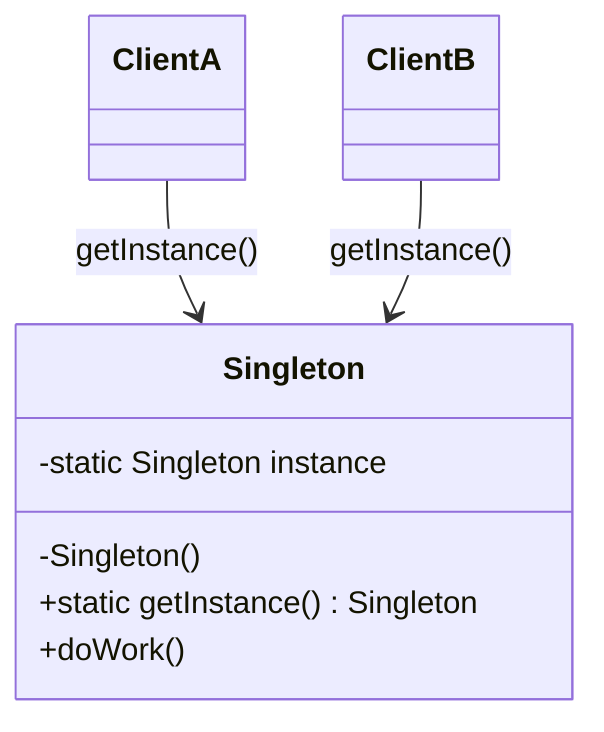
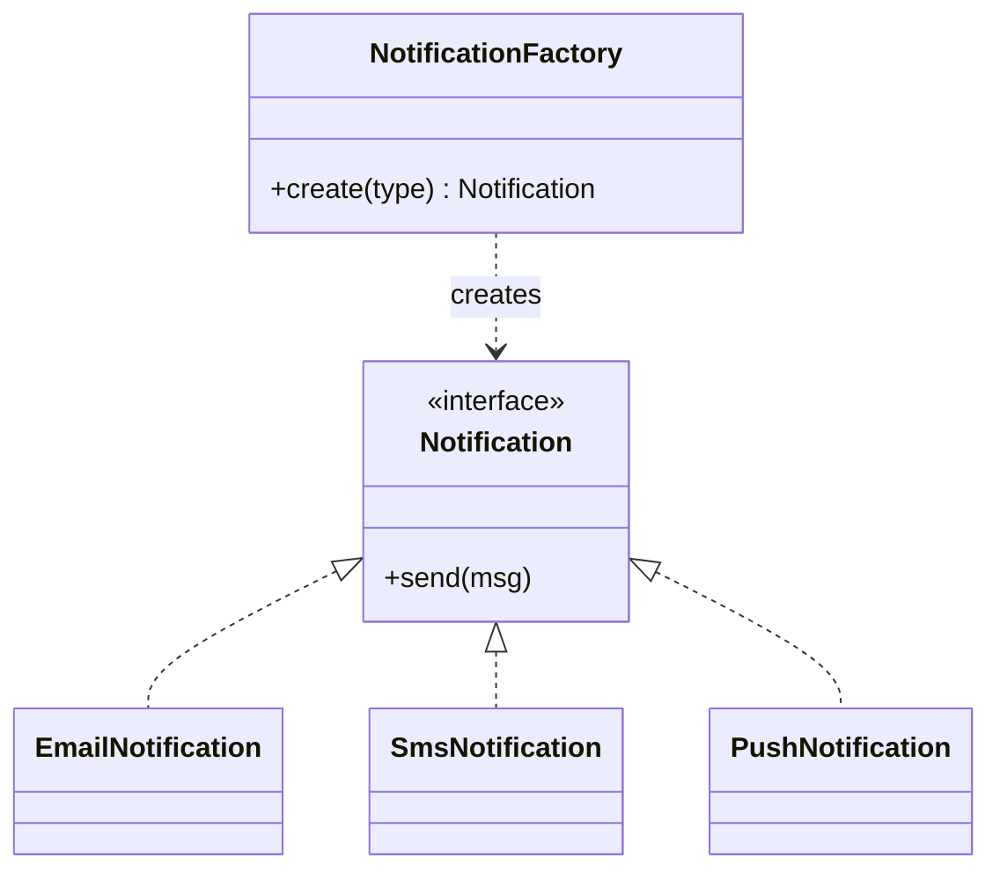
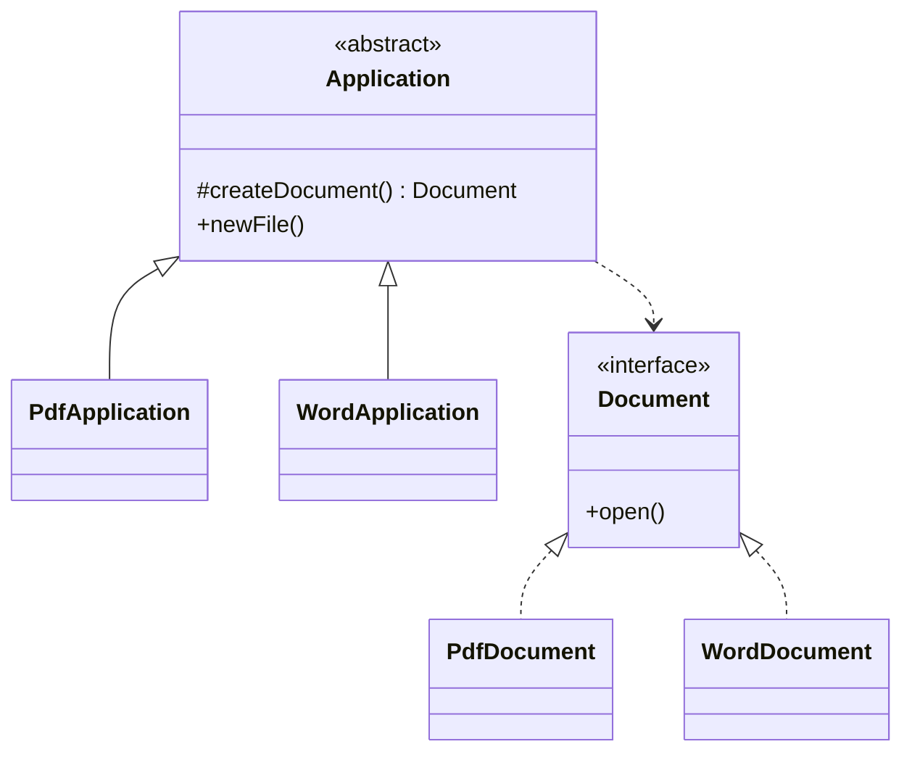
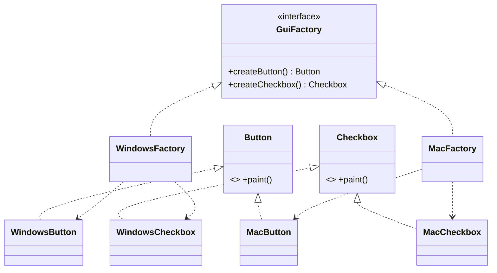
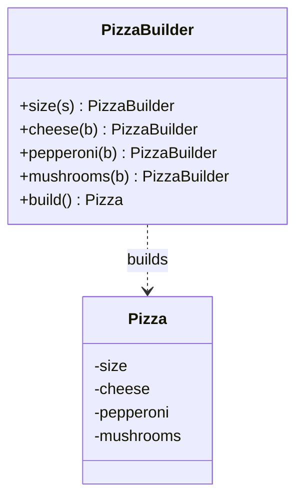
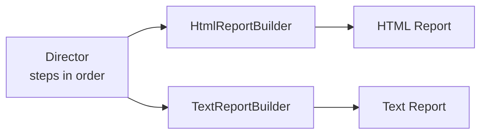
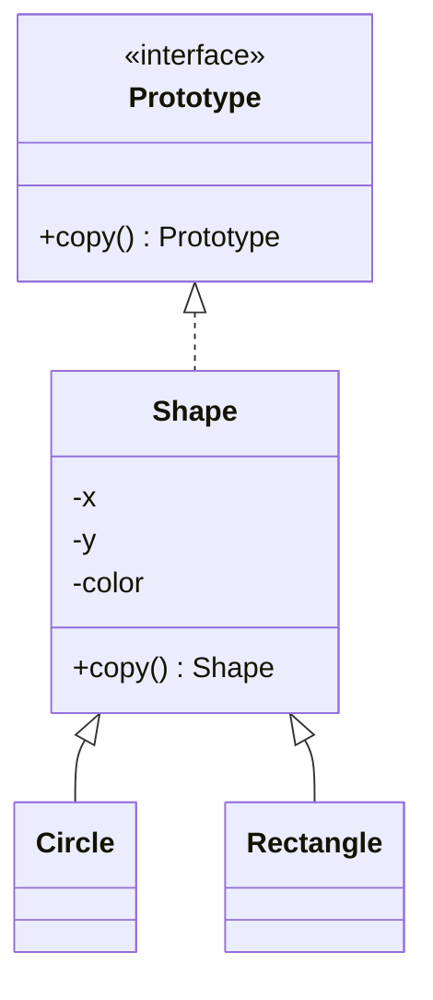
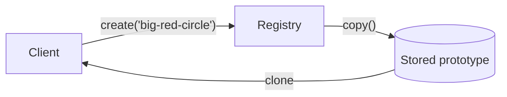
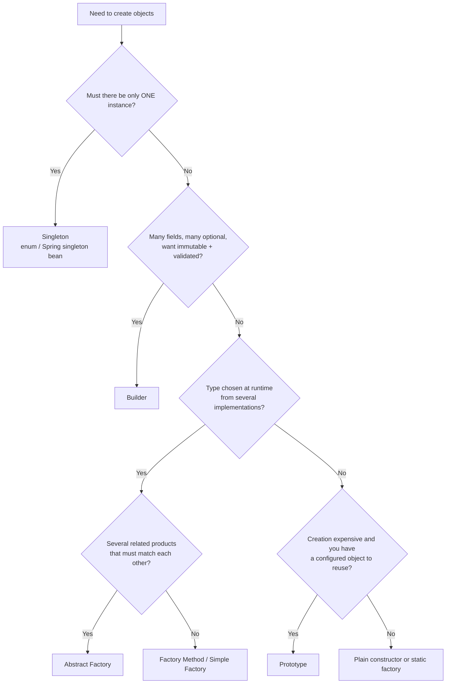
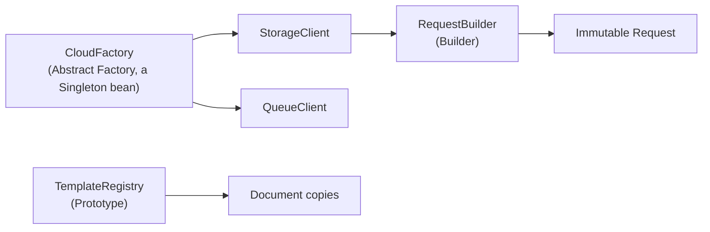

---
mdx:
  format: md
---

# Creational Patterns

> **Note**: Patterns marked with **(Interview Imp - Java)** are frequently asked in Java interviews
>
> **How to read this file:** Every section ends with a **📘 Terms Explained** table. If you see a word you don't know, check the table right below that section. Each pattern goes from basic idea to advanced usage (thread safety, Spring Boot, pitfalls) and ends with interview questions.
>
> **What are creational patterns?** They answer one question: *"HOW do we create objects?"* They hide the creation logic so your code does not depend on concrete classes, and so creation is flexible, controlled and testable.

---

## Table of Contents
1. [Singleton Pattern](#1-singleton-pattern-interview-imp---java) **(Interview Imp - Java)**
   - [1.1 What is the Singleton Pattern?](#11-what-is-the-singleton-pattern)
   - [1.2 Why and When Do We Need It?](#12-why-and-when-do-we-need-it)
   - [1.3 The Naive Version and Its Bug](#13-the-naive-version-and-its-bug)
   - [1.4 Thread-Safe Implementations (Basic to Advanced)](#14-thread-safe-implementations-basic-to-advanced)
   - [1.5 Breaking a Singleton (and How to Defend)](#15-breaking-a-singleton-and-how-to-defend)
   - [1.6 Singleton in Spring Boot (Interview Imp - Java)](#16-singleton-in-spring-boot-interview-imp---java)
   - [1.7 Problems with Singletons (and Better Alternatives)](#17-problems-with-singletons-and-better-alternatives)
   - [1.8 Advanced - Thread-Safe State Inside a Singleton](#18-advanced---thread-safe-state-inside-a-singleton)
   - [1.9 Real-World Examples in the JDK](#19-real-world-examples-in-the-jdk)
   - [1.10 Common Pitfalls](#110-common-pitfalls)
   - [1.11 Singleton - Interview Questions](#111-singleton---interview-questions)
   - [1.12 Pros, Cons and Cheat Sheet](#112-pros-cons-and-cheat-sheet)
2. [Factory Method Pattern](#2-factory-method-pattern-interview-imp---java) **(Interview Imp - Java)**
   - [2.1 What is the Factory Method Pattern?](#21-what-is-the-factory-method-pattern)
   - [2.2 Why Do We Need It?](#22-why-do-we-need-it)
   - [2.3 Variants: Simple Factory, Factory Method, Abstract Factory](#23-variants-simple-factory-factory-method-abstract-factory)
   - [2.4 Making the Factory Open for Extension (Advanced)](#24-making-the-factory-open-for-extension-advanced)
   - [2.5 Factory Method in Spring Boot (Interview Imp - Java)](#25-factory-method-in-spring-boot-interview-imp---java)
   - [2.6 Real-World Factories in the JDK](#26-real-world-factories-in-the-jdk)
   - [2.7 Factory Method vs Other Patterns](#27-factory-method-vs-other-patterns)
   - [2.8 Common Pitfalls](#28-common-pitfalls)
   - [2.9 Factory Method - Interview Questions](#29-factory-method---interview-questions)
   - [2.10 Cheat Sheet](#210-cheat-sheet)
3. [Abstract Factory Pattern](#3-abstract-factory-pattern-interview-imp---java) **(Interview Imp - Java)**
   - [3.1 What is the Abstract Factory Pattern?](#31-what-is-the-abstract-factory-pattern)
   - [3.2 Why Do We Need It?](#32-why-do-we-need-it)
   - [3.3 Complete Java Example - UI Toolkit](#33-complete-java-example---ui-toolkit)
   - [3.4 Business Example - Multi-Cloud / Multi-Region Services](#34-business-example---multi-cloud--multi-region-services)
   - [3.5 Abstract Factory in Spring Boot (Interview Imp - Java)](#35-abstract-factory-in-spring-boot-interview-imp---java)
   - [3.6 Adding Things: What Is Easy and What Is Hard](#36-adding-things-what-is-easy-and-what-is-hard)
   - [3.7 Advanced - Combining and Hiding Factories](#37-advanced---combining-and-hiding-factories)
   - [3.8 Real-World Examples in the JDK and Frameworks](#38-real-world-examples-in-the-jdk-and-frameworks)
   - [3.9 Abstract Factory vs Factory Method vs Builder](#39-abstract-factory-vs-factory-method-vs-builder)
   - [3.10 Common Pitfalls](#310-common-pitfalls)
   - [3.11 Abstract Factory - Interview Questions](#311-abstract-factory---interview-questions)
   - [3.12 Cheat Sheet](#312-cheat-sheet)
4. [Builder Pattern](#4-builder-pattern-interview-imp---java) **(Interview Imp - Java)**
   - [4.1 What is the Builder Pattern?](#41-what-is-the-builder-pattern)
   - [4.2 Why Do We Need It?](#42-why-do-we-need-it)
   - [4.3 The Classic Java Builder (Static Nested Class) (Interview Imp - Java)](#43-the-classic-java-builder-static-nested-class-interview-imp---java)
   - [4.4 The Classic GoF Builder (Director + Builders)](#44-the-classic-gof-builder-director--builders)
   - [4.5 Builders Without Writing Them: Lombok, Records, JDK](#45-builders-without-writing-them-lombok-records-jdk)
   - [4.6 Advanced Builder Techniques](#46-advanced-builder-techniques)
   - [4.7 Builder in Spring Boot and Real Projects (Interview Imp - Java)](#47-builder-in-spring-boot-and-real-projects-interview-imp---java)
   - [4.8 Builder vs Other Options](#48-builder-vs-other-options)
   - [4.9 Common Pitfalls](#49-common-pitfalls)
   - [4.10 Builder - Interview Questions](#410-builder---interview-questions)
   - [4.11 Cheat Sheet](#411-cheat-sheet)
5. [Prototype Pattern](#5-prototype-pattern-interview-imp---java) **(Interview Imp - Java)**
   - [5.1 What is the Prototype Pattern?](#51-what-is-the-prototype-pattern)
   - [5.2 Why Do We Need It?](#52-why-do-we-need-it)
   - [5.3 Shallow Copy vs Deep Copy (The Most Important Idea) (Interview Imp - Java)](#53-shallow-copy-vs-deep-copy-the-most-important-idea-interview-imp---java)
   - [5.4 Ways to Implement Prototype in Java](#54-ways-to-implement-prototype-in-java)
   - [5.5 Prototype Registry (Prototype Manager) (Advanced)](#55-prototype-registry-prototype-manager-advanced)
   - [5.6 Prototype in Spring Boot (Interview Imp - Java)](#56-prototype-in-spring-boot-interview-imp---java)
   - [5.7 Advanced Topics](#57-advanced-topics)
   - [5.8 Real-World Examples](#58-real-world-examples)
   - [5.9 Prototype vs Other Creational Patterns](#59-prototype-vs-other-creational-patterns)
   - [5.10 Common Pitfalls](#510-common-pitfalls)
   - [5.11 Prototype - Interview Questions](#511-prototype---interview-questions)
   - [5.12 Cheat Sheet](#512-cheat-sheet)
6. [How the Creational Patterns Fit Together](#6-how-the-creational-patterns-fit-together)
   - [6.1 One-Line Summary of Each](#61-one-line-summary-of-each)
   - [6.2 Decision Guide](#62-decision-guide)
   - [6.3 Combining Them in One System](#63-combining-them-in-one-system)
   - [6.4 Creational Patterns and Dependency Injection](#64-creational-patterns-and-dependency-injection)
   - [6.5 Evolving Design: When to Introduce Each Pattern](#65-evolving-design-when-to-introduce-each-pattern)
   - [6.6 Comparison Table](#66-comparison-table)
7. [Creational Patterns Cheat Sheet](#7-creational-patterns-cheat-sheet)

---

# 1. Singleton Pattern (Interview Imp - Java)

## 1.1 What is the Singleton Pattern?

**Singleton** guarantees that a class has **exactly one instance** in the application and gives everyone a **global access point** to it.

**Analogy:** A country has one president at a time. Everyone who needs the president goes to the same person; nobody creates a second one.



Two rules make a class a singleton:
1. The **constructor is private** (nobody outside can call `new`).
2. A **static method** (`getInstance()`) returns the one shared instance.

#### 📘 Terms Explained

| Term | Simple meaning |
|---|---|
| **Instance** | One object created from a class (`new Foo()` makes one instance of `Foo`). |
| **Private constructor** | A constructor only the class itself can call, so outsiders cannot use `new`. |
| **Static** | Belongs to the class itself, not to any single object. Exists once per class loader. |
| **Global access point** | One well-known place (here `getInstance()`) from which any code can get the object. |
| **Class diagram** | A UML picture of classes and how they relate. |

---

## 1.2 Why and When Do We Need It?

Some things must exist only once, because two copies would give wrong results or waste resources.

| Good use case | Why only one |
|---|---|
| **Configuration holder** | All code must see the same settings. |
| **Logger** | One place writes to the log file; avoids interleaved/corrupt output. |
| **Connection pool / thread pool** | Pool is shared; many pools would defeat its purpose. |
| **Cache (in-memory)** | One shared cache, not one per caller. |
| **Hardware access** (printer spooler, device driver) | Only one program may control the device. |
| **ID generator / registry** | Two generators could produce duplicate IDs. |

**Do NOT use it** just to avoid passing objects around. A singleton is global state in disguise: hard to test, hidden dependencies, trouble with concurrency (see 1.8).

---

## 1.3 The Naive Version and Its Bug

```java
public class Config {
    private static Config instance;          // starts as null

    private Config() { }                     // nobody else can call new

    public static Config getInstance() {
        if (instance == null) {              // (A) check
            instance = new Config();         // (B) create
        }
        return instance;
    }
}
```

This works with **one thread**. With two threads it breaks:

```
Thread 1: sees instance == null   (A)
Thread 2: sees instance == null   (A)   <- before Thread 1 reached (B)
Thread 1: creates Config #1       (B)
Thread 2: creates Config #2       (B)   <- two "singletons"!
```

This is a **race condition**: the result depends on the timing of threads. The next section shows the correct ways to build a singleton in Java.

#### 📘 Terms Explained

| Term | Simple meaning |
|---|---|
| **Thread** | An independent path of execution inside a program. Many threads run at once in a server. |
| **Race condition** | A bug where the outcome depends on which thread happens to run first. |
| **Thread-safe** | Code that behaves correctly even when many threads use it at the same time. |
| **Lazy** | Creating the object only when first needed. |

---

## 1.4 Thread-Safe Implementations (Basic to Advanced)

### 1.4.1 Eager Initialization (Simplest, Safe)

```java
public class AppConfig {
    private static final AppConfig INSTANCE = new AppConfig();   // created at class-load time

    private AppConfig() { }

    public static AppConfig getInstance() {
        return INSTANCE;
    }
}
```

- The JVM guarantees class loading is thread-safe, so exactly one instance is created.
- **Pro:** simple, no locks, fast.
- **Con:** created even if never used (wasteful if expensive); exceptions in the constructor are awkward to handle.

### 1.4.2 Synchronized Method (Safe but Slow)

```java
public class AppConfig {
    private static AppConfig instance;
    private AppConfig() { }

    public static synchronized AppConfig getInstance() {   // only one thread at a time
        if (instance == null) {
            instance = new AppConfig();
        }
        return instance;
    }
}
```

- Correct, but **every** call takes the lock, even long after the instance exists. Under heavy load that is a bottleneck.

### 1.4.3 Double-Checked Locking (DCL) (Interview Imp - Java)

Lock only while creating; skip the lock afterwards.

```java
public class AppConfig {
    private static volatile AppConfig instance;       // volatile is REQUIRED

    private AppConfig() { }

    public static AppConfig getInstance() {
        AppConfig local = instance;                   // 1st check (no lock)
        if (local == null) {
            synchronized (AppConfig.class) {
                local = instance;                     // 2nd check (with lock)
                if (local == null) {
                    instance = local = new AppConfig();
                }
            }
        }
        return local;
    }
}
```

**Why `volatile`?** `instance = new AppConfig()` is really three steps:
1. allocate memory,
2. run the constructor (fill fields),
3. point `instance` at the memory.

The compiler/CPU may **reorder** 2 and 3. Another thread could then see a non-null `instance` that is **not fully constructed yet**. `volatile` forbids that reordering and makes writes visible to all threads.

### 1.4.4 Bill Pugh / Initialization-on-Demand Holder (Recommended Lazy Way)

```java
public class AppConfig {
    private AppConfig() { }

    private static class Holder {                       // loaded only when first touched
        private static final AppConfig INSTANCE = new AppConfig();
    }

    public static AppConfig getInstance() {
        return Holder.INSTANCE;
    }
}
```

- **Lazy** (the `Holder` class loads only on the first `getInstance()` call), **thread-safe** (class loading is atomic), **no locks**, no `volatile`. Clean and fast.

### 1.4.5 Enum Singleton (Best by Joshua Bloch) (Interview Imp - Java)

```java
public enum AppConfig {
    INSTANCE;

    private final Properties props = new Properties();

    public String get(String key) { return props.getProperty(key); }
}

// usage
String url = AppConfig.INSTANCE.get("db.url");
```

- JVM guarantees one instance per enum constant.
- **Safe against reflection and serialization attacks** (see 1.5).
- **Con:** cannot extend another class (enums already extend `Enum`); always eager-ish (created when enum class loads).

### 1.4.6 Which One Should I Use?

| Approach | Lazy | Thread-safe | Reflection-safe | Serialization-safe | Notes |
|---|---|---|---|---|---|
| Eager | No | Yes | No | No | Simplest |
| Synchronized method | Yes | Yes | No | No | Slow under load |
| Double-checked locking | Yes | Yes (needs `volatile`) | No | No | Easy to get wrong |
| Holder (Bill Pugh) | Yes | Yes | No | No | Best lazy option |
| **Enum** | No | Yes | **Yes** | **Yes** | Best overall safety |

> **Rule of thumb:** Use **enum** by default; use **Holder** if you need lazy loading or must extend a class. In Spring apps, let the container manage singletons (1.6).

#### 📘 Terms Explained

| Term | Simple meaning |
|---|---|
| **`synchronized`** | Java keyword: only one thread at a time may run the guarded code. |
| **`volatile`** | Java keyword: a variable's latest value is always visible to all threads and instructions around it are not reordered. |
| **Instruction reordering** | The compiler or CPU running steps in a different order than written (allowed if a single thread can't tell). |
| **Class loading** | The JVM reading a `.class` file into memory the first time the class is used. |
| **Eager initialization** | Create the object up front, at class load. |
| **Lazy initialization** | Create the object on first use. |
| **Enum** | A special Java class with a fixed set of instances. |
| **Joshua Bloch** | Author of *Effective Java*, a classic Java best-practice book. |

---

## 1.5 Breaking a Singleton (and How to Defend)

| Attack | How it breaks it | Defence |
|---|---|---|
| **Reflection** | `Constructor.setAccessible(true)` then `newInstance()` makes a 2nd object. | Throw an exception in the constructor if an instance exists; or use **enum**. |
| **Serialization** | Deserializing creates a **new** object. | Implement `readResolve()` returning the existing instance; or use **enum**. |
| **Cloning** | `clone()` copies the object. | Override `clone()` to throw `CloneNotSupportedException`. |
| **Multiple class loaders** | Each class loader loads its own copy of the class, so each has its own "singleton". | Be aware (app servers, OSGi, plugins); share via a parent class loader. |
| **Multiple JVMs / servers** | Singleton is per JVM only. | Use an external shared store (database, Redis, ZooKeeper) if truly global. |

```java
public class AppConfig implements Serializable {
    private static final AppConfig INSTANCE = new AppConfig();

    private AppConfig() {
        if (INSTANCE != null) {                       // blocks reflection
            throw new IllegalStateException("Already created");
        }
    }

    public static AppConfig getInstance() { return INSTANCE; }

    // blocks serialization copies
    protected Object readResolve() { return INSTANCE; }

    // blocks cloning
    @Override
    protected Object clone() throws CloneNotSupportedException {
        throw new CloneNotSupportedException("Singleton");
    }
}
```

#### 📘 Terms Explained

| Term | Simple meaning |
|---|---|
| **Reflection** | Java feature to inspect and call code at runtime, including private members. |
| **Serialization** | Turning an object into bytes (to save or send) and back again. |
| **`readResolve()`** | Special method called after deserialization; whatever it returns replaces the new object. |
| **Cloning** | Making a copy of an object using `clone()`. |
| **ClassLoader** | The JVM part that loads classes; different loaders keep separate copies of a class. |
| **JVM** | Java Virtual Machine, the program that runs Java code. |

---

## 1.6 Singleton in Spring Boot (Interview Imp - Java)

In Spring, every bean is **singleton scoped by default**: the container creates **one instance per application context** and injects it everywhere.

```java
@Service                       // singleton by default
public class PriceService {
    private final PriceRepository repo;

    public PriceService(PriceRepository repo) { this.repo = repo; }   // injected, easy to mock
}

@Component
@Scope("prototype")            // new instance on every injection (see Prototype pattern)
public class ReportBuilder { }
```

| | GoF Singleton | Spring singleton bean |
|---|---|---|
| Who enforces "one"? | The class itself (private constructor) | The container |
| Scope of "one" | Per class loader / JVM | Per `ApplicationContext` (usually per app) |
| Testing | Hard (global static) | Easy (inject a mock) |
| Constructor | Private | Normal public |

**Important:** Spring singleton beans are shared by many request threads, so they must be **stateless** or thread-safe. Never keep per-user data in a field of a `@Service`.

```java
@Service
public class BadService {
    private User currentUser;                     // BUG: shared across all requests
}
```

#### 📘 Terms Explained

| Term | Simple meaning |
|---|---|
| **Bean** | An object created and managed by the Spring container. |
| **ApplicationContext** | The Spring container that creates and holds beans. |
| **Scope** | How long a bean lives and how many instances exist (singleton, prototype, request, session). |
| **Dependency Injection (DI)** | Passing the objects a class needs into it, instead of the class creating or fetching them itself. |
| **Stateless** | Holds no per-request or per-user data in fields. |

---

## 1.7 Problems with Singletons (and Better Alternatives)

| Problem | Explanation |
|---|---|
| **Hidden dependencies** | `AppConfig.getInstance()` deep in code hides what a class needs. |
| **Hard to unit test** | Cannot easily replace with a fake; state leaks between tests. |
| **Global mutable state** | Any code can change it; bugs appear far from the cause. |
| **Concurrency risk** | Shared mutable state needs locking. |
| **Violates Single Responsibility** | Class manages its own lifecycle *and* its business logic. |

**Better alternative:** write a normal class, make the container (Spring, Guice) create it once, and **inject** it. You keep "one instance" but lose the global access and testing pain.

```java
// Testable: depends on an interface, gets it via constructor
class OrderService {
    private final Clock clock;
    OrderService(Clock clock) { this.clock = clock; }
}
// test: new OrderService(Clock.fixed(...))
```

---

## 1.8 Advanced - Thread-Safe State Inside a Singleton

One instance + many threads means shared state needs protection.

```java
public enum RequestCounter {
    INSTANCE;

    private final LongAdder count = new LongAdder();      // scales under contention

    public void hit()    { count.increment(); }
    public long total()  { return count.sum(); }
}
```

| Need | Tool |
|---|---|
| Single counter | `AtomicLong` / `LongAdder` |
| Shared map | `ConcurrentHashMap` |
| Read-mostly data | Immutable object swapped atomically (`AtomicReference`) |
| Complex invariants | `ReentrantLock` / `synchronized` |

**Per-thread "singletons":** `ThreadLocal<T>` gives each thread its own instance (e.g. non-thread-safe `SimpleDateFormat`).

**Distributed singleton:** a singleton is *per JVM*. If you run 5 servers you have 5 "singletons". For "only one in the whole cluster" (scheduler, leader) use a distributed lock or leader election (ZooKeeper, etcd, Redis lock, ShedLock).

#### 📘 Terms Explained

| Term | Simple meaning |
|---|---|
| **`AtomicLong` / `LongAdder`** | Thread-safe counters; `LongAdder` is faster when many threads update at once. |
| **`ConcurrentHashMap`** | A thread-safe hash map built for many threads. |
| **Immutable** | Cannot be changed after creation, so always safe to share. |
| **`ThreadLocal`** | Gives each thread its own private copy of a variable. |
| **Leader election** | Servers agree on which single one is "in charge". |
| **Distributed lock** | A lock shared across servers (e.g. in Redis) so only one server runs a task. |

---

## 1.9 Real-World Examples in the JDK

| Class | Notes |
|---|---|
| `java.lang.Runtime.getRuntime()` | One runtime per JVM (eager singleton). |
| `java.awt.Desktop.getDesktop()` | One desktop handle per app. |
| `java.util.logging.LogManager` | One manager for loggers. |
| `System.getSecurityManager()` | One security manager (deprecated). |
| Enum constants | Every enum value is a singleton. |

---

## 1.10 Common Pitfalls

| Pitfall | Fix |
|---|---|
| Lazy singleton without synchronization | Use enum / Holder. |
| DCL without `volatile` | Add `volatile` (or avoid DCL). |
| Using singleton as a dumping ground for globals | Inject small, focused services. |
| Mutable fields without thread safety | Atomic classes, concurrent collections, immutability. |
| Assuming "one per application" in a cluster | It is one per JVM; use distributed coordination for cluster-wide. |
| Singleton holding a reference to a short-lived object | Memory leak: the object can never be garbage collected. |

---

## 1.11 Singleton - Interview Questions

**Q1. How do you create a thread-safe singleton in Java?**
Enum singleton, Bill Pugh holder, eager static final, or double-checked locking with `volatile`.

**Q2. Why must the instance be `volatile` in double-checked locking?**
Object creation can be reordered so a thread sees a non-null but half-built object. `volatile` prevents the reordering and guarantees visibility.

**Q3. How can a singleton be broken, and how do you stop it?**
Reflection (throw in constructor), serialization (`readResolve`), cloning (throw in `clone`), multiple class loaders. An **enum** singleton protects against the first three.

**Q4. Why is enum the best singleton?**
JVM guarantees one instance, it is thread-safe, and it is immune to reflection and serialization attacks.

**Q5. Are Spring beans GoF singletons?**
No. They are one-per-container, managed by Spring, with normal constructors. A class can still have many instances if you create them manually or use another context.

**Q6. Is a singleton one per application?**
One per class loader per JVM. In a cluster of N servers there are N instances.

**Q7. Why do people call Singleton an anti-pattern?**
Global state, hidden dependencies, hard testing. Prefer dependency injection with a singleton-scoped bean.

**Q8. Singleton vs static class?**
A singleton is a real object: it can implement interfaces, be passed around, be lazily created, and be replaced in tests. A static utility class cannot.

---

## 1.12 Pros, Cons and Cheat Sheet

| Pros | Cons |
|---|---|
| Exactly one instance, created once (expensive resources, shared config) | Global state: hidden dependencies, tests share state |
| Lazy creation possible (holder idiom) | Harder to mock and to run tests in parallel |
| Enum singleton is serialization- and reflection-safe | Violates SRP if it also manages its own lifecycle |
| Central access point | In clustered apps it is one per JVM, not one per system |

**Cheat sheet**
```
Best: enum Singleton { INSTANCE }  (thread-safe, serialization + reflection safe)
Lazy: static holder class (JVM class loading makes it thread-safe, no locks)
DCL : private static volatile + check / synchronized / check again (volatile is mandatory)
Break-ins: reflection (guard in constructor), serialization (readResolve), cloning (throw), multiple class loaders
Prefer: one instance managed by Spring (singleton scope) and injected, over a static getInstance()
```

# 2. Factory Method Pattern (Interview Imp - Java)

## 2.1 What is the Factory Method Pattern?

**Factory Method** defines a method for creating an object, but lets **subclasses (or a separate factory) decide which concrete class** to create. The caller asks for "a notification" and gets an `EmailNotification` or `SmsNotification` without ever writing `new EmailNotification()`.

**Analogy:** You tell a restaurant "one pizza, please". The kitchen decides which oven and recipe to use. You only deal with the waiter (the factory).



#### 📘 Terms Explained

| Term | Simple meaning |
|---|---|
| **Factory** | Code whose job is to create objects for you. |
| **Concrete class** | A real class you can instantiate (`EmailNotification`), as opposed to an interface or abstract class. |
| **Interface / abstract type** | A contract describing what something can do, with no creation details. |
| **Subclass** | A class that inherits from another. |
| **`new` keyword** | Java's direct way to create an object; it ties your code to one specific class. |

---

## 2.2 Why Do We Need It?

### Without a factory

```java
public class OrderService {
    public void notifyUser(String channel, String msg) {
        if (channel.equals("EMAIL")) {
            new EmailNotification().send(msg);
        } else if (channel.equals("SMS")) {
            new SmsNotification().send(msg);
        } else if (channel.equals("PUSH")) {
            new PushNotification().send(msg);
        }
    }
}
```

Problems:
- `OrderService` knows **every** concrete class (**tight coupling**).
- Adding WhatsApp means **editing** this class (breaks the **Open/Closed Principle**).
- Same `if/else` chain gets copied into other classes.

### With a factory

```java
Notification n = NotificationFactory.create(channel);
n.send(msg);
```

`OrderService` depends only on the `Notification` interface. New channels are added in one place.

| Benefit | Explanation |
|---|---|
| **Loose coupling** | Callers know the interface, not the classes. |
| **Open/Closed** | Add new types without changing callers. |
| **One place for creation logic** | Configuration, validation, caching of creation in one spot. |
| **Easier testing** | Swap in a fake factory. |

#### 📘 Terms Explained

| Term | Simple meaning |
|---|---|
| **Tight coupling** | Classes depend heavily on each other's details, so changes ripple. |
| **Loose coupling** | Classes depend only on small stable contracts (interfaces). |
| **Open/Closed Principle (OCP)** | Code should be open for extension (add features) but closed for modification (don't edit working code). |
| **SOLID** | Five design principles for maintainable object-oriented code; OCP is the "O". |

---

## 2.3 Variants: Simple Factory, Factory Method, Abstract Factory

These three are often confused. (Abstract Factory has its own chapter, 3.)

| Name | What it is | GoF pattern? |
|---|---|---|
| **Simple Factory** | One class with a static method and a `switch` that returns objects. | No (an idiom) |
| **Factory Method** | A method in a base class that **subclasses override** to choose the product. | Yes |
| **Abstract Factory** | An interface that creates **families** of related objects. | Yes |

### 2.3.1 Simple Factory (Basic)

```java
public interface Notification {
    void send(String message);
}

public class EmailNotification implements Notification {
    public void send(String m) { System.out.println("Email: " + m); }
}
public class SmsNotification implements Notification {
    public void send(String m) { System.out.println("SMS: " + m); }
}

public class NotificationFactory {
    public static Notification create(String type) {
        return switch (type.toUpperCase()) {
            case "EMAIL" -> new EmailNotification();
            case "SMS"   -> new SmsNotification();
            default -> throw new IllegalArgumentException("Unknown type: " + type);
        };
    }
}

// usage
Notification n = NotificationFactory.create("SMS");
n.send("Your OTP is 4821");
```

Simple and handy. Weakness: adding a type still edits the `switch`.

### 2.3.2 Factory Method (the GoF Version) (Interview Imp - Java)

The creator class has the main logic and a **factory method** that subclasses override.

```java
// Product
public interface Document {
    void open();
}
public class PdfDocument implements Document {
    public void open() { System.out.println("Opening PDF"); }
}
public class WordDocument implements Document {
    public void open() { System.out.println("Opening Word"); }
}

// Creator
public abstract class Application {

    protected abstract Document createDocument();     // <-- the factory method

    public void newFile() {                            // shared logic uses the product
        Document d = createDocument();
        d.open();
        System.out.println("Document ready");
    }
}

// Concrete creators
public class PdfApplication extends Application {
    @Override protected Document createDocument() { return new PdfDocument(); }
}
public class WordApplication extends Application {
    @Override protected Document createDocument() { return new WordDocument(); }
}

// usage
Application app = new PdfApplication();
app.newFile();
```



The `newFile()` algorithm is written once; only the **creation step** varies. This is why Factory Method is related to **Template Method**.

#### 📘 Terms Explained

| Term | Simple meaning |
|---|---|
| **Product** | The object the factory creates (`Notification`, `Document`). |
| **Creator** | The class that contains the factory method. |
| **Concrete creator** | A subclass that implements the factory method and returns a specific product. |
| **`abstract`** | A class or method with no complete implementation; subclasses must supply it. |
| **`protected`** | Visible to subclasses and the same package. |
| **Switch expression** | Java 14+ `switch` that returns a value (`case X -> value`). |
| **Template Method** | A pattern where a base class defines the steps of an algorithm and subclasses fill in some. |

---

## 2.4 Making the Factory Open for Extension (Advanced)

The `switch` in a simple factory violates OCP. Use a **registry** instead.

### 2.4.1 Registry with Suppliers

```java
public class NotificationRegistry {
    private static final Map<String, Supplier<Notification>> REGISTRY = new ConcurrentHashMap<>();

    static {
        register("EMAIL", EmailNotification::new);
        register("SMS",   SmsNotification::new);
    }

    public static void register(String type, Supplier<Notification> creator) {
        REGISTRY.put(type.toUpperCase(), creator);
    }

    public static Notification create(String type) {
        Supplier<Notification> s = REGISTRY.get(type.toUpperCase());
        if (s == null) throw new IllegalArgumentException("Unknown type: " + type);
        return s.get();
    }
}

// a new channel needs NO edits to the factory:
NotificationRegistry.register("WHATSAPP", WhatsAppNotification::new);
```

### 2.4.2 Factory with Enum

```java
public enum NotificationType {
    EMAIL(EmailNotification::new),
    SMS(SmsNotification::new);

    private final Supplier<Notification> creator;
    NotificationType(Supplier<Notification> creator) { this.creator = creator; }
    public Notification create() { return creator.get(); }
}

Notification n = NotificationType.valueOf("EMAIL").create();
```

### 2.4.3 Factory with Parameters

```java
public interface ConnectionFactory {
    Connection create(DbConfig config);
}
```

Pass what is needed (URL, credentials) so the factory builds a correctly configured object each time.

#### 📘 Terms Explained

| Term | Simple meaning |
|---|---|
| **Registry** | A map from a key (name) to a way of creating the object. |
| **`Supplier<T>`** | A Java functional interface: a function with no input that returns a `T` (`get()`). |
| **Method reference (`EmailNotification::new`)** | Shorthand for a lambda that calls the constructor. |
| **`static { }` block** | Code run once when the class loads. |
| **`ConcurrentHashMap`** | A thread-safe map. |

---

## 2.5 Factory Method in Spring Boot (Interview Imp - Java)

Spring is a giant factory. Three common ways to use factory ideas in Spring:

### 2.5.1 Inject All Implementations Into a Map

```java
public interface PaymentProcessor {
    String type();
    void pay(BigDecimal amount);
}

@Component
public class CardProcessor implements PaymentProcessor {
    public String type() { return "CARD"; }
    public void pay(BigDecimal a) { /* ... */ }
}
@Component
public class UpiProcessor implements PaymentProcessor {
    public String type() { return "UPI"; }
    public void pay(BigDecimal a) { /* ... */ }
}

@Component
public class PaymentProcessorFactory {
    private final Map<String, PaymentProcessor> byType;

    public PaymentProcessorFactory(List<PaymentProcessor> processors) {    // Spring injects ALL beans
        this.byType = processors.stream()
            .collect(Collectors.toMap(PaymentProcessor::type, Function.identity()));
    }

    public PaymentProcessor get(String type) {
        PaymentProcessor p = byType.get(type);
        if (p == null) throw new IllegalArgumentException("Unsupported: " + type);
        return p;
    }
}
```

Add a new processor class with `@Component` and the factory picks it up automatically. No edit anywhere else.

### 2.5.2 `@Bean` Methods Are Factory Methods

```java
@Configuration
public class ClientConfig {
    @Bean
    public HttpClient httpClient(@Value("${http.timeout}") Duration timeout) {
        return HttpClient.newBuilder().connectTimeout(timeout).build();
    }
}
```

### 2.5.3 `FactoryBean<T>` and `ObjectProvider<T>`

- `FactoryBean<T>` lets Spring call your code to produce a bean (used inside Spring Data, MyBatis, etc.).
- `ObjectProvider<T>` / `Provider<T>` creates or looks up a bean lazily and repeatedly (useful for prototype-scoped beans).

#### 📘 Terms Explained

| Term | Simple meaning |
|---|---|
| **`@Component`** | Tells Spring to create and manage this class as a bean. |
| **`@Configuration` / `@Bean`** | A class and its methods that tell Spring how to build beans manually. |
| **`FactoryBean`** | Spring interface for objects that create other beans. |
| **`ObjectProvider`** | Spring helper to fetch beans on demand rather than at startup. |
| **Stream / `Collectors.toMap`** | Java API to process collections; `toMap` builds a map from them. |

---

## 2.6 Real-World Factories in the JDK

| Method | Returns |
|---|---|
| `Calendar.getInstance()` | Locale-appropriate calendar. |
| `NumberFormat.getCurrencyInstance()` | Currency formatter for a locale. |
| `List.of(...)`, `Optional.of(...)` | Immutable collections/objects. |
| `Executors.newFixedThreadPool(n)` | Different `ExecutorService` types. |
| `Integer.valueOf(int)` | Cached `Integer` objects. |
| `DriverManager.getConnection(url)` | Right JDBC driver `Connection` for the URL. |
| `LoggerFactory.getLogger(...)` | SLF4J logger. |
| `Charset.forName("UTF-8")` | Charset implementation. |

---

## 2.7 Factory Method vs Other Patterns

| Compare | Difference |
|---|---|
| **Factory Method vs `new`** | `new` hard-codes the class; a factory hides it. |
| **Factory Method vs Abstract Factory** | Factory Method creates **one** product via inheritance; Abstract Factory creates **families** of products via composition. |
| **Factory Method vs Builder** | Factory picks **which** class; Builder controls **how a complex object is assembled**. |
| **Factory Method vs Strategy** | Factory chooses and creates; Strategy is the behaviour you then call. They are often combined. |
| **Factory Method vs Prototype** | Factory builds from scratch; Prototype copies an existing object. |

---

## 2.8 Common Pitfalls

| Pitfall | Fix |
|---|---|
| Giant `switch` that grows forever | Registry, enum, or Spring-injected map. |
| Factory returns `null` for unknown type | Throw an exception, or return a Null Object / `Optional`. |
| Static factory with global state | Make it a bean; pass it in (DI). |
| Too many tiny factories for 2 classes | Plain `new` is fine when the type never varies. |
| Leaking the concrete type to the caller (casting) | If callers must cast, the interface is missing a method. |
| Factory ignores thread safety for shared products | Return new instances, or make products immutable. |

---

## 2.9 Factory Method - Interview Questions

**Q1. What problem does Factory Method solve?**
It decouples code that *uses* objects from code that *creates* them, so new types can be added without changing callers.

**Q2. Factory Method vs Abstract Factory?**
Factory Method: one method, one product, subclass decides. Abstract Factory: an object with several creation methods that produce a matching family (e.g. Windows button + Windows checkbox).

**Q3. Simple Factory vs Factory Method?**
Simple Factory is one class with a conditional; not a GoF pattern. Factory Method uses inheritance: subclasses override the creation method.

**Q4. How do you avoid editing the factory every time a type is added?**
Register creators in a map, use an enum of suppliers, or let Spring inject all beans of an interface.

**Q5. Where is Factory Method used in the JDK?**
`Calendar.getInstance()`, `NumberFormat.getInstance()`, `Executors.newFixedThreadPool()`, `List.of()`, `Charset.forName()`.

**Q6. How does it relate to Open/Closed and Dependency Inversion?**
Callers depend on an abstraction (DIP) and new products are added by extension (OCP).

**Q7. Should the factory method be static?**
Static factories are fine for simple cases (`Optional.of`) but cannot be overridden; the GoF pattern needs an instance method so subclasses can override it.

**Q8. Design a notification system.**
`Notification` interface, one class per channel, a Spring-injected `Map<String, Notification>` factory, caller passes the channel.

---

## 2.10 Cheat Sheet

```
Intent : let a subclass/implementation decide WHICH concrete product to create
Shape  : Creator.factoryMethod() -> Product ; ConcreteCreator returns ConcreteProduct
Use    : caller should not depend on concrete classes; new product types expected
JDK    : Calendar.getInstance(), NumberFormat.getInstance(), Collection.iterator(), List.of()
Spring : FactoryBean, @Bean methods, BeanFactory.getBean()
vs Simple Factory: one static method with a switch (not a GoF pattern, breaks OCP)
vs Abstract Factory: Factory Method creates ONE product; Abstract Factory a FAMILY
```

# 3. Abstract Factory Pattern (Interview Imp - Java)

## 3.1 What is the Abstract Factory Pattern?

**Abstract Factory** provides an interface for creating **families of related objects** without naming their concrete classes. All objects made by one factory are designed to **work together**.

**Analogy:** A furniture shop with two collections, *Modern* and *Victorian*. A Modern factory gives you a Modern chair, Modern sofa and Modern table. You never get a Modern chair with a Victorian table, because each factory produces a matching set.



The client talks only to `GuiFactory`, `Button` and `Checkbox` (interfaces). Switching the whole look from Windows to Mac means swapping **one** factory object.

#### 📘 Terms Explained

| Term | Simple meaning |
|---|---|
| **Product family** | A group of objects meant to be used together (Windows button + Windows checkbox). |
| **Abstract factory** | An interface listing the creation methods for each product in the family. |
| **Concrete factory** | A class implementing the abstract factory for one specific family (`WindowsFactory`). |
| **Abstract product** | An interface for one kind of product (`Button`). |
| **Client** | The code that uses the factory and products. |
| **Composition** | Building behaviour by holding references to other objects (vs inheritance). |

---

## 3.2 Why Do We Need It?

### The problem

Your app must support several "themes" or "platforms", and mixing them is a bug.

```java
// without Abstract Factory: if/else everywhere
Button b;
Checkbox c;
if (os.equals("WIN")) { b = new WindowsButton(); c = new WindowsCheckbox(); }
else                  { b = new MacButton();     c = new MacCheckbox();     }
```

- The `if/else` is repeated for every new widget.
- Easy to accidentally mix `WindowsButton` with `MacCheckbox`.
- Adding a third platform means editing every place.

### The solution

Choose the factory **once**, then everything created by it is consistent.

```java
GuiFactory factory = os.equals("WIN") ? new WindowsFactory() : new MacFactory();
Button b = factory.createButton();
Checkbox c = factory.createCheckbox();
```

| Benefit | Explanation |
|---|---|
| **Consistency** | Products from one factory always match. |
| **Isolation of concrete classes** | Client code never mentions `WindowsButton`. |
| **Easy family swap** | Change one line (or one config value) to switch families. |
| **Supports OCP for families** | Add `LinuxFactory` without touching the client. |

---

## 3.3 Complete Java Example - UI Toolkit

```java
// ---- Abstract products ----
public interface Button   { void paint(); }
public interface Checkbox { void paint(); }

// ---- Windows family ----
public class WindowsButton implements Button {
    public void paint() { System.out.println("Windows button"); }
}
public class WindowsCheckbox implements Checkbox {
    public void paint() { System.out.println("Windows checkbox"); }
}

// ---- Mac family ----
public class MacButton implements Button {
    public void paint() { System.out.println("Mac button"); }
}
public class MacCheckbox implements Checkbox {
    public void paint() { System.out.println("Mac checkbox"); }
}

// ---- Abstract factory ----
public interface GuiFactory {
    Button createButton();
    Checkbox createCheckbox();
}

// ---- Concrete factories ----
public class WindowsFactory implements GuiFactory {
    public Button createButton()     { return new WindowsButton(); }
    public Checkbox createCheckbox() { return new WindowsCheckbox(); }
}
public class MacFactory implements GuiFactory {
    public Button createButton()     { return new MacButton(); }
    public Checkbox createCheckbox() { return new MacCheckbox(); }
}

// ---- Client: knows only interfaces ----
public class SettingsScreen {
    private final Button save;
    private final Checkbox darkMode;

    public SettingsScreen(GuiFactory factory) {
        this.save = factory.createButton();
        this.darkMode = factory.createCheckbox();
    }

    public void render() {
        save.paint();
        darkMode.paint();
    }
}

// ---- Wiring ----
GuiFactory factory = System.getProperty("os.name").startsWith("Windows")
        ? new WindowsFactory() : new MacFactory();
new SettingsScreen(factory).render();
```

---

## 3.4 Business Example - Multi-Cloud / Multi-Region Services

A very common interview case: your app must run on **AWS** or **Azure** and needs a matching storage client and queue client.

```java
public interface StorageClient { void upload(String key, byte[] data); }
public interface QueueClient   { void publish(String topic, String msg); }

public interface CloudFactory {
    StorageClient storage();
    QueueClient queue();
}

public class AwsFactory implements CloudFactory {
    public StorageClient storage() { return new S3StorageClient(); }
    public QueueClient queue()     { return new SqsQueueClient(); }
}
public class AzureFactory implements CloudFactory {
    public StorageClient storage() { return new BlobStorageClient(); }
    public QueueClient queue()     { return new ServiceBusQueueClient(); }
}

public class ReportService {
    private final CloudFactory cloud;
    public ReportService(CloudFactory cloud) { this.cloud = cloud; }

    public void archive(String id, byte[] pdf) {
        cloud.storage().upload("reports/" + id, pdf);
        cloud.queue().publish("report-ready", id);
    }
}
```

Other classic families: **database dialects** (connection + statement + transaction for MySQL vs Oracle), **test vs production** (real vs fake clients), **payment gateways** (Stripe set vs PayPal set).

---

## 3.5 Abstract Factory in Spring Boot (Interview Imp - Java)

Spring picks a family with **profiles** or **conditions**; each `@Configuration` is a concrete factory.

```java
public interface CloudFactory {
    StorageClient storage();
    QueueClient queue();
}

@Configuration
@Profile("aws")
class AwsCloudConfig implements CloudFactory {
    @Bean public StorageClient storage() { return new S3StorageClient(); }
    @Bean public QueueClient queue()     { return new SqsQueueClient(); }
}

@Configuration
@Profile("azure")
class AzureCloudConfig implements CloudFactory {
    @Bean public StorageClient storage() { return new BlobStorageClient(); }
    @Bean public QueueClient queue()     { return new ServiceBusQueueClient(); }
}
```

Run with `--spring.profiles.active=aws` and **every** service that injects `StorageClient` / `QueueClient` gets the AWS pair. Alternatives: `@ConditionalOnProperty(name = "cloud.provider", havingValue = "aws")` or Spring Boot auto-configuration classes.

#### 📘 Terms Explained

| Term | Simple meaning |
|---|---|
| **Profile (`@Profile`)** | A named set of beans that is active only when that profile is on (`aws`, `test`, `prod`). |
| **`@ConditionalOnProperty`** | Create the bean only if a config property has a given value. |
| **Auto-configuration** | Spring Boot automatically creating beans based on what is on the classpath and config. |
| **S3 / SQS / Blob / Service Bus** | Cloud storage and messaging services of AWS and Azure. |
| **Dialect** | The flavour of SQL a particular database speaks. |

---

## 3.6 Adding Things: What Is Easy and What Is Hard

| Change | Effort |
|---|---|
| **Add a new family** (`LinuxFactory` + its products) | Easy: new classes only, no edits. |
| **Add a new product type** (`createSlider()`) | **Hard**: change the abstract factory interface and **every** concrete factory. |

This is the main trade-off. Abstract Factory is ideal when **families change often but the set of product types is stable**.

### Reducing the pain in Java

```java
public interface GuiFactory {
    Button createButton();
    Checkbox createCheckbox();
    default Slider createSlider() {                 // default method: old factories keep compiling
        throw new UnsupportedOperationException("Slider not supported");
    }
}
```

---

## 3.7 Advanced - Combining and Hiding Factories

### 3.7.1 Abstract Factory + Factory Method

Each `createX()` method in a concrete factory **is** a factory method. So Abstract Factory is often "a set of factory methods".

### 3.7.2 Abstract Factory + Singleton

Concrete factories are usually stateless, so keep one instance of each (enum or Spring bean).

```java
public enum GuiFactories implements GuiFactory {
    WINDOWS {
        public Button createButton()     { return new WindowsButton(); }
        public Checkbox createCheckbox() { return new WindowsCheckbox(); }
    },
    MAC {
        public Button createButton()     { return new MacButton(); }
        public Checkbox createCheckbox() { return new MacCheckbox(); }
    }
}
```

### 3.7.3 Factory of Factories (Provider)

When you still need to pick the factory by a key:

```java
public final class FactoryProvider {
    private static final Map<String, Supplier<GuiFactory>> MAP = Map.of(
        "WIN", WindowsFactory::new,
        "MAC", MacFactory::new);

    public static GuiFactory forOs(String os) {
        Supplier<GuiFactory> s = MAP.get(os);
        if (s == null) throw new IllegalArgumentException("Unsupported OS: " + os);
        return s.get();
    }
}
```

### 3.7.4 Java Module / ServiceLoader (Plug-in Families)

```java
ServiceLoader<GuiFactory> loader = ServiceLoader.load(GuiFactory.class);
GuiFactory factory = loader.findFirst().orElseThrow();
```

Drop a JAR containing a `GuiFactory` implementation on the classpath and it is discovered without recompiling the app. This is how JDBC drivers and many plug-in systems work.

#### 📘 Terms Explained

| Term | Simple meaning |
|---|---|
| **Default method** | Interface method with a body, so implementers don't have to override it (Java 8+). |
| **Enum with bodies** | Each enum constant can override methods, acting as its own implementation. |
| **`ServiceLoader`** | JDK mechanism that finds implementations of an interface listed in `META-INF/services` or `module-info.java`. |
| **Classpath** | The list of folders/JARs where the JVM looks for classes. |
| **JAR** | A zip-like Java library file. |
| **Plug-in** | An add-on discovered at runtime to extend an app. |

---

## 3.8 Real-World Examples in the JDK and Frameworks

| Where | Family |
|---|---|
| `javax.xml.parsers.DocumentBuilderFactory` | Creates XML parsers for a chosen implementation. |
| `javax.xml.transform.TransformerFactory` | Same idea for XSLT. |
| `java.sql.Connection` | Creates `Statement`, `PreparedStatement`, `CallableStatement` for one driver (a family tied to the driver). |
| `javax.swing` Look and Feel (`UIManager`) | Whole widget set changes together. |
| Hibernate `Dialect`, Spring `DataSource` per vendor | Vendor-matched pieces. |
| Cloud SDK "providers" (Terraform, Spring Cloud) | Matching clients for one cloud. |

---

## 3.9 Abstract Factory vs Factory Method vs Builder

| | Factory Method | Abstract Factory | Builder |
|---|---|---|---|
| **Creates** | One product | A family of products | One complex product |
| **Mechanism** | Inheritance (subclass overrides) | Composition (factory object) | Step-by-step assembly |
| **Focus** | Which class | Which *set* of classes | How the object is assembled |
| **Adding a product type** | Easy | Hard | n/a |
| **Adding a variant/family** | Add subclass | Add factory | Add builder |

---

## 3.10 Common Pitfalls

| Pitfall | Fix |
|---|---|
| Using it when there is only one product type | Use Factory Method. |
| Mixing families by accident (passing two factories around) | Pass one factory; create products from it only. |
| Interface explosion (dozens of product methods) | Group into smaller factories; use default methods carefully. |
| Concrete factory has state shared across threads | Keep factories stateless. |
| Client does `instanceof`/casts on products | Move behaviour into the product interface. |
| Over-engineering for one platform | Start with plain classes; refactor when a second family appears. |

---

## 3.11 Abstract Factory - Interview Questions

**Q1. What is Abstract Factory and when do you use it?**
An interface that creates families of related objects without specifying concrete classes. Use it when objects must be used together and you want to switch the whole family at once.

**Q2. Abstract Factory vs Factory Method?**
Factory Method: single product, inheritance. Abstract Factory: multiple related products, composition. Abstract Factory is typically implemented with several factory methods.

**Q3. What is the main drawback?**
Adding a new product type forces changes to the abstract factory and all concrete factories.

**Q4. Give a real-life example.**
UI toolkits (Windows/Mac), database drivers, cloud providers (AWS/Azure), `DocumentBuilderFactory` in JAXP.

**Q5. How do you apply it in Spring Boot?**
Profile- or property-conditional `@Configuration` classes that each provide a matching set of beans.

**Q6. Which principles does it support?**
Dependency Inversion (depend on abstractions), Open/Closed (new families need no edits), and Single Responsibility (creation is separated from use).

**Q7. How to guarantee products from different families aren't mixed?**
The client only ever receives *one* factory and creates every product from it; products can also share a family-specific interface or generic type.

**Q8. Is a factory usually a singleton?**
Typically yes: concrete factories are stateless, so one instance (enum or Spring bean) is enough.

---

## 3.12 Cheat Sheet

```
Intent : create FAMILIES of related objects that must be used together (WinButton + WinCheckbox)
Shape  : interface GUIFactory { Button createButton(); Checkbox createCheckbox(); } + one factory per family
Client : depends only on the abstract factory and abstract products; swap the whole family at once
Cost   : adding a NEW product type changes every factory (adding a family is easy, adding a product is hard)
JDK    : DocumentBuilderFactory, TransformerFactory, javax.xml.xpath.XPathFactory
Spring : profiles/@Conditional choosing a set of beans per environment
```

# 4. Builder Pattern (Interview Imp - Java)

## 4.1 What is the Builder Pattern?

**Builder** separates the **construction** of a complex object from its **representation**, so you can create it **step by step** and end with a finished, usually immutable, object.

**Analogy:** Ordering a custom burger. You say "bun, patty, cheese, no onions, extra sauce", one choice at a time, then say "done" and receive the finished burger.



#### 📘 Terms Explained

| Term | Simple meaning |
|---|---|
| **Complex object** | An object with many fields, some required and some optional. |
| **Immutable** | Cannot change after it is built, so it is always safe to share. |
| **Fluent API / method chaining** | Each method returns the builder, so calls chain: `a().b().c()`. |
| **Optional parameter** | A value the caller may skip because a default exists. |
| **Representation** | The final form of the object (its fields and structure). |

---

## 4.2 Why Do We Need It?

### Problem 1 - The Telescoping Constructor

```java
public class Pizza {
    public Pizza(int size) { ... }
    public Pizza(int size, boolean cheese) { ... }
    public Pizza(int size, boolean cheese, boolean pepperoni) { ... }
    public Pizza(int size, boolean cheese, boolean pepperoni, boolean mushrooms) { ... }
}

new Pizza(12, true, false, true);     // what do true/false mean?
```

- Unreadable calls, easy to swap two booleans by mistake.
- Constructors multiply with every optional field.

### Problem 2 - JavaBeans Setters

```java
Pizza p = new Pizza();
p.setSize(12);
p.setCheese(true);
// ... object can be used HALF-BUILT; cannot be immutable; not thread-safe
```

### The Builder solution

```java
Pizza p = new Pizza.Builder(12)          // required
        .cheese(true)
        .mushrooms(true)                 // optional, named, readable
        .build();                        // validate + create immutable object
```

| Benefit | Explanation |
|---|---|
| **Readable** | Each value has a name. |
| **Optional fields** | Set only what you need. |
| **Immutable result** | Fields are `final`; no half-built objects. |
| **Validation in one place** | `build()` checks rules before creating. |
| **Step-by-step / complex building** | Build different representations with the same process. |

---

## 4.3 The Classic Java Builder (Static Nested Class) (Interview Imp - Java)

This is the version used in *Effective Java* and the most common interview answer.

```java
public final class User {
    // required
    private final String email;
    // optional
    private final String name;
    private final int age;
    private final String phone;
    private final List<String> roles;

    private User(Builder b) {                      // private: only Builder can create
        this.email = b.email;
        this.name  = b.name;
        this.age   = b.age;
        this.phone = b.phone;
        this.roles = List.copyOf(b.roles);         // defensive copy, immutable
    }

    public String getEmail() { return email; }
    public String getName()  { return name; }
    public int getAge()      { return age; }
    public String getPhone() { return phone; }
    public List<String> getRoles() { return roles; }

    public static Builder builder(String email) {
        return new Builder(email);
    }

    public static final class Builder {
        private final String email;                // required
        private String name = "Anonymous";         // defaults
        private int age;
        private String phone;
        private final List<String> roles = new ArrayList<>();

        private Builder(String email) {
            this.email = Objects.requireNonNull(email, "email");
        }

        public Builder name(String name)   { this.name = name;   return this; }
        public Builder age(int age)        { this.age = age;     return this; }
        public Builder phone(String phone) { this.phone = phone; return this; }
        public Builder role(String role)   { this.roles.add(role); return this; }

        public User build() {
            if (age < 0 || age > 150) {
                throw new IllegalStateException("Invalid age: " + age);
            }
            if (!email.contains("@")) {
                throw new IllegalStateException("Invalid email");
            }
            return new User(this);
        }
    }
}

// usage
User u = User.builder("ritik@example.com")
        .name("Ritik")
        .age(28)
        .role("ADMIN")
        .role("EDITOR")
        .build();
```

Key points:
1. The outer constructor is **private**; objects come only from `build()`.
2. All fields `final` → thread-safe and immutable.
3. Required values go in the **builder's constructor**; optional via methods.
4. `build()` is the single place for validation.
5. Copy mutable inputs (`List.copyOf`) so callers can't change them afterwards.

#### 📘 Terms Explained

| Term | Simple meaning |
|---|---|
| **Static nested class** | A class declared inside another with `static`; doesn't need an outer instance. |
| **`final` field** | Can be assigned exactly once (in the constructor). |
| **`Objects.requireNonNull`** | Throws `NullPointerException` with a message if the value is null. |
| **Defensive copy** | Copying a mutable input so later changes to the original don't affect your object. |
| **`List.copyOf`** | Returns an unmodifiable copy of a list. |
| ***Effective Java*** | Book by Joshua Bloch; Item 2 recommends builders for many-parameter classes. |

---

## 4.4 The Classic GoF Builder (Director + Builders)

The original pattern separates **what steps** (Director) from **how each step is done** (Builders) so the **same steps** produce **different products**.

```java
// Product
public class Report {
    public String header, body, footer;
}

// Builder interface
public interface ReportBuilder {
    ReportBuilder header(String title);
    ReportBuilder body(List<String> rows);
    ReportBuilder footer(String text);
    Report build();
}

// Concrete builders
public class HtmlReportBuilder implements ReportBuilder {
    private final Report r = new Report();
    public ReportBuilder header(String t) { r.header = "<h1>" + t + "</h1>"; return this; }
    public ReportBuilder body(List<String> rows) {
        r.body = rows.stream().map(x -> "<li>" + x + "</li>").collect(Collectors.joining("", "<ul>", "</ul>"));
        return this;
    }
    public ReportBuilder footer(String t) { r.footer = "<footer>" + t + "</footer>"; return this; }
    public Report build() { return r; }
}

public class TextReportBuilder implements ReportBuilder {
    private final Report r = new Report();
    public ReportBuilder header(String t) { r.header = t.toUpperCase() + "\n====="; return this; }
    public ReportBuilder body(List<String> rows) { r.body = String.join("\n", rows); return this; }
    public ReportBuilder footer(String t) { r.footer = "-- " + t; return this; }
    public Report build() { return r; }
}

// Director: knows the ORDER of steps
public class ReportDirector {
    public Report monthlySales(ReportBuilder b, List<String> rows) {
        return b.header("Monthly Sales").body(rows).footer("Confidential").build();
    }
}

// usage: same steps, two outputs
ReportDirector d = new ReportDirector();
Report html = d.monthlySales(new HtmlReportBuilder(), rows);
Report text = d.monthlySales(new TextReportBuilder(), rows);
```



| Style | When to use |
|---|---|
| **Effective Java nested builder** | Many optional fields, immutable domain objects (most common). |
| **GoF Director + Builders** | Same construction process, different output formats. |

#### 📘 Terms Explained

| Term | Simple meaning |
|---|---|
| **Director** | Class that calls builder steps in a fixed order. |
| **Concrete builder** | A builder that produces one specific representation. |
| **Product** | The finished object. |
| **`Collectors.joining`** | Stream collector that glues strings together with a prefix and suffix. |

---

## 4.5 Builders Without Writing Them: Lombok, Records, JDK

### 4.5.1 Lombok `@Builder`

```java
@Builder
@Getter
public class Order {
    private final String id;
    private final BigDecimal total;
    @Singular private final List<String> items;
    @Builder.Default private final String currency = "INR";
}

Order o = Order.builder().id("A1").total(BigDecimal.TEN).item("pen").item("book").build();
```

- Generates the builder at compile time. Less code; but the builder is generated, so debugging and validation hooks need extra care (`@Builder` on a custom constructor to add validation).

### 4.5.2 Java Records + Builder

Records give immutability and `equals/hashCode`; add a builder (or compact constructor validation) when there are many fields.

```java
public record Point(int x, int y) {
    public Point {                                    // compact constructor
        if (x < 0 || y < 0) throw new IllegalArgumentException("negative");
    }
}
```

Use a builder (hand-written or via a library such as RecordBuilder) when a record has 5+ components or optional ones.

### 4.5.3 Builders in the JDK and Popular Libraries

| Example | What it builds |
|---|---|
| `StringBuilder` | A string via `append()` (mutable, not immutable-result style). |
| `Stream.builder()` | A stream. |
| `Stream.Builder`, `Collectors` | Streams and results. |
| `HttpRequest.newBuilder()` (Java 11 HTTP client) | An immutable request. |
| `HttpClient.newBuilder()` | An HTTP client. |
| `Locale.Builder`, `Calendar.Builder` | Locale / calendar. |
| `ProcessBuilder` | An OS process. |
| Spring: `UriComponentsBuilder`, `MockMvcRequestBuilders`, `WebClient.builder()`, `RestClient.builder()`, `SpringApplicationBuilder` | URIs, test requests, HTTP clients, apps. |
| `Jackson` `JsonMapper.builder()` | Configured JSON mapper. |
| Protobuf, Elasticsearch, AWS SDK v2 | Request objects are all builder-based. |

```java
HttpRequest req = HttpRequest.newBuilder()
        .uri(URI.create("https://api.example.com/users"))
        .header("Accept", "application/json")
        .timeout(Duration.ofSeconds(5))
        .GET()
        .build();
```

#### 📘 Terms Explained

| Term | Simple meaning |
|---|---|
| **Lombok** | Library that generates boilerplate (getters, builders) at compile time via annotations. |
| **`@Singular`** | Lombok annotation giving a collection field an "add one item" builder method. |
| **Record** | Java 16+ compact immutable data class (`record Point(int x, int y)`). |
| **Compact constructor** | A record constructor without parameter list, used for validation. |
| **Boilerplate** | Repetitive code that carries little meaning. |
| **Protobuf** | Google's binary data format; generated classes use builders. |

---

## 4.6 Advanced Builder Techniques

### 4.6.1 Step Builder (Compile-Time Enforced Required Fields)

Force callers to supply required fields **in order**, checked by the compiler.

```java
public class Email {
    private final String to, subject, body;
    private Email(String to, String subject, String body) { this.to = to; this.subject = subject; this.body = body; }

    public static ToStep builder() { return new Steps(); }

    public interface ToStep      { SubjectStep to(String to); }
    public interface SubjectStep { BodyStep subject(String subject); }
    public interface BodyStep    { BuildStep body(String body); }
    public interface BuildStep   { Email build(); }

    private static class Steps implements ToStep, SubjectStep, BodyStep, BuildStep {
        private String to, subject, body;
        public SubjectStep to(String t)      { to = t; return this; }
        public BodyStep subject(String s)    { subject = s; return this; }
        public BuildStep body(String b)      { body = b; return this; }
        public Email build()                 { return new Email(to, subject, body); }
    }
}

Email e = Email.builder().to("a@b.com").subject("Hi").body("Hello").build();
// Email.builder().to("a@b.com").build();   // does NOT compile: subject/body missing
```

### 4.6.2 Inheritance-Friendly Builder (Self-Typed Generics)

Problem: a parent builder method returns the parent type and breaks the chain for subclasses.

```java
public abstract class Vehicle {
    final String brand;
    protected Vehicle(Builder<?> b) { this.brand = b.brand; }

    public abstract static class Builder<T extends Builder<T>> {
        private String brand;
        public T brand(String brand) { this.brand = brand; return self(); }
        protected abstract T self();
        public abstract Vehicle build();
    }
}

public class Car extends Vehicle {
    final int doors;
    private Car(Builder b) { super(b); this.doors = b.doors; }

    public static class Builder extends Vehicle.Builder<Builder> {
        private int doors;
        public Builder doors(int d) { this.doors = d; return this; }
        @Override protected Builder self() { return this; }
        @Override public Car build() { return new Car(this); }
    }
}

Car c = new Car.Builder().brand("Tata").doors(4).build();    // brand() then doors(): chain works
```

This is the **Curiously Recurring Template Pattern (CRTP)**: `T extends Builder<T>` lets each method return the subclass type.

### 4.6.3 Builder with Validation and Defaults

```java
public Order build() {
    List<String> errors = new ArrayList<>();
    if (customerId == null)       errors.add("customerId required");
    if (items.isEmpty())          errors.add("at least one item");
    if (total.signum() < 0)       errors.add("total must be >= 0");
    if (!errors.isEmpty())        throw new IllegalStateException(String.join("; ", errors));
    return new Order(this);
}
```

Validate **after** all setters (cross-field rules like "end date after start date" can only be checked here).

### 4.6.4 Reusable / "toBuilder" (Copy and Modify)

Immutable objects can't be changed, so provide a way to derive a changed copy:

```java
public Builder toBuilder() {
    Builder b = new Builder(this.email);
    b.name = this.name; b.age = this.age; b.phone = this.phone; b.roles.addAll(this.roles);
    return b;
}

User older = u.toBuilder().age(29).build();       // u is unchanged
```

Lombok: `@Builder(toBuilder = true)`.

### 4.6.5 Thread Safety

- The **built object** is thread-safe if it is immutable.
- A **builder** is NOT thread-safe: use one per thread / per call. Never share a builder instance (e.g. as a Spring singleton field).

#### 📘 Terms Explained

| Term | Simple meaning |
|---|---|
| **Step builder** | A builder whose methods return different interface types so the compiler forces the order. |
| **Generics (`<T extends Builder<T>>`)** | Type parameters; here the builder refers to its own subclass type. |
| **CRTP** | A class passes itself as the generic type of its parent, so the parent can return the subclass. |
| **Cross-field validation** | A rule involving more than one field (start < end). |
| **`toBuilder()`** | Creates a builder pre-filled from an existing object. |

---

## 4.7 Builder in Spring Boot and Real Projects (Interview Imp - Java)

| Use | Example |
|---|---|
| **DTOs / API responses** | `ApiResponse.builder().status("OK").data(user).build()` |
| **JPA entities** | `@Builder` with a protected no-args constructor for JPA. |
| **Test data** | "Test data builders": `anOrder().withItems(3).paid().build()` give readable tests. |
| **HTTP clients** | `WebClient.builder().baseUrl(url).defaultHeader(...).build()` as a `@Bean`. |
| **Security config** | `http.csrf(...).authorizeHttpRequests(...)` is a builder over `HttpSecurity`. |

```java
@Bean
WebClient githubClient(WebClient.Builder builder) {          // Boot gives you a pre-configured builder
    return builder.baseUrl("https://api.github.com")
                  .defaultHeader("Accept", "application/vnd.github+json")
                  .build();
}
```

**JPA warning:** JPA/Hibernate needs a no-argument constructor and non-final fields to create entities. Use `@Builder` together with `@NoArgsConstructor(access = AccessLevel.PROTECTED)` and `@AllArgsConstructor(access = AccessLevel.PRIVATE)`.

**Test data builder example**

```java
Order order = OrderBuilder.anOrder()
        .withCustomer("C-1")
        .withItems(3)
        .paid()
        .build();
```

#### 📘 Terms Explained

| Term | Simple meaning |
|---|---|
| **DTO (Data Transfer Object)** | A plain object that carries data between layers or over the network. |
| **JPA / Hibernate** | Java standard and library for mapping objects to database tables. |
| **Entity** | A class mapped to a database table. |
| **WebClient** | Spring's non-blocking HTTP client. |
| **`HttpSecurity`** | Spring Security's configuration object. |

---

## 4.8 Builder vs Other Options

| Option | When it's better |
|---|---|
| **Constructor** | 1-3 required parameters, no optional ones. |
| **Static factory (`of`, `from`)** | Few parameters, named creation (`Duration.ofSeconds(5)`). |
| **Setters** | Mutable frameworks (JavaBeans), but loses safety. |
| **Builder** | 4+ parameters, several optional, immutability, validation. |
| **Record** | Simple immutable data, few fields. |
| **Named/default parameters** | Not in Java (exists in Kotlin/Python): the reason builders exist. |

| Compare | Difference |
|---|---|
| **Builder vs Factory Method** | Factory picks which class; Builder assembles a complex instance of one class. |
| **Builder vs Abstract Factory** | Abstract Factory returns the product immediately; Builder returns it only at the end of many steps. |
| **Builder vs Prototype** | Builder assembles from scratch; Prototype clones a prepared object. |

---

## 4.9 Common Pitfalls

| Pitfall | Fix |
|---|---|
| Builder for a 2-field class | Use a constructor or record. |
| No validation in `build()` | Check required fields and cross-field rules there. |
| Sharing a builder between threads or reusing after `build()` | One builder per object; or copy state in `build()`. |
| Exposing a mutable list from the built object | `List.copyOf` and return unmodifiable views. |
| Forgetting required fields (runtime failure) | Put them in the builder constructor or use a Step Builder. |
| Lombok `@Builder` with JPA entities missing no-arg constructor | Add the protected no-arg constructor. |
| Builder and entity drifting out of sync | Generate (Lombok) or add tests. |
| Using `@Builder.Default` incorrectly (default ignored) | Annotate defaults with `@Builder.Default`. |

---

## 4.10 Builder - Interview Questions

**Q1. What problem does Builder solve?**
Constructing objects with many (especially optional) parameters: avoids telescoping constructors and half-built mutable beans, and gives readable, validated, immutable objects.

**Q2. How do you implement an immutable class with a builder?**
`final` fields, a private constructor taking the builder, a static nested `Builder` with fluent setters and `build()` that validates, and defensive copies for collections.

**Q3. Builder vs telescoping constructor vs JavaBeans?**
Telescoping: unreadable. JavaBeans: object is mutable and can be inconsistent between setter calls. Builder: readable, validated, immutable.

**Q4. What is the Director's role?**
It holds the sequence of build steps so the same process can create different representations with different builders.

**Q5. Is a builder thread-safe?**
No. The built immutable object is; the builder is a single-threaded helper.

**Q6. How does Lombok `@Builder` work and what are its limits?**
It generates the builder at compile time. Limits: custom validation needs a hand-written constructor, interacts awkwardly with inheritance (`@SuperBuilder`) and JPA.

**Q7. Examples of Builder in the JDK?**
`StringBuilder`, `HttpRequest.newBuilder()`, `Stream.builder()`, `ProcessBuilder`, `Locale.Builder`.

**Q8. How would you make a builder enforce required fields at compile time?**
A Step Builder with one interface per mandatory step, or require them in the builder's constructor.

**Q9. How do you "modify" an immutable object?**
Provide `toBuilder()` (or `withX()` methods) that return a new instance.

**Q10. Why return `this` from setter methods?**
It enables method chaining, creating a fluent API.

---

## 4.11 Cheat Sheet

```
Intent : build complex objects step by step, avoid telescoping constructors (4+ params, many optional)
Shape  : static nested Builder with fluent setters -> build() validates and returns an IMMUTABLE object
Rules  : required params in the builder constructor, optional via methods, validation in build()
JDK    : StringBuilder, Stream.builder(), HttpRequest.newBuilder(), Locale.Builder
Libs   : Lombok @Builder (@Singular for collections), records + static builder for value objects
Spring : UriComponentsBuilder, MockMvcRequestBuilders, WebClient.builder()
vs Factory: factory = one call picks the type; builder = many steps configure one object
```

# 5. Prototype Pattern (Interview Imp - Java)

## 5.1 What is the Prototype Pattern?

**Prototype** creates new objects by **copying (cloning) an existing object**, called the prototype, instead of building a new one from scratch.

**Analogy:** Photocopying a filled-in form and then changing only the name, instead of writing the whole form again by hand. Or a cell that divides: the new cell starts as a copy of the old one.



```
 original ──copy()──▶ clone #1  (tweak a field)
          ──copy()──▶ clone #2  (tweak another field)
```

#### 📘 Terms Explained

| Term | Simple meaning |
|---|---|
| **Prototype** | The existing object used as a template to copy. |
| **Clone / copy** | A new object with the same data as the original. |
| **Instance state** | The values stored in an object's fields. |
| **From scratch** | Running the full constructor and setup work again. |

---

## 5.2 Why Do We Need It?

Use Prototype when creating an object is **expensive** or when you only know the object's **type at runtime**.

| Situation | Why copying helps |
|---|---|
| **Costly setup** (DB query, file parse, network call, heavy computation) | Do it once, copy the result. |
| **Many similar objects** (game enemies, document templates, test fixtures) | Copy a configured template and adjust. |
| **Unknown concrete class at compile time** | Call `copy()` on the object; no need to know its class. |
| **Avoid huge factory hierarchies** | One prototype object per variant instead of one factory class per variant. |
| **Snapshot / undo** | Copy the current state before changing it. |

```java
// expensive
Report base = loadAndParseTemplateFromDatabase();     // 800 ms

// cheap
Report forAlice = base.copy(); forAlice.setRecipient("Alice");
Report forBob   = base.copy(); forBob.setRecipient("Bob");
```

> **Honest note:** Object creation in modern Java is very cheap. Prototype pays off mainly when the cost is in **initialisation work** (I/O, parsing, computing), not the `new` itself.

---

## 5.3 Shallow Copy vs Deep Copy (The Most Important Idea) (Interview Imp - Java)

An object may hold **references** to other objects. How you copy these matters.

```java
class Address { String city; }
class Person { String name; Address address; }
```

| | Shallow copy | Deep copy |
|---|---|---|
| **Primitive fields** | Copied | Copied |
| **Object references** | The **reference** is copied: original and clone **share** the same inner object | The inner object is **also copied**: independent |
| **Risk** | Changing the clone's inner object changes the original too | None; fully separate |
| **Cost** | Cheap | More expensive |

```
Shallow:                       Deep:
original ─┐                    original ──▶ Address{Pune}
          ├─▶ Address{Pune}    clone    ──▶ Address{Pune}   (a separate copy)
clone ────┘
```

```java
Person p1 = new Person("Asha", new Address("Pune"));
Person p2 = shallowCopy(p1);
p2.address.city = "Delhi";
System.out.println(p1.address.city);     // "Delhi"  <-- original changed by accident!
```

Immutable fields (`String`, `Integer`, `LocalDate`, records of immutables) are safe to share in a shallow copy because they can never change.

#### 📘 Terms Explained

| Term | Simple meaning |
|---|---|
| **Reference** | A variable pointing to an object in memory (not the object itself). |
| **Shallow copy** | Copies the object's fields; inner objects are shared. |
| **Deep copy** | Copies the object and everything it references, recursively. |
| **Aliasing** | Two variables pointing to the same object, so a change via one shows up via the other. |
| **Primitive** | Simple value types (`int`, `boolean`, `double`). |
| **Immutable object** | Object that can never change (`String`), so sharing it is safe. |

---

## 5.4 Ways to Implement Prototype in Java

### 5.4.1 Using `Cloneable` and `Object.clone()` (Interview Imp - Java)

```java
public class Address implements Cloneable {
    String city;
    Address(String city) { this.city = city; }

    @Override
    public Address clone() {
        try {
            return (Address) super.clone();                 // field-by-field (shallow) copy
        } catch (CloneNotSupportedException e) {
            throw new AssertionError(e);                    // can't happen: we implement Cloneable
        }
    }
}

public class Person implements Cloneable {
    String name;
    Address address;
    List<String> skills = new ArrayList<>();

    @Override
    public Person clone() {
        try {
            Person copy = (Person) super.clone();           // shallow first
            copy.address = this.address.clone();            // then deep-copy mutable parts
            copy.skills  = new ArrayList<>(this.skills);
            return copy;
        } catch (CloneNotSupportedException e) {
            throw new AssertionError(e);
        }
    }
}
```

How it works:
1. A class must implement the marker interface `Cloneable`, otherwise `super.clone()` throws `CloneNotSupportedException`.
2. `Object.clone()` is `protected`; you override it and make it `public`.
3. `super.clone()` makes a **shallow** copy without calling any constructor.
4. You then fix up the mutable fields to make it **deep**.

**Why `Cloneable` is considered broken (Effective Java, Item 13):**

| Problem | Detail |
|---|---|
| `Cloneable` has no `clone()` method | The interface is just a flag; the method lives in `Object`. |
| Constructor is bypassed | `final` fields cannot be reassigned in `clone()`; invariants can break. |
| Shallow by default | Easy to forget to deep-copy. |
| Checked exception | Awkward `try/catch`. |
| Inheritance trouble | Every subclass must also override `clone()` correctly, calling `super.clone()`. |
| Arrays | `array.clone()` works and is fine, but is shallow for object arrays. |

### 5.4.2 Copy Constructor (Recommended) (Interview Imp - Java)

```java
public class Person {
    private final String name;
    private final Address address;
    private final List<String> skills;

    public Person(String name, Address address, List<String> skills) {
        this.name = name;
        this.address = address;
        this.skills = skills;
    }

    // copy constructor: deep copy, final fields are fine
    public Person(Person other) {
        this.name = other.name;                              // String is immutable
        this.address = new Address(other.address);           // Address has its own copy constructor
        this.skills = new ArrayList<>(other.skills);
    }
}

Person copy = new Person(original);
```

Or a static copy factory: `Person.copyOf(original)`.

Advantages: type-safe, no exceptions, works with `final` fields, no `Cloneable` baggage, clear which parts are deep.

### 5.4.3 Prototype Interface

Define your own interface; the type decides how it copies.

```java
public interface Prototype<T> {
    T copy();
}

public abstract class Shape implements Prototype<Shape> {
    protected int x, y;
    protected String color;

    protected Shape() { }
    protected Shape(Shape src) { this.x = src.x; this.y = src.y; this.color = src.color; }
}

public class Circle extends Shape {
    private int radius;
    public Circle() { }
    public static Circle of(int radius, String color) { Circle c = new Circle(); c.radius = radius; c.color = color; return c; }
    private Circle(Circle src) { super(src); this.radius = src.radius; }
    @Override public Circle copy() { return new Circle(this); }
}

public class Rectangle extends Shape {
    private int w, h;
    public Rectangle() { }
    public static Rectangle of(int w, int h, String color) { Rectangle r = new Rectangle(); r.w = w; r.h = h; r.color = color; return r; }
    private Rectangle(Rectangle src) { super(src); this.w = src.w; this.h = src.h; }
    @Override public Rectangle copy() { return new Rectangle(this); }
}

// client copies without knowing the concrete class
List<Shape> shapes = List.of(new Circle(), new Rectangle());
List<Shape> duplicates = shapes.stream().map(Shape::copy).toList();
```

This is the real power: `Shape::copy` works whether the shape is a `Circle` or `Rectangle`.

### 5.4.4 Serialization Deep Copy

Serialize to bytes and read back for an automatic deep copy (works for whole object graphs).

```java
@SuppressWarnings("unchecked")
public static <T extends Serializable> T deepCopy(T obj) {
    try (ByteArrayOutputStream bos = new ByteArrayOutputStream();
         ObjectOutputStream out = new ObjectOutputStream(bos)) {
        out.writeObject(obj);
        out.flush();
        try (ObjectInputStream in = new ObjectInputStream(new ByteArrayInputStream(bos.toByteArray()))) {
            return (T) in.readObject();
        }
    } catch (IOException | ClassNotFoundException e) {
        throw new IllegalStateException("Deep copy failed", e);
    }
}
```

Pros: handles deep graphs and cycles. Cons: slow, all classes must be `Serializable`, `transient` fields are lost, Java serialization has security issues (never deserialize untrusted bytes).

### 5.4.5 JSON / Mapper Deep Copy

```java
ObjectMapper mapper = new ObjectMapper();
Person copy = mapper.readValue(mapper.writeValueAsString(original), Person.class);
// or: mapper.convertValue(original, Person.class)
```

Convenient, no `Serializable` needed; but slow, loses unmapped fields and needs a no-arg constructor or Jackson annotations. Libraries such as **MapStruct** (compile-time mapper) or **Apache Commons** `SerializationUtils.clone()` also exist.

### 5.4.6 Choosing a Method

| Method | Deep? | Speed | Final fields | Recommended |
|---|---|---|---|---|
| `Cloneable.clone()` | Manual | Fast | Painful | Avoid in new code |
| **Copy constructor / copy factory** | Manual (explicit) | Fast | Yes | **Yes** |
| Own `Prototype<T>.copy()` | Manual | Fast | Yes | **Yes** (with copy ctor inside) |
| Serialization | Automatic | Slow | Yes | Rare, for complex graphs |
| JSON mapper | Automatic | Slow | Depends | Convenience, tests |
| MapStruct | Generated | Fast | Yes | Good for DTO copies |

#### 📘 Terms Explained

| Term | Simple meaning |
|---|---|
| **`Cloneable`** | Marker interface (no methods) that says "this class allows `Object.clone()`". |
| **`Object.clone()`** | Protected JVM method that makes a field-by-field copy of an object. |
| **Marker interface** | Interface with no methods used only to tag a class. |
| **Copy constructor** | A constructor that takes another object of the same class and copies it. |
| **Covariant return type** | Overriding method may return a more specific type (`Circle copy()` instead of `Shape copy()`). |
| **`Serializable`** | Marker interface that lets Java turn an object into bytes. |
| **`transient`** | Field marker: skipped during Java serialization. |
| **Object graph** | An object plus everything reachable from it by references. |
| **MapStruct** | Library that generates mapping/copy code at compile time. |

---

## 5.5 Prototype Registry (Prototype Manager) (Advanced)

Keep a catalogue of ready-made prototypes by name, and hand out copies.

```java
public class ShapeRegistry {
    private final Map<String, Shape> prototypes = new ConcurrentHashMap<>();

    public void register(String key, Shape prototype) {
        prototypes.put(key, prototype);
    }

    public Shape create(String key) {
        Shape p = prototypes.get(key);
        if (p == null) throw new IllegalArgumentException("No prototype: " + key);
        return p.copy();                                     // always hand out a COPY
    }
}

// setup once
ShapeRegistry registry = new ShapeRegistry();
registry.register("big-red-circle", Circle.of(100, "red"));          // configured once
registry.register("small-blue-rect", Rectangle.of(10, 5, "blue"));

// use many times
Shape s1 = registry.create("big-red-circle");
Shape s2 = registry.create("big-red-circle");     // separate objects
```

Real uses: **game objects** (spawn 1,000 zombies from a "zombie" prototype), **document/email templates**, **UI component libraries**, **pre-configured test fixtures**.



---

## 5.6 Prototype in Spring Boot (Interview Imp - Java)

Spring has a *scope* named **prototype**: a **new bean instance every time** it is requested. It is not the same as the GoF pattern (Spring creates a fresh bean through its normal creation process rather than cloning), but it solves the "I need a new object each time" problem.

```java
@Component
@Scope(ConfigurableBeanFactory.SCOPE_PROTOTYPE)
public class ReportBuilder {
    private final List<String> rows = new ArrayList<>();      // per-instance state
    public ReportBuilder add(String r) { rows.add(r); return this; }
}
```

### The Classic Trap: Prototype Inside a Singleton

```java
@Service                                   // singleton
public class ReportService {
    @Autowired ReportBuilder builder;      // injected ONCE at startup -> same instance forever!
}
```

The prototype bean is injected only when the singleton is created, so the singleton always uses the **same** instance. Fixes:

```java
@Service
public class ReportService {
    private final ObjectProvider<ReportBuilder> builderProvider;

    public ReportService(ObjectProvider<ReportBuilder> p) { this.builderProvider = p; }

    public String run() {
        ReportBuilder b = builderProvider.getObject();         // NEW instance each call
        // ...
    }
}
```

Other fixes: `@Lookup` method injection, a scoped proxy (`proxyMode = ScopedProxyMode.TARGET_CLASS`), or `Provider<T>` (JSR-330).

| Spring detail | Note |
|---|---|
| Singleton beans | Created and managed fully by Spring |
| Prototype beans | Spring creates & wires them but **does not manage their destruction** (`@PreDestroy` is not called) |
| Request / session scope | New bean per HTTP request / session (needs a scoped proxy when injected into a singleton) |

#### 📘 Terms Explained

| Term | Simple meaning |
|---|---|
| **Bean scope** | Rule for how many bean instances exist and how long they live. |
| **`@Scope("prototype")`** | New instance on every request for the bean. |
| **`ObjectProvider`** | Lazy handle to get a bean when needed (can yield a new instance each call). |
| **`@Lookup`** | Spring replaces the method body so it returns a fresh bean each call. |
| **Scoped proxy** | A stand-in object injected once that delegates to the correct short-lived bean at call time. |
| **`@PreDestroy`** | Method called before a bean is destroyed (not for prototype beans). |

---

## 5.7 Advanced Topics

### 5.7.1 Copy-on-Write (Lazy Copy)

Share the data until someone modifies it, then copy. Saves memory and time when most clones are never changed.

```java
CopyOnWriteArrayList<String> list = new CopyOnWriteArrayList<>();   // copies the array on every write
```

Used for read-heavy lists/sets, OS `fork()` memory pages, and persistent (immutable) data structures.

### 5.7.2 Immutability Often Replaces Prototype

If objects are immutable, "copy and modify" becomes "create a derived value".

```java
Person updated = person.withCity("Delhi");        // returns a new Person
LocalDate next = date.plusDays(7);                // a new LocalDate; original unchanged
```

Records + `toBuilder()` / `with...` methods give you cheap copies with no aliasing bugs.

### 5.7.3 Copying Collections Correctly

| Call | Copy type |
|---|---|
| `new ArrayList<>(list)` | Shallow: elements are shared |
| `List.copyOf(list)` | Shallow and unmodifiable |
| `list.stream().map(Item::copy).collect(toList())` | Deep copy of elements |
| `Arrays.copyOf(arr, n)` / `arr.clone()` | Shallow for object arrays |
| `Map.copyOf(map)` | Shallow, unmodifiable |

### 5.7.4 Circular References

If A references B and B references A, a naive recursive deep copy loops forever. Track already-copied objects in an `IdentityHashMap<Object, Object>` and reuse them (serialization does this automatically).

### 5.7.5 Cloning and Thread Safety

Copying an object while another thread modifies it can produce an inconsistent copy. Take the copy under the same lock that guards the object, or snapshot immutable state.

### 5.7.6 Prototype and Memory/Performance

| Question | Guidance |
|---|---|
| Is cloning faster than `new`? | Only if constructor work is heavy (I/O, parsing, large initialisations). |
| Does a deep copy cost more than a shallow one? | Yes, proportional to the object graph size. |
| Do you need independent copies? | If no mutation happens, share immutable objects (Flyweight idea) instead of copying. |

#### 📘 Terms Explained

| Term | Simple meaning |
|---|---|
| **Copy-on-write** | Share until changed, then copy. |
| **`CopyOnWriteArrayList`** | Thread-safe list that copies its array on every write; great for rarely-changing lists. |
| **`withX()` method** | Returns a new object that's equal to the old one except for field X. |
| **`IdentityHashMap`** | Map that compares keys by reference (`==`), used here to detect already-copied objects. |
| **Circular reference** | Objects pointing to each other in a loop. |
| **Flyweight** | Pattern that shares common immutable objects to save memory. |
| **`fork()`** | Unix system call that duplicates a process; memory is copied lazily (copy-on-write). |

---

## 5.8 Real-World Examples

| Where | Prototype idea |
|---|---|
| `Object.clone()`, `ArrayList.clone()`, `HashMap.clone()` | Shallow copy of collections |
| `Arrays.copyOf`, `array.clone()` | Copy arrays |
| Game engines | Spawning enemies/bullets from templates |
| Spring `prototype` scope | Fresh bean on each request |
| JavaScript | The entire object model is prototype-based (`Object.create`) |
| Document / email / report templates | Copy a base template and fill in values |
| Test fixtures | Start from a baseline object, tweak for each test |
| Undo / snapshot (Memento pattern uses copies) | Save state copies |

---

## 5.9 Prototype vs Other Creational Patterns

| Compare | Difference |
|---|---|
| **Prototype vs Factory Method** | Factory creates through a class hierarchy; Prototype copies an existing object, with no subclass per variant. |
| **Prototype vs Abstract Factory** | An Abstract Factory can store prototypes and clone them to produce its products. |
| **Prototype vs Builder** | Builder constructs new from parts; Prototype starts from an already-built object. |
| **Prototype vs Singleton** | Opposite goals: Singleton prevents more than one; Prototype makes many. |
| **Prototype vs Memento** | Memento saves state for restoring; Prototype copies for creating new objects. |

---

## 5.10 Common Pitfalls

| Pitfall | Fix |
|---|---|
| Shallow copy shares mutable inner objects | Deep-copy mutable fields (copy constructors). |
| Using `Cloneable` with `final` fields | Use copy constructors. |
| Forgetting subclass fields when cloning | Each subclass implements its own copy and calls the parent's. |
| Cloning a singleton | Disable cloning in singletons (`clone()` throws). |
| Deep copying huge graphs repeatedly | Cache immutable parts; use copy-on-write or immutability. |
| Spring prototype bean injected into singleton (always same instance) | `ObjectProvider`, `@Lookup`, or scoped proxy. |
| Serialization-based copy of non-serializable fields | Mark `transient` and rebuild, or use copy constructors. |
| Trusting Java serialization with untrusted data | Never deserialize untrusted input. |
| Registry hands out the stored prototype itself | Always return `copy()`. |

---

## 5.11 Prototype - Interview Questions

**Q1. What is the Prototype pattern?**
Creating new objects by cloning an existing instance instead of constructing from scratch.

**Q2. Shallow vs deep copy?**
Shallow copies references (shared inner objects). Deep copies the whole object graph so the clone is fully independent.

**Q3. How does `clone()` work in Java and why is it problematic?**
`Object.clone()` makes a shallow field-by-field copy without calling a constructor; it needs `Cloneable`, throws a checked exception, conflicts with `final` fields and is easy to get wrong in subclasses. Prefer copy constructors or copy factories.

**Q4. How do you deep copy?**
Copy constructors that copy mutable fields, overriding `clone()` to copy mutable fields, serialization round trip, or a JSON/mapper round trip.

**Q5. What happens if the class doesn't implement `Cloneable` and you call `super.clone()`?**
`CloneNotSupportedException`.

**Q6. When is Prototype better than `new`?**
When construction is expensive, when many similar objects differ in a few fields, or when the concrete type is not known at compile time.

**Q7. What is a Prototype Registry?**
A map of named, pre-configured prototypes; callers ask for a key and receive a copy.

**Q8. Spring prototype scope vs GoF Prototype?**
Spring creates a brand-new bean per request using normal bean creation; it doesn't clone. Beware injecting it into singletons (use `ObjectProvider`).

**Q9. How would you clone an object with a cyclic reference?**
Keep an identity map of original→copy during the recursion, or use serialization.

**Q10. Why might immutability make Prototype unnecessary?**
Immutable objects can be shared freely; "modify" operations return new objects (`withX`, `toBuilder`), so no mutating clones are needed.

---

## 5.12 Cheat Sheet

```
Intent : create new objects by COPYING an existing prototype instead of building from scratch
Java   : Cloneable + clone() (shallow by default!) ; prefer a copy constructor or static copyOf()
Shallow vs deep: shallow copies references (shared mutable fields); deep copies the object graph
Registry: Map<String, Prototype> of preconfigured templates -> registry.get("gold").copy()
Use    : expensive initialisation, many similar objects, configuration templates, game objects
Spring : prototype bean scope = a NEW instance per injection/getBean (not the GoF clone mechanism)
Pitfall: Cloneable's broken contract (Object.clone is protected, checked exception) -> Effective Java Item 13
```

# 6. How the Creational Patterns Fit Together

## 6.1 One-Line Summary of Each

| Pattern | Question it answers | One-line answer |
|---|---|---|
| **Singleton** | "How many instances?" | Exactly one, globally accessible. |
| **Factory Method** | "Which class do I create?" | Let a method (or subclass) decide. |
| **Abstract Factory** | "Which *family* of classes?" | One factory gives a matching set. |
| **Builder** | "How do I assemble a complex object?" | Step by step, then `build()`. |
| **Prototype** | "Can I copy instead of create?" | Clone an existing configured object. |

## 6.2 Decision Guide



| If you hear... | Think... |
|---|---|
| "Only one", "shared config", "logger", "pool" | Singleton |
| "Depending on type / channel / format", "add new types easily" | Factory Method |
| "Windows vs Mac", "AWS vs Azure", "themes", "matching set" | Abstract Factory |
| "Too many constructor params", "optional fields", "immutable DTO" | Builder |
| "Copy", "template", "expensive to create", "spawn many similar" | Prototype |

## 6.3 Combining Them in One System

Creational patterns are frequently used together.



| Combination | Example |
|---|---|
| **Abstract Factory + Singleton** | Each concrete factory is a single shared instance. |
| **Abstract Factory + Factory Method** | Each `createX()` is a factory method. |
| **Abstract Factory + Prototype** | The factory stores prototypes and clones them to make products. |
| **Factory + Builder** | A factory selects the builder; the builder assembles the object (`HttpClient.newBuilder()`). |
| **Builder + Prototype** | `toBuilder()` copies an object into a builder, then you change a few fields. |
| **Singleton + Registry/Prototype** | One shared registry that hands out copies. |

## 6.4 Creational Patterns and Dependency Injection

Modern Java projects (Spring, Guice, Jakarta CDI) have an **IoC container** that does much of the creational work for you.

| Classic pattern | What the container gives you |
|---|---|
| Singleton | Singleton scope (default); no private constructor needed. |
| Factory Method | `@Bean` methods, `FactoryBean`, injecting `List<Interface>` / `Map<String, Interface>`. |
| Abstract Factory | `@Configuration` + `@Profile` / `@Conditional`. |
| Prototype | `@Scope("prototype")` + `ObjectProvider`. |
| Builder | Still manual (Lombok/hand-written); Spring supplies *builders* for infrastructure (`WebClient.Builder`). |

> **Takeaway:** In Spring apps, prefer injecting dependencies over hand-rolled singletons and static factories. You still need to **understand** the patterns (interviews, libraries, non-Spring code).

#### 📘 Terms Explained

| Term | Simple meaning |
|---|---|
| **IoC (Inversion of Control)** | The framework creates and wires objects instead of your code doing it. |
| **IoC container** | The part of Spring/Guice that owns objects and injects them. |
| **CDI** | Contexts and Dependency Injection, the Jakarta EE DI standard. |
| **Guice** | Google's lightweight DI framework. |

## 6.5 Evolving Design: When to Introduce Each Pattern

| Stage | Smell in the code | Introduce |
|---|---|---|
| 1 | `new Foo()` everywhere, one class only | Nothing. Keep it simple. |
| 2 | `if (type == X) new A(); else new B();` repeated | Simple Factory / Factory Method |
| 3 | Constructor with 6+ parameters, many `null`s | Builder |
| 4 | A second "platform"/"vendor" with several matching classes | Abstract Factory |
| 5 | Same shared resource created many times or inconsistent state | Singleton (via container) |
| 6 | Slow object setup repeated for similar objects | Prototype / caching |

## 6.6 Comparison Table

| | Singleton | Factory Method | Abstract Factory | Builder | Prototype |
|---|---|---|---|---|---|
| **Category** | Creational | Creational | Creational | Creational | Creational |
| **Objects created** | 1 | 1 per call | Family per call set | 1 complex | Copies |
| **Main tool** | private ctor + static | inheritance / factory | composition / interfaces | fluent steps | `copy()` |
| **Adds new type easily?** | n/a | Yes | New family: yes; new product: no | n/a | Yes (register prototype) |
| **Typical Java example** | `Runtime`, enum | `Calendar.getInstance()` | `DocumentBuilderFactory` | `HttpRequest.newBuilder()` | `clone()`, Spring prototype |
| **Biggest risk** | Global state, testing | Growing `switch` | Hard to add product types | Boilerplate, not thread-safe | Shallow-copy bugs |
| **Interview favourite** | Thread safety, DCL, enum | Factory vs Abstract Factory | Product families | Immutable object, telescoping ctor | Deep vs shallow |

---

# 7. Creational Patterns Cheat Sheet

```
SINGLETON         One instance per class loader/JVM. Private ctor + static getInstance().
                  Best: enum. Lazy: Bill Pugh holder. DCL needs volatile.
                  Breakers: reflection, serialization (readResolve), clone, multiple class loaders.
                  Spring: singleton scope is per container; beans must be stateless.

FACTORY METHOD    Hide `new` behind a method; subclass/registry decides the class.
                  Simple Factory = switch in one class (not GoF). Open for extension via
                  Map<String, Supplier<T>> or Spring-injected Map<String, Bean>.
                  JDK: Calendar.getInstance(), List.of(), Executors.newX().

ABSTRACT FACTORY  Interface creating a FAMILY of related products (button + checkbox).
                  Easy: add a family. Hard: add a product type. Spring: @Profile configs.
                  JDK: DocumentBuilderFactory, TransformerFactory.

BUILDER           Step-by-step construction; fluent API; build() validates -> immutable object.
                  Fixes telescoping constructors & half-built beans. Required in ctor,
                  optional via methods. Lombok @Builder, toBuilder(), Step Builder,
                  CRTP for inheritance. Builder itself is not thread-safe.
                  JDK: StringBuilder, HttpRequest.newBuilder().

PROTOTYPE         Copy an existing object. Shallow (shared refs) vs deep (independent).
                  Prefer copy constructors over Cloneable. Registry of named prototypes.
                  Spring prototype scope: new bean each request; inject via ObjectProvider.
                  Immutability + withX()/toBuilder() often replaces it.
```

### Quick Decision Table

| Need | Use |
|---|---|
| Exactly one shared instance | Singleton (enum / Spring bean) |
| Pick an implementation by type/string | Factory Method (registry or Spring map) |
| Swap a whole set of related classes | Abstract Factory |
| Many optional fields, immutable result | Builder |
| Duplicate an expensive-to-create object | Prototype (copy constructor) |
| Only 1-3 simple params | Plain constructor / static factory / record |

### Top Interview Traps

1. **DCL without `volatile`** is broken because of instruction reordering.
2. **Enum singleton** survives reflection and serialization; other forms do not.
3. **Spring singleton != GoF singleton.** It is per container and must be stateless.
4. **Factory Method vs Abstract Factory:** one product via inheritance vs a family via composition.
5. **Shallow clone shares mutable inner objects.** `Cloneable` is a flawed design; use copy constructors.
6. **Prototype bean in a singleton** always yields the same instance unless you use `ObjectProvider`.
7. **A builder is not thread-safe;** the object it builds should be immutable.
