# Structural Patterns

> **Note**: Patterns marked with **(Interview Imp - Java)** are frequently asked in Java interviews
>
> **How to read this file:** Every section ends with a **📘 Terms Explained** table. If you see a word you don't know, check the table right below that section. Each pattern goes from the basic idea to advanced usage (JDK examples, Spring Boot, pitfalls) and ends with interview questions and a mini cheat sheet.
>
> **What are structural patterns?** They answer one question: *"HOW do we connect classes and objects into bigger structures?"* Creational patterns ([02_Creational_Pattern.md](02_Creational_Pattern.md)) are about *making* objects. Structural patterns are about *combining* them: wrapping one object in another, making mismatched interfaces fit, building trees, and sharing objects to save memory.
>
> **Verified code:** Every main "Complete Java Example" in this file was compiled and run on **Java 17**, and its **Output** block is the real program output. To run one, save it as `<ClassName>.java` and run `javac <ClassName>.java && java <ClassName>`. (Running it directly with `java <ClassName>.java` won't work, because the class with `main` is not the first class in the file.)

---

## Table of Contents
1. [Adapter Pattern](#1-adapter-pattern-interview-imp---java) **(Interview Imp - Java)**
   - [1.1 What is the Adapter Pattern?](#11-what-is-the-adapter-pattern)
   - [1.2 Why Do We Need It?](#12-why-do-we-need-it)
   - [1.3 How It Works: Object Adapter vs Class Adapter](#13-how-it-works-object-adapter-vs-class-adapter)
   - [1.4 Complete Java Example - Payment Gateway Adapters](#14-complete-java-example---payment-gateway-adapters)
   - [1.5 Advanced Adapter Techniques](#15-advanced-adapter-techniques)
   - [1.6 Adapter in Spring Boot (Interview Imp - Java)](#16-adapter-in-spring-boot-interview-imp---java)
   - [1.7 Real-World Examples in the JDK](#17-real-world-examples-in-the-jdk)
   - [1.8 Pros and Cons](#18-pros-and-cons)
   - [1.9 Common Pitfalls](#19-common-pitfalls)
   - [1.10 Adapter - Interview Questions](#110-adapter---interview-questions)
   - [1.11 Adapter - Cheat Sheet](#111-adapter---cheat-sheet)
2. [Bridge Pattern](#2-bridge-pattern)
   - [2.1 What is the Bridge Pattern?](#21-what-is-the-bridge-pattern)
   - [2.2 Why Do We Need It? (The Class Explosion Problem)](#22-why-do-we-need-it-the-class-explosion-problem)
   - [2.3 How It Works: Abstraction and Implementor](#23-how-it-works-abstraction-and-implementor)
   - [2.4 Complete Java Example - Notifications x Channels](#24-complete-java-example---notifications-x-channels)
   - [2.5 Bridge in the JDK and Spring (JDBC, SLF4J)](#25-bridge-in-the-jdk-and-spring-jdbc-slf4j)
   - [2.6 Bridge vs Adapter vs Strategy](#26-bridge-vs-adapter-vs-strategy)
   - [2.7 Pros and Cons](#27-pros-and-cons)
   - [2.8 Common Pitfalls](#28-common-pitfalls)
   - [2.9 Bridge - Interview Questions](#29-bridge---interview-questions)
   - [2.10 Bridge - Cheat Sheet](#210-bridge---cheat-sheet)
3. [Composite Pattern](#3-composite-pattern-interview-imp---java) **(Interview Imp - Java)**
   - [3.1 What is the Composite Pattern?](#31-what-is-the-composite-pattern)
   - [3.2 Why Do We Need It?](#32-why-do-we-need-it)
   - [3.3 How It Works: Component, Leaf, Composite](#33-how-it-works-component-leaf-composite)
   - [3.4 Variants: Transparent vs Safe Composite](#34-variants-transparent-vs-safe-composite)
   - [3.5 Complete Java Example - File System Tree](#35-complete-java-example---file-system-tree)
   - [3.6 Business Example - Product Bundles and Discounts](#36-business-example---product-bundles-and-discounts)
   - [3.7 Advanced Composite Topics](#37-advanced-composite-topics)
   - [3.8 Composite in Spring Boot and the JDK](#38-composite-in-spring-boot-and-the-jdk)
   - [3.9 Pros and Cons](#39-pros-and-cons)
   - [3.10 Common Pitfalls](#310-common-pitfalls)
   - [3.11 Composite - Interview Questions](#311-composite---interview-questions)
   - [3.12 Composite - Cheat Sheet](#312-composite---cheat-sheet)
4. [Decorator Pattern](#4-decorator-pattern-interview-imp---java) **(Interview Imp - Java)**
   - [4.1 What is the Decorator Pattern?](#41-what-is-the-decorator-pattern)
   - [4.2 Why Do We Need It? (Subclass Explosion)](#42-why-do-we-need-it-subclass-explosion)
   - [4.3 How It Works](#43-how-it-works)
   - [4.4 Complete Java Example - Logging, Retry and Caching Decorators](#44-complete-java-example---logging-retry-and-caching-decorators)
   - [4.5 Decorators in Java I/O and Collections (Interview Imp - Java)](#45-decorators-in-java-io-and-collections-interview-imp---java)
   - [4.6 Functional Decorators with Lambdas](#46-functional-decorators-with-lambdas)
   - [4.7 Decorator in Spring Boot (Interview Imp - Java)](#47-decorator-in-spring-boot-interview-imp---java)
   - [4.8 Decorator vs Inheritance vs Proxy](#48-decorator-vs-inheritance-vs-proxy)
   - [4.9 Pros and Cons](#49-pros-and-cons)
   - [4.10 Common Pitfalls](#410-common-pitfalls)
   - [4.11 Decorator - Interview Questions](#411-decorator---interview-questions)
   - [4.12 Decorator - Cheat Sheet](#412-decorator---cheat-sheet)
5. [Facade Pattern](#5-facade-pattern-interview-imp---java) **(Interview Imp - Java)**
   - [5.1 What is the Facade Pattern?](#51-what-is-the-facade-pattern)
   - [5.2 Why Do We Need It?](#52-why-do-we-need-it)
   - [5.3 How It Works](#53-how-it-works)
   - [5.4 Complete Java Example - Order Placement Facade](#54-complete-java-example---order-placement-facade)
   - [5.5 Facade in Spring Boot and Real Systems (Interview Imp - Java)](#55-facade-in-spring-boot-and-real-systems-interview-imp---java)
   - [5.6 Facade vs Adapter vs Mediator vs API Gateway](#56-facade-vs-adapter-vs-mediator-vs-api-gateway)
   - [5.7 Pros and Cons](#57-pros-and-cons)
   - [5.8 Common Pitfalls](#58-common-pitfalls)
   - [5.9 Facade - Interview Questions](#59-facade---interview-questions)
   - [5.10 Facade - Cheat Sheet](#510-facade---cheat-sheet)
6. [Flyweight Pattern](#6-flyweight-pattern)
   - [6.1 What is the Flyweight Pattern?](#61-what-is-the-flyweight-pattern)
   - [6.2 Why Do We Need It?](#62-why-do-we-need-it)
   - [6.3 Intrinsic vs Extrinsic State (The Most Important Idea)](#63-intrinsic-vs-extrinsic-state-the-most-important-idea)
   - [6.4 Complete Java Example - A Forest of 100,000 Trees](#64-complete-java-example---a-forest-of-100000-trees)
   - [6.5 Flyweight in the JDK: Integer Cache and String Pool (Interview Imp - Java)](#65-flyweight-in-the-jdk-integer-cache-and-string-pool-interview-imp---java)
   - [6.6 Advanced Flyweight Topics](#66-advanced-flyweight-topics)
   - [6.7 Flyweight vs Singleton vs Object Pool vs Cache](#67-flyweight-vs-singleton-vs-object-pool-vs-cache)
   - [6.8 Pros and Cons](#68-pros-and-cons)
   - [6.9 Common Pitfalls](#69-common-pitfalls)
   - [6.10 Flyweight - Interview Questions](#610-flyweight---interview-questions)
   - [6.11 Flyweight - Cheat Sheet](#611-flyweight---cheat-sheet)
7. [Proxy Pattern](#7-proxy-pattern-interview-imp---java) **(Interview Imp - Java)**
   - [7.1 What is the Proxy Pattern?](#71-what-is-the-proxy-pattern)
   - [7.2 Why Do We Need It?](#72-why-do-we-need-it)
   - [7.3 Types of Proxies](#73-types-of-proxies)
   - [7.4 Complete Java Example - Static and Dynamic Proxies](#74-complete-java-example---static-and-dynamic-proxies)
   - [7.5 JDK Dynamic Proxy vs CGLIB / ByteBuddy (Interview Imp - Java)](#75-jdk-dynamic-proxy-vs-cglib--bytebuddy-interview-imp---java)
   - [7.6 Proxy in Spring Boot: AOP, @Transactional, Self-Invocation (Interview Imp - Java)](#76-proxy-in-spring-boot-aop-transactional-self-invocation-interview-imp---java)
   - [7.7 Proxy in Hibernate/JPA: Lazy Loading](#77-proxy-in-hibernatejpa-lazy-loading)
   - [7.8 Proxy vs Decorator vs Adapter vs Facade](#78-proxy-vs-decorator-vs-adapter-vs-facade)
   - [7.9 Pros and Cons](#79-pros-and-cons)
   - [7.10 Common Pitfalls](#710-common-pitfalls)
   - [7.11 Proxy - Interview Questions](#711-proxy---interview-questions)
   - [7.12 Proxy - Cheat Sheet](#712-proxy---cheat-sheet)
8. [How the Structural Patterns Fit Together](#8-how-the-structural-patterns-fit-together)
   - [8.1 One-Line Summary of Each](#81-one-line-summary-of-each)
   - [8.2 Decision Guide](#82-decision-guide)
   - [8.3 The Wrapper Family: Adapter, Decorator, Proxy, Facade (Interview Imp - Java)](#83-the-wrapper-family-adapter-decorator-proxy-facade-interview-imp---java)
   - [8.4 Combining Them in One System](#84-combining-them-in-one-system)
   - [8.5 Structural Patterns Inside Spring](#85-structural-patterns-inside-spring)
   - [8.6 Comparison Table](#86-comparison-table)
9. [Structural Patterns Cheat Sheet](#9-structural-patterns-cheat-sheet)

---

## Before You Start: Composition Over Inheritance

Almost every structural pattern rests on one idea: **build behaviour by holding other objects (composition) instead of extending classes (inheritance).**

```java
// Inheritance: "is-a". Fixed at compile time, one parent only.
class LoggingList extends ArrayList<String> { ... }

// Composition: "has-a". Chosen at runtime, can wrap ANY List.
class LoggingList implements List<String> {
    private final List<String> inner;   // the object we hold and delegate to
    ...
}
```

| Inheritance | Composition |
|---|---|
| Decided at compile time | Decided at runtime (you pass the object in) |
| Java allows only one parent class | You can hold as many objects as you like |
| Child sees parent's internals (tight coupling) | Only uses the public interface (loose coupling) |
| A change in the parent can break children ("fragile base class") | The wrapped object can be swapped |

Adapter, Bridge, Composite, Decorator, Proxy and Facade all **hold a reference to another object and delegate work to it**. What makes them different is **why** they do it.

#### 📘 Terms Explained

| Term | Simple meaning |
|---|---|
| **Composition** | One object holds another as a field and uses it ("has-a"). |
| **Inheritance** | A class extends another class and gets its code ("is-a"). |
| **Delegate / delegation** | Passing a call on to another object to do the real work. |
| **Wrapper** | An object that holds another object and sits in front of it. Adapter, Decorator and Proxy are all wrappers. |
| **Coupling** | How strongly two classes depend on each other. Loose coupling = easy to change one without breaking the other. |
| **Fragile base class** | When a change in a parent class unexpectedly breaks its subclasses. |

---

# 1. Adapter Pattern (Interview Imp - Java)

## 1.1 What is the Adapter Pattern?

**Adapter** converts the interface of one class into a different interface that the client expects. It lets two classes work together even though their method names, parameters or return types don't match.

**Analogy:** A travel plug adapter. Your Indian charger has round pins and the UK socket has square holes. Neither the charger nor the socket changes; the adapter in the middle makes them fit.

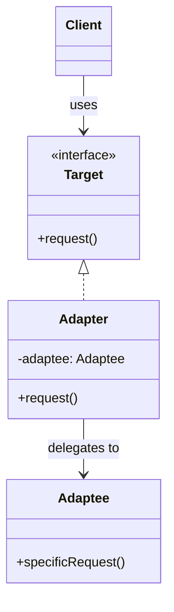

The four roles:

| Role | Who it is | In the plug analogy |
|---|---|---|
| **Client** | Your code that needs something done | You, holding the charger |
| **Target** | The interface the client expects | The shape the socket accepts |
| **Adaptee** | The existing class with the wrong interface | Your Indian charger |
| **Adapter** | The class that implements Target and calls Adaptee | The travel adapter |

#### 📘 Terms Explained

| Term | Simple meaning |
|---|---|
| **Interface (of a class)** | The set of public methods other code can call: names, parameters, return types. |
| **Client** | Any code that uses another object. |
| **Target** | The interface the client wants to call. |
| **Adaptee** | The existing class whose interface does not fit. |
| **Adapter** | The "translator" class that makes the adaptee look like the target. |

---

## 1.2 Why Do We Need It?

You often have to use code you **cannot or should not change**:

| Situation | Example |
|---|---|
| **Third-party library / SDK** | Stripe, PayPal, AWS SDK each have their own method names and types. |
| **Legacy code** | A 10-year-old `XmlCustomerService` that returns XML, while new code wants Java objects. |
| **Two teams' modules** | Team A returns `List<Order>`, team B's code wants `Stream<OrderDto>`. |
| **Changing vendors** | You switch from SendGrid to Amazon SES for email, and want to change only one class. |

### Without an adapter

```java
public class CheckoutService {
    private final StripeClient stripe = new StripeClient();

    public void checkout(String orderId, BigDecimal amount) {
        long paise = amount.movePointRight(2).longValueExact();
        stripe.createCharge(paise, "INR", orderId);    // Stripe details leak into business code
    }
}
```

Problems:
- Business code knows Stripe's method names, units (paise) and currency codes.
- Switching to PayPal means editing `CheckoutService` and every other class that calls Stripe.
- Testing `CheckoutService` requires the real Stripe client (or awkward mocking).

### With an adapter

`CheckoutService` depends only on **your own** interface `PaymentProcessor`. Each vendor gets a small adapter. Switching vendors = writing one new adapter class; business code doesn't change. This is the **Open/Closed Principle** in action.

#### 📘 Terms Explained

| Term | Simple meaning |
|---|---|
| **SDK (Software Development Kit)** | A library a company gives you to talk to its service (e.g. Stripe Java SDK). |
| **Legacy code** | Old code that still works and is still used, but nobody wants to (or can) change it. |
| **Vendor** | An outside company whose product or service you use. |
| **Open/Closed Principle** | Code should be open for extension (add new classes) but closed for modification (don't edit working code). |
| **Leaking details** | When knowledge about one part of the system (like Stripe's units) spreads into unrelated parts. |

---

## 1.3 How It Works: Object Adapter vs Class Adapter

There are two ways to build an adapter.

### Object Adapter (composition), preferred

The adapter **holds** an adaptee object and delegates to it.

```java
class StripeAdapter implements PaymentProcessor {
    private final StripeClient stripe;        // HAS-A adaptee
    StripeAdapter(StripeClient stripe) { this.stripe = stripe; }

    public PaymentResult pay(String orderId, BigDecimal amount) {
        return new PaymentResult(true, stripe.createCharge(toPaise(amount), "INR", orderId));
    }
}
```

### Class Adapter (inheritance)

The adapter **extends** the adaptee and implements the target.

```java
class StripeClassAdapter extends StripeClient implements PaymentProcessor {   // IS-A adaptee
    public PaymentResult pay(String orderId, BigDecimal amount) {
        return new PaymentResult(true, createCharge(toPaise(amount), "INR", orderId));
    }
}
```

| | Object Adapter | Class Adapter |
|---|---|---|
| **Mechanism** | Composition (holds adaptee) | Inheritance (extends adaptee) |
| **Works with subclasses of adaptee?** | Yes, pass any subclass in | No, tied to one concrete class |
| **Adaptee is `final`?** | Still works | Impossible (can't extend) |
| **Can override adaptee behaviour?** | No (only wrap it) | Yes |
| **Java limitation** | None | Java has single inheritance, so you can extend only one adaptee |
| **Exposes adaptee's methods?** | No (clean) | Yes, all public adaptee methods leak into the adapter |
| **Recommended?** | **Yes** | Rarely |

> **Interview tip:** In Java, say "I'd use an object adapter, because Java has single inheritance, the adaptee may be `final`, and composition keeps the adaptee's API hidden."

#### 📘 Terms Explained

| Term | Simple meaning |
|---|---|
| **Object adapter** | Adapter that keeps the adaptee in a field (composition). |
| **Class adapter** | Adapter that inherits from the adaptee (inheritance). |
| **Single inheritance** | Java classes can `extends` only one class (but can `implements` many interfaces). |
| **`final` class** | A class that cannot be extended (e.g. `String`). |

---

## 1.4 Complete Java Example - Payment Gateway Adapters

Two payment SDKs with **completely different** methods are made to look like one interface, `PaymentProcessor`.

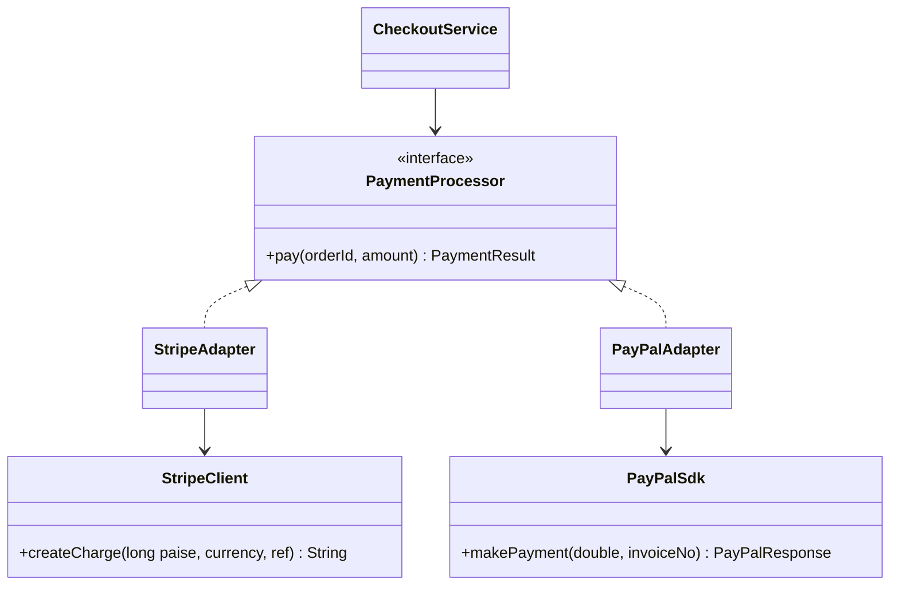

```java
import java.math.BigDecimal;

// ----- Target: the interface OUR code wants -----
interface PaymentProcessor {
    PaymentResult pay(String orderId, BigDecimal amountInRupees);
}

record PaymentResult(boolean success, String transactionId) {}

// ----- Adaptee 1: third-party SDK (we cannot change it) -----
class StripeClient {
    // Stripe wants the amount in the smallest unit (paise) as a long
    public String createCharge(long amountInPaise, String currency, String reference) {
        return "ch_" + reference + "_" + amountInPaise;
    }
}

// ----- Adaptee 2: another SDK with a totally different shape -----
class PayPalSdk {
    public PayPalResponse makePayment(double amount, String invoiceNo) {
        return new PayPalResponse("COMPLETED", "PAYPAL-" + invoiceNo);
    }
}
record PayPalResponse(String status, String paymentId) {}

// ----- Adapters: translate Target calls into Adaptee calls -----
class StripeAdapter implements PaymentProcessor {
    private final StripeClient stripe;              // composition = object adapter
    StripeAdapter(StripeClient stripe) { this.stripe = stripe; }

    @Override
    public PaymentResult pay(String orderId, BigDecimal amountInRupees) {
        long paise = amountInRupees.movePointRight(2).longValueExact(); // 499.99 -> 49999
        String chargeId = stripe.createCharge(paise, "INR", orderId);
        return new PaymentResult(true, chargeId);
    }
}

class PayPalAdapter implements PaymentProcessor {
    private final PayPalSdk payPal;
    PayPalAdapter(PayPalSdk payPal) { this.payPal = payPal; }

    @Override
    public PaymentResult pay(String orderId, BigDecimal amountInRupees) {
        PayPalResponse r = payPal.makePayment(amountInRupees.doubleValue(), orderId);
        return new PaymentResult("COMPLETED".equals(r.status()), r.paymentId());
    }
}

// ----- Client: only knows PaymentProcessor -----
class CheckoutService {
    private final PaymentProcessor processor;
    CheckoutService(PaymentProcessor processor) { this.processor = processor; }

    void checkout(String orderId, String amount) {
        PaymentResult result = processor.pay(orderId, new BigDecimal(amount));
        System.out.println(orderId + " -> success=" + result.success() + ", txn=" + result.transactionId());
    }
}

public class AdapterDemo {
    public static void main(String[] args) {
        new CheckoutService(new StripeAdapter(new StripeClient())).checkout("ORD-1", "499.99");
        new CheckoutService(new PayPalAdapter(new PayPalSdk())).checkout("ORD-2", "1250.00");
    }
}
```

**Output:**
```
ORD-1 -> success=true, txn=ch_ORD-1_49999
ORD-2 -> success=true, txn=PAYPAL-ORD-2
```

**What the adapters translate:**

| Concern | Our interface | Stripe | PayPal |
|---|---|---|---|
| Method name | `pay` | `createCharge` | `makePayment` |
| Amount type | `BigDecimal` rupees | `long` paise | `double` |
| Result | `PaymentResult` | `String` charge id | `PayPalResponse` with status text |

> **Note:** `PayPalAdapter` converts to `double` only because the (pretend) SDK demands it. In real code, never use `double` for money in your own code; keep `BigDecimal` and convert at the last moment.

#### 📘 Terms Explained

| Term | Simple meaning |
|---|---|
| **`BigDecimal`** | Java class for exact decimal numbers. Used for money because `double` has rounding errors (0.1 + 0.2 != 0.3). |
| **`movePointRight(2)`** | Multiplies by 100 by moving the decimal point (499.99 → 49999). |
| **`longValueExact()`** | Converts to `long`, throwing an error if any fraction would be lost. |
| **`record`** | Java 16+ short way to define an immutable data class; it auto-generates the constructor, getters, `equals`, `hashCode` and `toString`. |
| **Paise** | 1/100 of a rupee; payment APIs use the smallest currency unit to avoid decimals. |

---

## 1.5 Advanced Adapter Techniques

### 1.5.1 Adapting with a lambda (functional interfaces)

If the target interface has a single method, the "adapter" can be a lambda or method reference. No class needed.

```java
// Target: Comparator<Employee>. Adaptee: an existing helper method.
class SalaryRules {
    static int compareBySalary(Employee a, Employee b) {
        return Double.compare(a.salary(), b.salary());
    }
}

Comparator<Employee> bySalary = SalaryRules::compareBySalary;     // method reference = adapter
employees.sort(bySalary);

// Adapt a legacy Callable-style API to Supplier
Supplier<String> supplier = () -> {
    try { return legacyCallable.call(); }
    catch (Exception e) { throw new RuntimeException(e); }        // checked -> unchecked
};
```

### 1.5.2 Two-way adapter

Implements **both** interfaces so it can be used by old code and new code during a migration.

```java
interface LegacyCustomerApi { String getCustomerXml(int id); }
interface CustomerRepository  { Customer findById(long id); }

class CustomerTwoWayAdapter implements LegacyCustomerApi, CustomerRepository {
    private final CustomerRepository modern;
    private final XmlMapper xml = new XmlMapper();   // Jackson XML

    CustomerTwoWayAdapter(CustomerRepository modern) { this.modern = modern; }

    public Customer findById(long id) { return modern.findById(id); }

    public String getCustomerXml(int id) {           // old callers still work
        try { return xml.writeValueAsString(modern.findById(id)); }
        catch (JsonProcessingException e) { throw new IllegalStateException(e); }
    }
}
```

### 1.5.3 Adapting exceptions and errors

A good adapter translates **errors** too, not just method names, so vendor exceptions don't leak into business code.

```java
public PaymentResult pay(String orderId, BigDecimal amount) {
    try {
        return new PaymentResult(true, stripe.createCharge(toPaise(amount), "INR", orderId));
    } catch (StripeCardException e) {
        throw new PaymentDeclinedException(orderId, e.getMessage());   // OUR exception type
    } catch (StripeNetworkException e) {
        throw new PaymentGatewayUnavailableException(e);
    }
}
```

### 1.5.4 Anti-Corruption Layer (system-level adapter)

In Domain-Driven Design (DDD), an **Anti-Corruption Layer (ACL)** is a set of adapters between your clean domain model and a messy external or legacy system. It stops the other system's naming and data model from "corrupting" yours. It is the Adapter pattern at the architecture level.

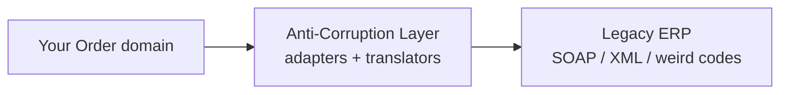

#### 📘 Terms Explained

| Term | Simple meaning |
|---|---|
| **Functional interface** | An interface with exactly one abstract method (`Runnable`, `Comparator`, `Supplier`), so it can be implemented by a lambda. |
| **Method reference** | Short form of a lambda that just calls an existing method: `SalaryRules::compareBySalary`. |
| **Checked exception** | An exception the compiler forces you to catch or declare (`IOException`). |
| **Two-way adapter** | One class that satisfies both the old and the new interface. |
| **DDD (Domain-Driven Design)** | A way of designing software around the business domain and its language. |
| **Anti-Corruption Layer** | A boundary of adapters protecting your model from another system's model. |

---

## 1.6 Adapter in Spring Boot (Interview Imp - Java)

### 1.6.1 Your own adapters as Spring beans

The most common real-world use: one interface, one adapter bean per vendor, chosen by configuration.

```java
public interface PaymentProcessor {
    PaymentResult pay(String orderId, BigDecimal amount);
}

@Component
@ConditionalOnProperty(name = "payment.provider", havingValue = "stripe")
class StripeAdapter implements PaymentProcessor {
    private final StripeClient stripe;
    StripeAdapter(StripeClient stripe) { this.stripe = stripe; }
    public PaymentResult pay(String orderId, BigDecimal amount) { /* translate */ return null; }
}

@Component
@ConditionalOnProperty(name = "payment.provider", havingValue = "paypal")
class PayPalAdapter implements PaymentProcessor { /* ... */ }

@Service
class CheckoutService {
    private final PaymentProcessor processor;      // Spring injects whichever adapter is active
    CheckoutService(PaymentProcessor processor) { this.processor = processor; }
}
```

```yaml
# application.yml
payment:
  provider: stripe      # change to paypal; no code change needed
```

### 1.6.2 Hexagonal architecture (Ports and Adapters)

A very popular Spring Boot project layout is literally named after this pattern.

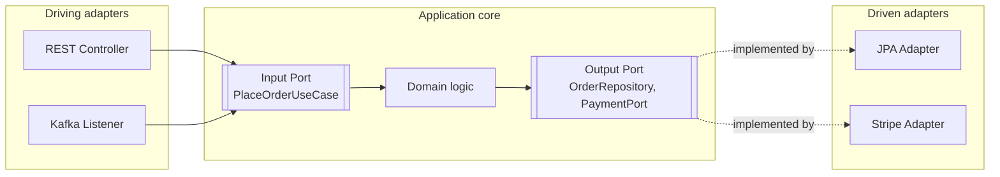

- **Port** = an interface owned by the core (`PaymentPort`).
- **Adapter** = a class outside the core that implements or calls the port (`StripePaymentAdapter`, `OrderRestController`).
- The core has **no** Spring, JPA or Stripe imports, so it is easy to test.

### 1.6.3 Adapters inside Spring itself

| Spring class | What it adapts |
|---|---|
| **`HandlerAdapter`** (Spring MVC) | `DispatcherServlet` can call many kinds of handlers (`@Controller` methods, `HttpRequestHandler`, old `Controller` interface) through one interface. `RequestMappingHandlerAdapter` adapts your `@GetMapping` methods. |
| **`MessageListenerAdapter`** (JMS/Redis/AMQP) | Lets any plain POJO method act as a message listener. |
| **`HttpMessageConverter`** | Adapts HTTP bodies (JSON, XML) to Java objects and back. |
| **`ChannelAdapter`** (Spring Integration) | Connects external systems (files, FTP, JMS) to message channels. |

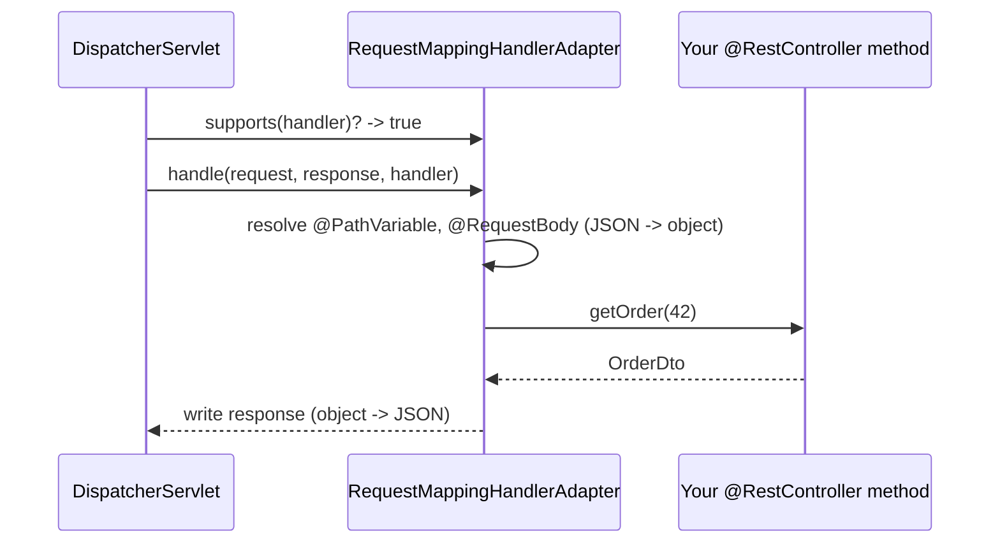

#### 📘 Terms Explained

| Term | Simple meaning |
|---|---|
| **Bean** | An object created and managed by the Spring container. |
| **`@ConditionalOnProperty`** | Spring Boot creates the bean only if a config property has a given value. |
| **Hexagonal architecture** | Also called *Ports and Adapters*: core business logic in the middle, adapters around it for web, DB, messaging. |
| **Port** | An interface that defines how the core talks to the outside (or how the outside talks to the core). |
| **Driving adapter** | Calls into the app (REST controller, message listener). |
| **Driven adapter** | Is called by the app (database repository, payment client). |
| **`DispatcherServlet`** | Spring MVC's front controller; every HTTP request goes through it first. See [Client_Server_Web_Architecture_Guide.md](../../web-architecture/Client_Server_Web_Architecture_Guide.md) for how servlets and Tomcat work. |
| **POJO** | Plain Old Java Object: a normal class with no framework base class. |

---

## 1.7 Real-World Examples in the JDK

| JDK API | Adaptee → Target |
|---|---|
| **`Arrays.asList(array)`** | Array → `List` (a fixed-size list view backed by the array) |
| **`InputStreamReader(InputStream)`** | Byte stream → character `Reader` (decodes bytes using a charset) |
| **`OutputStreamWriter(OutputStream)`** | Character `Writer` → byte stream |
| **`Collections.enumeration(collection)`** | `Collection` → old `Enumeration` interface |
| **`Collections.list(enumeration)`** | Old `Enumeration` → `ArrayList` |
| **`Executors.callable(Runnable)`** | `Runnable` → `Callable` |
| **`javax.xml.bind.annotation.adapters.XmlAdapter`** | Lets JAXB map types it doesn't understand |
| **`Spliterators.iterator(spliterator)`** | `Spliterator` → `Iterator` |

```java
String[] arr = {"a", "b", "c"};
List<String> list = Arrays.asList(arr);   // adapter: array viewed as a List
list.set(0, "z");                         // writes through to the array!
System.out.println(arr[0]);               // z
// list.add("d");                         // UnsupportedOperationException: fixed size

Reader reader = new InputStreamReader(System.in, StandardCharsets.UTF_8);  // bytes -> chars
```

> For more on `Arrays.asList` vs `List.of` vs `new ArrayList<>(...)` see [Java_Collections_Framework_Guide.md](../../java/Java_Collections_Framework_Guide.md).

#### 📘 Terms Explained

| Term | Simple meaning |
|---|---|
| **View** | An object that shows existing data through a different interface without copying it. Changes go through to the original. |
| **Charset** | A rule for turning bytes into characters (UTF-8, ISO-8859-1). |
| **`Enumeration`** | Java 1.0's old version of `Iterator`. |
| **JAXB** | Java API for mapping Java objects to XML. |

---

## 1.8 Pros and Cons

| Pros | Cons |
|---|---|
| Reuse existing/third-party code without changing it | One extra class (and layer of indirection) per adaptee |
| Business code depends on **your** interface, not the vendor's | If the two interfaces are very different, the adapter gets complex |
| Switching vendors = new adapter, no business code changes | Can hide performance costs (e.g. converting large data on every call) |
| Easy to test: mock your own interface | Too many adapters stacked on adapters = hard to follow |
| Single Responsibility: translation code lives in one place | |

---

## 1.9 Common Pitfalls

| Pitfall | Fix |
|---|---|
| Letting vendor types leak through the adapter (returning `StripeCharge`) | Return only your own types (`PaymentResult`). |
| Not translating exceptions | Catch vendor exceptions and throw your own domain exceptions. |
| Putting business logic inside the adapter | Adapters only translate. Rules belong in services. |
| Using a class adapter in Java | Use an object adapter (composition). |
| Assuming `Arrays.asList` returns a normal `ArrayList` | It is fixed-size and backed by the array; copy it with `new ArrayList<>(...)` if you need to add. |
| Converting money to `double` | Keep `BigDecimal`; convert only at the SDK boundary. |
| Designing your interface to look exactly like one vendor's | Design the target from **your** needs, so other vendors fit too. |

---

## 1.10 Adapter - Interview Questions

**Q1. What is the Adapter pattern?**
A structural pattern that converts one interface into another that the client expects, so classes with incompatible interfaces can work together.

**Q2. Object adapter vs class adapter?**
Object adapter holds the adaptee (composition); class adapter extends it (inheritance). In Java prefer the object adapter: single inheritance, `final` classes, and it doesn't expose the adaptee's methods.

**Q3. Give JDK examples of Adapter.**
`Arrays.asList`, `InputStreamReader`, `OutputStreamWriter`, `Collections.enumeration`, `Executors.callable`.

**Q4. Where is Adapter used in Spring?**
`HandlerAdapter` in Spring MVC (`RequestMappingHandlerAdapter`), `MessageListenerAdapter`, `HttpMessageConverter`, and in your own code for vendor integrations. Hexagonal architecture ("ports and adapters") is built around it.

**Q5. Adapter vs Facade?**
Adapter makes **one** existing interface match **another expected** interface. Facade creates a **new, simpler** interface over **many** classes. Adapter is about compatibility; Facade is about simplicity.

**Q6. Adapter vs Decorator?**
Adapter **changes** the interface and keeps the behaviour. Decorator **keeps** the interface and adds behaviour.

**Q7. Adapter vs Bridge?**
Adapter is applied **after** design to make existing things fit. Bridge is planned **up front** so abstraction and implementation can vary independently.

**Q8. How would you design a system to switch between payment providers?**
Define a `PaymentProcessor` interface from the business's point of view, write one adapter per provider, translate types and exceptions in the adapters, and select the adapter via configuration (`@ConditionalOnProperty`, profiles, or a `Map<String, PaymentProcessor>` for runtime choice).

**Q9. What is an Anti-Corruption Layer?**
A DDD term for a layer of adapters/translators between your model and an external or legacy system, so the external model doesn't pollute yours.

---

## 1.11 Adapter - Cheat Sheet

```
ADAPTER   Make an existing class fit an interface the client expects.
          Roles: Client -> Target (interface) <- Adapter -> Adaptee (existing class)
          Prefer OBJECT adapter (composition) over CLASS adapter (inheritance).
          Translate names, types, units AND exceptions. No business logic inside.
          JDK: Arrays.asList, InputStreamReader, Collections.enumeration, Executors.callable
          Spring: HandlerAdapter, MessageListenerAdapter, HttpMessageConverter
          Architecture: Hexagonal (Ports & Adapters), Anti-Corruption Layer
          Changes the INTERFACE, keeps the behaviour.
```

---

# 2. Bridge Pattern

## 2.1 What is the Bridge Pattern?

**Bridge** splits one big class hierarchy into **two separate hierarchies**, **abstraction** (*what* it does) and **implementation** (*how* it is done), and connects them with a reference (the "bridge"). Then each side can grow on its own.

**Analogy:** A TV remote and a TV. The remote (abstraction) has buttons: power, volume, channel. The TV (implementation) can be Sony, Samsung or LG. You can make a new "smart remote" without touching TVs, and a new TV brand works with existing remotes. The infrared signal between them is the bridge.

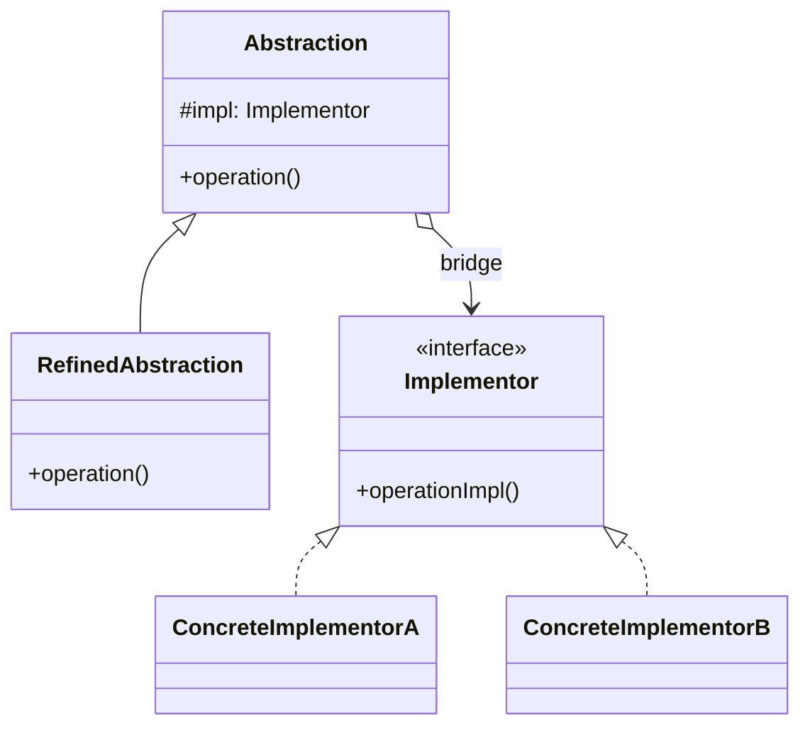

#### 📘 Terms Explained

| Term | Simple meaning |
|---|---|
| **Abstraction** (in Bridge) | The high-level, "what" side the client uses (e.g. `Notification`, `Remote`). Not the same as a Java `abstract` class, though it often is one. |
| **Refined abstraction** | A specific variant of the abstraction (`OtpNotification`, `AdvancedRemote`). |
| **Implementor** | The low-level, "how" interface (`MessageSender`, `Device`). |
| **Concrete implementor** | A real implementation (`EmailSender`, `SonyTv`). |
| **Hierarchy** | A family of classes linked by inheritance. |

---

## 2.2 Why Do We Need It? (The Class Explosion Problem)

Suppose you have notification **types** (OTP, Order Shipped, Promo) and delivery **channels** (Email, SMS, Push). With inheritance alone you need a class for every combination:

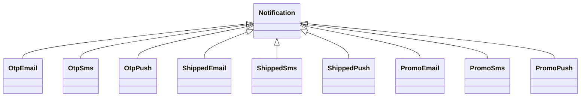

| Types | Channels | Classes with inheritance | Classes with Bridge |
|---|---|---|---|
| 3 | 3 | 3 × 3 = **9** | 3 + 3 = **6** |
| 5 | 4 | **20** | **9** |
| 10 | 6 | **60** | **16** |

Adding WhatsApp would mean writing one new class **per type** with inheritance, but only **one** class with Bridge.

**Rule of thumb:** If a class name combines two words from two independent lists (`OtpSms`, `CircleRed`, `WindowsButton`), you probably have two dimensions and need a Bridge.

#### 📘 Terms Explained

| Term | Simple meaning |
|---|---|
| **Class explosion** | The number of classes grows as a multiplication (M × N) instead of addition (M + N). |
| **Dimension** | One independent way things vary (type of notification is one dimension, channel is another). |
| **Orthogonal** | Independent; changing one doesn't affect the other. |

---

## 2.3 How It Works: Abstraction and Implementor

1. Find the two dimensions: *what* (abstraction) and *how* (implementation).
2. Make the "how" an interface: `MessageSender`.
3. Make the "what" a class that **holds** a `MessageSender` (usually passed in the constructor).
4. Subclass each side independently.
5. The client picks one of each and plugs them together at runtime.

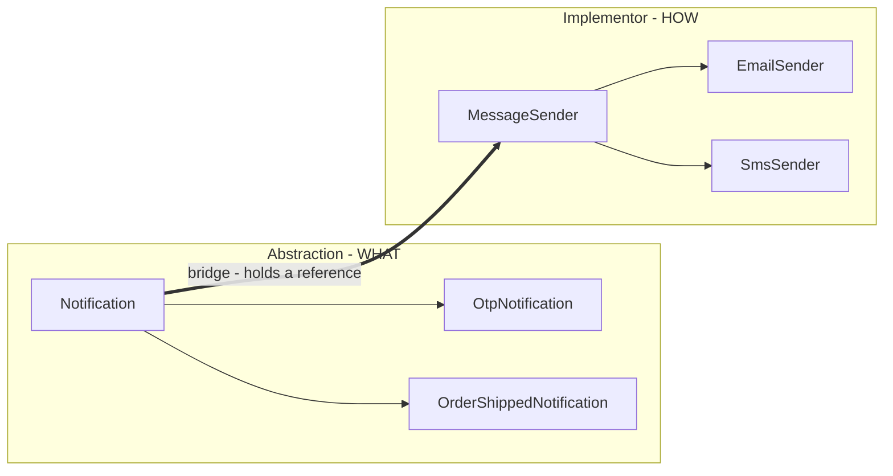

---

## 2.4 Complete Java Example - Notifications x Channels

```java
// ----- Implementor: HOW a message is delivered -----
interface MessageSender {
    void send(String recipient, String text);
}

class EmailSender implements MessageSender {
    public void send(String recipient, String text) {
        System.out.println("[EMAIL to " + recipient + "] " + text);
    }
}

class SmsSender implements MessageSender {
    public void send(String recipient, String text) {
        // SMS has a length limit, so this implementation trims long text
        String body = text.length() > 40 ? text.substring(0, 37) + "..." : text;
        System.out.println("[SMS to " + recipient + "] " + body);
    }
}

// ----- Abstraction: WHAT kind of notification -----
abstract class Notification {
    protected final MessageSender sender;          // the "bridge"
    protected Notification(MessageSender sender) { this.sender = sender; }
    abstract void notifyUser(String user);
}

// ----- Refined abstractions -----
class OtpNotification extends Notification {
    private final String otp;
    OtpNotification(MessageSender sender, String otp) { super(sender); this.otp = otp; }
    void notifyUser(String user) {
        sender.send(user, "Your OTP is " + otp + ". Valid for 5 minutes.");
    }
}

class OrderShippedNotification extends Notification {
    private final String orderId;
    OrderShippedNotification(MessageSender sender, String orderId) { super(sender); this.orderId = orderId; }
    void notifyUser(String user) {
        sender.send(user, "Good news! Order " + orderId + " has been shipped and will arrive in 2 days.");
    }
}

public class BridgeDemo {
    public static void main(String[] args) {
        MessageSender email = new EmailSender();
        MessageSender sms = new SmsSender();

        // 2 notification types x 2 channels = 4 combinations, but only 2 + 2 classes
        new OtpNotification(email, "482913").notifyUser("asha@example.com");
        new OtpNotification(sms, "482913").notifyUser("+91-98xxxxxx01");
        new OrderShippedNotification(email, "ORD-77").notifyUser("asha@example.com");
        new OrderShippedNotification(sms, "ORD-77").notifyUser("+91-98xxxxxx01");
    }
}
```

**Output:**
```
[EMAIL to asha@example.com] Your OTP is 482913. Valid for 5 minutes.
[SMS to +91-98xxxxxx01] Your OTP is 482913. Valid for 5 minutes.
[EMAIL to asha@example.com] Good news! Order ORD-77 has been shipped and will arrive in 2 days.
[SMS to +91-98xxxxxx01] Good news! Order ORD-77 has been ship...
```

Notice: `SmsSender` trimmed the long message to fit the SMS limit. Channel-specific rules live in the implementor, and the notification classes never know about them.

**Adding a new channel** (WhatsApp) = one class:

```java
class WhatsAppSender implements MessageSender {
    public void send(String recipient, String text) { /* call WhatsApp Business API */ }
}
// Works immediately with OtpNotification, OrderShippedNotification, and every future type.
```

**Spring Boot version:** each sender is a bean, and the abstraction gets one injected.

```java
@Component("email") class EmailSender implements MessageSender { ... }
@Component("sms")   class SmsSender   implements MessageSender { ... }

@Service
class NotificationService {
    private final Map<String, MessageSender> senders;   // {"email": EmailSender, "sms": SmsSender}
    NotificationService(Map<String, MessageSender> senders) { this.senders = senders; }

    void sendOtp(String user, String channel, String otp) {
        new OtpNotification(senders.get(channel), otp).notifyUser(user);
    }
}
```

#### 📘 Terms Explained

| Term | Simple meaning |
|---|---|
| **`protected`** | Visible to the class, its subclasses and the same package. Used here so subclasses can use `sender`. |
| **Injecting a `Map<String, Bean>`** | Spring fills the map with every bean of that type, keyed by bean name. |
| **`@Component("email")`** | Registers the class as a bean with the name `email`. |

---

## 2.5 Bridge in the JDK and Spring (JDBC, SLF4J)

### JDBC is a Bridge (Interview Imp - Java)

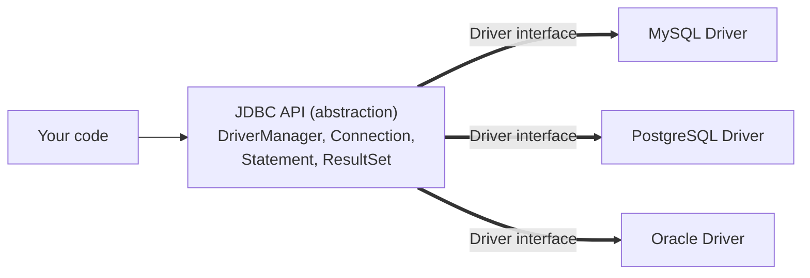

- Your code uses the **abstraction**: `Connection`, `PreparedStatement`, `ResultSet`.
- Each database vendor ships an **implementation**: the `java.sql.Driver` implementation and its own `Connection` classes.
- You can switch MySQL to PostgreSQL by changing the JDBC URL and the driver JAR. Your SQL-calling code stays the same (apart from SQL dialect differences).

```java
try (Connection con = DriverManager.getConnection("jdbc:mysql://localhost:3306/shop", "app", "secret");
     PreparedStatement ps = con.prepareStatement("SELECT name FROM product WHERE id = ?")) {
    ps.setLong(1, 42);
    try (ResultSet rs = ps.executeQuery()) { ... }
}
```

> See [MySQL_Complete_Guide.md](../../mysql/MySQL_Complete_Guide.md) and the JDBC chapter of [Java_FullStack_Syllabus_Guide.md](../../java/Java_FullStack_Syllabus_Guide.md) for JDBC in depth.

### Other Bridges

| Where | Abstraction | Implementor |
|---|---|---|
| **SLF4J** | `org.slf4j.Logger` used in your code | Logback, Log4j2, java.util.logging bindings |
| **JPA** | `EntityManager`, JPQL | Hibernate, EclipseLink |
| **Spring transactions** | `@Transactional` / `TransactionTemplate` | `JpaTransactionManager`, `DataSourceTransactionManager`, JTA |
| **Spring caching** | `@Cacheable` | Caffeine, Redis, EhCache |
| **AWT (old GUI)** | `java.awt.Button` | Native "peer" classes per OS |

#### 📘 Terms Explained

| Term | Simple meaning |
|---|---|
| **JDBC** | Java Database Connectivity, the standard Java API for talking to relational databases. |
| **Driver** | A vendor library that implements JDBC for one database. |
| **SLF4J** | Simple Logging Facade for Java: one logging API, many logging back-ends. (It is also a Facade; see 5.5.) |
| **JPA** | Java Persistence API, the standard ORM API; Hibernate is the most common implementation. |
| **SQL dialect** | Small differences in SQL between databases (e.g. `LIMIT` vs `FETCH FIRST`). |

---

## 2.6 Bridge vs Adapter vs Strategy

These three look similar in code (an object holding an interface), so interviewers love to compare them.

| | Bridge | Adapter | Strategy |
|---|---|---|---|
| **Category** | Structural | Structural | Behavioral |
| **Intent** | Let two hierarchies vary independently | Make an incompatible interface fit | Swap an algorithm at runtime |
| **When designed** | Up front, at design time | After the fact, to integrate existing code | Up front |
| **Both sides have hierarchies?** | Yes (abstraction AND implementor subclassed) | No | Usually only the strategies vary |
| **Example** | `Notification` × `MessageSender` | `StripeAdapter` | `SortStrategy`, `DiscountStrategy` |

> **Simple way to remember:** Adapter = *"make it fit"*. Bridge = *"keep them apart so both can grow"*. Strategy = *"pick how to do one task"*. Bridge is often described as "Strategy applied to a whole hierarchy".

---

## 2.7 Pros and Cons

| Pros | Cons |
|---|---|
| Avoids M × N class explosion | More indirection; harder to understand for small problems |
| Abstraction and implementation change independently | Must identify the two dimensions correctly up front |
| Swap implementation at runtime | Over-engineering if there is only one dimension |
| Hides platform/vendor details from clients | |
| Open/Closed: add a new type or channel without editing others | |

---

## 2.8 Common Pitfalls

| Pitfall | Fix |
|---|---|
| Using Bridge when there is only one dimension | A plain interface + implementations is enough. |
| Implementor interface too specific to one implementation | Design it from the abstraction's needs (lowest common denominator). |
| Abstraction calling `instanceof` on the implementor | Push the behaviour into the implementor instead. |
| Creating the implementor inside the abstraction (`new EmailSender()`) | Pass it in (constructor injection) so it can vary. |
| Confusing Bridge with Adapter in interviews | Bridge = designed up front; Adapter = retrofit. |

---

## 2.9 Bridge - Interview Questions

**Q1. What problem does Bridge solve?**
Class explosion when a class varies in two independent dimensions. It turns M × N subclasses into M + N.

**Q2. Name a real Bridge in Java.**
JDBC: the JDBC API is the abstraction, and vendor drivers are the implementations. SLF4J with its bindings is another.

**Q3. Bridge vs Adapter?**
Bridge is a design-time decision to separate abstraction from implementation. Adapter is a fix to make existing incompatible classes work together.

**Q4. Bridge vs Strategy?**
Structure is similar. Strategy swaps one algorithm inside a single class; Bridge separates two whole hierarchies, and both sides have their own subclasses.

**Q5. How does Bridge follow "composition over inheritance"?**
Instead of inheriting the channel (`OtpSms extends Sms`), the notification *has a* sender object.

**Q6. Give a design example.**
Shapes × renderers (`Circle`/`Square` × `VectorRenderer`/`RasterRenderer`), remotes × devices, reports × exporters (`SalesReport`/`AuditReport` × `PdfExporter`/`ExcelExporter`).

---

## 2.10 Bridge - Cheat Sheet

```
BRIDGE    Split WHAT (abstraction) from HOW (implementor); connect with a reference.
          Avoids M x N subclasses -> M + N classes.
          Signal: class names that combine two lists (OtpSms, RedCircle, PdfSalesReport).
          Both sides can have their own subclasses; implementor injected via constructor.
          Java: JDBC (API vs drivers), SLF4J (API vs Logback/Log4j2), JPA (API vs Hibernate)
          Designed UP FRONT (vs Adapter = retrofit). "Strategy for a whole hierarchy".
```

---

# 3. Composite Pattern (Interview Imp - Java)

## 3.1 What is the Composite Pattern?

**Composite** lets you build **tree structures** of objects and treat a **single object** and a **group of objects** in the same way.

**Analogy:** A company. You can ask any employee "what is your team's total salary cost?" A developer (leaf) answers with their own salary. A manager (composite) asks each person in their team and adds the answers. The CEO asks the same question. Nobody needs to know whether they are talking to a single person or a whole department.

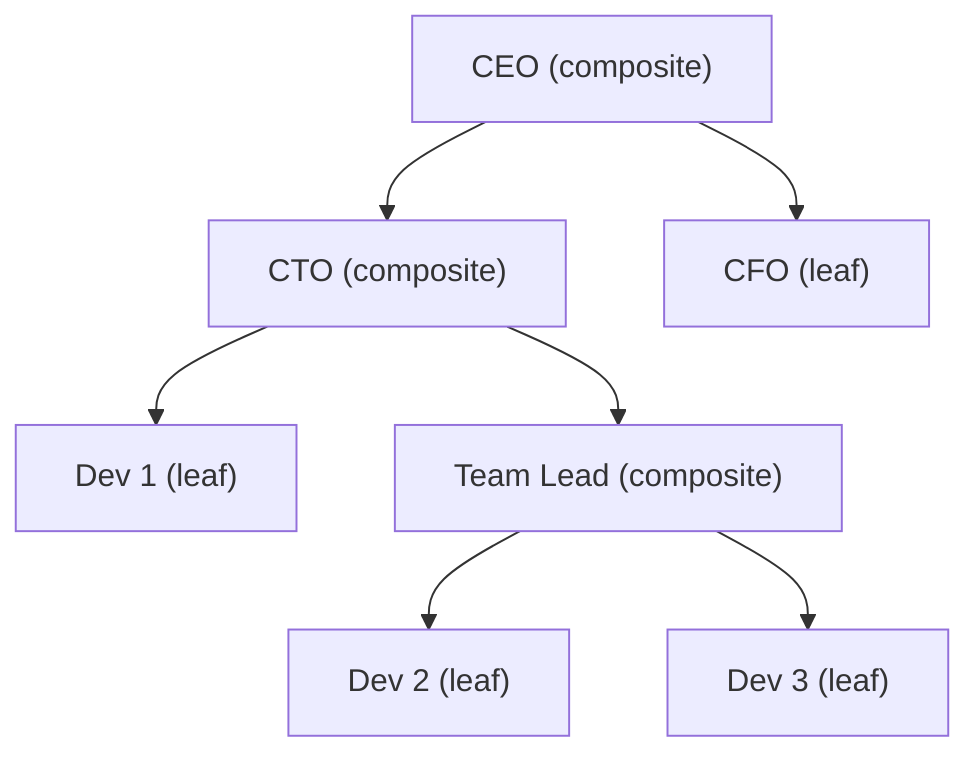

#### 📘 Terms Explained

| Term | Simple meaning |
|---|---|
| **Tree structure** | Data arranged like a family tree: one root, each node has zero or more children. |
| **Node** | One element in a tree. |
| **Leaf** | A node with no children (a file, a single employee). |
| **Composite** | A node that contains children (a folder, a manager). |
| **Root** | The top node of the tree. |
| **Part-whole hierarchy** | A structure where wholes are made of parts, and parts can themselves be wholes. |

---

## 3.2 Why Do We Need It?

### Without Composite

```java
long totalSize(Object item) {
    if (item instanceof FileItem f) {
        return f.size();
    } else if (item instanceof Folder d) {
        long sum = 0;
        for (Object child : d.getChildren()) sum += totalSize(child);
        return sum;
    }
    throw new IllegalArgumentException();
}
```

Every operation (size, print, search, delete, count) needs its own `instanceof` ladder. Adding a new node type (`Shortcut`, `ZipArchive`) means editing all of them.

### With Composite

Both `FileItem` and `Folder` implement `FileSystemItem.size()`. The client just calls `item.size()`, and each class knows how to answer. Recursion happens naturally inside `Folder`.

**Where trees appear in real systems:**

| Domain | Leaf | Composite |
|---|---|---|
| File system | File | Folder |
| UI | Button, TextField | Panel, Window |
| E-commerce | Product | Bundle / combo pack |
| Organisation | Employee | Department |
| Menus | Menu item | Sub-menu |
| Permissions | Permission | Role (group of permissions/roles) |
| Expressions | Number | `Add(left, right)`, `Multiply(...)` |
| HTML / XML DOM | Text node | Element |
| Validation rules | Single rule | `AllOf(rules)`, `AnyOf(rules)` |

---

## 3.3 How It Works: Component, Leaf, Composite

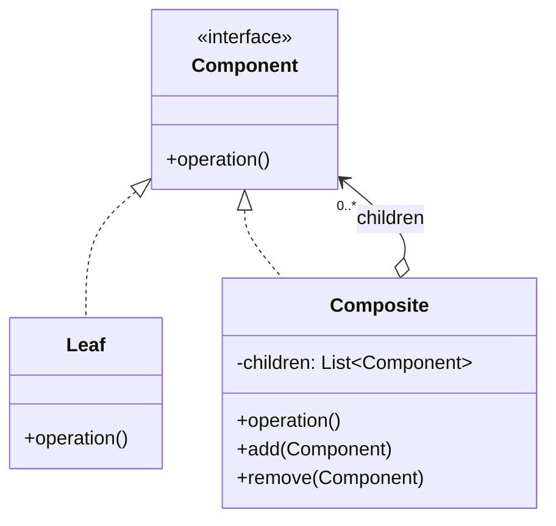

- **Component**: the common interface (`size()`, `print()`).
- **Leaf**: does the work itself.
- **Composite**: holds a list of `Component`s and usually **delegates to each child and combines the results**.

The key trick is that the composite's children are of type `Component`, so a composite can contain leaves **and other composites**. That is what makes the tree any depth.

---

## 3.4 Variants: Transparent vs Safe Composite

Where should `add()` / `remove()` live?

| | Transparent Composite | Safe Composite |
|---|---|---|
| **Child methods declared in** | `Component` (everyone has `add`) | `Composite` only |
| **Client treats all nodes identically?** | Yes, fully uniform | Almost: must know it has a composite to add children |
| **What does `leaf.add(x)` do?** | Throws `UnsupportedOperationException` at runtime | Doesn't compile (caught at compile time) |
| **Type safety** | Weaker | Stronger |
| **Used by** | Original GoF book, Swing `Container` style | Most modern Java code (and our example) |

```java
// Transparent: every node has add(); leaves reject it at runtime
interface Node {
    long size();
    default void add(Node child) { throw new UnsupportedOperationException("leaf"); }
}

// Safe: only Folder has add(); FileItem has no such method
interface FileSystemItem { long size(); }
class Folder implements FileSystemItem { Folder add(FileSystemItem item) { ... } }
```

> **Interview answer:** "I prefer the safe composite in Java, because the compiler stops you from adding a child to a leaf. I use the transparent version only when clients really must build trees without knowing node types."

#### 📘 Terms Explained

| Term | Simple meaning |
|---|---|
| **Transparent** | All node types expose the same methods, so the client can't tell them apart. |
| **Safe** | Only methods that make sense for a type are available on it, so mistakes become compile errors. |
| **`UnsupportedOperationException`** | Standard Java exception meaning "this object doesn't support this operation". |
| **`default` method** | A method in an interface with a body (Java 8+); implementing classes inherit it. |
| **GoF** | "Gang of Four", the four authors of the 1994 *Design Patterns* book that named these 23 patterns. |

---

## 3.5 Complete Java Example - File System Tree

```java
import java.util.ArrayList;
import java.util.List;

// ----- Component: common interface for leaf and composite -----
interface FileSystemItem {
    String name();
    long size();                       // in KB
    void print(String indent);
}

// ----- Leaf: has no children -----
record FileItem(String name, long size) implements FileSystemItem {
    public void print(String indent) {
        System.out.println(indent + "- " + name + " (" + size + " KB)");
    }
}

// ----- Composite: holds children (leaves OR other composites) -----
class Folder implements FileSystemItem {
    private final String name;
    private final List<FileSystemItem> children = new ArrayList<>();

    Folder(String name) { this.name = name; }

    Folder add(FileSystemItem item) { children.add(item); return this; }

    public String name() { return name; }

    // The key idea: a folder's size is the SUM of its children's sizes (recursion)
    public long size() {
        return children.stream().mapToLong(FileSystemItem::size).sum();
    }

    public void print(String indent) {
        System.out.println(indent + "+ " + name + "/ (" + size() + " KB)");
        children.forEach(child -> child.print(indent + "    "));
    }
}

public class CompositeDemo {
    public static void main(String[] args) {
        Folder src = new Folder("src")
                .add(new FileItem("App.java", 12))
                .add(new FileItem("Utils.java", 8));
        Folder images = new Folder("images")
                .add(new FileItem("logo.png", 120))
                .add(new FileItem("banner.jpg", 340));
        Folder project = new Folder("project")
                .add(src)
                .add(images)
                .add(new FileItem("README.md", 4));

        project.print("");

        // Client treats a single file and a whole folder the same way
        List<FileSystemItem> items = List.of(new FileItem("notes.txt", 2), project);
        for (FileSystemItem item : items) {
            System.out.println(item.name() + " total = " + item.size() + " KB");
        }
    }
}
```

**Output:**
```
+ project/ (484 KB)
    + src/ (20 KB)
        - App.java (12 KB)
        - Utils.java (8 KB)
    + images/ (460 KB)
        - logo.png (120 KB)
        - banner.jpg (340 KB)
    - README.md (4 KB)
notes.txt total = 2 KB
project total = 484 KB
```

**How `project.size()` is computed:**

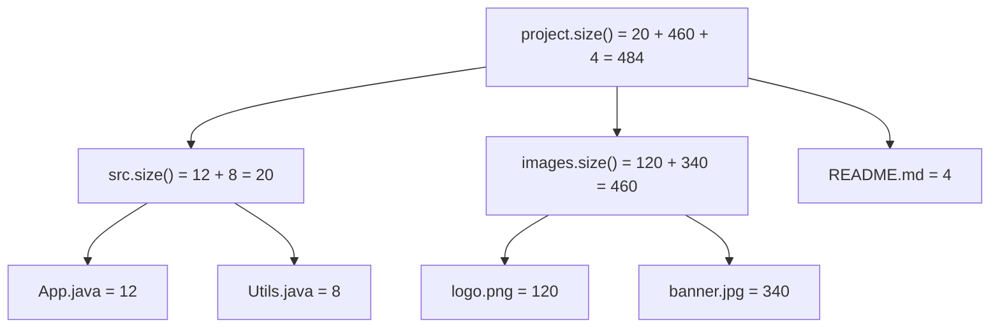

The last loop is the point of the pattern: `notes.txt` (a leaf) and `project` (a whole tree) sit in the same `List<FileSystemItem>` and are treated identically.

#### 📘 Terms Explained

| Term | Simple meaning |
|---|---|
| **Recursion** | A method that calls itself (here `size()` on children, which may call `size()` on their children...). |
| **`mapToLong(...).sum()`** | Stream operation: turn each element into a `long` and add them all. See [java-stream-api.md](../../java/java-stream-api.md). |
| **Fluent `add` (returns `this`)** | Lets you chain calls: `new Folder("x").add(a).add(b)`. |

---

## 3.6 Business Example - Product Bundles and Discounts

An e-commerce "combo" can contain products **and other combos**, and the combo applies its own discount.

```java
interface CartItem {
    String name();
    BigDecimal price();
}

record Product(String name, BigDecimal price) implements CartItem {}

final class Bundle implements CartItem {
    private final String name;
    private final BigDecimal discountPercent;
    private final List<CartItem> items = new ArrayList<>();

    Bundle(String name, String discountPercent) {
        this.name = name;
        this.discountPercent = new BigDecimal(discountPercent);
    }

    Bundle add(CartItem item) { items.add(item); return this; }

    public String name() { return name; }

    public BigDecimal price() {
        BigDecimal total = items.stream().map(CartItem::price).reduce(BigDecimal.ZERO, BigDecimal::add);
        BigDecimal discount = total.multiply(discountPercent).divide(BigDecimal.valueOf(100));
        return total.subtract(discount).setScale(2, RoundingMode.HALF_UP);
    }
}

// "Work-from-home kit" (10% off) = laptop + "Accessories pack" (5% off: mouse + keyboard)
CartItem accessories = new Bundle("Accessories pack", "5")
        .add(new Product("Mouse", new BigDecimal("800")))
        .add(new Product("Keyboard", new BigDecimal("1200")));          // 2000 - 5% = 1900.00
CartItem wfhKit = new Bundle("WFH kit", "10")
        .add(new Product("Laptop", new BigDecimal("50000")))
        .add(accessories);                                              // (50000 + 1900) - 10% = 46710.00
```

The checkout code just sums `item.price()` for everything in the cart; it doesn't know or care which items are bundles.

---

## 3.7 Advanced Composite Topics

### 3.7.1 Composite + Visitor / Iterator

- **Iterator:** walk every node (depth-first or breadth-first) without exposing the `children` list.
- **Visitor:** add new operations (export to JSON, compute tax, find large files) **without** adding methods to every node class.

```java
// Depth-first stream of all nodes (for a Folder that exposes children())
static Stream<FileSystemItem> flatten(FileSystemItem item) {
    if (item instanceof Folder f) {
        return Stream.concat(Stream.of(f), f.children().stream().flatMap(c -> flatten(c)));
    }
    return Stream.of(item);
}

flatten(project).filter(i -> i.size() > 100).map(FileSystemItem::name).toList();  // [project, images, logo.png, banner.jpg]
```

### 3.7.2 Sealed interfaces (Java 17) for a closed tree

If the set of node types is fixed, a `sealed` interface lets the compiler check that a `switch` handles every case.

```java
sealed interface Expr permits Num, Add, Mul {}
record Num(int value) implements Expr {}
record Add(Expr left, Expr right) implements Expr {}   // composite: holds 2 children
record Mul(Expr left, Expr right) implements Expr {}

static int eval(Expr e) {
    if (e instanceof Num n) return n.value();
    if (e instanceof Add a) return eval(a.left()) + eval(a.right());
    if (e instanceof Mul m) return eval(m.left()) * eval(m.right());
    throw new AssertionError();
}

eval(new Add(new Num(2), new Mul(new Num(3), new Num(4))));   // 2 + 3*4 = 14
```

> In Java 21+ you can write this as a `switch` with record patterns, and the compiler checks every case is covered.

### 3.7.3 Performance and safety concerns

| Concern | Solution |
|---|---|
| Recomputing `size()` of a huge tree on every call | Cache the value in the composite; clear the cache (up to the root) when a child changes. Requires a **parent reference**. |
| **Cycles** (folder A contains B, B contains A) → `StackOverflowError` | Check in `add()` that the new child is not an ancestor; or keep a "visited" set while traversing. |
| Very deep trees → `StackOverflowError` | Use an iterative traversal with an explicit `Deque` stack. |
| Concurrent modification while iterating | Use `CopyOnWriteArrayList` for children (read-heavy) or lock; or make the tree immutable. |
| Child order matters (menus, UI) | Use `List`, not `Set`. |

```java
// Iterative depth-first traversal: no recursion, no stack overflow
Deque<FileSystemItem> stack = new ArrayDeque<>(List.of(root));
while (!stack.isEmpty()) {
    FileSystemItem item = stack.pop();
    process(item);
    if (item instanceof Folder f) f.children().forEach(stack::push);
}
```

#### 📘 Terms Explained

| Term | Simple meaning |
|---|---|
| **Depth-first** | Go all the way down one branch before moving to the next. |
| **Breadth-first** | Visit all nodes on one level before going a level deeper. |
| **Visitor pattern** | A behavioural pattern that adds new operations to a set of classes without changing them. |
| **`sealed` interface** | Java 17 feature: only the listed classes may implement it. |
| **Pattern matching for `instanceof`** | `if (e instanceof Num n)` checks the type and creates variable `n` in one step. |
| **`StackOverflowError`** | Thrown when recursion goes too deep (or forever) and the call stack runs out of space. |
| **`Deque`** | Double-ended queue; `ArrayDeque` works as a fast stack (`push`/`pop`). |
| **`CopyOnWriteArrayList`** | Thread-safe list that copies its array on every write; good when reads far outnumber writes. |

---

## 3.8 Composite in Spring Boot and the JDK

| Where | Composite |
|---|---|
| **`java.awt.Container` / Swing `JPanel`** | A container is a `Component` that holds other `Component`s. |
| **Spring `CompositeCacheManager`** | Wraps several `CacheManager`s; looks in each one in turn. |
| **Spring `CompositePropertySource`** | Many property sources treated as one. |
| **Spring Boot Actuator `CompositeHealthContributor`** | `/actuator/health` combines DB, disk, Redis... health into one status; groups can contain groups. |
| **Spring Security `RoleHierarchy`, `DelegatingPasswordEncoder`** | Hierarchies and groups of handlers. |
| **Jackson `JsonNode`** | `ObjectNode`/`ArrayNode` (composites) and `TextNode`/`IntNode` (leaves) share one type. |
| **`org.w3c.dom.Node`** | XML/HTML DOM: elements contain nodes. |
| **JUnit 5 `@Nested` / test suites** | A suite contains tests and other suites. |

### Spring example: composite validator

```java
public interface OrderRule {
    List<String> validate(Order order);          // returns error messages
}

@Component class StockRule implements OrderRule { ... }
@Component class CreditLimitRule implements OrderRule { ... }
@Component class AddressRule implements OrderRule { ... }

@Primary
@Component
class CompositeOrderRule implements OrderRule {
    private final List<OrderRule> rules;

    CompositeOrderRule(List<OrderRule> allRules) {
        // Spring injects every OrderRule bean; skip ourselves to avoid recursion
        this.rules = allRules.stream().filter(r -> !(r instanceof CompositeOrderRule)).toList();
    }

    public List<String> validate(Order order) {
        return rules.stream().flatMap(r -> r.validate(order).stream()).toList();
    }
}

@Service
class OrderService {
    OrderService(OrderRule rule) { ... }   // gets the composite (because of @Primary); looks like one rule
}
```

> **Caution:** injecting `List<OrderRule>` into a bean that is itself an `OrderRule` can cause a circular reference in some setups. A clean alternative is to give the composite its own interface name (`OrderValidator`) and inject `List<OrderRule>` into it.

#### 📘 Terms Explained

| Term | Simple meaning |
|---|---|
| **Actuator** | Spring Boot module that adds production endpoints like `/actuator/health` and `/actuator/metrics`. |
| **`@Primary`** | When several beans match a type, Spring injects this one by default. |
| **Injecting `List<Interface>`** | Spring gives you every bean that implements the interface. |
| **Circular reference** | Bean A needs B and B needs A, so Spring can't decide which to create first. |
| **`JsonNode`** | Jackson's tree model of a JSON document. |

---

## 3.9 Pros and Cons

| Pros | Cons |
|---|---|
| Client code is simple: one interface for leaf and group | Hard to restrict which children a composite may hold (type checks at runtime) |
| Recursion handled inside the structure, not the client | Transparent version allows nonsense like `file.add(...)` |
| Easy to add new node types (Open/Closed) | Deep or large trees can be slow without caching |
| Natural fit for any hierarchical data | Shared generic interface may become too general |

---

## 3.10 Common Pitfalls

| Pitfall | Fix |
|---|---|
| `instanceof` checks in client code | Put the behaviour in the node classes. |
| Cycles in the tree → infinite recursion | Reject adding an ancestor; or track visited nodes. |
| Exposing the mutable `children` list | Return `List.copyOf(children)` or `Collections.unmodifiableList(children)`. |
| Recomputing expensive totals each call | Cache in the composite and invalidate on change. |
| Deep recursion on huge trees | Iterative traversal with `ArrayDeque`. |
| Using Composite for flat lists | A plain `List` is enough if there is no nesting. |
| Spring composite bean injecting itself | Filter itself out, or use a separate interface for the composite. |

---

## 3.11 Composite - Interview Questions

**Q1. What is the Composite pattern?**
A pattern that composes objects into tree structures and lets clients treat individual objects and groups uniformly through one interface.

**Q2. What are its participants?**
Component (common interface), Leaf (no children), Composite (holds children and delegates to them).

**Q3. Transparent vs safe composite?**
Transparent puts `add/remove` in the Component, so it is uniform but leaves must throw at runtime. Safe puts them only in Composite, so you get compile-time safety but less uniformity.

**Q4. Real examples?**
File systems, UI containers (Swing/AWT), menus, org charts, product bundles, JSON/XML DOM, Spring's `CompositeCacheManager`, Actuator health groups.

**Q5. How do you avoid infinite loops?**
Prevent cycles when adding children (check ancestors), or keep a visited set during traversal.

**Q6. Composite vs Decorator?**
Both use recursive composition. A Decorator wraps **exactly one** object to add behaviour. A Composite holds **many** children to represent a part-whole tree and aggregate results.

**Q7. Which patterns combine well with Composite?**
Iterator (walk the tree), Visitor (new operations on nodes), Builder (build complex trees), Flyweight (share identical leaves), Chain of Responsibility (pass requests up to the parent).

**Q8. Design a menu system for a restaurant app.**
`MenuComponent` interface with `print()` and `price()`. `MenuItem` is a leaf; `Menu` is a composite containing items and sub-menus (Drinks → Hot Drinks → Coffee). Printing the root prints the whole menu recursively.

---

## 3.12 Composite - Cheat Sheet

```
COMPOSITE  Tree of objects; treat a leaf and a group the SAME way via one interface.
           Roles: Component (interface), Leaf (no children), Composite (List<Component> children).
           Composite's operation = loop over children + combine results (recursion).
           Safe (add() only on Composite, compile-time safe) vs Transparent (add() on all, leaves throw).
           Watch out: cycles, deep recursion (use ArrayDeque), exposing mutable children, caching totals.
           Java: AWT/Swing Container, DOM Node, Jackson JsonNode
           Spring: CompositeCacheManager, CompositePropertySource, Actuator health groups
           Decorator = wraps ONE; Composite = holds MANY.
```

---

# 4. Decorator Pattern (Interview Imp - Java)

## 4.1 What is the Decorator Pattern?

**Decorator** adds new behaviour to an object **at runtime** by wrapping it in another object that has **the same interface**. Wrappers can be stacked, and each one adds one feature.

**Analogy:** Ordering coffee. You start with plain coffee, then add milk, then sugar, then whipped cream. Each addition "wraps" the drink, adds its own price, and the result is still "a coffee". You choose the combination when you order, not when the menu is printed.

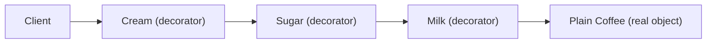

A call goes **in** through each layer to the real object, and the result comes back **out** through each layer. Every layer can act before and/or after passing the call on.

#### 📘 Terms Explained

| Term | Simple meaning |
|---|---|
| **Decorator** | A wrapper with the same interface as the object it wraps, which adds behaviour. |
| **Concrete component** | The real, original object being decorated (plain coffee, the real API client). |
| **At runtime** | While the program is running (as opposed to at compile time when you write classes). |
| **Stacking / chaining** | Wrapping a decorator inside another decorator, many layers deep. |

---

## 4.2 Why Do We Need It? (Subclass Explosion)

Suppose a `WeatherService` may need any combination of **logging**, **retry** and **caching**. With inheritance:

```
WeatherService
├── LoggingWeatherService
├── RetryingWeatherService
├── CachingWeatherService
├── LoggingRetryingWeatherService
├── LoggingCachingWeatherService
├── RetryingCachingWeatherService
└── LoggingRetryingCachingWeatherService      ... 2^3 - 1 = 7 subclasses for 3 features
```

Add a 4th feature (metrics) and it becomes 15 subclasses. With decorators you need **one class per feature** (3, then 4) and combine them freely at runtime. You can even choose the order.

| Approach | 3 features | 5 features | Decide combination |
|---|---|---|---|
| Subclass per combination | 7 classes | 31 classes | Compile time |
| Decorators | 3 classes | 5 classes | Runtime, from config |

Decorator also follows:
- **Single Responsibility:** each decorator does one job (logging OR caching).
- **Open/Closed:** add features without editing the original class, even if you don't own it.

#### 📘 Terms Explained

| Term | Simple meaning |
|---|---|
| **Subclass explosion** | The number of subclasses grows exponentially with each new optional feature. |
| **Single Responsibility Principle** | A class should have one reason to change (do one job). |
| **Cross-cutting concern** | A feature needed in many places that isn't core business logic: logging, caching, retries, security, metrics. |

---

## 4.3 How It Works

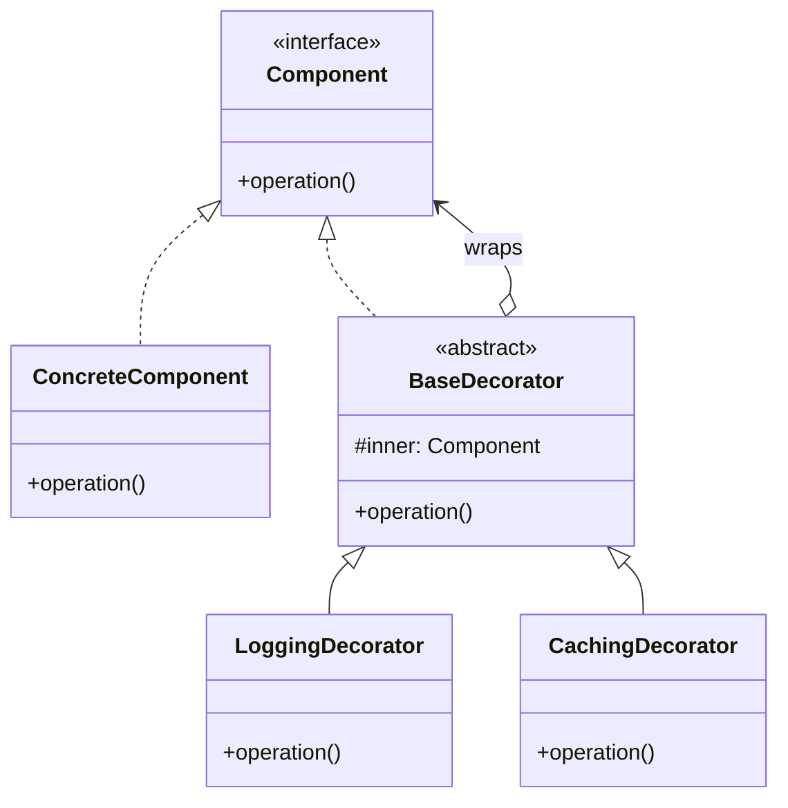

Two things make a class a decorator:
1. It **implements** the same interface as the object it wraps (so it can be used anywhere the original is).
2. It **holds** a reference to that interface (so it can wrap the real object **or another decorator**).

Each method then does: *extra work before → call `inner` → extra work after* (or skips calling `inner` entirely, as a cache hit does).

---

## 4.4 Complete Java Example - Logging, Retry and Caching Decorators

```java
import java.util.HashMap;
import java.util.Map;

// ----- Component -----
interface WeatherService {
    String forecast(String city);
}

// ----- Concrete component: the real work -----
class ApiWeatherService implements WeatherService {
    private int calls = 0;
    public String forecast(String city) {
        calls++;
        if (calls == 1) throw new RuntimeException("timeout");   // simulate one flaky failure
        return city + ": 31C, sunny";
    }
}

// ----- Base decorator: implements the interface AND wraps one -----
abstract class WeatherServiceDecorator implements WeatherService {
    protected final WeatherService inner;
    protected WeatherServiceDecorator(WeatherService inner) { this.inner = inner; }
}

class LoggingWeatherService extends WeatherServiceDecorator {
    LoggingWeatherService(WeatherService inner) { super(inner); }
    public String forecast(String city) {
        System.out.println("  [log] forecast(" + city + ") called");
        String result = inner.forecast(city);
        System.out.println("  [log] forecast(" + city + ") returned '" + result + "'");
        return result;
    }
}

class RetryingWeatherService extends WeatherServiceDecorator {
    private final int maxAttempts;
    RetryingWeatherService(WeatherService inner, int maxAttempts) { super(inner); this.maxAttempts = maxAttempts; }
    public String forecast(String city) {
        for (int attempt = 1; ; attempt++) {
            try {
                return inner.forecast(city);
            } catch (RuntimeException e) {
                System.out.println("  [retry] attempt " + attempt + " failed: " + e.getMessage());
                if (attempt == maxAttempts) throw e;
            }
        }
    }
}

class CachingWeatherService extends WeatherServiceDecorator {
    private final Map<String, String> cache = new HashMap<>();
    CachingWeatherService(WeatherService inner) { super(inner); }
    public String forecast(String city) {
        if (cache.containsKey(city)) {
            System.out.println("  [cache] hit for " + city);
            return cache.get(city);
        }
        String result = inner.forecast(city);
        cache.put(city, result);
        return result;
    }
}

public class DecoratorDemo {
    public static void main(String[] args) {
        // Order matters: Caching -> Logging -> Retry -> real service
        WeatherService service =
                new CachingWeatherService(
                    new LoggingWeatherService(
                        new RetryingWeatherService(
                            new ApiWeatherService(), 3)));

        System.out.println("Call 1:");
        System.out.println("=> " + service.forecast("Pune"));
        System.out.println("Call 2:");
        System.out.println("=> " + service.forecast("Pune"));
    }
}
```

**Output:**
```
Call 1:
  [log] forecast(Pune) called
  [retry] attempt 1 failed: timeout
  [log] forecast(Pune) returned 'Pune: 31C, sunny'
=> Pune: 31C, sunny
Call 2:
  [cache] hit for Pune
=> Pune: 31C, sunny
```

**What happened:**

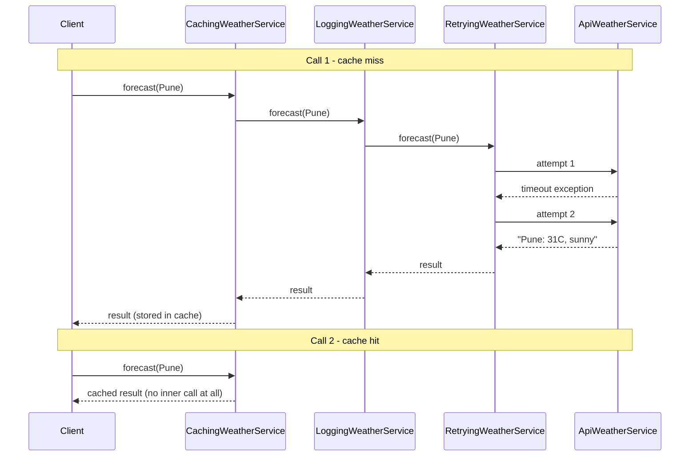

**Order matters:**

| Wrapping order (outer → inner) | Effect |
|---|---|
| Cache → Log → Retry → Api | Cache hits are not logged; each retry attempt is hidden inside one log entry. |
| Log → Cache → Retry → Api | Every call is logged, including cache hits. |
| Retry → Cache → Api | A cache hit never needs retrying; failed calls are retried. Fine here. |
| Retry → Log → Api | Every retry attempt is logged as a separate call. |

> **Thread-safety note:** `CachingWeatherService` uses a `HashMap`, which is fine for this single-threaded demo. In a multi-threaded server use `ConcurrentHashMap` and `computeIfAbsent`, or a real cache like Caffeine.

#### 📘 Terms Explained

| Term | Simple meaning |
|---|---|
| **Cache hit / miss** | Hit = the answer was already stored; miss = must compute or fetch it. |
| **Retry** | Trying a failed operation again, because many failures (timeouts) are temporary. See the Reliability patterns in [00_Design_Patterns_Complete_List.md](../00_Design_Patterns_Complete_List.md). |
| **Flaky** | Fails sometimes and works other times, for no fault of your code. |
| **`ConcurrentHashMap`** | Thread-safe map that many threads can read and write at once. |
| **Caffeine** | A fast, popular in-memory caching library for Java. |

---

## 4.5 Decorators in Java I/O and Collections (Interview Imp - Java)

### 4.5.1 `java.io` is built entirely on Decorator

```java
BufferedReader reader = new BufferedReader(            // decorator: adds buffering + readLine()
                          new InputStreamReader(          // adapter: bytes -> chars
                            new FileInputStream("orders.csv"),  // concrete component: reads bytes from a file
                            StandardCharsets.UTF_8));
```

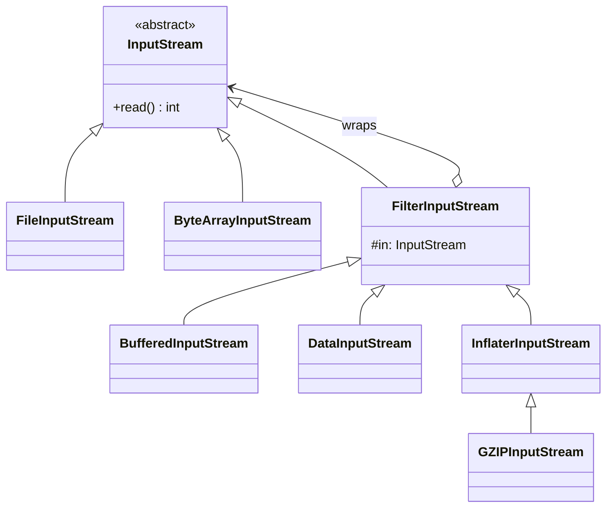

| Role | Classes |
|---|---|
| Component | `InputStream`, `OutputStream`, `Reader`, `Writer` |
| Concrete components (real sources) | `FileInputStream`, `ByteArrayInputStream`, `SocketInputStream` |
| Base decorator | `FilterInputStream`, `FilterOutputStream`, `FilterReader` |
| Decorators | `BufferedInputStream`, `DataInputStream`, `GZIPInputStream`, `CipherInputStream`, `PushbackInputStream`, `BufferedReader`, `LineNumberReader`, `PrintWriter` |

```java
// Read a gzipped file of ints with buffering: three decorators stacked
try (DataInputStream in = new DataInputStream(
                             new BufferedInputStream(
                               new GZIPInputStream(
                                 new FileInputStream("numbers.bin.gz"))))) {
    int first = in.readInt();
}
// Closing the outermost stream closes every wrapped stream too.
```

> **Interview point:** `InputStreamReader` is an **Adapter** (changes `InputStream` into a `Reader`), while `BufferedReader` is a **Decorator** (still a `Reader`, adds buffering). Interviewers like this distinction.

### 4.5.2 `java.util.Collections` wrappers

```java
List<String> base = new ArrayList<>(List.of("a", "b"));

List<String> readOnly = Collections.unmodifiableList(base);   // same List interface, blocks writes
List<String> syncList = Collections.synchronizedList(base);   // same List interface, adds locking
List<String> checked  = Collections.checkedList(base, String.class); // same interface, adds runtime type checks

// readOnly.add("c");  -> UnsupportedOperationException
base.add("c");
System.out.println(readOnly);   // [a, b, c]  <- it's a VIEW: changes to base show through
```

| Wrapper | Adds |
|---|---|
| `unmodifiableList/Set/Map` | Read-only access (throws on writes) |
| `synchronizedList/Set/Map` | A lock around each method (iteration still needs manual `synchronized`) |
| `checkedList/Set/Map` | Type checks on insert (catches heap pollution from raw types) |

> `List.copyOf(base)` is different: it makes an **immutable copy**, so later changes to `base` do not show. See [Java_Collections_Framework_Guide.md](../../java/Java_Collections_Framework_Guide.md).

#### 📘 Terms Explained

| Term | Simple meaning |
|---|---|
| **Buffering** | Reading/writing in big chunks into memory instead of one byte at a time, which is much faster. |
| **`FilterInputStream`** | JDK's base decorator class for input streams; holds `protected InputStream in`. |
| **`try-with-resources`** | `try (Resource r = ...) { }` automatically closes `r` at the end. |
| **Unmodifiable view** | A wrapper that blocks writes, but still reflects changes made to the underlying collection. |
| **Immutable copy** | A separate collection that can never change. |
| **Heap pollution** | When a variable of a generic type holds an object of the wrong type (usually via raw types). |

---

## 4.6 Functional Decorators with Lambdas

For single-method interfaces, a decorator can be a **higher-order function**: a function that takes a function and returns a new, enhanced function.

```java
import java.util.function.Function;

static <T, R> Function<T, R> logged(String name, Function<T, R> fn) {
    return input -> {
        System.out.println(name + " <- " + input);
        R result = fn.apply(input);
        System.out.println(name + " -> " + result);
        return result;
    };
}

static <T, R> Function<T, R> memoized(Function<T, R> fn) {
    Map<T, R> cache = new ConcurrentHashMap<>();
    return input -> cache.computeIfAbsent(input, fn);
}

Function<Integer, Integer> square = x -> x * x;
Function<Integer, Integer> enhanced = memoized(logged("square", square));

enhanced.apply(4);   // logs "square <- 4" and "square -> 16"
enhanced.apply(4);   // cached: no log

// Built-in composition: andThen / compose
Function<String, String> trim = String::trim;
Function<String, String> pipeline = trim.andThen(String::toUpperCase).andThen(s -> s + "!");
pipeline.apply("  hello ");   // "HELLO!"
```

Resilience libraries work exactly like this:

```java
// Resilience4j: decorate a Supplier with retry + circuit breaker
Supplier<String> call = () -> weatherClient.forecast("Pune");
Supplier<String> resilient = Decorators.ofSupplier(call)
        .withRetry(Retry.ofDefaults("weather"))
        .withCircuitBreaker(CircuitBreaker.ofDefaults("weather"))
        .decorate();
```

#### 📘 Terms Explained

| Term | Simple meaning |
|---|---|
| **Higher-order function** | A function that takes and/or returns another function. |
| **`Function<T, R>`** | Java functional interface: takes a `T`, returns an `R`. |
| **Memoize** | Remember the result for each input so the function is computed only once per input. |
| **`andThen`** | `f.andThen(g)` = first run `f`, then run `g` on its result. |
| **Resilience4j** | Java library for retry, circuit breaker, rate limiter, bulkhead; works by decorating functions. |

---

## 4.7 Decorator in Spring Boot (Interview Imp - Java)

### 4.7.1 Decorating your own bean with `@Primary`

```java
public interface PriceService { BigDecimal priceOf(String sku); }

@Component("realPriceService")
class DbPriceService implements PriceService {
    public BigDecimal priceOf(String sku) { /* DB query */ return BigDecimal.TEN; }
}

@Primary                                    // everyone who asks for PriceService gets this
@Component
class MetricsPriceService implements PriceService {
    private final PriceService inner;
    private final MeterRegistry meters;

    MetricsPriceService(@Qualifier("realPriceService") PriceService inner, MeterRegistry meters) {
        this.inner = inner;
        this.meters = meters;
    }

    public BigDecimal priceOf(String sku) {
        return meters.timer("price.lookup").record(() -> inner.priceOf(sku));   // adds timing metric
    }
}
```

### 4.7.2 Decorating automatically with a `BeanPostProcessor`

Spring calls a `BeanPostProcessor` for every bean it creates, and the processor may **return a wrapper instead of the original**. This is how Spring itself adds AOP proxies.

```java
@Component
class PriceServiceDecoratingPostProcessor implements BeanPostProcessor {
    @Override
    public Object postProcessAfterInitialization(Object bean, String beanName) {
        if (bean instanceof PriceService target && !(bean instanceof LoggingPriceService)) {
            return new LoggingPriceService(target);     // replace the bean with a decorator
        }
        return bean;
    }
}
```

### 4.7.3 Decorators already inside Spring and the Servlet API

| Class | What it decorates / adds |
|---|---|
| **`HttpServletRequestWrapper` / `HttpServletResponseWrapper`** | Wrap a request/response to change headers, cache the body, etc. Used in servlet filters. |
| **`ContentCachingRequestWrapper`** (Spring) | Caches the request body so it can be read twice (e.g. for logging). |
| **`TransactionAwareCacheDecorator`** | Delays cache puts until the transaction commits. |
| **`TransactionAwareDataSourceProxy`** | Makes a `DataSource` take part in Spring-managed transactions. |
| **`LazyConnectionDataSourceProxy`** | Gets a real connection only when the first SQL runs. |
| **`BufferingClientHttpRequestFactory`** | Buffers response bodies so interceptors can read them. |
| **`ServerHttpRequestDecorator`** (WebFlux) | Reactive version of request wrapping. |

```java
// Servlet filter that wraps the request so the body can be logged after the controller runs
@Component
class RequestBodyLoggingFilter extends OncePerRequestFilter {
    protected void doFilterInternal(HttpServletRequest req, HttpServletResponse res, FilterChain chain)
            throws ServletException, IOException {
        ContentCachingRequestWrapper wrapped = new ContentCachingRequestWrapper(req);   // decorator
        chain.doFilter(wrapped, res);
        log.info("body = {}", new String(wrapped.getContentAsByteArray(), StandardCharsets.UTF_8));
    }
}
```

> Names containing "Proxy" in Spring are often decorators by structure. The line between Proxy and Decorator is about **intent** (see 4.8).

#### 📘 Terms Explained

| Term | Simple meaning |
|---|---|
| **`@Qualifier`** | Tells Spring exactly which bean (by name) to inject when several match. |
| **`MeterRegistry`** | Micrometer's registry for metrics (timers, counters) that Actuator/Prometheus read. |
| **`BeanPostProcessor`** | Spring hook that runs on every bean after it is created and may replace it. |
| **Servlet filter** | Code that runs before/after every HTTP request reaches your controller. |
| **`OncePerRequestFilter`** | Spring base class that guarantees a filter runs once per request. |
| **WebFlux** | Spring's reactive (non-blocking) web framework. |

---

## 4.8 Decorator vs Inheritance vs Proxy

| | Inheritance | Decorator | Proxy |
|---|---|---|---|
| **When behaviour is added** | Compile time | Runtime | Runtime |
| **Can combine features freely?** | No (one class per combination) | Yes, stack in any order | Usually a single layer |
| **Who creates the wrapper?** | n/a | Usually the **client** (it chooses features) | Usually a **framework/factory**; the client doesn't know |
| **Intent** | Specialise | **Add features** | **Control access** (lazy, security, remote, transactions) |
| **Real object lifetime** | n/a | Created outside and passed in | Often created/managed by the proxy (e.g. lazily) |
| **Example** | `class Manager extends Employee` | `new BufferedReader(reader)` | Spring `@Transactional` proxy, Hibernate lazy proxy |

> **Simple rule:** structure is nearly identical. Ask *"why is the wrapper here?"* To **add** something: Decorator. To **guard / delay / redirect** access: Proxy.

---

## 4.9 Pros and Cons

| Pros | Cons |
|---|---|
| Add features without changing the original class | Many small wrapper objects; stack traces get long |
| Combine features freely at runtime | Order of wrapping matters and is easy to get wrong |
| One class per feature (Single Responsibility) | Object identity changes: `decorated != original` |
| Works on classes you don't own or that are `final` | Must implement *every* interface method (boilerplate for big interfaces) |
| Avoids subclass explosion | Hard to remove a decorator from the middle of a stack |

---

## 4.10 Common Pitfalls

| Pitfall | Fix |
|---|---|
| Wrong wrapping order (e.g. logging outside cache when you want cache hits logged) | Decide order deliberately; build stacks in one place (a factory or config). |
| Forgetting to delegate some methods of a large interface | Use an abstract base decorator that delegates everything by default. |
| Interface `default` methods not delegated | Override them in the base decorator too, or they bypass the wrapped object. |
| Comparing with `==` or `equals` after decorating | Don't rely on identity; or have decorators delegate `equals`/`hashCode` carefully. |
| Non-thread-safe state inside a decorator (`HashMap` cache) | Use `ConcurrentHashMap` or a proper cache library. |
| Closing only the inner stream in I/O | Close the **outermost** wrapper; it closes the rest. |
| Using Decorator when only one fixed combination is ever needed | A simple class is fine. |
| Spring bean decorating itself (injects its own type) | Use `@Qualifier` for the inner bean or a `BeanPostProcessor`. |

---

## 4.11 Decorator - Interview Questions

**Q1. What is the Decorator pattern?**
A structural pattern that attaches extra behaviour to an object dynamically by wrapping it in an object with the same interface. Decorators can be stacked.

**Q2. Where is it used in the JDK?**
`java.io`: `BufferedReader`, `BufferedInputStream`, `DataInputStream`, `GZIPInputStream`, all built on `FilterInputStream`. Also `Collections.unmodifiableList`, `synchronizedList`, `checkedList`.

**Q3. Why not just use inheritance?**
Inheritance fixes behaviour at compile time and needs a subclass for every combination of features (2^n - 1). Decorators combine features at runtime, one class per feature.

**Q4. Is `InputStreamReader` a decorator?**
No, it's an **adapter**: it converts an `InputStream` (bytes) into a `Reader` (chars), so the interface changes. `BufferedReader` is a decorator: input and output are both `Reader`.

**Q5. Decorator vs Proxy?**
Same structure, different intent. Decorator adds responsibilities and is usually stacked by the client. Proxy controls access (lazy loading, security, remoting, transactions) and is usually created by a framework so the client doesn't notice.

**Q6. Decorator vs Adapter?**
Decorator keeps the interface and adds behaviour. Adapter changes the interface and keeps the behaviour.

**Q7. Decorator vs Composite?**
Decorator wraps exactly one component. Composite holds many children. Both use recursive composition.

**Q8. Does order of decorators matter? Give an example.**
Yes. Caching outside logging means cache hits are never logged. Encrypting before compressing makes compression useless, because encrypted data looks random. So compress first, then encrypt.

**Q9. How do you implement a decorator in Spring?**
`@Primary` wrapper bean that injects the real bean with `@Qualifier`; a `BeanPostProcessor` that returns a wrapper; or AOP aspects (which are proxy-based). For servlet requests, `HttpServletRequestWrapper`.

**Q10. Is `Collections.unmodifiableList` thread-safe or immutable?**
Neither guarantee fully. It is a read-only **view**: the underlying list can still change through the original reference. For a truly immutable list use `List.copyOf` or `List.of`.

---

## 4.12 Decorator - Cheat Sheet

```
DECORATOR  Wrap an object in another with the SAME interface to ADD behaviour at runtime.
           Stackable: new Cache(new Log(new Retry(real))). Order matters!
           Structure: implements Component + holds Component (inner). Base decorator delegates all.
           Avoids 2^n - 1 subclasses. One class per feature (SRP, OCP).
           JDK: java.io (FilterInputStream, BufferedReader, GZIPInputStream, DataInputStream),
                Collections.unmodifiable/synchronized/checkedList
           Functional: Function.andThen, higher-order functions, Resilience4j Decorators.
           Spring: @Primary wrapper + @Qualifier, BeanPostProcessor, HttpServletRequestWrapper,
                   ContentCachingRequestWrapper, TransactionAwareCacheDecorator.
           InputStreamReader = ADAPTER; BufferedReader = DECORATOR.
           Decorator ADDS features; Proxy CONTROLS access (same shape, different intent).
```

---

# 5. Facade Pattern (Interview Imp - Java)

## 5.1 What is the Facade Pattern?

**Facade** provides **one simple interface** to a **complex subsystem** made of many classes. The client calls one method; the facade calls the right subsystem classes in the right order.

**Analogy:** A hotel reception desk. You say "I'd like a room for two nights". Reception talks to housekeeping, billing, the key-card system and the restaurant (breakfast). You never deal with those departments directly, though you *could* if you needed to.

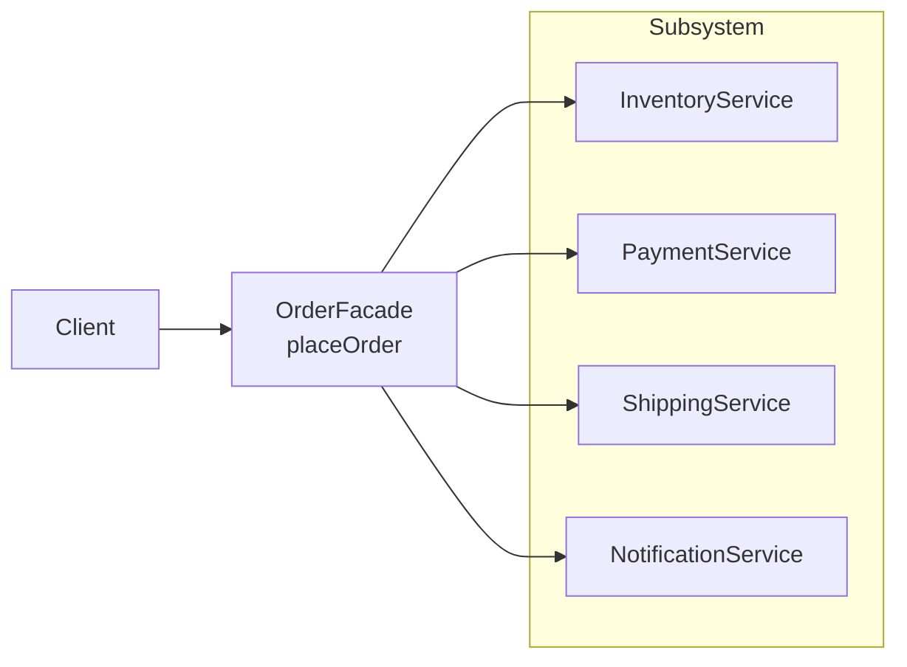

#### 📘 Terms Explained

| Term | Simple meaning |
|---|---|
| **Facade** | French for "front of a building". A simple front hiding a complex inside. |
| **Subsystem** | A group of classes that together do a larger job (inventory + payment + shipping). |
| **Orchestration** | Calling several services in the right order and handling what happens if one fails. |

---

## 5.2 Why Do We Need It?

### Without a facade

Every controller, batch job and message listener that places an order repeats the same steps:

```java
// In OrderController, in BulkOrderJob, in KafkaOrderListener ... copied 3 times
inventory.reserve(sku, qty);
String paymentId = payment.charge(customerId, amount);
shipping.schedule(customerId, sku);
notification.send(customerId, "Order confirmed");
// ...and each copy handles failures slightly differently (bugs!)
```

Problems:
- **Duplication:** the workflow is copied in many places.
- **Tight coupling:** every client depends on four services; changing one affects all clients.
- **Inconsistent error handling:** one copy releases stock on payment failure, another forgets.
- **Hard for new developers:** they must learn the whole subsystem to do one simple thing.

### With a facade

Clients call `orderFacade.placeOrder(...)`. The workflow, ordering and rollback logic live in **one** place.

---

## 5.3 How It Works

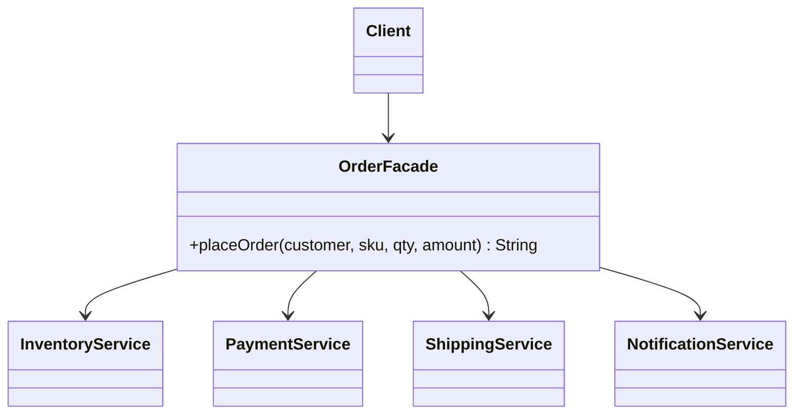

Key properties:
1. The facade **does not add new functionality**. It only coordinates existing pieces.
2. The subsystem **doesn't know** the facade exists.
3. The subsystem classes are **still available** for clients who need advanced control (the facade is a convenience, not a wall).
4. You can have **several facades** for different clients (e.g. `CustomerOrderFacade`, `AdminOrderFacade`).

---

## 5.4 Complete Java Example - Order Placement Facade

```java
// ----- Complex subsystems -----
class InventoryService {
    boolean reserve(String sku, int qty) {
        System.out.println("  Inventory: reserved " + qty + " x " + sku);
        return true;
    }
    void release(String sku, int qty) {
        System.out.println("  Inventory: released " + qty + " x " + sku);
    }
}

class PaymentService {
    String charge(String customerId, double amount) {
        if (amount > 10_000) throw new IllegalStateException("card limit exceeded");
        System.out.println("  Payment: charged Rs." + amount + " to " + customerId);
        return "PAY-9001";
    }
}

class ShippingService {
    String schedule(String customerId, String sku) {
        System.out.println("  Shipping: pickup scheduled for " + sku);
        return "AWB-1001";
    }
}

class NotificationService {
    void send(String customerId, String message) {
        System.out.println("  Notify " + customerId + ": " + message);
    }
}

// ----- Facade: one simple method hides the whole workflow -----
class OrderFacade {
    private final InventoryService inventory = new InventoryService();
    private final PaymentService payment = new PaymentService();
    private final ShippingService shipping = new ShippingService();
    private final NotificationService notification = new NotificationService();

    String placeOrder(String customerId, String sku, int qty, double amount) {
        if (!inventory.reserve(sku, qty)) return "OUT_OF_STOCK";
        try {
            String paymentId = payment.charge(customerId, amount);
            String awb = shipping.schedule(customerId, sku);
            notification.send(customerId, "Order confirmed. Tracking " + awb);
            return "CONFIRMED (" + paymentId + ")";
        } catch (RuntimeException e) {
            inventory.release(sku, qty);                 // undo step 1 if step 2 fails
            notification.send(customerId, "Order failed: " + e.getMessage());
            return "FAILED";
        }
    }
}

public class FacadeDemo {
    public static void main(String[] args) {
        OrderFacade orders = new OrderFacade();
        System.out.println("Order A:");
        System.out.println("=> " + orders.placeOrder("CUST-1", "PHONE-128GB", 1, 8999.0));
        System.out.println("Order B:");
        System.out.println("=> " + orders.placeOrder("CUST-2", "LAPTOP-16GB", 1, 75000.0));
    }
}
```

**Output:**
```
Order A:
  Inventory: reserved 1 x PHONE-128GB
  Payment: charged Rs.8999.0 to CUST-1
  Shipping: pickup scheduled for PHONE-128GB
  Notify CUST-1: Order confirmed. Tracking AWB-1001
=> CONFIRMED (PAY-9001)
Order B:
  Inventory: reserved 1 x LAPTOP-16GB
  Inventory: released 1 x LAPTOP-16GB
  Notify CUST-2: Order failed: card limit exceeded
=> FAILED
```

Order B shows the real value: the **compensating action** (release stock) is written once in the facade, so no client can forget it.

> **Real projects:** the subsystem services would be injected (constructor injection), not created with `new`, so they can be mocked in tests. In a microservices system, each subsystem might be a separate service, and the facade becomes an orchestrator or a **Saga**.

#### 📘 Terms Explained

| Term | Simple meaning |
|---|---|
| **Compensating action** | An "undo" step run when a later step fails (release stock after payment fails). |
| **Saga** | A pattern for multi-step transactions across microservices using a sequence of local steps plus compensations. |
| **Rollback** | Undoing changes made so far so data stays consistent. |

---

## 5.5 Facade in Spring Boot and Real Systems (Interview Imp - Java)

### 5.5.1 The `@Service` layer is a facade

In a typical Spring Boot app, the controller should be thin. A service method is a facade over repositories, clients and other services:

```java
@Service
@RequiredArgsConstructor
public class OrderFacade {
    private final InventoryClient inventory;
    private final PaymentClient payment;
    private final OrderRepository orders;
    private final ApplicationEventPublisher events;

    @Transactional
    public OrderConfirmation placeOrder(PlaceOrderRequest req) {
        inventory.reserve(req.sku(), req.qty());
        PaymentReceipt receipt = payment.charge(req.customerId(), req.amount());
        Order saved = orders.save(Order.from(req, receipt));
        events.publishEvent(new OrderPlacedEvent(saved.getId()));   // email/SMS handled by listeners
        return OrderConfirmation.of(saved);
    }
}

@RestController
@RequiredArgsConstructor
class OrderController {
    private final OrderFacade orderFacade;

    @PostMapping("/orders")
    OrderConfirmation place(@Valid @RequestBody PlaceOrderRequest req) {
        return orderFacade.placeOrder(req);       // one line; controller knows nothing else
    }
}
```

### 5.5.2 Facades provided by Spring and Java libraries

| Facade | Hides |
|---|---|
| **`JdbcTemplate`** | Getting a connection, creating statements, looping over `ResultSet`, closing resources, translating `SQLException`. |
| **`RestTemplate` / `RestClient` / `WebClient`** | Opening HTTP connections, headers, JSON (de)serialisation, error handling. |
| **`KafkaTemplate` / `RabbitTemplate` / `JmsTemplate`** | Producer setup, serialisation, connection handling. |
| **`JavaMailSender`** | SMTP sessions, MIME messages. |
| **SLF4J** | Different logging frameworks behind one simple `Logger` API (its name literally says "Facade"). |
| **`javax.faces.context.FacesContext`**, `ExternalContext` | Servlet request/response details. |
| **`java.net.http.HttpClient`** | Socket and protocol details. |
| **Spring Boot auto-configuration** | Hundreds of beans configured behind a few properties. |

```java
// Without the facade: ~25 lines of JDBC boilerplate (connection, statement, result set, close, catch).
// With JdbcTemplate:
List<String> names = jdbcTemplate.queryForList("SELECT name FROM product WHERE price > ?", String.class, 1000);
```

### 5.5.3 System-level facades: API Gateway and BFF

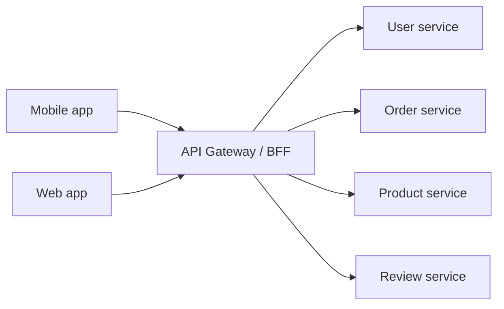

- **API Gateway:** a single entry point for all clients; handles routing, auth, rate limiting.
- **Backend For Frontend (BFF):** one facade per client type. The mobile BFF can combine 4 service calls into **one** response shaped for the small screen.
- **Aggregator endpoint:** `GET /product-page/42` calls product, price, stock and reviews services and returns one JSON.

> See [01_Scalability_Pattern.md](../03_System_Design/01_Scalability_Pattern.md) for load balancers and gateways in front of scaled services.

#### 📘 Terms Explained

| Term | Simple meaning |
|---|---|
| **`@RequiredArgsConstructor`** | Lombok annotation that generates a constructor for all `final` fields (used for constructor injection). |
| **`ApplicationEventPublisher`** | Spring's way to publish in-app events; `@EventListener` methods receive them. |
| **`JdbcTemplate`** | Spring class that removes JDBC boilerplate. |
| **Boilerplate** | Repetitive code that must be written but adds no business value. |
| **API Gateway** | A server that sits in front of many microservices and is the single entry point for clients. |
| **BFF (Backend For Frontend)** | A gateway/facade built specifically for one type of client (mobile, web). |

---

## 5.6 Facade vs Adapter vs Mediator vs API Gateway

| | Facade | Adapter | Mediator | API Gateway |
|---|---|---|---|---|
| **Category** | Structural | Structural | Behavioral | Architectural |
| **Wraps** | Many classes | One class | Many peer objects | Many services (network) |
| **Goal** | Simplify | Make compatible | Remove direct peer-to-peer communication | Single network entry point |
| **New interface?** | Yes, simpler | Yes, the one the client expects | Yes, for colleagues to talk through | Yes, public HTTP API |
| **Direction of calls** | Client → facade → subsystem (one-way) | Client → adapter → adaptee | Colleagues ↔ mediator ↔ colleagues (two-way) | Client → gateway → services |
| **Subsystem knows about it?** | No | No | **Yes**, colleagues call the mediator | No |
| **Example** | `OrderFacade`, `JdbcTemplate` | `StripeAdapter` | Chat room, air-traffic control, `DispatcherServlet` | Spring Cloud Gateway, Kong |

---

## 5.7 Pros and Cons

| Pros | Cons |
|---|---|
| Simple entry point; clients write less code | Can grow into a **God object** that does everything |
| Decouples clients from subsystem internals | Another layer; may hide useful advanced options |
| Workflow and error handling in one place | Changes in the subsystem may still ripple into the facade |
| Easier onboarding and testing (mock the facade) | If clients bypass it, logic gets duplicated again |
| Lets you refactor the subsystem behind a stable API | |

---

## 5.8 Common Pitfalls

| Pitfall | Fix |
|---|---|
| Facade becomes a God class with 50 methods | Split by use case or client (`CheckoutFacade`, `ReturnsFacade`). |
| Business rules buried in the facade | Keep domain rules in domain/services; the facade only orchestrates. |
| Forcing *all* access through the facade | Let advanced clients use the subsystem directly when needed. |
| Creating subsystem objects with `new` inside the facade | Inject them (constructor injection) for testability. |
| Facade that just forwards one call to one class | No value; remove it (or it's really an adapter/proxy). |
| Distributed "facade" making many slow sequential remote calls | Call services in parallel (`CompletableFuture`), add timeouts and fallbacks. |

---

## 5.9 Facade - Interview Questions

**Q1. What is the Facade pattern?**
A pattern that provides a single, simplified interface to a complex set of classes, hiding their details from clients.

**Q2. Give real Java examples.**
`JdbcTemplate`, `RestTemplate`/`WebClient`, `KafkaTemplate`, SLF4J, `javax.faces.context.FacesContext`, and your own `@Service` classes that orchestrate repositories and clients.

**Q3. Facade vs Adapter?**
Facade simplifies many classes behind a new interface. Adapter converts one class's interface to another that already exists.

**Q4. Facade vs Mediator?**
Facade is one-way: the subsystem doesn't know it exists. Mediator is two-way: colleague objects know the mediator and communicate through it.

**Q5. Does a facade prevent clients from using the subsystem directly?**
No. It's a convenience. Clients may still use subsystem classes when they need more control.

**Q6. Is an API Gateway a facade?**
Conceptually yes, at the system level: one entry point that hides many microservices. It also adds cross-cutting concerns (auth, rate limiting, routing) that a plain facade doesn't.

**Q7. How do you stop a facade from becoming a God object?**
Create multiple, focused facades per use case or client type, keep business rules in domain services, and keep facade methods thin orchestrations.

**Q8. Facade and the Law of Demeter?**
A facade helps follow it: clients talk to one "friend" (the facade) instead of reaching through chains like `order.getCustomer().getAccount().getWallet().debit()`.

---

## 5.10 Facade - Cheat Sheet

```
FACADE   One simple interface in front of a complex subsystem (many classes).
         Orchestrates calls + error handling/compensation; adds no new capabilities.
         Subsystem doesn't know about it; clients MAY still bypass it.
         Java/Spring: JdbcTemplate, RestTemplate/WebClient, KafkaTemplate, SLF4J, @Service layer.
         System level: API Gateway, BFF, aggregator endpoints.
         Risk: God object -> split facades by use case/client.
         Facade = simplify MANY; Adapter = convert ONE; Mediator = two-way hub between peers.
```

---

# 6. Flyweight Pattern

## 6.1 What is the Flyweight Pattern?

**Flyweight** saves memory when you need a **huge number of similar objects**. Instead of every object storing its own copy of the same heavy data, the shared data lives in a few **shared objects (flyweights)**, and each individual object keeps only what is unique to it.

**Analogy:** A library with 1,000 readers of *Harry Potter*. The library doesn't print 1,000 copies of the text; readers share the same few books. What is unique to each reader (their bookmark position, their name) is kept on a small card. The book is the flyweight; the card is the extrinsic state.

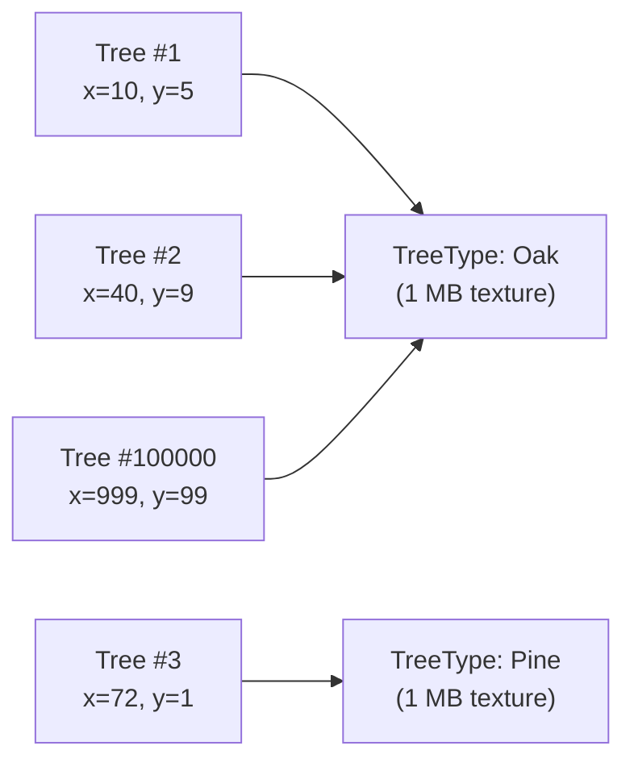

#### 📘 Terms Explained

| Term | Simple meaning |
|---|---|
| **Flyweight** | A small, shared, immutable object holding data common to many objects. (A "flyweight" is the lightest boxing weight class.) |
| **Memory footprint** | How much RAM a program or object uses. |
| **Shared object** | One object referenced by many others instead of each having its own copy. |

---

## 6.2 Why Do We Need It?

Imagine a map/game with 100,000 trees. Each tree has a position (8 bytes) **and** a species name, colour and a 1 MB texture image.

| Design | Memory for textures |
|---|---|
| Every `Tree` stores its own texture | 100,000 × 1 MB ≈ **100 GB** (the program crashes with `OutOfMemoryError`) |
| Trees share one `TreeType` per species (3 species) | 3 × 1 MB = **3 MB** |

**Use Flyweight when all of these are true:**
1. The application uses a **very large number** of objects.
2. Memory cost is high because of those objects.
3. Most of each object's state can be made **shared and immutable**.
4. The rest (unique state) can be **moved outside** and passed in when needed.
5. The app doesn't depend on object **identity** of each instance.

**Typical uses:** characters/glyphs in a text editor, tiles/trees/bullets in games, map markers, icons in a UI list, cached small values (`Integer.valueOf`), string literals.

#### 📘 Terms Explained

| Term | Simple meaning |
|---|---|
| **`OutOfMemoryError`** | Thrown when the JVM heap is full and garbage collection can't free enough space. |
| **Heap** | The JVM memory area where objects live. See [Java_Fundamentals_Deep_Dive.md](../../java/Java_Fundamentals_Deep_Dive.md) for JVM memory. |
| **Glyph** | The drawn shape of a character in a particular font. |
| **Object identity** | Whether two references point to the *same* object (`==`), as opposed to *equal* content (`equals`). |

---

## 6.3 Intrinsic vs Extrinsic State (The Most Important Idea)

| | Intrinsic state | Extrinsic state |
|---|---|---|
| **Meaning** | Data that is the **same** for many objects | Data **unique** to each object/situation |
| **Stored where?** | Inside the flyweight (shared) | Outside: in the context object or passed as a method parameter |
| **Mutable?** | **Must be immutable** (everyone shares it) | Can change |
| **Tree example** | species, colour, texture | x, y position |
| **Text editor example** | character code, font, size | row, column in the document |
| **Chess example** | piece type and colour, image | square on the board |

```mermaid
classDiagram
    class TreeType {
        <<Flyweight>>
        -species: String
        -color: String
        -texture: byte[]
        +draw(x, y)
    }
    class Tree {
        <<Context>>
        -x: int
        -y: int
        -type: TreeType
        +draw()
    }
    class TreeTypeFactory {
        -cache: Map~String, TreeType~
        +get(species, color) TreeType
    }
    Tree --> TreeType : shares
    TreeTypeFactory --> TreeType : creates once, reuses
```

Three parts:
1. **Flyweight** (`TreeType`): intrinsic state only; immutable; methods take extrinsic state as parameters.
2. **Flyweight factory** (`TreeTypeFactory`): returns an existing flyweight if one matches, otherwise creates and caches it. Clients must **never** call `new TreeType(...)` directly.
3. **Context** (`Tree`): small object holding extrinsic state + a reference to its flyweight.

#### 📘 Terms Explained

| Term | Simple meaning |
|---|---|
| **Intrinsic** | "Belonging to the inside": state that doesn't depend on where/how the object is used. |
| **Extrinsic** | "Coming from outside": state that depends on context, supplied by the caller. |
| **Immutable** | Cannot change after creation. All fields `final`, no setters. |
| **Context object** | The lightweight per-instance object that holds extrinsic state. |

---

## 6.4 Complete Java Example - A Forest of 100,000 Trees

```java
import java.util.ArrayList;
import java.util.List;
import java.util.Map;
import java.util.concurrent.ConcurrentHashMap;

// ----- Flyweight: INTRINSIC (shared, immutable) state only -----
final class TreeType {
    private final String species;
    private final String color;
    private final byte[] texture;              // the heavy part (imagine a 1 MB image)

    TreeType(String species, String color) {
        this.species = species;
        this.color = color;
        this.texture = new byte[1024 * 1024];
    }

    // EXTRINSIC state (x, y) is passed in, never stored here
    void draw(int x, int y) { /* render texture at (x, y) */ }
    String species() { return species; }
}

// ----- Flyweight factory: hands out shared instances -----
final class TreeTypeFactory {
    private static final Map<String, TreeType> CACHE = new ConcurrentHashMap<>();

    static TreeType get(String species, String color) {
        return CACHE.computeIfAbsent(species + "|" + color, k -> new TreeType(species, color));
    }
    static int count() { return CACHE.size(); }
}

// ----- Context: small per-object (extrinsic) state + reference to flyweight -----
record Tree(int x, int y, TreeType type) {
    void draw() { type.draw(x, y); }
}

public class FlyweightDemo {
    public static void main(String[] args) {
        String[][] kinds = { {"Oak", "green"}, {"Pine", "dark-green"}, {"Maple", "red"} };
        List<Tree> forest = new ArrayList<>();
        for (int i = 0; i < 100_000; i++) {
            String[] k = kinds[i % kinds.length];
            forest.add(new Tree(i % 1000, i / 1000, TreeTypeFactory.get(k[0], k[1])));
        }
        forest.forEach(Tree::draw);

        System.out.println("Trees planted      : " + forest.size());
        System.out.println("TreeType objects   : " + TreeTypeFactory.count());
        System.out.println("Texture memory used: ~" + TreeTypeFactory.count() + " MB (instead of ~" + forest.size() + " MB)");
        System.out.println("Same object shared?: " + (forest.get(0).type() == forest.get(3).type()));

        // Flyweight inside the JDK: Integer cache
        Integer a = 127, b = 127, c = 128, d = 128;
        System.out.println("Integer 127 == 127 : " + (a == b));
        System.out.println("Integer 128 == 128 : " + (c == d));
        System.out.println("128 equals 128     : " + c.equals(d));
    }
}
```

**Output:**
```
Trees planted      : 100000
TreeType objects   : 3
Texture memory used: ~3 MB (instead of ~100000 MB)
Same object shared?: true
Integer 127 == 127 : true
Integer 128 == 128 : false
128 equals 128     : true
```

What the output shows:
- 100,000 `Tree` objects exist, but only **3** heavy `TreeType` objects.
- `forest.get(0).type() == forest.get(3).type()` is `true`: trees 0 and 3 (both Oak) share the **same** object.
- The `Integer` lines show that the JDK uses the same idea (next section).

> The `Tree` objects themselves still cost memory (about 16-24 bytes each here). Flyweight removes the **duplicated heavy part**, not the objects themselves. For even less memory, store positions in primitive arrays (`int[] xs, ys`) instead of objects.

#### 📘 Terms Explained

| Term | Simple meaning |
|---|---|
| **`computeIfAbsent`** | Map method: return the value for the key, or compute, store and return it if missing. Atomic in `ConcurrentHashMap`. |
| **`final class`** | Cannot be subclassed, which helps keep the flyweight immutable. |
| **Primitive array** | `int[]`, `double[]`: stores raw values with no per-element object overhead. |

---

## 6.5 Flyweight in the JDK: Integer Cache and String Pool (Interview Imp - Java)

### 6.5.1 The `Integer` cache

`Integer.valueOf(int)` (also used by autoboxing) returns **cached shared objects** for values from **-128 to 127**.

```java
Integer a = 127, b = 127;     // autoboxing calls Integer.valueOf(127) -> cached object
System.out.println(a == b);   // true  (same object)

Integer c = 128, d = 128;     // outside the cache -> new objects
System.out.println(c == d);   // false (different objects)
System.out.println(c.equals(d)); // true (same value)

Integer e = new Integer(127); // deprecated constructor: ALWAYS a new object, skips the cache
```

| Wrapper | Cached values |
|---|---|
| `Byte`, `Short`, `Long` | -128 to 127 |
| `Integer` | -128 to 127 (upper limit configurable: `-XX:AutoBoxCacheMax=1000` or `-Djava.lang.Integer.IntegerCache.high=1000`) |
| `Character` | 0 to 127 |
| `Boolean` | `TRUE` and `FALSE` only |
| `Float`, `Double` | No cache |

> **Interview trap (very common):** *"Why does `==` work for `Integer` 100 but not for 1000?"* Because of the Integer cache (a flyweight). **Always compare wrapper objects with `equals()`**, never `==`.

### 6.5.2 The String pool

```java
String s1 = "hello";                 // literal -> stored once in the String pool
String s2 = "hello";                 // same pooled object
String s3 = new String("hello");     // new object on the heap
String s4 = s3.intern();             // returns the pooled object

System.out.println(s1 == s2);   // true
System.out.println(s1 == s3);   // false
System.out.println(s1 == s4);   // true
```

The String pool is a flyweight factory: identical string literals share one immutable `String` object. This is also one reason `String` is **immutable**: if it were mutable, changing one shared literal would change it for every user.

### 6.5.3 Other JDK and framework flyweights

| Example | What is shared |
|---|---|
| **Enums** | Each constant is a single shared instance (also a singleton per constant). |
| `Boolean.valueOf`, `BigDecimal.ZERO/ONE/TEN`, `BigInteger.ONE` | Common values reused. |
| `Collections.emptyList()`, `List.of()` | One shared empty instance. |
| `java.time.ZoneOffset.UTC`, `Charset` instances | Cached shared instances. |
| **String deduplication** in G1 GC (`-XX:+UseStringDeduplication`) | The JVM shares identical `char` arrays behind different `String` objects. |
| Hibernate / JPA second-level cache | Shared read-only entity data across sessions. |

#### 📘 Terms Explained

| Term | Simple meaning |
|---|---|
| **Autoboxing** | Java automatically converting `int` to `Integer` (and back = unboxing). |
| **Integer cache** | Pre-created `Integer` objects for -128..127 reused by `valueOf`. |
| **String pool** | A special JVM table of unique string literals (in the heap since Java 7). |
| **`intern()`** | Returns the pooled copy of a string, adding it to the pool if needed. |
| **Deprecated** | Still works but marked "don't use; may be removed". |
| **G1 GC** | Garbage-First, the default garbage collector since Java 9. |

---

## 6.6 Advanced Flyweight Topics

### 6.6.1 Thread-safe flyweight factory

```java
// WRONG: check-then-act race. Two threads may both create a TreeType.
if (!cache.containsKey(key)) cache.put(key, new TreeType(...));

// RIGHT: atomic
cache.computeIfAbsent(key, k -> new TreeType(...));   // with ConcurrentHashMap
```

Flyweights themselves are **immutable**, so they are naturally thread-safe and can be shared across threads without locks.

### 6.6.2 Unbounded caches and memory leaks

A flyweight factory that never removes entries can itself become a memory leak if keys are unbounded (e.g. one flyweight per user ID). Options:

| Option | When |
|---|---|
| Fixed, small key set (species, chess pieces, fonts) | Ideal; no eviction needed. |
| `WeakHashMap` / weak references | Let unused flyweights be garbage collected. |
| Bounded cache (Caffeine `maximumSize`) | Large but limited reuse. |
| Don't use Flyweight | If there is little sharing, the factory only adds overhead. |

### 6.6.3 Flyweight + Composite

Composite trees often have many identical leaves. A text document is a composite (document → paragraphs → rows) whose leaves (characters) are flyweights shared everywhere. GoF's original example of Flyweight was exactly this.

### 6.6.4 Measuring before optimising

Flyweight makes code more complex. Before using it, **measure**: heap dump (`jmap -dump`, VisualVM, Eclipse MAT) or JOL (Java Object Layout) to see what really uses memory.

#### 📘 Terms Explained

| Term | Simple meaning |
|---|---|
| **Race condition** | A bug where the result depends on the timing of two threads. |
| **Check-then-act** | Checking a condition and then acting on it in two steps, which is unsafe without a lock. |
| **Memory leak (Java)** | Objects that are no longer needed but are still referenced, so the GC can't free them. |
| **`WeakHashMap`** | Map whose keys are weakly held; entries disappear when the key is no longer used elsewhere. |
| **Heap dump** | A snapshot file of all objects in the JVM heap, used to analyse memory. |

---

## 6.7 Flyweight vs Singleton vs Object Pool vs Cache

| | Flyweight | Singleton | Object Pool | Cache |
|---|---|---|---|---|
| **How many instances** | One **per distinct intrinsic state** (few) | Exactly one | A fixed set of N interchangeable objects | Any number of stored results |
| **Shared at the same time?** | Yes, by many users simultaneously | Yes | **No**: borrowed by one user, then returned | Yes (read) |
| **Mutable?** | Must be immutable | May have (thread-safe) state | Yes, reset on return | Values usually immutable |
| **Goal** | Save memory | One global instance | Avoid expensive creation (DB connections, threads) | Avoid recomputing/refetching |
| **Example** | `Integer.valueOf`, `TreeType` | `Runtime.getRuntime()` | HikariCP connection pool, thread pool | Caffeine, Redis, `@Cacheable` |

> Flyweight is a **memory** optimisation (sharing **state**). Object Pool is a **creation-time** optimisation (reusing **resources**). See Singleton in [02_Creational_Pattern.md](02_Creational_Pattern.md#1-singleton-pattern-interview-imp---java).

---

## 6.8 Pros and Cons

| Pros | Cons |
|---|---|
| Huge memory savings when there are many similar objects | More complex code: state split into two places |
| Fewer objects → less garbage-collection pressure | Extrinsic state must be passed around (more parameters) |
| Immutable flyweights are thread-safe | CPU cost of factory lookups |
| Centralised control of shared data | Useless (even harmful) if objects don't share much |
| | Bugs if someone mutates a shared flyweight |

---

## 6.9 Common Pitfalls

| Pitfall | Fix |
|---|---|
| Mutable flyweight (setter on shared object) | Make it immutable: `final` class and fields, no setters, defensive copies of arrays. |
| Clients calling `new` on the flyweight class | Package-private constructor; force use of the factory. |
| Comparing `Integer`/`Long` with `==` | Use `equals()`, or compare primitives. |
| Non-atomic check-then-put in the factory | `ConcurrentHashMap.computeIfAbsent`. |
| Unbounded factory cache | Bounded or weak cache; or a fixed key set. |
| Applying Flyweight without measuring | Profile memory first; it's an optimisation, not a default. |
| Storing extrinsic state in the flyweight "for convenience" | Breaks sharing; keep it in the context or pass it as a parameter. |

---

## 6.10 Flyweight - Interview Questions

**Q1. What is the Flyweight pattern?**
A structural pattern that reduces memory by sharing common, immutable state among many objects, and keeping unique state outside.

**Q2. Intrinsic vs extrinsic state?**
Intrinsic is shared and stored in the flyweight (species, texture). Extrinsic is unique per use and supplied by the client (x, y position).

**Q3. Give JDK examples.**
`Integer.valueOf` cache (-128..127), `Boolean.valueOf`, `Character`/`Byte`/`Short`/`Long` caches, the String pool and `intern()`, enum constants.

**Q4. Why is `Integer a = 127, b = 127; a == b` true but for 128 it's false?**
Autoboxing uses `Integer.valueOf`, which returns cached objects for -128..127. 128 creates new objects, so `==` compares two different references. Use `equals()`.

**Q5. Why must flyweights be immutable?**
They are shared by many clients (and threads). If one client changed it, every other client would see the change.

**Q6. Flyweight vs Singleton?**
Singleton = exactly one instance. Flyweight = one instance per distinct intrinsic state, managed by a factory.

**Q7. Flyweight vs Object Pool?**
Flyweights are shared simultaneously and are immutable. Pooled objects are used by one client at a time, then returned and reset.

**Q8. How would you design a text editor that stores 10 million characters efficiently?**
One `CharacterStyle`/`Glyph` flyweight per (char, font, size, colour) combination from a factory; each position stores only a reference (or an index) to its flyweight. Positions come from the document structure (extrinsic).

---

## 6.11 Flyweight - Cheat Sheet

```
FLYWEIGHT  Share common IMMUTABLE state across many objects to save memory.
           Intrinsic (shared, inside flyweight) vs Extrinsic (unique, outside / passed in).
           Parts: Flyweight (immutable), Factory (Map + computeIfAbsent), Context (extrinsic + ref).
           JDK: Integer/Long/Short/Byte cache -128..127, Character 0..127, Boolean, String pool,
                intern(), enums, Collections.emptyList().
           TRAP: Integer 127 == 127 true, 128 == 128 false -> always use equals().
           Flyweight (shared simultaneously, immutable) != Object Pool (borrow/return, mutable).
           Measure first (heap dump, JOL); it's an optimisation.
```

---

# 7. Proxy Pattern (Interview Imp - Java)

## 7.1 What is the Proxy Pattern?

**Proxy** provides a **stand-in object** that has the **same interface** as the real object and **controls access** to it. The client thinks it is talking to the real object; the proxy decides when, whether and how to forward each call.

**Analogy:** A celebrity's personal assistant. You call the assistant (proxy), who looks like the only way to reach the celebrity. The assistant checks if you're allowed (protection), only bothers the celebrity when really needed (lazy), and may answer common questions from notes (caching).

```mermaid
classDiagram
    class Subject {
        <<interface>>
        +request()
    }
    class RealSubject {
        +request()
    }
    class Proxy {
        -real: RealSubject
        +request()
    }
    class Client
    Client --> Subject
    Subject <|.. RealSubject
    Subject <|.. Proxy
    Proxy --> RealSubject : controls access to
```

#### 📘 Terms Explained

| Term | Simple meaning |
|---|---|
| **Proxy** | A substitute object that stands in for the real one and controls access to it. |
| **Subject** | The common interface implemented by both the proxy and the real object. |
| **Real subject** | The actual object doing the work. |
| **Surrogate** | Another word for stand-in/substitute. |

---

## 7.2 Why Do We Need It?

Sometimes you must do something **around** every call to an object, and the client shouldn't have to know:

| Need | Without proxy | With proxy |
|---|---|---|
| Real object is expensive to create | Created at startup even if never used | Created on first use (**virtual proxy**) |
| Only admins may call `delete` | `if (isAdmin)` checks scattered everywhere | One **protection proxy** checks every call |
| Object lives on another machine | Client handles sockets, serialisation | **Remote proxy** looks like a local object |
| Every call needs a DB transaction | `begin/commit/rollback` in every method | Spring's **transaction proxy** does it |
| Same results requested repeatedly | Each caller caches separately | **Caching proxy** |

The proxy follows the Open/Closed Principle: the real class stays unaware of security, laziness or transactions.

---

## 7.3 Types of Proxies

| Type | What it does | Real-world Java example |
|---|---|---|
| **Virtual proxy** | Delays creating an expensive object until it's actually needed | Hibernate lazy-loaded entities, Spring `@Lazy` beans |
| **Protection proxy** | Checks permissions before forwarding | Spring Security `@PreAuthorize` method security |
| **Remote proxy** | Local object representing an object in another JVM/machine | Java RMI stubs, gRPC/Feign clients, EJB remote interfaces |
| **Caching proxy** | Returns stored results for repeated calls | Spring `@Cacheable` |
| **Logging / monitoring proxy** | Records calls, timings, metrics | Spring AOP `@Around` aspects, Micrometer `@Timed` |
| **Smart reference** | Extra actions on access: reference counting, locking, loading on demand | `java.lang.ref` wrappers (conceptually), connection-pool proxies |
| **Transaction proxy** | Starts/commits/rolls back transactions around calls | Spring `@Transactional` |
| **Firewall / rate-limit proxy** | Blocks or limits calls | Resilience4j `@RateLimiter` via AOP |

> At the **network** level the same idea appears as forward proxies, reverse proxies (Nginx), and service-mesh sidecars (Envoy). See [Client_Server_Web_Architecture_Guide.md](../../web-architecture/Client_Server_Web_Architecture_Guide.md).

#### 📘 Terms Explained

| Term | Simple meaning |
|---|---|
| **Lazy loading** | Load or create something only when it's first used. |
| **RMI (Remote Method Invocation)** | Old Java technology to call methods on objects in another JVM. |
| **Stub** | The client-side remote proxy that sends calls over the network. |
| **Feign** | Spring Cloud library: you write an interface, and it generates an HTTP-calling proxy. |
| **Reverse proxy** | A server (like Nginx) in front of app servers that forwards client requests to them. |
| **Sidecar** | A helper process (e.g. Envoy) running next to each service, proxying its network traffic. |

---

## 7.4 Complete Java Example - Static and Dynamic Proxies

Part 1 is a **static proxy**: a hand-written class that is both a virtual (lazy) proxy and a protection proxy.
Part 2 is a **JDK dynamic proxy**: the class is generated **at runtime** by `java.lang.reflect.Proxy`, and one `InvocationHandler` handles **every** method.

```java
import java.lang.reflect.InvocationHandler;
import java.lang.reflect.Proxy;
import java.util.Set;

interface ReportService {
    String generate(String reportId);
    void delete(String reportId);
}

class RealReportService implements ReportService {
    RealReportService() {
        System.out.println("  (RealReportService created - expensive: loads 2 GB of data)");
    }
    public String generate(String reportId) { return "Report[" + reportId + "]"; }
    public void delete(String reportId) { System.out.println("  deleted " + reportId); }
}

// ----- Static proxy: virtual (lazy) + protection -----
class SecureLazyReportProxy implements ReportService {
    private final Set<String> userRoles;
    private RealReportService real;            // created only when first needed

    SecureLazyReportProxy(Set<String> userRoles) { this.userRoles = userRoles; }

    private RealReportService real() {
        if (real == null) real = new RealReportService();
        return real;
    }

    public String generate(String reportId) {
        return real().generate(reportId);
    }

    public void delete(String reportId) {
        if (!userRoles.contains("ADMIN")) {
            throw new SecurityException("only ADMIN can delete reports");
        }
        real().delete(reportId);
    }
}

public class ProxyDemo {
    public static void main(String[] args) {
        System.out.println("1) Static proxy");
        ReportService reports = new SecureLazyReportProxy(Set.of("USER"));
        System.out.println("  proxy created, real object not created yet");
        System.out.println("  " + reports.generate("R-1"));
        try {
            reports.delete("R-1");
        } catch (SecurityException e) {
            System.out.println("  blocked: " + e.getMessage());
        }

        System.out.println("2) JDK dynamic proxy");
        ReportService target = new RealReportService();
        InvocationHandler logging = (proxy, method, methodArgs) -> {
            System.out.println("  [log] before " + method.getName() + "(" + methodArgs[0] + ")");
            Object result = method.invoke(target, methodArgs);      // call the real object
            System.out.println("  [log] after  " + method.getName());
            return result;
        };
        ReportService logged = (ReportService) Proxy.newProxyInstance(
                ReportService.class.getClassLoader(),
                new Class<?>[]{ ReportService.class },
                logging);
        System.out.println("  " + logged.generate("R-2"));
        logged.delete("R-2");
        System.out.println("  proxy class name starts with $Proxy? " + logged.getClass().getSimpleName().startsWith("$Proxy"));
        System.out.println("  is a ReportService? " + (logged instanceof ReportService));
    }
}
```

**Output:**
```
1) Static proxy
  proxy created, real object not created yet
  (RealReportService created - expensive: loads 2 GB of data)
  Report[R-1]
  blocked: only ADMIN can delete reports
2) JDK dynamic proxy
  (RealReportService created - expensive: loads 2 GB of data)
  [log] before generate(R-2)
  [log] after  generate
  Report[R-2]
  [log] before delete(R-2)
  deleted R-2
  [log] after  delete
  proxy class name starts with $Proxy? true
  is a ReportService? true
```

What the output shows:
- **Static proxy:** the expensive `RealReportService` was created only when `generate` was first called, not when the proxy was created. `delete` was blocked for a non-admin.
- **Dynamic proxy:** we wrote **no** `ReportService` proxy class. The JDK generated a class named `$Proxy0` (or similar) at runtime, and our single lambda handled both `generate` and `delete`.

| | Static proxy | Dynamic proxy |
|---|---|---|
| Proxy class written by | You, at compile time | JDK/library, at runtime |
| One class per interface? | Yes | No: one handler for any interface |
| Adding a method to the interface | Must update the proxy | Handled automatically |
| Performance | Fastest (normal method calls) | Small reflection overhead |
| Used by | Simple, specific cases | Frameworks: Spring AOP, Mockito, Feign, MyBatis mappers, Spring Data repositories |

> **Fun fact:** Spring Data JPA repository interfaces (`interface UserRepository extends JpaRepository<User, Long>`) have no implementation class written by you. Spring creates a **dynamic proxy** for the interface and routes calls like `findByEmail` to generated query logic.

#### 📘 Terms Explained

| Term | Simple meaning |
|---|---|
| **Static proxy** | A proxy class you write by hand. |
| **Dynamic proxy** | A proxy class generated while the program runs. |
| **`java.lang.reflect.Proxy`** | JDK class that generates proxy classes for **interfaces** at runtime. |
| **`InvocationHandler`** | Interface with one method `invoke(proxy, method, args)`, called for every method on the dynamic proxy. |
| **Reflection** | Java's ability to inspect and call classes, methods and fields at runtime (`Method.invoke`). |
| **Class loader** | The JVM component that loads classes; the proxy class needs one to be defined in. |

---

## 7.5 JDK Dynamic Proxy vs CGLIB / ByteBuddy (Interview Imp - Java)

JDK dynamic proxies can only implement **interfaces**. To proxy a plain **class** with no interface, libraries generate a **subclass** at runtime.

```mermaid
flowchart TB
    subgraph JDK[JDK Dynamic Proxy]
        I[OrderService interface] --> P1["$Proxy12 implements OrderService"]
        I --> R1[OrderServiceImpl]
        P1 -. delegates .-> R1
    end
    subgraph CG[CGLIB / ByteBuddy]
        C[OrderService class] --> P2["OrderService$$SpringCGLIB$$0 extends OrderService"]
    end
```

| | JDK Dynamic Proxy | CGLIB (Spring) / ByteBuddy |
|---|---|---|
| **How** | Implements the interfaces | Generates a **subclass** of the target class |
| **Needs an interface?** | Yes | No |
| **Can proxy `final` classes?** | n/a (interface-based) | **No** |
| **Can intercept `final` / `private` / `static` methods?** | Only interface methods | **No**: they can't be overridden |
| **Cast to the concrete class** | Fails (`ClassCastException`): proxy is not an `OrderServiceImpl` | Works: the proxy *is a* subclass |
| **Library** | Built into the JDK | Spring includes a repackaged CGLIB; Hibernate and Mockito use ByteBuddy |
| **Spring Boot default** | Used only if you set `spring.aop.proxy-target-class=false` and the bean has interfaces | **Default since Spring Boot 2.0** (`proxy-target-class=true`) |

```java
// CGLIB-style: a generated subclass overrides each method (simplified idea)
class OrderService$$SpringCGLIB$$0 extends OrderService {
    @Override
    public void placeOrder(Order o) {
        // interceptor chain: transaction begin, security check, ...
        super.placeOrder(o);           // or target.placeOrder(o)
        // transaction commit
    }
}
```

> **Why can't Spring proxy a `final` class or `final` method?** Because CGLIB proxies work by overriding, and Java doesn't allow overriding `final`. This is why Kotlin + Spring needs the `kotlin-spring` (all-open) plugin.

#### 📘 Terms Explained

| Term | Simple meaning |
|---|---|
| **CGLIB** | Code Generation Library; creates subclasses at runtime. Spring ships its own copy. |
| **ByteBuddy** | Modern runtime code-generation library (used by Hibernate, Mockito). |
| **Bytecode** | The compiled instructions in `.class` files that the JVM runs. |
| **`proxy-target-class`** | Spring setting: `true` = always use class-based (CGLIB) proxies. |
| **`ClassCastException`** | Thrown when you cast an object to a type it isn't. |

---

## 7.6 Proxy in Spring Boot: AOP, @Transactional, Self-Invocation (Interview Imp - Java)

### 7.6.1 How Spring uses proxies

When a bean has `@Transactional`, `@Cacheable`, `@Async`, `@PreAuthorize`, `@Retryable`, `@Timed` or any `@Aspect` advice, Spring does **not** inject your object. It injects a **proxy** that wraps it.

```mermaid
sequenceDiagram
    participant C as OrderController
    participant P as OrderService proxy (CGLIB)
    participant TX as TransactionInterceptor
    participant T as Real OrderService
    C->>P: placeOrder(order)
    P->>TX: invoke
    TX->>TX: BEGIN transaction
    TX->>T: placeOrder(order)
    T-->>TX: return / throw
    alt success
        TX->>TX: COMMIT
    else RuntimeException
        TX->>TX: ROLLBACK
    end
    TX-->>P: result
    P-->>C: result
```

```java
@Service
public class OrderService {
    @Transactional
    public void placeOrder(Order order) { ... }
}

@RestController
class OrderController {
    OrderController(OrderService service) {
        System.out.println(service.getClass());
        // class com.shop.OrderService$$SpringCGLIB$$0   <- a proxy, not your class
    }
}
```

| Annotation | Proxy type (purpose) |
|---|---|
| `@Transactional` | Transaction proxy |
| `@Cacheable`, `@CacheEvict` | Caching proxy |
| `@PreAuthorize`, `@Secured` | Protection proxy |
| `@Async` | Runs the method on another thread (returns immediately) |
| `@Retryable` (Spring Retry), Resilience4j annotations | Retry / circuit-breaker proxy |
| `@Aspect` with `@Around` | Your own logging/monitoring proxy |
| `@Lazy` on an injection point | Virtual proxy: real bean resolved on first call |
| `@Configuration` classes | CGLIB subclass so `@Bean` methods return the same singleton (`proxyBeanMethods = true`) |

### 7.6.2 Writing your own proxy-based aspect

```java
@Target(ElementType.METHOD)
@Retention(RetentionPolicy.RUNTIME)
public @interface LogExecutionTime {}

@Aspect
@Component
class ExecutionTimeAspect {
    private static final Logger log = LoggerFactory.getLogger(ExecutionTimeAspect.class);

    @Around("@annotation(LogExecutionTime)")
    public Object time(ProceedingJoinPoint pjp) throws Throwable {
        long start = System.currentTimeMillis();
        try {
            return pjp.proceed();                       // call the real method
        } finally {
            log.info("{} took {} ms", pjp.getSignature().toShortString(), System.currentTimeMillis() - start);
        }
    }
}

@Service
class ReportService {
    @LogExecutionTime
    public Report build(long id) { ... }
}
```

### 7.6.3 The self-invocation problem (most asked!)

```java
@Service
public class OrderService {

    public void placeOrders(List<Order> orders) {
        for (Order o : orders) {
            placeOrder(o);           // this.placeOrder(...) -> BYPASSES the proxy!
        }
    }

    @Transactional
    public void placeOrder(Order o) { ... }   // no transaction when called from placeOrders()
}
```

**Why?** The proxy only intercepts calls that **come through the proxy**. Inside the real object, `this` is the real object, not the proxy.

```mermaid
flowchart LR
    C[Controller] -->|"placeOrders()"| P[Proxy]
    P -->|"placeOrders()"| T[Real OrderService]
    T -->|"this.placeOrder() - no proxy, no @Transactional"| T
```

**Fixes:**

| Fix | How | Notes |
|---|---|---|
| **Move the method to another bean** (best) | `OrderWriter.placeOrder()` with `@Transactional`, injected into `OrderService` | Clean design; recommended |
| **Annotate the outer method** | Put `@Transactional` on `placeOrders()` | One transaction for all orders; maybe not what you want |
| **Inject self lazily** | `@Lazy @Autowired OrderService self;` then `self.placeOrder(o)` | Works, but looks odd |
| **`AopContext.currentProxy()`** | Needs `@EnableAspectJAutoProxy(exposeProxy = true)` | Couples code to Spring AOP |
| **`TransactionTemplate`** | Programmatic transaction inside the loop | Explicit, no proxy needed |
| **AspectJ weaving** | Compile-time/load-time weaving modifies the class itself | No proxy, so self-calls work; more setup |

### 7.6.4 Other proxy gotchas in Spring

| Gotcha | Why |
|---|---|
| `@Transactional` on a `private` method does nothing | Proxies can't override `private` methods. (Spring 6 supports `protected`/package-private with CGLIB, but `public` is safest.) |
| `@Transactional` on a `final` method does nothing | CGLIB can't override `final`. |
| Checked exceptions don't roll back by default | Default rollback is only for `RuntimeException` and `Error`; use `@Transactional(rollbackFor = Exception.class)`. |
| `@Async` method called from the same class runs synchronously | Same self-invocation problem. |
| `@Transactional` in a `@PostConstruct` method | Init callbacks run on the raw bean before the proxy wraps it (and `this` is never the proxy); use an `ApplicationReadyEvent` listener or a separate bean. |
| Field values on the proxy look `null` in the debugger | The CGLIB proxy is a separate subclass instance; its own fields are unused. The real data is in the target. |

#### 📘 Terms Explained

| Term | Simple meaning |
|---|---|
| **AOP (Aspect-Oriented Programming)** | Adding cross-cutting behaviour (logging, transactions) to many methods without editing them. Spring AOP is proxy-based. |
| **Aspect** | A class containing cross-cutting logic (`@Aspect`). |
| **Advice** | The code an aspect runs (`@Before`, `@After`, `@Around`). |
| **Pointcut** | The expression choosing which methods the advice applies to (`@annotation(LogExecutionTime)`). |
| **`ProceedingJoinPoint.proceed()`** | Calls the original method from inside `@Around` advice. |
| **Self-invocation** | A method calling another method on the same object via `this`. |
| **Weaving** | Inserting aspect code into classes; AspectJ can do it at compile or class-load time. |
| **`TransactionTemplate`** | Spring helper to run code in a transaction programmatically. |
| **`@PostConstruct`** | Method run once after a bean is created and its dependencies are injected. |

---

## 7.7 Proxy in Hibernate/JPA: Lazy Loading

Hibernate uses **virtual proxies** to avoid loading data you may never use.

```java
@Entity
class Order {
    @Id Long id;

    @ManyToOne(fetch = FetchType.LAZY)
    private Customer customer;          // Hibernate puts a PROXY here, not a real Customer

    @OneToMany(mappedBy = "order")       // collections are LAZY by default
    private List<OrderLine> lines;      // a PersistentBag (proxy-like collection wrapper)
}

Order order = em.find(Order.class, 1L);         // SELECT from orders only
order.getCustomer().getClass();                 // Customer$HibernateProxy$... (no SQL yet)
order.getCustomer().getName();                  // NOW: SELECT from customer (proxy initialises)

Customer ref = em.getReference(Customer.class, 7L);   // proxy only; no SQL at all
```

| Problem | Cause | Fix |
|---|---|---|
| **`LazyInitializationException`** | Accessing a lazy proxy after the session/transaction is closed | Fetch what you need inside the transaction: `JOIN FETCH`, `@EntityGraph`, or map to a DTO |
| **N+1 queries** | Looping over orders and touching each lazy `customer` → 1 + N SELECTs | `JOIN FETCH`, `@EntityGraph`, `@BatchSize` |
| `getClass()` / `instanceof` surprises | Object is a proxy subclass | Use `Hibernate.getClass(obj)` or `Hibernate.unproxy(obj)` |
| `equals()` fails between proxy and entity | `equals` uses `getClass()` or direct field access | Compare by ID, use `instanceof` and getters in `equals` |
| `final` entity class | Hibernate can't subclass it to create a proxy | Don't make entities `final` |

```java
// Fix N+1 / lazy problems with a fetch join
@Query("select o from Order o join fetch o.customer where o.status = :status")
List<Order> findWithCustomer(@Param("status") Status status);
```

#### 📘 Terms Explained

| Term | Simple meaning |
|---|---|
| **`FetchType.LAZY`** | Load the related entity only when it's accessed. `EAGER` = load immediately. |
| **Session / persistence context** | Hibernate's unit of work that tracks loaded entities; it usually lives as long as the transaction. |
| **`LazyInitializationException`** | Hibernate error when a lazy proxy is used after its session closed. |
| **N+1 problem** | One query for the list + one extra query per item = N+1 queries. Very slow. |
| **`JOIN FETCH`** | JPQL syntax to load the related entity in the same SQL query. |
| **`@EntityGraph`** | JPA annotation listing which relations to fetch eagerly for one query. |
| **DTO** | Data Transfer Object: a simple object shaped for an API response. |

---

## 7.8 Proxy vs Decorator vs Adapter vs Facade

| | Proxy | Decorator | Adapter | Facade |
|---|---|---|---|---|
| **Interface** | **Same** as real object | **Same** as wrapped object | **Different** (converts) | **New, simpler** |
| **Wraps** | One object | One object (stackable) | One object | Many objects |
| **Intent** | **Control access** | **Add behaviour** | **Make compatible** | **Simplify** |
| **Client knows about it?** | Usually not | Usually yes (it assembles them) | Yes | Yes |
| **Manages real object's lifecycle?** | Often (lazy creation) | No (passed in) | No | No |
| **Java example** | Spring `@Transactional` proxy, Hibernate lazy proxy | `BufferedReader` | `InputStreamReader`, `Arrays.asList` | `JdbcTemplate` |

---

## 7.9 Pros and Cons

| Pros | Cons |
|---|---|
| Control access without changing the real class | Extra layer: slightly slower, longer stack traces |
| Lazy creation saves startup time and memory | "Magic": behaviour isn't visible in the class source (`@Transactional` surprises) |
| Cross-cutting concerns in one place (AOP) | Self-invocation and `final`/`private` method limitations |
| Remote objects look local | Remote proxies can hide slow network calls behind simple method calls |
| Dynamic proxies remove boilerplate (Spring Data, Feign) | Debugging generated classes is harder |

---

## 7.10 Common Pitfalls

| Pitfall | Fix |
|---|---|
| Self-invocation bypasses `@Transactional`/`@Cacheable`/`@Async` | Move the method to another bean, or use `TransactionTemplate`. |
| Annotating `private` or `final` methods | Use `public`, non-final methods on proxied beans. |
| Casting a JDK proxy to the implementation class | Inject and use the **interface**; or use CGLIB proxies. |
| `LazyInitializationException` | Fetch inside the transaction (`JOIN FETCH`, entity graph, DTO projection). |
| Forgetting to unwrap `InvocationTargetException` in an `InvocationHandler` | Catch it and rethrow `e.getCause()` so callers see the real exception. |
| Remote proxy treated like a cheap local call | Batch calls, add timeouts and retries, cache results. |
| Proxy not thread-safe when lazily creating the real object | Use holder idiom, `synchronized`, or double-checked locking with `volatile` (see [02_Creational_Pattern.md](02_Creational_Pattern.md#14-thread-safe-implementations-basic-to-advanced)). |

```java
// Correct exception handling inside an InvocationHandler
InvocationHandler handler = (proxy, method, args) -> {
    try {
        return method.invoke(target, args);
    } catch (InvocationTargetException e) {
        throw e.getCause();          // rethrow the REAL exception thrown by the target
    }
};
```

---

## 7.11 Proxy - Interview Questions

**Q1. What is the Proxy pattern?**
A structural pattern where a substitute object with the same interface controls access to the real object: for laziness, security, remoting, caching, logging or transactions.

**Q2. Types of proxies?**
Virtual (lazy), protection (security), remote, caching, logging/monitoring, smart reference, transaction.

**Q3. Static vs dynamic proxy?**
A static proxy is a hand-written class per interface. A dynamic proxy is generated at runtime (`java.lang.reflect.Proxy` + `InvocationHandler`, or CGLIB/ByteBuddy), and one handler serves every method.

**Q4. JDK dynamic proxy vs CGLIB?**
JDK proxies implement interfaces only. CGLIB creates a subclass, so it works without interfaces, but can't proxy `final` classes/methods or `private` methods. Spring Boot uses CGLIB by default since 2.0.

**Q5. How does `@Transactional` work internally?**
Spring wraps the bean in a proxy. A `TransactionInterceptor` in the proxy begins a transaction before the method, commits after it returns, and rolls back on `RuntimeException`/`Error` (by default).

**Q6. Why doesn't `@Transactional` work when calling a method from the same class?**
Self-invocation uses `this`, the real object, so the call never passes through the proxy. Fix by moving the method to another bean, using `TransactionTemplate`, self-injection with `@Lazy`, `AopContext.currentProxy()`, or AspectJ weaving.

**Q7. Why does `@Transactional` on a private method not work?**
Proxies work by overriding or implementing methods; `private` methods can't be overridden, so they can't be intercepted.

**Q8. How does Hibernate lazy loading work?**
For lazy associations it injects a runtime-generated proxy subclass. The first time you call a non-ID method, the proxy runs the SQL and loads the real data. If the session is closed by then, you get `LazyInitializationException`.

**Q9. Proxy vs Decorator?**
Same structure. Proxy controls access and often manages the real object's lifecycle; it's usually created by a framework, transparently. Decorator adds responsibilities, is usually stacked by the client, and is given an existing object.

**Q10. How do Spring Data repositories work without an implementation class?**
Spring generates a dynamic proxy for the repository interface; method calls are routed to `SimpleJpaRepository` or to queries derived from the method name (`findByEmail`).

**Q11. Why do Spring `@Configuration` classes get proxied?**
So that calling one `@Bean` method from another returns the existing singleton bean from the container instead of creating a new object. Set `@Configuration(proxyBeanMethods = false)` to skip this for faster startup when you don't need it.

---

## 7.12 Proxy - Cheat Sheet

```
PROXY     Stand-in with the SAME interface that CONTROLS ACCESS to the real object.
          Types: virtual (lazy), protection (security), remote (RMI/Feign/gRPC stub),
                 caching, logging, smart reference, transaction.
          Static proxy = hand-written. Dynamic = java.lang.reflect.Proxy + InvocationHandler
          (interfaces only) or CGLIB/ByteBuddy subclass (no final classes/methods, no private).
          Spring Boot: CGLIB by default. @Transactional, @Cacheable, @Async, @PreAuthorize,
          @Aspect, @Lazy, @Configuration all use proxies.
          SELF-INVOCATION bypasses the proxy -> move method to another bean / TransactionTemplate.
          Hibernate: LAZY associations = proxies -> LazyInitializationException, N+1 (JOIN FETCH).
          Spring Data repositories & Feign clients = dynamic proxies for interfaces.
          Proxy CONTROLS access; Decorator ADDS behaviour.
```

---

# 8. How the Structural Patterns Fit Together

## 8.1 One-Line Summary of Each

| Pattern | Question it answers | One-line answer |
|---|---|---|
| **Adapter** | "This class has the wrong interface." | Wrap it in a translator that has the right one. |
| **Bridge** | "My class varies in two independent ways." | Split it into two hierarchies joined by a reference. |
| **Composite** | "I have a tree and want to treat parts and wholes alike." | Leaf and group share one interface; groups delegate to children. |
| **Decorator** | "I want to add features in any combination." | Stack wrappers with the same interface. |
| **Facade** | "This subsystem is too complicated to use." | Put one simple class in front of it. |
| **Flyweight** | "Millions of objects use too much memory." | Share the common immutable part. |
| **Proxy** | "I need to control access to this object." | A stand-in with the same interface decides when/whether to forward. |

## 8.2 Decision Guide

```mermaid
flowchart TD
    A[Structural problem] --> B{Existing interface doesn't<br/>match what the client needs?}
    B -- Yes --> AD[Adapter]
    B -- No --> C{Need a simpler entry point<br/>to many classes?}
    C -- Yes --> FA[Facade]
    C -- No --> D{Part-whole tree,<br/>treat leaf and group alike?}
    D -- Yes --> CO[Composite]
    D -- No --> E{Two independent dimensions<br/>causing M x N subclasses?}
    E -- Yes --> BR[Bridge]
    E -- No --> F{Huge number of similar objects<br/>using too much memory?}
    F -- Yes --> FL[Flyweight]
    F -- No --> G{Wrap ONE object with<br/>the SAME interface - why?}
    G -->|to add features| DE[Decorator]
    G -->|to control access - lazy, security, remote, transactions| PR[Proxy]
```

| If you hear... | Think... |
|---|---|
| "Third-party SDK", "legacy API", "incompatible", "integrate vendor" | Adapter |
| "Shapes × colours", "message types × channels", "platform independent", "JDBC drivers" | Bridge |
| "Tree", "hierarchy", "folder/file", "menu/sub-menu", "bundle of products", "org chart" | Composite |
| "Add logging/caching/retry without changing the class", "Java I/O streams", "toppings" | Decorator |
| "Simplify", "one entry point", "orchestrate several services", "JdbcTemplate" | Facade |
| "Millions of objects", "memory", "shared state", "Integer cache", "String pool" | Flyweight |
| "Lazy loading", "access control", "remote call", "@Transactional", "AOP" | Proxy |

## 8.3 The Wrapper Family: Adapter, Decorator, Proxy, Facade (Interview Imp - Java)

Four patterns "wrap" something. The fastest way to tell them apart is two questions: **how many objects does it wrap?** and **what happens to the interface?**

| | Wraps | Interface after wrapping | Purpose | Memory hook |
|---|---|---|---|---|
| **Adapter** | 1 | **Different** | Compatibility | "Travel plug" |
| **Decorator** | 1 (stackable) | **Same** | Add features | "Coffee toppings" |
| **Proxy** | 1 | **Same** | Control access | "Personal assistant" |
| **Facade** | Many | **New, simpler** | Simplicity | "Hotel reception" |

```java
// One line of Java I/O shows three of them
Reader r = new BufferedReader(               // Decorator: same Reader interface, adds buffering
               new InputStreamReader(           // Adapter: InputStream -> Reader
                   socket.getInputStream()));   // Concrete component: raw bytes from the network
```

And **Composite** is the "recursive" cousin: like a Decorator it holds components of its own type, but **many** of them.

## 8.4 Combining Them in One System

A realistic e-commerce Spring Boot service uses almost all of them at once:

```mermaid
flowchart LR
    CL[Mobile client] --> GW["API Gateway / BFF<br/>(Facade, system level)"]
    GW --> CT[OrderController]
    CT --> OF["OrderFacade @Service<br/>(Facade) - Spring injects a<br/>@Transactional PROXY"]
    OF --> PR["PriceService<br/>(Decorator: metrics + cache)"]
    OF --> CART["Cart of CartItems<br/>(Composite: products + bundles)"]
    OF --> PAY["PaymentProcessor<br/>(Adapter: Stripe / PayPal)"]
    OF --> NOTI["Notification x MessageSender<br/>(Bridge: type x channel)"]
    OF --> REPO["OrderRepository<br/>(dynamic Proxy, Spring Data)"]
    REPO --> ENT["Order entity with lazy Customer<br/>(Hibernate Proxy)"]
    CART --> ICON["Product icons / currency objects<br/>(Flyweight)"]
```

| Combination | Example |
|---|---|
| **Facade + Proxy** | Spring wraps your `@Service` facade in a transaction proxy. |
| **Adapter + Facade** | A facade calls several adapters (payment, shipping vendors). |
| **Decorator + Proxy** | Spring AOP stacks several advisors (transaction + cache + security) on one proxy; each acts like a decorator layer. |
| **Composite + Flyweight** | Document tree (composite) whose characters are shared glyphs (flyweight). |
| **Composite + Decorator** | A decorated node can sit inside a composite (a bordered panel inside a window). |
| **Bridge + Adapter** | Each implementor in a Bridge may be an adapter over a vendor SDK (`SmsSender` adapting Twilio). |
| **Facade + Singleton** | A facade is usually a singleton Spring bean. |

## 8.5 Structural Patterns Inside Spring

| Pattern | Where Spring uses it |
|---|---|
| **Adapter** | `HandlerAdapter`, `MessageListenerAdapter`, `HttpMessageConverter`, hexagonal adapters in your code |
| **Bridge** | `PlatformTransactionManager` and `CacheManager` abstractions with many implementations; JDBC / JPA underneath |
| **Composite** | `CompositeCacheManager`, `CompositePropertySource`, Actuator `CompositeHealthContributor` |
| **Decorator** | `HttpServletRequestWrapper`, `ContentCachingRequestWrapper`, `TransactionAwareCacheDecorator`, `BeanPostProcessor` wrappers |
| **Facade** | `JdbcTemplate`, `RestTemplate`, `RestClient`, `WebClient`, `KafkaTemplate`, `JmsTemplate`, `@Service` layer |
| **Flyweight** | Shared singleton beans, cached `Method`/annotation metadata, enum-based configuration |
| **Proxy** | AOP, `@Transactional`, `@Cacheable`, `@Async`, `@PreAuthorize`, `@Lazy`, `@Configuration`, Spring Data repositories, Feign clients |

## 8.6 Comparison Table

| | Adapter | Bridge | Composite | Decorator | Facade | Flyweight | Proxy |
|---|---|---|---|---|---|---|---|
| **Main goal** | Compatibility | Independent variation | Uniform trees | Add features | Simplify | Save memory | Control access |
| **Wraps / holds** | 1 adaptee | 1 implementor | Many children | 1 component | Many subsystem classes | Shared intrinsic state | 1 real subject |
| **Interface** | Converts | Abstraction's own | Same for leaf & group | Same | New, simpler | Flyweight's own | Same |
| **Decided** | After the fact | Up front | Up front | Runtime stacking | Any time | Up front (for scale) | Runtime / framework |
| **JDK example** | `InputStreamReader`, `Arrays.asList` | JDBC `Driver` | AWT `Container` | `BufferedReader` | `java.net.http.HttpClient` | `Integer.valueOf` | `java.lang.reflect.Proxy` |
| **Spring example** | `HandlerAdapter` | `PlatformTransactionManager` | `CompositeCacheManager` | `ContentCachingRequestWrapper` | `JdbcTemplate` | singleton beans | `@Transactional` |
| **Biggest risk** | Leaking vendor types | Over-engineering | Cycles, deep recursion | Wrong order, boilerplate | God object | Mutable shared state | Self-invocation, hidden magic |
| **Interview favourite** | Object vs class adapter | JDBC as Bridge | Transparent vs safe | Java I/O, vs Proxy | vs Adapter / Mediator | Integer cache `==` | `@Transactional`, JDK vs CGLIB |

---

# 9. Structural Patterns Cheat Sheet

```
ADAPTER     Convert ONE interface into the one the client expects. Object adapter (composition)
            > class adapter. Translate types + exceptions. JDK: Arrays.asList, InputStreamReader.
            Spring: HandlerAdapter. Architecture: Ports & Adapters, Anti-Corruption Layer.

BRIDGE      Separate WHAT (abstraction) from HOW (implementor) -> M + N classes, not M x N.
            Designed up front. JDBC API vs drivers, SLF4J vs Logback, JPA vs Hibernate.

COMPOSITE   Tree where leaf and group share one interface; group = loop children + combine.
            Safe vs transparent. Watch cycles & deep recursion. Swing Container, JsonNode,
            CompositeCacheManager, Actuator health groups.

DECORATOR   Same interface, wraps ONE, ADDS behaviour, stackable, order matters.
            Avoids 2^n subclasses. java.io (BufferedReader, GZIPInputStream),
            Collections.unmodifiableList, HttpServletRequestWrapper, Function.andThen.

FACADE      One simple entry point to MANY classes; orchestrates, adds no new features.
            JdbcTemplate, RestTemplate, KafkaTemplate, SLF4J, @Service layer, API Gateway/BFF.
            Don't let it become a God object.

FLYWEIGHT   Share IMMUTABLE intrinsic state; pass extrinsic state in. Factory + computeIfAbsent.
            Integer cache -128..127 (use equals, not ==), String pool / intern(), enums.

PROXY       Same interface, CONTROLS access: lazy, security, remote, cache, transaction.
            JDK Proxy (interfaces) vs CGLIB/ByteBuddy (subclass; no final/private).
            Spring AOP, @Transactional, @Cacheable, @Async, Spring Data, Feign, Hibernate lazy.
            Self-invocation bypasses the proxy.
```

### Quick Decision Table

| Need | Use |
|---|---|
| Use a vendor/legacy class through your own interface | Adapter |
| Two independent dimensions of variation | Bridge |
| Part-whole tree, uniform operations | Composite |
| Add optional features in any combination at runtime | Decorator |
| Simple API over a complicated subsystem | Facade |
| Millions of similar objects, memory pressure | Flyweight |
| Lazy creation, access control, remote access, transactions | Proxy |
| None of these problems | Plain classes and interfaces. Don't add patterns "just in case". |

### Top Interview Traps

1. **`InputStreamReader` is an Adapter; `BufferedReader` is a Decorator.**
2. **Decorator vs Proxy:** identical structure; Decorator *adds*, Proxy *controls access*.
3. **Adapter vs Facade:** Adapter converts *one* interface; Facade simplifies *many* classes.
4. **Bridge vs Adapter:** Bridge is designed up front; Adapter is a retrofit.
5. **`Integer` 127 `==` 127 is `true`, 128 `==` 128 is `false`** (Flyweight cache). Use `equals()`.
6. **`@Transactional` self-invocation** bypasses the proxy; so do `private` and `final` methods.
7. **JDK dynamic proxies need interfaces;** CGLIB subclasses (Spring Boot's default) can't handle `final`.
8. **`Collections.unmodifiableList` is a view,** not an immutable copy; use `List.copyOf`.
9. **Composite cycles** cause `StackOverflowError`; guard `add()` or track visited nodes.
10. **Hibernate lazy proxies** throw `LazyInitializationException` outside the session; use `JOIN FETCH` or DTOs.

> **Related files:** [02_Creational_Pattern.md](02_Creational_Pattern.md) (how objects are created) · [01_LLD_Design_Patterns.md](01_LLD_Design_Patterns.md) (all 26 LLD patterns, quick overview) · [01_Scalability_Pattern.md](../03_System_Design/01_Scalability_Pattern.md) (system-level patterns) · [00_Design_Patterns_Complete_List.md](../00_Design_Patterns_Complete_List.md) (master list)
