# Behavioral Patterns

> **Note**: Patterns marked with **(Interview Imp - Java)** are frequently asked in Java interviews
>
> **How to read this file:** Every section ends with a **📘 Terms Explained** table. If you see a word you don't know, check the table right below that section. Each pattern goes from the basic idea to advanced usage (JDK examples, Spring Boot, pitfalls) and ends with interview questions and a mini cheat sheet.
>
> **What are behavioral patterns?** They answer one question: *"HOW do objects talk to each other and share the work?"* Creational patterns ([02_Creational_Pattern.md](02_Creational_Pattern.md)) are about *making* objects, and structural patterns ([03_Structural_Pattern.md](03_Structural_Pattern.md)) about *connecting* them. Behavioral patterns are about *responsibilities and communication*: who handles a request, who gets notified, how an algorithm is swapped, how state changes are managed.
>
> **Verified code:** Every main "Complete Java Example" in this file was compiled and run on **Java 17**, and its **Output** block is the real program output. To run one, save it as `<ClassName>.java` and run `javac <ClassName>.java && java <ClassName>`. (Running it directly with `java <ClassName>.java` won't work, because the class with `main` is not the first class in the file.)

---

## Table of Contents
1. [Chain of Responsibility Pattern](#1-chain-of-responsibility-pattern-interview-imp---java) **(Interview Imp - Java)**
   - [1.1 What is the Chain of Responsibility Pattern?](#11-what-is-the-chain-of-responsibility-pattern)
   - [1.2 Why Do We Need It?](#12-why-do-we-need-it)
   - [1.3 How It Works](#13-how-it-works)
   - [1.4 Complete Java Example - Expense Approval Chain](#14-complete-java-example---expense-approval-chain)
   - [1.5 Pipeline Variant: Filter Chains and Middleware](#15-pipeline-variant-filter-chains-and-middleware)
   - [1.6 Chain of Responsibility in Spring Boot and the JDK (Interview Imp - Java)](#16-chain-of-responsibility-in-spring-boot-and-the-jdk-interview-imp---java)
   - [1.7 Pros and Cons](#17-pros-and-cons)
   - [1.8 Common Pitfalls](#18-common-pitfalls)
   - [1.9 Chain of Responsibility - Interview Questions](#19-chain-of-responsibility---interview-questions)
   - [1.10 Chain of Responsibility - Cheat Sheet](#110-chain-of-responsibility---cheat-sheet)
2. [Command Pattern](#2-command-pattern)
   - [2.1 What is the Command Pattern?](#21-what-is-the-command-pattern)
   - [2.2 Why Do We Need It?](#22-why-do-we-need-it)
   - [2.3 How It Works](#23-how-it-works)
   - [2.4 Complete Java Example - Text Editor with Undo/Redo](#24-complete-java-example---text-editor-with-undoredo)
   - [2.5 Commands in Modern Java: Runnable, Callable, Lambdas](#25-commands-in-modern-java-runnable-callable-lambdas)
   - [2.6 Command in Spring Boot and System Design](#26-command-in-spring-boot-and-system-design)
   - [2.7 Command vs Strategy vs Memento](#27-command-vs-strategy-vs-memento)
   - [2.8 Pros and Cons](#28-pros-and-cons)
   - [2.9 Common Pitfalls](#29-common-pitfalls)
   - [2.10 Command - Interview Questions](#210-command---interview-questions)
   - [2.11 Command - Cheat Sheet](#211-command---cheat-sheet)
3. [Interpreter Pattern](#3-interpreter-pattern)
   - [3.1 What is the Interpreter Pattern?](#31-what-is-the-interpreter-pattern)
   - [3.2 Why Do We Need It?](#32-why-do-we-need-it)
   - [3.3 How It Works](#33-how-it-works)
   - [3.4 Complete Java Example - Pricing Rule Language](#34-complete-java-example---pricing-rule-language)
   - [3.5 Interpreter in the JDK and Spring](#35-interpreter-in-the-jdk-and-spring)
   - [3.6 Pros, Cons and Pitfalls](#36-pros-cons-and-pitfalls)
   - [3.7 Interpreter - Interview Questions](#37-interpreter---interview-questions)
   - [3.8 Interpreter - Cheat Sheet](#38-interpreter---cheat-sheet)
4. [Iterator Pattern](#4-iterator-pattern-interview-imp---java) **(Interview Imp - Java)**
   - [4.1 What is the Iterator Pattern?](#41-what-is-the-iterator-pattern)
   - [4.2 Why Do We Need It?](#42-why-do-we-need-it)
   - [4.3 How It Works in Java](#43-how-it-works-in-java)
   - [4.4 Complete Java Example - Custom Iterable, Lazy Range, Fail-Fast](#44-complete-java-example---custom-iterable-lazy-range-fail-fast)
   - [4.5 Fail-Fast vs Fail-Safe Iterators (Interview Imp - Java)](#45-fail-fast-vs-fail-safe-iterators-interview-imp---java)
   - [4.6 Iterators, Streams and Spring Data](#46-iterators-streams-and-spring-data)
   - [4.7 Pros and Cons](#47-pros-and-cons)
   - [4.8 Common Pitfalls](#48-common-pitfalls)
   - [4.9 Iterator - Interview Questions](#49-iterator---interview-questions)
   - [4.10 Iterator - Cheat Sheet](#410-iterator---cheat-sheet)
5. [Mediator Pattern](#5-mediator-pattern)
   - [5.1 What is the Mediator Pattern?](#51-what-is-the-mediator-pattern)
   - [5.2 Why Do We Need It?](#52-why-do-we-need-it)
   - [5.3 How It Works](#53-how-it-works)
   - [5.4 Complete Java Example - Chat Room](#54-complete-java-example---chat-room)
   - [5.5 Mediator in Java, Spring and System Design](#55-mediator-in-java-spring-and-system-design)
   - [5.6 Mediator vs Observer vs Facade](#56-mediator-vs-observer-vs-facade)
   - [5.7 Pros, Cons and Pitfalls](#57-pros-cons-and-pitfalls)
   - [5.8 Mediator - Interview Questions](#58-mediator---interview-questions)
   - [5.9 Mediator - Cheat Sheet](#59-mediator---cheat-sheet)
   - [5.10 Types and Variants](#510-types-and-variants)
6. [Memento Pattern](#6-memento-pattern)
   - [6.1 What is the Memento Pattern?](#61-what-is-the-memento-pattern)
   - [6.2 Why Do We Need It?](#62-why-do-we-need-it)
   - [6.3 Complete Java Example - Document Snapshots](#63-complete-java-example---document-snapshots)
   - [6.4 Memento in Java, Spring and Databases](#64-memento-in-java-spring-and-databases)
   - [6.5 Pros, Cons and Pitfalls](#65-pros-cons-and-pitfalls)
   - [6.6 Memento - Interview Questions](#66-memento---interview-questions)
   - [6.7 Memento - Cheat Sheet](#67-memento---cheat-sheet)
7. [Observer Pattern](#7-observer-pattern-interview-imp---java) **(Interview Imp - Java)**
   - [7.1 What is the Observer Pattern?](#71-what-is-the-observer-pattern)
   - [7.2 Why Do We Need It?](#72-why-do-we-need-it)
   - [7.3 How It Works](#73-how-it-works)
   - [7.4 Complete Java Example - Order Events and a Tiny Event Bus](#74-complete-java-example---order-events-and-a-tiny-event-bus)
   - [7.5 Observer in the JDK](#75-observer-in-the-jdk)
   - [7.6 Observer in Spring Boot: Application Events (Interview Imp - Java)](#76-observer-in-spring-boot-application-events-interview-imp---java)
   - [7.7 Observer vs Pub/Sub vs Mediator](#77-observer-vs-pubsub-vs-mediator)
   - [7.8 Pros and Cons](#78-pros-and-cons)
   - [7.9 Common Pitfalls](#79-common-pitfalls)
   - [7.10 Observer - Interview Questions](#710-observer---interview-questions)
   - [7.11 Observer - Cheat Sheet](#711-observer---cheat-sheet)
8. [State Pattern](#8-state-pattern-interview-imp---java) **(Interview Imp - Java)**
   - [8.1 What is the State Pattern?](#81-what-is-the-state-pattern)
   - [8.2 Why Do We Need It?](#82-why-do-we-need-it)
   - [8.3 How It Works](#83-how-it-works)
   - [8.4 Complete Java Example - Order Lifecycle](#84-complete-java-example---order-lifecycle)
   - [8.5 Enum-Based State Machines and Persistence](#85-enum-based-state-machines-and-persistence)
   - [8.6 State vs Strategy (Interview Imp - Java)](#86-state-vs-strategy-interview-imp---java)
   - [8.7 Pros and Cons](#87-pros-and-cons)
   - [8.8 Common Pitfalls](#88-common-pitfalls)
   - [8.9 State - Interview Questions](#89-state---interview-questions)
   - [8.10 State - Cheat Sheet](#810-state---cheat-sheet)
9. [Strategy Pattern](#9-strategy-pattern-interview-imp---java) **(Interview Imp - Java)**
   - [9.1 What is the Strategy Pattern?](#91-what-is-the-strategy-pattern)
   - [9.2 Why Do We Need It?](#92-why-do-we-need-it)
   - [9.3 How It Works](#93-how-it-works)
   - [9.4 Complete Java Example - Discounts and Comparators](#94-complete-java-example---discounts-and-comparators)
   - [9.5 Strategy in the JDK](#95-strategy-in-the-jdk)
   - [9.6 Strategy in Spring Boot (Interview Imp - Java)](#96-strategy-in-spring-boot-interview-imp---java)
   - [9.7 Strategy vs State vs Template Method vs Command](#97-strategy-vs-state-vs-template-method-vs-command)
   - [9.8 Pros and Cons](#98-pros-and-cons)
   - [9.9 Common Pitfalls](#99-common-pitfalls)
   - [9.10 Strategy - Interview Questions](#910-strategy---interview-questions)
   - [9.11 Strategy - Cheat Sheet](#911-strategy---cheat-sheet)
10. [Template Method Pattern](#10-template-method-pattern-interview-imp---java) **(Interview Imp - Java)**
   - [10.1 What is the Template Method Pattern?](#101-what-is-the-template-method-pattern)
   - [10.2 Why Do We Need It?](#102-why-do-we-need-it)
   - [10.3 How It Works](#103-how-it-works)
   - [10.4 Complete Java Example - Data Importers](#104-complete-java-example---data-importers)
   - [10.5 Template Method in the JDK and Spring](#105-template-method-in-the-jdk-and-spring)
   - [10.6 Pros and Cons](#106-pros-and-cons)
   - [10.7 Common Pitfalls](#107-common-pitfalls)
   - [10.8 Template Method - Interview Questions](#108-template-method---interview-questions)
   - [10.9 Template Method - Cheat Sheet](#109-template-method---cheat-sheet)
11. [Visitor Pattern](#11-visitor-pattern)
   - [11.1 What is the Visitor Pattern?](#111-what-is-the-visitor-pattern)
   - [11.2 Why Do We Need It?](#112-why-do-we-need-it)
   - [11.3 How It Works: Double Dispatch](#113-how-it-works-double-dispatch)
   - [11.4 Complete Java Example - Cart Tax, Shipping and Labels](#114-complete-java-example---cart-tax-shipping-and-labels)
   - [11.5 Modern Alternative: Sealed Types + Pattern Matching](#115-modern-alternative-sealed-types--pattern-matching)
   - [11.6 Visitor in the JDK and Frameworks](#116-visitor-in-the-jdk-and-frameworks)
   - [11.7 Pros, Cons and Pitfalls](#117-pros-cons-and-pitfalls)
   - [11.8 Visitor - Interview Questions](#118-visitor---interview-questions)
   - [11.9 Visitor - Cheat Sheet](#119-visitor---cheat-sheet)
12. [How the Behavioral Patterns Fit Together](#12-how-the-behavioral-patterns-fit-together)
   - [12.1 One-Line Summary of Each](#121-one-line-summary-of-each)
   - [12.2 Decision Guide](#122-decision-guide)
   - [12.3 Look-Alike Patterns (Interview Imp - Java)](#123-look-alike-patterns-interview-imp---java)
   - [12.4 Combining Them in One System](#124-combining-them-in-one-system)
   - [12.5 Behavioral Patterns Inside Spring](#125-behavioral-patterns-inside-spring)
   - [12.6 Comparison Table](#126-comparison-table)
13. [Behavioral Patterns Cheat Sheet](#13-behavioral-patterns-cheat-sheet)

---

## Before You Start: Two Families of Behavioral Patterns

The 11 GoF behavioral patterns fall into two groups:

| Group | Uses | Patterns |
|---|---|---|
| **Class-based** (inheritance) | A parent class fixes the outline; subclasses fill in steps | Template Method, Interpreter |
| **Object-based** (composition) | Objects hold references to other objects and delegate to them at runtime | Chain of Responsibility, Command, Iterator, Mediator, Memento, Observer, State, Strategy, Visitor |

They also solve a handful of recurring problems:

| Problem | Patterns |
|---|---|
| **Who should handle this request?** | Chain of Responsibility, Command, Mediator |
| **How do I swap behaviour at runtime?** | Strategy, State, Template Method |
| **How do I tell others something happened?** | Observer, Mediator |
| **How do I walk through or operate on a structure?** | Iterator, Visitor, Interpreter |
| **How do I save and undo?** | Memento, Command |

Most of them replace a long `if/else` or `switch` with **polymorphism**: instead of asking "what type/state is this?" and branching, you call a method and let the object decide.

```java
// Before: one method knows every case
if (status == NEW)      { ... } else if (status == PAID) { ... } else if (status == SHIPPED) { ... }

// After (State / Strategy): each case is its own object
state.next(order);
```

#### 📘 Terms Explained

| Term | Simple meaning |
|---|---|
| **Behavior / behaviour** | What an object does: its methods and how it reacts to calls. |
| **Responsibility** | A job that a particular object is in charge of. |
| **Polymorphism** | "Many forms": the same method call (`state.next()`) runs different code depending on the actual object. |
| **Composition** | One object holds another as a field and uses it ("has-a"). |
| **Inheritance** | A class extends another class and gets its code ("is-a"). |
| **GoF** | "Gang of Four", the four authors of the 1994 *Design Patterns* book that named the 23 classic patterns. |

---

# 1. Chain of Responsibility Pattern (Interview Imp - Java)

## 1.1 What is the Chain of Responsibility Pattern?

**Chain of Responsibility (CoR)** passes a request along a **chain of handlers**. Each handler decides either to **handle** the request or to **pass it to the next** handler. The sender doesn't know which handler will finally deal with it.

**Analogy:** A customer-support call. Level-1 support tries first; if they can't solve it, they escalate to Level-2, then to an engineer, then to a manager. You (the caller) just make one call.

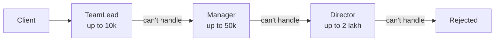

#### 📘 Terms Explained

| Term | Simple meaning |
|---|---|
| **Handler** | An object that can process a request, or pass it on. |
| **Chain** | Handlers linked in order, each one knowing the next (its *successor*). |
| **Successor** | The next handler in the chain. |
| **Escalate** | Send a problem to someone with more authority. |

---

## 1.2 Why Do We Need It?

### Without a chain

```java
void approve(ExpenseClaim c) {
    if (c.amount() <= 10_000)       teamLead.approve(c);
    else if (c.amount() <= 50_000)  manager.approve(c);
    else if (c.amount() <= 200_000) director.approve(c);
    else reject(c);
}
```

Problems:
- The **sender knows every receiver** and the rules for choosing between them.
- Adding a "Finance check" step, or changing the order, means editing this method.
- Different flows (travel claims skip TeamLead) need copies of the whole `if` ladder.

### With a chain

The sender calls `chain.handle(claim)`. Each handler holds **one** rule. The chain can be assembled differently for different flows, or loaded from configuration, without changing any handler.

**Two styles of chain:**

| Style | Behaviour | Example |
|---|---|---|
| **Classic GoF ("first one wins")** | The first handler that can handle it stops the chain | Expense approval, exception handlers, support escalation |
| **Pipeline / filter chain ("everyone gets a turn")** | Every handler does its part and passes it on; any handler may **stop** the chain | Servlet filters, Spring Security, middleware, validation pipelines |

---

## 1.3 How It Works

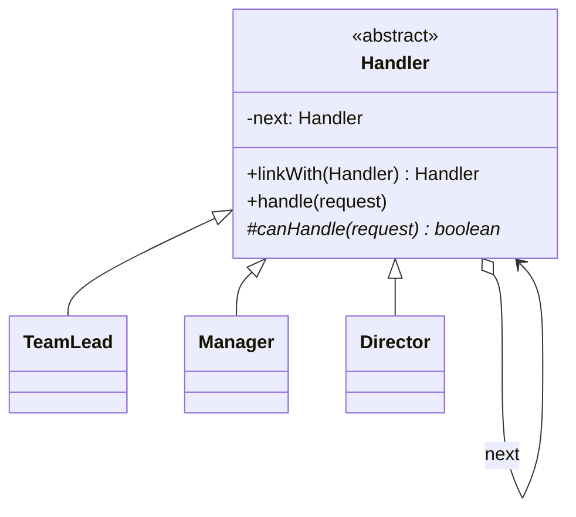

1. A **Handler** base type holds a reference to the **next** handler.
2. `handle()` either processes the request or calls `next.handle(request)`.
3. The **client builds the chain** (`a.linkWith(b).linkWith(c)`) and sends requests to the first handler.
4. The end of the chain needs a decision: do nothing, use a default, or reject.

---

## 1.4 Complete Java Example - Expense Approval Chain

```java
import java.math.BigDecimal;

record ExpenseClaim(String employee, BigDecimal amount, String reason) {}

// ----- Handler: knows its successor -----
abstract class Approver {
    private Approver next;

    // returns the next handler so the chain can be built fluently
    Approver linkWith(Approver next) {
        this.next = next;
        return next;
    }

    final void handle(ExpenseClaim claim) {
        if (canApprove(claim)) {
            approve(claim);
        } else if (next != null) {
            System.out.println("  " + name() + ": over my limit, passing on");
            next.handle(claim);
        } else {
            System.out.println("  REJECTED: nobody can approve Rs." + claim.amount());
        }
    }

    abstract boolean canApprove(ExpenseClaim claim);
    abstract String name();

    void approve(ExpenseClaim claim) {
        System.out.println("  " + name() + ": APPROVED Rs." + claim.amount() + " for " + claim.employee());
    }
}

// ----- Concrete handlers -----
class TeamLead extends Approver {
    boolean canApprove(ExpenseClaim c) { return c.amount().compareTo(new BigDecimal("10000")) <= 0; }
    String name() { return "TeamLead"; }
}

class Manager extends Approver {
    boolean canApprove(ExpenseClaim c) { return c.amount().compareTo(new BigDecimal("50000")) <= 0; }
    String name() { return "Manager"; }
}

class Director extends Approver {
    boolean canApprove(ExpenseClaim c) { return c.amount().compareTo(new BigDecimal("200000")) <= 0; }
    String name() { return "Director"; }
}

public class ChainDemo {
    public static void main(String[] args) {
        Approver chain = new TeamLead();
        chain.linkWith(new Manager()).linkWith(new Director());

        String[][] claims = { {"Asha", "4500", "Taxi"}, {"Ravi", "32000", "Conference"},
                              {"Meera", "150000", "Laptop"}, {"Kiran", "900000", "Car"} };
        for (String[] c : claims) {
            System.out.println(c[0] + " claims Rs." + c[1] + " (" + c[2] + ")");
            chain.handle(new ExpenseClaim(c[0], new BigDecimal(c[1]), c[2]));
        }
    }
}
```

**Output:**
```
Asha claims Rs.4500 (Taxi)
  TeamLead: APPROVED Rs.4500 for Asha
Ravi claims Rs.32000 (Conference)
  TeamLead: over my limit, passing on
  Manager: APPROVED Rs.32000 for Ravi
Meera claims Rs.150000 (Laptop)
  TeamLead: over my limit, passing on
  Manager: over my limit, passing on
  Director: APPROVED Rs.150000 for Meera
Kiran claims Rs.900000 (Car)
  TeamLead: over my limit, passing on
  Manager: over my limit, passing on
  REJECTED: nobody can approve Rs.900000
```

Notes:
- `handle()` is `final`: the "pass it on" logic lives in one place, and subclasses only say **whether** they can approve.
- `linkWith` returns the **next** handler, so `a.linkWith(b).linkWith(c)` builds `a → b → c`.
- The Rs.9 lakh claim fell off the end of the chain, and the base class rejected it. **Always decide what happens at the end of the chain.**

#### 📘 Terms Explained

| Term | Simple meaning |
|---|---|
| **`compareTo`** | How `BigDecimal` values are compared: returns negative / 0 / positive. Never use `==` or `equals` for amounts (`equals` also compares scale: `2.0` vs `2.00`). |
| **`final` method** | A method subclasses cannot override. |
| **Lakh** | 1,00,000 (one hundred thousand) in the Indian numbering system. |

---

## 1.5 Pipeline Variant: Filter Chains and Middleware

In a pipeline, **every** handler runs (unless one stops the request), like an assembly line.

```java
interface RequestFilter {
    void doFilter(HttpRequest req, FilterChain chain);
}

interface FilterChain {
    void proceed(HttpRequest req);
}

// A chain that walks through a list of filters, then calls the final target
class SimpleFilterChain implements FilterChain {
    private final List<RequestFilter> filters;
    private final Consumer<HttpRequest> target;
    private int index = 0;

    SimpleFilterChain(List<RequestFilter> filters, Consumer<HttpRequest> target) {
        this.filters = filters;
        this.target = target;
    }

    public void proceed(HttpRequest req) {
        if (index < filters.size()) filters.get(index++).doFilter(req, this);
        else target.accept(req);                          // end of chain: the real handler
    }
}

class AuthFilter implements RequestFilter {
    public void doFilter(HttpRequest req, FilterChain chain) {
        if (req.header("Authorization") == null) {
            System.out.println("401 Unauthorized");       // STOP: don't call chain.proceed
            return;
        }
        chain.proceed(req);                               // continue
    }
}

class TimingFilter implements RequestFilter {
    public void doFilter(HttpRequest req, FilterChain chain) {
        long start = System.nanoTime();
        chain.proceed(req);                               // everything after this runs on the way BACK
        System.out.println("took " + (System.nanoTime() - start) / 1_000_000 + " ms");
    }
}
```

Each filter can act **before** and **after** the rest of the chain, which is why this style is ideal for logging, timing, security, compression and transactions.

### Building a chain from a list (no `next` field needed)

```java
List<OrderValidator> validators = List.of(new StockValidator(), new FraudValidator(), new AddressValidator());

for (OrderValidator v : validators) {
    ValidationResult r = v.validate(order);
    if (!r.ok()) return r;                 // stop at first failure
}
return ValidationResult.success();
```

A plain `List` plus a loop is often all you need, and it is easier to read than linked handlers.

#### 📘 Terms Explained

| Term | Simple meaning |
|---|---|
| **Pipeline** | A sequence of steps where each step's output is the next step's input. |
| **Middleware** | Code that sits between the incoming request and your business logic (common term in Node.js, also used for servlet filters). |
| **Short-circuit** | Stopping early without running the remaining steps. |
| **`Consumer<T>`** | Java functional interface: takes a `T`, returns nothing. |

---

## 1.6 Chain of Responsibility in Spring Boot and the JDK (Interview Imp - Java)

### 1.6.1 Servlet filters and Spring Security

Every HTTP request into a Spring Boot app passes through a **filter chain** before reaching `DispatcherServlet`, and Spring Security adds its own chain inside it.

```mermaid
flowchart LR
    R[HTTP request] --> F1[CharacterEncodingFilter]
    F1 --> F2["DelegatingFilterProxy<br/>-> FilterChainProxy (Spring Security)"]
    F2 --> S1[SecurityContextHolderFilter]
    S1 --> S2[CsrfFilter]
    S2 --> S3[BearerTokenAuthenticationFilter /<br/>UsernamePasswordAuthenticationFilter]
    S3 --> S4[ExceptionTranslationFilter]
    S4 --> S5[AuthorizationFilter]
    S5 --> D[DispatcherServlet]
    D --> I[HandlerInterceptors] --> C[Your @RestController]
```

```java
@Component
@Order(1)                                         // position in the chain
public class CorrelationIdFilter extends OncePerRequestFilter {
    @Override
    protected void doFilterInternal(HttpServletRequest req, HttpServletResponse res, FilterChain chain)
            throws ServletException, IOException {
        String id = Optional.ofNullable(req.getHeader("X-Correlation-Id")).orElse(UUID.randomUUID().toString());
        MDC.put("correlationId", id);             // shows up in every log line for this request
        try {
            chain.doFilter(req, res);             // pass to the next filter
        } finally {
            MDC.remove("correlationId");
        }
    }
}
```

### 1.6.2 `HandlerInterceptor` (Spring MVC)

```java
@Component
class ApiKeyInterceptor implements HandlerInterceptor {
    @Override
    public boolean preHandle(HttpServletRequest req, HttpServletResponse res, Object handler) {
        if (!"secret-key".equals(req.getHeader("X-API-KEY"))) {
            res.setStatus(HttpServletResponse.SC_FORBIDDEN);
            return false;                         // false = stop the chain here
        }
        return true;                              // true = continue
    }
}

@Configuration
class WebConfig implements WebMvcConfigurer {
    private final ApiKeyInterceptor apiKey;
    WebConfig(ApiKeyInterceptor apiKey) { this.apiKey = apiKey; }

    @Override
    public void addInterceptors(InterceptorRegistry registry) {
        registry.addInterceptor(apiKey).addPathPatterns("/api/**");
    }
}
```

### 1.6.3 A chain of your own beans, ordered by `@Order`

```java
public interface DiscountRule {
    Optional<BigDecimal> tryApply(Cart cart);     // empty = "not my case, ask the next one"
}

@Component @Order(1) class EmployeeDiscount implements DiscountRule { ... }
@Component @Order(2) class FestivalDiscount implements DiscountRule { ... }
@Component @Order(3) class FirstOrderDiscount implements DiscountRule { ... }

@Service
class DiscountService {
    private final List<DiscountRule> rules;       // Spring injects them sorted by @Order
    DiscountService(List<DiscountRule> rules) { this.rules = rules; }

    BigDecimal discountFor(Cart cart) {
        return rules.stream()
                .map(r -> r.tryApply(cart))
                .flatMap(Optional::stream)
                .findFirst()                       // first rule that applies wins
                .orElse(BigDecimal.ZERO);
    }
}
```

### 1.6.4 Other real chains

| Where | Chain |
|---|---|
| **Java exceptions** | An exception travels up the call stack until some `catch` handles it. |
| **`java.util.logging.Logger`** | A log record is passed to the logger's handlers, then to the parent logger's handlers. |
| **Class loaders** | Parent-delegation: a class loader asks its parent first, then tries itself. |
| **Spring `HandlerExceptionResolver`s** | Several resolvers try in order to turn an exception into a response (`@ExceptionHandler`, `@ResponseStatus`, default). |
| **Spring Security `AuthenticationManager` (`ProviderManager`)** | Tries each `AuthenticationProvider` until one supports the token type. |
| **Netty `ChannelPipeline`, OkHttp/Feign interceptors** | Request/response pipelines. |

#### 📘 Terms Explained

| Term | Simple meaning |
|---|---|
| **`OncePerRequestFilter`** | Spring base class for filters that must run exactly once per request. |
| **`DelegatingFilterProxy`** | A normal servlet filter that hands the work to a Spring bean (Spring Security's `FilterChainProxy`). |
| **MDC (Mapped Diagnostic Context)** | A per-thread map whose values (like a correlation id) are added to every log line. |
| **Correlation id** | A unique id attached to a request so you can follow it through logs of many services. |
| **`HandlerInterceptor`** | Spring MVC hook with `preHandle`, `postHandle`, `afterCompletion` around controller calls. |
| **`@Order`** | Sets the order of beans when Spring injects them as a `List`, or the order of filters. Lower runs first. |
| **Parent-delegation model** | Class-loader rule: ask the parent loader first; load yourself only if the parent can't. |

---

## 1.7 Pros and Cons

| Pros | Cons |
|---|---|
| Sender is decoupled from receivers | No guarantee a request is handled (it may fall off the end) |
| Add, remove or reorder handlers without touching others | Harder to debug: which handler did what? |
| Each handler has one responsibility | Long chains add latency to every request |
| Chains can be configured at runtime | A broken link (missing `chain.proceed`) silently stops processing |

---

## 1.8 Common Pitfalls

| Pitfall | Fix |
|---|---|
| Request falls off the end unnoticed | Add a default/final handler, or return a clear "unhandled" result. |
| Filter forgets to call `chain.doFilter(...)` | Every filter must either continue or deliberately respond and stop. Review/test each one. |
| Wrong order (auth after logging of the request body, etc.) | Use `@Order` / `FilterRegistrationBean.setOrder`, and document it. |
| Cycles in a hand-linked chain | Build chains from a `List`, not by hand-linking nodes. |
| Heavy work in every handler | Keep handlers cheap; move slow checks later in the chain. |
| Handlers depending on each other's side effects | Pass data explicitly in the request/context object. |

---

## 1.9 Chain of Responsibility - Interview Questions

**Q1. What is Chain of Responsibility?**
A behavioral pattern that passes a request along a chain of handlers; each handler either handles it or forwards it, so the sender is decoupled from the receiver.

**Q2. Give real examples in Java/Spring.**
Servlet `FilterChain`, Spring Security's filter chain, Spring MVC `HandlerInterceptor`s, `ProviderManager` with `AuthenticationProvider`s, `HandlerExceptionResolver`s, exception propagation, class-loader delegation, logging handlers.

**Q3. What's the difference between the classic chain and a filter chain?**
In the classic chain, the first handler that can handle it stops the chain. In a filter chain, every handler processes the request in turn and may stop it; each can also act on the way back.

**Q4. How do you stop processing in a Spring `HandlerInterceptor`?**
Return `false` from `preHandle` (and write the response yourself).

**Q5. How would you design a multi-level approval workflow?**
An `Approver` handler per level with its limit, linked in order (or built from a configurable list), with a final "reject/escalate to committee" handler. Store the chain configuration in the DB if levels change often.

**Q6. Chain of Responsibility vs Decorator?**
Both link objects and forward calls. A decorator always calls the wrapped object and adds behaviour. A chain handler may decide **not** to pass the request on.

**Q7. How does the order of Spring Security filters matter?**
Authentication filters must run before `AuthorizationFilter`, and `ExceptionTranslationFilter` must sit in front of the authorization step to turn `AccessDeniedException` into 401/403. Custom filters are placed with `addFilterBefore/After`.

---

## 1.10 Chain of Responsibility - Cheat Sheet

```
CHAIN OF RESPONSIBILITY  Pass a request along handlers; each handles it or forwards it.
          Classic: first capable handler wins (approvals, support escalation).
          Pipeline: every handler runs, any can stop it (filters, middleware).
          Always define what happens at the END of the chain.
          Java: exception propagation, class-loader delegation, java.util.logging handlers.
          Spring: Servlet FilterChain, Spring Security filters, HandlerInterceptor (preHandle false = stop),
                  ProviderManager, HandlerExceptionResolver, List<Bean> ordered by @Order.
          vs Decorator: a decorator ALWAYS forwards; a chain handler MAY stop.
```

---

# 2. Command Pattern

## 2.1 What is the Command Pattern?

**Command** turns a **request (an action) into an object**. The object contains everything needed to perform the action later: what to call, on which object, with which arguments. Because it is an object, you can **store it, queue it, log it, send it, and undo it**.

**Analogy:** A restaurant order slip. The waiter (invoker) writes your order on a slip (command) and puts it on the kitchen rail. The chef (receiver) cooks from the slip. The waiter doesn't cook, and the chef never talks to you. Slips can wait in a queue, be cancelled, or be re-done.

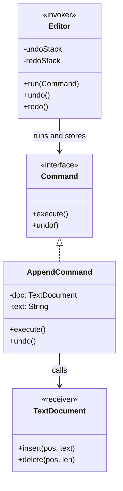

| Role | Who | In the restaurant |
|---|---|---|
| **Command** | Interface with `execute()` (and often `undo()`) | The order slip format |
| **Concrete command** | `AppendCommand`, `DeleteLastCommand` | "2 masala dosa, table 4" |
| **Receiver** | The object that does the real work (`TextDocument`) | The chef |
| **Invoker** | Triggers commands, keeps history/queue (`Editor`, button, scheduler) | The waiter and the rail |
| **Client** | Creates commands and gives them to the invoker | You, ordering |

#### 📘 Terms Explained

| Term | Simple meaning |
|---|---|
| **Command** | An object representing an action to be performed. |
| **Receiver** | The object that actually performs the work when the command runs. |
| **Invoker** | The object that asks the command to run, without knowing what it does. |
| **Undo / redo** | Reverse the last action / re-apply an undone action. |

---

## 2.2 Why Do We Need It?

| Need | How Command helps |
|---|---|
| **Undo / redo** | Each command knows how to reverse itself; keep them on a stack. |
| **Queue or schedule work** | Put command objects in a queue; worker threads execute them later. |
| **Retry and audit** | Store commands; log them; re-run failed ones. |
| **Decouple UI from logic** | A button holds "a command"; it doesn't know what the command does. |
| **Macros / batch operations** | A command that contains a list of commands. |
| **Transactions** | Execute a group; if one fails, undo the ones already done. |
| **Send work across a network** | Serialise the command (e.g. as JSON) and send it to another service (CQRS). |

---

## 2.3 How It Works

1. Define a `Command` interface (`execute`, optionally `undo`).
2. Each concrete command stores its **receiver** and **parameters**, plus whatever it needs to undo (e.g. the deleted text).
3. The invoker calls `execute()` and pushes the command onto an **undo stack**.
4. `undo()` pops the stack, calls `command.undo()`, and pushes it onto a **redo stack**.
5. A **new** command clears the redo stack (you can't redo after branching).

---

## 2.4 Complete Java Example - Text Editor with Undo/Redo

```java
import java.util.ArrayDeque;
import java.util.Deque;

// ----- Receiver: the object that really does the work -----
class TextDocument {
    private final StringBuilder text = new StringBuilder();
    void insert(int pos, String s) { text.insert(pos, s); }
    void delete(int pos, int len) { text.delete(pos, pos + len); }
    int length() { return text.length(); }
    String substring(int from, int to) { return text.substring(from, to); }
    public String toString() { return "\"" + text + "\""; }
}

// ----- Command: a request turned into an object -----
interface Command {
    void execute();
    void undo();
}

class AppendCommand implements Command {
    private final TextDocument doc;
    private final String s;
    private int position;                        // remembered so undo knows where to delete

    AppendCommand(TextDocument doc, String s) { this.doc = doc; this.s = s; }
    public void execute() { position = doc.length(); doc.insert(position, s); }
    public void undo()    { doc.delete(position, s.length()); }
    public String toString() { return "Append(" + s + ")"; }
}

class DeleteLastCommand implements Command {
    private final TextDocument doc;
    private final int count;
    private String deleted;                      // remembered so undo can put it back

    DeleteLastCommand(TextDocument doc, int count) { this.doc = doc; this.count = count; }
    public void execute() {
        int from = doc.length() - count;
        deleted = doc.substring(from, doc.length());
        doc.delete(from, count);
    }
    public void undo() { doc.insert(doc.length(), deleted); }
    public String toString() { return "DeleteLast(" + count + ")"; }
}

// ----- Invoker: runs commands and keeps history; knows nothing about documents -----
class Editor {
    private final Deque<Command> undoStack = new ArrayDeque<>();
    private final Deque<Command> redoStack = new ArrayDeque<>();

    void run(Command c) {
        c.execute();
        undoStack.push(c);
        redoStack.clear();                       // a new action invalidates the redo history
    }
    void undo() {
        if (undoStack.isEmpty()) return;
        Command c = undoStack.pop();
        c.undo();
        redoStack.push(c);
        System.out.println("  undo " + c);
    }
    void redo() {
        if (redoStack.isEmpty()) return;
        Command c = redoStack.pop();
        c.execute();
        undoStack.push(c);
        System.out.println("  redo " + c);
    }
}

public class CommandDemo {
    public static void main(String[] args) {
        TextDocument doc = new TextDocument();
        Editor editor = new Editor();

        editor.run(new AppendCommand(doc, "Hello"));
        editor.run(new AppendCommand(doc, " World"));
        editor.run(new AppendCommand(doc, "!!!"));
        System.out.println("After typing : " + doc);
        editor.run(new DeleteLastCommand(doc, 2));
        System.out.println("After delete : " + doc);

        editor.undo();
        editor.undo();
        System.out.println("After 2 undo : " + doc);
        editor.redo();
        System.out.println("After redo   : " + doc);
    }
}
```

**Output:**
```
After typing : "Hello World!!!"
After delete : "Hello World!"
  undo DeleteLast(2)
  undo Append(!!!)
After 2 undo : "Hello World"
  redo Append(!!!)
After redo   : "Hello World!!!"
```

Notice that `DeleteLastCommand` **remembers the deleted text** during `execute()` so that `undo()` can put it back. Storing just enough information to reverse an action is the key skill when writing undoable commands.

#### 📘 Terms Explained

| Term | Simple meaning |
|---|---|
| **Stack (LIFO)** | Last In, First Out. `push` adds on top, `pop` removes from the top. Perfect for undo. |
| **`ArrayDeque`** | Java's recommended stack/queue class (faster than the old `Stack` class). |
| **Redo history** | Commands that were undone and can be re-applied. |

---

## 2.5 Commands in Modern Java: Runnable, Callable, Lambdas

Java's own command interfaces are `Runnable` and `Callable`. Every time you submit a lambda to a thread pool, you're using the Command pattern.

```java
ExecutorService pool = Executors.newFixedThreadPool(4);       // invoker

Runnable sendEmail = () -> emailService.send(to, body);       // command (receiver = emailService)
Callable<Report> buildReport = () -> reportService.build(42); // command that returns a result

pool.submit(sendEmail);                                       // queued, executed later by a worker thread
Future<Report> future = pool.submit(buildReport);

// Macro command: a list of commands run as one
List<Runnable> nightlyJob = List.of(this::backupDb, this::rotateLogs, this::sendReport);
Runnable macro = () -> nightlyJob.forEach(Runnable::run);
```

| JDK / library | Command idea |
|---|---|
| `Runnable`, `Callable` | Work wrapped as an object |
| `ExecutorService`, `ScheduledExecutorService` | Invoker with a queue of commands |
| `CompletableFuture.supplyAsync(...)` | Command run asynchronously |
| `javax.swing.Action` | UI command shared by menu item + toolbar button |
| `java.util.Timer` / `TimerTask` | Scheduled commands |

> See [Java_Complete_Guide.md](../../java/Java_Complete_Guide.md) for threads and executors.

---

## 2.6 Command in Spring Boot and System Design

### 2.6.1 Scheduled and asynchronous commands

```java
@Component
class NightlyJobs {
    @Scheduled(cron = "0 0 2 * * *")            // the scheduler (invoker) runs this command at 2 AM
    void cleanupExpiredCarts() { ... }

    @Async                                       // the method call becomes a task on a TaskExecutor queue
    public CompletableFuture<Void> sendInvoice(long orderId) { ... }
}
```

### 2.6.2 CQRS: commands as messages

In **CQRS** (Command Query Responsibility Segregation), every write is an explicit command object handled by exactly one handler.

```java
public record PlaceOrderCommand(UUID orderId, String customerId, List<Line> lines) {}

public interface CommandHandler<C> { void handle(C command); }

@Component
class PlaceOrderHandler implements CommandHandler<PlaceOrderCommand> {
    private final OrderRepository orders;
    PlaceOrderHandler(OrderRepository orders) { this.orders = orders; }

    @Transactional
    public void handle(PlaceOrderCommand cmd) {
        orders.save(Order.create(cmd.orderId(), cmd.customerId(), cmd.lines()));
    }
}

// The command can also be sent as JSON over Kafka/RabbitMQ to another service,
// stored for audit, or retried if the handler fails.
```

Frameworks such as **Axon** provide a `CommandGateway` / `CommandBus` that routes command objects to `@CommandHandler` methods.

### 2.6.3 Job queues and the outbox

| System pattern | Command idea |
|---|---|
| **Job / task queue** (Redis queues, SQS, RabbitMQ work queues) | Each message is a command for a worker. |
| **Spring Batch job** | A configured, restartable unit of work. |
| **Transactional Outbox** | Commands/events saved in the DB in the same transaction, then sent reliably. |
| **Database migrations** (Flyway/Liquibase) | Versioned, replayable change commands. |

#### 📘 Terms Explained

| Term | Simple meaning |
|---|---|
| **`@Scheduled`** | Spring annotation that runs a method on a timer or cron schedule (needs `@EnableScheduling`). |
| **Cron expression** | A text pattern describing a schedule (`0 0 2 * * *` = every day at 02:00:00). |
| **`@Async`** | Runs the method on another thread (needs `@EnableAsync`); it's proxy-based, see [03_Structural_Pattern.md](03_Structural_Pattern.md#76-proxy-in-spring-boot-aop-transactional-self-invocation-interview-imp---java). |
| **CQRS** | Separate models for writes (commands) and reads (queries). |
| **Axon Framework** | Java framework for CQRS and event sourcing. |
| **Transactional Outbox** | Save outgoing messages in a DB table within the business transaction, then publish them; avoids losing messages. |

---

## 2.7 Command vs Strategy vs Memento

| | Command | Strategy | Memento |
|---|---|---|---|
| **Object represents** | **An action** to perform (what + on what + with what) | **A way** (algorithm) to do something | **A saved state** |
| **Typical lifetime** | Created per request, often stored in history/queue | Long-lived, reused | Created per checkpoint |
| **Undo support** | Reverses its own action | n/a | Restores whole state |
| **Example** | `AppendCommand("Hi")` | `PercentageDiscount` | `Document.Snapshot` |

> **Undo approaches:** Command-based undo stores **small reversals** (cheap memory, more code). Memento-based undo stores **full snapshots** (simple code, more memory). Editors often combine them.

---

## 2.8 Pros and Cons

| Pros | Cons |
|---|---|
| Decouples who asks from who does | Many small classes (one per action) |
| Enables undo/redo, queues, scheduling, retries, audit logs | Undo logic can be tricky to get exactly right |
| Commands can be combined into macros | Serialising commands for remote use needs care (versions, schema) |
| Easy to add new commands (Open/Closed) | Overkill for simple direct calls |

---

## 2.9 Common Pitfalls

| Pitfall | Fix |
|---|---|
| `undo()` doesn't store enough state | Capture what you need (old value, deleted text, position) in `execute()`. |
| Forgetting to clear the redo stack on a new command | Clear it in `run()`. |
| Unbounded undo history | Limit the stack size (drop oldest). |
| Commands holding references to huge objects | Store IDs and small values; re-fetch receivers when executed. |
| Commands executed twice by retries (double charge!) | Make handlers **idempotent** (use command IDs, check "already processed"). |
| Business logic spread between command and invoker | Logic belongs in the receiver/handler; the invoker only runs and records. |

---

## 2.10 Command - Interview Questions

**Q1. What is the Command pattern?**
A pattern that encapsulates a request as an object, so it can be parameterised, queued, logged, and undone.

**Q2. Who are the participants?**
Command (interface), ConcreteCommand, Receiver (does the work), Invoker (triggers and stores commands), Client (creates and wires them).

**Q3. How do you implement undo/redo?**
Each command implements `undo()`; the invoker keeps an undo stack and a redo stack. Executing pushes to undo and clears redo; undo moves from undo to redo; redo moves back.

**Q4. Java examples?**
`Runnable`/`Callable` submitted to an `ExecutorService`, `TimerTask`, Swing `Action`, Spring `@Scheduled`/`@Async` tasks.

**Q5. Command vs Strategy?**
A command represents *what* to do (an action request, often one-off and stored). A strategy represents *how* to do something (an interchangeable algorithm used by a context).

**Q6. How is Command used in microservices?**
Command messages (CQRS) sent over a broker to a single handler service; job queues; outbox. Handlers must be idempotent because messages can be delivered more than once.

---

## 2.11 Command - Cheat Sheet

```
COMMAND   Turn an action into an object: execute() (+ undo()).
          Roles: Client -> Invoker (runs/stores) -> Command -> Receiver (does work).
          Uses: undo/redo (two stacks), queues, scheduling, retries, audit, macros, CQRS.
          Java: Runnable, Callable, ExecutorService, TimerTask, Swing Action.
          Spring: @Scheduled, @Async, TaskExecutor, CQRS handlers, Axon CommandGateway.
          Store just enough in execute() to undo. Make remote handlers idempotent.
```

---

# 3. Interpreter Pattern

## 3.1 What is the Interpreter Pattern?

**Interpreter** defines a **grammar** for a small language and represents each sentence of that language as a **tree of objects** that can **evaluate itself**.

**Analogy:** A calculator app. When you type `2 + 3 * 4`, it turns the text into a tree (`2 + (3 * 4)`) where each node knows how to compute its value. The tree is then "interpreted" to get 14.

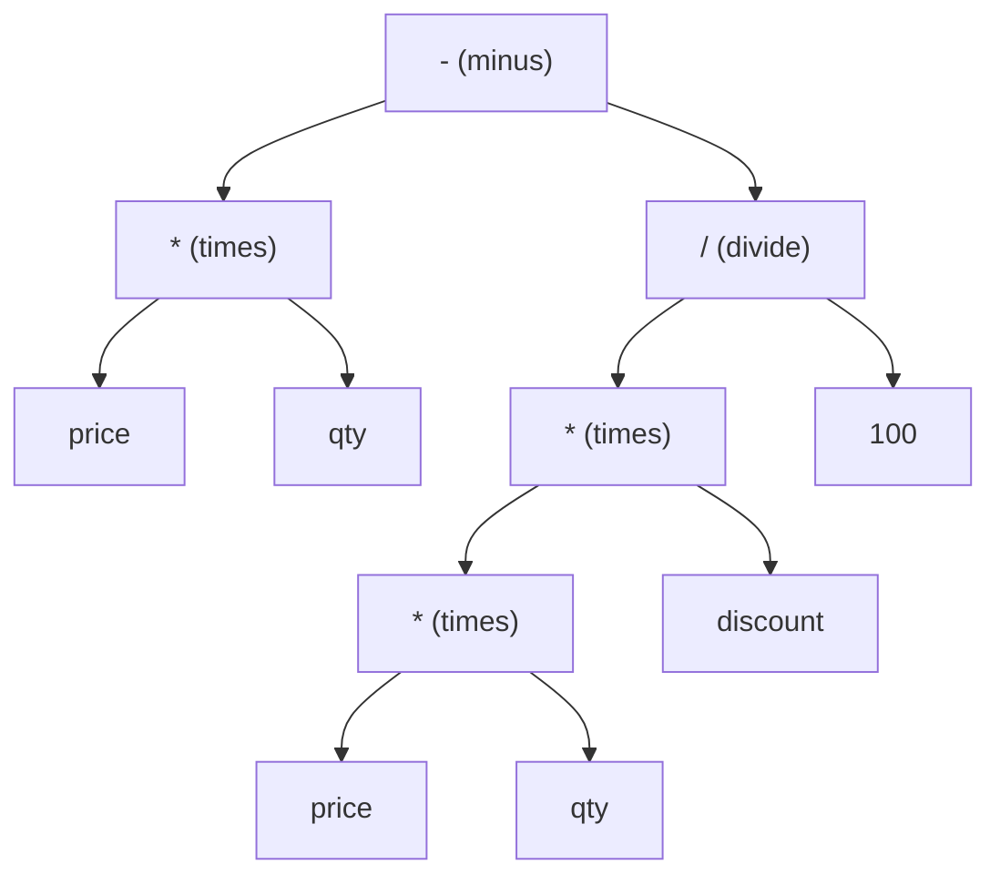
*The tree for `price * qty - (price * qty * discount / 100)`.*

#### 📘 Terms Explained

| Term | Simple meaning |
|---|---|
| **Grammar** | The rules for what a valid sentence in a language looks like. |
| **DSL (Domain-Specific Language)** | A small language for one specific job (SQL, regex, cron, pricing rules). |
| **Abstract Syntax Tree (AST)** | A tree representing the structure of parsed text, without punctuation like brackets. |
| **Terminal expression** | A leaf of the tree: a number or a variable. |
| **Non-terminal expression** | A node that combines other expressions: `+`, `*`, `AND`. |
| **Parser** | Code that reads text and builds the tree. |
| **Context** | The values of variables (and other info) used while interpreting. |

---

## 3.2 Why Do We Need It?

Use it when **business users or config files need small rules** that change often, and recompiling Java for every change is too slow:

- Pricing / discount formulas: `price * qty - discount`
- Eligibility rules: `age >= 18 AND country == 'IN'`
- Feature flags: `user.plan == 'PRO' OR user.beta == true`
- Search filters: `status:open AND assignee:me`
- Alert conditions: `cpu > 90 FOR 5m`

> **Important:** The GoF Interpreter is good for **simple** grammars. For complex languages, use a parser generator (ANTLR) or an existing expression language (SpEL, MVEL, JEXL), or a rule engine (Drools).

---

## 3.3 How It Works

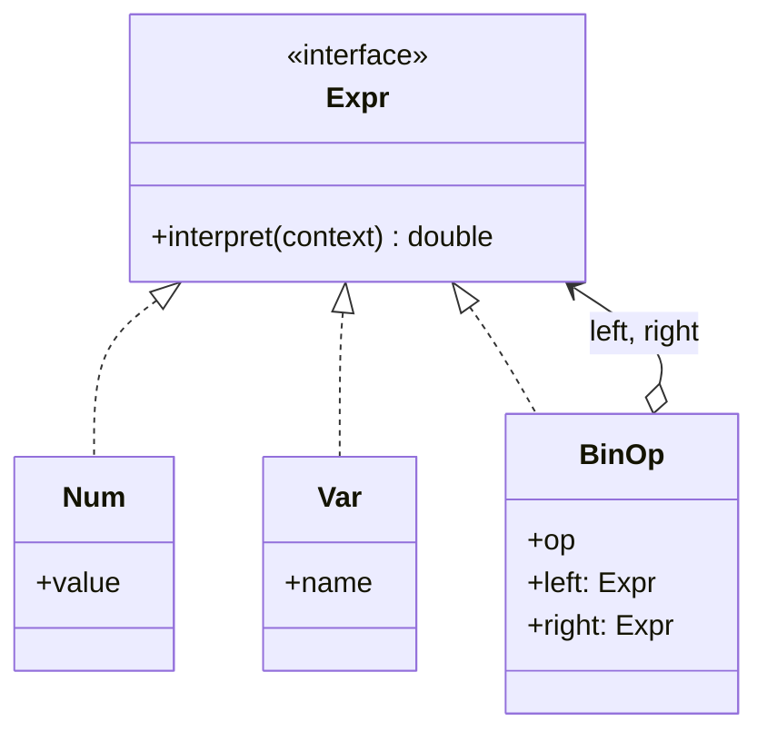

1. Write the grammar rules.
2. Create one class per rule: terminals (`Num`, `Var`) and non-terminals (`BinOp`).
3. Each class implements `interpret(context)`. Non-terminals interpret their children and combine the results (just like the Composite pattern).
4. A **parser** builds the tree from text. (GoF leaves parsing out of the pattern itself, but you always need one.)
5. Build once, interpret many times with different contexts.

---

## 3.4 Complete Java Example - Pricing Rule Language

```java
import java.util.Map;

// ----- Abstract expression -----
interface Expr {
    double interpret(Map<String, Double> context);
}

// ----- Terminal expressions (leaves of the grammar) -----
record Num(double value) implements Expr {
    public double interpret(Map<String, Double> ctx) { return value; }
    public String toString() { return value == (long) value ? String.valueOf((long) value) : String.valueOf(value); }
}
record Var(String name) implements Expr {
    public double interpret(Map<String, Double> ctx) {
        Double v = ctx.get(name);
        if (v == null) throw new IllegalArgumentException("unknown variable: " + name);
        return v;
    }
    public String toString() { return name; }
}

// ----- Non-terminal expression (combines other expressions) -----
record BinOp(char op, Expr left, Expr right) implements Expr {
    public double interpret(Map<String, Double> ctx) {
        double l = left.interpret(ctx), r = right.interpret(ctx);
        return switch (op) {
            case '+' -> l + r;
            case '-' -> l - r;
            case '*' -> l * r;
            case '/' -> l / r;
            default  -> throw new IllegalStateException("bad op " + op);
        };
    }
    public String toString() { return "(" + left + " " + op + " " + right + ")"; }   // shows the tree shape
}

// ----- Parser: turns text into the expression tree (recursive descent) -----
// Grammar:  expr   := term (('+' | '-') term)*
//           term   := factor (('*' | '/') factor)*
//           factor := NUMBER | NAME | '(' expr ')'
class Parser {
    private final String src;
    private int pos = 0;

    Parser(String src) { this.src = src.replace(" ", ""); }

    Expr parse() {
        Expr e = expr();
        if (pos != src.length()) throw new IllegalArgumentException("unexpected '" + src.charAt(pos) + "'");
        return e;
    }

    private Expr expr() {
        Expr e = term();
        while (pos < src.length() && (peek() == '+' || peek() == '-')) {
            char op = src.charAt(pos++);
            e = new BinOp(op, e, term());
        }
        return e;
    }

    private Expr term() {
        Expr e = factor();
        while (pos < src.length() && (peek() == '*' || peek() == '/')) {
            char op = src.charAt(pos++);
            e = new BinOp(op, e, factor());
        }
        return e;
    }

    private Expr factor() {
        if (peek() == '(') {
            pos++;
            Expr e = expr();
            pos++;                                   // skip ')'
            return e;
        }
        int start = pos;
        if (Character.isDigit(peek())) {
            while (pos < src.length() && (Character.isDigit(peek()) || peek() == '.')) pos++;
            return new Num(Double.parseDouble(src.substring(start, pos)));
        }
        while (pos < src.length() && Character.isLetter(peek())) pos++;
        return new Var(src.substring(start, pos));
    }

    private char peek() { return src.charAt(pos); }
}

public class InterpreterDemo {
    public static void main(String[] args) {
        String rule = "price * qty - (price * qty * discount / 100)";
        Expr tree = new Parser(rule).parse();
        System.out.println("Rule : " + rule);
        System.out.println("Tree : " + tree);

        System.out.println("Order 1 total = " + tree.interpret(Map.of("price", 250.0, "qty", 4.0, "discount", 10.0)));
        System.out.println("Order 2 total = " + tree.interpret(Map.of("price", 999.0, "qty", 1.0, "discount", 0.0)));
        System.out.println("2 + 3 * 4     = " + new Parser("2 + 3 * 4").parse().interpret(Map.of()));
        System.out.println("(2 + 3) * 4   = " + new Parser("(2 + 3) * 4").parse().interpret(Map.of()));
    }
}
```

**Output:**
```
Rule : price * qty - (price * qty * discount / 100)
Tree : ((price * qty) - (((price * qty) * discount) / 100))
Order 1 total = 900.0
Order 2 total = 999.0
2 + 3 * 4     = 14.0
(2 + 3) * 4   = 20.0
```

What the output shows:
- The text rule was parsed **once** into a tree, and then interpreted with **two different contexts** (orders).
- `2 + 3 * 4 = 14` shows the grammar gives `*` higher precedence than `+`: `term` handles `*` and `/` *below* `expr`, which handles `+` and `-`.
- Brackets change the tree shape, so `(2 + 3) * 4 = 20`.

> This parser is intentionally small: it doesn't report missing `)` or handle negative numbers. A production version needs proper error messages.

#### 📘 Terms Explained

| Term | Simple meaning |
|---|---|
| **Recursive descent parser** | A hand-written parser with one method per grammar rule; methods call each other recursively. |
| **Precedence** | Which operator is applied first (`*` before `+`). |
| **Switch expression** (`case '+' -> ...`) | Java 14+ `switch` that returns a value, with no fall-through. |

---

## 3.5 Interpreter in the JDK and Spring

| Where | Language interpreted |
|---|---|
| **`java.util.regex.Pattern`** | Regex text is compiled into a tree of node objects, then matched against input. |
| **`java.text.SimpleDateFormat`, `DateTimeFormatter.ofPattern`** | Date pattern language (`dd-MM-yyyy`). |
| **`java.text.MessageFormat`** | `"Hello {0}, you have {1} messages"`. |
| **SpEL (Spring Expression Language)** | `#{...}` in `@Value`, `@PreAuthorize`, `@Cacheable(key = ...)`, `@ConditionalOnExpression`. |
| **Spring Data query derivation** | Method names like `findByEmailAndStatusOrderByCreatedAtDesc` are parsed (`PartTree`) into queries. |
| **Spring `CronExpression`** | Cron strings for `@Scheduled`. |
| **JPQL / HQL / Criteria API** | Query languages turned into SQL. |
| **Thymeleaf / FreeMarker** | Template languages. |

```java
// SpEL: evaluate the same pricing rule without writing a parser
ExpressionParser parser = new SpelExpressionParser();
Expression rule = parser.parseExpression("#price * #qty - (#price * #qty * #discount / 100)");   // #name = variable

EvaluationContext ctx = SimpleEvaluationContext.forReadOnlyDataBinding().build();   // restricted, safe context
ctx.setVariable("price", 250.0);
ctx.setVariable("qty", 4.0);
ctx.setVariable("discount", 10.0);
Double total = rule.getValue(ctx, Double.class);   // 900.0

// SpEL inside annotations
@PreAuthorize("hasRole('ADMIN') or #userId == authentication.principal.id")
public UserDto getUser(@P("userId") long userId) { ... }

@Cacheable(value = "products", key = "#sku + ':' + #region")
public Product find(String sku, String region) { ... }
```

> **Security warning:** never evaluate SpEL (or any expression language) built from **user input** with a `StandardEvaluationContext`. It can call arbitrary methods, which is a remote-code-execution risk. Use `SimpleEvaluationContext` for untrusted expressions.

#### 📘 Terms Explained

| Term | Simple meaning |
|---|---|
| **SpEL** | Spring Expression Language: a mini language for expressions inside Spring config and annotations. |
| **`PartTree`** | Spring Data class that parses repository method names into query parts. |
| **ANTLR** | A popular tool that generates parsers from a grammar file. |
| **Rule engine (Drools)** | A system where business rules are written in a rule language and evaluated against facts. |
| **Remote code execution (RCE)** | An attacker can make your server run code of their choosing. |

---

## 3.6 Pros, Cons and Pitfalls

| Pros | Cons |
|---|---|
| Rules can change without recompiling | One class per grammar rule; complex grammars explode in classes |
| Easy to extend a simple grammar | Slow for heavy use (tree walking); compile to bytecode for speed |
| Tree can be inspected, printed, optimised | Error reporting and parsing are hard to do well |

| Pitfall | Fix |
|---|---|
| Building a big language by hand | Use ANTLR, SpEL, JEXL, or a rule engine. |
| Re-parsing the same rule on every request | Parse once, cache the tree, interpret many times. |
| Evaluating untrusted expressions with full power | Restricted context (`SimpleEvaluationContext`), whitelists, timeouts. |
| Poor error messages ("unexpected token") | Track positions; report what was expected. |

---

## 3.7 Interpreter - Interview Questions

**Q1. What is the Interpreter pattern?**
A pattern that represents a grammar as classes and sentences as trees of those classes, each of which can interpret (evaluate) itself against a context.

**Q2. Terminal vs non-terminal expressions?**
Terminals are leaves (numbers, variables). Non-terminals combine other expressions (`Add`, `And`).

**Q3. How is Interpreter related to Composite?**
The expression tree *is* a composite: non-terminals hold child expressions and combine their results.

**Q4. Real examples?**
`java.util.regex.Pattern`, SpEL, Spring Data method-name queries, cron expressions, SQL/JPQL engines, template engines.

**Q5. When should you NOT use it?**
For complex grammars or performance-critical evaluation. Use a parser generator, existing expression language, or rule engine.

---

## 3.8 Interpreter - Cheat Sheet

```
INTERPRETER  Grammar -> one class per rule; sentence -> tree of expressions; tree.interpret(context).
             Terminal (Num, Var) vs non-terminal (Add, And). Tree = Composite. Needs a parser.
             Parse once, interpret many times.
             Java: regex Pattern, DateTimeFormatter patterns, MessageFormat.
             Spring: SpEL (@Value, @PreAuthorize, @Cacheable key), Spring Data PartTree, CronExpression.
             Complex language? ANTLR / SpEL / JEXL / Drools. Never evaluate untrusted SpEL fully.
```

---

# 4. Iterator Pattern (Interview Imp - Java)

## 4.1 What is the Iterator Pattern?

**Iterator** gives you a way to go through the elements of a collection **one by one, without knowing how the collection stores them** (array, linked list, tree, database cursor, file).

**Analogy:** A TV remote's "next channel" button. You don't know (or care) how channels are stored inside the TV; you just press *next* until there are none left.

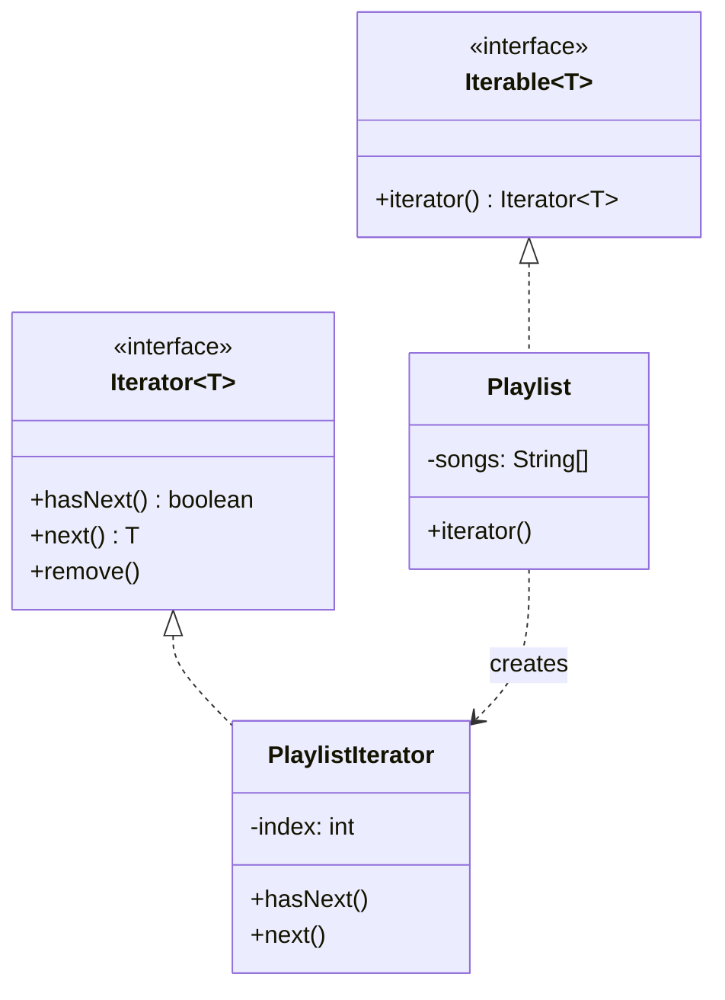

Java has this pattern **built in**: `java.lang.Iterable` and `java.util.Iterator`. Anything that implements `Iterable` works with the **for-each loop**.

#### 📘 Terms Explained

| Term | Simple meaning |
|---|---|
| **Iterator** | An object that remembers a position in a collection and gives you the next element. |
| **Aggregate / collection** | The object holding the elements (list, set, tree, playlist). |
| **`Iterable<T>`** | Java interface with one method `iterator()`; lets a class be used in a for-each loop. |
| **Traversal** | Visiting every element of a structure. |
| **Cursor** | Another name for the current position of an iterator. |

---

## 4.2 Why Do We Need It?

| Without Iterator | With Iterator |
|---|---|
| Client must know the internal structure (`songs[i]`, `node.next`) | Client only calls `hasNext()` / `next()` |
| Changing from array to linked list breaks every client | Internal storage can change freely |
| Only one way to traverse | Many iterators: forward, reverse, filtered, tree order |
| Two loops over the same collection share one index | Each iterator has its own independent position |
| Must load everything into memory first | Iterators can be **lazy**: produce values on demand (database rows, huge files, infinite sequences) |

---

## 4.3 How It Works in Java

```java
public interface Iterator<E> {
    boolean hasNext();                        // is there another element?
    E next();                                 // return it and move forward (NoSuchElementException if none)
    default void remove() {                   // optional: remove the last element returned
        throw new UnsupportedOperationException("remove");
    }
    default void forEachRemaining(Consumer<? super E> action) { ... }
}

// The for-each loop is just syntax sugar:
for (String s : playlist) { System.out.println(s); }

// ...compiles to:
for (Iterator<String> it = playlist.iterator(); it.hasNext(); ) {
    String s = it.next();
    System.out.println(s);
}
```

**Related JDK iterator types:**

| Type | Adds |
|---|---|
| `ListIterator` | Move backwards (`previous()`), get index, `set()` and `add()` while iterating |
| `Spliterator` | *Split*-able iterator used by **parallel streams** to divide work between threads |
| `PrimitiveIterator.OfInt` | Iterate `int`s without boxing to `Integer` |
| `Enumeration` | Java 1.0's old iterator (`hasMoreElements`, `nextElement`), still in `Vector`/`Hashtable` |
| `Scanner` | An `Iterator<String>` over tokens of input |
| `DirectoryStream`, `BufferedReader.lines()` | Lazy iteration over files and lines |

---

## 4.4 Complete Java Example - Custom Iterable, Lazy Range, Fail-Fast

```java
import java.util.ArrayList;
import java.util.ConcurrentModificationException;
import java.util.Iterator;
import java.util.List;
import java.util.NoSuchElementException;

// ----- A custom collection that hides how it stores songs -----
class Playlist implements Iterable<String> {
    private final String[] songs = new String[10];   // internal storage: a plain array
    private int size = 0;

    void add(String song) { songs[size++] = song; }

    // Normal order
    @Override
    public Iterator<String> iterator() {
        return new Iterator<>() {
            private int index = 0;
            public boolean hasNext() { return index < size; }
            public String next() {
                if (!hasNext()) throw new NoSuchElementException();
                return songs[index++];
            }
        };
    }

    // A second way to traverse the same data, without exposing the array
    Iterable<String> reversed() {
        return () -> new Iterator<>() {
            private int index = size - 1;
            public boolean hasNext() { return index >= 0; }
            public String next() {
                if (!hasNext()) throw new NoSuchElementException();
                return songs[index--];
            }
        };
    }
}

// ----- A lazy iterator: values are computed on demand, never stored -----
class Range implements Iterable<Integer> {
    private final int from, to, step;
    Range(int from, int to, int step) { this.from = from; this.to = to; this.step = step; }

    public Iterator<Integer> iterator() {
        return new Iterator<>() {
            private int current = from;
            public boolean hasNext() { return current < to; }
            public Integer next() {
                if (!hasNext()) throw new NoSuchElementException();
                int value = current;
                current += step;
                return value;
            }
        };
    }
}

public class IteratorDemo {
    public static void main(String[] args) {
        Playlist p = new Playlist();
        p.add("Kesariya"); p.add("Believer"); p.add("Shape of You");

        System.out.print("Forward : ");
        for (String s : p) System.out.print(s + " | ");          // for-each uses iterator()
        System.out.print("\nBackward: ");
        for (String s : p.reversed()) System.out.print(s + " | ");

        System.out.print("\nRange   : ");
        for (int n : new Range(0, 20, 5)) System.out.print(n + " ");

        // Fail-fast: modifying a list while iterating it with for-each
        List<Integer> nums = new ArrayList<>(List.of(1, 2, 3, 4, 5, 6));
        try {
            for (Integer n : nums) {
                if (n % 2 == 0) nums.remove(n);                   // WRONG
            }
        } catch (ConcurrentModificationException e) {
            System.out.println("\nfor-each + list.remove -> " + e.getClass().getSimpleName());
        }

        // Correct: remove through the iterator itself
        nums = new ArrayList<>(List.of(1, 2, 3, 4, 5, 6));
        Iterator<Integer> it = nums.iterator();
        while (it.hasNext()) {
            if (it.next() % 2 == 0) it.remove();
        }
        System.out.println("iterator.remove()      -> " + nums);
    }
}
```

**Output:**
```
Forward : Kesariya | Believer | Shape of You | 
Backward: Shape of You | Believer | Kesariya | 
Range   : 0 5 10 15 
for-each + list.remove -> ConcurrentModificationException
iterator.remove()      -> [1, 3, 5]
```

What the output shows:
1. `Playlist` stores songs in a private array, yet the client loops over it with for-each, **forward and backward**, never touching the array.
2. `Range` stores **no** numbers at all; each value is computed when `next()` is called (lazy).
3. Removing from an `ArrayList` inside a for-each loop throws **`ConcurrentModificationException`**. Removing through `iterator.remove()` is safe.

> **Note:** `nums.remove(n)` with an `Integer` calls `remove(Object)` (remove that value). `nums.remove(2)` with an `int` calls `remove(int index)` (remove the element at index 2). This is a classic trap.

#### 📘 Terms Explained

| Term | Simple meaning |
|---|---|
| **Anonymous class** (`new Iterator<>() { ... }`) | A class with no name defined and instantiated in one expression. |
| **Lazy** | Computes values only when they're asked for. |
| **`NoSuchElementException`** | Thrown by `next()` when there are no more elements. The `Iterator` contract requires it. |
| **`ConcurrentModificationException`** | Thrown when a collection is structurally modified while being iterated (other than via the iterator). |

---

## 4.5 Fail-Fast vs Fail-Safe Iterators (Interview Imp - Java)

| | Fail-fast | Fail-safe / weakly consistent |
|---|---|---|
| **Collections** | `ArrayList`, `HashMap`, `HashSet`, `LinkedList` | `CopyOnWriteArrayList`, `ConcurrentHashMap`, `ConcurrentLinkedQueue` |
| **Modification during iteration** | Throws `ConcurrentModificationException` (best effort) | No exception |
| **How it works** | Iterator checks a `modCount` counter on every `next()`; if it changed, it throws | Iterates a **snapshot** (copy-on-write) or tolerates concurrent changes (weakly consistent) |
| **Sees new changes?** | n/a (fails) | Copy-on-write: **no** (old snapshot). `ConcurrentHashMap`: **may or may not** |
| **Memory cost** | None | Copy-on-write: copies the whole array on each write |

```java
// How fail-fast works inside ArrayList (simplified)
private class Itr implements Iterator<E> {
    int expectedModCount = modCount;            // remember the count when iteration starts
    public E next() {
        if (modCount != expectedModCount) throw new ConcurrentModificationException();
        ...
    }
    public void remove() {
        ArrayList.this.remove(lastRet);
        expectedModCount = modCount;            // iterator's own removal keeps them in sync
    }
}
```

**Safe ways to remove while looping:**

```java
list.removeIf(n -> n % 2 == 0);                  // simplest (Java 8+)
it.remove();                                     // explicit iterator
list = list.stream().filter(n -> n % 2 != 0).toList();   // build a new list
map.entrySet().removeIf(e -> e.getValue() == 0);
```

> Fail-fast is **not a thread-safety guarantee**; it's a bug detector. For concurrent access use concurrent collections. See [Java_Collections_Framework_Guide.md](../../java/Java_Collections_Framework_Guide.md).

#### 📘 Terms Explained

| Term | Simple meaning |
|---|---|
| **`modCount`** | A counter inside collections that increases on every structural change (add/remove). |
| **Structural modification** | A change in size (add/remove). `set()` on a list element is not structural. |
| **Copy-on-write** | Every write creates a new copy of the underlying array, so readers keep using the old one safely. |
| **Weakly consistent** | The iterator never throws and reflects some, but not necessarily all, changes made during iteration. |
| **`removeIf`** | Collection method that removes all elements matching a condition, safely. |

---

## 4.6 Iterators, Streams and Spring Data

### 4.6.1 Streams are "internal iterators"

```java
// External iteration: YOU control the loop
for (Order o : orders) { if (o.total() > 1000) bigOrders.add(o); }

// Internal iteration: the library controls the loop; you pass behaviour
List<Order> bigOrders = orders.stream().filter(o -> o.total() > 1000).toList();
```

| External iterator (`Iterator`) | Internal iterator (`Stream.forEach`, `Iterable.forEach`) |
|---|---|
| Client calls `next()` | Collection calls your lambda |
| Easy to stop early (`break`) or interleave two collections | Easy to parallelise (`parallelStream`, uses `Spliterator`) |

See [java-stream-api.md](../../java/java-stream-api.md).

### 4.6.2 Iterating huge data sets in Spring Boot

Loading one million rows into a `List` can cause `OutOfMemoryError`. Iterate instead:

```java
public interface OrderRepository extends JpaRepository<Order, Long> {

    @QueryHints(@QueryHint(name = org.hibernate.jpa.HibernateHints.HINT_FETCH_SIZE, value = "500"))
    Stream<Order> streamByStatus(Status status);          // rows fetched lazily from a DB cursor

    Slice<Order> findByStatus(Status status, Pageable page);   // page-by-page iteration

    // Keyset ("seek") pagination: fast even for deep pages
    List<Order> findTop500ByIdGreaterThanOrderByIdAsc(long lastSeenId);
}

@Transactional(readOnly = true)                           // the stream needs an open connection
public void exportOrders(Writer out) {
    try (Stream<Order> orders = repo.streamByStatus(Status.DELIVERED)) {   // MUST be closed
        orders.forEach(o -> writeCsvLine(out, o));
    }
}
```

| Technique | Iterator idea |
|---|---|
| JDBC `ResultSet` | A DB cursor: `rs.next()` moves to the next row. |
| Spring Data `Stream<T>` | Lazy iteration over a cursor; must run inside a transaction and be closed. |
| `Slice` / `Page` + `Pageable` | Iterate page by page (`slice.nextPageable()`). |
| Keyset / cursor pagination in REST APIs | `GET /orders?after=12345&limit=50` returns a "next cursor". Better than `OFFSET` for large tables. |
| Kafka consumer `poll()` | Iterate over an endless stream of records. |

#### 📘 Terms Explained

| Term | Simple meaning |
|---|---|
| **External vs internal iteration** | Who drives the loop: your code (`for`) or the library (`forEach(lambda)`). |
| **`Spliterator`** | An iterator that can split itself in parts so several threads can process a collection. |
| **Fetch size** | How many rows the JDBC driver pulls from the DB per network round trip. |
| **`Slice` / `Page`** | Spring Data result types holding one page of results; `Page` also knows the total count. |
| **Keyset pagination** | Fetch "the next N rows after the last ID I saw" instead of skipping N×page rows with `OFFSET`. |

---

## 4.7 Pros and Cons

| Pros | Cons |
|---|---|
| Hides the internal structure of a collection | Slower than direct index access for simple arrays |
| Several traversals at once, each with its own position | Writing a correct iterator (with `remove`, fail-fast) takes care |
| Lazy iteration over huge or infinite data | Modifying while iterating is error-prone |
| Uniform for-each syntax for every collection | External iterators are harder to parallelise |

---

## 4.8 Common Pitfalls

| Pitfall | Fix |
|---|---|
| `list.remove(...)` inside for-each → `ConcurrentModificationException` | `iterator.remove()` or `removeIf`. |
| `next()` without checking `hasNext()` | Always check, or let for-each handle it. Custom `next()` must throw `NoSuchElementException`. |
| Sharing one iterator between threads | Iterators aren't thread-safe; give each thread its own, or use concurrent collections. |
| Expecting a `CopyOnWriteArrayList` iterator to see new elements | It iterates a snapshot by design. |
| Returning the internal mutable list instead of an iterator/view | Expose `Iterable`, `List.copyOf`, or an unmodifiable view. |
| Not closing a Spring Data `Stream` / JDBC `ResultSet` | Use try-with-resources inside a transaction. |
| `OFFSET` pagination over millions of rows | Keyset (cursor) pagination. |

---

## 4.9 Iterator - Interview Questions

**Q1. What is the Iterator pattern?**
A pattern to access the elements of a collection sequentially without exposing its internal representation.

**Q2. `Iterable` vs `Iterator`?**
`Iterable` is the collection side: it can *produce* iterators (`iterator()`), and enables for-each. `Iterator` is the cursor: `hasNext()`, `next()`, `remove()`.

**Q3. What is a fail-fast iterator?**
It throws `ConcurrentModificationException` if the collection is structurally modified during iteration by anything other than the iterator itself. It works by checking `modCount`.

**Q4. Fail-fast vs fail-safe?**
Fail-fast (`ArrayList`, `HashMap`) throws on concurrent modification. Fail-safe/weakly consistent (`CopyOnWriteArrayList`, `ConcurrentHashMap`) don't throw: they iterate a snapshot or tolerate changes.

**Q5. How do you remove elements while iterating?**
`Iterator.remove()`, `Collection.removeIf`, or build a new filtered collection.

**Q6. `Iterator` vs `ListIterator` vs `Enumeration`?**
`ListIterator` can move both ways and modify. `Enumeration` is the legacy version with no `remove`. `Iterator` is the standard forward-only cursor.

**Q7. What is a `Spliterator`?**
A splittable iterator introduced in Java 8 so streams can divide a source into parts for parallel processing.

**Q8. How do you iterate millions of DB rows in Spring Boot?**
Spring Data `Stream<T>` inside a read-only transaction with try-with-resources and a fetch size, or page through with `Slice`/keyset pagination; never load it all into a `List`.

---

## 4.10 Iterator - Cheat Sheet

```
ITERATOR  Walk a collection one element at a time without exposing its internals.
          Java: Iterable.iterator() -> Iterator { hasNext, next, remove (optional) }; for-each uses it.
          next() past the end MUST throw NoSuchElementException.
          Fail-fast (ArrayList/HashMap, modCount) -> ConcurrentModificationException.
          Fail-safe/weakly consistent: CopyOnWriteArrayList (snapshot), ConcurrentHashMap.
          Remove safely: iterator.remove(), removeIf. Trap: list.remove(Integer) vs remove(int).
          Also: ListIterator, Spliterator (parallel streams), Enumeration (legacy), ResultSet.
          Spring Data: Stream<T> (close it, in a transaction), Slice/Page, keyset pagination.
```

---

# 5. Mediator Pattern

## 5.1 What is the Mediator Pattern?

**Mediator** defines one object that controls how a set of other objects interact. Instead of talking **directly to each other**, objects (called **colleagues**) talk **only to the mediator**, and the mediator forwards, filters or coordinates.

**Analogy:** An airport control tower. Planes never radio each other to decide who lands first; they all talk to the tower, and the tower tells each plane what to do.

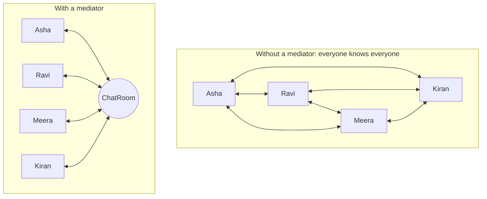

With N objects talking directly there can be N × (N-1) / 2 connections (4 users → 6; 10 users → 45). With a mediator there are only N.

#### 📘 Terms Explained

| Term | Simple meaning |
|---|---|
| **Mediator** | The central object that coordinates communication. |
| **Colleague** | One of the objects that communicate through the mediator. |
| **Many-to-many** | Every object may talk to every other object. A mediator turns it into many-to-one. |

---

## 5.2 Why Do We Need It?

- **Tangled dependencies:** in a form, the "country" dropdown changes the "state" list, which enables the "pincode" box, which shows the "delivery date" label... If each widget references the others, nothing can be reused or changed safely.
- **Rules about interaction** (who may talk to whom, filtering spam, ordering) end up scattered in every colleague.
- With a mediator, colleagues stay simple and reusable, and **all coordination rules live in one class**.

---

## 5.3 How It Works

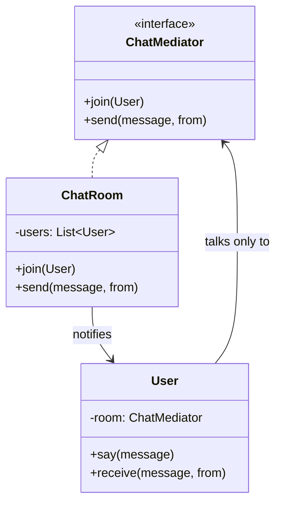

1. Colleagues hold a reference to the **mediator**, not to each other.
2. When something happens, a colleague tells the mediator (`room.send(...)`).
3. The mediator decides who should react and calls them (`user.receive(...)`).

---

## 5.4 Complete Java Example - Chat Room

```java
import java.util.ArrayList;
import java.util.List;

// ----- Mediator interface -----
interface ChatMediator {
    void join(User user);
    void send(String message, User from);
}

// ----- Colleague: knows only the mediator, never other users -----
class User {
    private final String name;
    private final ChatMediator room;

    User(String name, ChatMediator room) {
        this.name = name;
        this.room = room;
        room.join(this);
    }
    String name() { return name; }

    void say(String message) { room.send(message, this); }

    void receive(String message, String from) {
        System.out.println("  " + name + " got from " + from + ": " + message);
    }
}

// ----- Concrete mediator: all the routing rules live here -----
class ChatRoom implements ChatMediator {
    private final List<User> users = new ArrayList<>();
    private final List<String> banned = List.of("spam");

    public void join(User user) {
        users.add(user);
        System.out.println("[room] " + user.name() + " joined");
    }

    public void send(String message, User from) {
        if (banned.stream().anyMatch(message.toLowerCase()::contains)) {
            System.out.println("[room] blocked message from " + from.name());
            return;
        }
        if (message.startsWith("@")) {                         // direct message: "@Ravi hi"
            String to = message.substring(1, message.indexOf(' '));
            users.stream().filter(u -> u.name().equals(to))
                 .forEach(u -> u.receive(message.substring(to.length() + 2), from.name() + " (private)"));
            return;
        }
        for (User u : users) {
            if (u != from) u.receive(message, from.name());
        }
    }
}

public class MediatorDemo {
    public static void main(String[] args) {
        ChatMediator room = new ChatRoom();
        User asha = new User("Asha", room);
        User ravi = new User("Ravi", room);
        User meera = new User("Meera", room);

        System.out.println("Asha broadcasts:");
        asha.say("Stand-up in 5 minutes");
        System.out.println("Ravi sends a private message:");
        ravi.say("@Meera can you review my PR?");
        System.out.println("Meera sends spam:");
        meera.say("Buy cheap SPAM now");
    }
}
```

**Output:**
```
[room] Asha joined
[room] Ravi joined
[room] Meera joined
Asha broadcasts:
  Ravi got from Asha: Stand-up in 5 minutes
  Meera got from Asha: Stand-up in 5 minutes
Ravi sends a private message:
  Meera got from Ravi (private): can you review my PR?
Meera sends spam:
[room] blocked message from Meera
```

`User` has no idea other users exist. Broadcasting, private messages and the spam filter are **all rules inside `ChatRoom`**. Adding "mute a user" or "message history" changes only the mediator.

---

## 5.5 Mediator in Java, Spring and System Design

| Where | Mediator idea |
|---|---|
| **Spring MVC `DispatcherServlet`** | Coordinates handler mappings, adapters, view resolvers and exception resolvers; none of them know each other. |
| **Spring Integration / Apache Camel** | Message channels and routes connect components that never reference each other. |
| **`java.util.concurrent.ExecutorService`** | Sits between task submitters and worker threads. |
| **`java.util.Timer`** | Coordinates many `TimerTask`s on one thread. |
| **UI controllers (MVC / MVVM)** | The controller mediates between view widgets and the model. |
| **Message broker (Kafka, RabbitMQ)** | System-level mediator between services (also Observer/pub-sub). |
| **Orchestrator (Saga orchestration, workflow engines like Camunda/Temporal)** | One service coordinates the steps of other services. |

```java
// A small "command mediator" (like the MediatR library in .NET): callers don't know the handler
@Component
class Mediator {
    private final Map<Class<?>, CommandHandler<?>> handlers = new HashMap<>();

    Mediator(List<CommandHandler<?>> all) {
        all.forEach(h -> handlers.put(h.commandType(), h));
    }

    @SuppressWarnings("unchecked")
    <C> void send(C command) {
        CommandHandler<C> h = (CommandHandler<C>) handlers.get(command.getClass());
        if (h == null) throw new IllegalArgumentException("no handler for " + command.getClass().getSimpleName());
        h.handle(command);
    }
}

interface CommandHandler<C> {
    Class<C> commandType();
    void handle(C command);
}
```

#### 📘 Terms Explained

| Term | Simple meaning |
|---|---|
| **Apache Camel / Spring Integration** | Integration frameworks that route messages between systems using channels and routes. |
| **MVVM** | Model-View-ViewModel: a UI architecture where the ViewModel mediates between view and data. |
| **Orchestration** | One central coordinator tells each service what to do, step by step. (The opposite, **choreography**, is services reacting to each other's events.) |
| **MediatR** | A popular .NET library implementing an in-process mediator for commands and queries. |

---

## 5.6 Mediator vs Observer vs Facade

| | Mediator | Observer | Facade |
|---|---|---|---|
| **Direction** | Two-way: colleagues → mediator → colleagues | One-way: subject → observers | One-way: client → facade → subsystem |
| **Do participants know the central object?** | Yes | Observers register with the subject | Subsystem doesn't know the facade |
| **Contains logic?** | Yes, the coordination rules | No, just broadcasts | Orchestration of a workflow |
| **Goal** | Reduce many-to-many coupling between peers | Notify dependents of changes | Simplify a complex API |

> A mediator is often **implemented with** observer-style events (colleagues publish events, the mediator subscribes).

---

## 5.7 Pros, Cons and Pitfalls

| Pros | Cons |
|---|---|
| Colleagues are decoupled and reusable | The mediator can become a **God object** holding all logic |
| Interaction rules in one place | Single point of failure / bottleneck at system level |
| N connections instead of N² | Harder to follow: behaviour isn't in the colleague classes |

| Pitfall | Fix |
|---|---|
| Mediator grows huge | Split per feature or screen; push non-coordination logic back into colleagues. |
| Colleagues still call each other "just this once" | Enforce through package visibility and code review. |
| Central orchestrator service in microservices with no resilience | Timeouts, retries, persistence of workflow state (workflow engine). |

---

## 5.8 Mediator - Interview Questions

**Q1. What is the Mediator pattern?**
A pattern that encapsulates how a set of objects interact, so they talk to a central mediator instead of to each other, reducing coupling.

**Q2. Real examples?**
Chat rooms, air-traffic control, UI dialogs coordinating widgets, Spring's `DispatcherServlet`, `ExecutorService`, message brokers, Saga orchestrators.

**Q3. Mediator vs Observer?**
Observer is one-to-many, one-way notification with no logic. Mediator is many-to-many communication routed through a hub that contains coordination logic.

**Q4. Mediator vs Facade?**
Facade simplifies a subsystem for outside clients and the subsystem doesn't know it. Mediator coordinates peers who all know and use it.

**Q5. Biggest risk?**
The mediator turning into a God object. Keep it focused on coordination.

---

## 5.9 Mediator - Cheat Sheet

```
MEDIATOR  Colleagues talk ONLY to a central mediator, which routes/coordinates. N links instead of N^2.
          Two-way (unlike Observer); colleagues know it (unlike Facade).
          Examples: chat room, control tower, form/dialog widgets, DispatcherServlet, ExecutorService,
                    Spring Integration/Camel, message brokers, Saga orchestrator.
          Risk: God object -> split per feature.
```

---

## 5.10 Types and Variants

| Variant | Idea | Example |
|---|---|---|
| **Classic GoF mediator** | Colleagues talk only to a mediator interface, which coordinates them | Dialog box: text field, checkbox and button updated by a `DialogMediator` |
| **Event bus / message broker** | A generic mediator: publishers and subscribers never reference each other | Spring `ApplicationEventPublisher`, Guava `EventBus`, Kafka |
| **Controller / orchestrator** | One component drives a multi-step workflow | Saga orchestrator, MVC controller |
| **Chat-room style hub** | Central room relays messages between participants | Chat server, air traffic control |
| **Mediator vs Observer** | Observer: one subject → many observers (one direction). Mediator: many ↔ many through a hub | |
| **Mediator vs Facade** | Facade simplifies access *into* a subsystem; mediator coordinates *between* peers | |

# 6. Memento Pattern

## 6.1 What is the Memento Pattern?

**Memento** captures an object's internal state in a **snapshot** object, so the object can be **restored to that state later**, without exposing its internals to anyone else.

**Analogy:** A save point in a video game. The game stores everything needed to continue from that moment. You can reload it after you lose, and you never see or edit what's inside the save file.

| Role | Who | In the game |
|---|---|---|
| **Originator** | The object whose state is saved (`Document`) | The game |
| **Memento** | Immutable snapshot of that state (`Document.Snapshot`) | The save file |
| **Caretaker** | Keeps mementos, never looks inside (`History`) | The "load game" menu |

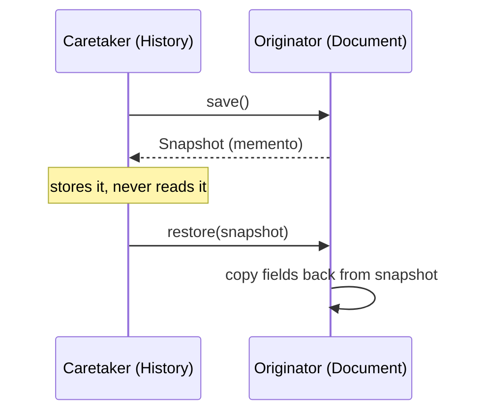

#### 📘 Terms Explained

| Term | Simple meaning |
|---|---|
| **Memento** | A token or keepsake. Here: an object holding a saved state. |
| **Snapshot** | The full state of something at one moment. |
| **Originator** | The object that creates mementos of itself and can restore from them. |
| **Caretaker** | The object that keeps mementos (history) but doesn't change them. |
| **Encapsulation** | Hiding an object's internal data so only the object itself can change it. |

---

## 6.2 Why Do We Need It?

- **Undo / restore:** text editors, drawing apps, form wizards ("back" restores previous values).
- **Checkpoints / rollback:** restore a game, a simulation, or a configuration after a failed change.
- **Without breaking encapsulation:** the naive approach (getters/setters for every private field so the caller can copy them) exposes internals. With Memento, only the originator knows what's inside a snapshot.

---

## 6.3 Complete Java Example - Document Snapshots

```java
import java.util.ArrayDeque;
import java.util.Deque;

// ----- Originator: the object whose state we save and restore -----
class Document {
    private String content = "";
    private String font = "Arial";
    private int fontSize = 12;

    void type(String text)          { content += text; }
    void setFont(String f, int size) { font = f; fontSize = size; }

    // Create a snapshot. Only Document knows what goes inside.
    Snapshot save() { return new Snapshot(content, font, fontSize); }

    // Restore from a snapshot
    void restore(Snapshot s) {
        content = s.content();
        font = s.font();
        fontSize = s.fontSize();
    }

    public String toString() { return "'" + content + "' [" + font + " " + fontSize + "]"; }

    // ----- Memento: immutable; nested so only Document can read its fields meaningfully -----
    record Snapshot(String content, String font, int fontSize) {}
}

// ----- Caretaker: stores snapshots but never looks inside them -----
class History {
    private final Deque<Document.Snapshot> stack = new ArrayDeque<>();
    void push(Document.Snapshot s) { stack.push(s); }
    Document.Snapshot pop() { return stack.pop(); }
    int size() { return stack.size(); }
}

public class MementoDemo {
    public static void main(String[] args) {
        Document doc = new Document();
        History history = new History();

        doc.type("Dear Sir,");
        history.push(doc.save());                        // checkpoint 1
        System.out.println("v1: " + doc);

        doc.type(" Please find attached my resume.");
        doc.setFont("Times New Roman", 14);
        history.push(doc.save());                        // checkpoint 2
        System.out.println("v2: " + doc);

        doc.type(" asdfgh (cat walked on keyboard)");
        doc.setFont("Comic Sans", 30);
        System.out.println("v3: " + doc);

        doc.restore(history.pop());
        System.out.println("undo -> " + doc);
        doc.restore(history.pop());
        System.out.println("undo -> " + doc);
        System.out.println("snapshots left: " + history.size());
    }
}
```

**Output:**
```
v1: 'Dear Sir,' [Arial 12]
v2: 'Dear Sir, Please find attached my resume.' [Times New Roman 14]
v3: 'Dear Sir, Please find attached my resume. asdfgh (cat walked on keyboard)' [Comic Sans 30]
undo -> 'Dear Sir, Please find attached my resume.' [Times New Roman 14]
undo -> 'Dear Sir,' [Arial 12]
snapshots left: 0
```

Notes:
- The snapshot is a **`record`**, which makes it **immutable**: once saved, a checkpoint can't be changed by accident.
- `History` stores `Snapshot` objects but never calls their accessors. It only pushes and pops.
- For **strict** encapsulation, make the snapshot's contents private to `Document` (e.g. a nested class with private fields that only the enclosing class can read), and expose only an opaque `Memento` interface to the caretaker.

---

## 6.4 Memento in Java, Spring and Databases

| Where | Memento idea |
|---|---|
| **JDBC savepoints** | `Savepoint sp = con.setSavepoint(); ... con.rollback(sp);` rolls back part of a transaction. |
| **Spring `@Transactional(propagation = NESTED)`** | Uses savepoints so an inner failure rolls back only the inner part. |
| **`Serializable` objects** | Serialize state to bytes/file and restore it later. |
| **Event sourcing snapshots** | Store a snapshot every N events so an aggregate can be rebuilt quickly. |
| **Spring Statemachine persistence** | Saves the machine's current state/context to restore it after a restart. |
| **Hibernate Envers** | Keeps historical versions (revisions) of entities. |
| **Browser history / `sessionStorage` form drafts** | Restore a previous page or form state. |
| **Kubernetes/Git** | `kubectl rollout undo`, `git stash`: restore saved states. |

```java
// JDBC savepoint: a database-level memento
con.setAutoCommit(false);
insertOrder(con, order);
Savepoint beforeLines = con.setSavepoint("beforeLines");
try {
    insertOrderLines(con, order.lines());
} catch (SQLException e) {
    con.rollback(beforeLines);          // restore to the snapshot; the order row stays
}
con.commit();
```

#### 📘 Terms Explained

| Term | Simple meaning |
|---|---|
| **Savepoint** | A named point inside a DB transaction that you can roll back to without cancelling the whole transaction. |
| **Event sourcing** | Storing every change as an event and rebuilding state by replaying events. |
| **Serialization** | Converting an object to bytes (to save or send) and back. |
| **Revision** | A saved historical version of data. |

---

## 6.5 Pros, Cons and Pitfalls

| Pros | Cons |
|---|---|
| Undo/rollback without exposing internals | Full snapshots can use a lot of memory |
| Originator code stays simple | Caretaker must manage history size |
| Immutable snapshots are safe to share | Snapshots of objects with references need deep copies |

| Pitfall | Fix |
|---|---|
| Shallow copy in the snapshot (shares a mutable `List`) | Deep-copy or use immutable types (`List.copyOf`). See deep vs shallow in [02_Creational_Pattern.md](02_Creational_Pattern.md#53-shallow-copy-vs-deep-copy-the-most-important-idea-interview-imp---java). |
| Unlimited history → `OutOfMemoryError` | Cap the history; store diffs (Command-style undo) for big objects. |
| Caretaker modifying the memento | Make mementos immutable. |
| Snapshotting objects that hold external resources (connections, files) | Snapshot only plain data; reopen resources on restore. |

---

## 6.6 Memento - Interview Questions

**Q1. What is the Memento pattern?**
A pattern that captures and externalises an object's state so it can be restored later, without violating encapsulation.

**Q2. Participants?**
Originator (creates/restores snapshots), Memento (immutable state), Caretaker (stores mementos without inspecting them).

**Q3. Memento vs Command for undo?**
Memento saves full state and restores it (simple, more memory). Command saves how to reverse each action (less memory, more logic). They are often combined: a command stores a memento of the state before it ran.

**Q4. Memento vs Prototype?**
Both copy state. Prototype copies to create a new working object; Memento copies to restore the same object later.

**Q5. Real examples?**
Editor undo, game save points, JDBC savepoints, nested transactions, event-sourcing snapshots, serialization.

---

## 6.7 Memento - Cheat Sheet

```
MEMENTO   Save an object's state in an immutable snapshot; restore later; keep encapsulation.
          Roles: Originator (save/restore), Memento (snapshot), Caretaker (stores, never reads).
          Use: undo, checkpoints, rollback, wizards. Deep-copy mutable fields. Cap history size.
          Examples: JDBC Savepoint, @Transactional(NESTED), event-sourcing snapshots, serialization, git stash.
          Undo: Memento = full snapshot; Command = store the reverse action.
```

---

# 7. Observer Pattern (Interview Imp - Java)

## 7.1 What is the Observer Pattern?

**Observer** defines a **one-to-many** relationship: when one object (the **subject**) changes or something happens to it, all registered objects (the **observers**) are **notified automatically**. The subject doesn't know what observers do; it only knows they want to hear about it.

**Analogy:** A YouTube channel. You subscribe once. Whenever a new video is uploaded, every subscriber is notified. The channel doesn't know or care whether you watch it, share it, or ignore it, and you can unsubscribe any time.

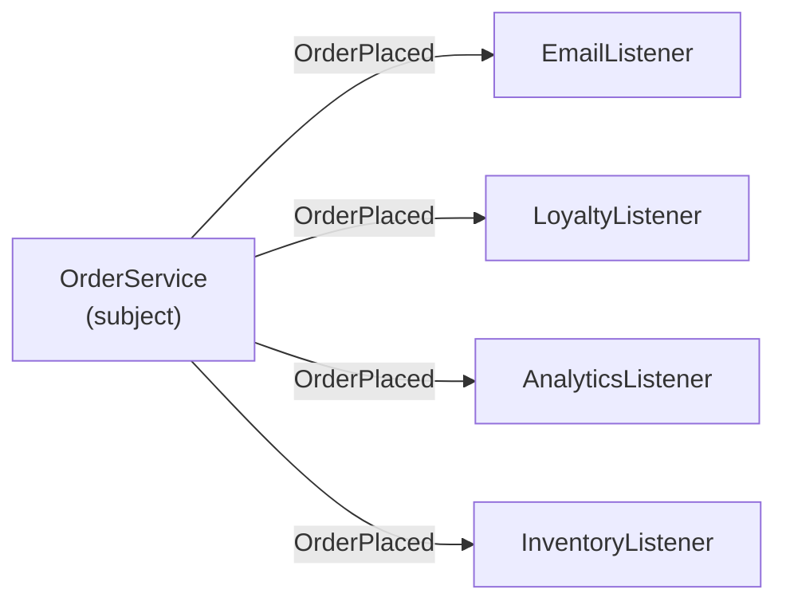

Other names for the same idea: **Publish-Subscribe (pub/sub)**, **listeners**, **event handlers**, **callbacks**, **event-driven**.

#### 📘 Terms Explained

| Term | Simple meaning |
|---|---|
| **Subject / publisher / observable** | The object that has something interesting happen and sends notifications. |
| **Observer / subscriber / listener** | An object that registered to be told when it happens. |
| **Event** | An object describing what happened (`OrderPlaced`). |
| **Subscribe / unsubscribe** | Register / unregister an observer with the subject. |
| **Callback** | A method you give to someone else so they can call you back later. |

---

## 7.2 Why Do We Need It?

### Without Observer

```java
public void placeOrder(Order order) {
    orderRepository.save(order);
    emailService.sendConfirmation(order);      // OrderService knows about email,
    loyaltyService.addPoints(order);           // loyalty,
    analyticsClient.track(order);              // analytics,
    inventoryService.reserve(order);           // inventory... and every new feature edits this method
}
```

Problems:
- `OrderService` depends on **every** service that cares about orders.
- Adding "send WhatsApp" means editing and re-testing order code.
- If analytics is down, the order fails.

### With Observer

`OrderService` saves the order and **publishes an `OrderPlaced` event**. Each feature subscribes on its own. Adding WhatsApp = one new listener; order code is untouched (**Open/Closed**). The subject depends only on the small `OrderListener` interface (**loose coupling**).

---

## 7.3 How It Works

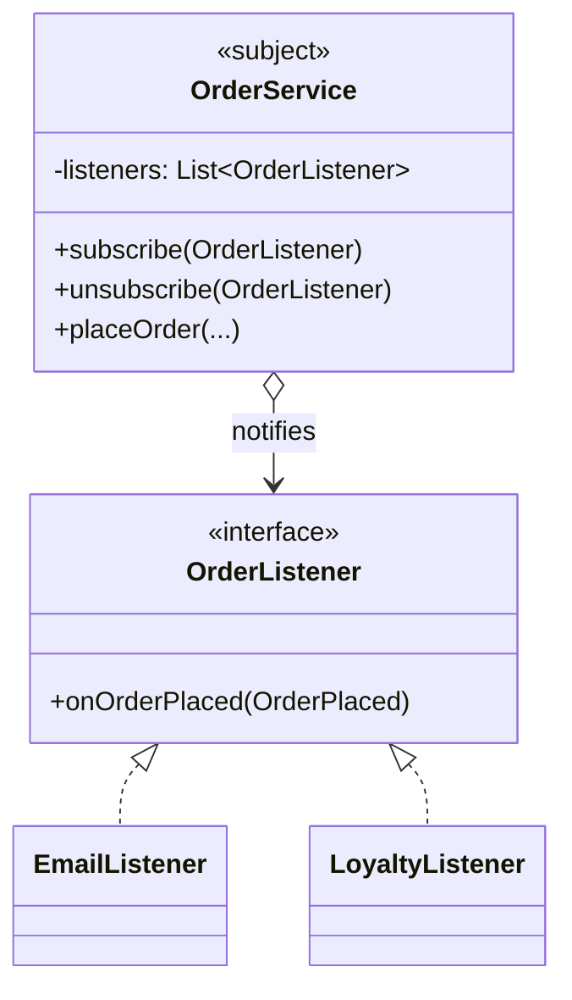

1. Observers implement a listener interface.
2. The subject keeps a list of observers and offers `subscribe` / `unsubscribe`.
3. When something happens, the subject loops over the list and calls each observer.

**Push vs pull model:**

| Model | What the subject sends | Pros / cons |
|---|---|---|
| **Push** | The full event data (`OrderPlaced(id, customer, amount)`) | Observers have what they need; event may carry unused data |
| **Pull** | Just "something changed" (or a reference to itself); observers ask for what they need | Smaller events; observers depend on the subject's API and may see later state |

Modern code mostly uses **push with small immutable event objects** (records).

---

## 7.4 Complete Java Example - Order Events and a Tiny Event Bus

```java
import java.util.List;
import java.util.Map;
import java.util.concurrent.ConcurrentHashMap;
import java.util.concurrent.CopyOnWriteArrayList;
import java.util.function.Consumer;

// ----- The event (what happened) -----
record OrderPlaced(String orderId, String customer, double amount) {}

// ----- Observer -----
interface OrderListener {
    void onOrderPlaced(OrderPlaced event);
}

// ----- Subject: keeps a list of observers and notifies them -----
class OrderService {
    // CopyOnWriteArrayList: safe if listeners subscribe/unsubscribe while we are notifying
    private final List<OrderListener> listeners = new CopyOnWriteArrayList<>();

    void subscribe(OrderListener l)   { listeners.add(l); }
    void unsubscribe(OrderListener l) { listeners.remove(l); }

    void placeOrder(String orderId, String customer, double amount) {
        System.out.println("OrderService: saved " + orderId);
        OrderPlaced event = new OrderPlaced(orderId, customer, amount);
        for (OrderListener l : listeners) {
            try {
                l.onOrderPlaced(event);
            } catch (RuntimeException e) {               // one bad listener must not stop the others
                System.out.println("  listener failed: " + e.getMessage());
            }
        }
    }
}

// ----- Concrete observers -----
class EmailListener implements OrderListener {
    public void onOrderPlaced(OrderPlaced e) {
        System.out.println("  Email   -> " + e.customer() + ": order " + e.orderId() + " confirmed");
    }
}

class LoyaltyListener implements OrderListener {
    public void onOrderPlaced(OrderPlaced e) {
        System.out.println("  Loyalty -> +" + (int) (e.amount() / 100) + " points for " + e.customer());
    }
}

class AnalyticsListener implements OrderListener {
    public void onOrderPlaced(OrderPlaced e) {
        throw new RuntimeException("analytics server down");
    }
}

// ----- Generic, reusable event bus (type-keyed observers with lambdas) -----
class EventBus {
    private final Map<Class<?>, List<Consumer<Object>>> handlers = new ConcurrentHashMap<>();

    @SuppressWarnings("unchecked")
    <T> void on(Class<T> type, Consumer<T> handler) {
        handlers.computeIfAbsent(type, k -> new CopyOnWriteArrayList<>()).add((Consumer<Object>) handler);
    }
    void publish(Object event) {
        handlers.getOrDefault(event.getClass(), List.of()).forEach(h -> h.accept(event));
    }
}

public class ObserverDemo {
    public static void main(String[] args) {
        OrderService orders = new OrderService();
        OrderListener email = new EmailListener();
        orders.subscribe(email);
        orders.subscribe(new LoyaltyListener());
        orders.subscribe(new AnalyticsListener());

        orders.placeOrder("ORD-1", "Asha", 2599.0);

        orders.unsubscribe(email);
        orders.placeOrder("ORD-2", "Ravi", 800.0);

        System.out.println("EventBus:");
        EventBus bus = new EventBus();
        bus.on(OrderPlaced.class, e -> System.out.println("  lambda observer saw " + e.orderId()));
        bus.on(String.class, s -> System.out.println("  string observer saw " + s));
        bus.publish(new OrderPlaced("ORD-3", "Meera", 100.0));
        bus.publish("hello");
    }
}
```

**Output:**
```
OrderService: saved ORD-1
  Email   -> Asha: order ORD-1 confirmed
  Loyalty -> +25 points for Asha
  listener failed: analytics server down
OrderService: saved ORD-2
  Loyalty -> +8 points for Ravi
  listener failed: analytics server down
EventBus:
  lambda observer saw ORD-3
  string observer saw hello
```

What the output shows:
- All three listeners received `ORD-1`. The failing analytics listener was **isolated** by the `try/catch`, so the others still ran.
- After `unsubscribe(email)`, `ORD-2` produced no email.
- The `EventBus` lets observers be **lambdas** keyed by event type, which is the same idea Spring's event system uses.

> **Design choices in this demo:** `CopyOnWriteArrayList` lets listeners be added or removed even while a notification loop is running, without `ConcurrentModificationException`. Catching exceptions per listener keeps one bad observer from breaking the subject.

#### 📘 Terms Explained

| Term | Simple meaning |
|---|---|
| **Event bus** | A central object where publishers post events and subscribers register by event type. |
| **`CopyOnWriteArrayList`** | Thread-safe list that copies on write; iteration uses a snapshot, so it never throws CME. |
| **`computeIfAbsent`** | Get the value for a key or create and store it if missing. |
| **Fault isolation** | Making sure one failing part doesn't bring down the others. |

---

## 7.5 Observer in the JDK

| API | Notes |
|---|---|
| **`java.util.Observer` / `Observable`** | The original JDK version. **Deprecated since Java 9**: `Observable` is a class (not an interface), isn't thread-safe enough, and its events are untyped `Object`s. Don't use it in new code. |
| **`java.beans.PropertyChangeListener` / `PropertyChangeSupport`** | Notify when a bean property changes (old value + new value). Still useful. |
| **Swing/AWT listeners** (`ActionListener`, `MouseListener`) | Classic UI observers. |
| **`java.util.concurrent.Flow`** (Java 9) | Reactive Streams interfaces: `Publisher`, `Subscriber`, `Subscription`, `Processor`. Adds **back-pressure**. |
| **`CompletableFuture.thenAccept(...)`** | Callback when an async result arrives. |
| **`WatchService`** | Get notified of file-system changes. |

```java
// PropertyChangeSupport: a ready-made subject helper
class Product {
    private final PropertyChangeSupport changes = new PropertyChangeSupport(this);
    private BigDecimal price;

    void addListener(PropertyChangeListener l) { changes.addPropertyChangeListener(l); }

    void setPrice(BigDecimal newPrice) {
        BigDecimal old = this.price;
        this.price = newPrice;
        changes.firePropertyChange("price", old, newPrice);    // notifies only if old != new
    }
}

product.addListener(evt -> System.out.println(evt.getPropertyName() + ": " + evt.getOldValue() + " -> " + evt.getNewValue()));
```

```java
// Flow API: an observer that controls how fast it receives items (back-pressure)
try (SubmissionPublisher<String> publisher = new SubmissionPublisher<>()) {
    publisher.subscribe(new Flow.Subscriber<>() {
        private Flow.Subscription sub;
        public void onSubscribe(Flow.Subscription s) { sub = s; sub.request(1); }   // "send me 1"
        public void onNext(String item)              { System.out.println("got " + item); sub.request(1); }
        public void onError(Throwable t)             { t.printStackTrace(); }
        public void onComplete()                     { System.out.println("done"); }
    });
    publisher.submit("price-update-1");
    publisher.submit("price-update-2");
}   // close() -> onComplete (delivery is asynchronous, on another thread)
```

#### 📘 Terms Explained

| Term | Simple meaning |
|---|---|
| **Deprecated** | Still works but you're told not to use it; may be removed. |
| **Reactive Streams** | A standard for asynchronous streams of data with back-pressure (used by Project Reactor, RxJava, WebFlux). |
| **Back-pressure** | The subscriber tells the publisher how many items it can handle, so a fast producer doesn't overwhelm a slow consumer. |
| **`SubmissionPublisher`** | JDK's ready-made `Flow.Publisher` that delivers items asynchronously. |

---

## 7.6 Observer in Spring Boot: Application Events (Interview Imp - Java)

### 7.6.1 Publishing and listening

```java
public record OrderPlacedEvent(Long orderId, String customerEmail, BigDecimal amount) {}

@Service
@RequiredArgsConstructor
public class OrderService {
    private final OrderRepository orders;
    private final ApplicationEventPublisher events;           // Spring's subject

    @Transactional
    public Order placeOrder(PlaceOrderRequest req) {
        Order saved = orders.save(Order.from(req));
        events.publishEvent(new OrderPlacedEvent(saved.getId(), req.email(), saved.getTotal()));
        return saved;
    }
}

@Component
class OrderEmailListener {
    @EventListener                                            // observer: Spring finds it by parameter type
    void on(OrderPlacedEvent e) { /* send email */ }
}

@Component
class LoyaltyListener {
    @EventListener(condition = "#e.amount > 1000")            // SpEL filter
    @Order(1)
    void on(OrderPlacedEvent e) { /* add bonus points */ }
}
```

### 7.6.2 The defaults that surprise people

| Default behaviour | Consequence | Change it with |
|---|---|---|
| Listeners run **synchronously**, on the **same thread** | `publishEvent` waits for all listeners; a slow listener slows the request | `@Async` on the listener (+ `@EnableAsync`) |
| Listeners run **inside the publisher's transaction** | A listener exception **rolls back the order** | `@TransactionalEventListener` |
| A listener runs **even if the transaction later rolls back** | You may email "order confirmed" for an order that was never saved | `@TransactionalEventListener(phase = AFTER_COMMIT)` |
| Events are in-memory only | Lost if the app crashes before listeners finish | Transactional outbox + a message broker |

```java
@Component
class OrderEmailListener {

    @Async                                                     // run on a separate thread
    @TransactionalEventListener(phase = TransactionPhase.AFTER_COMMIT)   // only if the order really committed
    void on(OrderPlacedEvent e) {
        emailService.sendConfirmation(e.customerEmail(), e.orderId());
    }
}
```

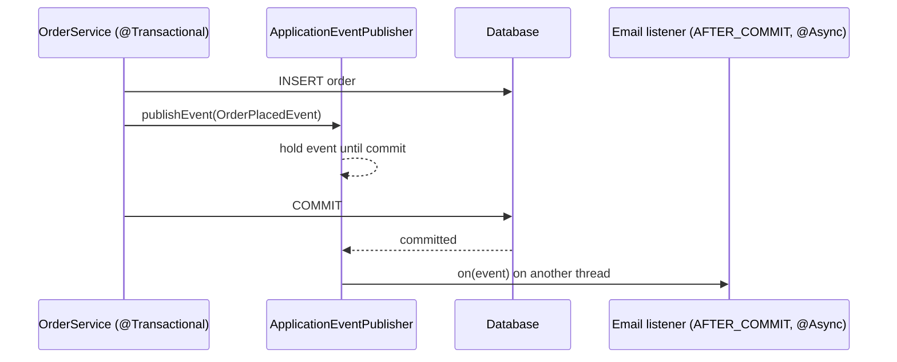

### 7.6.3 Built-in Spring events

| Event | When |
|---|---|
| `ContextRefreshedEvent` | The application context is initialised/refreshed. |
| `ApplicationStartedEvent`, `ApplicationReadyEvent` | Spring Boot started / ready to serve requests (good place for warm-up tasks). |
| `ContextClosedEvent` | Shutting down. |
| `AuthenticationSuccessEvent`, `AbstractAuthenticationFailureEvent` (Spring Security) | Logins succeed/fail, e.g. for audit or lockout. |

### 7.6.4 Observer across services (system level)

In-process events stay inside one JVM. Between microservices, the same pattern is implemented with a **message broker**:

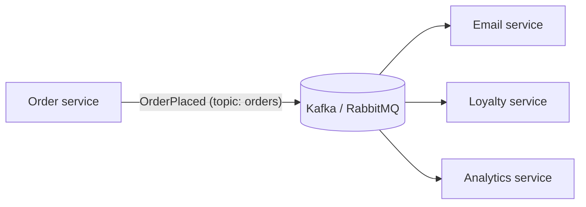

| In-process (`@EventListener`) | Distributed (Kafka / RabbitMQ) |
|---|---|
| Same JVM, very fast | Across services and machines |
| Lost on crash | Durable, replayable (Kafka) |
| Transactions can be shared | Needs outbox / idempotent consumers |

#### 📘 Terms Explained

| Term | Simple meaning |
|---|---|
| **`ApplicationEventPublisher`** | Spring interface to publish events to all matching listeners. |
| **`@EventListener`** | Marks a method as an observer for the event type in its parameter. |
| **`@TransactionalEventListener`** | Listener that runs at a transaction phase (default `AFTER_COMMIT`). |
| **`@Async`** | Runs the method on a thread pool (proxy-based; needs `@EnableAsync`). |
| **Message broker** | Middleware (Kafka, RabbitMQ) that receives messages from producers and delivers them to consumers. |
| **Topic** | A named channel in a broker that many consumers can subscribe to. |
| **Idempotent consumer** | A consumer that gives the same result even if it receives the same message twice. |

---

## 7.7 Observer vs Pub/Sub vs Mediator

| | Observer (classic) | Pub/Sub (event bus / broker) | Mediator |
|---|---|---|---|
| **Does the subject know its observers?** | Yes, it holds the list | No: publishers and subscribers only know the bus/topic | Colleagues know the mediator |
| **Coupling** | Low | Very low | Low |
| **Synchronous?** | Usually | Often asynchronous | Usually synchronous |
| **Logic in the middle?** | None | Routing/filtering only | Coordination rules |
| **Example** | `PropertyChangeSupport`, Swing listeners | Spring events, Guava `EventBus`, Kafka | Chat room, control tower |

---

## 7.8 Pros and Cons

| Pros | Cons |
|---|---|
| Subject and observers are loosely coupled | Order of notification is often unspecified |
| Add new reactions without touching the subject (Open/Closed) | Hard to trace "who reacts to what" in big systems |
| Supports broadcast to any number of observers | Cascades: an observer's change triggers more events (possible loops) |
| Foundation of event-driven and reactive architectures | Memory leaks if observers aren't unsubscribed |
| | Synchronous observers slow the subject; failures can propagate |

---

## 7.9 Common Pitfalls

| Pitfall | Fix |
|---|---|
| **Lapsed listener** memory leak: subject keeps references to observers no one uses | Always unsubscribe (e.g. in `close()`/`@PreDestroy`); or use weak references. |
| One failing observer breaks the rest (or the publisher) | Catch per observer; or make observers async. |
| `ConcurrentModificationException` when an observer unsubscribes during notification | `CopyOnWriteArrayList`, or iterate over a copy. |
| Sending emails from `@EventListener` before commit | `@TransactionalEventListener(phase = AFTER_COMMIT)`. |
| Infinite event loops (A updates B, B updates A) | Only fire when a value actually changes; guard against re-entry. |
| Mutable event objects changed by one observer | Use immutable records for events. |
| Relying on notification order | Use `@Order` explicitly, or don't depend on order at all. |
| Using deprecated `java.util.Observable` | Use your own listener interface, `PropertyChangeSupport`, Spring events or `Flow`. |

---

## 7.10 Observer - Interview Questions

**Q1. What is the Observer pattern?**
A one-to-many dependency where a subject notifies all registered observers automatically when its state changes or an event happens.

**Q2. Where is it used in Java and Spring?**
Swing listeners, `PropertyChangeListener`, `Flow` (reactive streams), `CompletableFuture` callbacks; Spring `ApplicationEventPublisher` + `@EventListener`/`@TransactionalEventListener`; Kafka/RabbitMQ consumers at system level.

**Q3. Why was `java.util.Observable` deprecated?**
It's a class rather than an interface (forcing inheritance), its notification model is untyped and limited, and it doesn't define ordering or thread-safety well. Java 9 deprecated it in favour of `java.beans` and `java.util.concurrent.Flow`.

**Q4. Are Spring event listeners synchronous?**
Yes, by default: they run on the publisher's thread, inside its transaction. Use `@Async` for asynchronous processing and `@TransactionalEventListener` to run after commit.

**Q5. What is the lapsed listener problem?**
The subject holds strong references to observers that are no longer needed, so they can't be garbage-collected. Unsubscribe, or use weak references.

**Q6. Observer vs Pub/Sub?**
In classic Observer, the subject knows and calls its observers directly. In Pub/Sub, a broker/bus sits in between, so publishers and subscribers don't know each other and delivery can be asynchronous and durable.

**Q7. Push vs pull?**
Push sends the data with the notification; pull sends only a signal and observers fetch what they need.

**Q8. How would you guarantee an email is sent only if the order is saved, and never lost?**
`@TransactionalEventListener(AFTER_COMMIT)` handles "only if saved". For "never lost", use a transactional outbox: write the event to an outbox table in the same transaction, then publish it to a broker with retries; make the email consumer idempotent.

---

## 7.11 Observer - Cheat Sheet

```
OBSERVER  One-to-many: subject notifies all subscribed observers when something happens.
          Subject: list of listeners + subscribe/unsubscribe + notify loop. Events = immutable records.
          Push (send data) vs pull (send signal). Use CopyOnWriteArrayList; catch per listener.
          JDK: PropertyChangeSupport, Swing listeners, Flow API (back-pressure), CompletableFuture callbacks.
               java.util.Observable is DEPRECATED (Java 9).
          Spring: ApplicationEventPublisher + @EventListener (SYNC, same thread, same TX by default),
                  @Async, @TransactionalEventListener(AFTER_COMMIT), ApplicationReadyEvent.
          System: Kafka/RabbitMQ pub/sub + outbox + idempotent consumers.
          Pitfalls: lapsed listeners (leaks), event loops, ordering assumptions, emails before commit.
```

---

# 8. State Pattern (Interview Imp - Java)

## 8.1 What is the State Pattern?

**State** lets an object **change its behaviour when its internal state changes**. Each state becomes its own class, and the object (**context**) delegates to the current state object. From outside, it looks as if the object changed its class.

**Analogy:** A vending machine. Pressing "dispense" does nothing when it's *idle*, asks for more money when it's *partly paid*, gives you a drink when it's *paid*, and shows an error when it's *out of stock*. Same button, different behaviour, depending on the state.

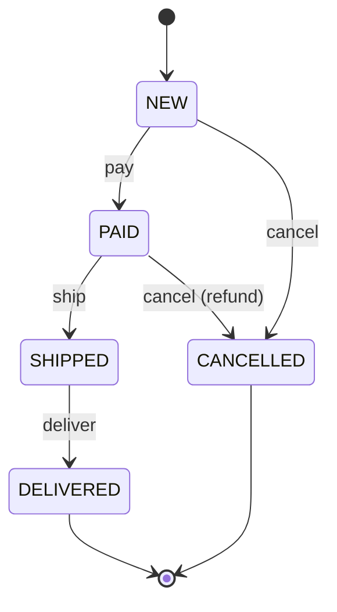

#### 📘 Terms Explained

| Term | Simple meaning |
|---|---|
| **State** | The current situation of an object that decides how it behaves (NEW, PAID, SHIPPED). |
| **Context** | The object whose behaviour changes (`Order`); it holds the current state object. |
| **Transition** | Moving from one state to another (PAID → SHIPPED), triggered by an event/action. |
| **State machine (FSM)** | A model with a fixed set of states and allowed transitions between them. |
| **State diagram** | A picture of states (boxes) and transitions (arrows). |

---

## 8.2 Why Do We Need It?

### Without State: a `switch` in every method

```java
public void cancel() {
    switch (status) {
        case NEW       -> status = CANCELLED;
        case PAID      -> { refund(); status = CANCELLED; }
        case SHIPPED   -> throw new IllegalStateException("already shipped");
        case DELIVERED -> throw new IllegalStateException("already delivered");
        case CANCELLED -> throw new IllegalStateException("already cancelled");
    }
}
// ...and the same switch again in pay(), ship(), deliver(), refund(), return()...
```

Problems:
- Adding a state (`RETURNED`, `ON_HOLD`) means editing **every** method's `switch`.
- The rules for one state are scattered across all methods.
- Easy to forget a case, so invalid transitions slip through (shipping a cancelled order).

### With State

Each state class says what is allowed **in that state**. Adding `ON_HOLD` means adding one class and changing only the states that can move to or from it.

---

## 8.3 How It Works

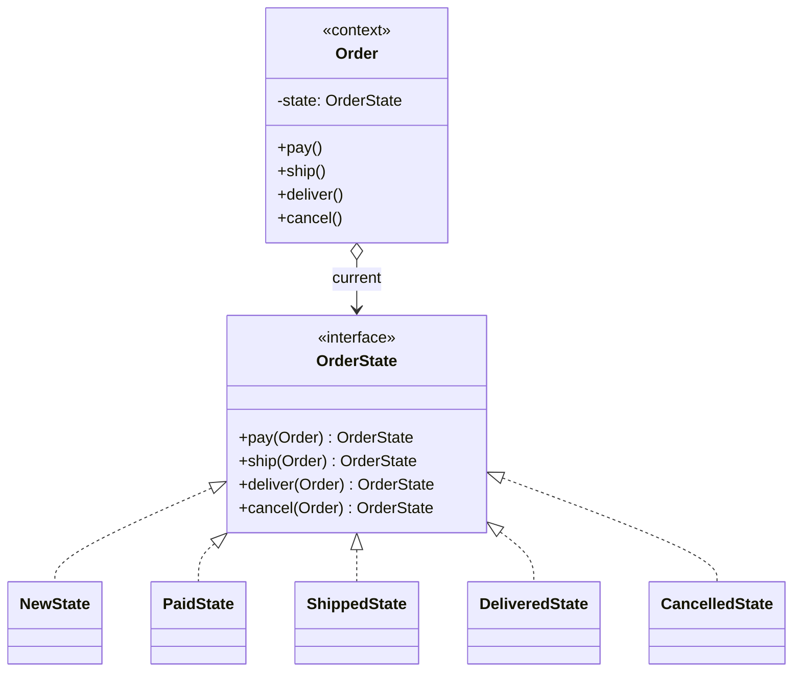

1. A `State` interface lists every action.
2. Each concrete state implements the actions **it allows**; the rest are rejected (here via `default` methods that throw).
3. The context holds the current state and **delegates** each action to it.
4. Transitions: each action returns the **next state** (or the state sets it on the context).

**Who decides the next state?**

| Option | How | When |
|---|---|---|
| **States decide** (our example) | Each method returns the next state | Rules are naturally local to each state |
| **Context decides** | A transition table in the context | Rules are simple and central |
| **State machine framework** | Configuration lists states, events and transitions | Many states, persistence, guards, actions |

---

## 8.4 Complete Java Example - Order Lifecycle

```java
// ----- State interface: every action an order supports -----
interface OrderState {
    default OrderState pay(Order o)     { throw illegal("pay"); }
    default OrderState ship(Order o)    { throw illegal("ship"); }
    default OrderState deliver(Order o) { throw illegal("deliver"); }
    default OrderState cancel(Order o)  { throw illegal("cancel"); }
    String name();

    private IllegalStateException illegal(String action) {
        return new IllegalStateException("cannot " + action + " an order that is " + name());
    }
}

// ----- Concrete states: each one allows only what makes sense for it -----
class NewState implements OrderState {
    public OrderState pay(Order o)    { System.out.println("  charging card..."); return new PaidState(); }
    public OrderState cancel(Order o) { return new CancelledState(); }
    public String name() { return "NEW"; }
}

class PaidState implements OrderState {
    public OrderState ship(Order o)   { System.out.println("  handing to courier..."); return new ShippedState(); }
    public OrderState cancel(Order o) { System.out.println("  refunding payment..."); return new CancelledState(); }
    public String name() { return "PAID"; }
}

class ShippedState implements OrderState {
    public OrderState deliver(Order o) { return new DeliveredState(); }
    public String name() { return "SHIPPED"; }
}

class DeliveredState implements OrderState { public String name() { return "DELIVERED"; } }
class CancelledState implements OrderState { public String name() { return "CANCELLED"; } }

// ----- Context: delegates to the current state; no if/else on status -----
class Order {
    private final String id;
    private OrderState state = new NewState();

    Order(String id) { this.id = id; }

    void pay()     { transition(state.pay(this)); }
    void ship()    { transition(state.ship(this)); }
    void deliver() { transition(state.deliver(this)); }
    void cancel()  { transition(state.cancel(this)); }

    private void transition(OrderState next) {
        System.out.println(id + ": " + state.name() + " -> " + next.name());
        state = next;
    }
}

public class StateDemo {
    public static void main(String[] args) {
        Order a = new Order("ORD-1");
        a.pay();
        a.ship();
        a.deliver();

        Order b = new Order("ORD-2");
        b.pay();
        b.cancel();

        Order c = new Order("ORD-3");
        c.pay();
        c.ship();
        try {
            c.cancel();                                      // not allowed once shipped
        } catch (IllegalStateException e) {
            System.out.println("ORD-3: error - " + e.getMessage());
        }
    }
}
```

**Output:**
```
  charging card...
ORD-1: NEW -> PAID
  handing to courier...
ORD-1: PAID -> SHIPPED
ORD-1: SHIPPED -> DELIVERED
  charging card...
ORD-2: NEW -> PAID
  refunding payment...
ORD-2: PAID -> CANCELLED
  charging card...
ORD-3: NEW -> PAID
  handing to courier...
ORD-3: PAID -> SHIPPED
ORD-3: error - cannot cancel an order that is SHIPPED
```

Notes:
- `Order` has **no `if` or `switch` on status**. It just asks the current state.
- `default` methods in `OrderState` reject every action, so each state only overrides what it allows. Forgetting a case is safe: it's rejected by default.
- `private` interface methods (Java 9+) keep the error helper inside the interface.
- State objects here have no fields, so they could be **shared singletons** (e.g. enum constants or `static final` instances) instead of `new` on every transition.

#### 📘 Terms Explained

| Term | Simple meaning |
|---|---|
| **Delegate** | Pass the call to another object to do the work. |
| **`default` method** | An interface method with a body; implementing classes inherit it unless they override it. |
| **`private` interface method** | A helper method inside an interface, usable only by its `default` methods (Java 9+). |
| **`IllegalStateException`** | Standard exception for "this operation isn't allowed in the object's current state". |

---

## 8.5 Enum-Based State Machines and Persistence

### 8.5.1 Enum with behaviour

For many real systems, an **enum** is the simplest State implementation, and it maps directly to a database column.

```java
public enum OrderStatus {
    NEW       { Set<OrderStatus> next() { return EnumSet.of(PAID, CANCELLED); } },
    PAID      { Set<OrderStatus> next() { return EnumSet.of(SHIPPED, CANCELLED); } },
    SHIPPED   { Set<OrderStatus> next() { return EnumSet.of(DELIVERED); } },
    DELIVERED { Set<OrderStatus> next() { return EnumSet.noneOf(OrderStatus.class); } },
    CANCELLED { Set<OrderStatus> next() { return EnumSet.noneOf(OrderStatus.class); } };

    abstract Set<OrderStatus> next();

    public OrderStatus moveTo(OrderStatus target) {
        if (!next().contains(target)) {
            throw new IllegalStateException(this + " -> " + target + " is not allowed");
        }
        return target;
    }
}

@Entity
class Order {
    @Enumerated(EnumType.STRING)          // stores "PAID", not 1 (safe if enum order changes)
    private OrderStatus status = OrderStatus.NEW;

    @Version                              // optimistic locking: two concurrent transitions can't both win
    private long version;

    void ship() { status = status.moveTo(OrderStatus.SHIPPED); }
}
```

> **Persistence tip:** store the state as an enum/string column; when you load the entity, map it back to the state object (or just use the enum). Never store a state *object*.

### 8.5.2 Spring Statemachine

For complex workflows (guards, actions on enter/exit, hierarchical states, persistence) use **Spring Statemachine**:

```java
public enum OrderEvent { PAY, SHIP, DELIVER, CANCEL }

@Configuration
@EnableStateMachineFactory
class OrderStateMachineConfig extends EnumStateMachineConfigurerAdapter<OrderStatus, OrderEvent> {

    @Override
    public void configure(StateMachineStateConfigurer<OrderStatus, OrderEvent> states) throws Exception {
        states.withStates()
              .initial(OrderStatus.NEW)
              .end(OrderStatus.DELIVERED)
              .end(OrderStatus.CANCELLED)
              .states(EnumSet.allOf(OrderStatus.class));
    }

    @Override
    public void configure(StateMachineTransitionConfigurer<OrderStatus, OrderEvent> t) throws Exception {
        t.withExternal().source(OrderStatus.NEW).target(OrderStatus.PAID).event(OrderEvent.PAY)
         .and().withExternal().source(OrderStatus.PAID).target(OrderStatus.SHIPPED).event(OrderEvent.SHIP)
         .and().withExternal().source(OrderStatus.SHIPPED).target(OrderStatus.DELIVERED).event(OrderEvent.DELIVER)
         .and().withExternal().source(OrderStatus.NEW).target(OrderStatus.CANCELLED).event(OrderEvent.CANCEL)
         .and().withExternal().source(OrderStatus.PAID).target(OrderStatus.CANCELLED).event(OrderEvent.CANCEL)
               .action(ctx -> refund(ctx.getExtendedState().get("orderId", Long.class)));
    }
}
```

| Approach | Best for |
|---|---|
| State classes (GoF) | Rich, different behaviour per state |
| Enum with allowed transitions | Most CRUD/business apps; easy to persist |
| Spring Statemachine / workflow engine (Camunda, Temporal) | Many states, long-running workflows, audit, visual modelling |

#### 📘 Terms Explained

| Term | Simple meaning |
|---|---|
| **`EnumSet`** | A very fast `Set` implementation for enum values. |
| **Constant-specific method** | An enum constant with its own body `{ ... }` overriding an abstract method. |
| **`@Enumerated(EnumType.STRING)`** | JPA stores the enum's name instead of its position number. |
| **Optimistic locking (`@Version`)** | Detects concurrent updates by checking a version number when saving. |
| **Guard** | A condition that must be true for a transition to happen. |
| **Workflow engine** | Software that runs long, multi-step business processes with persistence and retries. |

---

## 8.6 State vs Strategy (Interview Imp - Java)

They have **the same class diagram**: a context holding an interface with several implementations. The difference is intent and who changes the object.

| | State | Strategy |
|---|---|---|
| **Intent** | Behaviour changes because the object's **situation** changes | Choose **how** to do a task |
| **Who switches it?** | Usually the **states themselves** (or context), as part of transitions | Usually the **client**, from outside |
| **Do implementations know each other?** | Often yes: `PaidState` returns `new ShippedState()` | No, strategies are independent |
| **How often it changes** | Many times during the object's life | Usually once (chosen at creation/config) |
| **Example** | Order NEW → PAID → SHIPPED | Pay by card / UPI / wallet; sort by price / rating |

> **One-liner:** *Strategy = the client picks the algorithm. State = the object changes its own behaviour as it moves through its lifecycle.*

---

## 8.7 Pros and Cons

| Pros | Cons |
|---|---|
| Removes big `switch`/`if` blocks on status | More classes (one per state) |
| Each state's rules in one place (Single Responsibility) | Overkill for 2-3 states with simple rules |
| Invalid transitions are impossible or explicit | States that know each other are coupled |
| Easy to add new states | Transitions spread across classes can be hard to see at a glance (draw the diagram!) |

---

## 8.8 Common Pitfalls

| Pitfall | Fix |
|---|---|
| Still checking `if (state instanceof PaidState)` in the context | Move that behaviour into the states. |
| Storing state objects in the DB | Store an enum/string; rebuild the state on load. |
| Two threads/users moving the same order at once | `@Version` optimistic locking, or a DB row lock. |
| States holding per-order data | Keep data in the context; states should be stateless and shareable. |
| No diagram, so nobody knows the allowed transitions | Keep a state diagram (Mermaid) in the docs; test every transition. |
| Side effects (refunds, emails) inside transitions without idempotency | Make actions idempotent; use events/outbox for external calls. |

---

## 8.9 State - Interview Questions

**Q1. What is the State pattern?**
A pattern that lets an object change its behaviour when its internal state changes, by delegating to a separate object per state.

**Q2. State vs Strategy?**
Same structure. Strategy is chosen by the client to vary an algorithm. State changes itself as the object moves through its lifecycle, and states often know their successors.

**Q3. How would you model an order/payment lifecycle?**
Draw the state diagram first, then either use state classes (rich behaviour) or an enum with allowed transitions (persisted as a string column), protected by optimistic locking. Use Spring Statemachine or a workflow engine for complex, long-running flows.

**Q4. How do you persist an object that uses the State pattern?**
Persist the state's name (enum), and map it back to the state object when loading.

**Q5. Where do you see State in real systems?**
Order/payment/booking lifecycles, TCP connection states, thread states (`Thread.State`: NEW, RUNNABLE, BLOCKED, WAITING, TIMED_WAITING, TERMINATED), circuit breakers (CLOSED, OPEN, HALF_OPEN), vending machines, document approval workflows.

**Q6. How do you prevent invalid transitions?**
Reject them in the state (throw), or check an allowed-transitions table before changing state; test every allowed and disallowed pair.

---

## 8.10 State - Cheat Sheet

```
STATE     Object changes behaviour with its internal state; one class per state; context delegates.
          Replaces switch(status) in every method. Unsupported actions rejected (default methods throw).
          Transitions: states return next state | context table | Spring Statemachine / workflow engine.
          Enum with allowed transitions = simplest, persists as @Enumerated(STRING); add @Version.
          Examples: order lifecycle, Thread.State, circuit breaker CLOSED/OPEN/HALF_OPEN, TCP.
          State vs Strategy: same diagram; State switches ITSELF over time, Strategy chosen by CLIENT.
```

---

# 9. Strategy Pattern (Interview Imp - Java)

## 9.1 What is the Strategy Pattern?

**Strategy** defines a **family of algorithms**, puts each one in its own class behind a common interface, and makes them **interchangeable**. The code that uses an algorithm (the **context**) can switch between them without changing.

**Analogy:** Getting to the airport. You can take a cab, the metro, or drive. The goal is the same ("get to the airport"); the strategy differs by cost, time and traffic. You pick one based on the situation, and the trip planner doesn't need rewriting.

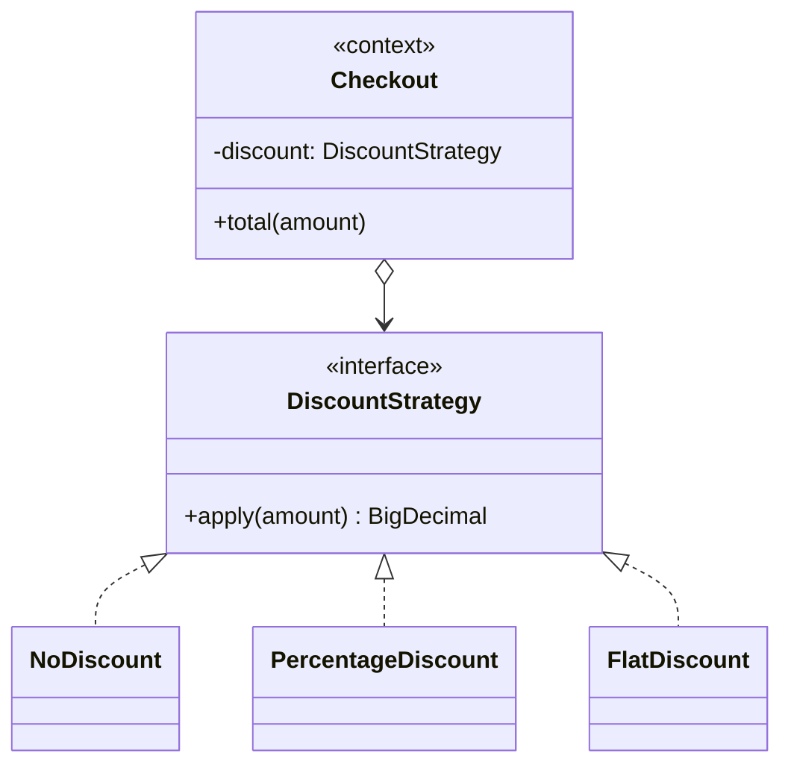

#### 📘 Terms Explained

| Term | Simple meaning |
|---|---|
| **Strategy** | One interchangeable algorithm behind a shared interface. |
| **Context** | The class that uses a strategy (`Checkout`). |
| **Algorithm** | A step-by-step way of doing something (calculating a discount, sorting, routing). |
| **Interchangeable** | Can be swapped for another without changing the code that uses it. |

---

## 9.2 Why Do We Need It?

### Without Strategy

```java
BigDecimal total(BigDecimal amount, String coupon) {
    if (coupon.equals("FESTIVE10"))      return amount.multiply(new BigDecimal("0.90"));
    else if (coupon.equals("FLAT500"))   return amount.subtract(new BigDecimal("500")).max(BigDecimal.ZERO);
    else if (coupon.equals("HALFPRICE")) return amount.divide(BigDecimal.valueOf(2));
    else if (coupon.equals("EMPLOYEE"))  return ...;
    // grows forever; every new offer edits and re-tests this method
    return amount;
}
```

Problems:
- Violates **Open/Closed**: new algorithm = edit existing code.
- Hard to test each algorithm in isolation.
- The same `if` ladder gets copied into other places (cart preview, invoice, refund).

### With Strategy

Each algorithm is a small class (or lambda). The context receives one and calls it. New algorithm = new class + register it. Each one is unit-tested alone.

**Typical uses:** payment methods, discount/pricing rules, sorting (`Comparator`), compression formats, file export (PDF/CSV/Excel), routing (fastest/cheapest), retry/back-off policies, authentication methods, tax rules per country, notification channels, load-balancing algorithms (see [01_Scalability_Pattern.md](../03_System_Design/01_Scalability_Pattern.md#15-load-balancing-algorithms)).

---

## 9.3 How It Works

1. Define a strategy interface (often a **functional interface**, one method).
2. Write one implementation per algorithm.
3. The context **holds** a strategy (constructor or setter) and **delegates** to it.
4. The **client** (or config/registry) chooses which strategy to give the context.

**Ways to choose a strategy at runtime:**

| Way | Example |
|---|---|
| Pass it in the constructor | `new Checkout(new FlatDiscount("500"))` |
| Look up in a `Map<String, Strategy>` registry | `coupons.get(code)` |
| Let each strategy say if it supports the input | `strategies.stream().filter(s -> s.supports(type)).findFirst()` |
| Spring config / profile | `@ConditionalOnProperty`, `@Profile` |
| Pass a lambda | `products.sort(Comparator.comparing(Product::price))` |

---

## 9.4 Complete Java Example - Discounts and Comparators

```java
import java.math.BigDecimal;
import java.math.RoundingMode;
import java.util.ArrayList;
import java.util.Comparator;
import java.util.List;
import java.util.Map;

// ----- Strategy: one interchangeable algorithm -----
interface DiscountStrategy {
    BigDecimal apply(BigDecimal amount);
}

// ----- Concrete strategies (classes) -----
class NoDiscount implements DiscountStrategy {
    public BigDecimal apply(BigDecimal amount) { return amount; }
}

class PercentageDiscount implements DiscountStrategy {
    private final BigDecimal percent;
    PercentageDiscount(String percent) { this.percent = new BigDecimal(percent); }
    public BigDecimal apply(BigDecimal amount) {
        return amount.subtract(amount.multiply(percent).divide(BigDecimal.valueOf(100)));
    }
}

class FlatDiscount implements DiscountStrategy {
    private final BigDecimal off;
    FlatDiscount(String off) { this.off = new BigDecimal(off); }
    public BigDecimal apply(BigDecimal amount) { return amount.subtract(off).max(BigDecimal.ZERO); }
}

// ----- Context: uses a strategy, doesn't know which one -----
class Checkout {
    private final DiscountStrategy discount;
    Checkout(DiscountStrategy discount) { this.discount = discount; }

    BigDecimal total(BigDecimal cartAmount) {
        return discount.apply(cartAmount).setScale(2, RoundingMode.HALF_UP);
    }
}

record Product(String name, int price, double rating) {}

public class StrategyDemo {
    public static void main(String[] args) {
        // Registry: pick a strategy by key at runtime (e.g. from a coupon code)
        Map<String, DiscountStrategy> coupons = Map.of(
                "NONE",      new NoDiscount(),
                "FESTIVE10", new PercentageDiscount("10"),
                "FLAT500",   new FlatDiscount("500"),
                "HALFPRICE", amount -> amount.divide(BigDecimal.valueOf(2)));   // a lambda strategy

        BigDecimal cart = new BigDecimal("3999");
        for (String code : List.of("NONE", "FESTIVE10", "FLAT500", "HALFPRICE")) {
            System.out.println(code + " -> " + new Checkout(coupons.get(code)).total(cart));
        }

        // Comparator is the JDK's most famous strategy
        List<Product> products = new ArrayList<>(List.of(
                new Product("Phone", 15000, 4.3),
                new Product("Earbuds", 2000, 4.6),
                new Product("Watch", 5000, 4.1)));

        products.sort(Comparator.comparingInt(Product::price));
        System.out.println("By price : " + products.stream().map(Product::name).toList());
        products.sort(Comparator.comparingDouble(Product::rating).reversed());
        System.out.println("By rating: " + products.stream().map(Product::name).toList());
    }
}
```

**Output:**
```
NONE -> 3999.00
FESTIVE10 -> 3599.10
FLAT500 -> 3499.00
HALFPRICE -> 1999.50
By price : [Earbuds, Watch, Phone]
By rating: [Earbuds, Phone, Watch]
```

What the output shows:
- The **same** `Checkout` class produced four different totals depending on the strategy it was given.
- `HALFPRICE` is a **lambda**: because `DiscountStrategy` has one method, it's a functional interface, and no class is needed.
- `Comparator` is a strategy for sorting: `List.sort` (the context) stays the same while the ordering changes.

#### 📘 Terms Explained

| Term | Simple meaning |
|---|---|
| **Functional interface** | An interface with exactly one abstract method; can be implemented by a lambda. |
| **`Comparator`** | A strategy object that decides the order of two elements. |
| **`Comparator.comparingInt(...)`** | Builds a comparator from a key-extractor function. `.reversed()` flips it. |
| **Registry** | A map from a key (coupon code, payment type) to the object that handles it. |
| **`BigDecimal.max`** | Returns the larger of two values; used here so a total never goes below zero. |

---

## 9.5 Strategy in the JDK

| API | Strategy |
|---|---|
| **`Comparator`** with `Collections.sort`, `List.sort`, `TreeMap`, `PriorityQueue` | Ordering |
| **`ThreadPoolExecutor` `RejectedExecutionHandler`** | What to do when the pool is full: `AbortPolicy`, `CallerRunsPolicy`, `DiscardPolicy`, `DiscardOldestPolicy` |
| **`java.util.function.*`** (`Function`, `Predicate`, `Supplier`) | Behaviour passed into streams and methods |
| **`javax.crypto.Cipher.getInstance("AES/GCM/NoPadding")`** | Encryption algorithm chosen by name |
| **`java.util.zip` `Deflater` levels / `MessageDigest.getInstance("SHA-256")`** | Compression / hashing algorithm |
| **`LayoutManager`** in Swing (`BorderLayout`, `FlowLayout`) | How a container positions its children |

```java
ThreadPoolExecutor pool = new ThreadPoolExecutor(
        4, 8, 60, TimeUnit.SECONDS,
        new ArrayBlockingQueue<>(100),
        new ThreadPoolExecutor.CallerRunsPolicy());   // strategy: when full, the caller runs the task itself
```

---

## 9.6 Strategy in Spring Boot (Interview Imp - Java)

### 9.6.1 Strategy registry with an injected `Map`

The most common real-world Spring version: one bean per strategy; Spring builds the registry for you.

```java
public interface PaymentStrategy {
    PaymentResult pay(Order order);
}

@Component("CARD")   class CardPayment   implements PaymentStrategy { ... }
@Component("UPI")    class UpiPayment    implements PaymentStrategy { ... }
@Component("WALLET") class WalletPayment implements PaymentStrategy { ... }

@Service
class PaymentService {
    private final Map<String, PaymentStrategy> strategies;   // {"CARD": CardPayment, "UPI": UpiPayment, ...}

    PaymentService(Map<String, PaymentStrategy> strategies) { this.strategies = strategies; }

    PaymentResult pay(Order order, String method) {
        PaymentStrategy s = strategies.get(method);
        if (s == null) throw new IllegalArgumentException("unsupported payment method: " + method);
        return s.pay(order);
    }
}
```

Adding "NETBANKING" = one new `@Component("NETBANKING")` class. `PaymentService` never changes.

### 9.6.2 "supports()" style (type-safe, no string keys)

```java
public interface PaymentStrategy {
    PaymentMethod method();                 // enum CARD, UPI, WALLET
    PaymentResult pay(Order order);
}

@Service
class PaymentService {
    private final Map<PaymentMethod, PaymentStrategy> byMethod;

    PaymentService(List<PaymentStrategy> all) {
        this.byMethod = all.stream().collect(Collectors.toMap(PaymentStrategy::method, s -> s));   // fails fast on duplicates
    }
}
```

### 9.6.3 Strategies already inside Spring

| Spring interface | Strategies |
|---|---|
| **`PasswordEncoder`** | `BCryptPasswordEncoder`, `Argon2PasswordEncoder`, `Pbkdf2PasswordEncoder`; `DelegatingPasswordEncoder` picks by `{bcrypt}` prefix |
| **`AuthenticationProvider`** | DAO (username/password), JWT, LDAP, OAuth2 |
| **`ResourceLoader` / `Resource`** | `classpath:`, `file:`, `https:` |
| **`CacheManager`** | Caffeine, Redis, EhCache |
| **`TaskExecutor`** | Thread pool, virtual threads, synchronous |
| **Spring Retry `BackOffPolicy`** | Fixed, exponential, random |
| **`HandlerMethodArgumentResolver`** | How each controller parameter is resolved |
| **`ViewResolver`, `HttpMessageConverter`** | How responses are rendered (Thymeleaf, JSON, XML) |

#### 📘 Terms Explained

| Term | Simple meaning |
|---|---|
| **Injecting `Map<String, Bean>`** | Spring fills the map with every bean of that type, keyed by bean name. |
| **`Collectors.toMap`** | Stream collector that builds a `Map`; throws if two elements have the same key. |
| **BCrypt / Argon2** | Slow, salted password-hashing algorithms designed to resist brute-force attacks. |
| **Back-off policy** | How long to wait between retries (fixed 1s, or exponential 1s, 2s, 4s...). |

---

## 9.7 Strategy vs State vs Template Method vs Command

| | Strategy | State | Template Method | Command |
|---|---|---|---|---|
| **Varies** | The whole algorithm | Behaviour per lifecycle state | Some **steps** of a fixed algorithm | Which action runs |
| **Mechanism** | Composition (holds an interface) | Composition | **Inheritance** (subclass overrides steps) | Composition |
| **Chosen by** | Client/config | The object itself | Choice of subclass | Invoker/client |
| **Granularity** | Whole algorithm | Many actions | Individual steps | One request |

> **Strategy vs Template Method** is a classic: Template Method fixes the skeleton in a parent class and lets **subclasses** fill in steps (compile-time, inheritance). Strategy hands the **whole** algorithm to a separate object (runtime, composition). Prefer Strategy when you can ("composition over inheritance").

---

## 9.8 Pros and Cons

| Pros | Cons |
|---|---|
| Add algorithms without editing existing code (Open/Closed) | Clients must know the strategies exist to choose one |
| Each algorithm testable on its own | More classes (fewer with lambdas) |
| Swap at runtime (config, user choice, A/B test) | Overkill for 2 branches that never change |
| Removes conditionals | Strategies may need data the context must pass in, which can widen the interface |

---

## 9.9 Common Pitfalls

| Pitfall | Fix |
|---|---|
| Replacing the `if` ladder with an `if` ladder that **selects** a strategy | Use a `Map` registry or a `supports()` lookup. |
| Missing strategy → `NullPointerException` | Validate on lookup; throw a clear error or use a default strategy. |
| Strategies with mutable fields shared across threads (Spring singletons!) | Keep strategies stateless. |
| Interface too wide (passing the whole context to every strategy) | Pass only what the algorithm needs. |
| Duplicate keys in a `toMap` registry | Let it fail at startup (good), and fix the duplicate. |
| Creating a pattern for a single, stable algorithm | Just write the method. |

---

## 9.10 Strategy - Interview Questions

**Q1. What is the Strategy pattern?**
A pattern that encapsulates interchangeable algorithms behind a common interface, so the context can use any of them and they can be swapped at runtime.

**Q2. Give JDK examples.**
`Comparator`, `RejectedExecutionHandler` policies, `java.util.function` interfaces passed to streams, `Cipher`/`MessageDigest` algorithms, Swing `LayoutManager`.

**Q3. How do you implement Strategy in Spring Boot?**
One `@Component` per strategy implementing a common interface, injected as `Map<String, Strategy>` (bean name keys) or `List<Strategy>` turned into a map by type. The service looks up the right one at runtime.

**Q4. Strategy vs State?**
Same structure. Strategy is chosen by the client; strategies don't know each other. State is switched by the object itself during its lifecycle, and states often know their successors.

**Q5. Strategy vs Template Method?**
Strategy uses composition to replace the whole algorithm at runtime. Template Method uses inheritance to vary individual steps of a fixed algorithm.

**Q6. How did Java 8 change the Strategy pattern?**
Single-method strategy interfaces can be implemented with lambdas/method references, so many strategy classes become one-liners (`Comparator.comparing(...)`).

**Q7. Design a payment system supporting card, UPI and wallet, extensible for new methods.**
`PaymentStrategy` interface; one bean per method; registry injected into `PaymentService`; each strategy uses an adapter for its provider SDK (see Adapter in [03_Structural_Pattern.md](03_Structural_Pattern.md#1-adapter-pattern-interview-imp---java)); a new method is one new class.

---

## 9.11 Strategy - Cheat Sheet

```
STRATEGY  Family of interchangeable algorithms behind one interface; context delegates; client chooses.
          Replaces if/else on "type". Open/Closed. Stateless strategies. Lambdas for 1-method interfaces.
          Select by: constructor, Map registry, supports(), Spring Map<String, Bean>, @Profile/@Conditional.
          JDK: Comparator, RejectedExecutionHandler (CallerRunsPolicy...), Function/Predicate, Cipher, LayoutManager.
          Spring: PasswordEncoder, AuthenticationProvider, CacheManager, Resource, BackOffPolicy, TaskExecutor.
          vs State: client picks (Strategy) vs object switches itself (State).
          vs Template Method: composition, whole algorithm (Strategy) vs inheritance, some steps (Template).
```

---

# 10. Template Method Pattern (Interview Imp - Java)

## 10.1 What is the Template Method Pattern?

**Template Method** defines the **skeleton of an algorithm** in a method of a parent class, and lets **subclasses fill in some of the steps** without changing the overall order.

**Analogy:** Making tea or coffee. Both follow the same recipe: boil water → brew → pour into a cup → add extras. Only "brew" (tea leaves vs coffee powder) and "add extras" (lemon vs milk) differ. The recipe card (template method) is fixed; each drink fills in its own steps.

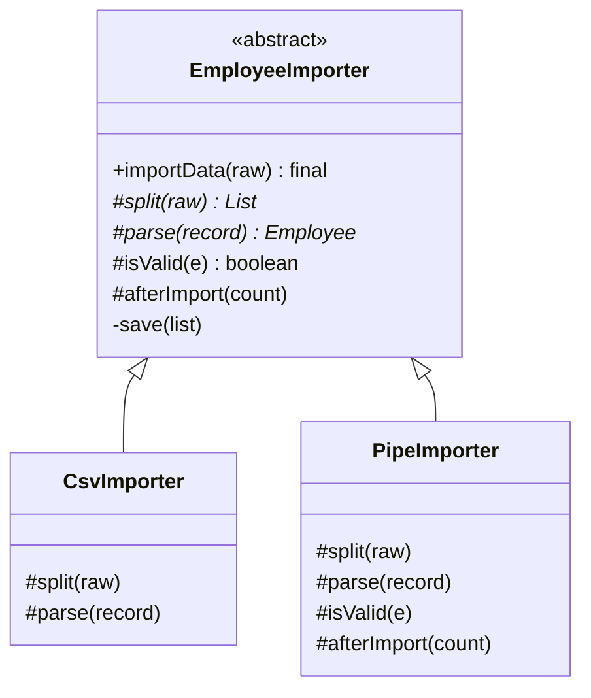

#### 📘 Terms Explained

| Term | Simple meaning |
|---|---|
| **Template method** | The method in the parent class that defines the order of steps (`importData`). Usually `final`. |
| **Abstract step / primitive operation** | A step the subclass **must** implement (`split`, `parse`). |
| **Hook** | A step with a default (often empty) implementation that subclasses **may** override (`isValid`, `afterImport`). |
| **Skeleton** | The fixed outline of the algorithm. |
| **Abstract class** | A class that can't be instantiated and may contain abstract methods. |

---

## 10.2 Why Do We Need It?

Without it, every importer (CSV, JSON, Excel, XML) copies the same flow: read → parse → validate → save → notify. Copies drift apart: one forgets validation, another saves before validating.

With Template Method:
- The **order of steps** is written once and protected (`final`).
- Common steps (`save`) are written once.
- Subclasses provide **only what differs**.

This is the **Hollywood Principle**: *"Don't call us, we'll call you."* The parent class calls the subclass's methods, not the other way round.

---

## 10.3 How It Works

1. Write an abstract class with a **`final` template method** that calls the steps in order.
2. Declare varying steps as **`abstract`** (subclass must implement) or **hooks** (default behaviour, optional override).
3. Make steps `protected`, since they're meant for subclasses, not for clients.
4. Clients call **only** the template method.

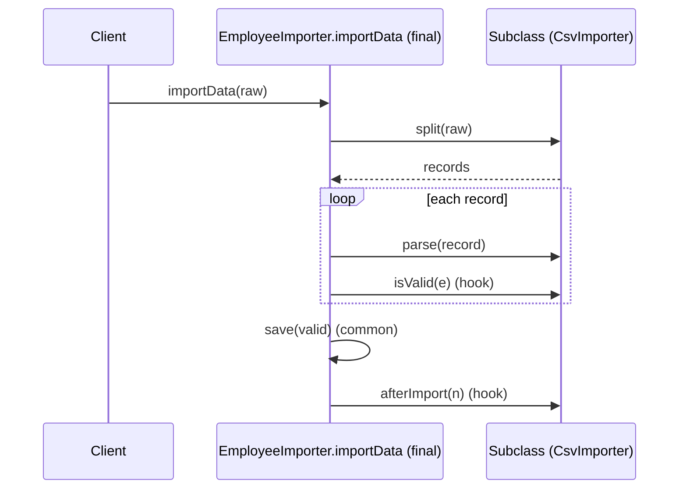

---

## 10.4 Complete Java Example - Data Importers

```java
import java.util.ArrayList;
import java.util.Arrays;
import java.util.List;

record Employee(String name, String dept, int salary) {}

// ----- Abstract class with the TEMPLATE METHOD -----
abstract class EmployeeImporter {

    // The template method: fixed order of steps. final = subclasses cannot change the order.
    public final int importData(String raw) {
        List<String> records = split(raw);                    // abstract step
        List<Employee> valid = new ArrayList<>();
        for (String r : records) {
            Employee e = parse(r);                            // abstract step
            if (isValid(e)) valid.add(e);                     // hook with default
            else System.out.println("  skipped invalid: " + e);
        }
        save(valid);                                          // common step
        afterImport(valid.size());                            // hook (does nothing by default)
        return valid.size();
    }

    protected abstract List<String> split(String raw);
    protected abstract Employee parse(String record);

    // Hook: a sensible default that subclasses MAY override
    protected boolean isValid(Employee e) { return e.salary() > 0; }
    protected void afterImport(int count) { }

    // Common step shared by every importer
    private void save(List<Employee> employees) {
        System.out.println("  saving " + employees.size() + " employees: "
                + employees.stream().map(Employee::name).toList());
    }
}

// ----- Concrete classes fill in the steps -----
class CsvImporter extends EmployeeImporter {
    protected List<String> split(String raw) { return Arrays.asList(raw.split("\n")); }
    protected Employee parse(String line) {
        String[] f = line.split(",");
        return new Employee(f[0].trim(), f[1].trim(), Integer.parseInt(f[2].trim()));
    }
}

class PipeImporter extends EmployeeImporter {
    protected List<String> split(String raw) { return Arrays.asList(raw.split(";")); }
    protected Employee parse(String rec) {
        String[] f = rec.split("\\|");
        return new Employee(f[1], f[0], Integer.parseInt(f[2]));   // different field order
    }
    @Override protected boolean isValid(Employee e) {               // stricter rule
        return super.isValid(e) && e.dept().equals("ENG");
    }
    @Override protected void afterImport(int count) {
        System.out.println("  notifying HR: " + count + " engineers imported");
    }
}

public class TemplateMethodDemo {
    public static void main(String[] args) {
        System.out.println("CSV import:");
        new CsvImporter().importData("Asha, ENG, 90000\nRavi, HR, 0\nMeera, OPS, 70000");

        System.out.println("Pipe import:");
        new PipeImporter().importData("ENG|Kiran|120000;SALES|Dev|60000;ENG|Zoya|95000");
    }
}
```

**Output:**
```
CSV import:
  skipped invalid: Employee[name=Ravi, dept=HR, salary=0]
  saving 2 employees: [Asha, Meera]
Pipe import:
  skipped invalid: Employee[name=Dev, dept=SALES, salary=60000]
  saving 2 employees: [Kiran, Zoya]
  notifying HR: 2 engineers imported
```

What the output shows:
- Both importers ran the **same sequence** (split → parse → validate → save → afterImport), even though their input formats differ.
- `CsvImporter` used the **default hook** (salary > 0), so Ravi was skipped.
- `PipeImporter` **overrode hooks**: a stricter `isValid` (calls `super.isValid` and adds "ENG only") and an `afterImport` notification.

---

## 10.5 Template Method in the JDK and Spring

| Class | Template method → steps you provide |
|---|---|
| **`HttpServlet.service()`** | Dispatches to `doGet`, `doPost`, `doPut`, `doDelete` that you override. |
| **`java.util.AbstractList`** | You implement `get(int)` and `size()`; it gives you `iterator()`, `indexOf`, `contains`, `equals`, `hashCode`... |
| **`AbstractMap`, `AbstractSet`, `AbstractCollection`** | Same idea for maps and sets. |
| **`InputStream.read(byte[], int, int)`** | Built on your `read()` single-byte method. |
| **`AbstractQueuedSynchronizer`** | `acquire()` is fixed; you implement `tryAcquire`/`tryRelease` (this is how `ReentrantLock` and `Semaphore` are built). |
| **Spring `OncePerRequestFilter`** | `doFilter()` is final; you implement `doFilterInternal`. |
| **Spring `AbstractRoutingDataSource`** | You implement `determineCurrentLookupKey()` (e.g. read/write or multi-tenant routing). |
| **Spring `JdbcTemplate`, `RestTemplate`, `TransactionTemplate`** | Fixed resource-handling skeleton; you pass a **callback** (`RowMapper`, `TransactionCallback`). |
| **Spring Batch `AbstractItemCountingItemStreamItemReader`** | You implement `doRead()`, `doOpen()`, `doClose()`. |
| **JUnit lifecycle** | Framework runs `@BeforeEach` → test → `@AfterEach` around your methods. |

```java
// AbstractList: implement 2 methods, get a full read-only List for free
class Range extends AbstractList<Integer> {
    private final int from, to;
    Range(int from, int to) { this.from = from; this.to = to; }
    @Override public Integer get(int i) { return from + i; }
    @Override public int size() { return to - from; }
}

List<Integer> r = new Range(10, 15);
System.out.println(r + " contains 12? " + r.contains(12));   // [10, 11, 12, 13, 14] contains 12? true
```

### Template + Callback: the "Spring Template" style

`JdbcTemplate` is the template method idea done with **composition** instead of inheritance. The fixed skeleton (get connection → prepare statement → execute → map rows → close → translate exceptions) lives in `JdbcTemplate`; the varying step is a **lambda**:

```java
List<Employee> list = jdbcTemplate.query(
        "SELECT name, dept, salary FROM employee WHERE dept = ?",
        (rs, rowNum) -> new Employee(rs.getString("name"), rs.getString("dept"), rs.getInt("salary")),   // the step you supply
        "ENG");
```

This avoids subclassing and is why modern Java prefers "template + callback" (closer to Strategy) over deep inheritance.

#### 📘 Terms Explained

| Term | Simple meaning |
|---|---|
| **Hollywood Principle** | High-level code calls low-level code ("don't call us, we'll call you"), not the reverse. |
| **`AbstractQueuedSynchronizer` (AQS)** | The JDK framework behind most locks and synchronizers in `java.util.concurrent`. |
| **`AbstractRoutingDataSource`** | Spring `DataSource` that picks one of several real data sources per call. |
| **Callback** | A function passed into a method so that method can call it at the right moment. |
| **`RowMapper`** | Spring callback that turns one `ResultSet` row into an object. |

---

## 10.6 Pros and Cons

| Pros | Cons |
|---|---|
| Removes duplicated flow code | Uses inheritance: subclasses are tightly coupled to the parent |
| Enforces step order (`final` template) | Java's single inheritance: a subclass can't extend another base too |
| Subclasses override only what differs | Hard to follow when hooks call hooks across many levels |
| Hooks give controlled extension points | Changing the skeleton affects every subclass (fragile base class) |

---

## 10.7 Common Pitfalls

| Pitfall | Fix |
|---|---|
| Template method not `final` → subclasses reorder or skip steps | Make it `final`. |
| Steps `public` → clients call steps directly, out of order | Make steps `protected`; only the template method is `public`. |
| Too many hooks ("what does this one do?") | Few, well-named hooks with sensible defaults; document them. |
| Calling overridable methods from the **constructor** | Subclass fields aren't initialised yet; don't do it. |
| Deep inheritance trees of templates | Prefer template + callback/strategy (composition). |
| Forgetting `super.hook()` when the parent's hook does real work | Document whether overrides must call `super`, or make the parent part non-overridable. |

---

## 10.8 Template Method - Interview Questions

**Q1. What is the Template Method pattern?**
A pattern where a parent class defines the skeleton of an algorithm in a (usually final) method and subclasses implement or override specific steps.

**Q2. What is a hook method?**
A step with a default implementation (often empty) that subclasses may override to extend behaviour at a specific point.

**Q3. Why is the template method usually `final`?**
To stop subclasses from changing the order of steps or skipping mandatory ones.

**Q4. JDK/Spring examples?**
`HttpServlet.service` → `doGet`/`doPost`; `AbstractList`; `InputStream.read(byte[])`; AQS; `OncePerRequestFilter.doFilterInternal`; `AbstractRoutingDataSource`; `JdbcTemplate` (template + callback).

**Q5. Template Method vs Strategy?**
Template Method: inheritance, varies steps, decided by which subclass you instantiate. Strategy: composition, replaces the whole algorithm, can be swapped at runtime.

**Q6. Is `JdbcTemplate` the Template Method pattern?**
In spirit, yes: it fixes the JDBC workflow and lets you supply the varying part. But it uses callbacks (composition), not subclassing, so it's often described as "Template + Callback" or a Strategy-like variant.

**Q7. What is the Hollywood Principle?**
"Don't call us, we'll call you": the framework/base class controls the flow and calls your code at the right time. It's the idea behind Template Method and Inversion of Control.

---

## 10.9 Template Method - Cheat Sheet

```
TEMPLATE METHOD  Parent class: final templateMethod() calls steps in fixed order.
          Steps: abstract (must implement) + hooks (default, may override) + common private steps.
          Steps protected; template public final. Hollywood Principle: "don't call us, we'll call you".
          JDK: HttpServlet.service->doGet/doPost, AbstractList (get+size), InputStream.read, AQS tryAcquire.
          Spring: OncePerRequestFilter.doFilterInternal, AbstractRoutingDataSource,
                  JdbcTemplate/RestTemplate/TransactionTemplate (template + CALLBACK, composition).
          vs Strategy: inheritance & steps (Template) vs composition & whole algorithm (Strategy).
```

---

# 11. Visitor Pattern

## 11.1 What is the Visitor Pattern?

**Visitor** lets you **add new operations to a group of classes without changing those classes**. Each operation is written as a separate **visitor** object with one method per element type. Elements "accept" a visitor and call the right method on it.

**Analogy:** A tax inspector visiting different businesses. A restaurant, a shop and a factory are each taxed differently. Instead of every business knowing all tax rules, the inspector (visitor) arrives and applies the right rule for each type of business. Next year a *health* inspector visits the same businesses with different rules, and the businesses don't change.

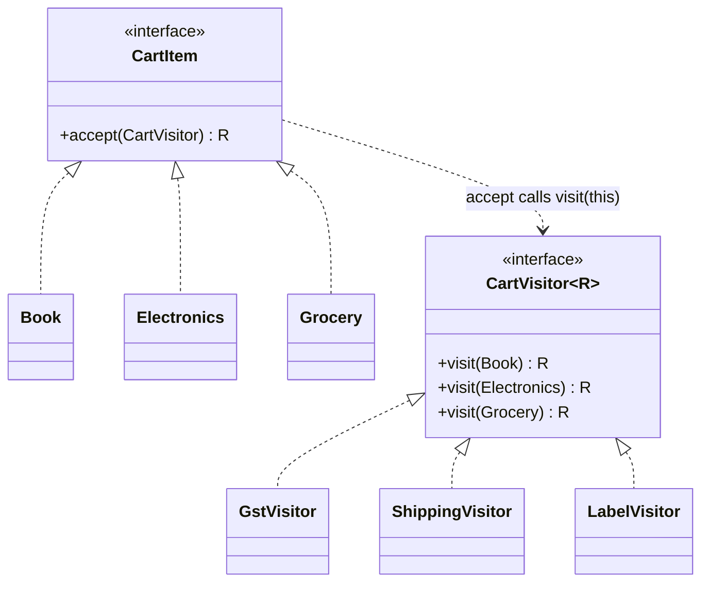

#### 📘 Terms Explained

| Term | Simple meaning |
|---|---|
| **Visitor** | An object holding one operation, with a `visit` method for each element type. |
| **Element** | One of the classes being visited (`Book`, `Electronics`). |
| **`accept(visitor)`** | Method on each element that calls `visitor.visit(this)`. |
| **Object structure** | The collection or tree of elements being visited (a cart, an AST, a file tree). |

---

## 11.2 Why Do We Need It?

Suppose you have a **stable** set of element types (Book, Electronics, Grocery) but keep adding **operations**: GST, shipping cost, labels, discounts, JSON export, insurance...

| Approach | Adding a new operation | Adding a new element type |
|---|---|---|
| Put a method in each class (`gst()`, `shipping()`, `label()`) | Edit **every** class | Easy: one new class |
| `instanceof` chains in each operation | One new method, but no compile-time check that all types are handled | Easy to forget a type |
| **Visitor** | **One new visitor class**; no element changes | Hard: every visitor needs a new `visit` method |

Use Visitor when **the types are stable and the operations keep changing**. Compilers are the classic case: the AST node types rarely change, but there are many operations (type-check, optimise, generate code, pretty-print).

---

## 11.3 How It Works: Double Dispatch

Java picks which **overloaded** method to call based on the **compile-time** type of the argument. So with a `CartItem item`, writing `visitor.visit(item)` won't compile (there's no `visit(CartItem)`). Visitor solves this with **two** method calls, called **double dispatch**:

1. `item.accept(visitor)`: dispatch #1, a virtual call chooses the right `accept` for the item's **runtime type** (`Electronics.accept`).
2. Inside, `visitor.visit(this)`: here `this` is statically an `Electronics`, so the compiler picks `visit(Electronics)`. Then dispatch #2 (virtual) chooses the right visitor (`GstVisitor`).

```mermaid
sequenceDiagram
    participant C as Client
    participant E as Electronics (runtime type)
    participant V as GstVisitor
    C->>E: item.accept(gstVisitor)
    E->>V: visit(this as Electronics)
    V-->>E: 540.0
    E-->>C: 540.0
```

#### 📘 Terms Explained

| Term | Simple meaning |
|---|---|
| **Dispatch** | Choosing which method body to run for a call. |
| **Single dispatch** | Java chooses an overridden method by the runtime type of **one** object (the receiver). |
| **Double dispatch** | Choosing the method by the runtime types of **two** objects (element and visitor), done with two calls. |
| **Overloading** | Several methods with the same name and different parameter types; chosen at **compile time**. |
| **Overriding** | A subclass replaces a parent's method; chosen at **runtime**. |

---

## 11.4 Complete Java Example - Cart Tax, Shipping and Labels

```java
import java.util.List;

// ----- Element hierarchy (stable: rarely gets new types) -----
interface CartItem {
    <R> R accept(CartVisitor<R> visitor);
}

record Book(String title, double price) implements CartItem {
    public <R> R accept(CartVisitor<R> v) { return v.visit(this); }
}
record Electronics(String name, double price, double weightKg) implements CartItem {
    public <R> R accept(CartVisitor<R> v) { return v.visit(this); }
}
record Grocery(String name, double price, boolean perishable) implements CartItem {
    public <R> R accept(CartVisitor<R> v) { return v.visit(this); }
}

// ----- Visitor: one method per element type -----
interface CartVisitor<R> {
    R visit(Book b);
    R visit(Electronics e);
    R visit(Grocery g);
}

// ----- Concrete visitors = new operations, added WITHOUT touching the item classes -----
class GstVisitor implements CartVisitor<Double> {
    public Double visit(Book b)        { return 0.0; }                     // books: 0% GST
    public Double visit(Electronics e) { return e.price() * 0.18; }        // 18%
    public Double visit(Grocery g)     { return g.price() * 0.05; }        // 5%
}

class ShippingVisitor implements CartVisitor<Double> {
    public Double visit(Book b)        { return 40.0; }
    public Double visit(Electronics e) { return 50 + e.weightKg() * 20; }
    public Double visit(Grocery g)     { return g.perishable() ? 80.0 : 30.0; }
}

class LabelVisitor implements CartVisitor<String> {
    public String visit(Book b)        { return "BOOK  " + b.title(); }
    public String visit(Electronics e) { return "ELEC  " + e.name() + " (fragile)"; }
    public String visit(Grocery g)     { return "GROC  " + g.name() + (g.perishable() ? " (keep cold)" : ""); }
}

public class VisitorDemo {
    public static void main(String[] args) {
        List<CartItem> cart = List.of(
                new Book("Clean Code", 600),
                new Electronics("Headphones", 3000, 0.5),
                new Grocery("Milk", 60, true));

        CartVisitor<Double> gst = new GstVisitor();
        CartVisitor<Double> shipping = new ShippingVisitor();
        CartVisitor<String> label = new LabelVisitor();

        double totalGst = 0, totalShipping = 0;
        for (CartItem item : cart) {
            System.out.println(item.accept(label));
            totalGst += item.accept(gst);               // double dispatch: item type + visitor type
            totalShipping += item.accept(shipping);
        }
        System.out.printf("GST total      = %.2f%n", totalGst);
        System.out.printf("Shipping total = %.2f%n", totalShipping);
    }
}
```

**Output:**
```
BOOK  Clean Code
ELEC  Headphones (fragile)
GROC  Milk (keep cold)
GST total      = 543.00
Shipping total = 180.00
```

Check the numbers: GST = 0 (book) + 3000 × 0.18 (540) + 60 × 0.05 (3) = **543**. Shipping = 40 + (50 + 0.5 × 20 = 60) + 80 = **180**.

Three operations were added (GST, shipping, labels) **without touching `Book`, `Electronics` or `Grocery`**. The generic `CartVisitor<R>` lets each visitor return its own type (`Double`, `String`).

---

## 11.5 Modern Alternative: Sealed Types + Pattern Matching

With Java 17 `sealed` interfaces (and Java 21 pattern-matching `switch`), you often don't need the `accept` boilerplate:

```java
sealed interface CartItem permits Book, Electronics, Grocery {}
record Book(String title, double price) implements CartItem {}
record Electronics(String name, double price, double weightKg) implements CartItem {}
record Grocery(String name, double price, boolean perishable) implements CartItem {}

// Java 21+: the compiler checks that every permitted type is handled (no default needed)
static double gst(CartItem item) {
    return switch (item) {
        case Book b        -> 0.0;
        case Electronics e -> e.price() * 0.18;
        case Grocery g     -> g.price() * 0.05;
    };
}
```

| | Classic Visitor | Sealed + pattern-matching `switch` |
|---|---|---|
| Boilerplate | `accept` in every class + visitor interface | None |
| Exhaustiveness check | Yes (visitor interface methods) | Yes (`sealed` + `switch`) |
| Java version | Any | `sealed`: 17, pattern `switch`: 21 |
| Works across modules / open hierarchies | Yes | Needs the hierarchy to be sealed |

> On Java 17 (without Java 21 `switch` patterns), use `if (item instanceof Book b) ...` chains for simple cases, or keep the classic Visitor.

---

## 11.6 Visitor in the JDK and Frameworks

| Where | Visitor |
|---|---|
| **`java.nio.file.Files.walkFileTree(path, FileVisitor)`** | `SimpleFileVisitor` with `visitFile`, `preVisitDirectory`, `postVisitDirectory`, `visitFileFailed` |
| **`javax.lang.model.element.ElementVisitor`**, annotation processors | Visit classes, methods, fields at compile time (how Lombok-like tools inspect code) |
| **ASM / ByteBuddy `ClassVisitor`, `MethodVisitor`** | Read/modify bytecode |
| **Spring `BeanDefinitionVisitor`** | Resolves `${...}` placeholders in bean definitions |
| **Compilers & linters** (javac trees, JavaParser, Checkstyle, SonarQube rules) | Operations over the syntax tree |
| **Jackson `JsonFormatVisitor`** | Generate JSON Schema from types |

```java
// Count Java files and their total size in a project, with a FileVisitor
AtomicLong count = new AtomicLong(), bytes = new AtomicLong();
Files.walkFileTree(Path.of("src"), new SimpleFileVisitor<>() {
    @Override
    public FileVisitResult visitFile(Path file, BasicFileAttributes attrs) {
        if (file.toString().endsWith(".java")) {
            count.incrementAndGet();
            bytes.addAndGet(attrs.size());
        }
        return FileVisitResult.CONTINUE;
    }
    @Override
    public FileVisitResult preVisitDirectory(Path dir, BasicFileAttributes attrs) {
        return dir.endsWith("target") ? FileVisitResult.SKIP_SUBTREE : FileVisitResult.CONTINUE;
    }
});
```

#### 📘 Terms Explained

| Term | Simple meaning |
|---|---|
| **`sealed` interface** | Java 17: only the listed (`permits`) types may implement it. |
| **Pattern-matching `switch`** | Java 21: `case Book b ->` tests the type and binds a variable. |
| **Exhaustive** | Covers every possible case; the compiler can check it for sealed types. |
| **Annotation processor** | Code that runs inside `javac` to inspect or generate code. |
| **ASM** | A low-level library for reading and writing Java bytecode. |

---

## 11.7 Pros, Cons and Pitfalls

| Pros | Cons |
|---|---|
| Add operations without changing element classes (Open/Closed for operations) | Adding a new element type forces changes in **every** visitor |
| Related logic (all of GST) lives in one class | `accept` boilerplate in every element |
| Visitors can accumulate state across a traversal (totals, reports) | Visitors often need access to element internals (weakens encapsulation) |
| Works well with Composite trees (visit every node) | Harder for beginners to read (double dispatch) |

| Pitfall | Fix |
|---|---|
| Using Visitor when element types change often | Put methods on the elements instead, or use sealed + `switch`. |
| Forgetting `accept` in a new element | Make `accept` abstract in the interface (the compiler then forces it). |
| Stateful visitor reused between traversals | Create a fresh visitor or reset it. |
| Business rules duplicated between visitors | Extract shared helpers. |

---

## 11.8 Visitor - Interview Questions

**Q1. What is the Visitor pattern?**
A pattern that lets you define new operations on a set of element classes without changing them, by moving each operation into a visitor with one `visit` method per element type.

**Q2. What is double dispatch, and why does Visitor need it?**
Java overload resolution is static, so it can't choose `visit(Electronics)` from a `CartItem` reference. `item.accept(v)` dispatches on the element's runtime type; inside, `v.visit(this)` dispatches on the visitor. Two dispatches choose the method by both types.

**Q3. When is Visitor a good choice?**
When the element hierarchy is stable but you keep adding operations (compilers/ASTs, document models, file trees, reporting on a fixed set of entity types).

**Q4. Biggest drawback?**
Adding a new element type requires changing every visitor.

**Q5. JDK examples?**
`Files.walkFileTree` with `FileVisitor`, `javax.lang.model` `ElementVisitor`, ASM `ClassVisitor`.

**Q6. How does modern Java reduce the need for Visitor?**
Sealed interfaces + records + pattern-matching `switch` (Java 21) give exhaustive, type-safe dispatch without `accept` methods.

---

## 11.9 Visitor - Cheat Sheet

```
VISITOR   Add new OPERATIONS to a STABLE set of classes without changing them.
          Element.accept(v) { v.visit(this); }  Visitor: visit(A), visit(B), visit(C).
          Double dispatch: element runtime type + visitor runtime type.
          Easy: new operation (new visitor). Hard: new element type (edit all visitors).
          JDK: Files.walkFileTree + SimpleFileVisitor, javax.lang.model ElementVisitor, ASM ClassVisitor.
          Spring: BeanDefinitionVisitor. Compilers/linters over ASTs.
          Modern Java: sealed interface + records + pattern-matching switch (Java 21) often replaces it.
```

---

# 12. How the Behavioral Patterns Fit Together

## 12.1 One-Line Summary of Each

| Pattern | Question it answers | One-line answer |
|---|---|---|
| **Chain of Responsibility** | "Who should handle this request?" | Pass it along a chain until someone does. |
| **Command** | "How do I store, queue or undo an action?" | Turn the action into an object. |
| **Interpreter** | "How do I evaluate rules written as text?" | Grammar → tree of expression objects → `interpret()`. |
| **Iterator** | "How do I walk a collection without knowing its internals?" | `hasNext()` / `next()`. |
| **Mediator** | "Too many objects talk to each other." | Make them talk through one hub. |
| **Memento** | "How do I save and restore state safely?" | Immutable snapshot kept by a caretaker. |
| **Observer** | "How do I tell others something happened?" | Subscribers get notified automatically. |
| **State** | "Behaviour depends on the lifecycle stage." | One class per state; the object switches its state. |
| **Strategy** | "Several ways to do one job." | Interchangeable algorithm objects. |
| **Template Method** | "Same steps, a few differ." | Fixed skeleton in the parent, steps in subclasses. |
| **Visitor** | "Many new operations over fixed types." | Operation objects with `visit(Type)` methods. |

## 12.2 Decision Guide

```mermaid
flowchart TD
    A[Behavioral problem] --> B{About reacting to<br/>something that happened?}
    B -->|Yes| C{Many peers talking<br/>to each other?}
    C -->|Yes| MED[Mediator]
    C -->|No| OBS[Observer]
    B -->|No| D{Behaviour varies by...}
    D -->|lifecycle stage| ST[State]
    D -->|choice of algorithm| STR[Strategy]
    D -->|a few steps of a fixed flow| TM[Template Method]
    D -->|something else| E{Need to...}
    E -->|find who handles a request| COR[Chain of Responsibility]
    E -->|queue / log / undo actions| CMD[Command]
    E -->|save and restore state| MEM[Memento]
    E -->|walk a collection| IT[Iterator]
    E -->|add operations to fixed types| VIS[Visitor]
    E -->|evaluate a small language| INT[Interpreter]
```

| If you hear... | Think... |
|---|---|
| "Approval levels", "filters", "middleware", "escalation", "interceptors" | Chain of Responsibility |
| "Undo/redo", "queue", "schedule", "retry", "macro", "audit log", "CQRS command" | Command |
| "Rule language", "formula", "expression", "DSL", "SpEL", "regex" | Interpreter |
| "Traverse", "for-each", "cursor", "pagination", "ConcurrentModificationException" | Iterator |
| "Chat room", "control tower", "dialog widgets", "orchestrator" | Mediator |
| "Snapshot", "checkpoint", "save game", "savepoint", "restore" | Memento |
| "Notify", "subscribe", "event", "listener", "pub/sub", "@EventListener" | Observer |
| "Order status", "lifecycle", "vending machine", "workflow", "state machine" | State |
| "Payment methods", "discount types", "sort by", "pluggable algorithm" | Strategy |
| "Same steps, different details", "framework hooks", "doGet/doPost", "AbstractList" | Template Method |
| "AST", "compiler", "walk file tree", "new operation on every type" | Visitor |

## 12.3 Look-Alike Patterns (Interview Imp - Java)

| Pair | Same | Different |
|---|---|---|
| **Strategy vs State** | Context + interface + implementations | Client chooses (Strategy) vs object switches itself over time (State) |
| **Strategy vs Template Method** | Vary an algorithm | Composition, whole algorithm, runtime vs inheritance, some steps, compile-time |
| **Observer vs Mediator** | Decouple objects via notifications | One-way broadcast, no logic vs two-way hub with coordination rules |
| **Command vs Strategy** | Behaviour wrapped in an object | *What* action (stored, queued, undone) vs *how* (algorithm used by a context) |
| **Command vs Memento (undo)** | Both enable undo | Store the reverse operation vs store a full snapshot |
| **Chain of Responsibility vs Decorator** ([Structural](03_Structural_Pattern.md#4-decorator-pattern-interview-imp---java)) | Linked objects forwarding calls | Handler may stop the chain vs decorator always forwards |
| **Iterator vs Visitor** | Walk a structure | Client pulls elements vs structure pushes elements to an operation |
| **Interpreter vs Composite** ([Structural](03_Structural_Pattern.md#3-composite-pattern-interview-imp---java)) | Tree of objects | Interpreter = Composite whose nodes *evaluate* a grammar |

## 12.4 Combining Them in One System

A realistic Spring Boot order service uses most of them at once:

```mermaid
flowchart LR
    REQ[HTTP request] --> FC["Security & logging filters<br/>(Chain of Responsibility)"]
    FC --> CTRL[OrderController]
    CTRL --> CMD["PlaceOrderCommand -> handler<br/>(Command)"]
    CMD --> ORD["Order entity: NEW -> PAID -> SHIPPED<br/>(State)"]
    CMD --> PAY["PaymentStrategy: CARD / UPI / WALLET<br/>(Strategy)"]
    CMD --> RULES["Discount rule 'price*qty - ...'<br/>(Interpreter / SpEL)"]
    CMD --> EVT["OrderPlacedEvent<br/>(Observer)"]
    EVT --> EMAIL[Email listener]
    EVT --> LOY[Loyalty listener]
    CMD --> IMP["Nightly CSV importer<br/>(Template Method)"]
    CMD --> EXP["Export with Stream / pagination<br/>(Iterator)"]
    CMD --> TAX["GST & shipping on cart items<br/>(Visitor)"]
    CMD --> SP["JDBC savepoint / NESTED tx<br/>(Memento)"]
```

| Combination | Example |
|---|---|
| **Command + Memento** | Each command stores a snapshot before executing; undo restores it. |
| **Command + Chain** | Commands pass through a chain of middleware (validation, logging, transactions) before the handler: a "command bus". |
| **State + Observer** | Each state transition publishes an event (`OrderShipped`) that listeners react to. |
| **Strategy + Factory** | A factory/registry picks the strategy by key (see [02_Creational_Pattern.md](02_Creational_Pattern.md#2-factory-method-pattern-interview-imp---java)). |
| **Template Method + Strategy** | The skeleton is fixed; one step delegates to a pluggable strategy (`JdbcTemplate` + `RowMapper`). |
| **Composite + Iterator + Visitor** | Walk a tree (Iterator) and apply operations to each node (Visitor). |
| **Interpreter + Composite + Visitor** | Expression tree (Composite) evaluated (Interpreter) or printed/optimised (Visitor). |
| **Mediator + Observer** | Colleagues publish events; the mediator subscribes and coordinates. |

## 12.5 Behavioral Patterns Inside Spring

| Pattern | Where Spring uses it |
|---|---|
| **Chain of Responsibility** | Servlet `FilterChain`, Spring Security filter chain, `HandlerInterceptor`, `ProviderManager`, `HandlerExceptionResolver` |
| **Command** | `@Scheduled` / `@Async` tasks, `TaskExecutor`, `Runnable`/`Callable`, CQRS handlers |
| **Interpreter** | SpEL, Spring Data method-name queries (`PartTree`), `CronExpression` |
| **Iterator** | Spring Data `Stream<T>`, `Slice`/`Page`, `ResultSet` handling in `JdbcTemplate` |
| **Mediator** | `DispatcherServlet`, Spring Integration channels |
| **Memento** | `@Transactional(propagation = NESTED)` savepoints, Spring Statemachine persistence |
| **Observer** | `ApplicationEventPublisher`, `@EventListener`, `@TransactionalEventListener`, context lifecycle events |
| **State** | Spring Statemachine |
| **Strategy** | `PasswordEncoder`, `AuthenticationProvider`, `CacheManager`, `ResourceLoader`, `TaskExecutor`, injected `Map<String, Bean>` |
| **Template Method** | `JdbcTemplate`, `RestTemplate`, `TransactionTemplate`, `OncePerRequestFilter`, `AbstractRoutingDataSource` |
| **Visitor** | `BeanDefinitionVisitor`, annotation-metadata visitors (ASM-based classpath scanning) |

## 12.6 Comparison Table

| Pattern | Mechanism | Main benefit | Biggest risk | JDK / Spring example | Interview favourite |
|---|---|---|---|---|---|
| **Chain of Responsibility** | Linked handlers / list | Decouple sender from receivers | Request unhandled; missing `chain.doFilter` | `FilterChain`, Spring Security | Filter chain, approval workflow |
| **Command** | Action as object | Undo, queue, schedule | Undo bugs; duplicate execution | `Runnable`, `ExecutorService` | Undo/redo design |
| **Interpreter** | Expression tree | Rules as text | Complex grammars; untrusted input | `Pattern`, SpEL | Rarely deep; know SpEL |
| **Iterator** | `hasNext`/`next` cursor | Hide structure; lazy | `ConcurrentModificationException` | `Iterator`, `Spliterator` | Fail-fast vs fail-safe |
| **Mediator** | Central hub | N links instead of N² | God object | `DispatcherServlet` | vs Observer / Facade |
| **Memento** | Immutable snapshot | Restore without breaking encapsulation | Memory use; shallow copies | JDBC `Savepoint` | vs Command undo |
| **Observer** | Subscriber list | Loose coupling, events | Leaks, sync surprises | `@EventListener`, `Flow` | Spring events, async, after-commit |
| **State** | One class per state | Remove status switches | Class count; concurrency | Spring Statemachine, `Thread.State` | vs Strategy, order lifecycle |
| **Strategy** | Interchangeable algorithms | Open/Closed, testability | Selection `if` ladder | `Comparator`, `PasswordEncoder` | Spring `Map<String, Bean>` |
| **Template Method** | Inheritance + hooks | Reuse a fixed flow | Fragile base class | `HttpServlet`, `AbstractList`, `JdbcTemplate` | vs Strategy, hooks, `final` |
| **Visitor** | Double dispatch | New operations on fixed types | New types break all visitors | `FileVisitor` | Double dispatch |

---

# 13. Behavioral Patterns Cheat Sheet

```
CHAIN OF RESP.  Handlers in a chain; each handles or forwards. Classic (first wins) vs pipeline
                (all run, any can stop). Servlet FilterChain, Spring Security, HandlerInterceptor (false = stop).

COMMAND         Action as an object: execute()/undo(). Invoker + undo/redo stacks. Runnable/Callable,
                ExecutorService, @Scheduled, @Async, CQRS. Handlers must be idempotent.

INTERPRETER     Grammar -> expression tree -> interpret(context). Parse once, evaluate many.
                Pattern (regex), SpEL, Spring Data PartTree, CronExpression. Never trust user SpEL.

ITERATOR        hasNext()/next() without exposing internals; Iterable enables for-each.
                Fail-fast (modCount -> CME) vs fail-safe (CopyOnWriteArrayList, ConcurrentHashMap).
                Remove via iterator.remove()/removeIf. Spring Data Stream (close it), Slice, keyset paging.

MEDIATOR        Colleagues talk only to a hub. N links not N^2. Chat room, control tower,
                DispatcherServlet, orchestrators. Don't let it become a God object.

MEMENTO         Immutable snapshot; Originator saves/restores, Caretaker stores. Undo, checkpoints,
                JDBC Savepoint, NESTED transactions. Deep-copy; cap history.

OBSERVER        Subject notifies subscribers. CopyOnWriteArrayList + per-listener try/catch.
                Spring: @EventListener is SYNC + same TX; use @Async, @TransactionalEventListener(AFTER_COMMIT).
                java.util.Observable deprecated. Flow API = back-pressure. Broker = distributed observer.

STATE           One class per state; context delegates; states return the next state.
                Enum + allowed transitions + @Enumerated(STRING) + @Version. Spring Statemachine.

STRATEGY        Interchangeable algorithms behind one interface. Lambdas. Spring Map<String, Bean>
                registry. Comparator, PasswordEncoder, RejectedExecutionHandler. Keep stateless.

TEMPLATE METHOD final skeleton in parent; abstract steps + hooks in subclasses. Hollywood Principle.
                HttpServlet.service, AbstractList, AQS, OncePerRequestFilter, JdbcTemplate (+ callback).

VISITOR         accept(v) -> v.visit(this): double dispatch. New operations easy, new types hard.
                Files.walkFileTree, ElementVisitor, ASM. Java 21: sealed + pattern-matching switch.
```

### Quick Decision Table

| Need | Use |
|---|---|
| Several handlers; one (or each) processes a request | Chain of Responsibility |
| Undo/redo, queue, schedule or log actions | Command |
| Evaluate user-defined formulas/rules | Interpreter (or SpEL / rule engine) |
| Walk a custom collection or huge data set lazily | Iterator |
| Untangle many objects calling each other | Mediator |
| Save and restore an object's state | Memento |
| React to events without coupling | Observer |
| Behaviour depends on lifecycle status | State |
| Choose an algorithm at runtime | Strategy |
| Same flow, a few steps differ | Template Method |
| Many operations over a fixed set of types | Visitor |
| A simple `if` with two stable branches | None. Keep the `if`. |

### Top Interview Traps

1. **Strategy vs State:** identical diagrams. *Client chooses* vs *object switches itself*.
2. **Strategy vs Template Method:** composition and whole algorithm vs inheritance and steps.
3. **Spring `@EventListener` is synchronous** and runs in the publisher's transaction, so use `@TransactionalEventListener(AFTER_COMMIT)` + `@Async` for emails.
4. **`java.util.Observable` is deprecated** (Java 9).
5. **Removing in a for-each loop** → `ConcurrentModificationException`; use `iterator.remove()` / `removeIf`. And `list.remove(Integer)` ≠ `list.remove(int)`.
6. **`CopyOnWriteArrayList` iterators see a snapshot,** never new elements, and never throw CME.
7. **`HandlerInterceptor.preHandle` returning `false`** stops the chain; a filter that forgets `chain.doFilter` silently drops the request.
8. **Template method should be `final`;** steps `protected`; never call overridable methods from a constructor.
9. **Visitor needs double dispatch** because overloads are chosen at compile time.
10. **Command handlers in distributed systems must be idempotent,** because messages can be delivered twice.

> **Related files:** [02_Creational_Pattern.md](02_Creational_Pattern.md) (creating objects) · [03_Structural_Pattern.md](03_Structural_Pattern.md) (connecting objects) · [01_LLD_Design_Patterns.md](01_LLD_Design_Patterns.md) (all 26 LLD patterns, quick overview) · [01_Scalability_Pattern.md](../03_System_Design/01_Scalability_Pattern.md) (system-level patterns) · [00_Design_Patterns_Complete_List.md](../00_Design_Patterns_Complete_List.md) (master list)
