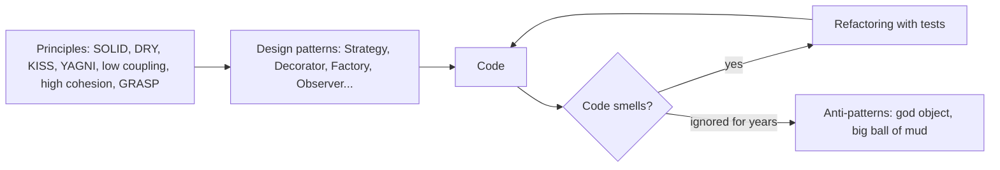
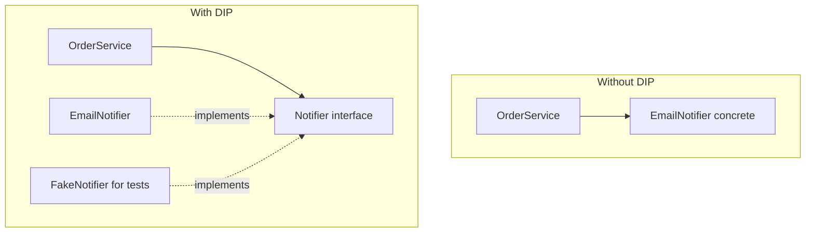
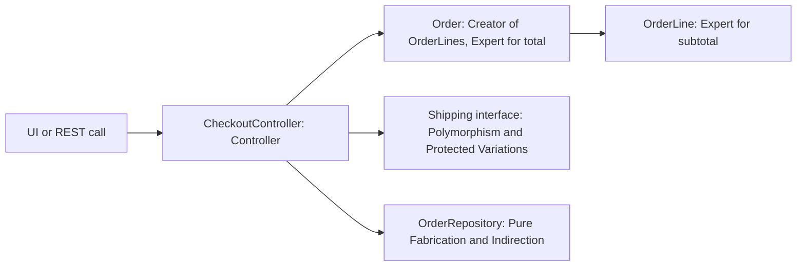
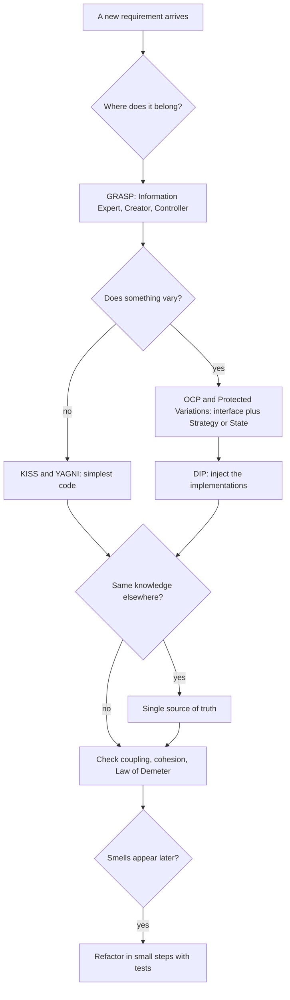

---
mdx:
  format: md
---

# Design Principles and Anti-Patterns (SOLID, DRY/KISS/YAGNI, Coupling and Cohesion, GRASP, Code Smells, Refactoring)

> **Note**: Patterns marked with **(Interview Imp - Java)** are frequently asked in Java interviews
>
> **How to read this file:** Every section ends with a **📘 Terms Explained** table. If you see a word you don't know, check the table right below that section. Each principle goes from the idea to a "violation vs fix" Java example with real output, how Spring applies it, pros and cons, pitfalls, interview questions and a mini cheat sheet.
>
> **What is this file about?** Design patterns ([02_Creational](02_Creational_Pattern.md), [03_Structural](03_Structural_Pattern.md), [04_Behavioral](04_Behavioral_Pattern.md)) are **solutions**. Design principles are the **reasons** behind them: why Strategy beats a `switch`, why we inject dependencies, why we prefer composition. Anti-patterns and code smells are the **warning signs** that a design is going wrong, and refactoring is how to fix it safely. Interviewers use these to tell "knows pattern names" from "writes maintainable code". They are applied in [06_LLD_Interview_Problems.md](06_LLD_Interview_Problems.md).
>
> **What lives elsewhere:** A short SOLID summary is also in [Java_Complete_Guide.md](../../java/Java_Complete_Guide.md#68-solid-principles-and-composition-interview-imp). Architectural principles (layers, dependency rule, coupling between services) are in [01_Architectural_Pattern.md](../02_HLD/01_Architectural_Pattern.md); the anemic domain model in [02_Enterprise_Application_Pattern.md](../02_HLD/02_Enterprise_Application_Pattern.md); characterisation tests in [05_Testing_Pattern.md](../04_Specialized/05_Testing_Pattern.md); architecture-level anti-patterns (shared database, distributed monolith) in [02_Microservices_Pattern.md](../04_Specialized/02_Microservices_Pattern.md).
>
> **Verified code:** Every "Complete Java Example" is **plain Java 17 (no libraries)** and was compiled and run **three times** with identical output. To run one, save it as `<ClassName>.java` and run `javac <ClassName>.java && java <ClassName>`. Spring snippets were **not** executed.

---

## Table of Contents
- [Big Picture: Principles → Patterns → Code](#big-picture-principles--patterns--code)
1. [SOLID Principles](#1-solid-principles-interview-imp---java) **(Interview Imp - Java)**
   - [1.1 What Is It?](#11-what-is-it)
   - [1.2 Why Do We Need It?](#12-why-do-we-need-it)
   - [1.3 How It Works](#13-how-it-works)
   - [1.4 Types and Variants](#14-types-and-variants)
   - [1.5 Complete Java Example - All Five Principles, Violation vs Fix](#15-complete-java-example---all-five-principles-violation-vs-fix)
   - [1.6 SOLID in Spring Boot](#16-solid-in-spring-boot)
   - [1.7 Pros and Cons](#17-pros-and-cons)
   - [1.8 Pitfalls, Interview Questions and Cheat Sheet](#18-pitfalls-interview-questions-and-cheat-sheet)
2. [DRY, KISS and YAGNI](#2-dry-kiss-and-yagni)
   - [2.1 What Are They?](#21-what-are-they)
   - [2.2 Why Do We Need Them?](#22-why-do-we-need-them)
   - [2.3 How It Works](#23-how-it-works)
   - [2.4 Types and Variants](#24-types-and-variants)
   - [2.5 Complete Java Example - Duplicated Rule Drift, Clever vs Simple, Framework vs Function](#25-complete-java-example---duplicated-rule-drift-clever-vs-simple-framework-vs-function)
   - [2.6 In Java and Spring Boot](#26-in-java-and-spring-boot)
   - [2.7 Pros and Cons](#27-pros-and-cons)
   - [2.8 Pitfalls, Interview Questions and Cheat Sheet](#28-pitfalls-interview-questions-and-cheat-sheet)
3. [Coupling, Cohesion, Composition Over Inheritance and the Law of Demeter](#3-coupling-cohesion-composition-over-inheritance-and-the-law-of-demeter-interview-imp---java) **(Interview Imp - Java)**
   - [3.1 What Are They?](#31-what-are-they)
   - [3.2 Why Do We Need Them?](#32-why-do-we-need-them)
   - [3.3 How It Works](#33-how-it-works)
   - [3.4 Types and Variants](#34-types-and-variants)
   - [3.5 Complete Java Example - Fragile Base Class vs Composition, a Demeter Fix, and Injected Time](#35-complete-java-example---fragile-base-class-vs-composition-a-demeter-fix-and-injected-time)
   - [3.6 In Java and Spring Boot](#36-in-java-and-spring-boot)
   - [3.7 Pros and Cons](#37-pros-and-cons)
   - [3.8 Pitfalls, Interview Questions and Cheat Sheet](#38-pitfalls-interview-questions-and-cheat-sheet)
4. [GRASP: Assigning Responsibilities](#4-grasp-assigning-responsibilities)
   - [4.1 What Is It?](#41-what-is-it)
   - [4.2 Why Do We Need It?](#42-why-do-we-need-it)
   - [4.3 How It Works](#43-how-it-works)
   - [4.4 Types and Variants](#44-types-and-variants)
   - [4.5 Complete Java Example - A Checkout Designed With GRASP](#45-complete-java-example---a-checkout-designed-with-grasp)
   - [4.6 In Spring Boot](#46-in-spring-boot)
   - [4.7 Pros and Cons](#47-pros-and-cons)
   - [4.8 Pitfalls, Interview Questions and Cheat Sheet](#48-pitfalls-interview-questions-and-cheat-sheet)
5. [Code Smells and Refactoring](#5-code-smells-and-refactoring-interview-imp---java) **(Interview Imp - Java)**
   - [5.1 What Are They?](#51-what-are-they)
   - [5.2 Why Do We Need Them?](#52-why-do-we-need-them)
   - [5.3 How It Works](#53-how-it-works)
   - [5.4 Types and Variants](#54-types-and-variants)
   - [5.5 Complete Java Example - Refactor a Legacy Invoice Without Changing Behaviour](#55-complete-java-example---refactor-a-legacy-invoice-without-changing-behaviour)
   - [5.6 In Java and Spring Boot](#56-in-java-and-spring-boot)
   - [5.7 Pros and Cons](#57-pros-and-cons)
   - [5.8 Pitfalls, Interview Questions and Cheat Sheet](#58-pitfalls-interview-questions-and-cheat-sheet)
6. [Anti-Patterns](#6-anti-patterns-interview-imp---java) **(Interview Imp - Java)**
   - [6.1 What Are They?](#61-what-are-they)
   - [6.2 Why Do We Need to Know Them?](#62-why-do-we-need-to-know-them)
   - [6.3 How It Works: The Catalogue](#63-how-it-works-the-catalogue)
   - [6.4 Types and Variants](#64-types-and-variants)
   - [6.5 Complete Java Example - Singleton State Breaking Tests, and Anemic vs Rich Model](#65-complete-java-example---singleton-state-breaking-tests-and-anemic-vs-rich-model)
   - [6.6 In Spring Boot](#66-in-spring-boot)
   - [6.7 Pros and Cons (of knowing the catalogue)](#67-pros-and-cons-of-knowing-the-catalogue)
   - [6.8 Pitfalls, Interview Questions and Cheat Sheet](#68-pitfalls-interview-questions-and-cheat-sheet)
7. [More Principles Worth Knowing](#7-more-principles-worth-knowing)
8. [How the Principles Fit Together](#8-how-the-principles-fit-together)
9. [Design Principles Cheat Sheet](#9-design-principles-cheat-sheet)

---

## Big Picture: Principles → Patterns → Code



| Group | Question it answers | Section |
|---|---|---|
| **SOLID** | How should one class look and depend on others? | [1](#1-solid-principles-interview-imp---java) |
| **DRY, KISS, YAGNI** | How much code, and how clever? | [2](#2-dry-kiss-and-yagni) |
| **Coupling, cohesion, composition, Law of Demeter** | How should classes be connected? | [3](#3-coupling-cohesion-composition-over-inheritance-and-the-law-of-demeter-interview-imp---java) |
| **GRASP** | Which class should get this responsibility? | [4](#4-grasp-assigning-responsibilities) |
| **Code smells and refactoring** | How do I spot and fix bad code safely? | [5](#5-code-smells-and-refactoring-interview-imp---java) |
| **Anti-patterns** | Which "solutions" are traps? | [6](#6-anti-patterns-interview-imp---java) |

### 📘 Terms Explained

| Term | Meaning |
|---|---|
| **Design principle** | A guideline for structuring code so it stays easy to change |
| **Anti-pattern** | A common "solution" that looks reasonable but causes problems |
| **Code smell** | A surface sign in the code that often points to a deeper design problem |
| **Refactoring** | Changing the structure of code without changing what it does |
| **Maintainability** | How easy it is to understand, change and fix code |

---

# 1. SOLID Principles (Interview Imp - Java)

## 1.1 What Is It?

Five principles for object-oriented classes, collected by Robert C. Martin ("Uncle Bob"):

| Letter | Principle | In one line |
|---|---|---|
| **S** | Single Responsibility | A class should have **one reason to change** |
| **O** | Open/Closed | Open for **extension**, closed for **modification**: add behaviour by adding code, not editing old code |
| **L** | Liskov Substitution | A subtype must be usable **anywhere** its parent is expected, without surprises |
| **I** | Interface Segregation | Many small, focused interfaces beat one fat interface |
| **D** | Dependency Inversion | High-level code depends on **abstractions**; concrete details are plugged in |

## 1.2 Why Do We Need It?

| Without | Symptom |
|---|---|
| S | One change (report format) breaks unrelated logic (tax calculation) |
| O | Every new discount means editing a giant `if/else`, and re-testing everything |
| L | A subclass silently breaks code that worked with the parent |
| I | Classes forced to implement methods they can't support (`throw new UnsupportedOperationException()`) |
| D | Business logic can't be tested without a real database or email server |

## 1.3 How It Works



- **SRP:** separate *what is calculated* from *how it is shown* and *where it is stored*. "Reason to change" usually means "a different person or team asks for the change".
- **OCP:** identify what varies (discount rules) and put it behind an interface; new behaviour = new class.
- **LSP:** a subclass must keep the parent's promises (pre-conditions no stronger, post-conditions no weaker). The classic counter-example: `Square extends Rectangle`.
- **ISP:** split interfaces by client need (`Printer`, `Scanner`), so a simple printer isn't forced to "scan".
- **DIP:** depend on interfaces; inject implementations through the constructor (Spring does it for you).

## 1.4 Types and Variants

| Related idea | Note |
|---|---|
| **Dependency Injection** | The technique that delivers DIP (constructor injection preferred) |
| **Inversion of Control** | The framework calls your code and supplies its dependencies (Spring) |
| **Design by contract** | The formal version of LSP: pre/post-conditions and invariants |
| **Strategy, Decorator, Template Method** | Typical ways to achieve OCP |
| **Package principles** | SOLID for modules: Common Closure, Acyclic Dependencies, Stable Dependencies |

## 1.5 Complete Java Example - All Five Principles, Violation vs Fix

**What it shows:** SRP (one total, two formatters), OCP (a new discount rule added as a class), LSP (`Square` breaking a caller that worked with `Rectangle`), ISP (printers that don't have to scan) and DIP (the same service wired with a real and a fake notifier).

```java
import java.util.*;

public class SolidDemo {

    // ===== S: Single Responsibility - one reason to change per class =====
    record Sale(String item, long cents) {}
    static class SalesCalculator { long total(List<Sale> s) { return s.stream().mapToLong(Sale::cents).sum(); } }       // business rule
    interface ReportFormatter { String format(long totalCents); }                                                     // presentation
    static class TextFormatter implements ReportFormatter { public String format(long t) { return "Total: " + t / 100 + "." + String.format("%02d", t % 100); } }
    static class CsvFormatter implements ReportFormatter { public String format(long t) { return "total_cents\n" + t; } }

    // ===== O: Open/Closed - add behaviour by adding classes, not editing old ones =====
    interface DiscountRule { long discount(long subtotal, String customerType); }
    static class LoyaltyDiscount implements DiscountRule { public long discount(long s, String t) { return t.equals("GOLD") ? s / 10 : 0; } }
    static class BulkDiscount implements DiscountRule { public long discount(long s, String t) { return s >= 1_000_000 ? 50_000 : 0; } }
    static class FestivalDiscount implements DiscountRule { public long discount(long s, String t) { return s / 20; } }          // added later: no existing code edited
    static long price(long subtotal, String type, List<DiscountRule> rules) { long d = 0; for (DiscountRule r : rules) d += r.discount(subtotal, type); return subtotal - d; }

    // ===== L: Liskov Substitution - a subclass must work wherever the parent is expected =====
    static class Rectangle { protected int w, h; void setWidth(int w) { this.w = w; } void setHeight(int h) { this.h = h; } int area() { return w * h; } }
    static class Square extends Rectangle {                                 // "a square IS a rectangle" ... but it changes the parent's promise
        void setWidth(int w) { this.w = w; this.h = w; } void setHeight(int h) { this.w = h; this.h = h; }
    }
    static int resizeAndMeasure(Rectangle r) { r.setWidth(5); r.setHeight(4); return r.area(); }   // caller expects 5 * 4 = 20

    // ===== I: Interface Segregation - small interfaces, clients depend only on what they use =====
    interface Printer { String print(String doc); }
    interface Scanner { String scan(); }
    static class SimplePrinter implements Printer { public String print(String d) { return "printed " + d; } }            // not forced to implement scan()
    static class OfficeMachine implements Printer, Scanner { public String print(String d) { return "printed " + d; } public String scan() { return "scanned page"; } }

    // ===== D: Dependency Inversion - high-level code depends on an abstraction, details are injected =====
    interface Notifier { void send(String to, String msg); }
    static class EmailNotifier implements Notifier { public void send(String to, String m) { System.out.println("   (email to " + to + ") " + m); } }
    static class FakeNotifier implements Notifier { final List<String> sent = new ArrayList<>(); public void send(String to, String m) { sent.add(to + ":" + m); } }
    static class OrderService {
        private final Notifier notifier;
        OrderService(Notifier n) { notifier = n; }                                                // injected, not 'new EmailNotifier()'
        void place(String customer) { notifier.send(customer, "order confirmed"); }
    }

    public static void main(String[] args) {
        List<Sale> sales = List.of(new Sale("pen", 1_250), new Sale("book", 49_900));
        long total = new SalesCalculator().total(sales);
        System.out.println("S) same calculation, two formats: '" + new TextFormatter().format(total) + "' | '" + new CsvFormatter().format(total).replace("\n", "\\n") + "'");

        List<DiscountRule> rules = new ArrayList<>(List.of(new LoyaltyDiscount(), new BulkDiscount()));
        System.out.println("O) GOLD customer, 12000.00: " + price(1_200_000, "GOLD", rules) / 100 + ".00");
        rules.add(new FestivalDiscount());
        System.out.println("   + FestivalDiscount class added (no edits): " + price(1_200_000, "GOLD", rules) / 100 + ".00");

        System.out.println("L) resizeAndMeasure(new Rectangle()) = " + resizeAndMeasure(new Rectangle()) + "   resizeAndMeasure(new Square()) = "
                + resizeAndMeasure(new Square()) + "   <- substituting Square breaks the caller");

        List<Printer> printers = List.of(new SimplePrinter(), new OfficeMachine());
        System.out.println("I) every Printer can print: " + printers.stream().map(p -> p.print("invoice")).toList() + "; only OfficeMachine is a Scanner: " + new OfficeMachine().scan());

        System.out.println("D) production wiring:");
        new OrderService(new EmailNotifier()).place("asha@example.com");
        FakeNotifier fake = new FakeNotifier();
        new OrderService(fake).place("ben@example.com");
        System.out.println("   test wiring with a fake, no email server needed: " + fake.sent);
    }
}
```

**Output** (identical on all 3 runs):

```text
S) same calculation, two formats: 'Total: 511.50' | 'total_cents\n51150'
O) GOLD customer, 12000.00: 10300.00
   + FestivalDiscount class added (no edits): 9700.00
L) resizeAndMeasure(new Rectangle()) = 20   resizeAndMeasure(new Square()) = 16   <- substituting Square breaks the caller
I) every Printer can print: [printed invoice, printed invoice]; only OfficeMachine is a Scanner: scanned page
D) production wiring:
   (email to asha@example.com) order confirmed
   test wiring with a fake, no email server needed: [ben@example.com:order confirmed]
```

**What the output shows**
- **S:** the calculation is written once; adding the CSV format didn't touch it.
- **O:** adding `FestivalDiscount` changed the price from 10300.00 to 9700.00 **without editing** any existing class.
- **L:** the caller sets width 5 and height 4 and expects 20. With a `Square` it gets **16**. Mathematically a square is a rectangle, but *behaviourally* this `Square` breaks the `Rectangle` contract. Fix: don't inherit; make both implement a `Shape` interface with `area()`, or make them immutable.
- **I:** `SimplePrinter` implements only `Printer`; nothing forces it to fake a scanner.
- **D:** the same `OrderService` sends a real email in production and records the message in a test, with no email server.

## 1.6 SOLID in Spring Boot

```java
@Service
class OrderService {                                     // S: orchestrates orders only
    private final PaymentGateway payments;               // D: interfaces, injected by Spring (constructor injection)
    private final Notifier notifier;
    private final List<DiscountRule> rules;              // O: Spring injects EVERY DiscountRule bean; add a rule = add a @Component
    OrderService(PaymentGateway p, Notifier n, List<DiscountRule> rules) { this.payments = p; this.notifier = n; this.rules = rules; }
}

@Component class FestivalDiscount implements DiscountRule { ... }       // extension without modification

// I: Spring Data lets you expose only what you need
interface OrderReader extends Repository<Order, Long> { Optional<Order> findById(Long id); }   // read-only clients don't see delete()
```
Constructor injection also makes dependencies visible (a constructor with 9 parameters is an SRP warning).

## 1.7 Pros and Cons

| Pros | Cons |
|---|---|
| Changes stay local; less risk | Taken too far: interfaces for everything, many tiny classes |
| Easy unit tests (DIP) | Harder to follow the flow for beginners (indirection) |
| New features by adding code (OCP) | Predicting "what will vary" wrong creates useless abstractions |

## 1.8 Pitfalls, Interview Questions and Cheat Sheet

**Common pitfalls**
- Splitting classes so much that a simple feature touches ten files ("SRP" misunderstood as "one method per class").
- An interface for every class with exactly one implementation and no test need.
- Inheritance used for code reuse rather than true substitutability (LSP violations).
- Field injection (`@Autowired` on fields): hides dependencies, hard to test.
- "Closed for modification" taken literally: bugs still have to be fixed in place.

**Interview questions**
1. *Explain SOLID with examples.* → Use the table above with a Java example each (formatter split, discount rules, Square/Rectangle, Printer/Scanner, injected Notifier).
2. *Why does Square extends Rectangle violate LSP?* → Setting width changes height, so code that relies on independent width/height breaks.
3. *How does Spring help with DIP?* → It creates beans and injects them by interface (IoC container); constructor injection.
4. *How do you achieve the Open/Closed principle?* → Put the varying behaviour behind an interface (Strategy/Decorator/Template Method); add implementations.
5. *SRP: how do you decide what "one responsibility" is?* → One actor/reason to change; things that change together stay together.
6. *Difference between DIP and DI?* → DIP is the principle (depend on abstractions); DI is a technique (pass dependencies in).

**Cheat sheet**
```
S: one reason to change (calc vs format vs store)
O: new behaviour = new class (Strategy, Decorator); Spring List<Rule> injection
L: subclass keeps the parent's promises; Square/Rectangle is the classic failure
I: small client-specific interfaces (Printer, Scanner)
D: depend on interfaces; inject via constructor; fakes in tests
```

### 📘 Terms Explained

| Term | Meaning |
|---|---|
| **Abstraction** | An interface or abstract class that hides the details of an implementation |
| **Contract** | What a method promises: what it needs (pre-conditions) and what it guarantees (post-conditions) |
| **Inversion of Control (IoC)** | The framework creates objects and calls your code |
| **Constructor injection** | Passing dependencies through the constructor |
| **Subtype** | A class that extends or implements another type |
| **Fake** | A simple working implementation used in tests |

---

# 2. DRY, KISS and YAGNI

## 2.1 What Are They?

| Principle | Meaning |
|---|---|
| **DRY: Don't Repeat Yourself** | Every piece of **knowledge** (a business rule, a constant, a format) should have one authoritative place |
| **KISS: Keep It Simple, Stupid** | Prefer the simplest solution that works; clever code costs review and debugging time |
| **YAGNI: You Aren't Gonna Need It** | Don't build features or flexibility until there is a real need |

## 2.2 Why Do We Need Them?

| Violation | Real consequence |
|---|---|
| A tax rate copied in three places | Someone updates two; customers see different totals |
| A one-line rule written as a bit-twiddling puzzle | Nobody dares to change it; bugs hide |
| A "generic plugin framework" for one CSV export | Weeks of work, more tests, more bugs, and the second plugin never comes |

## 2.3 How It Works

- **DRY is about knowledge, not identical-looking lines.** Two methods that look the same but represent different rules (customer discount vs employee discount) may change separately, so merging them can be wrong ("coincidental duplication"). The **Rule of Three:** wait for the third copy before abstracting.
- **KISS:** readable names, small functions, standard library, obvious control flow. Optimise only after measuring.
- **YAGNI:** build for today's requirement with clean seams (an interface where change is *likely*), not for imagined futures. It's a balance with OCP: create the extension point when the second variation actually appears.

## 2.4 Types and Variants

| Related principle | Meaning |
|---|---|
| **Single Source of Truth** | DRY for data: one system owns each piece of data |
| **WET** ("Write Everything Twice") | The joking opposite of DRY |
| **Rule of Three** | Abstract on the third repetition |
| **AHA (Avoid Hasty Abstractions)** | Prefer duplication over the wrong abstraction |
| **Principle of Least Astonishment** | Code should behave the way readers expect |
| **Premature optimisation** | "The root of all evil" (Knuth): optimising before measuring |

## 2.5 Complete Java Example - Duplicated Rule Drift, Clever vs Simple, Framework vs Function

**What it shows:** two copies of the GST calculation drift apart and produce two different totals for the same order; a bit-trick leap-year check and `Year.isLeap` agree for 4,000 years (but only one is readable); a speculative plugin framework produces the same output as a one-line function.

```java
import java.util.*;

public class DryKissYagniDemo {

    // ===== DRY violated: the GST rule is copied into two places =====
    static long invoiceTotalCopyA(long net) { return net + net * 18 / 100; }          // checkout page
    static long invoiceTotalCopyB(long net) { return net + net * 12 / 100; }          // PDF invoice: someone updated ONE copy only

    // ===== DRY applied: one source of truth =====
    static final class Tax { static final int GST_PERCENT = 18; static long withGst(long net) { return net + net * GST_PERCENT / 100; } }

    // ===== KISS: two ways to check "is the year a leap year" =====
    static boolean leapClever(int y) { return ((y & 3) == 0 && ((y % 25) != 0 || (y & 15) == 0)); }            // correct, but who can review it?
    static boolean leapSimple(int y) { return java.time.Year.isLeap(y); }                                       // say what you mean, use the library

    // ===== YAGNI: a "generic plugin framework" nobody asked for vs the one thing needed =====
    interface ExportPlugin { String id(); String export(List<String> rows); }
    static class PluginRegistry {                                                       // speculative: registry, ids, discovery, versioning...
        private final Map<String, ExportPlugin> plugins = new HashMap<>();
        void register(ExportPlugin p) { plugins.put(p.id(), p); }
        String export(String id, List<String> rows) { return plugins.get(id).export(rows); }
    }
    static String exportCsv(List<String> rows) { return String.join(",", rows); }      // what the requirement actually is

    public static void main(String[] args) {
        long net = 100_000;    // 1000.00
        System.out.println("DRY violated: checkout says " + invoiceTotalCopyA(net) / 100 + ".00, PDF says " + invoiceTotalCopyB(net) / 100 + ".00   <- customer sees two totals");
        System.out.println("DRY applied : both use Tax.withGst -> " + Tax.withGst(net) / 100 + ".00");

        int disagreements = 0;
        for (int y = 1; y <= 4000; y++) if (leapClever(y) != leapSimple(y)) disagreements++;
        System.out.println("KISS: clever bit-trick and Year.isLeap agree on all years 1..4000? " + (disagreements == 0) + "  (same result, one of them is readable)");

        PluginRegistry reg = new PluginRegistry();
        reg.register(new ExportPlugin() { public String id() { return "csv"; } public String export(List<String> r) { return String.join(",", r); } });
        System.out.println("YAGNI: framework output = " + reg.export("csv", List.of("a", "b")) + ", simple function output = " + exportCsv(List.of("a", "b"))
                + "  (same result; the framework is extra code to test and maintain until a second format is really needed)");
    }
}
```

**Output** (identical on all 3 runs):

```text
DRY violated: checkout says 1180.00, PDF says 1120.00   <- customer sees two totals
DRY applied : both use Tax.withGst -> 1180.00
KISS: clever bit-trick and Year.isLeap agree on all years 1..4000? true  (same result, one of them is readable)
YAGNI: framework output = a,b, simple function output = a,b  (same result; the framework is extra code to test and maintain until a second format is really needed)
```

**What the output shows**
- **DRY:** the same 1000.00 order shows **1180.00** at checkout and **1120.00** on the PDF, because one copy of the rule was updated. With `Tax.withGst` there is only one place to change.
- **KISS:** both leap-year checks give identical results for years 1–4000. The library call states its intent; the clever one needs a comment and a test to be trusted.
- **YAGNI:** the registry and the plain function produce exactly the same CSV. Build the framework when the second export format is really requested.

## 2.6 In Java and Spring Boot

```java
// DRY: one place for configuration values and rules
@ConfigurationProperties(prefix = "tax") record TaxProperties(int gstPercent) {}       // tax.gst-percent=18 in application.yml
@Service class TaxCalculator { long withGst(long net) { ... } }                         // every caller uses this bean

// DRY for validation: annotate once, enforced at every entry point
record NewOrder(@NotBlank String sku, @Positive int qty) {}

// KISS: prefer the platform
LocalDate.parse("2025-03-07");           // not a hand-written date parser
List.copyOf(list);                        // not a manual defensive-copy loop
```

## 2.7 Pros and Cons

| | DRY | KISS | YAGNI |
|---|---|---|---|
| Pros | One change point, consistent behaviour | Readable, fewer bugs | Less code, faster delivery |
| Cons | Over-DRY creates coupling between unrelated features | "Simple" can become "simplistic" if real complexity is ignored | Skipping obviously needed seams can force big rewrites later |

## 2.8 Pitfalls, Interview Questions and Cheat Sheet

**Common pitfalls**
- Merging code that only *looks* similar (coincidental duplication), creating a shared helper with ten flags.
- "Utility" classes that everything depends on.
- Writing frameworks before the second use case exists.
- Copy-pasting validation into controllers, services and the UI.
- Mistaking clever for simple.

**Interview questions**
1. *What does DRY really mean?* → One authoritative representation of each piece of knowledge, not "never two similar lines".
2. *When is duplication acceptable?* → When the copies represent different concepts that may change independently; until the Rule of Three.
3. *How do YAGNI and Open/Closed fit together?* → Add extension points where change has happened or is clearly expected; not for speculative futures.
4. *Give an example of violating KISS.* → Hand-written parsers/date logic instead of the standard library; deep generic hierarchies for a simple feature.

**Cheat sheet**
```
DRY  : one home per rule/constant/format (config properties, one service, Bean Validation)
KISS : obvious code + standard library; measure before optimising
YAGNI: build what is needed now; add the abstraction on the 2nd/3rd real variation (Rule of Three)
Beware: coincidental duplication is NOT a DRY violation
```

### 📘 Terms Explained

| Term | Meaning |
|---|---|
| **Coincidental duplication** | Code that looks the same but represents different knowledge |
| **Rule of Three** | Refactor into an abstraction once the same thing appears three times |
| **Speculative generality** | Flexibility added for imagined future needs (a code smell) |
| **Premature optimisation** | Making code faster before knowing it matters |
| **Single source of truth** | Exactly one place where a fact is defined |

---

# 3. Coupling, Cohesion, Composition Over Inheritance and the Law of Demeter (Interview Imp - Java)

## 3.1 What Are They?

| Concept | Meaning | Goal |
|---|---|---|
| **Coupling** | How much one class depends on the internals of another | **Low** |
| **Cohesion** | How closely the parts of one class belong together | **High** |
| **Composition over inheritance** | Build behaviour by *containing* objects (has-a) rather than *extending* classes (is-a) | Prefer composition |
| **Law of Demeter** ("principle of least knowledge") | A method talks only to its own fields, parameters and objects it creates, not to "friends of friends" | No `a.getB().getC().doIt()` chains |

## 3.2 Why Do We Need Them?

| Problem | Caused by |
|---|---|
| Changing one class breaks five others | High coupling |
| A class is hard to name ("Manager", "Helper", "Util") | Low cohesion |
| A subclass breaks when the parent class is updated | Inheritance across implementation details (**fragile base class**) |
| Caller code breaks when an inner object's structure changes | Law of Demeter violations ("train wrecks") |

## 3.3 How It Works

**Inheritance couples you to the parent's implementation.** In the example below, `HashSet.addAll` internally calls `add` for each element, which a subclass can't see from the API. A subclass that counts in both `add` and `addAll` counts twice. **Composition** (wrapping and forwarding) depends only on the public interface, so it works with any `Set`, and internal changes in `HashSet` can't break it. This is *Effective Java*, Item 18.

**Use inheritance when:** there is a true is-a relationship, the subclass honours the parent contract (LSP), and the parent was designed for extension (documented hooks, often `abstract`). Otherwise use composition + interfaces.

**Law of Demeter:** instead of `order.getCustomer().getAddress().getCity()`, ask `order.shippingCity()`. This is also called *Tell, Don't Ask*: tell an object what you want, rather than pulling its data out and deciding yourself.

**Kinds of coupling (from worst to best):** content (reaching into another's internals) → common/global data → control (passing flags that steer the other's logic) → stamp (passing a big structure where a field would do) → data (passing just the needed values) → message (calling an interface).

## 3.4 Types and Variants

| Variant | Note |
|---|---|
| **Delegation / forwarding** | The wrapper passes calls to an inner object (the Decorator pattern) |
| **Mixins / default methods** | Java interfaces with `default` methods share behaviour without class inheritance |
| **Afferent / efferent coupling** | How many depend on you / how many you depend on (package metrics) |
| **Temporal coupling** | Methods that must be called in a specific order (`init()` before `use()`) |
| **Connascence** | A finer vocabulary for kinds of coupling (name, type, meaning, position, timing) |
| **Service coupling** | The same ideas between microservices ([01_Architectural_Pattern.md](../02_HLD/01_Architectural_Pattern.md)) |

## 3.5 Complete Java Example - Fragile Base Class vs Composition, a Demeter Fix, and Injected Time

**What it shows:** the classic `InstrumentedHashSet` bug (adding 3 elements counts 6), the composition version that counts correctly, a train-wreck call chain versus a `shippingCity()` method, and loose coupling to time through a `Clock` interface.

```java
import java.util.*;

public class CompositionDemo {

    // ===== Inheritance: count how many elements were ever added (Effective Java, Item 18) =====
    static class InstrumentedHashSet<E> extends HashSet<E> {
        int addCount = 0;
        @Override public boolean add(E e) { addCount++; return super.add(e); }
        @Override public boolean addAll(Collection<? extends E> c) { addCount += c.size(); return super.addAll(c); }    // HashSet.addAll calls add() internally!
    }

    // ===== Composition: wrap a Set and forward calls (no dependence on HashSet's internals) =====
    static class InstrumentedSet<E> {
        private final Set<E> inner; int addCount = 0;
        InstrumentedSet(Set<E> inner) { this.inner = inner; }
        boolean add(E e) { addCount++; return inner.add(e); }
        boolean addAll(Collection<? extends E> c) { addCount += c.size(); return inner.addAll(c); }       // inner.addAll does not call OUR add
        int size() { return inner.size(); }
    }

    // ===== Law of Demeter: "talk to friends, not strangers" =====
    record Address(String city) {}
    static class Customer { private final Address address; Customer(Address a) { address = a; } Address getAddress() { return address; } String city() { return address.city(); } }
    static class Order { private final Customer customer; Order(Customer c) { customer = c; } Customer getCustomer() { return customer; } String shippingCity() { return customer.city(); } }

    // ===== Coupling: a class that knows too much vs one that depends on a small interface =====
    interface Clock { long now(); }
    static class TokenService {
        private final Clock clock; TokenService(Clock c) { clock = c; }
        boolean expired(long issuedAt, long ttl) { return clock.now() - issuedAt > ttl; }
    }

    public static void main(String[] args) {
        InstrumentedHashSet<String> s1 = new InstrumentedHashSet<>();
        s1.addAll(List.of("a", "b", "c"));
        System.out.println("inheritance: added 3 elements, addCount = " + s1.addCount + "   <- WRONG, HashSet.addAll calls our overridden add()");

        InstrumentedSet<String> s2 = new InstrumentedSet<>(new HashSet<>());
        s2.addAll(List.of("a", "b", "c"));
        System.out.println("composition: added 3 elements, addCount = " + s2.addCount + "   <- correct, works with any Set (" + new InstrumentedSet<>(new TreeSet<String>()).getClass().getSimpleName() + " over TreeSet too)");

        Order o = new Order(new Customer(new Address("Pune")));
        System.out.println("Demeter violated: o.getCustomer().getAddress().city() = " + o.getCustomer().getAddress().city() + "  (caller depends on 3 classes)");
        System.out.println("Demeter applied : o.shippingCity()                  = " + o.shippingCity() + "  (caller depends on Order only)");

        long[] fakeNow = {1_000};
        TokenService ts = new TokenService(() -> fakeNow[0]);
        System.out.print("low coupling: token issued at 0 with ttl 500 -> expired at t=1000? " + ts.expired(0, 500));
        fakeNow[0] = 400;
        System.out.println(", at t=400? " + ts.expired(0, 500) + "  (time is injected, so the test controls it)");
    }
}
```

**Output** (identical on all 3 runs):

```text
inheritance: added 3 elements, addCount = 6   <- WRONG, HashSet.addAll calls our overridden add()
composition: added 3 elements, addCount = 3   <- correct, works with any Set (InstrumentedSet over TreeSet too)
Demeter violated: o.getCustomer().getAddress().city() = Pune  (caller depends on 3 classes)
Demeter applied : o.shippingCity()                  = Pune  (caller depends on Order only)
low coupling: token issued at 0 with ttl 500 -> expired at t=1000? true, at t=400? false  (time is injected, so the test controls it)
```

**What the output shows**
- **Inheritance:** 3 elements added, `addCount = 6`. `HashSet.addAll` calls the overridden `add`, so each element is counted twice. Nothing in the `HashSet` API warned about this: the subclass depended on an implementation detail.
- **Composition:** `addCount = 3`, correct, and the wrapper works around any `Set` implementation.
- **Demeter:** both calls print "Pune", but the first makes the caller depend on `Order`, `Customer` and `Address`; the second only on `Order`. If `Address` is restructured, only `Customer.city()` changes.
- **Coupling to time:** `TokenService` depends on a tiny `Clock` interface; the test sets the time to 1000 and 400 and gets `true`/`false` without sleeping.

## 3.6 In Java and Spring Boot

```java
// Composition with a Decorator: add caching to any repository without subclassing it
class CachingProductRepository implements ProductRepository {
    private final ProductRepository inner; private final Map<String, Product> cache = new ConcurrentHashMap<>();
    CachingProductRepository(ProductRepository inner) { this.inner = inner; }
    public Product find(String id) { return cache.computeIfAbsent(id, inner::find); }
}

// Loose coupling to time in Spring: inject java.time.Clock
@Bean Clock clock() { return Clock.systemUTC(); }                     // tests provide Clock.fixed(...)
@Service class TokenService { TokenService(Clock clock) { ... } }

// Events reduce coupling between modules: the order module doesn't know who listens
applicationEventPublisher.publishEvent(new OrderPlaced(orderId));
@EventListener void on(OrderPlaced e) { ... }                        // in the email module
```

## 3.7 Pros and Cons

| | Composition | Inheritance |
|---|---|---|
| Pros | Flexible at run time, depends only on interfaces, testable, no fragile base class | Less boilerplate, natural for true is-a hierarchies and framework hooks |
| Cons | Forwarding boilerplate (use default methods, Lombok `@Delegate`, or IDE generation) | Tight coupling to the parent, LSP risks, single inheritance in Java |

## 3.8 Pitfalls, Interview Questions and Cheat Sheet

**Common pitfalls**
- Extending a concrete class from a library to tweak one method.
- Deep hierarchies (more than 2–3 levels).
- Getter chains across the object graph.
- "God" utility classes with unrelated static methods (low cohesion).
- Passing boolean flags that change a method's behaviour (control coupling): split the method.

**Interview questions**
1. *Why prefer composition over inheritance?* → Inheritance couples the subclass to the parent's implementation (fragile base class); composition depends only on interfaces and can change at run time.
2. *Explain the InstrumentedHashSet problem.* → `addAll` calls `add` internally, so overriding both double-counts; the wrapper (forwarding) fixes it.
3. *What is the Law of Demeter?* → Only talk to immediate collaborators; avoid `a.getB().getC()` chains; "tell, don't ask".
4. *Define coupling and cohesion.* → Coupling: dependency between modules (want low). Cohesion: relatedness within a module (want high).
5. *When is inheritance the right choice?* → Real is-a with LSP honoured, or classes designed for extension (template methods, framework base classes).

**Cheat sheet**
```
Low coupling + high cohesion
Composition (has-a + forwarding/Decorator) > inheritance (is-a) unless truly substitutable and designed for extension
Fragile base class: HashSet.addAll -> add  => subclass double counts
Law of Demeter / Tell-Don't-Ask: order.shippingCity(), not order.getCustomer().getAddress().getCity()
Inject collaborators (Clock, repositories) to keep coupling to interfaces
```

### 📘 Terms Explained

| Term | Meaning |
|---|---|
| **Coupling** | How strongly one module depends on another |
| **Cohesion** | How strongly the elements inside a module belong together |
| **Fragile base class** | A parent-class change that silently breaks subclasses |
| **Forwarding / delegation** | A wrapper passing calls to the object it contains |
| **Train wreck** | A long chain of getter calls across objects |
| **Tell, Don't Ask** | Ask an object to do the work instead of pulling out its data |
| **Temporal coupling** | Calls that only work if made in a particular order |

---

# 4. GRASP: Assigning Responsibilities

## 4.1 What Is It?

**GRASP** (General Responsibility Assignment Software Patterns, Craig Larman) answers the most common design question: **"which class should do this?"** It names nine guidelines:

| GRASP principle | Rule |
|---|---|
| **Information Expert** | Give the job to the class that has the information needed |
| **Creator** | Class B creates A if B contains/aggregates A or uses it closely |
| **Controller** | A non-UI object receives system events (a use-case controller) and delegates |
| **Low Coupling** | Assign responsibilities so dependencies stay few |
| **High Cohesion** | Keep each class focused |
| **Polymorphism** | When behaviour varies by type, use polymorphic methods instead of `if/switch` on the type |
| **Pure Fabrication** | Invent a class that isn't in the domain (a repository, a service) to keep cohesion and coupling good |
| **Indirection** | Put an intermediate object between two others to decouple them (adapters, gateways) |
| **Protected Variations** | Wrap points of likely change behind stable interfaces |

## 4.2 Why Do We Need It?

Patterns tell you *shapes*; GRASP tells you *where* to put each method. Without it, logic ends up in controllers and "manager" classes (anemic models), or one class grows to know everything.

## 4.3 How It Works



Ask in order: Who has the data? (Expert) Who holds the parts? (Creator) What varies? (Polymorphism/Protected Variations) What isn't a domain concept but keeps things clean? (Pure Fabrication) Then check coupling and cohesion.

## 4.4 Types and Variants

| Relationship | Note |
|---|---|
| GRASP vs SOLID | Overlapping: Protected Variations ≈ OCP; Low Coupling ≈ DIP; High Cohesion ≈ SRP |
| GRASP vs DDD | Information Expert leads to rich domain models; Pure Fabrication ≈ application/infrastructure services |
| Controller variants | Use-case controller (one per scenario) vs facade controller (one per system) |
| In Spring | `@RestController` is the *UI* layer; a GRASP controller is closer to an application `@Service` coordinating a use case |

## 4.5 Complete Java Example - A Checkout Designed With GRASP

**What it shows:** `OrderLine` computes its own subtotal (Expert), `Order` creates lines and guards its rules (Creator), shipping varies polymorphically (no `switch`), persistence goes through an invented repository (Pure Fabrication), and a controller only coordinates.

```java
import java.util.*;

public class GraspDemo {

    record Product(String sku, long priceCents) {}

    // Information Expert: OrderLine knows quantity and price, so IT computes its subtotal
    record OrderLine(Product product, int qty) { long subtotal() { return product.priceCents() * qty; } }

    // Creator: Order aggregates lines, so Order creates them (callers never build OrderLine directly)
    static class Order {
        private final List<OrderLine> lines = new ArrayList<>();
        void add(Product p, int qty) { if (qty <= 0) throw new IllegalArgumentException("qty must be > 0"); lines.add(new OrderLine(p, qty)); }
        long total() { return lines.stream().mapToLong(OrderLine::subtotal).sum(); }               // Expert again: Order knows its lines
        int lineCount() { return lines.size(); }
    }

    // Polymorphism + Protected Variations: shipping varies, so it sits behind an interface (no switch on type)
    interface Shipping { long cost(Order o); String name(); }
    static class Standard implements Shipping { public long cost(Order o) { return o.total() >= 50_000 ? 0 : 4_000; } public String name() { return "standard"; } }
    static class Express implements Shipping { public long cost(Order o) { return 15_000; } public String name() { return "express"; } }

    // Pure Fabrication: OrderRepository is not a domain concept, it's invented to keep persistence out of Order (high cohesion)
    interface OrderRepository { void save(Order o); int count(); }
    static class InMemoryOrders implements OrderRepository { final List<Order> all = new ArrayList<>(); public void save(Order o) { all.add(o); } public int count() { return all.size(); } }

    // Controller: the first object behind the UI that receives a system event and coordinates (it doesn't do the work itself)
    static class CheckoutController {
        private final OrderRepository repo; CheckoutController(OrderRepository r) { repo = r; }      // Indirection + Low Coupling: depends on interfaces
        String checkout(Map<Product, Integer> cart, Shipping shipping) {
            Order o = new Order();
            cart.forEach(o::add);
            long ship = shipping.cost(o);
            repo.save(o);
            return String.format("lines=%d items=%.2f shipping(%s)=%.2f pay=%.2f", o.lineCount(), o.total() / 100.0, shipping.name(), ship / 100.0, (o.total() + ship) / 100.0);
        }
    }

    public static void main(String[] args) {
        Product pen = new Product("PEN", 2_500), book = new Product("BOOK", 49_900);
        InMemoryOrders repo = new InMemoryOrders();
        CheckoutController c = new CheckoutController(repo);
        Map<Product, Integer> small = new LinkedHashMap<>(); small.put(pen, 2);
        Map<Product, Integer> big = new LinkedHashMap<>(); big.put(pen, 2); big.put(book, 1);
        System.out.println("small cart, standard: " + c.checkout(small, new Standard()));
        System.out.println("big cart, standard  : " + c.checkout(big, new Standard()) + "   <- free shipping rule lives in Standard only");
        System.out.println("big cart, express   : " + c.checkout(big, new Express()));
        System.out.println("orders saved through the repository: " + repo.count());
        try { new Order().add(pen, 0); } catch (IllegalArgumentException e) { System.out.println("Creator also guards its invariant: " + e.getMessage()); }
    }
}
```

**Output** (identical on all 3 runs):

```text
small cart, standard: lines=1 items=50.00 shipping(standard)=40.00 pay=90.00
big cart, standard  : lines=2 items=549.00 shipping(standard)=0.00 pay=549.00   <- free shipping rule lives in Standard only
big cart, express   : lines=2 items=549.00 shipping(express)=150.00 pay=699.00
orders saved through the repository: 3
Creator also guards its invariant: qty must be > 0
```

**What the output shows**
- The **free-shipping rule** (≥ 500.00) is only in `Standard`; the controller never asks "which shipping type is this?".
- `Order` refuses a line with quantity 0, because the creator owns that rule. No caller can bypass it by constructing `OrderLine` incorrectly.
- The controller coordinates: build the order, ask shipping, save via the repository. It contains no pricing logic.

## 4.6 In Spring Boot

```java
@RestController class CheckoutApi {                       // UI layer: HTTP <-> DTOs only
    private final CheckoutService checkout;
    @PostMapping("/checkout") ReceiptDto post(@RequestBody CartDto cart) { return checkout.checkout(cart.toDomain(), cart.shipping()); }
}
@Service class CheckoutService { ... }                    // GRASP Controller: coordinates the use case, owns the transaction
@Entity class Order { long total() { ... } void add(...) { ... } }    // Expert + Creator: rules live in the entity (rich model)
interface OrderRepository extends JpaRepository<Order, Long> {}       // Pure Fabrication + Indirection
```

## 4.7 Pros and Cons

| Pros | Cons |
|---|---|
| A clear, explainable reason for each placement | Several principles can point in different directions; needs judgement |
| Leads naturally to rich, testable domain models | Purists may over-split into fabricated classes |
| A vocabulary for design discussions | Less known than SOLID; interviewers may not use the names |

## 4.8 Pitfalls, Interview Questions and Cheat Sheet

**Common pitfalls**
- Putting business rules in REST controllers.
- "Manager" or "Processor" classes that pull data out of entities and do everything (anemic model).
- `switch (type)` repeated across the codebase instead of polymorphism.
- Fabricating classes with no clear responsibility.

**Interview questions**
1. *Which class should calculate an order's total?* → The `Order` (Information Expert), summing line subtotals that `OrderLine` computes.
2. *What is Pure Fabrication?* → A class not from the domain (repository, service) introduced to keep cohesion high and coupling low.
3. *What does the GRASP Controller do?* → Receives a system event from the UI and coordinates domain objects; no UI code, little logic.
4. *How does Protected Variations relate to OCP?* → Same idea: hide points of change behind stable interfaces.

**Cheat sheet**
```
Expert: who has the data does the work   Creator: who contains A creates A   Controller: coordinates a use case
Low coupling / High cohesion             Polymorphism instead of switch     Pure Fabrication: repositories, services
Indirection: adapters/gateways          Protected Variations: interfaces around what changes
```

### 📘 Terms Explained

| Term | Meaning |
|---|---|
| **GRASP** | Nine guidelines for assigning responsibilities to classes |
| **Responsibility** | Something a class knows or does |
| **Use case** | A user goal the system supports (checkout, cancel order) |
| **Rich domain model** | Entities that contain the business rules for their data |
| **Anemic domain model** | Entities with only data; logic lives in separate services |

---

# 5. Code Smells and Refactoring (Interview Imp - Java)

## 5.1 What Are They?

- A **code smell** (Kent Beck and Martin Fowler) is a pattern in code that *suggests* a deeper problem. It isn't a bug; the code works, but it is hard to change.
- **Refactoring** is improving the internal structure of code **without changing its behaviour**, in small, safe steps protected by tests.

## 5.2 Why Do We Need Them?

Code is read far more often than it is written. Smells slow every future change and hide bugs. Refactoring keeps the cost of change low. The **Boy Scout Rule:** leave the code a little cleaner than you found it.

## 5.3 How It Works

**Common smells and their refactorings**

| Smell | Symptom | Refactoring |
|---|---|---|
| **Long method** | Scrolls off the screen, several levels of nesting | Extract Method |
| **Large class / God class** | Does many unrelated things | Extract Class, move responsibilities |
| **Switch on type code** | The same `switch(type)` in several places | Replace Conditional with Polymorphism (Strategy/State) |
| **Primitive obsession** | Emails, money, ids as `String`/`double` | Introduce Value Object (`Email`, `Money`) |
| **Magic numbers** | `0.18`, `5000` in the code | Named constants / configuration |
| **Long parameter list** | 6+ parameters | Introduce Parameter Object, Builder |
| **Feature envy** | A method uses another class's data more than its own | Move Method to that class |
| **Data clumps** | The same 3 fields always travel together | Extract a class (Address, DateRange) |
| **Shotgun surgery** | One change requires edits in many classes | Move related code together |
| **Divergent change** | One class changes for many different reasons | Split by responsibility (SRP) |
| **Duplicated code** | Same logic in several places | Extract Method/Class (DRY) |
| **Dead code / speculative generality** | Unused methods, unused parameters, abstract classes with one child | Delete it (YAGNI) |
| **Comments explaining unclear code** | `// i is the customer index` | Rename, extract method so the code explains itself |

**Safe refactoring loop**
1. Make sure tests cover the behaviour. For legacy code without tests, first write **characterisation tests** that record what the code does today.
2. Make one small change (rename, extract, move).
3. Run the tests. Commit.
4. Repeat. Never mix refactoring and behaviour changes in one step.

## 5.4 Types and Variants

| Refactoring family | Examples |
|---|---|
| **Composing methods** | Extract Method, Inline Method, Replace Temp with Query |
| **Moving features** | Move Method/Field, Extract Class, Hide Delegate (Demeter) |
| **Organising data** | Replace Magic Number with Constant, Introduce Value Object, Encapsulate Collection |
| **Simplifying conditionals** | Decompose Conditional, Guard Clauses, Replace Conditional with Polymorphism |
| **Generalisation** | Pull Up/Push Down Method, Replace Inheritance with Delegation |
| **Large-scale** | Strangler Fig, Branch by Abstraction ([12_Legacy_Migration_Pattern.md](../04_Specialized/12_Legacy_Migration_Pattern.md)) |

## 5.5 Complete Java Example - Refactor a Legacy Invoice Without Changing Behaviour

**What it shows:** a legacy method with a type-code `switch`, magic numbers, `double` money and a weak email check. It is refactored into tier classes (polymorphism), a `Money` value object, an `Email` value object and named constants. A characterisation test runs both versions on five recorded inputs and compares the results.

```java
import java.util.*;
import java.util.regex.Pattern;

public class RefactorDemo {

    // ===================== BEFORE: long method, switch on a type code, magic numbers, primitive obsession =====================
    static String legacyInvoice(String customerType, String email, double amount) {
        double discount = 0;
        switch (customerType) {
            case "R": discount = 0; break;
            case "G": discount = amount * 0.1; break;
            case "P": discount = amount > 5000 ? amount * 0.2 : amount * 0.15; break;
            default: throw new IllegalArgumentException("bad type");
        }
        double tax = (amount - discount) * 0.18;
        if (!email.contains("@")) email = "unknown";
        return String.format("%s|%.2f|%.2f|%.2f", email, discount, tax, amount - discount + tax);
    }

    // ===================== AFTER: polymorphism, named constants, value objects, small methods =====================
    record Money(long paise) {
        static Money ofRupees(String s) { return new Money(new java.math.BigDecimal(s).movePointRight(2).longValueExact()); }
        Money minus(Money o) { return new Money(paise - o.paise); }
        Money plus(Money o) { return new Money(paise + o.paise); }
        Money percent(long p) { return new Money(Math.round(paise * p / 100.0)); }
        boolean greaterThan(Money o) { return paise > o.paise; }
        public String toString() { return String.format("%d.%02d", paise / 100, paise % 100); }
    }
    record Email(String value) {
        private static final Pattern FORMAT = Pattern.compile("^[^@\\s]+@[^@\\s]+\\.[^@\\s]+$");
        Email { if (!FORMAT.matcher(value).matches()) throw new IllegalArgumentException("invalid email: " + value); }
    }
    interface CustomerTier { Money discount(Money amount); }
    static final class Regular implements CustomerTier { public Money discount(Money a) { return new Money(0); } }
    static final class Gold implements CustomerTier { public Money discount(Money a) { return a.percent(10); } }
    static final class Platinum implements CustomerTier {
        private static final Money BIG_ORDER = Money.ofRupees("5000");
        public Money discount(Money a) { return a.greaterThan(BIG_ORDER) ? a.percent(20) : a.percent(15); }
    }
    static final long GST_PERCENT = 18;

    static String invoice(CustomerTier tier, String rawEmail, Money amount) {
        String email = safeEmail(rawEmail);
        Money discount = tier.discount(amount);
        Money tax = amount.minus(discount).percent(GST_PERCENT);
        return email + "|" + discount + "|" + tax + "|" + amount.minus(discount).plus(tax);
    }
    static String safeEmail(String raw) { try { return new Email(raw).value(); } catch (IllegalArgumentException e) { return "unknown"; } }

    public static void main(String[] args) {
        // Characterisation test: before refactoring, record what the old code does; after, prove the new code does the same
        Object[][] cases = {{"R", "asha@x.com", "1000"}, {"G", "ben@x.com", "1000"}, {"P", "chen@x.com", "4000"}, {"P", "dev@x.com", "8000"}, {"G", "bad-email", "250"}};
        Map<String, CustomerTier> tiers = Map.of("R", new Regular(), "G", new Gold(), "P", new Platinum());
        int same = 0;
        for (Object[] c : cases) {
            String before = legacyInvoice((String) c[0], (String) c[1], Double.parseDouble((String) c[2]));
            String after = invoice(tiers.get((String) c[0]), (String) c[1], Money.ofRupees((String) c[2]));
            boolean eq = before.equals(after); if (eq) same++;
            System.out.printf("%-2s %-11s %6s  before=%-38s after=%-38s %s%n", c[0], c[1], c[2], before, after, eq ? "same" : "DIFFERENT");
        }
        System.out.println("behaviour preserved for " + same + "/" + cases.length + " recorded cases");
        System.out.println("value object rejects bad data at the boundary: " + safeEmail("no-at-sign") + " (old code accepted 'a@' as valid: " + "a@".contains("@") + ", new code: " + safeEmail("a@").equals("a@") + ")");
    }
}
```

**Output** (identical on all 3 runs):

```text
R  asha@x.com    1000  before=asha@x.com|0.00|180.00|1180.00         after=asha@x.com|0.00|180.00|1180.00         same
G  ben@x.com     1000  before=ben@x.com|100.00|162.00|1062.00        after=ben@x.com|100.00|162.00|1062.00        same
P  chen@x.com    4000  before=chen@x.com|600.00|612.00|4012.00       after=chen@x.com|600.00|612.00|4012.00       same
P  dev@x.com     8000  before=dev@x.com|1600.00|1152.00|7552.00      after=dev@x.com|1600.00|1152.00|7552.00      same
G  bad-email      250  before=unknown|25.00|40.50|265.50             after=unknown|25.00|40.50|265.50             same
behaviour preserved for 5/5 recorded cases
value object rejects bad data at the boundary: unknown (old code accepted 'a@' as valid: true, new code: false)
```

**What the output shows**
- All **5/5** recorded cases give **exactly the same output** before and after, so the refactoring preserved behaviour, which is the whole point.
- The new design: adding a "Diamond" tier is a new class (no `switch` to edit); money is exact integer paise; the 5000 threshold and 18% GST have names.
- The last line shows a **separate, deliberate behaviour change**: the old check accepted `"a@"` as an email; the `Email` value object rejects it. That change would go in its own commit with its own test, not mixed into the refactoring.

## 5.6 In Java and Spring Boot

- **IDE refactorings** (IntelliJ: Extract Method `Ctrl+Alt+M`, Rename `Shift+F6`, Introduce Parameter Object, Move) are safe automated transformations. Prefer them to manual edits.
- **Static analysis** finds smells: SonarQube/SonarLint (cognitive complexity, duplication), PMD, Checkstyle, SpotBugs, Error Prone.
- **Tests first:** JUnit 5 + AssertJ; for legacy output, approval/golden-master tests ([05_Testing_Pattern.md](../04_Specialized/05_Testing_Pattern.md)).
- **Architecture rules:** ArchUnit tests stop new smells at module level (no controller → repository shortcuts).

```java
// Value object with validation at the boundary (records make this short)
public record Email(String value) {
    public Email { if (!value.matches("^[^@\\s]+@[^@\\s]+\\.[^@\\s]+$")) throw new IllegalArgumentException("invalid email"); }
}
// JPA: map value objects with @Embeddable or an AttributeConverter
```

## 5.7 Pros and Cons

| Pros | Cons |
|---|---|
| Cheaper future changes, fewer bugs | Takes time; needs tests first |
| Knowledge of the code improves while refactoring | Risky without tests; "big bang" rewrites often fail |
| Smells give a shared vocabulary for code reviews | Over-refactoring stable code that never changes wastes effort |

## 5.8 Pitfalls, Interview Questions and Cheat Sheet

**Common pitfalls**
- Refactoring without tests.
- Mixing refactoring with new features or bug fixes in one commit.
- Huge rewrites instead of small steps.
- Treating every smell as a must-fix (some are fine in context).
- Renaming public APIs used by other teams without a deprecation path.

**Interview questions**
1. *What is refactoring?* → Changing code structure without changing behaviour, in small steps protected by tests.
2. *Name five code smells and their fixes.* → Long method → Extract Method; god class → Extract Class; type switch → polymorphism; primitive obsession → value object; magic numbers → constants.
3. *How do you refactor legacy code with no tests?* → Characterisation tests first, then small safe steps; seams via dependency injection; Strangler Fig for big parts.
4. *What is primitive obsession?* → Using raw strings/numbers for domain concepts; replace with value objects that validate themselves.
5. *How do you find smells automatically?* → Sonar, PMD, SpotBugs, complexity metrics, duplication detectors, ArchUnit.

**Cheat sheet**
```
Smell -> refactoring:  long method -> extract | god class -> extract class | switch(type) -> polymorphism
primitive obsession -> value object | magic number -> constant | feature envy -> move method | data clump -> class
Loop: tests (characterise legacy) -> one small change -> run tests -> commit ; never mix with behaviour changes
Tools: IDE refactorings, Sonar, PMD, SpotBugs, ArchUnit
```

### 📘 Terms Explained

| Term | Meaning |
|---|---|
| **Code smell** | A symptom in code that hints at a design problem |
| **Characterisation test** | A test that records what existing code currently does |
| **Value object** | A small immutable object defined by its values (Money, Email) |
| **Extract Method** | Moving a block of code into a well-named method |
| **Static analysis** | Tools that inspect code without running it |
| **Boy Scout Rule** | Leave the code cleaner than you found it |
| **Cognitive complexity** | A measure of how hard code is to understand |

---

# 6. Anti-Patterns (Interview Imp - Java)

## 6.1 What Are They?

An **anti-pattern** is a common response to a problem that **seems** helpful but creates more problems than it solves. Unlike a code smell (a symptom), an anti-pattern is a whole recurring *approach*.

## 6.2 Why Do We Need to Know Them?

Recognising anti-patterns early prevents the expensive ones (big ball of mud, distributed monolith), and interviewers often ask "what would you avoid and why?"

## 6.3 How It Works: The Catalogue

**Code and design anti-patterns**

| Anti-pattern | What it looks like | Fix |
|---|---|---|
| **God object** | One class knows and does everything | Split by responsibility (SRP, GRASP) |
| **Singleton abuse** | Global mutable state reached from everywhere | Dependency injection, one instance managed by the container |
| **Anemic domain model** | Entities are data bags; logic in "services" | Move rules into the entities (rich model) |
| **Spaghetti code** | Tangled control flow, no structure | Refactor into methods/classes, add tests |
| **Lava flow** | Old dead code nobody dares to delete | Tests + delete; version control remembers |
| **Golden hammer** | One favourite tool for everything ("we use Kafka for that too") | Choose per problem |
| **Copy-paste programming** | Duplicated logic everywhere | Extract and share (DRY) |
| **Magic strings/numbers** | Unexplained literals | Constants, enums, config |
| **Premature optimisation** | Complex "fast" code without measurements | Measure, then optimise the hot spot |
| **Cargo cult** | Copying practices without understanding them (microservices for a 3-person team) | Understand the problem the practice solves |
| **Exception swallowing** | `catch (Exception e) {}` | Handle, wrap with context, or let it propagate |
| **Boolean trap / flag arguments** | `send(true, false, true)` | Separate methods, enums, parameter objects |
| **Poltergeist** | Short-lived classes that only pass calls along | Remove the middle class |
| **Reinventing the wheel** | Home-made JSON parser, crypto, connection pool | Use proven libraries |

**Architecture anti-patterns** (details in other files)

| Anti-pattern | Where explained |
|---|---|
| **Big ball of mud** (no structure at all) | [01_Architectural_Pattern.md](../02_HLD/01_Architectural_Pattern.md) |
| **Distributed monolith** (microservices that must deploy together) | [02_Microservices_Pattern.md](../04_Specialized/02_Microservices_Pattern.md) |
| **Shared database between services** | [02_Microservices_Pattern.md](../04_Specialized/02_Microservices_Pattern.md#42-why-do-we-need-it-and-why-shared-database-is-an-anti-pattern) |
| **Chatty APIs / N+1 calls** | [02_Enterprise_Application_Pattern.md](../02_HLD/02_Enterprise_Application_Pattern.md), [08_API_Design_Pattern.md](../03_System_Design/08_API_Design_Pattern.md) |
| **Retry storms without backoff** | [02_Reliability_Pattern.md](../03_System_Design/02_Reliability_Pattern.md) |

## 6.4 Types and Variants

| Category | Examples |
|---|---|
| Development | God object, spaghetti, copy-paste, golden hammer |
| Architecture | Big ball of mud, distributed monolith, vendor lock-in, stovepipe systems |
| Management / process | Death march, analysis paralysis, design by committee, mushroom management |
| Testing | Flaky tests, testing implementation details, ice-cream-cone test suite ([05_Testing_Pattern.md](../04_Specialized/05_Testing_Pattern.md)) |
| Data | Entity-attribute-value tables everywhere, storing money as float |

## 6.5 Complete Java Example - Singleton State Breaking Tests, and Anemic vs Rich Model

**What it shows:** two tests that pass in one order and **fail** in the other because they share a Singleton's mutable state, then the same tests with plain objects (always pass); and an anemic account that goes to −400 versus a rich account that refuses.

```java
import java.util.*;

public class AntiPatternDemo {

    // ===== Anti-pattern: a Singleton holding mutable global state =====
    static final class GlobalCart {
        private static final GlobalCart INSTANCE = new GlobalCart();
        private final List<String> items = new ArrayList<>();
        static GlobalCart get() { return INSTANCE; }
        void add(String s) { items.add(s); } int size() { return items.size(); }
    }
    static boolean testAddOneItemGlobal() { GlobalCart.get().add("pen"); return GlobalCart.get().size() == 1; }
    static boolean testEmptyCartGlobal() { return GlobalCart.get().size() == 0; }

    // ===== Fix: an ordinary object created per use and passed in =====
    static final class Cart { private final List<String> items = new ArrayList<>(); void add(String s) { items.add(s); } int size() { return items.size(); } }
    static boolean testAddOneItem() { Cart c = new Cart(); c.add("pen"); return c.size() == 1; }
    static boolean testEmptyCart() { return new Cart().size() == 0; }

    // ===== Anti-pattern: anemic domain model (data bag + logic elsewhere) vs a rich model that guards its rules =====
    static class AnemicAccount { long balance; }                         // anyone can set balance = -500
    static class AccountService { void withdraw(AnemicAccount a, long amt) { a.balance -= amt; } }   // forgot the check here...
    static class RichAccount {
        private long balance;
        RichAccount(long opening) { balance = opening; }
        void withdraw(long amt) { if (amt > balance) throw new IllegalStateException("insufficient funds"); balance -= amt; }
        long balance() { return balance; }
    }

    public static void main(String[] args) {
        System.out.println("1) Singleton with mutable state: the result depends on test ORDER");
        System.out.println("   order A (empty, then add): empty=" + testEmptyCartGlobal() + " add=" + testAddOneItemGlobal());
        System.out.println("   order B (add, then empty): add=" + testAddOneItemGlobal() + " empty=" + testEmptyCartGlobal() + "   <- same tests now FAIL: state leaked from earlier runs");
        System.out.println("   plain objects, order A: empty=" + testEmptyCart() + " add=" + testAddOneItem() + "   order B: add=" + testAddOneItem() + " empty=" + testEmptyCart());

        System.out.println("2) Anemic vs rich domain model");
        AnemicAccount a = new AnemicAccount(); a.balance = 100;
        new AccountService().withdraw(a, 500);
        System.out.println("   anemic: withdraw 500 from 100 -> balance " + a.balance + "  (the rule lives in some service, or nowhere)");
        RichAccount r = new RichAccount(100);
        try { r.withdraw(500); } catch (IllegalStateException e) { System.out.println("   rich  : withdraw 500 from 100 -> " + e.getMessage() + ", balance stays " + r.balance()); }
    }
}
```

**Output** (identical on all 3 runs):

```text
1) Singleton with mutable state: the result depends on test ORDER
   order A (empty, then add): empty=true add=true
   order B (add, then empty): add=false empty=false   <- same tests now FAIL: state leaked from earlier runs
   plain objects, order A: empty=true add=true   order B: add=true empty=true
2) Anemic vs rich domain model
   anemic: withdraw 500 from 100 -> balance -400  (the rule lives in some service, or nowhere)
   rich  : withdraw 500 from 100 -> insufficient funds, balance stays 100
```

**What the output shows**
- **Singleton:** in order A both tests pass; run again in order B (in the same JVM) both **fail**, since the cart still contains items from earlier tests. This is the classic "tests pass alone, fail together" problem. With ordinary objects both orders pass.
- **Anemic model:** the balance goes to **−400** because the rule lived in a service method that forgot to check. The rich `RichAccount` enforces the rule itself; nobody can bypass it.

## 6.6 In Spring Boot

```java
// Spring beans are singletons managed by the container: that's fine as long as they are STATELESS
@Service class PriceService { private final TaxRules rules; ... }           // OK: only immutable dependencies

@Service class BadCartService { private final List<Item> items = new ArrayList<>(); }   // ANTI-PATTERN: shared mutable state across all users and threads
// Fix: keep per-user state in the database/session/request scope, not in singleton fields

// Exception swallowing -> lose the cause
try { client.call(); } catch (Exception e) { }                                // never
try { client.call(); } catch (IOException e) { throw new PaymentException("gateway call failed for order " + id, e); }   // wrap with context
```

## 6.7 Pros and Cons (of knowing the catalogue)

| Pros | Cons |
|---|---|
| Shared vocabulary in code reviews | Labels can be thrown around without nuance |
| Prevents expensive mistakes early | Some "anti-patterns" are fine in small, short-lived code |
| Helps explain *why* a refactoring is needed | Fixing a big anti-pattern takes planning, not just knowledge |

## 6.8 Pitfalls, Interview Questions and Cheat Sheet

**Common pitfalls**
- Mutable fields in Spring singleton beans.
- Using a pattern (or tool) because it's fashionable (cargo cult, golden hammer).
- Leaving dead code "just in case".
- `catch (Exception e) { e.printStackTrace(); }` as error handling.
- Splitting into microservices before the boundaries are understood.

**Interview questions**
1. *What is an anti-pattern? Give three.* → A common but counter-productive solution: god object, singleton abuse, anemic domain model (or golden hammer, spaghetti code).
2. *Why is Singleton considered an anti-pattern by many?* → Hidden global state, hard to test, tight coupling, concurrency issues; use DI-managed instances instead.
3. *Spring beans are singletons: is that a problem?* → No, if beans are stateless; mutable per-request state in a singleton bean is a bug.
4. *What is an anemic domain model and why is it bad?* → Entities without behaviour; rules scattered in services and easy to bypass.
5. *What is a distributed monolith?* → Services that are separately deployed but so coupled they must change and deploy together.

**Cheat sheet**
```
Code: god object, singleton state, anemic model, spaghetti, lava flow, copy-paste, magic numbers, swallowed exceptions, flag args
Mind: golden hammer, cargo cult, premature optimisation, reinventing the wheel
Architecture: big ball of mud, distributed monolith, shared DB, chatty APIs
Spring rule: singleton beans must be stateless
```

### 📘 Terms Explained

| Term | Meaning |
|---|---|
| **God object** | A class that knows or does far too much |
| **Golden hammer** | Using one familiar tool for every problem |
| **Lava flow** | Dead or obsolete code kept around out of fear |
| **Cargo cult** | Copying practices without understanding why they work |
| **Big ball of mud** | A system with no recognisable structure |
| **Distributed monolith** | Microservices that are too coupled to deploy independently |
| **Stateless bean** | A Spring bean with no per-request mutable data |

---

# 7. More Principles Worth Knowing

| Principle | Meaning | Java example |
|---|---|---|
| **Separation of Concerns** | Each part handles one concern (UI, logic, data) | Controller / service / repository layers |
| **Tell, Don't Ask** | Ask objects to act instead of pulling their data | `account.withdraw(x)` instead of `if (account.getBalance() > x) account.setBalance(...)` |
| **Command-Query Separation (CQS)** | A method either changes state or returns data, not both | `queue.add()` vs `queue.size()` |
| **Fail Fast** | Detect bad input as early as possible | `Objects.requireNonNull`, validation in record constructors |
| **Principle of Least Astonishment** | Behave as callers expect | `equals`/`hashCode` contract, no side effects in getters |
| **Immutability by default** | Prefer objects that never change | `record`, `List.of`, final fields |
| **Program to an interface** | Declare variables by interface type | `List<String> names = new ArrayList<>();` |
| **Hollywood Principle** | "Don't call us, we'll call you" (IoC) | Spring calls your `@EventListener`, JUnit calls your tests |
| **Convention over Configuration** | Sensible defaults, configure only exceptions | Spring Boot auto-configuration |
| **Postel's Law (robustness)** | Be strict in what you send, tolerant in what you accept | Ignore unknown JSON fields (`FAIL_ON_UNKNOWN_PROPERTIES=false`) |
| **Encapsulation** | Hide internal state; expose behaviour | Private fields, defensive copies, no setters for invariants |

### 📘 Terms Explained

| Term | Meaning |
|---|---|
| **Separation of concerns** | Splitting a program into parts that each handle one aspect |
| **CQS** | Command-Query Separation: commands change state, queries return data |
| **Fail fast** | Report errors immediately instead of continuing with bad data |
| **Encapsulation** | Keeping data private and accessed only through methods |
| **Hollywood Principle** | The framework calls your code, not the other way round |

---

# 8. How the Principles Fit Together



**How they relate**
- **SRP ≈ High Cohesion**, **DIP ≈ Low Coupling**, **OCP ≈ Protected Variations**, **LSP** keeps polymorphism safe, **ISP** keeps coupling to small interfaces.
- **DRY, KISS, YAGNI** set the *amount* of design: enough to avoid repetition and pain, not more.
- **Code smells** tell you when the principles were broken; **refactoring** restores them; **anti-patterns** are where ignored smells end up.

### 📘 Terms Explained

| Term | Meaning |
|---|---|
| **Protected Variations** | Shielding the rest of the code from a point of change with an interface |
| **Trade-off** | Gaining one quality at the cost of another |
| **Design judgement** | Choosing which principle matters most in a specific situation |

---

# 9. Design Principles Cheat Sheet

| Principle | One line | Smell when broken | Typical fix |
|---|---|---|---|
| **SRP** **(Interview Imp - Java)** | One reason to change | Divergent change, god class | Extract class |
| **OCP** **(Interview Imp - Java)** | Extend by adding code | Growing `switch`/`if` chains | Strategy, polymorphism |
| **LSP** **(Interview Imp - Java)** | Subtypes keep promises | `instanceof` checks, `UnsupportedOperationException` | Composition, separate interfaces |
| **ISP** | Small interfaces | Empty or throwing method implementations | Split the interface |
| **DIP** **(Interview Imp - Java)** | Depend on abstractions | `new` of concrete services inside logic; untestable code | Constructor injection |
| **DRY** | One home per rule | Same change in many places | Extract, config properties |
| **KISS** | Simplest working solution | Clever code nobody can review | Standard library, plain code |
| **YAGNI** | Not until needed | Speculative generality | Delete; build when needed |
| **Low coupling / high cohesion** **(Interview Imp - Java)** | Few dependencies, focused classes | Shotgun surgery, "Util" classes | Move methods, events, interfaces |
| **Composition over inheritance** **(Interview Imp - Java)** | Has-a over is-a | Fragile base class, deep hierarchies | Decorator/forwarding, interfaces |
| **Law of Demeter** | Talk to friends only | Getter chains | Tell, Don't Ask methods |
| **GRASP** | Who does what | Logic in controllers, anemic model | Expert/Creator/Pure Fabrication |

**Top interview one-liners**
```
SOLID: one reason to change; extend by adding; subtypes keep promises; small interfaces; depend on abstractions
Square extends Rectangle breaks LSP: setWidth also changes height, so callers get 16 instead of 20
DRY is about knowledge, not lines; wait for the Rule of Three before abstracting
Composition over inheritance: InstrumentedHashSet counts 6 for 3 adds because HashSet.addAll calls add
Law of Demeter: order.shippingCity(), not order.getCustomer().getAddress().getCity()
GRASP: give the job to the class with the data (Information Expert)
Refactoring = same behaviour, better structure, small steps, tests first (characterisation tests for legacy)
Anti-patterns: god object, singleton state, anemic model, golden hammer; Spring singleton beans must be stateless
```

### 📘 Terms Explained

| Term | Meaning |
|---|---|
| **Interview one-liner** | A short, memorable answer you can expand on |
| **Cheat sheet** | A one-page summary for revision |
| **Smell when broken** | The symptom that tells you a principle is being violated |
