---
mdx:
  format: md
---

# LLD Interview Problems (Machine Coding: Parking Lot, Elevator, Splitwise, Movie Booking, Vending Machine, LRU Cache, Games)

> **Note**: Patterns marked with **(Interview Imp - Java)** are frequently asked in Java interviews
>
> **How to read this file:** Every section ends with a **📘 Terms Explained** table. If you see a word you don't know, check the table right below that section. Each problem goes from the requirements to the classes (with a class diagram), the design patterns used, a complete runnable Java solution, follow-up questions, pitfalls and a mini cheat sheet.
>
> **What is this file about?** The **LLD / machine-coding round**: "Design a parking lot. You have 45 minutes. Write working code." It tests whether you can turn vague requirements into clean classes, pick the right patterns, handle edge cases and concurrency, and explain trade-offs. The patterns themselves are explained in [02_Creational_Pattern.md](02_Creational_Pattern.md), [03_Structural_Pattern.md](03_Structural_Pattern.md) and [04_Behavioral_Pattern.md](04_Behavioral_Pattern.md); the principles behind good classes (SOLID, coupling, cohesion, code smells) are in [05_Design_Principles_and_Anti_Patterns.md](05_Design_Principles_and_Anti_Patterns.md). This file is about **applying** them.
>
> **What lives elsewhere:** The *system design* versions of these problems (a booking site for millions of users, a distributed cache) are in [11_Domain_Specific_Pattern.md](../04_Specialized/11_Domain_Specific_Pattern.md) and [12_System_Design_Interview_Playbook.md](../03_System_Design/12_System_Design_Interview_Playbook.md). LLD = classes inside one program; system design = many machines.
>
> **Verified code:** Every "Complete Java Example" is **plain Java 17 (no libraries)** and was compiled and run **three times** with identical output (fixed seeds; the two concurrency tests print a guaranteed count, not timing). To run one, save it as `<ClassName>.java` and run `javac <ClassName>.java && java <ClassName>`. Spring Boot snippets show how a solution would be exposed as a service and were **not** executed.

---

## Table of Contents
- [Big Picture: Which Patterns Each Problem Uses](#big-picture-which-patterns-each-problem-uses)
1. [How to Solve Any LLD Interview Problem](#1-how-to-solve-any-lld-interview-problem-interview-imp---java) **(Interview Imp - Java)**
   - [1.1 What Is It?](#11-what-is-it)
   - [1.2 Why Do We Need It?](#12-why-do-we-need-it)
   - [1.3 How It Works](#13-how-it-works)
   - [1.4 Types and Variants](#14-types-and-variants)
   - [1.5 Complete Java Example](#15-complete-java-example)
   - [1.6 In Spring Boot](#16-in-spring-boot)
   - [1.7 Pros and Cons](#17-pros-and-cons)
   - [1.8 Pitfalls, Interview Questions and Cheat Sheet](#18-pitfalls-interview-questions-and-cheat-sheet)
2. [Parking Lot](#2-parking-lot-interview-imp---java) **(Interview Imp - Java)**
   - [2.1 What Is It? (Requirements)](#21-what-is-it-requirements)
   - [2.2 Why Is It Asked?](#22-why-is-it-asked)
   - [2.3 How It Works (Entities and Class Diagram)](#23-how-it-works-entities-and-class-diagram)
   - [2.4 Design Choices and Variants](#24-design-choices-and-variants)
   - [2.5 Complete Java Example - Two Allocation Strategies, Fees and Ticket Validation](#25-complete-java-example---two-allocation-strategies-fees-and-ticket-validation)
   - [2.6 Extensions and Spring Boot Shape](#26-extensions-and-spring-boot-shape)
   - [2.7 Pros and Cons](#27-pros-and-cons)
   - [2.8 Pitfalls, Interview Questions and Cheat Sheet](#28-pitfalls-interview-questions-and-cheat-sheet)
3. [Elevator System](#3-elevator-system)
   - [3.1 What Is It? (Requirements)](#31-what-is-it-requirements)
   - [3.2 Why Is It Asked?](#32-why-is-it-asked)
   - [3.3 How It Works (Entities and Class Diagram)](#33-how-it-works-entities-and-class-diagram)
   - [3.4 Design Choices and Variants](#34-design-choices-and-variants)
   - [3.5 Complete Java Example - FCFS vs LOOK, and a Door State Machine](#35-complete-java-example---fcfs-vs-look-and-a-door-state-machine)
   - [3.6 Extensions and Spring Boot Shape](#36-extensions-and-spring-boot-shape)
   - [3.7 Pros and Cons](#37-pros-and-cons)
   - [3.8 Pitfalls, Interview Questions and Cheat Sheet](#38-pitfalls-interview-questions-and-cheat-sheet)
4. [Splitwise (Expense Sharing)](#4-splitwise-expense-sharing-interview-imp---java) **(Interview Imp - Java)**
   - [4.1 What Is It? (Requirements)](#41-what-is-it-requirements)
   - [4.2 Why Is It Asked?](#42-why-is-it-asked)
   - [4.3 How It Works (Entities and Class Diagram)](#43-how-it-works-entities-and-class-diagram)
   - [4.4 Design Choices and Variants](#44-design-choices-and-variants)
   - [4.5 Complete Java Example - Three Split Strategies, Balances and Minimal Settle-Up](#45-complete-java-example---three-split-strategies-balances-and-minimal-settle-up)
   - [4.6 Extensions and Spring Boot Shape](#46-extensions-and-spring-boot-shape)
   - [4.7 Pros and Cons](#47-pros-and-cons)
   - [4.8 Pitfalls, Interview Questions and Cheat Sheet](#48-pitfalls-interview-questions-and-cheat-sheet)
5. [Movie Ticket Booking (BookMyShow)](#5-movie-ticket-booking-bookmyshow-interview-imp---java) **(Interview Imp - Java)**
   - [5.1 What Is It? (Requirements)](#51-what-is-it-requirements)
   - [5.2 Why Is It Asked?](#52-why-is-it-asked)
   - [5.3 How It Works (Entities and Class Diagram)](#53-how-it-works-entities-and-class-diagram)
   - [5.4 Design Choices and Variants](#54-design-choices-and-variants)
   - [5.5 Complete Java Example - Seat Locks With Expiry, All-or-Nothing, and 100 Concurrent Users](#55-complete-java-example---seat-locks-with-expiry-all-or-nothing-and-100-concurrent-users)
   - [5.6 Extensions and Spring Boot Shape](#56-extensions-and-spring-boot-shape)
   - [5.7 Pros and Cons](#57-pros-and-cons)
   - [5.8 Pitfalls, Interview Questions and Cheat Sheet](#58-pitfalls-interview-questions-and-cheat-sheet)
6. [Vending Machine](#6-vending-machine)
   - [6.1 What Is It? (Requirements)](#61-what-is-it-requirements)
   - [6.2 Why Is It Asked?](#62-why-is-it-asked)
   - [6.3 How It Works (Entities and Class Diagram)](#63-how-it-works-entities-and-class-diagram)
   - [6.4 Design Choices and Variants](#64-design-choices-and-variants)
   - [6.5 Complete Java Example - State Pattern, Validation and Change](#65-complete-java-example---state-pattern-validation-and-change)
   - [6.6 Extensions and Spring Boot Shape](#66-extensions-and-spring-boot-shape)
   - [6.7 Pros and Cons](#67-pros-and-cons)
   - [6.8 Pitfalls, Interview Questions and Cheat Sheet](#68-pitfalls-interview-questions-and-cheat-sheet)
7. [LRU Cache](#7-lru-cache-interview-imp---java) **(Interview Imp - Java)**
   - [7.1 What Is It? (Requirements)](#71-what-is-it-requirements)
   - [7.2 Why Is It Asked?](#72-why-is-it-asked)
   - [7.3 How It Works](#73-how-it-works)
   - [7.4 Types and Variants](#74-types-and-variants)
   - [7.5 Complete Java Example - Hand-Written O(1) LRU, the LinkedHashMap Version, and a Hit-Rate Test](#75-complete-java-example---hand-written-o1-lru-the-linkedhashmap-version-and-a-hit-rate-test)
   - [7.6 In Java and Spring Boot](#76-in-java-and-spring-boot)
   - [7.7 Pros and Cons](#77-pros-and-cons)
   - [7.8 Pitfalls, Interview Questions and Cheat Sheet](#78-pitfalls-interview-questions-and-cheat-sheet)
8. [Games: Tic-Tac-Toe and Snake & Ladder](#8-games-tic-tac-toe-and-snake--ladder)
   - [8.1 What Is It? (Requirements)](#81-what-is-it-requirements)
   - [8.2 Why Are They Asked?](#82-why-are-they-asked)
   - [8.3 How It Works](#83-how-it-works)
   - [8.4 Design Choices and Variants](#84-design-choices-and-variants)
   - [8.5 Complete Java Example - O(1) Tic-Tac-Toe Win Check and Snake & Ladder With an Injected Die](#85-complete-java-example---o1-tic-tac-toe-win-check-and-snake--ladder-with-an-injected-die)
   - [8.6 Extensions and Spring Boot Shape](#86-extensions-and-spring-boot-shape)
   - [8.7 Pros and Cons](#87-pros-and-cons)
   - [8.8 Pitfalls, Interview Questions and Cheat Sheet](#88-pitfalls-interview-questions-and-cheat-sheet)
9. [More LLD Problems and How to Approach Them](#9-more-lld-problems-and-how-to-approach-them)
10. [How the LLD Problems Fit Together](#10-how-the-lld-problems-fit-together)
11. [LLD Interview Problems Cheat Sheet](#11-lld-interview-problems-cheat-sheet)

---

## Big Picture: Which Patterns Each Problem Uses

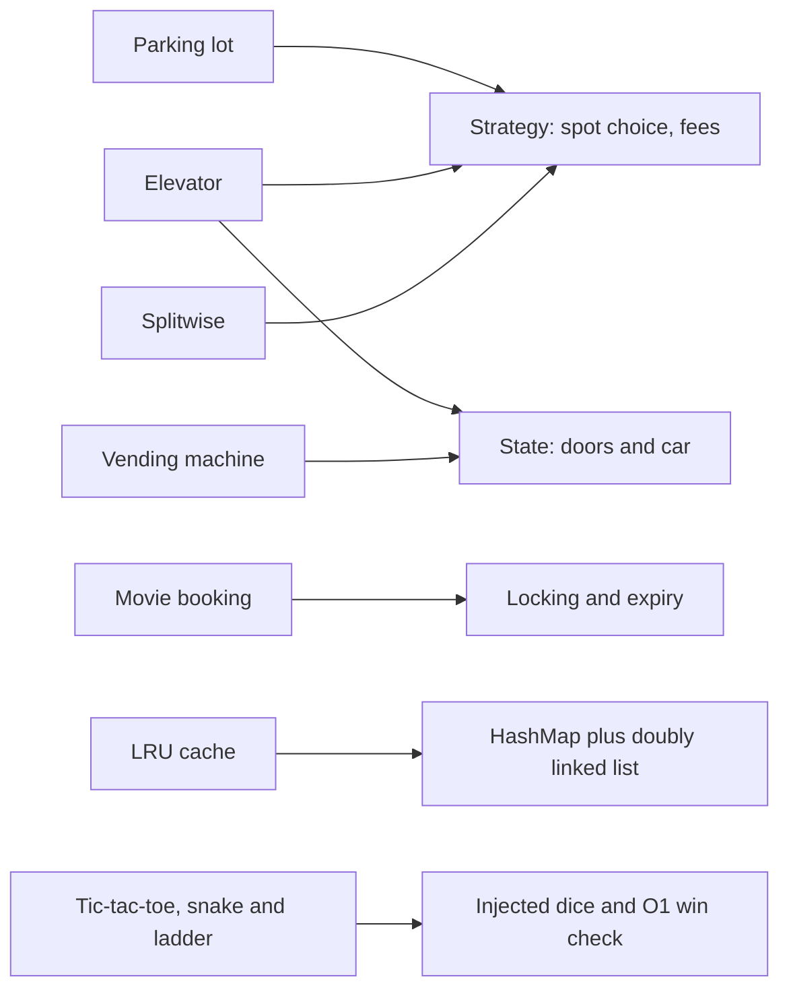

| Problem | Core idea interviewers look for | Patterns |
|---|---|---|
| **Parking lot** | Spot types, allocation policy, pricing, one spot per car | Strategy, Factory, (Singleton lot: avoid) |
| **Elevator** | Scheduling algorithm, safe state transitions | Strategy, State, Observer (buttons) |
| **Splitwise** | Split types, balances, minimum settlements, money in integers | Strategy, Factory |
| **Movie booking** | Temporary seat locks, all-or-nothing, concurrency | Locking, State, expiry |
| **Vending machine** | Behaviour depends on state; change making | State |
| **LRU cache** | O(1) get/put, eviction | Data-structure design |
| **Games** | Clean model, O(1) win check, testable randomness | Strategy (dice), Command (moves) |

### 📘 Terms Explained

| Term | Meaning |
|---|---|
| **LLD** | Low-Level Design: classes, methods and their relationships inside one application |
| **Machine coding** | An interview round where you write a working, well-structured program in a limited time |
| **Class diagram** | A drawing of classes, their fields/methods and how they relate |
| **Entity** | A thing in the problem domain that becomes a class (Vehicle, Spot, Ticket) |
| **Edge case** | An unusual input or situation that must still be handled correctly |

---

# 1. How to Solve Any LLD Interview Problem (Interview Imp - Java)

## 1.1 What Is It?

A repeatable method for the machine-coding round. The interviewer cares less about the "perfect" answer and more about **how you get there**: clarifying, modelling, coding cleanly, and adapting when requirements change ("now add electric-vehicle charging spots").

## 1.2 Why Do We Need It?

| Common failure | Fix with the method |
|---|---|
| Start coding immediately, then discover a missed requirement | Spend the first 5 minutes on requirements |
| One giant `Main` class | Identify entities and responsibilities first |
| No patterns, or patterns forced everywhere | Use a pattern only where something **varies** |
| Code doesn't run at the end | Build the happy path first, then extend |
| No answer to "how would you extend this?" | Leave seams (interfaces) where change is likely |

## 1.3 How It Works

```mermaid
flowchart LR
    R[1 Clarify requirements and scope] --> E[2 Find entities and relationships]
    E --> C[3 Draw the class diagram]
    C --> P[4 Pick patterns where behaviour varies]
    P --> K[5 Code the happy path end to end]
    K --> X[6 Add validation, edge cases, concurrency]
    X --> T[7 Demo with a main method or tests]
    T --> D[8 Discuss extensions and trade-offs]
```

| Step | Time (45 min) | What to say / do |
|---|---|---|
| **1 Requirements** | 5 min | Ask: what are the actors, main use cases, limits? What is out of scope (payments, UI)? Write a short list |
| **2 Entities** | 5 min | Nouns → classes (Vehicle, Spot, Ticket); verbs → methods (park, unpark, pay) |
| **3 Class diagram** | 5 min | Relationships: has-a (composition), is-a (inheritance, sparingly), uses (dependency) |
| **4 Patterns** | 2 min | "Pricing may change → Strategy", "Behaviour depends on state → State", "Many object types → Factory" |
| **5 Code** | 15 min | Interfaces first, then one implementation each, then a demo |
| **6 Robustness** | 5 min | Validation, exceptions, thread safety (`synchronized`, locks, atomic operations) |
| **7 Demo** | 3 min | A `main` that runs the main scenario |
| **8 Discussion** | 5 min | Extensions, complexity, persistence, scaling to a service |

**Good LLD code checklist:** small classes with one job ([SRP](05_Design_Principles_and_Anti_Patterns.md)), interfaces for the parts that vary, immutable value objects (records), no `public` mutable fields, enums for fixed sets, meaningful exceptions, money in integer minor units, no static global state (testability), and dependencies passed in through the constructor.

## 1.4 Types and Variants

| Problem family | Examples | Typical patterns |
|---|---|---|
| **Resource allocation** | Parking lot, hotel rooms, meeting rooms, seat booking | Strategy for allocation, locking, State for reservations |
| **State machines** | Vending machine, ATM, elevator, traffic light, order lifecycle | State, Command |
| **Ledgers and money** | Splitwise, wallet, bank account, payment | Strategy for splits/fees, immutable transactions |
| **Games** | Tic-tac-toe, chess, snake and ladder, card games | Strategy (players/AI), Command (moves, undo), Observer |
| **Data structures as services** | LRU/LFU cache, rate limiter, logger, key-value store | Data-structure design, Decorator, Singleton (carefully) |
| **Workflow / notification** | Notification service, task scheduler, pub-sub | Observer, Strategy, Chain of Responsibility |

## 1.5 Complete Java Example

Each of the following sections (2 to 8) is a complete, runnable example of this method. A good template for any problem:

```java
// 1. Value objects and enums (immutable)
record Vehicle(String plate, VehicleType type) {}
enum VehicleType { BIKE, CAR, TRUCK }

// 2. Interfaces where behaviour varies (Strategy)
interface SpotSelector { Optional<Spot> choose(List<Spot> spots, Vehicle v); }

// 3. The service/aggregate that enforces the rules (one place for invariants)
class ParkingLot {
    ParkingLot(SpotSelector selector, FeePolicy fees) { ... }      // dependencies injected -> testable
    synchronized Optional<Ticket> park(Vehicle v, long now) { ... }  // thread-safe critical section
}

// 4. A demo main / tests that run the scenarios, including failures
```

## 1.6 In Spring Boot

In a machine-coding round you normally write plain Java. If asked "how would this become a service?":

```java
@RestController @RequestMapping("/lots/{lotId}")
class ParkingController {
    private final ParkingService service;                                 // the same domain classes, wrapped in a service
    @PostMapping("/tickets") TicketDto park(@PathVariable long lotId, @RequestBody VehicleDto v) { return service.park(lotId, v); }
    @PostMapping("/tickets/{id}/exit") ReceiptDto exit(@PathVariable String id) { return service.exit(id); }
}
// The in-memory 'synchronized' becomes a database guarantee: a UNIQUE constraint or a conditional UPDATE (see booking in Domain_Specific_Pattern)
```

## 1.7 Pros and Cons

| Pros of the method | Cons / risks |
|---|---|
| Nothing important is missed | Spending too long on step 1 leaves no time to code |
| Clean, explainable design | Over-engineering: too many interfaces for a 45-minute task |
| Easy to extend during follow-ups | Interviewers differ: some want more code, some more design talk (ask) |

## 1.8 Pitfalls, Interview Questions and Cheat Sheet

**Common pitfalls**
- Using inheritance for everything (`Car extends Vehicle extends Spot…`). Prefer composition.
- God class (`ParkingLotManager` doing everything).
- Ignoring concurrency when two users can act at the same time.
- `double` for money; `public` mutable fields; magic numbers.
- Forgetting the failure cases (lot full, invalid ticket, insufficient balance).

**Interview questions**
1. *How do you start an LLD problem?* → Clarify requirements and scope, list entities, draw relationships, then code the core flow.
2. *How do you decide where to use a pattern?* → Where behaviour varies or is likely to change (pricing, allocation, states); not everywhere.
3. *How do you make the design extensible?* → Program to interfaces, inject dependencies, keep classes small (Open/Closed principle).
4. *How do you handle concurrency in an LLD solution?* → Identify the shared state and protect the check-and-update as one atomic step (synchronized, `ReentrantLock`, `ConcurrentHashMap.compute`, atomic classes).
5. *How would your design change as a web service?* → Domain classes stay; state moves to a database; locks become DB constraints or distributed locks.

**Cheat sheet**
```
Requirements (5) -> Entities (5) -> Class diagram (5) -> Patterns (2) -> Code happy path (15) -> Edge cases + concurrency (5) -> Demo (3) -> Extensions (5)
Nouns = classes, verbs = methods; composition over inheritance; interfaces where things vary
Records for values, enums for fixed sets, ints for money, inject dependencies, protect shared state
```

### 📘 Terms Explained

| Term | Meaning |
|---|---|
| **Happy path** | The normal flow where everything succeeds |
| **Composition** | One object contains or uses another (has-a) |
| **Inheritance** | A class extends another (is-a) |
| **Invariant** | A rule that must always be true (a spot holds at most one vehicle) |
| **Seam** | A place in the code (usually an interface) where behaviour can be swapped |
| **Critical section** | Code that must not be run by two threads at the same time |

---

# 2. Parking Lot (Interview Imp - Java)

## 2.1 What Is It? (Requirements)

Design a multi-floor parking lot.
- Spot sizes: **small, medium, large**. Vehicles: **bike, car, truck**. A bike fits any spot, a car needs medium or large, a truck needs large.
- Entry: assign a spot and issue a **ticket**. Exit: free the spot and compute the **fee** (per started hour, by vehicle type).
- Show free spots. Reject entry when no suitable spot exists.
- Follow-ups: multiple entry gates at the same time, electric-vehicle spots, reservations, different pricing on weekends.

## 2.2 Why Is It Asked?

It looks easy but tests everything: entity modelling, a clean allocation **policy**, a pricing **policy** that will change, validation (lost or reused tickets) and concurrency (two gates assigning the same spot).

## 2.3 How It Works (Entities and Class Diagram)

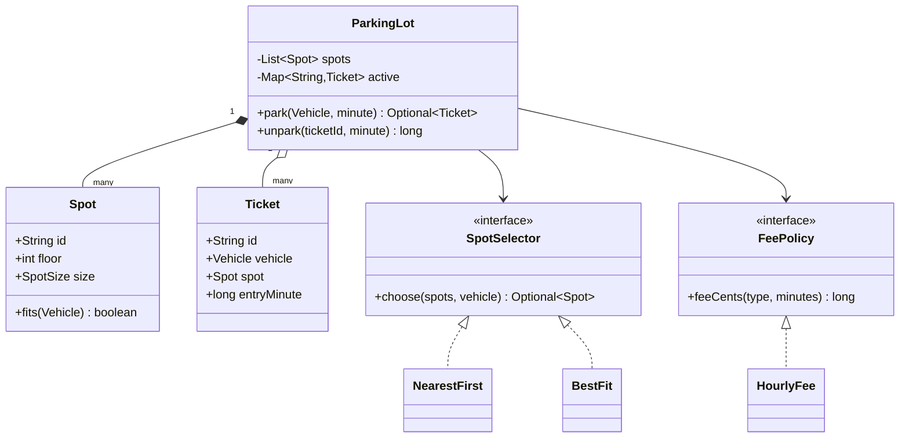

## 2.4 Design Choices and Variants

| Decision | Choice | Why |
|---|---|---|
| Where is the "fits" rule? | `Spot.fits(vehicle)` | Information Expert: the spot knows its size and occupancy |
| How to choose a spot? | `SpotSelector` **Strategy** (nearest first, best fit, by gate) | Policies change; new ones don't touch `ParkingLot` |
| How to price? | `FeePolicy` **Strategy** (hourly, weekend, flat, subscription) | Pricing changes often |
| Who issues tickets? | `ParkingLot` | One place enforces "one ticket per active vehicle" |
| Singleton lot? | **No**, pass the lot in | Singletons make tests and multi-lot support hard |
| Concurrency | `synchronized park/unpark` (single JVM); per-floor locks to scale | Two gates must not get the same spot |
| Money | `long` cents | No floating-point errors |

## 2.5 Complete Java Example - Two Allocation Strategies, Fees and Ticket Validation

**What it shows:** the same arrivals with *nearest-first* vs *best-fit* allocation, hourly fees rounded up per started hour, rejection of a reused ticket, and free-spot counts.

```java
import java.util.*;

public class ParkingLotDemo {

    enum VehicleType { BIKE, CAR, TRUCK }
    enum SpotSize { SMALL, MEDIUM, LARGE }

    record Vehicle(String plate, VehicleType type) {}

    static class Spot {
        final String id; final int floor; final SpotSize size; Vehicle parked;
        Spot(String id, int floor, SpotSize size) { this.id = id; this.floor = floor; this.size = size; }
        boolean fits(Vehicle v) {
            return parked == null && switch (v.type()) {
                case BIKE -> true;                                        // a bike fits anywhere
                case CAR -> size != SpotSize.SMALL;
                case TRUCK -> size == SpotSize.LARGE;
            };
        }
    }

    record Ticket(String id, Vehicle vehicle, Spot spot, long entryMinute) {}

    // Strategy: how to choose a spot
    interface SpotSelector { Optional<Spot> choose(List<Spot> spots, Vehicle v); }
    static class NearestFirst implements SpotSelector {                     // lowest floor, then id
        public Optional<Spot> choose(List<Spot> spots, Vehicle v) { return spots.stream().filter(s -> s.fits(v)).findFirst(); }
    }
    static class BestFit implements SpotSelector {                          // smallest spot that fits (keeps big spots free)
        public Optional<Spot> choose(List<Spot> spots, Vehicle v) {
            return spots.stream().filter(s -> s.fits(v)).min(Comparator.comparing((Spot s) -> s.size).thenComparing(s -> s.floor));
        }
    }

    // Strategy: how to charge
    interface FeePolicy { long feeCents(VehicleType t, long minutes); }
    static class HourlyFee implements FeePolicy {
        final Map<VehicleType, Long> perHour = Map.of(VehicleType.BIKE, 1000L, VehicleType.CAR, 2000L, VehicleType.TRUCK, 5000L);
        public long feeCents(VehicleType t, long minutes) {
            long hours = Math.max(1, (minutes + 59) / 60);                        // round up, minimum one hour
            return hours * perHour.get(t);
        }
    }

    static class ParkingLot {
        private final List<Spot> spots = new ArrayList<>();
        private final Map<String, Ticket> active = new HashMap<>();
        private final SpotSelector selector; private final FeePolicy fees; private int nextTicket = 1;
        ParkingLot(SpotSelector selector, FeePolicy fees) { this.selector = selector; this.fees = fees; }
        void addSpot(Spot s) { spots.add(s); }

        synchronized Optional<Ticket> park(Vehicle v, long minute) {             // synchronized: two cars can't get the same spot
            Optional<Spot> spot = selector.choose(spots, v);
            if (spot.isEmpty()) return Optional.empty();
            spot.get().parked = v;
            Ticket t = new Ticket("T" + nextTicket++, v, spot.get(), minute);
            active.put(t.id(), t);
            return Optional.of(t);
        }
        synchronized long unpark(String ticketId, long minute) {
            Ticket t = active.remove(ticketId);
            if (t == null) throw new IllegalArgumentException("unknown or already used ticket " + ticketId);
            t.spot().parked = null;
            return fees.feeCents(t.vehicle().type(), minute - t.entryMinute());
        }
        long free(SpotSize size) { return spots.stream().filter(s -> s.size == size && s.parked == null).count(); }
    }

    static ParkingLot build(SpotSelector sel) {
        ParkingLot lot = new ParkingLot(sel, new HourlyFee());
        lot.addSpot(new Spot("F0-L1", 0, SpotSize.LARGE));
        lot.addSpot(new Spot("F0-M1", 0, SpotSize.MEDIUM));
        lot.addSpot(new Spot("F0-S1", 0, SpotSize.SMALL));
        lot.addSpot(new Spot("F1-M2", 1, SpotSize.MEDIUM));
        lot.addSpot(new Spot("F1-S2", 1, SpotSize.SMALL));
        return lot;
    }
    static String money(long c) { return String.format("%d.%02d", c / 100, c % 100); }

    public static void main(String[] args) {
        List<Vehicle> arrivals = List.of(new Vehicle("BIKE-1", VehicleType.BIKE), new Vehicle("CAR-1", VehicleType.CAR),
                new Vehicle("CAR-2", VehicleType.CAR), new Vehicle("TRUCK-1", VehicleType.TRUCK));

        for (SpotSelector sel : List.of(new NearestFirst(), new BestFit())) {
            ParkingLot lot = build(sel);
            System.out.println("strategy " + sel.getClass().getSimpleName() + ":");
            for (Vehicle v : arrivals) {
                Optional<Ticket> t = lot.park(v, 0);
                System.out.println("   " + v.plate() + " -> " + t.map(x -> x.spot().id + " (ticket " + x.id() + ")").orElse("LOT FULL for this vehicle"));
            }
        }

        ParkingLot lot = build(new BestFit());
        Ticket car = lot.park(new Vehicle("CAR-9", VehicleType.CAR), 600).get();
        Ticket bike = lot.park(new Vehicle("BIKE-9", VehicleType.BIKE), 600).get();
        System.out.println("fees: CAR-9 parked 135 min -> " + money(lot.unpark(car.id(), 735)) + "   BIKE-9 parked 20 min -> " + money(lot.unpark(bike.id(), 620)));
        try { lot.unpark(car.id(), 800); } catch (IllegalArgumentException e) { System.out.println("reuse a paid ticket -> " + e.getMessage()); }
        System.out.println("free spots after exits: small=" + lot.free(SpotSize.SMALL) + " medium=" + lot.free(SpotSize.MEDIUM) + " large=" + lot.free(SpotSize.LARGE));
    }
}
```

**Output** (identical on all 3 runs):

```text
strategy NearestFirst:
   BIKE-1 -> F0-L1 (ticket T1)
   CAR-1 -> F0-M1 (ticket T2)
   CAR-2 -> F1-M2 (ticket T3)
   TRUCK-1 -> LOT FULL for this vehicle
strategy BestFit:
   BIKE-1 -> F0-S1 (ticket T1)
   CAR-1 -> F0-M1 (ticket T2)
   CAR-2 -> F1-M2 (ticket T3)
   TRUCK-1 -> F0-L1 (ticket T4)
fees: CAR-9 parked 135 min -> 60.00   BIKE-9 parked 20 min -> 10.00
reuse a paid ticket -> unknown or already used ticket T1
free spots after exits: small=2 medium=2 large=1
```

**What the output shows**
- **Nearest-first** put the bike in the **large** spot (the first one it found), so the truck that came later had **nowhere to park**.
- **Best-fit** put the bike in a small spot and kept the large spot free; all four vehicles parked. Same lot, better policy: this is exactly why allocation is a Strategy.
- **Fees:** 135 minutes = 3 started hours × 20.00 = 60.00 for the car; 20 minutes = minimum 1 hour = 10.00 for the bike.
- **Validation:** a ticket can't be used twice.

## 2.6 Extensions and Spring Boot Shape

| Follow-up | Change |
|---|---|
| Electric-vehicle charging spots | New `SpotType`/feature flag on `Spot`; selector filters by it; `FeePolicy` adds charging cost |
| Multiple gates in parallel | Keep `park` atomic; or lock per floor; in a DB: `UPDATE spot SET vehicle=? WHERE id=? AND vehicle IS NULL` |
| Reservations | Spot state `RESERVED` with expiry (see [Movie Booking](#5-movie-ticket-booking-bookmyshow-interview-imp---java)) |
| Display boards | Observer: spots publish "freed/occupied" events; boards subscribe |
| Lost ticket | Look up by licence plate; charge a lost-ticket fee |
| Weekend pricing | New `FeePolicy` implementation, chosen by a factory based on the date |

## 2.7 Pros and Cons

| Pros | Cons |
|---|---|
| Allocation and pricing are swappable | More interfaces than a one-off script needs |
| Rules live in one place (`ParkingLot`) | Single `synchronized` lot limits throughput with many gates |
| Easy to unit test with fixed times | In-memory state disappears on restart (needs persistence) |

## 2.8 Pitfalls, Interview Questions and Cheat Sheet

**Common pitfalls**
- Deep inheritance (`SmallSpot`, `MediumSpot`, `LargeSpot` classes with copied logic). An enum + one `fits` rule is enough.
- First-fit allocation that wastes large spots.
- Fees in `double`; rounding minutes the wrong way.
- Not freeing the spot when the ticket is paid; allowing ticket reuse.
- A global `ParkingLot.getInstance()` that makes tests share state.

**Interview questions**
1. *Which patterns would you use?* → Strategy for spot selection and fees; Factory for creating spots/vehicles; Observer for display boards; avoid Singleton.
2. *How do you stop two gates assigning the same spot?* → Make "find free spot + mark occupied" atomic (synchronized/lock, or a conditional DB update).
3. *How do you add a new vehicle type?* → Add an enum value and its fit rule; selectors and fee policies keep working.
4. *What is the time complexity of finding a spot?* → O(n) scan in the simple version; use per-size free lists/queues (`Deque<Spot>` per size) for O(1).
5. *How would you scale to 100 lots?* → `ParkingLot` per site, a service with a DB per lot, events for availability.

**Cheat sheet**
```
Entities: ParkingLot, Floor, Spot(size), Vehicle(type), Ticket, Receipt
Rules: Spot.fits(vehicle); park = find + occupy atomically; unpark = free + fee
Patterns: Strategy (SpotSelector, FeePolicy), Factory (spots), Observer (boards); no Singleton
O(1) allocation: free-spot queues per size;  money in cents;  ticket used once
```

### 📘 Terms Explained

| Term | Meaning |
|---|---|
| **Best fit** | Choose the smallest resource that satisfies the request |
| **First fit** | Choose the first resource that satisfies the request |
| **Strategy pattern** | Put a changeable algorithm behind an interface |
| **Information Expert** | Give a responsibility to the class that has the needed data |
| **Free list** | A list of currently available items for fast allocation |

---

# 3. Elevator System

## 3.1 What Is It? (Requirements)

Design the control system for one (then several) elevators.
- Requests come from **inside** the car (floor buttons) and from **outside** (up/down buttons on each floor).
- The car moves floor by floor, stops at requested floors, opens and closes doors.
- Safety: never move with the doors open; never open the doors while moving.
- Goal: serve requests efficiently (less travel, less waiting).
- Follow-ups: several cars (dispatcher), peak-hour modes, emergency stop, overweight sensor.

## 3.2 Why Is It Asked?

It tests two things: an **algorithm choice** (scheduling) that must be swappable, and a **state machine** that must forbid unsafe transitions.

## 3.3 How It Works (Entities and Class Diagram)

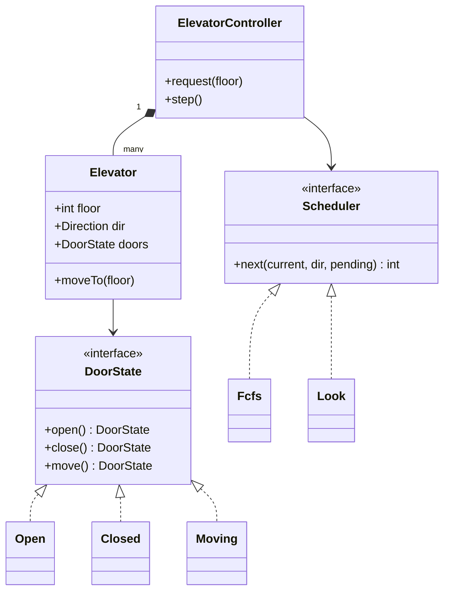

**Scheduling algorithms**

| Algorithm | Idea | Behaviour |
|---|---|---|
| **FCFS** (first come first served) | Serve in arrival order | Simple, lots of back-and-forth |
| **SCAN** | Go to the end of the building in one direction, then reverse | Like a disk head, fair |
| **LOOK** | Like SCAN but reverse at the last *requested* floor | What real elevators approximate |
| **Nearest first (SSTF)** | Always the closest request | Efficient but can starve far floors |
| **Destination dispatch** | Passengers enter the destination in the lobby; the system groups them | Modern high-rise buildings |

## 3.4 Design Choices and Variants

| Decision | Choice |
|---|---|
| Scheduling | `Scheduler` **Strategy** (FCFS, LOOK, peak mode) |
| Safety | **State** pattern for doors/car: illegal transitions throw |
| Buttons | **Command** objects (`FloorRequest`, `HallCall(up/down)`) queued to the controller |
| Displays | **Observer**: cars publish floor changes |
| Many cars | A `Dispatcher` strategy assigns a hall call to the best car (closest car moving in the right direction) |
| Simulation | A `step()` method advances time, which keeps the logic testable |

## 3.5 Complete Java Example - FCFS vs LOOK, and a Door State Machine

**What it shows:** six requests served in arrival order versus with the LOOK algorithm (floors travelled), and a door state machine that refuses to move with open doors or to open while moving.

```java
import java.util.*;

public class ElevatorDemo {

    enum Direction { UP, DOWN, IDLE }

    // Strategy: which requested floor to visit next
    interface Scheduler { int next(int current, Direction dir, TreeSet<Integer> pending); }

    // FCFS: serve requests strictly in arrival order
    static class Fcfs implements Scheduler {
        final Deque<Integer> order;
        Fcfs(List<Integer> requests) { order = new ArrayDeque<>(requests); }
        public int next(int cur, Direction d, TreeSet<Integer> pending) { int f = order.poll(); pending.remove(f); return f; }
    }

    // LOOK (elevator algorithm): keep going in the same direction while there are requests ahead, then reverse
    static class Look implements Scheduler {
        public int next(int cur, Direction d, TreeSet<Integer> pending) {
            Integer up = pending.ceiling(cur), down = pending.floor(cur);
            Integer pick = (d != Direction.DOWN) ? (up != null ? up : down) : (down != null ? down : up);
            pending.remove(pick);
            return pick;
        }
    }

    static class Elevator {
        int floor; Direction dir = Direction.IDLE; int travelled = 0; final List<Integer> stops = new ArrayList<>();
        Elevator(int start) { floor = start; }
        void moveTo(int target) {
            dir = target > floor ? Direction.UP : target < floor ? Direction.DOWN : dir;
            travelled += Math.abs(target - floor); floor = target; stops.add(target);
        }
    }

    static Elevator run(Scheduler s, List<Integer> requests, int start) {
        Elevator e = new Elevator(start);
        TreeSet<Integer> pending = new TreeSet<>(requests);
        while (!pending.isEmpty()) e.moveTo(s.next(e.floor, e.dir, pending));
        return e;
    }

    // ---------- State pattern for the car's doors ----------
    interface DoorState { DoorState open(); DoorState close(); DoorState move(); String name(); }
    static final DoorState OPEN = new DoorState() {
        public DoorState open() { return this; } public DoorState close() { return CLOSED; }
        public DoorState move() { throw new IllegalStateException("cannot move with doors open"); } public String name() { return "OPEN"; } };
    static final DoorState CLOSED = new DoorState() {
        public DoorState open() { return OPEN; } public DoorState close() { return this; }
        public DoorState move() { return MOVING; } public String name() { return "CLOSED"; } };
    static final DoorState MOVING = new DoorState() {
        public DoorState open() { throw new IllegalStateException("cannot open doors while moving"); } public DoorState close() { return this; }
        public DoorState move() { return this; } public String name() { return "MOVING"; } };

    public static void main(String[] args) {
        List<Integer> requests = List.of(9, 2, 7, 1, 8, 3);       // floors requested, in arrival order; car starts at floor 5
        Elevator fcfs = run(new Fcfs(requests), requests, 5);
        Elevator look = run(new Look(), requests, 5);
        System.out.println("requests " + requests + ", start at floor 5");
        System.out.println("FCFS : stops " + fcfs.stops + "  floors travelled = " + fcfs.travelled);
        System.out.println("LOOK : stops " + look.stops + "  floors travelled = " + look.travelled);

        DoorState s = CLOSED;
        StringBuilder log = new StringBuilder("door states: " + s.name());
        s = s.open(); log.append(" -> ").append(s.name());
        try { s.move(); } catch (IllegalStateException e) { log.append(" | move refused: ").append(e.getMessage()); }
        s = s.close(); log.append(" -> ").append(s.name());
        s = s.move(); log.append(" -> ").append(s.name());
        try { s.open(); } catch (IllegalStateException e) { log.append(" | open refused: ").append(e.getMessage()); }
        System.out.println(log);
    }
}
```

**Output** (identical on all 3 runs):

```text
requests [9, 2, 7, 1, 8, 3], start at floor 5
FCFS : stops [9, 2, 7, 1, 8, 3]  floors travelled = 34
LOOK : stops [7, 8, 9, 3, 2, 1]  floors travelled = 12
door states: CLOSED -> OPEN | move refused: cannot move with doors open -> CLOSED -> MOVING | open refused: cannot open doors while moving
```

**What the output shows**
- **FCFS** zig-zags 9 → 2 → 7 → 1 → 8 → 3: **34 floors**.
- **LOOK** continues upward first (7, 8, 9), then sweeps down (3, 2, 1): **12 floors**, almost 3× less travel for the same requests.
- **State machine:** `move()` with open doors and `open()` while moving are both refused. The rules live in the states, not in scattered `if` checks.

## 3.6 Extensions and Spring Boot Shape

```java
// Multi-car dispatcher: score each car for a hall call
Elevator best = cars.stream().min(Comparator.comparingInt(c -> c.costFor(callFloor, callDirection))).orElseThrow();
// cost: distance, +penalty if moving away or in the opposite direction, +penalty for load
```
The real-time control loop would be a dedicated thread (or a scheduled executor) calling `step()` every tick; a web API would only accept requests and show status. Events (`ElevatorArrived`, `DoorOpened`) go to displays via Observer or a message bus.

## 3.7 Pros and Cons

| Pros | Cons |
|---|---|
| Scheduling is swappable and testable | Real buildings need many more states (maintenance, fire mode) |
| Safety rules enforced by the type of state | State classes multiply as features grow (hierarchical FSM helps) |
| LOOK reduces travel a lot | LOOK can still make some passengers wait long at peak times |

## 3.8 Pitfalls, Interview Questions and Cheat Sheet

**Common pitfalls**
- One huge `if/else` over flags (`isMoving`, `doorsOpen`, `goingUp`).
- Nearest-first scheduling that starves distant floors.
- Not removing a served request (the car keeps returning).
- Ignoring direction for hall calls (stopping for an "up" call while going down).
- Busy-wait loops instead of a scheduled tick.

**Interview questions**
1. *Which scheduling algorithm and why?* → LOOK/SCAN: fewer direction changes, no starvation; FCFS is simple but wasteful.
2. *How do you guarantee doors never open while moving?* → A State pattern where the `Moving` state rejects `open()`.
3. *How do you handle several elevators?* → A dispatcher scores cars (distance, direction, load) and assigns each hall call.
4. *Which data structure holds pending floors?* → A sorted set (`TreeSet`) gives `ceiling/floor` for the next stop in each direction in O(log n).
5. *How do you test it?* → Inject the scheduler and drive time with `step()`; assert stops and states.

**Cheat sheet**
```
Entities: Controller/Dispatcher, Elevator(floor, dir, doors), Request(inside/hall, dir), Scheduler
Scheduling: FCFS (simple) < LOOK/SCAN (sweep) ; TreeSet.ceiling/floor for next stop
State pattern: OPEN / CLOSED / MOVING with illegal transitions rejected
Many cars: dispatcher cost = distance + direction penalty + load
```

### 📘 Terms Explained

| Term | Meaning |
|---|---|
| **Hall call** | A request made from outside the car (up/down button on a floor) |
| **FCFS** | First come, first served |
| **SCAN / LOOK** | Sweep in one direction, then reverse (at the building end / the last request) |
| **Starvation** | A request that waits forever because others keep being chosen |
| **State machine** | A model with defined states and allowed transitions |
| **Dispatcher** | The component that assigns requests to one of several elevators |

---

# 4. Splitwise (Expense Sharing) (Interview Imp - Java)

## 4.1 What Is It? (Requirements)

An app where friends record shared expenses and see who owes whom.
- Add an expense: who paid, how much, who shares it, and **how** it is split: **equally**, **exact amounts**, or **percentages**.
- Show each person's **net balance**.
- **Settle up** with as few payments as possible.
- Follow-ups: groups, multiple currencies, edit/delete expense, history.

## 4.2 Why Is It Asked?

It tests money handling (rounding!), a clean Strategy for split types, validation, and a small algorithm (simplifying debts).

## 4.3 How It Works (Entities and Class Diagram)

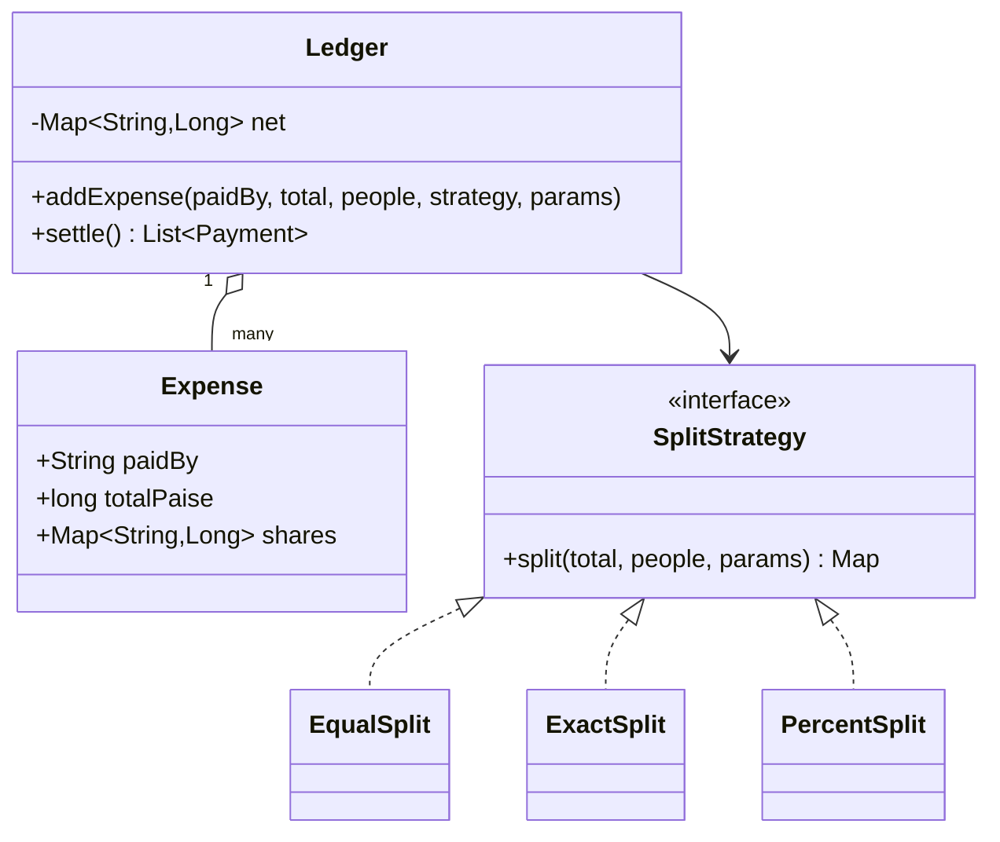

**Net balance** = total paid − total share. Positive = should receive, negative = owes. All balances always add up to **zero**.

**Settle-up (greedy):** repeatedly let the biggest debtor pay the biggest creditor the smaller of the two amounts. This needs at most *n − 1* payments for *n* people. (Finding the absolute minimum number of payments is NP-hard in general; greedy is the standard, good answer.)

## 4.4 Design Choices and Variants

| Decision | Choice |
|---|---|
| Split types | `SplitStrategy` with `EqualSplit`, `ExactSplit`, `PercentSplit` (add `ShareSplit` later) |
| Money | `long` paise; the leftover paisa of an equal split goes to the first people (deterministic) |
| Validation | Exact amounts must sum to the total; percentages to 100 |
| Storage | Store expenses (the source of truth) and derive balances (or keep a running balance for speed) |
| Groups | `Group` has members and its own ledger |
| Currencies | Keep balances per currency, convert only at settle time ([Multi-Currency](../04_Specialized/11_Domain_Specific_Pattern.md#8-multi-currency-pattern-interview-imp---java)) |

## 4.5 Complete Java Example - Three Split Strategies, Balances and Minimal Settle-Up

**What it shows:** four expenses split equally, exactly and by percentage (including a 10.00 three-way split that doesn't divide evenly); net balances that sum to zero; three payments to settle everything; and validation of wrong percentages.

```java
import java.util.*;

public class SplitwiseDemo {

    // Strategy: how an expense is divided. Amounts are in paise (integer) to avoid rounding errors.
    interface SplitStrategy { Map<String, Long> split(long total, List<String> people, List<Long> params); }

    static class EqualSplit implements SplitStrategy {
        public Map<String, Long> split(long total, List<String> people, List<Long> ignored) {
            Map<String, Long> out = new LinkedHashMap<>(); long base = total / people.size(), rest = total % people.size();
            for (int i = 0; i < people.size(); i++) out.put(people.get(i), base + (i < rest ? 1 : 0));    // leftover paise go to the first people
            return out;
        }
    }
    static class ExactSplit implements SplitStrategy {
        public Map<String, Long> split(long total, List<String> people, List<Long> amounts) {
            if (amounts.stream().mapToLong(Long::longValue).sum() != total) throw new IllegalArgumentException("exact amounts must add up to the total");
            Map<String, Long> out = new LinkedHashMap<>(); for (int i = 0; i < people.size(); i++) out.put(people.get(i), amounts.get(i)); return out;
        }
    }
    static class PercentSplit implements SplitStrategy {
        public Map<String, Long> split(long total, List<String> people, List<Long> pct) {
            if (pct.stream().mapToLong(Long::longValue).sum() != 100) throw new IllegalArgumentException("percentages must add up to 100");
            Map<String, Long> out = new LinkedHashMap<>(); long used = 0;
            for (int i = 0; i < people.size(); i++) { long share = i == people.size() - 1 ? total - used : total * pct.get(i) / 100; out.put(people.get(i), share); used += share; }
            return out;
        }
    }

    static class Ledger {
        final Map<String, Long> net = new TreeMap<>();               // positive = should receive, negative = owes
        void addExpense(String paidBy, long total, List<String> people, SplitStrategy s, List<Long> params) {
            Map<String, Long> shares = s.split(total, people, params);
            net.merge(paidBy, total, Long::sum);
            shares.forEach((p, share) -> net.merge(p, -share, Long::sum));
        }
        // greedy settle-up: biggest debtor pays biggest creditor -> at most n-1 payments
        List<String> settle() {
            PriorityQueue<long[]> cred = new PriorityQueue<>((a, b) -> Long.compare(b[1], a[1])), debt = new PriorityQueue<>((a, b) -> Long.compare(a[1], b[1]));
            List<String> names = new ArrayList<>(net.keySet());
            for (int i = 0; i < names.size(); i++) { long v = net.get(names.get(i)); if (v > 0) cred.add(new long[]{i, v}); else if (v < 0) debt.add(new long[]{i, v}); }
            List<String> payments = new ArrayList<>();
            while (!cred.isEmpty() && !debt.isEmpty()) {
                long[] c = cred.poll(), d = debt.poll(); long amt = Math.min(c[1], -d[1]);
                payments.add(names.get((int) d[0]) + " pays " + names.get((int) c[0]) + " " + money(amt));
                if (c[1] - amt > 0) cred.add(new long[]{c[0], c[1] - amt});
                if (d[1] + amt < 0) debt.add(new long[]{d[0], d[1] + amt});
            }
            return payments;
        }
    }
    static String money(long p) { return String.format("%d.%02d", p / 100, Math.abs(p % 100)); }

    public static void main(String[] args) {
        Ledger l = new Ledger();
        List<String> all = List.of("Asha", "Ben", "Chen", "Dev");
        l.addExpense("Asha", 100_000, all, new EqualSplit(), null);                                     // dinner 1000.00, 4 ways
        l.addExpense("Ben", 30_000, List.of("Ben", "Chen", "Dev"), new ExactSplit(), List.of(5_000L, 15_000L, 10_000L));   // taxi
        l.addExpense("Chen", 1_000, List.of("Asha", "Ben", "Chen"), new EqualSplit(), null);            // 10.00 three ways -> 3.34 + 3.33 + 3.33
        l.addExpense("Dev", 60_000, all, new PercentSplit(), List.of(40L, 20L, 20L, 20L));              // hotel by share
        System.out.println("net balances (+ receives, - owes):");
        l.net.forEach((p, v) -> System.out.println("   " + p + " " + (v >= 0 ? "+" : "-") + money(Math.abs(v))));
        System.out.println("   sum of all balances = " + l.net.values().stream().mapToLong(Long::longValue).sum() + " (must be 0)");
        System.out.println("settle up with the fewest payments:");
        l.settle().forEach(p -> System.out.println("   " + p));
        System.out.println("without simplification each person would pay every expense owner separately: up to " + (all.size() * (all.size() - 1)) + " payments");
        try { l.addExpense("Asha", 1000, List.of("Asha", "Ben"), new PercentSplit(), List.of(60L, 30L)); }
        catch (IllegalArgumentException e) { System.out.println("validation: " + e.getMessage()); }
    }
}
```

**Output** (identical on all 3 runs):

```text
net balances (+ receives, - owes):
   Asha +506.66
   Ben -123.33
   Chen -513.33
   Dev +130.00
   sum of all balances = 0 (must be 0)
settle up with the fewest payments:
   Chen pays Asha 506.66
   Ben pays Dev 123.33
   Chen pays Dev 6.67
without simplification each person would pay every expense owner separately: up to 12 payments
validation: percentages must add up to 100
```

**What the output shows**
- **Rounding:** 10.00 split three ways becomes 3.34 + 3.33 + 3.33; no paisa is lost. The sum of all balances is **0**.
- **Balances:** Asha +506.66, Dev +130.00 should receive; Ben −123.33 and Chen −513.33 owe.
- **Settle-up:** just **3 payments** (Chen → Asha 506.66, Ben → Dev 123.33, Chen → Dev 6.67), compared with up to 12 if everyone paid every expense owner separately.
- **Validation:** percentages adding up to 90 are rejected.

## 4.6 Extensions and Spring Boot Shape

```java
@PostMapping("/groups/{id}/expenses")
ExpenseDto add(@PathVariable long id, @Valid @RequestBody NewExpense e) {
    SplitStrategy s = splitFactory.of(e.type());                // Factory picks EQUAL / EXACT / PERCENT
    return service.add(id, e.paidBy(), e.totalPaise(), e.people(), s, e.params());
}
// expenses table is the source of truth; balances table is a cached projection updated in the same transaction
```

## 4.7 Pros and Cons

| Pros | Cons |
|---|---|
| New split types without touching the ledger | Greedy settle-up is not always the absolute minimum |
| Exact money arithmetic | Editing old expenses needs balance recalculation |
| Balances always consistent (sum = 0) | Multi-currency adds conversion questions |

## 4.8 Pitfalls, Interview Questions and Cheat Sheet

**Common pitfalls**
- `double` amounts (balances that don't add up to zero).
- Losing the leftover paisa in equal splits.
- A `switch(type)` in the ledger instead of strategies.
- No validation of exact/percent inputs.
- Storing only balances (you can't show history or undo an expense).

**Interview questions**
1. *How do you represent the split types?* → A Strategy interface with one implementation per type, chosen by a factory.
2. *How do you avoid rounding errors?* → Integer minor units; give the remainder to specific people deterministically.
3. *How do you minimise the number of settle-up payments?* → Greedy: biggest debtor pays biggest creditor; at most n−1 payments.
4. *What do you store: expenses or balances?* → Expenses as the source of truth; balances as a derived cache.
5. *How do you support groups?* → A `Group` aggregate with members and its own ledger; users can be in many groups.

**Cheat sheet**
```
net = paid - share ; sum(net) == 0 always
SplitStrategy: Equal (remainder paise to first k), Exact (sum == total), Percent (sum == 100, last gets the remainder)
Settle: max-heap creditors + min-heap debtors, pay min(credit, debt) -> <= n-1 payments
Store expenses (truth) + balances (cache); money in paise
```

### 📘 Terms Explained

| Term | Meaning |
|---|---|
| **Net balance** | What a person paid minus their share |
| **Creditor / Debtor** | Someone owed money / someone who owes money |
| **Greedy algorithm** | Make the locally best choice at each step |
| **NP-hard** | No known fast algorithm for the exact optimum on large inputs |
| **Projection** | Data derived from the source records, kept for fast reads |
| **Paise** | Hundredths of a rupee (minor unit) |

---

# 5. Movie Ticket Booking (BookMyShow) (Interview Imp - Java)

## 5.1 What Is It? (Requirements)

Users pick a city → cinema → movie → show, see the seat map, **select seats**, pay, and get a ticket.
- A selected seat is **locked** for a few minutes while the user pays; others see it as unavailable.
- If the user doesn't pay in time, the lock **expires** and the seats are free again.
- A group's seats are booked **all together or not at all**.
- Two users must never get the same seat.
- Follow-ups: seat categories and prices, offers, cancellations and refunds, showing seats to thousands of users at once.

## 5.2 Why Is It Asked?

It is the cleanest test of **concurrency** in LLD: a check-then-act race on shared seats, plus time-based state (locks with expiry).

## 5.3 How It Works (Entities and Class Diagram)

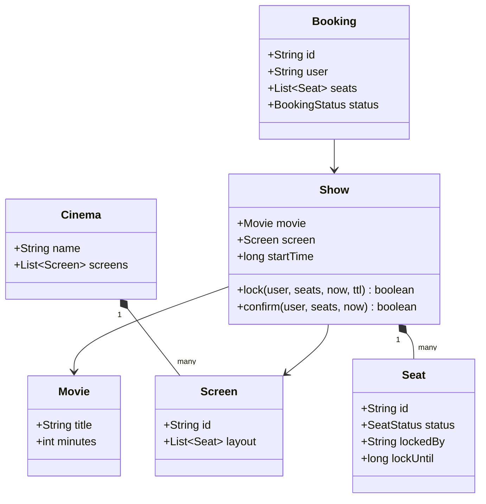

Seat life cycle: **AVAILABLE → LOCKED (ttl) → BOOKED**; an expired lock counts as available. The seat status belongs to the **show** (the same physical seat is free at 3 pm and booked at 7 pm).

## 5.4 Design Choices and Variants

| Decision | Choice |
|---|---|
| Atomic group lock | Check every seat, then lock every seat, inside one `synchronized` method on the `Show` |
| Expiry | Store `lockUntil`; treat expired locks as free (lazy) + an optional cleanup job |
| Confirm | Only the user who holds a *valid* lock may confirm |
| Lock granularity | Per show (not global), so different shows don't block each other |
| Payment | Outside the lock; idempotent payment with a booking id ([Payment Gateway](../04_Specialized/11_Domain_Specific_Pattern.md#2-payment-gateway-pattern-interview-imp---java)) |
| Pricing | Strategy by seat category, day, offers |
| Many servers | Redis `SET seat:show42:A1 user NX EX 300` per seat or a DB unique constraint on (show, seat) |

## 5.5 Complete Java Example - Seat Locks With Expiry, All-or-Nothing, and 100 Concurrent Users

**What it shows:** locking two seats, a partial-overlap request that locks nothing, payment confirmation, an abandoned lock that expires, a late payment that is rejected, and 100 threads competing for the same two seats.

```java
import java.util.*;
import java.util.concurrent.*;
import java.util.concurrent.atomic.*;

public class MovieBookingDemo {

    enum SeatStatus { AVAILABLE, LOCKED, BOOKED }

    static class Seat {
        final String id; SeatStatus status = SeatStatus.AVAILABLE; String lockedBy; long lockUntil;
        Seat(String id) { this.id = id; }
    }

    // One show = one screen at one time. All seat changes go through this class.
    static class Show {
        final Map<String, Seat> seats = new LinkedHashMap<>();
        Show(String... ids) { for (String id : ids) seats.put(id, new Seat(id)); }

        // lock ALL requested seats or none (a group must sit together)
        synchronized boolean lock(String user, List<String> ids, long now, long ttl) {
            for (String id : ids) {
                Seat s = seats.get(id);
                boolean expiredLock = s.status == SeatStatus.LOCKED && s.lockUntil <= now;
                if (s.status == SeatStatus.BOOKED || (s.status == SeatStatus.LOCKED && !expiredLock)) return false;
            }
            for (String id : ids) { Seat s = seats.get(id); s.status = SeatStatus.LOCKED; s.lockedBy = user; s.lockUntil = now + ttl; }
            return true;
        }
        synchronized boolean confirm(String user, List<String> ids, long now) {        // after payment succeeded
            for (String id : ids) { Seat s = seats.get(id); if (s.status != SeatStatus.LOCKED || !user.equals(s.lockedBy) || s.lockUntil <= now) return false; }
            for (String id : ids) seats.get(id).status = SeatStatus.BOOKED;
            return true;
        }
        synchronized String map(long now) {
            StringBuilder sb = new StringBuilder();
            for (Seat s : seats.values()) {
                char c = s.status == SeatStatus.BOOKED ? 'X' : (s.status == SeatStatus.LOCKED && s.lockUntil > now) ? 'L' : '.';
                sb.append(s.id).append('=').append(c).append(' ');
            }
            return sb.toString().trim();
        }
    }

    public static void main(String[] args) throws Exception {
        Show show = new Show("A1", "A2", "A3", "A4", "B1", "B2");

        System.out.println("1) Asha locks A1,A2 for 5 minutes : " + show.lock("Asha", List.of("A1", "A2"), 0, 300));
        System.out.println("   Ben wants A2,A3 (A2 is locked)  : " + show.lock("Ben", List.of("A2", "A3"), 10, 300) + "   -> A3 stays free (all or nothing)");
        System.out.println("   seat map: " + show.map(10));
        System.out.println("2) Asha pays and confirms         : " + show.confirm("Asha", List.of("A1", "A2"), 100));

        System.out.println("3) Chen locks B1,B2 but never pays");
        show.lock("Chen", List.of("B1", "B2"), 200, 300);
        System.out.println("   t=400 Dev tries B1,B2: " + show.lock("Dev", List.of("B1", "B2"), 400, 300) + "   t=600 (Chen's lock expired): " + show.lock("Dev", List.of("B1", "B2"), 600, 300));
        System.out.println("   Chen's late payment is rejected: " + show.confirm("Chen", List.of("B1", "B2"), 650));
        System.out.println("   seat map: " + show.map(650));

        // 4) 100 users click "book A3, A4" at the same moment
        Show hot = new Show("A3", "A4");
        ExecutorService pool = Executors.newFixedThreadPool(16);
        AtomicInteger winners = new AtomicInteger();
        CountDownLatch go = new CountDownLatch(1), done = new CountDownLatch(100);
        for (int i = 0; i < 100; i++) {
            final String user = "U" + i;
            pool.submit(() -> { try { go.await(); } catch (InterruptedException e) { }
                if (hot.lock(user, List.of("A3", "A4"), 0, 300)) winners.incrementAndGet(); done.countDown(); });
        }
        go.countDown(); done.await(); pool.shutdown();
        System.out.println("4) 100 simultaneous requests for A3+A4: successful locks = " + winners.get());
    }
}
```

**Output** (identical on all 3 runs):

```text
1) Asha locks A1,A2 for 5 minutes : true
   Ben wants A2,A3 (A2 is locked)  : false   -> A3 stays free (all or nothing)
   seat map: A1=L A2=L A3=. A4=. B1=. B2=.
2) Asha pays and confirms         : true
3) Chen locks B1,B2 but never pays
   t=400 Dev tries B1,B2: false   t=600 (Chen's lock expired): true
   Chen's late payment is rejected: false
   seat map: A1=X A2=X A3=. A4=. B1=L B2=L
4) 100 simultaneous requests for A3+A4: successful locks = 1
```

**What the output shows**
- **1:** Ben asked for A2 + A3 while A2 was locked: nothing was locked, so **A3 is still free**. A group never gets half its seats.
- **2:** Asha confirms within her lock: A1 and A2 become booked (`X`).
- **3:** Chen locked B1, B2 at t=200 and left. At t=400 the lock is still valid (Dev refused); at t=600 it has expired and Dev gets the seats. Chen's late confirmation is rejected, so his payment must be refunded.
- **4:** 100 simultaneous requests → exactly **1** lock succeeds.

## 5.6 Extensions and Spring Boot Shape

```java
@Transactional
public Booking hold(long showId, List<String> seatIds, String user) {
    // one row per (show, seat) with a version column; lock rows in a fixed order to avoid deadlocks
    List<ShowSeat> seats = repo.lockForUpdate(showId, seatIds.stream().sorted().toList());    // SELECT ... FOR UPDATE
    if (seats.stream().anyMatch(s -> !s.isFreeAt(Instant.now()))) throw new SeatUnavailableException();
    seats.forEach(s -> s.hold(user, Instant.now().plus(Duration.ofMinutes(5))));
    return bookings.save(Booking.pending(showId, seatIds, user));
}
```
For very hot shows, put a **virtual waiting room** in front and hold seats in Redis; see the [booking system pattern](../04_Specialized/11_Domain_Specific_Pattern.md#3-booking-and-reservation-systems).

## 5.7 Pros and Cons

| Pros | Cons |
|---|---|
| No double booking, no half-booked groups | Locks held during payment reduce availability for a few minutes |
| Lazy expiry needs no background thread for correctness | Seat maps may show "locked" seats that are about to expire |
| Per-show locking scales across shows | One very hot show is still a contention point |

## 5.8 Pitfalls, Interview Questions and Cheat Sheet

**Common pitfalls**
- Checking availability and locking in two separate steps (race).
- Locking seats one by one and leaving some locked when a later seat fails.
- Locks without expiry.
- Letting someone other than the lock holder confirm.
- Locking rows in random order across transactions (deadlocks). Sort the seat ids.

**Interview questions**
1. *How do you prevent two users booking the same seat?* → Make check-and-lock atomic per show (synchronized/lock in one JVM; `SELECT FOR UPDATE`, a unique constraint or Redis `SET NX` across servers).
2. *Why lock before payment?* → So the user isn't charged for seats someone else took during payment.
3. *What if the user never pays?* → The lock expires (TTL) and the seats return to availability.
4. *What is the seat status attached to?* → The show (seat × show), not the physical seat.
5. *How do you avoid deadlocks when locking several seats?* → Always lock in a consistent order.

**Cheat sheet**
```
Entities: City, Cinema, Screen, Seat, Movie, Show, ShowSeat(status, lockedBy, lockUntil), Booking, Payment
Flow: select -> lock all (ttl 5 min) -> pay -> confirm (holder + still valid) -> BOOKED ; else expire
Atomic: all-or-nothing in one critical section; sort seats to avoid deadlocks
Scale: DB row locks / unique (show, seat) / Redis SET NX EX; waiting room for hot shows
```

### 📘 Terms Explained

| Term | Meaning |
|---|---|
| **Seat lock / hold** | Temporarily reserving a seat for one user |
| **TTL** | Time to live: how long the lock stays valid |
| **All-or-nothing** | Either every requested seat is locked, or none |
| **Race condition** | A bug where the result depends on the timing of threads |
| **Deadlock** | Two transactions each waiting for a lock the other holds |
| **`SELECT ... FOR UPDATE`** | SQL that locks the selected rows until the transaction ends |

---

# 6. Vending Machine

## 6.1 What Is It? (Requirements)

A machine with products in slots (A1, A2, B1), each with a price and stock.
- The user inserts coins (only valid coins accepted), selects a product, receives it and the change.
- The user can cancel and get a refund.
- Handle sold-out products, insufficient money and unknown codes.
- Follow-ups: notes and cards, restocking (admin mode), running out of change.

## 6.2 Why Is It Asked?

It is the textbook **State pattern** problem: the same button (insert, select, cancel) means different things depending on the machine's state.

## 6.3 How It Works (Entities and Class Diagram)

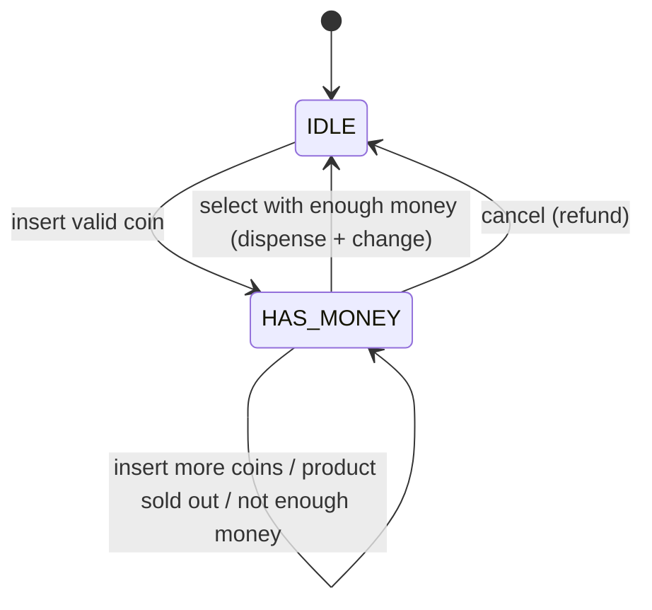

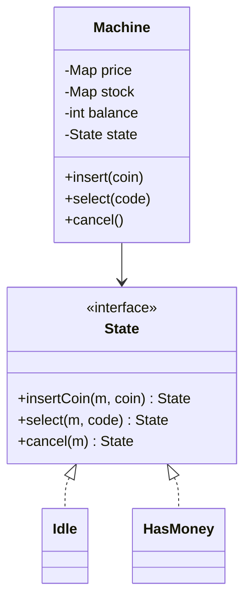

Each state returns the **next state**, so transitions are explicit and testable. Default methods on the interface say "ignored in this state", so each state overrides only what it handles.

## 6.4 Design Choices and Variants

| Decision | Choice |
|---|---|
| Behaviour per state | State pattern (`IDLE`, `HAS_MONEY`; add `DISPENSING`, `MAINTENANCE`, `OUT_OF_SERVICE`) |
| Coins | A set of accepted denominations; reject the rest |
| Change | Greedy works for canonical coin systems (1, 2, 5, 10, 20); a limited coin inventory needs DP or "exact change only" mode |
| Inventory | `Map<code, stock>`; admin `restock()` only in `MAINTENANCE` |
| Payment methods | Strategy (`CoinPayment`, `CardPayment`) |

## 6.5 Complete Java Example - State Pattern, Validation and Change

**What it shows:** a full sequence of actions: selecting with no money, an invalid coin, a sold-out product, not enough money, buying with change, cancelling with a refund, and buying the last item in stock.

```java
import java.util.*;

public class VendingMachineDemo {

    // State pattern: each state decides what each button means
    interface State {
        default State insertCoin(Machine m, int rupees) { m.say("ignored coin: " + name()); return this; }
        default State select(Machine m, String code) { m.say("ignored selection: " + name()); return this; }
        default State cancel(Machine m) { m.say("nothing to cancel"); return this; }
        String name();
    }

    static class Machine {
        final Map<String, Integer> price = new TreeMap<>(Map.of("A1", 20, "A2", 35, "B1", 50));
        final Map<String, Integer> stock = new TreeMap<>(Map.of("A1", 2, "A2", 0, "B1", 5));
        int balance = 0; State state = IDLE; final List<String> log = new ArrayList<>();
        void say(String s) { log.add("   [" + state.name() + "] " + s); }
        void insert(int r) { state = state.insertCoin(this, r); }
        void select(String c) { state = state.select(this, c); }
        void cancel() { state = state.cancel(this); }
    }

    static final Set<Integer> ACCEPTED = Set.of(1, 2, 5, 10, 20);

    static final State IDLE = new State() {
        public String name() { return "IDLE"; }
        public State insertCoin(Machine m, int r) {
            if (!ACCEPTED.contains(r)) { m.say("rejected coin " + r); return this; }
            m.balance += r; m.say("balance " + m.balance); return HAS_MONEY;
        }
    };
    static final State HAS_MONEY = new State() {
        public String name() { return "HAS_MONEY"; }
        public State insertCoin(Machine m, int r) {
            if (!ACCEPTED.contains(r)) { m.say("rejected coin " + r); return this; }
            m.balance += r; m.say("balance " + m.balance); return this;
        }
        public State select(Machine m, String code) {
            Integer p = m.price.get(code);
            if (p == null) { m.say("unknown product " + code); return this; }
            if (m.stock.get(code) == 0) { m.say(code + " sold out, choose another or cancel"); return this; }
            if (m.balance < p) { m.say("need " + (p - m.balance) + " more for " + code); return this; }
            m.stock.merge(code, -1, Integer::sum);
            int change = m.balance - p; m.balance = 0;
            m.say("DISPENSE " + code + ", change " + change + " = " + coins(change));
            return IDLE;
        }
        public State cancel(Machine m) { m.say("refund " + m.balance + " = " + coins(m.balance)); m.balance = 0; return IDLE; }
    };

    // greedy change-making works for canonical coin systems like 20/10/5/2/1
    static List<Integer> coins(int amount) {
        List<Integer> out = new ArrayList<>();
        for (int c : new int[]{20, 10, 5, 2, 1}) while (amount >= c) { out.add(c); amount -= c; }
        return out;
    }

    public static void main(String[] args) {
        Machine m = new Machine();
        m.select("A1");                 // no money yet
        m.insert(20); m.insert(3);      // 3 is not a valid coin
        m.select("A2");                 // sold out
        m.select("B1");                 // not enough
        m.insert(20); m.insert(10); m.insert(5);
        m.select("B1");                 // 55 paid for 50 -> change 5
        m.insert(10); m.cancel();       // refund
        m.insert(20); m.select("A1");   // exact
        m.insert(20); m.select("A1");   // last A1
        System.out.println("event log:");
        m.log.forEach(System.out::println);
        System.out.println("stock left: " + m.stock + "   final state: " + m.state.name());
    }
}
```

**Output** (identical on all 3 runs):

```text
event log:
   [IDLE] ignored selection: IDLE
   [IDLE] balance 20
   [HAS_MONEY] rejected coin 3
   [HAS_MONEY] A2 sold out, choose another or cancel
   [HAS_MONEY] need 30 more for B1
   [HAS_MONEY] balance 40
   [HAS_MONEY] balance 50
   [HAS_MONEY] balance 55
   [HAS_MONEY] DISPENSE B1, change 5 = [5]
   [IDLE] balance 10
   [HAS_MONEY] refund 10 = [10]
   [IDLE] balance 20
   [HAS_MONEY] DISPENSE A1, change 0 = []
   [IDLE] balance 20
   [HAS_MONEY] DISPENSE A1, change 0 = []
stock left: {A1=0, A2=0, B1=4}   final state: IDLE
```

**What the output shows**
- The **same `select` call** is ignored in `IDLE`, but in `HAS_MONEY` it reports "sold out", "need 30 more" or dispenses.
- A 3-rupee coin is rejected; the balance is untouched.
- 55 paid for a 50 product → change `[5]`. Cancelling returns the 10 inserted.
- A1 is bought twice and its stock goes to 0; the machine ends in `IDLE`.

## 6.6 Extensions and Spring Boot Shape

| Follow-up | Change |
|---|---|
| Card payment | `PaymentStrategy`; a `WAITING_FOR_CARD` state |
| Admin restock | `MAINTENANCE` state reachable with an admin key; restock and collect cash there |
| Limited change | Coin inventory; refuse a sale if change can't be made ("exact change only" state) |
| Telemetry | Observer: publish sales and low-stock events to a back office (see [IoT telemetry](../04_Specialized/09_IoT_Pattern.md#2-telemetry-pattern)) |

## 6.7 Pros and Cons

| Pros | Cons |
|---|---|
| Each state's rules in one place; no flag soup | More classes as states grow |
| Illegal actions are impossible by construction | Shared data (balance, stock) lives in the context, so states are coupled to it |
| Easy to add a state | Greedy change fails for non-canonical coin sets |

## 6.8 Pitfalls, Interview Questions and Cheat Sheet

**Common pitfalls**
- `if (state == ...)` checks in every method instead of state objects.
- Dispensing before checking stock and money.
- Forgetting refunds on cancel or on failure to dispense.
- Greedy change with a coin inventory that can't make the amount.
- States that mutate shared data without going through the machine.

**Interview questions**
1. *Why the State pattern here?* → The meaning of every action depends on the current state; State objects make transitions explicit.
2. *State vs Strategy?* → State changes itself as events happen; Strategy is chosen by the client and usually doesn't change itself.
3. *How do you calculate change?* → Greedy for canonical coin systems; dynamic programming with a limited inventory.
4. *How do you add a maintenance mode?* → New state that only accepts admin actions.
5. *How do you make it testable?* → Inject product catalogue and coin inventory; assert the event log and final state.

**Cheat sheet**
```
States: IDLE -> HAS_MONEY -> (dispense) IDLE ; cancel -> refund -> IDLE ; + MAINTENANCE, OUT_OF_SERVICE
Each action returns the next State; defaults = "ignored"
Validate: coin accepted, product known, stock > 0, balance >= price ; change = greedy (canonical coins)
```

### 📘 Terms Explained

| Term | Meaning |
|---|---|
| **State pattern** | Each state is an object that implements the behaviour for that state |
| **Context** | The object (the machine) that holds the current state and shared data |
| **Canonical coin system** | Coin values where greedy change-making always gives the fewest coins |
| **Dynamic programming** | Solving a problem by combining solutions of smaller subproblems |
| **Default method** | An interface method with a body, used here as "do nothing" |

---

# 7. LRU Cache (Interview Imp - Java)

## 7.1 What Is It? (Requirements)

A fixed-capacity cache. `get(key)` returns the value or null; `put(key, value)` inserts or updates. When full, it evicts the **least recently used** entry. Both operations must be **O(1)**.
Follow-ups: thread safety, TTL per entry, LFU (least *frequently* used), a distributed version.

## 7.2 Why Is It Asked?

It is the most common "design a data structure" question in Java interviews. It combines a hash map (fast lookup) and a linked list (fast reordering), and it is the heart of real caches (Guava, Caffeine, Redis `allkeys-lru`, CPU caches).

## 7.3 How It Works

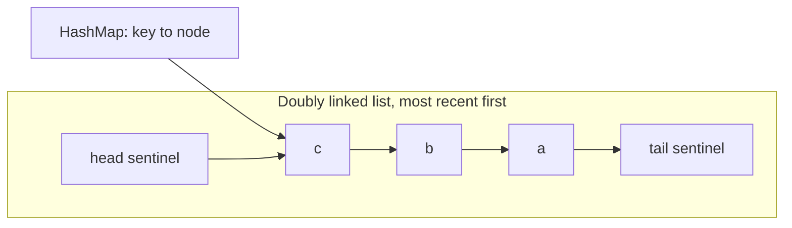

- **get:** look up the node in the map (O(1)), unlink it and move it to the front (O(1), because it knows its neighbours).
- **put:** update and move to front, or insert at the front; if over capacity, remove `tail.prev` (the least recently used) from both list and map.
- **Sentinels** (dummy head and tail) remove all null checks at the ends.

Java shortcut: `LinkedHashMap` with `accessOrder = true` and an overridden `removeEldestEntry` is a complete LRU cache in 3 lines.

## 7.4 Types and Variants

| Variant | Idea |
|---|---|
| **LRU** | Evict the least recently used |
| **LFU** | Evict the least frequently used (frequency buckets, O(1) with a map of lists) |
| **FIFO** | Evict the oldest inserted |
| **TTL cache** | Entries expire after a time |
| **W-TinyLFU** | Caffeine's algorithm: frequency sketch + small LRU window (better hit rates) |
| **Thread-safe LRU** | `synchronized` methods, or `ConcurrentHashMap` + lock striping; or just use Caffeine |
| **Distributed LRU** | Redis with `maxmemory-policy allkeys-lru` ([Data_Storage_Pattern.md](../04_Specialized/03_Data_Storage_Pattern.md#2-key-value-stores-and-in-memory-databases-interview-imp---java)) |

## 7.5 Complete Java Example - Hand-Written O(1) LRU, the LinkedHashMap Version, and a Hit-Rate Test

**What it shows:** the recency order after each operation, eviction of the least recently used key, an update moving a key to the front, the identical behaviour of a 3-line `LinkedHashMap` version, and the hit rate on a skewed workload.

```java
import java.util.*;

public class LruCacheDemo {

    // O(1) get and put: HashMap for lookup + doubly linked list for recency order
    static class LruCache<K, V> {
        private class Node { K key; V value; Node prev, next; Node(K k, V v) { key = k; value = v; } }
        private final int capacity; private final Map<K, Node> map = new HashMap<>();
        private final Node head = new Node(null, null), tail = new Node(null, null);    // sentinels: head.next = most recent
        int hits = 0, misses = 0, evictions = 0;

        LruCache(int capacity) { this.capacity = capacity; head.next = tail; tail.prev = head; }

        V get(K key) {
            Node n = map.get(key);
            if (n == null) { misses++; return null; }
            hits++; unlink(n); addFront(n); return n.value;
        }
        void put(K key, V value) {
            Node n = map.get(key);
            if (n != null) { n.value = value; unlink(n); addFront(n); return; }
            if (map.size() == capacity) { Node lru = tail.prev; unlink(lru); map.remove(lru.key); evictions++; }
            n = new Node(key, value); map.put(key, n); addFront(n);
        }
        private void unlink(Node n) { n.prev.next = n.next; n.next.prev = n.prev; }
        private void addFront(Node n) { n.next = head.next; n.prev = head; head.next.prev = n; head.next = n; }
        List<K> order() { List<K> out = new ArrayList<>(); for (Node n = head.next; n != tail; n = n.next) out.add(n.key); return out; }
    }

    // The same thing using the JDK: LinkedHashMap in access order + removeEldestEntry
    static <K, V> Map<K, V> jdkLru(int capacity) {
        return new LinkedHashMap<>(16, 0.75f, true) { protected boolean removeEldestEntry(Map.Entry<K, V> e) { return size() > capacity; } };
    }

    public static void main(String[] args) {
        LruCache<String, Integer> c = new LruCache<>(3);
        c.put("a", 1); c.put("b", 2); c.put("c", 3);
        System.out.println("put a,b,c          order (newest first) = " + c.order());
        c.get("a");
        System.out.println("get a              order = " + c.order());
        c.put("d", 4);
        System.out.println("put d (full)       order = " + c.order() + "   -> 'b' was least recently used and was evicted");
        System.out.println("get b              = " + c.get("b") + " (miss)");
        c.put("c", 33);
        System.out.println("update c           order = " + c.order() + "   value=" + c.get("c"));

        Map<String, Integer> jdk = jdkLru(3);
        jdk.put("a", 1); jdk.put("b", 2); jdk.put("c", 3); jdk.get("a"); jdk.put("d", 4);
        System.out.println("LinkedHashMap LRU  keys (oldest first) = " + jdk.keySet() + "   -> same eviction of 'b'");

        // hit rate on a skewed workload: 80% of requests go to 20% of 100 keys
        LruCache<Integer, Integer> cache = new LruCache<>(20);
        Random r = new Random(1);
        for (int i = 0; i < 100_000; i++) {
            int key = r.nextDouble() < 0.8 ? r.nextInt(20) : 20 + r.nextInt(80);
            if (cache.get(key) == null) cache.put(key, key);
        }
        System.out.printf("skewed workload, capacity 20 of 100 keys: hit rate %.1f%%, evictions %d%n", 100.0 * cache.hits / (cache.hits + cache.misses), cache.evictions);
    }
}
```

**Output** (identical on all 3 runs):

```text
put a,b,c          order (newest first) = [c, b, a]
get a              order = [a, c, b]
put d (full)       order = [d, a, c]   -> 'b' was least recently used and was evicted
get b              = null (miss)
update c           order = [c, d, a]   value=33
LinkedHashMap LRU  keys (oldest first) = [c, a, d]   -> same eviction of 'b'
skewed workload, capacity 20 of 100 keys: hit rate 57.8%, evictions 42154
```

**What the output shows**
- After `get a`, `a` jumps to the front; adding `d` to a full cache evicts **b**, the least recently used.
- Updating `c` moves it to the front and changes its value.
- The `LinkedHashMap` version evicts the same key (its key order is oldest-first, the reverse of the hand-written print order).
- **Hit rate 57.8%** with capacity 20 for 100 keys when 80% of requests target 20 hot keys. The cold 20% of requests keep pushing hot keys out; this is why smarter policies (LFU, W-TinyLFU in Caffeine) exist.

## 7.6 In Java and Spring Boot

```java
// Production: use Caffeine instead of hand-written code
Cache<String, Product> cache = Caffeine.newBuilder().maximumSize(10_000).expireAfterWrite(Duration.ofMinutes(10)).recordStats().build();
Product p = cache.get(id, this::loadFromDb);

// Spring Boot: spring.cache.type=caffeine, spring.cache.caffeine.spec=maximumSize=10000,expireAfterWrite=10m
@Cacheable("products") public Product find(String id) { return repo.findById(id).orElseThrow(); }
```

## 7.7 Pros and Cons

| Pros | Cons |
|---|---|
| O(1) get and put | Pointer overhead per entry |
| Simple, predictable eviction | A single scan of many keys can flush the hot set (scan pollution) |
| Built into the JDK (`LinkedHashMap`) | Not thread-safe without locking |

## 7.8 Pitfalls, Interview Questions and Cheat Sheet

**Common pitfalls**
- Using a `LinkedList` + `HashMap<K,V>`: `list.remove(key)` is O(n). You must store the **node** in the map.
- Forgetting to remove the evicted key from the map.
- Not moving a key to the front on `put` of an existing key.
- `LinkedHashMap` with the default insertion order (that's FIFO, not LRU): pass `accessOrder = true`.
- Assuming the JDK version is thread-safe (wrap with locks or use Caffeine).

**Interview questions**
1. *How do you get O(1) for both operations?* → HashMap from key to list node + doubly linked list ordered by recency; move to front on access, evict from the tail.
2. *Why a doubly linked list?* → Removing a node needs its previous neighbour in O(1).
3. *How would you make it thread-safe?* → A lock around get/put (simple), lock striping/segments, or use Caffeine/`ConcurrentLinkedHashMap`.
4. *LRU vs LFU?* → LRU favours recent keys; LFU favours frequently used keys and resists one-time scans but adapts slowly to change.
5. *What does Java offer built-in?* → `LinkedHashMap(capacity, 0.75f, true)` + `removeEldestEntry`.

**Cheat sheet**
```
Map<K, Node> + doubly linked list (head = most recent, tail = LRU), sentinels at both ends
get: miss -> null ; hit -> unlink + addFront
put: exists -> update + front ; full -> remove tail.prev from list AND map ; addFront
JDK: new LinkedHashMap<>(16, 0.75f, true) { removeEldestEntry -> size() > cap }
Prod: Caffeine (W-TinyLFU), Redis allkeys-lru
```

### 📘 Terms Explained

| Term | Meaning |
|---|---|
| **LRU** | Least Recently Used: evict the entry untouched the longest |
| **LFU** | Least Frequently Used: evict the entry used the fewest times |
| **Doubly linked list** | A list where each node points to both its next and previous node |
| **Sentinel node** | A dummy node at the start/end that simplifies edge cases |
| **Hit rate** | Share of lookups found in the cache |
| **Scan pollution** | A one-time sweep over many keys that pushes useful keys out of an LRU cache |
| **Caffeine** | A high-performance Java caching library |

---

# 8. Games: Tic-Tac-Toe and Snake & Ladder

## 8.1 What Is It? (Requirements)

**Tic-tac-toe:** an *n × n* board, two players alternate, a player wins with a full row, column or diagonal; detect draws; reject illegal moves.
**Snake & ladder:** a board of N squares with snakes (move down) and ladders (move up), players take turns rolling a die, the exact roll is needed to finish, the first to reach N wins.
Follow-ups: more players, a computer player, undo, a larger board, a different winning rule.

## 8.2 Why Are They Asked?

Small enough to finish in 45 minutes, so the interviewer can judge **code quality**: clean model, no magic numbers, separation of rules from input/output, testable randomness, and an efficient win check.

## 8.3 How It Works

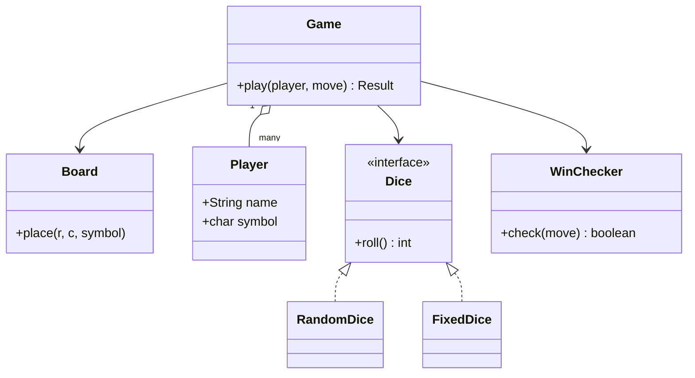

**O(1) win check for tic-tac-toe:** keep a counter per row, per column and for the two diagonals. Player X adds +1, O adds −1. After a move at (r, c), check only `rows[r]`, `cols[c]`, `diag` (if r == c) and `anti` (if r + c == n − 1). A line is complete when the absolute value equals *n*. No need to scan the board.

**Testable randomness:** the die is an interface. Production uses `Random`; tests inject a fixed sequence of rolls, so a game can be replayed exactly.

## 8.4 Design Choices and Variants

| Concern | Choice |
|---|---|
| Players | `Player` interface: `HumanPlayer` (reads input), `BotPlayer` (Strategy: random, minimax) |
| Moves | `Move` as a **Command** (do/undo) for an undo feature |
| Board rules | Separate `Board` (state) from `Rules/WinChecker` (logic) |
| Randomness | `Dice` interface, injected |
| Snakes/ladders | One `Map<Integer, Integer>` of jumps (a snake is just a jump down) |
| Output | The game returns results; printing is done by the caller (no `System.out` in game logic) |

## 8.5 Complete Java Example - O(1) Tic-Tac-Toe Win Check and Snake & Ladder With an Injected Die

**What it shows:** a 3×3 game that ends in a draw, a 4×4 game won on the anti-diagonal, rejection of a move on an occupied square, and a snake-and-ladder game driven by a seeded (replayable) die.

```java
import java.util.*;

public class GamesDemo {

    // ================= Tic-tac-toe on an n x n board with O(1) win detection =================
    static class TicTacToe {
        final int n; final char[][] board; final int[] rows, cols; int diag, anti, moves;
        TicTacToe(int n) { this.n = n; board = new char[n][n]; for (char[] r : board) Arrays.fill(r, '.'); rows = new int[n]; cols = new int[n]; }
        // returns 'X' or 'O' if that move wins, 'D' for a draw, '-' otherwise
        char play(char player, int r, int c) {
            if (r < 0 || r >= n || c < 0 || c >= n || board[r][c] != '.') throw new IllegalArgumentException("illegal move " + r + "," + c);
            board[r][c] = player; moves++;
            int add = player == 'X' ? 1 : -1;                          // X counts +1, O counts -1
            rows[r] += add; cols[c] += add;
            if (r == c) diag += add;
            if (r + c == n - 1) anti += add;
            if (Math.abs(rows[r]) == n || Math.abs(cols[c]) == n || Math.abs(diag) == n || Math.abs(anti) == n) return player;
            return moves == n * n ? 'D' : '-';
        }
        String show() { StringBuilder sb = new StringBuilder(); for (char[] r : board) sb.append("      ").append(new String(r)).append('\n'); return sb.toString(); }
    }

    // ================= Snake and ladder with an injectable dice (testable) =================
    interface Dice { int roll(); }
    static class SnakeLadder {
        final int size; final Map<Integer, Integer> jumps; final Map<String, Integer> pos = new LinkedHashMap<>();
        SnakeLadder(int size, Map<Integer, Integer> jumps, List<String> players) { this.size = size; this.jumps = jumps; players.forEach(p -> pos.put(p, 0)); }
        String turn(String p, int roll) {
            int from = pos.get(p), to = from + roll;
            if (to > size) return p + " rolls " + roll + ": needs exact roll, stays at " + from;
            String note = "";
            if (jumps.containsKey(to)) { int j = jumps.get(to); note = (j > to ? " ladder up to " : " snake down to ") + j; to = j; }
            pos.put(p, to);
            return p + " rolls " + roll + ": " + from + " -> " + (note.isEmpty() ? to : (from + roll) + note) + (to == size ? "  WINS" : "");
        }
    }

    public static void main(String[] args) {
        TicTacToe t = new TicTacToe(3);
        int[][] moves = {{1, 1}, {0, 0}, {0, 2}, {2, 0}, {1, 0}, {1, 2}, {2, 2}, {0, 1}, {2, 1}};
        char result = '-', p = 'X';
        for (int[] m : moves) { result = t.play(p, m[0], m[1]); if (result != '-') break; p = p == 'X' ? 'O' : 'X'; }
        System.out.println("1) tic-tac-toe 3x3, result: " + (result == 'D' ? "draw" : result + " wins") + " after " + t.moves + " moves\n" + t.show());

        TicTacToe t2 = new TicTacToe(4);
        char r2 = '-'; int[][] win = {{0, 3}, {0, 0}, {1, 2}, {1, 0}, {2, 1}, {2, 0}, {3, 0}};
        char who = 'X';
        for (int[] m : win) { r2 = t2.play(who, m[0], m[1]); if (r2 != '-') break; who = who == 'X' ? 'O' : 'X'; }
        System.out.println("   4x4 board: " + r2 + " wins on the anti-diagonal; each move checked in O(1), no board scan\n" + t2.show());
        try { t2.play('O', 0, 3); } catch (IllegalArgumentException e) { System.out.println("   " + e.getMessage()); }

        Map<Integer, Integer> jumps = Map.of(3, 22, 5, 8, 11, 26, 20, 29, 27, 1, 21, 9, 17, 4, 19, 7);
        SnakeLadder g = new SnakeLadder(30, jumps, List.of("Asha", "Ben"));
        Random seeded = new Random(4);
        Dice dice = () -> 1 + seeded.nextInt(6);
        System.out.println("2) snake and ladder (30 squares, seeded dice):");
        outer:
        for (int round = 1; round <= 30; round++)
            for (String player : List.of("Asha", "Ben")) {
                String line = g.turn(player, dice.roll());
                System.out.println("   " + line);
                if (line.endsWith("WINS")) break outer;
            }
    }
}
```

**Output** (identical on all 3 runs):

```text
1) tic-tac-toe 3x3, result: draw after 9 moves
      OOX
      XXO
      OXX

   4x4 board: X wins on the anti-diagonal; each move checked in O(1), no board scan
      O..X
      O.X.
      OX..
      X...

   illegal move 0,3
2) snake and ladder (30 squares, seeded dice):
   Asha rolls 3: 0 -> 3 ladder up to 22
   Ben rolls 5: 0 -> 5 ladder up to 8
   Asha rolls 4: 22 -> 26
   Ben rolls 5: 8 -> 13
   Asha rolls 4: 26 -> 30  WINS
```

**What the output shows**
- **3×3:** nine moves, no line completed → **draw**.
- **4×4:** X fills (0,3), (1,2), (2,1), (3,0) and wins on the anti-diagonal. Each move updated four counters, with no board scan.
- **Illegal move:** placing on an occupied square throws.
- **Snake & ladder:** Asha rolls 3 and climbs the ladder from 3 to 22, Ben climbs 5 → 8, and Asha wins with an exact 4 from 26 to 30. Because the die is injected with a seed, the whole game is reproducible in a test.

## 8.6 Extensions and Spring Boot Shape

| Follow-up | Change |
|---|---|
| Undo | Moves as Command objects on a stack; `undo()` reverses counters and the board |
| Computer player | `BotPlayer` with a Strategy (random, or minimax for tic-tac-toe) |
| Online multiplayer | A `GameService` storing game state per game id; WebSocket for moves ([API_Design_Pattern.md](../03_System_Design/08_API_Design_Pattern.md)) |
| Chess | Same skeleton: `Piece` subclasses or move-generator strategies per piece type, `Board`, `MoveValidator`, `Game` state (check, checkmate) |

## 8.7 Pros and Cons

| Pros | Cons |
|---|---|
| O(1) win check scales to big boards | Counters must be undone carefully for an undo feature |
| Injected die → deterministic tests | More interfaces than a toy needs |
| Rules separate from I/O | Online play adds concurrency per game |

## 8.8 Pitfalls, Interview Questions and Cheat Sheet

**Common pitfalls**
- Checking the whole board after every move (O(n²)).
- Hard-coding 3×3 everywhere.
- `new Random()` inside the game logic (untestable).
- Printing inside the domain classes.
- Not validating moves (out of bounds, occupied, wrong player's turn).

**Interview questions**
1. *How do you check for a win in O(1)?* → Row/column/diagonal counters with +1/−1 per player.
2. *How do you test a game with dice?* → Inject a `Dice` interface; tests pass fixed rolls or a seeded `Random`.
3. *How would you add undo?* → Command pattern: each move knows how to reverse itself; keep a stack.
4. *How would you add a bot?* → A `Player` implementation that uses a Strategy to choose a move.
5. *How would you design chess?* → Board, Piece hierarchy (or move strategies), MoveValidator, Game state; the same separation of model, rules and I/O.

**Cheat sheet**
```
Model: Game, Board, Player(interface: Human/Bot), Move(Command), Dice(interface), Rules/WinChecker
Tic-tac-toe O(1): rows[r] cols[c] diag anti += (X ? 1 : -1); |count| == n -> win ; moves == n*n -> draw
Snake & ladder: Map<from, to> jumps; exact roll to finish; injected dice for tests
No System.out / Random inside domain classes
```

### 📘 Terms Explained

| Term | Meaning |
|---|---|
| **Anti-diagonal** | The diagonal from the top-right to the bottom-left corner |
| **Command pattern** | Representing an action as an object that can be executed and undone |
| **Minimax** | A game-tree search that assumes both players play optimally |
| **Seeded random** | A random generator that produces the same sequence for the same seed |
| **Dependency injection** | Passing a collaborator (like the die) into an object instead of creating it inside |

---

# 9. More LLD Problems and How to Approach Them

These are also asked often. Each maps to a skeleton you have already seen.

| Problem | Key entities | Main patterns / ideas | Closest example |
|---|---|---|---|
| **Library management** | Book, BookCopy, Member, Loan, Fine | Strategy (fine policy), Observer (reservation available) | Parking lot (resource + ticket) |
| **Hotel booking** | Hotel, Room, RoomType, Booking, Guest | Locks/holds with expiry, half-open date ranges | Movie booking, [Booking pattern](../04_Specialized/11_Domain_Specific_Pattern.md#3-booking-and-reservation-systems) |
| **ATM** | ATM, Card, Account, Transaction, CashDispenser | State (idle, card inserted, PIN ok), Chain of Responsibility (note dispensing 500→200→100) | Vending machine |
| **Logger / logging framework** | Logger, Appender, Formatter, Level | Chain of Responsibility (levels), Strategy (formatter), Singleton (carefully), Observer | [Behavioral_Pattern.md](04_Behavioral_Pattern.md) |
| **Rate limiter** | Limiter, Bucket, Rule | Strategy (token bucket, sliding window) | [Rate limiter case study](../03_System_Design/12_System_Design_Interview_Playbook.md#4-case-study-design-a-rate-limiter-interview-imp---java) |
| **Ride sharing (Uber LLD)** | Rider, Driver, Trip, Location, Fare | Strategy (matching, pricing), State (trip lifecycle), Observer | Parking lot + elevator dispatcher |
| **Food delivery** | Restaurant, Menu, Order, DeliveryAgent | State (order lifecycle), Strategy (assignment) | Vending machine + elevator |
| **Chess** | Board, Piece, Move, Player, Game | Polymorphism per piece, Command (moves/undo) | Games |
| **Notification service** | Notification, Channel, Template, Preference | Strategy (channel), Observer, Decorator (retry), Template Method | [Notification case study](../03_System_Design/12_System_Design_Interview_Playbook.md#6-case-study-design-a-notification-system) |
| **Task scheduler / cron** | Task, Trigger, Executor | Priority queue by next run time, Command | [Concurrency_Pattern.md](../03_System_Design/11_Concurrency_Pattern.md) |
| **In-memory key-value store** | Store, Entry, TTL, Transactions | Map + expiry heap, Command (undo for transactions) | LRU cache |
| **Stack Overflow / Q&A** | User, Question, Answer, Vote, Tag | Observer (notifications), Strategy (ranking) | Splitwise (aggregate + derived scores) |

### 📘 Terms Explained

| Term | Meaning |
|---|---|
| **Chain of Responsibility** | Passing a request along a chain of handlers until one handles it |
| **Appender** | The part of a logger that writes log lines somewhere (file, console) |
| **Trip lifecycle** | The states of a ride: requested, accepted, started, completed, cancelled |
| **Priority queue** | A queue that always gives the smallest (or highest-priority) element first |

---

# 10. How the LLD Problems Fit Together

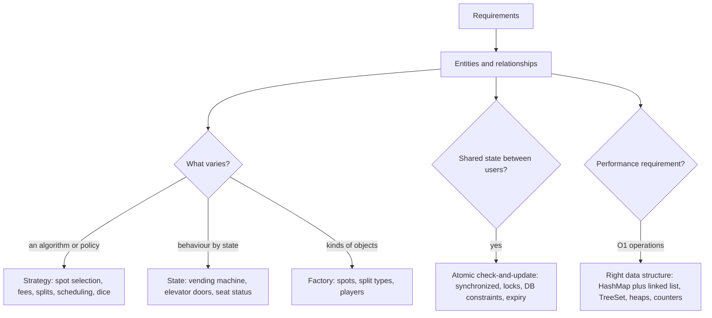

**Three questions that solve most LLD rounds**
1. **What varies?** Put it behind an interface (Strategy/State/Factory).
2. **What is shared between concurrent users?** Make every check-and-update on it atomic.
3. **What must be fast?** Choose the data structure first, then the classes.

### 📘 Terms Explained

| Term | Meaning |
|---|---|
| **Policy** | A rule that may change (pricing, allocation) |
| **Atomic** | Happens completely as one step, with no other thread in between |
| **Data structure** | A way to organise data for efficient operations |

---

# 11. LLD Interview Problems Cheat Sheet

| Problem | Must-have design points | Patterns | Trap |
|---|---|---|---|
| **Parking lot** **(Interview Imp - Java)** | Spot sizes, `fits`, allocation policy, hourly fee, one-use ticket | Strategy, Factory | First-fit wastes large spots; Singleton lot |
| **Elevator** | Scheduler, door/car states, dispatcher for many cars | Strategy, State, Observer | FCFS zig-zag; moving with doors open |
| **Splitwise** **(Interview Imp - Java)** | Split strategies, paise, sum of balances = 0, greedy settle | Strategy, Factory | `double` money; lost paisa |
| **Movie booking** **(Interview Imp - Java)** | Lock with TTL, all-or-nothing, holder-only confirm | State, locking | Check and lock in separate steps |
| **Vending machine** | States, coin validation, change, refund | State | Flag soup instead of states |
| **LRU cache** **(Interview Imp - Java)** | Map to node + doubly linked list, O(1) | Data-structure design | `LinkedList.remove` is O(n) |
| **Tic-tac-toe / snake & ladder** | O(1) win counters, injected dice, validation | Strategy, Command | Board scan; `Random` inside logic |

**Top interview one-liners**
```
Clarify -> entities -> class diagram -> patterns where things vary -> code happy path -> edge cases + concurrency -> extensions
Parking lot: Strategy for spot choice and fees; best fit keeps big spots free; park/unpark atomic
Elevator: LOOK/SCAN beats FCFS; State pattern forbids moving with open doors
Splitwise: money in paise, sum of balances = 0, greedy settle needs at most n-1 payments
Booking: lock all seats or none, with a TTL; only the lock holder can confirm; sort seats to avoid deadlocks
Vending machine: State pattern, each action returns the next state
LRU: HashMap<key, node> + doubly linked list; LinkedHashMap(accessOrder=true) in the JDK
Games: O(1) win check with row/col/diagonal counters; inject the dice for tests
```

### 📘 Terms Explained

| Term | Meaning |
|---|---|
| **Interview one-liner** | A short, memorable answer you can expand on |
| **Cheat sheet** | A one-page summary for revision |
| **Trap** | A common mistake interviewers watch for |
