# Architectural Patterns

> **Note**: Patterns marked with **(Interview Imp - Java)** are frequently asked in Java interviews
>
> **How to read this file:** Every section ends with a **📘 Terms Explained** table. If you see a word you don't know, check the table right below that section. Each pattern goes from the basic idea to advanced usage (plain Java simulation, Spring Boot code and package layout, pros and cons, pitfalls) and ends with interview questions and a mini cheat sheet.
>
> **What are architectural patterns?** Design patterns ([Creational](../01_LLD/02_Creational_Pattern.md), [Structural](../01_LLD/03_Structural_Pattern.md), [Behavioral](../01_LLD/04_Behavioral_Pattern.md)) organise a few **classes**. Architectural patterns organise a **whole application or system**: where the business logic lives, which parts may depend on which, how parts talk to each other, and how the system is deployed. This file covers every **Architectural Pattern** in the [master list](../00_Design_Patterns_Complete_List.md#architectural-patterns): Layered, MVC/MVP/MVVM, Hexagonal, Clean, Onion, Event-Driven, Pipe and Filter, Blackboard, Client-Server, Peer-to-Peer, SOA, Microservices, Serverless, CQRS, Event Sourcing, Domain-Driven Design and Space-Based, plus the **Modular Monolith**, which you can't skip in modern interviews.
>
> **Builds on (linked, not repeated):** [02_Microservices_Pattern.md](../04_Specialized/02_Microservices_Pattern.md) (gateway, saga, service discovery, strangler fig), [05_Data_Management_Pattern.md](../03_System_Design/05_Data_Management_Pattern.md#1-cqrs-pattern-interview-imp---java) (CQRS and Event Sourcing in depth), [04_Messaging_Pattern.md](../03_System_Design/04_Messaging_Pattern.md) (queues, pub-sub, outbox), [03_Structural_Pattern.md](../01_LLD/03_Structural_Pattern.md#162-hexagonal-architecture-ports-and-adapters) (the Adapter pattern behind Hexagonal), [07_Distributed_Systems_Pattern.md](../03_System_Design/07_Distributed_Systems_Pattern.md#1-distributed-cache-pattern-interview-imp---java) (data grids) and [Client_Server_Web_Architecture_Guide.md](../../web-architecture/Client_Server_Web_Architecture_Guide.md) (client-server at the network and web-server level).
>
> **Verified code:** Every main "Complete Java Example" in this file is **plain Java 17 (no libraries)** and was compiled and run **three times** with identical output (fixed random seeds where needed). To run one, save it as `<ClassName>.java` and run `javac <ClassName>.java && java <ClassName>`. (Running it directly with `java <ClassName>.java` won't work, because the class with `main` is not the first class in the file.) The Spring Boot snippets show real APIs and layouts but are illustrations, not compiled projects.

---

## Table of Contents
0. [Before You Start: What Is Software Architecture?](#before-you-start-what-is-software-architecture)
1. [Layered Architecture](#1-layered-architecture-interview-imp---java) **(Interview Imp - Java)**
   - [1.1 What is Layered Architecture?](#11-what-is-layered-architecture)
   - [1.2 Why Do We Need It?](#12-why-do-we-need-it)
   - [1.3 How It Works](#13-how-it-works)
   - [1.4 Variants: Strict vs Relaxed, Open vs Closed Layers](#14-variants-strict-vs-relaxed-open-vs-closed-layers)
   - [1.5 Complete Java Example - Controller, Service, Repository](#15-complete-java-example---controller-service-repository)
   - [1.6 Layered Architecture in Spring Boot](#16-layered-architecture-in-spring-boot)
   - [1.7 Pros and Cons](#17-pros-and-cons)
   - [1.8 Pitfalls, Interview Questions and Cheat Sheet](#18-pitfalls-interview-questions-and-cheat-sheet)
2. [MVC, MVP and MVVM](#2-mvc-mvp-and-mvvm-interview-imp---java) **(Interview Imp - Java)**
   - [2.1 What Are They?](#21-what-are-they)
   - [2.2 Why Do We Need Them?](#22-why-do-we-need-them)
   - [2.3 How Each One Works](#23-how-each-one-works)
   - [2.4 Variants: Classic MVC, Web MVC (Model 2), Passive View, Supervising Controller](#24-variants-classic-mvc-web-mvc-model-2-passive-view-supervising-controller)
   - [2.5 Complete Java Example - One Screen, Three Patterns](#25-complete-java-example---one-screen-three-patterns)
   - [2.6 MVC in Spring Boot (and MVVM in JavaFX / Android)](#26-mvc-in-spring-boot-and-mvvm-in-javafx--android)
   - [2.7 Pros and Cons](#27-pros-and-cons)
   - [2.8 Pitfalls, Interview Questions and Cheat Sheet](#28-pitfalls-interview-questions-and-cheat-sheet)
3. [Hexagonal Architecture (Ports and Adapters)](#3-hexagonal-architecture-ports-and-adapters-interview-imp---java) **(Interview Imp - Java)**
   - [3.1 What is Hexagonal Architecture?](#31-what-is-hexagonal-architecture)
   - [3.2 Why Do We Need It?](#32-why-do-we-need-it)
   - [3.3 How It Works](#33-how-it-works)
   - [3.4 Variants: Driving vs Driven Ports, How Many Ports?](#34-variants-driving-vs-driven-ports-how-many-ports)
   - [3.5 Complete Java Example - One Core, Swappable Adapters](#35-complete-java-example---one-core-swappable-adapters)
   - [3.6 Hexagonal Architecture in Spring Boot](#36-hexagonal-architecture-in-spring-boot)
   - [3.7 Pros and Cons](#37-pros-and-cons)
   - [3.8 Pitfalls, Interview Questions and Cheat Sheet](#38-pitfalls-interview-questions-and-cheat-sheet)
4. [Clean Architecture and Onion Architecture](#4-clean-architecture-and-onion-architecture-interview-imp---java) **(Interview Imp - Java)**
   - [4.1 What Are They?](#41-what-are-they)
   - [4.2 Why Do We Need Them?](#42-why-do-we-need-them)
   - [4.3 How It Works: The Dependency Rule](#43-how-it-works-the-dependency-rule)
   - [4.4 Hexagonal vs Onion vs Clean](#44-hexagonal-vs-onion-vs-clean)
   - [4.5 Complete Java Example - A Use Case and a Dependency-Rule Checker](#45-complete-java-example---a-use-case-and-a-dependency-rule-checker)
   - [4.6 Enforcing the Rule in Spring Boot with ArchUnit](#46-enforcing-the-rule-in-spring-boot-with-archunit)
   - [4.7 Pros and Cons](#47-pros-and-cons)
   - [4.8 Pitfalls, Interview Questions and Cheat Sheet](#48-pitfalls-interview-questions-and-cheat-sheet)
5. [Event-Driven Architecture](#5-event-driven-architecture-interview-imp---java) **(Interview Imp - Java)**
   - [5.1 What is Event-Driven Architecture?](#51-what-is-event-driven-architecture)
   - [5.2 Why Do We Need It?](#52-why-do-we-need-it)
   - [5.3 How It Works](#53-how-it-works)
   - [5.4 Variants: Broker vs Mediator Topology, Four Event Styles](#54-variants-broker-vs-mediator-topology-four-event-styles)
   - [5.5 Complete Java Example - Choreography, Orchestration and Replay](#55-complete-java-example---choreography-orchestration-and-replay)
   - [5.6 Event-Driven Architecture in Spring Boot](#56-event-driven-architecture-in-spring-boot)
   - [5.7 Pros and Cons](#57-pros-and-cons)
   - [5.8 Pitfalls, Interview Questions and Cheat Sheet](#58-pitfalls-interview-questions-and-cheat-sheet)
6. [Pipe and Filter Architecture](#6-pipe-and-filter-architecture)
   - [6.1 What is Pipe and Filter?](#61-what-is-pipe-and-filter)
   - [6.2 Why Do We Need It?](#62-why-do-we-need-it)
   - [6.3 How It Works](#63-how-it-works)
   - [6.4 Variants: Pipeline, Batch Sequential, Push vs Pull](#64-variants-pipeline-batch-sequential-push-vs-pull)
   - [6.5 Complete Java Example - A Log-Processing Pipeline (Sequential and Threaded)](#65-complete-java-example---a-log-processing-pipeline-sequential-and-threaded)
   - [6.6 Pipe and Filter in Java and Spring](#66-pipe-and-filter-in-java-and-spring)
   - [6.7 Pros and Cons](#67-pros-and-cons)
   - [6.8 Pitfalls, Interview Questions and Cheat Sheet](#68-pitfalls-interview-questions-and-cheat-sheet)
7. [Blackboard Architecture](#7-blackboard-architecture)
   - [7.1 What is Blackboard?](#71-what-is-blackboard)
   - [7.2 Why Do We Need It?](#72-why-do-we-need-it)
   - [7.3 How It Works](#73-how-it-works)
   - [7.4 Complete Java Example - Fraud Scoring with Knowledge Sources](#74-complete-java-example---fraud-scoring-with-knowledge-sources)
   - [7.5 Blackboard in Practice](#75-blackboard-in-practice)
   - [7.6 Pros, Cons, Pitfalls, Interview Questions and Cheat Sheet](#76-pros-cons-pitfalls-interview-questions-and-cheat-sheet)
8. [Client-Server and Peer-to-Peer](#8-client-server-and-peer-to-peer)
   - [8.1 What Are They?](#81-what-are-they)
   - [8.2 Why Do We Need Each?](#82-why-do-we-need-each)
   - [8.3 How They Work](#83-how-they-work)
   - [8.4 Variants: Tiers, Thin vs Thick Clients, Pure vs Hybrid P2P](#84-variants-tiers-thin-vs-thick-clients-pure-vs-hybrid-p2p)
   - [8.5 Complete Java Example - Distributing a File: Server vs Swarm](#85-complete-java-example---distributing-a-file-server-vs-swarm)
   - [8.6 In the Java World](#86-in-the-java-world)
   - [8.7 Pros, Cons, Pitfalls, Interview Questions and Cheat Sheet](#87-pros-cons-pitfalls-interview-questions-and-cheat-sheet)
9. [SOA, Microservices and the Modular Monolith](#9-soa-microservices-and-the-modular-monolith-interview-imp---java) **(Interview Imp - Java)**
   - [9.1 What Are They?](#91-what-are-they)
   - [9.2 Why Do We Need Them?](#92-why-do-we-need-them)
   - [9.3 How They Work](#93-how-they-work)
   - [9.4 SOA vs Microservices vs Modular Monolith](#94-soa-vs-microservices-vs-modular-monolith)
   - [9.5 Complete Java Example - Module Boundaries and Extracting a Service](#95-complete-java-example---module-boundaries-and-extracting-a-service)
   - [9.6 Modular Monolith in Spring Boot (Spring Modulith)](#96-modular-monolith-in-spring-boot-spring-modulith)
   - [9.7 Pros and Cons](#97-pros-and-cons)
   - [9.8 Pitfalls, Interview Questions and Cheat Sheet](#98-pitfalls-interview-questions-and-cheat-sheet)
10. [Serverless Architecture](#10-serverless-architecture)
    - [10.1 What is Serverless?](#101-what-is-serverless)
    - [10.2 Why Do We Need It?](#102-why-do-we-need-it)
    - [10.3 How It Works](#103-how-it-works)
    - [10.4 Variants: FaaS, BaaS, Serverless Containers](#104-variants-faas-baas-serverless-containers)
    - [10.5 Complete Java Example - Cold Starts, Scale-to-Zero and Cost](#105-complete-java-example---cold-starts-scale-to-zero-and-cost)
    - [10.6 Serverless Java with Spring Cloud Function](#106-serverless-java-with-spring-cloud-function)
    - [10.7 Pros and Cons](#107-pros-and-cons)
    - [10.8 Pitfalls, Interview Questions and Cheat Sheet](#108-pitfalls-interview-questions-and-cheat-sheet)
11. [CQRS and Event Sourcing as Architectural Styles](#11-cqrs-and-event-sourcing-as-architectural-styles-interview-imp---java) **(Interview Imp - Java)**
    - [11.1 What Are They?](#111-what-are-they)
    - [11.2 Why and When?](#112-why-and-when)
    - [11.3 How They Work Together](#113-how-they-work-together)
    - [11.4 Complete Java Example - Event Store, Projections and Rebuilds](#114-complete-java-example---event-store-projections-and-rebuilds)
    - [11.5 In Spring Boot](#115-in-spring-boot)
    - [11.6 Pros, Cons, Pitfalls, Interview Questions and Cheat Sheet](#116-pros-cons-pitfalls-interview-questions-and-cheat-sheet)
12. [Domain-Driven Design (DDD)](#12-domain-driven-design-ddd-interview-imp---java) **(Interview Imp - Java)**
    - [12.1 What is DDD?](#121-what-is-ddd)
    - [12.2 Why Do We Need It?](#122-why-do-we-need-it)
    - [12.3 Strategic DDD: Bounded Contexts and Context Maps](#123-strategic-ddd-bounded-contexts-and-context-maps)
    - [12.4 Tactical DDD: The Building Blocks](#124-tactical-ddd-the-building-blocks)
    - [12.5 Complete Java Example - Value Objects, Aggregate, Domain Event, ACL](#125-complete-java-example---value-objects-aggregate-domain-event-acl)
    - [12.6 DDD in Spring Boot (JPA Aggregates and Domain Events)](#126-ddd-in-spring-boot-jpa-aggregates-and-domain-events)
    - [12.7 Pros and Cons](#127-pros-and-cons)
    - [12.8 Pitfalls, Interview Questions and Cheat Sheet](#128-pitfalls-interview-questions-and-cheat-sheet)
13. [Space-Based Architecture](#13-space-based-architecture)
    - [13.1 What is Space-Based Architecture?](#131-what-is-space-based-architecture)
    - [13.2 Why Do We Need It?](#132-why-do-we-need-it)
    - [13.3 How It Works](#133-how-it-works)
    - [13.4 Complete Java Example - A Flash-Sale Data Grid with Failover](#134-complete-java-example---a-flash-sale-data-grid-with-failover)
    - [13.5 Space-Based Architecture with Hazelcast and Spring Boot](#135-space-based-architecture-with-hazelcast-and-spring-boot)
    - [13.6 Pros, Cons, Pitfalls, Interview Questions and Cheat Sheet](#136-pros-cons-pitfalls-interview-questions-and-cheat-sheet)
    - [13.7 Types and Variants](#137-types-and-variants)
14. [How the Architectural Patterns Fit Together](#14-how-the-architectural-patterns-fit-together)
    - [14.1 One-Line Summary of Each](#141-one-line-summary-of-each)
    - [14.2 Two Different Questions: Inside One App vs Across the System](#142-two-different-questions-inside-one-app-vs-across-the-system)
    - [14.3 A Real System Uses Several Styles at Once (Interview Imp - Java)](#143-a-real-system-uses-several-styles-at-once-interview-imp---java)
    - [14.4 Decision Guide](#144-decision-guide)
    - [14.5 Look-Alike Concepts](#145-look-alike-concepts)
    - [14.6 Comparison Table (Quality Attributes)](#146-comparison-table-quality-attributes)
15. [Architectural Patterns Cheat Sheet](#15-architectural-patterns-cheat-sheet)

---

## Before You Start: What Is Software Architecture?

**Software architecture** is the set of **big, expensive-to-change decisions** about a system: how it is split into parts, how those parts depend on and talk to each other, where data lives, and how it is deployed. A common definition: *"architecture is the stuff that's hard to change later."*

**Analogy:** Building a house. Choosing between a single-storey bungalow and a 20-floor tower is an **architectural** decision (foundations, lifts, fire escapes all follow from it). Choosing the paint colour is a **design** decision you can change on a weekend.

### Architecture style vs architectural pattern vs design pattern

| Level | Scope | Examples | Question it answers |
|---|---|---|---|
| **Architecture style** | Whole system | Microservices, event-driven, space-based, serverless, client-server | "What is the overall shape of the system and how is it deployed?" |
| **Architectural pattern** | One application's internal structure (sometimes the whole system) | Layered, hexagonal, clean, MVC, CQRS | "How is the code inside one deployable organised?" |
| **Design pattern** | A few classes | Strategy, Adapter, Observer, Factory | "How do these objects collaborate?" |

The lines are blurry (people say "event-driven pattern" and "event-driven style"), and that's fine. What matters is that you can say **which problem** a pattern solves and **what it costs**.

### Quality attributes ("-ilities"): what every architecture trades off

| Attribute | Plain meaning | Who usually wins |
|---|---|---|
| **Maintainability** | Easy to understand and change | Layered, hexagonal, clean, modular monolith |
| **Testability** | Business logic testable without DB/network | Hexagonal, clean, MVP/MVVM |
| **Scalability** | Handles more load by adding resources | Microservices, event-driven, space-based, serverless |
| **Elasticity** | Scales up **and down** quickly with spikes | Serverless, space-based |
| **Availability / fault tolerance** | Keeps working when parts fail | Event-driven, microservices, P2P |
| **Performance (latency)** | Each request is fast | Monolith (no network hops), space-based (in-memory) |
| **Deployability** | Ship small changes often, independently | Microservices, serverless |
| **Simplicity / cost** | Few moving parts, cheap to run and learn | Layered monolith, modular monolith |
| **Consistency** | Everyone sees the same, correct data | Monolith with one ACID database |

> There is no "best" architecture, only **trade-offs**. A good interview answer always names what you **gain** and what you **give up**.

### Two things architecture controls: coupling and cohesion

- **Coupling**: how much one part depends on another. Low coupling = you can change one part without breaking others.
- **Cohesion**: how closely the things *inside* one part belong together. High cohesion = one part, one clear purpose.
- Almost every pattern below is a different way to get **low coupling and high cohesion**, at a different scale (classes, modules, services).

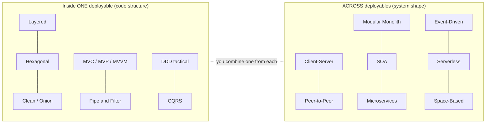

#### 📘 Terms Explained

| Term | Simple meaning |
|---|---|
| **Software architecture** | The major structural decisions of a system that are costly to change later. |
| **Quality attribute** | A non-functional property such as scalability, availability or maintainability ("-ilities"). |
| **Coupling** | How strongly one part depends on another; lower is usually better. |
| **Cohesion** | How strongly the contents of one part belong together; higher is usually better. |
| **Deployable / deployment unit** | Something you build and release as one piece (a JAR, a container, a function). |
| **Monolith** | An application deployed as a single unit, usually with one database. |
| **Trade-off** | Gaining one quality by accepting less of another. |

---

# 1. Layered Architecture (Interview Imp - Java)

## 1.1 What is Layered Architecture?

**Layered architecture** (also called **n-tier** when the layers run on separate machines) splits an application into **horizontal layers**, each with one kind of responsibility. A layer only talks to the layer **directly below** it.

The classic four layers:

| Layer | Responsibility | Java / Spring examples | Must NOT contain |
|---|---|---|---|
| **Presentation** (web / UI) | Accept input, validate format, call services, return responses | `@RestController`, `@Controller`, DTOs, JSON mapping | Business rules, SQL |
| **Business** (service / application) | Business rules, workflows, transactions | `@Service`, `@Transactional` | HTTP details, SQL strings |
| **Persistence** (data access) | Read and write data | `@Repository`, Spring Data JPA, JDBC templates | Business rules |
| **Database** | Stores the data | PostgreSQL, MySQL, Oracle | — |

**Analogy:** A restaurant. The **waiter** (presentation) takes your order and brings food; the **chef** (business) decides how to cook it; the **storeroom keeper** (persistence) fetches ingredients from the **storeroom** (database). The waiter never walks into the storeroom, and the chef never takes orders at the table.

It is the **default** architecture of most Java enterprise and Spring Boot applications, and the one interviewers expect you to describe first.

#### 📘 Terms Explained

| Term | Simple meaning |
|---|---|
| **Layer** | A logical group of classes with the same kind of responsibility. |
| **Tier** | A layer that runs on its own machine/process (e.g. browser tier, app tier, DB tier). |
| **n-tier** | An architecture with n physical tiers, e.g. 3-tier = client, app server, database. |
| **DTO (Data Transfer Object)** | A simple object that carries data between layers or over the network, with no business logic. |
| **Entity** | An object mapped to a database table (e.g. a JPA `@Entity`). |

---

## 1.2 Why Do We Need It?

| Without layers ("big ball of mud") | With layers |
|---|---|
| SQL inside controllers, HTML inside services | Each class has **one** kind of job (separation of concerns) |
| Changing the DB touches every file | DB changes stay in the persistence layer |
| New developers can't find where anything lives | Everyone knows where to look: controller → service → repository |
| Business rules duplicated in every endpoint | Rules live once in the service layer, reused by REST, batch jobs, messaging |
| Hard to test anything without the full app | Test the service with a mocked repository |

---

## 1.3 How It Works

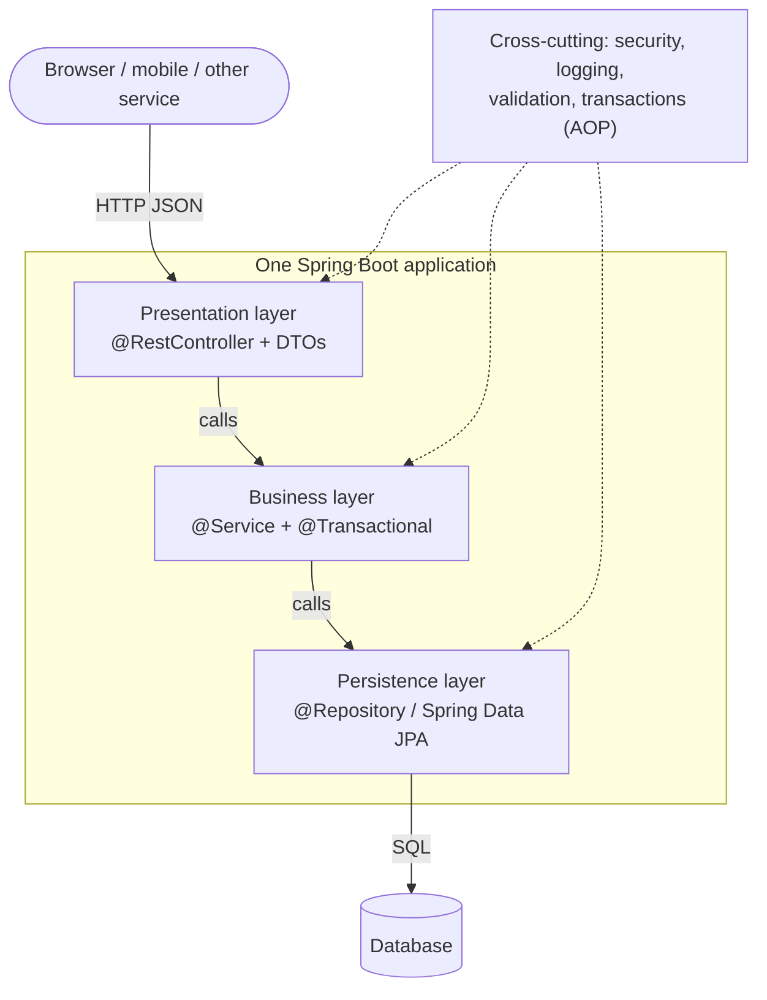

**The two rules:**
1. **Requests flow down, results flow up.** The controller calls the service, the service calls the repository; never the other way round.
2. **Each layer hides its details** from the layer above. The controller doesn't know there is SQL; the service doesn't know there is HTTP.

**Data shapes per layer:** request DTO → (controller maps) → service method arguments / domain objects → (repository maps) → entity/rows. On the way back, the controller maps results to a **response DTO**, so the database structure never leaks into your public API.

---

## 1.4 Variants: Strict vs Relaxed, Open vs Closed Layers

| Variant | Rule | When |
|---|---|---|
| **Strict (closed) layering** | A layer may call **only** the layer directly below | Default; gives the strongest isolation |
| **Relaxed layering** | A layer may call **any** lower layer (e.g. controller → repository) | Small CRUD apps; but rules leak into controllers over time |
| **Open layer** | A specific layer may be **skipped** (e.g. a shared "services" utility layer marked open) | When a layer is optional for some calls |
| **3-layer vs 4-layer vs 5-layer** | Some designs split business into *application* (use cases) + *domain* (rules), or add an *integration* layer for external APIs | Larger apps with rich business logic |
| **Package by layer vs package by feature** | `controller/ service/ repository/` folders vs `orders/ payments/ customers/` folders each containing their own layers | Package by **feature** scales better (high cohesion) and leads naturally to a modular monolith (section 9) |

```
Package by layer (common, but weak boundaries)     Package by feature (recommended as apps grow)
com.shop.controller.OrderController                com.shop.orders.OrderController
com.shop.controller.PaymentController              com.shop.orders.OrderService
com.shop.service.OrderService                      com.shop.orders.OrderRepository
com.shop.service.PaymentService                    com.shop.payments.PaymentController
com.shop.repository.OrderRepository                com.shop.payments.PaymentService
com.shop.repository.PaymentRepository              com.shop.payments.PaymentRepository
```

#### 📘 Terms Explained

| Term | Simple meaning |
|---|---|
| **Closed layer** | A layer requests must pass through; you cannot skip it. |
| **Open layer** | A layer that callers may bypass to reach the one below. |
| **Package by feature** | Organising code folders by business capability instead of technical role. |
| **Separation of concerns** | Each part of the code handles one kind of concern (UI, rules, storage). |

---

## 1.5 Complete Java Example - Controller, Service, Repository

The example builds three layers by hand (what Spring wires for you) and prints which layer handles each step. Watch for: the **business rule** (bulk discount, quantity limit) lives only in the service; the **HTTP status code** is decided only in the controller; and the read path shows an **architecture sinkhole**, where the service layer adds nothing.

```java
import java.util.ArrayList;
import java.util.LinkedHashMap;
import java.util.List;
import java.util.Map;
import java.util.Optional;

// ---------- Data layer (persistence): knows HOW data is stored, nothing about HTTP or business rules ----------
record OrderEntity(long id, String customer, String product, int quantity, long totalPaise, String status) {}

class OrderRepository {
    private final Map<Long, OrderEntity> table = new LinkedHashMap<>();   // stands in for a database table
    private long nextId = 1;

    OrderEntity save(OrderEntity e) {
        OrderEntity saved = e.id() == 0 ? new OrderEntity(nextId++, e.customer(), e.product(), e.quantity(), e.totalPaise(), e.status()) : e;
        table.put(saved.id(), saved);
        Trace.step("  [data]         INSERT/UPDATE orders id=" + saved.id());
        return saved;
    }
    Optional<OrderEntity> findById(long id) {
        Trace.step("  [data]         SELECT * FROM orders WHERE id=" + id);
        return Optional.ofNullable(table.get(id));
    }
}

class PriceRepository {
    private final Map<String, Long> prices = Map.of("keyboard", 249900L, "mouse", 79900L);
    Optional<Long> priceOf(String product) {
        Trace.step("  [data]         SELECT price FROM products WHERE name='" + product + "'");
        return Optional.ofNullable(prices.get(product));
    }
}

// ---------- Business layer (service): rules and transactions, no HTTP and no SQL ----------
class BusinessException extends RuntimeException {
    BusinessException(String message) { super(message); }
}

class OrderService {
    private final OrderRepository orders;
    private final PriceRepository prices;
    OrderService(OrderRepository orders, PriceRepository prices) { this.orders = orders; this.prices = prices; }

    OrderEntity placeOrder(String customer, String product, int quantity) {
        Trace.step("  [business]     placeOrder: validate + price + save (one transaction)");
        if (quantity < 1 || quantity > 10) throw new BusinessException("quantity must be 1..10");
        long unit = prices.priceOf(product).orElseThrow(() -> new BusinessException("unknown product " + product));
        long total = unit * quantity;
        if (quantity >= 5) total = total * 90 / 100;                       // business rule: 10% bulk discount
        return orders.save(new OrderEntity(0, customer, product, quantity, total, "PLACED"));
    }

    // A "sinkhole" call: the service adds nothing, it just passes the request through
    Optional<OrderEntity> findOrder(long id) {
        Trace.step("  [business]     findOrder: pass-through (architecture sinkhole)");
        return orders.findById(id);
    }
}

// ---------- Presentation layer (controller): HTTP in/out, DTOs, status codes; no business rules ----------
record PlaceOrderRequest(String customer, String product, int quantity) {}
record OrderResponse(long id, String product, int quantity, String total, String status) {}
record HttpResponse(int status, Object body) {}

class OrderController {
    private final OrderService service;
    OrderController(OrderService service) { this.service = service; }

    HttpResponse post(PlaceOrderRequest req) {
        Trace.step("  [presentation] POST /orders " + req);
        try {
            return new HttpResponse(201, toResponse(service.placeOrder(req.customer(), req.product(), req.quantity())));
        } catch (BusinessException e) {
            return new HttpResponse(400, Map.of("error", e.getMessage()));   // map business errors to HTTP status
        }
    }
    HttpResponse get(long id) {
        Trace.step("  [presentation] GET /orders/" + id);
        return service.findOrder(id).<HttpResponse>map(o -> new HttpResponse(200, toResponse(o)))
                .orElse(new HttpResponse(404, Map.of("error", "order " + id + " not found")));
    }
    private OrderResponse toResponse(OrderEntity e) {                      // entity -> DTO: never expose the entity itself
        return new OrderResponse(e.id(), e.product(), e.quantity(), String.format("Rs %.2f", e.totalPaise() / 100.0), e.status());
    }
}

class Trace {
    static final List<String> steps = new ArrayList<>();
    static void step(String s) { steps.add(s); }
    static void flush() { steps.forEach(System.out::println); steps.clear(); }
}

public class LayeredArchitectureDemo {
    public static void main(String[] args) {
        // Wiring (what Spring does for you): each layer only gets the layer directly below it
        OrderController controller = new OrderController(new OrderService(new OrderRepository(), new PriceRepository()));

        System.out.println("1) Valid order with bulk discount:");
        HttpResponse r1 = controller.post(new PlaceOrderRequest("asha", "keyboard", 5));
        Trace.flush();
        System.out.println("  -> " + r1);

        System.out.println("2) Invalid quantity (rule lives in the business layer, status code in presentation):");
        HttpResponse r2 = controller.post(new PlaceOrderRequest("asha", "mouse", 50));
        Trace.flush();
        System.out.println("  -> " + r2);

        System.out.println("3) Read an order (request passes through every layer):");
        HttpResponse r3 = controller.get(1);
        Trace.flush();
        System.out.println("  -> " + r3);

        System.out.println("4) Missing order:");
        HttpResponse r4 = controller.get(99);
        Trace.flush();
        System.out.println("  -> " + r4);
    }
}
```

**Output:**
```
1) Valid order with bulk discount:
  [presentation] POST /orders PlaceOrderRequest[customer=asha, product=keyboard, quantity=5]
  [business]     placeOrder: validate + price + save (one transaction)
  [data]         SELECT price FROM products WHERE name='keyboard'
  [data]         INSERT/UPDATE orders id=1
  -> HttpResponse[status=201, body=OrderResponse[id=1, product=keyboard, quantity=5, total=Rs 11245.50, status=PLACED]]
2) Invalid quantity (rule lives in the business layer, status code in presentation):
  [presentation] POST /orders PlaceOrderRequest[customer=asha, product=mouse, quantity=50]
  [business]     placeOrder: validate + price + save (one transaction)
  -> HttpResponse[status=400, body={error=quantity must be 1..10}]
3) Read an order (request passes through every layer):
  [presentation] GET /orders/1
  [business]     findOrder: pass-through (architecture sinkhole)
  [data]         SELECT * FROM orders WHERE id=1
  -> HttpResponse[status=200, body=OrderResponse[id=1, product=keyboard, quantity=5, total=Rs 11245.50, status=PLACED]]
4) Missing order:
  [presentation] GET /orders/99
  [business]     findOrder: pass-through (architecture sinkhole)
  [data]         SELECT * FROM orders WHERE id=99
  -> HttpResponse[status=404, body={error=order 99 not found}]
```

What the output shows:
- Request 1 goes **presentation → business → data** and back; the 10% bulk discount (5 × Rs 2499 = Rs 12495 → Rs 11245.50) was applied in the business layer only.
- Request 2 is rejected by the **business** layer (`quantity must be 1..10`), but the **presentation** layer decides it becomes HTTP **400**. Neither layer does the other's job.
- Requests 3 and 4 pass straight through the service: the **sinkhole anti-pattern**. A few pass-through calls are fine; if most requests look like this, strict layering is costing you more than it gives.
- The controller returns `OrderResponse` (a DTO with a formatted total), never `OrderEntity`, so the table structure is not part of the API.

---

## 1.6 Layered Architecture in Spring Boot

```java
// Presentation layer: HTTP only. Validates FORMAT (@Valid), maps DTOs, decides status codes.
@RestController
@RequestMapping("/orders")
@RequiredArgsConstructor
class OrderController {
    private final OrderService orderService;

    @PostMapping
    ResponseEntity<OrderResponse> place(@Valid @RequestBody PlaceOrderRequest req) {
        Order order = orderService.placeOrder(req.customerId(), req.productId(), req.quantity());
        return ResponseEntity.status(HttpStatus.CREATED).body(OrderResponse.from(order));
    }

    @GetMapping("/{id}")
    OrderResponse get(@PathVariable long id) {
        return OrderResponse.from(orderService.findOrder(id));
    }
}

// Business layer: rules + transaction boundary. No HttpServletRequest, no ResponseEntity, no SQL.
@Service
@RequiredArgsConstructor
class OrderService {
    private final OrderRepository orders;
    private final ProductRepository products;

    @Transactional
    public Order placeOrder(long customerId, long productId, int quantity) {
        if (quantity < 1 || quantity > 10) throw new BusinessException("quantity must be 1..10");
        Product product = products.findById(productId).orElseThrow(() -> new NotFoundException("product " + productId));
        return orders.save(Order.place(customerId, product, quantity));       // discount rule lives in the domain/service
    }

    @Transactional(readOnly = true)
    public Order findOrder(long id) {
        return orders.findById(id).orElseThrow(() -> new NotFoundException("order " + id));
    }
}

// Persistence layer: Spring Data generates the implementation.
interface OrderRepository extends JpaRepository<Order, Long> {
    List<Order> findByCustomerIdOrderByCreatedAtDesc(long customerId);
}

// Map business exceptions to HTTP in ONE place (still presentation layer)
@RestControllerAdvice
class ApiErrors {
    @ExceptionHandler(BusinessException.class)
    ProblemDetail business(BusinessException e) { return ProblemDetail.forStatusAndDetail(HttpStatus.BAD_REQUEST, e.getMessage()); }
    @ExceptionHandler(NotFoundException.class)
    ProblemDetail notFound(NotFoundException e) { return ProblemDetail.forStatusAndDetail(HttpStatus.NOT_FOUND, e.getMessage()); }
}
```

**Enforce the layers with a test** (ArchUnit, more in [section 4.6](#46-enforcing-the-rule-in-spring-boot-with-archunit)):

```java
@AnalyzeClasses(packages = "com.shop")
class LayeringTest {
    @ArchTest
    static final ArchRule layers = layeredArchitecture().consideringAllDependencies()
            .layer("Controller").definedBy("..controller..")
            .layer("Service").definedBy("..service..")
            .layer("Repository").definedBy("..repository..")
            .whereLayer("Controller").mayNotBeAccessedByAnyLayer()
            .whereLayer("Service").mayOnlyBeAccessedByLayers("Controller")
            .whereLayer("Repository").mayOnlyBeAccessedByLayers("Service");   // controllers may NOT call repositories
}
```

#### 📘 Terms Explained

| Term | Simple meaning |
|---|---|
| **`@RestController` / `@Service` / `@Repository`** | Spring stereotype annotations marking presentation, business and persistence classes (all are `@Component`s). |
| **`@Transactional`** | Makes a method run inside a database transaction; normally placed on service methods. |
| **`@RestControllerAdvice`** | A global place to turn exceptions into HTTP responses. |
| **`ProblemDetail`** | Spring 6's standard error body (RFC 9457 "problem+json"). |
| **ArchUnit** | A library that tests architecture rules (who may depend on whom) as unit tests. |

---

## 1.7 Pros and Cons

| Pros | Cons |
|---|---|
| Simple, well known; every Java developer understands it | Business logic tends to depend on the **database** layer (the domain is not at the centre) |
| Clear place for every class; good for onboarding | **Sinkhole** calls that just pass through layers |
| Layers can be tested and replaced separately | A feature change often touches **every** layer (controller + service + repository + DTO) |
| Matches Spring's stereotypes perfectly | Package-by-layer gives weak boundaries between features; grows into a "layered big ball of mud" |
| Great starting point for small and medium apps | Still **one deployable**: scales as a whole, not per feature |

---

## 1.8 Pitfalls, Interview Questions and Cheat Sheet

| Pitfall | Fix |
|---|---|
| Business rules in controllers ("fat controller") | Controllers only map and delegate; rules go to services/domain. |
| Returning JPA entities from REST endpoints | Map to response DTOs (avoids lazy-loading errors, leaking columns, accidental API changes). |
| `@Transactional` on controllers or repositories only | Put the transaction boundary on the **service** use-case method. |
| Services calling other services' repositories directly | Call the other **service** (or module API); each feature owns its data. |
| Anemic services that are just CRUD pass-throughs | Relaxed layering for pure reads, or move behaviour into the domain model ([section 12](#12-domain-driven-design-ddd-interview-imp---java)). |
| Circular dependencies between services | Extract a shared service or use events. |

**Q1. Explain layered architecture.** The app is split into presentation, business and persistence layers; each depends only on the layer below. It gives separation of concerns, testability per layer and a predictable code layout. Spring maps it to `@Controller`, `@Service`, `@Repository`.

**Q2. Layer vs tier?** A layer is a **logical** split of code; a tier is a **physical** split onto separate processes/machines. A 3-layer app can run as one tier (one JAR) plus a DB tier.

**Q3. What is the architecture sinkhole anti-pattern?** Requests that pass through layers with no logic added. Around 20% of such calls is normal; if most are pass-through, consider relaxed layering or a different style.

**Q4. Where does `@Transactional` belong and why?** On the service method, because a business use case (validate, update two tables, publish an event) must succeed or fail as one unit; controllers shouldn't know about transactions and repositories are too fine-grained.

**Q5. What is the main weakness of layered architecture?** The business layer depends on the persistence layer, so the domain is shaped by the database and is hard to test without it. Hexagonal/Clean architecture fix this by **inverting** that dependency.

```
LAYERED    Presentation (@RestController, DTOs) -> Business (@Service, @Transactional) -> Persistence (@Repository) -> DB.
           Calls go DOWN only. Closed (strict) vs open/relaxed layers. Layer = logical, tier = physical.
           + simple, familiar, testable per layer.  - domain depends on DB, sinkholes, changes cut across all layers.
           Don't expose entities; transactions on services; enforce with ArchUnit; prefer package-by-feature as it grows.
```

---

# 2. MVC, MVP and MVVM (Interview Imp - Java)

## 2.1 What Are They?

All three split a **user interface** into a part that holds data and rules (the **Model**), a part that shows it (the **View**) and a "middle" part that connects them. They differ in **who updates the view** and **how much the view knows**.

| Pattern | Middle part | How the view is updated | Typical home |
|---|---|---|---|
| **MVC** (Model-View-Controller) | **Controller** handles input, updates the model, picks a view | View renders the model (web: re-rendered per request; desktop: observes the model) | Spring MVC, Struts, Rails, Django, ASP.NET MVC |
| **MVP** (Model-View-Presenter) | **Presenter** holds all UI logic and talks to the view through an **interface** | Presenter calls `view.showX(...)` explicitly; the view is "passive" | Older Android, Swing/GWT, Windows Forms |
| **MVVM** (Model-View-ViewModel) | **ViewModel** exposes **observable properties** and commands; knows nothing about the view | The view **binds** to properties; a binding framework updates it automatically | JavaFX, Android Jetpack (ViewModel + LiveData/StateFlow), WPF, Angular, Vue |

**Analogy:** A TV news studio.
- **MVC**: the producer (controller) gets a viewer request, updates the facts (model) and tells the studio which graphic (view) to show.
- **MVP**: the presenter reads a script and explicitly tells a camera operator (passive view) "show chart now, show headline now".
- **MVVM**: the screens are wired to a live data feed (view model); when a number changes, every screen showing it updates by itself.

#### 📘 Terms Explained

| Term | Simple meaning |
|---|---|
| **Model** | Data and business rules, independent of any screen. |
| **View** | What the user sees (HTML page, JavaFX scene, Android layout). |
| **Controller** | Receives user input (an HTTP request, a click) and decides what to do. |
| **Presenter** | MVP's middle part: contains UI logic and drives a view through an interface. |
| **ViewModel** | MVVM's middle part: state and commands for a screen as observable properties. |
| **Data binding** | A framework feature that keeps a UI element and a property in sync automatically. |

---

## 2.2 Why Do We Need Them?

| Problem with "everything in the screen class" | What the patterns give |
|---|---|
| Business rules mixed with button handlers | Rules in the **Model**, reusable from any UI |
| Can't unit-test UI logic without starting a UI | Presenter/ViewModel are plain classes → fast JUnit tests |
| Changing the look breaks the logic | Swap the view (HTML → JSON, phone → tablet layout) and keep the logic |
| Designers and developers edit the same file | Templates/layouts separate from Java code |

---

## 2.3 How Each One Works

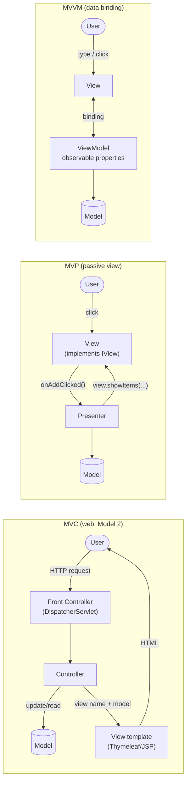

| Question | MVC | MVP | MVVM |
|---|---|---|---|
| Does the middle part know the view? | Picks a view **by name** | Yes, via an **interface** | **No** (zero references) |
| Who updates the screen? | The view renders the model | The presenter, explicitly | The binding framework |
| View ↔ middle cardinality | One controller, many views | Usually 1:1 | One ViewModel, many views possible |
| Testing | Controller tests (MockMvc) | Presenter + fake view | ViewModel alone, assert property values |

---

## 2.4 Variants: Classic MVC, Web MVC (Model 2), Passive View, Supervising Controller

| Variant | Description |
|---|---|
| **Classic (Smalltalk) MVC** | Desktop: the view **observes** the model directly (Observer pattern); the controller handles mouse/keyboard input. |
| **Web MVC / Model 2** | Request-response: a **Front Controller** (`DispatcherServlet`) routes each request to a controller, which fills a model map and returns a view name; the view renders HTML once. The view does not observe the model. |
| **MVC for REST APIs** | Same Spring MVC machinery, but the "view" is a **JSON serializer** (`@RestController` + Jackson) instead of a template. |
| **MVP - Passive View** | View has no logic at all; presenter sets every field. Most testable. |
| **MVP - Supervising Controller** | View uses simple data binding for basic fields; presenter handles complex logic. |
| **MVI / unidirectional data flow** | Modern UI variant (Redux, Jetpack Compose, React): state flows one way, user intents produce new immutable state. See [React_Complete_Guide.md](../../react/React_Complete_Guide.md). |

---

## 2.5 Complete Java Example - One Screen, Three Patterns

The same tiny "todo list" screen is built three ways over one shared `TodoModel`. MVC uses a **front controller** and a template-like view resolver; MVP uses a presenter that drives a **fake view** (exactly how you'd unit-test it); MVVM uses observable `Property` objects that the "view" binds to.

```java
import java.util.ArrayList;
import java.util.List;
import java.util.Map;
import java.util.function.Consumer;
import java.util.function.Function;

// The same tiny "todo list" screen built three ways: MVC, MVP and MVVM.

// ---------- Shared MODEL: data + rules, knows nothing about any UI ----------
class TodoModel {
    private final List<String> items = new ArrayList<>();
    private final List<Runnable> listeners = new ArrayList<>();
    void add(String item) {
        if (item == null || item.isBlank()) throw new IllegalArgumentException("todo text is required");
        items.add(item.trim());
        listeners.forEach(Runnable::run);                    // notify whoever observes the model
    }
    List<String> items() { return List.copyOf(items); }
    void onChange(Runnable r) { listeners.add(r); }
}

// =============== 1) MVC (web style, like Spring MVC): Front Controller -> Controller -> Model -> View ===============
record ModelAndView(String viewName, Map<String, Object> model) {}

class TodoController {                                       // handles input, updates the model, picks a view
    private final TodoModel model;
    TodoController(TodoModel model) { this.model = model; }
    ModelAndView list() { return new ModelAndView("todo-list", Map.of("items", model.items())); }
    ModelAndView add(String text) {
        try { model.add(text); return new ModelAndView("redirect:/todos", Map.of()); }
        catch (IllegalArgumentException e) { return new ModelAndView("todo-list", Map.of("items", model.items(), "error", e.getMessage())); }
    }
}

class ViewResolver {                                         // view = a template that only renders what it is given
    static String render(ModelAndView mv) {
        StringBuilder html = new StringBuilder("<ul>");
        @SuppressWarnings("unchecked") List<String> items = (List<String>) mv.model().get("items");
        items.forEach(i -> html.append("<li>").append(i).append("</li>"));
        html.append("</ul>");
        if (mv.model().containsKey("error")) html.append("<p class=error>").append(mv.model().get("error")).append("</p>");
        return html.toString();
    }
}

class FrontController {                                      // like Spring's DispatcherServlet: one entry point for all requests
    private final Map<String, Function<String, ModelAndView>> routes;
    FrontController(TodoController c) { routes = Map.of("GET /todos", p -> c.list(), "POST /todos", c::add); }
    String handle(String method, String path, String param) {
        ModelAndView mv = routes.get(method + " " + path).apply(param);
        if (mv.viewName().startsWith("redirect:")) return "302 -> " + mv.viewName().substring(9) + " | " + handle("GET", "/todos", null);
        return "200 " + ViewResolver.render(mv);
    }
}

// =============== 2) MVP: a PASSIVE view behind an interface; the presenter holds all UI logic ===============
interface TodoView {                                         // the presenter only talks to this interface
    String inputText();
    void showItems(List<String> items);
    void showError(String message);
    void clearInput();
}

class TodoPresenter {
    private final TodoView view;
    private final TodoModel model;
    TodoPresenter(TodoView view, TodoModel model) { this.view = view; this.model = model; }
    void onAddClicked() {
        try { model.add(view.inputText()); view.clearInput(); view.showItems(model.items()); }
        catch (IllegalArgumentException e) { view.showError(e.getMessage()); }
    }
}

class FakeTodoView implements TodoView {                     // in tests (or here) no real UI toolkit is needed
    String input = ""; final List<String> calls = new ArrayList<>();
    public String inputText() { return input; }
    public void showItems(List<String> items) { calls.add("showItems" + items); }
    public void showError(String message) { calls.add("showError(" + message + ")"); }
    public void clearInput() { input = ""; calls.add("clearInput"); }
}

// =============== 3) MVVM: the view BINDS to observable properties of a ViewModel ===============
class Property<T> {                                          // a minimal observable property (like JavaFX's StringProperty)
    private T value; private final List<Consumer<T>> observers = new ArrayList<>();
    Property(T initial) { value = initial; }
    T get() { return value; }
    void set(T v) { value = v; observers.forEach(o -> o.accept(v)); }
    void bind(Consumer<T> observer) { observers.add(observer); observer.accept(value); }
}

class TodoViewModel {                                        // no reference to any view at all
    final Property<String> input = new Property<>("");
    final Property<List<String>> items;
    final Property<Boolean> addEnabled = new Property<>(false);
    private final TodoModel model;
    TodoViewModel(TodoModel model) {
        this.model = model;
        items = new Property<>(model.items());
        model.onChange(() -> items.set(model.items()));     // model -> view model
    }
    void setInput(String text) { input.set(text); addEnabled.set(!text.isBlank()); }
    void add() { model.add(input.get()); setInput(""); }
}

public class UiPatternsDemo {
    public static void main(String[] args) {
        System.out.println("=== MVC (request/response, server-side rendering) ===");
        FrontController web = new FrontController(new TodoController(new TodoModel()));
        System.out.println(web.handle("POST", "/todos", "buy milk"));
        System.out.println(web.handle("POST", "/todos", "   "));

        System.out.println("=== MVP (presenter drives a passive view interface) ===");
        FakeTodoView view = new FakeTodoView();
        TodoPresenter presenter = new TodoPresenter(view, new TodoModel());
        view.input = "write tests"; presenter.onAddClicked();
        view.input = "";            presenter.onAddClicked();
        System.out.println("presenter called view: " + view.calls);

        System.out.println("=== MVVM (view binds to view-model properties) ===");
        TodoViewModel vm = new TodoViewModel(new TodoModel());
        vm.items.bind(list -> System.out.println("  [label]  items = " + list));          // what a data-binding framework does
        vm.addEnabled.bind(on -> System.out.println("  [button] Add enabled = " + on));
        System.out.println("user types 'pay rent':");
        vm.setInput("pay rent");
        System.out.println("user clicks Add:");
        vm.add();
    }
}
```

**Output:**
```
=== MVC (request/response, server-side rendering) ===
302 -> /todos | 200 <ul><li>buy milk</li></ul>
200 <ul><li>buy milk</li></ul><p class=error>todo text is required</p>
=== MVP (presenter drives a passive view interface) ===
presenter called view: [clearInput, showItems[write tests], showError(todo text is required)]
=== MVVM (view binds to view-model properties) ===
  [label]  items = []
  [button] Add enabled = false
user types 'pay rent':
  [button] Add enabled = true
user clicks Add:
  [label]  items = [pay rent]
  [button] Add enabled = false
```

What the output shows:
- **MVC:** the POST goes through the front controller to `TodoController.add`, which returns `redirect:/todos` (the **Post/Redirect/Get** pattern, so refreshing the browser doesn't resubmit); the GET then renders the list. On invalid input the controller re-renders the same view with an `error`.
- **MVP:** the presenter called `clearInput`, `showItems`, `showError` on the view **interface**. Because the view is just an interface, the "test" needed no UI toolkit. That is MVP's main benefit.
- **MVVM:** the view model never calls the view. Typing `pay rent` changed `addEnabled` to `true` and the bound "button" updated itself; clicking Add changed `items` and the "label" updated itself.

---

## 2.6 MVC in Spring Boot (and MVVM in JavaFX / Android)

**Spring MVC, server-side rendering with Thymeleaf:**

```java
@Controller                                   // not @RestController: returns VIEW NAMES
@RequestMapping("/todos")
@RequiredArgsConstructor
class TodoController {
    private final TodoService todos;

    @GetMapping
    String list(Model model) {
        model.addAttribute("items", todos.findAll());
        model.addAttribute("form", new TodoForm(""));
        return "todo-list";                   // -> templates/todo-list.html via ThymeleafViewResolver
    }

    @PostMapping
    String add(@Valid @ModelAttribute("form") TodoForm form, BindingResult errors, Model model) {
        if (errors.hasErrors()) { model.addAttribute("items", todos.findAll()); return "todo-list"; }
        todos.add(form.text());
        return "redirect:/todos";             // Post/Redirect/Get
    }
}
```

```html
<!-- src/main/resources/templates/todo-list.html : the VIEW, no business logic -->
<ul><li th:each="item : ${items}" th:text="${item.text}">sample</li></ul>
<form th:action="@{/todos}" th:object="${form}" method="post">
  <input th:field="*{text}"/> <span th:if="${#fields.hasErrors('text')}" th:errors="*{text}"></span>
  <button>Add</button>
</form>
```

**How Spring MVC handles a request (Front Controller pattern):** `DispatcherServlet` → `HandlerMapping` finds the controller method → `HandlerAdapter` invokes it (argument resolvers bind `@RequestBody`, `@PathVariable`, `@ModelAttribute`) → controller returns a view name or object → `ViewResolver` + `View` render HTML, or an `HttpMessageConverter` (Jackson) writes JSON. Interceptors and filters wrap this flow. More detail: [Client_Server_Web_Architecture_Guide.md](../../web-architecture/Client_Server_Web_Architecture_Guide.md).

**MVVM in JavaFX:**

```java
class TodoViewModel {
    final StringProperty input = new SimpleStringProperty("");
    final ObservableList<String> items = FXCollections.observableArrayList();
    final BooleanBinding addDisabled = input.isEmpty();
    void add() { items.add(input.get().trim()); input.set(""); }
}
// In the view (FXML controller): bindings, no logic
textField.textProperty().bindBidirectional(vm.input);
listView.setItems(vm.items);
addButton.disableProperty().bind(vm.addDisabled);
addButton.setOnAction(e -> vm.add());
```

**Android (Kotlin/Java) Jetpack:** `ViewModel` holds `StateFlow`/`LiveData`; the Activity/Compose UI observes it; the ViewModel survives screen rotation.

#### 📘 Terms Explained

| Term | Simple meaning |
|---|---|
| **Front Controller** | One entry point that receives every request and dispatches it (Spring's `DispatcherServlet`). |
| **`DispatcherServlet`** | The Spring MVC servlet that routes requests to controller methods and views. |
| **View resolver** | Turns a view name like `"todo-list"` into a real template to render. |
| **Thymeleaf** | A server-side HTML template engine commonly used with Spring Boot. |
| **Post/Redirect/Get (PRG)** | After a successful form POST, redirect to a GET page so refresh doesn't resubmit. |
| **`BindingResult`** | Holds validation/binding errors for a submitted form. |
| **`StringProperty` / `ObservableList`** | JavaFX observable types used for data binding. |

---

## 2.7 Pros and Cons

| | Pros | Cons |
|---|---|---|
| **MVC** | Simple, built into Spring; one controller can serve HTML and JSON; huge ecosystem | Controllers get fat; the view can depend on the model's shape; classic desktop MVC is hard to test |
| **MVP** | Highly testable (presenter + fake view); view is dumb and replaceable | Lots of interface boilerplate; presenter can become a "god object"; one presenter per view |
| **MVVM** | Least glue code with a binding framework; ViewModel has no view reference; great for rich, reactive UIs | Needs a binding framework; bindings are harder to debug; overkill for simple screens; memory leaks from forgotten listeners |

---

## 2.8 Pitfalls, Interview Questions and Cheat Sheet

| Pitfall | Fix |
|---|---|
| Business logic in controllers / presenters / view models | Keep it in the model or service layer; the middle part only coordinates UI. |
| Passing JPA entities to templates (`open-in-view` lazy loading) | Pass view DTOs; consider `spring.jpa.open-in-view=false`. |
| Forgetting PRG → duplicate submissions on refresh | `return "redirect:/..."` after successful POST. |
| ViewModel holding a reference to an Activity / view | Never; expose state and let the view observe it. |
| Thinking "MVC = whole architecture" | MVC organises the **presentation layer** only; you still need layers/hexagonal behind it. |

**Q1. Explain MVC in Spring.** The `DispatcherServlet` (front controller) receives a request, finds the `@Controller` method, which updates/reads the model via services and returns a view name; a view resolver renders the template with the model. With `@RestController` the "view" is JSON written by Jackson.

**Q2. MVC vs MVP vs MVVM?** MVC: controller handles input and picks a view. MVP: presenter drives a passive view through an interface (testable). MVVM: view binds to observable view-model properties; the view model doesn't know the view.

**Q3. Which is most testable?** MVP and MVVM, because presenters/view models are plain classes you can test without a UI. In Spring MVC you test controllers with `MockMvc` / `@WebMvcTest`.

**Q4. `@Controller` vs `@RestController`?** `@RestController` = `@Controller` + `@ResponseBody` on every method: return values are serialized (JSON) instead of being treated as view names.

**Q5. Is MVC an architectural pattern or a design pattern?** It's an architectural pattern **for the presentation layer**, built from design patterns: Observer (view ↔ model), Strategy (controller), Composite (nested views), Front Controller (web).

```
MVC    Controller handles input -> updates Model -> returns view name -> View renders.  Spring: DispatcherServlet (front controller),
       @Controller + Model + Thymeleaf, or @RestController + Jackson. PRG after POST.
MVP    Presenter + passive View INTERFACE; presenter calls view.showX(). Testable with a fake view. 1:1 presenter/view.
MVVM   ViewModel exposes observable properties; View BINDS to them; VM never references the view. JavaFX, Android Jetpack, Angular.
All    Organise the PRESENTATION layer only. Keep business rules in the model/services.
```

---

# 3. Hexagonal Architecture (Ports and Adapters) (Interview Imp - Java)

## 3.1 What is Hexagonal Architecture?

**Hexagonal architecture**, named **Ports and Adapters** by Alistair Cockburn (2005), puts the **business logic in the centre** and treats everything else (web, database, message broker, email, other services) as **plug-ins** around it.

- The core defines **ports**: Java **interfaces** describing what it offers (`PlaceOrderUseCase`) and what it needs (`PaymentPort`, `OrderRepositoryPort`).
- The outside world connects through **adapters**: classes that implement or call those ports using a specific technology (a REST controller, a JPA repository, a Kafka producer, a Stripe client).
- **All dependencies point inward.** The core imports nothing from Spring, JPA, Kafka or HTTP.

**Analogy:** A laptop with USB-C ports. The laptop (core) defines the port shape. You can plug in a charger, a monitor or a dock (adapters) from any brand, and the laptop doesn't change. On a train you plug in a power bank instead; in a test lab you plug in a measuring device.

The "hexagon" shape just means *many sides, all equal*: there is no special "top" (UI) or "bottom" (DB) as in layered architecture.

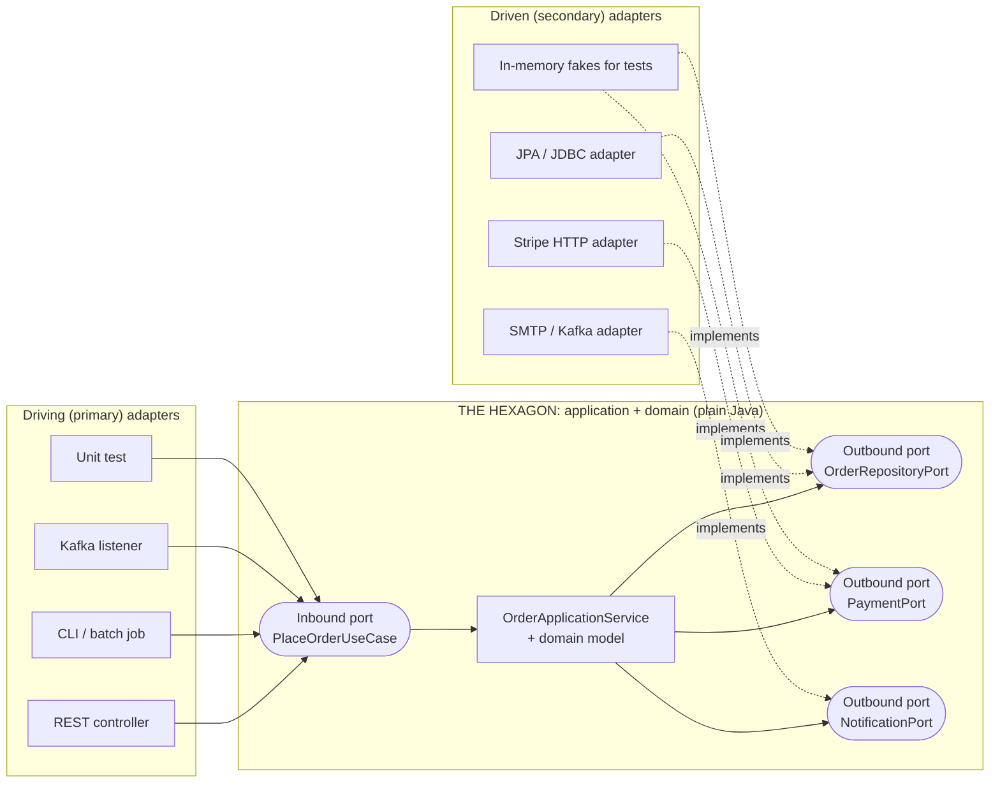

#### 📘 Terms Explained

| Term | Simple meaning |
|---|---|
| **Port** | An interface owned by the core describing an interaction (offered or needed). |
| **Adapter** | A class that connects a port to a real technology (HTTP, SQL, Kafka, SMTP). |
| **Inbound / driving / primary port** | What the outside can ask the app to do (use cases). Called by driving adapters. |
| **Outbound / driven / secondary port** | What the app needs from outside (store, pay, notify). Implemented by driven adapters. |
| **Dependency inversion** | High-level code defines interfaces; low-level code implements them, so dependencies point toward the core. |

---

## 3.2 Why Do We Need It?

| Problem in a typical layered app | How hexagonal fixes it |
|---|---|
| Service classes import `JpaRepository`, `RestTemplate`, `KafkaTemplate` → business logic tied to tools | Core depends only on its own **ports**; tools live in adapters |
| Testing a rule needs a DB, Kafka and WireMock | Test the core with **in-memory adapters**, in milliseconds |
| Switching Stripe → Razorpay or MySQL → MongoDB touches business code | Write a new adapter; the core is untouched |
| Same logic needed from REST, a batch job and a Kafka listener | Several **driving adapters** call the same use-case port |
| Framework upgrades (Spring Boot 2 → 3, `javax` → `jakarta`) ripple everywhere | Framework code is only in adapters and configuration |

---

## 3.3 How It Works

1. **Inside-out design.** Start with the domain model and use cases (plain Java). Define what the use case needs as **outbound port interfaces**.
2. **Driving side:** a driving adapter (e.g. `@RestController`) converts an HTTP request into a call on the **inbound port** (`placeOrder(...)`) and converts the result back to HTTP.
3. **Driven side:** the core calls outbound ports (`payments.charge(...)`); at runtime an adapter (Stripe client) implements that interface.
4. **Wiring** (Spring configuration or a `main` method) chooses which adapters to plug in: real ones in production, fakes in tests.

**Ownership rule:** the **core owns the port interfaces**, and they are written in the core's language (`charge(customer, amount)`, not `postToV1Charges(StripeRequest)`). The adapter does the translation.

---

## 3.4 Variants: Driving vs Driven Ports, How Many Ports?

| Choice | Options | Guidance |
|---|---|---|
| **Granularity of inbound ports** | One interface per use case (`PlaceOrderUseCase`, `CancelOrderUseCase`) vs one per aggregate (`OrderService`) | Per-use-case ports are explicit and small; per-service is simpler. Both are fine. |
| **Granularity of outbound ports** | One port per external need (`LoadOrderPort`, `SaveOrderPort`) vs one repository port | Start with one port per external system; split when interfaces grow. |
| **Where DTO mapping happens** | In adapters (recommended) | Core models never carry `@JsonProperty`, `@Entity` or `@Column`. |
| **Domain model vs JPA entity** | Separate classes + mapper (purist) vs annotate domain classes with JPA (pragmatic) | Pragmatic is common in Spring; separate when the domain is complex or the DB model is very different. |
| **Hexagonal + DDD** | Hexagon = one bounded context; core = aggregates + domain services | Very common combination ([section 12](#12-domain-driven-design-ddd-interview-imp---java)). |

---

## 3.5 Complete Java Example - One Core, Swappable Adapters

The same `OrderApplicationService` (the hexagon) is wired twice: once with "production" adapters (a REST adapter and a CLI adapter on the driving side; JDBC/Stripe/SMTP adapters on the driven side) and once with **in-memory test adapters**. The core class is identical in both.

```java
import java.util.ArrayList;
import java.util.LinkedHashMap;
import java.util.List;
import java.util.Map;
import java.util.Optional;

// ======================= THE HEXAGON (domain + application core) =======================
// No framework, no database, no HTTP in here. Only plain Java and the PORT interfaces it owns.

record Order(String id, String customer, long amountPaise, String status) {
    Order markPaid() { return new Order(id, customer, amountPaise, "PAID"); }
    Order markPaymentFailed() { return new Order(id, customer, amountPaise, "PAYMENT_FAILED"); }
}

// Inbound (driving / primary) port: what the outside world may ask the application to do
interface PlaceOrderUseCase {
    Order placeOrder(String customer, long amountPaise);
}

// Outbound (driven / secondary) ports: what the application needs from the outside world
interface OrderRepositoryPort { void save(Order order); Optional<Order> findById(String id); }
interface PaymentPort { boolean charge(String customer, long amountPaise); }
interface NotificationPort { void orderConfirmed(Order order); }
interface IdGeneratorPort { String nextId(); }

// The application service implements the inbound port and USES the outbound ports
class OrderApplicationService implements PlaceOrderUseCase {
    private final OrderRepositoryPort orders; private final PaymentPort payments;
    private final NotificationPort notifications; private final IdGeneratorPort ids;
    OrderApplicationService(OrderRepositoryPort o, PaymentPort p, NotificationPort n, IdGeneratorPort i) {
        orders = o; payments = p; notifications = n; ids = i;
    }
    public Order placeOrder(String customer, long amountPaise) {
        if (amountPaise <= 0) throw new IllegalArgumentException("amount must be positive");
        Order order = new Order(ids.nextId(), customer, amountPaise, "NEW");
        order = payments.charge(customer, amountPaise) ? order.markPaid() : order.markPaymentFailed();
        orders.save(order);
        if (order.status().equals("PAID")) notifications.orderConfirmed(order);
        return order;
    }
}

// ======================= ADAPTERS (outside the hexagon) =======================
// Driving adapter #1: a "REST controller" that turns HTTP-ish input into a use-case call
class RestOrderAdapter {
    private final PlaceOrderUseCase useCase;
    RestOrderAdapter(PlaceOrderUseCase useCase) { this.useCase = useCase; }
    String post(String json) {                                        // e.g. {"customer":"asha","amount":499.00}
        String customer = json.replaceAll(".*\"customer\":\"([^\"]+)\".*", "$1");
        long paise = Math.round(Double.parseDouble(json.replaceAll(".*\"amount\":([0-9.]+).*", "$1")) * 100);
        try {
            Order o = useCase.placeOrder(customer, paise);
            return "HTTP 201 {\"id\":\"" + o.id() + "\",\"status\":\"" + o.status() + "\"}";
        } catch (IllegalArgumentException e) { return "HTTP 400 {\"error\":\"" + e.getMessage() + "\"}"; }
    }
}

// Driving adapter #2: a CLI / batch job using the SAME use case, no change to the core
class CliOrderAdapter {
    private final PlaceOrderUseCase useCase;
    CliOrderAdapter(PlaceOrderUseCase useCase) { this.useCase = useCase; }
    String run(String line) {                                         // e.g. "place-order ravi 120000"
        String[] p = line.split(" ");
        Order o = useCase.placeOrder(p[1], Long.parseLong(p[2]));
        return "order " + o.id() + " -> " + o.status();
    }
}

// Driven adapters: "production-like" versions
class JdbcOrderRepositoryAdapter implements OrderRepositoryPort {
    final Map<String, Order> rows = new LinkedHashMap<>();            // pretend this is PostgreSQL via JDBC
    public void save(Order o) { rows.put(o.id(), o); System.out.println("    [jdbc]  INSERT INTO orders VALUES ('" + o.id() + "','" + o.status() + "')"); }
    public Optional<Order> findById(String id) { return Optional.ofNullable(rows.get(id)); }
}
class StripePaymentAdapter implements PaymentPort {
    public boolean charge(String customer, long amountPaise) {        // pretend this calls a payment provider over HTTPS
        boolean ok = amountPaise <= 100_000;                          // the "provider" declines above Rs 1000 in this demo
        System.out.println("    [stripe] POST /v1/charges amount=" + amountPaise + " -> " + (ok ? "succeeded" : "card_declined"));
        return ok;
    }
}
class EmailNotificationAdapter implements NotificationPort {
    public void orderConfirmed(Order o) { System.out.println("    [smtp]  email to " + o.customer() + ": order " + o.id() + " confirmed"); }
}
class SequenceIdAdapter implements IdGeneratorPort {
    private int n = 1000;
    public String nextId() { return "ORD-" + (++n); }
}

// Driven adapters: test doubles, used to test the core with NO infrastructure
class InMemoryOrderRepository implements OrderRepositoryPort {
    final Map<String, Order> rows = new LinkedHashMap<>();
    public void save(Order o) { rows.put(o.id(), o); }
    public Optional<Order> findById(String id) { return Optional.ofNullable(rows.get(id)); }
}
class FakePayment implements PaymentPort {
    boolean approve = true;
    public boolean charge(String c, long a) { return approve; }
}
class RecordingNotifications implements NotificationPort {
    final List<String> sent = new ArrayList<>();
    public void orderConfirmed(Order o) { sent.add(o.id()); }
}

public class HexagonalDemo {
    public static void main(String[] args) {
        System.out.println("=== Production wiring: REST + CLI adapters in, JDBC/Stripe/SMTP adapters out ===");
        PlaceOrderUseCase prod = new OrderApplicationService(new JdbcOrderRepositoryAdapter(),
                new StripePaymentAdapter(), new EmailNotificationAdapter(), new SequenceIdAdapter());
        RestOrderAdapter rest = new RestOrderAdapter(prod);
        CliOrderAdapter cli = new CliOrderAdapter(prod);
        System.out.println("REST: " + rest.post("{\"customer\":\"asha\",\"amount\":499.00}"));
        System.out.println("CLI : " + cli.run("place-order ravi 120000"));
        System.out.println("REST: " + rest.post("{\"customer\":\"meera\",\"amount\":0}"));

        System.out.println("=== Test wiring: same core, in-memory adapters, no DB / network / email ===");
        InMemoryOrderRepository repo = new InMemoryOrderRepository();
        FakePayment payment = new FakePayment();
        RecordingNotifications notes = new RecordingNotifications();
        PlaceOrderUseCase core = new OrderApplicationService(repo, payment, notes, () -> "TEST-1");
        Order paid = core.placeOrder("asha", 5000);
        check("paid order is saved as PAID", repo.findById("TEST-1").map(Order::status).orElse("").equals("PAID"));
        check("confirmation sent for paid order", notes.sent.equals(List.of("TEST-1")));
        payment.approve = false; notes.sent.clear();
        Order failed = core.placeOrder("asha", 5000);
        check("declined payment -> PAYMENT_FAILED", failed.status().equals("PAYMENT_FAILED"));
        check("no confirmation for failed payment", notes.sent.isEmpty());
        System.out.println("orders: " + paid.status() + ", " + failed.status());
    }
    static void check(String name, boolean ok) { System.out.println((ok ? "  PASS " : "  FAIL ") + name); }
}
```

**Output:**
```
=== Production wiring: REST + CLI adapters in, JDBC/Stripe/SMTP adapters out ===
    [stripe] POST /v1/charges amount=49900 -> succeeded
    [jdbc]  INSERT INTO orders VALUES ('ORD-1001','PAID')
    [smtp]  email to asha: order ORD-1001 confirmed
REST: HTTP 201 {"id":"ORD-1001","status":"PAID"}
    [stripe] POST /v1/charges amount=120000 -> card_declined
    [jdbc]  INSERT INTO orders VALUES ('ORD-1002','PAYMENT_FAILED')
CLI : order ORD-1002 -> PAYMENT_FAILED
REST: HTTP 400 {"error":"amount must be positive"}
=== Test wiring: same core, in-memory adapters, no DB / network / email ===
  PASS paid order is saved as PAID
  PASS confirmation sent for paid order
  PASS declined payment -> PAYMENT_FAILED
  PASS no confirmation for failed payment
orders: PAID, PAYMENT_FAILED
```

What the output shows:
- **Two driving adapters** (REST and CLI) used the same `PlaceOrderUseCase`. Adding a Kafka listener or a gRPC endpoint would be one more adapter, with no change to the core.
- The Stripe adapter declined Rs 1200 and the core turned that into `PAYMENT_FAILED`; the invalid amount was rejected by the core and translated to **HTTP 400** by the REST adapter.
- The **test wiring** proves four business rules with no database, network or email. The ID generator port was even supplied as a lambda (`() -> "TEST-1"`), because a port is just an interface.

---

## 3.6 Hexagonal Architecture in Spring Boot

**Package layout (one bounded context):**

```
com.shop.orders
├── domain                       <- plain Java: entities, value objects, domain services (no Spring, no JPA)
│   ├── Order.java
│   └── Money.java
├── application                  <- use cases + ports (plain Java; may use @Transactional if you accept that one annotation)
│   ├── port/in/PlaceOrderUseCase.java
│   ├── port/out/OrderRepositoryPort.java
│   ├── port/out/PaymentPort.java
│   └── OrderApplicationService.java
├── adapter
│   ├── in/web/OrderRestController.java           <- @RestController, request/response DTOs
│   ├── in/messaging/OrderCommandListener.java    <- @KafkaListener
│   ├── out/persistence/OrderJpaEntity.java       <- @Entity (separate from domain Order)
│   ├── out/persistence/OrderPersistenceAdapter.java
│   └── out/payment/StripePaymentAdapter.java     <- RestClient / WebClient calls
└── config/OrdersConfig.java                      <- wires core + adapters as beans
```

```java
// application/port/out/PaymentPort.java  (core-owned, in the core's language)
public interface PaymentPort {
    PaymentResult charge(CustomerId customer, Money amount);
}

// adapter/out/persistence: implements the outbound port using Spring Data JPA
@Component
@RequiredArgsConstructor
class OrderPersistenceAdapter implements OrderRepositoryPort {
    private final OrderJpaRepository jpa;               // interface OrderJpaRepository extends JpaRepository<OrderJpaEntity, String>
    private final OrderMapper mapper;

    @Override public void save(Order order) { jpa.save(mapper.toEntity(order)); }
    @Override public Optional<Order> findById(OrderId id) { return jpa.findById(id.value()).map(mapper::toDomain); }
}

// adapter/out/payment: implements the outbound port with an HTTP client
@Component
class StripePaymentAdapter implements PaymentPort {
    private final RestClient stripe;
    StripePaymentAdapter(RestClient.Builder builder, @Value("${stripe.url}") String url) { stripe = builder.baseUrl(url).build(); }
    @Override public PaymentResult charge(CustomerId customer, Money amount) {
        StripeChargeResponse r = stripe.post().uri("/v1/charges")
                .body(new StripeChargeRequest(customer.value(), amount.paise(), amount.currency()))
                .retrieve().body(StripeChargeResponse.class);
        return "succeeded".equals(r.status()) ? PaymentResult.ok(r.id()) : PaymentResult.declined(r.failureCode());
    }
}

// adapter/in/web: driving adapter calling the inbound port
@RestController
@RequiredArgsConstructor
class OrderRestController {
    private final PlaceOrderUseCase placeOrder;
    @PostMapping("/orders")
    ResponseEntity<OrderResponse> place(@Valid @RequestBody PlaceOrderRequest req) {
        Order order = placeOrder.placeOrder(new CustomerId(req.customerId()), Money.inr(req.amount()));
        return ResponseEntity.status(201).body(OrderResponse.from(order));
    }
}

// config: the ONLY place that knows both sides. The core class has no Spring annotations.
@Configuration
class OrdersConfig {
    @Bean
    PlaceOrderUseCase placeOrderUseCase(OrderRepositoryPort repo, PaymentPort payment, NotificationPort notify) {
        return new OrderApplicationService(repo, payment, notify, () -> "ORD-" + UUID.randomUUID());
    }
}
```

**Testing per ring:**
- Core: plain JUnit with fakes (like the example), no Spring context, runs in milliseconds.
- Driving adapters: `@WebMvcTest(OrderRestController.class)` with a mocked `PlaceOrderUseCase`.
- Driven adapters: `@DataJpaTest` + Testcontainers for persistence; WireMock for the Stripe adapter.
- An ArchUnit rule: classes in `..domain..` and `..application..` must not depend on `org.springframework..`, `jakarta.persistence..` or `..adapter..`.

#### 📘 Terms Explained

| Term | Simple meaning |
|---|---|
| **Mapper** | Code that converts between models (domain `Order` ↔ JPA `OrderJpaEntity` ↔ `OrderResponse` DTO); often MapStruct. |
| **`RestClient`** | Spring 6.1's synchronous fluent HTTP client (successor style to `RestTemplate`). |
| **`@WebMvcTest` / `@DataJpaTest`** | Spring Boot "slice" tests that start only the web layer / only JPA. |
| **Testcontainers** | A library that starts real databases/brokers in Docker for integration tests. |
| **WireMock** | A fake HTTP server for testing clients of external APIs. |

---

## 3.7 Pros and Cons

| Pros | Cons |
|---|---|
| Business logic independent of frameworks, DB and transport | More interfaces, classes and mapping code |
| Fast, reliable unit tests of the core | Overkill for simple CRUD services |
| Swap or add adapters (new API, new DB, new broker) without touching the core | Mapping between domain, entity and DTO can be tedious and a source of bugs |
| Clear boundaries make large codebases easier to navigate | Team needs discipline; easy to "cheat" by importing JPA into the core |
| Postpones technology decisions | Indirection makes simple flows harder to follow for newcomers |

---

## 3.8 Pitfalls, Interview Questions and Cheat Sheet

| Pitfall | Fix |
|---|---|
| Ports shaped like the technology (`saveToMongo`, `postStripeCharge`) | Name ports in business language; adapters translate. |
| JPA `@Entity` / Jackson annotations leaking into the domain | Separate persistence entities, or accept it consciously and document it. |
| Adapters containing business rules (e.g. discount in the controller) | Adapters only translate; rules belong to the core. |
| One giant "repository port" with 40 methods | Split by use case. |
| Using hexagonal for a 3-endpoint CRUD app | Use plain layered; adopt hexagonal when logic is rich or integrations many. |

**Q1. What is hexagonal architecture?** Business logic in the centre, exposed and served through ports (interfaces) owned by the core; adapters connect those ports to technologies. Dependencies point inward, so the core is framework-free and testable.

**Q2. Driving vs driven adapters?** Driving (primary) adapters **call** the application (REST controller, message listener, test). Driven (secondary) adapters **are called by** the application through outbound ports (DB, payment API, email).

**Q3. How is it different from layered architecture?** In layered, business depends on persistence (downwards). In hexagonal, persistence depends on the business core (it implements a core-owned port): the dependency is **inverted**. Also there is no "top" or "bottom": UI and DB are both just adapters.

**Q4. Which design patterns does it use?** Adapter (each adapter), Dependency Inversion/Injection (wiring), Strategy (swappable implementations), Facade (use-case ports).

**Q5. How do you enforce it?** Separate packages or Maven/Gradle modules (the core module has no Spring/JPA dependency), and ArchUnit tests.

```
HEXAGONAL (PORTS & ADAPTERS)   Core (domain + use cases, plain Java) defines PORTS (interfaces).
   Driving adapters (REST, CLI, Kafka listener, tests) -> inbound port.  Core -> outbound port <- implemented by driven adapters (JPA, Stripe, SMTP).
   Dependencies point INWARD. Swap adapters freely; test core with fakes in ms.
   Packages: domain / application(port.in, port.out) / adapter(in, out) / config.  Enforce with ArchUnit or Gradle modules.
   + testable, tech-agnostic.  - more classes + mapping; overkill for CRUD.
```

---

# 4. Clean Architecture and Onion Architecture (Interview Imp - Java)

## 4.1 What Are They?

Both are close relatives of hexagonal architecture, drawn as **concentric circles** with the business rules in the middle.

**Onion Architecture** (Jeffrey Palermo, 2008):

| Ring (inside → out) | Contains |
|---|---|
| **Domain model** | Entities, value objects: the core business concepts |
| **Domain services** | Business logic that spans several entities; repository **interfaces** |
| **Application services** | Use cases / orchestration, transactions |
| **Infrastructure, UI, tests** (outer ring) | Database implementations, web controllers, external APIs, test code |

**Clean Architecture** (Robert C. Martin, "Uncle Bob", 2012):

| Ring (inside → out) | Contains | Java example |
|---|---|---|
| **Entities** (enterprise business rules) | Rules true for the whole business, used by many apps | `Loan` with its EMI formula and tenure limits |
| **Use cases** (application business rules) | One class per use case ("interactor"), input/output boundaries, gateway interfaces | `ApplyLoanInteractor`, `ApplyLoanInputBoundary` |
| **Interface adapters** | Controllers, presenters, gateways: convert data between use cases and the outside | `LoanController`, `LoanJsonPresenter`, `JpaLoanGateway` |
| **Frameworks and drivers** | Web framework, DB, UI, devices | Spring MVC, Hibernate, PostgreSQL |

**Analogy:** A medieval castle. The treasure (business rules) sits in the keep at the centre. Each wall outward is less valuable and easier to rebuild. Guards on the outer walls know about the keep and protect it, but the treasure knows nothing about the walls. You can rebuild the outer wall (switch frameworks) without touching the treasure.

#### 📘 Terms Explained

| Term | Simple meaning |
|---|---|
| **Concentric architecture** | A design drawn as rings around a central domain; Onion, Clean and Hexagonal are all concentric. |
| **Entity (Clean Architecture)** | An object holding enterprise-wide business rules (not the same as a JPA entity). |
| **Use case / interactor** | A class that implements one application-specific action, e.g. "apply for loan". |
| **Input boundary** | The interface a controller calls to start a use case. |
| **Output boundary** | The interface a use case calls to deliver its result; implemented by a presenter. |
| **Presenter** | Converts use-case output into a view model (JSON, HTML fields). |
| **Gateway** | Clean Architecture's name for an outbound port (data access, external services). |

---

## 4.2 Why Do We Need Them?

The goal is the same as hexagonal: **business rules that don't depend on details**. Uncle Bob's list of what the architecture should be independent of:

| Independent of | Meaning |
|---|---|
| **Frameworks** | Spring is a tool you plug in, not the skeleton your logic hangs on |
| **UI** | Swap web for a mobile API or CLI without changing rules |
| **Database** | Swap PostgreSQL for MongoDB without changing rules |
| **External agencies** | Rules don't know about Stripe, Kafka or a partner API |
| **Testable** | Rules can be tested without UI, DB, web server or any external element |

Clean Architecture also adds a **screaming architecture** idea: the top-level folders should "scream" the business (`loans/`, `payments/`, `accounts/`), not the framework (`controllers/`, `services/`).

---

## 4.3 How It Works: The Dependency Rule

> **The Dependency Rule:** source-code dependencies may point **only inward**. Nothing in an inner circle may know the name of anything in an outer circle: no class, function, variable or data format.

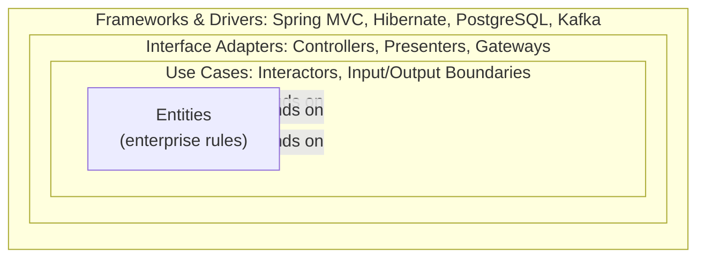

**But the use case must call the DB and the presenter, which are outside.** How, without depending outward? With **Dependency Inversion**: the use case defines an interface (`InterestRateGateway`, `ApplyLoanOutputBoundary`) in its own ring, and the outer ring **implements** it. At runtime control flows outward; at compile time the dependency points inward.

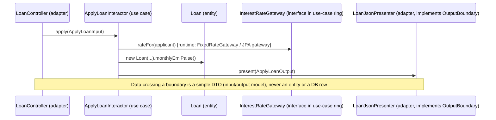

**Crossing boundaries with simple data.** Use cases receive an **input model** and produce an **output model** (plain records). They never accept `HttpServletRequest` or return a JPA entity.

---

## 4.4 Hexagonal vs Onion vs Clean

They are **the same core idea** with different vocabulary and different amounts of prescription.

| | Hexagonal (2005) | Onion (2008) | Clean (2012) |
|---|---|---|---|
| Picture | Hexagon with ports on its sides | Concentric rings | Concentric rings |
| Core idea | Core talks to the world only via ports; adapters plug in | Domain model at the centre; infrastructure outermost | Dependency Rule: dependencies point inward |
| Inside the core | Not prescribed ("the application") | Domain model → domain services → application services | Entities → use cases |
| Vocabulary | Ports, driving/driven adapters | Domain, infrastructure | Entities, interactors, boundaries, presenters, gateways |
| How prescriptive | Least | Medium | Most (one interactor per use case, presenters) |
| Main focus | Symmetry: UI and DB are both "outside" | The domain model at the centre | Use cases as first-class citizens |

**In an interview:** "Hexagonal, Onion and Clean all invert the dependency between business logic and infrastructure. Hexagonal emphasises ports and adapters, Onion emphasises the domain-model rings, and Clean adds explicit use-case interactors and the Dependency Rule. In Spring projects they usually look almost identical."

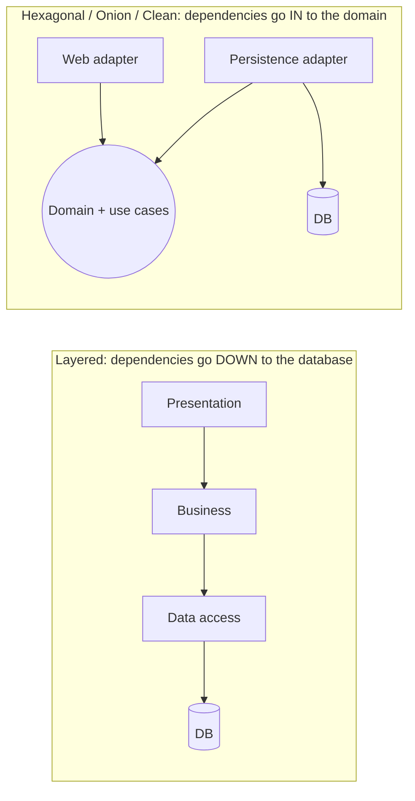

#### 📘 Terms Explained

| Term | Simple meaning |
|---|---|
| **Dependency Rule** | Code dependencies may only point toward the centre (more abstract, more stable code). |
| **Dependency Inversion Principle (DIP)** | High-level modules shouldn't depend on low-level modules; both depend on abstractions (the "D" in SOLID). |
| **Screaming architecture** | A codebase whose structure reveals the business domain rather than the framework. |
| **Input / output model** | Simple data structures passed into and out of a use case. |

---

## 4.5 Complete Java Example - A Use Case and a Dependency-Rule Checker

Part A builds an "apply for a loan" use case with every Clean Architecture role: an **entity** (`Loan`, with the EMI formula and a tenure rule), an **interactor** with **input/output boundaries** and a **gateway** interface, and adapters (**controller**, **presenter**, gateway implementation). Part B is a tiny version of what ArchUnit does: give every class a ring number and report any dependency that points **outward**.

```java
import java.util.ArrayList;
import java.util.LinkedHashMap;
import java.util.List;
import java.util.Map;

// Part A: a use case written the Clean Architecture way (entity, interactor, boundaries, presenter, gateway).
// Part B: a "dependency rule" checker, the same idea ArchUnit enforces in real projects.

// ---- Ring 1: Entities (enterprise business rules) ----
class Loan {
    final long principalPaise; final int months; final double annualRatePct;
    Loan(long principalPaise, int months, double annualRatePct) {
        if (months < 6 || months > 360) throw new IllegalArgumentException("tenure must be 6..360 months");
        this.principalPaise = principalPaise; this.months = months; this.annualRatePct = annualRatePct;
    }
    long monthlyEmiPaise() {                                        // EMI = P*r*(1+r)^n / ((1+r)^n - 1)
        double r = annualRatePct / 12 / 100, pow = Math.pow(1 + r, months);
        return Math.round(principalPaise * r * pow / (pow - 1));
    }
}

// ---- Ring 2: Use cases (application business rules) + their boundaries ----
record ApplyLoanInput(String applicant, long principalPaise, int months, long monthlyIncomePaise) {}
record ApplyLoanOutput(String applicant, boolean approved, long emiPaise, String reason) {}
interface ApplyLoanInputBoundary { void apply(ApplyLoanInput in); }            // called by the controller
interface ApplyLoanOutputBoundary { void present(ApplyLoanOutput out); }       // implemented by the presenter
interface InterestRateGateway { double rateFor(String applicant); }            // implemented by an outer adapter

class ApplyLoanInteractor implements ApplyLoanInputBoundary {
    private final InterestRateGateway rates; private final ApplyLoanOutputBoundary presenter;
    ApplyLoanInteractor(InterestRateGateway rates, ApplyLoanOutputBoundary presenter) { this.rates = rates; this.presenter = presenter; }
    public void apply(ApplyLoanInput in) {
        Loan loan = new Loan(in.principalPaise(), in.months(), rates.rateFor(in.applicant()));
        long emi = loan.monthlyEmiPaise();
        boolean ok = emi * 100 <= in.monthlyIncomePaise() * 40;             // rule: EMI must be <= 40% of income
        presenter.present(new ApplyLoanOutput(in.applicant(), ok, emi, ok ? "within 40% of income" : "EMI exceeds 40% of income"));
    }
}

// ---- Ring 3: Interface adapters (controller, presenter, gateway implementation) ----
class LoanController {                                                        // web input -> input model
    private final ApplyLoanInputBoundary useCase;
    LoanController(ApplyLoanInputBoundary useCase) { this.useCase = useCase; }
    void post(Map<String, String> form) {
        useCase.apply(new ApplyLoanInput(form.get("name"), Long.parseLong(form.get("amount")) * 100,
                Integer.parseInt(form.get("months")), Long.parseLong(form.get("income")) * 100));
    }
}
class LoanJsonPresenter implements ApplyLoanOutputBoundary {                  // output model -> view model (JSON)
    String lastJson;
    public void present(ApplyLoanOutput o) {
        lastJson = String.format("{\"applicant\":\"%s\",\"approved\":%b,\"emi\":\"Rs %,.2f\",\"reason\":\"%s\"}",
                o.applicant(), o.approved(), o.emiPaise() / 100.0, o.reason());
    }
}
class FixedRateGateway implements InterestRateGateway {                       // would call a rates service / DB
    public double rateFor(String applicant) { return applicant.equals("ravi") ? 10.5 : 9.0; }
}

// ---- Part B: a tiny architecture checker ----
class DependencyRuleChecker {
    // ring number: 1 = innermost. The rule: source code dependencies may only point INWARD (to a lower or equal ring).
    static List<String> violations(Map<String, Integer> ringOf, Map<String, List<String>> dependsOn) {
        List<String> out = new ArrayList<>();
        dependsOn.forEach((from, targets) -> targets.forEach(to -> {
            if (ringOf.get(to) > ringOf.get(from))
                out.add(from + " (ring " + ringOf.get(from) + ") -> " + to + " (ring " + ringOf.get(to) + ")");
        }));
        return out;
    }
}

public class CleanArchitectureDemo {
    public static void main(String[] args) {
        System.out.println("=== Part A: use case flow  Controller -> Interactor -> Entity -> Presenter ===");
        LoanJsonPresenter presenter = new LoanJsonPresenter();
        LoanController controller = new LoanController(new ApplyLoanInteractor(new FixedRateGateway(), presenter));
        controller.post(Map.of("name", "asha", "amount", "500000", "months", "60", "income", "90000"));
        System.out.println(presenter.lastJson);
        controller.post(Map.of("name", "ravi", "amount", "2000000", "months", "60", "income", "90000"));
        System.out.println(presenter.lastJson);
        try { controller.post(Map.of("name", "meera", "amount", "100000", "months", "3", "income", "50000")); }
        catch (IllegalArgumentException e) { System.out.println("entity rejected input: " + e.getMessage()); }

        System.out.println("=== Part B: checking the dependency rule ===");
        Map<String, Integer> ring = new LinkedHashMap<>();
        ring.put("Loan", 1); ring.put("ApplyLoanInteractor", 2); ring.put("InterestRateGateway", 2);
        ring.put("LoanController", 3); ring.put("LoanJsonPresenter", 3); ring.put("FixedRateGateway", 3);
        ring.put("JpaLoanEntity", 4); ring.put("SpringWebMvc", 4);

        Map<String, List<String>> good = new LinkedHashMap<>();
        good.put("ApplyLoanInteractor", List.of("Loan", "InterestRateGateway"));
        good.put("LoanController", List.of("ApplyLoanInteractor"));
        good.put("FixedRateGateway", List.of("InterestRateGateway"));
        System.out.println("clean design violations: " + DependencyRuleChecker.violations(ring, good));

        Map<String, List<String>> bad = new LinkedHashMap<>(good);
        bad.put("Loan", List.of("JpaLoanEntity"));                                   // entity annotated with / extending JPA class
        bad.put("ApplyLoanInteractor", List.of("Loan", "FixedRateGateway", "SpringWebMvc"));   // use case knows concrete adapter + web
        System.out.println("shortcut design violations:");
        DependencyRuleChecker.violations(ring, bad).forEach(v -> System.out.println("  VIOLATION " + v));
    }
}
```

**Output:**
```
=== Part A: use case flow  Controller -> Interactor -> Entity -> Presenter ===
{"applicant":"asha","approved":true,"emi":"Rs 10,379.18","reason":"within 40% of income"}
{"applicant":"ravi","approved":false,"emi":"Rs 42,987.80","reason":"EMI exceeds 40% of income"}
entity rejected input: tenure must be 6..360 months
=== Part B: checking the dependency rule ===
clean design violations: []
shortcut design violations:
  VIOLATION ApplyLoanInteractor (ring 2) -> FixedRateGateway (ring 3)
  VIOLATION ApplyLoanInteractor (ring 2) -> SpringWebMvc (ring 4)
  VIOLATION Loan (ring 1) -> JpaLoanEntity (ring 4)
```

What the output shows:
- **Part A:** the controller only converted the form (rupees → paise) and called the input boundary; the interactor applied the **application rule** (EMI ≤ 40% of income); the **entity** computed the EMI and enforced the **enterprise rule** (tenure 6..360 months); the presenter turned the output model into JSON. Asha's EMI Rs 10,379.18 fits in 40% of Rs 90,000; Ravi's Rs 42,987.80 doesn't.
- The interactor never called the presenter's concrete class; it called `ApplyLoanOutputBoundary`, an interface in **its own ring**. That's the dependency inversion that keeps the rule.
- **Part B:** the clean wiring has no violations. The "shortcut" design has three: an entity depending on a JPA class (ring 1 → 4), and the use case depending on a concrete gateway (2 → 3) and on the web framework (2 → 4). In a real project ArchUnit fails the build for exactly these.

---

## 4.6 Enforcing the Rule in Spring Boot with ArchUnit

```xml
<dependency>
  <groupId>com.tngtech.archunit</groupId>
  <artifactId>archunit-junit5</artifactId>
  <version>1.3.0</version>
  <scope>test</scope>
</dependency>
```

```java
@AnalyzeClasses(packages = "com.bank.loans", importOptions = ImportOption.DoNotIncludeTests.class)
class ArchitectureTest {

    // ArchUnit has a built-in rule for Onion / Hexagonal / Clean
    @ArchTest
    static final ArchRule onion = onionArchitecture()
            .domainModels("..domain.model..")
            .domainServices("..domain.service..")
            .applicationServices("..application..")
            .adapter("web", "..adapter.web..")
            .adapter("persistence", "..adapter.persistence..")
            .adapter("rates", "..adapter.rates..");

    // The core must not know any framework
    @ArchTest
    static final ArchRule coreIsFrameworkFree = noClasses()
            .that().resideInAnyPackage("..domain..", "..application..")
            .should().dependOnClassesThat().resideInAnyPackage(
                    "org.springframework..", "jakarta.persistence..", "com.fasterxml.jackson..");

    // Adapters must not call each other directly (web -> persistence shortcut)
    @ArchTest
    static final ArchRule adaptersIndependent = slices().matching("..adapter.(*)..").should().notDependOnEachOther();
}
```

**Stronger enforcement with build modules** (the compiler then refuses outward imports):

```
loans-domain        (no dependencies)                         -> entities, value objects
loans-application   (depends on loans-domain)                 -> use cases, ports/boundaries
loans-adapters      (depends on application + Spring, JPA)    -> controllers, presenters, gateways
loans-app           (depends on everything)                   -> @SpringBootApplication, configuration
```

**Pragmatic Clean Architecture in Spring:** many teams skip separate presenters (the controller maps the use case's return value to a DTO) and allow `@Transactional` on use cases. That's fine as long as the **dependency direction** is kept and the choice is deliberate.

#### 📘 Terms Explained

| Term | Simple meaning |
|---|---|
| **`onionArchitecture()`** | ArchUnit's ready-made rule for concentric architectures (works for Onion, Hexagonal and Clean). |
| **`slices()`** | ArchUnit feature to treat package groups as units and check dependencies between them. |
| **Multi-module build** | A Maven/Gradle project split into modules whose dependencies are declared explicitly. |

---

## 4.7 Pros and Cons

| Pros | Cons |
|---|---|
| Business rules completely isolated and long-lived | The most ceremony: boundaries, models, presenters, mappers for every use case |
| Every rule testable without infrastructure | Easy to over-engineer small services ("enterprise FizzBuzz") |
| Framework, DB and UI can be replaced or upgraded independently | Lots of near-duplicate data classes (request DTO, input model, entity, JPA entity, output model, response DTO) |
| Use-case classes document what the system does | Steeper learning curve; teams disagree on "the right" interpretation |
| Enforceable with ArchUnit / modules | Performance tuning (e.g. specific SQL) can feel awkward behind generic gateways |

---

## 4.8 Pitfalls, Interview Questions and Cheat Sheet

| Pitfall | Fix |
|---|---|
| Treating Clean Architecture as "must have exactly 4 rings and presenters everywhere" | Keep the **Dependency Rule**; adapt the number of rings to the problem. |
| Inner rings using outer data formats (JSON strings, `ResultSet`, JPA entities) | Pass simple input/output models across boundaries. |
| Generic "Gateway" interfaces mirroring JPA (`findAll`, `saveAll`, `flush`) | Gateways should express use-case needs. |
| Folder structure by framework (`controllers/`) | Screaming architecture: folders by business capability. |
| Use cases calling other use cases in a chain | Share domain services/entities instead; keep use cases independent. |

**Q1. What is the Dependency Rule?** Source-code dependencies only point inward; inner circles (entities, use cases) know nothing about outer circles (adapters, frameworks). Outer layers implement interfaces defined by inner layers.

**Q2. How does a use case save to the DB without depending on the DB?** It depends on a gateway/repository **interface** it owns; an outer-ring class implements that interface with JPA. Spring injects the implementation (dependency inversion + injection).

**Q3. Clean vs Hexagonal vs Onion?** Same principle (domain in the centre, dependencies inward). Hexagonal talks about ports/adapters, Onion about domain rings, Clean adds use-case interactors, boundaries and presenters with the explicit Dependency Rule.

**Q4. What's the difference between a Clean Architecture entity and a JPA entity?** A Clean entity is a business object with rules, independent of storage. A JPA `@Entity` is a persistence mapping. In strict designs they're different classes with a mapper.

**Q5. When would you NOT use it?** Small CRUD apps, prototypes, or services that are mostly glue between systems; the ceremony would outweigh the benefit.

```
CLEAN / ONION   Concentric rings, domain at centre. DEPENDENCY RULE: dependencies point INWARD only.
  Clean: Entities -> Use cases (interactors, input/output boundaries, gateway interfaces) -> Interface adapters (controllers,
         presenters, gateways) -> Frameworks & drivers.   Onion: domain model -> domain services -> application -> infrastructure/UI.
  Outer rings implement interfaces owned by inner rings (DIP). Cross boundaries with simple DTOs.
  Hexagonal ~ Onion ~ Clean: same idea, different vocabulary. Enforce: ArchUnit onionArchitecture() / multi-module builds.
```

---

# 5. Event-Driven Architecture (Interview Imp - Java)

## 5.1 What is Event-Driven Architecture?

In **Event-Driven Architecture (EDA)**, components communicate by **producing and reacting to events**. An **event** is a fact about something that **already happened**: `OrderPlaced`, `PaymentCaptured`, `StockReserved`. The producer publishes it to an **event channel** (a broker such as Kafka or RabbitMQ) and doesn't know or care who consumes it.

| Role | What it does | Examples |
|---|---|---|
| **Event producer** | Detects a state change and publishes an event | Order service publishes `OrderPlaced` |
| **Event channel / broker** | Stores and delivers events | Kafka topic, RabbitMQ exchange, AWS SNS/EventBridge |
| **Event consumer** | Subscribes and reacts | Inventory reserves stock; email service sends confirmation; analytics counts orders |
| **Event processor** (optional) | Filters, transforms, aggregates streams | Kafka Streams, Flink |

**Analogy:** A newspaper. The newspaper (producer) prints news (events) once. Anyone who subscribes gets it. The newspaper doesn't know each reader, and new readers can subscribe at any time without the newspaper changing anything.

This is the **architecture style**. The underlying mechanics (queues, pub-sub, brokers, DLQs, idempotent consumers, outbox) are covered in [04_Messaging_Pattern.md](../03_System_Design/04_Messaging_Pattern.md), and event choreography between microservices in [02_Microservices_Pattern.md](../04_Specialized/02_Microservices_Pattern.md#6-domain-events-and-event-driven-choreography-interview-imp---java).

#### 📘 Terms Explained

| Term | Simple meaning |
|---|---|
| **Event** | An immutable record that something happened, named in the past tense. |
| **Command** | A request to do something (`ReserveStock`); may be rejected. Not the same as an event. |
| **Event broker** | Middleware that receives and distributes events (Kafka, RabbitMQ, Pulsar). |
| **Topic** | A named stream of events consumers subscribe to. |
| **Loose coupling** | Components don't call each other directly, so they can change, fail or scale independently. |

---

## 5.2 Why Do We Need It?

| Request-driven (synchronous calls) | Event-driven |
|---|---|
| Order service calls inventory, payment, email, analytics in sequence → slow, and fails if any is down | Order service publishes one event and returns; each consumer works in parallel |
| Adding a loyalty-points feature = change and redeploy the order service | New consumer subscribes; producer unchanged |
| Spike of orders overloads every downstream service at once | Broker **buffers** events; consumers process at their own pace |
| No record of what happened, only current state | The event log is a **history** you can replay to build new views or debug |
| Tight temporal coupling (both must be up at the same time) | Producer and consumer can be up at different times |

---

## 5.3 How It Works

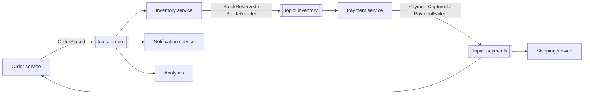

1. Something changes in a service (an order is saved).
2. The service publishes an event, ideally **in the same transaction** as the state change (use the [Transactional Outbox](../03_System_Design/04_Messaging_Pattern.md#13-guaranteed-delivery-and-the-transactional-outbox-interview-imp---java)) so you never save without publishing or publish without saving.
3. The broker stores the event and delivers it to every subscribed consumer group.
4. Each consumer handles it **idempotently** (it may be delivered more than once) and may publish its own events.
5. The system becomes **eventually consistent**: for a short time different services have different views.

---

## 5.4 Variants: Broker vs Mediator Topology, Four Event Styles

**Two topologies** (Mark Richards' classification):

| | Broker topology (choreography) | Mediator topology (orchestration) |
|---|---|---|
| Control | No central coordinator; each service reacts and emits the next event | A mediator/orchestrator receives the initial event and sends commands step by step |
| Coupling | Lowest | Services coupled to the mediator |
| Visibility of the workflow | Spread across services (hard to see "where is order 9?") | In one place (state machine) |
| Error handling | Each service compensates; complex | Mediator handles failures, retries, compensation |
| Good for | Simple flows, many independent reactions | Multi-step business processes with rules |
| Tools | Kafka + services | Saga orchestrator, Camunda/Temporal, Spring State Machine |

**Four meanings of "event-driven"** (Martin Fowler):

| Style | Event carries | Consumer must | Trade-off |
|---|---|---|---|
| **Event notification** | Just "X happened" + an ID | Call back the producer for details | Small events, but call-back load and coupling return |
| **Event-carried state transfer** | The changed data | Update its own local copy | No call-backs, consumer works when producer is down; data duplicated |
| **Event sourcing** | Every change, stored as the source of truth | Replay to get state | Full history; complexity ([section 11](#11-cqrs-and-event-sourcing-as-architectural-styles-interview-imp---java)) |
| **CQRS** (often combined) | Events update separate read models | Query read models | Optimised reads; eventual consistency |

**Event processing styles:** simple (react to one event), **stream processing** (windows, joins, aggregations over many events with Kafka Streams/Flink), **complex event processing** (detect patterns like "3 failed logins in 1 minute from 2 countries").

---

## 5.5 Complete Java Example - Choreography, Orchestration and Replay

An in-memory `EventChannel` stands in for Kafka. Part 1 is a **broker topology**: inventory, payment and shipping each react to the previous event, and then an analytics consumer is added **without touching the producer**. Part 2 runs the same steps through a **mediator**. Part 3 compares event **notification** with **event-carried state transfer**. Part 4 replays the event log to build a brand-new read model.

```java
import java.util.ArrayList;
import java.util.LinkedHashMap;
import java.util.List;
import java.util.Map;
import java.util.TreeMap;
import java.util.function.Consumer;

// Event-Driven Architecture in miniature: event channel, producers that don't know their consumers,
// broker topology (choreography) vs mediator topology (orchestration), and the two event "styles".

record Event(String type, String key, Map<String, Object> data) {
    Event { data = new TreeMap<>(data); }             // sorted copy: stable, readable output
    @Override public String toString() { return type + "(" + key + ")" + data; }
}

class EventChannel {                                  // stands in for Kafka / RabbitMQ / SNS
    private final Map<String, List<Consumer<Event>>> subscribers = new LinkedHashMap<>();
    private final List<Event> log = new ArrayList<>();
    void subscribe(String type, Consumer<Event> handler) { subscribers.computeIfAbsent(type, t -> new ArrayList<>()).add(handler); }
    void publish(Event e) {
        log.add(e);
        System.out.println("  publish " + e);
        subscribers.getOrDefault(e.type(), List.of()).forEach(h -> h.accept(e));
    }
    List<Event> log() { return log; }
}

public class EventDrivenDemo {
    public static void main(String[] args) {
        System.out.println("=== 1) Broker topology (choreography): each service reacts and emits the next event ===");
        EventChannel bus = new EventChannel();
        // Order service only knows it must announce OrderPlaced. It does NOT know who listens.
        bus.subscribe("OrderPlaced", e -> {                                       // inventory service
            System.out.println("    [inventory] reserve stock for " + e.key());
            bus.publish(new Event("StockReserved", e.key(), Map.of("sku", e.data().get("sku"))));
        });
        bus.subscribe("StockReserved", e -> {                                     // payment service
            System.out.println("    [payment]   charge for " + e.key());
            bus.publish(new Event("PaymentCaptured", e.key(), Map.of("amount", 49900)));
        });
        bus.subscribe("PaymentCaptured", e -> System.out.println("    [shipping]  create shipment for " + e.key()));
        bus.publish(new Event("OrderPlaced", "ORD-7", Map.of("sku", "KB-1", "qty", 1)));

        System.out.println("  -- add a NEW consumer (analytics) without touching the order service --");
        bus.subscribe("OrderPlaced", e -> System.out.println("    [analytics] count order " + e.key()));
        bus.publish(new Event("OrderPlaced", "ORD-8", Map.of("sku", "MS-2", "qty", 2)));

        System.out.println("=== 2) Mediator topology (orchestration): one coordinator owns the steps ===");
        EventChannel commands = new EventChannel();
        List<String> steps = List.of("ReserveStock", "CapturePayment", "CreateShipment");
        commands.subscribe("ReserveStock", e -> System.out.println("    [inventory] done " + e.key()));
        commands.subscribe("CapturePayment", e -> System.out.println("    [payment]   done " + e.key()));
        commands.subscribe("CreateShipment", e -> System.out.println("    [shipping]  done " + e.key()));
        System.out.println("  [order-mediator] got OrderPlaced(ORD-9), running " + steps);
        for (String step : steps) commands.publish(new Event(step, "ORD-9", Map.of()));
        System.out.println("  [order-mediator] ORD-9 COMPLETED (state of the flow lives in ONE place)");

        System.out.println("=== 3) Event styles ===");
        Map<String, String> customerDb = Map.of("C-1", "asha@example.com");
        Event thin = new Event("CustomerEmailChanged", "C-1", Map.of());                                     // notification
        Event fat = new Event("CustomerEmailChanged", "C-1", Map.of("email", "asha@new.example.com", "version", 4)); // state transfer
        System.out.println("  event notification     " + thin + " -> consumer must call back: GET /customers/C-1 -> " + customerDb.get("C-1"));
        System.out.println("  event-carried state    " + fat + " -> consumer updates its local copy, no call back");

        System.out.println("=== 4) The event log is history: replay to build a brand-new read model ===");
        Map<String, Integer> ordersPerSku = new LinkedHashMap<>();
        bus.log().stream().filter(e -> e.type().equals("OrderPlaced"))
                .forEach(e -> ordersPerSku.merge((String) e.data().get("sku"), 1, Integer::sum));
        System.out.println("  replayed " + bus.log().size() + " events -> orders per SKU " + ordersPerSku);
    }
}
```

**Output:**
```
=== 1) Broker topology (choreography): each service reacts and emits the next event ===
  publish OrderPlaced(ORD-7){qty=1, sku=KB-1}
    [inventory] reserve stock for ORD-7
  publish StockReserved(ORD-7){sku=KB-1}
    [payment]   charge for ORD-7
  publish PaymentCaptured(ORD-7){amount=49900}
    [shipping]  create shipment for ORD-7
  -- add a NEW consumer (analytics) without touching the order service --
  publish OrderPlaced(ORD-8){qty=2, sku=MS-2}
    [inventory] reserve stock for ORD-8
  publish StockReserved(ORD-8){sku=MS-2}
    [payment]   charge for ORD-8
  publish PaymentCaptured(ORD-8){amount=49900}
    [shipping]  create shipment for ORD-8
    [analytics] count order ORD-8
=== 2) Mediator topology (orchestration): one coordinator owns the steps ===
  [order-mediator] got OrderPlaced(ORD-9), running [ReserveStock, CapturePayment, CreateShipment]
  publish ReserveStock(ORD-9){}
    [inventory] done ORD-9
  publish CapturePayment(ORD-9){}
    [payment]   done ORD-9
  publish CreateShipment(ORD-9){}
    [shipping]  done ORD-9
  [order-mediator] ORD-9 COMPLETED (state of the flow lives in ONE place)
=== 3) Event styles ===
  event notification     CustomerEmailChanged(C-1){} -> consumer must call back: GET /customers/C-1 -> asha@example.com
  event-carried state    CustomerEmailChanged(C-1){email=asha@new.example.com, version=4} -> consumer updates its local copy, no call back
=== 4) The event log is history: replay to build a brand-new read model ===
  replayed 6 events -> orders per SKU {KB-1=1, MS-2=1}
```

What the output shows:
- **Choreography:** no service called another. Each one reacted to an event and published the next, so the flow `OrderPlaced → StockReserved → PaymentCaptured → shipment` emerged from the subscriptions.
- **Extensibility:** the analytics consumer was added at runtime and received `ORD-8`, but the order service code never changed. (Here it ran after shipping because this in-memory bus delivers synchronously and depth-first; with a real broker each consumer runs independently.)
- **Mediator:** the same work, but one orchestrator decides the order of steps and knows when the flow is `COMPLETED`, which makes errors and status queries easier.
- **Event styles:** the thin notification forces a call back to the customer service; the fat event lets the consumer update its own copy, which only works if events carry a **version** so consumers can ignore out-of-order updates.
- **Replay:** the six stored events produced a new "orders per SKU" view that nobody planned for at the start.

---

## 5.6 Event-Driven Architecture in Spring Boot

**Inside one application: Spring application events** (good for a modular monolith):

```java
public record OrderPlaced(String orderId, String sku, int qty) {}

@Service
@RequiredArgsConstructor
class OrderService {
    private final OrderRepository orders;
    private final ApplicationEventPublisher events;

    @Transactional
    public void place(Order order) {
        orders.save(order);
        events.publishEvent(new OrderPlaced(order.id(), order.sku(), order.qty()));
    }
}

@Component
class InventoryListener {
    @TransactionalEventListener(phase = TransactionPhase.AFTER_COMMIT)   // only if the order really committed
    @Async                                                                // don't slow down the order request
    void on(OrderPlaced e) { /* reserve stock */ }
}
```

**Across services: Kafka with Spring Cloud Stream (functional style):**

```java
@Configuration
class InventoryFunctions {
    @Bean
    Function<OrderPlaced, StockReserved> reserveStock(InventoryService inventory) {
        return e -> inventory.reserve(e.orderId(), e.sku(), e.qty());     // consume one event, publish the next
    }
}
```

```yaml
spring:
  cloud:
    function:
      definition: reserveStock
    stream:
      bindings:
        reserveStock-in-0:  { destination: orders,    group: inventory-service }   # consumer group = scale out + each event once per group
        reserveStock-out-0: { destination: inventory }
      kafka:
        binder:
          brokers: kafka:9092
```

**Or plain Spring for Apache Kafka:**

```java
@KafkaListener(topics = "orders", groupId = "notification-service")
void onOrder(OrderPlaced e, @Header(KafkaHeaders.RECEIVED_KEY) String key) {
    if (processed.alreadyHandled(e.orderId())) return;        // idempotent consumer
    mailer.sendConfirmation(e.orderId());
}
```

**Production checklist:** outbox for reliable publishing, idempotent consumers, a dead letter topic, schema registry (Avro/Protobuf/JSON Schema) for event contracts, partition key = aggregate ID for ordering, correlation IDs and tracing across hops ([10_Observability_Pattern.md](../03_System_Design/10_Observability_Pattern.md#3-tracing-and-distributed-tracing-pattern-interview-imp---java)). Document events with **AsyncAPI**.

#### 📘 Terms Explained

| Term | Simple meaning |
|---|---|
| **`ApplicationEventPublisher`** | Spring's in-process event bus. |
| **`@TransactionalEventListener`** | Runs a listener at a transaction phase, e.g. only after the commit succeeded. |
| **Spring Cloud Stream** | Spring abstraction that binds `Function`/`Consumer` beans to Kafka/RabbitMQ topics. |
| **Consumer group** | Consumers sharing a group split the partitions; each event is processed once per group. |
| **Schema registry** | A service that stores event schemas and checks compatibility between versions. |
| **AsyncAPI** | A specification for documenting event-driven APIs (like OpenAPI for events). |

---

## 5.7 Pros and Cons

| Pros | Cons |
|---|---|
| Very loose coupling; add consumers without changing producers | The overall flow is **hard to see and debug** (no single call stack) |
| High scalability and responsiveness; broker absorbs spikes | **Eventual consistency**: users may see stale data briefly |
| Fault isolation: a slow consumer doesn't block the producer | Duplicate, lost (without outbox) and **out-of-order** events must be handled |
| Natural audit trail and replay | Event schema evolution and contract governance |
| Fits real-time use cases (IoT, fraud, notifications) | Testing end-to-end flows is harder; needs good tracing |
| | Operating a broker (Kafka) adds infrastructure cost and skills |

---

## 5.8 Pitfalls, Interview Questions and Cheat Sheet

| Pitfall | Fix |
|---|---|
| Saving to DB and publishing to Kafka separately (dual write) | Transactional outbox / CDC. |
| Consumers not idempotent | Dedupe by event ID; idempotent updates. |
| Events named as commands (`SendEmail`) or CRUD (`OrderUpdated`) | Past-tense business facts (`OrderShipped`); commands go to one owner. |
| Huge "god events" with the whole aggregate on every change | Carry what consumers need; version the schema. |
| Event chains 10 services deep with no overview | Use orchestration for long business processes; trace everything. |
| Using events where the caller needs an immediate answer | Keep synchronous request-response for queries that need it. |

**Q1. What is event-driven architecture?** Services communicate by publishing immutable events about state changes to a broker; interested services subscribe and react asynchronously. Producers don't know consumers, giving loose coupling, scalability and extensibility at the price of eventual consistency and harder debugging.

**Q2. Event vs command vs message?** A message is the envelope. A **command** asks one specific receiver to do something and may be rejected (`ReserveStock`). An **event** states a fact that already happened and can have many receivers (`StockReserved`).

**Q3. Choreography vs orchestration?** Choreography: each service reacts to events and emits new ones, no central control (loose, but the flow is implicit). Orchestration: a central coordinator sends commands and tracks state (explicit, easier error handling, more coupling to the orchestrator).

**Q4. How do you guarantee an event is published when the DB transaction commits?** Transactional outbox: write the event to an outbox table in the same transaction, then a relay (poller or Debezium CDC) publishes it. Consumers must be idempotent because delivery is at-least-once.

**Q5. How do you keep event order?** Kafka guarantees order within a partition, so use the aggregate ID (orderId) as the key. Consumers can also check a version number and ignore stale events.

**Q6. Event notification vs event-carried state transfer?** Notification carries just an ID (consumer calls back for details); state transfer carries the data (consumer keeps a local copy, no call-back, more duplication).

```
EVENT-DRIVEN   Producers publish past-tense FACTS to a broker; consumers subscribe and react asynchronously. Producer doesn't know consumers.
   Topologies: broker (choreography, no coordinator) vs mediator (orchestration). Styles: notification, event-carried state, event sourcing, CQRS.
   Spring: ApplicationEventPublisher + @TransactionalEventListener(AFTER_COMMIT) in-process; Kafka / Spring Cloud Stream across services.
   Must-haves: outbox, idempotent consumers, DLT, key = aggregate id (ordering), schema registry, tracing.
   + loose coupling, scale, extensibility, replay.  - eventual consistency, hard debugging, duplicates/ordering, broker ops.
```

---

# 6. Pipe and Filter Architecture

## 6.1 What is Pipe and Filter?

**Pipe and Filter** structures processing as a chain of independent steps (**filters**) connected by channels (**pipes**). Each filter reads input, does **one** transformation, and writes output to the next pipe. Filters don't know who comes before or after them.

| Part | Role | Example |
|---|---|---|
| **Source (pump)** | Produces the data | Log file reader, Kafka topic, HTTP upload |
| **Filter** | Transforms, enriches, validates, drops or splits data | Parse, drop DEBUG, mask emails, format |
| **Pipe** | Moves data between filters (buffer/queue/stream) | Java Stream stage, `BlockingQueue`, Kafka topic, Unix `|` |
| **Sink** | Consumes the final result | File, database, dashboard |

**Analogy:** A car wash tunnel. The car (data) moves on a conveyor belt (pipe) through independent stations (filters): pre-soak → brushes → rinse → wax → dry. You can add a "tyre shine" station or remove "wax" without redesigning the other stations.

The most famous example is the **Unix shell**: `cat access.log | grep ERROR | cut -d' ' -f3 | sort | uniq -c`.

#### 📘 Terms Explained

| Term | Simple meaning |
|---|---|
| **Filter** | An independent processing step with an input and an output. |
| **Pipe** | The connector that carries data from one filter to the next. |
| **Source / sink** | Where data enters / leaves the pipeline. |
| **Backpressure** | A slow downstream stage forces upstream stages to slow down instead of overflowing memory. |
| **Poison pill** | A special marker object that tells a consumer thread "no more data, stop". |

---

## 6.2 Why Do We Need It?

| One big processing method | Pipe and Filter |
|---|---|
| 500-line method that parses, validates, enriches, saves | Small filters, each testable alone |
| Reordering or skipping a step means editing the big method | Re-compose the pipeline from existing filters |
| One slow step slows everything; can't parallelise | Each filter can run in its own thread/process and be scaled separately |
| Steps can't be reused in another flow | Filters are reusable building blocks |

Typical uses: ETL and data pipelines, log processing, compilers (lexer → parser → optimiser → code generator), image/video processing, request processing chains, CI/CD pipelines, stream processing (Kafka Streams).

---

## 6.3 How It Works

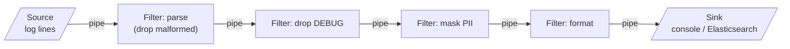

**Rules that make it work:**
- Filters are **independent**: they share no state, only the data flowing through pipes.
- Filters agree only on the **data format** between them (the pipe contract).
- A filter may emit **zero** (drop), **one** (transform) or **many** (split) outputs per input.
- In a concurrent pipeline, pipes are **bounded buffers**, so the slowest filter sets the pace (**backpressure**) and memory stays bounded.

---

## 6.4 Variants: Pipeline, Batch Sequential, Push vs Pull

| Variant | Description | Example |
|---|---|---|
| **Pipeline (streaming)** | Items flow continuously; filters work on different items at the same time | Unix pipes, Java Streams, Kafka Streams, Reactor |
| **Batch sequential** | Each step processes the **whole** dataset before the next starts | Nightly ETL, Spring Batch steps |
| **Push** | The source pushes data into the next filter | Reactive streams, event listeners |
| **Pull** | The sink pulls from the previous filter, which pulls from its source | Java `Stream` (lazy), `Iterator` chains |
| **Linear vs branching** | One path, or splitters/routers creating parallel branches that may merge | Spring Integration flows, Apache Camel routes |
| **Distributed** | Pipes are message queues/topics; filters are separate services | Kafka topic → enrichment service → topic → indexer |

**Related design pattern:** [Chain of Responsibility](../01_LLD/04_Behavioral_Pattern.md#1-chain-of-responsibility-pattern-interview-imp---java) also passes a request along handlers, but a handler may **stop** the chain and usually **handles** the request; in pipe and filter **every** filter processes the data and passes the transformed result on.

---

## 6.5 Complete Java Example - A Log-Processing Pipeline (Sequential and Threaded)

Filters are tiny functions returning `Optional` (empty = dropped). Part A composes them into a single-threaded pipeline and then **re-arranges** them into a second pipeline. Part B runs each filter in **its own thread** with bounded `ArrayBlockingQueue`s as pipes and a poison pill to end the stream.

```java
import java.util.ArrayList;
import java.util.List;
import java.util.Optional;
import java.util.concurrent.ArrayBlockingQueue;
import java.util.concurrent.BlockingQueue;
import java.util.function.Function;

// Pipe and Filter: a log-processing pipeline.
// Part A: filters composed in one thread. Part B: each filter in its own thread, connected by bounded queues (pipes).

record LogLine(String raw) {}
record Parsed(String level, String service, int latencyMs, String user) {}

interface Filter<I, O> extends Function<I, Optional<O>> {}       // a filter may transform, drop (empty) or pass on

public class PipeAndFilterDemo {
    static final List<String> INPUT = List.of(
            "INFO orders 120ms user=asha@example.com",
            "DEBUG orders 3ms user=asha@example.com",
            "ERROR payment 2300ms user=ravi@example.com",
            "garbage line",
            "WARN orders 900ms user=meera@example.com",
            "INFO search 45ms user=asha@example.com");

    // ----- the filters: small, independent, reusable -----
    static final Filter<LogLine, Parsed> PARSE = l -> {
        String[] p = l.raw().split(" ");
        if (p.length != 4 || !p[2].endsWith("ms")) return Optional.empty();                 // drop malformed input
        return Optional.of(new Parsed(p[0], p[1], Integer.parseInt(p[2].replace("ms", "")), p[3].substring(5)));
    };
    static final Filter<Parsed, Parsed> DROP_DEBUG = p -> p.level().equals("DEBUG") ? Optional.empty() : Optional.of(p);
    static final Filter<Parsed, Parsed> MASK_EMAIL = p -> Optional.of(new Parsed(p.level(), p.service(), p.latencyMs(),
            p.user().replaceAll("^(.).*@", "$1***@")));
    static final Filter<Parsed, String> FORMAT = p -> Optional.of(String.format("%-5s %-8s %5dms %s%s",
            p.level(), p.service(), p.latencyMs(), p.user(), p.latencyMs() > 500 ? "  SLOW" : ""));

    // compose two filters into one (the "pipe" in the single-threaded version)
    static <A, B, C> Filter<A, C> pipe(Filter<A, B> f, Filter<B, C> g) { return a -> f.apply(a).flatMap(g); }

    public static void main(String[] args) throws InterruptedException {
        System.out.println("=== A) Single-threaded pipeline: parse | drop-debug | mask | format ===");
        Filter<LogLine, String> pipeline = pipe(pipe(pipe(PARSE, DROP_DEBUG), MASK_EMAIL), FORMAT);
        INPUT.stream().map(LogLine::new).map(pipeline).flatMap(Optional::stream).forEach(System.out::println);

        System.out.println("=== Re-arrange: reuse filters for a different pipeline (errors only, no formatting) ===");
        Filter<Parsed, Parsed> ONLY_ERRORS = p -> p.level().equals("ERROR") ? Optional.of(p) : Optional.empty();
        INPUT.stream().map(LogLine::new).map(pipe(pipe(PARSE, ONLY_ERRORS), MASK_EMAIL))
                .flatMap(Optional::stream).forEach(p -> System.out.println("  " + p));

        System.out.println("=== B) Concurrent pipeline: one thread per filter, bounded queues as pipes ===");
        BlockingQueue<Object> q1 = new ArrayBlockingQueue<>(2), q2 = new ArrayBlockingQueue<>(2), q3 = new ArrayBlockingQueue<>(2);
        Object EOF = new Object();                                          // "poison pill" marks end of stream
        List<String> sink = new ArrayList<>();
        Thread source = new Thread(() -> { try { for (String s : INPUT) q1.put(new LogLine(s)); q1.put(EOF); } catch (InterruptedException ignored) {} });
        Thread parse = stage(q1, q2, EOF, o -> PARSE.apply((LogLine) o).flatMap(DROP_DEBUG).map(x -> (Object) x));
        Thread mask = stage(q2, q3, EOF, o -> MASK_EMAIL.apply((Parsed) o).map(x -> (Object) x));
        Thread format = new Thread(() -> {
            try { for (Object o = q3.take(); o != EOF; o = q3.take()) FORMAT.apply((Parsed) o).ifPresent(sink::add); }
            catch (InterruptedException ignored) {}
        });
        for (Thread t : List.of(source, parse, mask, format)) t.start();
        for (Thread t : List.of(source, parse, mask, format)) t.join();
        sink.forEach(System.out::println);
        System.out.println("4 threads, queues of capacity 2: a slow stage applies BACKPRESSURE (put() blocks) instead of running out of memory");
    }

    static Thread stage(BlockingQueue<Object> in, BlockingQueue<Object> out, Object eof, Function<Object, Optional<Object>> f) {
        return new Thread(() -> {
            try {
                for (Object o = in.take(); o != eof; o = in.take()) { Optional<Object> r = f.apply(o); if (r.isPresent()) out.put(r.get()); }
                out.put(eof);                                               // pass the end marker downstream
            } catch (InterruptedException ignored) {}
        });
    }
}
```

**Output:**
```
=== A) Single-threaded pipeline: parse | drop-debug | mask | format ===
INFO  orders     120ms a***@example.com
ERROR payment   2300ms r***@example.com  SLOW
WARN  orders     900ms m***@example.com  SLOW
INFO  search      45ms a***@example.com
=== Re-arrange: reuse filters for a different pipeline (errors only, no formatting) ===
  Parsed[level=ERROR, service=payment, latencyMs=2300, user=r***@example.com]
=== B) Concurrent pipeline: one thread per filter, bounded queues as pipes ===
INFO  orders     120ms a***@example.com
ERROR payment   2300ms r***@example.com  SLOW
WARN  orders     900ms m***@example.com  SLOW
INFO  search      45ms a***@example.com
4 threads, queues of capacity 2: a slow stage applies BACKPRESSURE (put() blocks) instead of running out of memory
```

What the output shows:
- The malformed `garbage line` was dropped by `PARSE`, and the DEBUG line by `DROP_DEBUG`; emails were masked; slow requests (> 500 ms) were flagged by `FORMAT`.
- The second pipeline **reused** `PARSE` and `MASK_EMAIL` with a new `ONLY_ERRORS` filter: no existing filter was changed.
- The threaded version produced exactly the same lines in the same order, because each stage is a single thread reading a FIFO queue. With queue capacity 2, a fast producer **blocks** on `put()` when the next stage is behind, which is backpressure.

---

## 6.6 Pipe and Filter in Java and Spring

**Java Streams** (pull-based, in-memory):

```java
List<String> report = Files.lines(Path.of("access.log"))
        .map(LogParser::parse).flatMap(Optional::stream)     // filter: parse, drop malformed
        .filter(l -> !l.level().equals("DEBUG"))              // filter: drop
        .map(Masking::maskEmail)                              // filter: transform
        .map(Formatter::format)
        .toList();                                            // sink
```

**Spring Integration** (message-based pipes; can be in-memory channels or brokers):

```java
@Bean
IntegrationFlow logPipeline() {
    return IntegrationFlow.from(Files.inboundAdapter(new File("/var/log/in")), e -> e.poller(Pollers.fixedDelay(1000)))
            .split(Files.splitter())                          // file -> lines
            .transform(LogParser::parse)
            .filter((LogLine l) -> !l.level().equals("DEBUG"))
            .transform(Masking::maskEmail)
            .channel(c -> c.executor(Executors.newFixedThreadPool(4)))   // async pipe: parallelise the next filters
            .handle(elasticsearchWriter, "index")
            .get();
}
```

**Spring Batch** (batch sequential, with restart and chunking):

```java
@Bean
Step importLogs(JobRepository repo, PlatformTransactionManager tx) {
    return new StepBuilder("importLogs", repo)
            .<String, LogLine>chunk(500, tx)                  // read 500, process, write in one transaction
            .reader(flatFileReader())
            .processor(new CompositeItemProcessor<>(List.of(parser, debugDropper, masker)))   // return null = drop the item
            .writer(jdbcWriter())
            .faultTolerant().skip(ParseException.class).skipLimit(100)
            .build();
}
```

**Other tools:** Kafka Streams (`stream.filter(...).mapValues(...).to("topic")`), Project Reactor `Flux` (push-based with backpressure), Apache Camel routes, Servlet `Filter` chains, Jenkins/GitHub Actions pipelines.

#### 📘 Terms Explained

| Term | Simple meaning |
|---|---|
| **Spring Integration** | Spring's implementation of Enterprise Integration Patterns: channels, transformers, filters, routers. |
| **Spring Batch** | Framework for large batch jobs: readers, processors, writers, chunks, restartability. |
| **Chunk-oriented processing** | Read and process N items, then write them together in one transaction. |
| **Kafka Streams** | A Java library to build stream-processing pipelines over Kafka topics. |
| **Project Reactor (`Flux`)** | A reactive-streams library with operators and backpressure, used by Spring WebFlux. |

---

## 6.7 Pros and Cons

| Pros | Cons |
|---|---|
| Simple, independent, reusable filters | Not suited to **interactive** request-response flows |
| Easy to add, remove and reorder steps | Data must be converted to the common pipe format at every step (overhead) |
| Natural parallelism (each filter in its own thread/process) | Error handling across the pipeline is tricky (what happens to a half-processed item?) |
| Each filter testable alone | Shared state between filters breaks the model |
| Scale only the slow filter | The slowest filter limits throughput; long pipelines add latency |

---

## 6.8 Pitfalls, Interview Questions and Cheat Sheet

| Pitfall | Fix |
|---|---|
| Unbounded queues between threads | Bounded queues → backpressure, no OutOfMemoryError. |
| A filter throwing kills the whole pipeline | Catch per item; send bad items to an error channel / dead letter. |
| Filters sharing mutable state | Only communicate through pipes; make data immutable. |
| Forgetting the end-of-stream signal | Poison pill / completion signal propagated through all stages. |
| Very fine filters with heavy serialization between processes | Merge cheap filters in one process; distribute only expensive ones. |

**Q1. Describe pipe and filter.** Processing split into independent filters connected by pipes; each filter transforms its input and passes it on. Examples: Unix pipes, Java Streams, Spring Batch, Kafka Streams, compilers.

**Q2. How is it different from Chain of Responsibility?** In CoR one handler usually handles the request and may stop the chain; in pipe and filter every filter processes the data in turn and passes the result on.

**Q3. How do you handle a slow filter?** Run it on more threads/instances (parallel filter), use bounded queues so upstream slows down (backpressure), or batch its work.

**Q4. Push vs pull pipelines?** Push: the source sends data downstream as it arrives (reactive). Pull: the consumer requests the next item (Java Streams, iterators), which is lazy by nature.

```
PIPE & FILTER   Source -> filter -> filter -> ... -> sink, connected by pipes. Filters: independent, single job, no shared state.
   Filter can drop / transform / split. Pipeline (streaming) vs batch sequential; push vs pull.
   Java: Streams, BlockingQueue threads (bounded = backpressure, poison pill = end), Spring Integration, Spring Batch, Kafka Streams, Reactor.
   + reuse, reorder, parallelise, test alone.  - not interactive, format conversion overhead, error handling, slowest filter limits.
```

---

# 7. Blackboard Architecture

## 7.1 What is Blackboard?

The **Blackboard** pattern solves problems that **no single algorithm can solve**, by letting several independent specialists cooperate through a shared data store.

| Part | Role |
|---|---|
| **Blackboard** | Shared memory holding the problem's current state: inputs, partial results, hypotheses |
| **Knowledge sources** | Independent specialist modules. Each watches the blackboard and contributes when it can (has a **precondition**) |
| **Controller** | Decides which knowledge source runs next and when the problem is solved |

**Analogy:** Detectives solving a case around a big whiteboard. The fingerprint expert, the CCTV analyst and the phone-records analyst don't talk to each other directly; each pins findings on the board whenever they have something. The lead detective (controller) decides who should work next and when there's enough to make an arrest.

Classic uses: speech recognition (Hearsay-II, 1970s), sonar signal interpretation, medical diagnosis, planning and scheduling, and today: **rule engines**, fraud detection, and **multi-agent AI systems** that share a common memory or "scratchpad".

#### 📘 Terms Explained

| Term | Simple meaning |
|---|---|
| **Blackboard** | The shared workspace where partial solutions are written. |
| **Knowledge source (KS)** | An independent expert module that reads the blackboard and adds to it. |
| **Precondition** | The condition under which a knowledge source can contribute. |
| **Controller / scheduler** | Picks the next knowledge source to run and detects when the solution is complete. |
| **Opportunistic problem solving** | Solving step by step, using whichever expert can help now, instead of a fixed algorithm. |

---

## 7.2 Why Do We Need It?

- **No known deterministic algorithm** for the whole problem; only partial techniques (heuristics) that each solve a piece.
- **Different kinds of expertise** (geography, behaviour, device data) that are developed by different teams and must stay independent.
- **Order is not fixed in advance**: what to do next depends on what has been found so far (if geo looks risky, *then* check the device).
- **Easy to add an expert**: a new knowledge source is plugged in without changing the others.

---

## 7.3 How It Works

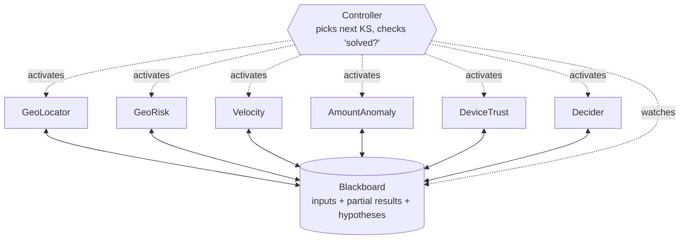

The control loop:
1. Put the initial data on the blackboard.
2. Controller asks every knowledge source "can you contribute?" (check preconditions).
3. Pick one according to a **strategy** (priority, cost, expected value) and let it write its result.
4. Repeat until a solution is reached (or nobody can contribute).

**Blackboard vs Mediator:** the [Mediator](../01_LLD/04_Behavioral_Pattern.md#5-mediator-pattern) routes **messages between** colleagues; the blackboard is a shared **data space** that experts read and write, and the controller schedules them.

---

## 7.4 Complete Java Example - Fraud Scoring with Knowledge Sources

Six knowledge sources contribute risk facts about a card payment. The controller keeps running whichever source can contribute; the `DeviceTrust` expert only becomes active **after** geo risk is found, which shows the opportunistic order. `Decider` runs last.

```java
import java.util.ArrayList;
import java.util.LinkedHashMap;
import java.util.List;
import java.util.Map;

// Blackboard: independent "knowledge sources" read and write a shared blackboard; a controller decides
// which one runs next, until a solution is reached. Example: deciding whether a card payment is fraud.

class Blackboard {
    final Map<String, Object> facts = new LinkedHashMap<>();
    final List<String> history = new ArrayList<>();
    boolean has(String k) { return facts.containsKey(k); }
    void write(String source, String key, Object value) {
        facts.put(key, value);
        history.add(String.format("%-14s wrote %s=%s", source, key, value));
    }
    int riskScore() { return facts.entrySet().stream().filter(e -> e.getKey().startsWith("risk."))
            .mapToInt(e -> (Integer) e.getValue()).sum(); }
}

interface KnowledgeSource {
    String name();
    boolean canContribute(Blackboard bb);     // precondition: is there something for me to do?
    void contribute(Blackboard bb);
}

class GeoLocator implements KnowledgeSource {
    public String name() { return "GeoLocator"; }
    public boolean canContribute(Blackboard bb) { return bb.has("ip") && !bb.has("ipCountry"); }
    public void contribute(Blackboard bb) { bb.write(name(), "ipCountry", bb.facts.get("ip").toString().startsWith("185.") ? "RU" : "IN"); }
}
class GeoRisk implements KnowledgeSource {
    public String name() { return "GeoRisk"; }
    public boolean canContribute(Blackboard bb) { return bb.has("ipCountry") && !bb.has("risk.geo"); }
    public void contribute(Blackboard bb) { bb.write(name(), "risk.geo", bb.facts.get("ipCountry").equals(bb.facts.get("cardCountry")) ? 0 : 40); }
}
class VelocityChecker implements KnowledgeSource {
    public String name() { return "Velocity"; }
    public boolean canContribute(Blackboard bb) { return bb.has("txLastHour") && !bb.has("risk.velocity"); }
    public void contribute(Blackboard bb) { int n = (Integer) bb.facts.get("txLastHour"); bb.write(name(), "risk.velocity", n > 5 ? 35 : 0); }
}
class AmountAnomaly implements KnowledgeSource {
    public String name() { return "AmountAnomaly"; }
    public boolean canContribute(Blackboard bb) { return bb.has("amount") && bb.has("avgAmount") && !bb.has("risk.amount"); }
    public void contribute(Blackboard bb) {
        double ratio = ((Integer) bb.facts.get("amount")).doubleValue() / (Integer) bb.facts.get("avgAmount");
        bb.write(name(), "risk.amount", ratio > 10 ? 30 : ratio > 3 ? 15 : 0);
    }
}
class DeviceTrust implements KnowledgeSource {                 // only useful once geo looks suspicious
    public String name() { return "DeviceTrust"; }
    public boolean canContribute(Blackboard bb) { return bb.has("risk.geo") && (Integer) bb.facts.get("risk.geo") > 0 && !bb.has("risk.device"); }
    public void contribute(Blackboard bb) { bb.write(name(), "risk.device", bb.facts.get("deviceSeenBefore").equals(true) ? -30 : 10); }
}
class Decider implements KnowledgeSource {
    public String name() { return "Decider"; }
    public boolean canContribute(Blackboard bb) { return !bb.has("decision"); }
    public void contribute(Blackboard bb) {
        int s = bb.riskScore();
        bb.write(name(), "decision", s >= 60 ? "BLOCK (score " + s + ")" : s >= 30 ? "STEP-UP OTP (score " + s + ")" : "APPROVE (score " + s + ")");
    }
}

class Controller {
    private final List<KnowledgeSource> sources;
    Controller(List<KnowledgeSource> sources) { this.sources = sources; }
    String solve(Blackboard bb) {
        while (!bb.has("decision")) {
            // Strategy: run the first non-Decider source that can contribute; the Decider only runs when nobody else can.
            KnowledgeSource next = sources.stream().filter(s -> !(s instanceof Decider) && s.canContribute(bb)).findFirst()
                    .orElse(sources.get(sources.size() - 1));
            next.contribute(bb);
        }
        return (String) bb.facts.get("decision");
    }
}

public class BlackboardDemo {
    public static void main(String[] args) {
        List<KnowledgeSource> experts = List.of(new GeoLocator(), new GeoRisk(), new VelocityChecker(),
                new AmountAnomaly(), new DeviceTrust(), new Decider());
        Controller controller = new Controller(experts);

        run(controller, "Normal purchase", Map.of("ip", "49.36.10.1", "cardCountry", "IN", "txLastHour", 1, "amount", 1200, "avgAmount", 1000));
        run(controller, "Foreign IP, known device", Map.of("ip", "185.22.1.9", "cardCountry", "IN", "txLastHour", 2,
                "amount", 4000, "avgAmount", 1000, "deviceSeenBefore", true));
        run(controller, "Foreign IP, new device, burst of big payments", Map.of("ip", "185.22.1.9", "cardCountry", "IN",
                "txLastHour", 9, "amount", 25000, "avgAmount", 1000, "deviceSeenBefore", false));
    }

    static void run(Controller c, String title, Map<String, Object> input) {
        Blackboard bb = new Blackboard();
        new java.util.TreeMap<>(input).forEach((k, v) -> bb.facts.put(k, v));      // sorted for repeatable output
        System.out.println("=== " + title + " ===");
        String decision = c.solve(bb);
        bb.history.forEach(h -> System.out.println("  " + h));
        System.out.println("  -> " + decision);
    }
}
```

**Output:**
```
=== Normal purchase ===
  GeoLocator     wrote ipCountry=IN
  GeoRisk        wrote risk.geo=0
  Velocity       wrote risk.velocity=0
  AmountAnomaly  wrote risk.amount=0
  Decider        wrote decision=APPROVE (score 0)
  -> APPROVE (score 0)
=== Foreign IP, known device ===
  GeoLocator     wrote ipCountry=RU
  GeoRisk        wrote risk.geo=40
  Velocity       wrote risk.velocity=0
  AmountAnomaly  wrote risk.amount=15
  DeviceTrust    wrote risk.device=-30
  Decider        wrote decision=APPROVE (score 25)
  -> APPROVE (score 25)
=== Foreign IP, new device, burst of big payments ===
  GeoLocator     wrote ipCountry=RU
  GeoRisk        wrote risk.geo=40
  Velocity       wrote risk.velocity=35
  AmountAnomaly  wrote risk.amount=30
  DeviceTrust    wrote risk.device=10
  Decider        wrote decision=BLOCK (score 115)
  -> BLOCK (score 115)
```

What the output shows:
- For the **normal purchase**, `DeviceTrust` never ran: its precondition (geo risk > 0) was never true, so the order of work depended on the data.
- For the **foreign IP with a known device**, the device expert lowered the score by 30, so the payment was approved even though geo risk was 40.
- For the **burst of big payments from a new device**, every expert added risk (40 + 35 + 30 + 10 = 115) and the payment was blocked.
- Adding, say, a `MerchantCategoryRisk` expert would be one new class; the others don't change.

---

## 7.5 Blackboard in Practice

| Where you meet it | How it maps |
|---|---|
| **Rule engines** (Drools, Easy Rules) | Working memory = blackboard; rules = knowledge sources; agenda/conflict resolution = controller |
| **Multi-agent LLM systems** | Agents (researcher, coder, reviewer) read and write a shared memory/task board; an orchestrator decides who acts next |
| **Fraud and risk scoring platforms** | Independent signal services write scores into a shared case; a decision service combines them |
| **Tuple spaces / JavaSpaces** | Distributed shared memory where processes write and take tuples (an ancestor of space-based architecture, [section 13](#13-space-based-architecture)) |
| **Compilers and IDEs** | Several analyses annotate a shared syntax tree |

**Drools sketch** (rules fire when facts in working memory match):

```java
// rule "geo mismatch"  when  Payment(ipCountry != cardCountry)  then  insert(new Risk("geo", 40));  end
KieSession session = kieContainer.newKieSession();
session.insert(payment);           // put facts on the "blackboard"
session.fireAllRules();            // the engine's agenda decides which rules run, repeatedly, until none match
```

---

## 7.6 Pros, Cons, Pitfalls, Interview Questions and Cheat Sheet

| Pros | Cons |
|---|---|
| Solves ill-defined problems by combining partial expertise | Hard to test and predict: the order of steps depends on data |
| Knowledge sources are independent and easy to add | The blackboard is shared state: a concurrency and consistency hotspot |
| Flexible, opportunistic control | Controller strategy is hard to design well |
| Good for experimentation with heuristics | Can be slow; no guarantee of finding the best solution |

| Pitfall | Fix |
|---|---|
| Knowledge sources calling each other directly | Communicate only via the blackboard. |
| Infinite loops (sources keep re-triggering each other) | Preconditions that become false after contributing; a step limit. |
| Unstructured blackboard (a giant `Map<String,Object>`) | Typed sections/levels for hypotheses; versioned entries. |
| Concurrent writers overwriting each other | Single-threaded controller, or locking/optimistic versions on entries. |

**Q1. What is the blackboard pattern?** A shared data store (blackboard) that independent knowledge sources read and write to build a solution incrementally, with a controller deciding which source acts next. Used when no single algorithm solves the problem.

**Q2. Give a real example.** Fraud scoring, speech recognition, rule engines like Drools (working memory + rules + agenda), or multi-agent AI systems sharing a task board.

**Q3. Blackboard vs pub-sub?** In pub-sub, publishers push messages to subscribers. In blackboard, specialists **share and modify a common state**, and a controller schedules them based on that state.

```
BLACKBOARD   Shared blackboard (problem state) + independent knowledge sources (experts with preconditions) + controller (who runs next, solved?).
   Opportunistic: order depends on data. For ill-defined problems: speech, diagnosis, fraud, rule engines (Drools), multi-agent AI.
   + independent experts, flexible.  - hard to test/predict, shared-state concurrency, control strategy is hard.
```

---

# 8. Client-Server and Peer-to-Peer

## 8.1 What Are They?

**Client-Server:** **clients** send requests; a central **server** owns the data/service and sends responses. Clients don't talk to each other.
- Examples: browser ↔ web server, mobile app ↔ REST API, JDBC client ↔ database, email client ↔ mail server.

**Peer-to-Peer (P2P):** every node (**peer**) is **both client and server**. Peers share resources (files, bandwidth, CPU, storage) directly with each other; there is no (or only a minimal) central server.
- Examples: BitTorrent, blockchain networks (Bitcoin, Ethereum), IPFS, WebRTC video calls, Skype's original design, Cassandra's peer ring (every node equal).

**Analogy:**
- Client-server: a **library**. Everyone borrows books from the one library; if it's closed, nobody gets a book; if 10,000 people come at once, there's a queue.
- P2P: **friends swapping books**. Everyone who has a book can lend it. The more friends join, the more copies are around; but you need to find who has what, and trust them to return it.

The network and web-server side of client-server (TCP, HTTP, DNS, Nginx, Tomcat) is covered in depth in [Client_Server_Web_Architecture_Guide.md](../../web-architecture/Client_Server_Web_Architecture_Guide.md).

#### 📘 Terms Explained

| Term | Simple meaning |
|---|---|
| **Client** | The program that asks for a service (browser, app). |
| **Server** | The program that provides a service and owns its resources. |
| **Peer** | A node that acts as both client and server. |
| **Seed** | In BitTorrent, a peer that has the complete file. |
| **DHT (Distributed Hash Table)** | A decentralised lookup table spread across peers (e.g. Kademlia) used to find who has what. |
| **NAT traversal** | Techniques (STUN/TURN/hole punching) that let peers behind home routers connect to each other. |

---

## 8.2 Why Do We Need Each?

| Need | Client-Server | Peer-to-Peer |
|---|---|---|
| One source of truth, strong consistency | ✅ The server decides | ❌ Hard; needs consensus |
| Central security, access control, auditing | ✅ Easy | ❌ Every peer is untrusted |
| Capacity that grows with users | ❌ Server is the bottleneck; you pay for growth | ✅ Each new peer adds capacity |
| No single point of failure / censorship resistance | ❌ Server down = service down | ✅ Network survives losing peers |
| Simple to build and operate | ✅ | ❌ Discovery, NAT, churn, trust |
| Cost for the provider | Grows with traffic (bandwidth, servers) | Shared by peers |

---

## 8.3 How They Work

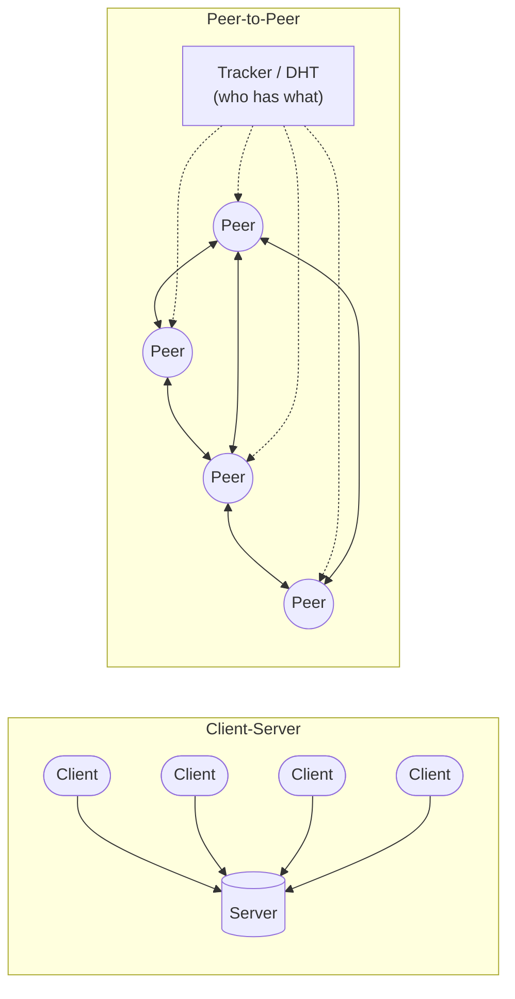

**Client-server request cycle:** the client opens a connection → sends a request (HTTP, JDBC, gRPC) → server processes (often with a thread pool or event loop) → response → connection reused or closed. Servers scale with load balancers, replication and caching ([01_Scalability_Pattern.md](../03_System_Design/01_Scalability_Pattern.md)).

**P2P cycle (BitTorrent-like):** a peer finds other peers via a **tracker** or **DHT** → exchanges "which chunks do you have?" → downloads chunks from several peers in parallel (rarest-first) → **uploads** chunks it already has to others → verifies each chunk by hash (untrusted peers).

---

## 8.4 Variants: Tiers, Thin vs Thick Clients, Pure vs Hybrid P2P

| Variant | Description |
|---|---|
| **2-tier** | Client talks directly to the DB server (old desktop apps with JDBC). |
| **3-tier** | Client → application server → database. The standard web app. |
| **n-tier** | Adds tiers: CDN, API gateway, cache, search, separate services. |
| **Thin client** | Little logic on the client (server-rendered HTML, terminal). |
| **Thick (rich) client** | Lots of logic on the client (SPA in React, mobile app, desktop app); server is mostly an API. |
| **Pure P2P** | No central component at all (Gnutella, Bitcoin peer discovery). |
| **Hybrid P2P** | A central server for **discovery/coordination**, P2P for the heavy data (BitTorrent trackers, WebRTC with a signalling server, early Skype supernodes). |
| **Peer-to-peer inside data systems** | Leaderless databases where every node is equal (Cassandra, DynamoDB-style), using gossip ([07_Distributed_Systems_Pattern.md](../03_System_Design/07_Distributed_Systems_Pattern.md#6-gossip-protocol-pattern)). |

---

## 8.5 Complete Java Example - Distributing a File: Server vs Swarm

Fifty clients need a 20-chunk file. In **client-server**, every chunk comes from one server that can upload 10 chunks per round. In **P2P**, a seed with the same capacity starts the swarm (sending the **rarest** chunks first), and every peer also uploads 2 chunks per round to random other peers. The random seed is fixed, so the output is repeatable.

```java
import java.util.ArrayList;
import java.util.BitSet;
import java.util.List;
import java.util.Random;

// Distributing a 20-chunk file to 50 downloaders.
// Client-server: every chunk comes from the one server. Peer-to-peer: peers trade chunks with each other (BitTorrent-like).
// Each node can upload at most UPLOAD_SLOTS chunks per round.

public class ClientServerVsP2PDemo {
    static final int CHUNKS = 20, CLIENTS = 50, SERVER_SLOTS = 10, PEER_SLOTS = 2;

    public static void main(String[] args) {
        clientServer();
        peerToPeer(new Random(42));
    }

    static void clientServer() {
        int[] have = new int[CLIENTS];                          // chunks each client has (server sends in order)
        int rounds = 0, serverUploads = 0;
        while (min(have) < CHUNKS) {
            rounds++;
            int slots = SERVER_SLOTS;
            for (int c = 0; c < CLIENTS && slots > 0; c++) {     // the server serves clients round-robin
                int idx = (c + rounds * SERVER_SLOTS) % CLIENTS;
                if (have[idx] < CHUNKS) { have[idx]++; slots--; serverUploads++; }
            }
        }
        System.out.println("=== Client-server ===");
        System.out.printf("rounds to finish: %d | server uploaded %d chunks | client uploads: 0%n", rounds, serverUploads);
        System.out.println("doubling clients doubles the server's work: capacity is FIXED by the server");
    }

    static void peerToPeer(Random rnd) {
        List<BitSet> peers = new ArrayList<>();
        for (int i = 0; i < CLIENTS; i++) peers.add(new BitSet(CHUNKS));
        BitSet seed = new BitSet(CHUNKS); seed.set(0, CHUNKS);    // one "seed" starts with the whole file
        int rounds = 0, seedUploads = 0, peerUploads = 0;
        while (peers.stream().anyMatch(b -> b.cardinality() < CHUNKS)) {
            rounds++;
            List<BitSet> before = new ArrayList<>();
            for (BitSet b : peers) before.add((BitSet) b.clone());   // decisions use the start-of-round state
            for (int s = 0; s < SERVER_SLOTS; s++) {                 // seed has the same upload capacity as the server above
                int target = rnd.nextInt(CLIENTS);
                int chunk = rarestMissing(before, peers.get(target));
                if (chunk >= 0) { peers.get(target).set(chunk); seedUploads++; }
            }
            for (int p = 0; p < CLIENTS; p++) {                      // every peer also uploads to others
                for (int s = 0; s < PEER_SLOTS; s++) {
                    int target = rnd.nextInt(CLIENTS);
                    if (target == p) continue;
                    BitSet offer = (BitSet) before.get(p).clone();
                    offer.andNot(peers.get(target));                 // chunks p has that target lacks
                    if (!offer.isEmpty()) {
                        int[] candidates = offer.stream().toArray();
                        peers.get(target).set(candidates[rnd.nextInt(candidates.length)]);   // send a random useful chunk
                        peerUploads++;
                    }
                }
            }
        }
        System.out.println("=== Peer-to-peer ===");
        System.out.printf("rounds to finish: %d | seed uploaded %d chunks | peers uploaded %d chunks%n", rounds, seedUploads, peerUploads);
        System.out.println("every new peer ADDS upload capacity: the system gets faster as it grows (but needs discovery, trust, churn handling)");
    }

    static int rarestMissing(List<BitSet> all, BitSet target) {
        int best = -1, bestCount = Integer.MAX_VALUE;
        for (int c = 0; c < CHUNKS; c++) {
            if (target.get(c)) continue;
            int count = 0; for (BitSet b : all) if (b.get(c)) count++;
            if (count < bestCount) { best = c; bestCount = count; }
        }
        return best;
    }

    static int min(int[] a) { int m = Integer.MAX_VALUE; for (int x : a) m = Math.min(m, x); return m; }
}
```

**Output:**
```
=== Client-server ===
rounds to finish: 100 | server uploaded 1000 chunks | client uploads: 0
doubling clients doubles the server's work: capacity is FIXED by the server
=== Peer-to-peer ===
rounds to finish: 21 | seed uploaded 163 chunks | peers uploaded 837 chunks
every new peer ADDS upload capacity: the system gets faster as it grows (but needs discovery, trust, churn handling)
```

What the output shows:
- **Client-server** needed 100 rounds: 50 clients × 20 chunks = 1000 uploads, all from the server at 10 per round. Double the clients and it takes twice as long (or you buy twice the servers).
- **P2P** finished in 21 rounds: the seed uploaded only 163 chunks; the peers themselves uploaded 837. Each new downloader is also an uploader, so capacity **grows with demand**.
- The price, not shown in the numbers: peers need discovery (tracker/DHT), must verify chunks (they can't trust each other) and must cope with peers leaving mid-download (**churn**).

---

## 8.6 In the Java World

| Topic | Java tools |
|---|---|
| Servers | Spring Boot on Tomcat/Jetty/Undertow (thread-per-request), Netty/WebFlux (event loop), virtual threads (`spring.threads.virtual.enabled=true`, Java 21) |
| Clients | `java.net.http.HttpClient`, Spring `RestClient`/`WebClient`, OpenFeign, gRPC-Java, JDBC drivers |
| Raw sockets | `ServerSocket`/`Socket`, NIO `Selector` (how Netty and Tomcat NIO work) |
| P2P | libp2p (jvm-libp2p), WebRTC via signalling servers, Hazelcast/Ignite members discovering each other, Cassandra driver talking to a peer ring |

**Minimal client-server in plain Java** (JDK built-in HTTP server and client):

```java
HttpServer server = HttpServer.create(new InetSocketAddress(8080), 0);
server.createContext("/time", ex -> {
    byte[] body = Instant.now().toString().getBytes();
    ex.sendResponseHeaders(200, body.length);
    try (OutputStream os = ex.getResponseBody()) { os.write(body); }
});
server.start();

HttpResponse<String> r = HttpClient.newHttpClient()
        .send(HttpRequest.newBuilder(URI.create("http://localhost:8080/time")).build(), HttpResponse.BodyHandlers.ofString());
System.out.println(r.statusCode() + " " + r.body());
```

---

## 8.7 Pros, Cons, Pitfalls, Interview Questions and Cheat Sheet

| | Pros | Cons |
|---|---|---|
| **Client-Server** | Simple; central control, security, backups; strong consistency | Server is a bottleneck and single point of failure; provider pays for all capacity |
| **P2P** | Scales with users; resilient; low provider cost; censorship resistant | Discovery, NAT traversal, churn, security/trust, hard to update or moderate, consistency needs consensus |

| Pitfall | Fix |
|---|---|
| Stateful server with sessions in memory | Externalise sessions (Redis) so servers scale horizontally. |
| Chatty clients (N+1 calls per screen) | Aggregate endpoints, BFF, GraphQL ([08_API_Design_Pattern.md](../03_System_Design/08_API_Design_Pattern.md)). |
| Trusting data from peers | Hash/sign every chunk; reputation; validate everything. |
| Ignoring NAT in P2P designs | STUN/TURN relays as fallback. |

**Q1. Client-server vs P2P?** Client-server: central server provides the service, clients only request (simple, controllable, bottleneck/SPOF). P2P: every peer is client and server, capacity grows with peers, no SPOF, but discovery, trust and consistency are hard.

**Q2. What is a 3-tier architecture?** Presentation tier (browser/app), application tier (Spring Boot), data tier (database), each on separate machines and scalable independently.

**Q3. Where is P2P used in backend systems?** Leaderless databases (Cassandra), gossip-based membership (Hazelcast, Consul), blockchain, CDN-assisted P2P video delivery, WebRTC calls.

```
CLIENT-SERVER   Clients request, central server serves. 2-tier / 3-tier / n-tier; thin vs thick client.
                + simple, central control & consistency.  - bottleneck, SPOF, provider pays for scale.  Scale with LB, replicas, cache.
P2P             Every peer is client + server. Pure vs hybrid (tracker/DHT/signalling). Rarest-first, hash-verified chunks.
                + capacity grows with users, resilient.  - discovery, NAT, churn, trust, consistency.  Ex: BitTorrent, blockchain, Cassandra ring.
```

---

# 9. SOA, Microservices and the Modular Monolith (Interview Imp - Java)

## 9.1 What Are They?

Three ways to split a large system into **parts aligned with business capabilities**:

| Style | What it is | Deployed as | Communication |
|---|---|---|---|
| **Modular Monolith** | One application divided into well-isolated **modules** (orders, inventory, payments), each with a public API and private internals | **One** deployable, usually one DB with a schema per module | In-process method calls and in-process events |
| **SOA** (Service-Oriented Architecture) | Enterprise-wide **services** exposing business functions, typically integrated through an **Enterprise Service Bus (ESB)** with shared contracts | Several services, often large, often sharing databases | SOAP/WSDL, XML, ESB routing and transformation |
| **Microservices** | Many **small, independently deployable** services, each owning its data, built around a bounded context | Many deployables, one DB per service | REST/gRPC + events (Kafka) with "smart endpoints, dumb pipes" |

**Analogy:**
- **Modular monolith:** one big department store with clearly separated departments, each with its own staff and stockroom, under one roof and one opening time.
- **SOA:** a shopping mall run by a powerful central management office (the ESB) that controls how shops talk, translates their paperwork and shares the warehouse.
- **Microservices:** a street of independent shops, each with its own owner, stock and opening hours, talking to each other directly when needed.

Deep dives on microservices patterns (gateway, discovery, saga, database per service, strangler fig, service mesh) are in [02_Microservices_Pattern.md](../04_Specialized/02_Microservices_Pattern.md). This section is about **choosing** between the three.

#### 📘 Terms Explained

| Term | Simple meaning |
|---|---|
| **Business capability** | Something the business does (take orders, manage stock, bill customers). |
| **Module** | A part of an application with a public API and hidden internals. |
| **ESB (Enterprise Service Bus)** | Central middleware that routes, transforms and orchestrates messages between services (MuleSoft, IBM IIB, Oracle Service Bus). |
| **SOAP / WSDL** | XML-based web-service protocol / its contract language, common in SOA. |
| **Independently deployable** | A service can be released without releasing any other service. |
| **Smart endpoints, dumb pipes** | Business logic lives in services; the network/broker just carries messages. |
| **Distributed monolith** | Services that are separate processes but must be deployed together because they're tightly coupled: the worst of both worlds. |

---

## 9.2 Why Do We Need Them?

A single unstructured monolith eventually suffers from: slow builds, merge conflicts between teams, one bug taking down everything, scaling the whole app for one hot feature, and no clear ownership.

| Goal | Modular monolith | SOA | Microservices |
|---|---|---|---|
| Clear ownership and boundaries | ✅ (modules) | ✅ (services) | ✅ (services) |
| Independent deployment per team | ❌ | Partly | ✅ |
| Independent scaling | ❌ | Partly | ✅ |
| Technology freedom per part | ❌ | Partly | ✅ |
| Simple ops, local transactions, easy debugging | ✅ | ❌ | ❌ |
| Reuse of enterprise functions across many apps | ❌ | ✅ (the original goal) | Partly |

---

## 9.3 How They Work

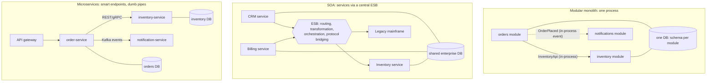

**The typical evolution:** start with a **modular monolith** with strong boundaries → when a module needs independent scaling, deployment or a different team, **extract** it into a microservice (the module's public API becomes a REST/gRPC/event contract) using the [Strangler Fig](../04_Specialized/02_Microservices_Pattern.md#13-strangler-fig-pattern-migrating-from-a-monolith-interview-imp---java) approach.

---

## 9.4 SOA vs Microservices vs Modular Monolith

| Aspect | Modular Monolith | SOA | Microservices |
|---|---|---|---|
| Service size | Modules of any size | Large, enterprise-wide | Small, one bounded context |
| Scope | One application | Whole enterprise (integration of many apps) | One application split into many services |
| Data | One DB, schema/tables per module | Often shared databases | Database per service |
| Integration | Method calls, in-process events | ESB (smart pipes): routing, transformation | Lightweight REST/gRPC, brokers (dumb pipes) |
| Contracts | Java interfaces | WSDL/XSD, canonical data model | OpenAPI, Protobuf, AsyncAPI, consumer-driven contracts |
| Deployment | One unit | Per service, often coordinated | Fully independent, CI/CD per service, containers |
| Governance | Code reviews, ArchUnit/Modulith | Central, heavy | Decentralised, team autonomy |
| Transactions | Local ACID | Distributed (WS-AtomicTransaction, 2PC) | Sagas, eventual consistency |
| Failure | Whole app fails together | ESB is a single point of failure | Partial failures; needs resilience patterns |
| Best for | Most new products, small/medium teams | Integrating many existing enterprise systems | Large orgs, many teams, very different scaling needs |

**Rule of thumb ("Monolith First", Martin Fowler):** don't start with microservices unless you already know the domain boundaries well and have the platform (CI/CD, containers, observability) and team size to justify them. A well-built modular monolith keeps that option open.

---

## 9.5 Complete Java Example - Module Boundaries and Extracting a Service

Part 1 runs a modular monolith: `OrdersModule` depends only on `InventoryApi` (a public interface) and publishes in-process events. Part 2 replaces the inventory module with a "remote client" implementing the **same interface**, simulating extraction into a microservice: orders code doesn't change, but every call now costs latency and can **fail over the network**. Part 3 checks module boundaries the way Spring Modulith does.

```java
import java.util.ArrayList;
import java.util.LinkedHashMap;
import java.util.List;
import java.util.Map;
import java.util.function.Consumer;

// From modular monolith to a service: modules talk only through PUBLIC APIs and events,
// so one module can later be moved out of the process with no change to its callers.

// ---------- inventory module: public API (exported) ----------
interface InventoryApi { boolean reserve(String sku, int qty); int available(String sku); }

// inventory module: internals (not exported; other modules must not import these)
class InventoryModule implements InventoryApi {
    private final Map<String, Integer> stock = new LinkedHashMap<>(Map.of("KB-1", 3));
    public boolean reserve(String sku, int qty) {
        int have = stock.getOrDefault(sku, 0);
        if (have < qty) return false;
        stock.put(sku, have - qty); return true;
    }
    public int available(String sku) { return stock.getOrDefault(sku, 0); }
}

// ---------- in-process event bus (Spring's ApplicationEventPublisher in real life) ----------
record OrderPlaced(String orderId, String sku, int qty) {}
class Events {
    private final List<Consumer<OrderPlaced>> listeners = new ArrayList<>();
    void on(Consumer<OrderPlaced> l) { listeners.add(l); }
    void publish(OrderPlaced e) { listeners.forEach(l -> l.accept(e)); }
}

// ---------- orders module: depends on InventoryApi only, publishes events ----------
class OrdersModule {
    private final InventoryApi inventory; private final Events events; private int seq = 0;
    OrdersModule(InventoryApi inventory, Events events) { this.inventory = inventory; this.events = events; }
    String place(String sku, int qty) {
        if (!inventory.reserve(sku, qty)) return "REJECTED (out of stock)";
        String id = "ORD-" + (++seq);
        events.publish(new OrderPlaced(id, sku, qty));
        return id + " PLACED";
    }
}

// ---------- the inventory module extracted as a remote service: same interface, new failure modes ----------
class RemoteInventoryClient implements InventoryApi {
    private final InventoryModule remote = new InventoryModule();   // pretend this lives in another process
    private int calls = 0; int totalLatencyMs = 0;
    boolean networkDown = false;
    public boolean reserve(String sku, int qty) {
        calls++; totalLatencyMs += 25;                              // each call now costs a network round trip
        if (networkDown) throw new IllegalStateException("inventory-service timeout after 2000ms");
        return remote.reserve(sku, qty);
    }
    public int available(String sku) { calls++; totalLatencyMs += 25; return remote.available(sku); }
    int calls() { return calls; }
}

// ---------- a module-boundary check (what Spring Modulith / ArchUnit verify) ----------
class ModuleRules {
    static List<String> check(Map<String, List<String>> imports) {
        List<String> problems = new ArrayList<>();
        imports.forEach((cls, deps) -> deps.forEach(d -> {
            String fromModule = cls.split("\\.")[0], toModule = d.split("\\.")[0];
            boolean internal = d.contains(".internal.");
            if (!fromModule.equals(toModule) && internal) problems.add(cls + " uses " + d + " (internal type of module '" + toModule + "')");
        }));
        return problems;
    }
}

public class ModularMonolithDemo {
    public static void main(String[] args) {
        System.out.println("=== 1) Modular monolith: one deployable, modules call each other in-process ===");
        Events events = new Events();
        events.on(e -> System.out.println("  [notifications] email for " + e.orderId()));
        events.on(e -> System.out.println("  [analytics]     +1 " + e.sku()));
        InventoryModule inv = new InventoryModule();
        OrdersModule orders = new OrdersModule(inv, events);
        System.out.println("  " + orders.place("KB-1", 2));
        System.out.println("  " + orders.place("KB-1", 2));
        System.out.println("  stock left: " + inv.available("KB-1"));

        System.out.println("=== 2) Extract inventory as a microservice: OrdersModule code is UNCHANGED ===");
        RemoteInventoryClient client = new RemoteInventoryClient();
        OrdersModule orders2 = new OrdersModule(client, new Events());
        System.out.println("  " + orders2.place("KB-1", 1));
        System.out.println("  remote calls=" + client.calls() + ", added latency=" + client.totalLatencyMs + "ms");
        client.networkDown = true;
        try { orders2.place("KB-1", 1); }
        catch (IllegalStateException e) { System.out.println("  NEW failure mode: " + e.getMessage() + " -> needs timeout, retry, circuit breaker"); }

        System.out.println("=== 3) Module boundary check ===");
        Map<String, List<String>> imports = new LinkedHashMap<>();
        imports.put("orders.OrderService", List.of("inventory.InventoryApi", "orders.internal.OrderRepository"));
        imports.put("orders.OrderReport", List.of("inventory.internal.StockTable"));          // reaching into another module's internals
        imports.put("notifications.Mailer", List.of("orders.OrderPlaced"));
        List<String> problems = ModuleRules.check(imports);
        System.out.println(problems.isEmpty() ? "  all modules respect boundaries" : "  violations:");
        problems.forEach(p -> System.out.println("    " + p));
    }
}
```

**Output:**
```
=== 1) Modular monolith: one deployable, modules call each other in-process ===
  [notifications] email for ORD-1
  [analytics]     +1 KB-1
  ORD-1 PLACED
  REJECTED (out of stock)
  stock left: 1
=== 2) Extract inventory as a microservice: OrdersModule code is UNCHANGED ===
  ORD-1 PLACED
  remote calls=1, added latency=25ms
  NEW failure mode: inventory-service timeout after 2000ms -> needs timeout, retry, circuit breaker
=== 3) Module boundary check ===
  violations:
    orders.OrderReport uses inventory.internal.StockTable (internal type of module 'inventory')
```

What the output shows:
- In the monolith, the second order for 2 keyboards was rejected because only 1 was left, and the notification and analytics modules reacted to `OrderPlaced` **without** the orders module knowing them.
- After extraction, `OrdersModule` was reused **unchanged**, because it only knew `InventoryApi`. That's why clean module boundaries make later extraction cheap.
- But the same call now adds network latency and a **new failure mode** (timeout). In a real system you'd add timeouts, retries, circuit breakers ([02_Reliability_Pattern.md](../03_System_Design/02_Reliability_Pattern.md)) and maybe replace the synchronous call with events.
- The boundary check caught `orders.OrderReport` reaching into `inventory.internal.StockTable`. If you allow that, extraction later becomes painful.

---

## 9.6 Modular Monolith in Spring Boot (Spring Modulith)

**Spring Modulith** treats each direct sub-package of the main application package as an **application module**. Types in the module's base package are its public API; sub-packages (like `internal`) are hidden from other modules.

```
com.shop
├── ShopApplication.java          @SpringBootApplication
├── orders                        <- module "orders"
│   ├── OrderService.java         (public API)
│   ├── OrderPlaced.java          (public event)
│   └── internal/OrderRepository.java   (hidden)
├── inventory                     <- module "inventory"
│   ├── InventoryApi.java
│   └── internal/StockTable.java
└── notifications                 <- module "notifications"
    └── internal/OrderNotifier.java
```

```xml
<dependency>
  <groupId>org.springframework.modulith</groupId>
  <artifactId>spring-modulith-starter-core</artifactId>
</dependency>
<dependency>
  <groupId>org.springframework.modulith</groupId>
  <artifactId>spring-modulith-starter-test</artifactId>
  <scope>test</scope>
</dependency>
```

```java
// Fails the build on cycles between modules or access to another module's internals
class ModularityTests {
    ApplicationModules modules = ApplicationModules.of(ShopApplication.class);

    @Test void verifiesModularStructure() { modules.verify(); }

    @Test void writesDocumentation() { new Documenter(modules).writeDocumentation(); }   // C4/PlantUML diagrams of the modules
}

// Cross-module communication by events: transactional, async, and recorded in an event publication registry
@Component
class OrderNotifier {
    @ApplicationModuleListener               // = @Async + @Transactional(REQUIRES_NEW) + @TransactionalEventListener
    void on(OrderPlaced event) { /* send email */ }
}

// Test one module in isolation
@ApplicationModuleTest
class OrdersModuleTests {
    @Test void publishesOrderPlaced(Scenario scenario) {
        scenario.stimulate(() -> orderService.place(...))
                .andWaitForEventOfType(OrderPlaced.class)
                .toArriveAndVerify(e -> assertThat(e.orderId()).isNotNull());
    }
}
```

**Alternative enforcement:** Java Platform Module System (`module-info.java` with `exports`), Maven/Gradle multi-module builds, or ArchUnit slices.

#### 📘 Terms Explained

| Term | Simple meaning |
|---|---|
| **Spring Modulith** | A Spring project for building and verifying modular monoliths. |
| **Application module** | Spring Modulith's unit: a top-level package with a public API and internal sub-packages. |
| **`@ApplicationModuleListener`** | Listener for cross-module events that runs asynchronously in its own transaction after the publisher commits. |
| **Event publication registry** | Spring Modulith's table that records events so failed listeners can be retried (an in-process outbox). |
| **JPMS** | Java Platform Module System (Java 9+), `module-info.java` with explicit `exports`/`requires`. |

---

## 9.7 Pros and Cons

| | Pros | Cons |
|---|---|---|
| **Modular Monolith** | Simple deploy and ops; local transactions; fast in-process calls; easy refactoring across modules; cheap to extract later | One deployable: no independent scaling/deploys; one tech stack; one failure domain; boundaries erode without tooling |
| **SOA** | Reuse of enterprise functions; integrates heterogeneous legacy systems; central governance | ESB becomes a bottleneck and SPOF; heavy XML/SOAP contracts; shared DBs couple services; slow change |
| **Microservices** | Independent deploy and scaling per service; team autonomy; fault isolation; polyglot | Distributed-systems complexity: network failures, eventual consistency, sagas, observability, platform cost, many repos |

---

## 9.8 Pitfalls, Interview Questions and Cheat Sheet

| Pitfall | Fix |
|---|---|
| Microservices on day one for a 4-person team | Modular monolith first; extract when there's a real reason. |
| **Distributed monolith**: services share a DB or must deploy together | Database per service, async events, versioned contracts. |
| Services split by technical layer (UI-service, DB-service) | Split by business capability / bounded context. |
| Modules in a monolith freely calling each other's internals | Spring Modulith / ArchUnit / JPMS checks in CI. |
| ESB full of business logic | Keep logic in services; keep pipes dumb. |

**Q1. SOA vs microservices?** Both are service-based. SOA targets enterprise-wide reuse and integration, with large services, a central ESB doing routing/transformation, and often shared databases. Microservices are small, independently deployable services owning their data, using lightweight protocols and "smart endpoints, dumb pipes", with decentralised governance.

**Q2. What is a modular monolith and why is it popular?** One deployable split into strongly isolated modules with public APIs and private internals. You get clear boundaries and team ownership with the simplicity of one process and local transactions, and you can extract modules into services later.

**Q3. When would you choose microservices?** Many teams that need to deploy independently, parts with very different scaling or availability needs, a mature DevOps platform, and well-understood domain boundaries.

**Q4. What is a distributed monolith?** A system split into services that are still tightly coupled (shared DB, synchronous call chains, lock-step deployments). It has all the costs of distribution and none of the independence.

**Q5. How do you migrate a monolith to microservices?** First modularise inside the monolith, then extract one module at a time behind the same interface using the Strangler Fig pattern, with an anti-corruption layer and data migration (CDC/dual reads).

```
MODULAR MONOLITH  One deployable, strong module boundaries (public API + internal), in-process events, schema per module.
                  Spring Modulith: ApplicationModules.verify(), @ApplicationModuleListener, @ApplicationModuleTest. Monolith First.
SOA               Enterprise-wide services + ESB (smart pipes), SOAP/WSDL, canonical model, often shared DB. Reuse/integration focus.
MICROSERVICES     Small, independently deployable, DB per service, REST/gRPC/events, dumb pipes, team autonomy. Costs: distribution.
Avoid             Distributed monolith (shared DB, lock-step deploys, sync call chains). Extract via Strangler Fig.
```

---

# 10. Serverless Architecture

## 10.1 What is Serverless?

**Serverless** means you deploy **code or containers** and the cloud provider runs, scales and patches the servers for you. You don't manage machines, you pay **per use** (per request and per millisecond of execution), and the platform can **scale to zero** when nothing is happening.

The best-known form is **FaaS (Function as a Service)**: you write a small function that runs in response to an **event** (HTTP request, file upload, queue message, schedule).

| Provider | FaaS | Other serverless building blocks |
|---|---|---|
| AWS | Lambda | API Gateway, SQS, SNS, EventBridge, DynamoDB, S3, Step Functions, Fargate |
| Azure | Azure Functions | Service Bus, Cosmos DB, Logic Apps, Container Apps |
| Google Cloud | Cloud Run functions | Cloud Run, Pub/Sub, Firestore, Workflows |
| Kubernetes | Knative, OpenFaaS | KEDA (event-driven autoscaling) |

**Analogy:** Taking a taxi instead of owning a car. You don't buy, insure or service a car (servers); you pay only for the rides you take. At 3 a.m. you pay nothing. But each ride starts with a short wait for the taxi to arrive (**cold start**), and if you drive all day every day, owning a car is cheaper.

"Serverless" doesn't mean no servers; it means **no servers that you manage**.

#### 📘 Terms Explained

| Term | Simple meaning |
|---|---|
| **FaaS** | Function as a Service: run individual functions on demand, billed per invocation and duration. |
| **BaaS** | Backend as a Service: managed backends you use directly (auth, databases, storage), e.g. Firebase, Cognito, DynamoDB. |
| **Cold start** | The delay when the platform must create a new instance (download code, start JVM, run init) before handling a request. |
| **Warm instance** | An already-initialised instance that can handle a request immediately. |
| **Scale to zero** | Running no instances (and paying nothing) when there is no traffic. |
| **GB-second** | Billing unit: memory allocated (GB) × execution time (seconds). |

---

## 10.2 Why Do We Need It?

| Pain with servers you run yourself | Serverless answer |
|---|---|
| Paying for idle servers at night and on weekends | Pay per request; **scale to zero** |
| Capacity planning for unpredictable spikes | Automatic, fast scale-out per request |
| Patching OS and runtimes, managing clusters | Provider does it |
| Lots of glue code for events (file uploaded → resize image) | Native event triggers (S3, queues, schedules) |
| Small teams can't afford an ops team | Focus on business code |

Great fits: event processing (S3 uploads, queue consumers), scheduled jobs, webhooks, low/irregular-traffic APIs, prototypes, glue between managed services, burst workloads.

---

## 10.3 How It Works

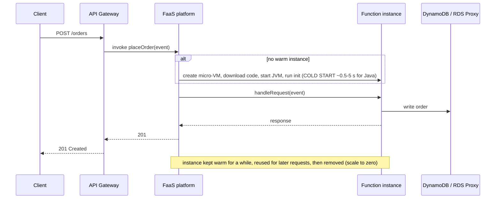

**Key rules of the model:**
- **Stateless functions.** Anything in memory may disappear between invocations; keep state in a DB, cache or object storage.
- **One request per instance at a time** (Lambda's default model): 100 concurrent requests → up to 100 instances. Some platforms (Cloud Run, Azure Flex) allow many requests per instance.
- **Limits:** max execution time (Lambda 15 min), memory, payload size, concurrency quotas.
- **Billing:** per request + per GB-second of execution (on Lambda, including the init phase), so faster code and less memory = lower cost.

---

## 10.4 Variants: FaaS, BaaS, Serverless Containers

| Variant | What you deploy | Good for | Examples |
|---|---|---|---|
| **FaaS** | A function (handler) | Event handlers, short tasks | AWS Lambda, Azure Functions |
| **BaaS** | Nothing (you call a managed service) | Auth, storage, databases, queues | Firebase, Cognito, DynamoDB, S3 |
| **Serverless containers** | A container image | Normal web apps (e.g. a whole Spring Boot app) with scale-to-zero and per-use billing | Google Cloud Run, AWS Fargate (not scale-to-zero), Azure Container Apps, Knative |
| **Serverless workflows** | A state-machine definition | Orchestrating several functions with retries and waits | AWS Step Functions, Azure Durable Functions |

**Java cold-start mitigations (Interview favourite):**

| Technique | Effect |
|---|---|
| **AWS Lambda SnapStart** | Snapshots the initialised JVM (CRaC-based) and restores it: cold starts drop from seconds to sub-second |
| **GraalVM native image** (Spring Boot AOT) | Compiles to a native binary: starts in tens of milliseconds, lower memory |
| **Provisioned concurrency / min instances** | Keeps N instances warm (costs money, removes cold starts for that capacity) |
| **Smaller deployment, lazy init, fewer dependencies** | Less class loading at startup |
| **More memory** | On Lambda, CPU scales with memory, so init is faster |

---

## 10.5 Complete Java Example - Cold Starts, Scale-to-Zero and Cost

A small simulator of a FaaS platform: an instance is created when no warm one is free (**cold start** 900 ms + 120 ms of work), reused while warm, and removed after 10 minutes idle (**scale to zero**). It runs two workloads, then compares an illustrative bill with an always-on server. (Prices are illustrative, close to typical list prices; real bills also include per-request fees.)

```java
import java.util.ArrayList;
import java.util.List;

// A tiny FaaS (Function-as-a-Service) platform simulator:
// instances are created on demand (cold start), reused while warm, and removed after an idle timeout (scale to zero).
// Then we compare the bill with an always-on server.

public class ServerlessDemo {
    static final int COLD_START_MS = 900, EXEC_MS = 120, IDLE_TIMEOUT_MS = 10 * 60_000;

    static class Instance { long busyUntil; long lastUsed; Instance(long t) { lastUsed = t; } }

    record Result(int requests, int coldStarts, int maxInstances, long billedMs, long avgLatency, long p_worstLatency) {}

    static Result simulate(long[] arrivalsMs) {
        List<Instance> pool = new ArrayList<>();
        int cold = 0, max = 0; long billed = 0, totalLatency = 0, worst = 0;
        for (long t : arrivalsMs) {
            pool.removeIf(i -> i.busyUntil <= t && t - i.lastUsed > IDLE_TIMEOUT_MS);   // idle instances are reclaimed
            Instance free = pool.stream().filter(i -> i.busyUntil <= t).findFirst().orElse(null);
            long latency;
            if (free == null) {                                  // no warm instance: start a new one
                free = new Instance(t); pool.add(free); cold++;
                latency = COLD_START_MS + EXEC_MS;
            } else latency = EXEC_MS;
            free.busyUntil = t + latency; free.lastUsed = t + latency;
            billed += latency;                                    // you pay only while your code runs (incl. init on many platforms)
            totalLatency += latency; worst = Math.max(worst, latency);
            max = Math.max(max, pool.size());
        }
        return new Result(arrivalsMs.length, cold, max, billed, totalLatency / arrivalsMs.length, worst);
    }

    public static void main(String[] args) {
        // Workload 1: a quiet internal tool, 40 requests spread over a day (one every ~36 min)
        long[] quiet = new long[40];
        for (int i = 0; i < quiet.length; i++) quiet[i] = i * 36L * 60_000;
        // Workload 2: a spike, 200 requests in 2 seconds (e.g. a marketing push), then nothing
        long[] spike = new long[200];
        for (int i = 0; i < spike.length; i++) spike[i] = i * 10L;

        print("quiet tool (40 req/day)", simulate(quiet));
        print("spike (200 req in 2s)", simulate(spike));

        // Cost comparison (illustrative prices): FaaS = per GB-second, server = fixed per hour
        double memGb = 0.5, pricePerGbSecond = 0.0000166667, serverPerHour = 0.0416;
        long billedMs = simulate(quiet).billedMs();
        double faas = billedMs / 1000.0 * memGb * pricePerGbSecond, server = 24 * serverPerHour;
        System.out.printf("cost per day, quiet tool: FaaS $%.5f vs always-on server $%.4f%n", faas, server);
        long steady = 86_400L * 50;                                // steady 50 req/s all day, warm instances
        double faasBusy = steady * EXEC_MS / 1000.0 * memGb * pricePerGbSecond;
        System.out.printf("cost per day, steady 50 req/s: FaaS $%.2f (+ request fees) vs a few servers ~$%.2f -> serverless is NOT always cheaper%n",
                faasBusy, 3 * 24 * serverPerHour);
    }

    static void print(String name, Result r) {
        System.out.printf("%-26s requests=%d coldStarts=%d maxInstances=%d avgLatency=%dms worst=%dms billed=%.1fs%n",
                name, r.requests(), r.coldStarts(), r.maxInstances(), r.avgLatency(), r.p_worstLatency(), r.billedMs() / 1000.0);
    }
}
```

**Output:**
```
quiet tool (40 req/day)    requests=40 coldStarts=40 maxInstances=1 avgLatency=1020ms worst=1020ms billed=40.8s
spike (200 req in 2s)      requests=200 coldStarts=102 maxInstances=102 avgLatency=579ms worst=1020ms billed=115.8s
cost per day, quiet tool: FaaS $0.00034 vs always-on server $0.9984
cost per day, steady 50 req/s: FaaS $4.32 (+ request fees) vs a few servers ~$3.00 -> serverless is NOT always cheaper
```

What the output shows:
- **Quiet tool:** requests arrive every 36 minutes, longer than the 10-minute idle timeout, so **every** request was a cold start (1020 ms). Fine for an internal tool, bad for a user-facing API: the classic case for SnapStart, a native image or a min-instances setting.
- **Spike:** 200 requests in 2 seconds made the platform scale out to **102 instances** almost instantly. You'd need a large pre-provisioned cluster to do that with servers. Roughly half the requests paid the cold-start penalty.
- **Cost:** the quiet tool costs a fraction of a cent per day versus about $1 for an always-on server. But at a **steady** 50 req/s, the FaaS bill ($4.32 + request fees) is higher than a few small servers (~$3). Serverless wins for spiky or low traffic, not always for steady high traffic.

---

## 10.6 Serverless Java with Spring Cloud Function

**Spring Cloud Function** lets you write business logic as plain `java.util.function` beans and run them on AWS Lambda, Azure Functions, as a web endpoint, or as a Kafka/RabbitMQ consumer, without code changes.

```java
@SpringBootApplication
public class OrderFunctions {
    public static void main(String[] args) { SpringApplication.run(OrderFunctions.class, args); }

    @Bean
    Function<PlaceOrderRequest, OrderResponse> placeOrder(OrderService service) {
        return req -> OrderResponse.from(service.place(req));       // pure business logic, no Lambda API here
    }

    @Bean
    Consumer<S3EventNotification> resizeImage(ImageService images) {  // triggered by an S3 upload
        return event -> event.getRecords().forEach(r -> images.resize(r.getS3().getObject().getKey()));
    }
}
```

```xml
<dependency>
  <groupId>org.springframework.cloud</groupId>
  <artifactId>spring-cloud-function-adapter-aws</artifactId>
</dependency>
```

```yaml
# AWS SAM template (excerpt)
PlaceOrderFunction:
  Type: AWS::Serverless::Function
  Properties:
    Runtime: java21
    Handler: org.springframework.cloud.function.adapter.aws.FunctionInvoker::handleRequest
    MemorySize: 1024
    SnapStart: { ApplyOn: PublishedVersions }     # big cold-start reduction for Java
    AutoPublishAlias: live
    Environment:
      Variables: { SPRING_CLOUD_FUNCTION_DEFINITION: placeOrder }
    Events:
      Api: { Type: HttpApi, Properties: { Path: /orders, Method: post } }
```

**Other Java options:** plain AWS Lambda Java handlers (`RequestHandler<I, O>`), **Quarkus** or **Micronaut** (fast-start frameworks), Spring Boot native images (`./mvnw -Pnative native:compile`), or deploy the whole Spring Boot app to **Cloud Run** as a container.

**Database access from functions:** many instances × one connection each can exhaust a relational DB. Use **RDS Proxy** (connection pooling outside the function), DynamoDB, or an HTTP data API.

#### 📘 Terms Explained

| Term | Simple meaning |
|---|---|
| **Spring Cloud Function** | Spring project to write logic as `Function`/`Supplier`/`Consumer` beans and run them on any platform. |
| **SnapStart** | AWS Lambda feature that restores an initialised JVM snapshot to cut Java cold starts. |
| **GraalVM native image** | Ahead-of-time compiled Java binary with very fast startup and low memory. |
| **Provisioned concurrency** | Paid, pre-initialised Lambda instances that are always warm. |
| **RDS Proxy** | AWS managed connection pool between many function instances and a relational database. |
| **AWS SAM** | Serverless Application Model: infrastructure-as-code templates for Lambda apps. |

---

## 10.7 Pros and Cons

| Pros | Cons |
|---|---|
| No server management, patching or capacity planning | **Cold starts** (worst for JVM without SnapStart/native) |
| Pay per use; scale to zero | Can be **more expensive** at steady high load |
| Massive, automatic, fine-grained scaling | **Vendor lock-in** (triggers, IAM, managed services) |
| Native event integration; fast to build glue and prototypes | Limits: execution time, memory, payload, concurrency quotas |
| Built-in high availability across zones | Harder local testing, debugging and observability across many functions |
| | Stateless model; connection-pool exhaustion on relational DBs |
| | "Lambda pinball": business flows scattered across many small functions |

---

## 10.8 Pitfalls, Interview Questions and Cheat Sheet

| Pitfall | Fix |
|---|---|
| Heavy Spring context + big JAR → multi-second cold starts | SnapStart, native image, slimmer dependencies, lazy init, more memory. |
| Opening a DB connection per invocation | Create clients in init (reused while warm); RDS Proxy; DynamoDB. |
| Functions calling functions synchronously in chains | Use queues/events or Step Functions; avoid paying for waiting. |
| Non-idempotent handlers (triggers retry on failure) | Idempotency keys; Powertools idempotency utility. |
| Unbounded scale hammering a downstream system | Reserved concurrency limits; queue in front. |
| Keeping state in memory or `/tmp` across calls | External state stores. |

**Q1. What is serverless?** A cloud model where the provider manages servers and scaling, you deploy functions or containers, pay per use and can scale to zero. FaaS (Lambda) is the main form, combined with managed services (BaaS).

**Q2. What is a cold start and how do you reduce it in Java?** The time to create and initialise a new instance (JVM start, class loading, Spring context). Reduce with Lambda SnapStart, GraalVM native images, provisioned concurrency, smaller dependencies and more memory.

**Q3. When is serverless a bad fit?** Steady high-throughput workloads (cheaper on servers), latency-critical paths that can't tolerate cold starts, long-running jobs (> 15 min), heavy stateful or connection-heavy workloads, or strict portability requirements.

**Q4. How do serverless functions handle state?** They don't keep it: state goes to databases (DynamoDB), caches, object storage, or workflow engines (Step Functions) that keep execution state.

```
SERVERLESS  Provider runs & scales; you deploy functions/containers; pay per request + GB-s; scale to zero; event triggers.
   FaaS (Lambda, Azure Functions), BaaS (DynamoDB, Cognito, S3), serverless containers (Cloud Run), workflows (Step Functions).
   Java: Spring Cloud Function (Function/Consumer beans + FunctionInvoker), SnapStart, GraalVM native, provisioned concurrency, RDS Proxy.
   + no ops, elastic, cheap for spiky/low traffic.  - cold starts, cost at steady load, lock-in, limits, stateless, harder debugging.
```

---

# 11. CQRS and Event Sourcing as Architectural Styles (Interview Imp - Java)

## 11.1 What Are They?

> Full deep dives (projections, snapshots, upcasting, Axon, eventual consistency handling) are in [05_Data_Management_Pattern.md - CQRS](../03_System_Design/05_Data_Management_Pattern.md#1-cqrs-pattern-interview-imp---java) and [Event Sourcing](../03_System_Design/05_Data_Management_Pattern.md#2-event-sourcing-pattern-interview-imp---java). This section shows how they shape an **application's architecture**.

- **CQRS (Command Query Responsibility Segregation):** use **different models** for writing (commands that change state and enforce rules) and reading (queries shaped for screens). They can share one DB, use different tables, or use different databases.
- **Event Sourcing:** instead of storing the **current state** (a `balance` column), store the **sequence of events** that led to it (`Opened`, `Deposited 10000`, `Withdrawn 6000`). Current state = replay of events.

**Analogy:**
- **CQRS:** a restaurant kitchen (takes orders, follows recipes, strict rules) versus the menu board outside (optimised for customers to read quickly). Both describe the same food but are built for different jobs.
- **Event sourcing:** a bank passbook. The balance is just the result of every line written so far, and you can always check how you got there.

#### 📘 Terms Explained

| Term | Simple meaning |
|---|---|
| **Command** | A request to change state (`Withdraw 6000`); validated against business rules; may be rejected. |
| **Query** | A request to read data; never changes state. |
| **Write model** | The model that handles commands and enforces invariants (often a DDD aggregate). |
| **Read model / projection** | A denormalised view built for a specific query, updated from events. |
| **Event store** | An append-only database of events, the source of truth in event sourcing. |
| **Replay / rehydration** | Rebuilding state by applying stored events in order. |

---

## 11.2 Why and When?

| Use CQRS when | Use Event Sourcing when |
|---|---|
| Reads and writes have **very different shapes or loads** (100 reads per write, complex dashboards) | You need a **complete audit trail** (finance, healthcare, legal) |
| Complex domain rules on the write side, simple reads | You need **temporal queries** ("what was the balance on 1 March?") |
| You want to scale reads independently (replicas, search index, cache) | The business thinks in events, and new reports must be built from **past** data |
| Several read stores (SQL + Elasticsearch + Redis) | Debugging by replaying exactly what happened |

**Don't use them** for simple CRUD: both add eventual consistency, more moving parts and a steeper learning curve. CQRS doesn't require event sourcing, and event sourcing almost always needs CQRS (because querying an event log directly is slow).

---

## 11.3 How They Work Together

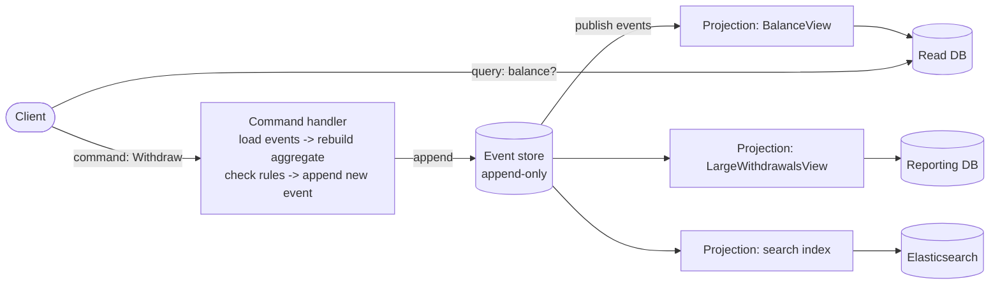

1. A **command** arrives; the handler loads the aggregate's events and replays them into current state.
2. It checks business rules and, if valid, **appends** new events (with optimistic concurrency on the stream version).
3. Events are published to **projections**, which update read models.
4. **Queries** read the read models directly: fast, but possibly a few milliseconds behind (eventual consistency).
5. A new read model can be built at any time by **replaying** the whole event history.

---

## 11.4 Complete Java Example - Event Store, Projections and Rebuilds

The write side stores only events; a command handler rebuilds the balance from events to validate a withdrawal. A `BalanceView` projection is updated live. Later, a brand-new `LargeWithdrawalsView` report is created from **history**, and the balance view is thrown away and rebuilt to prove projections are disposable.

```java
import java.util.ArrayList;
import java.util.List;
import java.util.Map;
import java.util.TreeMap;

// CQRS + Event Sourcing as an architecture: the write side stores EVENTS (not current state),
// read sides are projections built from those events and can be rebuilt at any time.

sealed interface AccountEvent permits Opened, Deposited, Withdrawn {}
record Opened(String accountId, String owner) implements AccountEvent {}
record Deposited(String accountId, long amount) implements AccountEvent {}
record Withdrawn(String accountId, long amount) implements AccountEvent {}

class EventStore {                                             // append-only; the single source of truth
    private final List<AccountEvent> events = new ArrayList<>();
    private final List<Projection> subscribers = new ArrayList<>();
    void append(AccountEvent e) { events.add(e); subscribers.forEach(p -> p.apply(e)); }
    List<AccountEvent> load(String id) { return events.stream().filter(e -> idOf(e).equals(id)).toList(); }
    List<AccountEvent> all() { return List.copyOf(events); }
    void subscribe(Projection p) { subscribers.add(p); }
    static String idOf(AccountEvent e) {
        if (e instanceof Opened o) return o.accountId();
        if (e instanceof Deposited d) return d.accountId();
        return ((Withdrawn) e).accountId();
    }
}

// ---------- WRITE side: command handler rebuilds the aggregate from its events, checks rules, appends new events ----------
class AccountCommandHandler {
    private final EventStore store;
    AccountCommandHandler(EventStore store) { this.store = store; }
    String withdraw(String id, long amount) {
        long balance = 0;
        for (AccountEvent e : store.load(id)) {                // replay = current state
            if (e instanceof Deposited d) balance += d.amount();
            if (e instanceof Withdrawn w) balance -= w.amount();
        }
        if (amount > balance) return "REJECTED withdraw " + amount + " from " + id + " (balance " + balance + ")";
        store.append(new Withdrawn(id, amount));
        return "OK withdraw " + amount + " from " + id;
    }
}

// ---------- READ side: projections shaped for specific screens/queries ----------
interface Projection { void apply(AccountEvent e); }
class BalanceView implements Projection {                      // "show my balance" screen
    final Map<String, Long> balances = new TreeMap<>();
    public void apply(AccountEvent e) {
        if (e instanceof Opened o) balances.put(o.accountId(), 0L);
        else if (e instanceof Deposited d) balances.merge(d.accountId(), d.amount(), Long::sum);
        else if (e instanceof Withdrawn w) balances.merge(w.accountId(), -w.amount(), Long::sum);
    }
}
class LargeWithdrawalsView implements Projection {             // a NEW report the business asked for later
    final List<String> rows = new ArrayList<>();
    public void apply(AccountEvent e) { if (e instanceof Withdrawn w && w.amount() >= 5000) rows.add(w.accountId() + " withdrew " + w.amount()); }
}

public class CqrsEventSourcingDemo {
    public static void main(String[] args) {
        EventStore store = new EventStore();
        BalanceView balances = new BalanceView();
        store.subscribe(balances);
        AccountCommandHandler commands = new AccountCommandHandler(store);

        store.append(new Opened("A-1", "asha"));
        store.append(new Deposited("A-1", 10_000));
        store.append(new Opened("A-2", "ravi"));
        store.append(new Deposited("A-2", 3_000));
        System.out.println(commands.withdraw("A-1", 6_000));
        System.out.println(commands.withdraw("A-2", 4_000));
        System.out.println(commands.withdraw("A-2", 1_000));
        System.out.println("query side (BalanceView): " + balances.balances);

        System.out.println("event log for A-1 (full audit history):");
        store.load("A-1").forEach(e -> System.out.println("  " + e));

        System.out.println("new requirement: 'list large withdrawals' -> build a new projection by REPLAYING history");
        LargeWithdrawalsView report = new LargeWithdrawalsView();
        store.all().forEach(report::apply);
        System.out.println("  " + report.rows);

        System.out.println("read model lost or buggy? throw it away and rebuild:");
        BalanceView rebuilt = new BalanceView();
        store.all().forEach(rebuilt::apply);
        System.out.println("  rebuilt " + rebuilt.balances + " equals live view: " + rebuilt.balances.equals(balances.balances));
    }
}
```

**Output:**
```
OK withdraw 6000 from A-1
REJECTED withdraw 4000 from A-2 (balance 3000)
OK withdraw 1000 from A-2
query side (BalanceView): {A-1=4000, A-2=2000}
event log for A-1 (full audit history):
  Opened[accountId=A-1, owner=asha]
  Deposited[accountId=A-1, amount=10000]
  Withdrawn[accountId=A-1, amount=6000]
new requirement: 'list large withdrawals' -> build a new projection by REPLAYING history
  [A-1 withdrew 6000]
read model lost or buggy? throw it away and rebuild:
  rebuilt {A-1=4000, A-2=2000} equals live view: true
```

What the output shows:
- The rejected withdrawal (4000 from a balance of 3000) produced **no event**: rules are checked on the write side before anything is appended.
- The query side answered from `BalanceView` without replaying anything, which is why reads are fast.
- The event log for `A-1` is a full audit trail: you can see **how** the balance became 4000, not just that it is 4000.
- The large-withdrawals report was built **after the fact** from history, and the rebuilt balance view matched the live one exactly. Read models are disposable caches of the event log.

---

## 11.5 In Spring Boot

```java
// CQRS without event sourcing: separate command and query paths over the same DB
@Service @RequiredArgsConstructor
class OrderCommandService {                                // write model: JPA aggregate, rules, transactions
    private final OrderRepository orders;
    @Transactional public void cancel(OrderId id) { orders.findById(id).orElseThrow().cancel(); }
}

@Service @RequiredArgsConstructor
class OrderQueryService {                                  // read model: tuned SQL straight into DTOs, no aggregates
    private final JdbcClient jdbc;
    List<OrderSummary> recentForCustomer(long customerId) {
        return jdbc.sql("""
                SELECT o.id, o.status, o.total, COUNT(l.id) AS items
                FROM orders o JOIN order_lines l ON l.order_id = o.id
                WHERE o.customer_id = :c GROUP BY o.id ORDER BY o.created_at DESC LIMIT 20""")
            .param("c", customerId).query(OrderSummary.class).list();
    }
}
```

**With event sourcing:** frameworks such as **Axon Framework** (`@Aggregate`, `@CommandHandler`, `@EventSourcingHandler`, `@EventHandler` projections, Axon Server as event store) or **EventStoreDB** with its Java client; Kafka is often used to distribute events to projections, but it's usually **not** used as the primary event store (no per-aggregate stream reads or optimistic concurrency per stream).

---

## 11.6 Pros, Cons, Pitfalls, Interview Questions and Cheat Sheet

| Pros | Cons |
|---|---|
| Read and write sides optimised and scaled independently | Eventual consistency between write and read sides |
| Event sourcing: full audit trail, temporal queries, replay, debugging | Event schema evolution (versioning, upcasting) |
| New read models built from history | More infrastructure: event store, projections, rebuild tooling |
| Natural fit with event-driven architecture and DDD | Steep learning curve; overkill for CRUD |

| Pitfall | Fix |
|---|---|
| Using CQRS/ES for the whole system | Apply only to the bounded contexts that benefit. |
| UI reads its own write immediately and sees stale data | Return the new state from the command, read-your-writes routing, or wait for the projection version. |
| Replaying millions of events per command | Snapshots every N events. |
| Changing old events | Never edit; add new event versions and upcasters. |

**Q1. What is CQRS?** Separating the model that changes state (commands) from the model that reads it (queries), so each can be designed, stored and scaled for its job.

**Q2. Does CQRS require event sourcing?** No. CQRS can use the same DB with different models. Event sourcing almost always uses CQRS, because you need read models to query efficiently.

**Q3. How do you rebuild a read model?** Create an empty projection and replay all events from the event store into it, then switch queries over (blue-green for read models).

```
CQRS + ES   CQRS: separate write model (commands, rules) and read model (queries, projections). Can share one DB.
            ES: store events, not state; state = replay; append-only + optimistic version per stream; snapshots; upcasting.
            Together: command -> events -> projections -> read DBs; rebuild by replay. Eventual consistency.
            Spring: separate command/query services (JPA vs JdbcClient); Axon Framework / EventStoreDB for ES. Not for CRUD.
```

---

# 12. Domain-Driven Design (DDD) (Interview Imp - Java)

## 12.1 What is DDD?

**Domain-Driven Design** (Eric Evans, 2003) is an approach to building software for **complex business domains** by making the code a faithful model of the business, developed together with **domain experts**.

It has two halves:

| Half | Question | Main tools |
|---|---|---|
| **Strategic DDD** | How do we split a large domain into parts and how do those parts relate? | Ubiquitous language, subdomains, **bounded contexts**, context maps |
| **Tactical DDD** | How do we model the inside of one part in code? | Entities, value objects, **aggregates**, domain events, repositories, domain services, factories |

**Analogy:** The word "account" means different things to a bank's **lending** team (a loan account with EMIs), its **cards** team (a credit card with limits) and its **IT** team (a login). DDD says: don't build one giant `Account` class that tries to satisfy everyone. Give each team its own model and language inside its own boundary, and translate at the edges.

#### 📘 Terms Explained

| Term | Simple meaning |
|---|---|
| **Domain** | The business area the software is about (banking, e-commerce, logistics). |
| **Domain expert** | A business person who knows how the domain works (underwriter, warehouse manager). |
| **Ubiquitous language** | The shared vocabulary used by experts and developers, in conversations **and** in code. |
| **Model** | A simplified representation of the domain, made of concepts and rules. |
| **Subdomain** | A part of the business: core (your competitive advantage), supporting, or generic (buy it). |

---

## 12.2 Why Do We Need It?

| Problem in complex business software | DDD answer |
|---|---|
| Developers and business use different words; requirements get "lost in translation" | **Ubiquitous language** used in code (`order.submit()`, not `orderDao.updateStatus(3)`) |
| One huge model where "Customer" has 120 fields used by 8 teams | **Bounded contexts**: each has its own smaller model |
| Business rules scattered across services, controllers and SQL | Rules inside **aggregates** and **value objects** |
| Invalid states possible (negative money, order with 0 lines submitted) | Objects **protect their invariants**; invalid states can't be constructed |
| Unclear service boundaries in microservices | Bounded context ≈ microservice (or module) boundary |

DDD pays off for **complex core domains**. For simple CRUD (a settings screen), it's overkill.

---

## 12.3 Strategic DDD: Bounded Contexts and Context Maps

A **bounded context** is a boundary (a module, service or team) inside which one model and one ubiquitous language apply consistently. The same real-world thing can have different models in different contexts.

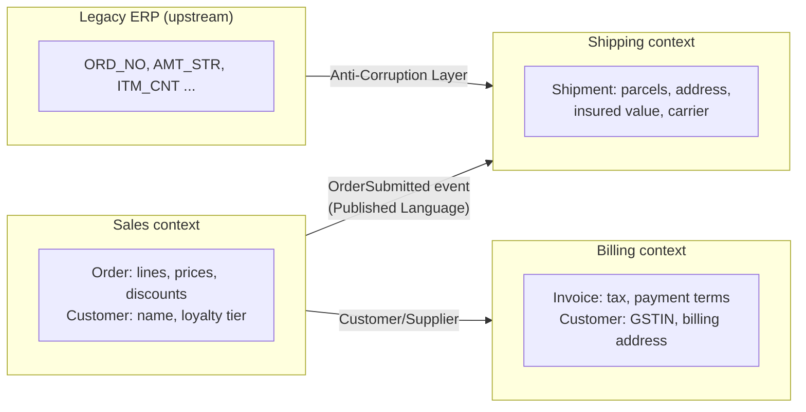

**Context map relationships:**

| Relationship | Meaning |
|---|---|
| **Shared Kernel** | Two contexts share a small common model (risky; needs close coordination) |
| **Customer / Supplier** | Downstream (customer) needs are negotiated with the upstream (supplier) team |
| **Conformist** | Downstream simply adopts the upstream model (no negotiating power, e.g. a big vendor API) |
| **Anti-Corruption Layer (ACL)** | Downstream translates the upstream model into its own, so the upstream's mess doesn't leak in |
| **Open Host Service** | Upstream offers a well-defined API/protocol for many consumers |
| **Published Language** | A documented shared format (events schema, JSON contract) for integration |
| **Separate Ways** | No integration; each context solves it independently |

**Subdomains:** invest the best people and DDD effort in the **core** subdomain (e.g. pricing engine for an e-commerce site); keep **supporting** subdomains simple; **buy** generic ones (auth, email, payments).

**Finding boundaries:** **Event Storming** workshops (business and developers put domain events on sticky notes on a timeline, then group them into aggregates and contexts).

---

## 12.4 Tactical DDD: The Building Blocks

| Building block | What it is | Identity? | Mutable? | Java shape |
|---|---|---|---|---|
| **Entity** | An object defined by its **identity** that continues over time | ✅ ID | Usually | class with `id`, equals/hashCode on ID |
| **Value Object** | An object defined only by its **values**; validates itself | ❌ | ❌ immutable | `record Money(long paise, String currency)` |
| **Aggregate** | A cluster of entities and value objects treated as **one unit for changes**, with one **aggregate root** that guards the invariants | Root has ID | Via root only | `Order` (root) containing `OrderLine`s |
| **Domain Event** | Something important that happened in the domain | Event ID | ❌ | `record OrderSubmitted(...)` |
| **Repository** | Collection-like access to **whole aggregates** (one per aggregate root) | — | — | `interface OrderRepository { save, byId }` |
| **Domain Service** | Domain logic that doesn't naturally belong to one entity | — | Stateless | `TransferService.transfer(from, to, amount)` |
| **Factory** | Encapsulates complex creation of aggregates | — | — | `Order.create(...)`, `LoanFactory` |
| **Application Service** | Orchestrates a use case: load aggregate, call domain, save, publish events; **no** business rules | — | — | `@Service` with `@Transactional` |

**Aggregate design rules (Vaughn Vernon):**
1. Protect **true invariants** inside the aggregate boundary (e.g. "order total ≤ ₹50,000").
2. Design **small** aggregates.
3. Reference other aggregates **by ID only** (`CustomerId`, not `Customer`).
4. Change **one aggregate per transaction**; update others with **eventual consistency** via domain events.

---

## 12.5 Complete Java Example - Value Objects, Aggregate, Domain Event, ACL

`Money` is a value object that validates itself and refuses to mix currencies. `Order` is an **aggregate root**: every change goes through it, it enforces a ₹50,000 limit and "no changes after submit", and it records an `OrderSubmitted` **domain event**. A **Shipping** bounded context receives the event through an **Anti-Corruption Layer**, which also translates an ugly legacy ERP record into the same clean `Shipment` model.

```java
import java.util.ArrayList;
import java.util.Collections;
import java.util.LinkedHashMap;
import java.util.List;
import java.util.Map;
import java.util.Objects;

// Domain-Driven Design building blocks in plain Java:
// Value Object, Entity, Aggregate (root guards the invariants), Domain Event, Repository,
// and an Anti-Corruption Layer between two bounded contexts.

// ---------- Value Objects: no identity, immutable, compared by value, validate themselves ----------
record Money(long paise, String currency) {
    Money {
        if (paise < 0) throw new IllegalArgumentException("money cannot be negative");
        Objects.requireNonNull(currency);
    }
    static Money inr(long rupees) { return new Money(rupees * 100, "INR"); }
    Money plus(Money o) { requireSame(o); return new Money(paise + o.paise, currency); }
    Money times(int n) { return new Money(paise * n, currency); }
    boolean greaterThan(Money o) { requireSame(o); return paise > o.paise; }
    private void requireSame(Money o) { if (!currency.equals(o.currency)) throw new IllegalArgumentException("currency mismatch"); }
    @Override public String toString() { return String.format("%s %.2f", currency, paise / 100.0); }
}
record ProductId(String value) {}
record OrderId(String value) {}

// ---------- Domain events: something that happened, in the past tense, named in the ubiquitous language ----------
record OrderSubmitted(OrderId orderId, Money total, int lines) {}

// ---------- Entity inside the aggregate (identity = product within this order) ----------
class OrderLine {
    final ProductId product; final Money unitPrice; private int quantity;
    OrderLine(ProductId product, Money unitPrice, int quantity) { this.product = product; this.unitPrice = unitPrice; this.quantity = quantity; }
    int quantity() { return quantity; }
    void increase(int by) { quantity += by; }                  // package-private: only the aggregate root calls this
    Money subtotal() { return unitPrice.times(quantity); }
}

// ---------- Aggregate root: the ONLY entry point; every change goes through it and keeps the rules true ----------
class Order {
    static final Money MAX_ORDER_VALUE = Money.inr(50_000);
    enum Status { DRAFT, SUBMITTED }
    private final OrderId id; private Status status = Status.DRAFT;
    private final Map<ProductId, OrderLine> lines = new LinkedHashMap<>();
    private final List<Object> domainEvents = new ArrayList<>();
    Order(OrderId id) { this.id = id; }

    void addItem(ProductId product, Money unitPrice, int qty) {
        if (status != Status.DRAFT) throw new IllegalStateException("cannot change a submitted order");
        if (qty <= 0) throw new IllegalArgumentException("quantity must be positive");
        Money newTotal = total().plus(unitPrice.times(qty));
        if (newTotal.greaterThan(MAX_ORDER_VALUE)) throw new IllegalStateException("order limit " + MAX_ORDER_VALUE + " exceeded");
        lines.computeIfAbsent(product, p -> new OrderLine(p, unitPrice, 0)).increase(qty);
    }
    void submit() {
        if (lines.isEmpty()) throw new IllegalStateException("cannot submit an empty order");
        status = Status.SUBMITTED;
        domainEvents.add(new OrderSubmitted(id, total(), lines.size()));   // recorded now, published after the transaction
    }
    Money total() { return lines.values().stream().map(OrderLine::subtotal).reduce(Money.inr(0), Money::plus); }
    OrderId id() { return id; }
    Status status() { return status; }
    List<Object> pullEvents() { List<Object> e = List.copyOf(domainEvents); domainEvents.clear(); return e; }
    Map<ProductId, Integer> quantities() {                      // read-only view: callers can't modify lines directly
        Map<ProductId, Integer> m = new LinkedHashMap<>(); lines.forEach((k, v) -> m.put(k, v.quantity()));
        return Collections.unmodifiableMap(m);
    }
}

// ---------- Repository: collection-like access to WHOLE aggregates (one per aggregate root) ----------
interface OrderRepository { void save(Order o); Order byId(OrderId id); }
class InMemoryOrderRepository implements OrderRepository {
    private final Map<OrderId, Order> store = new LinkedHashMap<>();
    public void save(Order o) { store.put(o.id(), o); }
    public Order byId(OrderId id) { return store.get(id); }
}

// ---------- Another bounded context (Shipping) with its OWN model, plus an Anti-Corruption Layer ----------
record Shipment(String reference, int parcels, String insuredValue) {}           // shipping's language: parcels, insurance
class LegacyErpOrderDto { String ORD_NO; String AMT_STR; String ITM_CNT; }        // ugly upstream/legacy model
class ShippingAntiCorruptionLayer {                                              // translates, so shipping's model stays clean
    Shipment fromSalesEvent(OrderSubmitted e) {
        return new Shipment("SHP-" + e.orderId().value(), Math.max(1, e.lines() / 2), e.total().toString());
    }
    Shipment fromLegacyErp(LegacyErpOrderDto dto) {
        return new Shipment("SHP-" + dto.ORD_NO.trim(), Math.max(1, Integer.parseInt(dto.ITM_CNT.trim()) / 2),
                String.format("INR %.2f", Long.parseLong(dto.AMT_STR.trim()) / 100.0));
    }
}

public class DddDemo {
    public static void main(String[] args) {
        System.out.println("=== Value objects ===");
        System.out.println("Money.inr(500).equals(new Money(50000, \"INR\")) = " + Money.inr(500).equals(new Money(50_000, "INR")));
        try { Money.inr(5).plus(new Money(100, "USD")); } catch (IllegalArgumentException e) { System.out.println("INR + USD -> " + e.getMessage()); }

        System.out.println("=== Aggregate keeps its invariants ===");
        OrderRepository repo = new InMemoryOrderRepository();
        Order order = new Order(new OrderId("ORD-42"));
        order.addItem(new ProductId("KEYBOARD"), Money.inr(2_499), 2);
        order.addItem(new ProductId("MOUSE"), Money.inr(799), 1);
        order.addItem(new ProductId("KEYBOARD"), Money.inr(2_499), 1);     // same product -> same line, quantity merged
        System.out.println("lines " + order.quantities() + " total " + order.total());
        attempt("add a laptop worth INR 60000", () -> order.addItem(new ProductId("LAPTOP"), Money.inr(60_000), 1));
        attempt("change quantities map directly", () -> order.quantities().put(new ProductId("HACK"), 99));
        order.submit();
        attempt("add item after submit", () -> order.addItem(new ProductId("MOUSE"), Money.inr(799), 1));
        repo.save(order);
        System.out.println("saved; status=" + repo.byId(new OrderId("ORD-42")).status());

        System.out.println("=== Domain event crosses into the Shipping bounded context via the ACL ===");
        ShippingAntiCorruptionLayer acl = new ShippingAntiCorruptionLayer();
        for (Object e : order.pullEvents()) {
            System.out.println("sales published " + e);
            System.out.println("shipping created " + acl.fromSalesEvent((OrderSubmitted) e));
        }
        LegacyErpOrderDto dto = new LegacyErpOrderDto(); dto.ORD_NO = " 77031 "; dto.AMT_STR = "1250000"; dto.ITM_CNT = "05";
        System.out.println("legacy ERP record -> " + acl.fromLegacyErp(dto));
    }

    static void attempt(String what, Runnable r) {
        try { r.run(); System.out.println(what + ": allowed"); }
        catch (RuntimeException e) { System.out.println(what + ": BLOCKED (" + (e.getMessage() == null ? e.getClass().getSimpleName() : e.getMessage()) + ")"); }
    }
}
```

**Output:**
```
=== Value objects ===
Money.inr(500).equals(new Money(50000, "INR")) = true
INR + USD -> currency mismatch
=== Aggregate keeps its invariants ===
lines {ProductId[value=KEYBOARD]=3, ProductId[value=MOUSE]=1} total INR 8296.00
add a laptop worth INR 60000: BLOCKED (order limit INR 50000.00 exceeded)
change quantities map directly: BLOCKED (UnsupportedOperationException)
add item after submit: BLOCKED (cannot change a submitted order)
saved; status=SUBMITTED
=== Domain event crosses into the Shipping bounded context via the ACL ===
sales published OrderSubmitted[orderId=OrderId[value=ORD-42], total=INR 8296.00, lines=2]
shipping created Shipment[reference=SHP-ORD-42, parcels=1, insuredValue=INR 8296.00]
legacy ERP record -> Shipment[reference=SHP-77031, parcels=2, insuredValue=INR 12500.00]
```

What the output shows:
- **Value objects** compare by value (`Money.inr(500)` equals `Money(50000 paise)`) and reject invalid operations (INR + USD).
- The **aggregate root** merged the second keyboard into the existing line (3 × ₹2,499 + ₹799 = ₹8,296), blocked the laptop because it would break the ₹50,000 **invariant**, refused direct modification of its internals (read-only map), and refused changes after `submit()`.
- The domain event was recorded inside the aggregate and **pulled** after saving: the same pattern Spring Data's `AbstractAggregateRoot` uses to publish events after `save()`.
- The **ACL** translated both a clean event from Sales and a messy legacy record (`" 77031 "`, `"1250000"`, `"05"`) into Shipping's own language (`parcels`, `insuredValue`). Shipping's model never saw `ORD_NO` or `AMT_STR`.

---

## 12.6 DDD in Spring Boot (JPA Aggregates and Domain Events)

```java
@Embeddable
public record Money(long paise, String currency) {           // value object as a JPA embeddable (Hibernate 6.2+ supports records)
    public Money { if (paise < 0) throw new IllegalArgumentException("negative money"); }
}

@Entity
@Table(name = "orders")
public class Order extends AbstractAggregateRoot<Order> {     // Spring Data: collects and publishes domain events on save()
    @EmbeddedId private OrderId id;
    @Embedded private CustomerId customerId;                  // reference other aggregates BY ID, not @ManyToOne Customer
    @Enumerated(EnumType.STRING) private Status status = Status.DRAFT;

    @OneToMany(cascade = CascadeType.ALL, orphanRemoval = true)
    @JoinColumn(name = "order_id")
    private List<OrderLine> lines = new ArrayList<>();         // lines exist only inside this aggregate

    @Version private long version;                            // optimistic locking: protects the invariants under concurrency

    protected Order() {}                                       // for JPA
    public static Order draft(OrderId id, CustomerId customer) { Order o = new Order(); o.id = id; o.customerId = customer; return o; }

    public void addItem(ProductId product, Money price, int qty) { /* invariant checks, then change */ }

    public void submit() {
        if (lines.isEmpty()) throw new IllegalStateException("empty order");
        status = Status.SUBMITTED;
        registerEvent(new OrderSubmitted(id, total()));       // published when orderRepository.save(order) is called
    }
    public List<OrderLine> lines() { return Collections.unmodifiableList(lines); }   // no setters, no public mutable collections
}

public interface OrderRepository extends Repository<Order, OrderId> {   // only what the domain needs, one per aggregate root
    Order save(Order order);
    Optional<Order> findById(OrderId id);
}

@Service @RequiredArgsConstructor
class SubmitOrderService {                                    // application service: orchestrates, no rules
    private final OrderRepository orders;
    @Transactional
    public void submit(OrderId id) {
        Order order = orders.findById(id).orElseThrow();
        order.submit();                                       // the rule lives in the aggregate
        orders.save(order);                                   // -> OrderSubmitted published to @TransactionalEventListener / Modulith listeners
    }
}
```

**Mapping DDD to architecture:** one **bounded context** = one Spring Modulith module or one microservice; inside it, a **hexagonal/clean** structure with aggregates in `domain`, application services in `application`, JPA/Kafka/REST in `adapter`. Integration between contexts uses **domain events** (published language) and **ACLs**.

**Libraries:** jMolecules (`@AggregateRoot`, `@ValueObject`, `@Entity` annotations + ArchUnit rules for DDD), Spring Modulith, Axon Framework.

#### 📘 Terms Explained

| Term | Simple meaning |
|---|---|
| **Aggregate root** | The single entity through which all changes to an aggregate are made. |
| **Invariant** | A business rule that must always be true for an aggregate (e.g. total ≤ limit). |
| **`AbstractAggregateRoot`** | Spring Data base class with `registerEvent()`; events are published when the repository saves the aggregate. |
| **`@Embeddable` / `@Embedded`** | JPA way to store a value object's fields as columns of the owning entity's table. |
| **`@Version`** | JPA optimistic locking column; concurrent conflicting updates fail instead of overwriting. |
| **Event Storming** | A workshop technique to discover domain events, aggregates and bounded contexts. |
| **jMolecules** | Library of annotations/interfaces to express DDD and architecture concepts in Java code. |

---

## 12.7 Pros and Cons

| Pros | Cons |
|---|---|
| Code speaks the business language; easier collaboration with experts | Needs access to domain experts and time for modelling |
| Rules are in one place, invalid states are impossible | Overkill for simple CRUD or data-pipeline apps |
| Bounded contexts give natural module/service boundaries | Learning curve; jargon can be misused ("everything is an aggregate") |
| Aggregates make concurrency and transaction boundaries explicit | JPA mapping of rich models (records, private setters, value objects) takes effort |
| Long-term maintainability of complex domains | Eventual consistency between aggregates must be designed carefully |

---

## 12.8 Pitfalls, Interview Questions and Cheat Sheet

| Pitfall | Fix |
|---|---|
| **Anemic domain model**: entities with only getters/setters, all rules in services | Move behaviour into entities/value objects (`order.submit()`). |
| Huge aggregates (Customer with all orders, addresses, tickets) | Small aggregates; reference by ID; eventual consistency between them. |
| `@ManyToOne` links between aggregates | Store the other aggregate's ID. |
| One "enterprise" model shared by all contexts | Bounded contexts with their own models + ACL / published language. |
| Repositories for every entity (`OrderLineRepository`) | One repository per **aggregate root**. |
| Primitive obsession (`String email`, `long amount`) | Value objects (`Email`, `Money`) with validation. |

**Q1. Entity vs value object?** An entity has an identity that persists over time (an `Order` with `ORD-42` stays the same order as it changes). A value object is defined only by its values and is immutable (`Money(500, INR)`); two equal values are interchangeable.

**Q2. What is an aggregate and why should it be small?** A consistency boundary: a cluster of objects changed together through one root that enforces invariants, saved in one transaction. Small aggregates mean fewer concurrency conflicts, faster loads and clearer rules.

**Q3. What is a bounded context?** A boundary in which one model and one ubiquitous language apply. Different contexts may model the same thing differently ("Customer" in Sales vs Billing). It's the best guide for module or microservice boundaries.

**Q4. What is an anti-corruption layer?** A translation layer that converts another system's model into yours, so its concepts and quirks don't leak into your domain. Used when integrating legacy systems or third-party APIs.

**Q5. Domain service vs application service?** A domain service holds business logic involving several aggregates that doesn't fit one entity (`FundsTransferService`). An application service orchestrates a use case (transactions, loading, saving, publishing) and contains no business rules.

**Q6. What is an anemic domain model and why is it called an anti-pattern?** Domain objects with data but no behaviour, with all logic in services. It loses the benefits of OO encapsulation: rules get duplicated and invariants can be broken from anywhere. (Fine for simple CRUD.)

```
DDD   For COMPLEX domains. Ubiquitous language in code. Work with domain experts.
  Strategic: subdomains (core/supporting/generic), BOUNDED CONTEXTS (one model each), context map (shared kernel, customer/supplier,
             conformist, ACL, open host, published language). Event Storming to find them. Context ~ module or microservice.
  Tactical:  Entity (identity) / Value Object (immutable, by value) / AGGREGATE (root guards invariants; small; refer by ID;
             one per transaction) / Domain Event / Repository (per root) / Domain Service / Factory / Application Service.
  Spring: AbstractAggregateRoot.registerEvent(), @Embeddable value objects, @Version, Spring Modulith, jMolecules. Avoid anemic models.
```

---

# 13. Space-Based Architecture

## 13.1 What is Space-Based Architecture?

**Space-Based Architecture (SBA)** removes the database from the request path to get extreme scalability and elasticity. Each **processing unit** (an application instance) holds the data it needs **in memory**, in a **replicated, partitioned in-memory data grid** (the "tuple space"). The database is updated **asynchronously** in the background.

| Component | Role |
|---|---|
| **Processing unit** | An app instance with business logic + its slice of the in-memory data grid |
| **In-memory data grid** | Partitioned, replicated key-value store spread across processing units (Hazelcast, Apache Ignite, Oracle Coherence, GigaSpaces) |
| **Messaging grid** | Routes requests to processing units (load balancer / gateway) |
| **Data pumps** | Asynchronously send changes from the grid to the database (write-behind, queues) |
| **Data writers / readers** | Write pumped changes into the DB; load data from the DB into the grid on startup |
| **Deployment manager** | Starts/stops processing units with load |

**Analogy:** A concert box office during a ticket rush. Instead of every sales clerk phoning head office for each ticket (database), each clerk has a stack of tickets at their desk (in-memory data), a colleague keeps a copy of their sales count (backup), and a runner takes the day's sales sheets to head office in batches (write-behind).

The name comes from the **tuple space** concept (Linda, JavaSpaces): a shared distributed memory that processes read and write.

#### 📘 Terms Explained

| Term | Simple meaning |
|---|---|
| **Processing unit** | One instance of the application in SBA, carrying both logic and in-memory data. |
| **In-memory data grid (IMDG)** | A cluster of nodes storing data in RAM, partitioned and replicated, with a Map-like API. |
| **Partition** | A slice of the keys owned by one node (primary), with copies on others (backups). |
| **Write-behind** | Update the cache now, write to the database later in batches. |
| **Tuple space** | A shared, associative distributed memory where processes put and take data items. |

---

## 13.2 Why Do We Need It?

Some workloads have **huge, unpredictable spikes** where the database becomes the bottleneck no matter how many app servers you add:

| Workload | Why SBA helps |
|---|---|
| Concert/flash-sale ticketing | Tens of thousands of purchases per second for a few minutes |
| Online auctions / bidding | Hot items with many concurrent updates |
| Trading platforms, real-time pricing | Microsecond latency needed |
| Gaming leaderboards, session-heavy apps | Massive in-memory state updated constantly |

Adding app servers in a normal design just moves the queue to the database. In SBA, adding processing units **adds memory and CPU for the data too**, so throughput scales almost linearly until the grid's network is saturated.

---

## 13.3 How It Works

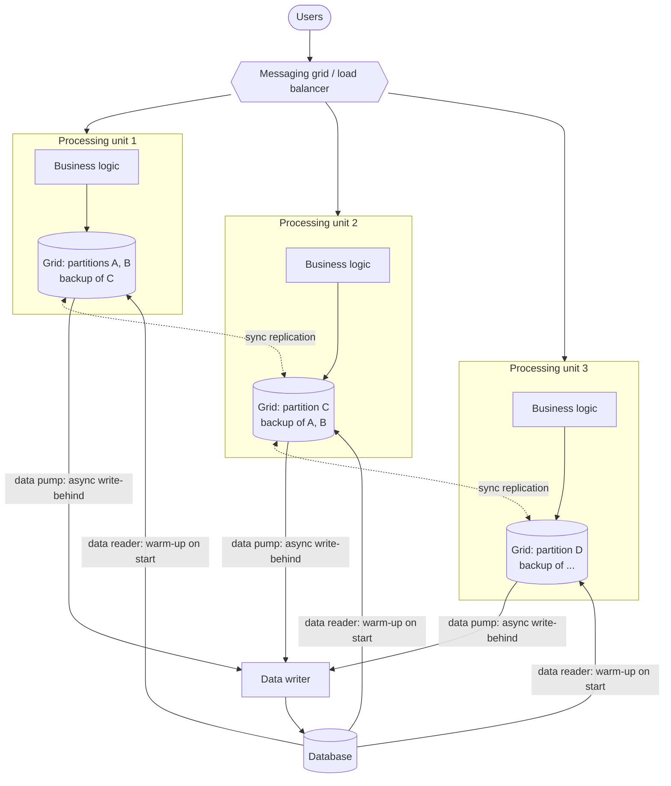

1. Requests are routed to any processing unit; the grid routes each key to the unit that **owns its partition** (or the logic is sent to the data, e.g. an entry processor).
2. The unit updates data **in memory**; the grid copies the update **synchronously** to a backup on another node.
3. A **data pump** queues the change and a data writer applies it to the DB later, in batches (and collapses repeated updates to the same key).
4. If a unit dies, its backups are promoted to primary and the cluster rebalances.
5. On startup, data readers load the needed data from the DB into the grid.

**Trade-off:** the DB is **eventually** consistent with the grid; if a primary **and** its backup fail before the pump writes, those updates are lost (so use backup-count ≥ 1, persistent queues for pumps, and consider which data can tolerate this).

---

## 13.4 Complete Java Example - A Flash-Sale Data Grid with Failover

Three processing units own partitions of the keys (`hash(key) % 3`), each with a backup on the next unit. 3,200 purchase requests for 3,000 tickets are handled entirely in memory, the DB is written by a **write-behind** flush that collapses 3,000+ updates into 3 writes, and a unit failure is survived by promoting its backup.

```java
import java.util.ArrayList;
import java.util.LinkedHashMap;
import java.util.List;
import java.util.Map;
import java.util.TreeMap;

// Space-Based Architecture: processing units keep data IN MEMORY (a partitioned, replicated data grid),
// the database is updated asynchronously (write-behind), so the DB is no longer the bottleneck.
// Example: a flash-sale ticket counter.

class ProcessingUnit {
    final String name; boolean alive = true;
    final Map<String, Integer> primary = new TreeMap<>();   // partitions this unit owns
    final Map<String, Integer> backup = new TreeMap<>();    // copies of partitions owned by its neighbour
    ProcessingUnit(String name) { this.name = name; }
}

class DataGrid {
    final List<ProcessingUnit> units = new ArrayList<>();
    final List<String> writeBehindQueue = new ArrayList<>();   // "data pump" to the database
    final Map<String, Integer> database = new TreeMap<>();

    int owner(String key) { return Math.floorMod(key.hashCode(), units.size()); }
    int backupOf(int owner) { return (owner + 1) % units.size(); }

    void put(String key, int value) {
        int o = owner(key);
        units.get(o).primary.put(key, value);                  // in-memory write: microseconds
        units.get(backupOf(o)).backup.put(key, value);         // synchronous copy to the backup unit
        writeBehindQueue.add(key + "=" + value);               // DB updated later, in the background
    }
    Integer get(String key) { return units.get(owner(key)).primary.get(key); }

    boolean buyTicket(String event) {                          // the business operation, done entirely in memory
        int left = get(event);
        if (left == 0) return false;
        put(event, left - 1);
        return true;
    }

    void flushToDatabase() {                                   // the "data writer": batches, collapses repeated keys
        Map<String, String> latest = new LinkedHashMap<>();
        for (String w : writeBehindQueue) latest.put(w.split("=")[0], w);
        latest.values().forEach(w -> database.put(w.split("=")[0], Integer.parseInt(w.split("=")[1])));
        System.out.println("  write-behind: " + writeBehindQueue.size() + " in-memory updates -> " + latest.size() + " DB writes");
        writeBehindQueue.clear();
    }

    void failUnit(int idx) {                                   // a unit crashes: its backup holder promotes the copies
        ProcessingUnit dead = units.get(idx), heir = units.get(backupOf(idx));
        dead.alive = false;
        Map<String, Integer> promoted = new TreeMap<>();
        heir.backup.forEach((k, v) -> { if (owner(k) == idx) promoted.put(k, v); });
        heir.primary.putAll(promoted);
        units.set(idx, heir);                                  // simplistic routing: the heir now serves that partition
        System.out.println("  " + dead.name + " DIED -> " + heir.name + " promoted backup " + promoted);
    }
}

public class SpaceBasedDemo {
    public static void main(String[] args) {
        DataGrid grid = new DataGrid();
        for (String n : List.of("pu-1", "pu-2", "pu-3")) grid.units.add(new ProcessingUnit(n));
        List<String> events = List.of("concert-A", "match-B", "show-C");
        for (String e : events) grid.put(e, 1000);
        grid.flushToDatabase();
        for (String e : events) System.out.println("  " + e + " -> owner " + grid.units.get(grid.owner(e)).name
                + ", backup " + grid.units.get(grid.backupOf(grid.owner(e))).name);

        System.out.println("=== Flash sale: 3,200 purchase requests for 3,000 tickets, no database call on the request path ===");
        int sold = 0, soldOut = 0;
        for (int i = 0; i < 3200; i++) { if (grid.buyTicket(events.get(i % 3))) sold++; else soldOut++; }
        System.out.println("  sold " + sold + ", rejected (sold out) " + soldOut + ", queued for DB " + grid.writeBehindQueue.size());
        System.out.println("  in memory: " + events.stream().map(e -> e + "=" + grid.get(e)).toList() + " | database (stale): " + grid.database);

        System.out.println("=== A processing unit fails before the flush ===");
        grid.put("concert-A", 25);                             // organiser releases 25 returned tickets
        int victim = grid.owner("concert-A");
        grid.failUnit(victim);
        System.out.println("  concert-A still readable after failover: " + grid.get("concert-A"));
        grid.flushToDatabase();
        System.out.println("  database now: " + grid.database);
        System.out.println("  trade-off: if a unit AND its backup die before the flush, those updates are lost");
    }
}
```

**Output:**
```
  write-behind: 3 in-memory updates -> 3 DB writes
  concert-A -> owner pu-3, backup pu-1
  match-B -> owner pu-2, backup pu-3
  show-C -> owner pu-3, backup pu-1
=== Flash sale: 3,200 purchase requests for 3,000 tickets, no database call on the request path ===
  sold 3000, rejected (sold out) 200, queued for DB 3000
  in memory: [concert-A=0, match-B=0, show-C=0] | database (stale): {concert-A=1000, match-B=1000, show-C=1000}
=== A processing unit fails before the flush ===
  pu-3 DIED -> pu-1 promoted backup {concert-A=25, show-C=0}
  concert-A still readable after failover: 25
  write-behind: 3001 in-memory updates -> 3 DB writes
  database now: {concert-A=25, match-B=0, show-C=0}
  trade-off: if a unit AND its backup die before the flush, those updates are lost
```

What the output shows:
- All 3,200 purchase requests were served **from memory**: 3,000 sold, 200 correctly rejected as sold out. The DB still said 1,000 for every event: it is **eventually** consistent, by design.
- When `pu-3` (owner of `concert-A` and `show-C`) died, `pu-1` promoted its **backup** copies, so `concert-A` (including the 25 returned tickets) stayed available with no data loss.
- The write-behind flush turned **3,001 in-memory updates into 3 DB writes**, because only the latest value per key matters. That's why the database stops being the bottleneck.
- The last line is the trade-off you must state in an interview: lose a primary **and** its backup before the flush, and those updates are gone.

---

## 13.5 Space-Based Architecture with Hazelcast and Spring Boot

```yaml
# hazelcast.yaml: an embedded data grid inside every Spring Boot instance (processing unit)
hazelcast:
  cluster-name: tickets
  network:
    join:
      kubernetes: { enabled: true, service-name: ticket-service }   # members discover each other in K8s
  map:
    tickets:
      backup-count: 1                       # synchronous backup on another member
      map-store:
        enabled: true
        class-name: com.shop.tickets.TicketMapStore
        write-delay-seconds: 5              # > 0 = WRITE-BEHIND (data pump); 0 = write-through
        write-batch-size: 500
        write-coalescing: true              # only the latest value per key is written
        initial-mode: EAGER                 # data reader: load from DB on startup
```

```java
// Data writer/reader: Hazelcast calls this to persist and load entries
@Component
class TicketMapStore implements MapStore<String, Integer> {
    @Autowired JdbcClient jdbc;
    public void store(String event, Integer left) { jdbc.sql("UPDATE inventory SET left_count = ? WHERE event = ?").params(left, event).update(); }
    public void storeAll(Map<String, Integer> m) { m.forEach(this::store); }
    public Integer load(String event) { return jdbc.sql("SELECT left_count FROM inventory WHERE event = ?").param(event).query(Integer.class).optional().orElse(null); }
    public Map<String, Integer> loadAll(Collection<String> keys) { /* batch select */ return Map.of(); }
    public Iterable<String> loadAllKeys() { return jdbc.sql("SELECT event FROM inventory").query(String.class).list(); }
    public void delete(String key) {} public void deleteAll(Collection<String> keys) {}
}

// Business logic runs WHERE the data lives, atomically per key (no read-modify-write race across the network)
@Service
class TicketService {
    private final IMap<String, Integer> tickets;
    TicketService(HazelcastInstance hz) { tickets = hz.getMap("tickets"); }

    boolean buy(String event) {
        return tickets.executeOnKey(event, entry -> {          // an EntryProcessor executed on the partition owner
            Integer left = entry.getValue();
            if (left == null || left == 0) return false;
            entry.setValue(left - 1);
            return true;
        });
    }
}
```

**Alternatives:** Apache Ignite (SQL + compute grid), Oracle Coherence, GigaSpaces XAP (the classic SBA product), Infinispan, Redis Cluster used as a remote grid (then it's closer to a distributed cache than true SBA, because the data no longer lives inside the processing unit). Background on caches: [07_Distributed_Systems_Pattern.md](../03_System_Design/07_Distributed_Systems_Pattern.md#1-distributed-cache-pattern-interview-imp---java) and [01_Scalability_Pattern.md](../03_System_Design/01_Scalability_Pattern.md#11-write-back-cache-write-behind).

#### 📘 Terms Explained

| Term | Simple meaning |
|---|---|
| **Hazelcast `IMap`** | A distributed, partitioned `Map` whose entries live across cluster members. |
| **`MapStore`** | Hazelcast interface for loading entries from and persisting entries to a database. |
| **`write-delay-seconds`** | Delay before Hazelcast writes changes to the `MapStore`; above zero means write-behind. |
| **Write coalescing** | Writing only the newest value of a key instead of every intermediate update. |
| **EntryProcessor (`executeOnKey`)** | Code sent to the member that owns a key and executed there atomically. |
| **Embedded vs client-server grid** | Grid running inside each app instance vs app connecting to a separate grid cluster. |

---

## 13.6 Pros, Cons, Pitfalls, Interview Questions and Cheat Sheet

| Pros | Cons |
|---|---|
| Extreme scalability and elasticity; DB out of the request path | **Complex** and expensive (lots of RAM, specialised grid products) |
| Very low latency (in-memory reads/writes) | Data loss window with write-behind; DB is eventually consistent |
| Handles huge spikes (ticketing, auctions) | Data must fit in memory; large datasets are costly |
| Survives node failures via backups | Hard to test (concurrency, partitions, failover); fewer people know it |
| | Reporting/analytics must read the DB, which lags behind |

| Pitfall | Fix |
|---|---|
| Read-modify-write over the network (`get` then `put`) → lost updates | Entry processors / atomic operations on the owner. |
| `backup-count: 0` to save memory | At least 1 synchronous backup for important data. |
| Using SBA for normal CRUD apps | A regular cache + DB is far simpler. |
| Split brain in the grid after a network partition | Split-brain protection / quorum settings, merge policies. |
| Pump queue lost on crash | Persistent pump queues or backups of the write-behind queue. |

**Q1. What is space-based architecture?** An architecture where processing units hold data in a replicated in-memory data grid and the database is updated asynchronously, removing the DB as the bottleneck for high, spiky loads. Named after tuple spaces.

**Q2. When would you use it?** Very high and variable concurrent load on shared data with low-latency needs: flash sales, ticketing, auctions, trading. Not for ordinary business apps.

**Q3. How is it different from just adding Redis?** With a cache, the DB is still the source of truth on the write path. In SBA the **grid** is the system of record during processing, logic runs next to the data (often in the same JVM), and the DB is updated later.

**Q4. What happens if a processing unit crashes?** Its partitions' synchronous backups on other units are promoted to primary and the cluster rebalances. Data is lost only if the primary and all its backups fail before the write-behind reaches the DB.

```
SPACE-BASED   Processing units = logic + in-memory data grid partition (Hazelcast, Ignite, Coherence, GigaSpaces).
   Sync backups on other units; DB updated ASYNC by data pumps (write-behind, coalescing); data readers warm up from DB.
   Run logic on the owner (EntryProcessor). Failover: promote backup.  For flash sales, ticketing, auctions, trading.
   + extreme scale/elasticity, low latency.  - complex, RAM cost, write-behind loss window, eventual DB consistency.
```

---

## 13.7 Types and Variants

| Variant | Idea | Products / examples |
|---|---|---|
| **In-memory data grid** | Data partitioned and replicated in the RAM of many nodes; processing runs next to the data | Hazelcast, Apache Ignite, Oracle Coherence, Infinispan |
| **Processing units + virtualized middleware** | Self-contained units (logic + data grid partition) behind a messaging grid and deployment manager | The original Space-Based Architecture (tuple spaces, GigaSpaces) |
| **Tuple space / JavaSpaces** | Shared associative memory: `write`, `read`, `take` tuples | JavaSpaces (Jini), Linda |
| **Write-behind to a database** | The grid is the system of record in memory; changes are persisted asynchronously | Hazelcast MapStore, Ignite write-behind |
| **Near cache + grid** | Each app node keeps a small local cache in front of the shared grid | Hazelcast near cache, Coherence front/back maps |
| **Replicated vs partitioned spaces** | Small reference data fully replicated; large data partitioned with backups | Common combination in one deployment |

# 14. How the Architectural Patterns Fit Together

## 14.1 One-Line Summary of Each

| # | Pattern | One line |
|---|---|---|
| 1 | **Layered** | Horizontal layers (presentation → business → persistence), each calls only the one below. |
| 2 | **MVC / MVP / MVVM** | Separate UI data/rules (model) from display (view) through a controller, presenter or bound view model. |
| 3 | **Hexagonal** | Business core with ports; technologies plug in as adapters; dependencies point inward. |
| 4 | **Clean / Onion** | Concentric rings around the domain; the Dependency Rule keeps inner rings ignorant of outer ones. |
| 5 | **Event-Driven** | Components publish and react to events through a broker, without knowing each other. |
| 6 | **Pipe and Filter** | Data flows through a chain of independent transformation steps. |
| 7 | **Blackboard** | Independent experts build a solution together on a shared data space, scheduled by a controller. |
| 8 | **Client-Server / P2P** | Central server serves clients vs equal peers serve each other. |
| 9 | **Modular Monolith / SOA / Microservices** | Split by business capability: modules in one process, enterprise services via an ESB, or small independent services. |
| 10 | **Serverless** | Functions/containers run, scaled and billed per use by the provider. |
| 11 | **CQRS / Event Sourcing** | Separate write and read models; store events as the source of truth. |
| 12 | **DDD** | Model complex domains with the business: bounded contexts, aggregates, value objects. |
| 13 | **Space-Based** | In-memory replicated data grid in every processing unit; DB updated asynchronously. |

---

## 14.2 Two Different Questions: Inside One App vs Across the System

| Question | Choose from | Typical default |
|---|---|---|
| **How is the code inside one deployable organised?** | Layered, Hexagonal, Clean/Onion, MVC (for UI), DDD tactical, CQRS, Pipe and Filter | Layered for CRUD; Hexagonal/Clean + DDD for complex domains |
| **How are deployables split and connected?** | Modular monolith, Microservices, SOA, Serverless, Event-driven, Space-based, Client-server, P2P | Modular monolith → microservices + events when needed |
| **How do we find the boundaries?** | DDD strategic (bounded contexts, Event Storming) | One bounded context per module/service |

These are **not** competing choices: a microservice (system level) can have a hexagonal structure (code level), DDD aggregates (domain model), a CQRS read side, publish events (EDA) and expose REST through Spring MVC.

---

## 14.3 A Real System Uses Several Styles at Once (Interview Imp - Java)

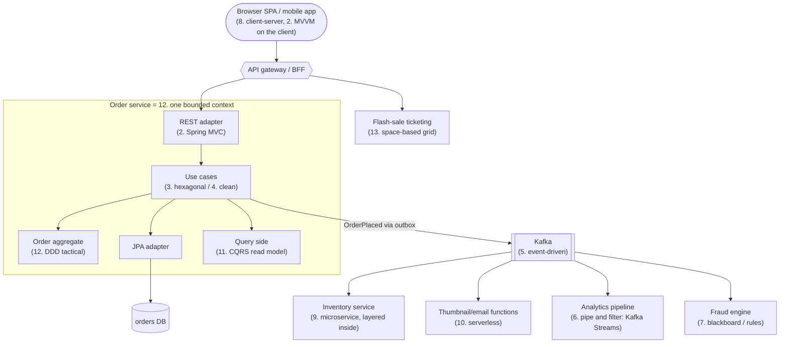

**How to talk about it in a system-design interview:**
1. Start with **DDD strategic** design: identify bounded contexts (orders, inventory, payments, ticketing).
2. Choose the **system style**: modular monolith first, or microservices if team/scale demands; event-driven integration between contexts.
3. Choose the **code structure per context**: layered for simple ones, hexagonal/clean + DDD aggregates for the complex core.
4. Apply **specialised styles where they fit**: CQRS for heavy read screens, serverless for spiky background jobs, pipe and filter for data pipelines, space-based only for extreme hot spots.
5. Always state the **trade-offs** (consistency, complexity, cost, team skills).

---

## 14.4 Decision Guide

| If you need... | Consider | Avoid |
|---|---|---|
| A simple CRUD app, small team, fast delivery | Layered monolith (package by feature) | Microservices, CQRS, DDD tactical everywhere |
| Rich business rules that must be tested in isolation | Hexagonal / Clean + DDD aggregates | Fat services with rules in controllers |
| A server-rendered web UI | Spring MVC + Thymeleaf | Business logic in templates |
| A rich desktop/mobile UI | MVVM (JavaFX, Android Jetpack) | Logic in Activities/view classes |
| Clear boundaries but simple ops | Modular monolith (Spring Modulith) | Distributed monolith |
| Many teams deploying independently, different scaling needs | Microservices + event-driven integration | Shared databases between services |
| Integrating many existing enterprise systems | SOA / integration platform with an ACL per system | Point-to-point spaghetti |
| Loose coupling and many reactions to the same change | Event-driven (Kafka) | Synchronous call chains |
| Spiky or low traffic, glue code, scheduled jobs | Serverless | Steady high-throughput latency-critical APIs on cold JVMs |
| Data transformation / ETL / log processing | Pipe and filter (Streams, Spring Batch, Kafka Streams) | One giant processing method |
| Combining heuristics from several experts | Blackboard / rule engine | Hard-coded if/else chains |
| Heavy read-side queries or full audit history | CQRS (+ event sourcing) | CQRS for simple CRUD |
| Extreme spikes on shared hot data | Space-based (data grid) | Hitting the DB for each request |
| Huge content distribution, no central control | Peer-to-peer | A single origin server |

---

## 14.5 Look-Alike Concepts

| Look-alikes | Difference |
|---|---|
| **Layered vs Hexagonal** | Layered: dependencies go **down** to the DB. Hexagonal: dependencies go **in** to the domain; DB and UI are both adapters. |
| **Hexagonal vs Clean vs Onion** | Same principle; different vocabulary (ports/adapters vs rings vs entities/use cases/Dependency Rule). |
| **Layer vs Tier** | Logical code split vs physical deployment split. |
| **MVC vs Layered** | MVC organises the **presentation** layer; layered organises the whole app (MVC is its top layer). |
| **MVP vs MVVM** | Presenter calls the view via an interface; ViewModel exposes observable state and the view binds to it. |
| **Event-driven vs Messaging** | EDA is the architecture style (react to facts); messaging is the transport mechanism (queues, topics) it uses. Messaging can also carry commands. |
| **Event vs Command** | Fact in the past, many listeners vs request to one handler that may refuse. |
| **Choreography vs Orchestration** | Services react to events (no centre) vs a coordinator directs the steps. |
| **SOA vs Microservices** | Enterprise reuse, ESB, shared data vs small independent services, own data, dumb pipes. |
| **Modular monolith vs Microservices** | Same boundaries, one deployable vs many deployables. |
| **Serverless vs Containers (K8s)** | Provider manages scaling and servers, pay per use vs you manage the cluster, pay for capacity. |
| **CQRS vs Event Sourcing** | Separate read/write models vs store events as the source of truth. Independent, often combined. |
| **Pipe and Filter vs Chain of Responsibility** | Every filter transforms and passes on vs one handler usually handles and may stop the chain. |
| **Blackboard vs Mediator vs Pub-Sub** | Shared data space + scheduler vs object routing messages between colleagues vs broadcast of messages to subscribers. |
| **Space-based vs Distributed cache** | Grid is the system of record during processing, logic co-located, DB async vs cache in front of a DB that remains the write path. |
| **DDD Entity vs JPA Entity** | Business object with identity and rules vs persistence mapping. |
| **Bounded context vs Microservice** | Model/language boundary vs deployment unit. Often 1:1, but a context can be a module in a monolith. |

---

## 14.6 Comparison Table (Quality Attributes)

Ratings are typical, relative (★ = weak, ★★★ = strong), for the style **as usually implemented**.

| Style | Simplicity | Testability | Scalability | Elasticity | Fault tolerance | Deployability | Performance | Cost (low = ★★★) |
|---|---|---|---|---|---|---|---|---|
| Layered monolith | ★★★ | ★★ | ★ | ★ | ★ | ★ | ★★ | ★★★ |
| Hexagonal / Clean | ★★ | ★★★ | ★ (as a monolith) | ★ | ★ | ★ | ★★ | ★★★ |
| Modular monolith | ★★★ | ★★★ | ★ | ★ | ★ | ★★ | ★★★ | ★★★ |
| Pipe and filter | ★★★ | ★★★ | ★★ | ★ | ★★ | ★★ | ★★ | ★★★ |
| Event-driven | ★ | ★ | ★★★ | ★★ | ★★★ | ★★ | ★★★ | ★★ |
| SOA (with ESB) | ★ | ★ | ★★ | ★ | ★★ | ★★ | ★★ | ★ |
| Microservices | ★ | ★★ | ★★★ | ★★ | ★★★ | ★★★ | ★★ | ★ |
| Serverless | ★★ | ★★ | ★★★ | ★★★ | ★★★ | ★★★ | ★★ (cold starts) | ★★★ low traffic / ★ steady high |
| Space-based | ★ | ★ | ★★★ | ★★★ | ★★ | ★★ | ★★★ | ★ |
| Client-server | ★★★ | ★★ | ★★ | ★★ | ★ | ★★ | ★★ | ★★ |
| Peer-to-peer | ★ | ★ | ★★★ | ★★★ | ★★★ | ★ | ★★ | ★★★ (provider) |
| Blackboard | ★ | ★ | ★ | ★ | ★★ | ★ | ★ | ★★ |

---

# 15. Architectural Patterns Cheat Sheet

```
LAYERED          Presentation -> Business -> Persistence -> DB; calls go DOWN. Closed vs open layers; layer (logical) vs tier (physical).
                 Spring: @RestController / @Service(@Transactional) / @Repository. Sinkhole anti-pattern. Don't expose entities.

MVC/MVP/MVVM     MVC: controller -> model -> view name -> view (DispatcherServlet = Front Controller; PRG after POST).
                 MVP: presenter drives a passive view INTERFACE (testable). MVVM: view BINDS to observable view-model properties.

HEXAGONAL        Core + PORTS (interfaces it owns). Driving adapters (REST, CLI, Kafka) -> inbound port; outbound ports <- driven adapters
                 (JPA, Stripe, SMTP). Dependencies point INWARD. Fakes for fast tests. domain / application / adapter / config.

CLEAN / ONION    Concentric rings; DEPENDENCY RULE (inward only). Entities -> Use cases (interactor, boundaries, gateways) ->
                 Interface adapters -> Frameworks. Outer implements inner's interfaces (DIP). ArchUnit onionArchitecture().

EVENT-DRIVEN     Publish past-tense facts to a broker; consumers react async. Broker (choreography) vs mediator (orchestration).
                 Notification vs event-carried state. Outbox, idempotent consumers, DLT, key = aggregate id, schema registry.

PIPE & FILTER    Source -> independent filters -> sink via pipes. Drop/transform/split. Bounded queues = backpressure; poison pill.
                 Java Streams, Spring Integration, Spring Batch, Kafka Streams, Reactor.

BLACKBOARD       Shared blackboard + knowledge sources (preconditions) + controller. Opportunistic order. Rule engines, fraud, multi-agent AI.

CLIENT-SERVER    Clients request, server owns data. 2/3/n-tier, thin vs thick client. Simple + consistent; bottleneck/SPOF.
PEER-TO-PEER     Peers are client + server; capacity grows with users. Pure vs hybrid (tracker/DHT). Discovery, NAT, churn, trust.

MODULAR MONO     One deployable, strict module APIs, in-process events. Spring Modulith verify(), @ApplicationModuleListener. Monolith First.
SOA              Enterprise services + ESB (smart pipes), SOAP/WSDL, shared data. MICROSERVICES: small, independent, DB per service,
                 dumb pipes, team autonomy. Avoid the DISTRIBUTED MONOLITH. Extract with Strangler Fig.

SERVERLESS       Provider runs/scales; pay per request + GB-s; scale to zero; event triggers. FaaS / BaaS / serverless containers.
                 Java: Spring Cloud Function, SnapStart, GraalVM native, provisioned concurrency, RDS Proxy. Cold starts; cost at steady load.

CQRS / ES        Separate command (rules) and query (projections) models. ES: events are the truth, replay, snapshots, upcasting.
                 Rebuild read models by replay. Eventual consistency. Not for CRUD.

DDD              Ubiquitous language; bounded contexts + context map (ACL, customer/supplier, conformist, shared kernel, OHS/PL).
                 Entity / Value Object / Aggregate (small, root guards invariants, refer by ID, one per tx) / Domain Event / Repository.
                 Spring: AbstractAggregateRoot.registerEvent(), @Embeddable, @Version. Avoid anemic model.

SPACE-BASED      Processing units with in-memory data grid (Hazelcast/Ignite); sync backups; DB via async write-behind pumps.
                 EntryProcessor on owner; backup promotion on failure. Flash sales/ticketing. Complex, RAM-hungry, loss window.
```

### Quick Decision Table

| Situation | Answer |
|---|---|
| "Design a CRUD admin app" | Layered Spring Boot monolith, package by feature |
| "Business logic must be testable without DB" | Hexagonal / Clean architecture |
| "How does Spring MVC work?" | Front Controller (`DispatcherServlet`) + MVC |
| "Startup with 5 developers" | Modular monolith, extract later |
| "200 developers, 30 teams" | Microservices + event-driven, bounded contexts from DDD |
| "Resize every uploaded image" | Serverless function on an S3 event |
| "Nightly import of 10M records" | Pipe and filter / Spring Batch |
| "Dashboard queries kill the write DB" | CQRS read model (replica, search index or projection) |
| "Regulator wants full history of every balance change" | Event sourcing |
| "Concert tickets go on sale to 1M users at 10:00" | Space-based / in-memory grid + queue-based load levelling |
| "Integrate SAP, a mainframe and a CRM" | SOA / integration layer with anti-corruption layers |

### Top Interview Traps

| Trap | Correct answer |
|---|---|
| "Microservices are always better than a monolith" | No: they trade simplicity and consistency for independent deployment and scaling. Monolith first is often right. |
| "Hexagonal means six layers" | No: the hexagon just shows many equal sides (ports); there are no six layers. |
| "MVC is the architecture of my app" | MVC structures the presentation layer; you still need layers/hexagonal behind it. |
| "CQRS needs event sourcing" | No: CQRS can use one DB with separate models. |
| "Serverless means no servers" | Servers exist; you just don't manage them. |
| "Event-driven and messaging are the same" | Messaging is the transport; EDA is the style of reacting to facts. |
| "A bounded context must be a microservice" | It's a model boundary; it can be a module inside a monolith. |
| "Clean Architecture requires presenters and 4 rings" | Only the Dependency Rule is essential; rings and presenters are adaptable. |
| "Anemic domain model is always wrong" | It's an anti-pattern for complex domains, acceptable for simple CRUD. |
| "Space-based = add Redis" | In SBA the grid is the system of record during processing, logic is co-located, and the DB is updated asynchronously. |
