# Enterprise Application Patterns

> **Note**: Patterns marked with **(Interview Imp - Java)** are frequently asked in Java interviews
>
> **How to read this file:** Every section ends with a **📘 Terms Explained** table. If you see a word you don't know, check the table right below that section. Each pattern goes from the basic idea to advanced usage (plain Java simulation, Spring Boot / JPA / Hibernate code, pros and cons, pitfalls) and ends with interview questions and a mini cheat sheet.
>
> **What are enterprise application patterns?** They're the patterns *inside* a typical business application: how business logic is organised, how objects get in and out of the database, how requests enter the app, and how objects are wired together. Most come from Martin Fowler's *Patterns of Enterprise Application Architecture* (PoEAA, 2002) and the *Core J2EE Patterns* catalogue (2001). **Spring Boot, JPA and Hibernate implement almost all of them for you**, so knowing them is how you understand what `@Transactional`, `JpaRepository`, `@Version`, `FetchType.LAZY` or the `DispatcherServlet` actually do.
>
> **Scope:** all **Enterprise Application Patterns** in the [master list](../00_Design_Patterns_Complete_List.md#enterprise-application-patterns) (Repository, DAO, Service Layer, Unit of Work, Identity Map, Data Mapper, Active Record, Table/Row Data Gateway, DTO, Value Object, Business Delegate, Session Facade, Front Controller, Application Controller, Intercepting Filter, Context Object, Dependency Injection, Service Locator), the **Domain Logic Patterns** (Transaction Script, Domain Model, Table Module, Anemic Domain Model) and the HLD **Data Patterns** (Lazy Load, Eager Loading, Optimistic and Pessimistic Locking). Sharding and Database per Service are covered in [01_Scalability_Pattern.md](../03_System_Design/01_Scalability_Pattern.md#6-database-sharding-interview-imp---java) and [02_Microservices_Pattern.md](../04_Specialized/02_Microservices_Pattern.md#4-database-per-service-pattern-interview-imp---java).
>
> **Builds on (linked, not repeated):** [01_Architectural_Pattern.md](01_Architectural_Pattern.md) (layered, hexagonal, DDD aggregates), [03_Structural_Pattern.md](../01_LLD/03_Structural_Pattern.md) (Proxy, Facade, Adapter), [04_Behavioral_Pattern.md](../01_LLD/04_Behavioral_Pattern.md) (Chain of Responsibility, Command), [11_Concurrency_Pattern.md](../03_System_Design/11_Concurrency_Pattern.md) (locks and threads) and [Java_FullStack_Syllabus_Guide.md](../../java/Java_FullStack_Syllabus_Guide.md) (JDBC, Hibernate, Servlets and Spring basics).
>
> **Verified code:** Every main "Complete Java Example" in this file is **plain Java 17 (no libraries)** and was compiled and run **three times** with identical output. The databases in the examples are small in-memory simulations that print the SQL a real one would receive. To run one, save it as `<ClassName>.java` and run `javac <ClassName>.java && java <ClassName>`. (Running it directly with `java <ClassName>.java` won't work, because the class with `main` is not the first class in the file.) The Spring Boot / JPA snippets show real APIs but are illustrations, not compiled projects.

---

## Table of Contents
0. [Before You Start: The Enterprise Application Patterns Map](#before-you-start-the-enterprise-application-patterns-map)
1. [Domain Logic Patterns: Transaction Script, Domain Model, Table Module, Anemic Model](#1-domain-logic-patterns-transaction-script-domain-model-table-module-anemic-model-interview-imp---java) **(Interview Imp - Java)**
   - [1.1 What Are They?](#11-what-are-they)
   - [1.2 Why Does the Choice Matter?](#12-why-does-the-choice-matter)
   - [1.3 How Each One Works](#13-how-each-one-works)
   - [1.4 Complete Java Example - One Pricing Problem, Four Styles](#14-complete-java-example---one-pricing-problem-four-styles)
   - [1.5 In Spring Boot](#15-in-spring-boot)
   - [1.6 Pros, Cons, Pitfalls, Interview Questions and Cheat Sheet](#16-pros-cons-pitfalls-interview-questions-and-cheat-sheet)
2. [Service Layer Pattern](#2-service-layer-pattern-interview-imp---java) **(Interview Imp - Java)**
   - [2.1 What is a Service Layer?](#21-what-is-a-service-layer)
   - [2.2 Why Do We Need It?](#22-why-do-we-need-it)
   - [2.3 How It Works](#23-how-it-works)
   - [2.4 Complete Java Example - One Transactional Service, Two Clients](#24-complete-java-example---one-transactional-service-two-clients)
   - [2.5 Service Layer in Spring Boot (`@Service` + `@Transactional`)](#25-service-layer-in-spring-boot-service--transactional)
   - [2.6 Pros, Cons, Pitfalls, Interview Questions and Cheat Sheet](#26-pros-cons-pitfalls-interview-questions-and-cheat-sheet)
3. [Repository and DAO Patterns](#3-repository-and-dao-patterns-interview-imp---java) **(Interview Imp - Java)**
   - [3.1 What Are They?](#31-what-are-they)
   - [3.2 Why Do We Need Them?](#32-why-do-we-need-them)
   - [3.3 How They Work](#33-how-they-work)
   - [3.4 DAO vs Repository](#34-dao-vs-repository)
   - [3.5 Complete Java Example - Same Data, DAO Style and Repository Style](#35-complete-java-example---same-data-dao-style-and-repository-style)
   - [3.6 In Spring Boot (JdbcClient DAOs, Spring Data Repositories, Specifications)](#36-in-spring-boot-jdbcclient-daos-spring-data-repositories-specifications)
   - [3.7 Pros, Cons, Pitfalls, Interview Questions and Cheat Sheet](#37-pros-cons-pitfalls-interview-questions-and-cheat-sheet)
4. [Data Source Patterns: Table Data Gateway, Row Data Gateway, Active Record, Data Mapper](#4-data-source-patterns-table-data-gateway-row-data-gateway-active-record-data-mapper)
   - [4.1 What Are They?](#41-what-are-they)
   - [4.2 Why Do We Need Them?](#42-why-do-we-need-them)
   - [4.3 How They Compare](#43-how-they-compare)
   - [4.4 Complete Java Example - One Table, Four Patterns](#44-complete-java-example---one-table-four-patterns)
   - [4.5 In the Java Ecosystem](#45-in-the-java-ecosystem)
   - [4.6 Pros, Cons, Pitfalls, Interview Questions and Cheat Sheet](#46-pros-cons-pitfalls-interview-questions-and-cheat-sheet)
   - [4.7 Types and Variants](#47-types-and-variants)
5. [Unit of Work and Identity Map](#5-unit-of-work-and-identity-map)
   - [5.1 What Are They?](#51-what-are-they)
   - [5.2 Why Do We Need Them?](#52-why-do-we-need-them)
   - [5.3 How They Work](#53-how-they-work)
   - [5.4 Complete Java Example - A Mini Persistence Context](#54-complete-java-example---a-mini-persistence-context)
   - [5.5 In JPA / Hibernate (the Persistence Context)](#55-in-jpa--hibernate-the-persistence-context)
   - [5.6 Pros, Cons, Pitfalls, Interview Questions and Cheat Sheet](#56-pros-cons-pitfalls-interview-questions-and-cheat-sheet)
6. [Lazy Load and Eager Loading](#6-lazy-load-and-eager-loading-interview-imp---java) **(Interview Imp - Java)**
   - [6.1 What Are They?](#61-what-are-they)
   - [6.2 Why Do We Need Them?](#62-why-do-we-need-them)
   - [6.3 How Lazy Loading Works: Four Implementations](#63-how-lazy-loading-works-four-implementations)
   - [6.4 The N+1 Select Problem (Interview Imp - Java)](#64-the-n1-select-problem-interview-imp---java)
   - [6.5 Complete Java Example - Lazy Load, N+1, Join Fetch and Batch Fetch](#65-complete-java-example---lazy-load-n1-join-fetch-and-batch-fetch)
   - [6.6 In JPA / Hibernate](#66-in-jpa--hibernate)
   - [6.7 Pros, Cons, Pitfalls, Interview Questions and Cheat Sheet](#67-pros-cons-pitfalls-interview-questions-and-cheat-sheet)
7. [Optimistic and Pessimistic Locking](#7-optimistic-and-pessimistic-locking-interview-imp---java) **(Interview Imp - Java)**
   - [7.1 What Are They?](#71-what-are-they)
   - [7.2 Why Do We Need Them? The Lost Update](#72-why-do-we-need-them-the-lost-update)
   - [7.3 How They Work](#73-how-they-work)
   - [7.4 Optimistic vs Pessimistic](#74-optimistic-vs-pessimistic)
   - [7.5 Complete Java Example - Lost Update, Version Checks, Row Locks and Retries](#75-complete-java-example---lost-update-version-checks-row-locks-and-retries)
   - [7.6 In Spring Data JPA](#76-in-spring-data-jpa)
   - [7.7 Pros, Cons, Pitfalls, Interview Questions and Cheat Sheet](#77-pros-cons-pitfalls-interview-questions-and-cheat-sheet)
8. [DTO and Value Object](#8-dto-and-value-object-interview-imp---java) **(Interview Imp - Java)**
   - [8.1 What Are They?](#81-what-are-they)
   - [8.2 Why Do We Need Them?](#82-why-do-we-need-them)
   - [8.3 How They Work](#83-how-they-work)
   - [8.4 Complete Java Example - DTO Mapping, Mass Assignment and Value Semantics](#84-complete-java-example---dto-mapping-mass-assignment-and-value-semantics)
   - [8.5 In Spring Boot (Records, MapStruct, Projections, `@Embeddable`)](#85-in-spring-boot-records-mapstruct-projections-embeddable)
   - [8.6 Pros, Cons, Pitfalls, Interview Questions and Cheat Sheet](#86-pros-cons-pitfalls-interview-questions-and-cheat-sheet)
9. [Front Controller, Intercepting Filter, Application Controller and Context Object](#9-front-controller-intercepting-filter-application-controller-and-context-object-interview-imp---java) **(Interview Imp - Java)**
   - [9.1 What Are They?](#91-what-are-they)
   - [9.2 Why Do We Need Them?](#92-why-do-we-need-them)
   - [9.3 How They Work Together](#93-how-they-work-together)
   - [9.4 Complete Java Example - A Mini DispatcherServlet with a Filter Chain](#94-complete-java-example---a-mini-dispatcherservlet-with-a-filter-chain)
   - [9.5 In Spring (DispatcherServlet, Filters, HandlerInterceptors)](#95-in-spring-dispatcherservlet-filters-handlerinterceptors)
   - [9.6 Pros, Cons, Pitfalls, Interview Questions and Cheat Sheet](#96-pros-cons-pitfalls-interview-questions-and-cheat-sheet)
   - [9.7 Types and Variants](#97-types-and-variants)
10. [Business Delegate and Session Facade](#10-business-delegate-and-session-facade)
    - [10.1 What Are They?](#101-what-are-they)
    - [10.2 Why Did We Need Them, and Do We Still?](#102-why-did-we-need-them-and-do-we-still)
    - [10.3 How They Work](#103-how-they-work)
    - [10.4 Complete Java Example - Round Trips, Retries and Exception Translation](#104-complete-java-example---round-trips-retries-and-exception-translation)
    - [10.5 Classic EJB and Modern Spring Equivalents](#105-classic-ejb-and-modern-spring-equivalents)
    - [10.6 Pros, Cons, Pitfalls, Interview Questions and Cheat Sheet](#106-pros-cons-pitfalls-interview-questions-and-cheat-sheet)
    - [10.7 Types and Variants](#107-types-and-variants)
11. [Dependency Injection and Service Locator](#11-dependency-injection-and-service-locator-interview-imp---java) **(Interview Imp - Java)**
    - [11.1 What Are They?](#111-what-are-they)
    - [11.2 Why Do We Need Them?](#112-why-do-we-need-them)
    - [11.3 How They Work](#113-how-they-work)
    - [11.4 Types of Injection](#114-types-of-injection)
    - [11.5 Complete Java Example - A Tiny DI Container vs a Service Locator](#115-complete-java-example---a-tiny-di-container-vs-a-service-locator)
    - [11.6 In Spring](#116-in-spring)
    - [11.7 Pros, Cons, Pitfalls, Interview Questions and Cheat Sheet](#117-pros-cons-pitfalls-interview-questions-and-cheat-sheet)
12. [How the Enterprise Application Patterns Fit Together](#12-how-the-enterprise-application-patterns-fit-together)
    - [12.1 One-Line Summary of Each](#121-one-line-summary-of-each)
    - [12.2 One Request Through All the Patterns (Interview Imp - Java)](#122-one-request-through-all-the-patterns-interview-imp---java)
    - [12.3 Where Spring Boot Implements Each Pattern](#123-where-spring-boot-implements-each-pattern)
    - [12.4 Decision Guide](#124-decision-guide)
    - [12.5 Look-Alike Concepts](#125-look-alike-concepts)
13. [Enterprise Application Patterns Cheat Sheet](#13-enterprise-application-patterns-cheat-sheet)

---

## Before You Start: The Enterprise Application Patterns Map

A typical Java business application is a stack of layers ([Layered Architecture](01_Architectural_Pattern.md#1-layered-architecture-interview-imp---java)). Each pattern in this file lives in one of those layers:

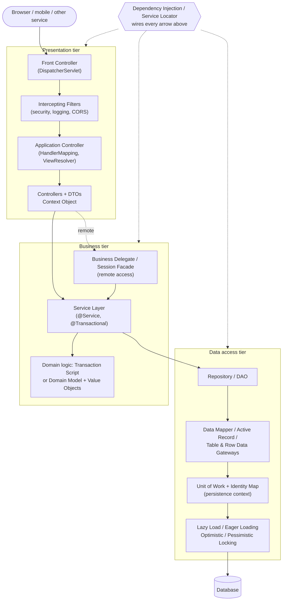

| Group | Patterns | The question they answer |
|---|---|---|
| **Domain logic** | Transaction Script, Domain Model, Table Module, Anemic Domain Model | Where do business rules live? |
| **Application boundary** | Service Layer | What operations does the app offer, and where do transactions start? |
| **Data access** | Repository, DAO, Table/Row Data Gateway, Active Record, Data Mapper | How do objects get in and out of the database? |
| **Object-relational behaviour** | Unit of Work, Identity Map, Lazy Load, Eager Loading | How do we track changes and load related data efficiently? |
| **Concurrency** | Optimistic Locking, Pessimistic Locking | How do two users avoid overwriting each other? |
| **Data carriers** | DTO, Value Object | What shape does data have when it moves or when it is just a value? |
| **Presentation / web** | Front Controller, Application Controller, Intercepting Filter, Context Object | How do requests enter the app and get routed? |
| **Distribution** | Business Delegate, Session Facade | How does a client talk to a remote business tier efficiently? |
| **Wiring** | Dependency Injection, Service Locator | How does an object get the other objects it needs? |

#### 📘 Terms Explained

| Term | Simple meaning |
|---|---|
| **PoEAA** | *Patterns of Enterprise Application Architecture* by Martin Fowler (2002), the source of most patterns here. |
| **Core J2EE Patterns** | Sun's 2001 catalogue of patterns for Java EE (Front Controller, Business Delegate, Session Facade, DAO...). |
| **ORM** | Object-Relational Mapping: a library (Hibernate) that maps Java objects to database tables. |
| **JPA** | Jakarta Persistence API: the standard Java ORM interface; Hibernate is its most common implementation. |
| **Persistence context** | JPA's set of managed entities for one unit of work (an `EntityManager`/Hibernate `Session`). |
| **Tier** | A group of components with one role (presentation, business, data), possibly on separate machines. |

---

# 1. Domain Logic Patterns: Transaction Script, Domain Model, Table Module, Anemic Model (Interview Imp - Java)

## 1.1 What Are They?

Fowler describes three main ways to organise **business logic**, plus one common anti-pattern:

| Pattern | Idea | Data is held in | Logic is held in |
|---|---|---|---|
| **Transaction Script** | One procedure (method) per business transaction/use case, top to bottom | Rows / simple records | The script (a service method) |
| **Domain Model** | A network of objects that hold both **data and behaviour** about the business | Domain objects | The domain objects themselves |
| **Table Module** | One class per database **table** that works on a whole **record set** | Record sets (`RowSet`, `DataSet`) | The table class |
| **Anemic Domain Model** *(anti-pattern)* | Looks like a domain model, but objects only have getters/setters; all logic is in services | "Domain" objects | Services (really transaction scripts) |

**Analogy:** Running a restaurant kitchen.
- **Transaction Script:** a recipe card per dish. The cook follows "Paneer Tikka" from step 1 to step 10. Easy to read; but if every recipe repeats "marinate for 2 hours", a change means editing every card.
- **Domain Model:** trained specialist chefs. The grill chef knows how to grill, the sauce chef knows sauces; you ask them, and the knowledge lives with them.
- **Table Module:** one clerk per storeroom shelf who answers questions about the whole shelf at once ("how many tomatoes in total?").
- **Anemic model:** specialist chefs who aren't allowed to cook. They just hold ingredients while a manager does everything.

#### 📘 Terms Explained

| Term | Simple meaning |
|---|---|
| **Business logic / domain logic** | The rules of the business: pricing, discounts, limits, workflows. |
| **Business transaction** | One meaningful action from the user's point of view, e.g. "place order". |
| **Record set** | A tabular in-memory result of a query (rows and columns). |
| **Invariant** | A rule that must always be true for an object (e.g. quantity > 0). |
| **Anti-pattern** | A common solution that looks reasonable but causes problems. |

---

## 1.2 Why Does the Choice Matter?

The choice decides **how the code grows** as rules are added:

**Effort to add one more feature as domain complexity grows** (after Fowler's well-known sketch):

| Domain complexity | Transaction Script | Table Module | Domain Model |
|---|---|---|---|
| Low (CRUD, few rules) | ★ lowest | ★★ | ★★ (upfront modelling cost) |
| Medium | ★★ | ★★ | ★★ |
| High (many interacting rules) | ★★★★ (duplication, spaghetti) | ★★★ | ★★ |
| Very high | ★★★★★ | ★★★★ | ★★★ (still manageable) |

| Situation | Best fit |
|---|---|
| Simple app, mostly CRUD, few rules | **Transaction Script** (fast to write, easy to read) |
| Many interacting rules, invariants, a domain that keeps evolving | **Domain Model** (rules live once, close to data) |
| Data-centric reporting on record sets, platforms built around record sets (.NET DataSet, older Java RowSet tools) | **Table Module** |
| Never on purpose | **Anemic Domain Model**; it's a domain model in name only |

---

## 1.3 How Each One Works

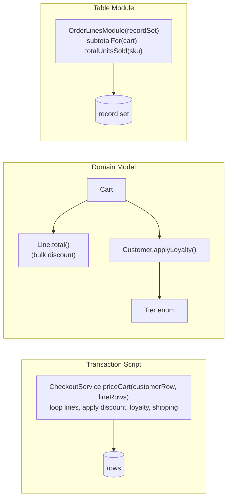

- **Transaction Script:** the service method fetches the data, runs the rules in sequence, and writes the result. Shared rules are extracted into helper methods, but they're still procedures.
- **Domain Model:** each object answers questions about itself (`line.total()`, `customer.applyLoyalty(...)`) and refuses invalid changes (`new Line(..., qty = 0)` throws). The service just coordinates.
- **Table Module:** a single instance per table holds a record set and provides set-based operations ("units sold across all carts").
- **Anemic model:** `cart.setTotal(...)` and `cart.getLines().add(...)` are allowed from anywhere, so the object can't protect its own consistency.

---

## 1.4 Complete Java Example - One Pricing Problem, Four Styles

The same rules (10% off a line with qty ≥ 5; GOLD customers pay 95%; free shipping above ₹1000, else ₹50) are written as a **transaction script**, a **domain model** and a **table module**, followed by an **anemic** object that ends up inconsistent.

```java
import java.util.ArrayList;
import java.util.LinkedHashMap;
import java.util.List;
import java.util.Map;

// One business problem, three ways to organise its logic (Fowler's domain logic patterns), plus the anemic trap.
// Problem: price a cart. Rules: 10% off a line with qty >= 5; free shipping over Rs 1000, else Rs 50; gold customers get extra 5% off the total.

// ===================== 1) TRANSACTION SCRIPT: one procedure per use case, data as plain rows =====================
class CheckoutScript {
    static long priceCart(Map<String, Object> customerRow, List<Map<String, Object>> lineRows) {
        long subtotal = 0;
        for (Map<String, Object> line : lineRows) {
            long lineTotal = (long) line.get("unit_price") * (int) line.get("qty");
            if ((int) line.get("qty") >= 5) lineTotal = lineTotal * 90 / 100;
            subtotal += lineTotal;
        }
        if ("GOLD".equals(customerRow.get("tier"))) subtotal = subtotal * 95 / 100;
        return subtotal + (subtotal > 1000_00 ? 0 : 50_00);
    }
    // a second use case copies part of the same rules (duplication grows with every new script)
    static long estimateShipping(long subtotal) { return subtotal > 1000_00 ? 0 : 50_00; }
}

// ===================== 2) DOMAIN MODEL: objects that hold data AND the rules about it =====================
enum Tier {
    STANDARD(100), GOLD(95);
    final int percentPayable;
    Tier(int p) { percentPayable = p; }
}
record Line(String sku, long unitPricePaise, int qty) {
    Line { if (qty <= 0) throw new IllegalArgumentException("qty must be positive"); }
    long total() { long t = unitPricePaise * qty; return qty >= 5 ? t * 90 / 100 : t; }   // the line knows its own discount
}
class Customer {
    private final String name; private final Tier tier;
    Customer(String name, Tier tier) { this.name = name; this.tier = tier; }
    long applyLoyalty(long amount) { return amount * tier.percentPayable / 100; }
}
class Cart {
    private final Customer customer; private final List<Line> lines = new ArrayList<>();
    Cart(Customer customer) { this.customer = customer; }
    void add(String sku, long unitPrice, int qty) {
        if (lines.size() == 20) throw new IllegalStateException("cart limit is 20 lines");     // invariant guarded by the object
        lines.add(new Line(sku, unitPrice, qty));
    }
    long subtotal() { return customer.applyLoyalty(lines.stream().mapToLong(Line::total).sum()); }
    long shipping() { return subtotal() > 1000_00 ? 0 : 50_00; }
    long total() { return subtotal() + shipping(); }
}

// ===================== 3) TABLE MODULE: one class per TABLE, working on a whole record set =====================
class OrderLinesModule {
    private final List<Map<String, Object>> table;                 // like a JDBC RowSet / .NET DataSet
    OrderLinesModule(List<Map<String, Object>> table) { this.table = table; }
    long subtotalFor(String cartId) {
        return table.stream().filter(r -> r.get("cart_id").equals(cartId))
                .mapToLong(r -> { long t = (long) r.get("unit_price") * (int) r.get("qty"); return (int) r.get("qty") >= 5 ? t * 90 / 100 : t; })
                .sum();
    }
    long totalUnitsSold(String sku) {                               // set-based questions are natural here
        return table.stream().filter(r -> r.get("sku").equals(sku)).mapToLong(r -> (int) r.get("qty")).sum();
    }
}

// ===================== 4) ANEMIC DOMAIN MODEL: objects with only getters/setters, rules live elsewhere =====================
class AnemicCart {
    private List<Line> lines = new ArrayList<>(); private long total;
    List<Line> getLines() { return lines; }
    void setLines(List<Line> l) { lines = l; }
    long getTotal() { return total; }
    void setTotal(long t) { total = t; }
}

public class DomainLogicDemo {
    static Map<String, Object> row(Object... kv) {
        Map<String, Object> m = new LinkedHashMap<>();
        for (int i = 0; i < kv.length; i += 2) m.put((String) kv[i], kv[i + 1]);
        return m;
    }
    static String rs(long paise) { return String.format("Rs %.2f", paise / 100.0); }

    public static void main(String[] args) {
        List<Map<String, Object>> lines = List.of(
                row("cart_id", "C1", "sku", "PEN", "unit_price", 20_00L, "qty", 10),
                row("cart_id", "C1", "sku", "NOTEBOOK", "unit_price", 150_00L, "qty", 4),
                row("cart_id", "C2", "sku", "PEN", "unit_price", 20_00L, "qty", 3));

        System.out.println("1) Transaction Script, GOLD customer, cart C1: "
                + rs(CheckoutScript.priceCart(row("tier", "GOLD"), lines.subList(0, 2))));

        Cart cart = new Cart(new Customer("asha", Tier.GOLD));
        cart.add("PEN", 20_00, 10);
        cart.add("NOTEBOOK", 150_00, 4);
        System.out.println("2) Domain Model, same cart: subtotal " + rs(cart.subtotal()) + " + shipping " + rs(cart.shipping())
                + " = " + rs(cart.total()));
        try { cart.add("ERASER", 5_00, 0); } catch (IllegalArgumentException e) { System.out.println("   domain model rejects bad data: " + e.getMessage()); }

        OrderLinesModule module = new OrderLinesModule(lines);
        System.out.println("3) Table Module: subtotal C1 = " + rs(module.subtotalFor("C1")) + " (before loyalty), PEN units sold across carts = "
                + module.totalUnitsSold("PEN"));

        AnemicCart anemic = new AnemicCart();
        anemic.setLines(new ArrayList<>(List.of(new Line("PEN", 20_00, 10))));
        anemic.setTotal(180_00);                                   // some service computed it
        anemic.getLines().add(new Line("NOTEBOOK", 150_00, 4));    // anyone can change the lines...
        System.out.println("4) Anemic model: 2 lines but total still " + rs(anemic.getTotal())
                + " -> nothing stopped the object from becoming INCONSISTENT");
    }
}
```

**Output:**
```
1) Transaction Script, GOLD customer, cart C1: Rs 791.00
2) Domain Model, same cart: subtotal Rs 741.00 + shipping Rs 50.00 = Rs 791.00
   domain model rejects bad data: qty must be positive
3) Table Module: subtotal C1 = Rs 780.00 (before loyalty), PEN units sold across carts = 13
4) Anemic model: 2 lines but total still Rs 180.00 -> nothing stopped the object from becoming INCONSISTENT
```

What the output shows:
- **Script and domain model agree** (₹791): pens 10 × ₹20 = ₹200 − 10% = ₹180, notebooks 4 × ₹150 = ₹600, subtotal ₹780, GOLD 95% = ₹741, + ₹50 shipping. The difference is *where* the rules live, not the answer.
- The **domain model refused** a line with quantity 0, because the `Line` record validates itself. The script trusts whatever rows it's given.
- The **table module** answers set-based questions naturally ("13 pens sold across carts"), but it gives the pre-loyalty subtotal because loyalty lives in another table's module.
- The **anemic** cart has 2 lines but a total of ₹180, because nothing stopped callers from changing the lines without recalculating. That's the core argument against anemic models.

---

## 1.5 In Spring Boot

```java
// TRANSACTION SCRIPT style: the service does everything; entities are data holders
@Service @RequiredArgsConstructor
class CheckoutScriptService {
    private final CartRepository carts;
    @Transactional(readOnly = true)
    public long priceCart(long cartId) {
        Cart cart = carts.findById(cartId).orElseThrow();
        long subtotal = 0;
        for (CartLine l : cart.getLines()) {
            long t = l.getUnitPrice() * l.getQty();
            subtotal += l.getQty() >= 5 ? t * 90 / 100 : t;
        }
        if (cart.getCustomer().getTier() == Tier.GOLD) subtotal = subtotal * 95 / 100;
        return subtotal + (subtotal > 100_000 ? 0 : 5_000);
    }
}

// DOMAIN MODEL style: the entity owns its rules; the service only coordinates
@Entity
class Cart {
    @Id @GeneratedValue private Long id;
    @ManyToOne(fetch = FetchType.LAZY) private Customer customer;
    @OneToMany(mappedBy = "cart", cascade = CascadeType.ALL, orphanRemoval = true) private List<CartLine> lines = new ArrayList<>();

    public void add(Product p, int qty) {
        if (lines.size() == 20) throw new CartLimitExceededException();
        lines.add(new CartLine(this, p, qty));          // CartLine's constructor validates qty > 0
    }
    public long subtotal() { return customer.applyLoyalty(lines.stream().mapToLong(CartLine::total).sum()); }
    public long total()    { long s = subtotal(); return s + (s > 100_000 ? 0 : 5_000); }
    public List<CartLine> getLines() { return Collections.unmodifiableList(lines); }   // no public setter for lines
}

@Service @RequiredArgsConstructor
class CheckoutService {
    private final CartRepository carts;
    @Transactional(readOnly = true)
    public long priceCart(long cartId) { return carts.findById(cartId).orElseThrow().total(); }
}
```

**How to move from anemic to rich:** find logic in services that only uses one entity's data ("feature envy"), and move it into that entity; replace public setters with intention-revealing methods (`order.cancel(reason)` instead of `setStatus(CANCELLED)`); wrap primitives in value objects ([section 8](#8-dto-and-value-object-interview-imp---java)). The full DDD toolkit is in [01_Architectural_Pattern.md](01_Architectural_Pattern.md#12-domain-driven-design-ddd-interview-imp---java).

---

## 1.6 Pros, Cons, Pitfalls, Interview Questions and Cheat Sheet

| Pattern | Pros | Cons |
|---|---|---|
| **Transaction Script** | Simple, procedural, easy to follow; great for CRUD; maps 1:1 to use cases | Duplicated rules across scripts; becomes spaghetti as complexity grows |
| **Domain Model** | Rules in one place; invariants enforced; handles complexity well; testable without DB | Needs OO modelling skill; mapping to tables needs a Data Mapper/ORM |
| **Table Module** | Fits record-set tools; good for set-based reports | Weak at per-object rules; rare in modern Java |
| **Anemic Domain Model** | Looks simple; easy to serialise | All the costs of a domain model with none of the benefits; invariants unprotected |

| Pitfall | Fix |
|---|---|
| Starting with transaction scripts and never refactoring as rules grow | When the same rule appears in 2-3 scripts, move it into the domain. |
| Public setters on every entity field | Intention-revealing methods; setters only where truly needed. |
| Domain objects calling repositories or HTTP clients | Keep domain objects pure; services load and save. |
| Calling an anemic model "DDD" | DDD needs behaviour in the model. |

**Q1. Transaction Script vs Domain Model?** A transaction script is one procedure per use case operating on simple data; a domain model puts data and behaviour together in objects. Scripts are better for simple logic; a domain model wins as rules and interactions grow.

**Q2. What is an anemic domain model and why is it criticised?** Domain classes with only getters/setters while all logic is in services. It's procedural code disguised as OO: rules get duplicated and objects can't guard their invariants. It's acceptable for simple CRUD.

**Q3. Which style does a typical Spring Boot app use?** Often transaction scripts in `@Service` classes over anemic JPA entities. That's fine for CRUD; for complex domains, push behaviour into entities and value objects.

```
DOMAIN LOGIC   Transaction Script: one procedure per use case (simple, duplicates rules as it grows).
               Domain Model: objects with data + behaviour, guard invariants (best for complex rules; needs ORM/Data Mapper).
               Table Module: one class per table over a record set (set-based; rare in Java).
               Anemic Domain Model: getters/setters only, logic in services = anti-pattern for complex domains.
```

---

# 2. Service Layer Pattern (Interview Imp - Java)

## 2.1 What is a Service Layer?

A **Service Layer** defines the application's **boundary**: a set of coarse-grained operations (`transfer`, `placeOrder`, `cancelSubscription`) that every client (web, batch, messaging, scheduled jobs) uses. Each operation coordinates the domain objects and repositories, and is usually **one transaction**.

**Analogy:** A bank's service counter. Whether you walk in, phone, or use the app, the request ends up at the same counter, which follows the same rules ("check balance, debit, credit, write the passbook") in one go. The different channels don't each implement their own version of "transfer".

#### 📘 Terms Explained

| Term | Simple meaning |
|---|---|
| **Application boundary** | The set of operations the application exposes to its clients. |
| **Coarse-grained operation** | One call that performs a whole business action (vs many small getter/setter calls). |
| **Transaction boundary** | Where a transaction begins and ends (commit or rollback). |
| **Orchestration** | Coordinating several components in the right order. |

---

## 2.2 Why Do We Need It?

| Without a service layer | With a service layer |
|---|---|
| Controllers, batch jobs and listeners each re-implement "transfer" | One `transfer` method, reused by all clients |
| Transactions started in random places (or not at all) | Each service method = one transaction |
| Security, auditing, validation scattered | Applied in one place (often via AOP on services) |
| Business rules mixed with HTTP/CSV/JMS parsing | Clients only translate input/output; the service is protocol-free |

---

## 2.3 How It Works

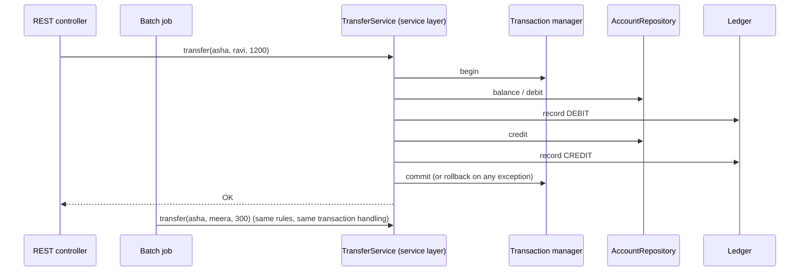

**Two flavours (Fowler):**
- **Domain facade:** thin services that delegate to a rich domain model (`order.submit()` does the work).
- **Operation script:** services contain the application logic themselves (transaction scripts), delegating to domain objects for pure domain rules.

**What belongs in a service method:** load aggregates, call domain behaviour, save, publish events, enforce authorization, define the transaction. **What doesn't:** HTTP status codes, JSON parsing, SQL strings.

---

## 2.4 Complete Java Example - One Transactional Service, Two Clients

A `TransferService` debits, records a ledger entry, runs a fraud check, then credits, all inside a `TransactionTemplate` that snapshots and restores a fake database on failure. A REST controller and a CSV batch job both use it.

```java
import java.util.ArrayList;
import java.util.LinkedHashMap;
import java.util.List;
import java.util.Map;
import java.util.TreeMap;
import java.util.function.Supplier;

// Service Layer: one application boundary with coarse-grained operations, each one a transaction,
// reused by several clients (REST controller, batch job, message listener).

class FakeDatabase {                                      // a tiny "database" that supports transactions
    final Map<String, Long> balances = new TreeMap<>(Map.of("asha", 5_000L, "ravi", 1_000L, "meera", 0L));
    final List<String> ledger = new ArrayList<>();
    private Map<String, Long> snapshotBalances; private List<String> snapshotLedger;
    void begin() { snapshotBalances = new LinkedHashMap<>(balances); snapshotLedger = new ArrayList<>(ledger); }
    void commit() { snapshotBalances = null; snapshotLedger = null; }
    void rollback() { balances.clear(); balances.putAll(snapshotBalances); ledger.clear(); ledger.addAll(snapshotLedger); }
}

class TransactionTemplate {                               // what @Transactional does for you
    private final FakeDatabase db;
    TransactionTemplate(FakeDatabase db) { this.db = db; }
    <T> T execute(String name, Supplier<T> work) {
        db.begin();
        System.out.println("  BEGIN   " + name);
        try { T result = work.get(); db.commit(); System.out.println("  COMMIT  " + name); return result; }
        catch (RuntimeException e) { db.rollback(); System.out.println("  ROLLBACK " + name + " (" + e.getMessage() + ")"); throw e; }
    }
}

// Lower-level pieces the service coordinates
class AccountRepository {
    private final FakeDatabase db;
    AccountRepository(FakeDatabase db) { this.db = db; }
    long balance(String who) { Long b = db.balances.get(who); if (b == null) throw new IllegalArgumentException("no account " + who); return b; }
    void setBalance(String who, long amount) { db.balances.put(who, amount); }
}
class Ledger {
    private final FakeDatabase db;
    Ledger(FakeDatabase db) { this.db = db; }
    void record(String entry) { db.ledger.add(entry); }
}
class FraudCheck {
    void verify(String to, long amount) { if (to.equals("meera") && amount > 500) throw new IllegalStateException("fraud rule: new payee limit 500"); }
}

// ===== THE SERVICE LAYER: coarse-grained use cases, transaction boundary, no HTTP/CSV/JMS details =====
class TransferService {
    private final AccountRepository accounts; private final Ledger ledger; private final FraudCheck fraud; private final TransactionTemplate tx;
    TransferService(AccountRepository a, Ledger l, FraudCheck f, TransactionTemplate t) { accounts = a; ledger = l; fraud = f; tx = t; }

    String transfer(String from, String to, long amount) {
        return tx.execute("transfer " + from + "->" + to + " " + amount, () -> {
            if (amount <= 0) throw new IllegalArgumentException("amount must be positive");
            long fromBalance = accounts.balance(from);
            if (fromBalance < amount) throw new IllegalStateException("insufficient funds");
            accounts.setBalance(from, fromBalance - amount);              // step 1: debit
            ledger.record("DEBIT " + from + " " + amount);
            fraud.verify(to, amount);                                      // step 2 may fail AFTER the debit...
            accounts.setBalance(to, accounts.balance(to) + amount);        // step 3: credit
            ledger.record("CREDIT " + to + " " + amount);
            return "OK";
        });
    }
}

// ===== Several clients reuse the same service =====
class TransferRestController {
    private final TransferService service;
    TransferRestController(TransferService s) { service = s; }
    String post(String json) {                                             // {"from":"asha","to":"ravi","amount":1200}
        String from = json.replaceAll(".*\"from\":\"(\\w+)\".*", "$1"), to = json.replaceAll(".*\"to\":\"(\\w+)\".*", "$1");
        long amount = Long.parseLong(json.replaceAll(".*\"amount\":(\\d+).*", "$1"));
        try { return "HTTP 200 " + service.transfer(from, to, amount); }
        catch (IllegalStateException e) { return "HTTP 422 " + e.getMessage(); }
        catch (IllegalArgumentException e) { return "HTTP 400 " + e.getMessage(); }
    }
}
class SalaryBatchJob {
    private final TransferService service;
    SalaryBatchJob(TransferService s) { service = s; }
    void run(List<String> csvLines) {
        for (String line : csvLines) {
            String[] p = line.split(",");
            try { service.transfer(p[0], p[1], Long.parseLong(p[2])); }
            catch (RuntimeException e) { System.out.println("  batch: skipped line '" + line + "'"); }
        }
    }
}

public class ServiceLayerDemo {
    public static void main(String[] args) {
        FakeDatabase db = new FakeDatabase();
        TransferService service = new TransferService(new AccountRepository(db), new Ledger(db), new FraudCheck(), new TransactionTemplate(db));
        TransferRestController rest = new TransferRestController(service);

        System.out.println("REST client:");
        System.out.println("  -> " + rest.post("{\"from\":\"asha\",\"to\":\"ravi\",\"amount\":1200}"));
        System.out.println("  -> " + rest.post("{\"from\":\"ravi\",\"to\":\"asha\",\"amount\":99999}"));
        System.out.println("  -> " + rest.post("{\"from\":\"asha\",\"to\":\"meera\",\"amount\":800}"));
        System.out.println("  balances " + db.balances + " (asha was debited then ROLLED BACK, so no money vanished)");

        System.out.println("Batch client (same service, same rules, same transactions):");
        new SalaryBatchJob(service).run(List.of("asha,meera,300", "ravi,nobody,10", "ravi,asha,200"));
        System.out.println("  balances " + db.balances);
        System.out.println("  ledger   " + db.ledger);
    }
}
```

**Output:**
```
REST client:
  BEGIN   transfer asha->ravi 1200
  COMMIT  transfer asha->ravi 1200
  -> HTTP 200 OK
  BEGIN   transfer ravi->asha 99999
  ROLLBACK transfer ravi->asha 99999 (insufficient funds)
  -> HTTP 422 insufficient funds
  BEGIN   transfer asha->meera 800
  ROLLBACK transfer asha->meera 800 (fraud rule: new payee limit 500)
  -> HTTP 422 fraud rule: new payee limit 500
  balances {asha=3800, meera=0, ravi=2200} (asha was debited then ROLLED BACK, so no money vanished)
Batch client (same service, same rules, same transactions):
  BEGIN   transfer asha->meera 300
  COMMIT  transfer asha->meera 300
  BEGIN   transfer ravi->nobody 10
  ROLLBACK transfer ravi->nobody 10 (no account nobody)
  batch: skipped line 'ravi,nobody,10'
  BEGIN   transfer ravi->asha 200
  COMMIT  transfer ravi->asha 200
  balances {asha=3700, meera=300, ravi=2000}
  ledger   [DEBIT asha 1200, CREDIT ravi 1200, DEBIT asha 300, CREDIT meera 300, DEBIT ravi 200, CREDIT asha 200]
```

What the output shows:
- The third REST call **debited asha** and wrote a ledger line, then the fraud check failed. Because the service method is **one transaction**, both were **rolled back**: asha still has ₹3,800 and no half-done transfer exists in the ledger.
- The controller mapped business failures to **422/400**; the service itself knows nothing about HTTP.
- The **batch job reused the same rules and transaction handling** without copying code; a bad line (unknown account) was rolled back and skipped, and the next line still ran.
- The final ledger only contains complete DEBIT/CREDIT pairs.

---

## 2.5 Service Layer in Spring Boot (`@Service` + `@Transactional`)

```java
@Service
@RequiredArgsConstructor
public class TransferService {
    private final AccountRepository accounts;
    private final LedgerRepository ledger;
    private final FraudCheck fraud;
    private final ApplicationEventPublisher events;

    @Transactional                                      // proxy: begin before, commit after, rollback on RuntimeException
    @PreAuthorize("hasRole('CUSTOMER')")                // security applied at the service boundary
    public TransferResult transfer(AccountId from, AccountId to, Money amount) {
        Account source = accounts.findByIdForUpdate(from).orElseThrow(() -> new AccountNotFoundException(from));
        Account target = accounts.findById(to).orElseThrow(() -> new AccountNotFoundException(to));
        source.withdraw(amount);                        // domain rules (domain-facade flavour)
        fraud.verify(target, amount);                   // throws -> the debit above is rolled back
        target.deposit(amount);
        ledger.save(LedgerEntry.transfer(from, to, amount));
        events.publishEvent(new MoneyTransferred(from, to, amount));
        return TransferResult.ok();
    }
}
```

**How `@Transactional` works:** Spring wraps the bean in a **proxy** (see [Proxy pattern](../01_LLD/03_Structural_Pattern.md#7-proxy-pattern-interview-imp---java)). Calls from **outside** go through the proxy, which opens a transaction, calls your method, and commits or rolls back.

| `@Transactional` gotcha | Explanation |
|---|---|
| **Self-invocation** | `this.otherMethod()` inside the same class bypasses the proxy, so its `@Transactional` settings are ignored. Move it to another bean. |
| **Checked exceptions don't roll back** by default | Only `RuntimeException` and `Error`. Use `@Transactional(rollbackFor = Exception.class)` if needed. |
| **Only public methods** (by default, proxy-based) | `private`/`final` methods aren't intercepted. |
| **`readOnly = true`** | A hint: Hibernate skips dirty checking and flushes; some drivers route to replicas. |
| **Propagation** | `REQUIRED` (default: join or create), `REQUIRES_NEW` (suspend and start new, e.g. audit log), `MANDATORY`, `NESTED` (savepoint). |
| **Catching and swallowing** | If you catch the exception inside, the proxy sees success and commits. If an inner `REQUIRED` method already marked rollback-only, you get `UnexpectedRollbackException`. |

#### 📘 Terms Explained

| Term | Simple meaning |
|---|---|
| **`@Transactional`** | Spring annotation that runs a method inside a transaction via an AOP proxy. |
| **Propagation** | What happens when a transactional method calls another one (join, new, nested...). |
| **Rollback-only** | A transaction marked so it can only roll back, even if later code tries to commit. |
| **`@PreAuthorize`** | Spring Security annotation checking permissions before a method runs. |
| **AOP (Aspect-Oriented Programming)** | Adding behaviour (transactions, security, logging) around methods without changing them. |

---

## 2.6 Pros, Cons, Pitfalls, Interview Questions and Cheat Sheet

| Pros | Cons |
|---|---|
| One reusable API for all clients | Extra layer; for tiny apps it's mostly pass-through |
| Clear transaction and security boundary | Tends to absorb all logic (fat services, anemic domain) |
| Protocol-independent, easy to test with mocked repositories | Services calling services can create tangled dependencies |

| Pitfall | Fix |
|---|---|
| `@Transactional` on controllers or every repository method | Put it on service use-case methods. |
| Long transactions that call slow external APIs | Call external systems outside the transaction, or use outbox/events. |
| One giant `OrderService` with 60 methods | Split by use case (`PlaceOrderService`, `CancelOrderService`). |
| Service methods returning JPA entities to controllers | Return DTOs or immutable views. |

**Q1. What is the service layer?** A layer that defines the application's operations and transaction boundaries, coordinating domain objects and repositories, reused by all clients (REST, batch, messaging).

**Q2. Why put `@Transactional` on the service and not the repository?** A use case often touches several repositories; they must commit or roll back together. Repository-level transactions would commit each step separately.

**Q3. Why might `@Transactional` not work?** Self-invocation (bypasses the proxy), non-public method, checked exception (no rollback by default), the bean not managed by Spring, or catching the exception inside.

```
SERVICE LAYER   App boundary: coarse-grained use cases reused by REST/batch/listeners. One method = one transaction.
                Domain facade (delegates to rich model) vs operation script (logic in service). No HTTP, no SQL here.
                Spring: @Service + @Transactional (proxy). Gotchas: self-invocation, checked exceptions, private methods,
                readOnly, propagation REQUIRED/REQUIRES_NEW, swallowed exceptions. Security via @PreAuthorize.
```

---

# 3. Repository and DAO Patterns (Interview Imp - Java)

## 3.1 What Are They?

Both hide database access behind an interface, but at different levels:

| | DAO (Data Access Object) | Repository |
|---|---|---|
| Origin | Core J2EE Patterns (2001) | Fowler PoEAA (2002), central in DDD (Evans 2003) |
| Mental model | "An object that talks to a **table** (or data source)" | "An in-memory **collection** of domain objects" |
| Granularity | One per table/entity | One per **aggregate root** |
| Vocabulary | Persistence: `insert`, `update`, `delete`, `findByStatus` | Domain: `save`, `byId`, `ordersReadyToShip()`, specifications |
| Returns | Rows, flat entities, DTOs | Complete aggregates (root + children) |
| Where it sits | Data access layer | Domain/application layer (interface), implemented in infrastructure |

**Analogy:**
- **DAO:** a filing clerk for **one cabinet**. "Insert this form. Find all forms with status = PAID." You get loose sheets.
- **Repository:** a librarian. "Give me the book *ORD-42*." You get the whole book with all its chapters bound together; you don't care which shelves the pages came from.

#### 📘 Terms Explained

| Term | Simple meaning |
|---|---|
| **DAO** | An object encapsulating access to a data source (usually one table), with CRUD methods. |
| **Repository** | A collection-like abstraction for retrieving and storing aggregates in domain terms. |
| **Aggregate root** | The main entity of a cluster (e.g. `Order` with its `OrderLine`s) through which it is loaded and saved. |
| **Specification** | An object that represents a query criterion in domain terms and can be combined (and/or). |
| **CRUD** | Create, Read, Update, Delete. |

---

## 3.2 Why Do We Need Them?

| Problem | What DAO/Repository give |
|---|---|
| SQL and JDBC code spread through business logic | All data access in one place per table/aggregate |
| Business code coupled to one database/technology | Interface + implementation; swap JDBC ↔ JPA ↔ Mongo |
| Hard to unit-test business logic | Mock or fake the DAO/repository |
| Aggregates assembled differently by every caller (risk of half-loaded objects) | Repository always returns complete, valid aggregates |

---

## 3.3 How They Work

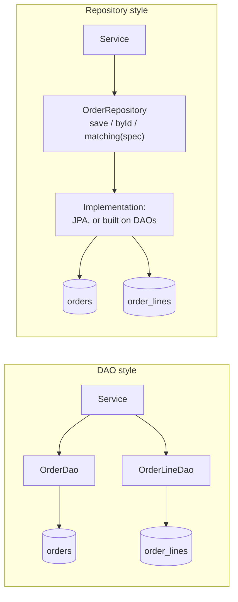

- With DAOs, the **service** knows there are two tables and stitches rows together.
- With a repository, the service asks for an `Order`; the implementation decides how many tables, queries or DAOs it takes. A repository is often **implemented using** DAOs or an ORM.

---

## 3.4 DAO vs Repository

| Question | DAO | Repository |
|---|---|---|
| Does it represent a table or a domain collection? | Table / data source | Collection of aggregates |
| Can a caller save an `OrderLine` on its own? | Yes (`OrderLineDao.insert`) | No; you save the `Order` |
| Does it enforce domain consistency? | No | Indirectly, by only handling whole aggregates |
| Query style | Many specific finder methods | Domain-named finders + specifications |
| Good for | Reporting, CRUD, legacy schemas, bulk operations | Rich domain models, DDD |
| Spring | `JdbcClient`/`JdbcTemplate` classes annotated `@Repository` | Spring Data `JpaRepository`, `Repository` interfaces |

> In Spring, `@Repository` is just a stereotype (plus exception translation to `DataAccessException`) used for **both** DAOs and repositories. The pattern difference is in **what** the class models, not the annotation.

---

## 3.5 Complete Java Example - Same Data, DAO Style and Repository Style

Two DAOs (`OrderDao`, `OrderLineDao`) work on two tables. In the DAO style, the caller writes rows directly and can even set an unpaid order to `SHIPPED`. In the repository style, `DaoBackedOrderRepository` (built on the same DAOs) loads and saves **whole aggregates**, the `Order` enforces "only PAID orders can ship", and queries use composable specifications.

```java
import java.util.ArrayList;
import java.util.LinkedHashMap;
import java.util.List;
import java.util.Map;
import java.util.Optional;
import java.util.function.Predicate;

// DAO vs Repository over the same data.
// DAO: one per TABLE, CRUD in database terms, returns rows/flat objects.
// Repository: one per AGGREGATE, collection-like, speaks the domain language, hides how the aggregate is assembled.

class Db {                                                      // two "tables" and a SQL log
    final Map<Long, Object[]> orders = new LinkedHashMap<>();        // id -> {customer, status}
    final Map<Long, Object[]> orderLines = new LinkedHashMap<>();    // id -> {orderId, sku, qty, pricePaise}
    final List<String> sqlLog = new ArrayList<>();
    long seq = 100;
    void log(String sql) { sqlLog.add(sql); }
}

// ===================== DAO pattern =====================
record OrderRow(long id, String customer, String status) {}
record OrderLineRow(long id, long orderId, String sku, int qty, long pricePaise) {}

interface OrderDao {                                             // table-oriented, CRUD vocabulary
    long insert(OrderRow row); Optional<OrderRow> findById(long id); void updateStatus(long id, String status);
    List<OrderRow> findByStatus(String status);
}
interface OrderLineDao { void insert(OrderLineRow row); List<OrderLineRow> findByOrderId(long orderId); }

class JdbcOrderDao implements OrderDao {
    private final Db db; JdbcOrderDao(Db db) { this.db = db; }
    public long insert(OrderRow r) { long id = ++db.seq; db.orders.put(id, new Object[]{r.customer(), r.status()}); db.log("INSERT INTO orders VALUES (" + id + ",'" + r.customer() + "','" + r.status() + "')"); return id; }
    public Optional<OrderRow> findById(long id) { db.log("SELECT * FROM orders WHERE id=" + id); Object[] o = db.orders.get(id); return o == null ? Optional.empty() : Optional.of(new OrderRow(id, (String) o[0], (String) o[1])); }
    public void updateStatus(long id, String s) { db.log("UPDATE orders SET status='" + s + "' WHERE id=" + id); db.orders.get(id)[1] = s; }
    public List<OrderRow> findByStatus(String s) {
        db.log("SELECT * FROM orders WHERE status='" + s + "'");
        List<OrderRow> out = new ArrayList<>();
        db.orders.forEach((id, o) -> { if (o[1].equals(s)) out.add(new OrderRow(id, (String) o[0], (String) o[1])); });
        return out;
    }
}
class JdbcOrderLineDao implements OrderLineDao {
    private final Db db; JdbcOrderLineDao(Db db) { this.db = db; }
    public void insert(OrderLineRow r) { long id = ++db.seq; db.orderLines.put(id, new Object[]{r.orderId(), r.sku(), r.qty(), r.pricePaise()}); db.log("INSERT INTO order_lines VALUES (" + id + "," + r.orderId() + ",'" + r.sku() + "'," + r.qty() + ")"); }
    public List<OrderLineRow> findByOrderId(long orderId) {
        db.log("SELECT * FROM order_lines WHERE order_id=" + orderId);
        List<OrderLineRow> out = new ArrayList<>();
        db.orderLines.forEach((id, l) -> { if ((long) l[0] == orderId) out.add(new OrderLineRow(id, orderId, (String) l[1], (int) l[2], (long) l[3])); });
        return out;
    }
}

// ===================== Repository pattern =====================
record OrderItem(String sku, int qty, long pricePaise) {}
class Order {                                                    // aggregate root with behaviour
    private Long id; private final String customer; private String status = "NEW"; private final List<OrderItem> items = new ArrayList<>();
    Order(String customer) { this.customer = customer; }
    Order(long id, String customer, String status, List<OrderItem> items) { this.id = id; this.customer = customer; this.status = status; this.items.addAll(items); }
    void addItem(String sku, int qty, long price) { items.add(new OrderItem(sku, qty, price)); }
    void ship() { if (!status.equals("PAID")) throw new IllegalStateException("only PAID orders can ship"); status = "SHIPPED"; }
    void pay() { status = "PAID"; }
    long total() { return items.stream().mapToLong(i -> i.qty() * i.pricePaise()).sum(); }
    Long id() { return id; } void assignId(long id) { this.id = id; }
    String customer() { return customer; } String status() { return status; } List<OrderItem> items() { return List.copyOf(items); }
    @Override public String toString() { return "Order#" + id + "[" + customer + ", " + status + ", " + items.size() + " items, Rs " + total() / 100 + "]"; }
}

interface OrderRepository {                                      // like a Collection<Order>: add, find, query by domain criteria
    void save(Order order); Optional<Order> byId(long id); List<Order> matching(Predicate<Order> spec);
}

class DaoBackedOrderRepository implements OrderRepository {      // a repository can be built ON TOP of DAOs
    private final OrderDao orders; private final OrderLineDao lines; private final Db db;
    DaoBackedOrderRepository(OrderDao o, OrderLineDao l, Db db) { orders = o; lines = l; this.db = db; }
    public void save(Order order) {
        if (order.id() == null) {
            order.assignId(orders.insert(new OrderRow(0, order.customer(), order.status())));
            order.items().forEach(i -> lines.insert(new OrderLineRow(0, order.id(), i.sku(), i.qty(), i.pricePaise())));
        } else orders.updateStatus(order.id(), order.status());
    }
    public Optional<Order> byId(long id) {                       // assembles the WHOLE aggregate from two tables
        return orders.findById(id).map(r -> new Order(r.id(), r.customer(), r.status(),
                lines.findByOrderId(id).stream().map(l -> new OrderItem(l.sku(), l.qty(), l.pricePaise())).toList()));
    }
    public List<Order> matching(Predicate<Order> spec) {         // simple Specification; real ones translate to SQL
        List<Order> all = new ArrayList<>();
        for (long id : new ArrayList<>(db.orders.keySet())) byId(id).filter(spec).ifPresent(all::add);
        return all;
    }
}

class OrderSpecs {
    static Predicate<Order> readyToShip() { return o -> o.status().equals("PAID"); }
    static Predicate<Order> bigOrders(long minRupees) { return o -> o.total() >= minRupees * 100; }
}

public class RepositoryDaoDemo {
    public static void main(String[] args) {
        Db db = new Db();
        OrderDao orderDao = new JdbcOrderDao(db); OrderLineDao lineDao = new JdbcOrderLineDao(db);

        System.out.println("=== DAO style: the SERVICE assembles rows and knows the tables ===");
        long id = orderDao.insert(new OrderRow(0, "asha", "NEW"));
        lineDao.insert(new OrderLineRow(0, id, "KEYBOARD", 1, 2_499_00));
        orderDao.updateStatus(id, "SHIPPED");                    // oops: nothing prevents shipping an unpaid order
        System.out.println("  " + orderDao.findById(id).orElseThrow() + " lines=" + lineDao.findByOrderId(id).size());

        System.out.println("=== Repository style: the service works with an aggregate, like a collection ===");
        OrderRepository repo = new DaoBackedOrderRepository(orderDao, lineDao, db);
        Order o = new Order("ravi");
        o.addItem("MONITOR", 2, 12_000_00); o.addItem("CABLE", 3, 300_00);
        repo.save(o);
        Order loaded = repo.byId(o.id()).orElseThrow();
        try { loaded.ship(); } catch (IllegalStateException e) { System.out.println("  rule enforced: " + e.getMessage()); }
        loaded.pay(); repo.save(loaded);
        System.out.println("  loaded " + repo.byId(o.id()).orElseThrow());
        Order small = new Order("meera"); small.addItem("PEN", 1, 20_00); small.pay(); repo.save(small);
        db.sqlLog.clear();
        System.out.println("  ready to ship AND >= Rs 10000: " + repo.matching(OrderSpecs.readyToShip().and(OrderSpecs.bigOrders(10_000))));
        System.out.println("  SQL issued for that query (" + db.sqlLog.size() + " statements - a real repository would push the spec into ONE SQL query):");
        db.sqlLog.forEach(s -> System.out.println("    " + s));
    }
}
```

**Output:**
```
=== DAO style: the SERVICE assembles rows and knows the tables ===
  OrderRow[id=101, customer=asha, status=SHIPPED] lines=1
=== Repository style: the service works with an aggregate, like a collection ===
  rule enforced: only PAID orders can ship
  loaded Order#103[ravi, PAID, 2 items, Rs 24900]
  ready to ship AND >= Rs 10000: [Order#103[ravi, PAID, 2 items, Rs 24900]]
  SQL issued for that query (6 statements - a real repository would push the spec into ONE SQL query):
    SELECT * FROM orders WHERE id=101
    SELECT * FROM order_lines WHERE order_id=101
    SELECT * FROM orders WHERE id=103
    SELECT * FROM order_lines WHERE order_id=103
    SELECT * FROM orders WHERE id=106
    SELECT * FROM order_lines WHERE order_id=106
```

What the output shows:
- **DAO style:** nothing prevented `updateStatus(id, "SHIPPED")` on an unpaid order, because the DAO only knows about columns, not rules.
- **Repository style:** the service got a complete `Order` (both tables assembled), the aggregate refused to ship before payment, and saving went through the root.
- The **specification** `readyToShip().and(bigOrders(10_000))` expressed the query in domain terms. But this naive implementation loaded every order (6 SQL statements) and filtered in memory. Real implementations (Spring Data `Specification`, Criteria API, Querydsl) translate the spec into **one SQL query**. Watch out for this in interviews.

---

## 3.6 In Spring Boot (JdbcClient DAOs, Spring Data Repositories, Specifications)

**A classic DAO with `JdbcClient` (Spring 6.1+):**

```java
@Repository                                             // stereotype + translation of SQLExceptions to DataAccessException
@RequiredArgsConstructor
class OrderJdbcDao {
    private final JdbcClient jdbc;

    long insert(String customer, String status) {
        KeyHolder key = new GeneratedKeyHolder();
        jdbc.sql("INSERT INTO orders(customer, status) VALUES (:c, :s)").param("c", customer).param("s", status).update(key);
        return key.getKey().longValue();
    }
    List<OrderRow> findByStatus(String status) {
        return jdbc.sql("SELECT id, customer, status FROM orders WHERE status = :s").param("s", status).query(OrderRow.class).list();
    }
    int updateStatus(long id, String status) {
        return jdbc.sql("UPDATE orders SET status = :s WHERE id = :id").param("s", status).param("id", id).update();
    }
}
```

**A Spring Data repository (implementation generated at startup):**

```java
public interface OrderRepository extends JpaRepository<Order, Long>, JpaSpecificationExecutor<Order> {
    List<Order> findByStatusOrderByCreatedAtDesc(OrderStatus status);           // derived query from the method name

    @Query("select o from Order o where o.customer.id = :customerId and o.total.paise >= :min")
    List<Order> bigOrdersOf(long customerId, long min);

    boolean existsByCustomerIdAndStatus(long customerId, OrderStatus status);
}

// Specifications: composable, translated into ONE SQL WHERE clause by the Criteria API
class OrderSpecs {
    static Specification<Order> readyToShip() { return (root, query, cb) -> cb.equal(root.get("status"), OrderStatus.PAID); }
    static Specification<Order> totalAtLeast(long paise) { return (root, query, cb) -> cb.ge(root.get("total").get("paise"), paise); }
}
List<Order> result = orderRepository.findAll(OrderSpecs.readyToShip().and(OrderSpecs.totalAtLeast(10_000_00)));
```

**DDD-style "narrow" repository** (expose only what the domain needs; extend `Repository`, not `JpaRepository`):

```java
public interface OrderRepository extends Repository<Order, OrderId> {
    Order save(Order order);
    Optional<Order> findById(OrderId id);
    List<Order> findByStatus(OrderStatus status);
}
```

| Spring Data interface | Gives you |
|---|---|
| `Repository<T, ID>` | Marker only: you declare exactly the methods you want |
| `CrudRepository` / `ListCrudRepository` | save, findById, findAll, delete, count |
| `PagingAndSortingRepository` | `findAll(Pageable)`, `findAll(Sort)` |
| `JpaRepository` | All of the above + flush, batch delete, `getReferenceById` |
| `JpaSpecificationExecutor` | `findAll(Specification)` and friends |

#### 📘 Terms Explained

| Term | Simple meaning |
|---|---|
| **`JdbcClient`** | Spring 6.1's fluent API over JDBC for SQL queries and updates. |
| **Derived query** | Spring Data creates the query from the method name (`findByStatusOrderByCreatedAtDesc`). |
| **`@Query`** | Declares a JPQL or native SQL query on a repository method. |
| **Criteria API** | JPA's type-safe programmatic query builder, used by `Specification`. |
| **`DataAccessException`** | Spring's technology-independent hierarchy of data access exceptions. |
| **Querydsl** | A library for type-safe queries, an alternative to the Criteria API. |

---

## 3.7 Pros, Cons, Pitfalls, Interview Questions and Cheat Sheet

| | Pros | Cons |
|---|---|---|
| **DAO** | Simple, explicit SQL, great for reports and bulk operations; works with any schema | Callers deal with rows and tables; no domain consistency; many finder methods |
| **Repository** | Domain-centric API; always returns complete aggregates; easy to fake in tests | Needs an ORM/mapper to assemble aggregates; can hide expensive queries |

| Pitfall | Fix |
|---|---|
| A repository per entity (`OrderLineRepository`) in a DDD model | One per aggregate root. |
| Exposing `JpaRepository` everywhere (anyone can `deleteAll()`) | Narrow `Repository` interfaces with only the needed methods. |
| Filtering big result sets in Java | Push criteria into queries (specs, `@Query`, pagination). |
| Generic `BaseDao<T>` with dozens of methods nobody uses | Specific interfaces per need. |
| Leaking `EntityManager`/`ResultSet` out of the DAO | Return entities/DTOs, translate exceptions. |

**Q1. DAO vs Repository?** A DAO is a data-access abstraction around a table/data source with CRUD methods. A repository is a domain abstraction that behaves like a collection of aggregates and speaks the domain's language. A repository may be implemented using DAOs.

**Q2. How does Spring Data JPA implement repositories?** At startup it creates a proxy implementation (`SimpleJpaRepository`) for your interface, parsing method names into queries and handling `@Query`, specifications, paging and transactions (`@Transactional` on its methods).

**Q3. Why use `Repository` instead of `JpaRepository` as the base?** To expose only the operations the domain needs, so callers can't, for example, delete all aggregates or save child entities separately.

```
DAO          One per table/data source. CRUD + finders in persistence terms. Returns rows/flat entities. JdbcClient/JdbcTemplate.
REPOSITORY   One per AGGREGATE ROOT. Collection-like (save, byId, matching(spec)), domain language, returns whole aggregates.
             Spring Data: interface + generated impl, derived queries, @Query, Specification, paging. Narrow interfaces for DDD.
Both         Hide data access, enable mocking/faking, translate exceptions (@Repository -> DataAccessException).
```

---

# 4. Data Source Patterns: Table Data Gateway, Row Data Gateway, Active Record, Data Mapper

## 4.1 What Are They?

Fowler's four basic ways for application code to talk to relational tables:

| Pattern | One object per... | Holds data? | Holds business logic? | Knows SQL? |
|---|---|---|---|---|
| **Table Data Gateway** | **table** | No (returns rows/record sets) | No | Yes |
| **Row Data Gateway** | **row** | Yes (row's fields) | No | Yes (its own insert/update) |
| **Active Record** | **row** | Yes | **Yes** | Yes (saves itself) |
| **Data Mapper** | domain object, with a **separate mapper** | Domain object: yes | Domain object: yes | Only the mapper |

**Analogy:** Updating your address with the government.
- **Table Data Gateway:** one clerk for the whole address register; you hand them changes, they update the register.
- **Row Data Gateway:** each citizen's card is an object that can rewrite itself in the register, but it doesn't know any rules.
- **Active Record:** the card also knows the rules ("PIN code must be 6 digits") and saves itself.
- **Data Mapper:** you (the domain object) know nothing about the register; a separate clerk (mapper) copies your details into it and back.

#### 📘 Terms Explained

| Term | Simple meaning |
|---|---|
| **Gateway** | An object that wraps access to an external resource (here: a table or row). |
| **Active Record** | An object that wraps a row, holds domain logic and knows how to save itself. |
| **Data Mapper** | A layer that moves data between objects and the database while keeping them independent. |
| **Impedance mismatch** | Differences between objects (inheritance, references, collections) and tables (rows, foreign keys). |

---

## 4.2 Why Do We Need Them?

Without a pattern, SQL strings and `ResultSet` handling end up all over the business code. Each pattern draws a line between "business" and "SQL", at a different place:

| You have... | Choose |
|---|---|
| Transaction scripts / reports that just need table access | **Table Data Gateway** (or Row Data Gateway) |
| A simple domain where objects map 1:1 to tables, and you want speed of development | **Active Record** |
| A rich domain model whose shape differs from the schema (value objects, inheritance, aggregates) | **Data Mapper** (an ORM such as Hibernate) |

---

## 4.3 How They Compare

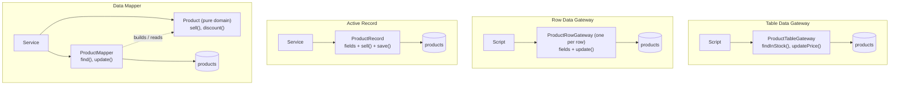

| Aspect | Table/Row Data Gateway | Active Record | Data Mapper |
|---|---|---|---|
| Domain object independent of DB | n/a | ❌ | ✅ |
| Code needed | Little | Least | Most (or an ORM does it) |
| Unit testing domain logic without DB | n/a | Harder (object saves itself) | Easy |
| Schema and objects can differ | n/a | Hardly (1 class ≈ 1 table) | Freely |
| Java examples | `JdbcTemplate` DAO classes, jOOQ DSL | Quarkus Panache, ActiveJDBC, jOOQ `UpdatableRecord` | JPA/Hibernate, MyBatis, Spring Data JDBC |

---

## 4.4 Complete Java Example - One Table, Four Patterns

The same `products` table is accessed four ways. Each run resets the table and prints the SQL issued and the final rows.

```java
import java.util.ArrayList;
import java.util.List;
import java.util.Map;
import java.util.Optional;
import java.util.TreeMap;

// Fowler's four data source patterns over the same "products" table:
// Table Data Gateway, Row Data Gateway, Active Record, Data Mapper.

class ProductsTable {                                           // the "database": id -> {name, pricePaise, stock}
    static final Map<Long, Object[]> rows = new TreeMap<>();
    static final List<String> sql = new ArrayList<>();
    static void reset() {
        rows.clear(); sql.clear();
        rows.put(1L, new Object[]{"Keyboard", 2_499_00L, 10});
        rows.put(2L, new Object[]{"Mouse", 799_00L, 0});
    }
    static void exec(String s) { sql.add(s); }
}

// ===== 1) TABLE DATA GATEWAY: ONE object for the whole table; methods return plain data (rows / record sets) =====
class ProductTableGateway {
    List<Object[]> findInStock() {
        ProductsTable.exec("SELECT * FROM products WHERE stock > 0");
        List<Object[]> out = new ArrayList<>();
        ProductsTable.rows.forEach((id, r) -> { if ((int) r[2] > 0) out.add(new Object[]{id, r[0], r[1], r[2]}); });
        return out;
    }
    void updatePrice(long id, long price) { ProductsTable.exec("UPDATE products SET price=" + price + " WHERE id=" + id); ProductsTable.rows.get(id)[1] = price; }
}

// ===== 2) ROW DATA GATEWAY: one object PER ROW, holds the row's fields + insert/update; NO business logic =====
class ProductRowGateway {
    long id; String name; long pricePaise; int stock;
    static Optional<ProductRowGateway> find(long id) {          // finder often lives in a separate class
        ProductsTable.exec("SELECT * FROM products WHERE id=" + id);
        Object[] r = ProductsTable.rows.get(id);
        if (r == null) return Optional.empty();
        ProductRowGateway g = new ProductRowGateway(); g.id = id; g.name = (String) r[0]; g.pricePaise = (long) r[1]; g.stock = (int) r[2];
        return Optional.of(g);
    }
    void update() { ProductsTable.exec("UPDATE products SET name='" + name + "', price=" + pricePaise + ", stock=" + stock + " WHERE id=" + id); ProductsTable.rows.put(id, new Object[]{name, pricePaise, stock}); }
}

// ===== 3) ACTIVE RECORD: a row gateway WITH domain logic; the object saves itself (Rails, Laravel, Panache) =====
class ProductRecord {
    long id; String name; long pricePaise; int stock;
    static ProductRecord find(long id) {
        ProductsTable.exec("SELECT * FROM products WHERE id=" + id);
        Object[] r = ProductsTable.rows.get(id);
        ProductRecord p = new ProductRecord(); p.id = id; p.name = (String) r[0]; p.pricePaise = (long) r[1]; p.stock = (int) r[2];
        return p;
    }
    void sell(int qty) {                                         // business rule lives on the record
        if (qty > stock) throw new IllegalStateException("only " + stock + " " + name + " left");
        stock -= qty;
    }
    void save() { ProductsTable.exec("UPDATE products SET stock=" + stock + " WHERE id=" + id); ProductsTable.rows.get(id)[2] = stock; }
}

// ===== 4) DATA MAPPER: domain object knows NOTHING about the DB; a separate mapper moves data both ways (JPA/Hibernate) =====
class Product {                                                  // pure domain object
    private final long id; private final String name; private long pricePaise; private int stock;
    Product(long id, String name, long pricePaise, int stock) { this.id = id; this.name = name; this.pricePaise = pricePaise; this.stock = stock; }
    void sell(int qty) { if (qty > stock) throw new IllegalStateException("only " + stock + " " + name + " left"); stock -= qty; }
    void discount(int percent) { pricePaise = pricePaise * (100 - percent) / 100; }
    long id() { return id; } String name() { return name; } long pricePaise() { return pricePaise; } int stock() { return stock; }
}
class ProductMapper {                                            // the ONLY class that knows columns and SQL
    Product find(long id) {
        ProductsTable.exec("SELECT id, name, price, stock FROM products WHERE id=" + id);
        Object[] r = ProductsTable.rows.get(id);
        return new Product(id, (String) r[0], (long) r[1], (int) r[2]);
    }
    void update(Product p) {
        ProductsTable.exec("UPDATE products SET price=" + p.pricePaise() + ", stock=" + p.stock() + " WHERE id=" + p.id());
        ProductsTable.rows.put(p.id(), new Object[]{p.name(), p.pricePaise(), p.stock()});
    }
}

public class DataSourcePatternsDemo {
    static void show(String title) {
        System.out.println(title);
        ProductsTable.sql.forEach(s -> System.out.println("    SQL: " + s));
        ProductsTable.rows.forEach((id, r) -> System.out.println("    row " + id + ": " + r[0] + ", price " + r[1] + ", stock " + r[2]));
    }

    public static void main(String[] args) {
        ProductsTable.reset();
        ProductTableGateway table = new ProductTableGateway();
        List<Object[]> inStock = table.findInStock();
        table.updatePrice((long) inStock.get(0)[0], 2_299_00L);
        show("1) Table Data Gateway: one gateway for the table, caller works with raw rows (" + inStock.size() + " in stock)");

        ProductsTable.reset();
        ProductRowGateway row = ProductRowGateway.find(2).orElseThrow();
        row.stock += 50;                                         // logic is in the CALLER (a transaction script)
        row.update();
        show("2) Row Data Gateway: one object per row, no business logic");

        ProductsTable.reset();
        ProductRecord kb = ProductRecord.find(1);
        kb.sell(3); kb.save();
        try { ProductRecord.find(2).sell(1); } catch (IllegalStateException e) { System.out.println("   active record rule: " + e.getMessage()); }
        show("3) Active Record: data + rules + persistence in one class");

        ProductsTable.reset();
        ProductMapper mapper = new ProductMapper();
        Product p = mapper.find(1);
        p.discount(10); p.sell(2);                               // pure domain operations, no SQL in Product
        mapper.update(p);
        show("4) Data Mapper: Product has no DB code; the mapper translates");
    }
}
```

**Output:**
```
1) Table Data Gateway: one gateway for the table, caller works with raw rows (1 in stock)
    SQL: SELECT * FROM products WHERE stock > 0
    SQL: UPDATE products SET price=229900 WHERE id=1
    row 1: Keyboard, price 229900, stock 10
    row 2: Mouse, price 79900, stock 0
2) Row Data Gateway: one object per row, no business logic
    SQL: SELECT * FROM products WHERE id=2
    SQL: UPDATE products SET name='Mouse', price=79900, stock=50 WHERE id=2
    row 1: Keyboard, price 249900, stock 10
    row 2: Mouse, price 79900, stock 50
   active record rule: only 0 Mouse left
3) Active Record: data + rules + persistence in one class
    SQL: SELECT * FROM products WHERE id=1
    SQL: UPDATE products SET stock=7 WHERE id=1
    SQL: SELECT * FROM products WHERE id=2
    row 1: Keyboard, price 249900, stock 7
    row 2: Mouse, price 79900, stock 0
4) Data Mapper: Product has no DB code; the mapper translates
    SQL: SELECT id, name, price, stock FROM products WHERE id=1
    SQL: UPDATE products SET price=224910, stock=8 WHERE id=1
    row 1: Keyboard, price 224910, stock 8
    row 2: Mouse, price 79900, stock 0
```

What the output shows:
- **Table Data Gateway:** one object for the table; the caller works with raw `Object[]` rows and decides what to update.
- **Row Data Gateway:** the row object writes **all** its columns back; the business logic (+50 stock) lived in the caller.
- **Active Record:** `sell(3)` checked stock on the record itself and `save()` wrote it; selling a mouse with 0 stock was refused by the record.
- **Data Mapper:** `Product` has **no SQL at all**; the 10% discount (₹2,499 → ₹2,249.10) and the sale were pure domain calls, and only `ProductMapper` knew the columns. This is how JPA/Hibernate works: your `@Entity` is the domain object and Hibernate is the mapper.

---

## 4.5 In the Java Ecosystem

**Data Mapper (JPA/Hibernate):** the entity contains no SQL; the `EntityManager` maps it.

```java
@Entity
class Product {
    @Id private Long id;
    private String name;
    @Embedded private Money price;          // value object mapped to columns by the mapper
    private int stock;
    public void sell(int qty) { if (qty > stock) throw new OutOfStockException(name, stock); stock -= qty; }
}
// The service never writes SQL. Hibernate generates: UPDATE product SET stock=? WHERE id=?
@Transactional public void sell(long id, int qty) { products.findById(id).orElseThrow().sell(qty); }
```

**Active Record (Quarkus Hibernate ORM with Panache):**

```java
@Entity
public class Product extends PanacheEntity {         // PanacheEntity gives id + persist(), delete(), static finders
    public String name; public int stock;
    public static List<Product> inStock() { return list("stock > 0"); }
    public void sell(int qty) { if (qty > stock) throw new IllegalStateException(); stock -= qty; }
}
Product p = Product.findById(1L); p.sell(3); p.persist();
```

**Table Data Gateway (jOOQ or `JdbcClient`):**

```java
List<ProductRecord> inStock = dsl.selectFrom(PRODUCTS).where(PRODUCTS.STOCK.gt(0)).fetch();
dsl.update(PRODUCTS).set(PRODUCTS.PRICE, 229900L).where(PRODUCTS.ID.eq(1L)).execute();
```

**MyBatis** is a Data Mapper too: SQL lives in mapper XML/annotations, objects stay plain.

---

## 4.6 Pros, Cons, Pitfalls, Interview Questions and Cheat Sheet

| Pattern | Pros | Cons |
|---|---|---|
| **Table Data Gateway** | Simple; SQL in one place per table; good for set operations | Caller handles raw data; logic lives in scripts |
| **Row Data Gateway** | Object per row is easy to use | No logic; rewrites whole rows; finder code separate |
| **Active Record** | Very fast to build; intuitive | Domain coupled to DB; hard to unit test; awkward when schema ≠ model |
| **Data Mapper** | Domain fully independent; handles complex mappings | More code or a heavy ORM; ORM learning curve (lazy loading, flushing) |

| Pitfall | Fix |
|---|---|
| Active Record with growing, complex business rules | Move to Data Mapper + domain model. |
| Data Mapper with entities that are just setters (anemic) | You're paying ORM costs without domain benefits; add behaviour. |
| Row gateways writing every column ("last write wins" on unrelated fields) | Dynamic updates (`@DynamicUpdate`) or column-specific updates + versioning. |

**Q1. Active Record vs Data Mapper?** Active Record puts data, domain logic and persistence in one class (the object saves itself). Data Mapper separates them: domain objects are persistence-ignorant and a mapper (Hibernate) moves data between them and the DB.

**Q2. Which does JPA/Hibernate use?** Data Mapper (with Unit of Work and Identity Map on top). Quarkus Panache adds an Active Record style on top of Hibernate.

```
DATA SOURCE   Table Data Gateway: 1 object per TABLE, returns rows.  Row Data Gateway: 1 object per ROW, no logic.
              Active Record: row object + domain logic + save() (Panache, Rails).  Data Mapper: pure domain object + separate mapper
              (JPA/Hibernate, MyBatis). Simple domain -> gateways/Active Record; rich domain -> Data Mapper.
```

---

## 4.7 Types and Variants

| Pattern | One object per | Contains business logic? | Typical Java form |
|---|---|---|---|
| **Table Data Gateway** | Table (stateless, returns rows/records) | No | `CustomerDao` with `findById`, `insert`, `update` using `JdbcTemplate` |
| **Row Data Gateway** | Row (an object mirroring one row, with `insert/update`) | No | Simple record class with persistence methods |
| **Active Record** | Row, plus domain behaviour | Yes (logic + persistence together) | Rails-style; in Java: ActiveJDBC, Panache entities (Quarkus) |
| **Data Mapper** | Separate mapper layer; domain objects know nothing about the DB | Logic stays in domain objects | JPA/Hibernate `EntityManager`, MyBatis mappers |
| **Repository** (on top of a mapper) | Aggregate root, collection-like interface | Domain-facing queries | Spring Data `JpaRepository` |

Rule of thumb: simple CRUD → Table Data Gateway / Active Record; rich domain model → Data Mapper + Repository.

# 5. Unit of Work and Identity Map

## 5.1 What Are They?

- **Unit of Work:** keeps track of every object **loaded, created, changed or deleted** during a business transaction, and at the end writes **all the changes together** (inserts, updates, deletes) in one database transaction, in the right order.
- **Identity Map:** makes sure each database row is loaded **only once** per unit of work, by keeping a map `id → object`. Asking for the same row again returns the **same instance**.

Together they form what JPA calls the **persistence context** (`EntityManager`, Hibernate `Session`).

**Analogy:** A shopping trip with a cart.
- **Unit of Work:** you put things in, take things out, swap sizes while walking around, but you **pay once** at the checkout for the final contents, not at every shelf.
- **Identity Map:** if you pick "the blue shirt, size M" from two aisles, it's the **same shirt** in your cart, not two copies that could end up with different sizes.

#### 📘 Terms Explained

| Term | Simple meaning |
|---|---|
| **Unit of Work** | An object that tracks changes during a business transaction and writes them all at commit. |
| **Identity Map** | A per-session map from ID to loaded object, guaranteeing one in-memory instance per row. |
| **Dirty checking** | Detecting which loaded objects changed (e.g. by comparing with a snapshot taken at load). |
| **Flush** | Sending the pending SQL to the database (usually at commit). |
| **Managed entity** | An object tracked by the persistence context; its changes are saved automatically. |

---

## 5.2 Why Do We Need Them?

| Without | With |
|---|---|
| Every setter call causes an immediate `UPDATE` (many round trips) | Changes collected and written once at commit, possibly in batches |
| You must remember to call `save()` on every changed object | Dirty checking finds changes automatically |
| Two copies of the same row in memory, modified differently → one overwrites the other | One instance per row (Identity Map) |
| Loading the same row repeatedly in one request | First-level cache: the second `find` costs no query |
| Inserts/deletes in the wrong order break foreign keys | Unit of Work orders operations (inserts before updates before deletes, parents before children) |

---

## 5.3 How They Work

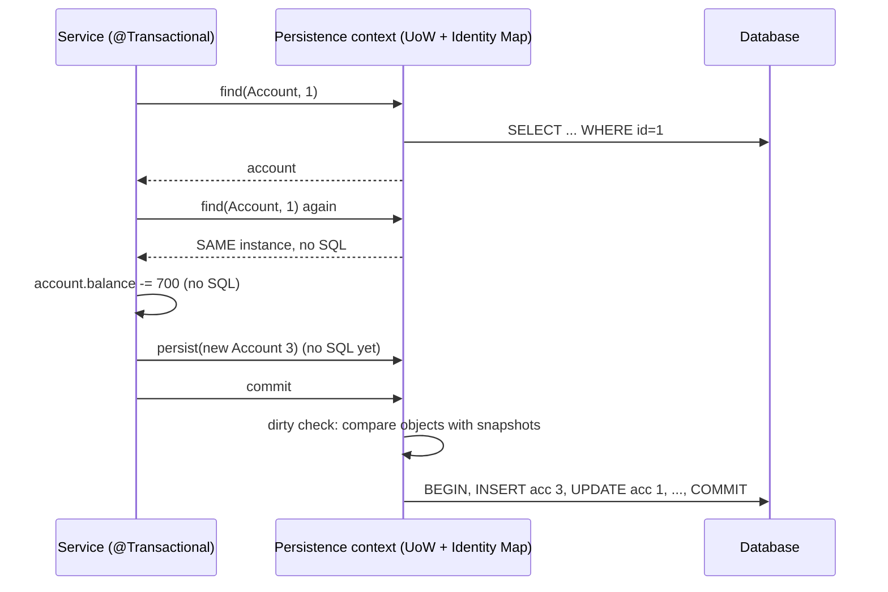

**The three lists a Unit of Work keeps:** *new* (insert), *dirty* (update), *removed* (delete). Dirty objects are found either by **explicit registration** (`registerDirty`) or, like Hibernate, by **comparing with snapshots** taken at load time.

---

## 5.4 Complete Java Example - A Mini Persistence Context

`Session` combines an **identity map**, **load-time snapshots** for dirty checking, and *new*/*removed* lists. Nothing is written until `commit()`, which emits only the SQL that is actually needed.

```java
import java.util.ArrayList;
import java.util.LinkedHashMap;
import java.util.LinkedHashSet;
import java.util.List;
import java.util.Map;
import java.util.Objects;
import java.util.Set;
import java.util.TreeMap;

// Unit of Work + Identity Map: a mini version of what Hibernate's Session / JPA's EntityManager (persistence context) does.

class Account {
    final long id; String owner; long balance;
    Account(long id, String owner, long balance) { this.id = id; this.owner = owner; this.balance = balance; }
}

class AccountTable {                                             // the database
    final Map<Long, Object[]> rows = new TreeMap<>(Map.of(1L, new Object[]{"asha", 5000L}, 2L, new Object[]{"ravi", 1000L}));
    final List<String> sql = new ArrayList<>();
    int selects = 0;
}

class Session {                                                  // one per business transaction / request
    private final AccountTable db;
    private final Map<Long, Account> identityMap = new LinkedHashMap<>();     // IDENTITY MAP: id -> the one loaded instance
    private final Map<Long, Object[]> snapshots = new LinkedHashMap<>();      // state at load time, for dirty checking
    private final Set<Account> newObjects = new LinkedHashSet<>(), removed = new LinkedHashSet<>();
    Session(AccountTable db) { this.db = db; }

    Account find(long id) {
        Account cached = identityMap.get(id);
        if (cached != null) return cached;                       // no second SELECT, and the SAME object is returned
        db.selects++; db.sql.add("SELECT * FROM accounts WHERE id=" + id);
        Object[] r = db.rows.get(id);
        Account a = new Account(id, (String) r[0], (long) r[1]);
        identityMap.put(id, a); snapshots.put(id, new Object[]{a.owner, a.balance});
        return a;
    }
    void persist(Account a) { newObjects.add(a); identityMap.put(a.id, a); }  // registerNew
    void remove(Account a) { removed.add(a); }                                // registerRemoved

    void commit() {                                              // flush: work out the changes, write them in one transaction
        List<String> batch = new ArrayList<>();
        for (Account a : newObjects) batch.add("INSERT INTO accounts VALUES (" + a.id + ",'" + a.owner + "'," + a.balance + ")");
        for (Account a : identityMap.values()) {
            Object[] before = snapshots.get(a.id);
            if (before != null && !removed.contains(a) && (!Objects.equals(before[0], a.owner) || !Objects.equals(before[1], a.balance)))
                batch.add("UPDATE accounts SET owner='" + a.owner + "', balance=" + a.balance + " WHERE id=" + a.id);   // DIRTY CHECKING
        }
        for (Account a : removed) batch.add("DELETE FROM accounts WHERE id=" + a.id);
        db.sql.add("BEGIN"); db.sql.addAll(batch); db.sql.add("COMMIT");
        for (Account a : newObjects) db.rows.put(a.id, new Object[]{a.owner, a.balance});
        for (Account a : identityMap.values()) if (!removed.contains(a)) db.rows.put(a.id, new Object[]{a.owner, a.balance});
        for (Account a : removed) db.rows.remove(a.id);
        newObjects.clear(); removed.clear();
        identityMap.values().forEach(a -> snapshots.put(a.id, new Object[]{a.owner, a.balance}));
    }
}

public class UnitOfWorkDemo {
    public static void main(String[] args) {
        AccountTable db = new AccountTable();
        Session session = new Session(db);

        System.out.println("=== Identity Map ===");
        Account a1 = session.find(1), a2 = session.find(1);
        System.out.println("find(1) twice -> same instance: " + (a1 == a2) + ", SELECTs issued: " + db.selects);
        a1.balance -= 700;
        System.out.println("change via a1 is visible via a2: a2.balance = " + a2.balance + " (no two conflicting copies in memory)");

        System.out.println("=== Unit of Work: change several objects, NO SQL until commit ===");
        Account ravi = session.find(2);
        ravi.balance += 700;                                     // transfer 700 asha -> ravi
        a1.balance += 0;                                         // no real change on this line
        Account meera = new Account(3, "meera", 0);
        session.persist(meera);
        ravi.owner = "ravi";                                     // same value: not dirty
        System.out.println("SQL so far: " + db.sql);
        session.commit();
        System.out.println("SQL after commit:");
        db.sql.forEach(s -> System.out.println("  " + s));

        System.out.println("=== Second commit with one change and one delete ===");
        db.sql.clear();
        meera.balance = 100;
        session.remove(session.find(2));
        session.commit();
        db.sql.forEach(s -> System.out.println("  " + s));
        System.out.println("table now: " + db.rows.keySet() + " | nothing changed for asha -> no UPDATE for her");
    }
}
```

**Output:**
```
=== Identity Map ===
find(1) twice -> same instance: true, SELECTs issued: 1
change via a1 is visible via a2: a2.balance = 4300 (no two conflicting copies in memory)
=== Unit of Work: change several objects, NO SQL until commit ===
SQL so far: [SELECT * FROM accounts WHERE id=1, SELECT * FROM accounts WHERE id=2]
SQL after commit:
  SELECT * FROM accounts WHERE id=1
  SELECT * FROM accounts WHERE id=2
  BEGIN
  INSERT INTO accounts VALUES (3,'meera',0)
  UPDATE accounts SET owner='asha', balance=4300 WHERE id=1
  UPDATE accounts SET owner='ravi', balance=1700 WHERE id=2
  COMMIT
=== Second commit with one change and one delete ===
  BEGIN
  UPDATE accounts SET owner='meera', balance=100 WHERE id=3
  DELETE FROM accounts WHERE id=2
  COMMIT
table now: [1, 3] | nothing changed for asha -> no UPDATE for her
```

What the output shows:
- **Identity map:** `find(1)` twice returned the **same object** with **one** SELECT; a change through one reference is visible through the other.
- **Unit of work:** between the finds and `commit()`, **no SQL** was sent. At commit, one transaction contained the INSERT for meera and UPDATEs for asha and ravi, found by **dirty checking**.
- In the second commit, asha (unchanged) got **no** UPDATE; only meera's change and ravi's DELETE were written. This is exactly why in JPA you don't call `save()` on a managed entity after changing it.

---

## 5.5 In JPA / Hibernate (the Persistence Context)

```java
@Service @RequiredArgsConstructor
class AccountService {
    private final EntityManager em;

    @Transactional
    public void transfer(long from, long to, long amount) {
        Account a = em.find(Account.class, from);        // SELECT, entity becomes MANAGED, snapshot taken
        Account again = em.find(Account.class, from);    // identity map: same instance, no SQL
        assert a == again;
        Account b = em.find(Account.class, to);
        a.withdraw(amount);                              // no SQL here...
        b.deposit(amount);
        em.persist(new AuditEntry("transfer", amount));  // ...or here
    }                                                    // commit -> flush: INSERT audit, UPDATE a, UPDATE b (dirty checking)
}
```

| Concept | JPA / Hibernate |
|---|---|
| Unit of Work | `EntityManager` / `Session` bound to the transaction |
| Identity Map | First-level cache (persistence context); scope = one `EntityManager` |
| Register new / removed | `persist()`, `remove()` |
| Dirty checking | Automatic on flush for managed entities (snapshot comparison or bytecode enhancement) |
| Flush timing | `FlushModeType.AUTO` (before queries that might be affected, and at commit) or `COMMIT` |
| Batching the writes | `spring.jpa.properties.hibernate.jdbc.batch_size=50`, `order_inserts=true`, `order_updates=true` |
| Detach / merge | `detach()`, `clear()`, `merge()` for objects outside the context |
| Read-only | `@Transactional(readOnly = true)` → Spring sets Hibernate's flush mode to `MANUAL`, so no dirty checking/flush |

**Spring Data `save()` on a managed entity is redundant** inside a transaction (but harmless); for a **new** entity it calls `persist`, for a **detached** one it calls `merge`.

#### 📘 Terms Explained

| Term | Simple meaning |
|---|---|
| **`EntityManager`** | JPA interface to the persistence context: find, persist, remove, query. |
| **First-level cache** | Hibernate's per-session identity map; always on. |
| **Second-level cache** | An optional cache shared across sessions (Ehcache, Caffeine, Hazelcast); not the identity map. |
| **Detached entity** | An entity that was managed but whose persistence context has closed. |
| **`merge()`** | Copies a detached object's state onto a managed instance. |
| **JDBC batching** | Sending many INSERT/UPDATE statements in one round trip. |

---

## 5.6 Pros, Cons, Pitfalls, Interview Questions and Cheat Sheet

| Pros | Cons |
|---|---|
| Fewer, batched writes; automatic change tracking | "Magic": SQL appears at flush time, surprising newcomers |
| Consistent in-memory view (one instance per row) | Memory grows if a context holds thousands of entities (batch jobs) |
| Correct operation ordering, one transaction | Stale data if the DB changes outside the context during a long session |

| Pitfall | Fix |
|---|---|
| Batch job loading 1M entities into one context → OutOfMemoryError, slow dirty checking | Flush and `clear()` every N items; use StatelessSession / JDBC for bulk. |
| Expecting changes to a **detached** entity to be saved | `merge()` it, or load it inside the transaction. |
| Bulk JPQL `UPDATE` bypassing the context → managed objects now stale | `clear()` after bulk updates or `@Modifying(clearAutomatically = true)`. |
| Long-lived contexts (open session in view) | Keep contexts short (one transaction); `spring.jpa.open-in-view=false`. |

**Q1. What is the persistence context?** JPA's Unit of Work + Identity Map: the set of managed entities for one `EntityManager`. It guarantees one instance per row, tracks changes, and flushes them at commit.

**Q2. Why don't I need to call `save()` after modifying an entity in a `@Transactional` method?** The entity is managed; Hibernate's dirty checking detects the change and issues the UPDATE when the transaction commits.

**Q3. First-level vs second-level cache?** First-level = the identity map of one session (always on, short-lived). Second-level = optional cache shared by all sessions in the application (must be configured, needs invalidation strategy).

```
UNIT OF WORK   Track new/dirty/removed during a business transaction; write all at commit, ordered, in one tx (batched).
IDENTITY MAP   id -> the one loaded instance per session; second find = no SQL, same object.
JPA            Persistence context = UoW + Identity Map (first-level cache). persist/remove/flush/clear/merge/detach.
               Dirty checking -> no save() needed for managed entities. Bulk: flush+clear, batch_size. open-in-view=false.
```

---

# 6. Lazy Load and Eager Loading (Interview Imp - Java)

## 6.1 What Are They?

When an object has related objects (an `Author` with `books`, an `Order` with `lines`, a `Customer` with `address`), you must decide **when** to load them:

- **Lazy Load:** load the related data **only when it is first accessed**. The object holds a placeholder until then.
- **Eager Loading:** load the related data **together with** the main object, usually in the same query (JOIN) or immediately after.

**Analogy:** Online photo albums. **Lazy:** you see thumbnails (titles) and the full photo downloads only when you tap one. **Eager:** the whole album downloads at once, so it's slow to open but every photo is instant afterwards.

#### 📘 Terms Explained

| Term | Simple meaning |
|---|---|
| **Lazy loading** | Deferring loading of data until it's actually needed. |
| **Eager loading** | Loading related data immediately with the parent object. |
| **Association** | A relationship between entities (`@OneToMany`, `@ManyToOne`...). |
| **Fetch type** | JPA's per-association default: `LAZY` or `EAGER`. |
| **Fetch strategy** | How related data is loaded: separate select, JOIN, batch (IN), subselect. |

---

## 6.2 Why Do We Need Them?

| Screen / use case | Better choice | Why |
|---|---|---|
| List of 50 authors, names only | **Lazy** for books | Don't load 500 books nobody looks at |
| Author detail page with all books | **Eager for this query** (join fetch) | Avoid one query per book collection |
| Order with 3 lines (always shown together) | Eager for this use case | Lines are part of the aggregate |
| Customer → huge order history | Lazy (or a separate paginated query) | Loading it every time would be enormous |

> **Rule of thumb:** make associations **LAZY by default**, and fetch eagerly **per query** for the use cases that need the data. Eager as a global mapping default is almost always a mistake.

---

## 6.3 How Lazy Loading Works: Four Implementations

| Implementation (Fowler) | How | Java example |
|---|---|---|
| **Lazy initialisation** | The getter checks for `null` and loads on first call | Hand-written `if (books == null) books = dao.load(id)` |
| **Virtual proxy** | A stand-in object with the same interface loads the real one on first method call ([Proxy pattern](../01_LLD/03_Structural_Pattern.md#7-proxy-pattern-interview-imp---java)) | Hibernate's `HibernateProxy` for `@ManyToOne(fetch = LAZY)`, `getReferenceById()` |
| **Value holder** | A wrapper object (`Lazy<T>`) whose `get()` loads and caches the value | The `Lazy<T>` in the example; Hibernate's `PersistentBag`/`PersistentSet` for collections |
| **Ghost** | The real object, created with only its ID; other fields load on first access | Hibernate bytecode-enhanced lazy attributes |

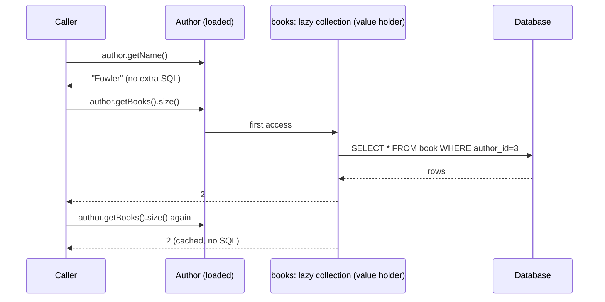

---

## 6.4 The N+1 Select Problem (Interview Imp - Java)

Lazy loading's famous trap: you load **N** parents with **1** query, then touch a lazy association on each one, causing **N** more queries.

```java
List<Author> authors = authorRepository.findAll();          // 1 query
for (Author a : authors) System.out.println(a.getBooks().size());   // N queries, one per author
```

With 1,000 authors that's 1,001 round trips: often seconds instead of milliseconds. It hides easily because each query is fast and the code looks innocent.

| Fix | How (JPA/Hibernate) | Queries for N parents |
|---|---|---|
| **JOIN FETCH** | `select a from Author a join fetch a.books` | 1 |
| **Entity graph** | `@EntityGraph(attributePaths = "books")` on a repository method | 1 |
| **Batch fetching** | `@BatchSize(size = 100)` or `hibernate.default_batch_fetch_size=100` → `WHERE author_id IN (...)` | 1 + ⌈N/100⌉ |
| **Subselect fetching** | `@Fetch(FetchMode.SUBSELECT)` → one query using the original query as a subselect | 2 |
| **DTO projection** | Query exactly the columns the screen needs (`select new ...Dto(...)`) | 1 |

**Detecting N+1:** enable SQL logging in tests (`spring.jpa.show-sql`, `logging.level.org.hibernate.SQL=DEBUG`), Hibernate statistics (`hibernate.generate_statistics=true`), assertion libraries that count queries (e.g. datasource-proxy / "Hypersistence" utilities), and APM traces showing hundreds of identical SELECTs.

---

## 6.5 Complete Java Example - Lazy Load, N+1, Join Fetch and Batch Fetch

A `Lazy<T>` value holder defers loading each author's books. The example counts SQL statements for: a names-only screen (lazy wins), a screen that touches every author's books (**N+1**), and two fixes: **join fetch** and **batch fetch**.

```java
import java.util.ArrayList;
import java.util.LinkedHashMap;
import java.util.List;
import java.util.Map;
import java.util.function.Supplier;
import java.util.stream.Collectors;

// Lazy Load (virtual proxy / value holder) vs eager loading, and the N+1 select problem with its fixes.

class Sql {
    static int count = 0; static final List<String> log = new ArrayList<>();
    static void run(String s) { count++; log.add(s); }
    static void reset() { count = 0; log.clear(); }
}

class Data {                                                     // 5 authors, 2 books each
    static final Map<Integer, String> authors = new LinkedHashMap<>();
    static final Map<Integer, List<String>> booksByAuthor = new LinkedHashMap<>();
    static {
        String[] names = {"Bloch", "Goetz", "Fowler", "Evans", "Martin"};
        for (int i = 0; i < names.length; i++) {
            authors.put(i + 1, names[i]);
            booksByAuthor.put(i + 1, List.of(names[i] + "-Book-A", names[i] + "-Book-B"));
        }
    }
}

// Value holder: loads its content the first time get() is called, then caches it
class Lazy<T> {
    private final Supplier<T> loader; private T value; private boolean loaded;
    Lazy(Supplier<T> loader) { this.loader = loader; }
    T get() { if (!loaded) { value = loader.get(); loaded = true; } return value; }
    boolean isLoaded() { return loaded; }
}

class Author {
    final int id; final String name; final Lazy<List<String>> books;
    Author(int id, String name, Lazy<List<String>> books) { this.id = id; this.name = name; this.books = books; }
}

class AuthorDao {
    // LAZY: load authors only; each author's books are fetched when first touched
    static List<Author> findAllLazy() {
        Sql.run("SELECT * FROM author");
        return Data.authors.entrySet().stream().map(e -> new Author(e.getKey(), e.getValue(), new Lazy<>(() -> {
            Sql.run("SELECT * FROM book WHERE author_id=" + e.getKey());
            return Data.booksByAuthor.get(e.getKey());
        }))).collect(Collectors.toList());
    }
    // EAGER with a JOIN FETCH: one query brings authors and books together
    static List<Author> findAllJoinFetch() {
        Sql.run("SELECT a.*, b.* FROM author a LEFT JOIN book b ON b.author_id = a.id");
        return Data.authors.entrySet().stream().map(e -> {
            Lazy<List<String>> preloaded = new Lazy<>(() -> Data.booksByAuthor.get(e.getKey())); preloaded.get();
            return new Author(e.getKey(), e.getValue(), preloaded);
        }).collect(Collectors.toList());
    }
    // BATCH FETCH (Hibernate @BatchSize): books for many authors in one IN (...) query
    static List<Author> findAllBatchFetch(int batchSize) {
        Sql.run("SELECT * FROM author");
        List<Integer> ids = new ArrayList<>(Data.authors.keySet());
        Map<Integer, List<String>> loaded = new LinkedHashMap<>();
        List<Author> result = new ArrayList<>();
        for (int id : ids) result.add(new Author(id, Data.authors.get(id), new Lazy<>(() -> {
            if (!loaded.containsKey(id)) {                       // first touch loads the whole batch containing this id
                int start = ids.indexOf(id) / batchSize * batchSize;
                List<Integer> batch = ids.subList(start, Math.min(start + batchSize, ids.size()));
                Sql.run("SELECT * FROM book WHERE author_id IN " + batch.toString().replace('[', '(').replace(']', ')'));
                batch.forEach(b -> loaded.put(b, Data.booksByAuthor.get(b)));
            }
            return loaded.get(id);
        })));
        return result;
    }
}

public class LazyLoadDemo {
    public static void main(String[] args) {
        System.out.println("=== Lazy load pays off: a screen that shows only author names ===");
        Sql.reset();
        List<Author> authors = AuthorDao.findAllLazy();
        System.out.println("names: " + authors.stream().map(a -> a.name).toList() + " | queries: " + Sql.count + " | books loaded? " + authors.get(0).books.isLoaded());

        System.out.println("=== N+1 problem: a screen that shows every author WITH their books ===");
        Sql.reset();
        for (Author a : AuthorDao.findAllLazy()) a.books.get().size();
        System.out.println("queries: " + Sql.count + "  (1 for authors + N=" + Data.authors.size() + " for books)");
        Sql.log.forEach(s -> System.out.println("  " + s));

        System.out.println("=== Fix 1: JOIN FETCH / entity graph (eager for THIS use case only) ===");
        Sql.reset();
        int books = 0; for (Author a : AuthorDao.findAllJoinFetch()) books += a.books.get().size();
        System.out.println("books " + books + ", queries: " + Sql.count);

        System.out.println("=== Fix 2: batch fetching, batch size 3 ===");
        Sql.reset();
        books = 0; for (Author a : AuthorDao.findAllBatchFetch(3)) books += a.books.get().size();
        System.out.println("books " + books + ", queries: " + Sql.count);
        Sql.log.forEach(s -> System.out.println("  " + s));

        System.out.println("With 1,000 authors: lazy N+1 = 1001 queries, join fetch = 1, batch size 100 = 11.");
    }
}
```

**Output:**
```
=== Lazy load pays off: a screen that shows only author names ===
names: [Bloch, Goetz, Fowler, Evans, Martin] | queries: 1 | books loaded? false
=== N+1 problem: a screen that shows every author WITH their books ===
queries: 6  (1 for authors + N=5 for books)
  SELECT * FROM author
  SELECT * FROM book WHERE author_id=1
  SELECT * FROM book WHERE author_id=2
  SELECT * FROM book WHERE author_id=3
  SELECT * FROM book WHERE author_id=4
  SELECT * FROM book WHERE author_id=5
=== Fix 1: JOIN FETCH / entity graph (eager for THIS use case only) ===
books 10, queries: 1
=== Fix 2: batch fetching, batch size 3 ===
books 10, queries: 3
  SELECT * FROM author
  SELECT * FROM book WHERE author_id IN (1, 2, 3)
  SELECT * FROM book WHERE author_id IN (4, 5)
With 1,000 authors: lazy N+1 = 1001 queries, join fetch = 1, batch size 100 = 11.
```

What the output shows:
- **Names only:** 1 query, books never loaded. Lazy loading saved 5 queries.
- **N+1:** touching books on each author turned 1 query into **6** (1 + N with N = 5). The log shows the tell-tale pattern: the same SELECT repeated with different IDs.
- **Join fetch:** all 10 books with **1** query, because this use case declared up front that it needs books.
- **Batch fetch (size 3):** first touch loaded books for authors 1, 2, 3 in one `IN (...)` query, then 4, 5: **3** queries in total, without changing the calling code.

---

## 6.6 In JPA / Hibernate

```java
@Entity
class Author {
    @Id private Long id;
    private String name;

    @OneToMany(mappedBy = "author")                 // default fetch for collections = LAZY (good)
    @BatchSize(size = 100)                          // optional: batch-load collections for many authors at once
    private List<Book> books = new ArrayList<>();
}

@Entity
class Book {
    @Id private Long id;
    @ManyToOne(fetch = FetchType.LAZY)              // default for @ManyToOne / @OneToOne is EAGER: override it!
    private Author author;
}

interface AuthorRepository extends JpaRepository<Author, Long> {
    @Query("select distinct a from Author a left join fetch a.books")    // eager for THIS use case
    List<Author> findAllWithBooks();

    @EntityGraph(attributePaths = "books")                                // same, declaratively
    List<Author> findByNameStartingWith(String prefix);

    @Query("select new com.shop.AuthorSummary(a.id, a.name, size(a.books)) from Author a")   // DTO: no entities at all
    List<AuthorSummary> summaries();
}
```

| Setting | Recommendation |
|---|---|
| `@ManyToOne` / `@OneToOne` | Set `fetch = FetchType.LAZY` explicitly (JPA default is EAGER) |
| `@OneToMany` / `@ManyToMany` | LAZY (default); fetch per query |
| `spring.jpa.open-in-view` | Set to `false`: otherwise lazy loading silently runs SQL during JSON rendering in the controller |
| `hibernate.default_batch_fetch_size` | 50-100 as a global safety net against N+1 |
| Join-fetching **two** collections at once | Avoid (Cartesian product, `MultipleBagFetchException`); fetch the second collection in another query or use batch fetching |
| Join fetch + pagination | Hibernate paginates in memory (warning HHH90003004); paginate IDs first, then fetch |

**`LazyInitializationException`:** accessing a lazy association after the persistence context is closed (e.g. in the controller with open-in-view disabled). Fix by fetching what the use case needs inside the transaction (join fetch, entity graph, DTO), **not** by switching to EAGER.

#### 📘 Terms Explained

| Term | Simple meaning |
|---|---|
| **N+1 select problem** | 1 query for parents + 1 query per parent for its children. |
| **JOIN FETCH** | JPQL that loads an association in the same SQL query via a join. |
| **Entity graph** | A declarative description of which associations to fetch for a query. |
| **`@BatchSize`** | Hibernate: load lazy associations for several parents in one `IN` query. |
| **Open Session in View (OSIV)** | Keeping the persistence context open until the view is rendered; enabled by default in Spring Boot (with a warning). |
| **`LazyInitializationException`** | Thrown when a lazy association is accessed outside an open persistence context. |
| **Cartesian product** | Row explosion when joining several collections: rows = product of their sizes. |

---

## 6.7 Pros, Cons, Pitfalls, Interview Questions and Cheat Sheet

| | Pros | Cons |
|---|---|---|
| **Lazy** | Loads only what's used; less memory; fast first load | N+1 queries; `LazyInitializationException`; hidden SQL in getters |
| **Eager** | One round trip; no lazy exceptions | Over-fetching; huge joins and Cartesian products; can't be turned off per query when mapped EAGER |

| Pitfall | Fix |
|---|---|
| Mapping associations as EAGER globally | LAZY mappings + per-query fetch plans. |
| Serialising entities with Jackson → triggers lazy loads (or infinite recursion) | Return DTOs. |
| Relying on OSIV | Disable it; fetch in the service. |
| Logging `toString()` that touches lazy collections | Exclude associations from `toString`/`equals`/`hashCode`. |

**Q1. What is the N+1 problem and how do you fix it?** One query loads N parents, then accessing a lazy association on each triggers N more queries. Fix with JOIN FETCH, `@EntityGraph`, batch fetching (`@BatchSize`/`default_batch_fetch_size`), subselect fetching or DTO projections.

**Q2. What are JPA's default fetch types?** `@OneToMany` and `@ManyToMany`: LAZY. `@ManyToOne` and `@OneToOne`: EAGER (usually override to LAZY).

**Q3. How does Hibernate implement lazy loading?** With proxies (generated subclasses) for single-valued associations and persistent collection wrappers (`PersistentBag`, `PersistentSet`) for collections; optionally bytecode enhancement for lazy fields.

**Q4. What causes `LazyInitializationException`?** Accessing an uninitialised lazy proxy/collection after its session has closed. Fetch what you need inside the transaction instead.

```
LAZY LOAD    Load related data on first access: lazy init / virtual proxy / value holder / ghost. Hibernate: proxies + PersistentBag.
EAGER        Load with the parent (JOIN). Mapping defaults: *ToMany LAZY, *ToOne EAGER -> set LAZY everywhere, fetch per query.
N+1          1 + N queries. Fix: JOIN FETCH, @EntityGraph, @BatchSize / default_batch_fetch_size, SUBSELECT, DTO projections.
             Detect: SQL logs, hibernate statistics, query-count assertions. open-in-view=false. Don't serialise entities.
```

---

# 7. Optimistic and Pessimistic Locking (Interview Imp - Java)

## 7.1 What Are They?

Two ways to stop concurrent transactions from silently overwriting each other's changes:

- **Optimistic locking** ("conflicts are rare"): don't lock anything while reading. Each row has a **version** (number or timestamp). When writing, check that the version hasn't changed: `UPDATE ... SET ..., version = version + 1 WHERE id = ? AND version = ?`. If 0 rows are updated, someone else changed it first → **fail** (and usually retry or tell the user).
- **Pessimistic locking** ("conflicts are likely"): **lock the row when you read it** (`SELECT ... FOR UPDATE`), so other writers **wait** until you commit.

**Analogy:** Editing a shared document.
- **Optimistic:** everyone edits freely; when you click Save, the system checks "has anyone saved since you opened it?" If yes, it says "conflict, please reload". Great when people rarely edit the same paragraph.
- **Pessimistic:** like checking out a library book: while you have it, nobody else can take it. Safe, but others wait in line.

#### 📘 Terms Explained

| Term | Simple meaning |
|---|---|
| **Lost update** | Two transactions read the same value, both write, and the first write is silently overwritten. |
| **Version column** | A counter (or timestamp) incremented on every update, used to detect concurrent changes. |
| **`SELECT ... FOR UPDATE`** | SQL that reads rows and locks them against other writers until the transaction ends. |
| **Optimistic lock exception** | The error raised when a version check fails (`OptimisticLockException`). |
| **Deadlock** | Two transactions each waiting for a lock held by the other; the DB kills one. |
| **Contention** | How often concurrent transactions want the same data. |

---

## 7.2 Why Do We Need Them? The Lost Update

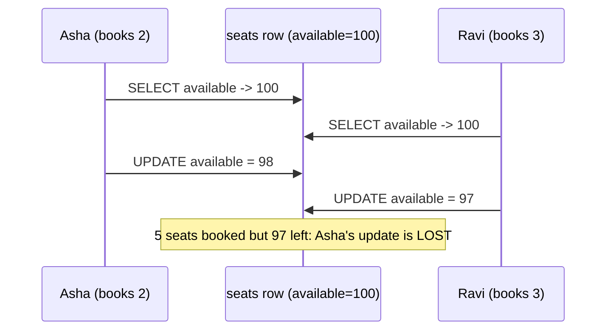

Database **isolation levels** don't automatically prevent this at the default `READ COMMITTED` level (PostgreSQL, Oracle, SQL Server default): each statement sees committed data, but the application's *read → compute → write* across two statements is not protected. You need either an atomic update (`SET available = available - 2`), optimistic locking, pessimistic locking, or a stricter isolation level.

> **Long "business transactions"** (user opens an edit form, goes to lunch, clicks Save) span several DB transactions. Only **optimistic locking** works there: you can't hold a DB lock for an hour. Fowler calls this the **Optimistic Offline Lock**; the version is sent to the browser and back.

---

## 7.3 How They Work

**Optimistic:**

```sql
-- read
SELECT id, available, version FROM seats WHERE id = 1;            -- available=100, version=7
-- write, only if nobody changed it
UPDATE seats SET available = 98, version = 8 WHERE id = 1 AND version = 7;
-- 1 row updated -> success;  0 rows updated -> conflict (someone else committed version 8 first)
```

**Pessimistic:**

```sql
BEGIN;
SELECT id, available FROM seats WHERE id = 1 FOR UPDATE;           -- other FOR UPDATE / UPDATE on this row now WAIT
UPDATE seats SET available = 98 WHERE id = 1;
COMMIT;                                                             -- lock released
-- variants: FOR UPDATE NOWAIT (fail immediately), FOR UPDATE SKIP LOCKED (job queues), FOR SHARE (shared read lock)
```

---

## 7.4 Optimistic vs Pessimistic

| | Optimistic | Pessimistic |
|---|---|---|
| Assumption | Conflicts are rare | Conflicts are frequent |
| Locks held | None while working | Row locks until commit |
| On conflict | Fails at write time → retry / reload | Waits (or fails fast with NOWAIT / timeout) |
| Throughput under low contention | Excellent | Lower (locking overhead) |
| Under high contention | Many retries, wasted work | Better: queue, no wasted work |
| Long user "think time" | ✅ (version travels with the form) | ❌ (can't hold DB locks for minutes) |
| Risks | Retry storms, user-visible conflicts | Deadlocks, lock waits, reduced concurrency |
| Typical use | Editing profiles, orders, CMS documents, most web apps | Seat/stock decrement under heavy contention, money movements, job queues (`SKIP LOCKED`) |

**Other options worth mentioning in interviews:** atomic SQL (`UPDATE stock SET qty = qty - 1 WHERE id = ? AND qty >= 1`) needs no read and no version; distributed locks across services ([07_Distributed_Systems_Pattern.md](../03_System_Design/07_Distributed_Systems_Pattern.md#8-distributed-locks-pattern-interview-imp---java)); and in-JVM locks ([11_Concurrency_Pattern.md](../03_System_Design/11_Concurrency_Pattern.md)), which do **not** protect against other app instances.

---

## 7.5 Complete Java Example - Lost Update, Version Checks, Row Locks and Retries

A `SeatTable` simulates one row with a `version`. The example shows the **lost update**, **optimistic** detection and retry, optimistic locking under **real concurrency** (8 threads × 250 bookings), **pessimistic** locking with a lock that stands in for `FOR UPDATE`, and a bounded retry that gives up.

```java
import java.util.ArrayList;
import java.util.List;
import java.util.concurrent.CountDownLatch;
import java.util.concurrent.locks.ReentrantLock;

// Lost update, optimistic locking (version column) and pessimistic locking (SELECT ... FOR UPDATE).

class SeatRow {                                                  // one row of a "seats_available" table
    int available; long version;
    SeatRow(int available) { this.available = available; }
}

class SeatTable {
    final SeatRow row = new SeatRow(100);
    final ReentrantLock rowLock = new ReentrantLock();           // stands in for the DB row lock

    record Snapshot(int available, long version) {}
    synchronized Snapshot read() { return new Snapshot(row.available, row.version); }   // plain SELECT

    // No locking: blindly writes what the caller computed
    synchronized void writeBlind(int newAvailable) { row.available = newAvailable; }

    // OPTIMISTIC: UPDATE seats SET available=?, version=version+1 WHERE id=? AND version=?   -> returns rows updated (0 or 1)
    synchronized int writeIfVersion(int newAvailable, long expectedVersion) {
        if (row.version != expectedVersion) return 0;
        row.available = newAvailable; row.version++;
        return 1;
    }
}

class StaleObjectException extends RuntimeException {
    StaleObjectException(String m) { super(m); }
}

public class LockingDemo {
    public static void main(String[] args) throws InterruptedException {
        System.out.println("=== 1) Lost update: two users interleave read-modify-write with NO locking ===");
        SeatTable t = new SeatTable();
        SeatTable.Snapshot asha = t.read(), ravi = t.read();     // both read 100
        t.writeBlind(asha.available() - 2);                      // asha books 2 -> 98
        t.writeBlind(ravi.available() - 3);                      // ravi books 3 -> 97 (overwrites asha!)
        System.out.println("booked 5 seats, but available = " + t.row.available + " (should be 95) -> asha's update was LOST");

        System.out.println("=== 2) Optimistic locking: the second writer is detected ===");
        t = new SeatTable();
        asha = t.read(); ravi = t.read();                        // both read version 0
        System.out.println("asha UPDATE ... WHERE version=0 -> rows updated: " + t.writeIfVersion(asha.available() - 2, asha.version()));
        int updated = t.writeIfVersion(ravi.available() - 3, ravi.version());
        System.out.println("ravi UPDATE ... WHERE version=0 -> rows updated: " + updated
                + (updated == 0 ? "  => OptimisticLockException, re-read and retry" : ""));
        SeatTable.Snapshot fresh = t.read();
        t.writeIfVersion(fresh.available() - 3, fresh.version());
        System.out.println("after retry: available=" + t.row.available + ", version=" + t.row.version);

        System.out.println("=== 3) Optimistic locking under real concurrency: 8 threads x 250 bookings of 1 seat (10,000 seats) ===");
        SeatTable big = new SeatTable(); big.row.available = 10_000;
        runThreads(8, () -> { for (int i = 0; i < 250; i++) bookWithRetry(big, 1, 100_000); });   // retry until it wins (how many retries varies per run)
        System.out.println("available = " + big.row.available + " (expected 8000), version = " + big.row.version + " (one per successful update)");

        System.out.println("=== 4) Pessimistic locking: lock the row, then read-modify-write ===");
        SeatTable p = new SeatTable(); p.row.available = 10_000;
        runThreads(8, () -> {
            for (int i = 0; i < 250; i++) {
                p.rowLock.lock();                                // SELECT ... FOR UPDATE: others wait here
                try { SeatTable.Snapshot s = p.read(); p.writeBlind(s.available() - 1); }
                finally { p.rowLock.unlock(); }                  // COMMIT releases the lock
            }
        });
        System.out.println("available = " + p.row.available + " (expected 8000), no retries needed, but writers waited for each other");

        System.out.println("=== 5) Retries are not infinite ===");
        SeatTable hot = new SeatTable();
        try { bookWithRetry(hot, 1, 0, () -> hot.writeIfVersion(hot.row.available, hot.row.version)); }   // someone always writes first
        catch (StaleObjectException e) { System.out.println("gave up: " + e.getMessage() + " -> report 409 Conflict to the user"); }
    }

    static void bookWithRetry(SeatTable t, int seats, int maxRetries) { bookWithRetry(t, seats, maxRetries, () -> 0); }

    // read -> compute -> conditional update; on conflict re-read and try again
    static void bookWithRetry(SeatTable t, int seats, int maxRetries, java.util.function.IntSupplier concurrentWriter) {
        for (int attempt = 0; attempt <= maxRetries; attempt++) {
            SeatTable.Snapshot s = t.read();
            if (s.available() < seats) throw new IllegalStateException("sold out");
            concurrentWriter.getAsInt();                         // (test hook: simulate another transaction committing in between)
            if (t.writeIfVersion(s.available() - seats, s.version()) == 1) return;
        }
        throw new StaleObjectException("row changed by another transaction " + (maxRetries + 1) + " time(s)");
    }

    static void runThreads(int n, Runnable work) throws InterruptedException {
        CountDownLatch start = new CountDownLatch(1);
        List<Thread> threads = new ArrayList<>();
        for (int i = 0; i < n; i++) threads.add(new Thread(() -> { try { start.await(); } catch (InterruptedException e) { return; } work.run(); }));
        threads.forEach(Thread::start);
        start.countDown();                                       // release all threads at once for maximum contention
        for (Thread th : threads) th.join();
    }
}
```

**Output:**
```
=== 1) Lost update: two users interleave read-modify-write with NO locking ===
booked 5 seats, but available = 97 (should be 95) -> asha's update was LOST
=== 2) Optimistic locking: the second writer is detected ===
asha UPDATE ... WHERE version=0 -> rows updated: 1
ravi UPDATE ... WHERE version=0 -> rows updated: 0  => OptimisticLockException, re-read and retry
after retry: available=95, version=2
=== 3) Optimistic locking under real concurrency: 8 threads x 250 bookings of 1 seat (10,000 seats) ===
available = 8000 (expected 8000), version = 2000 (one per successful update)
=== 4) Pessimistic locking: lock the row, then read-modify-write ===
available = 8000 (expected 8000), no retries needed, but writers waited for each other
=== 5) Retries are not infinite ===
gave up: row changed by another transaction 1 time(s) -> report 409 Conflict to the user
```

What the output shows:
- **Lost update:** 5 seats were booked but only 3 subtracted; asha's write was overwritten.
- **Optimistic:** ravi's `UPDATE ... WHERE version = 0` matched **0 rows** because asha had moved the version to 1. After re-reading and retrying, the result is correct (95, version 2).
- **Under 8 real threads:** every booking eventually succeeded, the count is exactly 8,000, and the version is exactly 2,000 (one per successful write). The number of **retries** differs on every run, which is why it isn't printed: that wasted work is the cost of optimism under contention.
- **Pessimistic:** same correct result with **no retries**, but threads queued on the lock.
- **Bounded retry:** when another writer always wins, the code gives up and should return **409 Conflict** instead of retrying forever.

---

## 7.6 In Spring Data JPA

**Optimistic (`@Version`):**

```java
@Entity
class Seat {
    @Id private Long id;
    private int available;
    @Version private long version;        // Hibernate adds "AND version=?" to every UPDATE and increments it
    void book(int n) { if (n > available) throw new SoldOutException(); available -= n; }
}

@Service @RequiredArgsConstructor
class BookingService {
    private final SeatRepository seats;

    @Retryable(retryFor = ObjectOptimisticLockingFailureException.class, maxAttempts = 3, backoff = @Backoff(delay = 50, multiplier = 2))
    @Transactional                           // each retry = a NEW transaction with fresh data (put @Retryable on the outer proxy)
    public void book(long seatId, int n) { seats.findById(seatId).orElseThrow().book(n); }
}

// REST: send the version to the client (ETag) and back (If-Match) for long business transactions
@PutMapping("/seats/{id}")
ResponseEntity<?> update(@PathVariable long id, @RequestHeader("If-Match") long version, @RequestBody SeatDto dto) { ... }
// on ObjectOptimisticLockingFailureException -> 409 Conflict (or 412 Precondition Failed for If-Match)
```

**Pessimistic (`@Lock`):**

```java
interface SeatRepository extends JpaRepository<Seat, Long> {
    @Lock(LockModeType.PESSIMISTIC_WRITE)                                   // SELECT ... FOR UPDATE
    @QueryHints(@QueryHint(name = "jakarta.persistence.lock.timeout", value = "3000"))   // wait max 3 s
    @Query("select s from Seat s where s.id = :id")
    Optional<Seat> findByIdForUpdate(long id);
}

@Transactional
public void bookPessimistic(long id, int n) { seats.findByIdForUpdate(id).orElseThrow().book(n); }   // lock held until commit
```

**Atomic update (often the simplest and fastest):**

```java
@Modifying
@Query("update Seat s set s.available = s.available - :n where s.id = :id and s.available >= :n")
int tryBook(long id, int n);        // returns 0 if not enough seats; no read, no version, no lock wait
```

| JPA lock mode | Meaning |
|---|---|
| `OPTIMISTIC` (with `@Version`) | Version checked on commit (also for read entities if requested) |
| `OPTIMISTIC_FORCE_INCREMENT` | Increments the version even if the entity didn't change (e.g. aggregate root when a child changed) |
| `PESSIMISTIC_READ` | Shared lock (`FOR SHARE`): others can read-lock, not write |
| `PESSIMISTIC_WRITE` | Exclusive lock (`FOR UPDATE`) |
| `PESSIMISTIC_FORCE_INCREMENT` | Exclusive lock + version increment |

#### 📘 Terms Explained

| Term | Simple meaning |
|---|---|
| **`@Version`** | JPA annotation marking the optimistic-locking version field. |
| **`ObjectOptimisticLockingFailureException`** | Spring's exception wrapping JPA's `OptimisticLockException`. |
| **`@Retryable`** | Spring Retry annotation that re-invokes a method on given exceptions with backoff. |
| **`@Lock`** | Spring Data annotation that sets the JPA lock mode for a repository query. |
| **Lock timeout** | How long to wait for a lock before failing. |
| **ETag / If-Match** | HTTP headers carrying a resource version for conditional updates. |
| **`SKIP LOCKED`** | SQL option to skip rows locked by others; great for worker queues. |

---

## 7.7 Pros, Cons, Pitfalls, Interview Questions and Cheat Sheet

| | Pros | Cons |
|---|---|---|
| **Optimistic** | No locks, high concurrency, works across user think time, simple with `@Version` | Conflicts surface late; retries waste work under contention; user may need to redo edits |
| **Pessimistic** | No conflicts after locking; good for hot rows | Lock waits, deadlocks, lower throughput; only within one DB transaction |

| Pitfall | Fix |
|---|---|
| `@Retryable` on the same method as `@Transactional` in the wrong order, retrying inside a failed transaction | Retry must start a **new** transaction: retry outside, transaction inside (separate beans or ordering). |
| Infinite retries | Bounded attempts + backoff; then 409. |
| Pessimistic locks acquired in different orders → deadlocks | Always lock rows in a consistent order (e.g. by ID); short transactions. |
| Holding `FOR UPDATE` while calling a slow external API | Do external calls outside the locked section. |
| Using `synchronized` / `ReentrantLock` in a service with several instances | DB locks, optimistic versions or distributed locks; JVM locks protect only one instance. |
| Not exposing the version in REST for edit forms | Send it as ETag / field; check on update. |

**Q1. Optimistic vs pessimistic locking?** Optimistic assumes conflicts are rare: no lock while reading; a version check on write detects conflicts, which you retry or report. Pessimistic assumes conflicts are common: lock the row on read (`FOR UPDATE`) so others wait. Optimistic for most web apps and long edits; pessimistic for hot, contended rows.

**Q2. How does `@Version` work?** Hibernate includes the version in the UPDATE's WHERE clause and increments it. If no row matches, it throws `OptimisticLockException` (Spring: `ObjectOptimisticLockingFailureException`).

**Q3. How do you handle an optimistic lock failure?** For automatic operations: retry in a new transaction with fresh data (bounded, with backoff). For user edits: return 409 Conflict and let the user reload/merge.

**Q4. How would you prevent overselling stock?** An atomic conditional update (`... SET qty = qty - n WHERE id = ? AND qty >= n`), or pessimistic lock on the stock row, or optimistic locking with retries; for extreme load, a queue or in-memory reservation system.

**Q5. Does `synchronized` solve this in a Spring Boot app?** Only within one JVM. With multiple instances (or other apps writing the DB), you need DB-level locking or versioning.

```
LOST UPDATE    read-compute-write races; default READ COMMITTED doesn't prevent it.
OPTIMISTIC     @Version; UPDATE ... WHERE version=?; 0 rows -> OptimisticLockException -> bounded retry (new tx) or 409.
               Works across user think time (ETag/If-Match). Best when conflicts are rare.
PESSIMISTIC    @Lock(PESSIMISTIC_WRITE) = SELECT ... FOR UPDATE (+ lock timeout, NOWAIT, SKIP LOCKED). Waits instead of failing.
               Short tx, consistent lock order (deadlocks). Best for hot rows.
ALSO           Atomic conditional UPDATE (often best), distributed locks across services; JVM locks don't cover other instances.
```

---

# 8. DTO and Value Object (Interview Imp - Java)

## 8.1 What Are They?

Two small, simple objects that are often confused:

| | DTO (Data Transfer Object) | Value Object |
|---|---|---|
| Purpose | **Carry data** across a boundary (API, layers, network) in one go | **Represent a value** in the domain (money, email, date range) |
| Behaviour | None (maybe formatting/validation annotations) | Yes: domain operations (`plus`, `overlaps`), self-validation |
| Identity | None | None: equal if all values are equal |
| Mutability | Usually immutable today (records), historically JavaBeans with setters | **Must be immutable** |
| Shape | Shaped for a **use case / client** (`UserSummaryDto`) | Shaped by **domain meaning** (`Money(paise, currency)`) |
| Lives in | API / application layer | Domain model |
| Examples | `PlaceOrderRequest`, `OrderResponse`, `UserSummaryDto` | `Money`, `Email`, `Address`, `DateRange`, `OrderId` |

**Analogy:**
- A **DTO** is a courier parcel: a box packed with exactly what the receiver needs for this delivery. It has no opinions about its contents.
- A **value object** is a ₹500 note: it doesn't matter *which* ₹500 note you have, only its value; you can't change a note into ₹600, you get a new one.

#### 📘 Terms Explained

| Term | Simple meaning |
|---|---|
| **DTO** | An object with fields only, used to move data between processes or layers. |
| **Value object** | An immutable domain object compared by value, with no identity. |
| **Assembler / mapper** | Code that converts between entities and DTOs. |
| **Mass assignment** | A vulnerability where a client sets fields it shouldn't (e.g. `role`) because the server binds request data directly to an entity. |
| **Primitive obsession** | Using `String`/`long` for domain concepts instead of value objects. |
| **Projection** | A query result shaped as a DTO/interface instead of a full entity. |

---

## 8.2 Why Do We Need Them?

**DTOs:**

| Problem with exposing entities | DTO answer |
|---|---|
| Sensitive fields leak (`passwordHash`, internal flags) | Only the fields you choose are in the DTO |
| API changes every time the table changes | The DTO is a stable contract; map the differences |
| Lazy-loading exceptions or infinite recursion during JSON serialisation | DTOs are plain data, fully loaded |
| Clients can set fields they shouldn't (mass assignment) | Request DTOs contain only allowed fields |
| Many remote calls to fetch pieces of data (Fowler's original reason) | One DTO carries everything for the screen in one call |

**Value objects:**

| Problem with primitives | Value object answer |
|---|---|
| `long amount` - which currency? paise or rupees? | `Money(paise, currency)` |
| Validation repeated everywhere (`isValidEmail(s)`) | Validate once in the constructor; an invalid `Email` can't exist |
| Easy to swap arguments: `transfer(long from, long to)` | `transfer(AccountId from, AccountId to)` - the compiler catches mix-ups |
| Shared mutable objects change unexpectedly (aliasing) | Immutable: safe to share and cache |

---

## 8.3 How They Work

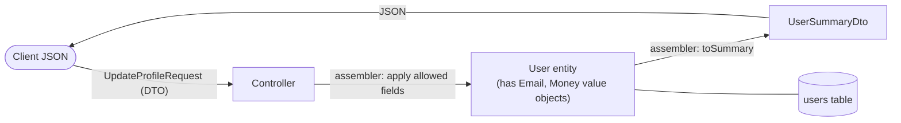

- **Request DTO → entity:** map only allowed fields (or call domain methods).
- **Entity → response DTO:** pick and shape fields for the client; flatten (`orderCount` instead of the list).
- **Value objects** live **inside** entities (`User.email` is an `Email`), and in DTOs you usually flatten them to primitives/strings.
- **DTO projection:** for read screens, skip entities entirely and query straight into DTOs.

---

## 8.4 Complete Java Example - DTO Mapping, Mass Assignment and Value Semantics

```java
import java.util.ArrayList;
import java.util.HashSet;
import java.util.List;
import java.util.Set;

// DTO (Data Transfer Object) and Value Object: two small objects that are often confused.

// ---------------- the domain entity (internal) ----------------
class User {
    final long id; String email; String passwordHash; String role; String phone; final List<String> orderIds = new ArrayList<>();
    User(long id, String email, String passwordHash, String role, String phone) {
        this.id = id; this.email = email; this.passwordHash = passwordHash; this.role = role; this.phone = phone;
    }
}

// ---------------- DTOs: shaped for ONE use case / API, no behaviour ----------------
record UserSummaryDto(long id, String email, int orderCount) {}                    // response for GET /users/{id}
record UpdateProfileRequest(String email, String phone) {}                         // request for PATCH /users/{id}

class UserAssembler {                                            // maps entity <-> DTO (MapStruct generates this in real code)
    static UserSummaryDto toSummary(User u) { return new UserSummaryDto(u.id, u.email, u.orderIds.size()); }
    static void apply(UpdateProfileRequest req, User u) { u.email = req.email(); u.phone = req.phone(); }   // only allowed fields
}

// ---------------- Value objects: identity-less, immutable, compared by value, self-validating ----------------
record Email(String value) {
    Email {
        if (value == null || !value.matches("[^@\\s]+@[^@\\s]+\\.[a-z]{2,}")) throw new IllegalArgumentException("invalid email: " + value);
        value = value.toLowerCase();                             // normalised once, at creation
    }
}
record DateRange(java.time.LocalDate start, java.time.LocalDate end) {
    DateRange { if (end.isBefore(start)) throw new IllegalArgumentException("end before start"); }
    boolean overlaps(DateRange o) { return !start.isAfter(o.end) && !o.start.isAfter(end); }
}

// A MUTABLE "value" class: the classic aliasing bug
class MutableMoney {
    long paise;
    MutableMoney(long p) { paise = p; }
}
class Invoice {
    final MutableMoney total;
    Invoice(MutableMoney total) { this.total = total; }
}

public class DtoValueObjectDemo {
    public static void main(String[] args) {
        User u = new User(7, "asha@example.com", "$2a$10$Qw...hash", "ADMIN", "+91-98xxxxxx01");
        u.orderIds.addAll(List.of("ORD-1", "ORD-2", "ORD-3"));

        System.out.println("=== DTO: return only what the client needs ===");
        System.out.println("entity fields : id, email, passwordHash, role, phone, orderIds   <- never serialise this directly");
        System.out.println("response DTO  : " + UserSummaryDto.class.getSimpleName() + " " + UserAssembler.toSummary(u));

        System.out.println("=== DTO for input: mass-assignment protection ===");
        String attackerJson = "{\"email\":\"asha@new.example.com\",\"phone\":\"+91-90000\",\"role\":\"SUPERADMIN\"}";
        UpdateProfileRequest req = new UpdateProfileRequest("asha@new.example.com", "+91-90000");   // 'role' has no field -> ignored
        UserAssembler.apply(req, u);
        System.out.println("request " + attackerJson);
        System.out.println("after update: email=" + u.email + ", role=" + u.role + " (role could not be changed through this DTO)");

        System.out.println("=== Value objects: equal by value, validated, immutable ===");
        Email e1 = new Email("Asha@Example.com"), e2 = new Email("asha@example.com");
        System.out.println("e1.equals(e2) = " + e1.equals(e2) + ", set size = " + new HashSet<>(Set.of(e1)).size()
                + ", normalised = " + e1.value());
        try { new Email("not-an-email"); } catch (IllegalArgumentException ex) { System.out.println("rejected: " + ex.getMessage()); }
        DateRange holiday = new DateRange(java.time.LocalDate.of(2026, 12, 20), java.time.LocalDate.of(2026, 12, 31));
        DateRange trip = new DateRange(java.time.LocalDate.of(2026, 12, 28), java.time.LocalDate.of(2027, 1, 3));
        System.out.println("holiday overlaps trip: " + holiday.overlaps(trip) + " (behaviour lives in the value object)");

        System.out.println("=== Why value objects must be immutable: aliasing bug ===");
        MutableMoney price = new MutableMoney(500_00);
        Invoice inv1 = new Invoice(price), inv2 = new Invoice(price);   // both invoices share one object
        inv1.total.paise += 100_00;                                  // add a fee to invoice 1 only...
        System.out.println("invoice1 = " + inv1.total.paise / 100 + ", invoice2 = " + inv2.total.paise / 100 + "  <- invoice2 changed too!");
    }
}
```

**Output:**
```
=== DTO: return only what the client needs ===
entity fields : id, email, passwordHash, role, phone, orderIds   <- never serialise this directly
response DTO  : UserSummaryDto UserSummaryDto[id=7, email=asha@example.com, orderCount=3]
=== DTO for input: mass-assignment protection ===
request {"email":"asha@new.example.com","phone":"+91-90000","role":"SUPERADMIN"}
after update: email=asha@new.example.com, role=ADMIN (role could not be changed through this DTO)
=== Value objects: equal by value, validated, immutable ===
e1.equals(e2) = true, set size = 1, normalised = asha@example.com
rejected: invalid email: not-an-email
holiday overlaps trip: true (behaviour lives in the value object)
=== Why value objects must be immutable: aliasing bug ===
invoice1 = 600, invoice2 = 600  <- invoice2 changed too!
```

What the output shows:
- The **response DTO** exposed only `id`, `email` and a computed `orderCount`; `passwordHash`, `role` and `phone` never left the server.
- The attacker's `"role":"SUPERADMIN"` had **nowhere to go**: `UpdateProfileRequest` has no `role` field, so the role stayed `ADMIN`. Binding request JSON directly to the entity would have allowed privilege escalation.
- Two `Email` objects with different capitalisation were **equal** (normalised in the constructor) and collapsed to one in a `Set`; an invalid email couldn't even be created.
- `DateRange.overlaps` shows value objects carry **behaviour**, not just data.
- The **aliasing bug:** two invoices shared one mutable money object, so adding a fee to invoice 1 changed invoice 2 as well. Immutable value objects (records) make this impossible.

---

## 8.5 In Spring Boot (Records, MapStruct, Projections, `@Embeddable`)

```java
// Request / response DTOs as records, with validation for the API contract
public record PlaceOrderRequest(@NotNull Long productId, @Min(1) @Max(10) int quantity) {}
public record OrderResponse(String id, String status, String total) {
    static OrderResponse from(Order o) { return new OrderResponse(o.id().value(), o.status().name(), o.total().toString()); }
}

// MapStruct generates the assembler code at compile time
@Mapper(componentModel = "spring")
interface UserMapper {
    @Mapping(target = "orderCount", expression = "java(user.getOrders().size())")
    UserSummaryDto toSummary(User user);
}

// DTO projection: no entity loaded, only the needed columns are selected
interface UserRepository extends JpaRepository<User, Long> {
    @Query("select new com.shop.users.UserSummaryDto(u.id, u.email.value, size(u.orders)) from User u where u.active = true")
    List<UserSummaryDto> activeSummaries();

    List<UserNameOnly> findByActiveTrue();          // interface-based projection
    interface UserNameOnly { String getName(); }
}

// Value objects in JPA: @Embeddable (records supported since Hibernate 6.2) or an AttributeConverter
@Embeddable
public record Money(long paise, String currency) {
    public Money { if (paise < 0) throw new IllegalArgumentException("negative"); }
}

@Converter(autoApply = true)
class EmailConverter implements AttributeConverter<Email, String> {
    public String convertToDatabaseColumn(Email e) { return e == null ? null : e.value(); }
    public Email convertToEntityAttribute(String s) { return s == null ? null : new Email(s); }
}
```

**Jackson and value objects:** a single-field record can be (de)serialised as a plain string with `@JsonValue` on the accessor and `@JsonCreator` on the constructor, so the API shows `"email":"asha@example.com"`.

---

## 8.6 Pros, Cons, Pitfalls, Interview Questions and Cheat Sheet

| | Pros | Cons |
|---|---|---|
| **DTO** | Stable API, security (no leaks, no mass assignment), fewer round trips, no lazy-loading surprises | Mapping code and near-duplicate classes; mapping bugs |
| **Value Object** | Validation in one place, self-documenting types, thread-safe, no aliasing bugs | More small classes; ORM/JSON mapping needs a bit of setup |

| Pitfall | Fix |
|---|---|
| Returning `@Entity` objects from controllers | Response DTOs. |
| Binding request bodies directly to entities | Request DTOs with only allowed fields. |
| One giant DTO reused for every endpoint | DTOs per use case (create, update, summary, detail). |
| Mutable value objects (setters on `Money`) | Records / final fields; return new instances. |
| Value objects with an `id` field | If it needs identity, it's an entity. |
| Business logic in DTOs | DTOs are dumb carriers; logic in the domain. |

**Q1. DTO vs Value Object?** A DTO carries data across boundaries, has no behaviour and is shaped for a client. A value object is a domain concept defined by its values, immutable, self-validating and with behaviour. A DTO may contain flattened values of value objects.

**Q2. Why not return entities from REST controllers?** Leaks internal/sensitive fields, couples API to schema, triggers lazy loading or recursion during serialisation, and invites mass-assignment vulnerabilities on input.

**Q3. Why should value objects be immutable?** So they can be shared safely (no aliasing bugs), used as map keys, cached, and compared by value; any "change" creates a new value.

**Q4. DTO vs entity vs record?** An entity has identity and persistence mapping; a DTO is a transfer shape; a Java `record` is a language feature that is ideal for DTOs and value objects (immutable, value-based equals).

```
DTO            Data carrier across boundaries, no behaviour, shaped per use case. Request DTOs (allowed fields, @Valid),
               response DTOs (no entities!). Assemblers/MapStruct, JPQL constructor & interface projections.
VALUE OBJECT   Domain value: immutable, equal by value, self-validating, has behaviour (Money, Email, DateRange, OrderId).
               JPA: @Embeddable (records OK in Hibernate 6.2+), AttributeConverter. Avoid primitive obsession & aliasing.
```

---

# 9. Front Controller, Intercepting Filter, Application Controller and Context Object (Interview Imp - Java)

## 9.1 What Are They?

Four presentation-tier patterns that together describe how a Java web framework handles requests:

| Pattern | What it does | Spring equivalent |
|---|---|---|
| **Front Controller** | **One** entry point receives every request and dispatches it | `DispatcherServlet` |
| **Intercepting Filter** | A **chain** of pre/post-processing steps around the request (auth, logging, compression, CORS) | Servlet `Filter`s, `OncePerRequestFilter`, Spring Security `SecurityFilterChain`, `HandlerInterceptor` |
| **Application Controller** | Centralises "which handler (command) for this request?" and "which view for this result?" | `HandlerMapping`, `HandlerAdapter`, `ViewResolver` |
| **Context Object** | Wraps protocol-specific data (HTTP request, session) in a protocol-independent object passed to business code | `@AuthenticationPrincipal`, `SecurityContextHolder`, `RequestContextHolder`, method arguments bound from the request |

**Analogy:** A large office building.
- **Front Controller:** the single reception desk every visitor goes to.
- **Intercepting Filters:** the security scanner, visitor log and badge check that every visitor passes through on the way in (and out).
- **Application Controller:** the receptionist's directory that says "invoice questions → Accounts, 3rd floor".
- **Context Object:** the visitor badge, which says who you are and why you're here, so departments don't need to see your passport.

#### 📘 Terms Explained

| Term | Simple meaning |
|---|---|
| **Front Controller** | A single handler that receives all requests and routes them. |
| **Intercepting Filter** | Pluggable pre/post-processing applied to every request, arranged in a chain. |
| **Application Controller** | A component that maps requests to commands and results to views. |
| **Context Object** | An object holding request state (user, locale, parameters) independent of the protocol. |
| **Command** | An object representing one action/handler ([Command pattern](../01_LLD/04_Behavioral_Pattern.md#2-command-pattern)). |
| **Short-circuit** | A filter ending the request early (e.g. 401) so later filters and the handler never run. |

---

## 9.2 Why Do We Need Them?

| Without | With |
|---|---|
| Each page/servlet repeats authentication, logging, encoding, error handling | Done once in filters / the front controller |
| URL → code mapping scattered in many servlets | One routing table (application controller) |
| Business code reads `HttpServletRequest` directly | Business code gets a context object: testable without a servlet container |
| Adding a cross-cutting concern (rate limiting, tracing) means editing every handler | Add one filter to the chain |

---

## 9.3 How They Work Together

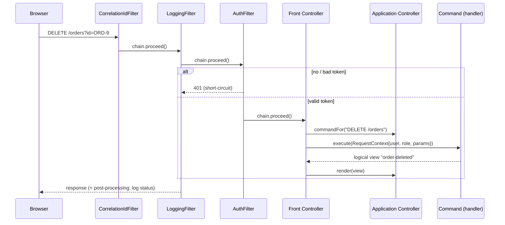

The **Intercepting Filter** chain is a [Chain of Responsibility](../01_LLD/04_Behavioral_Pattern.md#1-chain-of-responsibility-pattern-interview-imp---java) where code **before** `proceed()` is pre-processing and code **after** it is post-processing.

---

## 9.4 Complete Java Example - A Mini DispatcherServlet with a Filter Chain

```java
import java.util.ArrayList;
import java.util.LinkedHashMap;
import java.util.List;
import java.util.Map;

// Presentation-tier patterns working together:
// Front Controller (one entry point) + Intercepting Filter (pre/post processing chain)
// + Application Controller (maps request -> command -> view) + Context Object (protocol-independent request data).

// ---------- raw "HTTP" request/response ----------
record HttpRequest(String method, String path, Map<String, String> headers, Map<String, String> params) {}
class HttpResponse { int status = 200; String body = ""; final Map<String, String> headers = new LinkedHashMap<>(); }

// ---------- Context Object: what the business code sees (no HTTP classes) ----------
record RequestContext(String user, String role, String action, Map<String, String> params, String correlationId) {}

// ---------- Intercepting Filter ----------
interface Filter { void doFilter(HttpRequest req, HttpResponse res, FilterChain chain); }
class FilterChain {
    private final List<Filter> filters; private final Runnable target; private int index = 0;
    FilterChain(List<Filter> filters, Runnable target) { this.filters = filters; this.target = target; }
    void proceed(HttpRequest req, HttpResponse res) {
        if (index < filters.size()) filters.get(index++).doFilter(req, res, this);
        else target.run();
    }
}
class CorrelationIdFilter implements Filter {
    static int seq = 0;
    public void doFilter(HttpRequest req, HttpResponse res, FilterChain chain) {
        String id = req.headers().getOrDefault("X-Request-Id", "req-" + (++seq));
        req.headers().put("X-Request-Id", id);
        res.headers.put("X-Request-Id", id);
        chain.proceed(req, res);
    }
}
class LoggingFilter implements Filter {
    public void doFilter(HttpRequest req, HttpResponse res, FilterChain chain) {
        System.out.println("  [log] -> " + req.method() + " " + req.path() + " id=" + req.headers().get("X-Request-Id"));
        chain.proceed(req, res);                                   // code after proceed() = post-processing
        System.out.println("  [log] <- " + res.status);
    }
}
class AuthFilter implements Filter {
    static final Map<String, String[]> TOKENS = Map.of("tok-asha", new String[]{"asha", "ADMIN"}, "tok-ravi", new String[]{"ravi", "USER"});
    public void doFilter(HttpRequest req, HttpResponse res, FilterChain chain) {
        String[] who = TOKENS.get(req.headers().getOrDefault("Authorization", ""));
        if (who == null) { res.status = 401; res.body = "{\"error\":\"unauthenticated\"}"; return; }   // short-circuit: target never runs
        req.headers().put("X-User", who[0]); req.headers().put("X-Role", who[1]);
        chain.proceed(req, res);
    }
}

// ---------- Commands (the actual handlers) ----------
interface Command { String execute(RequestContext ctx); }        // returns a logical view name
class ListOrdersCommand implements Command {
    public String execute(RequestContext ctx) { return "orders-list:" + ctx.user() + " has 3 orders"; }
}
class DeleteOrderCommand implements Command {
    public String execute(RequestContext ctx) {
        if (!ctx.role().equals("ADMIN")) return "error-403:only admins can delete";
        return "order-deleted:" + ctx.params().get("id");
    }
}

// ---------- Application Controller: action -> command, logical view -> response ----------
class ApplicationController {
    private final Map<String, Command> commands = Map.of("GET /orders", new ListOrdersCommand(), "DELETE /orders", new DeleteOrderCommand());
    Command commandFor(String action) { return commands.get(action); }
    void render(String view, HttpResponse res) {                   // view resolution in one place
        String[] v = view.split(":", 2);
        if (v[0].startsWith("error-")) res.status = Integer.parseInt(v[0].substring(6));
        res.body = "{\"view\":\"" + v[0] + "\",\"message\":\"" + v[1] + "\"}";
    }
}

// ---------- Front Controller: the single entry point (like DispatcherServlet) ----------
class FrontController {
    private final List<Filter> filters = List.of(new CorrelationIdFilter(), new LoggingFilter(), new AuthFilter());
    private final ApplicationController app = new ApplicationController();

    HttpResponse handle(HttpRequest req) {
        HttpResponse res = new HttpResponse();
        new FilterChain(filters, () -> dispatch(req, res)).proceed(req, res);
        return res;
    }
    private void dispatch(HttpRequest req, HttpResponse res) {
        String action = req.method() + " " + req.path();
        Command cmd = app.commandFor(action);
        if (cmd == null) { res.status = 404; res.body = "{\"error\":\"no handler for " + action + "\"}"; return; }
        RequestContext ctx = new RequestContext(req.headers().get("X-User"), req.headers().get("X-Role"), action, req.params(),
                req.headers().get("X-Request-Id"));
        app.render(cmd.execute(ctx), res);
    }
}

public class FrontControllerDemo {
    static HttpRequest req(String method, String path, String token, Map<String, String> params) {
        Map<String, String> h = new LinkedHashMap<>(); if (token != null) h.put("Authorization", token);
        return new HttpRequest(method, path, h, params);
    }
    public static void main(String[] args) {
        FrontController fc = new FrontController();
        List<HttpRequest> requests = new ArrayList<>(List.of(
                req("GET", "/orders", "tok-ravi", Map.of()),
                req("DELETE", "/orders", "tok-ravi", Map.of("id", "ORD-9")),
                req("DELETE", "/orders", "tok-asha", Map.of("id", "ORD-9")),
                req("GET", "/orders", null, Map.of()),
                req("GET", "/reports", "tok-asha", Map.of())));
        for (HttpRequest r : requests) {
            System.out.println(r.method() + " " + r.path() + " (token=" + r.headers().get("Authorization") + ")");
            HttpResponse res = fc.handle(r);
            System.out.println("  => " + res.status + " " + res.body + " " + res.headers);
        }
    }
}
```

**Output:**
```
GET /orders (token=tok-ravi)
  [log] -> GET /orders id=req-1
  [log] <- 200
  => 200 {"view":"orders-list","message":"ravi has 3 orders"} {X-Request-Id=req-1}
DELETE /orders (token=tok-ravi)
  [log] -> DELETE /orders id=req-2
  [log] <- 403
  => 403 {"view":"error-403","message":"only admins can delete"} {X-Request-Id=req-2}
DELETE /orders (token=tok-asha)
  [log] -> DELETE /orders id=req-3
  [log] <- 200
  => 200 {"view":"order-deleted","message":"ORD-9"} {X-Request-Id=req-3}
GET /orders (token=null)
  [log] -> GET /orders id=req-4
  [log] <- 401
  => 401 {"error":"unauthenticated"} {X-Request-Id=req-4}
GET /reports (token=tok-asha)
  [log] -> GET /reports id=req-5
  [log] <- 404
  => 404 {"error":"no handler for GET /reports"} {X-Request-Id=req-5}
```

What the output shows:
- **Every** request went through the same entry point and the same three filters, in order: correlation ID, logging, auth. No handler contains any of that code.
- The **LoggingFilter's** `<-` line printed **after** the handler ran: post-processing around `chain.proceed()`.
- The unauthenticated request was **short-circuited** by `AuthFilter` (401): no command ran, but the outer logging and correlation filters still wrapped it.
- The **application controller** mapped actions to commands and logical views to responses, including a 403 view and a 404 for an unknown route.
- `DeleteOrderCommand` checked `ctx.role()`, a **context object** field, and never touched headers or tokens.

---

## 9.5 In Spring (DispatcherServlet, Filters, HandlerInterceptors)

```java
// Intercepting Filter at the SERVLET level: runs for every request, before the DispatcherServlet
@Component
@Order(Ordered.HIGHEST_PRECEDENCE)
class CorrelationIdFilter extends OncePerRequestFilter {
    @Override
    protected void doFilterInternal(HttpServletRequest req, HttpServletResponse res, FilterChain chain) throws ServletException, IOException {
        String id = Optional.ofNullable(req.getHeader("X-Request-Id")).orElse(UUID.randomUUID().toString());
        MDC.put("requestId", id);
        res.setHeader("X-Request-Id", id);
        try { chain.doFilter(req, res); }          // pre-processing above, post-processing below
        finally { MDC.remove("requestId"); }
    }
}

// Intercepting Filter at the HANDLER level: knows which controller method will run
@Component
class TimingInterceptor implements HandlerInterceptor {
    public boolean preHandle(HttpServletRequest req, HttpServletResponse res, Object handler) {
        req.setAttribute("start", System.nanoTime()); return true;          // false = short-circuit
    }
    public void afterCompletion(HttpServletRequest req, HttpServletResponse res, Object handler, Exception ex) {
        long ms = (System.nanoTime() - (long) req.getAttribute("start")) / 1_000_000;
        log.info("{} {} -> {} in {} ms", req.getMethod(), req.getRequestURI(), res.getStatus(), ms);
    }
}
@Configuration
class WebConfig implements WebMvcConfigurer {
    @Autowired TimingInterceptor timing;
    public void addInterceptors(InterceptorRegistry registry) { registry.addInterceptor(timing).addPathPatterns("/api/**"); }
}

// Spring Security is itself an Intercepting Filter chain (DelegatingFilterProxy -> FilterChainProxy -> SecurityFilterChain)
@Bean
SecurityFilterChain api(HttpSecurity http) throws Exception {
    return http.authorizeHttpRequests(a -> a.requestMatchers(HttpMethod.DELETE, "/orders/**").hasRole("ADMIN").anyRequest().authenticated())
               .oauth2ResourceServer(o -> o.jwt(Customizer.withDefaults()))
               .build();
}

// Context Object: the controller receives resolved, protocol-independent data, not the raw request
@DeleteMapping("/orders/{id}")
ResponseEntity<Void> delete(@PathVariable String id, @AuthenticationPrincipal Jwt user) {
    orderService.delete(new OrderId(id), new Actor(user.getSubject()));    // the service gets a domain-level "Actor"
    return ResponseEntity.noContent().build();
}
```

| | Servlet `Filter` | `HandlerInterceptor` | AOP aspect (`@Around`) |
|---|---|---|---|
| Level | Servlet container, before Spring MVC | Inside Spring MVC, around the handler | Around any Spring bean method |
| Knows the controller method? | No | Yes (`handler` argument) | Yes (join point) |
| Typical use | Security, CORS, compression, request IDs, encoding | Timing, locale, per-route checks | Transactions, caching, method-level auditing |

**Request flow inside `DispatcherServlet`:** `HandlerMapping` (application controller: find the handler) → `HandlerInterceptor.preHandle` → `HandlerAdapter` (invoke with argument resolvers building context objects) → `postHandle` → `ViewResolver` / `HttpMessageConverter` → `afterCompletion`. Exceptions go through `HandlerExceptionResolver` (`@ControllerAdvice`). See also [01_Architectural_Pattern.md - MVC](01_Architectural_Pattern.md#26-mvc-in-spring-boot-and-mvvm-in-javafx--android).

#### 📘 Terms Explained

| Term | Simple meaning |
|---|---|
| **`OncePerRequestFilter`** | Spring base class guaranteeing a filter runs once per request (even with forwards). |
| **`HandlerInterceptor`** | Spring MVC hook with `preHandle`, `postHandle`, `afterCompletion` around controller methods. |
| **`FilterChainProxy`** | Spring Security's filter that delegates to the configured security filter chains. |
| **`HandlerMapping` / `HandlerAdapter`** | Spring MVC parts that find and invoke the controller method for a request. |
| **Argument resolver** | Spring component that builds controller method arguments (`@PathVariable`, `@AuthenticationPrincipal`). |
| **MDC** | Logging context map; values appear in every log line of the request. |

---

## 9.6 Pros, Cons, Pitfalls, Interview Questions and Cheat Sheet

| Pros | Cons |
|---|---|
| Cross-cutting concerns implemented once, applied everywhere | One more layer of indirection; flow is harder to trace for beginners |
| Central routing, consistent error handling | Filter **order** bugs (auth after logging of the body, CORS after security) |
| Business code independent of HTTP (context objects) | A heavy filter slows **every** request |

| Pitfall | Fix |
|---|---|
| Doing business logic in filters | Filters for cross-cutting concerns only. |
| Wrong filter order | Explicit `@Order` / `FilterRegistrationBean.setOrder`; Spring Security's documented order. |
| Reading the request body in a filter (stream consumed) | `ContentCachingRequestWrapper`. |
| Passing `HttpServletRequest` into services | Pass context objects / domain values. |
| ThreadLocal context not cleared (MDC, security) | Clear in `finally`. |

**Q1. What is the Front Controller pattern and where is it in Spring?** A single entry point for all requests that dispatches to handlers and views. In Spring MVC it's `DispatcherServlet`.

**Q2. Filter vs Interceptor?** A servlet `Filter` works at the container level before Spring MVC and doesn't know the handler; a `HandlerInterceptor` runs inside Spring MVC around a specific controller method and can access it.

**Q3. Which pattern is Spring Security's filter chain?** Intercepting Filter (implemented as Chain of Responsibility): authentication, authorization, CSRF, CORS, exception translation filters run in a defined order.

```
FRONT CONTROLLER      One entry point for all requests (DispatcherServlet).
INTERCEPTING FILTER   Chain of pre/post-processing (Servlet Filter, OncePerRequestFilter, Spring Security, HandlerInterceptor).
                      Code before proceed()/doFilter() = pre, after = post; can short-circuit (401/403). Order matters.
APPLICATION CTRL      Request -> command/handler, result -> view (HandlerMapping, HandlerAdapter, ViewResolver).
CONTEXT OBJECT        Protocol-independent request data for business code (@AuthenticationPrincipal, SecurityContext, Actor).
```

---

## 9.7 Types and Variants

| Pattern | Where it sits | Java / Spring form |
|---|---|---|
| **Front Controller** | One entry point for all requests, dispatches to handlers | `DispatcherServlet` (Spring MVC), Jakarta Faces `FacesServlet` |
| **Intercepting Filter** | Chain of pre/post-processing around the request | Servlet `Filter`, Spring Security filter chain, `HandlerInterceptor`, WebFlux `WebFilter` |
| **Application Controller** | Chooses the next view/action based on state | Spring Web Flow, `@ControllerAdvice` for cross-cutting decisions |
| **Context Object** | Carries request-scoped data through layers without servlet types | `SecurityContextHolder`, `RequestContextHolder`, MDC for logging, a custom `RequestContext` record |
| **Page Controller** (the alternative) | One controller per page/URL | Each `@Controller` class or a JSP with its own logic |
| **Reactive variant** | Non-blocking dispatch | WebFlux `DispatcherHandler` + `WebFilter` chain |

# 10. Business Delegate and Session Facade

## 10.1 What Are They?

Two Core J2EE patterns for talking to a **remote business tier** (originally EJBs on another server):

| Pattern | Lives on | What it does |
|---|---|---|
| **Session Facade** | **Server** side | Exposes a few **coarse-grained** operations that internally call many fine-grained business objects locally, so the client makes **one** remote call instead of many. A [Facade](../01_LLD/03_Structural_Pattern.md#5-facade-pattern-interview-imp---java) applied to remote access. |
| **Business Delegate** | **Client** side (presentation tier) | A plain local object that hides the remote service: **lookup** (JNDI/discovery), **remoting**, **retries/caching**, and **translation** of technical exceptions into business ones. |

**Analogy:** Ordering from a big company.
- **Session Facade:** the company's single customer-service number. One call, and they talk to billing, warehouse and delivery internally.
- **Business Delegate:** your personal assistant who knows the number, redials when the line is busy, and tells you "the order system is down, try later" instead of reading you a telephone error code.

#### 📘 Terms Explained

| Term | Simple meaning |
|---|---|
| **Session Facade** | A server-side facade (originally a session EJB) offering coarse-grained operations over fine-grained objects. |
| **Business Delegate** | A client-side proxy that hides lookup, remote calls and remote exceptions from the presentation tier. |
| **EJB** | Enterprise JavaBeans: Java EE's component model for remote/transactional business objects. |
| **JNDI** | Java Naming and Directory Interface: the Java EE lookup service for resources and EJBs. |
| **Round trip** | One request-response over the network. |
| **Chatty interface** | An API that needs many small calls to do one job. |

---

## 10.2 Why Did We Need Them, and Do We Still?

The original problem: calling fine-grained **remote** objects (each getter a network call) was slow, and every JSP/servlet had JNDI lookup and `RemoteException` handling code.

The ideas are **very much alive** under new names:

| Old (J2EE) | Today |
|---|---|
| Session Facade over entity beans | **API composition / BFF** endpoints, coarse-grained REST/gRPC operations, GraphQL resolvers, application services |
| Business Delegate | **Generated API clients**: OpenFeign interfaces, Spring HTTP interface clients (`@HttpExchange`), gRPC stubs, with Resilience4j retries and exception mapping |
| JNDI lookup in the delegate | Service discovery (Eureka, Kubernetes DNS), client-side load balancing |
| `RemoteException` → `BusinessException` | `FeignException` / `WebClientResponseException` → domain exceptions, `@ControllerAdvice` |

Related microservices patterns: [API Gateway and BFF](../04_Specialized/02_Microservices_Pattern.md#2-api-gateway-and-backends-for-frontends-interview-imp---java) and [API Composition](../04_Specialized/02_Microservices_Pattern.md#3-api-composition-pattern-interview-imp---java).

---

## 10.3 How They Work

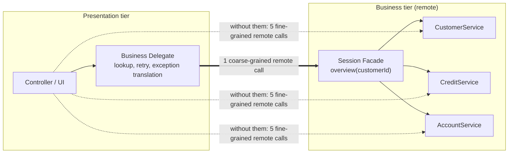

---

## 10.4 Complete Java Example - Round Trips, Retries and Exception Translation

```java
import java.util.List;
import java.util.Map;

// Session Facade (coarse-grained remote API) and Business Delegate (client-side helper that hides lookup,
// retries and remote exceptions). Classic J2EE patterns whose ideas live on in BFFs, API composition and Feign clients.

class Network {                                                  // every remote call costs a round trip
    static int calls = 0; static int latencyMs = 0; static boolean insideServer = false;
    static void roundTrip(String what) {
        if (insideServer) { System.out.println("       local call inside the server: " + what); return; }   // same JVM: no network cost
        calls++; latencyMs += 40; System.out.println("    -> network: " + what);
    }
    static void reset() { calls = 0; latencyMs = 0; }
}

// ---------- fine-grained remote business objects ----------
class CustomerRemote { String name(long id) { Network.roundTrip("CustomerService.name(" + id + ")"); return "asha"; } }
class CreditRemote { int score(long id) { Network.roundTrip("CreditService.score(" + id + ")"); return 742; } }
class AccountRemote {
    List<Long> accounts(long id) { Network.roundTrip("AccountService.accounts(" + id + ")"); return List.of(11L, 12L); }
    long balance(long acc) { Network.roundTrip("AccountService.balance(" + acc + ")"); return acc == 11 ? 52_000 : 8_500; }
}

// ---------- SESSION FACADE: one coarse-grained call on the SERVER side, aggregating the fine-grained ones locally ----------
record CustomerOverview(String name, int creditScore, long totalBalance, int accounts) {}
class CustomerOverviewFacade {
    private final CustomerRemote customers = new CustomerRemote(); private final CreditRemote credit = new CreditRemote();
    private final AccountRemote accounts = new AccountRemote();
    CustomerOverview overview(long id) {                         // in J2EE: a stateless session bean; today: a BFF / application service
        Network.insideServer = true;                             // the facade runs next to the services: calls are local
        try {
            List<Long> acc = accounts.accounts(id);
            long total = 0; for (long a : acc) total += accounts.balance(a);
            return new CustomerOverview(customers.name(id), credit.score(id), total, acc.size());
        } finally { Network.insideServer = false; }
    }
}

// ---------- BUSINESS DELEGATE: what the presentation tier uses; hides lookup, remoting, retries, exception translation ----------
class ServiceUnavailableException extends RuntimeException { ServiceUnavailableException(String m) { super(m); } }
class RemoteTimeoutException extends RuntimeException { RemoteTimeoutException() { super("java.net.SocketTimeoutException: Read timed out"); } }

class CustomerOverviewDelegate {
    private final Map<String, CustomerOverviewFacade> registry;  // service lookup (JNDI in J2EE; discovery/Feign today)
    private int failuresToSimulate;
    CustomerOverviewDelegate(Map<String, CustomerOverviewFacade> registry, int failuresToSimulate) { this.registry = registry; this.failuresToSimulate = failuresToSimulate; }

    CustomerOverview overview(long id) {
        CustomerOverviewFacade facade = registry.get("java:global/bank/CustomerOverviewFacade");   // lookup hidden from the UI
        for (int attempt = 1; attempt <= 3; attempt++) {
            try {
                Network.roundTrip("CustomerOverviewFacade.overview(" + id + ") attempt " + attempt);
                if (failuresToSimulate-- > 0) throw new RemoteTimeoutException();
                return facade.overview(id);
            } catch (RemoteTimeoutException e) {
                System.out.println("    delegate: " + e.getMessage() + ", retrying");
            }
        }
        throw new ServiceUnavailableException("customer overview is temporarily unavailable");   // business-friendly exception
    }
}

public class FacadeDelegateDemo {
    public static void main(String[] args) {
        System.out.println("=== Without a facade: the client calls fine-grained remote services itself ===");
        Network.reset();
        CustomerRemote c = new CustomerRemote(); CreditRemote cr = new CreditRemote(); AccountRemote a = new AccountRemote();
        String name = c.name(7); int score = cr.score(7); long total = 0; List<Long> accs = a.accounts(7);
        for (long acc : accs) total += a.balance(acc);
        System.out.println("  " + new CustomerOverview(name, score, total, accs.size()) + " | round trips " + Network.calls + ", ~" + Network.latencyMs + "ms");

        System.out.println("=== With a Session Facade, used through a Business Delegate ===");
        Network.reset();
        Map<String, CustomerOverviewFacade> jndi = Map.of("java:global/bank/CustomerOverviewFacade", new CustomerOverviewFacade());
        System.out.println("  " + new CustomerOverviewDelegate(jndi, 0).overview(7) + " | round trips " + Network.calls + ", ~" + Network.latencyMs + "ms");

        System.out.println("=== Delegate hides a transient failure (1 timeout, then success) ===");
        Network.reset();
        System.out.println("  " + new CustomerOverviewDelegate(jndi, 1).overview(7));

        System.out.println("=== Delegate translates a hard failure into a business exception ===");
        try { new CustomerOverviewDelegate(jndi, 5).overview(7); }
        catch (ServiceUnavailableException e) { System.out.println("  UI shows: " + e.getMessage() + " (no SocketTimeoutException leaks into the view)"); }
    }
}
```

**Output:**
```
=== Without a facade: the client calls fine-grained remote services itself ===
    -> network: CustomerService.name(7)
    -> network: CreditService.score(7)
    -> network: AccountService.accounts(7)
    -> network: AccountService.balance(11)
    -> network: AccountService.balance(12)
  CustomerOverview[name=asha, creditScore=742, totalBalance=60500, accounts=2] | round trips 5, ~200ms
=== With a Session Facade, used through a Business Delegate ===
    -> network: CustomerOverviewFacade.overview(7) attempt 1
       local call inside the server: AccountService.accounts(7)
       local call inside the server: AccountService.balance(11)
       local call inside the server: AccountService.balance(12)
       local call inside the server: CustomerService.name(7)
       local call inside the server: CreditService.score(7)
  CustomerOverview[name=asha, creditScore=742, totalBalance=60500, accounts=2] | round trips 1, ~40ms
=== Delegate hides a transient failure (1 timeout, then success) ===
    -> network: CustomerOverviewFacade.overview(7) attempt 1
    delegate: java.net.SocketTimeoutException: Read timed out, retrying
    -> network: CustomerOverviewFacade.overview(7) attempt 2
       local call inside the server: AccountService.accounts(7)
       local call inside the server: AccountService.balance(11)
       local call inside the server: AccountService.balance(12)
       local call inside the server: CustomerService.name(7)
       local call inside the server: CreditService.score(7)
  CustomerOverview[name=asha, creditScore=742, totalBalance=60500, accounts=2]
=== Delegate translates a hard failure into a business exception ===
    -> network: CustomerOverviewFacade.overview(7) attempt 1
    delegate: java.net.SocketTimeoutException: Read timed out, retrying
    -> network: CustomerOverviewFacade.overview(7) attempt 2
    delegate: java.net.SocketTimeoutException: Read timed out, retrying
    -> network: CustomerOverviewFacade.overview(7) attempt 3
    delegate: java.net.SocketTimeoutException: Read timed out, retrying
  UI shows: customer overview is temporarily unavailable (no SocketTimeoutException leaks into the view)
```

What the output shows:
- Without a facade, building one screen cost **5 network round trips (~200 ms)**.
- With the facade, the client made **1** round trip (~40 ms); the five calls still happened, but **locally inside the server** where they are cheap.
- The **delegate** hid the JNDI-style lookup, retried a timeout transparently, and after three failures threw a **business-friendly** `ServiceUnavailableException`, so the UI never sees `SocketTimeoutException`.

---

## 10.5 Classic EJB and Modern Spring Equivalents

```java
// CLASSIC: Session Facade as a stateless session bean (Jakarta EE)
@Stateless
@Remote(CustomerOverviewRemote.class)
public class CustomerOverviewFacade implements CustomerOverviewRemote {
    @EJB CustomerService customers; @EJB CreditService credit; @EJB AccountService accounts;
    @TransactionAttribute(TransactionAttributeType.REQUIRED)
    public CustomerOverviewDto overview(long id) { /* local calls, one DTO back */ }
}

// MODERN server side: a coarse-grained BFF / composition endpoint
@RestController @RequiredArgsConstructor
class CustomerOverviewController {
    private final CustomerClient customers; private final CreditClient credit; private final AccountClient accounts;
    @GetMapping("/bff/customers/{id}/overview")
    CustomerOverviewDto overview(@PathVariable long id) {
        var c = CompletableFuture.supplyAsync(() -> customers.get(id));      // fan out in parallel
        var s = CompletableFuture.supplyAsync(() -> credit.score(id));
        var a = CompletableFuture.supplyAsync(() -> accounts.balances(id));
        return new CustomerOverviewDto(c.join().name(), s.join(), a.join().total());
    }
}

// MODERN client side: a Business Delegate = declarative HTTP client + resilience + exception translation
@HttpExchange("/api/customers")
interface CustomerOverviewApi {                             // Spring 6 HTTP interface (or an OpenFeign @FeignClient)
    @GetExchange("/{id}/overview") CustomerOverviewDto overview(@PathVariable long id);
}

@Component @RequiredArgsConstructor
class CustomerOverviewDelegate {
    private final CustomerOverviewApi api;
    @Retry(name = "overview") @CircuitBreaker(name = "overview", fallbackMethod = "unavailable")   // Resilience4j
    public CustomerOverviewDto overview(long id) { return api.overview(id); }
    private CustomerOverviewDto unavailable(long id, Throwable t) { throw new ServiceUnavailableException("overview temporarily unavailable"); }
}
```

---

## 10.6 Pros, Cons, Pitfalls, Interview Questions and Cheat Sheet

| | Pros | Cons |
|---|---|---|
| **Session Facade** | Fewer round trips; one transaction per use case; hides business-object complexity | Can grow into a god object; adds a layer |
| **Business Delegate** | Presentation code free of remoting, lookup and technical exceptions; central retry/caching | Another class per service; can hide expensive remote calls behind innocent-looking methods |

| Pitfall | Fix |
|---|---|
| Chatty remote APIs (one call per field) | Coarse-grained operations returning DTOs. |
| Facade that is just pass-through to one service | Only add it where it aggregates or defines a transaction. |
| Delegate that retries non-idempotent operations | Retry only idempotent calls or use idempotency keys. |
| Remote exceptions leaking into the UI | Translate in the delegate / `@ControllerAdvice`. |

**Q1. What problem does Session Facade solve?** Too many fine-grained remote calls and scattered transaction handling: it offers coarse-grained remote operations that do the fine-grained work locally in one transaction.

**Q2. What does a Business Delegate hide?** Service lookup, remote invocation details, retries/caching and technical exceptions, so the presentation tier calls a simple local method.

**Q3. Are these patterns obsolete?** The EJB-specific forms mostly are, but the ideas live on: coarse-grained APIs/BFFs (facade) and generated HTTP/gRPC clients with resilience and exception mapping (delegate).

```
SESSION FACADE     Server side: coarse-grained remote operations over fine-grained objects -> 1 round trip, 1 transaction.
                   Today: BFF / API composition / coarse REST & gRPC endpoints.
BUSINESS DELEGATE  Client side: hides lookup, remoting, retries, exception translation. Today: Feign / @HttpExchange clients +
                   Resilience4j + domain exceptions.
```

---

## 10.7 Types and Variants

| Pattern | Purpose | Modern equivalent |
|---|---|---|
| **Business Delegate** | Client-side object hiding lookup and remote-call details of business services | Spring `@Service` proxies, Feign/`@HttpExchange` clients, gRPC stubs |
| **Service Locator** (used by the delegate) | Find the remote service (JNDI) and cache it | Dependency injection; Eureka/Consul service discovery |
| **Session Facade** | Coarse-grained server-side facade over fine-grained entities, one call per use case (fewer network round trips) | An application `@Service` method with `@Transactional`, or a REST/BFF endpoint |
| **Transfer Object (DTO)** | Data carried across the remote boundary in one piece | Java records as DTOs, MapStruct mapping |
| **Remote vs local facade** | Remote facade minimises calls across the network; local facade only simplifies APIs | Microservice API (remote) vs internal service (local) |

# 11. Dependency Injection and Service Locator (Interview Imp - Java)

## 11.1 What Are They?

Two ways for an object to get the other objects it needs (its **dependencies**):

- **Dependency Injection (DI):** the object **receives** its dependencies from outside (usually through its constructor). A **container** (Spring's `ApplicationContext`) creates objects and wires them together. The object never looks anything up.
- **Service Locator:** the object **asks** a central registry for its dependencies when it needs them: `ServiceLocator.get(PaymentGateway.class)`.

Both are ways to achieve **Inversion of Control (IoC)**: the object doesn't create its own dependencies with `new`.

**Analogy:** Getting tools for a job.
- **Dependency Injection:** you arrive and the foreman **hands you** a toolbox with exactly the tools listed on your job card. Anyone reading the job card knows what you need.
- **Service Locator:** you're given the key to a giant shared tool room and fetch tools whenever you think of it. It works, but nobody knows what you'll need until you're halfway through the job and discover the drill is missing.

#### 📘 Terms Explained

| Term | Simple meaning |
|---|---|
| **Dependency** | Another object a class needs to do its work. |
| **Inversion of Control (IoC)** | Something outside the object (a framework/container) controls creation and wiring. |
| **DI container / IoC container** | The component that creates beans and injects dependencies (Spring `ApplicationContext`). |
| **Bean** | An object managed by the Spring container. |
| **Service Locator** | A registry that objects query to obtain services at runtime. |
| **Scope** | How many instances the container creates: singleton, prototype, request, session. |

---

## 11.2 Why Do We Need Them?

| Creating dependencies with `new` inside the class | With DI |
|---|---|
| `new StripeGateway()` hard-wired → can't swap to Razorpay or a fake | Interface in the constructor; implementation chosen by configuration |
| Unit tests hit real services | Pass mocks/fakes in the test |
| Configuration (URLs, keys) spread through classes | Centralised in configuration |
| Lifecycle (singletons, pools, shutdown) handled ad hoc | Container manages scopes and lifecycle callbacks |

**DI vs Service Locator** (both decouple from implementations, but):

| Question | DI | Service Locator |
|---|---|---|
| Are dependencies visible in the API? | ✅ in the constructor | ❌ hidden inside method bodies |
| When is a missing dependency found? | At **startup** (container fails fast) | At **runtime**, when the code path runs |
| Testability | Pass fakes directly | Must configure a global registry in each test |
| Dependency on infrastructure | None (plain constructor) | Every class depends on the locator |
| Good uses | Default for application code | Plugin discovery, framework internals, legacy code, lazily choosing among many implementations |

---

## 11.3 How They Work

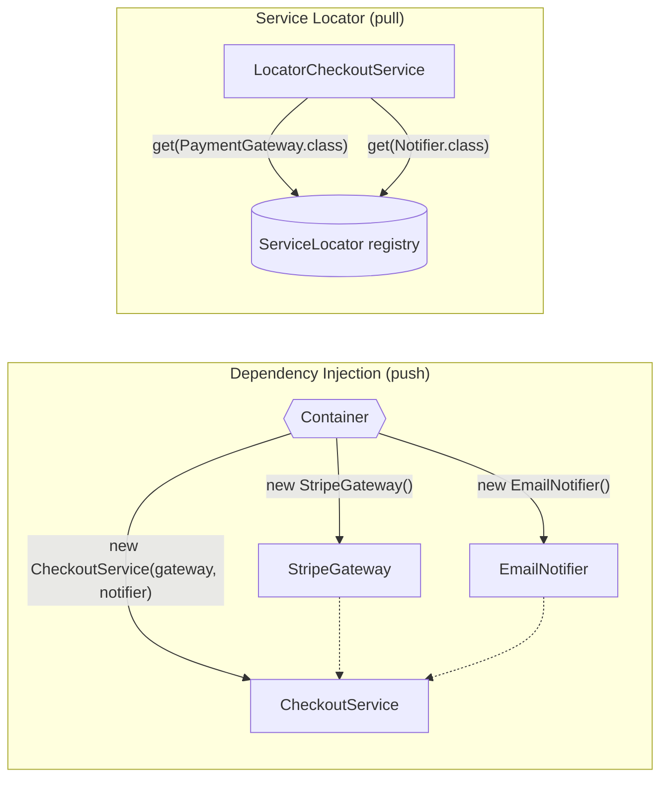

A DI container:
1. Reads configuration (`@Component` scanning, `@Bean` methods, bindings of interfaces to implementations).
2. Builds a **dependency graph** and detects cycles.
3. Creates beans in dependency order (constructor parameters first), applies scopes (singleton = one shared instance).
4. Wraps beans in proxies where needed (`@Transactional`, `@Async`, security).
5. Calls lifecycle callbacks (`@PostConstruct`, `@PreDestroy`).

---

## 11.4 Types of Injection

| Type | How | Verdict |
|---|---|---|
| **Constructor injection** | Dependencies are constructor parameters (`final` fields) | ✅ **Recommended**: mandatory deps explicit, immutable, easy to test, fails fast, reveals classes with too many deps |
| **Setter injection** | `@Autowired void setX(X x)` | For optional dependencies or reconfiguration |
| **Field injection** | `@Autowired private X x;` | ❌ Avoid: hidden deps, can't make final, needs reflection or the container in tests |
| **Method/parameter injection** | Dependencies passed to a specific method (`@Bean` method params) | Used in configuration classes |
| **Interface injection** | The class implements an `injectX(X)` interface | Historic; rarely used (Spring's `*Aware` interfaces are similar) |

---

## 11.5 Complete Java Example - A Tiny DI Container vs a Service Locator

A ~40-line container uses reflection to do **constructor injection**, **interface → implementation binding**, **singleton scope** and **cycle detection**. Then the same service is written with a **Service Locator**.

```java
import java.lang.reflect.Constructor;
import java.util.ArrayList;
import java.util.HashMap;
import java.util.List;
import java.util.Map;

// Dependency Injection vs Service Locator.
// Part 1: a tiny DI container (constructor injection, interface binding, singletons, cycle detection) using reflection.
// Part 2: the same service written with a Service Locator, and why its dependencies are hidden.

interface PaymentGateway { String charge(long paise); }
interface Notifier { void send(String msg); }
class StripeGateway implements PaymentGateway { public String charge(long p) { return "stripe-ok-" + p; } }
class EmailNotifier implements Notifier { final List<String> sent = new ArrayList<>(); public void send(String m) { sent.add(m); } }

// ---- written for DI: dependencies are visible in the constructor ----
class CheckoutService {
    private final PaymentGateway payments; private final Notifier notifier;
    public CheckoutService(PaymentGateway payments, Notifier notifier) { this.payments = payments; this.notifier = notifier; }
    String checkout(long paise) { String r = payments.charge(paise); notifier.send("paid " + paise); return r; }
}

// ---- a tiny DI container ----
class Container {
    private final Map<Class<?>, Class<?>> bindings = new HashMap<>();
    private final Map<Class<?>, Object> singletons = new HashMap<>();
    private final List<Class<?>> creating = new ArrayList<>();
    final List<String> log = new ArrayList<>();
    <T> void bind(Class<T> iface, Class<? extends T> impl) { bindings.put(iface, impl); }

    <T> T get(Class<T> type) {
        Class<?> impl = bindings.getOrDefault(type, type);
        Object existing = singletons.get(impl);
        if (existing != null) return type.cast(existing);
        if (creating.contains(impl)) throw new IllegalStateException("circular dependency: " + creating.stream().map(Class::getSimpleName).toList() + " -> " + impl.getSimpleName());
        creating.add(impl);
        try {
            Constructor<?> ctor = impl.getDeclaredConstructors()[0];          // constructor injection: resolve each parameter
            Object[] deps = new Object[ctor.getParameterCount()];
            for (int i = 0; i < deps.length; i++) deps[i] = get(ctor.getParameterTypes()[i]);
            ctor.setAccessible(true);
            Object instance = ctor.newInstance(deps);
            log.add("created " + impl.getSimpleName() + (deps.length > 0 ? " with " + deps.length + " injected dependencies" : ""));
            singletons.put(impl, instance);
            return type.cast(instance);
        } catch (ReflectiveOperationException e) { throw new IllegalStateException(e); }
        finally { creating.remove(impl); }
    }
}

// ---- written for a Service Locator: the class PULLS its dependencies from a global registry ----
class ServiceLocator {
    private static final Map<Class<?>, Object> services = new HashMap<>();
    static <T> void register(Class<T> type, T impl) { services.put(type, impl); }
    static <T> T get(Class<T> type) {
        Object s = services.get(type);
        if (s == null) throw new IllegalStateException("no service registered for " + type.getSimpleName());
        return type.cast(s);
    }
    static void clear() { services.clear(); }
}
class LocatorCheckoutService {
    public LocatorCheckoutService() {}                            // constructor says NOTHING about what it needs
    String checkout(long paise) {
        String r = ServiceLocator.get(PaymentGateway.class).charge(paise);
        ServiceLocator.get(Notifier.class).send("paid " + paise);
        return r;
    }
}

// circular pair for the container's cycle check
class A { public A(B b) {} }
class B { public B(A a) {} }

public class DiVsServiceLocatorDemo {
    public static void main(String[] args) {
        System.out.println("=== 1) DI container: wires the object graph from constructors ===");
        Container c = new Container();
        c.bind(PaymentGateway.class, StripeGateway.class);
        c.bind(Notifier.class, EmailNotifier.class);
        CheckoutService svc = c.get(CheckoutService.class);
        System.out.println("  " + svc.checkout(49_900));
        c.log.forEach(l -> System.out.println("  " + l));
        System.out.println("  same singleton Notifier everywhere: " + (c.get(Notifier.class) == c.get(Notifier.class)));

        System.out.println("=== 2) Testing with DI: just pass fakes, no container, no globals ===");
        List<String> sent = new ArrayList<>();
        CheckoutService underTest = new CheckoutService(p -> "fake-ok", sent::add);
        System.out.println("  result=" + underTest.checkout(100) + ", notifications=" + sent);

        System.out.println("=== 3) Container detects a circular dependency ===");
        try { c.get(A.class); } catch (IllegalStateException e) { System.out.println("  " + e.getMessage()); }

        System.out.println("=== 4) Service Locator: works... ===");
        ServiceLocator.register(PaymentGateway.class, new StripeGateway());
        ServiceLocator.register(Notifier.class, new EmailNotifier());
        System.out.println("  " + new LocatorCheckoutService().checkout(49_900));

        System.out.println("=== ...but the dependency is hidden until RUNTIME ===");
        ServiceLocator.clear();
        ServiceLocator.register(PaymentGateway.class, new StripeGateway());      // someone forgot the Notifier
        LocatorCheckoutService broken = new LocatorCheckoutService();           // constructs fine...
        try { broken.checkout(49_900); } catch (IllegalStateException e) { System.out.println("  fails only when called: " + e.getMessage()); }
        System.out.println("  note: the charge already ran before the failure, and every test must set up the GLOBAL registry");
    }
}
```

**Output:**
```
=== 1) DI container: wires the object graph from constructors ===
  stripe-ok-49900
  created StripeGateway
  created EmailNotifier
  created CheckoutService with 2 injected dependencies
  same singleton Notifier everywhere: true
=== 2) Testing with DI: just pass fakes, no container, no globals ===
  result=fake-ok, notifications=[paid 100]
=== 3) Container detects a circular dependency ===
  circular dependency: [A, B] -> A
=== 4) Service Locator: works... ===
  stripe-ok-49900
=== ...but the dependency is hidden until RUNTIME ===
  fails only when called: no service registered for Notifier
  note: the charge already ran before the failure, and every test must set up the GLOBAL registry
```

What the output shows:
- The container read `CheckoutService`'s **constructor**, created `StripeGateway` and `EmailNotifier` first, and injected them: this is what Spring does at startup, for thousands of beans.
- **Singleton scope:** asking twice for `Notifier` returned the same instance.
- **Testing with DI** needed no container at all: two lambdas as fakes.
- The container **refused** a circular dependency (`A → B → A`), just like Spring Boot 2.6+ does by default.
- The **service locator** version worked, but when a registration was missing, the object still constructed fine and failed **only when called**, and only after the payment had already been charged. With DI, a missing bean stops the application at **startup**.

---

## 11.6 In Spring

```java
// Constructor injection: no @Autowired needed when there's a single constructor (Lombok @RequiredArgsConstructor generates it)
@Service
@RequiredArgsConstructor
class CheckoutService {
    private final PaymentGateway payments;
    private final Notifier notifier;
}

// Several implementations of one interface
@Component @Primary class StripeGateway implements PaymentGateway { ... }       // default choice
@Component("razorpay") class RazorpayGateway implements PaymentGateway { ... }

@Service
class IndiaCheckoutService {
    IndiaCheckoutService(@Qualifier("razorpay") PaymentGateway payments) { ... } // pick explicitly
}

// Inject ALL implementations (strategy registry), e.g. one per payment method
@Service
class PaymentRouter {
    private final Map<String, PaymentGateway> byBeanName;
    PaymentRouter(Map<String, PaymentGateway> byBeanName) { this.byBeanName = byBeanName; }
}

// @Bean methods for third-party classes you can't annotate
@Configuration
class ClientsConfig {
    @Bean RestClient stripeRestClient(RestClient.Builder b, @Value("${stripe.url}") String url) { return b.baseUrl(url).build(); }
}

// Lazy / optional lookup without a static locator: ObjectProvider
@Service
class ReportService {
    private final ObjectProvider<PdfRenderer> renderer;      // resolved only if/when needed; may be absent
    ReportService(ObjectProvider<PdfRenderer> renderer) { this.renderer = renderer; }
    byte[] pdf(Report r) { return renderer.getIfAvailable(() -> new BasicPdfRenderer()).render(r); }
}
```

| Spring feature | Notes |
|---|---|
| Scopes | `singleton` (default), `prototype`, `request`, `session`, `application`; inject a narrower scope into a singleton via a scoped proxy or `ObjectProvider` |
| Circular references | Prohibited by default since Spring Boot 2.6 (`spring.main.allow-circular-references=false`); fix the design |
| Lifecycle | `@PostConstruct`, `@PreDestroy`, `InitializingBean`, `SmartLifecycle` |
| Conditional beans | `@ConditionalOnProperty`, `@Profile`, `@ConditionalOnMissingBean` (how auto-configuration works) |
| Service-locator style APIs | `ApplicationContext.getBean(...)`, `ObjectProvider`, `ServiceLocatorFactoryBean`; Java's `ServiceLoader` (for plugins, e.g. JDBC drivers) |

#### 📘 Terms Explained

| Term | Simple meaning |
|---|---|
| **`@Primary` / `@Qualifier`** | Choose the default bean / a specific bean when several implement the same type. |
| **`ObjectProvider<T>`** | Spring handle for lazy, optional or multiple bean lookup without a hard dependency. |
| **Scoped proxy** | A proxy that resolves the current request/session-scoped bean on each call. |
| **Auto-configuration** | Spring Boot's conditional `@Configuration` classes that create beans based on the classpath and properties. |
| **`ServiceLoader`** | JDK mechanism that finds implementations listed in `META-INF/services` (a legitimate service locator). |
| **`@PostConstruct` / `@PreDestroy`** | Callbacks after a bean is created / before it is destroyed. |

---

## 11.7 Pros, Cons, Pitfalls, Interview Questions and Cheat Sheet

| | Pros | Cons |
|---|---|---|
| **DI** | Explicit dependencies, easy testing, fail-fast wiring, swappable implementations, lifecycle managed | "Magic" wiring for newcomers; startup cost; errors in configuration can be cryptic |
| **Service Locator** | Simple to add to legacy code; choose implementations dynamically at runtime | Hidden dependencies, runtime failures, global state, harder testing, every class coupled to the locator |

| Pitfall | Fix |
|---|---|
| Field injection everywhere | Constructor injection with `final` fields. |
| Constructor with 10 parameters | It's telling you the class does too much: split it. |
| `applicationContext.getBean()` inside business code | Inject the dependency (or `ObjectProvider`). |
| Circular dependencies "fixed" with `@Lazy` or setter injection | Redesign: extract a third bean, use events. |
| Injecting a prototype into a singleton and expecting a new instance per call | `ObjectProvider.getObject()` or scoped proxies. |

**Q1. What is dependency injection?** A technique where an object receives its dependencies from outside (constructor/setter) instead of creating or looking them up; a container wires the object graph. It implements Inversion of Control.

**Q2. DI vs Service Locator?** DI pushes dependencies in and makes them visible in the API; a service locator lets objects pull dependencies from a registry, hiding them and deferring failures to runtime. DI is preferred; locators suit plugin systems and framework code.

**Q3. Why prefer constructor injection?** Dependencies are explicit and mandatory, fields can be `final` (immutable, thread-safe), objects are always fully initialised, tests can pass mocks without Spring, and too many parameters reveal design problems.

**Q4. IoC vs DI?** IoC is the general principle (the framework controls flow/creation: "don't call us, we'll call you"); DI is one way to achieve it for object dependencies. Template methods, event listeners and service locators are other forms.

**Q5. How does Spring resolve which bean to inject when there are two?** `@Primary` marks a default; `@Qualifier` (or parameter names matching bean names) selects one; injecting `List<T>`/`Map<String,T>` gives all.

```
DI               Dependencies pushed in (constructor preferred: final, explicit, fail-fast, testable). Container builds graph,
                 scopes (singleton/prototype/request), proxies, lifecycle. Spring: @Component/@Bean, @Primary/@Qualifier,
                 List/Map injection, ObjectProvider, no circular refs (Boot 2.6+).
SERVICE LOCATOR  Object pulls deps from a registry: hidden deps, runtime failures, global state. OK for plugins (ServiceLoader),
                 framework internals, legacy. IoC = principle; DI and Service Locator = two implementations of it.
```

---

# 12. How the Enterprise Application Patterns Fit Together

## 12.1 One-Line Summary of Each

| # | Pattern | One line |
|---|---|---|
| 1 | **Transaction Script** | One procedure per use case. |
| 1 | **Domain Model** | Objects with data and behaviour that guard their invariants. |
| 1 | **Table Module** | One class per table working on record sets. |
| 1 | **Anemic Domain Model** | Data-only "domain" objects with logic in services (anti-pattern for complex domains). |
| 2 | **Service Layer** | The application's coarse-grained, transactional API, reused by all clients. |
| 3 | **DAO** | Table-oriented data access with CRUD methods. |
| 3 | **Repository** | Collection-like access to whole aggregates in domain language. |
| 4 | **Table / Row Data Gateway** | One object per table / per row wrapping its SQL. |
| 4 | **Active Record** | A row object with domain logic that saves itself. |
| 4 | **Data Mapper** | A separate layer that maps persistence-ignorant domain objects to tables. |
| 5 | **Unit of Work** | Track changes during a transaction; write them all at commit. |
| 5 | **Identity Map** | One in-memory instance per row per session. |
| 6 | **Lazy Load / Eager Loading** | Load related data on first access / up front. |
| 7 | **Optimistic / Pessimistic Locking** | Detect conflicts with versions / prevent them with row locks. |
| 8 | **DTO** | Data carrier shaped for a boundary. |
| 8 | **Value Object** | Immutable domain value compared by value. |
| 9 | **Front Controller** | Single entry point for requests. |
| 9 | **Intercepting Filter** | Pre/post-processing chain around requests. |
| 9 | **Application Controller** | Request → handler and result → view mapping. |
| 9 | **Context Object** | Protocol-independent request data. |
| 10 | **Session Facade** | Coarse-grained server-side API over fine-grained objects. |
| 10 | **Business Delegate** | Client-side helper hiding remote access details. |
| 11 | **Dependency Injection** | Dependencies are pushed into objects by a container. |
| 11 | **Service Locator** | Objects pull dependencies from a registry. |

---

## 12.2 One Request Through All the Patterns (Interview Imp - Java)

`PUT /orders/42/ship` in a Spring Boot + JPA application:

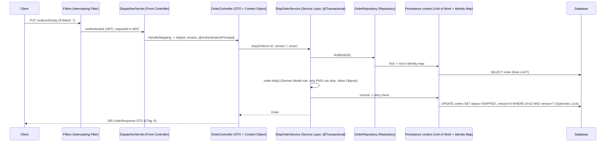

All the objects in the diagram were created and wired by **Dependency Injection**.

---

## 12.3 Where Spring Boot Implements Each Pattern

| Pattern | Spring / JPA implementation |
|---|---|
| Front Controller | `DispatcherServlet` |
| Intercepting Filter | Servlet `Filter`, `OncePerRequestFilter`, Spring Security `SecurityFilterChain`, `HandlerInterceptor` |
| Application Controller | `HandlerMapping`, `HandlerAdapter`, `ViewResolver`, `HandlerExceptionResolver` |
| Context Object | Argument resolvers, `@AuthenticationPrincipal`, `SecurityContextHolder`, `RequestContextHolder`, `LocaleContextHolder` |
| Service Layer | `@Service` + `@Transactional` (AOP proxy) |
| Repository | Spring Data `Repository`/`JpaRepository`, `Specification` |
| DAO | `@Repository` classes with `JdbcClient`/`JdbcTemplate`; `DataAccessException` translation |
| Data Mapper | Hibernate (JPA), Spring Data JDBC, MyBatis |
| Active Record | Not in Spring core (Quarkus Panache, ActiveJDBC, jOOQ `UpdatableRecord`) |
| Unit of Work + Identity Map | JPA `EntityManager` / Hibernate `Session` (persistence context) |
| Lazy Load | Hibernate proxies, `PersistentBag`/`Set`, `FetchType.LAZY`, `getReferenceById` |
| Eager Loading | `JOIN FETCH`, `@EntityGraph`, `@BatchSize`, `FetchMode.SUBSELECT` |
| Optimistic Locking | `@Version`, `ObjectOptimisticLockingFailureException` |
| Pessimistic Locking | `@Lock(LockModeType.PESSIMISTIC_WRITE)` |
| DTO | Records, MapStruct, JPQL constructor expressions, interface projections |
| Value Object | Records, `@Embeddable`, `AttributeConverter` |
| Dependency Injection | `ApplicationContext`, `@Component`, `@Bean`, constructor injection |
| Service Locator | `ApplicationContext.getBean`, `ObjectProvider`, `ServiceLocatorFactoryBean`, JDK `ServiceLoader` |
| Session Facade / Business Delegate | BFF controllers, application services; Feign / `@HttpExchange` clients + Resilience4j |

---

## 12.4 Decision Guide

| If... | Use |
|---|---|
| The app is mostly CRUD with few rules | Transaction Script in services + Spring Data repositories (or Active Record in Quarkus) |
| Rules are complex and interacting | Domain Model + Data Mapper (JPA) + Repositories per aggregate + Value Objects |
| You need reports or bulk updates over many rows | DAO / Table Data Gateway with SQL (`JdbcClient`, jOOQ), not entity-by-entity |
| Several clients (REST, batch, Kafka) share logic | Service Layer with transactional use-case methods |
| A screen shows a list with child data | Lazy mappings + JOIN FETCH / entity graph / DTO projection for that query |
| Users edit the same records occasionally | Optimistic locking (`@Version`, ETag) |
| A hot row is updated constantly (stock, seats) | Atomic conditional UPDATE, or pessimistic lock, or a queue |
| Data crosses an API or service boundary | DTOs (requests and responses) |
| A primitive has rules (money, email, ID) | Value Object |
| A concern applies to every request (auth, logging, tracing) | Intercepting Filter / interceptor |
| A client calls a remote service | Coarse-grained API (facade/BFF) + client delegate with retries and exception mapping |
| A class needs collaborators | Constructor injection; a locator only for plugins |

---

## 12.5 Look-Alike Concepts

| Look-alikes | Difference |
|---|---|
| **DAO vs Repository** | Table-oriented CRUD vs collection of aggregates in domain language. |
| **Active Record vs Data Mapper** | Object saves itself vs separate mapper; domain object persistence-ignorant. |
| **Table Data Gateway vs DAO** | Nearly the same idea (one object per table); DAO is the J2EE name and may hide any data source. |
| **Unit of Work vs Transaction** | UoW tracks object changes in memory and decides what SQL to send; the DB transaction makes those writes atomic. |
| **Identity Map vs Cache** | Identity map = correctness (one instance per row, per session); a cache = performance, shared across sessions. |
| **Lazy Load vs Virtual Proxy** | Lazy load is the goal; a virtual proxy is one way to implement it. |
| **Optimistic Locking vs Isolation Level** | Application-level version check vs database-level visibility rules; READ COMMITTED doesn't stop lost updates. |
| **DTO vs Value Object** | Transfer shape without behaviour vs immutable domain value with behaviour. |
| **DTO vs Entity** | Boundary data carrier vs persistent object with identity. |
| **Service Layer vs Session Facade** | Application boundary for all clients vs specifically a coarse-grained **remote** API. |
| **Facade vs Business Delegate** | Server-side simplification vs client-side proxy for remote access. |
| **Front Controller vs API Gateway** | Single entry point inside one application vs single entry point for many services. |
| **Intercepting Filter vs Decorator vs AOP** | Request-pipeline chain vs object wrapper vs method interception; all add behaviour around something. |
| **DI vs IoC** | DI is one implementation of the Inversion of Control principle. |
| **DI vs Service Locator** | Push (visible, fail-fast) vs pull (hidden, runtime failure). |
| **Transaction Script vs Anemic Model** | Honest procedures vs procedures disguised as a domain model. |

---

# 13. Enterprise Application Patterns Cheat Sheet

```
DOMAIN LOGIC      Transaction Script (procedure per use case) | Domain Model (data + behaviour, invariants) |
                  Table Module (class per table, record sets) | Anemic model = getters/setters + logic in services (anti-pattern).
SERVICE LAYER     Coarse-grained use cases, one transaction each, reused by REST/batch/listeners. @Service + @Transactional proxy:
                  self-invocation, checked exceptions, private methods, readOnly, propagation REQUIRED / REQUIRES_NEW.
DAO / REPOSITORY  DAO: per table, CRUD, rows (JdbcClient). Repository: per aggregate root, collection-like, domain language,
                  Spring Data (derived queries, @Query, Specification, paging). Narrow Repository<T,ID> for DDD.
DATA SOURCE       Table Data Gateway (per table) | Row Data Gateway (per row, no logic) | Active Record (row + logic + save; Panache) |
                  Data Mapper (pure domain + mapper; JPA/Hibernate, MyBatis).
UNIT OF WORK      Track new/dirty/removed, write all at commit. IDENTITY MAP: one instance per row per session.
                  JPA persistence context = both (first-level cache). Dirty checking: no save() for managed entities. flush/clear.
LAZY / EAGER      LAZY by default (set @ManyToOne/@OneToOne LAZY), fetch per query. N+1 -> JOIN FETCH, @EntityGraph, @BatchSize,
                  SUBSELECT, DTO projection. open-in-view=false. LazyInitializationException = fetch inside the tx.
LOCKING           Lost update. Optimistic: @Version, WHERE version=?, retry (new tx, bounded) or 409, ETag/If-Match.
                  Pessimistic: @Lock(PESSIMISTIC_WRITE) = FOR UPDATE, timeouts, NOWAIT, SKIP LOCKED, lock order. Atomic UPDATE.
DTO / VALUE OBJ   DTO: boundary data carrier, per use case, no entities in APIs, mass-assignment protection, MapStruct, projections.
                  Value Object: immutable, equal by value, self-validating (Money, Email, OrderId); @Embeddable, AttributeConverter.
WEB TIER          Front Controller (DispatcherServlet) + Intercepting Filters (Filter, Spring Security, HandlerInterceptor)
                  + Application Controller (HandlerMapping/ViewResolver) + Context Object (@AuthenticationPrincipal).
REMOTE            Session Facade: coarse-grained server API (today BFF/composition). Business Delegate: client proxy with lookup,
                  retries, exception translation (today Feign/@HttpExchange + Resilience4j).
WIRING            DI: constructor injection, container graph, scopes, @Primary/@Qualifier, ObjectProvider, no cycles.
                  Service Locator: pull from registry, hidden deps, runtime failures; OK for plugins (ServiceLoader).
```

### Quick Decision Table

| Interview question | Short answer |
|---|---|
| "Why not return entities from controllers?" | Leaks fields, couples API to schema, lazy-loading/recursion issues, mass assignment. Use DTOs. |
| "What is the N+1 problem?" | 1 query for parents + 1 per parent for a lazy association. JOIN FETCH / entity graph / batch fetch. |
| "Why didn't my `@Transactional` roll back?" | Checked exception, self-invocation, non-public method, or the exception was caught. |
| "How do you stop two users overwriting each other?" | `@Version` optimistic locking (409 on conflict) or `FOR UPDATE` for hot rows. |
| "Why don't I call `save()` after changing an entity?" | Managed entity + dirty checking (Unit of Work) flushes it at commit. |
| "DAO or Repository?" | Repository for aggregates/domain logic; DAO for table-level CRUD, reports, bulk SQL. |
| "Constructor or field injection?" | Constructor: explicit, final, testable, fail-fast. |
| "Filter or interceptor?" | Filter: container level, every request, no handler info. Interceptor: Spring MVC, around a handler. |

### Top Interview Traps

| Trap | Correct answer |
|---|---|
| "`@Repository` means it's a Repository pattern" | It's a stereotype used for DAOs and repositories alike; the pattern depends on what the class models. |
| "EAGER fixes LazyInitializationException" | It hides it and causes over-fetching; fetch per use case inside the transaction instead. |
| "The identity map is a cache to speed things up" | Its main job is correctness (one instance per row); the speed-up is a side effect. Second-level cache is the performance cache. |
| "`synchronized` prevents double booking" | Only inside one JVM; use DB locking/versioning across instances. |
| "Isolation level READ COMMITTED prevents lost updates" | It doesn't; read-compute-write needs versions, locks or atomic updates. |
| "DTOs and value objects are the same" | DTO = transfer shape without behaviour; value object = immutable domain value with behaviour. |
| "Service Locator is the same as DI" | Both decouple, but a locator hides dependencies and fails at runtime; DI makes them explicit and fails at startup. |
| "Anemic domain model is always wrong" | Fine for simple CRUD; a problem when the domain has real rules. |
