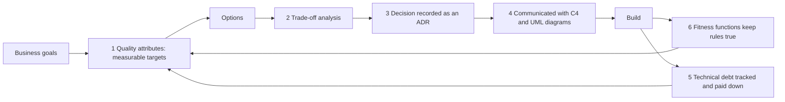
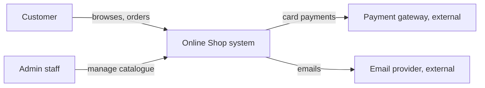
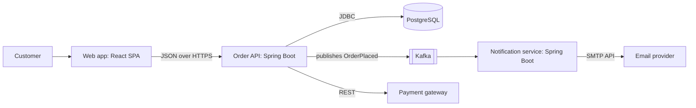
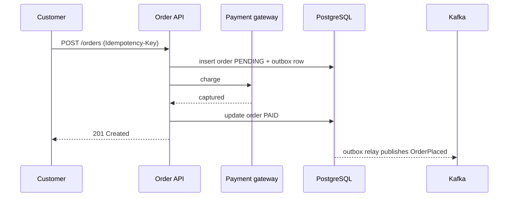
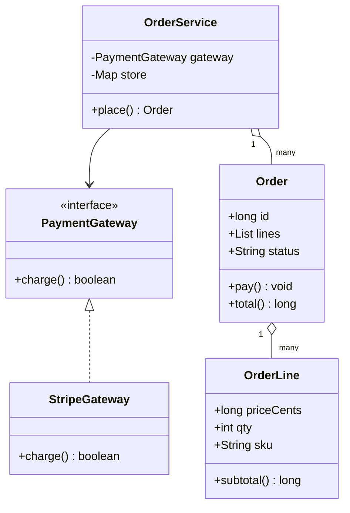
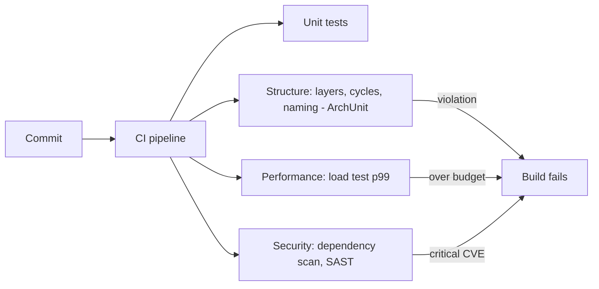
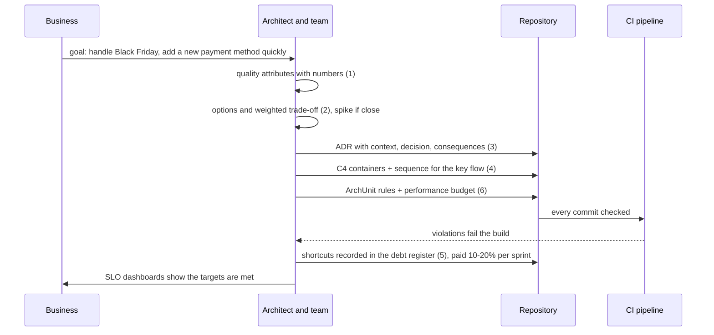

# Architecture Practice (Quality Attributes, Trade-Offs, ADRs, C4 and UML Diagrams, Technical Debt, Fitness Functions)

> **Note**: Patterns marked with **(Interview Imp - Java)** are frequently asked in Java interviews
>
> **How to read this file:** Every section ends with a **📘 Terms Explained** table. If you see a word you don't know, check the table right below that section. Each practice goes from the idea to a Java example with real output, how it is done in Spring/Java projects, pros and cons, pitfalls, interview questions and a mini cheat sheet.
>
> **What is this file about?** Knowing patterns is not the same as **doing architecture**. Architects and senior engineers spend their time on: turning vague wishes into measurable **quality attributes** (non-functional requirements), comparing options and **making trade-offs explicit**, **recording decisions** (ADRs), **communicating** designs with diagrams (C4, UML), managing **technical debt**, and keeping the architecture from decaying (**fitness functions**). These are standard questions in senior, lead and architect interviews ("How do you decide between X and Y?", "How do you document architecture?").
>
> **What lives elsewhere:** The architectural *styles* themselves (layered, hexagonal, microservices, event-driven) are in [01_Architectural_Pattern.md](01_Architectural_Pattern.md). SLIs, SLOs and error budgets in operation are in [10_Observability_Pattern.md](../03_System_Design/10_Observability_Pattern.md). Class-level principles and code smells are in [05_Design_Principles_and_Anti_Patterns.md](../01_LLD/05_Design_Principles_and_Anti_Patterns.md). The step-by-step system design interview method is in [12_System_Design_Interview_Playbook.md](../03_System_Design/12_System_Design_Interview_Playbook.md).
>
> **Verified code:** Every "Complete Java Example" is **plain Java 17 (no libraries)** and was compiled and run **three times** with identical output. The technical-debt example is a **simple model** with stated assumptions, not measured data. To run one, save it as `<ClassName>.java` and run `javac <ClassName>.java && java <ClassName>`. ArchUnit, Spring and tool snippets were **not** executed.

---

## Table of Contents
- [Big Picture: The Architect's Loop](#big-picture-the-architects-loop)
1. [Quality Attributes and Non-Functional Requirements](#1-quality-attributes-and-non-functional-requirements-interview-imp---java) **(Interview Imp - Java)**
   - [1.1 What Are They?](#11-what-are-they)
   - [1.2 Why Do We Need Them?](#12-why-do-we-need-them)
   - [1.3 How It Works](#13-how-it-works)
   - [1.4 Types and Variants](#14-types-and-variants)
   - [1.5 Complete Java Example - Nines, Composed Availability, Percentiles and Fan-Out](#15-complete-java-example---nines-composed-availability-percentiles-and-fan-out)
   - [1.6 In Java and Spring Boot](#16-in-java-and-spring-boot)
   - [1.7 Pros and Cons](#17-pros-and-cons)
   - [1.8 Pitfalls, Interview Questions and Cheat Sheet](#18-pitfalls-interview-questions-and-cheat-sheet)
2. [Trade-Off Analysis and Decision Making](#2-trade-off-analysis-and-decision-making)
   - [2.1 What Is It?](#21-what-is-it)
   - [2.2 Why Do We Need It?](#22-why-do-we-need-it)
   - [2.3 How It Works](#23-how-it-works)
   - [2.4 Types and Variants](#24-types-and-variants)
   - [2.5 Complete Java Example - A Weighted Decision Matrix With Sensitivity Analysis](#25-complete-java-example---a-weighted-decision-matrix-with-sensitivity-analysis)
   - [2.6 In Practice](#26-in-practice)
   - [2.7 Pros and Cons](#27-pros-and-cons)
   - [2.8 Pitfalls, Interview Questions and Cheat Sheet](#28-pitfalls-interview-questions-and-cheat-sheet)
3. [Architecture Decision Records (ADR)](#3-architecture-decision-records-adr-interview-imp---java) **(Interview Imp - Java)**
   - [3.1 What Is It?](#31-what-is-it)
   - [3.2 Why Do We Need It?](#32-why-do-we-need-it)
   - [3.3 How It Works](#33-how-it-works)
   - [3.4 Types and Variants](#34-types-and-variants)
   - [3.5 Complete Java Example - An ADR Log With Index, File Generation and Consistency Checks](#35-complete-java-example---an-adr-log-with-index-file-generation-and-consistency-checks)
   - [3.6 In Practice](#36-in-practice)
   - [3.7 Pros and Cons](#37-pros-and-cons)
   - [3.8 Pitfalls, Interview Questions and Cheat Sheet](#38-pitfalls-interview-questions-and-cheat-sheet)
4. [Diagramming: C4 Model and UML](#4-diagramming-c4-model-and-uml)
   - [4.1 What Is It?](#41-what-is-it)
   - [4.2 Why Do We Need It?](#42-why-do-we-need-it)
   - [4.3 How It Works](#43-how-it-works)
   - [4.4 Types and Variants](#44-types-and-variants)
   - [4.5 Complete Java Example - Generate a Mermaid Class Diagram From Real Classes](#45-complete-java-example---generate-a-mermaid-class-diagram-from-real-classes)
   - [4.6 In Practice](#46-in-practice)
   - [4.7 Pros and Cons](#47-pros-and-cons)
   - [4.8 Pitfalls, Interview Questions and Cheat Sheet](#48-pitfalls-interview-questions-and-cheat-sheet)
5. [Technical Debt](#5-technical-debt)
   - [5.1 What Is It?](#51-what-is-it)
   - [5.2 Why Do We Need to Manage It?](#52-why-do-we-need-to-manage-it)
   - [5.3 How It Works](#53-how-it-works)
   - [5.4 Types and Variants](#54-types-and-variants)
   - [5.5 Complete Java Example - A Model of Debt Interest Over 20 Sprints](#55-complete-java-example---a-model-of-debt-interest-over-20-sprints)
   - [5.6 In Practice](#56-in-practice)
   - [5.7 Pros and Cons (of taking on debt)](#57-pros-and-cons-of-taking-on-debt)
   - [5.8 Pitfalls, Interview Questions and Cheat Sheet](#58-pitfalls-interview-questions-and-cheat-sheet)
6. [Evolutionary Architecture and Fitness Functions](#6-evolutionary-architecture-and-fitness-functions)
   - [6.1 What Is It?](#61-what-is-it)
   - [6.2 Why Do We Need It?](#62-why-do-we-need-it)
   - [6.3 How It Works](#63-how-it-works)
   - [6.4 Types and Variants](#64-types-and-variants)
   - [6.5 Complete Java Example - Layer Rules and Cycle Detection on a Dependency Map](#65-complete-java-example---layer-rules-and-cycle-detection-on-a-dependency-map)
   - [6.6 Fitness Functions in Java (ArchUnit)](#66-fitness-functions-in-java-archunit)
   - [6.7 Pros and Cons](#67-pros-and-cons)
   - [6.8 Pitfalls, Interview Questions and Cheat Sheet](#68-pitfalls-interview-questions-and-cheat-sheet)
7. [How the Architecture Practices Fit Together](#7-how-the-architecture-practices-fit-together)
8. [Architecture Practice Cheat Sheet](#8-architecture-practice-cheat-sheet)

---

## Big Picture: The Architect's Loop



| Practice | Question it answers |
|---|---|
| Quality attributes / NFRs | "Fast, scalable, secure" → *how* fast, *how* scalable, measured how? |
| Trade-off analysis | Which option, and what do we give up? |
| ADRs | Why is it like this? (six months later) |
| C4 / UML diagrams | How do we explain it to different audiences? |
| Technical debt | What shortcuts did we take, and what do they cost us? |
| Fitness functions | How do we stop the design from silently decaying? |

### 📘 Terms Explained

| Term | Meaning |
|---|---|
| **Architecture** | The important decisions about a system's structure that are hard to change later |
| **Non-functional requirement (NFR)** | A requirement about *how well* the system works (speed, availability), not *what* it does |
| **Stakeholder** | Anyone with an interest in the system: users, developers, operations, business |
| **Trade-off** | Gaining one quality at the expense of another |
| **Decay (architecture erosion)** | The gradual drift of the code away from the intended design |

---

# 1. Quality Attributes and Non-Functional Requirements (Interview Imp - Java)

## 1.1 What Are They?

**Functional requirements** say *what* the system does ("users can place an order"). **Quality attributes** (non-functional requirements, NFRs, "-ilities") say *how well*:

| Attribute | Typical measurable target |
|---|---|
| **Availability** | 99.9% of requests succeed per month |
| **Performance / latency** | p99 < 300 ms for `POST /orders` at 2,000 requests/s |
| **Scalability** | Handle 10× Black-Friday traffic by adding nodes, no redesign |
| **Reliability / durability** | Zero lost orders; RPO 0, RTO < 15 min |
| **Security** | OWASP Top 10 mitigated; data encrypted at rest and in transit |
| **Maintainability / modifiability** | A new payment method in < 2 weeks by one team |
| **Observability** | Every request traceable; alert within 5 min of SLO burn |
| **Cost** | < $0.002 infrastructure cost per order |
| **Usability, accessibility, compliance** | WCAG 2.1 AA; GDPR/DPDP data residency |

## 1.2 Why Do We Need Them?

- Architecture is mostly driven by quality attributes, not features. A to-do list for 10 users and one for 10 million have the same features and completely different architectures.
- "It must be fast" can't be tested; "p99 < 300 ms at 2,000 rps" can.
- They conflict: more availability (replicas) costs money and consistency; more security adds latency. Writing them down forces the trade-off discussion.

## 1.3 How It Works

**Write them as scenarios** (the SEI "quality attribute scenario"): *source, stimulus, environment, response, response measure*. Example: "When **2,000 users/s** (stimulus) place orders during a **sale** (environment), the system **accepts** them (response) with **p99 < 300 ms and < 0.1% errors** (measure)."

**Availability math.** Downtime allowed per year: 99% ≈ 3.7 days, 99.9% ≈ 8.8 hours, 99.99% ≈ 53 minutes, 99.999% ≈ 5 minutes.
- Components in a **chain** (all needed): multiply availabilities, so the result is lower than each part.
- Components in **parallel** (any one is enough): `1 − (1 − a)ⁿ`, much higher.

**Latency: use percentiles, not averages.** The average hides the slow tail that real users feel; p95/p99 show it. With **fan-out** (one page calls many services), the chance that *some* call hits its slow tail grows quickly.

## 1.4 Types and Variants

| Framework / model | Note |
|---|---|
| **ISO/IEC 25010** | Standard list of product quality characteristics |
| **FURPS+** | Functionality, Usability, Reliability, Performance, Supportability (+ constraints) |
| **SLI / SLO / SLA** | Indicator (measured), objective (internal target), agreement (contract with penalties) |
| **Utility tree (ATAM)** | Quality goals broken into prioritised scenarios |
| **Architectural characteristics** | The "-ilities" term used in *Fundamentals of Software Architecture* (Richards and Ford) |
| **Constraints** | Non-negotiable limits: budget, deadline, mandated cloud, regulation |

## 1.5 Complete Java Example - Nines, Composed Availability, Percentiles and Fan-Out

**What it shows:** downtime allowed per year for each level of "nines"; the availability of three components in a chain, and after replicating one; percentiles versus the average for 10,000 requests where 2% are slow; and how fan-out raises the chance of hitting a slow call.

```java
import java.util.*;

public class QualityDemo {

    static String downtime(double availability) {
        double minutesPerYear = 365.0 * 24 * 60, down = (1 - availability) * minutesPerYear;
        return down >= 60 * 24 ? String.format("%.1f days", down / 60 / 24) : down >= 60 ? String.format("%.1f hours", down / 60) : String.format("%.1f minutes", down);
    }

    static double percentile(double[] sorted, double p) {               // nearest-rank method
        int rank = (int) Math.ceil(p / 100.0 * sorted.length);
        return sorted[Math.max(0, rank - 1)];
    }

    public static void main(String[] args) {
        // 1) the "nines"
        System.out.println("1) availability -> allowed downtime per year");
        for (double a : new double[]{0.99, 0.999, 0.9999, 0.99999})
            System.out.printf("   %-8s -> %s%n", String.format("%.3f%%", a * 100), downtime(a));

        // 2) composing availability
        double api = 0.999, db = 0.999, cache = 0.999;
        double serial = api * db * cache;                                // all three needed for a request
        double twoDbReplicas = 1 - Math.pow(1 - db, 2);                  // either replica can serve
        double serialWithReplica = api * twoDbReplicas * cache;
        System.out.printf("2) three components at 99.9%% in a chain: %.4f%% (%s/year)%n", serial * 100, downtime(serial));
        System.out.printf("   database replicated twice (parallel)  : db %.4f%%, whole chain %.4f%% (%s/year)%n", twoDbReplicas * 100, serialWithReplica * 100, downtime(serialWithReplica));

        // 3) latency: average hides the tail
        Random r = new Random(11);
        double[] lat = new double[10_000];
        for (int i = 0; i < lat.length; i++) lat[i] = r.nextDouble() < 0.02 ? 800 + r.nextDouble() * 1200 : 40 + Math.abs(r.nextGaussian()) * 25;   // 2% slow requests
        double avg = Arrays.stream(lat).average().orElse(0);
        double[] s = lat.clone(); Arrays.sort(s);
        System.out.printf("3) 10000 requests: average=%.0f ms  p50=%.0f ms  p95=%.0f ms  p99=%.0f ms  max=%.0f ms%n", avg, percentile(s, 50), percentile(s, 95), percentile(s, 99), s[s.length - 1]);
        System.out.println("   the average looks fine; 1 in 50 users waits more than 0.8 s -> write SLOs on percentiles, e.g. 'p99 < 300 ms'");

        // 4) fan-out amplifies the tail: a page that calls 20 services
        double pSlowOne = 0.01;                                          // each call is slower than its p99 1% of the time
        for (int n : new int[]{1, 5, 20, 100})
            System.out.printf("4) page calling %3d services in parallel: chance at least one is in its slow 1%% = %.1f%%%n", n, 100 * (1 - Math.pow(1 - pSlowOne, n)));
    }
}
```

**Output** (identical on all 3 runs):

```text
1) availability -> allowed downtime per year
   99.000%  -> 3.7 days
   99.900%  -> 8.8 hours
   99.990%  -> 52.6 minutes
   99.999%  -> 5.3 minutes
2) three components at 99.9% in a chain: 99.7003% (1.1 days/year)
   database replicated twice (parallel)  : db 99.9999%, whole chain 99.8000% (17.5 hours/year)
3) 10000 requests: average=85 ms  p50=57 ms  p95=93 ms  p99=1327 ms  max=1996 ms
   the average looks fine; 1 in 50 users waits more than 0.8 s -> write SLOs on percentiles, e.g. 'p99 < 300 ms'
4) page calling   1 services in parallel: chance at least one is in its slow 1% = 1.0%
4) page calling   5 services in parallel: chance at least one is in its slow 1% = 4.9%
4) page calling  20 services in parallel: chance at least one is in its slow 1% = 18.2%
4) page calling 100 services in parallel: chance at least one is in its slow 1% = 63.4%
```

**What the output shows**
- **1:** each extra nine cuts the allowed downtime by 10×: from 3.7 days to 5.3 minutes a year.
- **2:** three 99.9% components in a chain give only **99.70%** (1.1 days of downtime a year). Replicating the database raises it to **99.80%**; the chain is now limited by the remaining single points (API, cache).
- **3:** the average (85 ms) and even p95 (93 ms) look healthy, but **p99 is 1,327 ms**: one in fifty users waits more than 0.8 s. Targets must be written on percentiles.
- **4:** if a page calls 20 services, there is an **18.2%** chance at least one is in its slowest 1%; with 100 calls, 63.4%. Tail latency of dependencies becomes the *typical* latency of the page.

## 1.6 In Java and Spring Boot

```java
// Measure the percentiles you promised: Micrometer timers with SLO buckets
@Timed(value = "orders.place", percentiles = {0.5, 0.95, 0.99}, histogram = true)
@PostMapping("/orders") OrderDto place(@RequestBody NewOrder o) { ... }
// management.metrics.distribution.slo.orders.place=100ms,300ms   -> Prometheus/Grafana check "p99 < 300 ms"

// Performance requirements as tests (Gatling/JMeter/k6) in CI: fail the build if p99 > target
// Availability: replicas + health checks + timeouts/circuit breakers (Reliability guide)
```
Keep the NFR list in the repository (for example `docs/architecture/quality-attributes.md`) next to the ADRs, and link each SLO to its dashboard and alert ([10_Observability_Pattern.md](../03_System_Design/10_Observability_Pattern.md)).

## 1.7 Pros and Cons

| Pros | Cons |
|---|---|
| Testable targets; design driven by real needs | Takes effort to get numbers from stakeholders |
| Makes conflicts visible early | Over-ambitious targets (five nines) cost a fortune |
| Basis for SLOs, load tests and capacity planning | Targets go stale if not revisited |

## 1.8 Pitfalls, Interview Questions and Cheat Sheet

**Common pitfalls**
- "The system must be scalable and fast" with no numbers.
- Averages instead of percentiles.
- Ignoring that availability of a chain is the *product* of its parts.
- Promising an external SLA tighter than your own dependencies' SLAs.
- Treating every attribute as top priority (they compete).

**Interview questions**
1. *What are non-functional requirements? Give examples with numbers.* → Quality attributes: "p99 < 300 ms at 2k rps", "99.9% monthly availability", "RPO 0 / RTO 15 min".
2. *Why p99 instead of average latency?* → Averages hide the slow tail; users experience the tail, and fan-out multiplies it.
3. *How do you compute availability of a system?* → Chain: multiply. Redundant parallel parts: 1 − product of failure probabilities.
4. *SLI vs SLO vs SLA?* → Measured indicator; internal target; contractual promise with penalties.
5. *What drives architecture more: features or quality attributes?* → Quality attributes.

**Cheat sheet**
```
NFR scenario: source + stimulus + environment + response + MEASURE
Nines/year: 99% 3.7 d | 99.9% 8.8 h | 99.99% 53 min | 99.999% 5 min
Chain: A = a1*a2*a3 ;  Parallel: A = 1 - (1-a)^n
Latency: p50/p95/p99 (never just average); fan-out: P(any slow) = 1 - (1-p)^n
SLI (measured) -> SLO (target) -> SLA (contract)
```

### 📘 Terms Explained

| Term | Meaning |
|---|---|
| **Quality attribute** | A measurable property like availability, latency or security |
| **Percentile (p99)** | The value below which 99% of measurements fall |
| **Tail latency** | The slowest requests (p99, p99.9) |
| **Fan-out** | One request triggering calls to many other services |
| **RPO / RTO** | Recovery point objective (data loss allowed) / recovery time objective (downtime allowed) |
| **SLI / SLO / SLA** | Service level indicator / objective / agreement |
| **Single point of failure** | A component whose failure stops the whole system |

---

# 2. Trade-Off Analysis and Decision Making

## 2.1 What Is It?

Every architecture decision gives up something to gain something else. **Trade-off analysis** makes the options, the criteria and the reasons explicit, so the decision can be explained, reviewed and revisited. "Everything in software architecture is a trade-off" (Richards and Ford).

## 2.2 Why Do We Need It?

| Without | With |
|---|---|
| Decisions by the loudest voice or the latest blog post | Criteria agreed first, then options scored |
| "Why did we pick MongoDB?" … nobody knows | The matrix and reasoning are in an ADR |
| A decision that is wrong for the context | Context-specific weights show *when* the other option wins |
| Fear of deciding (analysis paralysis) | Reversible decisions are made fast; only irreversible ones get heavy analysis |

## 2.3 How It Works

1. **State the problem and constraints** (deadline, budget, team skills, regulations).
2. **List options**, including "do nothing" and the boring one.
3. **Pick criteria** from the quality attributes; **weight** them for *this* context.
4. **Score** each option per criterion (1–5), multiply by weights, sum.
5. **Sensitivity check:** how much would a weight have to change to flip the result? If it flips easily, the decision is fragile; collect more data or keep it reversible.
6. **Record** the result and the rejected options in an [ADR](#3-architecture-decision-records-adr-interview-imp---java).

**One-way vs two-way doors** (Amazon's terms): an *irreversible* decision (public API contract, primary database, data model) deserves careful analysis; a *reversible* one (a library behind an interface, a feature flag) should be made quickly and adjusted.

**Common trade-off pairs:** consistency vs availability (CAP), latency vs throughput, flexibility vs simplicity, build vs buy, performance vs cost, security vs usability, time-to-market vs long-term maintainability.

## 2.4 Types and Variants

| Method | Note |
|---|---|
| **Weighted decision matrix** | Simple, transparent (the example) |
| **ATAM** (Architecture Trade-off Analysis Method, SEI) | Workshop-based: utility tree, scenarios, sensitivity points, risks |
| **Proof of concept / spike** | Time-boxed experiment to replace guesses with data |
| **Pugh matrix** | Compare options against a baseline (+, 0, −) |
| **Cost of delay / options thinking** | Defer decisions until the last responsible moment |
| **Architecture review board / RFC process** | Organisational way to review significant decisions |

## 2.5 Complete Java Example - A Weighted Decision Matrix With Sensitivity Analysis

**What it shows:** three databases scored on five criteria. With weights for an **order service**, PostgreSQL wins; with weights for a **click-event store**, Cassandra wins. A sensitivity loop tests whether the order-service choice would flip if write scale mattered much more.

```java
import java.util.*;

public class DecisionDemo {

    // Weighted decision matrix: scores 1 (bad) .. 5 (good) per option and criterion
    static final String[] CRITERIA = {"team knows it", "transactions", "write scale", "query flexibility", "ops cost"};
    static final Map<String, int[]> SCORES = new LinkedHashMap<>();
    static {
        SCORES.put("PostgreSQL", new int[]{5, 5, 3, 5, 4});
        SCORES.put("MongoDB",    new int[]{3, 3, 4, 4, 3});
        SCORES.put("Cassandra",  new int[]{2, 1, 5, 2, 2});
    }

    static Map<String, Integer> rank(int[] weights) {
        Map<String, Integer> totals = new LinkedHashMap<>();
        for (var e : SCORES.entrySet()) { int t = 0; for (int i = 0; i < weights.length; i++) t += weights[i] * e.getValue()[i]; totals.put(e.getKey(), t); }
        return totals;
    }
    static String winner(Map<String, Integer> t) { return t.entrySet().stream().max(Map.Entry.comparingByValue()).get().getKey(); }

    public static void main(String[] args) {
        System.out.println("criteria: " + Arrays.toString(CRITERIA));
        SCORES.forEach((k, v) -> System.out.println("   " + String.format("%-10s", k) + " scores " + Arrays.toString(v)));

        int[] orderService = {3, 5, 2, 4, 3};        // an order service: correctness matters most
        int[] clickstream  = {1, 0, 8, 1, 2};        // a click-event store: huge write volume, no transactions, simple queries
        Map<String, Integer> a = rank(orderService), b = rank(clickstream);
        System.out.println("1) order service weights " + Arrays.toString(orderService) + " -> " + a + "  winner: " + winner(a));
        System.out.println("2) clickstream  weights " + Arrays.toString(clickstream) + " -> " + b + "  winner: " + winner(b));

        // 3) sensitivity analysis: how much must 'write scale' matter before the order-service answer changes?
        for (int w = 2; w <= 10; w++) {
            int[] test = orderService.clone(); test[2] = w;
            String win = winner(rank(test));
            if (!win.equals(winner(a))) { System.out.println("3) sensitivity: the order-service choice flips to " + win + " only when 'write scale' weight reaches " + w + " (from 2)"); break; }
            if (w == 10) System.out.println("3) sensitivity: even with 'write scale' weight 10 the winner stays " + win + " -> a robust decision");
        }
        System.out.println("4) same options, different context, different answer: the matrix documents WHY, which is what goes into the ADR");
    }
}
```

**Output** (identical on all 3 runs):

```text
criteria: [team knows it, transactions, write scale, query flexibility, ops cost]
   PostgreSQL scores [5, 5, 3, 5, 4]
   MongoDB    scores [3, 3, 4, 4, 3]
   Cassandra  scores [2, 1, 5, 2, 2]
1) order service weights [3, 5, 2, 4, 3] -> {PostgreSQL=78, MongoDB=57, Cassandra=35}  winner: PostgreSQL
2) clickstream  weights [1, 0, 8, 1, 2] -> {PostgreSQL=42, MongoDB=45, Cassandra=48}  winner: Cassandra
3) sensitivity: even with 'write scale' weight 10 the winner stays PostgreSQL -> a robust decision
4) same options, different context, different answer: the matrix documents WHY, which is what goes into the ADR
```

**What the output shows**
- **Same options, same scores, different context:** the order service (transactions weighted 5) picks **PostgreSQL** (78 vs 57 vs 35); the clickstream store (write scale weighted 8, transactions 0) picks **Cassandra** (48 vs 45 vs 42).
- **Sensitivity:** even raising "write scale" from 2 to 10 doesn't flip the order-service result, so that decision is **robust**. (The clickstream scores are close: 48/45/42, a sign to run a proof of concept before committing.)
- The matrix itself is the documentation of *why*.

## 2.6 In Practice

- Put the matrix in the ADR (a Markdown table is enough).
- Use a **spike/proof of concept** (a few days, throw-away code) when two options are close: measure the criteria that matter (e.g. write throughput with realistic data).
- For build-vs-buy, include total cost of ownership (licences, people, operations) and lock-in.
- Keep irreversible choices behind interfaces where possible (repositories, ports and adapters), so they become *more* reversible.

## 2.7 Pros and Cons

| Pros | Cons |
|---|---|
| Transparent and reviewable | Scores can be biased to justify a favourite |
| Forces agreement on criteria first | Numbers give a false sense of precision |
| Sensitivity shows how fragile a choice is | Heavy methods (full ATAM) are slow for small decisions |

## 2.8 Pitfalls, Interview Questions and Cheat Sheet

**Common pitfalls**
- Choosing the technology first and inventing criteria later.
- Ignoring team skills and operating cost.
- Treating all decisions as irreversible (paralysis) or all as reversible (mess).
- Not recording rejected options (the same debate returns every six months).
- "Résumé-driven development": picking tools to learn them, not to solve the problem.

**Interview questions**
1. *How do you choose between two technologies?* → Agree criteria from quality attributes, weight them for the context, score options, check sensitivity, prototype if close, record in an ADR.
2. *Give an example of a trade-off you made.* → Use the STAR format: context, options, criteria, decision, what you gave up, result.
3. *What are one-way and two-way door decisions?* → Irreversible vs reversible; analyse the first carefully, decide the second fast.
4. *What is ATAM?* → An SEI method that evaluates an architecture against prioritised quality-attribute scenarios to find risks, sensitivity points and trade-offs.

**Cheat sheet**
```
Problem + constraints -> options (incl. boring + do nothing) -> weighted criteria -> scores -> sensitivity -> PoC if close -> ADR
One-way door: analyse ; two-way door: decide fast, keep it behind an interface
Classic pairs: consistency/availability, latency/throughput, flexibility/simplicity, build/buy, cost/performance
```

### 📘 Terms Explained

| Term | Meaning |
|---|---|
| **Weighted decision matrix** | A table of options × criteria with weights and scores |
| **Sensitivity analysis** | Checking how much inputs must change before the result changes |
| **Spike / proof of concept** | A short experiment to answer a technical question |
| **One-way door** | A decision that is very hard to undo |
| **Total cost of ownership** | All costs over the lifetime: licences, people, operations |
| **ATAM** | Architecture Trade-off Analysis Method |

---

# 3. Architecture Decision Records (ADR) (Interview Imp - Java)

## 3.1 What Is It?

An **ADR** is a short text file (usually Markdown, 1–2 pages) that records **one significant architecture decision**: the context, the decision, and its consequences. ADRs are numbered, kept in the code repository (for example `docs/adr/`), and never edited after acceptance; a changed decision gets a **new** ADR that *supersedes* the old one. The format was popularised by Michael Nygard (2011).

## 3.2 Why Do We Need It?

| Problem | ADR answer |
|---|---|
| "Why do we use gRPC here?" Nobody who decided is still on the team | The context and reasons are written down |
| The same debate repeats every quarter | Rejected options and their reasons are recorded |
| New team members copy patterns they don't understand | ADRs explain the intent and constraints |
| Auditors or architects need a decision history | A dated, append-only log |

## 3.3 How It Works

```markdown
# 4. Use gRPC for internal calls
Date: 2024-06-15
Status: Accepted            (Proposed | Accepted | Rejected | Deprecated | Superseded by ADR-n)

## Context
What forces are at play: requirements, constraints, measurements, options considered.

## Decision
What we decided, in active voice: "We will use gRPC with protobuf for service-to-service calls."

## Consequences
What becomes easier and harder; follow-up work; risks.
```

**Lifecycle:** Proposed → (review, often as a pull request) → Accepted or Rejected → later Deprecated or **Superseded** by a newer ADR, which links back.

**What deserves an ADR:** decisions that are hard to reverse or affect many teams: database choice, communication style, authentication approach, module boundaries, cloud provider, build-vs-buy. Not: variable names or small library upgrades.

## 3.4 Types and Variants

| Variant | Note |
|---|---|
| **Nygard format** | Title, Status, Context, Decision, Consequences (the classic) |
| **MADR** (Markdown ADR) | Adds considered options with pros/cons and decision drivers |
| **Y-statements** | One sentence: "In the context of X, facing Y, we decided Z to achieve Q, accepting D" |
| **RFC / design doc** | Longer proposal before a decision; the ADR is the concise outcome |
| **Tools** | `adr-tools` (CLI), Log4brains (website from ADRs), Backstage TechDocs |
| **Lightweight ADR** | A few lines in the pull request that changed the architecture |

## 3.5 Complete Java Example - An ADR Log With Index, File Generation and Consistency Checks

**What it shows:** four ADRs (one superseded by a later one), the generated index with numbered file names, one rendered ADR file, and a small "linter" that catches a careless ADR (superseded by a non-existent number, missing consequences).

```java
import java.util.*;

public class AdrDemo {

    enum Status { PROPOSED, ACCEPTED, REJECTED, DEPRECATED, SUPERSEDED }

    record Adr(int number, String title, Status status, String date, Integer supersededBy, String context, String decision, String consequences) {
        String fileName() { return String.format("%04d-%s.md", number, title.toLowerCase().replaceAll("[^a-z0-9]+", "-").replaceAll("(^-|-$)", "")); }
        String markdown() {
            return "# " + number + ". " + title + "\n\nDate: " + date + "\nStatus: " + status + (supersededBy != null ? " by ADR-" + supersededBy : "")
                 + "\n\n## Context\n" + context + "\n\n## Decision\n" + decision + "\n\n## Consequences\n" + consequences + "\n";
        }
    }

    // a tiny "linter" that keeps the ADR log consistent
    static List<String> check(List<Adr> log) {
        List<String> problems = new ArrayList<>();
        Map<Integer, Adr> byNum = new HashMap<>();
        for (Adr a : log) if (byNum.put(a.number(), a) != null) problems.add("duplicate number " + a.number());
        for (Adr a : log) {
            if (a.status() == Status.SUPERSEDED && (a.supersededBy() == null || !byNum.containsKey(a.supersededBy()))) problems.add("ADR-" + a.number() + " is SUPERSEDED but points to no existing ADR");
            if (a.supersededBy() != null && a.status() != Status.SUPERSEDED) problems.add("ADR-" + a.number() + " has supersededBy but status " + a.status());
            if (a.consequences().isBlank()) problems.add("ADR-" + a.number() + " has no consequences section");
        }
        return problems;
    }

    public static void main(String[] args) {
        List<Adr> log = new ArrayList<>(List.of(
            new Adr(1, "Record architecture decisions", Status.ACCEPTED, "2024-01-10", null, "We need a history of why things are the way they are.", "We will keep ADRs in docs/adr as Markdown.", "Every significant decision gets a short ADR in the same pull request."),
            new Adr(2, "Use REST between services", Status.SUPERSEDED, "2024-02-02", 4, "Services call each other synchronously.", "Use JSON over HTTP.", "Simple; chatty calls for the reporting flow."),
            new Adr(3, "Use PostgreSQL for orders", Status.ACCEPTED, "2024-02-20", null, "Orders need ACID transactions; team knows SQL.", "PostgreSQL 16, one schema per service.", "Need replicas for read scale; no multi-region writes."),
            new Adr(4, "Use gRPC for internal calls", Status.ACCEPTED, "2024-06-15", null, "REST payloads and latency grew (ADR-2).", "gRPC with protobuf for service-to-service; REST stays for public APIs.", "Need proto versioning rules and gRPC-aware load balancing.")));

        System.out.println("1) ADR index (docs/adr/README.md)");
        for (Adr a : log) System.out.printf("   %-42s %-11s %s%n", a.fileName(), a.status(), a.supersededBy() != null ? "-> superseded by ADR-" + a.supersededBy() : "");
        System.out.println("2) one ADR file:\n" + log.get(3).markdown().replaceAll("(?m)^", "   "));
        System.out.println("3) log check: " + (check(log).isEmpty() ? "OK" : check(log)));

        log.add(new Adr(5, "Drop Kafka", Status.SUPERSEDED, "2024-07-01", 9, "x", "y", ""));
        System.out.println("4) after adding a careless ADR-5: " + check(log));
    }
}
```

**Output** (identical on all 3 runs):

```text
1) ADR index (docs/adr/README.md)
   0001-record-architecture-decisions.md      ACCEPTED    
   0002-use-rest-between-services.md          SUPERSEDED  -> superseded by ADR-4
   0003-use-postgresql-for-orders.md          ACCEPTED    
   0004-use-grpc-for-internal-calls.md        ACCEPTED    
2) one ADR file:
   # 4. Use gRPC for internal calls
   
   Date: 2024-06-15
   Status: ACCEPTED
   
   ## Context
   REST payloads and latency grew (ADR-2).
   
   ## Decision
   gRPC with protobuf for service-to-service; REST stays for public APIs.
   
   ## Consequences
   Need proto versioning rules and gRPC-aware load balancing.

3) log check: OK
4) after adding a careless ADR-5: [ADR-5 is SUPERSEDED but points to no existing ADR, ADR-5 has no consequences section]
```

**What the output shows**
- **1:** file names follow `NNNN-title.md`; ADR-2 is marked superseded by ADR-4 (REST → gRPC for internal calls). The old ADR is kept, not deleted.
- **2:** the rendered ADR-4 is short: the context explains *why now* (payloads and latency grew), the decision states the scope (internal only), and the consequences name the new work (proto versioning, gRPC-aware load balancing).
- **3–4:** the check passes for the clean log and catches the two mistakes in ADR-5. Run a check like this in CI to keep the log trustworthy.

## 3.6 In Practice

```text
repo/
  docs/adr/
    0001-record-architecture-decisions.md
    0002-use-rest-between-services.md      Status: Superseded by ADR-4
    0004-use-grpc-for-internal-calls.md
  src/...
```
- Create the ADR **in the same pull request** as the code change, so review covers both.
- Link ADRs from code comments where a surprising choice lives (`// see docs/adr/0004`).
- Keep them short; link to longer design docs or spikes for details.
- In a Spring Boot project, ADRs can also cover cross-cutting choices: "Use Flyway for migrations", "Constructor injection only", "Problem Details (RFC 9457) for errors".

## 3.7 Pros and Cons

| Pros | Cons |
|---|---|
| Cheap to write, lives with the code | Value depends on discipline; easy to forget |
| Preserves context and rejected options | Can become bureaucratic if required for tiny decisions |
| Great onboarding material | Not a replacement for diagrams and overview docs |

## 3.8 Pitfalls, Interview Questions and Cheat Sheet

**Common pitfalls**
- Editing accepted ADRs instead of superseding them (history lost).
- Writing ADRs after the fact with the reasoning reconstructed.
- No "consequences" section (the most useful part).
- Storing them in a wiki nobody connects to the code.
- One giant "architecture document" instead of many small decisions.

**Interview questions**
1. *How do you document architecture decisions?* → ADRs in the repo: context, decision, consequences, status; superseded rather than edited; reviewed in pull requests.
2. *What makes a decision ADR-worthy?* → Hard to reverse, affects many teams or quality attributes significantly.
3. *What do you do when a decision changes?* → Write a new ADR that supersedes the old one and link them both ways.
4. *ADR vs design document?* → A design doc explores and proposes (long); an ADR records the decision concisely.

**Cheat sheet**
```
docs/adr/NNNN-title.md : Title | Date | Status | Context | Decision | Consequences
Status: Proposed -> Accepted/Rejected -> Deprecated/Superseded (new ADR links back)
Write it in the same PR as the change; never rewrite accepted ADRs; keep rejected options
Variants: Nygard, MADR, Y-statement; tools: adr-tools, Log4brains
```

### 📘 Terms Explained

| Term | Meaning |
|---|---|
| **ADR** | Architecture Decision Record: a short document for one decision |
| **Supersede** | Replace an older decision with a newer one while keeping the old record |
| **MADR** | A Markdown ADR template with options and decision drivers |
| **Design doc / RFC** | A longer proposal discussed before deciding |
| **Append-only log** | Records are only added, never changed |

---

# 4. Diagramming: C4 Model and UML

## 4.1 What Is It?

Diagrams communicate structure to people. Two families matter:

- **C4 model** (Simon Brown): four levels of zoom, like a map.

| Level | Shows | Audience |
|---|---|---|
| **1 System Context** | Your system as one box, the users and other systems around it | Everyone, including business |
| **2 Container** | Deployable/runnable units: web app, API, database, queue | Architects, developers, operations |
| **3 Component** | The main components inside one container (controllers, services, repositories) | Developers of that container |
| **4 Code** | Classes (usually generated, often a UML class diagram) | Only when it adds value |

- **UML** (Unified Modeling Language): standard notations. The ones used in practice:

| UML diagram | Use |
|---|---|
| **Class diagram** | Classes, fields, methods, relationships (LLD rounds) |
| **Sequence diagram** | Messages between participants over time (API flows, sagas) |
| **State diagram** | States and transitions (orders, payments, vending machines) |
| **Activity diagram** | Workflows with decisions and parallel steps |
| **Component / deployment diagram** | Modules and where they run |
| **Use case diagram** | Actors and goals (less common today) |

## 4.2 Why Do We Need It?

- A good diagram explains in two minutes what code needs two hours for.
- Different audiences need different zoom levels; one "big boxes and arrows" picture confuses everyone.
- Interviews: LLD rounds expect a class diagram; system design rounds expect a container-level diagram and a sequence for the key flow.

## 4.3 How It Works

**C4 Level 1: System context**


**C4 Level 2: Containers**


**Sequence diagram for the key flow**


**Rules for clear diagrams:** a title and a legend; every box says what it is (name + technology); every arrow has a label with *what* flows and *how* (protocol); one diagram per purpose; keep diagrams as code next to the source (Mermaid, PlantUML, Structurizr DSL) so they are reviewed and updated.

## 4.4 Types and Variants

| Tool / notation | Note |
|---|---|
| **Mermaid** | Text diagrams rendered by GitHub, GitLab, Obsidian (used throughout this wiki) |
| **PlantUML** | Rich UML from text; C4-PlantUML extension |
| **Structurizr / Structurizr DSL** | C4 models as code, multiple views from one model |
| **draw.io / Excalidraw** | Freehand; good for whiteboarding, harder to keep in sync |
| **arc42** | A template for architecture documentation (where C4 diagrams and ADRs fit) |
| **Generated diagrams** | From code (reflection, IntelliJ, jdeps) or from infrastructure (cloud console) |

## 4.5 Complete Java Example - Generate a Mermaid Class Diagram From Real Classes

**What it shows:** reflection over five small classes produces Mermaid class-diagram text: fields with visibility (`+` public/package, `-` private), methods with return types, `implements` arrows, plain associations and one-to-many aggregations from generic `List`/`Map` fields. The diagram is generated from the code, so it can't drift from it.

```java
import java.lang.reflect.*;
import java.util.*;

public class DiagramDemo {

    // ---- a small domain to draw ----
    interface PaymentGateway { boolean charge(long cents); }
    static class StripeGateway implements PaymentGateway { public boolean charge(long cents) { return true; } }
    static class OrderLine { String sku; int qty; long priceCents; long subtotal() { return qty * priceCents; } }
    static class Order { long id; List<OrderLine> lines = new ArrayList<>(); String status; long total() { return 0; } void pay(PaymentGateway g) { } }
    static class OrderService { private PaymentGateway gateway; private Map<Long, Order> store; Order place(List<OrderLine> lines) { return null; } }

    // Generate a Mermaid class diagram from real classes (diagram stays in sync with code)
    static String classDiagram(Class<?>... classes) {
        Set<Class<?>> known = new HashSet<>(Arrays.asList(classes));
        StringBuilder sb = new StringBuilder("classDiagram\n");
        for (Class<?> c : classes) {
            sb.append("    class ").append(c.getSimpleName()).append(" {\n");
            if (c.isInterface()) sb.append("        <<interface>>\n");
            Arrays.stream(c.getDeclaredFields()).filter(f -> !f.isSynthetic()).sorted(Comparator.comparing(Field::getName))
                  .forEach(f -> sb.append("        ").append(Modifier.isPrivate(f.getModifiers()) ? "-" : "+").append(f.getType().getSimpleName()).append(' ').append(f.getName()).append('\n'));
            Arrays.stream(c.getDeclaredMethods()).filter(m -> !m.isSynthetic()).sorted(Comparator.comparing(Method::getName))
                  .forEach(m -> sb.append("        +").append(m.getName()).append("() ").append(m.getReturnType().getSimpleName()).append('\n'));
            sb.append("    }\n");
        }
        for (Class<?> c : classes) {
            for (Class<?> i : c.getInterfaces()) if (known.contains(i)) sb.append("    ").append(i.getSimpleName()).append(" <|.. ").append(c.getSimpleName()).append('\n');
            Arrays.stream(c.getDeclaredFields()).sorted(Comparator.comparing(Field::getName)).forEach(f -> {
                Class<?> t = f.getType();
                if (known.contains(t)) sb.append("    ").append(c.getSimpleName()).append(" --> ").append(t.getSimpleName()).append('\n');
                Type g = f.getGenericType();
                if (g instanceof ParameterizedType pt) for (Type arg : pt.getActualTypeArguments())
                    if (arg instanceof Class<?> ac && known.contains(ac)) sb.append("    ").append(c.getSimpleName()).append(" \"1\" o-- \"many\" ").append(ac.getSimpleName()).append('\n');
            });
        }
        return sb.toString();
    }

    public static void main(String[] args) {
        System.out.print(classDiagram(PaymentGateway.class, StripeGateway.class, Order.class, OrderLine.class, OrderService.class));
    }
}
```

**Output** (identical on all 3 runs):

```text
classDiagram
    class PaymentGateway {
        <<interface>>
        +charge() boolean
    }
    class StripeGateway {
        +charge() boolean
    }
    class Order {
        +long id
        +List lines
        +String status
        +pay() void
        +total() long
    }
    class OrderLine {
        +long priceCents
        +int qty
        +String sku
        +subtotal() long
    }
    class OrderService {
        -PaymentGateway gateway
        -Map store
        +place() Order
    }
    PaymentGateway <|.. StripeGateway
    Order "1" o-- "many" OrderLine
    OrderService --> PaymentGateway
    OrderService "1" o-- "many" Order
```

**The same output rendered by Mermaid:**



**What the output shows**
- `StripeGateway` implements `PaymentGateway` (dotted arrow with a triangle).
- `OrderService` has a private `PaymentGateway` field → association arrow.
- `List<OrderLine>` in `Order` and `Map<Long, Order>` in `OrderService` became **one-to-many** aggregations; the program read the generic type arguments.
- Generating diagrams like this in a build step (or with Structurizr/PlantUML) keeps Level-4 diagrams honest; Levels 1–3 are usually written by hand because they show intent, not every class.

## 4.6 In Practice

```text
docs/architecture/
  01-context.md        (Mermaid / Structurizr: system context)
  02-containers.md     (containers + technologies + protocols)
  03-components-order-api.md
  flows/place-order.md (sequence diagram)
  adr/                 (decisions)
```
Use **arc42** as a table of contents if you need a full architecture document: goals, constraints, context, solution strategy, building blocks (C4), runtime (sequences), deployment, cross-cutting concepts, decisions (ADRs), quality requirements, risks and technical debt, glossary.

## 4.7 Pros and Cons

| Pros | Cons |
|---|---|
| Shared understanding across teams and roles | Diagrams go stale unless kept as code and reviewed |
| C4 gives clear zoom levels and vocabulary | Too much UML detail is noise |
| Sequence/state diagrams catch logic gaps early | Pretty pictures can hide missing decisions |

## 4.8 Pitfalls, Interview Questions and Cheat Sheet

**Common pitfalls**
- One diagram mixing context, containers and classes.
- Unlabelled arrows ("what flows here, sync or async?").
- No legend; inconsistent shapes and colours.
- Diagrams as images in a wiki, never updated.
- Drawing every class (Level 4) by hand.

**Interview questions**
1. *How do you document a system's architecture?* → C4 diagrams (context, containers, key components), sequence diagrams for key flows, ADRs for decisions, quality attributes; kept as code in the repo.
2. *What are the C4 levels?* → System context, containers, components, code.
3. *Which UML diagrams do you actually use?* → Class (LLD), sequence (flows), state (life cycles), activity (workflows), deployment.
4. *What makes a good architecture diagram?* → A clear purpose and audience, a title, a legend, labelled boxes (name + technology) and labelled arrows (what + protocol).

**Cheat sheet**
```
C4: Context (who uses it) -> Containers (deployables + tech) -> Components (inside one container) -> Code (generated)
UML that matters: class, sequence, state, activity, deployment
Every box: name + tech ; every arrow: what + protocol ; title + legend ; diagrams as code (Mermaid/PlantUML/Structurizr)
Full docs: arc42 template + ADRs
```

### 📘 Terms Explained

| Term | Meaning |
|---|---|
| **C4 model** | Context, Containers, Components, Code: four zoom levels of architecture diagrams |
| **Container (C4)** | A separately runnable/deployable unit (app, database, queue), not a Docker container specifically |
| **UML** | Unified Modeling Language: a standard set of diagram notations |
| **Sequence diagram** | Shows messages between participants in time order |
| **Diagrams as code** | Diagrams written as text and stored in version control |
| **arc42** | A template for structuring architecture documentation |
| **Reflection** | Java's ability to inspect classes, fields and methods at run time |

---

# 5. Technical Debt

## 5.1 What Is It?

**Technical debt** (Ward Cunningham's metaphor) is the future cost of choosing a quicker or easier solution now instead of a better one. Like financial debt, it has a **principal** (the work to fix it) and **interest** (the extra effort every future change costs while it remains).

**Martin Fowler's debt quadrant:**

| | Reckless | Prudent |
|---|---|---|
| **Deliberate** | "We don't have time for design." | "We must ship now and will deal with the consequences." |
| **Inadvertent** | "What's layering?" | "Now we know how we should have done it." |

## 5.2 Why Do We Need to Manage It?

- Some debt is a good business decision (ship before a competitor), as long as it is **visible and repaid**.
- Unmanaged debt slows every feature, raises bug rates and eventually forces rewrites.
- It is often invisible to non-engineers. Making it measurable gets it prioritised.

## 5.3 How It Works

1. **Make it visible:** a debt register (tickets labelled `tech-debt`), code comments linking to tickets, a "risks and technical debt" section in arc42, static-analysis metrics.
2. **Estimate the interest:** where does it slow us down? (Code that changes often and is painful = high interest; ugly code nobody touches = low interest.) **Hotspot analysis:** change frequency × complexity.
3. **Pay continuously:** reserve a share of every sprint (often 10–20%), apply the Boy Scout Rule, refactor the code you are already changing.
4. **Big items:** plan them as projects with a business case (Strangler Fig for legacy, [12_Legacy_Migration_Pattern.md](../04_Specialized/12_Legacy_Migration_Pattern.md)).

## 5.4 Types and Variants

| Kind | Example |
|---|---|
| **Code debt** | Duplication, god classes, missing tests |
| **Design / architecture debt** | Wrong module boundaries, shared database, cyclic dependencies |
| **Test debt** | Low coverage, flaky tests, manual regression |
| **Infrastructure / ops debt** | Manual deployments, outdated runtimes, no monitoring |
| **Dependency debt** | Old library versions with known vulnerabilities |
| **Documentation debt** | Missing ADRs, stale diagrams |
| **Knowledge debt** | Only one person understands a critical system |

## 5.5 Complete Java Example - A Model of Debt Interest Over 20 Sprints

**What it shows:** a deliberately simple **model** (stated assumptions, not real data): 100 points of capacity per sprint, each feature point leaves 0.3 points of debt, 100 debt points halve the team's speed, and refactoring removes 1.5 debt points per point spent. Five teams spend 0–50% of each sprint on refactoring.

```java
public class TechDebtDemo {

    // A simple MODEL (not measured data): each sprint has 100 points of capacity.
    // Shipping features adds debt; each point of debt makes future work slower (interest).
    // Paying down debt costs capacity now but restores speed.
    static int[] simulate(double refactorShare, int sprints) {
        double debt = 0, delivered = 0;
        int[] perSprint = new int[sprints];
        for (int s = 0; s < sprints; s++) {
            double efficiency = 1 / (1 + debt / 100.0);                 // 100 debt points = half speed
            double capacity = 100 * efficiency;
            double refactor = capacity * refactorShare, features = capacity - refactor;
            delivered += features;
            debt += features * 0.3;                                       // every feature leaves some mess behind
            debt = Math.max(0, debt - refactor * 1.5);                    // refactoring removes more debt than it costs
            perSprint[s] = (int) Math.round(features);
        }
        return new int[]{(int) Math.round(delivered), (int) Math.round(debt), perSprint[0], perSprint[sprints - 1]};
    }

    public static void main(String[] args) {
        System.out.println("model: 100 points/sprint, each feature point adds 0.3 debt, 100 debt = half speed, refactoring removes 1.5 debt per point");
        System.out.println("refactor share   features after 20 sprints   debt left   sprint 1 output   sprint 20 output");
        for (double share : new double[]{0.0, 0.1, 0.2, 0.3, 0.5}) {
            int[] r = simulate(share, 20);
            System.out.printf("   %3.0f%% %26d %13d %15d %18d%n", share * 100, r[0], r[1], r[2], r[3]);
        }
        System.out.println("short term, 0% refactoring ships the most in sprint 1; over 20 sprints a steady share of refactoring delivers more in total");
    }
}
```

**Output** (identical on all 3 runs):

```text
model: 100 points/sprint, each feature point adds 0.3 debt, 100 debt = half speed, refactoring removes 1.5 debt per point
refactor share   features after 20 sprints   debt left   sprint 1 output   sprint 20 output
     0%                        887           266             100                 28
    10%                       1073           143              90                 38
    20%                       1600             0              80                 80
    30%                       1400             0              70                 70
    50%                       1000             0              50                 50
short term, 0% refactoring ships the most in sprint 1; over 20 sprints a steady share of refactoring delivers more in total
```

**What the output shows** (within this model)
- **0% refactoring** delivers the most in sprint 1 (100 points) but slows to **28 points** by sprint 20, with 266 debt points left: **887** feature points in total.
- **20%** delivers less at first (80) but stays at 80 every sprint with no debt: **1,600** in total, 1.8× more.
- **30% and 50%** keep debt at zero but spend more than needed: 1,400 and 1,000. There is a sweet spot, and it depends on how fast debt accumulates.
- The real numbers differ per team, but the shape is typical: debt interest compounds, so a steady, moderate investment beats both extremes.

## 5.6 In Practice

```text
Debt register entry (a ticket):
  Title:      Order module calls the payment DB directly (shared database)
  Interest:   every payment schema change needs an order-team release; 3 incidents last quarter
  Principal:  ~2 sprints: expose payment status via API, remove direct queries
  Owner:      Orders team    Due: Q3    Linked ADR: 0012
```
Tools: SonarQube (technical-debt estimate, maintainability rating), CodeScene (hotspots: change frequency × complexity), Dependabot/Renovate (dependency debt), ArchUnit ([Section 6](#6-evolutionary-architecture-and-fitness-functions)).

## 5.7 Pros and Cons (of taking on debt)

| Pros | Cons |
|---|---|
| Faster delivery when time-to-market matters | Interest compounds: slower features, more bugs |
| Learn from real users before over-designing | Easily forgotten unless recorded |
| Prudent, deliberate debt is a valid tool | Large debt forces risky rewrites |

## 5.8 Pitfalls, Interview Questions and Cheat Sheet

**Common pitfalls**
- Calling all old code "debt" (unchanged, working code has little interest).
- A separate "refactoring sprint" once a year instead of continuous payment.
- No owner or business explanation for debt items.
- Rewriting from scratch instead of incremental improvement.
- Ignoring dependency and security debt.

**Interview questions**
1. *What is technical debt?* → The future cost of shortcuts taken now; principal to fix, interest paid on every change meanwhile.
2. *How do you prioritise it?* → By interest: hotspots that change often and hurt; tie items to incidents, lead time or risk.
3. *How do you convince management to pay it down?* → Express it in business terms: slower delivery, incidents, risk; propose a steady capacity share and show trends.
4. *Is all technical debt bad?* → No: prudent, deliberate debt can be the right call if it is visible and repaid.
5. *What is the debt quadrant?* → Deliberate/inadvertent × reckless/prudent (Fowler).

**Cheat sheet**
```
Debt = principal (fix cost) + interest (extra cost per change)
Quadrant: deliberate/inadvertent x reckless/prudent
Manage: register + owner + interest estimate ; hotspots = churn x complexity ; 10-20% per sprint ; Boy Scout Rule
Big debt: Strangler Fig, not big-bang rewrites ; tools: Sonar, CodeScene, Renovate, ArchUnit
```

### 📘 Terms Explained

| Term | Meaning |
|---|---|
| **Technical debt** | The extra future work caused by choosing a shortcut now |
| **Principal / interest** | The cost to fix / the ongoing cost of not fixing |
| **Hotspot** | Code that is both complex and frequently changed |
| **Debt register** | A tracked list of known debt items |
| **Churn** | How often a file is changed |

---

# 6. Evolutionary Architecture and Fitness Functions

## 6.1 What Is It?

**Evolutionary architecture** (Ford, Parsons, Kua) is an architecture that supports guided, incremental change. A **fitness function** is an **automated check** that an architectural characteristic still holds: "the domain package must not depend on infrastructure", "no cycles between modules", "p99 latency < 300 ms", "no critical vulnerabilities". It runs in CI like a test, so the architecture can't silently decay.

## 6.2 Why Do We Need It?

| Without | With fitness functions |
|---|---|
| Layer rules exist only in a wiki and are broken under deadline pressure | A failing build tells you immediately |
| Architecture reviews catch problems months later | Feedback within minutes, on every commit |
| "Is the system still meeting its NFRs?" is a guess | Performance, security and dependency checks run continuously |

## 6.3 How It Works



| Kind of fitness function | Example |
|---|---|
| **Structural (atomic, triggered)** | Layer dependency rules, no cycles, "controllers end with `Controller`" |
| **Performance** | Load test in CI: p99 under target |
| **Security** | No dependency with a critical CVE; no secrets in code |
| **Operational (continuous)** | SLO burn-rate alerts in production |
| **Holistic** | Chaos experiments: system still serves traffic when a zone fails |

## 6.4 Types and Variants

| Tool | Checks |
|---|---|
| **ArchUnit** (Java) | Package/class dependency rules, layers, cycles, naming, annotations as unit tests |
| **jdeps / jQAssistant** | Dependency analysis of compiled code |
| **Java modules (JPMS) / Spring Modulith** | Enforce module boundaries at compile or test time |
| **OWASP Dependency-Check, Snyk, Trivy** | Vulnerable dependencies and images |
| **Gatling / k6 / JMeter in CI** | Performance budgets |
| **Chaos Monkey / Litmus** | Resilience in production-like environments |

## 6.5 Complete Java Example - Layer Rules and Cycle Detection on a Dependency Map

**What it shows:** a dependency map of eight classes in four layers (`web`, `app`, `domain`, `infra`), the allowed directions (web → app → domain ← infra), the three violations found, and the cycles they create between layers, which is what an ArchUnit test would report.

```java
import java.util.*;

public class FitnessDemo {

    // Imports found in each class (in a real project these come from bytecode, e.g. ArchUnit or jdeps)
    static final Map<String, List<String>> DEPS = new TreeMap<>();
    static {
        DEPS.put("com.shop.web.OrderController",          List.of("com.shop.app.OrderService", "com.shop.infra.OrderJpaRepository"));    // skips the service layer!
        DEPS.put("com.shop.app.OrderService",             List.of("com.shop.domain.Order", "com.shop.domain.OrderRepository"));
        DEPS.put("com.shop.domain.Order",                 List.of("com.shop.domain.OrderLine"));
        DEPS.put("com.shop.domain.OrderLine",             List.of());
        DEPS.put("com.shop.domain.OrderRepository",       List.of("com.shop.domain.Order"));
        DEPS.put("com.shop.domain.PriceCalculator",       List.of("com.shop.infra.CurrencyApiClient"));                                 // domain depends on infrastructure!
        DEPS.put("com.shop.infra.OrderJpaRepository",     List.of("com.shop.domain.OrderRepository", "com.shop.domain.Order"));
        DEPS.put("com.shop.infra.CurrencyApiClient",      List.of("com.shop.app.OrderService"));                                         // creates a cycle infra -> app -> domain -> infra
    }

    static String layer(String cls) { return cls.split("\\.")[2]; }        // web, app, domain, infra

    // allowed: web -> app ; app -> domain ; infra -> domain  (the domain depends on nothing outside itself)
    static final Map<String, Set<String>> ALLOWED = Map.of(
        "web", Set.of("web", "app"), "app", Set.of("app", "domain"), "domain", Set.of("domain"), "infra", Set.of("infra", "domain"));

    static List<String> layerViolations() {
        List<String> v = new ArrayList<>();
        DEPS.forEach((from, tos) -> tos.forEach(to -> { if (!ALLOWED.get(layer(from)).contains(layer(to))) v.add(layer(from) + " -> " + layer(to) + " : " + simple(from) + " uses " + simple(to)); }));
        return v;
    }

    static List<String> layerCycles() {                                                  // cycles between layers (DFS on the layer graph)
        Map<String, Set<String>> g = new TreeMap<>();
        DEPS.forEach((f, ts) -> ts.forEach(t -> { if (!layer(f).equals(layer(t))) g.computeIfAbsent(layer(f), k -> new TreeSet<>()).add(layer(t)); }));
        List<String> cycles = new ArrayList<>();
        for (String start : g.keySet()) dfs(start, start, g, new ArrayList<>(List.of(start)), cycles);
        return cycles;
    }
    static void dfs(String start, String node, Map<String, Set<String>> g, List<String> path, List<String> out) {
        for (String next : g.getOrDefault(node, Set.of())) {
            if (next.equals(start) && path.get(0).equals(Collections.min(path))) { List<String> c = new ArrayList<>(path); c.add(start); out.add(String.join(" -> ", c)); }
            else if (!path.contains(next)) { path.add(next); dfs(start, next, g, path, out); path.remove(path.size() - 1); }
        }
    }
    static String simple(String c) { return c.substring(c.lastIndexOf('.') + 1); }

    public static void main(String[] args) {
        System.out.println("architecture rules: web -> app -> domain <- infra   (domain depends on nothing else)");
        List<String> v = layerViolations();
        System.out.println("1) layer violations found: " + v.size());
        v.forEach(x -> System.out.println("   " + x));
        System.out.println("2) cycles between layers:");
        layerCycles().forEach(c -> System.out.println("   " + c));
        System.out.println("3) in CI this check FAILS the build, so the architecture can't silently decay");
    }
}
```

**Output** (identical on all 3 runs):

```text
architecture rules: web -> app -> domain <- infra   (domain depends on nothing else)
1) layer violations found: 3
   domain -> infra : PriceCalculator uses CurrencyApiClient
   infra -> app : CurrencyApiClient uses OrderService
   web -> infra : OrderController uses OrderJpaRepository
2) cycles between layers:
   app -> domain -> infra -> app
   domain -> infra -> domain
3) in CI this check FAILS the build, so the architecture can't silently decay
```

**What the output shows**
- **Three violations:** the controller skips the service layer and uses the JPA repository directly; a domain class calls an external currency client (the domain must not depend on infrastructure); the infrastructure client calls the application service.
- **Cycles:** those shortcuts create `app → domain → infra → app` and `domain → infra → domain`. Cycles mean nothing can be changed or tested in isolation.
- In a real build this check **fails the pipeline**, so the problem is fixed in the same pull request instead of becoming debt.

## 6.6 Fitness Functions in Java (ArchUnit)

```java
@AnalyzeClasses(packages = "com.shop")
class ArchitectureTest {
    @ArchTest static final ArchRule layers = layeredArchitecture().consideringAllDependencies()
            .layer("Web").definedBy("..web..")
            .layer("App").definedBy("..app..")
            .layer("Domain").definedBy("..domain..")
            .layer("Infra").definedBy("..infra..")
            .whereLayer("Web").mayNotBeAccessedByAnyLayer()
            .whereLayer("App").mayOnlyBeAccessedByLayers("Web")
            .whereLayer("Domain").mayOnlyBeAccessedByLayers("App", "Infra")
            .whereLayer("Infra").mayNotBeAccessedByAnyLayer();

    @ArchTest static final ArchRule noCycles = slices().matching("com.shop.(*)..").should().beFreeOfCycles();

    @ArchTest static final ArchRule domainIsPure = noClasses().that().resideInAPackage("..domain..")
            .should().dependOnClassesThat().resideInAnyPackage("org.springframework..", "jakarta.persistence..", "..infra..");
}
```
**Spring Modulith** gives a similar check per application module (`ApplicationModules.of(App.class).verify()`) plus generated module documentation.

## 6.7 Pros and Cons

| Pros | Cons |
|---|---|
| Architecture rules enforced automatically, every commit | Rules must be maintained as the architecture evolves |
| Fast feedback, cheaper than late reviews | Too strict rules block legitimate change (add an ADR to change them) |
| Documents the intended architecture as code | Performance/chaos fitness functions need infrastructure |

## 6.8 Pitfalls, Interview Questions and Cheat Sheet

**Common pitfalls**
- Rules only on a wiki page.
- Adding ArchUnit to a decayed codebase with hundreds of violations and no plan (freeze existing violations with `FreezingArchRule`, fail only on new ones).
- Fitness functions that are slow or flaky, so people skip them.
- Never revisiting rules when the architecture deliberately changes.

**Interview questions**
1. *How do you stop architecture erosion?* → Fitness functions in CI (ArchUnit layer and cycle rules, dependency scans, performance budgets) plus ADRs and reviews.
2. *What is a fitness function?* → An automated, objective check of an architectural characteristic.
3. *How would you enforce "the domain must not depend on Spring or JPA"?* → An ArchUnit rule on the domain package; fail the build on violation.
4. *What is evolutionary architecture?* → Architecture designed for incremental change, guided by fitness functions.

**Cheat sheet**
```
Fitness function = automated test of an architectural property (structure, performance, security, resilience)
Java: ArchUnit (layers, cycles, naming, 'domain is pure'), Spring Modulith verify(), jdeps
CI: unit + ArchUnit + dependency scan + perf budget ; FreezingArchRule for legacy violations
Change the rule? -> write an ADR
```

### 📘 Terms Explained

| Term | Meaning |
|---|---|
| **Fitness function** | An automated check that an architecture property still holds |
| **Evolutionary architecture** | An architecture built to change incrementally with guardrails |
| **ArchUnit** | A Java library for writing architecture rules as unit tests |
| **Dependency cycle** | A → B → … → A, where nothing can be changed alone |
| **Spring Modulith** | A Spring project for structuring and verifying application modules |
| **SAST** | Static Application Security Testing: scanning code for vulnerabilities |

---

# 7. How the Architecture Practices Fit Together



**The minimum set for any serious project**
1. A one-page list of quality attributes with numbers.
2. A `docs/adr/` folder, starting with "ADR-1: record architecture decisions".
3. A C4 context and container diagram, plus a sequence diagram for the most important flow, as code.
4. ArchUnit layer and cycle rules in CI.
5. A tagged debt backlog with a steady capacity share.

### 📘 Terms Explained

| Term | Meaning |
|---|---|
| **Guardrail** | An automatic limit that keeps work within agreed rules |
| **Living documentation** | Documentation stored and updated with the code |
| **Architecture runway** | Enough technical foundation to support upcoming features |

---

# 8. Architecture Practice Cheat Sheet

| Practice | Core idea | Key rule | Tooling |
|---|---|---|---|
| **Quality attributes** **(Interview Imp - Java)** | Measurable NFRs drive the design | Numbers + percentiles; chain = product of availabilities | Micrometer, Prometheus, load tests |
| **Trade-off analysis** | Explicit criteria, weights, options | Sensitivity check; one-way vs two-way doors | Decision matrix, ATAM, spikes |
| **ADR** **(Interview Imp - Java)** | One decision per short file | Supersede, never edit; same PR as the change | adr-tools, MADR, Log4brains |
| **C4 + UML** | Right zoom for each audience | Labelled boxes and arrows; diagrams as code | Mermaid, PlantUML, Structurizr, arc42 |
| **Technical debt** | Principal + compounding interest | Visible register; 10–20% steady; hotspots first | Sonar, CodeScene, Renovate |
| **Fitness functions** | Architecture rules as automated tests | Fail the build; freeze legacy violations | ArchUnit, Spring Modulith, dependency scanners |

**Top interview one-liners**
```
NFRs with numbers: "p99 < 300 ms at 2k rps, 99.9% monthly"; averages hide the tail; chained availability multiplies
Trade-offs: agree criteria, weight for context, score, sensitivity-check, prototype if close, record in an ADR
ADR: context, decision, consequences, status; supersede instead of editing; lives in the repo
C4: context -> containers -> components -> code; plus sequence and state diagrams for behaviour
Technical debt: principal + interest; pay steadily (10-20%), prioritise hotspots, express in business terms
Fitness functions: ArchUnit layer/cycle rules and performance budgets in CI keep the architecture from decaying
```

### 📘 Terms Explained

| Term | Meaning |
|---|---|
| **Interview one-liner** | A short, memorable answer you can expand on |
| **Cheat sheet** | A one-page summary for revision |
| **Budget (performance)** | A maximum allowed value (latency, size) that a build must stay under |
