---
mdx:
  format: md
---

# Scalability Patterns

> **Note**: Patterns marked with **(Interview Imp - Java)** are frequently asked in Java interviews
>
> **How to read this file:** Every section ends with a **📘 Terms Explained** table. If you see a word you don't know, check the table right below that section.

---

## Table of Contents
1. [Load Balancer Pattern](#1-load-balancer-pattern-interview-imp---java) **(Interview Imp - Java)**
   - [1.1 What is a Load Balancer?](#11-what-is-a-load-balancer)
   - [1.2 Why Do We Need It?](#12-why-do-we-need-it)
   - [1.3 Core Building Blocks](#13-core-building-blocks)
   - [1.4 Types of Load Balancers](#14-types-of-load-balancers)
   - [1.5 Load Balancing Algorithms](#15-load-balancing-algorithms)
   - [1.6 Health Checks](#16-health-checks)
   - [1.7 Session Persistence (Sticky Sessions)](#17-session-persistence-sticky-sessions)
   - [1.8 SSL/TLS Handling](#18-ssltls-handling)
   - [1.9 High Availability of the Load Balancer Itself](#19-high-availability-of-the-load-balancer-itself)
   - [1.10 Global Server Load Balancing (GSLB)](#110-global-server-load-balancing-gslb)
   - [1.11 Advanced Concepts](#111-advanced-concepts)
   - [1.12 Real-World Configuration Examples](#112-real-world-configuration-examples)
   - [1.13 Tools & Products Comparison](#113-tools--products-comparison)
   - [1.14 Metrics to Monitor](#114-metrics-to-monitor)
   - [1.15 Common Pitfalls](#115-common-pitfalls)
   - [1.16 Interview Questions](#116-interview-questions)
   - [1.17 Cheat Sheet](#117-cheat-sheet)
2. [Horizontal Scaling](#2-horizontal-scaling-interview-imp---java) **(Interview Imp - Java)**
   - [2.1 What is Horizontal Scaling?](#21-what-is-horizontal-scaling)
   - [2.2 Horizontal vs Vertical Scaling](#22-horizontal-vs-vertical-scaling)
   - [2.3 Prerequisites - Making a Service Horizontally Scalable](#23-prerequisites---making-a-service-horizontally-scalable)
   - [2.4 Scaling Each Layer](#24-scaling-each-layer)
   - [2.5 Auto Scaling](#25-auto-scaling)
   - [2.6 Capacity Estimation - How Many Servers?](#26-capacity-estimation---how-many-servers)
   - [2.7 Challenges of Horizontal Scaling](#27-challenges-of-horizontal-scaling)
   - [2.8 Advanced - The Scale Cube and Cell-Based Architecture](#28-advanced---the-scale-cube-and-cell-based-architecture)
   - [2.9 Horizontal Scaling - Interview Questions](#29-horizontal-scaling---interview-questions)
   - [2.10 Cheat Sheet](#210-cheat-sheet)
3. [Vertical Scaling](#3-vertical-scaling)
   - [3.1 What is Vertical Scaling?](#31-what-is-vertical-scaling)
   - [3.2 When Vertical Scaling is the Right Choice](#32-when-vertical-scaling-is-the-right-choice)
   - [3.3 Limits and Risks](#33-limits-and-risks)
   - [3.4 Java-Specific Considerations When Scaling Up](#34-java-specific-considerations-when-scaling-up)
   - [3.5 Advanced - Vertical Autoscaling and Diagonal Scaling](#35-advanced---vertical-autoscaling-and-diagonal-scaling)
   - [3.6 Vertical Scaling - Interview Questions](#36-vertical-scaling---interview-questions)
   - [3.7 In Java, Pros and Cons, and Cheat Sheet](#37-in-java-pros-and-cons-and-cheat-sheet)
4. [Database Replication](#4-database-replication-interview-imp---java) **(Interview Imp - Java)**
   - [4.1 What is Database Replication?](#41-what-is-database-replication)
   - [4.2 Why Replicate?](#42-why-replicate)
   - [4.3 How Changes Are Copied - Replication Methods](#43-how-changes-are-copied---replication-methods)
   - [4.4 Synchronous vs Asynchronous Replication (Interview Imp - Java)](#44-synchronous-vs-asynchronous-replication-interview-imp---java)
   - [4.5 Replication Topologies](#45-replication-topologies)
   - [4.6 Replication Lag Problems and Fixes (Interview Imp - Java)](#46-replication-lag-problems-and-fixes-interview-imp---java)
   - [4.7 Failover - When the Primary Dies](#47-failover---when-the-primary-dies)
   - [4.8 Database Replication - Interview Questions](#48-database-replication---interview-questions)
   - [4.9 In Java and Spring, and Cheat Sheet](#49-in-java-and-spring-and-cheat-sheet)
5. [Read Replicas](#5-read-replicas-interview-imp---java) **(Interview Imp - Java)**
   - [5.1 What are Read Replicas?](#51-what-are-read-replicas)
   - [5.2 Routing Reads and Writes in Spring Boot](#52-routing-reads-and-writes-in-spring-boot)
   - [5.3 Handling Stale Reads](#53-handling-stale-reads)
   - [5.4 Limits of Read Replicas](#54-limits-of-read-replicas)
   - [5.5 Read Replicas - Interview Questions](#55-read-replicas---interview-questions)
   - [5.6 Pros, Cons and Cheat Sheet](#56-pros-cons-and-cheat-sheet)
6. [Database Sharding](#6-database-sharding-interview-imp---java) **(Interview Imp - Java)**
   - [6.1 What is Sharding?](#61-what-is-sharding)
   - [6.2 Choosing the Shard Key (Most Important Decision)](#62-choosing-the-shard-key-most-important-decision)
   - [6.3 Sharding Strategies](#63-sharding-strategies)
   - [6.4 Where Does Routing Happen?](#64-where-does-routing-happen)
   - [6.5 Problems Sharding Creates (and Solutions)](#65-problems-sharding-creates-and-solutions)
   - [6.6 Resharding - Adding Shards Without Pain](#66-resharding---adding-shards-without-pain)
   - [6.7 Database Sharding - Interview Questions](#67-database-sharding---interview-questions)
7. [Partitioning](#7-partitioning)
   - [7.1 What is Partitioning?](#71-what-is-partitioning)
   - [7.2 Types of Partitioning](#72-types-of-partitioning)
   - [7.3 Table Partitioning Inside One Database (PostgreSQL / MySQL)](#73-table-partitioning-inside-one-database-postgresql--mysql)
   - [7.4 Partitioning in Kafka and Distributed Systems](#74-partitioning-in-kafka-and-distributed-systems)
   - [7.5 Partitioning - Interview Questions](#75-partitioning---interview-questions)
   - [7.6 Common Pitfalls and Cheat Sheet](#76-common-pitfalls-and-cheat-sheet)
8. [Caching](#8-caching-interview-imp---java) **(Interview Imp - Java)**
   - [8.1 What is Caching?](#81-what-is-caching)
   - [8.2 Where Can You Cache? (Cache Layers)](#82-where-can-you-cache-cache-layers)
   - [8.3 Caching Strategies Overview](#83-caching-strategies-overview)
   - [8.4 Eviction Policies - What to Remove When the Cache is Full](#84-eviction-policies---what-to-remove-when-the-cache-is-full)
   - [8.5 Cache Invalidation - Keeping Data Fresh](#85-cache-invalidation---keeping-data-fresh)
   - [8.6 Common Caching Problems (Interview Imp - Java)](#86-common-caching-problems-interview-imp---java)
   - [8.7 Spring Cache with Redis (Interview Imp - Java)](#87-spring-cache-with-redis-interview-imp---java)
   - [8.8 Redis Essentials for Caching](#88-redis-essentials-for-caching)
   - [8.9 What to Cache and What Not to Cache](#89-what-to-cache-and-what-not-to-cache)
   - [8.10 Caching - Interview Questions](#810-caching---interview-questions)
   - [8.11 Cheat Sheet](#811-cheat-sheet)
9. [Cache-Aside](#9-cache-aside-interview-imp---java) **(Interview Imp - Java)**
   - [9.1 What is Cache-Aside?](#91-what-is-cache-aside)
   - [9.2 How It Works](#92-how-it-works)
   - [9.3 Why Delete Instead of Update the Cache?](#93-why-delete-instead-of-update-the-cache)
   - [9.4 Pros and Cons](#94-pros-and-cons)
   - [9.5 Cache-Aside vs Read-Through](#95-cache-aside-vs-read-through)
   - [9.6 Cache-Aside - Interview Questions](#96-cache-aside---interview-questions)
   - [9.7 Types, Variants and Cheat Sheet](#97-types-variants-and-cheat-sheet)
10. [Write-Through Cache](#10-write-through-cache)
   - [10.1 What is Write-Through?](#101-what-is-write-through)
   - [10.2 Java Implementation](#102-java-implementation)
   - [10.3 Pros and Cons](#103-pros-and-cons)
   - [10.4 Write-Through + Read-Through Together](#104-write-through--read-through-together)
   - [10.5 Write-Around (related strategy)](#105-write-around-related-strategy)
   - [10.6 Write-Through - Interview Questions](#106-write-through---interview-questions)
   - [10.7 Common Pitfalls and Cheat Sheet](#107-common-pitfalls-and-cheat-sheet)
11. [Write-Back Cache (Write-Behind)](#11-write-back-cache-write-behind)
   - [11.1 What is Write-Back?](#111-what-is-write-back)
   - [11.2 Why Use It?](#112-why-use-it)
   - [11.3 Java Implementation - View Counter](#113-java-implementation---view-counter)
   - [11.4 Risks and How to Reduce Them](#114-risks-and-how-to-reduce-them)
   - [11.5 Comparing All Write Strategies](#115-comparing-all-write-strategies)
   - [11.6 Write-Back - Interview Questions](#116-write-back---interview-questions)
   - [11.7 Cheat Sheet](#117-cheat-sheet)
12. [CDN (Content Delivery Network)](#12-cdn-content-delivery-network)
   - [12.1 What is a CDN?](#121-what-is-a-cdn)
   - [12.2 Why Use a CDN?](#122-why-use-a-cdn)
   - [12.3 How a CDN Request Works](#123-how-a-cdn-request-works)
   - [12.4 Push CDN vs Pull CDN](#124-push-cdn-vs-pull-cdn)
   - [12.5 Controlling Caching with HTTP Headers](#125-controlling-caching-with-http-headers)
   - [12.6 Cache Invalidation on a CDN](#126-cache-invalidation-on-a-cdn)
   - [12.7 Advanced CDN Concepts](#127-advanced-cdn-concepts)
   - [12.8 CDN Metrics and Providers](#128-cdn-metrics-and-providers)
   - [12.9 CDN - Interview Questions](#129-cdn---interview-questions)
   - [12.10 Cheat Sheet](#1210-cheat-sheet)
13. [How the Scalability Patterns Fit Together](#13-how-the-scalability-patterns-fit-together)
14. [Scalability Patterns Cheat Sheet](#14-scalability-patterns-cheat-sheet)

---

# 1. Load Balancer Pattern (Interview Imp - Java)

## 1.1 What is a Load Balancer?

A **Load Balancer (LB)** is a component that sits between clients and a group of servers and **distributes incoming requests across those servers** so that no single server is overloaded.

**Real-life analogy:** Think of a bank with 5 cashier counters and one person at the entrance who directs each customer to the counter with the shortest queue. That person is the load balancer.

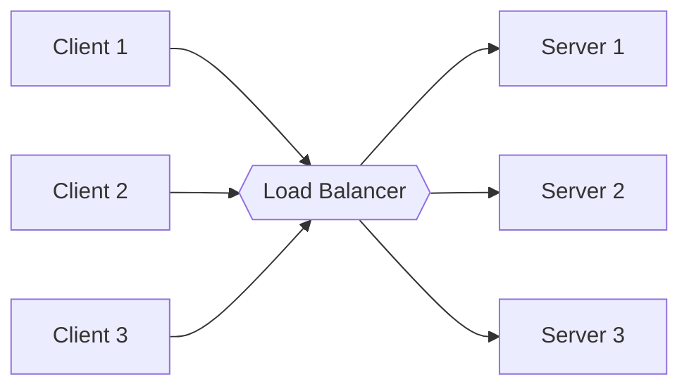

Clients only know **one address** (the LB's address, often called a **VIP - Virtual IP**). They have no idea how many servers exist behind it.

#### 📘 Terms Explained

| Term | Simple meaning |
|---|---|
| **Client** | Whoever sends the request: a browser, a mobile app, or another service. |
| **Server / Backend** | The machine (or container) running your application code that actually handles the request. "Backend" = the servers *behind* the LB. |
| **Request** | One message from client to server, e.g. "GET me the list of orders". |
| **IP address** | The numeric address of a machine on a network, e.g. `203.0.113.10`. Like a house address. |
| **DNS (Domain Name System)** | The internet's phone book. Converts a name like `api.example.com` into an IP address. |
| **VIP (Virtual IP)** | An IP address that doesn't belong to one fixed physical machine. It represents the service as a whole. The LB answers on it, and it can move between machines. |

---

## 1.2 Why Do We Need It?

### Without a Load Balancer

```
            ┌──────────────┐
  10,000 ──►│   Server 1   │  ◄── CPU 100%, slow, eventually crashes
  users     └──────────────┘
                              Single Point of Failure (SPOF)
```

### With a Load Balancer

```
                         ┌──────────────┐
                    ┌───►│   Server 1   │  ~3,333 req
  10,000   ┌──────┐ │    └──────────────┘
  users ──►│  LB  │─┼───►┌──────────────┐
           └──────┘ │    │   Server 2   │  ~3,333 req
                    │    └──────────────┘
                    └───►┌──────────────┐
                         │   Server 3   │  ~3,333 req
                         └──────────────┘
```

### Benefits

| Benefit | Explanation |
|---|---|
| **Scalability** | Add more servers behind the LB to handle more traffic (horizontal scaling) |
| **High Availability** | If a server dies, the LB stops sending traffic to it |
| **No downtime deployments** | Take servers out one at a time for upgrades (rolling deployment) |
| **Better performance** | Requests go to servers that are free, lowering response time |
| **Security** | Backend servers are hidden; the LB can terminate SSL, block bad traffic |
| **Flexibility** | Different URLs can be routed to different services (L7) |

> **Key point:** Load balancing is what makes **Horizontal Scaling** possible. Without an LB, adding servers doesn't help because clients don't know about them.

#### 📘 Terms Explained

| Term | Simple meaning |
|---|---|
| **SPOF (Single Point of Failure)** | One part that, if it breaks, takes the whole system down. One server = one SPOF. |
| **Scalability** | The ability to handle more users/traffic by adding resources. |
| **Horizontal scaling (scale out)** | Adding **more machines**. 1 server → 5 servers. Needs an LB. |
| **Vertical scaling (scale up)** | Making **one machine bigger** (more CPU/RAM). Simple but has a hardware limit and still a SPOF. |
| **High Availability (HA)** | The system keeps working even when some parts fail. Measured as uptime, e.g. 99.99% ("four nines") ≈ 52 minutes down per year. |
| **Rolling deployment** | Updating servers one (or a few) at a time, so the others keep serving users. |
| **Response time / Latency** | How long the user waits for an answer, usually in milliseconds (ms). |
| **Traffic** | The total volume of requests reaching the system. |

---

## 1.3 Core Building Blocks

| Term | Meaning |
|---|---|
| **VIP (Virtual IP)** | The single public IP/DNS name clients connect to |
| **Listener** | Port + protocol the LB listens on (e.g. `HTTPS:443`) |
| **Backend Pool / Target Group / Upstream** | The set of servers that receive traffic |
| **Health Check** | Periodic probe to check if a backend is alive |
| **Algorithm** | Rule used to pick the next server |
| **Rule / Route** | (L7) Conditions like `path=/api/*` → pool A |
| **Session Persistence** | Keeps a client on the same server |

### Request Flow

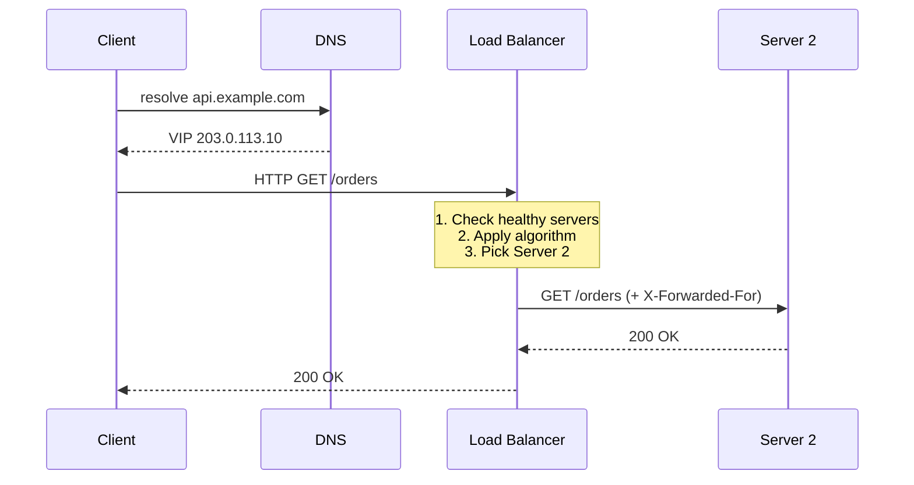

#### 📘 Terms Explained

| Term | Simple meaning |
|---|---|
| **Port** | A numbered "door" on a machine. One machine can run many programs, each on its own port. HTTP uses 80, HTTPS 443, Spring Boot defaults to 8080. |
| **Protocol** | The agreed language two machines use to talk, e.g. HTTP, HTTPS, TCP. |
| **Listener** | The LB setting that says "accept traffic on this port using this protocol". |
| **Pool / Target Group / Upstream** | Three names (Generic / AWS / Nginx) for the same thing: the list of servers the LB can send to. |
| **Probe** | A small test request the LB sends to check if a server is OK. |
| **`GET /orders`** | An HTTP request: method `GET` (read data) on path `/orders`. |
| **`200 OK`** | HTTP status code meaning "success". 4xx = client made a mistake, 5xx = server failed. |
| **X-Forwarded-For** | An HTTP header the LB adds containing the **real client IP**. Without it, the server only sees the LB's IP. |
| **Header** | Extra key-value information sent with an HTTP request/response, e.g. `Content-Type: application/json`. |

---

## 1.4 Types of Load Balancers

### 1.4.1 By OSI Layer - L4 vs L7 (Interview Imp - Java)

The **OSI model** splits networking into 7 layers. Load balancers usually work at layer 4 or layer 7:

```
 Layer 7  Application   HTTP, HTTPS, gRPC, WebSocket   ◄── L7 LB reads URL, headers, cookies
 Layer 6  Presentation  Encryption, encoding
 Layer 5  Session       Sessions between apps
 Layer 4  Transport     TCP, UDP                       ◄── L4 LB reads only IP + Port
 Layer 3  Network       IP (routing between networks)
 Layer 2  Data Link     Ethernet, MAC addresses
 Layer 1  Physical      Cables, radio signals
```

**Analogy:** An L4 LB is a postman who only reads the **address on the envelope**. An L7 LB **opens the letter**, reads it, and decides where it should go based on its content.

#### Layer 4 (Transport Layer) Load Balancer
- Decides based on **source/destination IP and port** only.
- Does **not** look inside the packet (no URL, no headers).
- Very **fast**, low CPU, can handle millions of connections.
- Works for any TCP/UDP protocol (databases, MQTT, gaming, etc.).
- Examples: AWS NLB, HAProxy (TCP mode), LVS, F5 (L4 mode).

#### Layer 7 (Application Layer) Load Balancer
- Understands **HTTP**: reads URL path, host, headers, cookies, method.
- Can do **content-based routing**, SSL termination, compression, caching, auth, rate limiting, header rewrite.
- Slower than L4 (must parse the request), but much smarter.
- Examples: AWS ALB, Nginx, HAProxy (HTTP mode), Envoy, Traefik.

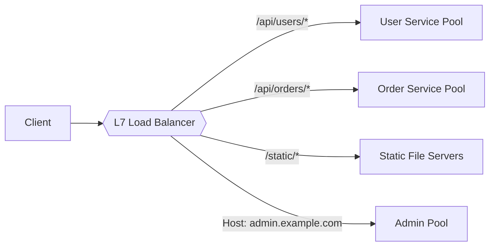

| Feature | L4 | L7 |
|---|---|---|
| Looks at | IP, Port | URL, Headers, Cookies, Body |
| Speed | Very fast | Slower |
| Content routing | ❌ | ✅ |
| SSL termination | Usually ❌ (passthrough) | ✅ |
| Sticky sessions | By source IP only | By cookie |
| Protocols | Any TCP/UDP | HTTP/HTTPS/gRPC/WebSocket |
| Connection | Often one TCP connection end-to-end | Two connections (client↔LB, LB↔server) |
| Use case | Databases, high-throughput TCP, gaming | Web apps, microservices, APIs |

#### 📘 Terms Explained

| Term | Simple meaning |
|---|---|
| **OSI model** | A teaching model that divides network communication into 7 layers, from cables (1) up to applications (7). |
| **TCP (Transmission Control Protocol)** | Reliable delivery: data arrives complete and in order, resent if lost. Used by HTTP, databases. Needs a **connection** set up first (the "3-way handshake"). |
| **UDP (User Datagram Protocol)** | Fast "fire and forget" delivery with no guarantee. Used by video calls, gaming, DNS. |
| **Packet** | A small chunk of data travelling over the network. Big messages are split into many packets. |
| **Connection** | An open communication channel between two machines (for TCP), kept open while they talk. |
| **HTTP / HTTPS** | The protocol of the web. HTTPS = HTTP encrypted with TLS. |
| **gRPC** | A fast protocol by Google for service-to-service calls; uses HTTP/2 and binary messages (Protobuf). |
| **WebSocket** | A connection that stays open so server and client can push messages both ways (chat, live scores). |
| **MQTT** | A lightweight messaging protocol for IoT devices. |
| **Cookie** | A small piece of data the server asks the browser to store and send back with every request. |
| **Content-based routing** | Choosing the destination by looking at the request's content (URL, header, etc.). |
| **Parse** | To read and understand the structure of data (e.g. split an HTTP request into method, URL, headers). |
| **Reverse proxy** | A server that receives requests on behalf of backend servers and forwards them. Every L7 LB is a reverse proxy. |
| **Compression** | Shrinking response size (e.g. gzip) so it travels faster. |
| **Rate limiting** | Limiting how many requests a client can make per second/minute. |
| **NLB / ALB** | AWS **Network** LB (L4) and **Application** LB (L7). |
| **LVS (Linux Virtual Server)** | An L4 load balancer built into the Linux kernel. |
| **Envoy / Traefik / HAProxy / Nginx** | Popular open-source software load balancers / proxies. |

### 1.4.2 By Implementation

| Type | Description | Examples | Pros | Cons |
|---|---|---|---|---|
| **Hardware** | Dedicated physical appliance | F5 BIG-IP, Citrix ADC | Very high performance | Expensive, hard to scale |
| **Software** | Runs on normal servers/containers | Nginx, HAProxy, Envoy | Cheap, flexible | You manage it |
| **Cloud Managed** | Provided as a service | AWS ELB (ALB/NLB), GCP LB, Azure LB | Auto-scaling, no ops | Vendor lock-in, cost per usage |

#### 📘 Terms Explained

| Term | Simple meaning |
|---|---|
| **Appliance** | A physical box sold for one specific job (here: load balancing). |
| **ADC (Application Delivery Controller)** | Marketing name for an advanced LB that also does security, caching, compression. |
| **Container** | A lightweight, packaged way to run an app with everything it needs (e.g. Docker). |
| **Managed service** | The cloud provider runs, patches and scales it; you only configure it. |
| **Ops (Operations)** | The day-to-day work of running, patching, and monitoring systems. |
| **Vendor lock-in** | Being so dependent on one provider's product that switching is hard and costly. |
| **ELB (Elastic Load Balancing)** | The AWS family name covering ALB, NLB and GWLB. |

### 1.4.3 By Placement - Server-side vs Client-side (Interview Imp - Java)

#### Server-side Load Balancing
A separate LB sits in the middle. The client doesn't know about servers.

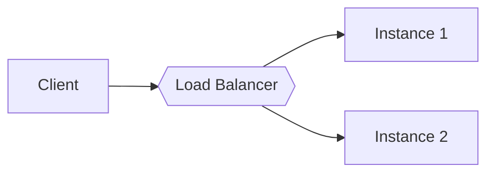

#### Client-side Load Balancing
The **client** fetches the list of servers from a **Service Registry** (Eureka, Consul, Kubernetes) and chooses one itself. Common in microservices (Spring Cloud LoadBalancer, formerly Netflix Ribbon; gRPC).

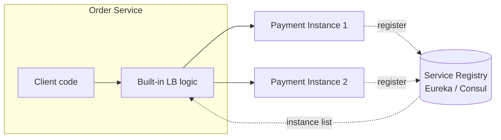

**Step by step:**
1. Each Payment instance starts and **registers** itself in the registry ("I'm payment-service at 10.0.1.5:8080").
2. Order Service asks the registry "where are the payment-service instances?" and caches the list.
3. On each call, Order Service's built-in LB logic picks one instance (e.g. round robin) and calls it **directly**.

| | Server-side | Client-side |
|---|---|---|
| Extra network hop | Yes | No |
| Single point of failure | LB (must be made HA) | None |
| Client complexity | Simple | Client needs LB library |
| Language support | Any client | Library per language |
| Typical use | Public internet traffic | Internal service-to-service calls |

#### 📘 Terms Explained

| Term | Simple meaning |
|---|---|
| **Instance** | One running copy of a service. "3 instances of payment-service" = 3 copies running. |
| **Microservices** | An architecture where an app is split into many small, independent services (users, orders, payments) that talk over the network. |
| **Service Registry** | A live directory of which service instances are running and where (IP + port). |
| **Service Discovery** | The process of looking up instances in the registry. |
| **Eureka / Consul** | Popular service registries. Eureka is from Netflix and widely used with Spring Cloud. |
| **Ribbon** | Netflix's old client-side LB library, now in maintenance mode; replaced by **Spring Cloud LoadBalancer**. |
| **Network hop** | Each time a request passes through one more machine. More hops = more latency. |

### 1.4.4 DNS Load Balancing
DNS returns **different IP addresses** for the same domain (round robin DNS).

```
api.example.com  →  A 10.0.0.1
                    A 10.0.0.2
                    A 10.0.0.3
```

- ✅ Simple, no extra infrastructure.
- ❌ DNS is **cached** (TTL) — clients may keep hitting a dead server.
- ❌ No health awareness (unless using smart DNS like Route 53 health checks).
- Mostly used for **global/region-level** balancing, combined with real LBs inside each region.

#### 📘 Terms Explained

| Term | Simple meaning |
|---|---|
| **A record** | A DNS entry that maps a name to an IPv4 address. |
| **Cache / Caching** | Keeping a copy of data nearby so you don't have to fetch it again. |
| **TTL (Time To Live)** | How long a DNS answer may be cached, in seconds. TTL 300 = clients may keep using the old IP for up to 5 minutes. |
| **Route 53** | AWS's DNS service; can check health and stop returning IPs of dead servers. |
| **Region** | A geographic location with its own data centers, e.g. AWS `ap-south-1` = Mumbai. |

---

## 1.5 Load Balancing Algorithms

An **algorithm** here is just the rule the LB uses to answer one question: *"Which server gets this request?"*

Algorithms fall into two groups:

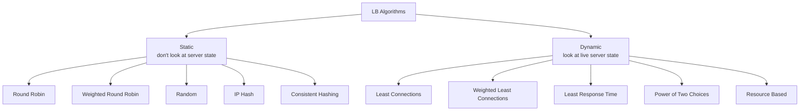

- **Static:** the decision is fixed in advance; it doesn't care if a server is busy right now.
- **Dynamic:** the decision uses live numbers (connections, latency, CPU) measured right now.

All Java examples below implement this simple interface:

```java
public interface LoadBalancer {
    Server next(String clientKey);   // clientKey is used only by hash-based algorithms
}

public class Server {
    private final String id;
    private final int weight;
    private final AtomicInteger activeConnections = new AtomicInteger();
    private volatile boolean healthy = true;

    public Server(String id, int weight) { this.id = id; this.weight = weight; }

    public String getId() { return id; }
    public int getWeight() { return weight; }
    public AtomicInteger getActiveConnections() { return activeConnections; }
    public boolean isHealthy() { return healthy; }
    public void setHealthy(boolean healthy) { this.healthy = healthy; }
}
```

#### 📘 Terms Explained (Java)

| Term | Simple meaning |
|---|---|
| **Thread-safe** | Code that works correctly when many threads (parallel requests) run it at the same time. An LB handles thousands of requests at once, so this is essential. |
| **`AtomicInteger`** | An `int` that can be safely changed by many threads at once without `synchronized`. `getAndIncrement()` reads and adds 1 as one unbreakable step. |
| **`volatile`** | Guarantees that when one thread changes the variable, other threads see the new value immediately. |
| **`synchronized`** | Only one thread at a time can run that method/block. Safe, but threads wait in line. |
| **`CopyOnWriteArrayList`** | A thread-safe list that is fast to read; every write makes a fresh copy. Good when reads (every request) are far more common than writes (adding a server). |
| **`ThreadLocalRandom`** | A random number generator per thread, faster than sharing one `Random` across threads. |

---

### 1.5.1 Round Robin (Interview Imp - Java)

Send each request to the next server in order, then loop back.

```
Request:  1   2   3   4   5   6
Server:   S1  S2  S3  S1  S2  S3
```

- ✅ Simple, fair when all servers are equal and requests cost the same.
- ❌ Ignores server capacity and current load.

```java
public class RoundRobinLoadBalancer implements LoadBalancer {
    private final List<Server> servers;
    private final AtomicInteger index = new AtomicInteger(0);

    public RoundRobinLoadBalancer(List<Server> servers) {
        this.servers = new CopyOnWriteArrayList<>(servers);
    }

    @Override
    public Server next(String clientKey) {
        // floorMod handles integer overflow after Integer.MAX_VALUE requests
        int i = Math.floorMod(index.getAndIncrement(), servers.size());
        return servers.get(i);
    }
}
```

> **Interview tip:** Mention `AtomicInteger` for thread safety and `Math.floorMod` to avoid a negative index after overflow.

| Term | Simple meaning |
|---|---|
| **Modulo (`%`)** | Remainder after division. `7 % 3 = 1`. Used to wrap a counter into the range `0..N-1`. |
| **Integer overflow** | An `int` can hold at most 2,147,483,647. Adding 1 more wraps it to a **negative** number. `-5 % 3` in Java is `-2` → invalid list index. |
| **`Math.floorMod`** | Like `%`, but always returns a non-negative result for a positive divisor. `Math.floorMod(-5, 3) = 1`. |

---

### 1.5.2 Weighted Round Robin (Interview Imp - Java)

A **weight** is a number saying how much traffic a server should get compared to others. A server with 2× the CPU gets 2× the weight.

Weight `S1=5, S2=1, S3=1` → S1 gets 5 of every 7 requests.

**Naive version:** `S1 S1 S1 S1 S1 S2 S3` — bursts all S1 requests together.
**Smooth version (used by Nginx):** `S1 S1 S2 S1 S3 S1 S1` — spreads them out.

**How the smooth version works (in words):** each server has a running score (`currentWeight`). On every request, add each server's weight to its score, pick the server with the highest score, then subtract the total weight from the winner's score. The winner "pays" for being chosen, so others catch up.

```java
public class SmoothWeightedRoundRobin implements LoadBalancer {

    private static class Node {
        final Server server;
        int currentWeight = 0;
        Node(Server server) { this.server = server; }
    }

    private final List<Node> nodes;

    public SmoothWeightedRoundRobin(List<Server> servers) {
        this.nodes = servers.stream().map(Node::new).toList();
    }

    @Override
    public synchronized Server next(String clientKey) {
        int totalWeight = 0;
        Node best = null;
        for (Node node : nodes) {
            node.currentWeight += node.server.getWeight();
            totalWeight += node.server.getWeight();
            if (best == null || node.currentWeight > best.currentWeight) {
                best = node;
            }
        }
        best.currentWeight -= totalWeight;
        return best.server;
    }
}
```

**Dry run** (weights A=5, B=1, C=1, total = 7):

| Step | Before (A,B,C) after `+= weight` | Picked | After `-= 7` |
|---|---|---|---|
| 1 | 5, 1, 1 | A | -2, 1, 1 |
| 2 | 3, 2, 2 | A | -4, 2, 2 |
| 3 | 1, 3, 3 | B | 1, -4, 3 |
| 4 | 6, -3, 4 | A | -1, -3, 4 |
| 5 | 4, -2, 5 | C | 4, -2, -2 |
| 6 | 9, -1, -1 | A | 2, -1, -1 |
| 7 | 7, 0, 0 | A | 0, 0, 0 ← back to start |

| Term | Simple meaning |
|---|---|
| **Dry run** | Walking through code by hand, step by step, with sample values. |
| **Burst** | Many requests hitting one server back-to-back in a short time. |

---

### 1.5.3 Random

Pick a random server. With many requests it averages out close to round robin.

```java
public Server next(String clientKey) {
    return servers.get(ThreadLocalRandom.current().nextInt(servers.size()));
}
```

- ✅ No shared state → great when there are **many independent LB instances**.
- ❌ Short-term imbalance is possible.

| Term | Simple meaning |
|---|---|
| **Shared state** | Data that several machines/threads must agree on (e.g. a round robin counter). Keeping it in sync is costly. Random needs none. |
| **Imbalance** | Some servers get noticeably more requests than others. |

---

### 1.5.4 IP Hash / Source Hash

`server = hash(clientIP) % N` → the same client always reaches the same server.

- ✅ Natural sticky sessions without cookies.
- ❌ Users behind one corporate NAT all land on one server.
- ❌ **When N changes, almost every client is remapped** (cache misses, lost sessions). Fixed by consistent hashing.

```java
public Server next(String clientIp) {
    int i = Math.floorMod(clientIp.hashCode(), servers.size());
    return servers.get(i);
}
```

**Why "N changes → almost everything moves":**

```
Client hash = 10
 3 servers:  10 % 3 = 1  → Server 1
 4 servers:  10 % 4 = 2  → Server 2   ← moved!
```

| Term | Simple meaning |
|---|---|
| **Hash function** | A function that turns any input (a string, an IP) into a fixed-size number. Same input → always the same number. |
| **N** | Number of servers. |
| **NAT (Network Address Translation)** | Many devices in an office share **one public IP**. To the LB they all look like one client. |
| **Remapped** | A client that used to go to server X now goes to server Y. |
| **Cache miss** | The data isn't in the cache, so it must be fetched from the slower source (DB). Happens when a client lands on a new server with an empty local cache. |

---

### 1.5.5 Least Connections (Interview Imp - Java)

Send the request to the server with the **fewest active connections**. Best when requests have very different durations (e.g. some take 10 ms, others 10 s, or long-lived WebSockets).

```
S1: ████████ 8 active
S2: ██ 2 active        ◄── next request goes here
S3: █████ 5 active
```

```java
public class LeastConnectionsLoadBalancer implements LoadBalancer {
    private final List<Server> servers;

    public LeastConnectionsLoadBalancer(List<Server> servers) {
        this.servers = servers;
    }

    @Override
    public Server next(String clientKey) {
        return servers.stream()
                .filter(Server::isHealthy)
                .min(Comparator.comparingInt(s -> s.getActiveConnections().get()))
                .orElseThrow(() -> new IllegalStateException("No healthy servers"));
    }

    // Caller must wrap each request like this
    public <T> T execute(Function<Server, T> call) {
        Server server = next(null);
        server.getActiveConnections().incrementAndGet();
        try {
            return call.apply(server);
        } finally {
            server.getActiveConnections().decrementAndGet();
        }
    }
}
```

| Term | Simple meaning |
|---|---|
| **Active connection** | A request/connection currently being processed (started but not finished). A good live measure of how busy a server is. |
| **Long-lived connection** | A connection that stays open for minutes or hours (WebSocket, streaming). Round robin can't see these, least connections can. |

### 1.5.6 Weighted Least Connections

Picks the server with the lowest `activeConnections / weight`. A server with weight 4 and 8 connections (ratio 2) beats a server with weight 1 and 3 connections (ratio 3). It combines **capacity** (weight) with **current load** (connections).

---

### 1.5.7 Least Response Time

Picks the server with the lowest **average latency** (often combined with fewest connections). Uses a moving average such as **EWMA (Exponentially Weighted Moving Average)**:

```
newAvg = α × latestLatency + (1 − α) × oldAvg     (α ≈ 0.2–0.5)
```

**Example** (α = 0.5): old average 100 ms, new request took 300 ms → `0.5×300 + 0.5×100 = 200 ms`. A slow server's score rises quickly, so it gets less traffic.

- ✅ Automatically avoids slow servers (GC pauses, noisy neighbors).
- ❌ Needs latency tracking; can oscillate (all traffic rushes to the fastest server, which then becomes slow).

| Term | Simple meaning |
|---|---|
| **Moving average** | An average that is updated with each new value, so it follows recent behavior. |
| **EWMA** | A moving average where **recent values count more** than old ones. No need to store all past values — just the previous average. |
| **α (alpha)** | How much weight the newest value gets. High α = reacts fast but jumpy; low α = smooth but slow to react. |
| **GC pause** | Java's Garbage Collector briefly pausing the app to free memory. The server is alive but slow for that moment. |
| **Noisy neighbor** | Another app on the same physical machine (in the cloud) using lots of CPU/disk and slowing yours down. |
| **Oscillation** | Swinging back and forth: everyone rushes to server A → A gets slow → everyone rushes to B → B gets slow… |

---

### 1.5.8 Power of Two Choices (P2C) — Advanced

Pick **2 random servers**, then send to the one with fewer connections.

```java
public Server next(String clientKey) {
    ThreadLocalRandom r = ThreadLocalRandom.current();
    Server a = servers.get(r.nextInt(servers.size()));
    Server b = servers.get(r.nextInt(servers.size()));
    return a.getActiveConnections().get() <= b.getActiveConnections().get() ? a : b;
}
```

**Why it matters:**
- Plain "least connections" with **many LB instances** causes a *herd effect*: every LB sees the same "least loaded" server and they all send traffic there at once.
- P2C gives results almost as good as least connections while avoiding the herd, at O(1) cost.
- Used by **Envoy**, **Nginx** (`random two least_conn`), **Linkerd**, **Finagle**.

```
10 LBs, all using "least connections", all see S2 has 0 connections:
   LB1 → S2, LB2 → S2, ... LB10 → S2      ← S2 flooded at once (herd)

10 LBs using P2C — each compares a different random pair:
   LB1 picks (S1,S4) → S4,  LB2 picks (S2,S3) → S2,  LB3 picks (S5,S1) → S1 ...
                                                     ← load stays spread out
```

| Term | Simple meaning |
|---|---|
| **Herd effect** | Many independent deciders make the same choice at the same moment and overload one target. |
| **Stale data** | Information that is slightly out of date. Each LB's view of connection counts lags behind reality. |
| **O(1)** | "Constant time" — the work doesn't grow with the number of servers. Least connections scans all N servers (O(N)); P2C only looks at 2. |
| **Linkerd / Finagle** | A service mesh, and Twitter's RPC library — both use P2C. |

---

### 1.5.9 Consistent Hashing (Interview Imp - Java)

Solves the remapping problem of `hash % N`. Servers and keys are placed on a **hash ring** (0 to 2³²−1). A key goes to the **first server clockwise** from its position.

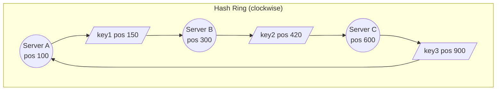

```
key1 (150) → first server clockwise → Server B
key2 (420) → Server C
key3 (900) → wraps around → Server A
```

**When a server is added or removed**, only the keys between it and its neighbor move — about `K/N` keys instead of almost all of them.

```
Add Server D at position 500:
  key2 (420) → now D (was C)     ← only keys between B(300) and D(500) move
  key1, key3 → unchanged
```

| Event | `hash % N` | Consistent Hashing |
|---|---|---|
| 4 → 5 servers | ~80% keys move | ~20% keys move |

**Virtual nodes:** Each physical server is placed on the ring many times (e.g. 100–200 points) so load spreads evenly and a failed server's keys spread across all the others instead of one neighbor.

```
Without virtual nodes:  A────────────B──C──────   ← A owns a huge arc, C a tiny one
With virtual nodes:     A1─C3─B1─A2─C1─B2─A3─B3─C2 ← every server owns many small, even arcs
```

```java
public class ConsistentHashLoadBalancer implements LoadBalancer {
    private final int virtualNodes;
    private final TreeMap<Long, Server> ring = new TreeMap<>();

    public ConsistentHashLoadBalancer(List<Server> servers, int virtualNodes) {
        this.virtualNodes = virtualNodes;
        servers.forEach(this::addServer);
    }

    public synchronized void addServer(Server server) {
        for (int i = 0; i < virtualNodes; i++) {
            ring.put(hash(server.getId() + "#" + i), server);
        }
    }

    public synchronized void removeServer(Server server) {
        for (int i = 0; i < virtualNodes; i++) {
            ring.remove(hash(server.getId() + "#" + i));
        }
    }

    @Override
    public synchronized Server next(String key) {
        if (ring.isEmpty()) throw new IllegalStateException("No servers");
        Map.Entry<Long, Server> entry = ring.ceilingEntry(hash(key)); // first node clockwise
        return entry != null ? entry.getValue() : ring.firstEntry().getValue(); // wrap around
    }

    private long hash(String key) {
        try {
            byte[] d = MessageDigest.getInstance("MD5").digest(key.getBytes(StandardCharsets.UTF_8));
            // take the first 4 bytes as an unsigned 32-bit number
            return ((long) (d[3] & 0xFF) << 24) | ((d[2] & 0xFF) << 16) | ((d[1] & 0xFF) << 8) | (d[0] & 0xFF);
        } catch (NoSuchAlgorithmException e) {
            throw new IllegalStateException(e);
        }
    }
}
```

**Used in:** Cassandra, DynamoDB, Memcached clients, Nginx `hash ... consistent`, Envoy `ring_hash` / `maglev`, CDNs.

| Term | Simple meaning |
|---|---|
| **Key** | Whatever identifies the request for routing: user ID, session ID, cache key, client IP. |
| **Hash ring** | Imagine all possible hash values (0 to ~4.29 billion) bent into a circle, so after the biggest value comes 0 again. |
| **Clockwise** | Moving towards bigger numbers on the ring (and wrapping to 0 at the end). |
| **K/N** | K = total keys, N = number of servers. Adding a server moves only roughly one server's share. |
| **Virtual node (vnode)** | A fake extra position for a real server on the ring. Server A might appear as `A#0, A#1, … A#199`. |
| **`TreeMap`** | A Java map that keeps keys **sorted**. Perfect for a ring. |
| **`ceilingEntry(x)`** | Returns the entry with the smallest key ≥ x — i.e. the next server clockwise. Runs in O(log N). |
| **MD5** | A hash function that spreads values evenly. Not secure for passwords, but fine for distribution. |
| **`& 0xFF`** | Turns a signed Java byte (-128..127) into 0..255 so bytes combine correctly. |
| **Maglev** | Google's consistent hashing variant with even more uniform distribution and fast lookups. |
| **Cassandra / DynamoDB / Memcached** | A distributed database, AWS's NoSQL DB, and a distributed cache — all use consistent hashing to place data. |

---

### 1.5.10 Algorithm Selection Guide

| Situation | Best Algorithm |
|---|---|
| Identical servers, short similar requests | Round Robin |
| Servers with different capacity | Weighted Round Robin |
| Long or uneven requests (WebSocket, uploads, reports) | Least Connections |
| Many distributed LB instances | Random / Power of Two Choices |
| Need cache locality / same user → same server | Consistent Hashing |
| Servers with variable performance | Least Response Time / EWMA |

> **Cache locality** = the same key keeps going to the same server, so that server's local cache already has the data ("warm cache").

---

## 1.6 Health Checks

The LB must know which servers are alive, otherwise it sends traffic into a black hole.

### Active Health Checks
The LB **probes** each server periodically.

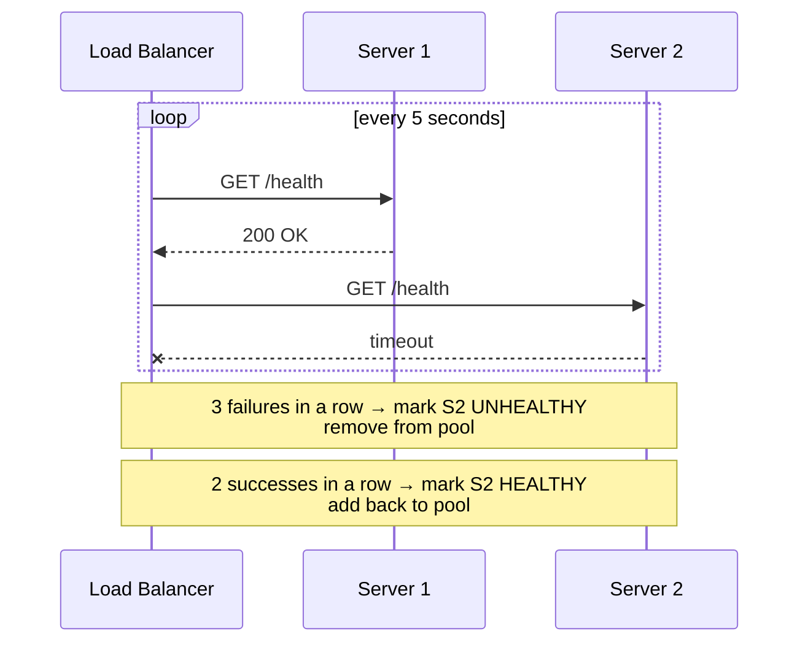

| Setting | Typical value | Meaning |
|---|---|---|
| Interval | 5–30 s | How often to probe |
| Timeout | 2–5 s | Max wait for a response |
| Unhealthy threshold | 2–3 | Failures in a row before removal |
| Healthy threshold | 2–5 | Successes in a row before adding back |

Thresholds prevent **flapping** (a server bouncing in and out of the pool).

**How long until a dead server is removed?** Roughly `interval × unhealthy threshold`. With 10 s × 3 = up to **30 seconds** of failed requests. Shorter intervals detect failure faster but add probe traffic.

### Passive Health Checks (Outlier Detection)
The LB watches **real traffic**. If a server returns many 5xx errors or timeouts, it is ejected for a while. No extra probe traffic, detects problems faster.

```
Server 3: last 10 requests → 500, 500, 503, 500, 500 (5 errors in a row)
LB: "Server 3 is an outlier" → eject for 30 s → try again → if still bad, eject for 60 s ...
```

### Types of Checks

| Type | Example | Detects |
|---|---|---|
| TCP | Can open port 8080 | Process is down |
| HTTP | `GET /health` returns 200 | App is responding |
| Deep | `/health` checks DB, cache, disk | Dependencies are broken |

> ⚠️ **Careful with deep checks:** if the shared database is down, *every* server fails the check and the LB removes all of them — turning a partial outage into a full one. Many teams use a **shallow liveness check** for the LB and a separate **readiness** check for dependencies.

### Spring Boot Example

```yaml
# application.yml
management:
  endpoint:
    health:
      probes:
        enabled: true          # exposes /actuator/health/liveness and /readiness
  endpoints:
    web:
      exposure:
        include: health
```

```java
@Component
public class InventoryHealthIndicator implements HealthIndicator {
    private final InventoryClient client;

    public InventoryHealthIndicator(InventoryClient client) { this.client = client; }

    @Override
    public Health health() {
        return client.ping()
                ? Health.up().build()
                : Health.down().withDetail("inventory", "unreachable").build();
    }
}
```

Point the LB at `/actuator/health/readiness`.

#### 📘 Terms Explained

| Term | Simple meaning |
|---|---|
| **Health check** | A regular test the LB runs to see whether a server can handle traffic. |
| **Active check** | The LB **sends** test requests on its own schedule. |
| **Passive check** | The LB **watches** real user requests for failures — no extra test traffic. |
| **Timeout** | The maximum time to wait for an answer before treating it as a failure. |
| **Threshold** | How many results in a row are needed before changing a server's status. |
| **Flapping** | A server constantly switching between healthy and unhealthy, causing instability. |
| **Outlier** | A server behaving much worse than the others. |
| **Ejection** | Temporarily removing an outlier from the pool. |
| **5xx errors** | HTTP status codes 500–599 meaning the **server** failed (500 Internal Error, 503 Unavailable…). |
| **Outage** | A period when the system (or part of it) is not working. |
| **Dependency** | Something your service needs to work: database, cache, another service. |
| **Liveness** | "Is the process alive, or stuck?" If it fails → **restart** the app. |
| **Readiness** | "Can it serve traffic right now?" (finished starting, DB reachable). If it fails → **stop sending traffic**, but don't restart. |
| **Spring Boot Actuator** | A Spring Boot module that adds production endpoints like `/actuator/health` and `/actuator/metrics`. |
| **`HealthIndicator`** | A Spring interface you implement to add your own check to `/actuator/health`. |

---

## 1.7 Session Persistence (Sticky Sessions)

**Problem:** User logs in on Server 1 (session stored in Server 1's memory). Next request goes to Server 2 → Server 2 doesn't know the user → logged out.

### Option 1 - Sticky Sessions
The LB sends the same user to the same server, using:
- **Cookie-based** (L7): LB sets a cookie like `SERVERID=s1` or `AWSALB=...`.
- **IP-based** (L4): hash of client IP.

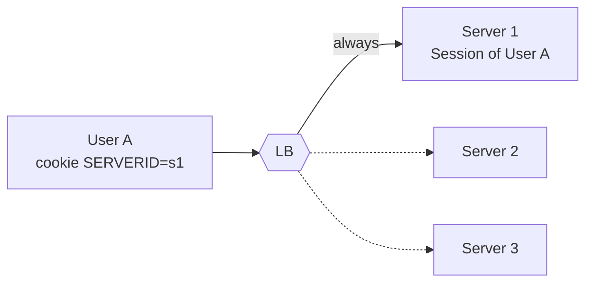

**Drawbacks:**
- Uneven load (one server can collect "heavy" users).
- When that server dies, its users lose their sessions.
- Makes auto-scaling and rolling deployments harder.

### Option 2 - Stateless Servers (Preferred) (Interview Imp - Java)
Move session state **out of the server**:

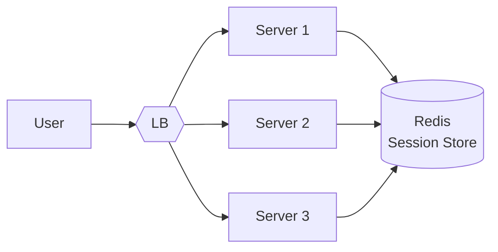

- **Centralized session store:** Redis / Hazelcast with **Spring Session** (`@EnableRedisHttpSession`).
- **Token-based auth:** JWT carries the user identity; any server can validate it.

```java
@Configuration
@EnableRedisHttpSession(maxInactiveIntervalInSeconds = 1800)
public class SessionConfig { }
```

Now any server can serve any request → plain round robin works and servers can be added/removed freely.

#### 📘 Terms Explained

| Term | Simple meaning |
|---|---|
| **Session** | Data the server remembers about a user between requests (logged-in user, cart items). In Java: `HttpSession`. |
| **Session persistence / Sticky session / Session affinity** | Three names for the same idea: keep sending one user to the same server. |
| **Stateful server** | Stores user-specific data in its own memory. Can't be swapped out freely. |
| **Stateless server** | Stores nothing user-specific locally. Any server can handle any request. Ideal for scaling. |
| **Redis** | A very fast in-memory key-value store, often used for sessions and caching. |
| **Hazelcast** | A Java in-memory data grid; can share sessions across servers. |
| **Spring Session** | Spring module that stores `HttpSession` in Redis/JDBC/Hazelcast instead of server memory — no code changes needed in controllers. |
| **`maxInactiveIntervalInSeconds`** | Session expires after this many seconds of no activity (1800 = 30 minutes). |
| **JWT (JSON Web Token)** | A signed token containing user info (e.g. user ID, roles). The client sends it with each request; any server can verify the signature without a session store. |
| **Token-based auth** | Authentication where the client proves identity by sending a token instead of relying on server-side sessions. |

---

## 1.8 SSL/TLS Handling

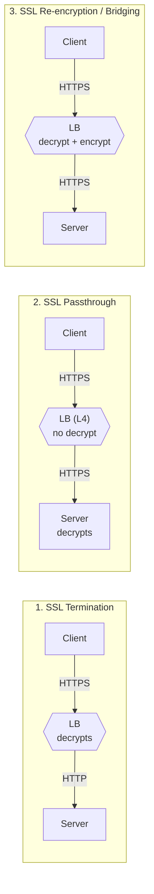

| Mode | Pros | Cons | Use when |
|---|---|---|---|
| **Termination** | Offloads CPU from servers, one place for certs, L7 routing possible | Traffic inside network is plain text | Trusted internal network |
| **Passthrough** | End-to-end encryption | No L7 features, certs on every server | Strict compliance, L4 LB |
| **Re-encryption** | L7 features + encrypted internally | Extra CPU on LB | Zero-trust networks, PCI/HIPAA |

> **Why passthrough can't do L7 routing:** the HTTP request is still encrypted when it passes through the LB, so the LB can't read the URL or headers.

When the LB terminates SSL, it adds headers so the app knows the original request details:
- `X-Forwarded-For` — original client IP
- `X-Forwarded-Proto` — `https`
- `X-Forwarded-Host` — original host

In Spring Boot: `server.forward-headers-strategy=framework` so redirects and `request.getRemoteAddr()` behave correctly.

#### 📘 Terms Explained

| Term | Simple meaning |
|---|---|
| **SSL / TLS** | Protocols that encrypt traffic between client and server. SSL is the old name; today it's always **TLS**, but people still say "SSL". |
| **Encrypt / Decrypt** | Scramble data so only the intended receiver can read it / unscramble it back. |
| **Certificate** | A digital ID card proving a server really is `api.example.com`, issued by a trusted Certificate Authority (CA). Comes with a **private key** that must stay secret. |
| **TLS handshake** | The setup step at the start of a connection where client and server verify the certificate and agree on encryption keys. CPU-heavy. |
| **Termination** | The point where encrypted traffic is decrypted. "Terminate at the LB" = the LB decrypts. |
| **Offload** | Moving work (here: encryption) from the app servers to another component. |
| **Plain text** | Unencrypted data that anyone on the network path could read. |
| **End-to-end encryption** | Data stays encrypted the whole way from client to the final server. |
| **Compliance** | Following legal/industry rules about data security. |
| **Zero-trust** | Security model that trusts **nothing** by default, even inside your own network — so internal traffic is encrypted too. |
| **PCI-DSS / HIPAA** | Security standards for card payments / US health data. Both require strong protection of data in transit. |
| **`X-Forwarded-Proto` / `X-Forwarded-Host`** | Headers telling the app the original protocol (`https`) and hostname the client used. |
| **`forward-headers-strategy`** | Spring Boot setting that makes the app trust and use `X-Forwarded-*` headers (so it builds `https://` redirect links, logs the real client IP, etc.). |

---

## 1.9 High Availability of the Load Balancer Itself

> **Interview question:** "The load balancer is now a single point of failure. How do you fix that?"

### Active-Passive (Failover)

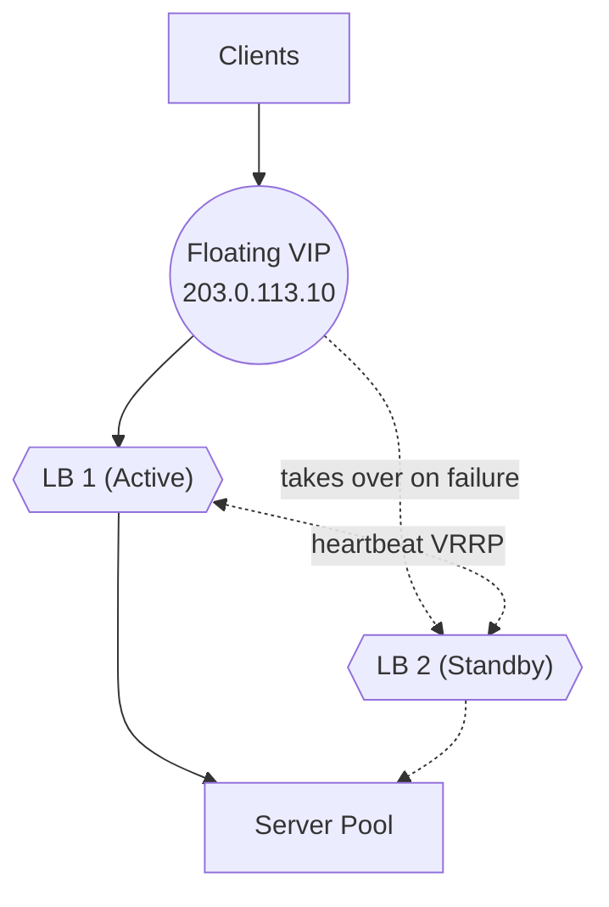

- Two LBs share a **floating virtual IP**.
- They exchange heartbeats using **VRRP** (via tools like **Keepalived**).
- If the active one stops responding, the standby claims the VIP in about 1–3 seconds.
- ❌ Half the hardware sits idle.

**What happens during failover, step by step:**
1. LB1 (active) owns the VIP and sends a heartbeat every second: "I'm alive".
2. LB1 crashes → heartbeats stop.
3. After ~3 missed heartbeats, LB2 decides LB1 is dead.
4. LB2 announces to the network "203.0.113.10 is now at my hardware address" (gratuitous ARP).
5. Network switches update; new packets for the VIP now reach LB2. Clients see only a short blip.

### Active-Active
- Both LBs serve traffic at the same time.
- Traffic is spread across them by **DNS** (multiple A records), **ECMP routing**, or **Anycast**.
- ✅ Uses all capacity. ❌ Harder to share state (sticky session tables, rate-limit counters).

### Cloud LBs
AWS ALB/NLB, GCP and Azure LBs are **already highly available across availability zones** — you don't manage failover yourself. Enable **cross-zone load balancing** to spread traffic evenly across zones.

```
Without cross-zone:            With cross-zone:
 Zone A LB (50%) → 2 servers    Every LB node spreads to all 10 servers
 Zone B LB (50%) → 8 servers    → each server gets 10%
 → Zone A servers get 25% each,
   Zone B servers 6.25% each
```

#### 📘 Terms Explained

| Term | Simple meaning |
|---|---|
| **Failover** | Automatically switching to a backup when the main component fails. |
| **Active-Passive** | One component works, the other waits on standby to take over. |
| **Active-Active** | All components work at the same time and share the load. |
| **Standby** | A backup that is running and ready but not serving traffic yet. |
| **Floating IP** | A VIP that can move from one machine to another. |
| **Heartbeat** | A small "I'm alive" message sent regularly. No heartbeat for a while = assumed dead. |
| **VRRP (Virtual Router Redundancy Protocol)** | A standard protocol letting several machines share one IP, with one master owning it at a time. |
| **Keepalived** | A popular Linux tool that implements VRRP (and health checks) for LB failover. |
| **ARP / Gratuitous ARP** | ARP maps an IP to a hardware (MAC) address on a local network. A *gratuitous* ARP is an unrequested announcement: "this IP is now at my MAC". |
| **ECMP (Equal-Cost Multi-Path)** | A router feature that spreads traffic across several equally good paths (e.g. several LBs) using a hash of the connection. |
| **Anycast** | The same IP is announced from many places; the network delivers to the nearest one. (More in 1.10.) |
| **Availability Zone (AZ)** | An isolated data center (or group) inside a cloud region, with separate power and network. A region has 2–6 AZs. |
| **Cross-zone load balancing** | The LB in one AZ can send traffic to servers in other AZs, so all servers get an equal share. |

---

## 1.10 Global Server Load Balancing (GSLB)

For users across the world, balance first **between regions**, then **inside a region**.

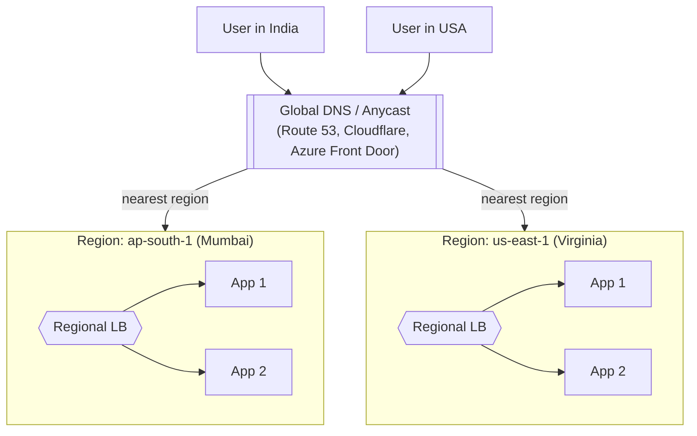

**Routing policies:**
| Policy | Behavior |
|---|---|
| **Geolocation** | Route by user's country/continent (also for data-residency laws) |
| **Latency-based** | Route to the region with the lowest measured latency |
| **Weighted** | e.g. 90% region A, 10% region B (migration, canary) |
| **Failover** | Use primary region; switch to secondary if health check fails |

**Anycast:** The same IP address is announced from many locations using BGP; the internet routes each user to the nearest one. Used by Cloudflare, Google Cloud LB, and DNS root servers.

```
             IP 1.2.3.4 announced from Mumbai, London, New York
User in Delhi  ──► internet routers pick shortest path ──► Mumbai
User in Paris  ──► ──────────────────────────────────────► London
```

| | GeoDNS | Anycast |
|---|---|---|
| How | DNS returns a different IP per user location | One IP everywhere; network routing picks nearest |
| Failover speed | Slow (waits for DNS TTL to expire) | Fast (routing changes in seconds) |
| Complexity | Low | High (needs your own IP range + BGP) — usually bought from a provider |

#### 📘 Terms Explained

| Term | Simple meaning |
|---|---|
| **GSLB (Global Server Load Balancing)** | Balancing traffic across data centers/regions worldwide, not just across servers in one place. |
| **GeoDNS** | DNS that gives a different answer depending on where the user is. |
| **Data residency** | Laws requiring certain data (e.g. EU or Indian citizens' data) to be stored/processed in that country/region. |
| **Migration** | Moving a system from one place/version to another. |
| **Canary release** | Sending a small % of traffic to a new version first to check it's safe, like the canary in a coal mine. |
| **BGP (Border Gateway Protocol)** | The protocol internet routers use to tell each other which IP ranges they can reach. Anycast relies on it. |
| **Root DNS servers** | The top of the DNS system; they use Anycast to serve the whole world from hundreds of locations. |
| **Edge / PoP (Point of Presence)** | A provider's data center close to users, used to handle traffic near them. |

---

## 1.11 Advanced Concepts

### 1.11.1 Typical Multi-Tier Production Architecture

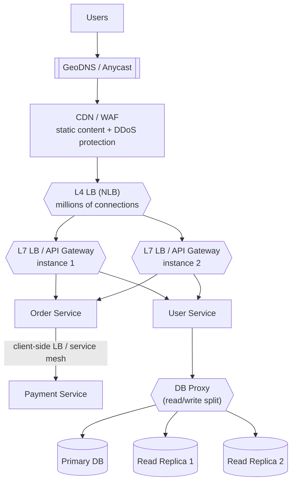

Load balancing happens at **every layer**: DNS → edge → L4 → L7 → service-to-service → database.

**Walking through one request:**
1. **GeoDNS / Anycast** sends the user to the nearest region.
2. **CDN** answers directly if it's a static file (image, JS); the **WAF** blocks attacks.
3. **L4 LB** cheaply spreads millions of TCP connections across the L7 fleet.
4. **L7 LB / API Gateway** reads the URL, checks auth and rate limits, routes `/orders` to Order Service.
5. **Order Service** calls Payment Service using **client-side LB / service mesh** — no central LB in between.
6. **DB proxy** sends writes (`INSERT/UPDATE`) to the **primary** DB and reads (`SELECT`) to **replicas**.

#### 📘 Terms Explained

| Term | Simple meaning |
|---|---|
| **Tier** | A layer in the architecture (edge tier, web tier, service tier, data tier). |
| **CDN (Content Delivery Network)** | A worldwide network of cache servers that serve static files (images, JS, video) from a location near the user. |
| **WAF (Web Application Firewall)** | A filter that inspects HTTP traffic and blocks attacks like SQL injection or XSS. |
| **DDoS (Distributed Denial of Service)** | An attack where thousands of machines flood your system with traffic to knock it offline. |
| **API Gateway** | An L7 entry point for APIs that adds features like authentication, rate limiting, request transformation, and routing to microservices (e.g. Spring Cloud Gateway, Kong, AWS API Gateway). |
| **Fleet** | A group of identical machines doing the same job. |
| **Service mesh** | Infrastructure that handles service-to-service traffic (LB, retries, encryption) using a proxy next to each service. (More in 1.11.8.) |
| **DB proxy** | A middleman between app and database (e.g. ProxySQL, PgBouncer, AWS RDS Proxy) that pools connections and can split reads/writes. |
| **Primary DB** | The main database that accepts writes. (Older name: master.) |
| **Read replica** | A copy of the primary DB that receives changes automatically and serves **read-only** queries, taking load off the primary. |
| **Read/write split** | Sending writes to the primary and reads to replicas. |

---

### 1.11.2 Connection Draining (Deregistration Delay)

**Problem:** You want to remove a server (new deployment or scaling in). If the LB cuts it off instantly, every request it is processing right now fails — e.g. a user's payment request gets a 502 halfway through.

**Solution:** When removing a server, the LB:
1. Stops sending **new** requests to it.
2. Lets **in-flight** requests finish (e.g. up to 30–300 s).
3. Then removes it.

```
Time ─────────────────────────────────────────────►
       Mark "draining"            Drain timeout reached
             │                             │
 New reqs:  ✖ none sent to this server     │
 Old reqs:  ████ req A done                │
            ██████████ req B done          │
            ███████████████████ req C done │ ← remove server
```

Without this, users see errors during every deployment. In Spring Boot, enable `server.shutdown=graceful` so the app also finishes active requests before shutting down:

```yaml
server:
  shutdown: graceful
spring:
  lifecycle:
    timeout-per-shutdown-phase: 30s   # max wait for active requests
```

| Term | Simple meaning |
|---|---|
| **Connection draining** | Letting existing requests finish before removing a server. AWS calls it **deregistration delay**. |
| **Deregister** | Remove a server from the LB's pool. (Register = add.) |
| **In-flight request** | A request that has started but not finished yet. |
| **Scale in** | Removing servers because traffic dropped (opposite: **scale out**). |
| **Graceful shutdown** | The app stops accepting new work, finishes current work, then exits — instead of dying instantly. |

---

### 1.11.3 Slow Start / Warm-up

**Problem:** A newly started Java server is "cold":
- The **JVM** hasn't optimized hot code yet (the **JIT** compiler needs some traffic first), so it runs slower.
- Its **caches are empty**, so every request goes to the DB.
- Its **connection pool** (DB connections) isn't filled yet; opening connections takes time.

If the LB immediately gives it a full share of traffic (e.g. with least connections, it has 0 connections so it gets **everything**!), it becomes very slow or crashes.

**Solution — Slow start:** the LB ramps the new server's share up gradually over e.g. 30–120 s.

```
Traffic share of new server
100% │                         ┌──────────
     │                    ┌────┘
 50% │              ┌─────┘
     │        ┌─────┘
  0% └────────┘
     0s      30s     60s     90s    120s   (slow_start = 120 s)
```

Supported by AWS ALB (`slow_start.duration_seconds`), Nginx Plus (`slow_start`), Envoy (`slow_start_config`).

| Term | Simple meaning |
|---|---|
| **JVM (Java Virtual Machine)** | The program that runs Java bytecode. |
| **JIT (Just-In-Time) compiler** | Part of the JVM that turns frequently used code into fast native machine code while the app runs. Until then, code runs slower ("cold"). |
| **Warm-up** | The time a new instance needs before it reaches full speed. |
| **Cold cache** | An empty cache; everything must be fetched from the slow source first. |
| **Connection pool** | A set of reusable, already-open DB connections (e.g. HikariCP in Spring Boot). Opening a new DB connection is slow, so apps reuse them. |
| **Ramp up** | Increasing gradually. |

---

### 1.11.4 Direct Server Return (DSR)

**Problem:** In the normal setup, both requests **and responses** pass through the LB. Responses are often much bigger than requests (a 100-byte request for a 50 MB video). The LB's network bandwidth becomes the bottleneck.

**Solution:** With **DSR**, the server replies **directly to the client**, bypassing the LB.

```
Normal:  Client → LB → Server → LB → Client
DSR:     Client → LB → Server ─────────→ Client
```

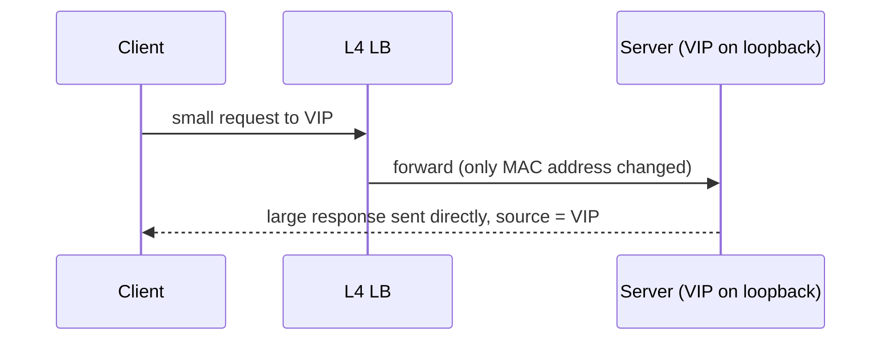

**How it works (simplified):**
1. The LB forwards the packet without changing its destination IP (still the VIP) — it only changes the hardware (MAC) address so it reaches the chosen server.
2. Every backend server is configured to also accept the VIP (on its **loopback** interface) but never announce it.
3. The server replies with source IP = VIP, so the client thinks it is talking to the LB.

- ✅ LB handles only the small incoming traffic — huge bandwidth savings.
- ❌ L4 only (the LB never sees the response, so no L7 features, no response-based health checks).
- ❌ Harder to set up; servers and LB usually must be on the same network.
- Used by LVS, Google Maglev-style LBs, and some CDNs/video platforms.

| Term | Simple meaning |
|---|---|
| **DSR (Direct Server Return)** | Responses skip the LB and go straight from server to client. |
| **Bandwidth** | How much data can pass through per second (e.g. 10 Gbps). |
| **Bottleneck** | The slowest part that limits the whole system — like the narrow neck of a bottle. |
| **MAC address** | A hardware address of a network card, used for delivery within the local network. |
| **Loopback interface** | A virtual network interface on every machine (e.g. `127.0.0.1`/`lo`) that the machine uses to talk to itself; here it's used to quietly hold the VIP. |

---

### 1.11.5 Retries, Timeouts & Circuit Breaking

When a backend fails, the LB (or client) can try to protect the user. But careless protection can make things **worse**.

#### a) Retries
- **Retry on another server** if one fails — only for **idempotent** requests.
- Retrying a **non-idempotent** POST can create duplicate orders or charge a card twice.

| Request | Idempotent? | Safe to retry? |
|---|---|---|
| `GET /orders/42` | ✅ Reading doesn't change anything | Yes |
| `PUT /users/7 {name:"Ravi"}` | ✅ Setting the same value twice = same result | Yes |
| `DELETE /cart/5` | ✅ Deleting twice = still deleted | Yes |
| `POST /payments {amount:500}` | ❌ Each call creates a new payment | Only with an **idempotency key** |

**Idempotency key:** the client sends a unique ID (e.g. `Idempotency-Key: 9f1c...`) with the request. The server remembers it; if the same key comes again, it returns the saved result instead of charging again.

#### b) Retry Budget & Retry Storm
If the backend is overloaded and every client retries 3 times, traffic becomes **4×** exactly when the system is weakest — a **retry storm**.

```
Normal:          1,000 req/s ──► backend OK
Backend slows → each request retried 3×
                 4,000 req/s ──► backend collapses completely
```

Fixes:
- **Retry budget**: retries may be at most e.g. 10–20% of normal traffic.
- **Exponential backoff with jitter**: wait 100 ms, then 200 ms, then 400 ms… plus a small random amount, so clients don't all retry at the same instant.

#### c) Circuit Breaker
Like an electrical circuit breaker in your house: when there's a fault, it "trips" and stops current flowing, protecting the rest of the system.

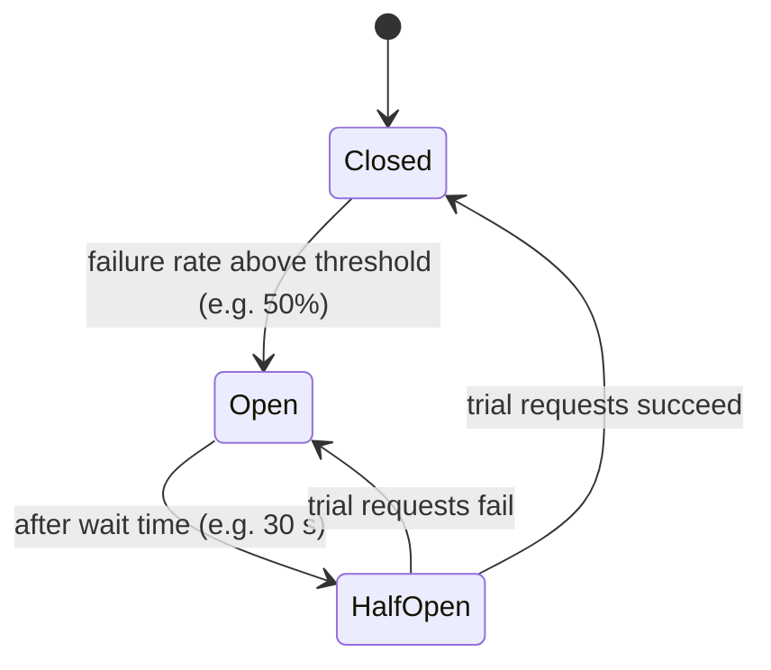

| State | Behavior |
|---|---|
| **Closed** (normal) | Requests flow normally; failures are counted. |
| **Open** (tripped) | Requests **fail immediately** (or return a fallback) without calling the broken server. Gives it time to recover. |
| **Half-Open** (testing) | Lets a few trial requests through. Success → Closed. Failure → Open again. |

Java example with **Resilience4j**:

```java
@Service
public class PaymentClient {

    @CircuitBreaker(name = "payment", fallbackMethod = "paymentFallback")
    @Retry(name = "payment")
    public PaymentResponse pay(PaymentRequest request) {
        return restClient.post().uri("/payments").body(request)
                .retrieve().body(PaymentResponse.class);
    }

    private PaymentResponse paymentFallback(PaymentRequest request, Throwable ex) {
        return PaymentResponse.pending("Payment service busy, will retry later");
    }
}
```

```yaml
resilience4j:
  circuitbreaker:
    instances:
      payment:
        sliding-window-size: 20               # look at the last 20 calls
        failure-rate-threshold: 50            # open if 50% failed
        wait-duration-in-open-state: 30s      # stay open 30 s, then half-open
        permitted-number-of-calls-in-half-open-state: 3
  retry:
    instances:
      payment:
        max-attempts: 3
        wait-duration: 200ms
        enable-exponential-backoff: true
```

At the LB level, the same idea is called **outlier ejection** (Envoy, Istio).

#### d) Timeouts
Every hop needs a timeout, otherwise a stuck server holds connections forever and threads pile up.

**Keep-alive vs idle timeout — the classic 502 bug:**
- The LB keeps connections to backends open and reuses them (**keep-alive**), and closes ones unused for its **idle timeout** (AWS ALB default 60 s).
- The backend also closes idle connections after its own keep-alive timeout.
- If the **backend closes first** (say after 5 s), the LB may send a new request on a connection the backend just closed → **502 Bad Gateway**.
- **Rule:** backend keep-alive timeout must be **longer** than the LB idle timeout (e.g. LB 60 s, backend 65 s).

| Term | Simple meaning |
|---|---|
| **Retry** | Automatically trying a failed request again. |
| **Idempotent** | Doing it once or many times gives the same final result. |
| **Idempotency key** | A unique request ID that lets the server detect and ignore duplicates. |
| **Retry storm** | Retries multiplying traffic during an outage and making it worse. |
| **Retry budget** | A cap on the share of traffic that may be retries. |
| **Exponential backoff** | Waiting longer after each failure (100 ms, 200 ms, 400 ms, …). |
| **Jitter** | A small random delay added so many clients don't act at exactly the same time. |
| **Cascading failure** | One failing service causes its callers to fail, which causes their callers to fail, like dominoes. Circuit breakers stop this. |
| **Fallback** | A backup response used when the real call fails (cached data, default value, "try later" message). |
| **Resilience4j** | The standard Java library for circuit breaker, retry, rate limiter, bulkhead, and timeouts (successor to Netflix Hystrix). |
| **Sliding window** | The last N calls (or last N seconds) used to calculate the failure rate. |
| **Keep-alive** | Keeping a TCP connection open after a request so the next request can reuse it (saves the handshake cost). |
| **Idle timeout** | How long an unused connection is kept open before closing it. |
| **502 Bad Gateway** | The LB/proxy got an invalid response — or the connection broke — when talking to the backend. |

---

### 1.11.6 Rate Limiting & DDoS Protection at the LB

**Rate limiting** = allowing each client only a fixed number of requests per time window (e.g. 100 requests/minute per API key). Extra requests get **HTTP 429 Too Many Requests**. It protects backends from abusive clients, bugs (a client stuck in a loop), and attacks.

**Token bucket algorithm** (most common):

```
Bucket capacity = 10 tokens, refill = 1 token/second

 ┌──────────────┐  ◄── 1 token added every second (up to 10)
 │ ● ● ● ● ● ●  │
 └──────┬───────┘
        │ each request takes 1 token
        ▼
 Token available? ── yes ──► forward request
                  └─ no ───► reject with 429
```

- Allows short **bursts** (up to 10 at once) but limits the long-term average (1/s).
- Applied per IP, per API key, or per user.

**DDoS protection:** CDNs and cloud LBs (Cloudflare, AWS Shield, Google Cloud Armor) absorb huge floods of traffic at the edge before it reaches your servers. A **WAF** at the L7 LB blocks malicious requests (SQL injection, bad bots).

| Term | Simple meaning |
|---|---|
| **Rate limiting** | Capping requests per client per time window. |
| **HTTP 429** | "Too Many Requests" — the client exceeded its limit. |
| **Token bucket** | A rate limiting algorithm: requests spend tokens; tokens refill at a fixed rate. |
| **Burst** | A short spike of many requests at once. |
| **API key** | A secret string identifying which application/customer is calling your API. |
| **SQL injection** | An attack that sneaks database commands into input fields. |
| **Bot** | Automated software making requests; some are good (search engines), many are not (scrapers, attackers). |

---

### 1.11.7 Auto Scaling Integration

**Auto scaling** = automatically adding servers when traffic rises and removing them when it falls, so you pay only for what you need. It works hand-in-hand with the LB:

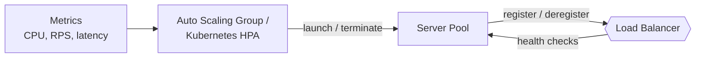

**Scale-out flow (traffic rising):**
1. Metrics show average CPU > 70% for 3 minutes.
2. The auto scaler launches 2 new instances.
3. They **register** with the LB but receive no traffic until they pass health checks.
4. Slow start ramps up their traffic.

**Scale-in flow (traffic falling):**
1. CPU < 30% for 10 minutes.
2. The auto scaler picks an instance to remove → LB **drains** it → instance is terminated.

| Term | Simple meaning |
|---|---|
| **Auto scaling** | Automatically changing the number of servers based on load. |
| **Metric** | A measured number over time (CPU %, requests/sec, latency). |
| **RPS** | Requests Per Second. |
| **ASG (Auto Scaling Group)** | AWS feature that manages a group of EC2 instances and adds/removes them by rules. |
| **HPA (Horizontal Pod Autoscaler)** | Kubernetes feature that adds/removes Pods based on metrics. |
| **Launch / Terminate** | Start a new instance / permanently shut one down. |
| **Cooldown** | A waiting period after a scaling action so the system doesn't add/remove servers too quickly (avoids flapping). |

---

### 1.11.8 Load Balancing in Kubernetes

**Kubernetes (K8s)** is a platform that runs containers across many machines and keeps them running. It has several built-in LB layers:

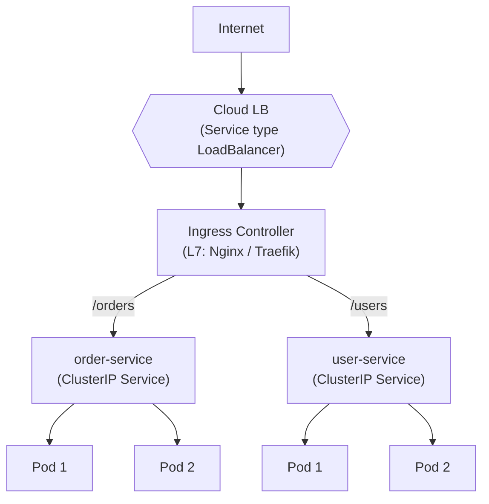

| Component | Role |
|---|---|
| **Service (ClusterIP)** | Internal L4 load balancing across Pods via kube-proxy (iptables/IPVS) |
| **Service (LoadBalancer)** | Provisions a cloud LB (e.g. AWS NLB) |
| **Ingress / Gateway API** | L7 routing (Nginx Ingress, Traefik, AWS ALB controller) |
| **Service Mesh (Istio, Linkerd)** | Sidecar proxy (Envoy) does client-side L7 LB, retries, mTLS per Pod |

**Service mesh with sidecars:**

```
 ┌────────── Pod A ──────────┐            ┌────────── Pod B ──────────┐
 │  Order app ──► Envoy proxy │ ── mTLS ──►│ Envoy proxy ──► Payment app│
 └────────────────────────────┘            └────────────────────────────┘
   App just calls "payment-service"; the sidecar proxy picks the Pod,
   retries, encrypts, and records metrics — no code changes in the app.
```

> ⚠️ **gRPC / HTTP/2 gotcha:** gRPC keeps **one long-lived connection** with many requests on it. An L4 LB balances *connections*, not requests, so all traffic from one client sticks to one Pod. Use an **L7 LB** (Envoy, Linkerd) or **client-side** gRPC load balancing with a headless service.

```
HTTP/1.1:  many short connections  → L4 LB spreads them    ✅
HTTP/2 :   1 connection, 1000 requests inside it (multiplexed)
           → L4 LB sees 1 connection → all 1000 go to Pod 1 ❌
```

| Term | Simple meaning |
|---|---|
| **Kubernetes (K8s)** | Open-source system that deploys, scales, and manages containers across a cluster of machines. |
| **Cluster** | A group of machines (nodes) managed together by Kubernetes. |
| **Pod** | The smallest unit in Kubernetes — one or more containers running together with one IP. Usually one app instance. |
| **Service** | A stable name + IP in Kubernetes that load balances to a changing set of Pods. |
| **ClusterIP** | A Service type reachable only inside the cluster. |
| **kube-proxy** | Kubernetes component on each node that implements Service load balancing using Linux network rules. |
| **iptables / IPVS** | Linux kernel features for packet rules / kernel-level L4 load balancing. IPVS scales better with many Services. |
| **Ingress** | A Kubernetes object defining L7 HTTP routing rules (host/path → Service). An **Ingress Controller** (e.g. Nginx) implements them. |
| **Gateway API** | The newer, more powerful replacement for Ingress. |
| **Sidecar** | A helper container running next to the app container in the same Pod (here: the Envoy proxy). |
| **mTLS (mutual TLS)** | TLS where **both** sides show certificates, so each service proves its identity to the other. |
| **HTTP/2 multiplexing** | Sending many requests at the same time over one connection. |
| **Headless Service** | A Kubernetes Service with no single virtual IP; DNS returns all Pod IPs so the client can balance itself. |

---

### 1.11.9 Hot Spots and the Thundering Herd

#### Hot spot / Hot key
With hash-based routing, all requests for one key go to one server. If that key is very popular (a celebrity's profile, a flash-sale product), that one server is overloaded while others are idle.

```
Key "iphone-launch" → hash → Server 3     Server 3: ██████████████ 95% CPU
                                          Server 1: ██ 10%
                                          Server 2: ██ 12%
```

Fixes:
- **Bounded-load consistent hashing:** each server has a max load (e.g. 125% of average); if the chosen server is full, move clockwise to the next one.
- **Replicate hot keys:** put the popular item on several servers and spread reads among them.
- **Add a cache layer** (local in-memory cache or CDN) in front.

#### Thundering herd
Many clients wait for the same event, and when it happens they all act at the **same instant**:
- A server comes back up → all queued traffic hits it at once.
- A popular cache entry expires → thousands of requests miss the cache together and hammer the DB.

Fixes:
- **Slow start** (1.11.3) for recovered servers.
- **Jitter** on retries and cache expiry times (don't let 1M entries expire at exactly 12:00:00).
- **Request coalescing:** when 1,000 requests ask for the same missing item, only **one** goes to the DB; the other 999 wait and share its result.

| Term | Simple meaning |
|---|---|
| **Hot spot** | One server (or partition) getting far more load than others. |
| **Hot key** | A single key that is accessed far more than others. |
| **Bounded load** | A limit on how much load any one server may take. |
| **Replicate** | Keep copies in more than one place. |
| **Thundering herd** | A crowd of requests all waking up and rushing in at the same moment. |
| **Cache expiry (TTL)** | The time after which cached data is considered old and removed. |
| **Request coalescing** | Merging many identical in-flight requests into one backend call. |

---

## 1.12 Real-World Configuration Examples

### Nginx (L7)

```nginx
upstream order_service {
    least_conn;                                   # algorithm
    server 10.0.1.10:8080 weight=3 max_fails=3 fail_timeout=30s;
    server 10.0.1.11:8080 weight=1 max_fails=3 fail_timeout=30s;
    server 10.0.1.12:8080 backup;                 # used only if others are down
    keepalive 32;                                 # reuse connections to backends
}

server {
    listen 443 ssl;
    server_name api.example.com;
    ssl_certificate     /etc/ssl/api.crt;
    ssl_certificate_key /etc/ssl/api.key;

    location /api/orders/ {
        proxy_pass http://order_service;
        proxy_http_version 1.1;
        proxy_set_header Connection "";
        proxy_set_header Host $host;
        proxy_set_header X-Forwarded-For $proxy_add_x_forwarded_for;
        proxy_set_header X-Forwarded-Proto $scheme;
        proxy_next_upstream error timeout http_502 http_503;   # retry on another server
    }
}
```

| Directive | Meaning |
|---|---|
| `upstream` | Defines the backend pool named `order_service`. |
| `least_conn` | Use the least connections algorithm (default is round robin). |
| `weight=3` | This server gets 3× the share of a `weight=1` server. |
| `max_fails=3 fail_timeout=30s` | Passive health check: 3 failures within 30 s → mark down for 30 s. |
| `backup` | Only used when all normal servers are down. |
| `keepalive 32` | Keep up to 32 idle connections to backends open for reuse. |
| `listen 443 ssl` | Listener on port 443 with TLS (SSL termination at Nginx). |
| `ssl_certificate(_key)` | Paths to the certificate and its private key. |
| `location /api/orders/` | Rule: requests whose path starts with this go here. |
| `proxy_pass` | Forward the request to the upstream pool. |
| `proxy_http_version 1.1` + `Connection ""` | Required for keep-alive to backends to work. |
| `proxy_set_header` | Add/overwrite headers sent to the backend. |
| `proxy_next_upstream` | On these errors, retry the request on the next server. |

### HAProxy (L7 with active health checks and sticky cookie)

```haproxy
frontend http_in
    bind *:80
    default_backend web_servers

backend web_servers
    balance roundrobin
    option httpchk GET /actuator/health/readiness
    http-check expect status 200
    cookie SERVERID insert indirect nocache
    server web1 10.0.1.10:8080 check inter 5s fall 3 rise 2 cookie web1
    server web2 10.0.1.11:8080 check inter 5s fall 3 rise 2 cookie web2
```

| Directive | Meaning |
|---|---|
| `frontend` / `bind *:80` | The listener: accept traffic on port 80 on all interfaces. |
| `backend` | The server pool. |
| `balance roundrobin` | Algorithm. |
| `option httpchk GET ...` | Active HTTP health check on this URL. |
| `http-check expect status 200` | Only HTTP 200 counts as healthy. |
| `cookie SERVERID insert` | Sticky sessions: HAProxy inserts a `SERVERID` cookie. |
| `indirect` | Remove the cookie before forwarding, so the app never sees it. |
| `nocache` | Tell caches not to store responses carrying this cookie. |
| `check inter 5s` | Health check every 5 s. |
| `fall 3 rise 2` | 3 failures → down; 2 successes → up (the thresholds from 1.6). |
| `cookie web1` | The cookie value that maps to this server. |

### Spring Cloud LoadBalancer (Client-side, Java)

```java
@Configuration
public class WebClientConfig {

    @Bean
    @LoadBalanced              // resolves "payment-service" via the service registry
    public WebClient.Builder loadBalancedWebClientBuilder() {
        return WebClient.builder();
    }
}

@Service
public class OrderService {
    private final WebClient webClient;

    public OrderService(WebClient.Builder builder) {
        this.webClient = builder.baseUrl("http://payment-service").build();
    }

    public Mono<PaymentResponse> pay(PaymentRequest request) {
        return webClient.post()
                .uri("/payments")
                .bodyValue(request)
                .retrieve()
                .bodyToMono(PaymentResponse.class);
    }
}
```

Switch from the default round robin to random:

```java
public class PaymentLoadBalancerConfig {
    @Bean
    ReactorLoadBalancer<ServiceInstance> randomLoadBalancer(Environment env,
            LoadBalancerClientFactory factory) {
        String name = env.getProperty(LoadBalancerClientFactory.PROPERTY_NAME);
        return new RandomLoadBalancer(
                factory.getLazyProvider(name, ServiceInstanceListSupplier.class), name);
    }
}

@Configuration
@LoadBalancerClient(name = "payment-service", configuration = PaymentLoadBalancerConfig.class)
public class LoadBalancerClientsConfig { }
```

| Term | Meaning |
|---|---|
| **`@LoadBalanced`** | Marks the `WebClient.Builder`/`RestTemplate` so that a service name in the URL (`http://payment-service`) is replaced with a real instance address picked by the LB. |
| **`WebClient`** | Spring's non-blocking HTTP client. |
| **`Mono<T>`** | Reactive type (Project Reactor) representing 0 or 1 value that will arrive later. |
| **`ServiceInstance`** | One registered instance (host, port, metadata) from the registry. |
| **`ReactorLoadBalancer`** | Spring Cloud interface for an LB algorithm. Built-in: `RoundRobinLoadBalancer` (default) and `RandomLoadBalancer`. |
| **`ServiceInstanceListSupplier`** | Supplies the current list of instances (from Eureka, Consul, Kubernetes…). |
| **`@LoadBalancerClient`** | Applies a custom LB configuration to one specific service. |

### AWS ALB (Terraform, abbreviated)

```hcl
resource "aws_lb_target_group" "orders" {
  name     = "orders-tg"
  port     = 8080
  protocol = "HTTP"
  vpc_id   = var.vpc_id

  health_check {
    path                = "/actuator/health/readiness"
    interval            = 10
    healthy_threshold   = 2
    unhealthy_threshold = 3
  }

  deregistration_delay = 30
  slow_start           = 60
  load_balancing_algorithm_type = "least_outstanding_requests"
}
```

| Term | Meaning |
|---|---|
| **Terraform** | Infrastructure as Code (IaC) tool: you describe cloud resources in files, and it creates them. |
| **`aws_lb_target_group`** | The AWS backend pool. |
| **VPC (Virtual Private Cloud)** | Your private, isolated network inside AWS. |
| **`deregistration_delay = 30`** | Connection draining for 30 s (see 1.11.2). |
| **`slow_start = 60`** | Ramp up new targets over 60 s (see 1.11.3). |
| **`least_outstanding_requests`** | AWS's version of least connections: pick the target with the fewest unfinished requests. |

---

## 1.13 Tools & Products Comparison

| Tool | Layer | Type | Notable for |
|---|---|---|---|
| **Nginx** | L4/L7 | Software | Web server + reverse proxy, very common |
| **HAProxy** | L4/L7 | Software | Extremely fast, rich health checks & stats |
| **Envoy** | L4/L7 | Software | Cloud-native, dynamic config (xDS), service mesh data plane |
| **Traefik** | L7 | Software | Auto-discovers Docker/Kubernetes services |
| **LVS / IPVS** | L4 | Linux kernel | Very high throughput, DSR support |
| **AWS ALB** | L7 | Cloud | Path/host routing, Lambda/ECS targets |
| **AWS NLB** | L4 | Cloud | Millions of req/s, static IP, very low latency |
| **AWS GWLB** | L3 | Cloud | Inserts firewalls/appliances inline |
| **GCP Cloud Load Balancing** | L4/L7 | Cloud | Global Anycast single IP |
| **Azure Front Door / App Gateway** | L7 | Cloud | Global / regional L7 |
| **F5 BIG-IP** | L4/L7 | Hardware/Virtual | Enterprise, advanced traffic management |
| **Spring Cloud LoadBalancer** | L7 (client) | Library | Client-side LB for Spring microservices |

#### 📘 Terms Explained

| Term | Simple meaning |
|---|---|
| **Cloud-native** | Designed to run in containers/Kubernetes with dynamic scaling. |
| **xDS** | Envoy's set of APIs for receiving config (routes, clusters, endpoints) live, without restarting. |
| **Data plane / Control plane** | Data plane = the proxies that actually move traffic (Envoy). Control plane = the brain that configures them (Istio). |
| **Lambda / ECS** | AWS serverless functions / AWS container service — both can sit behind an ALB. |
| **Static IP** | An IP address that never changes; useful when partners must whitelist your IP. |
| **Inline appliance** | A device (e.g. firewall) that all traffic must pass through. GWLB works at L3 (IP level) to insert them. |

---

## 1.14 Metrics to Monitor

| Metric | Why it matters |
|---|---|
| Requests per second (RPS) | Traffic volume, capacity planning |
| Latency (p50, p95, p99) | User experience; LB time vs backend time |
| HTTP 4xx / 5xx rates | Client errors vs server errors |
| **502 / 503 / 504** from LB | 502 = bad response from backend, 503 = no healthy backends, 504 = backend timeout |
| Healthy / unhealthy host count | Capacity left in the pool |
| Active / new connections | Load and connection churn |
| Per-backend request distribution | Detect imbalance, hot spots |
| Rejected connections / surge queue | LB itself is overloaded |
| TLS handshake errors | Certificate or client problems |

**Understanding percentiles (p50, p95, p99):** sort 100 request times from fastest to slowest.
```
p50 = 50th value  → "half of users wait less than this"   (e.g. 80 ms)
p95 = 95th value  → "95% wait less than this"             (e.g. 300 ms)
p99 = 99th value  → "the slowest 1% wait at least this"   (e.g. 1.2 s)
```
The **average** hides slow requests; **p99** shows the experience of your unhappiest users, which is why it's watched closely.

#### 📘 Terms Explained

| Term | Simple meaning |
|---|---|
| **Capacity planning** | Estimating how many servers you'll need for expected traffic. |
| **Percentile (pXX)** | The value below which XX% of measurements fall. |
| **4xx** | Client-side errors: 400 Bad Request, 401 Unauthorized, 403 Forbidden, 404 Not Found, 429 Too Many Requests. |
| **503 Service Unavailable** | The LB has no healthy backend to send to. |
| **504 Gateway Timeout** | The backend didn't answer within the LB's timeout. |
| **Connection churn** | How quickly connections are opened and closed. High churn wastes CPU on handshakes. |
| **Surge queue** | A waiting line inside the LB for requests when backends are all busy; when it's full, requests are rejected. |

---

## 1.15 Common Pitfalls

| Pitfall | Consequence | Fix |
|---|---|---|
| LB not made highly available | LB becomes the new SPOF | Active-passive/active-active or managed cloud LB |
| Storing sessions in server memory | Users logged out when routed elsewhere | Redis + Spring Session or JWT |
| Health check too deep | One dependency failure removes all servers | Shallow liveness for LB, separate readiness |
| Health check too shallow | LB sends traffic to a broken app | Check that the app can actually serve requests |
| Backend keep-alive timeout shorter than LB idle timeout | Random 502 errors | Backend keep-alive timeout > LB idle timeout |
| Retrying non-idempotent requests | Duplicate payments/orders | Retry only idempotent calls; use idempotency keys |
| No connection draining | Errors during every deployment | Deregistration delay + graceful shutdown |
| `hash % N` routing | Massive cache misses on scaling | Consistent hashing |
| L4 LB with gRPC/HTTP2 | All traffic on one backend | L7 or client-side LB |
| Ignoring `X-Forwarded-*` headers | Wrong client IP in logs, wrong redirect scheme | Configure forward headers in the app |
| DNS TTL too high for failover records | Clients keep using dead IPs for a long time | Use TTL of 30–60 s for failover records |
| New servers get full traffic instantly | Cold JVM overloaded, slow or crashes | Slow start |

---

## 1.16 Interview Questions

**Q1. What is a load balancer and why is it needed?**
It distributes traffic across multiple servers to improve scalability, availability, and performance. It enables horizontal scaling and removes single-server SPOFs.

**Q2. Difference between L4 and L7 load balancers?**
L4 routes by IP/port, is faster and protocol-agnostic. L7 understands HTTP and can route by URL, headers, cookies, terminate SSL, and modify requests. See [1.4.1](#141-by-osi-layer---l4-vs-l7-interview-imp---java).

**Q3. Explain round robin vs least connections. When would you choose each?**
Round robin cycles through servers equally — good for similar, short requests. Least connections picks the server with the fewest active connections — better for long or uneven requests like WebSockets or file uploads.

**Q4. How do you handle sessions behind a load balancer?**
Prefer stateless servers: store sessions in Redis (Spring Session) or use JWT. Sticky sessions work but cause uneven load and session loss when a server dies.

**Q5. The load balancer is a single point of failure. How do you solve it?**
Run two or more LBs: active-passive with a floating IP via VRRP/Keepalived, or active-active behind DNS/Anycast/ECMP. Managed cloud LBs are already redundant across zones.

**Q6. What is consistent hashing and why use it in load balancing?**
Servers and keys are placed on a hash ring; a key maps to the next server clockwise. Adding or removing a server moves only ~K/N keys instead of nearly all. Virtual nodes give even distribution. Useful for cache affinity and sharding.

**Q7. How does a load balancer know a server is down?**
Active health checks (periodic TCP/HTTP probes with failure/success thresholds) and passive checks (watching real responses for errors/timeouts and ejecting outliers).

**Q8. What is client-side load balancing? Give a Java example.**
The calling service gets the instance list from a registry (Eureka/Consul/Kubernetes) and picks one itself. Example: Spring Cloud LoadBalancer with `@LoadBalanced WebClient`/`RestTemplate`. Removes the extra hop and the central LB.

**Q9. What is SSL termination?**
The LB decrypts HTTPS and forwards plain HTTP to backends. This offloads crypto work and centralizes certificates, and allows L7 routing. Re-encryption is used if internal traffic must also be encrypted.

**Q10. How would you deploy a new version with zero downtime behind an LB?**
Rolling or blue-green deployment: add new instances, wait for health checks to pass, use slow start, drain connections from old instances (deregistration delay + graceful shutdown), then remove them. For canary, use weighted routing (e.g. 5% to new version).
*(Blue-green = run the old (blue) and new (green) versions side by side, then switch the LB from blue to green in one step; switch back if something breaks.)*

**Q11. Why does gRPC sometimes not load balance properly?**
gRPC uses long-lived HTTP/2 connections; an L4 LB balances connections, not requests, so one client sticks to one server. Use an L7 proxy (Envoy) or client-side gRPC balancing.

**Q12. What is "Power of Two Choices"?**
Pick two random servers and choose the less loaded one. It's nearly as good as least connections, but avoids the herd effect when many independent LBs make decisions with stale data.

**Q13. Design: How would you load balance a system serving 1 million requests per second globally?**
GeoDNS/Anycast → CDN for static content → regional L4 LBs (high connection capacity) → L7 LB/API gateway fleet (routing, auth, rate limit) → stateless services with auto scaling and client-side/mesh LB between services → DB proxy splitting reads to replicas. Health checks, connection draining, and monitoring of p99 latency and 5xx at every layer. See [1.11.1](#1111-typical-multi-tier-production-architecture).

**Q14. Write a thread-safe round robin load balancer in Java.**
See [1.5.1](#151-round-robin-interview-imp---java) — `AtomicInteger` + `Math.floorMod` + `CopyOnWriteArrayList`.

**Q15. What is a circuit breaker and how does it relate to load balancing?**
It stops calls to a failing service after the failure rate crosses a threshold (Closed → Open), fails fast or returns a fallback, then tests recovery (Half-Open). It prevents cascading failures. LBs do the same per server via outlier ejection. In Java: Resilience4j. See [1.11.5](#1115-retries-timeouts--circuit-breaking).

---

## 1.17 Cheat Sheet

```
WHAT      Distribute requests across many servers behind one address (VIP)
WHY       Scalability • Availability • Performance • Zero-downtime deploys
LAYERS    L4 (IP/port, fast)  vs  L7 (HTTP-aware, smart)
WHERE     Server-side (Nginx, ALB)  vs  Client-side (Spring Cloud LB, gRPC, mesh)
STATIC    Round Robin • Weighted RR • Random • IP Hash • Consistent Hash
DYNAMIC   Least Conn • Weighted Least Conn • Least Response Time • P2C
HEALTH    Active probes + passive outlier detection, with thresholds
SESSIONS  Avoid sticky → externalize to Redis / use JWT
SSL       Termination • Passthrough • Re-encryption
HA        Active-Passive (VRRP/Keepalived) • Active-Active (DNS/Anycast/ECMP)
GLOBAL    GeoDNS • Latency routing • Anycast • Failover
ADVANCED  Draining • Slow start • DSR • Retry budget • Circuit breaking
          • Rate limiting • Autoscaling hooks • K8s Service/Ingress/Mesh
          • gRPC caveat • Hot keys • Thundering herd
```

---

# 2. Horizontal Scaling (Interview Imp - Java)

## 2.1 What is Horizontal Scaling?

**Horizontal scaling (scale out)** means handling more load by **adding more machines** that do the same job, instead of making one machine bigger.

**Real-life analogy:** A restaurant gets busier. Instead of hiring one super-fast chef (vertical), it hires **more chefs** working side by side (horizontal). If one chef is sick, the others keep cooking.

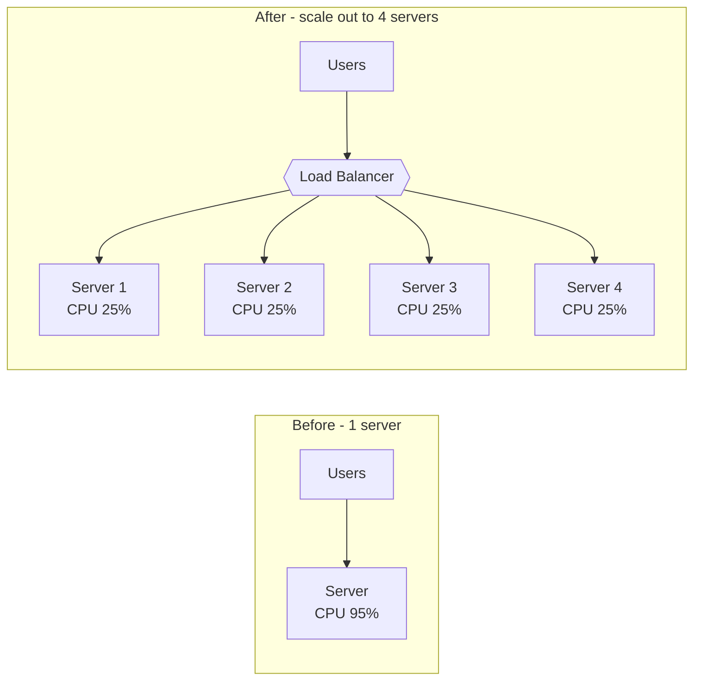

**Scale in** is the opposite: removing machines when traffic drops, to save money.

#### 📘 Terms Explained

| Term | Simple meaning |
|---|---|
| **Scale out** | Add more machines (horizontal). |
| **Scale in** | Remove machines (horizontal). |
| **Scale up / down** | Make one machine bigger / smaller (vertical). |
| **Node / Instance** | One machine (or container) in the group. |
| **Load** | The amount of work the system is doing (requests, CPU, data). |

---

## 2.2 Horizontal vs Vertical Scaling

| | Horizontal (Scale Out) | Vertical (Scale Up) |
|---|---|---|
| How | Add more machines | Add CPU/RAM to one machine |
| Limit | Almost unlimited | Biggest machine available |
| Fault tolerance | ✅ One machine dies, others continue | ❌ Still a single point of failure |
| Downtime to scale | None (add nodes live) | Often needs restart |
| Cost curve | Linear (2× machines ≈ 2× cost) | Gets expensive fast at the top end |
| Complexity | Higher — needs LB, stateless design, distributed data | Low — no code changes |
| Data consistency | Harder (data spread across nodes) | Easy (one machine) |
| Best for | Stateless web/app tiers, microservices, big data | Databases (early stage), legacy monoliths |

> **Interview answer in one line:** "Scale vertically first because it's simple, but design stateless services so you can scale horizontally when you hit limits or need high availability."

---

## 2.3 Prerequisites - Making a Service Horizontally Scalable

You can't just start 10 copies of any app. The app must be **stateless**: any instance must be able to handle any request.

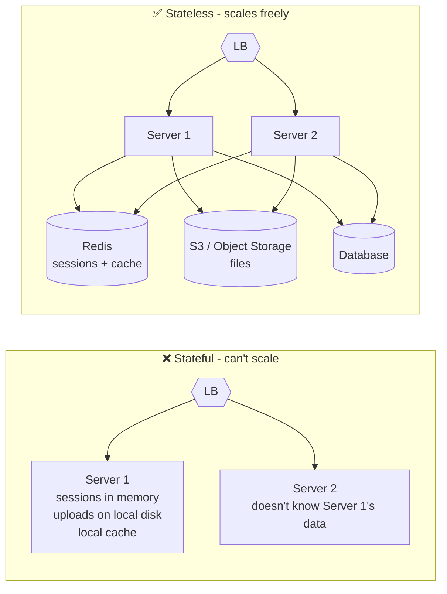

**Checklist - move every kind of state out of the server:**

| State | Wrong place | Right place |
|---|---|---|
| User sessions | `HttpSession` in memory | Redis (Spring Session) or JWT |
| Uploaded files | Local disk `/uploads` | Object storage (AWS S3, MinIO) |
| Cache shared by all | Local `HashMap` | Redis / Memcached (or local cache + short TTL) |
| Logs | Local log files only | Central logging (ELK, Loki, CloudWatch) |
| Scheduled jobs | `@Scheduled` on every instance | Distributed lock (ShedLock) or a single scheduler |
| Config | Hard-coded / local file | Env variables, Config Server, Kubernetes ConfigMap |

This is the core idea of the **Twelve-Factor App** methodology: *"processes are stateless and share-nothing"*.

#### 📘 Terms Explained

| Term | Simple meaning |
|---|---|
| **Stateless** | The server keeps no user-specific data between requests. Everything it needs comes with the request or from shared storage. |
| **Stateful** | The server remembers data in its own memory/disk, so the same user must return to it. |
| **Object storage** | Storage for files ("objects") accessed over HTTP, e.g. AWS S3. Every server can read the same files. |
| **Twelve-Factor App** | A well-known set of 12 rules for building cloud apps that scale and deploy easily. |
| **Share-nothing** | Each node has its own CPU, memory, and disk and doesn't share them with other nodes; they coordinate only over the network. |
| **ConfigMap** | Kubernetes object holding configuration values injected into Pods. |

---

## 2.4 Scaling Each Layer

Different parts of a system scale out in different ways:

```mermaid
flowchart TB
    LB{{Load Balancer}} --> W[Web / API tier<br/>add instances behind LB]
    W --> Q[[Message Queue<br/>Kafka / RabbitMQ / SQS]]
    Q --> C1[Worker 1]
    Q --> C2[Worker 2]
    Q --> C3[Worker 3]
    W --> CACHE[(Cache cluster<br/>Redis Cluster)]
    W --> DB[(Database<br/>replicas + shards)]
```

| Layer | How it scales out | Pattern |
|---|---|---|
| Web / API servers | More stateless instances behind a load balancer | [Load Balancer](#1-load-balancer-pattern-interview-imp---java) |
| Background workers | More consumers reading from the same queue | Competing Consumers |
| Cache | Cluster of cache nodes, keys split by hash | [Caching](#8-caching-interview-imp---java) |
| Database reads | Read replicas | [Read Replicas](#5-read-replicas-interview-imp---java) |
| Database writes | Split data across servers | [Sharding](#6-database-sharding-interview-imp---java) |
| Static content | Serve from edge locations | [CDN](#12-cdn-content-delivery-network) |

### Competing Consumers (scaling workers)

Several worker instances read from **one queue**; each message is processed by exactly one worker. To process faster, add workers.

```java
// Spring Kafka: every instance with the same groupId shares the work
@KafkaListener(topics = "order-created", groupId = "email-service", concurrency = "3")
public void onOrderCreated(OrderCreatedEvent event) {
    emailService.sendConfirmation(event);
}
```

> ⚠️ **Kafka limit:** in one consumer group, each partition is read by only **one** consumer. A topic with 6 partitions can use at most 6 consumers in parallel — the 7th sits idle. Plan the partition count for future scale.

#### 📘 Terms Explained

| Term | Simple meaning |
|---|---|
| **Message queue** | A buffer where producers put tasks/messages and consumers take them out later (Kafka, RabbitMQ, AWS SQS). |
| **Producer / Consumer** | The service that sends messages / the service that reads and processes them. |
| **Worker** | A background process that does tasks from a queue (send emails, resize images). |
| **Competing consumers** | Many consumers on one queue, competing for messages, so work is shared. |
| **Consumer group (Kafka)** | A set of consumers sharing the work of a topic; each message goes to one member of the group. |
| **Partition (Kafka)** | A topic is split into partitions; partitions are the unit of parallelism and ordering. |
| **`concurrency = "3"`** | Spring Kafka starts 3 consumer threads in this instance. |

---

## 2.5 Auto Scaling

**Auto scaling** adds or removes instances automatically based on rules.

| Type | How it decides | Example |
|---|---|---|
| **Reactive - Target tracking** | Keep a metric near a target value | "Keep average CPU at 60%" |
| **Reactive - Step scaling** | Add/remove N instances when thresholds are crossed | CPU > 80% → +3; CPU > 60% → +1 |
| **Scheduled** | Fixed times | Scale to 20 instances every weekday at 9 AM |
| **Predictive** | Machine learning on past traffic patterns | Scale up 10 min before the usual daily peak |

**Kubernetes Horizontal Pod Autoscaler (HPA):**

```yaml
apiVersion: autoscaling/v2
kind: HorizontalPodAutoscaler
metadata:
  name: order-service
spec:
  scaleTargetRef:
    apiVersion: apps/v1
    kind: Deployment
    name: order-service
  minReplicas: 3            # never fewer than 3 (high availability)
  maxReplicas: 30           # cost safety limit
  metrics:
    - type: Resource
      resource:
        name: cpu
        target:
          type: Utilization
          averageUtilization: 60   # target 60% CPU across all Pods
  behavior:
    scaleDown:
      stabilizationWindowSeconds: 300   # wait 5 min before scaling down (avoid flapping)
```

**Choosing a metric:**
- **CPU** — good for compute-heavy services.
- **Requests per second per instance** — good for web APIs.
- **Queue length / consumer lag** — best for workers (use **KEDA** in Kubernetes).
- **Latency** — closest to user experience, but noisy.

> ⚠️ Java services take time to start (JVM + Spring context + warm-up). Scale **early** (target 50–60%, not 90%), keep a minimum number of instances, and consider faster startup (Class Data Sharing, CRaC, GraalVM native image).

#### 📘 Terms Explained

| Term | Simple meaning |
|---|---|
| **Target tracking** | The autoscaler adjusts instance count to keep a metric at a chosen value, like a thermostat. |
| **Threshold** | A boundary value that triggers an action. |
| **Replica** | One copy of a Pod. `minReplicas: 3` = always at least 3 copies. |
| **Deployment** | Kubernetes object that runs and updates a set of identical Pods. |
| **Stabilization window** | A waiting time before scaling down, so a short dip doesn't remove servers that will be needed again in a minute. |
| **Flapping** | Scaling up and down repeatedly in a short time. |
| **Consumer lag** | How many messages are waiting in the queue, not yet processed. |
| **KEDA** | Kubernetes Event-Driven Autoscaling: scales Pods based on queue length, Kafka lag, etc. |
| **CDS / CRaC / GraalVM native image** | Java technologies to start faster: Class Data Sharing (pre-loaded classes), Coordinated Restore at Checkpoint (restore a warmed-up JVM snapshot), and compiling Java ahead-of-time into a native binary. |

---

## 2.6 Capacity Estimation - How Many Servers?

A common interview step: **back-of-the-envelope calculation**.

```
Formula:
  instances = peak RPS ÷ (RPS one instance can handle × target utilization)
  then add spare capacity for failures (N+1 or N+2)
```

**Example:**
- Peak traffic: **12,000 requests/second**
- Load test shows one instance handles **1,000 RPS** at acceptable latency
- Target utilization: **60%** (headroom for spikes and slow start)

```
12,000 ÷ (1,000 × 0.6) = 20 instances
+ N+2 across 3 availability zones → ~24 instances
(if a whole zone fails, the other 2 zones (16 instances) must still cope → maybe 30)
```

**Little's Law** — how many requests are in progress at the same time:

```
Concurrency = Throughput × Latency
            = 1,000 req/s × 0.2 s = 200 requests in flight per instance
→ needs ~200 Tomcat threads (or a reactive stack) and enough DB connections
```

#### 📘 Terms Explained

| Term | Simple meaning |
|---|---|
| **Back-of-the-envelope** | A quick rough calculation to get the right order of magnitude. |
| **Peak RPS** | The highest requests-per-second at the busiest time. |
| **Load test** | Sending artificial traffic (JMeter, Gatling, k6) to measure how much a server can handle. |
| **Utilization** | How much of a resource is being used (60% CPU). |
| **Headroom** | Spare capacity kept free for sudden spikes. |
| **N+1 / N+2** | N servers needed for the load, plus 1 (or 2) extra so one (or two) can fail without problems. |
| **Throughput** | Amount of work done per second (requests/s). |
| **Little's Law** | `L = λ × W`: average items in a system = arrival rate × time each item spends there. |
| **Tomcat threads** | The default Spring Boot web server handles each request on a thread from a pool (default max 200). |

---

## 2.7 Challenges of Horizontal Scaling

### a) The database becomes the bottleneck
Adding 10× app servers doesn't help if all of them hit one database.

```
App instances:   20 × HikariCP pool size 20 = 400 DB connections
PostgreSQL:      max_connections = 200   ❌ connections refused!
```

Fixes: right-size the pool (smaller is often faster), use a connection pooler (PgBouncer / RDS Proxy), add caching, read replicas, sharding.

### b) Duplicate scheduled jobs
`@Scheduled(cron = "0 0 1 * * *")` runs on **every** instance → 20 instances send 20 copies of the daily report.

```java
// ShedLock: only one instance at a time gets the lock and runs the job
@Scheduled(cron = "0 0 1 * * *")
@SchedulerLock(name = "dailyReport", lockAtMostFor = "30m", lockAtLeastFor = "1m")
public void sendDailyReport() {
    reportService.send();
}
```

### c) Local caches go out of sync
Instance 1 updates a product price and clears **its** local cache; instances 2–20 still show the old price.
Fixes: short TTL, a shared cache (Redis), or broadcast invalidation (Redis Pub/Sub, Kafka).

### d) Amdahl's Law - not everything speeds up
If part of the work is **serial** (can't be split: a global lock, one DB row everyone updates), adding machines gives less and less benefit.

```
Speedup = 1 / ((1 − P) + P / N)
P = fraction that can run in parallel, N = number of machines

P = 95%, N = 10   → speedup 6.9×
P = 95%, N = 100  → speedup 16.8×
P = 95%, N = ∞    → max 20×   ← the 5% serial part is the ceiling
```

The **Universal Scalability Law** goes further: coordination between nodes (locks, cache syncing) can make throughput **drop** after a certain number of nodes.

### e) Other challenges
- **Distributed transactions** — data across services/DBs can't use one local transaction (see sharding, saga).
- **Observability** — a request now touches many instances → need centralized logs, metrics and **distributed tracing** (OpenTelemetry, Zipkin).
- **Clock skew** — different machines' clocks differ slightly; don't rely on timestamps from different servers for ordering.
- **Cost** — more instances, more network traffic, more monitoring.

#### 📘 Terms Explained

| Term | Simple meaning |
|---|---|
| **Bottleneck** | The part that limits the whole system's speed. |
| **HikariCP** | The default, very fast JDBC connection pool in Spring Boot. |
| **`max_connections`** | The maximum number of client connections a DB server accepts. |
| **PgBouncer / RDS Proxy** | Connection poolers that sit in front of the DB and share a small number of real DB connections among many app connections. |
| **ShedLock** | A Java library ensuring a `@Scheduled` task runs on only one instance at a time, using a lock stored in the DB/Redis. |
| **`lockAtMostFor`** | Safety timeout: release the lock even if the instance crashes mid-job. |
| **Pub/Sub** | Publish/Subscribe messaging: one message is delivered to all subscribers (used to tell all instances "clear this cache key"). |
| **Serial / Parallel** | Must run one step after another / can run at the same time on many machines. |
| **Amdahl's Law** | Formula showing the max speedup is limited by the part of the work that can't run in parallel. |
| **Universal Scalability Law (USL)** | Extends Amdahl with a penalty for nodes coordinating with each other; explains why adding nodes can even slow things down. |
| **Distributed tracing** | Following a single request across many services with a shared trace ID to see where time is spent. |
| **OpenTelemetry** | An open standard and set of libraries for traces, metrics and logs. |
| **Clock skew** | Differences between the clocks of different machines. |

---

## 2.8 Advanced - The Scale Cube and Cell-Based Architecture

### The AKF Scale Cube
Three independent ways ("axes") to scale a system:

```mermaid
flowchart LR
    X["X-axis<br/>Clone<br/>Run N identical copies<br/>behind a load balancer"]
    Y["Y-axis<br/>Split by function<br/>Microservices:<br/>users, orders, payments"]
    Z["Z-axis<br/>Split by data<br/>Sharding:<br/>customers A-M / N-Z"]
```

| Axis | What you split | Example | Solves |
|---|---|---|---|
| **X** | Nothing — clone everything | 10 copies of the monolith | Traffic volume |
| **Y** | By function / service | Separate Order and Payment services | Code/team size, independent scaling per feature |
| **Z** | By data (customer, region, key) | Shard by `customer_id` | Data size, write volume, blast radius |

Large systems use **all three** at once.

### Cell-Based Architecture
Split the whole stack (LB + services + DB) into many identical, independent **cells**, each serving a subset of customers. A **cell router** sends each customer to their cell.

```mermaid
flowchart TB
    R{{Cell Router<br/>customer → cell}} --> C1
    R --> C2
    R --> C3
    subgraph C1[Cell 1 - customers 1..10k]
        A1[Services] --> D1[(DB)]
    end
    subgraph C2[Cell 2 - customers 10k..20k]
        A2[Services] --> D2[(DB)]
    end
    subgraph C3[Cell 3 - customers 20k..30k]
        A3[Services] --> D3[(DB)]
    end
```

- ✅ A bug or overload in one cell affects only that cell's customers (small **blast radius**).
- ✅ Scale by adding cells; each cell has a known, tested maximum size.
- Used by AWS, Slack, DoorDash and others.

#### 📘 Terms Explained

| Term | Simple meaning |
|---|---|
| **AKF Scale Cube** | A model from the book *The Art of Scalability* (AKF Partners) describing X, Y, Z scaling axes. |
| **Monolith** | An application where all features are built and deployed as one unit. |
| **Blast radius** | How much of the system (and how many users) a single failure affects. |
| **Cell** | A complete, independent copy of the system serving a slice of users. |
| **Cell router** | The thin top layer deciding which cell a request goes to. |

---

## 2.9 Horizontal Scaling - Interview Questions

**Q1. Horizontal vs vertical scaling — which would you choose?**
Vertical first for simplicity (especially databases); horizontal for stateless app tiers, high availability, and when one machine isn't enough. Most real systems use both.

**Q2. What must be true for a service to scale horizontally?**
It must be stateless: sessions in Redis/JWT, files in object storage, shared cache, centralized logs, scheduled jobs protected by a distributed lock, config from the environment.

**Q3. You added 10 more app servers but latency didn't improve. Why?**
A shared bottleneck: database (connections, locks, slow queries), an external API, a cache hot key, or a serial section (Amdahl's Law). Measure first, then fix the bottleneck (cache, replicas, sharding, async processing).

**Q4. How do you prevent a `@Scheduled` job from running on every instance?**
ShedLock (lock in DB/Redis), Quartz in cluster mode, Kubernetes CronJob, or leader election.

**Q5. How do you calculate how many servers you need?**
Peak RPS ÷ (per-instance RPS from load test × target utilization), then add N+1/N+2 and availability-zone failure capacity.

**Q6. What metrics would you use for auto scaling?**
CPU for compute-bound services, RPS per instance for APIs, queue length/consumer lag for workers; with min/max limits and a scale-down stabilization window.

**Q7. Explain the AKF Scale Cube.**
X = clone (replicas behind LB), Y = split by function (microservices), Z = split by data (sharding).

---

## 2.10 Cheat Sheet

```
Horizontal scaling = add more machines behind a load balancer (scale OUT)
Precondition: STATELESS app servers (sessions in Redis/JWT, files in object storage, no local caches that must be shared)
Autoscale on CPU / requests per instance / queue lag ; N+1 capacity across >= 2 zones
Limits: the database and other shared state become the bottleneck -> replicas, sharding, caching
Kubernetes: HPA (pods) + cluster autoscaler (nodes) ; Spring Boot: externalised config, graceful shutdown, health probes
```

# 3. Vertical Scaling

## 3.1 What is Vertical Scaling?

**Vertical scaling (scale up)** means making **one machine more powerful**: more CPU cores, more RAM, faster disk (SSD/NVMe), faster network.

**Analogy:** Replacing your car with a bigger truck instead of buying more cars.

```
Before:  [ 4 vCPU | 16 GB RAM ]   → handles 1,000 req/s
After:   [ 32 vCPU | 256 GB RAM ] → handles ~6,000 req/s (rarely a perfect 8×)
```

```mermaid
flowchart LR
    S1["Server<br/>4 CPU, 16 GB"] -- "scale up" --> S2["Same server role<br/>32 CPU, 256 GB"]
```

#### 📘 Terms Explained

| Term | Simple meaning |
|---|---|
| **vCPU** | A virtual CPU core given to a cloud VM (often one hardware thread). |
| **RAM** | Fast working memory; data in RAM is ~1000× faster to read than from disk. |
| **SSD / NVMe** | Solid-state disks; NVMe is a faster SSD interface. Much faster than spinning hard disks. |
| **VM (Virtual Machine)** | A software-emulated computer running on a physical server; cloud servers are VMs. |
| **Instance type** | A cloud VM size, e.g. AWS `m7i.xlarge` (4 vCPU, 16 GB). |

---

## 3.2 When Vertical Scaling is the Right Choice

| Situation | Why scale up |
|---|---|
| **Early-stage product** | No code changes, no distributed-system complexity. |
| **Relational database primary** | Writes go to one node; scaling up is far simpler than sharding. Many large companies run big single DB primaries for years. |
| **Stateful or legacy apps** | App can't run as multiple copies (in-memory state, file locks). |
| **Memory-hungry workloads** | In-memory analytics, big caches, large JVM heaps. |
| **Licensing** | Some software is licensed per server (fewer, bigger servers can be cheaper). |
| **Quick emergency fix** | Resize the instance in minutes while a long-term fix is built. |

> **Rule of thumb:** "Scale up until it hurts, then scale out." But design for scale-out from day one (stateless services) so the switch is easy.

---

## 3.3 Limits and Risks

| Problem | Explanation |
|---|---|
| **Hardware ceiling** | There's a biggest machine you can buy/rent (e.g. a few hundred vCPUs, a few TB of RAM). |
| **Cost grows faster than capacity** | Top-end machines cost disproportionately more per unit of power. |
| **Single point of failure** | One big machine is still one machine. If it dies, everything is down. |
| **Downtime to resize** | Changing a cloud VM type usually needs a stop/start (minutes of downtime) unless you fail over to a resized replica. |
| **Diminishing returns** | Software may not use all cores: locks, single-threaded parts (Amdahl's Law), GC pauses grow with heap size. |
| **Blast radius** | A bug or overload affects all users at once. |

---

## 3.4 Java-Specific Considerations When Scaling Up

A bigger machine helps a Java app **only if the JVM is configured to use it**.

| Topic | What to know |
|---|---|
| **Heap size** | Set `-Xmx` / `-XX:MaxRAMPercentage=75` so the JVM actually uses the new RAM. In containers, the JVM reads the container memory limit. |
| **Compressed oops** | Below ~32 GB heap, the JVM uses 32-bit compressed object pointers. A 33 GB heap can hold **less** than a 31 GB heap. Either stay under 32 GB or go much bigger. |
| **Garbage collector** | Bigger heaps → longer pauses with older collectors. Use **G1** (default) or **ZGC / Shenandoah** for large heaps with very short pauses. |
| **Thread pools** | More cores need bigger pools: Tomcat `server.tomcat.threads.max`, `ForkJoinPool`, executor sizes. Or use **virtual threads** (Java 21: `spring.threads.virtual.enabled=true`). |
| **DB connection pool** | More threads waiting on a pool of 10 connections won't go faster; but huge pools overload the DB. Size from measurement. |
| **NUMA** | On very large servers, memory is split per CPU socket; `-XX:+UseNUMA` helps the JVM allocate memory close to the CPU using it. |
| **Lock contention** | `synchronized` hot spots stop scaling across cores; use concurrent data structures (`ConcurrentHashMap`, `LongAdder`). |

```bash
# Example JVM flags for a 64 GB container
java -XX:MaxRAMPercentage=75 -XX:+UseZGC -XX:+ZGenerational -jar app.jar
```

#### 📘 Terms Explained

| Term | Simple meaning |
|---|---|
| **Heap** | The JVM memory area where Java objects live. |
| **`-Xmx`** | Maximum heap size flag, e.g. `-Xmx8g`. |
| **`MaxRAMPercentage`** | Sets max heap as a percentage of available (container) memory. |
| **Oops / Compressed oops** | "Ordinary object pointers" — references to objects. Compressed oops store them in 32 bits instead of 64 to save memory; only possible for heaps under ~32 GB. |
| **Garbage Collector (GC)** | The JVM component that frees memory from objects no longer used. |
| **G1 / ZGC / Shenandoah** | JVM garbage collectors. G1 = balanced default; ZGC and Shenandoah = very low pause times even with huge heaps. |
| **GC pause** | Time when the application is stopped so the GC can work. |
| **Virtual threads** | Very lightweight threads (Java 21+) — you can have millions; great for I/O-heavy apps. |
| **NUMA (Non-Uniform Memory Access)** | On multi-socket servers, each CPU accesses its "own" memory faster than another CPU's memory. |
| **Lock contention** | Many threads waiting for the same lock, so extra cores sit idle. |
| **`LongAdder`** | A counter that scales better than `AtomicLong` under heavy multi-thread updates. |

---

## 3.5 Advanced - Vertical Autoscaling and Diagonal Scaling

### Vertical Pod Autoscaler (Kubernetes)
**VPA** watches actual CPU/memory usage of Pods and adjusts their **requests/limits** (makes Pods bigger or smaller). Usually restarts Pods to apply changes (newer Kubernetes versions support in-place resize). Don't combine VPA and HPA on the same CPU/memory metric — they fight each other.

### Diagonal Scaling
Combine both: **scale up** each node to an efficient size, then **scale out** by adding nodes of that size.

```
Step 1 (scale up):   1 × small   →  1 × large
Step 2 (scale out):  1 × large   →  6 × large
```

Bigger nodes = fewer nodes to manage and less per-node overhead (JVM, sidecars, agents); more nodes = better fault tolerance. Choose a node size where losing one node is acceptable.

#### 📘 Terms Explained

| Term | Simple meaning |
|---|---|
| **VPA (Vertical Pod Autoscaler)** | Kubernetes component that automatically resizes CPU/memory of Pods. |
| **Requests / Limits (K8s)** | Request = resources a Pod is guaranteed; limit = the maximum it may use. |
| **Diagonal scaling** | Scaling up and out together. |
| **Overhead** | Resources used by things other than your actual work (OS, JVM, monitoring agents). |

---

## 3.6 Vertical Scaling - Interview Questions

**Q1. Why not always scale vertically?**
Hardware ceiling, cost grows faster than capacity, still a single point of failure, resizing often needs downtime, and software may not use extra cores efficiently.

**Q2. When is vertical scaling the better choice?**
Early stage, relational database primaries, stateful/legacy apps, memory-heavy workloads, or as a quick fix.

**Q3. You moved your Java app to a machine with 4× the RAM but performance didn't change. Why?**
The JVM heap wasn't increased (`-Xmx`/`MaxRAMPercentage`), thread/connection pools are still small, the bottleneck is elsewhere (DB, lock contention), or GC pauses grew with a bigger heap.

**Q4. What's special about a 32 GB Java heap?**
Above ~32 GB, compressed oops turn off, references become 64-bit, and the usable heap can effectively shrink. Stay below ~31 GB or go well above it.

---

## 3.7 In Java, Pros and Cons, and Cheat Sheet

**In Java and Spring Boot:** vertical scaling for a JVM service mostly means giving it more CPU and memory *and* letting the JVM use them:
```bash
# container with 8 CPUs / 16 GB: let the JVM size the heap from the container limit, use a low-pause collector
java -XX:MaxRAMPercentage=75 -XX:+UseG1GC -jar app.jar           # or -XX:+UseZGC for very large heaps
# more CPUs only help if the app has work to parallelise: tune server.tomcat.threads.max, HikariCP maximumPoolSize, virtual threads
spring.threads.virtual.enabled=true                                  # Spring Boot 3.2+ on Java 21: cheap blocking concurrency
```
```java
// Size CPU-bound work to the machine you scaled up to (the JVM sees the container's CPU limit)
int cores = Runtime.getRuntime().availableProcessors();
ExecutorService cpuPool = Executors.newFixedThreadPool(cores);                  // CPU-bound: about one thread per core
ExecutorService ioPool  = Executors.newVirtualThreadPerTaskExecutor();          // I/O-bound: virtual threads (Java 21)
long maxHeapMb = Runtime.getRuntime().maxMemory() / (1024 * 1024);              // check -XX:MaxRAMPercentage took effect
```

| Pros | Cons |
|---|---|
| No code or architecture changes | Hard upper limit (largest machine available) |
| Simple operations, strong consistency stays easy | Single point of failure unless replicated |
| Good first step for databases | Cost grows faster than capacity; downtime to resize (often) |
| Fewer network hops than a distributed system | Big JVM heaps need tuned garbage collection |

**Cheat sheet**
```
Vertical = bigger machine (scale UP): more CPU, RAM, faster disks
Use first for databases and stateful systems; combine with replicas for availability
JVM: -XX:MaxRAMPercentage, G1/ZGC, thread pools and connection pools sized to the new cores
Ceiling + SPOF -> move to horizontal scaling when one machine is no longer enough
```

# 4. Database Replication (Interview Imp - Java)

## 4.1 What is Database Replication?

**Replication** means keeping **copies of the same data on multiple database servers**. When data changes on one server, the change is copied to the others automatically.

**Analogy:** A teacher writes notes on the main whiteboard (primary). Students copy them into their notebooks (replicas). Anyone can read from a notebook, but only the teacher writes on the board.

```mermaid
flowchart LR
    App[Application] -- "writes + reads" --> P[(Primary)]
    P -- "replication stream" --> R1[(Replica 1)]
    P -- "replication stream" --> R2[(Replica 2)]
    App -. "reads" .-> R1
    App -. "reads" .-> R2
```

#### 📘 Terms Explained

| Term | Simple meaning |
|---|---|
| **Replication** | Automatically copying data changes from one database server to others. |
| **Primary / Leader / Master** | The server that accepts writes. (Modern term: primary or leader.) |
| **Replica / Follower / Secondary / Slave** | A server that receives copies of changes from the primary. (Modern term: replica or follower.) |
| **Replication stream** | The continuous flow of changes sent from primary to replicas. |

---

## 4.2 Why Replicate?

| Goal | How replication helps |
|---|---|
| **High availability** | If the primary dies, a replica is promoted to become the new primary. |
| **Read scalability** | Spread read queries across many replicas (see [Read Replicas](#5-read-replicas-interview-imp---java)). |
| **Lower latency for global users** | Put a replica near users in each region. |
| **Disaster recovery** | Keep a copy in another region/data center. |
| **Backups & analytics without hurting production** | Run heavy reports or backups on a replica. |

> ⚠️ **Replication is not a backup.** If someone runs `DELETE FROM orders` by mistake, the delete is replicated to every copy within milliseconds. You still need point-in-time backups.

---

## 4.3 How Changes Are Copied - Replication Methods

| Method | What is sent | Pros | Cons |
|---|---|---|---|
| **Statement-based** | The SQL statement itself (`UPDATE users SET ...`) | Small | Non-deterministic functions (`NOW()`, `RAND()`) give different results on replicas |
| **Physical / WAL shipping** | Low-level disk block changes from the write-ahead log | Exact copy, fast | Primary and replica must run the same DB version |
| **Logical / Row-based** | "Row id=5 changed column price from 10 to 12" | Version-independent, can feed other systems (CDC) | More data to send for big updates |
| **Trigger-based** | DB triggers write changes to a table that a tool copies | Very flexible | Slow, complex |

**Examples:** PostgreSQL streaming replication (physical WAL), PostgreSQL logical replication, MySQL binlog (`binlog_format=ROW`), MongoDB oplog.

#### 📘 Terms Explained

| Term | Simple meaning |
|---|---|
| **WAL (Write-Ahead Log)** | A log where the DB writes every change **before** applying it to data files. Used for crash recovery and replication. |
| **Binlog (MySQL)** | MySQL's binary log of all changes, used for replication. |
| **Oplog (MongoDB)** | MongoDB's operations log used by replica sets. |
| **Deterministic** | Always gives the same output for the same input. `NOW()` is not deterministic. |
| **CDC (Change Data Capture)** | Reading the DB's change log to stream every change to other systems (e.g. Debezium → Kafka). |
| **Trigger** | Code inside the DB that runs automatically when a row is inserted/updated/deleted. |

---

## 4.4 Synchronous vs Asynchronous Replication (Interview Imp - Java)

```mermaid
sequenceDiagram
    participant App
    participant P as Primary
    participant R as Replica
    Note over App,R: Synchronous
    App->>P: INSERT order
    P->>R: send change
    R-->>P: ack (written)
    P-->>App: commit OK
    Note over App,R: Asynchronous
    App->>P: INSERT order
    P-->>App: commit OK (immediately)
    P->>R: send change (a bit later)
```

| | Synchronous | Asynchronous | Semi-synchronous |
|---|---|---|---|
| Primary waits for replica? | Yes, for every write | No | Waits for **at least one** replica |
| Write latency | Higher | Lowest | Medium |
| Data loss if primary dies | None | Recent writes can be lost | None (at least one replica has it) |
| If replica is down/slow | **Writes block** | No effect | Falls back to another replica |
| Typical use | Financial systems, within one data center | Most setups, cross-region | Common production compromise |

**Replication lag** = how far behind a replica is (e.g. 200 ms or 30 s). With async replication, lag is normal and grows under heavy writes, long transactions, or network problems.

#### 📘 Terms Explained

| Term | Simple meaning |
|---|---|
| **Commit** | The moment a transaction's changes become permanent. |
| **Ack (acknowledgement)** | A confirmation message: "I received/stored it". |
| **Synchronous** | The sender waits for the receiver to confirm before continuing. |
| **Asynchronous** | The sender continues immediately without waiting. |
| **Semi-synchronous** | Wait for at least one replica, not all. |
| **Replication lag** | Delay between a change on the primary and it appearing on a replica. |
| **Durability** | Once committed, data won't be lost, even after crashes. |

---

## 4.5 Replication Topologies

### a) Single-Leader (Primary-Replica)
One primary accepts all writes; replicas are read-only. **Most common** (MySQL, PostgreSQL, MongoDB replica sets, Redis).

### b) Multi-Leader (Multi-Primary)
Several nodes accept writes (e.g. one primary per region) and replicate to each other.

```mermaid
flowchart LR
    U1[Users in India] --> L1[(Leader - Mumbai)]
    U2[Users in US] --> L2[(Leader - Virginia)]
    L1 <-- "replicate both ways" --> L2
```

- ✅ Low write latency in each region; survives a region outage.
- ❌ **Write conflicts:** the same row updated in both regions at the same time.

**Conflict resolution strategies:**
| Strategy | How |
|---|---|
| **Last Write Wins (LWW)** | Keep the version with the latest timestamp. Simple, but silently loses the other write and depends on clocks. |
| **Avoid conflicts** | Route all writes for a given record (e.g. a user) to the same "home" leader. |
| **Merge / custom logic** | App code merges both versions (e.g. union of shopping cart items). |
| **CRDTs** | Special data types (counters, sets) designed so concurrent updates always merge correctly. |
| **Version vectors** | Track which updates each version has seen, to detect true conflicts. |

### c) Leaderless (Dynamo-style)
Any node accepts reads and writes. The client (or a coordinator) writes to several nodes and reads from several nodes. Used by **Cassandra**, **DynamoDB**, **Riak**.

**Quorum rule:** with `N` copies, write to `W` nodes and read from `R` nodes. If **`W + R > N`**, every read overlaps with at least one node that has the latest write.

```
N = 3 replicas
W = 2 (write succeeds when 2 of 3 confirm)
R = 2 (read from 2 of 3, take the newest version)
W + R = 4 > 3  ✅ reads see the latest write

     Write v2 → [Node A: v2] [Node B: v2] [Node C: v1 (missed)]
     Read     → asks B and C → gets v2 and v1 → returns v2 (newest)
```

Nodes that missed a write are fixed by **read repair** (fix during a read) and **anti-entropy** (background comparison using Merkle trees).

#### 📘 Terms Explained

| Term | Simple meaning |
|---|---|
| **Topology** | The shape of how nodes are connected. |
| **Write conflict** | Two different values written to the same data at the same time in different places. |
| **LWW (Last Write Wins)** | Conflict rule: keep the newest timestamp, discard others. |
| **CRDT (Conflict-free Replicated Data Type)** | Data structures that can be updated independently on many nodes and always merge to the same result. |
| **Version vector / Vector clock** | A list of counters (one per node) attached to data to tell which version came before which, or if they happened concurrently. |
| **Leaderless** | No single primary; all replicas are equal. |
| **Quorum** | The minimum number of nodes that must agree for an operation to succeed. |
| **N / W / R** | Number of replicas / write quorum / read quorum. |
| **Read repair** | When a read finds an outdated replica, it updates it. |
| **Anti-entropy** | A background process that compares replicas and fixes differences. |
| **Merkle tree** | A tree of hashes that lets two nodes quickly find which parts of their data differ. |

---

## 4.6 Replication Lag Problems and Fixes (Interview Imp - Java)

With async replicas, users can see confusing results. Three classic problems:

### a) Read-your-own-writes
User updates their profile (write → primary), page reloads (read → replica that is 2 s behind) → **old profile shown**. User thinks the update failed.

```mermaid
sequenceDiagram
    participant U as User
    participant P as Primary
    participant R as Replica (2 s behind)
    U->>P: UPDATE name = 'Ravi'
    P-->>U: OK
    U->>R: SELECT name
    R-->>U: 'Ravi K' (old!) 😕
```

**Fixes:**
- Read data **the user just changed** from the primary (e.g. own profile always from primary).
- After a write, route that user's reads to the primary for a few seconds.
- Remember the write's log position and only read from replicas that have caught up to it.

### b) Monotonic reads
Two reads go to two different replicas with different lag → user sees a new comment, refreshes, and it **disappears** (time goes backwards).
**Fix:** always route one user to the **same replica** (e.g. hash of user ID).

### c) Consistent prefix reads
Replicas receive related writes in a different order → user sees the **answer before the question**.
**Fix:** write causally related data to the same partition, or track causal dependencies.

#### 📘 Terms Explained

| Term | Simple meaning |
|---|---|
| **Read-your-own-writes (read-after-write consistency)** | After you write something, you always see your own change. |
| **Monotonic reads** | Once you've seen a newer value, you never see an older one later. |
| **Consistent prefix** | You see events in an order that makes sense (cause before effect). |
| **Causal** | One event caused/depends on another (a reply depends on the message). |
| **Eventual consistency** | If writes stop, all replicas will *eventually* have the same data — but for a while they may differ. |
| **Strong consistency** | Every read sees the latest committed write, as if there's only one copy. |

---

## 4.7 Failover - When the Primary Dies

```mermaid
sequenceDiagram
    participant M as Monitor (Patroni / Orchestrator / Sentinel)
    participant P as Primary
    participant R1 as Replica 1
    participant R2 as Replica 2
    participant App
    M->>P: health check
    P--xM: no response (×3)
    Note over M: Primary declared dead
    M->>R1: promote to primary (most up to date)
    M->>R2: follow R1 now
    M->>App: update DNS / VIP / service discovery
    App->>R1: writes now go here
```

**Steps:**
1. **Detect** failure (missed health checks/heartbeats; usually 10–30 s).
2. **Choose** the most up-to-date replica.
3. **Promote** it to primary; point other replicas to it.
4. **Reconfigure** clients (DNS, VIP, proxy, or driver-level discovery).
5. **Fence** the old primary so it can't accept writes if it comes back.

### Dangers
| Danger | Explanation | Protection |
|---|---|---|
| **Data loss** | With async replication, writes not yet copied to the new primary are lost. | Semi-sync replication; accept small loss window (RPO). |
| **Split brain** | Network glitch: old primary is alive but unreachable; a new one is promoted → **two primaries** accepting different writes. | Fencing (STONITH), quorum-based consensus (Raft via etcd/ZooKeeper), odd number of voters. |
| **False failover** | Primary was just slow (GC pause, network blip). | Sensible timeouts; require several failed checks. |

**Tools:** Patroni (PostgreSQL), Orchestrator / MySQL Group Replication (MySQL), MongoDB replica set elections (built in), Redis Sentinel, AWS RDS Multi-AZ / Aurora (managed, ~30–60 s failover).

#### 📘 Terms Explained

| Term | Simple meaning |
|---|---|
| **Failover** | Switching to a replica when the primary fails. |
| **Promote** | Turn a replica into the new primary. |
| **Fencing** | Making sure the old primary can't write any more (cut its network/disk access). |
| **STONITH** | "Shoot The Other Node In The Head" — a fencing method that forcibly powers off the old node. |
| **Split brain** | Two nodes both believe they're the primary and accept conflicting writes. |
| **Consensus (Raft / Paxos)** | Algorithms letting several nodes agree on one decision (like "who is leader") even if some fail. |
| **etcd / ZooKeeper** | Distributed coordination stores that implement consensus; used for leader election. |
| **RPO (Recovery Point Objective)** | Maximum acceptable data loss, measured in time (e.g. "at most 5 s of writes"). |
| **RTO (Recovery Time Objective)** | Maximum acceptable downtime to recover (e.g. "back up within 1 minute"). |
| **Multi-AZ** | Keeping a standby copy in a different availability zone. |
| **Patroni / Orchestrator / Sentinel** | Tools that monitor PostgreSQL / MySQL / Redis and perform automatic failover. |

---

## 4.8 Database Replication - Interview Questions

**Q1. Synchronous vs asynchronous replication?**
Sync waits for replicas before committing — no data loss, slower writes, writes block if a replica is down. Async commits immediately — fast, but recent writes can be lost on failover and replicas lag. Semi-sync waits for one replica as a compromise.

**Q2. What is replication lag and what problems does it cause?**
The delay before replicas reflect a write. Causes stale reads: read-your-own-writes violations, non-monotonic reads, out-of-order reads.

**Q3. How do you guarantee a user sees their own update when reading from replicas?**
Read user-modified data from the primary, route the user to the primary for a short time after a write, or wait until the replica reaches the write's log position.

**Q4. What is split brain and how do you prevent it?**
Two nodes acting as primary at once. Prevent with fencing/STONITH, quorum/consensus-based leader election (odd number of voters), and leases.

**Q5. Single-leader vs multi-leader vs leaderless?**
Single-leader: simple, no write conflicts, writes limited to one node. Multi-leader: multi-region writes, but conflicts must be resolved. Leaderless: high availability with quorums (W+R>N), eventual consistency, conflict handling needed.

**Q6. Is replication a backup?**
No. Mistakes and corruption replicate too. Use point-in-time backups as well.

---

## 4.9 In Java and Spring, and Cheat Sheet

**In Java and Spring Boot:** send writes to the primary and reads to replicas with a routing `DataSource`:
```java
public class ReplicaRoutingDataSource extends AbstractRoutingDataSource {
    protected Object determineCurrentLookupKey() {
        return TransactionSynchronizationManager.isCurrentTransactionReadOnly() ? "replica" : "primary";
    }
}
// wrap it in LazyConnectionDataSourceProxy so the read-only flag is known when the connection is fetched
@Transactional(readOnly = true) public List<Order> recentOrders() { ... }    // -> replica
@Transactional                 public Order place(NewOrder o)     { ... }    // -> primary
```
For MySQL/PostgreSQL clusters a proxy (ProxySQL, PgBouncer + Patroni, AWS RDS Proxy/Aurora reader endpoint) can do the routing instead of the application.

**Cheat sheet**
```
Primary (writes) -> replicas (copies) via replication log (binlog / WAL)
Sync = no data loss, slower writes ; async = fast, replica lag (stale reads) ; semi-sync = at least one replica acks
Topologies: primary-replica, multi-primary (conflicts!), cascading ; failover: promote a replica (Patroni, Orchestrator, RDS)
Read-your-writes: route the user's reads to the primary for a short time after they write
```

# 5. Read Replicas (Interview Imp - Java)

## 5.1 What are Read Replicas?

**Read replicas** are replicated copies of the database used to **serve read queries**, so the primary only handles writes (and reads that must be perfectly fresh).

Most applications read far more than they write (often **80–95% reads**). Moving reads to replicas multiplies read capacity.

```mermaid
flowchart LR
    App[Spring Boot App] -- "INSERT / UPDATE / DELETE" --> P[(Primary)]
    App -- "SELECT" --> RLB{{Reader endpoint<br/>or routing}}
    RLB --> R1[(Replica 1)]
    RLB --> R2[(Replica 2)]
    RLB --> R3[(Replica 3)]
    P -. async replication .-> R1
    P -. async replication .-> R2
    P -. async replication .-> R3
```

**Database Replication vs Read Replicas:** replication is the *mechanism* (copying data); read replicas are one *use* of it (scaling reads). A standby replica used only for failover doesn't serve reads.

---

## 5.2 Routing Reads and Writes in Spring Boot

**Option 1 — Two separate DataSources / repositories** (simple, explicit).
**Option 2 — Automatic routing** with `AbstractRoutingDataSource`: read-only transactions go to the replica.

```java
public enum DbRole { PRIMARY, REPLICA }

public class ReadWriteRoutingDataSource extends AbstractRoutingDataSource {
    @Override
    protected Object determineCurrentLookupKey() {
        return TransactionSynchronizationManager.isCurrentTransactionReadOnly()
                ? DbRole.REPLICA
                : DbRole.PRIMARY;
    }
}
```

```java
@Configuration
public class DataSourceConfig {

    @Bean
    @ConfigurationProperties("app.datasource.primary")
    public DataSource primaryDataSource() {
        return DataSourceBuilder.create().type(HikariDataSource.class).build();
    }

    @Bean
    @ConfigurationProperties("app.datasource.replica")
    public DataSource replicaDataSource() {
        return DataSourceBuilder.create().type(HikariDataSource.class).build();
    }

    @Bean
    @Primary
    public DataSource dataSource(@Qualifier("primaryDataSource") DataSource primaryDataSource,
                                 @Qualifier("replicaDataSource") DataSource replicaDataSource) {
        ReadWriteRoutingDataSource routing = new ReadWriteRoutingDataSource();
        routing.setTargetDataSources(Map.of(
                DbRole.PRIMARY, primaryDataSource,
                DbRole.REPLICA, replicaDataSource));
        routing.setDefaultTargetDataSource(primaryDataSource);
        routing.afterPropertiesSet();
        // Lazy proxy: picks the real connection only when the first SQL runs,
        // i.e. AFTER @Transactional has marked the transaction read-only
        return new LazyConnectionDataSourceProxy(routing);
    }
}
```

```yaml
app:
  datasource:
    primary:
      jdbc-url: jdbc:postgresql://db-primary:5432/shop
      username: app
      password: ${DB_PASSWORD}
    replica:
      jdbc-url: jdbc:postgresql://db-replica:5432/shop   # e.g. AWS Aurora reader endpoint
      username: app_ro
      password: ${DB_RO_PASSWORD}
```

```java
@Service
public class ProductService {

    @Transactional(readOnly = true)          // → replica
    public List<Product> search(String q) {
        return productRepository.findByNameContaining(q);
    }

    @Transactional                           // → primary
    public Product updatePrice(long id, BigDecimal price) {
        Product p = productRepository.findById(id).orElseThrow();
        p.setPrice(price);
        return p;
    }
}
```

> ⚠️ **Why `LazyConnectionDataSourceProxy`?** Spring's transaction manager grabs a connection at the *start* of the transaction — before the read-only flag is visible to the router. The lazy proxy delays getting the real connection until the first query, so routing works correctly.

**Other routing options:** DB proxy (ProxySQL, Pgpool-II, AWS RDS Proxy), cloud "reader endpoints" (Aurora), or driver features (MySQL Connector/J replication URL, PostgreSQL JDBC `targetServerType=preferSecondary`).

#### 📘 Terms Explained

| Term | Simple meaning |
|---|---|
| **DataSource** | Java's standard object for getting database connections. |
| **`AbstractRoutingDataSource`** | A Spring DataSource that picks one of several real DataSources per call using a lookup key. |
| **`@Transactional(readOnly = true)`** | Marks a transaction as read-only — a hint for optimizations and for routing to replicas. |
| **`TransactionSynchronizationManager`** | Spring class holding info about the current transaction (e.g. is it read-only?). |
| **`LazyConnectionDataSourceProxy`** | Wraps a DataSource and fetches the real connection only when a SQL statement actually runs. |
| **`@Primary`** | When several beans of the same type exist, this one is injected by default. |
| **Reader endpoint** | A single DNS name (e.g. on AWS Aurora) that load balances across all read replicas. |
| **ProxySQL / Pgpool-II** | Database proxies for MySQL / PostgreSQL that can split reads and writes automatically. |

---

## 5.3 Handling Stale Reads

Replicas lag behind the primary, so a read right after a write may return old data.

| Strategy | How | When to use |
|---|---|---|
| **Primary for critical reads** | Reads that must be fresh (balance, stock before checkout) use `@Transactional` (primary). | Money, inventory, auth |
| **Read-your-writes window** | After a user writes, send their reads to the primary for N seconds (store a timestamp in session/cookie). | Profile edits, posts |
| **Lag-aware routing** | Monitor replica lag; remove replicas lagging more than X seconds from rotation. | Always |
| **Accept staleness** | Show slightly old data where it doesn't matter. | Product listings, analytics, feeds |
| **Causal tokens** | After a write, return the log position (e.g. PostgreSQL LSN, MySQL GTID); reads wait until the replica has reached it. | Advanced, strict consistency needs |

```java
// Read-your-writes window: after a write, this user's reads go to the primary for 5 s
public final class ReadYourWritesContext {
    private static final ThreadLocal<Boolean> FORCE_PRIMARY = ThreadLocal.withInitial(() -> false);
    public static void forcePrimary(boolean v) { FORCE_PRIMARY.set(v); }
    public static boolean isForcePrimary() { return FORCE_PRIMARY.get(); }
    public static void clear() { FORCE_PRIMARY.remove(); }
}
// A servlet filter reads the "lastWriteAt" cookie; if < 5 s ago → forcePrimary(true).
// The router checks isForcePrimary() before choosing REPLICA.
```

#### 📘 Terms Explained

| Term | Simple meaning |
|---|---|
| **Stale read** | Reading old data that has already been changed on the primary. |
| **LSN (Log Sequence Number)** | PostgreSQL's position in the WAL; tells exactly how far replication has progressed. |
| **GTID (Global Transaction ID)** | MySQL's unique ID for each transaction, used to track replication progress. |
| **`ThreadLocal`** | A Java variable where each thread has its own value — used to carry per-request flags. |
| **Rotation** | The set of servers currently receiving traffic. |

---

## 5.4 Limits of Read Replicas

| Limit | Explanation |
|---|---|
| **Writes don't scale** | Every write still goes to one primary and is replayed on every replica. For write-heavy loads → [Sharding](#6-database-sharding-interview-imp---java). |
| **Replica count limit** | Each replica adds load on the primary (sending changes). Typical limits: ~5 (RDS MySQL/PostgreSQL per primary), ~15 (Aurora). Use **cascading replicas** (replica of a replica) for more. |
| **Lag under heavy writes** | Replicas apply changes more slowly than the primary may produce them → lag grows. |
| **Same data size** | Each replica stores the full dataset — doesn't help if the data is too big for one machine. |
| **Cost** | Each replica is a full database server. |

> **Consider caching first:** a Redis cache in front of the DB often removes more read load, more cheaply, than adding replicas. Use both for big systems.

```mermaid
flowchart LR
    P[(Primary)] --> R1[(Replica 1)]
    P --> R2[(Replica 2)]
    R2 --> R3[(Replica 2a)]
    R2 --> R4[(Replica 2b)]
```
*Cascading replication: Replica 2 forwards changes to its own replicas, reducing load on the primary.*

---

## 5.5 Read Replicas - Interview Questions

**Q1. How do read replicas help scale a database?**
Reads (often 80–95% of traffic) are spread across replicas, leaving the primary for writes.

**Q2. How do you route reads to replicas in Spring Boot?**
`AbstractRoutingDataSource` choosing by `@Transactional(readOnly = true)`, wrapped in `LazyConnectionDataSourceProxy`; or a DB proxy / cloud reader endpoint.

**Q3. A user updates their address but still sees the old one. Why and how to fix?**
Replication lag — the read went to a replica. Read the user's own data from the primary, use a short read-your-writes window, or wait for the replica to catch up to the write's LSN/GTID.

**Q4. Do read replicas help with write-heavy workloads?**
No. Every write still hits the primary and is replayed on every replica. Use sharding, batching, async writes, or a write-optimized store.

**Q5. Read replicas or cache — which first?**
Usually cache first for hot, repeatedly read data; replicas for broad query load, reports, and HA. Big systems use both.

---

## 5.6 Pros, Cons and Cheat Sheet

| Pros | Cons |
|---|---|
| Scale reads horizontally by adding replicas | Replication lag → stale reads |
| Offload reporting/analytics from the primary | Writes still limited by the single primary |
| Replicas double as failover candidates | Routing logic (app or proxy) adds complexity |
| Cheap compared with sharding | Each replica costs a full copy of the data |

**Cheat sheet**
```
Reads -> replicas, writes -> primary ; @Transactional(readOnly = true) + routing DataSource or a proxy/reader endpoint
Watch replica lag (seconds_behind_source, pg_stat_replication) ; alert and remove lagging replicas from rotation
Read-your-writes: primary for the writer for N seconds, or wait for the replica to reach the write's LSN/GTID
Good for read-heavy (10:1 and up) ; not a fix for write bottlenecks (-> sharding)
```

# 6. Database Sharding (Interview Imp - Java)

## 6.1 What is Sharding?

**Sharding** splits one large dataset into smaller pieces called **shards**, and stores each shard on a **different database server**. Each shard has the **same table structure** but holds **different rows**.

**Analogy:** A library too big for one building. Books with authors A–H go to Building 1, I–P to Building 2, Q–Z to Building 3. Each building is smaller, and three librarians work at the same time.

```mermaid
flowchart TB
    App[Application] --> Router{{Shard Router<br/>shard = f of user_id}}
    Router -- "user_id 1..1M" --> S1[(Shard 1)]
    Router -- "user_id 1M..2M" --> S2[(Shard 2)]
    Router -- "user_id 2M..3M" --> S3[(Shard 3)]
```

```
users table (before):  3,000,000 rows on 1 server

users table (after):   Shard 1: rows for user_id 1 – 1,000,000
                       Shard 2: rows for user_id 1,000,001 – 2,000,000
                       Shard 3: rows for user_id 2,000,001 – 3,000,000
```

**Why shard?** Replicas scale **reads**, but every write still goes to one primary, and every replica holds the **whole** dataset. Sharding scales **writes** and **data size**: each server stores and writes only its share.

| Problem | Read Replicas | Sharding |
|---|---|---|
| Too many reads | ✅ | ✅ |
| Too many writes | ❌ | ✅ |
| Data too big for one machine | ❌ | ✅ |
| Complexity | Low | **High** |

> **Shard as late as possible.** First try: query/index tuning → caching → read replicas → vertical scaling → archiving old data → table partitioning. Sharding is powerful but makes everything else harder.

#### 📘 Terms Explained

| Term | Simple meaning |
|---|---|
| **Shard** | One piece of the split data, living on its own DB server. |
| **Sharding** | Horizontal partitioning of data across **multiple servers**. |
| **Shard key / Partition key** | The column used to decide which shard a row goes to (e.g. `user_id`). |
| **Shard router** | Logic (in the app, a proxy, or the DB itself) that sends each query to the right shard. |
| **Horizontal partitioning** | Splitting a table by **rows** (each piece has all columns, but different rows). |

---

## 6.2 Choosing the Shard Key (Most Important Decision)

A bad shard key can't easily be changed later. A good one has:

| Property | Meaning | Bad example | Good example |
|---|---|---|---|
| **High cardinality** | Many distinct values, so data can be split finely | `country` (≈200 values) | `user_id` |
| **Even distribution** | Rows and traffic spread evenly | `created_date` with range sharding (all new writes hit the last shard) | hashed `user_id` |
| **Matches query patterns** | Most queries include the key, so they hit **one** shard | `order_id` when you mostly query "all orders of a user" | `user_id` for a user-centric app |
| **Stable** | Value never changes (changing it means moving the row) | `email` | `user_id` |

**Example — e-commerce:** shard `orders` by `customer_id`. "Show my orders" hits one shard. All of a customer's orders, payments and addresses live together on the same shard → joins and transactions still work locally.

#### 📘 Terms Explained

| Term | Simple meaning |
|---|---|
| **Cardinality** | The number of distinct values in a column. |
| **Distribution** | How evenly data (and traffic) is spread across shards. |
| **Query pattern** | The typical ways the application reads/writes data. |
| **Co-location** | Storing related data (a customer and their orders) on the same shard. |

---

## 6.3 Sharding Strategies

### a) Range-Based Sharding
Each shard holds a continuous range of key values.

```
Shard 1: user_id      1 – 1,000,000
Shard 2: user_id 1,000,001 – 2,000,000
Shard 3: user_id 2,000,001 – 3,000,000
```
- ✅ Range queries are efficient (`WHERE created_at BETWEEN ...` on a time-range shard).
- ✅ Easy to understand; easy to add a new shard for new ranges.
- ❌ **Hot spots:** with increasing IDs or dates, all new writes go to the **last** shard.

### b) Hash-Based Sharding
`shard = hash(key) % number_of_shards`

```
hash(user 42)  % 4 = 2 → Shard 2
hash(user 43)  % 4 = 0 → Shard 0
```
- ✅ Even distribution.
- ❌ Range queries must ask **all** shards.
- ❌ Changing the shard count moves almost all data → use **consistent hashing** (see [1.5.9](#159-consistent-hashing-interview-imp---java)) or **logical shards** (6.6).

### c) Directory / Lookup-Based Sharding
A lookup table stores which shard each key (or tenant) lives on.

```
tenant_shard_map
┌───────────┬───────┐
│ tenant_id │ shard │
├───────────┼───────┤
│ acme      │ 1     │
│ globex    │ 3     │   ← huge customer, gets its own shard
│ initech   │ 1     │
└───────────┴───────┘
```
- ✅ Total flexibility: move a tenant by updating one row; give big customers their own shard.
- ❌ The directory is an extra lookup and must be highly available and cached.

### d) Geo-Based Sharding
Shard by region: Indian users' data in Mumbai, EU users' in Frankfurt.
- ✅ Low latency for local users; meets **data residency** laws (GDPR, DPDP Act).
- ❌ Uneven shard sizes; users who move or travel.

| Strategy | Distribution | Range queries | Resharding | Use when |
|---|---|---|---|---|
| Range | Can be uneven | ✅ Fast | Easy split | Time-series, ordered data |
| Hash | Even | ❌ All shards | Hard (unless consistent hashing / logical shards) | User/entity data |
| Directory | Controlled | Depends | Easy | Multi-tenant SaaS |
| Geo | Uneven | Per region | Hard | Global apps, legal requirements |

#### 📘 Terms Explained

| Term | Simple meaning |
|---|---|
| **Range query** | A query for a range of values, e.g. orders between two dates. |
| **Hot spot / Hot shard** | One shard getting much more load than others. |
| **Tenant** | One customer organisation in a multi-tenant (shared) SaaS application. |
| **Multi-tenant** | One application instance serves many customer organisations, keeping their data separate. |
| **SaaS** | Software as a Service — software used over the internet by subscription. |
| **GDPR / DPDP Act** | EU / India data protection laws, which may require personal data to stay in certain locations or be protected in specific ways. |
| **Resharding** | Changing how data is split (more shards, different ranges) and moving data accordingly. |

---

## 6.4 Where Does Routing Happen?

```mermaid
flowchart TB
    subgraph A["1. Application-level"]
        A1[App + sharding library] --> AS1[(Shard 1)]
        A1 --> AS2[(Shard 2)]
    end
    subgraph B["2. Proxy / middleware"]
        B1[App] --> BP{{"Proxy<br/>Vitess / ShardingSphere-Proxy / Citus"}}
        BP --> BS1[(Shard 1)]
        BP --> BS2[(Shard 2)]
    end
    subgraph C["3. Database-native"]
        C1[App] --> CD[("Distributed DB<br/>MongoDB / Cassandra / CockroachDB")]
    end
```

| Approach | Examples | Pros | Cons |
|---|---|---|---|
| **Application-level** | Apache ShardingSphere-JDBC, custom code | No extra hop, full control | Logic in every app; language-specific |
| **Proxy** | Vitess (MySQL, used by YouTube/Slack), ShardingSphere-Proxy, Citus (PostgreSQL) | App sees "one database" | Extra component to run |
| **Native distributed DB** | MongoDB, Cassandra, DynamoDB, CockroachDB, YugabyteDB, Google Spanner | Sharding + rebalancing built in | Different data model / trade-offs |

### Java Example - Simple Application-Level Router

```java
@Component
public class ShardRouter {
    private final List<DataSource> shards;   // one HikariDataSource per shard

    public ShardRouter(List<DataSource> shards) {
        this.shards = shards;
    }

    public DataSource forCustomer(long customerId) {
        int index = Math.floorMod(Long.hashCode(customerId), shards.size());
        return shards.get(index);
    }
}

@Repository
public class OrderRepository {
    private final ShardRouter router;

    public OrderRepository(ShardRouter router) { this.router = router; }

    public List<Order> findByCustomer(long customerId) {
        JdbcTemplate jdbc = new JdbcTemplate(router.forCustomer(customerId));
        return jdbc.query("SELECT * FROM orders WHERE customer_id = ?",
                new DataClassRowMapper<>(Order.class), customerId);
    }
}
```

### Apache ShardingSphere-JDBC (config-driven, no routing code)

```yaml
# ShardingSphere-JDBC driver configuration (abbreviated)
dataSources:
  ds_0: { url: jdbc:mysql://shard0:3306/shop }
  ds_1: { url: jdbc:mysql://shard1:3306/shop }
rules:
  - !SHARDING
    tables:
      orders:
        actualDataNodes: ds_${0..1}.orders
        databaseStrategy:
          standard:
            shardingColumn: customer_id
            shardingAlgorithmName: by_customer
    shardingAlgorithms:
      by_customer:
        type: MOD
        props:
          sharding-count: 2
```

#### 📘 Terms Explained

| Term | Simple meaning |
|---|---|
| **Middleware** | Software sitting between the app and the database, adding features (routing, pooling). |
| **Vitess** | Open-source sharding system for MySQL, originally built at YouTube. |
| **Apache ShardingSphere** | Java ecosystem for sharding: a JDBC driver (inside the app) or a standalone proxy. |
| **Citus** | PostgreSQL extension that distributes tables across nodes. |
| **CockroachDB / YugabyteDB / Spanner** | Distributed SQL databases that shard and replicate automatically while keeping SQL and transactions. |
| **`JdbcTemplate`** | Spring helper class for running SQL with JDBC. |

---

## 6.5 Problems Sharding Creates (and Solutions)

### a) Cross-shard queries (scatter-gather)
A query without the shard key (e.g. "top 10 products sold today") must ask **every** shard and merge the results.

```mermaid
flowchart LR
    Q[Query: top 10 products] --> S1[(Shard 1)]
    Q --> S2[(Shard 2)]
    Q --> S3[(Shard 3)]
    S1 --> M[Merge + sort<br/>in app/proxy]
    S2 --> M
    S3 --> M
    M --> R[Result]
```
**Fixes:** include the shard key in most queries; keep analytics in a separate **data warehouse** (BigQuery, Snowflake, Redshift) fed by CDC; maintain pre-computed summary tables.

### b) Cross-shard joins
`JOIN` between rows on different shards isn't possible in SQL.
**Fixes:** co-locate related data with the same shard key; **denormalize** (copy needed fields); replicate small reference tables (countries, currencies) to **every** shard ("broadcast tables").

### c) Cross-shard transactions
A money transfer between users on two different shards can't use one local transaction.

| Solution | How | Trade-off |
|---|---|---|
| **Two-Phase Commit (2PC)** | Coordinator asks all shards "prepare?", then "commit!" | Slow, blocks if the coordinator fails |
| **Saga** | Sequence of local transactions; on failure run **compensating** actions (refund) | Eventually consistent, more code |
| **Avoid it** | Design so most transactions stay in one shard | Best option when possible |

### d) Globally unique IDs
Auto-increment IDs (`1, 2, 3…`) **collide** across shards (every shard has an order #1).

| Option | Description |
|---|---|
| **UUID** | 128-bit random ID. Unique everywhere; but large and random order hurts B-tree index performance (UUIDv7 is time-ordered and fixes this). |
| **Snowflake ID** | 64-bit, time-ordered, generated locally without coordination (Twitter). |
| **Ticket server / DB sequence** | A central service hands out ID ranges (blocks of 1000) to each app instance. |
| **Shard-step increment** | Shard 1: 1, 4, 7…; Shard 2: 2, 5, 8…; Shard 3: 3, 6, 9… (`auto_increment_offset/increment`). |

**Snowflake ID layout:**
```
| 1 bit | 41 bits timestamp (ms)   | 10 bits machine id | 12 bits sequence |
|   0   | ~69 years from an epoch  | 1024 machines      | 4096 IDs/ms/machine |
```

```java
public class SnowflakeIdGenerator {
    private static final long EPOCH = 1704067200000L;   // 2024-01-01T00:00:00Z
    private static final long MACHINE_BITS = 10, SEQUENCE_BITS = 12;
    private static final long MAX_SEQUENCE = (1L << SEQUENCE_BITS) - 1;   // 4095

    private final long machineId;
    private long lastTimestamp = -1L;
    private long sequence = 0L;

    public SnowflakeIdGenerator(long machineId) {
        if (machineId < 0 || machineId >= (1L << MACHINE_BITS)) {
            throw new IllegalArgumentException("machineId must be 0..1023");
        }
        this.machineId = machineId;
    }

    public synchronized long nextId() {
        long now = System.currentTimeMillis();
        if (now < lastTimestamp) {
            throw new IllegalStateException("Clock moved backwards");
        }
        if (now == lastTimestamp) {
            sequence = (sequence + 1) & MAX_SEQUENCE;
            if (sequence == 0) {                       // 4096 IDs used this ms → wait for next ms
                while ((now = System.currentTimeMillis()) <= lastTimestamp) { }
            }
        } else {
            sequence = 0;
        }
        lastTimestamp = now;
        return ((now - EPOCH) << (MACHINE_BITS + SEQUENCE_BITS))
                | (machineId << SEQUENCE_BITS)
                | sequence;
    }
}
```

### e) Hot shards
One shard gets far more traffic (a celebrity account, a huge tenant, or the "latest" range).
**Fixes:** better shard key (hash instead of range), split the hot shard, give large tenants dedicated shards (directory sharding), add **key salting** (append a random suffix 0–9 to a hot key, spread across 10 shards, read all 10 when querying), cache hot data.

### f) Secondary indexes
Looking up by a non-shard-key column (find user by `email` when sharded by `user_id`) would hit all shards.

| Type | How | Trade-off |
|---|---|---|
| **Local index** | Each shard indexes only its own rows | Writes simple; reads by email = scatter-gather |
| **Global index** | A separate index table, itself sharded by `email`, mapping email → user_id | Reads fast; writes update two places (often async) |

#### 📘 Terms Explained

| Term | Simple meaning |
|---|---|
| **Scatter-gather** | Send a query to all shards (scatter), then combine the answers (gather). |
| **Data warehouse** | A database designed for big analytical queries over all data (BigQuery, Snowflake, Redshift). |
| **Denormalize** | Deliberately store duplicate data to avoid joins. |
| **Broadcast / reference table** | A small table copied to every shard so joins with it stay local. |
| **2PC (Two-Phase Commit)** | Protocol for an all-or-nothing commit across several databases: prepare phase, then commit phase. |
| **Saga** | A long business transaction made of local transactions, each with a "compensating" undo step. |
| **Compensating action** | An action that undoes a previous step (refund a payment, release reserved stock). |
| **UUID** | Universally Unique Identifier — a 128-bit ID like `550e8400-e29b-41d4-a716-446655440000`. |
| **B-tree index** | The standard DB index structure; inserts in sorted order are fastest, random inserts cause page splits. |
| **Epoch** | A fixed starting point in time from which timestamps are counted. |
| **Bit shift (`<<`)** | Moves bits left; used to pack several numbers into one `long`. |
| **Key salting** | Adding a small random prefix/suffix to a key to spread it across several shards. |
| **Secondary index** | An index on a column other than the primary/shard key. |

---

## 6.6 Resharding - Adding Shards Without Pain

Data grows; 4 shards become too few. Moving data while the system is live is the hardest part of sharding.

### Logical shards (virtual buckets) — the common trick
Create **many logical shards** up front (e.g. 1024), and map them onto a **few physical servers**. To scale, move whole logical shards to new servers — the `key → logical shard` mapping never changes.

```
key → hash % 1024 → logical shard 517 → (mapping table) → physical server 2

Day 1:   4 servers,  each holds 256 logical shards
Day 300: 8 servers,  move 128 logical shards from each old server to a new one
         Only the mapping table changes; keys never get re-hashed.
```

Used by: Redis Cluster (16,384 hash slots), Couchbase (1024 vBuckets), Vitess (keyspace ranges), Elasticsearch (fixed primary shard count).

### Online migration steps
```mermaid
flowchart LR
    A[1. Copy existing data<br/>to new shard] --> B[2. Dual-write or<br/>stream changes via CDC]
    B --> C[3. Verify<br/>counts and checksums]
    C --> D[4. Switch reads,<br/>then writes]
    D --> E[5. Delete data<br/>from old shard]
```

#### 📘 Terms Explained

| Term | Simple meaning |
|---|---|
| **Logical shard / Virtual bucket** | A fixed slot data is hashed into; many slots live on one physical server and can be moved as a unit. |
| **Physical shard** | An actual database server. |
| **Hash slot (Redis Cluster)** | Redis Cluster's 16,384 logical buckets; `slot = CRC16(key) % 16384`. |
| **Dual-write** | Writing to both old and new locations during a migration. |
| **Checksum** | A small value computed from data, used to verify two copies are identical. |
| **Online migration** | Moving data while the system keeps serving users. |

---

## 6.7 Database Sharding - Interview Questions

**Q1. What is sharding and when do you need it?**
Splitting data by rows across multiple DB servers. Needed when writes or data size exceed what one primary can handle, after cheaper options (indexes, caching, replicas, vertical scaling, archiving) are exhausted.

**Q2. How do you choose a shard key?**
High cardinality, even distribution, present in most queries (so they hit one shard), stable, and co-locates data that's joined/transacted together.

**Q3. Range vs hash sharding?**
Range: efficient range queries but hot spots with increasing keys. Hash: even spread but range queries hit all shards and resharding is harder (use consistent hashing / logical shards).

**Q4. How do you handle joins and transactions across shards?**
Avoid them by co-locating data; denormalize; broadcast small tables; for transactions use sagas (or 2PC when strictly needed).

**Q5. How do you generate unique IDs across shards?**
Snowflake IDs, UUIDv7, ticket servers handing out ranges, or per-shard offset/increment.

**Q6. How do you add shards without downtime?**
Pre-split into many logical shards mapped to few physical servers; move logical shards with copy + CDC/dual-write + verify + cut-over.

**Q7. Design: shard the Orders table of an e-commerce app.**
Shard by `customer_id` (hash), co-locate customer's orders/payments/addresses, Snowflake order IDs (optionally embedding the shard id), global index `order_id → customer_id` for lookups by order number, analytics in a warehouse via CDC, logical shards for future growth.

---

# 7. Partitioning

## 7.1 What is Partitioning?

**Partitioning** means dividing data into smaller, independent pieces (**partitions**) so each piece is smaller, faster to query, and easier to manage.

**Partitioning vs Sharding — the terms overlap:**

| | Partitioning | Sharding |
|---|---|---|
| Meaning | Splitting data into pieces — **any** way | Horizontal partitioning across **multiple servers** |
| Where pieces live | Same server **or** different servers | Different servers |
| Example | PostgreSQL table split by month on one server | Users split across 8 MySQL servers |

> **Every shard is a partition, but not every partition is a shard.** In Kafka, Cassandra, and DynamoDB docs, "partition" is used for what is effectively a shard.

---

## 7.2 Types of Partitioning

```mermaid
flowchart TB
    T["users table<br/>id, name, email, bio, avatar_blob, country"]
    T --> H["Horizontal<br/>split ROWS"]
    T --> V["Vertical<br/>split COLUMNS"]
    T --> F["Functional<br/>split by FEATURE"]
    H --> H1["rows 1-1M"]
    H --> H2["rows 1M-2M"]
    V --> V1["users_core<br/>id, name, email, country"]
    V --> V2["users_profile<br/>id, bio, avatar_blob"]
    F --> F1[(Users DB)]
    F --> F2[(Orders DB)]
    F --> F3[(Payments DB)]
```

### a) Horizontal Partitioning (by rows)
Every partition has the same columns but different rows. Split by range, list, or hash (same strategies as sharding).

### b) Vertical Partitioning (by columns)
Move rarely-used or large columns into a separate table (or store).
- Hot columns (`id, name, email`) stay small → more rows fit in memory → faster queries.
- Large/cold columns (`bio`, images, JSON blobs) go elsewhere — often object storage for files.

### c) Functional Partitioning (by feature)
Each business area gets its own database: users, orders, payments, catalog. This is the **database-per-service** pattern in microservices. Each DB can be scaled, tuned, and even use a different technology (SQL for orders, Elasticsearch for search, Redis for sessions).

#### 📘 Terms Explained

| Term | Simple meaning |
|---|---|
| **Partition** | One piece of a divided dataset. |
| **Vertical partitioning** | Splitting a table's **columns** into separate tables. |
| **Functional partitioning** | Splitting data by business feature into separate databases. |
| **Database-per-service** | Microservices pattern: each service owns its private database; others access the data only through its API. |
| **Blob** | Binary Large Object — big binary data such as images or files. |
| **Hot / cold data** | Data accessed frequently / rarely. |

---

## 7.3 Table Partitioning Inside One Database (PostgreSQL / MySQL)

Large tables (logs, orders, events) can be partitioned **inside a single database**. The app still queries one table; the DB stores it as many smaller tables.

```sql
-- PostgreSQL declarative partitioning by month
CREATE TABLE orders (
    id           BIGINT        NOT NULL,
    customer_id  BIGINT        NOT NULL,
    amount       NUMERIC(12,2) NOT NULL,
    created_at   TIMESTAMPTZ   NOT NULL,
    PRIMARY KEY (id, created_at)          -- partition key must be part of the PK
) PARTITION BY RANGE (created_at);

CREATE TABLE orders_2026_09 PARTITION OF orders
    FOR VALUES FROM ('2026-09-01') TO ('2026-10-01');
CREATE TABLE orders_2026_10 PARTITION OF orders
    FOR VALUES FROM ('2026-10-01') TO ('2026-11-01');

-- Only scans orders_2026_10 (partition pruning)
SELECT * FROM orders WHERE created_at >= '2026-10-15' AND created_at < '2026-10-22';

-- Archive old data instantly instead of a slow, huge DELETE
ALTER TABLE orders DETACH PARTITION orders_2026_09;
DROP TABLE orders_2026_09;
```

**Benefits:**
| Benefit | Why |
|---|---|
| **Partition pruning** | Queries filtering on the partition key scan only matching partitions. |
| **Fast data retention** | Drop a whole month in milliseconds instead of `DELETE`-ing millions of rows. |
| **Smaller indexes** | Each partition's index fits in memory more easily. |
| **Maintenance** | `VACUUM`, reindexing, backups can run per partition. |

**Types:** `RANGE` (dates, IDs), `LIST` (`country IN ('IN','US')`), `HASH` (even spread).
**Tooling:** `pg_partman` automatically creates future partitions and drops old ones.

> ⚠️ Queries **without** the partition key in `WHERE` must scan all partitions — sometimes slower than one unpartitioned table.

#### 📘 Terms Explained

| Term | Simple meaning |
|---|---|
| **Declarative partitioning** | You declare "partition by range of created_at" and the DB routes rows automatically. |
| **Partition pruning** | The DB skips partitions that can't contain matching rows. |
| **Retention** | How long data is kept before deletion/archiving. |
| **Detach / Drop partition** | Disconnect a partition from the parent table / delete it entirely. |
| **VACUUM** | PostgreSQL maintenance that reclaims space from deleted/updated rows. |
| **`pg_partman`** | PostgreSQL extension that automates creating and removing time-based partitions. |
| **TIMESTAMPTZ** | PostgreSQL timestamp with time zone. |

---

## 7.4 Partitioning in Kafka and Distributed Systems

### Kafka partitions
A Kafka topic is split into partitions spread across brokers. **The message key decides the partition:** `partition = hash(key) % partitionCount`.

```mermaid
flowchart LR
    P[Producer] -- "key = order-17" --> T0[Partition 0]
    P -- "key = order-42" --> T1[Partition 1]
    P -- "key = order-99" --> T2[Partition 2]
    T0 --> C1[Consumer A]
    T1 --> C2[Consumer B]
    T2 --> C3[Consumer C]
```

```java
// All events for the same order go to the same partition → processed in order
kafkaTemplate.send("order-events", order.getId().toString(), event);
```

- **Ordering is guaranteed only within a partition.** Use the entity ID (order ID, account ID) as key so its events stay in order.
- **Parallelism = number of partitions** (max active consumers in a group).
- Adding partitions later changes `hash % N` → keys move to different partitions → ordering can break for in-flight keys. Choose a generous count up front.

### Partitioning for time-based data
Logs, metrics, and events are often partitioned by **time** (hour/day) — new data goes to the newest partition, old partitions are compressed, moved to cheap storage, or dropped (hot → warm → cold tiers).

#### 📘 Terms Explained

| Term | Simple meaning |
|---|---|
| **Topic (Kafka)** | A named stream of messages, like a table for events. |
| **Broker** | A Kafka server. A Kafka cluster has many brokers. |
| **Message key** | Optional value sent with a Kafka message; same key → same partition. |
| **Ordering guarantee** | Messages are read in the same order they were written. |
| **Hot / warm / cold tier** | Fast expensive storage for recent data → cheaper storage for older data → cheapest archive storage for old data. |

---

## 7.5 Partitioning - Interview Questions

**Q1. Partitioning vs sharding?**
Partitioning is splitting data into pieces in any way (can be on one server). Sharding is horizontal partitioning across multiple servers.

**Q2. Horizontal vs vertical partitioning?**
Horizontal splits rows (same columns, different rows). Vertical splits columns (frequently used vs large/rarely used columns).

**Q3. What is partition pruning?**
The DB skips partitions that can't contain matching rows, based on the `WHERE` clause on the partition key.

**Q4. How would you handle a 2-billion-row logs table that's slow and expensive to clean up?**
Range-partition by day/month, query with time filters for pruning, drop old partitions for retention, automate with `pg_partman`, archive old partitions to object storage.

**Q5. How does Kafka guarantee order, and how does partitioning affect scaling?**
Order is per partition; use an entity ID as message key. The number of partitions caps consumer parallelism; increasing it later remaps keys.

---

## 7.6 Common Pitfalls and Cheat Sheet

**Common pitfalls**
- Choosing a partition key with few distinct values or skew (country, status) → hot partitions.
- Range partitioning on a timestamp for write-heavy data → all new writes hit the newest partition.
- Queries that don't include the partition key → scatter-gather across every partition.
- Too many tiny partitions (metadata overhead) or too few huge ones (no parallelism).
- Forgetting how to repartition later (plan with consistent hashing or many logical partitions mapped to fewer nodes).
- Cross-partition transactions and unique constraints that the database can't enforce.

**Cheat sheet**
```
Horizontal partitioning (rows) = sharding ; vertical partitioning (columns/tables split by use)
Strategies: range (time, id ranges; easy scans, hot spots), hash (even spread, no range scans), list (by region), composite
PostgreSQL: PARTITION BY RANGE/LIST/HASH ; MySQL: PARTITION BY ; Kafka/Cassandra: partition key
Pick the key from the main query; prune partitions; many logical partitions -> easier rebalancing
```

# 8. Caching (Interview Imp - Java)

## 8.1 What is Caching?

A **cache** is a small, fast storage layer that keeps **copies of frequently used data**, so future requests for that data are served faster than going to the original (slower) source like a database or remote API.

**Analogy:** You keep the 10 books you use most on your desk (cache) instead of walking to the library (database) every time.

```mermaid
flowchart LR
    App[Application] -- "1. get product 42" --> C[(Cache<br/>Redis, ~0.5 ms)]
    C -- "HIT: found" --> App
    C -. "MISS: not found" .-> App
    App -- "2. on miss, query" --> DB[(Database<br/>~5-50 ms)]
    App -- "3. store in cache" --> C
```

### Why it matters - latency numbers every engineer should know

| Operation | Approx. time | Compared to RAM |
|---|---|---|
| CPU L1 cache reference | 1 ns | — |
| Main memory (RAM) reference | 100 ns | 1× |
| Read 1 MB sequentially from RAM | ~10 µs | — |
| SSD random read | ~100 µs | 1,000× |
| Round trip inside a data center (e.g. to Redis) | ~500 µs | 5,000× |
| Typical indexed DB query | 1–10 ms | 10,000–100,000× |
| Disk seek (spinning HDD) | ~10 ms | 100,000× |
| Round trip India ↔ US | ~200 ms | 2,000,000× |

**Benefits:** lower latency, less load on the database (so it scales further), lower cost, and some protection when the DB is slow.

#### 📘 Terms Explained

| Term | Simple meaning |
|---|---|
| **Cache** | Fast temporary storage for copies of data. |
| **Cache hit** | The requested data **was** found in the cache. |
| **Cache miss** | The data was **not** in the cache, so it had to be fetched from the source. |
| **Hit ratio** | Hits ÷ total requests. 95% hit ratio = only 5% of requests reach the DB. |
| **Source of truth** | The authoritative store (usually the database). The cache is only a copy. |
| **ns / µs / ms** | Nanosecond (billionth of a second) / microsecond (millionth) / millisecond (thousandth). |
| **Round trip** | Time for a request to travel to another machine and the reply to come back. |

---

## 8.2 Where Can You Cache? (Cache Layers)

Caching happens at **many layers** between the user and the database:

```mermaid
flowchart LR
    B["Browser cache<br/>HTTP Cache-Control"] --> CDN["CDN edge cache"]
    CDN --> RP["Reverse proxy cache<br/>Nginx / Varnish"]
    RP --> APP["App in-memory cache<br/>Caffeine"]
    APP --> DC["Distributed cache<br/>Redis / Memcached"]
    DC --> DB["DB buffer cache<br/>PostgreSQL shared_buffers"]
```

| Layer | What it caches | Example tech |
|---|---|---|
| **Client / Browser** | Static files, API responses (per user) | HTTP `Cache-Control`, service workers |
| **CDN** | Images, JS, CSS, videos, public API responses | Cloudflare, CloudFront, Akamai |
| **Reverse proxy** | Full HTTP responses | Nginx `proxy_cache`, Varnish |
| **Application (local / in-process)** | Objects in the JVM heap | Caffeine, Guava, Ehcache |
| **Distributed (remote)** | Shared objects for all instances | Redis, Memcached, Hazelcast |
| **Database** | Data pages and query plans in DB memory | PostgreSQL shared buffers, MySQL InnoDB buffer pool |

### Local vs Distributed Cache (Interview Imp - Java)

| | Local (Caffeine) | Distributed (Redis) |
|---|---|---|
| Speed | Fastest (~nanoseconds, no network) | Fast (~0.2–1 ms, network hop) |
| Shared between instances | ❌ Each instance has its own copy | ✅ One shared copy |
| Consistency across instances | Hard — copies drift apart | Easy — one copy |
| Size limit | JVM heap (affects GC) | Separate servers, can be very large |
| Survives app restart | ❌ | ✅ |
| Best for | Small, hot, rarely changing data (config, country list) | Sessions, user data, shared counters, rate limits |

**Two-level (L1 + L2) cache:** check local Caffeine first (L1), then Redis (L2), then the DB. Gives nanosecond reads for the hottest keys while keeping a shared copy. Invalidate L1 across instances using Redis Pub/Sub.

#### 📘 Terms Explained

| Term | Simple meaning |
|---|---|
| **In-process / local cache** | Cache stored inside the application's own memory (JVM heap). |
| **Distributed cache** | Cache running on separate servers, shared by all app instances over the network. |
| **Caffeine** | High-performance Java in-memory caching library (successor to Guava cache). |
| **Memcached** | Simple, very fast distributed key-value cache. |
| **Varnish** | HTTP reverse-proxy cache for web pages. |
| **Buffer pool / shared buffers** | Database memory that caches table and index pages from disk. |
| **Service worker** | Browser script that can cache responses for offline use. |
| **L1 / L2 cache** | First (closest, fastest) and second level caches. |

---

## 8.3 Caching Strategies Overview

How the app, cache, and database interact on **reads** and **writes**:

| Strategy | Reads | Writes | Details |
|---|---|---|---|
| **Cache-Aside (Lazy loading)** | App checks cache; on miss reads DB and fills cache | App writes DB, then **deletes** cache entry | [Section 9](#9-cache-aside-interview-imp---java) |
| **Read-Through** | App asks cache only; **cache** loads from DB on miss | — | 9.5 |
| **Write-Through** | — | Write to cache **and** DB synchronously | [Section 10](#10-write-through-cache) |
| **Write-Back (Write-Behind)** | — | Write to cache now, DB **later** asynchronously | [Section 11](#11-write-back-cache-write-behind) |
| **Write-Around** | — | Write to DB only; cache filled on next read | 10.5 |
| **Refresh-Ahead** | Cache refreshes popular keys **before** they expire | — | 8.6 |

```mermaid
flowchart TB
    subgraph CA["Cache-Aside"]
        A1[App] --> C1[(Cache)]
        A1 --> D1[(DB)]
    end
    subgraph RT["Read/Write-Through"]
        A2[App] --> C2[(Cache)]
        C2 --> D2[(DB)]
    end
    subgraph WB["Write-Back"]
        A3[App] --> C3[(Cache)]
        C3 -. "later, in batches" .-> D3[(DB)]
    end
```

---

## 8.4 Eviction Policies - What to Remove When the Cache is Full

Memory is limited. When full, the cache must **evict** (remove) something.

| Policy | Removes | Good for | Weakness |
|---|---|---|---|
| **LRU (Least Recently Used)** | The item not accessed for the longest time | General purpose | A one-time scan of many keys pushes out popular ones |
| **LFU (Least Frequently Used)** | The item accessed the fewest times | Stable popularity | Old popular items stay forever unless counts decay |
| **FIFO** | The oldest inserted item | Simple | Ignores usage |
| **TTL-based** | Items whose time-to-live expired | Freshness | Not a capacity policy by itself |
| **Random** | A random item | Very cheap | Unpredictable |
| **W-TinyLFU** | Combines recency + frequency with a small "admission" window | Best hit ratio in practice | More complex (Caffeine does it for you) |

### LRU Cache in Java (Interview Imp - Java)

```java
public class LruCache<K, V> extends LinkedHashMap<K, V> {
    private final int capacity;

    public LruCache(int capacity) {
        super(capacity, 0.75f, true);   // accessOrder = true → get() moves entry to the end
        this.capacity = capacity;
    }

    @Override
    protected boolean removeEldestEntry(Map.Entry<K, V> eldest) {
        return size() > capacity;       // evict least recently used when over capacity
    }
}
// Not thread-safe: wrap with Collections.synchronizedMap(...) or use Caffeine in production.
```

**How it works:** `LinkedHashMap` keeps a doubly linked list in **access order**. Every `get`/`put` moves the entry to the tail; the head is the least recently used and gets removed. Both operations are **O(1)**.

```
capacity 3:   put A, put B, put C       → [A, B, C]
              get A                     → [B, C, A]
              put D (full → evict head) → [C, A, D]   (B evicted)
```

### Caffeine (production-ready local cache)

```java
Cache<Long, Product> cache = Caffeine.newBuilder()
        .maximumSize(10_000)                       // W-TinyLFU eviction
        .expireAfterWrite(Duration.ofMinutes(10))  // TTL
        .recordStats()                             // hit ratio metrics
        .build();

Product p = cache.get(42L, id -> productRepository.findById(id).orElseThrow());
```

**Redis eviction** is set with `maxmemory-policy`: `allkeys-lru`, `allkeys-lfu`, `volatile-lru` (only keys with TTL), `volatile-ttl`, `noeviction` (writes fail when full — default).

#### 📘 Terms Explained

| Term | Simple meaning |
|---|---|
| **Eviction** | Removing items from a full cache to make room. |
| **TTL (Time To Live)** | How long an item may stay in the cache before it expires. |
| **Expiration** | An item becoming invalid because its TTL ran out. |
| **Recency / Frequency** | How recently / how often an item was used. |
| **Admission policy** | Deciding whether a new item is even worth putting in the cache. |
| **`LinkedHashMap`** | A Java `HashMap` that also remembers order (insertion or access) via a linked list. |
| **Doubly linked list** | A list where each node points to both the next and the previous node, so removal is O(1). |
| **`maxmemory-policy`** | Redis setting that chooses the eviction policy. |

---

## 8.5 Cache Invalidation - Keeping Data Fresh

> *"There are only two hard things in Computer Science: cache invalidation and naming things."* — Phil Karlton

When data changes in the DB, the cached copy becomes **stale**. Ways to handle it:

| Method | How | Trade-off |
|---|---|---|
| **TTL expiry** | Every entry expires after N seconds/minutes | Simple; stale for up to N |
| **Explicit eviction on write** | After updating DB, delete the cache key (`@CacheEvict`) | Fresh; must cover every code path that writes |
| **Write-through update** | Update cache together with DB | Fresh; risk of race conditions |
| **Event-based (CDC)** | DB change log (Debezium → Kafka) triggers cache deletes | Catches all writers (even other services / manual SQL); more infrastructure |
| **Versioned keys** | Key includes a version: `product:42:v7`; bump version on change | No delete needed; old keys expire by TTL |

**Good practice:** always set a TTL as a **safety net**, even when you also evict explicitly — any bug that misses an eviction heals itself within the TTL.

#### 📘 Terms Explained

| Term | Simple meaning |
|---|---|
| **Invalidation** | Marking or removing cached data because the original changed. |
| **Stale data** | A cached copy that no longer matches the source. |
| **Debezium** | Open-source CDC tool that streams database changes to Kafka. |
| **Safety net** | A fallback that limits damage when something else fails. |

---

## 8.6 Common Caching Problems (Interview Imp - Java)

### a) Cache Stampede (Thundering Herd / Cache Breakdown)
A **very popular key expires**. Thousands of requests miss at the same moment and all hit the DB together.

```mermaid
sequenceDiagram
    participant R as 1000 requests
    participant C as Cache
    participant DB as Database
    Note over C: "home-page" key expires
    R->>C: get home-page (×1000)
    C-->>R: MISS (×1000)
    R->>DB: SELECT ... (×1000) 💥
```

**Fixes:**
- **Lock / single-flight:** only one request rebuilds the value; others wait or get the old value.
- **Refresh-ahead:** refresh popular keys before they expire (Caffeine `refreshAfterWrite`).
- **Never expire hot keys** — refresh them from a background job.

```java
// Spring: sync = true → only one thread per key calls the method; others wait for its result
@Cacheable(value = "homePage", key = "#lang", sync = true)
public HomePage buildHomePage(String lang) { ... }

// Caffeine: serve the old value while reloading in the background
LoadingCache<String, HomePage> cache = Caffeine.newBuilder()
        .refreshAfterWrite(Duration.ofMinutes(5))
        .expireAfterWrite(Duration.ofMinutes(30))
        .build(homePageService::load);
```

### b) Cache Penetration
Requests for keys that **don't exist** (e.g. `product id = -1`, or an attacker requesting random IDs). They are never cached, so **every** request goes to the DB.

**Fixes:**
- **Cache null results** with a short TTL (`product:-1 → NULL`, 60 s).
- **Bloom filter** in front: a compact structure that can say "this ID definitely doesn't exist" → reject without touching cache or DB.
- Validate input (IDs must be positive, correct format).

### c) Cache Avalanche
**Many keys expire at the same time** (e.g. all loaded at startup with TTL 1 h), or the **cache cluster goes down** → a huge wave of traffic hits the DB.

**Fixes:**
- **TTL jitter:** TTL = 60 min ± random 0–5 min, so expirations spread out.
- Highly available cache (Redis Sentinel / Cluster with replicas).
- Circuit breaker + rate limiting in front of the DB; serve degraded/default responses.
- Warm up the cache before sending traffic after a restart.

### d) Hot Key
One key gets enormous traffic (celebrity profile, flash-sale product) → the single Redis node holding it is overloaded.
**Fixes:** local L1 cache for that key, replicate the key under several names (`product:42:1`…`product:42:10`) and read a random one, Redis read replicas.

### e) Big Key
A single huge value (a 50 MB list) blocks Redis (single-threaded command execution) and the network.
**Fixes:** split into smaller keys, use pagination, compress, avoid storing huge collections in one key.

### f) Consistency race conditions
Covered in detail in [9.3](#93-why-delete-instead-of-update-the-cache).

| Problem | Cause | Main fix |
|---|---|---|
| Stampede | Hot key expires | Lock / `sync=true` / refresh-ahead |
| Penetration | Non-existent keys | Cache nulls / Bloom filter |
| Avalanche | Many keys expire together / cache down | TTL jitter / HA cache |
| Hot key | One key too popular | Local cache / key replication |
| Big key | One value too large | Split / compress |

#### 📘 Terms Explained

| Term | Simple meaning |
|---|---|
| **Cache stampede** | Many requests rebuild the same missing cache entry at once. |
| **Single-flight** | Only one in-flight load per key; others share its result. |
| **Refresh-ahead** | Reload an entry in the background before it expires, while still serving the old value. |
| **Cache penetration** | Requests for data that doesn't exist bypass the cache every time. |
| **Bloom filter** | A memory-efficient probabilistic set: answers "definitely not present" or "probably present". Never gives false negatives. |
| **Cache avalanche** | A mass of cache misses at once (many expirations or cache outage) overwhelming the DB. |
| **Jitter** | Small random variation added to timing values. |
| **Degraded response** | A simpler or older response served when the full one isn't available. |
| **Cache warm-up** | Pre-loading important data into the cache before real traffic arrives. |
| **Single-threaded (Redis)** | Redis executes commands one at a time; one slow command delays all others. |

---

## 8.7 Spring Cache with Redis (Interview Imp - Java)

```xml
<dependency>
    <groupId>org.springframework.boot</groupId>
    <artifactId>spring-boot-starter-cache</artifactId>
</dependency>
<dependency>
    <groupId>org.springframework.boot</groupId>
    <artifactId>spring-boot-starter-data-redis</artifactId>
</dependency>
```

```java
@Configuration
@EnableCaching
public class CacheConfig {

    @Bean
    public RedisCacheManager cacheManager(RedisConnectionFactory factory) {
        RedisCacheConfiguration defaults = RedisCacheConfiguration.defaultCacheConfig()
                .entryTtl(Duration.ofMinutes(10))              // safety-net TTL
                .disableCachingNullValues()
                .serializeValuesWith(RedisSerializationContext.SerializationPair
                        .fromSerializer(new GenericJackson2JsonRedisSerializer()));

        return RedisCacheManager.builder(factory)
                .cacheDefaults(defaults)
                .withCacheConfiguration("products", defaults.entryTtl(Duration.ofHours(1)))
                .build();
    }
}
```

```java
@Service
public class ProductService {

    @Cacheable(value = "products", key = "#id")          // read: cache-aside
    public Product getProduct(Long id) {
        return productRepository.findById(id).orElseThrow();
    }

    @CacheEvict(value = "products", key = "#product.id")  // write: delete cache entry
    @Transactional
    public Product update(Product product) {
        return productRepository.save(product);
    }

    @CachePut(value = "products", key = "#result.id")    // write: update cache with result
    public Product create(Product product) {
        return productRepository.save(product);
    }

    @CacheEvict(value = "products", allEntries = true)   // clear the whole cache
    public void reloadAll() { }
}
```

| Annotation | What it does |
|---|---|
| `@EnableCaching` | Turns on Spring's caching support. |
| `@Cacheable` | Return cached value if present; otherwise run the method and cache the result. |
| `@CachePut` | Always run the method and put the result in the cache. |
| `@CacheEvict` | Remove entries from the cache. |
| `@Caching` | Combine several cache annotations on one method. |

> ⚠️ **Proxy gotcha:** Spring caching works through a proxy. Calling a `@Cacheable` method from **another method in the same class** (`this.getProduct(id)`) bypasses the proxy → **no caching**. Call it from another bean.
>
> ⚠️ `@CacheEvict` runs **after** the method by default, but if `@Transactional` commits later than the eviction, another request can re-cache old data in between. Prefer evicting after commit (`@TransactionalEventListener(phase = AFTER_COMMIT)`) for strict cases.

#### 📘 Terms Explained

| Term | Simple meaning |
|---|---|
| **Spring Cache abstraction** | A common API (annotations) that works with any cache provider (Redis, Caffeine, Ehcache). |
| **`CacheManager`** | Spring bean that creates and manages named caches. |
| **SpEL (`#id`, `#result.id`)** | Spring Expression Language — used to build cache keys from method parameters or the result. |
| **Serializer** | Converts Java objects to bytes/JSON for storage in Redis and back. |
| **Proxy (Spring AOP)** | A wrapper object Spring creates around your bean to add behavior (caching, transactions) before/after method calls. |
| **`@TransactionalEventListener`** | Runs a listener at a transaction phase, e.g. only after a successful commit. |

---

## 8.8 Redis Essentials for Caching

| Topic | What to know |
|---|---|
| **Data structures** | String, Hash (object fields), List, Set, Sorted Set (leaderboards), Bitmap, HyperLogLog (unique counts), Stream. |
| **Persistence** | **RDB** snapshots (periodic) and **AOF** (append-only log of every write). For a pure cache, persistence can be off. |
| **High availability** | **Sentinel**: monitors a primary + replicas, does automatic failover. |
| **Scaling** | **Redis Cluster**: 16,384 hash slots split across primaries, each with replicas. |
| **Atomic operations** | `INCR`, `SETNX`, Lua scripts — used for counters, locks, rate limiting. |
| **Commands to avoid in production** | `KEYS *` (blocks Redis; use `SCAN`), huge `DEL` of big keys (use `UNLINK`). |
| **Java clients** | Lettuce (Spring Boot default, async/reactive), Jedis, Redisson (distributed locks, collections). |

#### 📘 Terms Explained

| Term | Simple meaning |
|---|---|
| **RDB / AOF** | Redis's two persistence methods: point-in-time snapshot / log of every write. |
| **Sentinel** | Redis component that monitors nodes and performs failover. |
| **Redis Cluster** | Redis's built-in sharding across multiple nodes. |
| **Atomic** | Happens completely or not at all, without other commands interleaving. |
| **Lua script** | Small script run inside Redis atomically. |
| **`SCAN` / `UNLINK`** | Non-blocking alternatives to `KEYS` / `DEL`. |
| **Lettuce / Jedis / Redisson** | Java libraries for talking to Redis. |

---

## 8.9 What to Cache and What Not to Cache

| ✅ Good to cache | ❌ Be careful / avoid |
|---|---|
| Read-heavy, rarely changing data (product catalog, config, country list) | Rapidly changing data where staleness causes harm (stock count at checkout, account balance) |
| Expensive computations (recommendations, aggregated reports) | Data that must be strongly consistent (payments) |
| Results of slow external APIs (exchange rates, weather) | Highly personalized data with low reuse (cache memory wasted) |
| Session data, rate-limit counters | Sensitive data without encryption/access control (passwords, card numbers) |

**Measure:** hit ratio, latency (cache vs DB), eviction count, memory usage, and DB load before/after.

---

## 8.10 Caching - Interview Questions

**Q1. What is caching and what are the main strategies?**
Storing copies of frequently used data in fast storage. Strategies: cache-aside, read-through, write-through, write-back, write-around, refresh-ahead.

**Q2. Local vs distributed cache?**
Local (Caffeine) = fastest, per-instance, can drift out of sync. Distributed (Redis) = shared and consistent across instances, but needs a network hop. Often combined as L1 + L2.

**Q3. Implement an LRU cache in Java.**
Extend `LinkedHashMap` with `accessOrder = true` and override `removeEldestEntry`; or HashMap + doubly linked list for O(1) get/put.

**Q4. Explain cache stampede, penetration, and avalanche.**
Stampede: hot key expires, many requests hit DB → locks/`sync=true`/refresh-ahead. Penetration: non-existent keys → cache nulls/Bloom filter. Avalanche: mass expiry or cache outage → TTL jitter, HA cache, circuit breaker.

**Q5. How do you keep cache and DB consistent?**
Cache-aside with delete-on-write, always a TTL safety net, evict after commit, CDC-based invalidation for multiple writers; accept eventual consistency where possible.

**Q6. Why does `@Cacheable` sometimes not work?**
Self-invocation bypasses the Spring proxy; method isn't public; caching not enabled; key collisions; or the cached object isn't serializable.

**Q7. Which eviction policy would you choose?**
LRU for general use; LFU when popularity is stable; in Java use Caffeine (W-TinyLFU) which beats both in practice.

---

## 8.11 Cheat Sheet

```
Layers: browser/CDN -> API gateway -> app (Caffeine) -> distributed cache (Redis) -> database (buffer pool)
Strategies: cache-aside (default), read-through, write-through, write-behind, refresh-ahead
Eviction: LRU / LFU / TTL ; set TTLs + jitter ; size by working set (~20% hot data)
Problems: stampede (lock/single-flight, early refresh), penetration (cache nulls, Bloom filter), avalanche (jittered TTLs), stale data (invalidate on write)
Spring: @Cacheable / @CachePut / @CacheEvict + spring.cache.type=redis|caffeine ; measure hit rate
```

# 9. Cache-Aside (Interview Imp - Java)

## 9.1 What is Cache-Aside?

**Cache-Aside** (also called **Lazy Loading**) is the most common caching pattern. The **application** is responsible for talking to both the cache and the database; the cache sits "aside" and knows nothing about the DB.

- Data is loaded into the cache **only when someone asks for it** (lazily).
- On writes, the app updates the DB and **deletes** the cache entry.

---

## 9.2 How It Works

### Read path

```mermaid
sequenceDiagram
    participant App
    participant Cache as Cache (Redis)
    participant DB as Database
    App->>Cache: GET product:42
    alt Cache hit
        Cache-->>App: product data
    else Cache miss
        Cache-->>App: null
        App->>DB: SELECT * FROM product WHERE id = 42
        DB-->>App: product data
        App->>Cache: SET product:42 (TTL 10 min)
    end
```

### Write path

```mermaid
sequenceDiagram
    participant App
    participant DB as Database
    participant Cache as Cache (Redis)
    App->>DB: UPDATE product SET price = 99 WHERE id = 42
    DB-->>App: OK (committed)
    App->>Cache: DEL product:42
    Note over Cache: Next read will miss<br/>and reload fresh data
```

### Java Implementation (without annotations, to see every step)

```java
@Service
public class ProductCacheAsideService {
    private static final Duration TTL = Duration.ofMinutes(10);

    private final RedisTemplate<String, Product> redis;
    private final ProductRepository repository;

    public ProductCacheAsideService(RedisTemplate<String, Product> redis, ProductRepository repository) {
        this.redis = redis;
        this.repository = repository;
    }

    public Product getProduct(long id) {
        String key = "product:" + id;

        Product cached = redis.opsForValue().get(key);           // 1. try cache
        if (cached != null) {
            return cached;                                       // 2. hit
        }

        Product product = repository.findById(id)                // 3. miss → DB
                .orElseThrow(() -> new NotFoundException(id));
        redis.opsForValue().set(key, product, withJitter(TTL));  // 4. fill cache
        return product;
    }

    @Transactional
    public Product updatePrice(long id, BigDecimal price) {
        Product product = repository.findById(id).orElseThrow();
        product.setPrice(price);
        Product saved = repository.save(product);                // 1. update DB
        // 2. delete cache AFTER commit so no one re-caches the old row in between
        TransactionSynchronizationManager.registerSynchronization(new TransactionSynchronization() {
            @Override
            public void afterCommit() {
                redis.delete("product:" + id);
            }
        });
        return saved;
    }

    private Duration withJitter(Duration base) {
        return base.plusSeconds(ThreadLocalRandom.current().nextInt(0, 60));   // avoid avalanche
    }
}
```

With Spring annotations, the same pattern is `@Cacheable` (read) + `@CacheEvict` (write) — see [8.7](#87-spring-cache-with-redis-interview-imp---java).

#### 📘 Terms Explained

| Term | Simple meaning |
|---|---|
| **Lazy loading** | Load data only when it's first needed, not in advance. |
| **`RedisTemplate`** | Spring Data Redis helper class for reading/writing Redis. |
| **`opsForValue()`** | Operations on simple string/object values (`GET`, `SET`). |
| **`registerSynchronization` / `afterCommit`** | Register code to run only after the current DB transaction commits successfully. |

---

## 9.3 Why Delete Instead of Update the Cache?

On a write, why `DEL` the key instead of `SET` the new value? Because **updating** the cache can leave it **permanently wrong** when two writes race:

```mermaid
sequenceDiagram
    participant A as Request A (price=10)
    participant B as Request B (price=20)
    participant DB
    participant Cache
    A->>DB: UPDATE price=10
    B->>DB: UPDATE price=20
    B->>Cache: SET price=20
    A->>Cache: SET price=10
    Note over DB,Cache: DB says 20, cache says 10 ❌<br/>stays wrong until TTL expires
```

With **delete**, both requests just remove the key; the next read loads the true value (20) from the DB. Deleting is also cheaper when the value is expensive to compute and might not be read again.

### The remaining race (rare)

```mermaid
sequenceDiagram
    participant R as Reader
    participant W as Writer
    participant DB
    participant Cache
    R->>Cache: GET → miss
    R->>DB: SELECT → old value (price=10)
    W->>DB: UPDATE price=20
    W->>Cache: DEL
    R->>Cache: SET price=10 (old!) ❌
```

This needs a slow read to overlap exactly with a write, so it's rare. Mitigations:
- **Short TTL** as a safety net (most common).
- **Delayed double delete:** delete, then delete again ~1 s later (after slow readers finish).
- **CDC-based invalidation:** delete from the DB change stream, which always runs after the commit.
- **Versioning / compare-and-set:** store a version with the value; only write to cache if the version is newer.

#### 📘 Terms Explained

| Term | Simple meaning |
|---|---|
| **Race condition** | A bug where the result depends on the exact timing/order of concurrent operations. |
| **Delayed double delete** | Delete the cache key, wait a moment, delete it again to remove any stale value re-cached in between. |
| **Compare-and-set (CAS)** | Write a new value only if the current value/version is what you expect. |

---

## 9.4 Pros and Cons

| ✅ Pros | ❌ Cons |
|---|---|
| Only requested data is cached (memory efficient) | First request for each key is slow (cache miss penalty) |
| Cache failure isn't fatal — app falls back to DB | Data can be stale (until eviction/TTL) |
| Simple, works with any cache and any DB | Cache logic is spread through app code |
| Data model in cache can differ from DB (cache computed DTOs) | Race conditions possible (see 9.3) |

**Best for:** read-heavy workloads where slight staleness is OK — product pages, user profiles, configuration.

---

## 9.5 Cache-Aside vs Read-Through

In **Read-Through**, the application talks **only to the cache**. On a miss, the **cache itself** loads from the DB using a loader you configure.

```mermaid
flowchart LR
    subgraph Aside["Cache-Aside"]
        A1[App] -- "1. get" --> C1[(Cache)]
        A1 -- "2. on miss, load" --> D1[(DB)]
        A1 -- "3. put" --> C1
    end
    subgraph Through["Read-Through"]
        A2[App] -- "get" --> C2[(Cache + loader)]
        C2 -- "on miss, loads itself" --> D2[(DB)]
    end
```

| | Cache-Aside | Read-Through |
|---|---|---|
| Who loads on a miss? | Application | Cache library/provider |
| App code | Contains cache logic | Cleaner — just `cache.get(key)` |
| Examples | Redis + manual code, Spring `@Cacheable` (acts like it) | Caffeine `LoadingCache`, Hazelcast `MapLoader`, Ehcache `CacheLoader` |

```java
// Read-through with Caffeine: the cache owns the loading logic
LoadingCache<Long, Product> products = Caffeine.newBuilder()
        .maximumSize(10_000)
        .expireAfterWrite(Duration.ofMinutes(10))
        .build(id -> productRepository.findById(id).orElseThrow());

Product p = products.get(42L);   // app never touches the DB directly
```

---

## 9.6 Cache-Aside - Interview Questions

**Q1. Explain cache-aside.**
App reads cache; on miss, reads DB and fills cache. On write, app updates DB then deletes the cache key.

**Q2. Why delete the cache instead of updating it on write?**
Concurrent updates can write cache values in a different order than the DB, leaving the cache permanently wrong. Delete is safe: the next read loads the current value.

**Q3. Should you delete the cache before or after updating the DB?**
After. Deleting before allows another request to re-cache the old DB value before your update commits. Delete after commit (and optionally again after a short delay).

**Q4. What happens if Redis is down?**
In cache-aside, the app falls back to the DB (slower, more load). Protect the DB with timeouts, circuit breakers, and rate limiting.

**Q5. Cache-aside vs read-through?**
Same idea; in cache-aside the app loads on miss, in read-through the cache provider does it via a configured loader.

---

## 9.7 Types, Variants and Cheat Sheet

| Variant | Behaviour |
|---|---|
| **Classic cache-aside** | Read: cache → miss → DB → populate. Write: update DB, then **delete** the cache key |
| **Cache-aside with TTL only** | No invalidation; data may be stale up to the TTL (fine for catalogues, not for balances) |
| **Delete vs update on write** | Deleting is safer (avoids racing writers leaving an old value); updating saves the next miss |
| **Delayed double delete** | Delete, write DB, delete again after a short delay (narrows the race window with replicas) |
| **CDC-driven invalidation** | Debezium reads DB changes and evicts keys (no app-level invalidation to forget) |
| **Negative caching** | Cache "not found" briefly to stop repeated misses (cache penetration) |

**Cheat sheet**
```
GET: value = cache.get(k); if null -> value = db.load(k); cache.set(k, value, ttl + jitter)
PUT: db.update(k) ; cache.delete(k)     (delete AFTER the DB write; never write the cache first)
Stampede guard: per-key lock / single-flight ; penetration: cache nulls or Bloom filter
Spring: @Cacheable("products") on reads, @CacheEvict(key = "#id") on writes
```

# 10. Write-Through Cache

## 10.1 What is Write-Through?

In **Write-Through**, every write goes to the **cache and the database synchronously**, as part of the same operation. The write is acknowledged only after **both** are updated.

So the cache **always** has the latest data for anything that was written.

```mermaid
sequenceDiagram
    participant App
    participant Cache as Cache layer
    participant DB as Database
    App->>Cache: save(product 42, price 99)
    Cache->>DB: UPDATE product (synchronously)
    DB-->>Cache: OK
    Cache->>Cache: store product 42
    Cache-->>App: OK (both updated)
    Note over App,DB: Later reads hit the cache ✅ always fresh
```

It is usually combined with **read-through** so that reads also go through the cache.

---

## 10.2 Java Implementation

### Manual (cache layer wrapping the repository)

```java
@Service
public class WriteThroughProductStore {
    private final RedisTemplate<String, Product> redis;
    private final ProductRepository repository;

    public WriteThroughProductStore(RedisTemplate<String, Product> redis, ProductRepository repository) {
        this.redis = redis;
        this.repository = repository;
    }

    @Transactional
    public Product save(Product product) {
        Product saved = repository.save(product);   // 1. DB first: the source of truth
        TransactionSynchronizationManager.registerSynchronization(new TransactionSynchronization() {
            @Override
            public void afterCommit() {             // 2. then cache, only if DB committed
                redis.opsForValue().set("product:" + saved.getId(), saved, Duration.ofHours(1));
            }
        });
        return saved;
    }

    public Product find(long id) {
        Product cached = redis.opsForValue().get("product:" + id);
        return cached != null ? cached : repository.findById(id).orElseThrow();
    }
}
```

With Spring annotations: `@CachePut(value = "products", key = "#result.id")` on the save method.

### Provider-managed (true write-through)

```java
// Hazelcast: the cache calls MapStore.store() synchronously on every put
public class ProductMapStore implements MapStore<Long, Product> {
    private final ProductRepository repository;

    public ProductMapStore(ProductRepository repository) { this.repository = repository; }

    @Override public void store(Long id, Product p)        { repository.save(p); }
    @Override public void storeAll(Map<Long, Product> map) { repository.saveAll(map.values()); }
    @Override public void delete(Long id)                  { repository.deleteById(id); }
    @Override public void deleteAll(Collection<Long> ids)  { repository.deleteAllById(ids); }
    @Override public Product load(Long id)                 { return repository.findById(id).orElse(null); }
    @Override public Map<Long, Product> loadAll(Collection<Long> ids) {
        return repository.findAllById(ids).stream().collect(Collectors.toMap(Product::getId, p -> p));
    }
    @Override public Iterable<Long> loadAllKeys()          { return null; }  // no pre-loading
}
// MapStoreConfig: writeDelaySeconds = 0  → write-through
```

> **Order matters:** write the **DB first**. If you write the cache first and the DB write fails, the cache holds data that doesn't exist in the DB.

#### 📘 Terms Explained

| Term | Simple meaning |
|---|---|
| **Write-through** | Writes update cache and DB together, synchronously. |
| **Hazelcast** | Java in-memory data grid (distributed cache + computing). |
| **`MapStore`** | Hazelcast interface connecting a distributed map to a database for loading and storing. |
| **`writeDelaySeconds`** | Hazelcast setting: 0 = write-through, > 0 = write-behind. |
| **`@CachePut`** | Spring annotation that always runs the method and stores the result in the cache. |

---

## 10.3 Pros and Cons

| ✅ Pros | ❌ Cons |
|---|---|
| Cache is always up to date for written data | **Slower writes**: every write pays for cache + DB |
| Reads after writes are fast (cache already warm) | Caches data that may **never be read** (wasted memory) → use a TTL |
| Simple consistency reasoning | Doesn't help data written by other systems directly into the DB |
| No data loss risk (DB written synchronously) | If cache write fails after DB commit, cache needs eviction/TTL to recover |

**Best for:** data that is **read soon after being written** and must be fresh — user profiles/settings, shopping carts, session-like data, product details edited by admins.

---

## 10.4 Write-Through + Read-Through Together

```mermaid
flowchart LR
    App -- "read / write" --> C[(Cache layer)]
    C -- "read miss: load" --> DB[(Database)]
    C -- "write: store synchronously" --> DB
```

The app only talks to the cache; the cache handles all DB access. This keeps app code clean and consistency rules in one place.

---

## 10.5 Write-Around (related strategy)

In **Write-Around**, writes go **only to the DB** (cache is skipped); the cache is filled later on a read miss (like cache-aside).

```mermaid
flowchart LR
    App -- "write" --> DB[(Database)]
    App -- "read" --> C[(Cache)]
    C -. "miss → load" .-> DB
```

- ✅ Doesn't fill the cache with data that is written but rarely read (logs, bulk imports, archives).
- ❌ First read after a write is a miss; cache may hold stale data unless the write also evicts the key.

**Write-Through vs Write-Around:** write-through if data is read soon after writing; write-around if most written data is rarely read.

---

## 10.6 Write-Through - Interview Questions

**Q1. What is write-through caching?**
Each write updates the cache and the DB synchronously; the write succeeds only when both are done.

**Q2. Pros and cons?**
Pros: cache always fresh, fast reads after writes, no data loss. Cons: higher write latency, caches unread data, needs TTL to save memory.

**Q3. Which should be written first — cache or DB?**
DB first (source of truth), then cache — ideally after the transaction commits. Otherwise a failed DB write leaves phantom data in the cache.

**Q4. Write-through vs write-around?**
Write-through writes to both; write-around writes only to DB and lets reads populate the cache. Choose by whether written data is read soon.

---

## 10.7 Common Pitfalls and Cheat Sheet

**Common pitfalls**
- Updating the cache and the database in a way that isn't atomic: if the DB write fails after the cache write, the cache serves data that never existed. Write the DB first, or make the cache provider do both (read/write-through with a `CacheWriter`).
- Assuming write-through gives transactions across cache and DB.
- Caching everything that is written (write-heavy data that is rarely read just fills memory); add TTLs.
- Ignoring the extra write latency (every write waits for two systems).

**Cheat sheet**
```
Write-through: app writes to the cache, the cache synchronously writes to the DB, then returns
+ cache always fresh after writes, simple reads ; - slower writes, cache full of rarely read data
Pair with read-through for a full "cache in front of DB" ; Java: JCache CacheWriter, Caffeine CacheWriter-style hooks, Hazelcast MapStore (write-through mode)
```

# 11. Write-Back Cache (Write-Behind)

## 11.1 What is Write-Back?

In **Write-Back** (also called **Write-Behind**), the app writes **only to the cache**, which acknowledges immediately. The cache writes the changes to the database **later, asynchronously**, often in batches.

**Analogy:** A shop assistant notes each sale in a notebook (cache) instantly, and updates the main ledger (database) once every hour.

```mermaid
sequenceDiagram
    participant App
    participant Cache
    participant Q as Dirty set / queue
    participant DB as Database
    App->>Cache: increment views of video 42
    Cache-->>App: OK (immediately, ~1 ms)
    Cache->>Q: mark key dirty
    Note over Cache,DB: ... every 5 seconds ...
    Q->>DB: batch UPDATE (1 write for 10,000 increments)
    DB-->>Q: OK
```

---

## 11.2 Why Use It?

| Benefit | Explanation |
|---|---|
| **Very fast writes** | User waits only for an in-memory write. |
| **Absorbs write spikes** | 50,000 writes/s to the cache can become 500 DB writes/s. |
| **Write coalescing** | 100 updates to the same key in 5 s → only the final value is written once. |
| **Batching** | Many rows written in one round trip / one transaction. |
| **DB outages tolerated** | Writes keep succeeding while the DB is briefly unavailable (queue grows). |

**Examples in the real world:** CPU caches, the OS page cache (file writes go to memory first), database buffer pools (dirty pages flushed later), view/like counters (YouTube views, Instagram likes), gaming leaderboards, IoT sensor ingestion, Hazelcast `MapStore` with `writeDelaySeconds > 0`.

---

## 11.3 Java Implementation - View Counter

```java
@Component
public class ViewCounterWriteBack {
    private final ConcurrentHashMap<Long, Long> pending = new ConcurrentHashMap<>();
    private final VideoRepository repository;

    public ViewCounterWriteBack(VideoRepository repository) {
        this.repository = repository;
    }

    // Called on every view: memory only, very fast
    public void recordView(long videoId) {
        pending.merge(videoId, 1L, Long::sum);           // atomic per key
    }

    // Flush to DB every 5 s in one batch
    @Scheduled(fixedDelay = 5000)
    @Transactional
    public void flush() {
        Map<Long, Long> batch = new HashMap<>();
        for (Long videoId : pending.keySet()) {
            Long delta = pending.remove(videoId);        // take and reset atomically per key;
            if (delta != null) {                         // views arriving after this start a new entry
                batch.put(videoId, delta);
            }
        }
        // UPDATE video SET views = views + :delta WHERE id = :id  (batched)
        batch.forEach(repository::incrementViews);
    }

    @PreDestroy
    public void onShutdown() {
        flush();                                         // don't lose pending counts on graceful shutdown
    }
}
```

```java
public interface VideoRepository extends JpaRepository<Video, Long> {
    @Modifying
    @Query("UPDATE Video v SET v.views = v.views + :delta WHERE v.id = :id")
    void incrementViews(@Param("id") Long id, @Param("delta") Long delta);
}
```

**Trade-off visible in the code:** if the JVM crashes between flushes, up to 5 seconds of view counts are lost. For view counts that's acceptable; for payments it is not.

With multiple app instances, each keeps its own pending map and adds its **delta** (`views = views + delta`), so the counts combine correctly in the DB.

#### 📘 Terms Explained

| Term | Simple meaning |
|---|---|
| **Write-back / Write-behind** | Write to cache now; persist to DB later asynchronously. |
| **Dirty entry** | A cache entry changed but not yet saved to the DB. |
| **Flush** | Writing pending (dirty) data to permanent storage. |
| **Write coalescing** | Merging many writes to the same key into one. |
| **Batching** | Grouping many operations into one request/transaction. |
| **`ConcurrentHashMap`** | Thread-safe `HashMap` designed for high concurrency. |
| **`merge(key, 1L, Long::sum)`** | Atomically adds 1 to the key's value (or sets it to 1 if missing). No increment can be lost between `merge` and `remove`. |
| **Delta** | The change amount (+37 views), not the final value. |
| **`@Scheduled(fixedDelay)`** | Spring runs the method repeatedly, waiting the given time after each run finishes. |
| **`@PreDestroy`** | Method Spring calls before the bean is destroyed (on graceful shutdown). |
| **`@Modifying`** | Marks a Spring Data `@Query` as an update/delete, not a select. |

---

## 11.4 Risks and How to Reduce Them

| Risk | Explanation | Mitigation |
|---|---|---|
| **Data loss** | Cache node crashes before flushing → unflushed writes are gone. | Replicated cache; Redis AOF persistence (`appendfsync everysec`); write to a durable log (Kafka) first; short flush intervals |
| **Inconsistency** | DB is behind the cache; other systems reading the DB see old data. | Make the cache the only read path for that data; accept eventual consistency |
| **Ordering** | Batched/reordered writes can apply in the wrong order. | Per-key ordering, version numbers, or append-only events |
| **Failed flushes** | DB rejects a batch (constraint error, outage). | Retry with backoff, dead-letter queue, alerts on queue size |
| **Complexity** | More moving parts to monitor. | Use a proven implementation (Hazelcast, Redis + Kafka) instead of custom code |

### A safer variant - Kafka as the durable buffer

```mermaid
flowchart LR
    App -- "1. update Redis (fast reads)" --> R[(Redis)]
    App -- "2. append event (durable)" --> K[[Kafka topic]]
    K --> W[Consumer<br/>batch writer]
    W -- "3. batched writes" --> DB[(Database)]
```

Writes are persisted in Kafka (replicated, on disk) before acknowledging, so a crash doesn't lose them; a consumer writes to the DB in batches.

#### 📘 Terms Explained

| Term | Simple meaning |
|---|---|
| **AOF `appendfsync everysec`** | Redis writes its log to disk every second → at most ~1 s of writes lost on crash. |
| **Durable** | Survives crashes and restarts (written to disk, often replicated). |
| **Dead-letter queue (DLQ)** | A separate queue where messages that keep failing are moved for later inspection. |
| **Append-only** | Data is only added, never modified in place — easy to replay and keep ordered. |

---

## 11.5 Comparing All Write Strategies

| | Write-Through | Write-Back | Write-Around | Cache-Aside (delete on write) |
|---|---|---|---|---|
| Write goes to | Cache + DB (sync) | Cache (DB later) | DB only | DB, then delete cache key |
| Write latency | High | **Lowest** | Medium | Medium |
| Data loss risk | None | **Yes** (until flushed) | None | None |
| Cache freshness | Always fresh | Cache is newest; **DB lags** | Stale until miss/evict | Fresh after reload |
| Read right after write | Hit | Hit | Miss | Miss |
| Best for | Read-after-write data | Write-heavy counters, metrics | Write-once, read-rarely data | General read-heavy apps |

```mermaid
flowchart TD
    Q1{Can you lose a few<br/>seconds of writes?}
    Q1 -- "Yes, and writes are very heavy" --> WB[Write-Back]
    Q1 -- "No" --> Q2{Is written data<br/>read soon after?}
    Q2 -- "Yes" --> WT[Write-Through]
    Q2 -- "No / rarely" --> WA[Write-Around]
    Q2 -- "Mixed, read-heavy app" --> CA[Cache-Aside]
```

---

## 11.6 Write-Back - Interview Questions

**Q1. What is write-back (write-behind) caching?**
Writes update only the cache and are acknowledged immediately; the cache persists them to the DB asynchronously, often batched and coalesced.

**Q2. Main risk and how to reduce it?**
Data loss if the cache fails before flushing. Use cache replication/persistence (Redis AOF), a durable log (Kafka) as buffer, short flush intervals, and only use it for data that tolerates small loss.

**Q3. Give real-world uses.**
View/like counters, analytics events, leaderboards, IoT telemetry, OS page cache, DB buffer pool, CPU caches.

**Q4. Write-through vs write-back?**
Write-through: synchronous, slower writes, no loss, always consistent. Write-back: asynchronous, fastest writes, possible loss, DB lags behind.

**Q5. Design a "like" counter for a post that gets 100k likes per second.**
Increment in Redis (`INCR`, possibly sharded counters per post), periodically flush deltas to the DB in batches, read the count from Redis, accept that the DB value lags by a few seconds.

---

## 11.7 Cheat Sheet

```
Write-back (write-behind): write to the cache, acknowledge, flush to the DB later in batches
+ very fast writes, absorbs bursts, coalesces repeated updates ; - data loss if the cache dies before flushing
Mitigate: replicated cache (Redis AOF/replicas), bounded queue, retry + DLQ on flush failure, idempotent flush
Use for counters, likes, metrics, session activity ; avoid for money and orders
Java: Hazelcast MapStore (write-delay-seconds > 0), Ignite write-behind, Spring @Async batch flusher
```

# 12. CDN (Content Delivery Network)

## 12.1 What is a CDN?

A **CDN** is a network of cache servers spread around the world (called **edge servers** or **PoPs**). It stores copies of your content close to users, so they download it from a nearby server instead of your faraway **origin** server.

**Analogy:** Instead of every customer in India ordering from one warehouse in the US (slow shipping), the company keeps stock in local warehouses in Mumbai, Delhi, and Chennai.

```mermaid
flowchart TB
    O[("Origin server<br/>us-east-1 (Virginia)")]
    E1["Edge PoP<br/>Mumbai"] -. "cache miss only" .-> O
    E2["Edge PoP<br/>Frankfurt"] -. "cache miss only" .-> O
    E3["Edge PoP<br/>Singapore"] -. "cache miss only" .-> O
    U1[User in Pune] --> E1
    U2[User in Berlin] --> E2
    U3[User in Jakarta] --> E3
```

```
Without CDN:  User in Pune → Virginia origin   ~220 ms round trip × many files
With CDN:     User in Pune → Mumbai edge       ~10 ms round trip
```

**What a CDN serves:** images, CSS, JavaScript, fonts, videos, software downloads, and increasingly **API responses** and whole HTML pages.

#### 📘 Terms Explained

| Term | Simple meaning |
|---|---|
| **CDN (Content Delivery Network)** | A worldwide network of servers that cache and deliver content near users. |
| **Origin** | Your own server (or storage bucket) holding the original content. |
| **Edge server** | A CDN server at the "edge" of the network, close to users. |
| **PoP (Point of Presence)** | A CDN location (data center) in a city; contains many edge servers. |
| **Static content** | Files that are the same for every user (images, JS, CSS). |
| **Dynamic content** | Content generated per request/user (cart, personalized feed). |

---

## 12.2 Why Use a CDN?

| Benefit | Explanation |
|---|---|
| **Lower latency** | Content travels a short distance. |
| **Origin offload** | 90%+ of static requests never reach your servers → fewer servers, lower cost. |
| **Bandwidth savings** | CDN egress is often cheaper than cloud egress from your origin. |
| **Absorbs traffic spikes** | A viral launch hits thousands of edge servers, not your origin. |
| **DDoS protection** | Huge CDN capacity absorbs attack traffic. |
| **Availability** | Can serve cached content even when the origin is down (`stale-if-error`). |
| **Faster TLS** | TLS handshake happens with a nearby edge, saving round trips. |

---

## 12.3 How a CDN Request Works

```mermaid
sequenceDiagram
    participant U as User browser
    participant DNS as DNS
    participant E as Edge PoP (Mumbai)
    participant O as Origin (Virginia)
    U->>DNS: resolve cdn.example.com
    DNS-->>U: IP of nearest edge (GeoDNS / Anycast)
    U->>E: GET /img/logo.png
    alt Cache HIT
        E-->>U: logo.png (from edge cache, ~10 ms)
    else Cache MISS
        E->>O: GET /img/logo.png
        O-->>E: logo.png + Cache-Control: max-age=86400
        E->>E: store for 1 day
        E-->>U: logo.png
    end
```

1. **Routing:** DNS (GeoDNS) or Anycast sends the user to the nearest healthy PoP.
2. **Cache lookup:** the edge builds a **cache key** (usually host + path + selected query params/headers).
3. **Hit:** serve immediately. **Miss:** fetch from origin (or a mid-tier cache), store it, then serve.
4. **Expiry:** content is kept according to `Cache-Control` headers or CDN rules.

#### 📘 Terms Explained

| Term | Simple meaning |
|---|---|
| **Cache key** | The identifier the CDN uses to decide whether two requests are "the same" content. |
| **Egress** | Data leaving a network/cloud; cloud providers charge for it. |
| **`stale-if-error`** | Directive allowing a cache to serve old content if the origin returns errors. |

---

## 12.4 Push CDN vs Pull CDN

| | Pull CDN | Push CDN |
|---|---|---|
| How content gets to edge | Edge **fetches** from origin on first request (miss) | You **upload** content to the CDN in advance |
| First request | Slower (miss) | Fast (already there) |
| Effort | Minimal — just point CDN to origin | You manage uploads and updates |
| Storage use | Only requested content | Everything you push |
| Best for | Websites, most use cases | Large files known in advance (game patches, video libraries, software releases) |

Most modern CDNs (CloudFront, Cloudflare, Fastly, Akamai) work as **pull** CDNs by default.

---

## 12.5 Controlling Caching with HTTP Headers

The origin tells caches (browser + CDN) how to cache using **HTTP response headers**.

| Header / Directive | Meaning |
|---|---|
| `Cache-Control: max-age=3600` | Any cache may store it for 3600 s (1 hour). |
| `Cache-Control: s-maxage=86400` | **Shared** caches (CDN, proxies) use this instead of `max-age`. |
| `Cache-Control: public` | May be cached by shared caches (CDN). |
| `Cache-Control: private` | Only the user's browser may cache it (personal data). CDN must not. |
| `Cache-Control: no-cache` | May store, but must **revalidate** with the origin before each use. |
| `Cache-Control: no-store` | Never store anywhere (sensitive data). |
| `Cache-Control: immutable` | Content at this URL will never change — don't even revalidate. |
| `stale-while-revalidate=60` | Serve the old copy for up to 60 s while fetching a fresh one in the background. |
| `ETag: "a1b2c3"` | A version fingerprint of the content. |
| `If-None-Match: "a1b2c3"` | Client asks "send it only if changed"; server replies **304 Not Modified** (no body) if not. |
| `Last-Modified` / `If-Modified-Since` | Same idea using timestamps. |
| `Vary: Accept-Encoding` | Cache separate copies per value of this request header (gzip vs brotli). |

### Typical setup

```
/assets/app.3f9a2c.js      Cache-Control: public, max-age=31536000, immutable   (1 year)
/images/logo.v5.png        Cache-Control: public, max-age=31536000, immutable
/index.html                Cache-Control: public, max-age=0, s-maxage=60, stale-while-revalidate=30
/api/products              Cache-Control: public, s-maxage=30
/api/me/cart               Cache-Control: private, no-store
```

### Spring Boot examples

```yaml
# Static resources from /static with long cache + content-hash file names
spring:
  web:
    resources:
      cache:
        cachecontrol:
          max-age: 365d
          cache-public: true
      chain:
        strategy:
          content:
            enabled: true          # app.css → app-3f9a2c....css (fingerprinted)
            paths: /**
```

```java
@RestController
public class ProductController {

    @GetMapping("/api/products/{id}")
    public ResponseEntity<ProductDto> get(@PathVariable long id) {
        ProductDto dto = productService.get(id);
        return ResponseEntity.ok()
                .cacheControl(CacheControl.maxAge(Duration.ofSeconds(30))
                        .sMaxAge(Duration.ofMinutes(5))
                        .cachePublic())
                .eTag(Long.toString(dto.version()))      // enables 304 Not Modified
                .body(dto);
    }

    @GetMapping("/api/me/cart")
    public ResponseEntity<CartDto> cart(Principal user) {
        return ResponseEntity.ok()
                .cacheControl(CacheControl.noStore())    // personal data: never cache
                .body(cartService.forUser(user.getName()));
    }
}
```

#### 📘 Terms Explained

| Term | Simple meaning |
|---|---|
| **Shared cache** | A cache used by many users (CDN, proxy), as opposed to a private browser cache. |
| **Revalidate** | Ask the origin "is my copy still current?" before using it. |
| **ETag (Entity Tag)** | An identifier for a specific version of a resource. |
| **304 Not Modified** | Response meaning "your cached copy is still valid" — no body sent, saving bandwidth. |
| **Conditional request** | A request with `If-None-Match` / `If-Modified-Since` asking for content only if changed. |
| **Fingerprinted / hashed file name** | File name includes a hash of its content (`app.3f9a2c.js`). New content → new name → caches can keep old files forever safely. |
| **`Vary`** | Tells caches which request headers change the response, so they keep separate copies. |
| **Brotli / gzip** | Compression formats for HTTP responses. |

---

## 12.6 Cache Invalidation on a CDN

When content changes, edge servers worldwide may still hold the old copy.

| Method | How | Trade-off |
|---|---|---|
| **Versioned URLs (best)** | Change the file name/URL: `app.v2.js`, `logo.png?v=7` | Instant, free, no purge needed; old versions stay valid |
| **Purge / invalidation API** | Tell the CDN to delete a path: `/images/*` | Takes seconds to minutes to reach all PoPs; some CDNs charge per path |
| **Short TTL** | Content expires quickly | More origin traffic |
| **Surrogate keys / cache tags** | Tag responses (`product-42`), purge by tag | Precise; supported by Fastly, Cloudflare (Enterprise), Akamai |

```bash
# AWS CloudFront invalidation
aws cloudfront create-invalidation --distribution-id E123ABC --paths "/index.html" "/images/*"
```

> **Best practice:** long TTL + `immutable` for fingerprinted assets; short TTL (or `no-cache`) for the HTML that references them. A deploy then only needs the HTML refreshed.

#### 📘 Terms Explained

| Term | Simple meaning |
|---|---|
| **Purge** | Remove content from CDN caches immediately. |
| **Distribution (CloudFront)** | A CloudFront CDN configuration with its own domain and origins. |
| **Surrogate key / cache tag** | A label attached to cached responses so they can be purged as a group. |

---

## 12.7 Advanced CDN Concepts

### a) Tiered caching / Origin shield
With hundreds of PoPs, each one missing the cache would hit the origin separately. An **origin shield** is a mid-tier cache that all edges ask first, so the origin sees **one** request per object.

```mermaid
flowchart LR
    E1[Edge Mumbai] --> SH[("Origin Shield<br/>regional mid-tier")]
    E2[Edge Delhi] --> SH
    E3[Edge Chennai] --> SH
    SH -- "1 request per object" --> O[(Origin)]
```

### b) Request collapsing
If 1,000 users request the same uncached file at once, the edge sends **one** request to the origin and serves all 1,000 from that single response (CDN version of single-flight).

### c) Dynamic content acceleration
Even uncacheable responses (checkout, login) get faster through a CDN:
- TLS and TCP are terminated at the nearby edge (fewer long round trips).
- The edge keeps **warm, persistent connections** to the origin.
- The CDN's private backbone network often routes better than the public internet.

### d) Edge computing
Run small pieces of code **at the edge**: Cloudflare Workers, CloudFront Functions / Lambda@Edge, Fastly Compute. Uses: A/B testing, redirects, auth token checks, header rewrites, image resizing, geo-based personalization.

### e) Media streaming
Videos are split into small segments (2–10 s each) using **HLS** or **DASH**, with multiple quality levels. Each segment is a normal cacheable file, so CDNs deliver video at massive scale; the player switches quality based on bandwidth (**adaptive bitrate**).

### f) Security features
- **DDoS absorption** across the global network.
- **WAF** rules at the edge.
- **Signed URLs / signed cookies:** time-limited access to private content (paid videos, invoices).
- **Origin protection:** only allow traffic from the CDN to reach the origin (CloudFront Origin Access Control for S3, IP allow-lists, secret headers).
- **TLS everywhere**, HTTP/2 and HTTP/3 (QUIC) to clients.

### g) Multi-CDN
Large companies use two or more CDN providers with DNS-based steering for extra resilience and better regional performance.

#### 📘 Terms Explained

| Term | Simple meaning |
|---|---|
| **Origin shield / Tiered cache** | An extra caching layer between edges and origin to reduce origin requests. |
| **Request collapsing** | Merging many identical simultaneous misses into one origin request. |
| **Backbone network** | A provider's own high-speed long-distance network. |
| **Edge computing** | Running code on CDN edge servers near users. |
| **A/B testing** | Showing different versions to different users to compare results. |
| **HLS / DASH** | Video streaming formats that split video into small downloadable segments. |
| **Adaptive bitrate** | The video player switches between quality levels depending on the user's bandwidth. |
| **Signed URL** | A URL containing a signature and expiry time; without a valid signature, the CDN refuses the request. |
| **Origin Access Control (OAC)** | CloudFront feature so an S3 bucket can be read only through the CDN, not directly. |
| **HTTP/3 / QUIC** | Newest HTTP version running over QUIC (UDP-based), faster on lossy mobile networks. |
| **Multi-CDN** | Using several CDN vendors at once. |

---

## 12.8 CDN Metrics and Providers

| Metric | Meaning | Target |
|---|---|---|
| **Cache hit ratio** | % of requests served from edge cache | 90%+ for static content |
| **Origin offload (bytes)** | % of bytes not fetched from origin | As high as possible |
| **Edge latency / TTFB** | Time to first byte from edge | Low tens of ms |
| **Origin error rate** | 5xx from origin seen by the CDN | Near 0 |
| **Purge time** | Time for invalidation to complete globally | Seconds |

**Low hit ratio?** Usually caused by: too-short TTLs, `Cache-Control: private/no-store` by mistake, unnecessary query strings or cookies in the cache key (`?utm_source=...`), `Vary` on too many headers, or content that is genuinely unique per user.

| Provider | Notes |
|---|---|
| **Cloudflare** | Huge Anycast network, generous free tier, Workers edge compute, strong security |
| **AWS CloudFront** | Tight integration with S3, ALB, Lambda@Edge, Shield |
| **Akamai** | Oldest/largest enterprise CDN, media delivery |
| **Fastly** | Instant purge, surrogate keys, Varnish-based configuration, Compute at edge |
| **Google Cloud CDN / Azure Front Door** | Integrated with their cloud load balancers |

#### 📘 Terms Explained

| Term | Simple meaning |
|---|---|
| **TTFB (Time To First Byte)** | Time from sending a request until the first byte of the response arrives. |
| **Offload** | Work (requests/bytes) handled by the CDN instead of your origin. |
| **UTM parameters** | Marketing tracking query strings (`utm_source`, `utm_campaign`) — they should usually be excluded from the cache key. |

---

## 12.9 CDN - Interview Questions

**Q1. What is a CDN and how does it improve performance?**
A global network of edge caches that serves content from locations near users, reducing latency, origin load, and bandwidth costs, and absorbing spikes and DDoS attacks.

**Q2. Push vs pull CDN?**
Pull: edge fetches from origin on first miss (easy, most common). Push: you upload content in advance (good for large, known files).

**Q3. How do you update a file that's cached on the CDN?**
Prefer versioned/fingerprinted URLs (new name = new cache entry). Otherwise purge/invalidate via the CDN API, or use short TTLs for frequently changing files like `index.html`.

**Q4. Can a CDN cache API responses or personalized pages?**
Public API responses, yes (`s-maxage`, short TTL). Personalized data must be `private`/`no-store`, or split into a cacheable public part plus a small personalized call; edge compute can personalize at the edge.

**Q5. What is an origin shield?**
A mid-tier cache between edges and origin so the origin receives only one request per object instead of one per edge PoP.

**Q6. Your CDN hit ratio is only 40%. How do you investigate?**
Check `Cache-Control` headers, TTLs, cookies/query strings/headers in the cache key, `Vary`, and whether responses are really cacheable; normalize cache keys and fingerprint assets.

**Q7. How do you protect private content served via a CDN?**
Signed URLs/cookies with expiry, restrict origin access to the CDN only (OAC/secret headers), WAF rules, TLS.

---

## 12.10 Cheat Sheet

```
CDN = edge servers near users caching static and media content (and sometimes API responses)
Pull CDN (fetch from origin on first miss) vs push CDN (upload content in advance)
Cache control: Cache-Control max-age / s-maxage, ETag, versioned file names (app.3f9a.js) instead of purges
Invalidate: purge by URL/tag (slow, rate-limited) ; prefer immutable assets + new names
Security: TLS at edge, signed URLs/cookies for private content, WAF + DDoS protection, origin shield
Providers: CloudFront, Akamai, Cloudflare, Fastly ; Spring: set Cache-Control headers via ResponseEntity/CacheControl
```

# 13. How the Scalability Patterns Fit Together

```mermaid
flowchart TB
    U[Users worldwide] --> CDN["12. CDN<br/>static + cacheable content"]
    CDN --> LB{{"1. Load Balancer"}}
    LB --> A1[App 1]
    LB --> A2[App 2]
    LB --> A3[App N]
    subgraph HS["2. Horizontal Scaling - stateless app tier + auto scaling"]
        A1
        A2
        A3
    end
    A1 & A2 & A3 --> C[("8-11. Distributed Cache<br/>cache-aside / write-through / write-back")]
    A1 & A2 & A3 --> ROUTER{{"Shard router"}}
    ROUTER --> SH1
    ROUTER --> SH2
    subgraph SH1["6. Shard 1"]
        P1[("Primary")] -. "4. Replication" .-> R1[("5. Read Replica")]
    end
    subgraph SH2["6. Shard 2"]
        P2[("Primary")] -. "4. Replication" .-> R2[("5. Read Replica")]
    end
```

**Typical growth path of a system:**

| Stage | Users | What you add |
|---|---|---|
| 1 | Hundreds | One server + one DB. **Vertical scaling** when slow. |
| 2 | Thousands | Separate DB server, **CDN** for static files. |
| 3 | Tens of thousands | **Load balancer** + several stateless app servers (**horizontal scaling**), sessions in Redis. |
| 4 | Hundreds of thousands | **Caching** (cache-aside with Redis), **read replicas**, DB **failover** via replication. |
| 5 | Millions | Async processing with queues, **table partitioning**, functional partitioning (microservices, DB per service), auto scaling. |
| 6 | Tens of millions+ | **Sharding**, multi-region with GSLB, write-back for hot counters, cell-based architecture. |

---

# 14. Scalability Patterns Cheat Sheet

```
LOAD BALANCER     Spread requests across servers. L4 vs L7. RR / least-conn / consistent hash.
                  Health checks, sticky vs stateless, SSL termination, HA pair, GSLB.

HORIZONTAL        Add machines. Needs stateless services (sessions → Redis, files → S3,
                  jobs → ShedLock). Auto scaling (HPA/ASG). Watch DB bottleneck, Amdahl's law.

VERTICAL          Bigger machine. Simple, no code change. Hardware ceiling, SPOF, downtime.
                  Java: tune heap (<32 GB for compressed oops), GC (G1/ZGC), pools.

REPLICATION       Copies of data. Sync / async / semi-sync. Single-leader / multi-leader /
                  leaderless (W + R > N). Lag → read-your-writes issues. Failover, split brain.

READ REPLICAS     Scale reads. Spring AbstractRoutingDataSource + readOnly transactions +
                  LazyConnectionDataSourceProxy. Doesn't scale writes. Handle stale reads.

SHARDING          Split rows across servers. Shard key = most important choice. Range / hash /
                  directory / geo. Problems: cross-shard joins & txns, unique IDs (Snowflake),
                  hot shards, resharding (logical shards).

PARTITIONING      Split data: horizontal (rows), vertical (columns), functional (features).
                  In-DB table partitioning → pruning + fast retention. Kafka: order per partition.

CACHING           Fast copy of hot data. Layers: browser → CDN → proxy → local → Redis → DB.
                  LRU/LFU/W-TinyLFU. TTL safety net. Stampede / penetration / avalanche.

CACHE-ASIDE       App reads cache → miss → DB → fill. Write DB → DELETE key (after commit).

WRITE-THROUGH     Write cache + DB synchronously. Always fresh, slower writes.

WRITE-BACK        Write cache now, DB later in batches. Fastest, risk of loss. Counters.

CDN               Edge caches near users. Cache-Control (max-age, s-maxage, immutable),
                  versioned URLs > purges. Origin shield, signed URLs, edge compute.
```
