---
mdx:
  format: md
---

# Reliability & Resilience Patterns

> **Note**: Patterns marked with **(Interview Imp - Java)** are frequently asked in Java interviews
>
> **How to read this file:** Every section ends with a **📘 Terms Explained** table. If you see a word you don't know, check the table right below that section. Each pattern goes from the basic idea to advanced usage (plain Java, Resilience4j, Spring Boot, pitfalls) and ends with interview questions and a mini cheat sheet.
>
> **What are reliability & resilience patterns?** They answer one question: *"What should my system do when something it depends on is slow, broken or overloaded?"* [01_Scalability_Pattern.md](01_Scalability_Pattern.md) is about handling **more** traffic; this file is about surviving **failures** without taking everything else down with you.
>
> **Verified code:** Every main "Complete Java Example" in this file is **plain Java 17 (no libraries)**, was compiled and run, and its **Output** block is the real program output. Examples that depend on time use a **fake clock** so the output is the same on every run. To run one, save it as `<ClassName>.java` and run `javac <ClassName>.java && java <ClassName>`. (Running it directly with `java <ClassName>.java` won't work, because the class with `main` is not the first class in the file.) The Resilience4j/Spring Boot snippets show the production way to do the same thing.

---

## Table of Contents
1. [Circuit Breaker Pattern](#1-circuit-breaker-pattern-interview-imp---java) **(Interview Imp - Java)**
   - [1.1 What is the Circuit Breaker Pattern?](#11-what-is-the-circuit-breaker-pattern)
   - [1.2 Why Do We Need It?](#12-why-do-we-need-it)
   - [1.3 How It Works](#13-how-it-works)
   - [1.4 Complete Java Example - A Circuit Breaker from Scratch](#14-complete-java-example---a-circuit-breaker-from-scratch)
   - [1.5 Circuit Breaker with Resilience4j and Spring Boot (Interview Imp - Java)](#15-circuit-breaker-with-resilience4j-and-spring-boot-interview-imp---java)
   - [1.6 Advanced Circuit Breaker Topics](#16-advanced-circuit-breaker-topics)
   - [1.7 Pros and Cons](#17-pros-and-cons)
   - [1.8 Common Pitfalls](#18-common-pitfalls)
   - [1.9 Circuit Breaker - Interview Questions](#19-circuit-breaker---interview-questions)
   - [1.10 Circuit Breaker - Cheat Sheet](#110-circuit-breaker---cheat-sheet)
2. [Retry Pattern](#2-retry-pattern-interview-imp---java) **(Interview Imp - Java)**
   - [2.1 What is the Retry Pattern?](#21-what-is-the-retry-pattern)
   - [2.2 Why Do We Need It?](#22-why-do-we-need-it)
   - [2.3 How It Works: What, When and How Long](#23-how-it-works-what-when-and-how-long)
   - [2.4 Complete Java Example - Retry with Exponential Backoff and Jitter](#24-complete-java-example---retry-with-exponential-backoff-and-jitter)
   - [2.5 Retry with Resilience4j and Spring Retry](#25-retry-with-resilience4j-and-spring-retry)
   - [2.6 Pros and Cons](#26-pros-and-cons)
   - [2.7 Common Pitfalls](#27-common-pitfalls)
   - [2.8 Retry - Interview Questions](#28-retry---interview-questions)
   - [2.9 Retry - Cheat Sheet](#29-retry---cheat-sheet)
3. [Timeout Pattern](#3-timeout-pattern-interview-imp---java) **(Interview Imp - Java)**
   - [3.1 What is the Timeout Pattern?](#31-what-is-the-timeout-pattern)
   - [3.2 Why Do We Need It?](#32-why-do-we-need-it)
   - [3.3 Types of Timeouts](#33-types-of-timeouts)
   - [3.4 Complete Java Example - Timeouts with Future and CompletableFuture](#34-complete-java-example---timeouts-with-future-and-completablefuture)
   - [3.5 Timeouts in Spring Boot (Interview Imp - Java)](#35-timeouts-in-spring-boot-interview-imp---java)
   - [3.6 Pros, Cons and Pitfalls](#36-pros-cons-and-pitfalls)
   - [3.7 Timeout - Interview Questions](#37-timeout---interview-questions)
   - [3.8 Timeout - Cheat Sheet](#38-timeout---cheat-sheet)
4. [Bulkhead Pattern](#4-bulkhead-pattern-interview-imp---java) **(Interview Imp - Java)**
   - [4.1 What is the Bulkhead Pattern?](#41-what-is-the-bulkhead-pattern)
   - [4.2 Why Do We Need It?](#42-why-do-we-need-it)
   - [4.3 Types of Bulkheads](#43-types-of-bulkheads)
   - [4.4 Complete Java Example - Semaphore and Thread-Pool Bulkheads](#44-complete-java-example---semaphore-and-thread-pool-bulkheads)
   - [4.5 Bulkheads in Spring Boot](#45-bulkheads-in-spring-boot)
   - [4.6 Pros, Cons and Pitfalls](#46-pros-cons-and-pitfalls)
   - [4.7 Bulkhead - Interview Questions](#47-bulkhead---interview-questions)
   - [4.8 Bulkhead - Cheat Sheet](#48-bulkhead---cheat-sheet)
5. [Fallback Pattern](#5-fallback-pattern-interview-imp---java) **(Interview Imp - Java)**
   - [5.1 What is the Fallback Pattern?](#51-what-is-the-fallback-pattern)
   - [5.2 Why Do We Need It?](#52-why-do-we-need-it)
   - [5.3 How It Works: a Fallback Chain](#53-how-it-works-a-fallback-chain)
   - [5.4 Complete Java Example - Fallback Chain for Recommendations](#54-complete-java-example---fallback-chain-for-recommendations)
   - [5.5 Fallback in Spring Boot](#55-fallback-in-spring-boot)
   - [5.6 Pros, Cons and Pitfalls](#56-pros-cons-and-pitfalls)
   - [5.7 Fallback - Interview Questions](#57-fallback---interview-questions)
   - [5.8 Fallback - Cheat Sheet](#58-fallback---cheat-sheet)
6. [Rate Limiting Pattern](#6-rate-limiting-pattern-interview-imp---java) **(Interview Imp - Java)**
   - [6.1 What is Rate Limiting?](#61-what-is-rate-limiting)
   - [6.2 Why Do We Need It?](#62-why-do-we-need-it)
   - [6.3 Rate Limiting Algorithms (Interview Imp - Java)](#63-rate-limiting-algorithms-interview-imp---java)
   - [6.4 Complete Java Example - Token Bucket and Sliding Window](#64-complete-java-example---token-bucket-and-sliding-window)
   - [6.5 Distributed Rate Limiting](#65-distributed-rate-limiting)
   - [6.6 Rate Limiting in Spring Boot](#66-rate-limiting-in-spring-boot)
   - [6.7 Pros, Cons and Pitfalls](#67-pros-cons-and-pitfalls)
   - [6.8 Rate Limiting - Interview Questions](#68-rate-limiting---interview-questions)
   - [6.9 Rate Limiting - Cheat Sheet](#69-rate-limiting---cheat-sheet)
7. [Throttling Pattern](#7-throttling-pattern)
   - [7.1 What is Throttling?](#71-what-is-throttling)
   - [7.2 Why Do We Need It?](#72-why-do-we-need-it)
   - [7.3 How It Works: Techniques](#73-how-it-works-techniques)
   - [7.4 Complete Java Example - Leaky Bucket Throttle](#74-complete-java-example---leaky-bucket-throttle)
   - [7.5 Throttling in Java and Spring](#75-throttling-in-java-and-spring)
   - [7.6 Pros, Cons and Pitfalls](#76-pros-cons-and-pitfalls)
   - [7.7 Throttling - Interview Questions](#77-throttling---interview-questions)
   - [7.8 Throttling - Cheat Sheet](#78-throttling---cheat-sheet)
   - [7.9 Types and Variants](#79-types-and-variants)
8. [Health Check Pattern](#8-health-check-pattern-interview-imp---java) **(Interview Imp - Java)**
   - [8.1 What is the Health Check Pattern?](#81-what-is-the-health-check-pattern)
   - [8.2 Why Do We Need It?](#82-why-do-we-need-it)
   - [8.3 Liveness vs Readiness vs Startup (Interview Imp - Java)](#83-liveness-vs-readiness-vs-startup-interview-imp---java)
   - [8.4 Health Checks in Spring Boot Actuator](#84-health-checks-in-spring-boot-actuator)
   - [8.5 Kubernetes Probes](#85-kubernetes-probes)
   - [8.6 Pros, Cons and Pitfalls](#86-pros-cons-and-pitfalls)
   - [8.7 Health Check - Interview Questions](#87-health-check---interview-questions)
   - [8.8 Health Check - Cheat Sheet](#88-health-check---cheat-sheet)
   - [8.9 Types and Variants](#89-types-and-variants)
9. [Graceful Degradation Pattern](#9-graceful-degradation-pattern)
   - [9.1 What is Graceful Degradation?](#91-what-is-graceful-degradation)
   - [9.2 Why Do We Need It?](#92-why-do-we-need-it)
   - [9.3 How It Works](#93-how-it-works)
   - [9.4 Complete Java Example - Product Page Under Load](#94-complete-java-example---product-page-under-load)
   - [9.5 Graceful Degradation in Practice](#95-graceful-degradation-in-practice)
   - [9.6 Pros, Cons and Pitfalls](#96-pros-cons-and-pitfalls)
   - [9.7 Graceful Degradation - Interview Questions](#97-graceful-degradation---interview-questions)
   - [9.8 Graceful Degradation - Cheat Sheet](#98-graceful-degradation---cheat-sheet)
10. [Failover Pattern](#10-failover-pattern)
   - [10.1 What is Failover?](#101-what-is-failover)
   - [10.2 Why Do We Need It?](#102-why-do-we-need-it)
   - [10.3 How It Works](#103-how-it-works)
   - [10.4 Complete Java Example - Client-Side Failover and Failback](#104-complete-java-example---client-side-failover-and-failback)
   - [10.5 Failover in Spring Boot and Java](#105-failover-in-spring-boot-and-java)
   - [10.6 Pros, Cons and Pitfalls](#106-pros-cons-and-pitfalls)
   - [10.7 Failover - Interview Questions](#107-failover---interview-questions)
   - [10.8 Failover - Cheat Sheet](#108-failover---cheat-sheet)
11. [Redundancy Pattern](#11-redundancy-pattern)
   - [11.1 What is Redundancy?](#111-what-is-redundancy)
   - [11.2 Why Do We Need It?](#112-why-do-we-need-it)
   - [11.3 Types and Levels of Redundancy](#113-types-and-levels-of-redundancy)
   - [11.4 Complete Java Example - The Maths of Redundancy](#114-complete-java-example---the-maths-of-redundancy)
   - [11.5 Redundancy in Practice (Java / Spring / Cloud)](#115-redundancy-in-practice-java--spring--cloud)
   - [11.6 Pros, Cons and Pitfalls](#116-pros-cons-and-pitfalls)
   - [11.7 Redundancy - Interview Questions](#117-redundancy---interview-questions)
   - [11.8 Redundancy - Cheat Sheet](#118-redundancy---cheat-sheet)
12. [Chaos Engineering](#12-chaos-engineering)
   - [12.1 What is Chaos Engineering?](#121-what-is-chaos-engineering)
   - [12.2 Why Do We Need It?](#122-why-do-we-need-it)
   - [12.3 How It Works: The Experiment Loop](#123-how-it-works-the-experiment-loop)
   - [12.4 Complete Java Example - A Tiny Chaos Experiment](#124-complete-java-example---a-tiny-chaos-experiment)
   - [12.5 Chaos Engineering Tools for Java and Kubernetes](#125-chaos-engineering-tools-for-java-and-kubernetes)
   - [12.6 Pros, Cons and Pitfalls](#126-pros-cons-and-pitfalls)
   - [12.7 Chaos Engineering - Interview Questions](#127-chaos-engineering---interview-questions)
   - [12.8 Chaos Engineering - Cheat Sheet](#128-chaos-engineering---cheat-sheet)
   - [12.9 Types and Variants](#129-types-and-variants)
13. [How the Reliability Patterns Fit Together](#13-how-the-reliability-patterns-fit-together)
   - [13.1 One-Line Summary of Each](#131-one-line-summary-of-each)
   - [13.2 Layering Them on One Remote Call (Interview Imp - Java)](#132-layering-them-on-one-remote-call-interview-imp---java)
   - [13.3 Decision Guide](#133-decision-guide)
   - [13.4 Look-Alike Patterns](#134-look-alike-patterns)
   - [13.5 Reliability Inside Spring Boot](#135-reliability-inside-spring-boot)
   - [13.6 Comparison Table](#136-comparison-table)
14. [Reliability & Resilience Cheat Sheet](#14-reliability--resilience-cheat-sheet)

---

## Before You Start: Failure Is Normal

In a system with many services, databases, caches and networks, **something is always failing somewhere**. Resilience is not about preventing every failure; it's about **containing** it.

### The fallacies of distributed computing

Developers new to distributed systems often assume these, and all of them are **false**:

1. The network is reliable.
2. Latency is zero.
3. Bandwidth is infinite.
4. The network is secure.
5. Topology doesn't change.
6. There is one administrator.
7. Transport cost is zero.
8. The network is homogeneous.

### How one slow service takes down everything: cascading failure

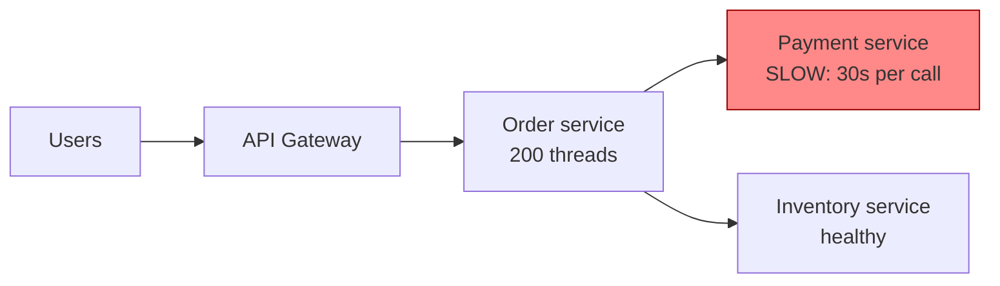

1. Payment service becomes slow (30 s per call instead of 200 ms).
2. Order service has no timeout, so each request **waits** and holds a thread.
3. All 200 Order threads are soon stuck waiting on Payment.
4. Now Order can't serve **anything**, even requests that only need Inventory.
5. The gateway's threads pile up waiting on Order. The **whole site** is down because of **one** slow dependency.

Every pattern in this file breaks this chain somewhere:

| Pattern | Breaks the chain by... |
|---|---|
| **Timeout** | Not waiting forever |
| **Retry** | Recovering from short, temporary glitches |
| **Circuit Breaker** | Stopping calls to a dependency that is clearly broken |
| **Bulkhead** | Giving each dependency its own limited pool of threads/connections |
| **Fallback** | Returning a useful answer anyway |
| **Rate Limiting / Throttling** | Not letting callers send more than you can handle |
| **Health Check** | Detecting broken instances so traffic avoids them |
| **Graceful Degradation** | Turning off optional features to keep core features alive |
| **Failover / Redundancy** | Having a spare ready to take over |
| **Chaos Engineering** | Proving all of the above actually works, before a real outage does |

### Availability in "nines"

| Availability | Downtime per year | Downtime per month | Typical for |
|---|---|---|---|
| 99% ("two nines") | 3.65 days | 7.3 hours | Internal tools |
| 99.9% ("three nines") | 8.76 hours | 43.8 minutes | Many business apps |
| 99.95% | 4.38 hours | 21.9 minutes | Cloud-managed DBs |
| 99.99% ("four nines") | 52.6 minutes | 4.4 minutes | Payments, e-commerce checkout |
| 99.999% ("five nines") | 5.26 minutes | 26.3 seconds | Telecom, core banking |

### Resilience4j: the standard Java library

Most Spring Boot code in this file uses **Resilience4j**, the successor to Netflix Hystrix (which is in maintenance mode).

```xml
<!-- pom.xml (Spring Boot 3) -->
<dependency>
    <groupId>io.github.resilience4j</groupId>
    <artifactId>resilience4j-spring-boot3</artifactId>
</dependency>
<dependency>
    <groupId>org.springframework.boot</groupId>
    <artifactId>spring-boot-starter-aop</artifactId>   <!-- annotations work through AOP proxies -->
</dependency>
<dependency>
    <groupId>org.springframework.boot</groupId>
    <artifactId>spring-boot-starter-actuator</artifactId> <!-- health + metrics for breakers -->
</dependency>
```

| Resilience4j module | Annotation | Pattern |
|---|---|---|
| `resilience4j-circuitbreaker` | `@CircuitBreaker` | Circuit Breaker |
| `resilience4j-retry` | `@Retry` | Retry |
| `resilience4j-timelimiter` | `@TimeLimiter` | Timeout |
| `resilience4j-bulkhead` | `@Bulkhead` | Bulkhead |
| `resilience4j-ratelimiter` | `@RateLimiter` | Rate Limiting |
| (all of them) | `fallbackMethod = "..."` | Fallback |

> The annotations are **proxy-based**, so the self-invocation trap applies: calling an annotated method from the same class skips resilience entirely. See [03_Structural_Pattern.md](../01_LLD/03_Structural_Pattern.md#76-proxy-in-spring-boot-aop-transactional-self-invocation-interview-imp---java).

#### 📘 Terms Explained

| Term | Simple meaning |
|---|---|
| **Reliability** | The system keeps doing the right thing over time. |
| **Resilience** | The ability to keep working (maybe partly) when parts fail, and to recover quickly. |
| **Availability** | The percentage of time the system is usable. |
| **Dependency** | Another service, database or API your code calls. |
| **Cascading failure** | One failure causes callers to fail, which causes their callers to fail, like falling dominoes. |
| **Latency** | How long a request takes. |
| **Thread pool exhaustion** | All threads in a pool are busy (often waiting), so new work can't start. |
| **SLA / SLO** | Service Level Agreement (a promise to customers, e.g. 99.9%) / Objective (an internal target). |
| **Resilience4j** | Lightweight Java library implementing circuit breaker, retry, bulkhead, rate limiter, time limiter. |
| **Hystrix** | Netflix's older resilience library; no longer actively developed. |

---

# 1. Circuit Breaker Pattern (Interview Imp - Java)

## 1.1 What is the Circuit Breaker Pattern?

A **circuit breaker** sits in front of calls to a dependency and watches the results. When too many calls fail (or are too slow), it **"trips" (opens)** and **stops sending calls for a while**, failing immediately instead. After a cool-down, it lets a few **trial calls** through to see if the dependency has recovered.

**Analogy:** The electrical circuit breaker (MCB) in your home. When there's a short circuit, it trips and cuts the power, so the fault doesn't burn the house down. You fix the fault and switch it back on.

### The three states

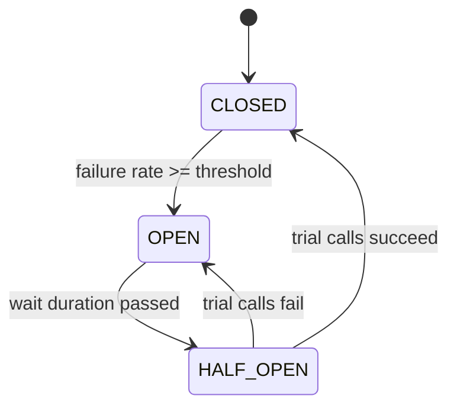

| State | Calls go through? | What it does |
|---|---|---|
| **CLOSED** (normal) | Yes | Counts successes and failures in a sliding window. |
| **OPEN** (tripped) | **No**: fails immediately (`CallNotPermittedException`) | Gives the dependency time to recover; protects your threads. |
| **HALF_OPEN** (testing) | A **limited** number of trial calls | If they succeed → CLOSED. If they fail → OPEN again. |

> This is the **State pattern** in action. See [04_Behavioral_Pattern.md](../01_LLD/04_Behavioral_Pattern.md#8-state-pattern-interview-imp---java).

#### 📘 Terms Explained

| Term | Simple meaning |
|---|---|
| **Trip / open** | The breaker decides the dependency is broken and blocks calls. |
| **Fail fast** | Return an error immediately instead of waiting for a call that will probably fail. |
| **Trial call / probe** | A real call allowed in HALF_OPEN to test if the dependency is healthy again. |
| **Failure rate threshold** | The % of failed calls that trips the breaker (e.g. 50%). |
| **MCB** | Miniature Circuit Breaker, the switch in a home's electrical panel. |

---

## 1.2 Why Do We Need It?

Retries and timeouts alone are not enough when a dependency is **down for minutes**:

| Without circuit breaker | With circuit breaker |
|---|---|
| Every request waits the full timeout (e.g. 3 s) before failing | Requests fail in **microseconds** once the circuit is open |
| Threads pile up waiting → your service goes down too | Threads stay free for other work |
| Retries multiply the load on a struggling service (**retry storm**) | The dependency gets **breathing room** to recover |
| Users see slow errors | Users get a fast fallback ("payment pending") |
| No signal that something is wrong | Breaker state is a clear, alertable metric |

---

## 1.3 How It Works

### 1.3.1 Sliding window

The breaker decides based on the **recent** calls only, not all calls ever made:

| Window type | Looks at | Example |
|---|---|---|
| **Count-based** | The last N calls | Last 100 calls |
| **Time-based** | Calls in the last N seconds | Last 60 seconds |

It only judges once there are at least `minimumNumberOfCalls`, so 1 failure out of 1 call doesn't trip it (that would be 100%!).

### 1.3.2 What counts as a failure?

| Counted as failure | Usually **ignored** |
|---|---|
| Timeouts, connection refused, HTTP 5xx | Business errors: 400 Bad Request, 404 Not Found, validation errors |
| **Slow calls** (above `slowCallDurationThreshold`) | Exceptions you list in `ignoreExceptions` |

> **Why ignore 4xx?** A 404 means the dependency is **working correctly**: the item just doesn't exist. Counting it would trip the breaker on healthy services.

### 1.3.3 Request flow

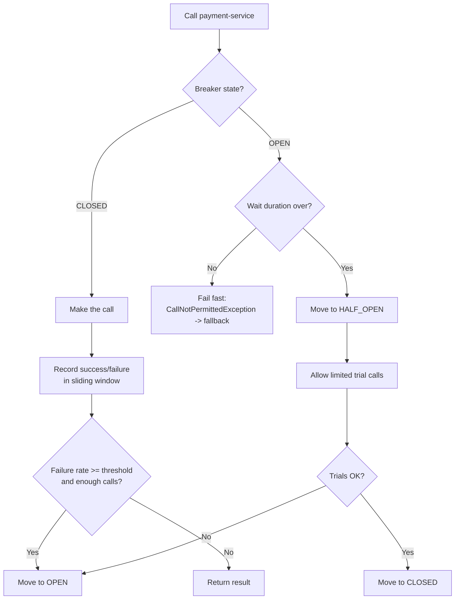

---

## 1.4 Complete Java Example - A Circuit Breaker from Scratch

A small count-based breaker with the same states and settings as Resilience4j. The fake `Clock` lets us "wait" 10 seconds instantly.

```java
import java.util.ArrayDeque;
import java.util.Deque;
import java.util.function.Supplier;

class CallNotPermittedException extends RuntimeException {
    CallNotPermittedException(String name) { super("circuit '" + name + "' is OPEN - call not permitted"); }
}

// A small count-based circuit breaker, modelled on how Resilience4j works
class CircuitBreaker {
    enum State { CLOSED, OPEN, HALF_OPEN }

    private final String name;
    private final int windowSize;              // look at the last N calls
    private final int minimumCalls;            // don't judge until we have this many calls
    private final double failureRateThreshold; // % of failures that trips the breaker
    private final long waitInOpenMillis;       // how long to stay OPEN before testing again
    private final int trialCalls;              // calls allowed in HALF_OPEN
    private final Clock clock;

    private State state = State.CLOSED;
    private final Deque<Boolean> window = new ArrayDeque<>();   // true = failure
    private long openedAt;
    private int trialsDone, trialFailures;

    CircuitBreaker(String name, int windowSize, int minimumCalls, double failureRateThreshold,
                   long waitInOpenMillis, int trialCalls, Clock clock) {
        this.name = name; this.windowSize = windowSize; this.minimumCalls = minimumCalls;
        this.failureRateThreshold = failureRateThreshold; this.waitInOpenMillis = waitInOpenMillis;
        this.trialCalls = trialCalls; this.clock = clock;
    }

    synchronized <T> T call(Supplier<T> action) {
        if (state == State.OPEN) {
            if (clock.now() - openedAt < waitInOpenMillis) throw new CallNotPermittedException(name);
            moveTo(State.HALF_OPEN);                               // wait is over: allow a few trial calls
        }
        try {
            T result = action.get();
            record(false);
            return result;
        } catch (RuntimeException e) {
            record(true);
            throw e;
        }
    }

    private void record(boolean failed) {
        if (state == State.HALF_OPEN) {
            trialsDone++;
            if (failed) trialFailures++;
            if (trialsDone == trialCalls) {
                double rate = 100.0 * trialFailures / trialCalls;
                moveTo(rate >= failureRateThreshold ? State.OPEN : State.CLOSED);
            }
            return;
        }
        window.addLast(failed);
        if (window.size() > windowSize) window.removeFirst();
        if (window.size() >= minimumCalls) {
            long failures = window.stream().filter(f -> f).count();
            double rate = 100.0 * failures / window.size();
            if (rate >= failureRateThreshold) moveTo(State.OPEN);
        }
    }

    private void moveTo(State next) {
        System.out.println("    [breaker] " + state + " -> " + next);
        state = next;
        window.clear();
        trialsDone = trialFailures = 0;
        if (next == State.OPEN) openedAt = clock.now();
    }

    State state() { return state; }
}

// Fake clock so the demo is deterministic (no real sleeping)
class Clock {
    private long millis = 0;
    long now() { return millis; }
    void advance(long ms) { millis += ms; }
}

public class CircuitBreakerDemo {
    static boolean paymentServiceUp = false;

    static String callPaymentService() {
        if (!paymentServiceUp) throw new RuntimeException("503 from payment-service");
        return "PAID";
    }

    public static void main(String[] args) {
        Clock clock = new Clock();
        // window 5 calls, judge after 4, trip at 50% failures, stay open 10s, 2 trial calls
        CircuitBreaker breaker = new CircuitBreaker("payment", 5, 4, 50, 10_000, 2, clock);

        for (int i = 1; i <= 14; i++) {
            if (i == 9) {
                clock.advance(10_000);
                System.out.println("  ... 10 seconds pass ...");
            }
            if (i == 11) {
                paymentServiceUp = true;                          // the service recovers
                clock.advance(10_000);
                System.out.println("  ... payment-service recovers, 10 seconds pass ...");
            }
            try {
                String r = breaker.call(CircuitBreakerDemo::callPaymentService);
                System.out.println("call " + i + ": OK " + r + "   (state " + breaker.state() + ")");
            } catch (CallNotPermittedException e) {
                System.out.println("call " + i + ": FAST FAIL - " + e.getMessage());
            } catch (RuntimeException e) {
                System.out.println("call " + i + ": FAILED " + e.getMessage() + "   (state " + breaker.state() + ")");
            }
        }
    }
}
```

**Output:**
```
call 1: FAILED 503 from payment-service   (state CLOSED)
call 2: FAILED 503 from payment-service   (state CLOSED)
call 3: FAILED 503 from payment-service   (state CLOSED)
    [breaker] CLOSED -> OPEN
call 4: FAILED 503 from payment-service   (state OPEN)
call 5: FAST FAIL - circuit 'payment' is OPEN - call not permitted
call 6: FAST FAIL - circuit 'payment' is OPEN - call not permitted
call 7: FAST FAIL - circuit 'payment' is OPEN - call not permitted
call 8: FAST FAIL - circuit 'payment' is OPEN - call not permitted
  ... 10 seconds pass ...
    [breaker] OPEN -> HALF_OPEN
call 9: FAILED 503 from payment-service   (state HALF_OPEN)
    [breaker] HALF_OPEN -> OPEN
call 10: FAILED 503 from payment-service   (state OPEN)
  ... payment-service recovers, 10 seconds pass ...
    [breaker] OPEN -> HALF_OPEN
call 11: OK PAID   (state HALF_OPEN)
    [breaker] HALF_OPEN -> CLOSED
call 12: OK PAID   (state CLOSED)
call 13: OK PAID   (state CLOSED)
call 14: OK PAID   (state CLOSED)
```

Walk through it:
1. **Calls 1-3** fail, but the breaker needs at least 4 calls before judging (`minimumCalls`).
2. **Call 4** fails → 4/4 = 100% ≥ 50% → **OPEN**.
3. **Calls 5-8** **fail fast** without touching payment-service: no waiting, no load on the broken service.
4. After 10 s → **HALF_OPEN**. Both trial calls (9, 10) fail → **OPEN** again.
5. Service recovers, 10 s pass → HALF_OPEN → trials 11 and 12 succeed → **CLOSED**. Normal traffic resumes.

#### 📘 Terms Explained

| Term | Simple meaning |
|---|---|
| **`synchronized`** | Only one thread at a time may run the method, so the counters stay consistent. (Resilience4j uses lock-free structures instead.) |
| **`Deque`** | Double-ended queue; here it holds the last N results as a sliding window. |
| **`Supplier<T>`** | A function with no input that returns a `T`: the call being protected. |
| **Fake clock** | A test clock you move forward manually, so time-based code can be tested without sleeping. |

---

## 1.5 Circuit Breaker with Resilience4j and Spring Boot (Interview Imp - Java)

```java
@Service
public class PaymentClient {
    private final RestClient rest;

    PaymentClient(RestClient.Builder builder) {
        this.rest = builder.baseUrl("http://payment-service").build();
    }

    @CircuitBreaker(name = "payment", fallbackMethod = "paymentFallback")
    public PaymentResponse charge(PaymentRequest req) {
        return rest.post().uri("/charges").body(req).retrieve().body(PaymentResponse.class);
    }

    // Same parameters + the exception as the LAST parameter, same return type
    private PaymentResponse paymentFallback(PaymentRequest req, CallNotPermittedException e) {
        return PaymentResponse.pending(req.orderId(), "Payment service unavailable, will retry");   // circuit is OPEN
    }

    private PaymentResponse paymentFallback(PaymentRequest req, Exception e) {
        return PaymentResponse.pending(req.orderId(), "Payment failed: " + e.getMessage());        // any other failure
    }
}
```

```yaml
# application.yml
resilience4j:
  circuitbreaker:
    configs:
      default:
        sliding-window-type: COUNT_BASED
        sliding-window-size: 20                 # look at the last 20 calls
        minimum-number-of-calls: 10             # don't judge before 10 calls
        failure-rate-threshold: 50              # trip at 50% failures
        slow-call-duration-threshold: 2s        # a call slower than 2s counts as "slow"
        slow-call-rate-threshold: 80            # trip if 80% of calls are slow
        wait-duration-in-open-state: 30s        # stay OPEN for 30s
        permitted-number-of-calls-in-half-open-state: 3
        automatic-transition-from-open-to-half-open-enabled: true
        record-exceptions:
          - java.io.IOException
          - java.util.concurrent.TimeoutException
          - org.springframework.web.client.HttpServerErrorException   # 5xx
        ignore-exceptions:
          - org.springframework.web.client.HttpClientErrorException   # 4xx: the service is fine
    instances:
      payment:
        base-config: default
        wait-duration-in-open-state: 60s        # override for this dependency

management:
  health:
    circuitbreakers:
      enabled: true                             # breaker state appears in /actuator/health
  endpoints:
    web:
      exposure:
        include: health,metrics,circuitbreakers,circuitbreakerevents
```

| Resilience4j default | Value |
|---|---|
| `sliding-window-size` | 100 |
| `minimum-number-of-calls` | 100 |
| `failure-rate-threshold` | 50% |
| `wait-duration-in-open-state` | 60 s |
| `permitted-number-of-calls-in-half-open-state` | 10 |
| `slow-call-duration-threshold` | 60 s |

> The defaults are conservative (100 calls before judging, 60 s "slow"). For a low-traffic service the breaker may **never** trip with defaults, so always tune per dependency.

**Monitoring:** Resilience4j publishes Micrometer metrics such as `resilience4j.circuitbreaker.state` and `resilience4j.circuitbreaker.calls`. Alert when a breaker is OPEN for more than a few minutes.

### Programmatic (without annotations)

```java
CircuitBreakerRegistry registry = CircuitBreakerRegistry.ofDefaults();
CircuitBreaker breaker = registry.circuitBreaker("payment");

Supplier<PaymentResponse> guarded = CircuitBreaker.decorateSupplier(breaker, () -> client.charge(req));
PaymentResponse r = Try.ofSupplier(guarded)                       // io.vavr.control.Try
        .recover(CallNotPermittedException.class, e -> PaymentResponse.pending(req.orderId(), "circuit open"))
        .get();

breaker.getEventPublisher().onStateTransition(e -> log.warn("payment breaker: {}", e.getStateTransition()));
```

#### 📘 Terms Explained

| Term | Simple meaning |
|---|---|
| **`fallbackMethod`** | Name of a method in the same class that Resilience4j calls when the protected call fails or is blocked. |
| **`CallNotPermittedException`** | Thrown by Resilience4j when the breaker is OPEN. |
| **`record-exceptions` / `ignore-exceptions`** | Which exceptions count as failures, and which don't count at all. |
| **Micrometer** | Spring Boot's metrics library; exports to Prometheus, Datadog, etc. |
| **`RestClient`** | Spring 6.1+ synchronous HTTP client with a fluent API (successor to `RestTemplate`). |
| **Vavr `Try`** | A functional type that holds either a result or an exception. |

---

## 1.6 Advanced Circuit Breaker Topics

### 1.6.1 One breaker per dependency (and sometimes per endpoint)

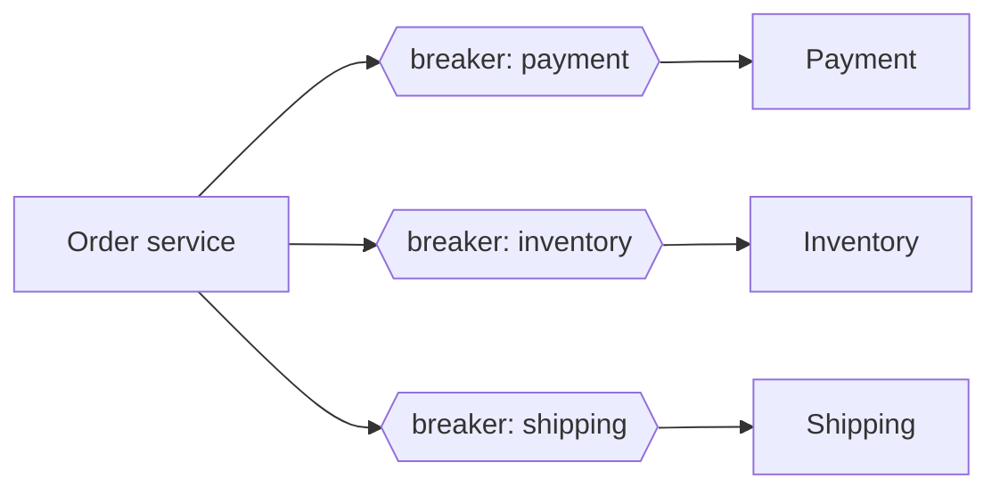

A single shared breaker would block **all** dependencies when only one is broken. If one endpoint of a service is slow (`/reports`) but others are fine, use separate breakers per endpoint.

### 1.6.2 Where to put the breaker

| Location | Example | Notes |
|---|---|---|
| **In the client code** | Resilience4j in the calling service | Most control; per-call fallback logic |
| **In the API gateway** | Spring Cloud Gateway `CircuitBreaker` filter | Protects the edge |
| **In a service mesh sidecar** | Istio/Envoy **outlier detection** | No code changes; removes bad *instances* from the load balancer pool |

### 1.6.3 Circuit breaker vs the instance being down

A breaker in the **caller** treats the whole dependency as one unit. If 1 of 10 instances is bad, the load balancer / mesh should eject that **instance** (outlier detection, health checks), while the breaker protects against the **whole service** failing.

### 1.6.4 Extra states in Resilience4j

| State | Meaning |
|---|---|
| `DISABLED` | Always allow calls, record nothing |
| `METRICS_ONLY` | Always allow calls, but still record metrics |
| `FORCED_OPEN` | Always reject (manual kill switch during an incident) |

```java
registry.circuitBreaker("payment").transitionToForcedOpenState();   // ops "kill switch"
```

#### 📘 Terms Explained

| Term | Simple meaning |
|---|---|
| **Service mesh** | Infrastructure (Istio, Linkerd) that adds a proxy next to every service to handle traffic, retries and security. |
| **Outlier detection** | The mesh/LB notices one instance returning errors and temporarily removes it from rotation. |
| **Kill switch** | A manual control to turn a feature or dependency off instantly. |

---

## 1.7 Pros and Cons

| Pros | Cons |
|---|---|
| Stops cascading failures | Wrong thresholds: trips too easily (false alarms) or never trips |
| Fails fast; frees threads | Adds config to tune per dependency |
| Gives broken services time to recover | During OPEN, even requests that might succeed are rejected |
| Clear operational signal (state metric) | Needs a sensible fallback, or users just get errors faster |

---

## 1.8 Common Pitfalls

| Pitfall | Fix |
|---|---|
| Counting 4xx / business errors as failures | `ignore-exceptions` for client errors. |
| Defaults too high for low traffic (100 calls) | Tune `sliding-window-size` and `minimum-number-of-calls`. |
| One breaker shared by unrelated dependencies | One breaker instance per dependency (or endpoint). |
| No fallback, so users still see errors | Provide a fallback or a clear "try again later" response. |
| No timeout under the breaker, so slow calls hang threads before being counted | Always combine with a timeout (and the slow-call threshold). |
| Calling the `@CircuitBreaker` method from the same class | Proxy is bypassed; call it from another bean. |
| Not monitoring breaker state | Export metrics; alert on OPEN. |

---

## 1.9 Circuit Breaker - Interview Questions

**Q1. What is a circuit breaker and why use it?**
A wrapper that monitors calls to a dependency and, when the failure rate passes a threshold, stops calling it for a while and fails fast. It prevents cascading failures and gives the dependency time to recover.

**Q2. Explain the three states.**
CLOSED: calls flow, results are recorded. OPEN: calls are rejected immediately for a wait duration. HALF_OPEN: a few trial calls decide whether to go back to CLOSED or OPEN.

**Q3. What counts as a failure?**
Configurable: typically timeouts, IO errors and 5xx, plus slow calls above a threshold. Client errors (4xx, validation) should be ignored because the dependency is working.

**Q4. Count-based vs time-based window?**
Count-based looks at the last N calls; time-based looks at calls in the last N seconds. Time-based behaves more consistently when traffic varies a lot.

**Q5. Circuit breaker vs retry?**
Retry handles **short, transient** failures by trying again. A breaker handles **sustained** failures by stopping calls. Together: retries for blips, the breaker stops retries hammering a dead service.

**Q6. What happens to requests while the breaker is open?**
They fail immediately with `CallNotPermittedException` (Resilience4j), and the fallback runs, e.g. a cached value, a default, or a "pending" response.

**Q7. How would you tune it for a payment service?**
Count- or time-based window sized to normal traffic, minimum calls ~10-20, 50% failure threshold, slow-call threshold just above p99 latency, 30-60 s open wait, 3-5 half-open trials, ignore 4xx, plus a fallback that marks the payment "pending" for async retry.

**Q8. Hystrix vs Resilience4j?**
Hystrix (Netflix) is in maintenance mode and used thread-pool isolation by default. Resilience4j is lightweight, modular, functional (decorators), and integrates with Spring Boot 3 and Micrometer.

---

## 1.10 Circuit Breaker - Cheat Sheet

```
CIRCUIT BREAKER  Stop calling a dependency that keeps failing; fail fast; test recovery later.
          CLOSED (record) -> OPEN (reject, wait) -> HALF_OPEN (few trials) -> CLOSED / OPEN.
          Sliding window: count-based or time-based; minimum calls before judging.
          Failures: timeouts, IO, 5xx, slow calls. IGNORE 4xx/business errors.
          Resilience4j: @CircuitBreaker(name, fallbackMethod); CallNotPermittedException when OPEN.
          Defaults: window 100, min calls 100, 50%, open 60s, half-open 10 -> TUNE them.
          One breaker per dependency; combine with timeout + fallback; monitor state.
          Mesh alternative: Envoy/Istio outlier detection ejects bad instances.
```

---

# 2. Retry Pattern (Interview Imp - Java)

## 2.1 What is the Retry Pattern?

**Retry** automatically repeats an operation that failed, on the assumption that the failure was **temporary** (a network blip, a brief overload, a leader election) and that trying again shortly will work.

**Analogy:** A phone call that drops in a tunnel. You don't give up on the person; you wait a moment and call again. But if their phone is switched off for the day, calling 50 times in a row just annoys everyone.

#### 📘 Terms Explained

| Term | Simple meaning |
|---|---|
| **Transient failure** | A temporary failure that will likely go away on its own (timeout, connection reset, 503). |
| **Permanent failure** | A failure that will happen every time (400 Bad Request, invalid card, 404). |
| **Attempt** | One try of the operation. `maxAttempts = 3` means 1 original call + 2 retries. |

---

## 2.2 Why Do We Need It?

In a cloud environment many failures are short-lived:
- A pod is being restarted or rescheduled by Kubernetes.
- A load balancer drops one connection.
- A database fails over to a replica (a few seconds of errors).
- A service returns 503 for a moment under load, or 429 "slow down".

Without retries, each of these becomes a user-visible error. With smart retries, most are invisible.

**But:** careless retries are dangerous.

| Danger | Example |
|---|---|
| **Duplicate side effects** | Retrying "charge card" after a timeout: the first charge may have succeeded! |
| **Retry storm** | 1,000 clients × 3 retries = 4× traffic to a service that is already overloaded. |
| **Retry amplification** | A → B → C, each retrying 3 times: C gets 3 × 3 × 3 = **27** calls for one user request. |
| **Wasted time** | Retrying a 400 Bad Request will never succeed. |

---

## 2.3 How It Works: What, When and How Long

### 2.3.1 What to retry

| Retry? | Errors |
|---|---|
| ✅ **Yes** | Timeouts, connection refused/reset, HTTP 502, 503, 504, 429 (respect `Retry-After`), DB deadlock / serialization failure, optimistic-lock conflict (re-read first) |
| ❌ **No** | HTTP 400, 401, 403, 404, 409 (usually), 422; validation errors; "insufficient funds" |
| ⚠️ **Only if idempotent** | Any operation with side effects (POST create, payment, sending email) |

### 2.3.2 Idempotency: the key to safe retries (Interview Imp - Java)

An operation is **idempotent** if doing it twice has the same effect as doing it once.

| HTTP method | Idempotent? |
|---|---|
| GET, HEAD, OPTIONS | Yes (no changes) |
| PUT (replace), DELETE | Yes by definition |
| POST (create), PATCH | **No**, unless you make it idempotent |

**Making a POST idempotent with an idempotency key:**

```java
@PostMapping("/payments")
public ResponseEntity<PaymentResponse> pay(@RequestHeader("Idempotency-Key") String key,
                                           @RequestBody PaymentRequest req) {
    // 1. Already processed this key? Return the SAME result as before, don't charge again.
    Optional<PaymentResponse> previous = idempotencyStore.find(key);
    if (previous.isPresent()) return ResponseEntity.ok(previous.get());

    // 2. Process and store the result under the key (ideally in the same DB transaction,
    //    with a UNIQUE constraint on the key so two concurrent duplicates can't both pass)
    PaymentResponse result = paymentService.charge(req);
    idempotencyStore.save(key, result);
    return ResponseEntity.status(HttpStatus.CREATED).body(result);
}
```

The client generates the key (a UUID) **once per logical operation** and sends the same key on every retry. Stripe, PayPal and most payment APIs work this way.

### 2.3.3 When: backoff and jitter

| Strategy | Delays (base 200 ms) | Problem |
|---|---|---|
| **Immediate** | 0, 0, 0 | Hammers the service; no time to recover |
| **Fixed** | 200, 200, 200 | All clients retry in lockstep |
| **Exponential** | 200, 400, 800, 1600 | Better, but clients that failed together still retry together |
| **Exponential + jitter** ✅ | random(0..200), random(0..400), ... | Spreads retries out; the recommended default |

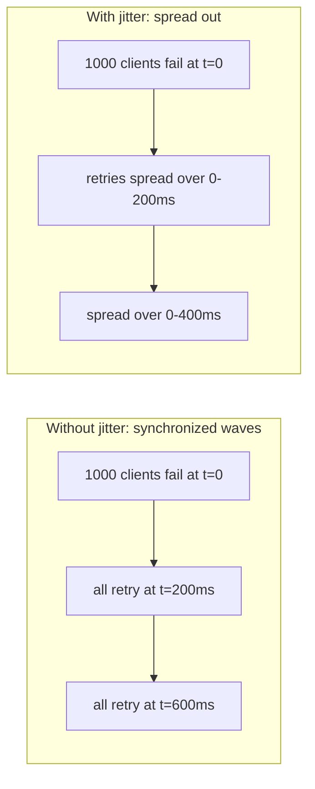

### 2.3.4 How long: limits

- **Max attempts**: usually 3 (1 call + 2 retries) for user-facing calls.
- **Max delay cap**: e.g. never wait more than 2 s between attempts.
- **Overall deadline**: total time budget for the user request (e.g. 3 s). Stop retrying when it's used up.
- **Retry budget**: retries may be at most ~10-20% of total traffic (see [01_Scalability_Pattern.md](01_Scalability_Pattern.md#1115-retries-timeouts--circuit-breaking)).

#### 📘 Terms Explained

| Term | Simple meaning |
|---|---|
| **Idempotent** | Doing it once or many times has the same result. |
| **Idempotency key** | A unique ID sent with a request so the server can recognise and ignore duplicates. |
| **Backoff** | Waiting longer between each retry. |
| **Exponential backoff** | The wait doubles (or multiplies) each time: 200, 400, 800 ms... |
| **Jitter** | Random variation added to the wait so many clients don't retry at the same instant. |
| **Thundering herd** | Many clients doing the same thing at the same moment, overwhelming a server. |
| **`Retry-After` header** | Server tells the client how many seconds to wait before retrying (with 429/503). |
| **Deadlock** | Two DB transactions each waiting for a lock the other holds; the DB kills one, and retrying it usually works. |

---

## 2.4 Complete Java Example - Retry with Exponential Backoff and Jitter

```java
import java.util.Random;
import java.util.Set;
import java.util.function.Supplier;

class TransientException extends RuntimeException { TransientException(String m) { super(m); } }
class ValidationException extends RuntimeException { ValidationException(String m) { super(m); } }

class Retry {
    private final int maxAttempts;
    private final long baseDelayMillis;
    private final double multiplier;
    private final long maxDelayMillis;
    private final Set<Class<? extends RuntimeException>> retryOn;
    private final Random random;
    private final Sleeper sleeper;

    Retry(int maxAttempts, long baseDelayMillis, double multiplier, long maxDelayMillis,
          Set<Class<? extends RuntimeException>> retryOn, Random random, Sleeper sleeper) {
        this.maxAttempts = maxAttempts; this.baseDelayMillis = baseDelayMillis; this.multiplier = multiplier;
        this.maxDelayMillis = maxDelayMillis; this.retryOn = retryOn; this.random = random; this.sleeper = sleeper;
    }

    <T> T execute(Supplier<T> action) {
        for (int attempt = 1; ; attempt++) {
            try {
                return action.get();
            } catch (RuntimeException e) {
                boolean retryable = retryOn.stream().anyMatch(t -> t.isInstance(e));
                if (!retryable) {
                    System.out.println("    attempt " + attempt + " failed with " + e.getClass().getSimpleName() + " -> NOT retryable, giving up");
                    throw e;
                }
                if (attempt == maxAttempts) {
                    System.out.println("    attempt " + attempt + " failed -> max attempts reached, giving up");
                    throw e;
                }
                long delay = delayFor(attempt);
                System.out.println("    attempt " + attempt + " failed (" + e.getMessage() + ") -> waiting " + delay + " ms");
                sleeper.sleep(delay);
            }
        }
    }

    // Exponential backoff with "full jitter": random value between 0 and the exponential cap
    long delayFor(int attempt) {
        return (long) (random.nextDouble() * capFor(attempt));
    }

    long capFor(int attempt) {
        return (long) Math.min(maxDelayMillis, baseDelayMillis * Math.pow(multiplier, attempt - 1));
    }
}

interface Sleeper { void sleep(long millis); }

public class RetryDemo {
    public static void main(String[] args) {
        Sleeper fakeSleep = ms -> { };                 // don't really sleep in the demo
        Retry retry = new Retry(4, 200, 2.0, 2_000, Set.of(TransientException.class), new Random(42), fakeSleep);

        System.out.println("1) Flaky call that succeeds on the 3rd attempt");
        int[] calls = {0};
        String r = retry.execute(() -> {
            if (++calls[0] < 3) throw new TransientException("connection reset");
            return "inventory=17";
        });
        System.out.println("  result: " + r);

        System.out.println("2) Bad request: retrying will never help");
        try {
            retry.execute(() -> { throw new ValidationException("quantity must be > 0"); });
        } catch (ValidationException e) {
            System.out.println("  caller got: " + e.getMessage());
        }

        System.out.println("3) Service is down for good");
        try {
            retry.execute(() -> { throw new TransientException("timeout"); });
        } catch (TransientException e) {
            System.out.println("  caller got: " + e.getMessage());
        }

        System.out.print("4) Exponential caps before jitter, attempts 1-6:");
        for (int attempt = 1; attempt <= 6; attempt++) System.out.print(" " + retry.capFor(attempt));
        System.out.println(" ms");
    }
}
```

**Output:**
```
1) Flaky call that succeeds on the 3rd attempt
    attempt 1 failed (connection reset) -> waiting 145 ms
    attempt 2 failed (connection reset) -> waiting 273 ms
  result: inventory=17
2) Bad request: retrying will never help
    attempt 1 failed with ValidationException -> NOT retryable, giving up
  caller got: quantity must be > 0
3) Service is down for good
    attempt 1 failed (timeout) -> waiting 61 ms
    attempt 2 failed (timeout) -> waiting 110 ms
    attempt 3 failed (timeout) -> waiting 532 ms
    attempt 4 failed -> max attempts reached, giving up
  caller got: timeout
4) Exponential caps before jitter, attempts 1-6: 200 400 800 1600 2000 2000 ms
```

What the output shows:
1. The flaky call succeeded on attempt 3. The caller never knew there was a problem.
2. `ValidationException` is **not** in the retryable set, so it failed **immediately** (no pointless retries).
3. A dead service gave up after **4 attempts** (the configured maximum) and the original exception reached the caller.
4. Delays are random ("full jitter") **below** an exponential cap that stops growing at 2,000 ms. (The `Random(42)` seed makes the demo repeatable; real code uses a normal random source.)

---

## 2.5 Retry with Resilience4j and Spring Retry

### 2.5.1 Resilience4j

```java
@Service
public class InventoryClient {

    @Retry(name = "inventory", fallbackMethod = "stockUnknown")
    @CircuitBreaker(name = "inventory")
    public StockLevel getStock(String sku) {
        return rest.get().uri("/stock/{sku}", sku).retrieve().body(StockLevel.class);
    }

    private StockLevel stockUnknown(String sku, Exception e) {
        return StockLevel.unknown(sku);
    }
}
```

```yaml
resilience4j:
  retry:
    instances:
      inventory:
        max-attempts: 3                      # includes the first call
        wait-duration: 200ms
        enable-exponential-backoff: true
        exponential-backoff-multiplier: 2    # 200ms, 400ms, ... (for jitter as well, configure an IntervalFunction in code, below)
        retry-exceptions:
          - java.io.IOException
          - java.util.concurrent.TimeoutException
          - org.springframework.web.client.HttpServerErrorException
        ignore-exceptions:
          - org.springframework.web.client.HttpClientErrorException
```

```java
// Exponential backoff WITH jitter, configured in code
RetryConfig config = RetryConfig.custom()
        .maxAttempts(3)
        .intervalFunction(IntervalFunction.ofExponentialRandomBackoff(200, 2.0, 0.5))   // base, multiplier, randomization
        .retryExceptions(IOException.class, TimeoutException.class)
        .ignoreExceptions(HttpClientErrorException.class)
        .build();
```

**Order of decorators matters.** With Spring Boot annotations, Resilience4j applies them in a fixed default order: **Retry ( CircuitBreaker ( RateLimiter ( TimeLimiter ( Bulkhead ( your method ) ) ) ) )**. Retry is outermost, so each retry attempt passes through the breaker. Once the breaker opens, retries fail fast instead of hammering the service.

### 2.5.2 Spring Retry

```java
@EnableRetry
@Configuration class RetryConfiguration {}

@Service
class ReportClient {
    @Retryable(retryFor = {IOException.class, HttpServerErrorException.class},
               maxAttempts = 3,
               backoff = @Backoff(delay = 200, multiplier = 2, random = true))
    public Report fetch(long id) { ... }

    @Recover                                    // called after the last failed attempt
    public Report fallback(IOException e, long id) { return Report.empty(id); }
}
```

### 2.5.3 Retries elsewhere

| Where | Retry setting |
|---|---|
| Spring Kafka consumer | `DefaultErrorHandler` with `ExponentialBackOff`, then a **dead-letter topic** |
| RabbitMQ (Spring AMQP) | `RetryInterceptorBuilder`, then a dead-letter queue |
| Feign | `Retryer.Default(period, maxPeriod, maxAttempts)` |
| Nginx / Envoy / Istio | `proxy_next_upstream`, `retries`, `perTryTimeout` |
| AWS SDK | Built-in retry with exponential backoff + jitter |

#### 📘 Terms Explained

| Term | Simple meaning |
|---|---|
| **`IntervalFunction`** | Resilience4j function that computes the wait before each retry. |
| **Spring Retry** | Spring project providing `@Retryable` / `@Recover` (proxy-based). |
| **`@Recover`** | Spring Retry's fallback method, called when all attempts fail. |
| **Dead-letter queue/topic (DLQ)** | Where messages go after all retries fail, so they can be inspected and reprocessed later. |
| **Decorator order** | Which resilience wrapper is outside which (see [03_Structural_Pattern.md](../01_LLD/03_Structural_Pattern.md#4-decorator-pattern-interview-imp---java)). |

---

## 2.6 Pros and Cons

| Pros | Cons |
|---|---|
| Hides transient failures from users | Can cause duplicates for non-idempotent operations |
| Very cheap to add | Adds latency (waiting between attempts) |
| Improves success rate dramatically for flaky networks | Retry storms / amplification during real outages |
| | Can hide real problems if not monitored |

---

## 2.7 Common Pitfalls

| Pitfall | Fix |
|---|---|
| Retrying non-idempotent calls (double charge) | Idempotency keys; retry only safe operations. |
| Retrying 4xx errors | Retry only transient exceptions; ignore client errors. |
| No backoff / no jitter | Exponential backoff + jitter. |
| Retrying at every layer (A, B and C all retry) | Retry at **one** layer (usually closest to the user or the edge), or use budgets. |
| Total retry time longer than the caller's timeout | Keep `attempts × (timeout + delay)` within the overall deadline. |
| Retry outside a circuit breaker without considering order | Retry should wrap the breaker so open circuits stop retries quickly. |
| Ignoring `Retry-After` on 429/503 | Honour it. |
| Retrying inside a DB transaction that is already marked rollback-only | Retry the **whole** transaction from outside it. |

---

## 2.8 Retry - Interview Questions

**Q1. When should you retry, and when not?**
Retry transient failures (timeouts, connection errors, 502/503/504, 429, deadlocks). Don't retry permanent errors (400, 401, 403, 404, validation) or non-idempotent operations without an idempotency mechanism.

**Q2. What is exponential backoff with jitter and why use it?**
The wait grows exponentially between attempts, with randomness added. Backoff gives the service time to recover; jitter spreads clients out to avoid synchronized retry waves (thundering herd).

**Q3. What is idempotency? How do you make a payment API idempotent?**
Repeating an operation has the same effect as doing it once. Use an `Idempotency-Key` header: store the key with the result (with a unique constraint), and on a duplicate key return the stored result instead of charging again.

**Q4. What is a retry storm, and how do you prevent it?**
During an outage, retries multiply traffic and keep the service down. Prevent with backoff + jitter, a max attempts cap, retry budgets, retrying at one layer only, and circuit breakers.

**Q5. In what order should Retry and Circuit Breaker be applied?**
Retry outside, breaker inside (Resilience4j's default), so each attempt is recorded by the breaker and, once it opens, retries fail fast.

**Q6. How do you handle a message that keeps failing in Kafka?**
Retry a few times with backoff, then publish to a dead-letter topic, alert, and reprocess after fixing the cause. Consumers must be idempotent because messages can be redelivered.

---

## 2.9 Retry - Cheat Sheet

```
RETRY     Re-try TRANSIENT failures (timeouts, IO, 502/503/504, 429, deadlocks); never 4xx/validation.
          Only idempotent operations, or use an Idempotency-Key (stored result + unique constraint).
          Exponential backoff + JITTER; cap delay; max ~3 attempts; respect Retry-After; overall deadline.
          Avoid storms: retry at ONE layer, retry budgets, circuit breaker inside retry.
          Resilience4j: @Retry(name, fallbackMethod); max-attempts includes first call;
                        IntervalFunction.ofExponentialRandomBackoff. Spring Retry: @Retryable + @Recover.
          Messaging: retries then dead-letter topic/queue; idempotent consumers.
```

---

# 3. Timeout Pattern (Interview Imp - Java)

## 3.1 What is the Timeout Pattern?

A **timeout** puts a **maximum time limit** on an operation. If the operation doesn't finish in time, the caller **stops waiting**, frees its resources, and handles the failure (retry, fallback or error).

**Analogy:** Waiting for a friend at a café. You decide: "If they're not here in 20 minutes, I'll leave." Without that rule you could sit there all day while your whole schedule collapses.

> **The most important resilience rule:** *every* remote call needs a timeout. A missing timeout is the #1 cause of cascading failures (see [Before You Start](#before-you-start-failure-is-normal)).

#### 📘 Terms Explained

| Term | Simple meaning |
|---|---|
| **Timeout** | The maximum time you'll wait for something. |
| **Hang** | An operation that never finishes and never fails. |
| **Blocking call** | A call that stops the current thread until it returns. |

---

## 3.2 Why Do We Need It?

A **slow** dependency is often worse than a **dead** one: a dead one fails fast (connection refused), but a slow one silently holds your threads, connections and memory.

| Without timeouts | With timeouts |
|---|---|
| Threads wait forever → thread pool exhausted | Threads are freed after N ms |
| Connection pool drained | Connections returned |
| User stares at a spinner | User gets a quick error or a fallback |
| No failure is recorded, so the circuit breaker never trips | A timeout is a failure the breaker can count |

> **Java trap:** many clients have **infinite** or very long timeouts by default. `java.net.HttpURLConnection` and Spring's `SimpleClientHttpRequestFactory` default to **no timeout** (wait forever). Always set them explicitly.

---

## 3.3 Types of Timeouts

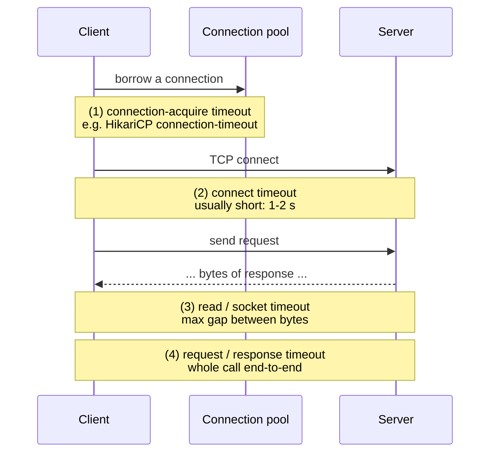

| Timeout | Limits | Typical value |
|---|---|---|
| **Connect timeout** | Time to open the TCP connection | 1-2 s (if it takes longer, the host is probably down) |
| **Read (socket) timeout** | Max wait between bytes of the response | A bit above the dependency's p99 latency |
| **Request / response timeout** | Total time for the whole call | Fits inside the caller's overall budget |
| **Connection-acquire (pool) timeout** | Waiting for a free connection from the pool | Short (≤ 1-2 s); waiting longer hides pool exhaustion |
| **Query / transaction timeout** | A DB statement or transaction | Seconds, not minutes, for OLTP |
| **Idle / keep-alive timeout** | How long an unused connection stays open | Lower than the server/LB's idle timeout |

### Choosing a value

- Measure the dependency's **p99 / p99.9 latency**, then set the timeout a bit above it (e.g. p99 = 400 ms → timeout 800 ms-1 s).
- A timeout **below** p99 causes false failures; one **way above** it lets slow calls hold threads.

### Deadline (timeout budget) propagation

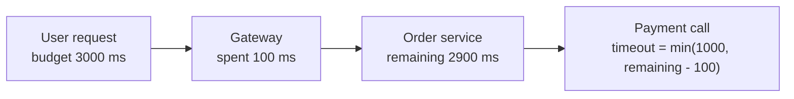

Each hop should use **at most the remaining time** of the original request. If the user's request has already used 2.9 of its 3 seconds, there's no point calling Payment with a 1-second timeout. gRPC propagates deadlines automatically; for HTTP you can pass a header (e.g. `X-Request-Deadline`).

> **Rule:** the caller's timeout must be **longer** than the callee's timeout (+ retries), or the caller gives up while the callee is still working, wasting the work.

#### 📘 Terms Explained

| Term | Simple meaning |
|---|---|
| **TCP connection** | The network "pipe" opened between client and server before data is sent. |
| **p99 latency** | 99% of requests are faster than this value. A better guide than the average. |
| **OLTP** | Online Transaction Processing: short, frequent DB operations (orders, payments). |
| **Deadline** | An absolute point in time by which the whole request must finish. |
| **gRPC** | A high-performance RPC framework (HTTP/2 + Protobuf) with built-in deadlines. |
| **Keep-alive** | Reusing one TCP connection for many requests. |

---

## 3.4 Complete Java Example - Timeouts with Future and CompletableFuture

```java
import java.util.concurrent.CompletableFuture;
import java.util.concurrent.ExecutionException;
import java.util.concurrent.ExecutorService;
import java.util.concurrent.Executors;
import java.util.concurrent.Future;
import java.util.concurrent.TimeUnit;
import java.util.concurrent.TimeoutException;

public class TimeoutDemo {
    static String slowRecommendationService() {
        sleep(2_000);                                     // pretend the remote service is hanging
        return "[recommended: earbuds, phone case]";
    }

    static String fastPriceService() {
        sleep(50);
        return "Rs.15,999";
    }

    public static void main(String[] args) throws Exception {
        ExecutorService pool = Executors.newFixedThreadPool(4);

        // 1) Future.get with a timeout - and cancel the work we no longer want
        Future<String> f = pool.submit(TimeoutDemo::slowRecommendationService);
        try {
            System.out.println("1) " + f.get(300, TimeUnit.MILLISECONDS));
        } catch (TimeoutException e) {
            boolean cancelled = f.cancel(true);           // interrupt the worker thread
            System.out.println("1) Future.get timed out after 300 ms, cancelled=" + cancelled);
        }

        // 2) CompletableFuture.orTimeout: fail with TimeoutException
        try {
            CompletableFuture.supplyAsync(TimeoutDemo::slowRecommendationService, pool)
                    .orTimeout(300, TimeUnit.MILLISECONDS)
                    .join();
        } catch (Exception e) {
            System.out.println("2) orTimeout -> " + e.getCause().getClass().getSimpleName());
        }

        // 3) CompletableFuture.completeOnTimeout: use a default value instead of failing
        String recs = CompletableFuture.supplyAsync(TimeoutDemo::slowRecommendationService, pool)
                .completeOnTimeout("[popular items]", 300, TimeUnit.MILLISECONDS)
                .join();
        System.out.println("3) completeOnTimeout -> " + recs);

        // 4) A fast call finishes well inside its timeout
        String price = CompletableFuture.supplyAsync(TimeoutDemo::fastPriceService, pool)
                .orTimeout(300, TimeUnit.MILLISECONDS)
                .join();
        System.out.println("4) fast call -> " + price);

        pool.shutdownNow();
    }

    static void sleep(long ms) {
        try { Thread.sleep(ms); } catch (InterruptedException e) { Thread.currentThread().interrupt(); }
    }
}
```

**Output:**
```
1) Future.get timed out after 300 ms, cancelled=true
2) orTimeout -> TimeoutException
3) completeOnTimeout -> [popular items]
4) fast call -> Rs.15,999
```

| Technique | On timeout | Java version |
|---|---|---|
| `future.get(timeout, unit)` | Throws `TimeoutException`; **you** must `cancel(true)` the task | 5+ |
| `completableFuture.orTimeout(...)` | Completes exceptionally with `TimeoutException` | 9+ |
| `completableFuture.completeOnTimeout(value, ...)` | Completes normally with a **default value** (a built-in fallback) | 9+ |

> **Important:** a timeout stops the **caller** from waiting. It does not automatically stop the **work**. `orTimeout` does **not** interrupt the running task. For blocking work, cancel/interrupt it, and make sure the remote side has its own timeout too.

#### 📘 Terms Explained

| Term | Simple meaning |
|---|---|
| **`Future`** | A handle to a result that will be available later. |
| **`CompletableFuture`** | A `Future` you can chain (`thenApply`, `orTimeout`) and complete manually. |
| **`cancel(true)`** | Cancels the task and interrupts its thread if it's running. |
| **Interrupt** | A signal to a thread asking it to stop what it's doing (`Thread.interrupt()`). |

---

## 3.5 Timeouts in Spring Boot (Interview Imp - Java)

### 3.5.1 HTTP clients

```java
@Configuration
class HttpClientConfig {

    // RestClient / RestTemplate backed by the JDK HttpClient
    @Bean
    RestClient paymentRestClient(RestClient.Builder builder) {
        HttpClient jdk = HttpClient.newBuilder()
                .connectTimeout(Duration.ofSeconds(2))                // (2) connect timeout
                .build();
        JdkClientHttpRequestFactory factory = new JdkClientHttpRequestFactory(jdk);
        factory.setReadTimeout(Duration.ofSeconds(3));              // (3)/(4) response timeout
        return builder.baseUrl("http://payment-service").requestFactory(factory).build();
    }

    // WebClient (reactive) backed by Reactor Netty
    @Bean
    WebClient inventoryWebClient(WebClient.Builder builder) {
        reactor.netty.http.client.HttpClient netty = reactor.netty.http.client.HttpClient.create()
                .option(ChannelOption.CONNECT_TIMEOUT_MILLIS, 2_000)
                .responseTimeout(Duration.ofSeconds(3));
        return builder.baseUrl("http://inventory-service")
                .clientConnector(new ReactorClientHttpConnector(netty))
                .build();
    }
}

// Per-call timeout with WebClient
Mono<Stock> stock = inventoryWebClient.get().uri("/stock/{sku}", sku)
        .retrieve().bodyToMono(Stock.class)
        .timeout(Duration.ofMillis(800));                           // whole-call timeout
```

```yaml
# OpenFeign
spring:
  cloud:
    openfeign:
      client:
        config:
          default:
            connect-timeout: 2000
            read-timeout: 3000
```

### 3.5.2 Database

```yaml
spring:
  datasource:
    hikari:
      connection-timeout: 2000      # (1) wait max 2s for a pooled connection (default 30000 ms!)
      maximum-pool-size: 20
  jpa:
    properties:
      jakarta.persistence.query.timeout: 5000    # per-query timeout in ms
```

```java
@Transactional(timeout = 5)          // seconds; the transaction is rolled back if it runs longer
public void settleDailyPayments() { ... }
```

### 3.5.3 Resilience4j `@TimeLimiter`

```java
@TimeLimiter(name = "recommendations", fallbackMethod = "popular")
@CircuitBreaker(name = "recommendations")
public CompletableFuture<List<Product>> recommend(String userId) {     // must return CompletableFuture (or Mono/Flux)
    return CompletableFuture.supplyAsync(() -> mlClient.recommend(userId), executor);
}

private CompletableFuture<List<Product>> popular(String userId, Throwable t) {
    return CompletableFuture.completedFuture(catalog.bestsellers());
}
```

```yaml
resilience4j:
  timelimiter:
    instances:
      recommendations:
        timeout-duration: 800ms
        cancel-running-future: true
```

### 3.5.4 Server-side timeouts (protect yourself from slow clients)

| Setting | Purpose |
|---|---|
| `server.tomcat.connection-timeout` | How long Tomcat waits for the request line after a connection opens |
| `spring.mvc.async.request-timeout` | Timeout for async (`Callable`, `DeferredResult`) requests |
| Load balancer idle timeout | Must be **longer** than the app's keep-alive, or you get random 502s |

> For how Tomcat threads and connectors work, see [Client_Server_Web_Architecture_Guide.md](../../web-architecture/Client_Server_Web_Architecture_Guide.md).

#### 📘 Terms Explained

| Term | Simple meaning |
|---|---|
| **`JdkClientHttpRequestFactory`** | Spring adapter that makes `RestClient`/`RestTemplate` use the JDK's `java.net.http.HttpClient`. |
| **Reactor Netty** | The non-blocking HTTP engine used by Spring WebFlux's `WebClient`. |
| **`Mono`** | Reactor type for "0 or 1 value, later". |
| **HikariCP** | Spring Boot's default JDBC connection pool. |
| **`@TimeLimiter`** | Resilience4j annotation that times out an async call. |

---

## 3.6 Pros, Cons and Pitfalls

| Pros | Cons |
|---|---|
| Protects threads and connections | Too short: false failures; too long: little protection |
| Turns "slow" into a countable failure | The remote work may continue after you gave up (wasted, or a duplicate on retry) |
| Essential input for circuit breakers and retries | Needs per-dependency tuning |

| Pitfall | Fix |
|---|---|
| Relying on library defaults (infinite / 30 s) | Set every timeout explicitly. |
| Only setting the connect timeout | Also set read/response and pool-acquire timeouts. |
| Caller timeout shorter than callee + retries | Budget timeouts from the outside in. |
| Timeout without cancelling the work | `cancel(true)` / `cancel-running-future: true`; remote side needs its own timeout. |
| Retrying after a timeout on a non-idempotent call | Idempotency keys, or check the status before retrying. |
| HikariCP `connection-timeout` left at 30 s | Lower it, so pool exhaustion shows up fast. |

---

## 3.7 Timeout - Interview Questions

**Q1. Why are timeouts the most important resilience pattern?**
Without them, a slow dependency holds threads and connections indefinitely, exhausting pools and causing cascading failures. Timeouts also turn "slow" into a failure that retries and breakers can act on.

**Q2. Connect timeout vs read timeout?**
Connect = time to establish the TCP connection. Read (socket) = max time waiting for data once connected. Set both, plus an overall response timeout.

**Q3. How do you choose a timeout value?**
From measured latency: a bit above the dependency's p99, and within the overall request budget (deadline) minus time already spent.

**Q4. What happens to the work on the server when the client times out?**
It usually continues. That's why the server needs its own timeouts, and why retries after a timeout must be idempotent.

**Q5. How do you set timeouts in Spring Boot?**
HTTP client factories (`JdkClientHttpRequestFactory`, Reactor Netty `responseTimeout`, Feign `connect-timeout`/`read-timeout`), HikariCP `connection-timeout`, JPA query timeout, `@Transactional(timeout)`, Resilience4j `@TimeLimiter` for async calls.

**Q6. What is deadline propagation?**
Passing the remaining time budget of the original request to downstream calls, so no service works on a request the user has already given up on. gRPC does this natively.

---

## 3.8 Timeout - Cheat Sheet

```
TIMEOUT   EVERY remote call needs one. Slow is worse than dead.
          Types: connect (1-2s), read/socket, whole request, pool-acquire, query/transaction, idle.
          Value: a bit above p99; within the overall deadline; caller > callee (+ retries).
          Java: future.get(t, unit) + cancel(true); CompletableFuture.orTimeout / completeOnTimeout.
          Spring: JdkClientHttpRequestFactory/connectTimeout+readTimeout, WebClient responseTimeout/.timeout(),
                  Feign connect/read-timeout, Hikari connection-timeout (default 30s!), @Transactional(timeout),
                  Resilience4j @TimeLimiter (CompletableFuture). Defaults may be INFINITE: set them.
          A timeout stops the waiting, not necessarily the work.
```

---

# 4. Bulkhead Pattern (Interview Imp - Java)

## 4.1 What is the Bulkhead Pattern?

A **bulkhead** splits resources (threads, connections, memory, instances) into **isolated compartments**, so a failure or overload in one part **can't use up the resources** of the others.

**Analogy:** A ship's hull is divided into watertight compartments (bulkheads). If one compartment is flooded, the water stays there and the ship still floats. Without them, one hole sinks the whole ship (the *Titanic*'s bulkheads weren't tall enough).

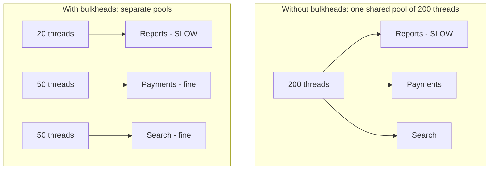

Without bulkheads, a slow Reports service gradually takes all 200 threads, and Payments and Search die too. With bulkheads, Reports can only take **its** 20 threads.

#### 📘 Terms Explained

| Term | Simple meaning |
|---|---|
| **Bulkhead** | A wall dividing a ship into watertight sections. In software: an isolated resource pool. |
| **Isolation** | Keeping parts separate so a problem in one doesn't spread. |
| **Resource exhaustion** | Running out of threads, connections, memory or file handles. |
| **Blast radius** | How much of the system is affected when something fails. Bulkheads make it smaller. |

---

## 4.2 Why Do We Need It?

- **Shared thread pools:** Tomcat's 200 request threads are shared by all endpoints. One slow downstream dependency can occupy all of them.
- **Shared connection pools:** a batch job running long queries takes all DB connections, and the website can't get one.
- **Noisy neighbours:** one tenant or customer sends huge traffic and slows everyone else.
- Circuit breakers react **after** failures are counted. A bulkhead limits damage **immediately**, even before the breaker trips.

---

## 4.3 Types of Bulkheads

| Type | Isolates | How | Example |
|---|---|---|---|
| **Semaphore bulkhead** | Number of concurrent calls | A counter of permits; callers run on their **own** thread | Max 10 concurrent calls to Payment |
| **Thread-pool bulkhead** | Threads | Each dependency gets its **own** thread pool + queue | Reports pool: 10 threads, queue 20 |
| **Connection-pool bulkhead** | DB/HTTP connections | Separate pools per use case | Web pool vs batch pool |
| **Instance / deployment bulkhead** | Servers / pods | Separate deployments for critical vs non-critical traffic | Checkout pods separate from browse pods |
| **Tenant bulkhead (cell-based)** | Customers | Groups of customers on separate cells/clusters | Big customer on its own cell (see [01_Scalability_Pattern.md](01_Scalability_Pattern.md#28-advanced---the-scale-cube-and-cell-based-architecture)) |
| **Queue bulkhead** | Message processing | Separate queues/consumers per priority | Priority orders queue vs bulk-email queue |

| | Semaphore | Thread pool |
|---|---|---|
| Overhead | Very low | Thread switching, extra memory |
| Runs the call on | Caller's thread | A separate pool thread |
| Can apply a timeout to blocking code? | No (caller thread is blocked) | Yes (caller waits on a `Future`) |
| Return type in Resilience4j | Any | `CompletableFuture` |
| Good for | Non-blocking / reactive code, fast calls | Blocking calls to slow dependencies |

---

## 4.4 Complete Java Example - Semaphore and Thread-Pool Bulkheads

```java
import java.util.ArrayList;
import java.util.List;
import java.util.concurrent.ArrayBlockingQueue;
import java.util.concurrent.CountDownLatch;
import java.util.concurrent.ExecutorService;
import java.util.concurrent.Executors;
import java.util.concurrent.Future;
import java.util.concurrent.RejectedExecutionException;
import java.util.concurrent.Semaphore;
import java.util.concurrent.ThreadPoolExecutor;
import java.util.concurrent.TimeUnit;
import java.util.concurrent.atomic.AtomicInteger;

public class BulkheadDemo {

    // ----- 1) Semaphore bulkhead: at most N calls at the same time -----
    static class SemaphoreBulkhead {
        private final Semaphore permits;
        SemaphoreBulkhead(int maxConcurrentCalls) { permits = new Semaphore(maxConcurrentCalls); }

        <T> T call(java.util.function.Supplier<T> action) {
            if (!permits.tryAcquire()) throw new RuntimeException("bulkhead full");   // don't wait
            try { return action.get(); }
            finally { permits.release(); }
        }
    }

    // ----- 2) Thread-pool bulkhead: each dependency gets its OWN small pool -----
    static ThreadPoolExecutor pool(String name, int threads, int queue) {
        return new ThreadPoolExecutor(threads, threads, 0, TimeUnit.SECONDS,
                new ArrayBlockingQueue<>(queue), r -> new Thread(r, name),
                new ThreadPoolExecutor.AbortPolicy());               // reject when full
    }

    public static void main(String[] args) throws Exception {
        System.out.println("1) Semaphore bulkhead (max 2 concurrent), 5 calls arrive together");
        SemaphoreBulkhead bulkhead = new SemaphoreBulkhead(2);
        CountDownLatch release = new CountDownLatch(1);
        AtomicInteger accepted = new AtomicInteger(), rejected = new AtomicInteger();
        ExecutorService callers = Executors.newFixedThreadPool(5);
        CountDownLatch done = new CountDownLatch(5);
        CountDownLatch firstTwoInside = new CountDownLatch(2);
        for (int i = 0; i < 5; i++) {
            callers.submit(() -> {
                try {
                    bulkhead.call(() -> {
                        accepted.incrementAndGet();
                        firstTwoInside.countDown();
                        await(release);                               // hold the permit (slow call)
                        return null;
                    });
                } catch (RuntimeException e) {
                    rejected.incrementAndGet();
                }
                done.countDown();
            });
            if (i == 1) firstTwoInside.await();                       // make sure 2 calls are inside first
        }
        while (rejected.get() < 3) Thread.sleep(10);
        release.countDown();
        done.await();
        System.out.println("   accepted=" + accepted + ", rejected immediately=" + rejected);
        callers.shutdown();

        System.out.println("2) Thread-pool bulkheads: reports-service hangs, payments keep working");
        ThreadPoolExecutor reportsPool = pool("reports", 2, 2);       // 2 threads + 2 queued
        ThreadPoolExecutor paymentsPool = pool("payments", 2, 2);
        CountDownLatch reportsHang = new CountDownLatch(1);

        int reportsRejected = 0;
        for (int i = 0; i < 10; i++) {
            try { reportsPool.submit(() -> await(reportsHang)); }
            catch (RejectedExecutionException e) { reportsRejected++; }
        }
        List<Future<String>> payments = new ArrayList<>();
        for (int i = 1; i <= 3; i++) {
            int id = i;
            payments.add(paymentsPool.submit(() -> "payment " + id + " OK on " + Thread.currentThread().getName()));
        }
        System.out.println("   reports: 4 accepted (2 running + 2 queued), " + reportsRejected + " rejected fast");
        for (Future<String> p : payments) System.out.println("   " + p.get());

        reportsHang.countDown();
        reportsPool.shutdown();
        paymentsPool.shutdown();
    }

    static void await(CountDownLatch latch) {
        try { latch.await(); } catch (InterruptedException e) { Thread.currentThread().interrupt(); }
    }
}
```

**Output:**
```
1) Semaphore bulkhead (max 2 concurrent), 5 calls arrive together
   accepted=2, rejected immediately=3
2) Thread-pool bulkheads: reports-service hangs, payments keep working
   reports: 4 accepted (2 running + 2 queued), 6 rejected fast
   payment 1 OK on payments
   payment 2 OK on payments
   payment 3 OK on payments
```

What the output shows:
1. **Semaphore:** only 2 calls got in. The other 3 were **rejected immediately** (they didn't wait and pile up).
2. **Thread pool:** reports-service hung. Its pool filled up (2 running + 2 queued) and the remaining 6 submissions were rejected fast. **Payments still succeeded** on their own pool. The slow dependency couldn't steal their threads.

#### 📘 Terms Explained

| Term | Simple meaning |
|---|---|
| **`Semaphore`** | A JDK concurrency tool holding N permits; `tryAcquire()` takes one if available, without waiting. |
| **`ThreadPoolExecutor`** | JDK thread pool with configurable core/max threads, a queue, and a rejection policy. |
| **`AbortPolicy`** | Rejection policy that throws `RejectedExecutionException` when the pool and queue are full. |
| **`CountDownLatch`** | A one-time gate; threads wait until it's counted down to zero. Used here to control timing. |
| **Bounded queue** | A queue with a maximum size (`ArrayBlockingQueue(2)`), so work can't pile up forever. |

---

## 4.5 Bulkheads in Spring Boot

### 4.5.1 Resilience4j `@Bulkhead`

```java
@Service
public class ReportClient {

    // Semaphore bulkhead: max 10 concurrent calls; wait up to 100 ms for a permit
    @Bulkhead(name = "reports", fallbackMethod = "busy")
    public Report fetch(long id) { return rest.get().uri("/reports/{id}", id).retrieve().body(Report.class); }

    private Report busy(long id, BulkheadFullException e) {
        return Report.notReady(id, "Report service busy, try again in a minute");
    }

    // Thread-pool bulkhead: runs on a dedicated pool (method must return CompletableFuture)
    @Bulkhead(name = "pdfExport", type = Bulkhead.Type.THREADPOOL)
    public CompletableFuture<byte[]> exportPdf(long id) {
        return CompletableFuture.completedFuture(pdfService.render(id));
    }
}
```

```yaml
resilience4j:
  bulkhead:
    instances:
      reports:
        max-concurrent-calls: 10
        max-wait-duration: 100ms        # 0 = reject immediately
  thread-pool-bulkhead:
    instances:
      pdfExport:
        core-thread-pool-size: 4
        max-thread-pool-size: 4
        queue-capacity: 20
        keep-alive-duration: 20ms
```

### 4.5.2 Separate executors for `@Async` work

```java
@Configuration
@EnableAsync
class ExecutorsConfig {
    @Bean("emailExecutor")
    ThreadPoolTaskExecutor emailExecutor() {
        ThreadPoolTaskExecutor ex = new ThreadPoolTaskExecutor();
        ex.setCorePoolSize(4);
        ex.setMaxPoolSize(4);
        ex.setQueueCapacity(500);                                             // bounded!
        ex.setThreadNamePrefix("email-");
        ex.setRejectedExecutionHandler(new ThreadPoolExecutor.CallerRunsPolicy());   // back-pressure
        return ex;
    }
}

@Async("emailExecutor")          // email work can never use the threads meant for other async jobs
public void sendInvoice(long orderId) { ... }
```

### 4.5.3 Separate DB connection pools

```java
@Configuration
class DataSources {
    @Bean @Primary @ConfigurationProperties("app.datasource.web")
    HikariDataSource webDataSource() { return new HikariDataSource(); }      // e.g. 30 connections

    @Bean @ConfigurationProperties("app.datasource.batch")
    HikariDataSource batchDataSource() { return new HikariDataSource(); }    // e.g. 5 connections
}
```

The nightly batch job can't take the connections the website needs.

### 4.5.4 Kubernetes resource limits (infrastructure bulkheads)

```yaml
resources:
  requests: { cpu: "500m", memory: "512Mi" }
  limits:   { cpu: "1",    memory: "1Gi" }      # one pod can't starve others on the node
```

See [07_Scheduling_and_Resources.md](../../kubernetes/07_Scheduling_and_Resources.md#74-quotas-and-limits-per-namespace) for requests, limits and namespaces with quotas.

#### 📘 Terms Explained

| Term | Simple meaning |
|---|---|
| **`BulkheadFullException`** | Thrown by Resilience4j when no permit/thread is available. |
| **`ThreadPoolTaskExecutor`** | Spring's configurable wrapper around `ThreadPoolExecutor`. |
| **`CallerRunsPolicy`** | When the pool is full, the submitting thread runs the task itself, which naturally slows producers down (back-pressure). |
| **`@ConfigurationProperties`** | Binds config properties (e.g. `app.datasource.batch.*`) to a bean. |
| **Requests / limits (K8s)** | The CPU/memory a pod is guaranteed / allowed to use at most. |

---

## 4.6 Pros, Cons and Pitfalls

| Pros | Cons |
|---|---|
| Contains failures to one compartment | Less efficient: idle capacity in one pool can't help another |
| Protects critical paths (checkout) from non-critical ones (reports) | More pools to size and monitor |
| Immediate protection, before breakers trip | Wrong sizes cause rejections under normal load |

| Pitfall | Fix |
|---|---|
| Unbounded queues (`LinkedBlockingQueue()` default) hide overload until OOM | Always bound queues. |
| Pools sized by guesswork | Size from traffic × latency (Little's Law: concurrency = rate × latency). |
| Bulkhead without fallback | Return a friendly "busy" response or 503 with `Retry-After`. |
| One giant shared executor for all `@Async` work | Separate executors per kind of work. |
| Thread-pool bulkhead used for reactive code | Use semaphore bulkheads for non-blocking code. |

> **Little's Law** for sizing: if Payment gets 50 requests/s and each call takes 200 ms, you need about 50 × 0.2 = **10** concurrent slots. Add headroom (e.g. ×1.5-2).

---

## 4.7 Bulkhead - Interview Questions

**Q1. What is the bulkhead pattern?**
Isolating resources (threads, connections, instances) into separate pools per dependency or workload, so a failure or overload in one can't exhaust resources used by others.

**Q2. Semaphore vs thread-pool bulkhead?**
Semaphore limits concurrent calls on the caller's thread (cheap; good for non-blocking code). Thread-pool runs calls on a dedicated pool with a bounded queue (more overhead; allows timeouts on blocking calls and full isolation).

**Q3. How does a bulkhead differ from a circuit breaker?**
A bulkhead limits **how much** of your resources a dependency can use, from the very first request. A breaker stops calls **after** it detects a high failure rate. Use both.

**Q4. How would you size a bulkhead?**
Little's Law: concurrency ≈ request rate × latency, plus headroom; then verify with load tests and watch rejection metrics.

**Q5. Give infrastructure-level bulkhead examples.**
Separate DB connection pools, separate deployments for critical endpoints, Kubernetes resource limits and namespaces, cell-based architecture, separate queues per priority.

---

## 4.8 Bulkhead - Cheat Sheet

```
BULKHEAD  Isolate resources per dependency/workload so one failure can't sink the ship.
          Semaphore (max concurrent calls, caller thread, cheap) vs Thread-pool (own pool + BOUNDED queue).
          Resilience4j: @Bulkhead(name, type=SEMAPHORE|THREADPOOL); BulkheadFullException; THREADPOOL -> CompletableFuture.
          Spring: separate @Async executors, separate Hikari pools (web vs batch), K8s limits, cell-based.
          Size with Little's Law (rate x latency) + headroom. Never unbounded queues.
          Bulkhead limits damage immediately; breaker reacts after failures.
```

---

# 5. Fallback Pattern (Interview Imp - Java)

## 5.1 What is the Fallback Pattern?

A **fallback** is a **plan B**: an alternative response or action used when the main operation fails, times out, is rejected by a circuit breaker/bulkhead, or is rate-limited.

**Analogy:** Your usual route to work is blocked, so you take the longer route. If that's blocked too, you work from home. You still get the job done, just differently.

#### 📘 Terms Explained

| Term | Simple meaning |
|---|---|
| **Fallback** | The alternative used when the primary path fails. |
| **Primary path** | The normal, preferred way of doing something. |
| **Stale data** | Data that was correct earlier but may be out of date now. |

---

## 5.2 Why Do We Need It?

Timeouts, breakers and bulkheads **detect and stop** problems, but on their own they still return an **error**. A fallback turns that error into **something useful**, so the user often doesn't notice.

**Types of fallback:**

| Fallback type | Example | Good for |
|---|---|---|
| **Cached / stale value** | Last known product price, last good recommendations | Read-heavy data that changes slowly |
| **Static default** | Bestsellers instead of personalised recommendations | Optional features |
| **Alternative service** | Secondary payment gateway, backup SMS provider | Critical paths with multiple vendors |
| **Degraded response** | Page without reviews; "stock unknown" | Non-essential parts of a response |
| **Queue for later** | Accept the order, mark payment "pending", process when the service is back | Writes that can be asynchronous |
| **Fail silently** | Skip analytics tracking | Truly non-critical side effects |
| **Clear error** | "Service busy, try again in 1 minute" + `Retry-After` | When no sensible alternative exists |

---

## 5.3 How It Works: a Fallback Chain

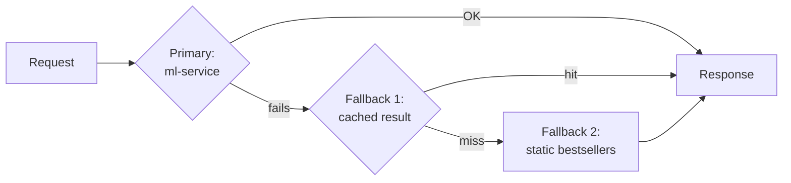

The cheapest, most reliable option should be the **last** one (a static default that cannot fail).

---

## 5.4 Complete Java Example - Fallback Chain for Recommendations

```java
import java.util.List;
import java.util.Map;
import java.util.concurrent.ConcurrentHashMap;
import java.util.function.Supplier;

record Recommendations(List<String> items, String source) {}

class RecommendationService {
    private final Map<String, Recommendations> lastGood = new ConcurrentHashMap<>();   // stale-but-useful cache
    boolean mlServiceUp = true;

    Recommendations forUser(String userId) {
        return withFallbacks(
                () -> callMlService(userId),                          // 1st choice: personalised
                () -> fromCache(userId),                              // 2nd: last good answer (may be stale)
                () -> new Recommendations(List.of("Bestseller A", "Bestseller B"), "static bestsellers"));  // last resort
    }

    private Recommendations callMlService(String userId) {
        if (!mlServiceUp) throw new RuntimeException("ml-service timeout");
        Recommendations r = new Recommendations(List.of("Running shoes", "Fitness band"), "ml-service (live)");
        lastGood.put(userId, new Recommendations(r.items(), "cache (stale)"));
        return r;
    }

    private Recommendations fromCache(String userId) {
        Recommendations r = lastGood.get(userId);
        if (r == null) throw new RuntimeException("cache miss");
        return r;
    }

    @SafeVarargs
    private static <T> T withFallbacks(Supplier<T>... options) {
        RuntimeException last = null;
        for (Supplier<T> option : options) {
            try {
                return option.get();
            } catch (RuntimeException e) {
                System.out.println("    fallback step failed: " + e.getMessage());
                last = e;
            }
        }
        throw last;
    }
}

public class FallbackDemo {
    public static void main(String[] args) {
        RecommendationService service = new RecommendationService();

        System.out.println("Asha, ml-service UP:");
        System.out.println("  " + service.forUser("asha"));

        service.mlServiceUp = false;
        System.out.println("Asha, ml-service DOWN (we have a cached answer):");
        System.out.println("  " + service.forUser("asha"));

        System.out.println("Ravi, ml-service DOWN (new user, nothing cached):");
        System.out.println("  " + service.forUser("ravi"));
    }
}
```

**Output:**
```
Asha, ml-service UP:
  Recommendations[items=[Running shoes, Fitness band], source=ml-service (live)]
Asha, ml-service DOWN (we have a cached answer):
    fallback step failed: ml-service timeout
  Recommendations[items=[Running shoes, Fitness band], source=cache (stale)]
Ravi, ml-service DOWN (new user, nothing cached):
    fallback step failed: ml-service timeout
    fallback step failed: cache miss
  Recommendations[items=[Bestseller A, Bestseller B], source=static bestsellers]
```

What the output shows:
- ml-service UP → live, personalised result (and it's cached for later).
- ml-service DOWN, user seen before → **stale cached** result, clearly marked `cache (stale)`.
- ml-service DOWN, new user → the static last resort, which can't fail.

> **Always label degraded data** (`source`, a response header, or a flag in the DTO), so the UI can show "prices may be out of date", and so you can measure how often fallbacks are used.

---

## 5.5 Fallback in Spring Boot

```java
@Service
public class PriceClient {
    private final Cache<String, Price> lastKnown = Caffeine.newBuilder()
            .maximumSize(100_000).expireAfterWrite(Duration.ofHours(6)).build();

    @CircuitBreaker(name = "pricing", fallbackMethod = "cachedPrice")
    @TimeLimiter(name = "pricing")
    public CompletableFuture<Price> price(String sku) {
        return CompletableFuture.supplyAsync(() -> {
            Price p = pricingApi.get(sku);
            lastKnown.put(sku, p);                               // refresh the fallback source
            return p;
        });
    }

    private CompletableFuture<Price> cachedPrice(String sku, Throwable t) {
        Price cached = lastKnown.getIfPresent(sku);
        if (cached != null) return CompletableFuture.completedFuture(cached.markStale());
        throw new PriceUnavailableException(sku, t);              // no safe default for money: fail clearly
    }
}
```

**Fallback method rules (Resilience4j):**
1. Same class, same return type.
2. Same parameters as the original **plus** an exception as the last parameter.
3. Several fallbacks with different exception types are allowed; the most specific one wins.

**Other places with fallbacks:**

| Where | Fallback |
|---|---|
| Spring Cloud OpenFeign | `@FeignClient(name = "inventory", fallback = InventoryFallback.class)` or `fallbackFactory` (needs circuit breaker enabled: `spring.cloud.openfeign.circuitbreaker.enabled=true`) |
| Spring Cloud Gateway | `CircuitBreaker` filter with `fallbackUri: forward:/fallback/orders` |
| `CompletableFuture` | `.exceptionally(ex -> default)`, `.completeOnTimeout(default, ...)` |
| Reactor | `.onErrorReturn(default)`, `.onErrorResume(ex -> otherMono)` |
| Spring Cache | Serving from cache when the source is down (`@Cacheable` + `sync`) |

#### 📘 Terms Explained

| Term | Simple meaning |
|---|---|
| **Caffeine** | A fast in-memory cache library for Java. |
| **`expireAfterWrite`** | Cache entries are removed after this time since they were written. |
| **`fallbackUri`** | Spring Cloud Gateway: where to forward the request when the circuit breaker trips. |
| **`exceptionally`** | `CompletableFuture` method that supplies a value if the computation failed. |
| **`onErrorReturn`** | Reactor operator that emits a default value on error. |

---

## 5.6 Pros, Cons and Pitfalls

| Pros | Cons |
|---|---|
| Users get a useful answer instead of an error | Stale or default data may be wrong or misleading |
| Keeps the business running during outages | Fallback paths are rarely exercised, so they're often broken |
| Pairs naturally with breakers, timeouts and bulkheads | Can hide problems if fallbacks aren't monitored |

| Pitfall | Fix |
|---|---|
| Fallback calls another fragile remote service | Fallbacks should be **local and cheap** (cache, default), or protected too. |
| Fallback for money/stock that silently uses wrong data | For critical data, fail clearly or queue for later, rather than guess. |
| Fallback never tested | Test it (chaos experiments, unit tests forcing failures). |
| Not labelling degraded responses | Add a flag/header; count fallback usage in metrics. |
| Catching every exception, including bugs (NPE) | Fallback for expected failure types; let programming errors surface. |
| Fallback method signature mismatch | Same params + exception; same return type. |

---

## 5.7 Fallback - Interview Questions

**Q1. What is a fallback?**
An alternative response or action used when the primary operation fails or is blocked by a breaker, bulkhead, timeout or rate limiter.

**Q2. Give examples of good fallbacks.**
Cached/stale data, static defaults, an alternative provider, a partial response without optional sections, queuing the work for later, or a clear "try later" error.

**Q3. When should you NOT use a default fallback?**
For critical, correctness-sensitive data (balances, prices at checkout, stock reservations). Wrong data is worse than an error; fail clearly or process asynchronously.

**Q4. How do you write a Resilience4j fallback method?**
In the same class, same return type, same parameters plus a `Throwable`/specific exception as the last parameter, referenced via `fallbackMethod`.

**Q5. Why is a fallback that calls another remote service risky?**
It can fail the same way (or overload the backup during an outage). Fallbacks should be simpler and more reliable than the primary path.

---

## 5.8 Fallback - Cheat Sheet

```
FALLBACK  Plan B when the primary path fails/times out/is rejected.
          Options: cached/stale, static default, alternative provider, partial response,
                   queue for later ("payment pending"), skip silently, clear error + Retry-After.
          Chain them; LAST option must be cheap and unable to fail. Label degraded data; monitor usage.
          Resilience4j: fallbackMethod = same params + exception, same return type.
          Also: Feign fallback/fallbackFactory, Gateway fallbackUri, CompletableFuture.exceptionally,
                Reactor onErrorReturn/onErrorResume.
          Never guess critical data (money, stock): fail clearly or go async.
```

---

# 6. Rate Limiting Pattern (Interview Imp - Java)

## 6.1 What is Rate Limiting?

**Rate limiting** controls **how many requests** a client (user, API key, IP address, tenant) may make in a period of time. Requests above the limit are **rejected**, usually with **HTTP 429 Too Many Requests**.

**Analogy:** An ATM's daily withdrawal limit. You can take out up to ₹50,000 a day. Once you hit it, the machine says no until tomorrow, no matter how many times you try.

> The load-balancer view of rate limiting and the token bucket basics are in [01_Scalability_Pattern.md](01_Scalability_Pattern.md#1116-rate-limiting--ddos-protection-at-the-lb). This section goes deeper: algorithms, distributed limits, and Spring Boot.

#### 📘 Terms Explained

| Term | Simple meaning |
|---|---|
| **Rate limit** | A maximum number of requests allowed per time window (e.g. 100/minute). |
| **HTTP 429** | "Too Many Requests": the standard status code for rate-limited requests. |
| **Quota** | A larger allowance, often per day/month and tied to a pricing plan. |
| **Burst** | A short spike of requests above the average rate. |

---

## 6.2 Why Do We Need It?

| Reason | Example |
|---|---|
| **Protect your service from overload** | A buggy client in a tight loop sends 10,000 requests/s. |
| **Fairness between clients** | One heavy customer mustn't slow everyone else down ("noisy neighbour"). |
| **Security** | Slow down brute-force login attempts, credential stuffing, scraping, and some DoS attacks. |
| **Cost control** | Each call to an LLM, SMS or maps API costs money. |
| **Business plans / monetisation** | Free tier: 1,000 calls/day; Pro tier: 100,000. |
| **Respect a partner's limits** | Your outbound calls to a third-party API that allows 50/s. |

---

## 6.3 Rate Limiting Algorithms (Interview Imp - Java)

| Algorithm | How it works | Bursts? | Memory | Accuracy |
|---|---|---|---|---|
| **Fixed window counter** | Count requests per clock window (12:00:00-12:00:59); reset at the boundary | Up to **2× limit** at window edges | Tiny (1 counter) | Low |
| **Sliding window log** | Keep a timestamp per request; count those in the last N seconds | No | High (1 entry per request) | Exact |
| **Sliding window counter** | Weighted mix of current + previous fixed windows | Smoothed | Tiny (2 counters) | Good approximation |
| **Token bucket** ✅ | Bucket holds up to B tokens, refilled at R/s; each request takes one | **Yes, up to B** | Tiny | Good |
| **Leaky bucket** | Requests enter a queue that drains at a fixed rate | No: output is smooth | Queue size | Good (this is throttling: see section 7) |

### The fixed-window edge problem

```
limit = 5 per minute
12:00:59  → 5 requests (allowed, window 12:00)
12:01:00  → 5 requests (allowed, new window 12:01)
= 10 requests in 2 seconds, double the intended rate
```

### Token bucket

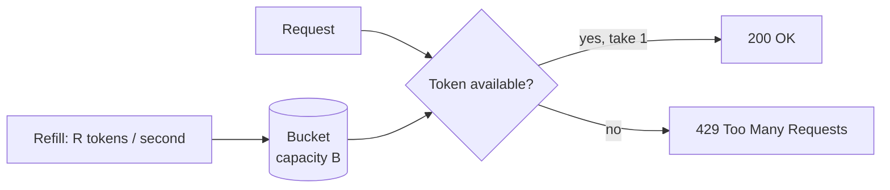

- **Capacity B** controls the allowed **burst**.
- **Refill rate R** controls the long-term **average**.
- Used by AWS API Gateway, Stripe, Spring Cloud Gateway's Redis limiter, Bucket4j and Guava's `RateLimiter`.

#### 📘 Terms Explained

| Term | Simple meaning |
|---|---|
| **Fixed window** | Time cut into fixed blocks (each minute); counts reset at each block. |
| **Sliding window** | The window moves with time: "the last 60 seconds from now". |
| **Token bucket** | Tokens drip into a bucket at a steady rate; each request spends one; an empty bucket means reject. |
| **Leaky bucket** | Requests pour into a bucket with a small hole; they leave at a constant rate; overflow is dropped. |

---

## 6.4 Complete Java Example - Token Bucket and Sliding Window

```java
import java.util.ArrayDeque;
import java.util.Deque;
import java.util.Map;
import java.util.concurrent.ConcurrentHashMap;

// ----- Token bucket: allows short bursts, enforces an average rate -----
class TokenBucket {
    private final long capacity;
    private final double refillPerMilli;
    private double tokens;
    private long lastRefill;

    TokenBucket(long capacity, long refillPerSecond, long now) {
        this.capacity = capacity;
        this.refillPerMilli = refillPerSecond / 1000.0;
        this.tokens = capacity;                       // start full
        this.lastRefill = now;
    }

    synchronized boolean tryConsume(long now) {
        tokens = Math.min(capacity, tokens + (now - lastRefill) * refillPerMilli);   // add tokens for time passed
        lastRefill = now;
        if (tokens >= 1) { tokens -= 1; return true; }
        return false;
    }
}

// ----- Sliding window log: at most N requests in any rolling window -----
class SlidingWindowLog {
    private final int limit;
    private final long windowMillis;
    private final Deque<Long> timestamps = new ArrayDeque<>();

    SlidingWindowLog(int limit, long windowMillis) { this.limit = limit; this.windowMillis = windowMillis; }

    synchronized boolean tryAcquire(long now) {
        while (!timestamps.isEmpty() && timestamps.peekFirst() <= now - windowMillis) timestamps.pollFirst();
        if (timestamps.size() < limit) { timestamps.addLast(now); return true; }
        return false;
    }
}

public class RateLimiterDemo {
    public static void main(String[] args) {
        System.out.println("Token bucket: capacity 5, refill 2 tokens/second, per API key");
        Map<String, TokenBucket> buckets = new ConcurrentHashMap<>();
        long[] times = {0, 0, 0, 0, 0, 0, 0, 500, 1000, 1000, 1000, 3000, 3000, 3000};
        StringBuilder line = new StringBuilder();
        for (long t : times) {
            TokenBucket b = buckets.computeIfAbsent("key-asha", k -> new TokenBucket(5, 2, 0));
            line.append(String.format("t=%4dms %s%n", t, b.tryConsume(t) ? "200 OK" : "429 Too Many Requests"));
        }
        System.out.print(line);

        System.out.println("Sliding window log: max 3 requests per 1000 ms");
        SlidingWindowLog w = new SlidingWindowLog(3, 1000);
        for (long t : new long[]{0, 100, 200, 300, 999, 1000, 1150, 1200, 1250}) {
            System.out.printf("t=%4dms %s%n", t, w.tryAcquire(t) ? "allowed" : "rejected");
        }
    }
}
```

**Output:**
```
Token bucket: capacity 5, refill 2 tokens/second, per API key
t=   0ms 200 OK
t=   0ms 200 OK
t=   0ms 200 OK
t=   0ms 200 OK
t=   0ms 200 OK
t=   0ms 429 Too Many Requests
t=   0ms 429 Too Many Requests
t= 500ms 200 OK
t=1000ms 200 OK
t=1000ms 429 Too Many Requests
t=1000ms 429 Too Many Requests
t=3000ms 200 OK
t=3000ms 200 OK
t=3000ms 200 OK
Sliding window log: max 3 requests per 1000 ms
t=   0ms allowed
t= 100ms allowed
t= 200ms allowed
t= 300ms rejected
t= 999ms rejected
t=1000ms allowed
t=1150ms allowed
t=1200ms allowed
t=1250ms rejected
```

What the output shows:
- **Token bucket:** a burst of 5 at t=0 is allowed (bucket starts full), then 429s. After 500 ms, 2 tokens/s × 0.5 s = 1 new token → 1 request allowed. After a long pause (t=3000), the bucket has refilled (capped at 5), so bursts are allowed again.
- **Sliding window:** at most 3 requests in **any** 1000 ms period. At t=999 the window still contains 0, 100, 200 → rejected. At t=1000 the request at 0 has left the window → allowed.

> The keys are **per client** (`key-asha`). In production: per API key, user ID, IP, or tenant, often several limits at once (per IP *and* per account).

---

## 6.5 Distributed Rate Limiting

With 10 instances behind a load balancer, an in-memory limit of 100/min per instance actually allows **1,000/min**. Options:

| Approach | How | Trade-off |
|---|---|---|
| **Divide the limit** | Each of N instances allows limit/N | Simple; inaccurate if traffic is uneven or N changes |
| **Central store (Redis)** ✅ | Atomic counter/token bucket in Redis (Lua script or `INCR` + `EXPIRE`) | Accurate; adds a Redis round trip (~1 ms); Redis must be highly available |
| **At the edge** | API gateway, Nginx, CDN/WAF, cloud API gateway | One place for all services; less business context |
| **Sticky routing** | Same client always hits the same instance | Fragile when instances scale |

```java
// Fixed-window counter in Redis (simple version): one key per client per minute
public boolean allow(String clientId, int limitPerMinute) {
    String key = "rl:" + clientId + ":" + (System.currentTimeMillis() / 60_000);
    Long count = redis.opsForValue().increment(key);                 // atomic INCR
    if (count != null && count == 1) redis.expire(key, Duration.ofSeconds(61));
    return count != null && count <= limitPerMinute;
}
```

> For accurate token-bucket or sliding-window limits in Redis, use a **Lua script** (atomic) or a library: **Bucket4j** (with Redis/Hazelcast/JCache back-ends) or Spring Cloud Gateway's `RedisRateLimiter`.

#### 📘 Terms Explained

| Term | Simple meaning |
|---|---|
| **Redis** | Fast in-memory key-value store, often used for caches, counters and locks. |
| **`INCR`** | Redis command that atomically adds 1 to a counter. |
| **Lua script (Redis)** | A small script run inside Redis atomically, so several commands act as one. |
| **WAF** | Web Application Firewall: filters malicious HTTP traffic at the edge. |
| **Bucket4j** | Java rate-limiting library based on token buckets. |

---

## 6.6 Rate Limiting in Spring Boot

### 6.6.1 At the gateway: Spring Cloud Gateway + Redis

```yaml
spring:
  cloud:
    gateway:
      routes:
        - id: orders
          uri: lb://order-service
          predicates:
            - Path=/api/orders/**
          filters:
            - name: RequestRateLimiter
              args:
                redis-rate-limiter.replenishRate: 10     # tokens added per second (average rate)
                redis-rate-limiter.burstCapacity: 20     # bucket size (max burst)
                redis-rate-limiter.requestedTokens: 1    # cost of one request
                key-resolver: "#{@apiKeyResolver}"       # who is being limited
```

```java
@Bean
KeyResolver apiKeyResolver() {
    return exchange -> Mono.justOrEmpty(exchange.getRequest().getHeaders().getFirst("X-API-KEY"))
                           .defaultIfEmpty("anonymous");
}
```

### 6.6.2 Inside a service: Resilience4j `@RateLimiter`

Useful for **outbound** calls (respecting a partner's limit) or protecting an expensive method.

```java
@RateLimiter(name = "smsProvider", fallbackMethod = "queueSms")
public void sendSms(String phone, String text) { smsApi.send(phone, text); }

private void queueSms(String phone, String text, RequestNotPermitted e) {
    smsQueue.add(new SmsJob(phone, text));              // send later instead of dropping
}
```

```yaml
resilience4j:
  ratelimiter:
    instances:
      smsProvider:
        limit-for-period: 50          # 50 calls...
        limit-refresh-period: 1s      # ...per second
        timeout-duration: 0           # don't wait for a permit; reject immediately
```

### 6.6.3 Per-user limits with Bucket4j in a filter

```java
@Component
class LoginRateLimitFilter extends OncePerRequestFilter {
    private final Map<String, Bucket> buckets = new ConcurrentHashMap<>();

    private Bucket newBucket() {
        return Bucket.builder()
                .addLimit(limit -> limit.capacity(5).refillGreedy(5, Duration.ofMinutes(1)))   // 5 attempts/minute
                .build();
    }

    @Override
    protected boolean shouldNotFilter(HttpServletRequest req) {
        return !req.getRequestURI().equals("/login");
    }

    @Override
    protected void doFilterInternal(HttpServletRequest req, HttpServletResponse res, FilterChain chain)
            throws ServletException, IOException {
        Bucket bucket = buckets.computeIfAbsent(req.getRemoteAddr(), ip -> newBucket());
        ConsumptionProbe probe = bucket.tryConsumeAndReturnRemaining(1);
        if (probe.isConsumed()) {
            res.setHeader("X-RateLimit-Remaining", String.valueOf(probe.getRemainingTokens()));
            chain.doFilter(req, res);
        } else {
            res.setStatus(429);
            res.setHeader("Retry-After", String.valueOf(probe.getNanosToWaitForRefill() / 1_000_000_000));
            res.getWriter().write("{\"error\":\"too many login attempts\"}");
        }
    }
}
```

> The `ConcurrentHashMap` above grows forever with every new IP. In production, use a bounded cache (Caffeine with expiry) or Bucket4j's Redis/JCache integration.

### 6.6.4 Good rate-limit responses

```http
HTTP/1.1 429 Too Many Requests
Retry-After: 30
X-RateLimit-Limit: 100
X-RateLimit-Remaining: 0
X-RateLimit-Reset: 1735689600
Content-Type: application/json

{"error": "rate_limit_exceeded", "message": "100 requests per minute allowed. Try again in 30 seconds."}
```

#### 📘 Terms Explained

| Term | Simple meaning |
|---|---|
| **`KeyResolver`** | Spring Cloud Gateway bean deciding *what* to rate-limit by (API key, user, IP). |
| **`replenishRate` / `burstCapacity`** | Token bucket refill rate per second / bucket size. |
| **`RequestNotPermitted`** | Exception thrown by Resilience4j when the rate limit is hit. |
| **`refillGreedy`** | Bucket4j refill mode: adds tokens continuously rather than all at once at the end of the period. |
| **`X-RateLimit-*` headers** | Common (non-standard) headers telling clients their limit, remaining calls, and reset time. |

---

## 6.7 Pros, Cons and Pitfalls

| Pros | Cons |
|---|---|
| Protects services from overload and abuse | Legitimate users can be blocked during spikes |
| Fairness between clients | Distributed limits need shared state (Redis) |
| Controls cost and enforces business plans | Tuning limits needs real traffic data |

| Pitfall | Fix |
|---|---|
| Per-instance limits multiplied by instance count | Central store (Redis) or limit at the gateway. |
| Fixed window allowing 2× bursts | Token bucket or sliding window. |
| Limiting by IP only (shared NAT, mobile carriers, many users behind one IP) | Limit by API key / user ID; use IP only for anonymous traffic. |
| No `Retry-After` | Tell clients when to come back. |
| Unbounded in-memory map of buckets | Bounded, expiring cache. |
| Redis down → all requests blocked | Decide fail-open vs fail-closed per endpoint (login: closed; browse: open). |

---

## 6.8 Rate Limiting - Interview Questions

**Q1. Why rate limit?**
To protect services from overload and abuse, ensure fairness between clients, control costs, enforce business plans, and respect partners' limits.

**Q2. Compare rate-limiting algorithms.**
Fixed window: simple, allows 2× bursts at edges. Sliding log: exact, memory-heavy. Sliding counter: good approximation, cheap. Token bucket: allows controlled bursts, cheap, very common. Leaky bucket: smooth constant output rate.

**Q3. How does a token bucket work?**
A bucket of capacity B is refilled at R tokens/second. Each request takes one token; if none are left, it's rejected. B controls bursts, R controls the average rate.

**Q4. How do you rate-limit across many instances?**
Shared state in Redis using atomic operations or Lua scripts (or Bucket4j with Redis), or enforce limits at the API gateway.

**Q5. What should the server return when a client is rate-limited?**
429 Too Many Requests with `Retry-After`, and ideally `X-RateLimit-Limit/Remaining/Reset` headers and a JSON error body.

**Q6. Design a rate limiter for an API with free and paid tiers.**
Identify clients by API key; store their plan; token bucket per key with capacity/refill from the plan; Redis-backed for multiple gateway instances; headers in responses; monitoring of 429 rates; fail-open for reads if Redis is down.

**Q7. Rate limiting vs throttling?**
Rate limiting **rejects** excess requests. Throttling **slows down / queues** them so they're processed at a controlled pace (see next section).

---

## 6.9 Rate Limiting - Cheat Sheet

```
RATE LIMITING  Cap requests per client per time; excess -> 429 + Retry-After.
          Algorithms: fixed window (2x edge burst), sliding log (exact, memory), sliding counter,
                      TOKEN BUCKET (capacity = burst, refill = average; most common), leaky bucket (smooth).
          Key by API key / user / tenant (IP only for anonymous).
          Distributed: Redis INCR/Lua, Bucket4j + Redis, or at the gateway.
          Spring: Cloud Gateway RequestRateLimiter (replenishRate, burstCapacity, KeyResolver),
                  Resilience4j @RateLimiter (RequestNotPermitted) for outbound calls, Bucket4j filters.
          Decide fail-open vs fail-closed when the limiter store is down.
```

---

# 7. Throttling Pattern

## 7.1 What is Throttling?

**Throttling** controls the **pace** at which work is done or resources are used. Instead of rejecting extra work outright, a throttle typically **slows it down, queues it, or reduces quality**, so the system stays within a safe capacity.

**Analogy:** A traffic signal at a highway on-ramp (ramp metering). Cars aren't turned away; they're let onto the highway one at a time every few seconds, so the highway keeps flowing.

| | Rate limiting | Throttling |
|---|---|---|
| **Main action** | Reject above the limit | Slow down / queue / degrade |
| **Usually applied to** | Each **client** (fairness, abuse) | The **system or a resource** (capacity) |
| **Client experience** | 429 error | Slower response, or delayed processing |
| **Typical algorithm** | Token bucket, sliding window | Leaky bucket, bounded queues, concurrency limits |

> In practice people often use the words interchangeably (AWS calls its API rate limits "throttling"). In interviews, explain the difference above.

#### 📘 Terms Explained

| Term | Simple meaning |
|---|---|
| **Throttle** | Originally the valve controlling fuel to an engine. In software: controlling the speed of work. |
| **Ramp metering** | Traffic lights on highway on-ramps that release cars at a steady pace. |
| **Capacity** | The maximum amount of work a system can handle well. |

---

## 7.2 Why Do We Need It?

- **Batch and background jobs** must not overwhelm the database during business hours (e.g. process at most 200 rows/s).
- **Outbound calls** to a partner with a strict limit: send emails at 10/s even if 50,000 are queued.
- **Spiky producers, steady consumers**: absorb bursts in a queue, process at a sustainable rate.
- **Overload protection**: when CPU or latency is high, slow intake or reduce work (fewer search results, lower-resolution images).

---

## 7.3 How It Works: Techniques

| Technique | How | Example |
|---|---|---|
| **Leaky bucket / fixed pace** | Process one item every X ms | Email sender at 10/s |
| **Bounded queue + fixed workers** | Workers pull from a queue at their own speed; full queue → reject or block producers | Thread pool with `ArrayBlockingQueue` + `CallerRunsPolicy` |
| **Concurrency limit** | At most N in-flight operations | Max 5 concurrent DB-heavy reports |
| **Adaptive throttling** | Limits adjust based on latency/error rate | Netflix `concurrency-limits` library, TCP congestion control |
| **Back-pressure** | Consumers tell producers how much they can take | Reactive Streams `request(n)`, Kafka consumers polling at their own pace |
| **Quality throttling** | Do less work per request when busy | Fewer results, cached responses, lower video bitrate |

---

## 7.4 Complete Java Example - Leaky Bucket Throttle

```java
import java.util.ArrayList;
import java.util.List;

// ----- Leaky bucket throttle: requests are QUEUED and processed at a fixed pace -----
class LeakyBucketThrottle {
    private final long intervalMillis;       // one request every X ms
    private final int queueCapacity;
    private long nextFreeSlot = 0;
    private final List<Long> scheduled = new ArrayList<>();

    LeakyBucketThrottle(int perSecond, int queueCapacity) {
        this.intervalMillis = 1000 / perSecond;
        this.queueCapacity = queueCapacity;
    }

    // returns the time the request will actually run, or -1 if the queue is full
    long submit(long arrival) {
        scheduled.removeIf(t -> t <= arrival);                // already processed
        if (scheduled.size() >= queueCapacity) return -1;
        long start = Math.max(arrival, nextFreeSlot);
        nextFreeSlot = start + intervalMillis;
        scheduled.add(start);
        return start;
    }
}

public class ThrottlingDemo {
    public static void main(String[] args) {
        System.out.println("Throttle to 4 req/s (one every 250 ms), queue holds 5");
        LeakyBucketThrottle throttle = new LeakyBucketThrottle(4, 5);
        long[] arrivals = {0, 0, 0, 0, 0, 0, 0, 100, 2000};
        for (int i = 0; i < arrivals.length; i++) {
            long runAt = throttle.submit(arrivals[i]);
            System.out.printf("req %d arrives t=%4d -> %s%n", i + 1, arrivals[i],
                    runAt < 0 ? "REJECTED (queue full)" : "runs at t=" + runAt + " (waited " + (runAt - arrivals[i]) + " ms)");
        }
    }
}
```

**Output:**
```
Throttle to 4 req/s (one every 250 ms), queue holds 5
req 1 arrives t=   0 -> runs at t=0 (waited 0 ms)
req 2 arrives t=   0 -> runs at t=250 (waited 250 ms)
req 3 arrives t=   0 -> runs at t=500 (waited 500 ms)
req 4 arrives t=   0 -> runs at t=750 (waited 750 ms)
req 5 arrives t=   0 -> runs at t=1000 (waited 1000 ms)
req 6 arrives t=   0 -> runs at t=1250 (waited 1250 ms)
req 7 arrives t=   0 -> REJECTED (queue full)
req 8 arrives t= 100 -> REJECTED (queue full)
req 9 arrives t=2000 -> runs at t=2000 (waited 0 ms)
```

What the output shows:
- 7 requests arrive at once. Instead of rejecting all but a few (as a rate limiter would), the throttle **schedules** them every 250 ms: 1 runs now, the next 5 wait in the queue.
- Request 7 (and 8) find the queue full → rejected. **Throttles still need a bound**, or the queue grows forever.
- By t=2000 the queue has drained, so request 9 runs immediately.

---

## 7.5 Throttling in Java and Spring

```java
// 1) Guava RateLimiter: blocks the caller until a permit is available (smooth pacing)
RateLimiter tenPerSecond = RateLimiter.create(10.0);
for (Email e : pendingEmails) {
    tenPerSecond.acquire();               // waits as needed -> exactly ~10 sends per second
    emailClient.send(e);
}

// 2) Bounded queue + CallerRunsPolicy: producers are slowed down when workers are busy
ThreadPoolExecutor workers = new ThreadPoolExecutor(4, 4, 0, TimeUnit.SECONDS,
        new ArrayBlockingQueue<>(100),
        new ThreadPoolExecutor.CallerRunsPolicy());     // full queue -> the producer runs the task itself (slows it down)
```

```yaml
# 3) Kafka consumer: throttle by controlling how much each poll takes
spring:
  kafka:
    consumer:
      max-poll-records: 50          # at most 50 records per poll
    listener:
      concurrency: 3                # 3 consumer threads
```

```java
// 4) Reactor: limit concurrency and rate in a reactive pipeline
Flux.fromIterable(orderIds)
    .delayElements(Duration.ofMillis(100))                     // pace: one every 100 ms
    .flatMap(id -> webClient.get().uri("/orders/{id}", id).retrieve().bodyToMono(Order.class),
             5)                                                // at most 5 concurrent calls
    .subscribe(this::process);
```

| Server-side throttling setting | Effect |
|---|---|
| `server.tomcat.threads.max` | Max request-processing threads (default 200) |
| `server.tomcat.accept-count` | Queue length for connections when all threads are busy (default 100) |
| `server.tomcat.max-connections` | Max open connections (default 8192) |

#### 📘 Terms Explained

| Term | Simple meaning |
|---|---|
| **Guava `RateLimiter`** | Google Guava class that hands out permits at a fixed rate; `acquire()` waits for one. |
| **Back-pressure** | A slow consumer signals a fast producer to slow down. |
| **`max-poll-records`** | Kafka consumer setting: maximum records returned by one `poll()`. |
| **`flatMap(..., concurrency)`** | Reactor operator; the second argument limits how many inner calls run at once. |
| **`accept-count`** | Tomcat's backlog of waiting connections when all threads are busy. |

---

## 7.6 Pros, Cons and Pitfalls

| Pros | Cons |
|---|---|
| Absorbs bursts without errors | Adds latency (waiting in a queue) |
| Keeps resource usage steady and predictable | Queues use memory and can hide overload |
| Respects downstream limits automatically | Long queues mean stale work (user has left) |

| Pitfall | Fix |
|---|---|
| Unbounded queues | Always bound; reject or shed when full. |
| Throttling user-facing requests with long waits | Short queues + fast rejection for interactive traffic; long queues only for background work. |
| Queued work that's no longer useful | Attach deadlines; drop expired items. |
| Fixed limits that don't adapt | Adaptive concurrency limits for highly variable load. |

---

## 7.7 Throttling - Interview Questions

**Q1. Rate limiting vs throttling?**
Rate limiting caps requests per client and rejects the excess (429). Throttling controls the pace of work or resource usage, usually by delaying/queuing, to keep the system within capacity.

**Q2. How would you send 1 million emails without breaking the provider's 100/s limit?**
Put jobs in a durable queue; consumers pull at a throttled rate (Guava `RateLimiter`/Resilience4j `@RateLimiter` at 100/s across all consumers, e.g. Redis-coordinated), retry with backoff on 429, dead-letter permanent failures.

**Q3. What is back-pressure?**
A mechanism where consumers signal how much they can handle so producers slow down: Reactive Streams `request(n)`, bounded queues that block, `CallerRunsPolicy`, Kafka's pull model.

**Q4. What is load shedding?**
Deliberately dropping some (low-priority) work when overloaded so the rest succeeds. It's the reject-side partner of throttling and part of graceful degradation.

---

## 7.8 Throttling - Cheat Sheet

```
THROTTLING  Control the PACE of work to stay within capacity: slow/queue/degrade rather than just reject.
          Rate limiting = per-client, reject (429). Throttling = system/resource, delay or shed.
          Techniques: leaky bucket (fixed pace), bounded queue + workers, concurrency limits,
                      adaptive limits, back-pressure (Reactive request(n), Kafka pull), quality reduction.
          Java/Spring: Guava RateLimiter.acquire(), ThreadPoolExecutor + CallerRunsPolicy,
                       Kafka max-poll-records/concurrency, Reactor delayElements + flatMap(concurrency),
                       Tomcat threads.max / accept-count. ALWAYS bound the queue.
```

---

## 7.9 Types and Variants

| Variant | What is limited | Example |
|---|---|---|
| **Request throttling (rate-based)** | Requests per client per time window | 429 after 100 req/min per API key |
| **Concurrency throttling** | Simultaneous in-flight requests | Resilience4j `Bulkhead` (max 20 concurrent calls) |
| **Resource-based (adaptive) throttling** | Load is shed when CPU, queue length or latency crosses a threshold | Netflix concurrency-limits, Envoy adaptive concurrency |
| **Priority-based throttling** | Low-priority traffic is throttled first | Batch jobs paused while user traffic is high |
| **Client-side throttling** | The caller slows itself down when it sees errors | Google SRE "adaptive throttling" (accepts vs requests ratio), exponential backoff |
| **Throttling vs rate limiting** | Rate limiting rejects over a fixed quota; throttling often *delays or degrades* service to protect capacity | Often used interchangeably |

# 8. Health Check Pattern (Interview Imp - Java)

## 8.1 What is the Health Check Pattern?

A **health check** is an endpoint or probe that reports **whether an instance is working**. Load balancers, Kubernetes, service registries and monitoring tools call it regularly and **route traffic away from**, or **restart**, unhealthy instances.

**Analogy:** A doctor's quick check-up: pulse, temperature, blood pressure. It doesn't prove you're perfectly fine, but it quickly tells whether you can go to work today or need to stay home.

> Health checks from the load balancer's side (active vs passive checks, intervals, thresholds) are covered in [01_Scalability_Pattern.md](01_Scalability_Pattern.md#16-health-checks). This section focuses on the application side: **what** to report and **how** in Spring Boot and Kubernetes.

#### 📘 Terms Explained

| Term | Simple meaning |
|---|---|
| **Health check / probe** | A regular automated check asking "are you OK?". |
| **Healthy / unhealthy** | Able / not able to serve requests correctly. |
| **Service registry** | A directory of running service instances (Eureka, Consul) that removes unhealthy ones. |

---

## 8.2 Why Do We Need It?

- Without health checks, a crashed or stuck instance keeps receiving traffic, and **1 of N** requests fail.
- A pod that's still **starting up** (warming caches, running migrations) shouldn't get traffic yet.
- A **deadlocked** JVM (alive but stuck) should be **restarted** automatically.
- During **shutdown**, an instance should stop receiving new requests before it stops.

---

## 8.3 Liveness vs Readiness vs Startup (Interview Imp - Java)

| Probe | Question | If it fails | Should check |
|---|---|---|---|
| **Liveness** | "Is the process alive, or stuck beyond repair?" | Kubernetes **restarts** the container | Only the app itself (not stuck/deadlocked). **Not** the DB or other services. |
| **Readiness** | "Can I accept traffic **right now**?" | Removed from the Service/load balancer (no restart) | Warm-up done, critical local resources OK; optionally essential dependencies |
| **Startup** | "Have I finished starting?" | Keep waiting; liveness/readiness checks are paused until it passes | Slow initialisation (large caches, migrations) |

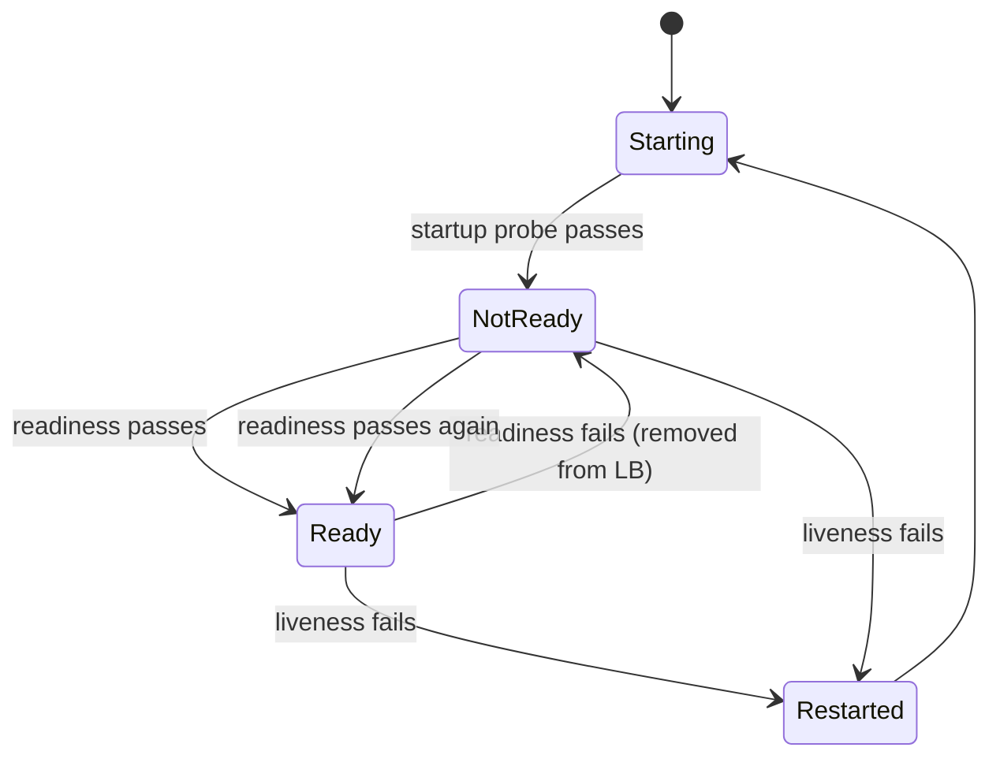

> **The classic mistake:** putting the **database** check in **liveness**. If the DB has a 30-second blip, Kubernetes restarts **every** pod at once, which turns a small blip into a full outage (and a thundering herd on the DB when they all come back). DB checks belong in **readiness** (or nowhere), never liveness.

---

## 8.4 Health Checks in Spring Boot Actuator

```yaml
management:
  endpoints:
    web:
      exposure:
        include: health,info,metrics,prometheus
  endpoint:
    health:
      probes:
        enabled: true                    # /actuator/health/liveness and /readiness (auto-enabled on Kubernetes)
      show-details: when-authorized      # don't leak internals to the public
      group:
        readiness:
          include: readinessState, db, redis      # readiness: app state + essential dependencies
        liveness:
          include: livenessState                  # liveness: the app itself ONLY
  health:
    diskspace:
      enabled: true
```

```
GET /actuator/health            -> {"status":"UP"}  (overall, all indicators)
GET /actuator/health/liveness   -> {"status":"UP"}
GET /actuator/health/readiness  -> {"status":"OUT_OF_SERVICE"}  (HTTP 503 while not ready)
```

### Custom health indicator

```java
@Component("paymentGateway")                         // appears as "paymentGateway" in /actuator/health
class PaymentGatewayHealthIndicator implements HealthIndicator {
    private final PaymentClient client;
    PaymentGatewayHealthIndicator(PaymentClient client) { this.client = client; }

    @Override
    public Health health() {
        try {
            Duration latency = client.ping();          // cheap call with a SHORT timeout
            return Health.up().withDetail("latencyMs", latency.toMillis()).build();
        } catch (Exception e) {
            return Health.down(e).build();
        }
    }
}
```

### Changing readiness from code (e.g. during maintenance or overload)

```java
@Component
class MaintenanceSwitch {
    private final ApplicationEventPublisher publisher;
    MaintenanceSwitch(ApplicationEventPublisher publisher) { this.publisher = publisher; }

    void stopTraffic() {
        AvailabilityChangeEvent.publish(publisher, this, ReadinessState.REFUSING_TRAFFIC);   // readiness -> 503
    }
    void resumeTraffic() {
        AvailabilityChangeEvent.publish(publisher, this, ReadinessState.ACCEPTING_TRAFFIC);
    }
}
```

### Graceful shutdown

```yaml
server:
  shutdown: graceful                       # stop accepting new requests, finish in-flight ones
spring:
  lifecycle:
    timeout-per-shutdown-phase: 30s        # max time to finish in-flight requests
```

On shutdown Spring Boot marks readiness as `REFUSING_TRAFFIC`, finishes in-flight requests, then stops.

#### 📘 Terms Explained

| Term | Simple meaning |
|---|---|
| **Actuator** | Spring Boot module adding production endpoints (`/actuator/health`, `/metrics`). |
| **`HealthIndicator`** | Interface you implement to add your own component to the health report. |
| **Health group** | A named subset of indicators (e.g. `readiness`) exposed on its own URL. |
| **`OUT_OF_SERVICE`** | Health status meaning "running but not taking traffic"; returned as HTTP 503. |
| **`AvailabilityChangeEvent`** | Spring Boot event that changes the app's liveness/readiness state. |
| **Graceful shutdown** | Finishing current requests before stopping, instead of cutting them off. |

---

## 8.5 Kubernetes Probes

```yaml
containers:
  - name: order-service
    image: shop/order-service:1.4.2
    ports:
      - containerPort: 8080
    startupProbe:
      httpGet: { path: /actuator/health/liveness, port: 8080 }
      periodSeconds: 5
      failureThreshold: 30           # allow up to 30 x 5s = 150s to start
    livenessProbe:
      httpGet: { path: /actuator/health/liveness, port: 8080 }
      periodSeconds: 10
      timeoutSeconds: 2
      failureThreshold: 3            # restart after 3 consecutive failures (~30s)
    readinessProbe:
      httpGet: { path: /actuator/health/readiness, port: 8080 }
      periodSeconds: 5
      timeoutSeconds: 2
      failureThreshold: 2            # remove from Service after ~10s
    lifecycle:
      preStop:
        exec: { command: ["sh", "-c", "sleep 10"] }   # give the LB time to stop routing before shutdown
```

See [02_Pods.md](../../kubernetes/02_Pods.md#23-probes-interview-imp) for probes, Services and rolling updates, and [09_Runtime_Limits_Logging_Health.md](../../docker/09_Runtime_Limits_Logging_Health.md#93-health-checks-and-restart-policies) for Docker `HEALTHCHECK`.

### Deep vs shallow health checks

| | Shallow | Deep |
|---|---|---|
| Checks | Process is up, can answer HTTP | DB, cache, queues, downstream services |
| Cost | Very cheap | Expensive; can overload dependencies if called often |
| Risk | Misses broken dependencies | One shared dependency down → **all** instances unhealthy at once |
| Use for | Liveness | Readiness (essential, local deps only), dashboards and alerts |

#### 📘 Terms Explained

| Term | Simple meaning |
|---|---|
| **`failureThreshold`** | How many failed probes in a row before Kubernetes acts. |
| **`periodSeconds`** | How often the probe runs. |
| **`preStop` hook** | A command Kubernetes runs before stopping a container. |
| **Shallow / deep health check** | Checks only the app itself / also checks its dependencies. |
| **`HEALTHCHECK`** | Dockerfile instruction defining how Docker tests a container's health. |

---

## 8.6 Pros, Cons and Pitfalls

| Pros | Cons |
|---|---|
| Traffic automatically avoids broken instances | Badly designed checks cause restarts and outages |
| Self-healing (restart stuck instances) | Deep checks add load to dependencies |
| Safe deployments and shutdowns | Checks can pass while real requests fail (checks too shallow) |

| Pitfall | Fix |
|---|---|
| DB/downstream checks in **liveness** → mass restarts | Liveness = app only; deps in readiness (or not at all). |
| No startup probe for slow apps → killed while starting | Use a `startupProbe` with a generous threshold. |
| Health endpoint does heavy work | Keep checks cheap, with short timeouts; cache results briefly. |
| Exposing full health details publicly | `show-details: when-authorized`; separate management port. |
| No graceful shutdown → errors on every deployment | `server.shutdown=graceful` + `preStop` sleep. |
| All instances fail readiness because one shared optional service is down | Only include **essential** dependencies in readiness; use fallbacks for optional ones. |

---

## 8.7 Health Check - Interview Questions

**Q1. Liveness vs readiness probe?**
Liveness: is the app alive? Failure → restart. Readiness: can it serve traffic now? Failure → removed from load balancing, not restarted.

**Q2. Should the database check be in the liveness probe?**
No. A DB outage would restart every pod, which doesn't fix the DB and causes a restart storm. Put it in readiness, if at all.

**Q3. What is a startup probe for?**
Slow-starting apps: it disables liveness/readiness checks until startup completes, so the app isn't killed while initialising.

**Q4. How does Spring Boot support Kubernetes probes?**
Actuator exposes `/actuator/health/liveness` and `/readiness` (probe groups), backed by `LivenessState`/`ReadinessState`, changeable via `AvailabilityChangeEvent`; custom `HealthIndicator`s can be added to groups.

**Q5. How do you achieve zero-downtime deployments?**
Readiness probes so new pods get traffic only when ready, rolling updates, graceful shutdown (`server.shutdown=graceful`), a `preStop` delay so the LB stops routing first, and backward-compatible DB changes.

**Q6. Shallow vs deep health checks?**
Shallow checks only the process; deep also checks dependencies. Deep checks give more information but can cause correlated failures and extra load; use them carefully, mostly for readiness and monitoring.

---

## 8.8 Health Check - Cheat Sheet

```
HEALTH CHECK  Endpoint/probe telling infra whether an instance can work; traffic avoids/restarts bad ones.
          Liveness (alive? fail -> RESTART; app only, NEVER DB) | Readiness (take traffic? fail -> remove from LB)
          | Startup (slow init; pauses the others).
          Spring Actuator: /actuator/health, /health/liveness, /health/readiness; health groups;
                           custom HealthIndicator; AvailabilityChangeEvent(ReadinessState.REFUSING_TRAFFIC);
                           show-details when-authorized.
          Graceful shutdown: server.shutdown=graceful + timeout-per-shutdown-phase + K8s preStop sleep.
          Shallow (cheap) vs deep (deps; risk of correlated failure). Keep checks fast with short timeouts.
```

---

## 8.9 Types and Variants

| Probe / check | Question it answers | Failure action |
|---|---|---|
| **Liveness** | Is the process stuck/dead? | Restart the container |
| **Readiness** | Can it serve traffic *now* (dependencies ready, warm-up done)? | Remove from the load balancer, don't restart |
| **Startup** | Has a slow-starting app finished starting? | Delay liveness checks until it has |
| **Shallow check** | Process up and responding | Cheap, safe for liveness |
| **Deep check** | Database, cache, downstream reachable | Use for readiness only, with timeouts (avoid cascading restarts) |
| **Synthetic check** | Does a real user journey work? (external) | Alert humans ([10_Observability_Pattern.md](10_Observability_Pattern.md)) |

Spring Boot Actuator exposes `/actuator/health/liveness` and `/actuator/health/readiness` groups; Kubernetes `livenessProbe`, `readinessProbe` and `startupProbe` point at them.

# 9. Graceful Degradation Pattern

## 9.1 What is Graceful Degradation?

**Graceful degradation** means that when parts of the system fail or the system is overloaded, it **keeps the core functions working** and **switches off or simplifies non-essential features**, instead of failing completely.

**Analogy:** A power cut in a hospital. The backup generator doesn't power the cafeteria TVs; it powers the operating theatres and life support. Less important things are switched off so critical ones keep running.

#### 📘 Terms Explained

| Term | Simple meaning |
|---|---|
| **Graceful degradation** | Losing features step by step under failure, while keeping the most important ones. |
| **Core / critical feature** | What users absolutely need (search, add to cart, checkout, pay). |
| **Optional / non-essential feature** | Nice to have (recommendations, reviews, live stock counts, animations). |
| **Load shedding** | Dropping some requests or work on purpose when overloaded. |

---

## 9.2 Why Do We Need It?

- During a big sale (Big Billion Days, Black Friday) traffic can be 10× normal. Better to show product pages **without** recommendations than to show **error pages**.
- When the recommendation service is down, the product page should still render.
- An all-or-nothing system turns **every** small failure into a **total** outage.

**Decide in advance** what is core and what is optional:

| Feature (e-commerce) | Priority | Under stress |
|---|---|---|
| Search, product details, cart, checkout, payment | **Critical** | Always on; protected by bulkheads |
| Order history, address book | Important | Cached / read replicas |
| Reviews, Q&A | Optional | Cached, possibly hours old |
| Personalised recommendations | Optional | Static bestsellers |
| Live stock count, "X people viewing" | Optional | Hidden |
| Analytics, tracking pixels | Non-essential | Dropped / sampled |

---

## 9.3 How It Works

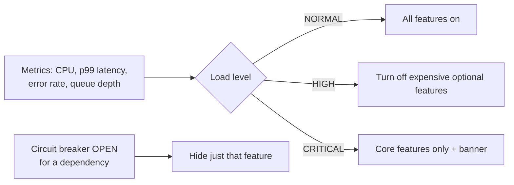

| Trigger | Response |
|---|---|
| A dependency's circuit breaker opens | Fallback for that feature only (per-feature degradation) |
| System load crosses thresholds | Switch off expensive features (system-wide degradation) |
| Manual switch by operations | Feature flags / kill switches during incidents or sales |
| Priority-based load shedding | Reject low-priority requests (bots, prefetch, analytics) first |

---

## 9.4 Complete Java Example - Product Page Under Load

```java
import java.util.ArrayList;
import java.util.List;

// Load level drives which optional features stay on
enum LoadLevel { NORMAL, HIGH, CRITICAL }

class ProductPageService {
    LoadLevel load = LoadLevel.NORMAL;

    List<String> render(String productId) {
        List<String> page = new ArrayList<>();
        page.add("product details for " + productId);              // CORE: always served
        page.add("price + Add-to-cart button");                     // CORE

        if (load == LoadLevel.NORMAL) {
            page.add("personalised recommendations");               // expensive ML call
            page.add("live stock count");                           // DB query per view
        }
        if (load != LoadLevel.CRITICAL) {
            page.add("customer reviews (cached 5 min)");
        } else {
            page.add("banner: 'Some features are temporarily unavailable'");
        }
        return page;
    }

    // In a real system this comes from metrics: CPU, p99 latency, queue depth, error rate
    void updateLoad(double cpuPercent) {
        load = cpuPercent > 90 ? LoadLevel.CRITICAL : cpuPercent > 70 ? LoadLevel.HIGH : LoadLevel.NORMAL;
    }
}

public class GracefulDegradationDemo {
    public static void main(String[] args) {
        ProductPageService service = new ProductPageService();
        for (double cpu : new double[]{40, 78, 95}) {
            service.updateLoad(cpu);
            System.out.println("CPU " + (int) cpu + "% -> " + service.load);
            service.render("P-101").forEach(part -> System.out.println("   - " + part));
        }
    }
}
```

**Output:**
```
CPU 40% -> NORMAL
   - product details for P-101
   - price + Add-to-cart button
   - personalised recommendations
   - live stock count
   - customer reviews (cached 5 min)
CPU 78% -> HIGH
   - product details for P-101
   - price + Add-to-cart button
   - customer reviews (cached 5 min)
CPU 95% -> CRITICAL
   - product details for P-101
   - price + Add-to-cart button
   - banner: 'Some features are temporarily unavailable'
```

At every load level, product details and **Add-to-cart** are served. Only optional features are removed, from most expensive to least.

---

## 9.5 Graceful Degradation in Practice

### Feature flags / kill switches

```java
@Service
class ProductPageService {
    private final FeatureFlags flags;              // backed by Unleash, LaunchDarkly, Togglz, or a config server

    ProductPage render(String id) {
        ProductPage page = ProductPage.core(catalog.find(id));
        if (flags.isEnabled("recommendations")) {
            page.withRecommendations(recommendationClient.forProduct(id));   // itself protected by a breaker + fallback
        }
        if (flags.isEnabled("live-stock")) {
            page.withStock(inventoryClient.stock(id));
        }
        return page;
    }
}
```

Operations can flip `recommendations` off during a sale **without a deployment**.

### Priority load shedding at the edge

```java
// In a filter: when overloaded, reject low-priority traffic first
if (overloadDetector.isOverloaded() && isLowPriority(request)) {   // e.g. bots, prefetch, analytics beacons
    response.setStatus(503);
    response.setHeader("Retry-After", "30");
    return;
}
chain.doFilter(request, response);
```

### Other techniques

| Technique | Example |
|---|---|
| Serve static / cached pages | CDN serves a cached home page if the origin is down |
| Read-only mode | Allow browsing and reading, temporarily block writes during a DB failover |
| Reduce quality | Lower image resolution, fewer search results, simpler ranking algorithm |
| Asynchronous instead of synchronous | Accept the order now, confirm by email later |
| Hide, don't error | Skip a widget whose data failed, rather than failing the page |

#### 📘 Terms Explained

| Term | Simple meaning |
|---|---|
| **Feature flag** | A switch in config that turns a feature on/off at runtime without deploying code. |
| **Unleash / LaunchDarkly / Togglz** | Feature-flag tools and libraries. |
| **Read-only mode** | The system allows reads but temporarily blocks changes. |
| **Origin** | The real backend server behind a CDN. |

---

## 9.6 Pros, Cons and Pitfalls

| Pros | Cons |
|---|---|
| Core business keeps working during failures and spikes | Needs product decisions about priorities, made in advance |
| Users see a slightly simpler page instead of an error | More code paths to build and test |
| Buys time for engineers to fix the real problem | Degraded modes may confuse users if not explained |

| Pitfall | Fix |
|---|---|
| Deciding priorities during the incident | Decide and document them in advance (runbooks). |
| Degraded paths never tested | Test them regularly (chaos experiments, game days). |
| Optional features sharing resources with critical ones | Bulkheads so optional features can't starve checkout. |
| Users not told | Show banners ("some features temporarily unavailable"). |
| Degradation that stays on forever | Alert while degraded; restore automatically when healthy. |

---

## 9.7 Graceful Degradation - Interview Questions

**Q1. What is graceful degradation?**
Keeping core functionality available during failures or overload by disabling or simplifying non-essential features, instead of failing entirely.

**Q2. How would you design an e-commerce site to survive a 10× sale-day spike?**
Classify features by priority; protect checkout with bulkheads and dedicated capacity; cache heavily (CDN, Redis); feature flags to turn off recommendations/live stock; rate-limit bots; load-shed low-priority traffic; queue non-urgent work; autoscale; and rehearse with load tests and game days.

**Q3. Graceful degradation vs fallback?**
A fallback is a per-call alternative (cached recommendations). Graceful degradation is the system-wide strategy of which features to keep or drop; fallbacks are one tool for it.

**Q4. What is load shedding?**
Intentionally rejecting some requests, usually low-priority ones, when overloaded, so the remaining requests get good service.

---

## 9.8 Graceful Degradation - Cheat Sheet

```
GRACEFUL DEGRADATION  Keep CORE features alive; switch off/simplify OPTIONAL ones under failure or load.
          Classify features in advance (critical / important / optional / non-essential).
          Triggers: breaker open (per feature), load thresholds (CPU, p99, queue), manual feature flags.
          Techniques: feature flags/kill switches, priority load shedding (503 + Retry-After for bots/prefetch),
                      cached/static pages, read-only mode, lower quality, async processing, hide failed widgets.
          Bulkhead optional features away from checkout; tell users (banner); test degraded modes.
```

---

# 10. Failover Pattern

## 10.1 What is Failover?

**Failover** is **automatically switching** to a **standby** component (server, database, data centre, provider) when the primary one fails. **Failback** is switching back once the primary is healthy again.

**Analogy:** A cricket team's substitute fielder. When a player is injured, the substitute comes on immediately and the match continues.

> Failover of load balancers (active-passive, VRRP/keepalived) and of database primaries is covered in [01_Scalability_Pattern.md](01_Scalability_Pattern.md#19-high-availability-of-the-load-balancer-itself) and [01_Scalability_Pattern.md](01_Scalability_Pattern.md#47-failover---when-the-primary-dies). This section covers the general pattern and client-side failover in Java.

#### 📘 Terms Explained

| Term | Simple meaning |
|---|---|
| **Primary** | The component normally doing the work. |
| **Standby / secondary / replica** | The backup ready to take over. |
| **Failover** | Switching from the failed primary to the standby. |
| **Failback** | Switching back to the original primary after it recovers. |

---

## 10.2 Why Do We Need It?

Retries and fallbacks help with **one request**. Failover handles a component that is **gone**: a crashed server, a dead database primary, a whole availability zone or region down, or a vendor outage (payment gateway, SMS provider).

---

## 10.3 How It Works

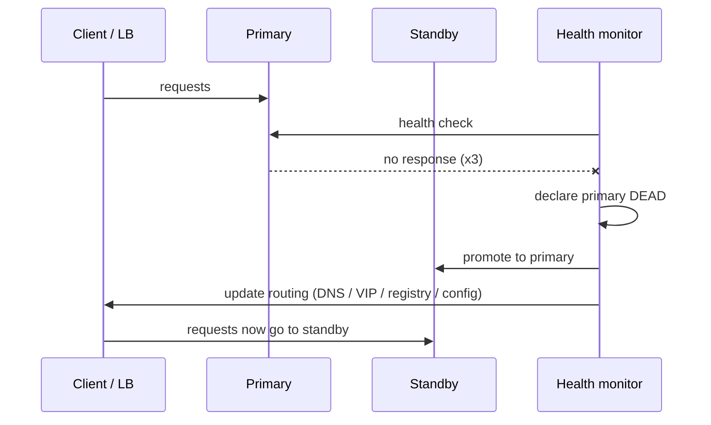

Steps:
1. **Detect** the failure (health checks, heartbeats, error rates).
2. **Decide** it's real, not a blip (thresholds, quorum).
3. **Promote** the standby (for databases: make the replica writable).
4. **Redirect** traffic (DNS change, virtual IP move, service registry update, client-side list).
5. **Fail back** later, carefully (often manual for databases).

### Types

| Type | Standby state | Failover time | Cost |
|---|---|---|---|
| **Cold standby** | Off; started when needed | Minutes to hours | Lowest |
| **Warm standby** | Running, partly scaled, data replicated | Minutes | Medium |
| **Hot standby (active-passive)** | Fully running, in sync, idle | Seconds | High (paying for idle capacity) |
| **Active-active** | All copies serve traffic | Near zero (just stop sending to the dead one) | Highest; hardest for data consistency |

### Where failover happens

| Level | Mechanism |
|---|---|
| Instance | Load balancer health checks remove the dead instance |
| Database | Managed DB failover (AWS RDS Multi-AZ, Aurora), Patroni for PostgreSQL, MySQL Group Replication / InnoDB Cluster |
| Cache | Redis Sentinel / Redis Cluster promote a replica |
| Data centre / zone | Multi-AZ deployment; LB spreads across zones |
| Region | DNS failover (Route 53 health checks), global load balancing (GSLB) |
| Vendor | Secondary payment/SMS/email provider in client code |

#### 📘 Terms Explained

| Term | Simple meaning |
|---|---|
| **Heartbeat** | A regular "I'm alive" signal between components. |
| **Promote** | Turn a read-only replica into the new writable primary. |
| **Virtual IP (VIP)** | An IP address that can move between machines, so clients don't need to change anything. |
| **Availability zone (AZ)** | An isolated data centre inside a cloud region. |
| **Hot / warm / cold standby** | Backup fully running / partly running / switched off. |

---

## 10.4 Complete Java Example - Client-Side Failover and Failback

```java
import java.util.List;
import java.util.function.Function;

class Endpoint {
    final String name;
    boolean healthy = true;
    Endpoint(String name) { this.name = name; }

    String handle(String request) {
        if (!healthy) throw new RuntimeException(name + " unreachable");
        return name + " handled " + request;
    }
}

// Client-side failover: try endpoints in priority order, skip ones marked down
class FailoverClient {
    private final List<Endpoint> endpoints;           // [primary, secondary, ...]
    private final int failuresToMarkDown;
    private final int[] consecutiveFailures;
    private final boolean[] markedDown;

    FailoverClient(List<Endpoint> endpoints, int failuresToMarkDown) {
        this.endpoints = endpoints;
        this.failuresToMarkDown = failuresToMarkDown;
        this.consecutiveFailures = new int[endpoints.size()];
        this.markedDown = new boolean[endpoints.size()];
    }

    String send(String request) {
        for (int i = 0; i < endpoints.size(); i++) {
            if (markedDown[i]) continue;
            try {
                String r = endpoints.get(i).handle(request);
                consecutiveFailures[i] = 0;
                return r;
            } catch (RuntimeException e) {
                if (++consecutiveFailures[i] >= failuresToMarkDown) {
                    markedDown[i] = true;
                    System.out.println("   ! " + endpoints.get(i).name + " marked DOWN, failing over");
                } else {
                    System.out.println("   ! " + e.getMessage() + ", trying next endpoint");
                }
            }
        }
        throw new RuntimeException("all endpoints down");
    }

    // Called periodically by a background health check
    void healthCheck() {
        for (int i = 0; i < endpoints.size(); i++) {
            if (markedDown[i] && endpoints.get(i).healthy) {
                markedDown[i] = false;
                consecutiveFailures[i] = 0;
                System.out.println("   + " + endpoints.get(i).name + " healthy again, failing back");
            }
        }
    }
}

public class FailoverDemo {
    public static void main(String[] args) {
        Endpoint primary = new Endpoint("db-primary (Mumbai)");
        Endpoint secondary = new Endpoint("db-standby (Hyderabad)");
        FailoverClient client = new FailoverClient(List.of(primary, secondary), 2);
        Function<String, String> send = client::send;

        System.out.println("1: " + send.apply("req-1"));
        primary.healthy = false;
        System.out.println("primary crashes...");
        System.out.println("2: " + send.apply("req-2"));
        System.out.println("3: " + send.apply("req-3"));
        System.out.println("4: " + send.apply("req-4"));
        primary.healthy = true;
        System.out.println("primary repaired, health check runs...");
        client.healthCheck();
        System.out.println("5: " + send.apply("req-5"));
    }
}
```

**Output:**
```
1: db-primary (Mumbai) handled req-1
primary crashes...
   ! db-primary (Mumbai) unreachable, trying next endpoint
2: db-standby (Hyderabad) handled req-2
   ! db-primary (Mumbai) marked DOWN, failing over
3: db-standby (Hyderabad) handled req-3
4: db-standby (Hyderabad) handled req-4
primary repaired, health check runs...
   + db-primary (Mumbai) healthy again, failing back
5: db-primary (Mumbai) handled req-5
```

What the output shows:
- Request 2: the primary failed once, so the client tried the next endpoint **within the same request**. The user saw no error.
- Request 3: a second consecutive failure → primary **marked DOWN**, so later requests (4) go straight to the standby without wasting time on the dead primary.
- After repair, the background **health check** brings the primary back (failback) and request 5 uses it again.

---

## 10.5 Failover in Spring Boot and Java

```yaml
# PostgreSQL JDBC driver: multiple hosts, connect only to the writable primary
spring:
  datasource:
    url: jdbc:postgresql://db1:5432,db2:5432/shop?targetServerType=primary&connectTimeout=2
```

```yaml
# Redis Sentinel: the client asks Sentinel who the current master is
spring:
  data:
    redis:
      sentinel:
        master: mymaster
        nodes: sentinel1:26379,sentinel2:26379,sentinel3:26379
```

```yaml
# Kafka: producer/consumer know several brokers; partitions fail over to replicas automatically
spring:
  kafka:
    bootstrap-servers: kafka1:9092,kafka2:9092,kafka3:9092
    producer:
      acks: all            # write is acknowledged only when replicas have it (survives a broker failure)
```

```java
// Vendor failover: try the primary SMS provider, then the backup
@Service
class SmsService {
    private final List<SmsProvider> providers;     // ordered by @Order: Twilio first, then a backup provider
    SmsService(List<SmsProvider> providers) { this.providers = providers; }

    void send(String phone, String text) {
        for (SmsProvider p : providers) {
            try { p.send(phone, text); return; }
            catch (ProviderUnavailableException e) { log.warn("{} down, failing over", p.name()); }
        }
        throw new AllProvidersDownException();
    }
}
```

With **service discovery** (Eureka, Consul, Kubernetes Services), clients get only healthy instances, so instance-level failover is automatic.

#### 📘 Terms Explained

| Term | Simple meaning |
|---|---|
| **`targetServerType=primary`** | PostgreSQL JDBC option: from the listed hosts, connect only to the one accepting writes. |
| **Redis Sentinel** | Redis component that monitors masters and promotes a replica on failure. |
| **`acks=all`** | Kafka producer setting: wait until all in-sync replicas have the message. |
| **Service discovery** | Clients look up live instances of a service by name instead of fixed addresses. |

---

## 10.6 Pros, Cons and Pitfalls

| Pros | Cons |
|---|---|
| Survives total failure of a component | Standby capacity costs money |
| Can be fully automatic (minutes or seconds of impact) | **Data loss risk** with asynchronous replication |
| Enables maintenance with little downtime | **Split brain** if both sides think they're primary |
| | Failover paths are rarely exercised, so they break silently |

| Pitfall | Fix |
|---|---|
| **Split brain**: network partition, both nodes accept writes | Quorum-based election (odd number of voters), fencing (STONITH), leases. |
| Asynchronous replica promoted → recent writes lost | Synchronous/semi-sync replication for critical data; know your RPO. |
| Failing over on a short blip ("flapping") | Thresholds + hold-down timers; require several failed checks. |
| DNS failover slow because of long TTLs and client caching | Low TTLs for failover records; JVM DNS cache (`networkaddress.cache.ttl`). |
| Standby can't handle full load | Size standby like the primary; test with real traffic. |
| Never tested | Regular failover drills (chaos engineering). |

---

## 10.7 Failover - Interview Questions

**Q1. What is failover? Active-passive vs active-active?**
Automatically switching to a standby when the primary fails. Active-passive: standby is idle until needed (simpler, wastes capacity). Active-active: all nodes serve traffic (better utilisation, near-zero failover, but harder consistency).

**Q2. What is split brain and how do you prevent it?**
Two nodes both believe they're primary (usually after a network partition) and accept conflicting writes. Prevent with quorum/majority voting (3 or 5 nodes), fencing the old primary, and leases.

**Q3. What are RTO and RPO?**
RTO (Recovery Time Objective): how long you can be down. RPO (Recovery Point Objective): how much data (time) you can lose. They drive the choice between cold/warm/hot standby and sync/async replication.

**Q4. Why is DNS failover slow?**
Clients and resolvers cache DNS answers for the TTL (and the JVM has its own DNS cache), so some clients keep using the old address until caches expire.

**Q5. How does a Java app fail over between database nodes?**
Multi-host JDBC URLs (`targetServerType=primary`), a managed endpoint that moves to the new primary (RDS/Aurora cluster endpoint), or a proxy (PgBouncer/ProxySQL/HAProxy); plus retries for the brief failover window.

---

## 10.8 Failover - Cheat Sheet

```
FAILOVER  Switch automatically to a standby when the primary fails; failback later (carefully).
          Detect (health/heartbeat) -> decide (thresholds, quorum) -> promote -> redirect (DNS/VIP/registry/client list).
          Cold / warm / hot standby / active-active: cost vs speed.
          Levels: instance (LB), DB (RDS Multi-AZ, Patroni), Redis Sentinel, AZ, region (DNS/GSLB), vendor.
          Java: multi-host JDBC targetServerType=primary, Redis Sentinel config, Kafka acks=all, ordered provider list.
          Risks: split brain (quorum + fencing), data loss with async replication (RPO), flapping, DNS TTL.
          RTO = how long down; RPO = how much data lost.
```

---

# 11. Redundancy Pattern

## 11.1 What is Redundancy?

**Redundancy** means having **more than one copy** of every critical component, so that no single failure stops the system. It removes **single points of failure (SPOF)**. Failover (section 10) is the **mechanism** for switching between redundant copies; redundancy is having the copies in the first place.

**Analogy:** A plane has two (or four) engines, multiple hydraulic systems, and two pilots. It's designed so that losing any one of them is survivable.

#### 📘 Terms Explained

| Term | Simple meaning |
|---|---|
| **Redundancy** | Extra copies of a component beyond what's strictly needed. |
| **Single point of failure (SPOF)** | One component whose failure brings the whole system down. |
| **High availability (HA)** | Designing so the system stays up despite component failures. |

---

## 11.2 Why Do We Need It?

Every component **will** fail eventually: disks, servers, network switches, power supplies, availability zones, even whole cloud regions. Redundancy turns "a component failed" into "nothing happened (for users)".

### Finding single points of failure

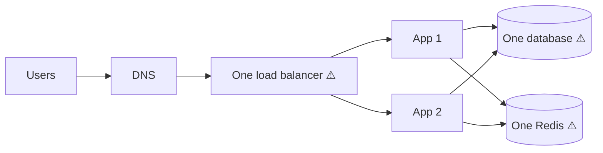

Two app servers are redundant, but the load balancer, database and Redis are each a SPOF. Look for SPOFs in: load balancers, databases, caches, message brokers, DNS, certificates (expiry!), configuration servers, CI/CD, a single cloud region, a single person who knows how something works.

---

## 11.3 Types and Levels of Redundancy

| Type | Meaning | Example |
|---|---|---|
| **N+1** | Capacity for N, plus one spare | 4 servers needed → run 5 |
| **N+2** | Survive one failure **during** maintenance of another | Critical systems |
| **2N** | A full duplicate of everything | Two complete data centres |
| **Active-active** | All copies serve traffic | Multiple app instances behind an LB |
| **Active-passive** | Copies wait as standby | DB primary + standby |
| **Geographic** | Copies in different zones / regions | Multi-AZ, multi-region |
| **Data redundancy** | Multiple copies of data | DB replication, RAID, S3 (multiple AZs), Kafka replication factor 3 |
| **Vendor redundancy** | More than one provider | Two payment gateways, two CDNs, two DNS providers |

### Quorum: why 3 (or 5), not 2

Distributed systems that must **agree** (ZooKeeper, etcd, Consul, Kafka KRaft controllers, MongoDB replica sets) use a **majority** (quorum) to decide.

| Nodes | Majority needed | Failures tolerated |
|---|---|---|
| 1 | 1 | 0 |
| 2 | 2 | **0** (no better than 1!) |
| 3 | 2 | 1 |
| 4 | 3 | 1 (same as 3, so wasteful) |
| 5 | 3 | 2 |

Formula: a cluster of **2f + 1** nodes tolerates **f** failures. That's why such clusters have **odd** sizes.

#### 📘 Terms Explained

| Term | Simple meaning |
|---|---|
| **N+1** | One more unit than needed. |
| **Quorum / majority** | More than half of the nodes; required to make decisions so two halves can't both decide. |
| **RAID** | Combining several disks so data survives a disk failure. |
| **Replication factor** | How many copies of each piece of data are stored (Kafka, Cassandra, HDFS). |
| **etcd / ZooKeeper / Consul** | Distributed coordination stores that use quorum-based consensus. |

---

## 11.4 Complete Java Example - The Maths of Redundancy

Availability of components **in series** (all needed) multiplies, so it gets **worse**. Components **in parallel** (redundant copies) fail only if **all** copies fail, so it gets much **better**.

```
Series:    A = A1 × A2 × A3
Parallel:  A = 1 - (1 - A1)^n        (n identical copies)
```

```java
public class AvailabilityDemo {
    // Components in SERIES: all must work -> multiply availabilities
    static double series(double... a) {
        double r = 1;
        for (double x : a) r *= x;
        return r;
    }

    // Components in PARALLEL (redundant copies): fails only if ALL copies fail
    static double parallel(double a, int copies) {
        return 1 - Math.pow(1 - a, copies);
    }

    static String downtimePerYear(double availability) {
        double minutes = (1 - availability) * 365 * 24 * 60;
        if (minutes >= 60) return String.format("%.1f hours", minutes / 60);
        if (minutes >= 1)  return String.format("%.1f minutes", minutes);
        return String.format("%.2f seconds", minutes * 60);
    }

    static void show(String label, double a) {
        System.out.printf("%-42s %11.7f%%  downtime/year: %s%n", label, a * 100, downtimePerYear(a));
    }

    public static void main(String[] args) {
        double lb = 0.9999, app = 0.999, db = 0.999;

        show("One app server", app);
        show("LB -> app -> DB (series, no redundancy)", series(lb, app, db));
        show("2 app servers in parallel", parallel(app, 2));
        show("3 app servers in parallel", parallel(app, 3));
        show("LB -> 3 apps -> primary+standby DB", series(lb, parallel(app, 3), parallel(db, 2)));
    }
}
```

**Output:**
```
One app server                              99.9000000%  downtime/year: 8.8 hours
LB -> app -> DB (series, no redundancy)     99.7901200%  downtime/year: 18.4 hours
2 app servers in parallel                   99.9999000%  downtime/year: 31.54 seconds
3 app servers in parallel                   99.9999999%  downtime/year: 0.03 seconds
LB -> 3 apps -> primary+standby DB          99.9898999%  downtime/year: 53.1 minutes
```

What the output shows:
- Chaining three components (LB → app → DB) gives **lower** availability than any one of them (99.79%, ~18 hours down/year).
- Two app servers at 99.9% each give 99.9999% (about half a minute/year), **if** failures are independent.
- The end-to-end system is limited by its **weakest serial link**: with redundant apps (99.9999999%) and a redundant DB (99.9999%), the single load balancer at 99.99% dominates (~53 minutes/year).

> **Caveat:** these formulas assume failures are **independent**. Copies in the same rack, zone, or running the same buggy version often fail **together** (correlated failures). Real redundancy needs **diversity**: different zones, staggered deployments, sometimes different vendors.

---

## 11.5 Redundancy in Practice (Java / Spring / Cloud)

| Layer | Redundant setup |
|---|---|
| App | ≥ 2-3 instances across AZs; Kubernetes `replicas: 3` + `PodDisruptionBudget` + anti-affinity (spread pods across nodes/zones) |
| Load balancer | Cloud LBs are multi-AZ by default; on-prem: keepalived/VRRP pairs |
| Database | Primary + synchronous standby in another AZ + async read replicas; automated backups + point-in-time recovery |
| Cache | Redis replicas + Sentinel, or Redis Cluster |
| Messaging | Kafka: 3+ brokers, `replication.factor=3`, `min.insync.replicas=2`, producer `acks=all` |
| Storage | Object storage (S3) replicated across AZs; cross-region replication for DR |
| DNS / CDN | Two DNS providers, multi-CDN for very large sites |
| Config / secrets | HA config server, or config baked into images + K8s ConfigMaps |
| People | Runbooks, on-call rotation, no "only Ravi knows how to deploy" |

```yaml
# Kubernetes: 3 replicas spread across zones, at most 1 down during voluntary disruptions
apiVersion: apps/v1
kind: Deployment
spec:
  replicas: 3
  template:
    spec:
      topologySpreadConstraints:
        - maxSkew: 1
          topologyKey: topology.kubernetes.io/zone
          whenUnsatisfiable: DoNotSchedule
          labelSelector: { matchLabels: { app: order-service } }
---
apiVersion: policy/v1
kind: PodDisruptionBudget
spec:
  minAvailable: 2
  selector: { matchLabels: { app: order-service } }
```

**Backups are redundancy too**, but only if you **test restoring** them. A backup that has never been restored is a hope, not a plan.

#### 📘 Terms Explained

| Term | Simple meaning |
|---|---|
| **PodDisruptionBudget** | Kubernetes rule limiting how many pods may be down at once during voluntary disruptions (node upgrades). |
| **Anti-affinity / topology spread** | Kubernetes rules to place copies on different nodes or zones. |
| **`min.insync.replicas`** | Kafka: minimum replicas that must have a write before it's acknowledged (with `acks=all`). |
| **Point-in-time recovery (PITR)** | Restoring a database to any moment (e.g. 10:42:13) using backups + logs. |
| **Disaster recovery (DR)** | Plans and systems to recover from a major outage (region loss, data corruption). |
| **Correlated failure** | Several copies failing for the same reason at the same time. |

---

## 11.6 Pros, Cons and Pitfalls

| Pros | Cons |
|---|---|
| No single failure takes the system down | Costs more (often 2× for critical parts) |
| Enables maintenance without downtime | More complexity: replication, consistency, failover |
| Protects data from hardware loss | Redundant copies can share hidden dependencies |

| Pitfall | Fix |
|---|---|
| Hidden SPOFs (one LB, one DNS, one config server, one NAT gateway) | Draw the architecture; check every box and arrow. |
| All copies in one AZ / rack | Spread across zones (topology spread, Multi-AZ). |
| 2-node clusters for consensus | Use 3 or 5 nodes. |
| Replicas that copy corruption/deletes instantly | Backups + PITR protect against logical errors; replication doesn't. |
| Redundancy never tested | Kill instances regularly (chaos engineering). |

---

## 11.7 Redundancy - Interview Questions

**Q1. What is a single point of failure? How do you find them?**
A component whose failure stops the whole system. Walk the request path and infrastructure diagram (DNS, LB, app, cache, DB, broker, config, certificates, deployment tools, people) and ask "what if this disappears?".

**Q2. Why do consensus clusters use 3 or 5 nodes?**
They need a majority. 2f+1 nodes tolerate f failures: 3 tolerate 1, 5 tolerate 2. Even numbers add cost without extra tolerance, and 2 nodes can't tolerate any failure safely.

**Q3. Calculate availability of two 99.9% servers in parallel behind a 99.99% LB.**
Parallel: 1 - 0.001² = 99.9999%. Series with LB: 0.9999 × 0.999999 ≈ 99.9899%. The LB dominates.

**Q4. Is replication a backup?**
No. Replication copies mistakes (a `DELETE` without `WHERE`) to all replicas immediately. You still need backups with point-in-time recovery, and restore tests.

**Q5. N+1 vs 2N?**
N+1 adds one spare unit to what you need; 2N duplicates everything. 2N tolerates losing an entire side (e.g. a data centre), N+1 tolerates one unit.

---

## 11.8 Redundancy - Cheat Sheet

```
REDUNDANCY  More than one copy of every critical part; remove SPOFs. Failover = switching between copies.
          N+1, N+2, 2N, active-active / active-passive, multi-AZ, multi-region, vendor redundancy.
          Maths: series A = A1*A2*... (worse); parallel A = 1-(1-A)^n (better) -> weakest serial link dominates.
          Independent failures only! Spread across zones; stagger deployments (correlated failures).
          Consensus: 2f+1 nodes tolerate f failures -> 3 or 5 nodes, never 2.
          K8s: replicas >= 3, topologySpreadConstraints, PodDisruptionBudget. Kafka RF=3, min.insync=2, acks=all.
          Replication is NOT backup: backups + PITR + tested restores.
```

---

# 12. Chaos Engineering

## 12.1 What is Chaos Engineering?

**Chaos engineering** is the practice of **deliberately injecting failures** (killing instances, adding latency, dropping network packets, failing dependencies) in a **controlled experiment**, to **prove** the system handles them, and to find weaknesses **before** real outages do.

**Analogy:** A fire drill. You don't wait for a real fire to find out whether the alarms work, people know the exits, and the doors aren't locked. You rehearse, find problems, and fix them.

Netflix popularised it with **Chaos Monkey**, which randomly terminates production instances during business hours so engineers have to build services that survive it.

#### 📘 Terms Explained

| Term | Simple meaning |
|---|---|
| **Chaos engineering** | Running planned experiments that inject failures to learn how the system behaves. |
| **Fault injection** | Deliberately introducing errors or delays. |
| **Chaos Monkey** | Netflix's tool that randomly kills instances; the name is now used for similar tools. |
| **Game day** | A planned session where a team runs failure experiments together. |

---

## 12.2 Why Do We Need It?

All the patterns in this file are code paths that **only run during failures**, which means they're the least-tested code you have:
- Does the circuit breaker actually open with your thresholds?
- Does the fallback work, or does it throw a `NullPointerException`?
- Does Kubernetes really reschedule pods when a node dies?
- Do alerts fire? Does the on-call engineer know what to do?
- Does the DB failover take 30 seconds, or 10 minutes?

Chaos engineering turns "we think it's resilient" into "we've **seen** it survive X".

---

## 12.3 How It Works: The Experiment Loop

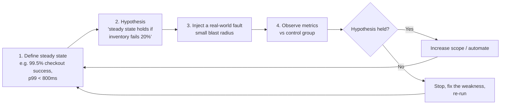

**Principles of chaos engineering:**
1. Start from a **measurable steady state** (business metrics, not just CPU).
2. Form a **hypothesis** that it will hold during the fault.
3. Inject **realistic** faults (things that actually happen).
4. **Minimise blast radius**: start in staging, then a small % of production traffic; have an abort button.
5. **Automate** experiments to run continuously.

### Common experiments

| Fault | Tests |
|---|---|
| Kill an instance/pod | Redundancy, health checks, autoscaling |
| Add latency to a dependency (e.g. +2 s) | Timeouts, circuit breakers, bulkheads |
| Return errors from a dependency | Retries, fallbacks, breakers |
| Fill the disk / exhaust memory / CPU spike | Alerts, resource limits, degradation |
| Network partition between services / zones | Failover, split-brain protection |
| Kill the DB primary | DB failover time, connection pool recovery, retries |
| Expire a certificate, break DNS | Monitoring, runbooks |
| Lose a whole availability zone | Multi-AZ design |

#### 📘 Terms Explained

| Term | Simple meaning |
|---|---|
| **Steady state** | Normal, healthy behaviour measured by key metrics (orders/minute, success rate). |
| **Hypothesis** | A prediction you test: "checkout success stays above 99.5% when X fails". |
| **Blast radius** | How many users/systems an experiment (or failure) can affect. |
| **Control group** | Part of the traffic without the fault, used for comparison. |

---

## 12.4 Complete Java Example - A Tiny Chaos Experiment

The experiment injects 20% failures into an inventory call and checks the hypothesis *"≥ 99.5% of product-page requests succeed"* with and without resilience patterns.

```java
import java.util.Random;
import java.util.function.Supplier;

// ----- Fault injector: wraps a call and randomly adds failures (like Chaos Monkey assaults) -----
class ChaosMonkey {
    private final Random random;
    private final double failureRate;
    ChaosMonkey(long seed, double failureRate) { this.random = new Random(seed); this.failureRate = failureRate; }

    <T> Supplier<T> wrap(Supplier<T> real) {
        return () -> {
            if (random.nextDouble() < failureRate) throw new RuntimeException("chaos: injected failure");
            return real.get();
        };
    }
}

public class ChaosDemo {
    static <T> T withRetry(Supplier<T> call, int maxAttempts) {
        RuntimeException last = null;
        for (int i = 0; i < maxAttempts; i++) {
            try { return call.get(); } catch (RuntimeException e) { last = e; }
        }
        throw last;
    }

    static double successRate(Supplier<String> call, int requests) {
        int ok = 0;
        for (int i = 0; i < requests; i++) {
            try { call.get(); ok++; } catch (RuntimeException ignored) { }
        }
        return 100.0 * ok / requests;
    }

    public static void main(String[] args) {
        Supplier<String> inventoryCall = () -> "in stock";
        int requests = 10_000;

        // Steady-state hypothesis: ">= 99.5% of product-page requests succeed even if inventory fails 20% of the time"
        System.out.println("Experiment: inject 20% failures into inventory-service calls");

        Supplier<String> chaotic = new ChaosMonkey(7, 0.20).wrap(inventoryCall);
        System.out.printf("  without retry : %.2f%% success  -> hypothesis FAILS%n", successRate(chaotic, requests));

        Supplier<String> chaotic2 = new ChaosMonkey(7, 0.20).wrap(inventoryCall);
        double withRetry = successRate(() -> withRetry(chaotic2, 3), requests);
        System.out.printf("  with 3 retries: %.2f%% success  -> hypothesis %s%n", withRetry, withRetry >= 99.5 ? "HOLDS" : "FAILS");
        System.out.println("  (theory: 1 - 0.2^3 = 99.20% ... so we need a fallback too, or a 4th attempt)");

        Supplier<String> chaotic3 = new ChaosMonkey(7, 0.20).wrap(inventoryCall);
        double withFallback = successRate(() -> {
            try { return withRetry(chaotic3, 3); } catch (RuntimeException e) { return "stock unknown - order anyway"; }
        }, requests);
        System.out.printf("  retry+fallback: %.2f%% success  -> hypothesis %s%n", withFallback, withFallback >= 99.5 ? "HOLDS" : "FAILS");
    }
}
```

**Output:**
```
Experiment: inject 20% failures into inventory-service calls
  without retry : 80.81% success  -> hypothesis FAILS
  with 3 retries: 99.19% success  -> hypothesis FAILS
  (theory: 1 - 0.2^3 = 99.20% ... so we need a fallback too, or a 4th attempt)
  retry+fallback: 100.00% success  -> hypothesis HOLDS
```

What the output shows:
- Without protection, success ≈ 80%, so the hypothesis **fails**. Good to know before a real outage!
- 3 retries give ≈ 99.2% (matching the theory 1 - 0.2³), still **below** target. The experiment found a gap.
- Retry + fallback ("stock unknown, order anyway") meets the target. The experiment proves the design and tells you **which** pattern was necessary.

---

## 12.5 Chaos Engineering Tools for Java and Kubernetes

### Chaos Monkey for Spring Boot (codecentric)

Adds latency, exceptions or app kills to Spring beans (`@Service`, `@Repository`, `@RestController`...) via AOP.

```xml
<dependency>
    <groupId>de.codecentric</groupId>
    <artifactId>chaos-monkey-spring-boot</artifactId>
</dependency>
```

```yaml
# application-chaos-monkey.yml   (activate with --spring.profiles.active=chaos-monkey)
chaos:
  monkey:
    enabled: true
    watcher:
      service: true            # attack @Service beans
      repository: true         # attack @Repository beans
    assaults:
      level: 5                 # attack roughly 1 in 5 calls
      latency-active: true
      latency-range-start: 1000
      latency-range-end: 3000  # add 1-3 seconds of latency
      exceptions-active: true  # throw runtime exceptions
      kill-application-active: false
management:
  endpoint:
    chaosmonkey:
      enabled: true            # /actuator/chaosmonkey to change assaults at runtime
```

### Other tools

| Tool | What it does |
|---|---|
| **Toxiproxy** (Shopify) | TCP proxy that adds latency, timeouts, bandwidth limits between your app and DB/Redis; great with **Testcontainers** in integration tests |
| **WireMock** | Fake HTTP services that return errors or delays (`withFixedDelay`, `withFault`) for tests |
| **Chaos Mesh / LitmusChaos** | Kubernetes-native chaos: kill pods, network delay/partition, stress CPU |
| **AWS Fault Injection Service (FIS)**, **Azure Chaos Studio** | Managed chaos experiments on cloud resources |
| **Gremlin** | Commercial chaos platform |
| **Netflix Chaos Monkey** | The original: randomly terminates instances |

```java
// Integration test: Testcontainers + Toxiproxy add 3s latency to Redis; verify our timeout + fallback
@Test
void productPageStillLoadsWhenRedisIsSlow() throws Exception {
    redisProxy.toxics().latency("slow-redis", ToxicDirection.DOWNSTREAM, 3_000);

    ResponseEntity<ProductPage> page = rest.getForEntity("/products/P-101", ProductPage.class);

    assertThat(page.getStatusCode()).isEqualTo(HttpStatus.OK);
    assertThat(page.getBody().reviews()).isEmpty();            // optional feature degraded
    assertThat(page.getBody().price()).isNotNull();            // core still served
}
```

#### 📘 Terms Explained

| Term | Simple meaning |
|---|---|
| **Assault** | Chaos Monkey for Spring Boot's word for an injected fault (latency, exception, kill). |
| **Toxiproxy** | A proxy that simulates bad network conditions ("toxics"). |
| **Testcontainers** | Java library that starts real dependencies (Postgres, Redis, Kafka) in Docker for tests. |
| **WireMock** | A library/server for stubbing HTTP APIs in tests. |
| **Chaos Mesh / LitmusChaos** | Open-source chaos platforms for Kubernetes. |

---

## 12.6 Pros, Cons and Pitfalls

| Pros | Cons |
|---|---|
| Finds weaknesses before customers do | Risk of real impact if done carelessly |
| Proves resilience patterns and alerts actually work | Needs good observability first (you must be able to see the effect) |
| Trains teams for real incidents | Requires organisational buy-in |
| Builds confidence to deploy and change faster | |

| Pitfall | Fix |
|---|---|
| Starting in production with a big blast radius | Start in tests/staging; then tiny % of prod with an abort switch. |
| No steady-state metrics | Define business metrics and dashboards first. |
| Chaos without a hypothesis ("let's break stuff") | Every experiment has a hypothesis and success criteria. |
| Findings not fixed | Track as action items; re-run the experiment after fixing. |
| One-off game days only | Automate regular experiments in CI/CD and production. |

---

## 12.7 Chaos Engineering - Interview Questions

**Q1. What is chaos engineering?**
Running controlled experiments that inject real-world failures into a system to verify it keeps a defined steady state, and to uncover weaknesses before they cause outages.

**Q2. Isn't it dangerous to break production?**
It's controlled: start in staging, define steady state and a hypothesis, minimise blast radius (small traffic %, one instance), have automatic abort conditions, and run when the team is ready to respond. The alternative is learning during a real, uncontrolled outage.

**Q3. How would you test that your circuit breakers and fallbacks work in a Spring Boot app?**
Unit/integration tests with WireMock or Toxiproxy (Testcontainers) injecting errors and latency; Chaos Monkey for Spring Boot in staging; verify metrics (breaker state, fallback counts) and user-facing behaviour.

**Q4. What is a game day?**
A scheduled exercise where a team runs failure scenarios (DB failover, zone loss) together, observes the system and the people/process response, and records improvements.

---

## 12.8 Chaos Engineering - Cheat Sheet

```
CHAOS ENGINEERING  Controlled experiments that inject failures to PROVE resilience.
          Loop: steady state (business metrics) -> hypothesis -> inject realistic fault (small blast radius)
                -> observe vs control -> fix -> automate.
          Faults: kill pods, latency, errors, CPU/memory/disk, network partition, DB failover, zone loss.
          Tools: Chaos Monkey for Spring Boot (assaults: latency/exceptions/kill), Toxiproxy + Testcontainers,
                 WireMock faults, Chaos Mesh, LitmusChaos, AWS FIS, Gremlin, Netflix Chaos Monkey.
          Needs observability first. Start in staging. Always have an abort switch. Game days.
```

---

## 12.9 Types and Variants

| Kind of experiment | Example | Tools |
|---|---|---|
| **Instance failure** | Kill a random pod/VM | Chaos Monkey, Kubernetes `kubectl delete pod`, Litmus |
| **Network faults** | Add latency, drop packets, partition services | Toxiproxy, Chaos Mesh, tc/netem, Istio fault injection |
| **Dependency failure** | Database or third-party API returns errors/timeouts | WireMock faults, Gremlin, Chaos Monkey for Spring Boot |
| **Resource exhaustion** | CPU hog, memory pressure, disk full | stress-ng, Gremlin, Chaos Mesh StressChaos |
| **Zone / region failure** | Evacuate an availability zone | AWS Fault Injection Service, game days |
| **Application-level** | Exceptions or delays injected into specific beans | Chaos Monkey for Spring Boot (assaults on `@Service`, `@Repository`) |
| **Game day** | Planned team exercise with a scenario and observers | Run book + post-exercise review |

Start in staging with a small blast radius, define the steady-state metric and an abort condition, then move to production gradually.

# 13. How the Reliability Patterns Fit Together

## 13.1 One-Line Summary of Each

| Pattern | Question it answers | One-line answer |
|---|---|---|
| **Circuit Breaker** | "This dependency keeps failing." | Stop calling it for a while; fail fast; test recovery. |
| **Retry** | "It failed once, probably a blip." | Try again with backoff + jitter, only if safe. |
| **Timeout** | "How long should I wait?" | Never forever: a bit above p99, within the deadline. |
| **Bulkhead** | "One slow dependency eats all my threads." | Separate, bounded pools per dependency. |
| **Fallback** | "It failed, now what do I return?" | Cached, default, alternative, or a clear error. |
| **Rate Limiting** | "One client sends too much." | Cap per client; 429 + Retry-After. |
| **Throttling** | "Work arrives faster than I can process it." | Pace it; queue with a bound; shed the rest. |
| **Health Check** | "Is this instance OK?" | Liveness (restart) vs readiness (route traffic). |
| **Graceful Degradation** | "We're overloaded or partly broken." | Keep core features; drop optional ones. |
| **Failover** | "The primary is gone." | Switch to the standby automatically. |
| **Redundancy** | "What if this box dies?" | Have more than one; no single points of failure. |
| **Chaos Engineering** | "Does all of this actually work?" | Prove it with controlled failure experiments. |

## 13.2 Layering Them on One Remote Call (Interview Imp - Java)

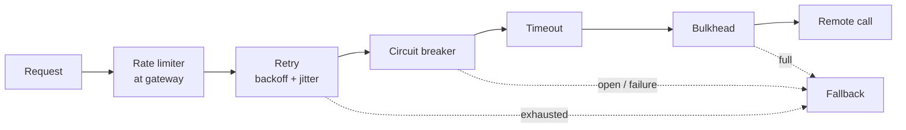

**Resilience4j's default annotation order** (outermost first):

```
Retry ( CircuitBreaker ( RateLimiter ( TimeLimiter ( Bulkhead ( yourMethod ) ) ) ) )
```

- **Bulkhead** (innermost) limits how many calls run at the same time.
- **TimeLimiter** wraps the bulkhead, so every attempt is time-limited, including time spent waiting for a bulkhead slot.
- **Circuit breaker** records each attempt's outcome (including timeouts) and blocks when open.
- **Retry** is outermost: it retries the protected call, and stops quickly once the breaker opens.
- **Fallback** runs when everything else gives up.

> You can change the order with `resilience4j.retry.retryAspectOrder`, `circuitBreakerAspectOrder`, etc. (higher value = applied first, i.e. outermost), but the default is right for most cases.

### All together on one method

```java
@Service
public class PaymentClient {

    @Retry(name = "payment")
    @CircuitBreaker(name = "payment", fallbackMethod = "pending")
    @Bulkhead(name = "payment")
    @TimeLimiter(name = "payment")
    public CompletableFuture<PaymentResponse> charge(PaymentRequest req) {
        return CompletableFuture.supplyAsync(() -> rest.post().uri("/charges")
                .header("Idempotency-Key", req.idempotencyKey())     // makes retries safe
                .body(req).retrieve().body(PaymentResponse.class), paymentExecutor);
    }

    private CompletableFuture<PaymentResponse> pending(PaymentRequest req, Throwable t) {
        outbox.save(new RetryPaymentLater(req));                     // process when the service is back
        return CompletableFuture.completedFuture(PaymentResponse.pending(req.orderId()));
    }
}
```

## 13.3 Decision Guide

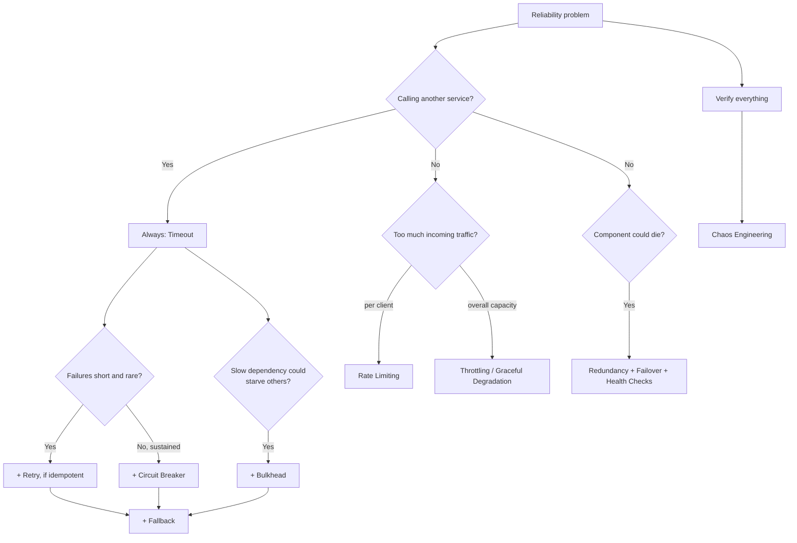

| If you hear... | Think... |
|---|---|
| "Downstream is down", "cascading failure", "fail fast" | Circuit Breaker |
| "Intermittent", "network blip", "503 sometimes", "idempotency" | Retry |
| "Hanging requests", "threads stuck", "slow dependency" | Timeout |
| "Isolate", "noisy neighbour", "one feature took down the app" | Bulkhead |
| "Default response", "cached data", "plan B" | Fallback |
| "Abuse", "429", "API quotas", "per-user limit", "token bucket" | Rate Limiting |
| "Batch job overloads DB", "partner allows 50/s", "back-pressure" | Throttling |
| "Liveness/readiness", "Kubernetes restarts", "zero-downtime deploy" | Health Check |
| "Big sale", "survive spikes", "turn off features" | Graceful Degradation |
| "Primary DB died", "standby", "split brain", "RTO/RPO" | Failover |
| "SPOF", "nines", "multi-AZ", "quorum" | Redundancy |
| "How do we know it works?", "game day", "fault injection" | Chaos Engineering |

## 13.4 Look-Alike Patterns

| Pair | Difference |
|---|---|
| **Retry vs Circuit Breaker** | Retry: try again for **short** failures. Breaker: **stop** trying during **sustained** failures. Use both (retry outside). |
| **Circuit Breaker vs Bulkhead** | Breaker reacts to the **failure rate**. Bulkhead caps **resource usage** from the start. |
| **Timeout vs Circuit Breaker** | Timeout limits **one call**. Breaker looks at **many calls** and blocks future ones. |
| **Rate Limiting vs Throttling** | Rate limiting: per client, **reject**. Throttling: system pace, **delay/queue/shed**. |
| **Fallback vs Graceful Degradation** | Fallback: per-call alternative. Degradation: system-wide choice of features to keep. |
| **Failover vs Redundancy** | Redundancy: having copies. Failover: switching to a copy. |
| **Health Check vs Circuit Breaker** | Health checks are run **by infrastructure** on an instance. A breaker runs **in the caller**, based on real call results. |

## 13.5 Reliability Inside Spring Boot

| Pattern | Spring Boot / ecosystem |
|---|---|
| Circuit Breaker | Resilience4j `@CircuitBreaker`, Spring Cloud CircuitBreaker, Gateway `CircuitBreaker` filter |
| Retry | Resilience4j `@Retry`, Spring Retry `@Retryable`, Kafka `DefaultErrorHandler`, Feign `Retryer` |
| Timeout | `JdkClientHttpRequestFactory`, WebClient `responseTimeout`, Feign timeouts, Hikari `connection-timeout`, `@Transactional(timeout)`, `@TimeLimiter` |
| Bulkhead | Resilience4j `@Bulkhead`, separate `ThreadPoolTaskExecutor`s, separate Hikari pools |
| Fallback | `fallbackMethod`, Feign `fallbackFactory`, Gateway `fallbackUri`, `onErrorResume` |
| Rate Limiting | Gateway `RequestRateLimiter` + Redis, Resilience4j `@RateLimiter`, Bucket4j |
| Throttling | `CallerRunsPolicy`, Kafka `max-poll-records`, Reactor `flatMap(concurrency)`, Tomcat thread settings |
| Health Check | Actuator `/health`, liveness/readiness groups, `HealthIndicator`, graceful shutdown |
| Graceful Degradation | Feature flags (Togglz, Unleash), `@ConditionalOnProperty`, fallbacks |
| Failover / Redundancy | Multi-host JDBC, Redis Sentinel, Kafka `acks=all`, service discovery, Kubernetes replicas |
| Chaos Engineering | Chaos Monkey for Spring Boot, Toxiproxy + Testcontainers, WireMock |

## 13.6 Comparison Table

| Pattern | Protects against | Where it runs | Key settings | Biggest risk |
|---|---|---|---|---|
| **Circuit Breaker** | Sustained dependency failure | Caller | window, min calls, failure %, open wait, half-open trials | Wrong thresholds; counting 4xx |
| **Retry** | Transient failures | Caller | attempts, backoff, jitter, retryable errors | Duplicates; retry storms |
| **Timeout** | Slow/hanging calls | Caller (and server) | connect, read, overall, pool | Infinite defaults |
| **Bulkhead** | Resource exhaustion | Caller | max concurrent, pool + queue size | Unbounded queues |
| **Fallback** | User-visible errors | Caller | fallback chain | Wrong data for critical values |
| **Rate Limiting** | Abusive/heavy clients | Gateway / server | rate, burst, key | Per-instance counts; IP-only keys |
| **Throttling** | Overload of a resource | Server / worker | pace, queue bound, concurrency | Unbounded queues; long waits |
| **Health Check** | Broken instances getting traffic | Infra → instance | liveness vs readiness, thresholds | DB in liveness → restart storm |
| **Graceful Degradation** | Total outage under stress | Whole system | feature priorities, flags | Untested degraded modes |
| **Failover** | Loss of a primary | Infra / client | detection, promotion, routing | Split brain; data loss |
| **Redundancy** | Single points of failure | Architecture | N+1, multi-AZ, quorum | Correlated failures |
| **Chaos Engineering** | Untested assumptions | Process / tooling | hypothesis, blast radius | Careless experiments |

---

# 14. Reliability & Resilience Cheat Sheet

```
TIMEOUT         Every remote call. Connect 1-2s; read ~p99; overall within deadline; pool-acquire short.
                Defaults may be infinite (Hikari 30s). Timeout stops waiting, not the work.

RETRY           Transient only (timeouts, IO, 502/503/504, 429, deadlocks). Idempotent or Idempotency-Key.
                Exponential backoff + jitter, ~3 attempts, cap delay, respect Retry-After, retry at ONE layer.

CIRCUIT BREAKER CLOSED -> OPEN -> HALF_OPEN. Sliding window, min calls, failure %, slow calls; ignore 4xx.
                Fail fast with CallNotPermittedException -> fallback. One breaker per dependency. Tune defaults.

BULKHEAD        Separate bounded pools: semaphore (concurrency) or thread pool (+ queue). Little's Law sizing.

FALLBACK        Cached/stale -> default -> alternative -> queue for later -> clear error. Last step can't fail.
                Never guess money/stock. Label degraded data.

RATE LIMITING   Per client: token bucket (burst + average), sliding window. 429 + Retry-After + X-RateLimit-*.
                Distributed via Redis / gateway (Spring Cloud Gateway RequestRateLimiter).

THROTTLING      Pace work: leaky bucket, bounded queues, CallerRunsPolicy, back-pressure, load shedding.

HEALTH CHECK    Liveness (restart; app only) vs readiness (traffic; deps) vs startup. Actuator probes,
                HealthIndicator, graceful shutdown + preStop. NEVER put the DB in liveness.

DEGRADATION     Keep core, drop optional (feature flags, cached pages, read-only mode, shed low priority).

FAILOVER        Detect -> decide -> promote -> redirect -> failback. Hot/warm/cold. Split brain (quorum, fencing).
                RTO (time down) / RPO (data lost).

REDUNDANCY      No SPOFs. Series multiplies (worse), parallel 1-(1-A)^n (better). 2f+1 nodes tolerate f.
                Multi-AZ, PDBs, Kafka RF=3/min.insync=2. Replication != backup.

CHAOS           Steady state -> hypothesis -> inject -> observe -> fix -> automate. Small blast radius.
                Chaos Monkey for Spring Boot, Toxiproxy, WireMock, Chaos Mesh, AWS FIS.

ORDER (R4J)     Retry( CircuitBreaker( RateLimiter( TimeLimiter( Bulkhead( call ))))) + fallbackMethod.
```

### Quick Decision Table

| Need | Use |
|---|---|
| Don't wait forever on a dependency | Timeout |
| Recover from occasional blips | Retry (idempotent) |
| Stop hammering a dead dependency | Circuit Breaker |
| Stop one dependency from using all threads/connections | Bulkhead |
| Give users something useful when a call fails | Fallback |
| Stop one client from overwhelming you | Rate Limiting |
| Keep background work within capacity | Throttling |
| Route traffic away from / restart broken instances | Health Check |
| Survive a spike or partial outage | Graceful Degradation |
| Survive loss of a primary component | Redundancy + Failover |
| Prove it all works | Chaos Engineering |

### Top Interview Traps

1. **No timeout = cascading failure.** Many Java clients default to infinite (or 30 s) timeouts.
2. **Never retry non-idempotent calls blindly;** use an Idempotency-Key. Retry 5xx/timeouts, not 4xx.
3. **Backoff without jitter** still causes synchronized retry waves.
4. **Retries at every layer multiply** (3 × 3 × 3 = 27 calls). Retry at one layer; use budgets.
5. **Circuit breakers must ignore 4xx/business errors,** or healthy services trip them.
6. **Resilience4j defaults** (100 calls, 60 s slow threshold) may never trip on low-traffic services.
7. **Annotations are proxy-based:** self-invocation skips them; thread-pool bulkhead/TimeLimiter need `CompletableFuture`.
8. **DB check in the liveness probe** restarts every pod during a DB blip. Use readiness.
9. **Per-instance rate limits multiply** by the number of instances; use Redis or the gateway.
10. **Replication is not a backup,** and 2-node clusters can't form a majority after a failure.

> **Related files:** [01_Scalability_Pattern.md](01_Scalability_Pattern.md) (load balancing, scaling, replication, caching) · [04_Behavioral_Pattern.md](../01_LLD/04_Behavioral_Pattern.md) (State, Observer, Command, used by these patterns) · [03_Structural_Pattern.md](../01_LLD/03_Structural_Pattern.md) (Decorator and Proxy: how Resilience4j wraps calls) · [00_Design_Patterns_Complete_List.md](../00_Design_Patterns_Complete_List.md) (master list) · [00_Kubernetes_Index.md](../../kubernetes/00_Kubernetes_Index.md) (probes, replicas)
