---
mdx:
  format: md
---

# Performance Patterns

> **Note**: Patterns marked with **(Interview Imp - Java)** are frequently asked in Java interviews
>
> **How to read this file:** Every section ends with a **📘 Terms Explained** table. If you see a word you don't know, check the table right below that section. Each pattern goes from the basic idea to advanced usage (a plain Java simulation with a **cost model**, Spring Boot / JVM / HTTP configuration, pros and cons, pitfalls) and ends with interview questions and a mini cheat sheet.
>
> **What are performance patterns?** They answer one question: *"How do we make each request faster (latency) and handle more requests with the same hardware (throughput)?"* Almost every one works by doing **less work**, doing it **fewer times**, doing it **earlier/later**, or doing it **in parallel**. This file covers the master list's **Performance Patterns** (caching strategy, lazy loading, prefetching, batching, connection pooling, async processing, compression, pagination, indexing) and the **Performance Patterns (Extended)** list (memoization, debouncing, throttling, keep-alive, multiplexing, conditional requests/ETags, gzip/Brotli, and the front-end delivery patterns such as virtual scrolling, code splitting and adaptive streaming).
>
> **Builds on (linked, not repeated):** cache-aside, write-through, write-back, eviction and stampedes in [01_Scalability_Pattern.md](01_Scalability_Pattern.md#8-caching-interview-imp---java); lazy loading and N+1 in [02_Enterprise_Application_Pattern.md](../02_HLD/02_Enterprise_Application_Pattern.md#6-lazy-load-and-eager-loading-interview-imp---java); API-level pagination and HTTP caching headers in [08_API_Design_Pattern.md](08_API_Design_Pattern.md#8-pagination-pattern-interview-imp---java); server-side rate limiting and throttling in [02_Reliability_Pattern.md](02_Reliability_Pattern.md#6-rate-limiting-pattern-interview-imp---java); thread pools, futures and virtual threads in [11_Concurrency_Pattern.md](11_Concurrency_Pattern.md); latency/percentile metrics in [10_Observability_Pattern.md](10_Observability_Pattern.md#2-metrics-pattern-interview-imp---java); and React specifics in [React_Complete_Guide.md](../../react/React_Complete_Guide.md).
>
> **Verified code:** Every main "Complete Java Example" in this file is **plain Java 17 (no libraries)** and was compiled and run **three times** with identical output. Most use a **virtual clock or cost model** instead of real timing, so the numbers are repeatable on any machine; the compression example uses the JDK's real GZIP, and the ETag example talks to a **real local HTTP server**. To run one, save it as `<ClassName>.java` and run `javac <ClassName>.java && java <ClassName>`. (Running it directly with `java <ClassName>.java` won't work when the class with `main` is not the first class in the file.) Spring Boot snippets show real configuration and APIs but are illustrations, not compiled projects.

---

## Table of Contents
0. [Before You Start: Measure First](#before-you-start-measure-first)
1. [Caching Strategy: Multi-Level Caching and Memoization](#1-caching-strategy-multi-level-caching-and-memoization-interview-imp---java) **(Interview Imp - Java)**
   - [1.1 What Is It?](#11-what-is-it)
   - [1.2 Why Do We Need It?](#12-why-do-we-need-it)
   - [1.3 How It Works](#13-how-it-works)
   - [1.4 Complete Java Example - L1 + L2 Cache with Invalidation, and Memoization](#14-complete-java-example---l1--l2-cache-with-invalidation-and-memoization)
   - [1.5 In Spring Boot (Caffeine, Redis, `@Cacheable`)](#15-in-spring-boot-caffeine-redis-cacheable)
   - [1.6 Pros, Cons, Pitfalls, Interview Questions and Cheat Sheet](#16-pros-cons-pitfalls-interview-questions-and-cheat-sheet)
2. [Connection Pooling and Keep-Alive](#2-connection-pooling-and-keep-alive-interview-imp---java) **(Interview Imp - Java)**
   - [2.1 What Is It?](#21-what-is-it)
   - [2.2 Why Do We Need It?](#22-why-do-we-need-it)
   - [2.3 How It Works: Pool Sizing with Little's Law](#23-how-it-works-pool-sizing-with-littles-law)
   - [2.4 Complete Java Example - No Pool vs Pool, Sizing, and Pool Exhaustion](#24-complete-java-example---no-pool-vs-pool-sizing-and-pool-exhaustion)
   - [2.5 In Spring Boot (HikariCP, HTTP Client Pools, Tomcat Keep-Alive)](#25-in-spring-boot-hikaricp-http-client-pools-tomcat-keep-alive)
   - [2.6 Pros, Cons, Pitfalls, Interview Questions and Cheat Sheet](#26-pros-cons-pitfalls-interview-questions-and-cheat-sheet)
   - [2.7 Types and Variants](#27-types-and-variants)
3. [Batching and Request Coalescing](#3-batching-and-request-coalescing)
   - [3.1 What Is It?](#31-what-is-it)
   - [3.2 Why Do We Need It?](#32-why-do-we-need-it)
   - [3.3 How It Works: Size, Linger and Coalescing](#33-how-it-works-size-linger-and-coalescing)
   - [3.4 Complete Java Example - Round Trips, a Size-or-Linger Batcher and Single-Flight](#34-complete-java-example---round-trips-a-size-or-linger-batcher-and-single-flight)
   - [3.5 In Spring Boot (JDBC, Hibernate, Kafka, GraphQL)](#35-in-spring-boot-jdbc-hibernate-kafka-graphql)
   - [3.6 Pros, Cons, Pitfalls, Interview Questions and Cheat Sheet](#36-pros-cons-pitfalls-interview-questions-and-cheat-sheet)
4. [Asynchronous Processing](#4-asynchronous-processing-interview-imp---java) **(Interview Imp - Java)**
   - [4.1 What Is It?](#41-what-is-it)
   - [4.2 Why Do We Need It?](#42-why-do-we-need-it)
   - [4.3 How It Works: Parallel Fan-Out and Offloading](#43-how-it-works-parallel-fan-out-and-offloading)
   - [4.4 Complete Java Example - Sequential vs Parallel Calls, and 202 Accepted](#44-complete-java-example---sequential-vs-parallel-calls-and-202-accepted)
   - [4.5 In Spring Boot (`@Async`, CompletableFuture, Virtual Threads, Queues)](#45-in-spring-boot-async-completablefuture-virtual-threads-queues)
   - [4.6 Pros, Cons, Pitfalls, Interview Questions and Cheat Sheet](#46-pros-cons-pitfalls-interview-questions-and-cheat-sheet)
   - [4.7 Types and Variants](#47-types-and-variants)
5. [Pagination at Scale: Offset vs Keyset](#5-pagination-at-scale-offset-vs-keyset-interview-imp---java) **(Interview Imp - Java)**
   - [5.1 What Is It?](#51-what-is-it)
   - [5.2 Why Does OFFSET Get Slow?](#52-why-does-offset-get-slow)
   - [5.3 How Keyset Pagination Works](#53-how-keyset-pagination-works)
   - [5.4 Complete Java Example - Rows Examined and Shifting Pages](#54-complete-java-example---rows-examined-and-shifting-pages)
   - [5.5 In Spring Data (`Page`, `Slice`, `Window` + `ScrollPosition`)](#55-in-spring-data-page-slice-window--scrollposition)
   - [5.6 Pros, Cons, Pitfalls, Interview Questions and Cheat Sheet](#56-pros-cons-pitfalls-interview-questions-and-cheat-sheet)
6. [Indexing](#6-indexing-interview-imp---java) **(Interview Imp - Java)**
   - [6.1 What Is It?](#61-what-is-it)
   - [6.2 Why Do We Need It?](#62-why-do-we-need-it)
   - [6.3 How It Works: B-Trees, Composite, Covering and Selectivity](#63-how-it-works-b-trees-composite-covering-and-selectivity)
   - [6.4 Complete Java Example - Full Scan vs Index vs Composite vs Covering](#64-complete-java-example---full-scan-vs-index-vs-composite-vs-covering)
   - [6.5 Indexes in Practice (EXPLAIN, JPA, Migrations)](#65-indexes-in-practice-explain-jpa-migrations)
   - [6.6 Pros, Cons, Pitfalls, Interview Questions and Cheat Sheet](#66-pros-cons-pitfalls-interview-questions-and-cheat-sheet)
7. [Lazy Loading and Prefetching](#7-lazy-loading-and-prefetching-interview-imp---java) **(Interview Imp - Java)**
   - [7.1 What Are They?](#71-what-are-they)
   - [7.2 Why Do We Need Them?](#72-why-do-we-need-them)
   - [7.3 How They Work](#73-how-they-work)
   - [7.4 Complete Java Example - Next-Page Prefetch and Cache Warming](#74-complete-java-example---next-page-prefetch-and-cache-warming)
   - [7.5 In Practice (JPA, Spring, Browsers, Kafka)](#75-in-practice-jpa-spring-browsers-kafka)
   - [7.6 Pros, Cons, Pitfalls, Interview Questions and Cheat Sheet](#76-pros-cons-pitfalls-interview-questions-and-cheat-sheet)
   - [7.7 Types and Variants](#77-types-and-variants)
8. [Compression (Gzip, Brotli, Zstd)](#8-compression-gzip-brotli-zstd-interview-imp---java) **(Interview Imp - Java)**
   - [8.1 What Is It?](#81-what-is-it)
   - [8.2 Why Do We Need It?](#82-why-do-we-need-it)
   - [8.3 How It Works: Content Negotiation](#83-how-it-works-content-negotiation)
   - [8.4 Complete Java Example - What Compresses, Levels and Thresholds](#84-complete-java-example---what-compresses-levels-and-thresholds)
   - [8.5 In Spring Boot, Nginx and Kafka](#85-in-spring-boot-nginx-and-kafka)
   - [8.6 Pros, Cons, Pitfalls, Interview Questions and Cheat Sheet](#86-pros-cons-pitfalls-interview-questions-and-cheat-sheet)
9. [HTTP Performance: Multiplexing, Conditional Requests and ETags](#9-http-performance-multiplexing-conditional-requests-and-etags-interview-imp---java) **(Interview Imp - Java)**
   - [9.1 What Are They?](#91-what-are-they)
   - [9.2 Why Do We Need Them?](#92-why-do-we-need-them)
   - [9.3 How They Work: HTTP/1.1 vs HTTP/2 vs HTTP/3, and Revalidation](#93-how-they-work-http11-vs-http2-vs-http3-and-revalidation)
   - [9.4 Complete Java Example - ETag and 304 Against a Real HTTP Server](#94-complete-java-example---etag-and-304-against-a-real-http-server)
   - [9.5 In Spring Boot](#95-in-spring-boot)
   - [9.6 Pros, Cons, Pitfalls, Interview Questions and Cheat Sheet](#96-pros-cons-pitfalls-interview-questions-and-cheat-sheet)
10. [Throttling and Debouncing](#10-throttling-and-debouncing-interview-imp---java) **(Interview Imp - Java)**
    - [10.1 What Are They?](#101-what-are-they)
    - [10.2 Why Do We Need Them?](#102-why-do-we-need-them)
    - [10.3 How They Work](#103-how-they-work)
    - [10.4 Complete Java Example - Search-as-You-Type and Scroll Events](#104-complete-java-example---search-as-you-type-and-scroll-events)
    - [10.5 In JavaScript, Reactor and the Backend](#105-in-javascript-reactor-and-the-backend)
    - [10.6 Pros, Cons, Pitfalls, Interview Questions and Cheat Sheet](#106-pros-cons-pitfalls-interview-questions-and-cheat-sheet)
11. [Front-End Delivery Patterns](#11-front-end-delivery-patterns)
    - [11.1 The Patterns at a Glance](#111-the-patterns-at-a-glance)
    - [11.2 Loading Less: Code Splitting, Bundle Splitting, Tree Shaking, Minification](#112-loading-less-code-splitting-bundle-splitting-tree-shaking-minification)
    - [11.3 Loading Sooner: Critical CSS, Resource Hints, Server Push and Early Hints](#113-loading-sooner-critical-css-resource-hints-server-push-and-early-hints)
    - [11.4 Images and Video: Lazy, Progressive, WebP/AVIF, Adaptive Bitrate](#114-images-and-video-lazy-progressive-webpavif-adaptive-bitrate)
    - [11.5 Rendering Less: Virtual Scrolling](#115-rendering-less-virtual-scrolling)
    - [11.6 Complete Java Example - Virtual Scrolling Window and Adaptive Bitrate Choice](#116-complete-java-example---virtual-scrolling-window-and-adaptive-bitrate-choice)
    - [11.7 Core Web Vitals, Interview Questions and Cheat Sheet](#117-core-web-vitals-interview-questions-and-cheat-sheet)
    - [11.8 Pros and Cons](#118-pros-and-cons)
12. [How the Performance Patterns Fit Together](#12-how-the-performance-patterns-fit-together)
    - [12.1 One-Line Summary of Each](#121-one-line-summary-of-each)
    - [12.2 The Performance Tuning Workflow (Interview Imp - Java)](#122-the-performance-tuning-workflow-interview-imp---java)
    - [12.3 Where Each Pattern Acts on a Request](#123-where-each-pattern-acts-on-a-request)
    - [12.4 Decision Guide: Symptom to Pattern](#124-decision-guide-symptom-to-pattern)
    - [12.5 Look-Alike Concepts](#125-look-alike-concepts)
13. [Performance Patterns Cheat Sheet](#13-performance-patterns-cheat-sheet)

---

## Before You Start: Measure First

> *"Premature optimization is the root of all evil"* (Donald Knuth). The full quote continues: *"...yet we should not pass up our opportunities in that critical 3%."* Measure to **find** that 3%.

### Latency vs throughput

| | Latency | Throughput |
|---|---|---|
| Question | "How long does **one** request take?" | "How **many** requests per second can we handle?" |
| Unit | ms (report **p50, p95, p99**, not the average) | requests/s, rows/s, MB/s |
| Analogy | How long one car takes to cross a bridge | How many cars cross per hour |
| Improved by | Caching, indexes, parallel fan-out, fewer round trips, compression | Pooling, batching, async/queues, horizontal scaling |

They're linked by **Little's Law**: **L = λ × W**. Items in the system (L) = arrival rate (λ) × time each spends inside (W). With 500 req/s and 5 ms of DB time per request, on average 500 × 0.005 = **2.5 connections** are busy. You'll use this in [section 2](#2-connection-pooling-and-keep-alive-interview-imp---java).

### Numbers every engineer should know (rough orders of magnitude)

| Operation | Time | Compared with a 1 ns step |
|---|---|---|
| CPU L1 cache reference | ~1 ns | 1 second |
| Main memory reference | ~100 ns | ~2 minutes |
| In-process cache lookup (Caffeine) | ~0.1-1 µs | ~minutes |
| Read 1 MB sequentially from memory | ~10-50 µs | ~hours |
| SSD random read | ~20-100 µs | ~1 day |
| Round trip inside a data centre (Redis GET) | ~0.2-0.5 ms | ~1 week |
| Simple indexed DB query incl. network | ~1-5 ms | ~1-2 months |
| HDD seek | ~5-10 ms | ~3 months |
| New TCP + TLS connection | ~1-3 round trips (tens of ms across regions) | |
| Round trip India ↔ US | ~150-250 ms | ~5-8 years |

Takeaway: **network round trips and disk dominate**. Most patterns below remove round trips (pooling, batching, caching, keep-alive) or bytes (compression, ETags, pagination).

### Amdahl's Law: the limit of speeding up one part

If a part takes fraction **p** of the time and you make it **s** times faster, total speed-up = **1 / ((1 − p) + p/s)**. Making the 10% of time spent in JSON serialisation 10× faster gives only 1 / (0.9 + 0.01) ≈ **1.1×**. **Optimise the biggest slice first.**

### Tools to find the slow part

| Need | Java / Spring tool |
|---|---|
| Where does a request spend its time across services? | Distributed tracing (OpenTelemetry, Micrometer Tracing) ([Observability](10_Observability_Pattern.md#3-tracing-and-distributed-tracing-pattern-interview-imp---java)) |
| Which code uses CPU / allocates memory? | **JFR** (Java Flight Recorder) + JDK Mission Control, **async-profiler** flame graphs |
| Which SQL is slow? | `EXPLAIN ANALYZE`, slow query log, Hibernate statistics, datasource-proxy, APM |
| Is my micro-optimisation real? | **JMH** (Java Microbenchmark Harness), never `System.currentTimeMillis()` loops |
| How does it behave under load? | Gatling, k6, JMeter, Locust; watch p99 and error rate, not just averages |
| JVM health | GC logs (`-Xlog:gc*`), Micrometer `jvm.*` metrics, heap dumps |

**The workflow:** set a target (e.g. "p99 < 300 ms at 2,000 req/s") → measure under realistic load → find the **bottleneck** (profile/trace) → apply **one** pattern → measure again → repeat. (More in [12.2](#122-the-performance-tuning-workflow-interview-imp---java).)

#### 📘 Terms Explained

| Term | Simple meaning |
|---|---|
| **Latency** | Time for one operation to complete. |
| **Throughput** | Number of operations completed per unit of time. |
| **Percentile (p95, p99)** | The value below which 95% / 99% of measurements fall; shows the slow tail that averages hide. |
| **Little's Law** | L = λ × W: items in a system = arrival rate × time each spends in it. |
| **Amdahl's Law** | Overall speed-up is limited by the part you did *not* speed up. |
| **Bottleneck** | The single resource that limits the whole system's performance. |
| **Round trip** | A request sent and its reply received over a network. |
| **JFR / async-profiler / JMH** | JVM flight recorder / low-overhead sampling profiler / microbenchmark framework. |

---

# 1. Caching Strategy: Multi-Level Caching and Memoization (Interview Imp - Java)

## 1.1 What Is It?

**Caching** keeps a copy of expensive-to-get data somewhere faster. A **caching strategy** decides **which layers** to cache at, **how** data gets in and out, and **how** it is kept fresh. The basic strategies (cache-aside, read/write-through, write-back), eviction policies and stampede problems are covered in [01_Scalability_Pattern.md](01_Scalability_Pattern.md#8-caching-interview-imp---java). This section adds two performance-focused ideas:

- **Multi-level (tiered) caching:** an **L1** cache inside each JVM (nanoseconds to microseconds, no network) in front of an **L2** shared cache like Redis (sub-millisecond, shared by all instances), in front of the database (milliseconds).
- **Memoization:** caching the **result of a function call** for given arguments, so the same computation is never repeated. Only safe for **pure** (deterministic, side-effect-free) functions.

**Analogy:** Looking up a phone number. **L1:** your own memory (instant, only yours). **L2:** the shared office contact sheet on the wall (a short walk, everyone uses it). **DB:** calling directory enquiries (slow). **Memoization:** writing the answer to a maths problem in the margin so you never solve it again.

#### 📘 Terms Explained

| Term | Simple meaning |
|---|---|
| **L1 / local / near cache** | An in-memory cache inside the application process (Caffeine, a map). |
| **L2 / distributed cache** | A cache shared by all instances over the network (Redis, Memcached, Hazelcast). |
| **Hit ratio** | Fraction of reads served from the cache. |
| **Invalidation** | Removing or updating cached data when the source changes. |
| **Memoization** | Caching a function's return value by its arguments. |
| **Pure function** | Same inputs always give the same output, and it has no side effects. |

---

## 1.2 Why Do We Need It?

| Cache layer | Typical latency | Shared? | Survives restart? | Best for |
|---|---|---|---|---|
| Browser / CDN | 0 ms (local) / ~10-50 ms (edge) | Per user / per region | Yes | Static assets, public GETs |
| **L1 in-process** (Caffeine) | ~µs | No (one per instance) | No | Hot, small, read-mostly data: config, product catalog, feature flags, permissions |
| **L2 distributed** (Redis) | ~0.2-1 ms | Yes | Usually | Sessions, larger working sets, data that must look the same on every instance |
| Database buffer pool | in DB | Yes | No | Automatic |
| Database (disk) | ms | — | Yes | Source of truth |

- **L1 alone:** fastest, but each instance has its own copy → after a change, instances disagree until TTL expiry or invalidation, and every instance warms up separately.
- **L2 alone:** consistent across instances, but every read pays a network round trip, and a very hot key can overload one Redis shard.
- **L1 + L2:** most reads hit L1; misses go to L2 (still no DB); only true misses hit the DB. Invalidation messages keep L1 copies in sync.

---

## 1.3 How It Works

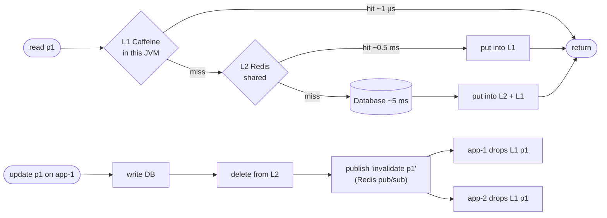

**Rules for L1:**
- Keep it **small** (bounded size, e.g. 10k entries) and **short-lived** (TTL of seconds to minutes) as a safety net, even with invalidation messages.
- Use it for data where a few seconds of staleness is acceptable, or invalidate on change.
- Use a proper cache library (**Caffeine**: W-TinyLFU eviction, async refresh, stats), not an unbounded `HashMap`.

**Memoization rules:** the function must be pure; bound the memo (or it is a memory leak); key on **all** inputs; beware recursion with `computeIfAbsent` (modifying the map inside its own mapping function throws `ConcurrentModificationException` on `HashMap` and `IllegalStateException: Recursive update` on `ConcurrentHashMap`).

---

## 1.4 Complete Java Example - L1 + L2 Cache with Invalidation, and Memoization

Two app instances share a "Redis" and a "database". Each access is charged an illustrative cost (L1 1 µs, L2 500 µs, DB 5,000 µs). Then a write on one instance broadcasts an invalidation to the other. Part B memoizes Fibonacci.

```java
import java.util.ArrayList;
import java.util.HashMap;
import java.util.LinkedHashMap;
import java.util.List;
import java.util.Map;
import java.util.function.Consumer;
import java.util.function.Function;

// Part A: a two-level cache (L1 in-process per instance + L2 shared like Redis + DB), with cost accounting and
//         cross-instance invalidation (what Caffeine + Redis pub/sub does).
// Part B: memoization of a pure function.

class Costs {                                                    // illustrative per-access costs in microseconds
    static final int L1_US = 1, L2_US = 500, DB_US = 5_000;
}

class SharedRedis {                                              // L2: shared by all app instances
    final Map<String, String> data = new HashMap<>();
    final List<Consumer<String>> invalidationSubscribers = new ArrayList<>();
    void publishInvalidation(String key) { invalidationSubscribers.forEach(s -> s.accept(key)); }
}

class Database {
    final Map<String, String> rows = new HashMap<>(Map.of("p1", "Keyboard Rs 2499", "p2", "Mouse Rs 799", "p3", "Monitor Rs 12000"));
    int reads = 0;
    String read(String k) { reads++; return rows.get(k); }
}

class AppInstance {
    final String name;
    private final Map<String, String> l1;                         // small LRU per instance (Caffeine in real life)
    private final SharedRedis l2; private final Database db;
    int l1Hits, l2Hits, dbHits; long costUs;
    AppInstance(String name, SharedRedis l2, Database db, int l1Capacity) {
        this.name = name; this.l2 = l2; this.db = db;
        this.l1 = new LinkedHashMap<>(16, 0.75f, true) {
            @Override protected boolean removeEldestEntry(Map.Entry<String, String> e) { return size() > l1Capacity; }
        };
        l2.invalidationSubscribers.add(key -> l1.remove(key));   // listen for "key changed" broadcasts
    }
    String get(String key) {
        String v = l1.get(key);
        if (v != null) { l1Hits++; costUs += Costs.L1_US; return v; }
        v = l2.data.get(key);
        if (v != null) { l2Hits++; costUs += Costs.L1_US + Costs.L2_US; l1.put(key, v); return v; }
        dbHits++; costUs += Costs.L1_US + Costs.L2_US + Costs.DB_US;
        v = db.read(key); l2.data.put(key, v); l1.put(key, v);
        return v;
    }
    void update(String key, String value) {                      // write DB, delete L2, tell every instance to drop L1
        db.rows.put(key, value); l2.data.remove(key); l2.publishInvalidation(key);
    }
    String stats() {
        int total = l1Hits + l2Hits + dbHits;
        return String.format("%s: %d reads -> L1 %d, L2 %d, DB %d | avg cost %.1f us/read", name, total, l1Hits, l2Hits, dbHits, (double) costUs / total);
    }
}

public class MultiLevelCacheDemo {
    @SuppressWarnings("unchecked")
    public static void main(String[] args) {
        SharedRedis redis = new SharedRedis(); Database db = new Database();
        AppInstance a = new AppInstance("app-1", redis, db, 2), b = new AppInstance("app-2", redis, db, 2);

        System.out.println("=== A) Two-level cache: 1,000 reads per instance, 80% of them for the hot product p1 ===");
        String[] pattern = {"p1", "p1", "p1", "p1", "p2", "p1", "p1", "p1", "p1", "p3"};   // fixed, repeatable access pattern
        for (int i = 0; i < 1000; i++) { a.get(pattern[i % 10]); b.get(pattern[i % 10]); }
        System.out.println("  " + a.stats());
        System.out.println("  " + b.stats());
        System.out.println("  database reads in total: " + db.reads + " (each key loaded once, then served from Redis to app-2)");
        System.out.printf("  without any cache: %d us/read; L1 alone avoids the network for most reads%n", Costs.DB_US);

        System.out.println("=== Invalidation across instances ===");
        System.out.println("  before: app-2 sees '" + b.get("p1") + "'");
        a.update("p1", "Keyboard Rs 1999 (sale)");
        System.out.println("  app-1 updated p1 -> broadcast invalidation");
        System.out.println("  after : app-2 sees '" + b.get("p1") + "' (L1 entry dropped, reloaded through L2/DB)");

        System.out.println("=== B) Memoization: cache the results of a pure function ===");
        int[] calls = {0};
        Function<Integer, Long>[] fibRef = new Function[1];
        fibRef[0] = n -> { calls[0]++; return n < 2 ? (long) n : fibRef[0].apply(n - 1) + fibRef[0].apply(n - 2); };
        long r1 = fibRef[0].apply(30);
        System.out.println("  plain recursive fib(30) = " + r1 + " with " + calls[0] + " calls");

        Map<Integer, Long> memo = new HashMap<>(); calls[0] = 0;
        Function<Integer, Long>[] memoFib = new Function[1];
        memoFib[0] = n -> {
            Long cached = memo.get(n);                              // don't use computeIfAbsent recursively on HashMap/ConcurrentHashMap
            if (cached != null) return cached;
            calls[0]++;
            long v = n < 2 ? n : memoFib[0].apply(n - 1) + memoFib[0].apply(n - 2);
            memo.put(n, v);
            return v;
        };
        long r2 = memoFib[0].apply(30);
        System.out.println("  memoized fib(30)        = " + r2 + " with " + calls[0] + " calls");
        calls[0] = 0; memoFib[0].apply(30);
        System.out.println("  memoized fib(30) again  -> " + calls[0] + " new calls (pure cache hit)");
    }
}
```

**Output:**
```
=== A) Two-level cache: 1,000 reads per instance, 80% of them for the hot product p1 ===
  app-1: 1000 reads -> L1 799, L2 198, DB 3 | avg cost 116.5 us/read
  app-2: 1000 reads -> L1 799, L2 201, DB 0 | avg cost 101.5 us/read
  database reads in total: 3 (each key loaded once, then served from Redis to app-2)
  without any cache: 5000 us/read; L1 alone avoids the network for most reads
=== Invalidation across instances ===
  before: app-2 sees 'Keyboard Rs 2499'
  app-1 updated p1 -> broadcast invalidation
  after : app-2 sees 'Keyboard Rs 1999 (sale)' (L1 entry dropped, reloaded through L2/DB)
=== B) Memoization: cache the results of a pure function ===
  plain recursive fib(30) = 832040 with 2692537 calls
  memoized fib(30)        = 832040 with 31 calls
  memoized fib(30) again  -> 0 new calls (pure cache hit)
```

What the output shows:
- With an L1 of only **2 entries**, ~80% of reads were answered **in-process**; most of the rest came from Redis; the database was read **3 times in total** (once per product), because app-2's misses were filled from L2, not the DB.
- Average cost was **~100-117 µs per read instead of 5,000 µs**: roughly a 45× improvement, mostly from L1.
- After app-1 updated `p1`, app-2's **L1 copy was dropped** by the broadcast and app-2 read the new price immediately. Without invalidation it would have served the old price until its TTL expired.
- **Memoization** cut `fib(30)` from **2,692,537** calls to **31**, and a second call needed **0**: exponential work became linear.

---

## 1.5 In Spring Boot (Caffeine, Redis, `@Cacheable`)

```yaml
spring:
  cache:
    type: caffeine                       # L1 only; use 'redis' for L2 only
    caffeine:
      spec: maximumSize=10000,expireAfterWrite=5m,recordStats
    cache-names: products, permissions
```

```java
@Service
class ProductService {
    @Cacheable(cacheNames = "products", key = "#id", sync = true)     // memoize per id; sync = one loader per key (stampede guard)
    public ProductDto find(long id) { return repository.findDto(id); }

    @CacheEvict(cacheNames = "products", key = "#p.id")
    public void update(ProductDto p) { repository.update(p); }
}

// Plain Caffeine with refresh-ahead: serve the old value while reloading in the background
LoadingCache<String, Rates> fxRates = Caffeine.newBuilder()
        .maximumSize(1_000)
        .refreshAfterWrite(Duration.ofMinutes(1))     // async reload after 1 min, readers never block
        .expireAfterWrite(Duration.ofMinutes(10))     // hard limit if refresh keeps failing
        .recordStats()                               // hit ratio exposed via Micrometer (cache.gets{result=hit})
        .build(currency -> fxClient.fetch(currency));
```

**Two levels in Spring:** Spring's cache abstraction has no built-in tiered cache. Common options:
- **Redisson `RLocalCachedMap`**: a Redis map with a local near cache and automatic invalidation messages.
- **Redis client-side caching** (Redis 6+ `CLIENT TRACKING`, supported by Lettuce): Redis tells the client when a cached key changes.
- A small custom `Cache` implementation that checks Caffeine, then Redis, and listens on a Redis pub/sub channel for invalidations (the example above, in miniature).
- **Hazelcast near cache** if you already use Hazelcast.

#### 📘 Terms Explained

| Term | Simple meaning |
|---|---|
| **Caffeine** | High-performance Java in-process cache library (W-TinyLFU eviction); Spring Boot's default local cache. |
| **`@Cacheable` / `@CacheEvict`** | Spring annotations to memoize a method's result / remove entries. |
| **`sync = true`** | Only one thread loads a missing key; others wait for that result. |
| **Refresh-ahead (`refreshAfterWrite`)** | Reload an entry in the background before it expires, while still serving the old value. |
| **Near cache** | A local copy of entries from a distributed cache, kept close to the application. |
| **Redis pub/sub** | Redis's publish/subscribe messaging, commonly used for cache invalidation broadcasts. |

---

## 1.6 Pros, Cons, Pitfalls, Interview Questions and Cheat Sheet

| Pros | Cons |
|---|---|
| L1 removes network round trips for the hottest data | Staleness and inconsistency between instances |
| L2 shares warm data across instances and restarts | More moving parts (invalidation channel, two TTLs) |
| Memoization turns repeated work into lookups | Memory use; caches can hide bugs and make tests flaky |

| Pitfall | Fix |
|---|---|
| Unbounded `HashMap` used as a cache | Caffeine with `maximumSize` + TTL. |
| L1 for per-user or huge data sets | L1 for small, hot, shared data; L2 for the rest. |
| No TTL because "we invalidate" | Always a TTL as a safety net; messages get lost. |
| Caching mutable objects then modifying them | Cache immutable DTOs/records. |
| Self-invocation of an `@Cacheable` method | Same proxy rule as `@Transactional`: call through another bean. |
| Memoizing an impure function (time, randomness, DB state) | Only pure functions, or include the changing input in the key. |

**Q1. Why use both a local and a distributed cache?** Local (L1) gives microsecond reads with no network; distributed (L2) gives one shared, warm copy for all instances. Together, most reads never leave the JVM and misses still avoid the database. Keep L1 small with short TTLs and invalidate via pub/sub.

**Q2. What is memoization and when is it safe?** Caching a function's result by its arguments. Safe only for pure functions; bound the memo's size. `@Cacheable` is memoization for Spring bean methods.

**Q3. How do you keep L1 caches consistent across instances?** Short TTLs, plus invalidation messages (Redis pub/sub, Kafka topic, Redis client-side caching, Hazelcast near-cache invalidation) on every write.

```
CACHING STRATEGY  Layers: browser/CDN -> L1 in-JVM (Caffeine, µs) -> L2 shared (Redis, ~0.5 ms) -> DB (ms).
                  L1: small, bounded, short TTL, hot read-mostly data. L2: shared, consistent across instances.
                  Invalidate L1 via pub/sub / client-side caching; TTL always. Refresh-ahead for hot keys. @Cacheable(sync=true).
MEMOIZATION       Cache pure function results by args; bound it; no recursive computeIfAbsent. Basics: Scalability_Pattern §8-11.
```

---

# 2. Connection Pooling and Keep-Alive (Interview Imp - Java)

## 2.1 What Is It?

- **Connection pooling:** keep a set of **already-open** connections (to a database, Redis, an HTTP service) and **lend** them to requests, instead of opening and closing a new connection every time.
- **Keep-alive (persistent connections):** reuse the same TCP (and TLS) connection for **many** HTTP requests instead of one connection per request. An HTTP client's connection pool is keep-alive plus a limit on how many connections to keep.

**Analogy:** A taxi stand outside a station. Instead of calling a new taxi from the depot for each passenger (slow: the taxi has to drive over), a few taxis wait at the stand; each passenger takes the next one, and the taxi returns to the stand after the trip. If the stand is too small, passengers queue; if it's huge, taxis sit idle and block the road.

#### 📘 Terms Explained

| Term | Simple meaning |
|---|---|
| **Connection pool** | A cache of open connections that are borrowed and returned instead of opened and closed. |
| **HikariCP** | The fast JDBC connection pool used by default in Spring Boot. |
| **Keep-alive / persistent connection** | Reusing one TCP connection for multiple HTTP requests. |
| **TLS handshake** | The setup exchange that establishes an encrypted connection; costs round trips and CPU. |
| **Pool exhaustion** | All connections are in use, so new requests must wait (and may time out). |
| **Connection leak** | Code borrows a connection and never returns it. |

---

## 2.2 Why Do We Need It?

Opening a database connection costs: TCP handshake, TLS handshake, authentication, session setup, and server-side memory/process allocation (PostgreSQL forks a backend process per connection). That's often **10-50 ms**, while the query itself may take **1-5 ms**.

| Without a pool | With a pool |
|---|---|
| Every request pays the connect cost | Pay it once per connection, reuse it thousands of times |
| Unlimited concurrent connections can overwhelm the DB | `maximumPoolSize` caps concurrency: the pool is also a **bulkhead** |
| Connection churn (TIME_WAIT sockets, auth load) | Stable, long-lived connections |

The same applies to **HTTP clients** (calling partner APIs, microservices): without keep-alive, each call pays TCP + TLS setup.

---

## 2.3 How It Works: Pool Sizing with Little's Law

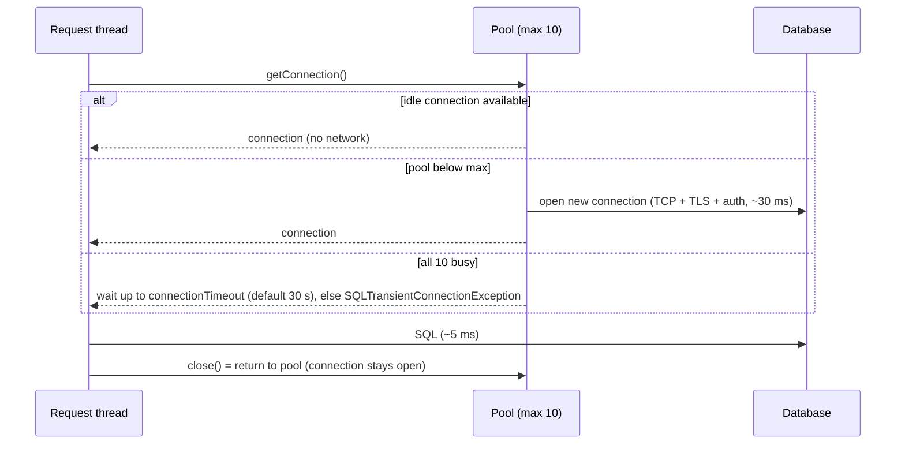

**How big should the pool be?**
- **Little's Law:** connections busy ≈ requests per second × seconds each request **holds** a connection. 500 req/s × 0.005 s = 2.5.
- **HikariCP's rule of thumb** for the *database side*: `connections ≈ (CPU cores × 2) + effective spindle count`. A database with 8 cores rarely benefits from more than ~20-30 active connections **in total**, across all app instances.
- **Total = instances × pool size.** 20 pods × 50 connections = 1,000 connections: far beyond what most databases handle well. Smaller pools are usually **faster** (less contention in the DB).
- What **inflates** hold time (and therefore the pool you need): long transactions, slow queries, and **calling external services while a transaction is open**.

---

## 2.4 Complete Java Example - No Pool vs Pool, Sizing, and Pool Exhaustion

A virtual-clock simulation: 1,000 requests arrive every 2 ms (500 req/s), each needing a connection for 5 ms of SQL; opening a connection costs 30 ms. The pool grows lazily up to its maximum, and requests wait when all connections are busy.

```java
import java.util.PriorityQueue;

// Connection pooling on a virtual clock (deterministic, no real sleeps).
// A request needs a DB connection for QUERY_MS. Opening a new connection (TCP + TLS + auth) costs CONNECT_MS.
// Part A: no pool vs pool.  Part B: pool sizing with Little's Law.  Part C: pool exhaustion caused by holding a
// connection during a slow external call.

public class ConnectionPoolDemo {
    static final int CONNECT_MS = 30, QUERY_MS = 5;

    record Result(long avgLatencyMs, long maxLatencyMs, long maxWaitMs, int connectionsOpened) {}

    // requests arrive every 'gapMs'; each holds a connection for 'holdMs'; pool of 'size' (0 = no pool: open per request)
    static Result simulate(int requests, int gapMs, int holdMs, int size) {
        PriorityQueue<Long> freeAt = new PriorityQueue<>();            // when each pooled connection becomes free
        long totalLatency = 0, maxLatency = 0, maxWait = 0; int opened = 0;
        for (int i = 0; i < requests; i++) {
            long arrive = (long) i * gapMs, start, latency;
            if (size == 0) {                                          // no pool: connect, use, close
                opened++; latency = CONNECT_MS + holdMs; start = arrive;
            } else {
                if (freeAt.size() < size) { opened++; freeAt.add(arrive + CONNECT_MS); }   // pool grows lazily up to max
                long free = freeAt.poll();
                start = Math.max(arrive, free);                       // wait if every connection is busy
                maxWait = Math.max(maxWait, start - arrive);
                freeAt.add(start + holdMs);
                latency = start + holdMs - arrive;
            }
            totalLatency += latency; maxLatency = Math.max(maxLatency, latency);
        }
        return new Result(totalLatency / requests, maxLatency, maxWait, opened);
    }

    static void print(String label, Result r) {
        System.out.printf("  %-44s avg %4d ms | worst %5d ms | worst wait for a connection %5d ms | connections opened %d%n",
                label, r.avgLatencyMs(), r.maxLatencyMs(), r.maxWaitMs(), r.connectionsOpened());
    }

    public static void main(String[] args) {
        System.out.println("=== A) 1,000 requests, one every 2 ms (500 req/s), 5 ms of SQL each ===");
        print("no pool (connect per request)", simulate(1000, 2, QUERY_MS, 0));
        print("pool of 10", simulate(1000, 2, QUERY_MS, 10));

        System.out.println("=== B) Sizing with Little's Law: connections in use = arrival rate x hold time ===");
        double rate = 500, holdSeconds = QUERY_MS / 1000.0;
        System.out.printf("  L = %.0f req/s x %.3f s = %.1f connections busy on average -> a pool of ~5-10 is plenty%n", rate, holdSeconds, rate * holdSeconds);
        print("pool of 2 (too small: 2 x 200/s < 500/s)", simulate(1000, 2, QUERY_MS, 2));
        print("pool of 3 (just enough on average)", simulate(1000, 2, QUERY_MS, 3));
        print("pool of 50 (bigger is not faster)", simulate(1000, 2, QUERY_MS, 50));

        System.out.println("=== C) Pool exhaustion: the transaction also waits 200 ms for a payment API ===");
        int hold = QUERY_MS + 200;
        System.out.printf("  Little's Law now says %.0f connections are needed%n", rate * hold / 1000.0);
        print("pool of 10, connection held during HTTP call", simulate(1000, 2, hold, 10));
        print("pool of 10, HTTP call made OUTSIDE the tx", simulate(1000, 2, QUERY_MS, 10));
    }
}
```

**Output:**
```
=== A) 1,000 requests, one every 2 ms (500 req/s), 5 ms of SQL each ===
  no pool (connect per request)                avg   35 ms | worst    35 ms | worst wait for a connection     0 ms | connections opened 1000
  pool of 10                                   avg    5 ms | worst    35 ms | worst wait for a connection    30 ms | connections opened 10
=== B) Sizing with Little's Law: connections in use = arrival rate x hold time ===
  L = 500 req/s x 0.005 s = 2.5 connections busy on average -> a pool of ~5-10 is plenty
  pool of 2 (too small: 2 x 200/s < 500/s)     avg  284 ms | worst   534 ms | worst wait for a connection   529 ms | connections opened 2
  pool of 3 (just enough on average)           avg    6 ms | worst    35 ms | worst wait for a connection    30 ms | connections opened 3
  pool of 50 (bigger is not faster)            avg    5 ms | worst    35 ms | worst wait for a connection    30 ms | connections opened 50
=== C) Pool exhaustion: the transaction also waits 200 ms for a payment API ===
  Little's Law now says 103 connections are needed
  pool of 10, connection held during HTTP call avg 9392 ms | worst 18550 ms | worst wait for a connection 18345 ms | connections opened 10
  pool of 10, HTTP call made OUTSIDE the tx    avg    5 ms | worst    35 ms | worst wait for a connection    30 ms | connections opened 10
```

What the output shows:
- **No pool:** every request paid 30 ms of connect time (35 ms each) and **1,000 connections** were opened and closed. **Pool of 10:** average **5 ms**; only the first few requests paid the connect cost.
- **Little's Law** predicted 2.5 busy connections. A pool of **2** can serve only 2 × (1000/5) = 400 req/s < 500 req/s, so a queue built up (average 284 ms, worst wait 529 ms). A pool of **3** was already enough, and **50 was no faster than 10**: past the point Little's Law gives, a bigger pool only adds load on the database.
- **Pool exhaustion:** holding the connection during a 200 ms payment call meant Little's Law now needed **~103 connections**; with 10, requests queued for up to **18 seconds** (in real HikariCP they'd fail after `connectionTimeout`). Moving the HTTP call **outside the transaction** fixed it with the same pool of 10.

---

## 2.5 In Spring Boot (HikariCP, HTTP Client Pools, Tomcat Keep-Alive)

```yaml
spring:
  datasource:
    url: jdbc:postgresql://db:5432/shop
    hikari:
      maximum-pool-size: 10            # default 10; size with Little's Law and the DB's total limit
      minimum-idle: 10                 # default = maximum-pool-size (fixed-size pool, recommended)
      connection-timeout: 2000         # ms to wait for a free connection (default 30000): fail fast instead of piling up
      max-lifetime: 1800000            # retire connections before DB/firewall idle limits (default 30 min)
      keepalive-time: 300000           # ping idle connections so middleboxes don't drop them
      leak-detection-threshold: 20000  # log a stack trace if a connection is held > 20 s
  jpa:
    open-in-view: false                # don't hold a connection while rendering the response

management:
  endpoints.web.exposure.include: health,metrics,prometheus   # hikaricp_connections_active / _pending / _timeout_total
```

```java
// HTTP keep-alive + pooling: build ONE client and reuse it (the JDK HttpClient pools connections internally)
@Bean
HttpClient jdkHttpClient() {
    return HttpClient.newBuilder().connectTimeout(Duration.ofSeconds(2)).version(HttpClient.Version.HTTP_2).build();
}

// Apache HttpClient 5 behind RestClient / RestTemplate: explicit pool limits per route
@Bean
RestClient partnerClient(RestClient.Builder builder) {
    PoolingHttpClientConnectionManager pool = PoolingHttpClientConnectionManagerBuilder.create()
            .setMaxConnTotal(200).setMaxConnPerRoute(50).build();
    CloseableHttpClient http = HttpClients.custom().setConnectionManager(pool)
            .evictIdleConnections(TimeValue.ofSeconds(30)).build();
    return builder.baseUrl("https://partner.example.com")
            .requestFactory(new HttpComponentsClientHttpRequestFactory(http)).build();
}
```

```yaml
# Server side keep-alive (embedded Tomcat)
server:
  tomcat:
    keep-alive-timeout: 20s            # how long an idle client connection stays open
    max-keep-alive-requests: 100       # requests per connection before closing (default 100; -1 = unlimited)
    max-connections: 8192
```

**Beyond the app pool:** with many instances, put **PgBouncer** (PostgreSQL, transaction pooling) or **RDS Proxy** in front of the database so thousands of app connections share a few hundred real ones. Redis clients (Lettuce) multiplex many commands over one connection and usually need no pool.

#### 📘 Terms Explained

| Term | Simple meaning |
|---|---|
| **`maximum-pool-size` / `minimum-idle`** | Upper bound on connections / connections kept open when idle. |
| **`connection-timeout`** | How long a thread waits for a free pooled connection before failing. |
| **`max-lifetime`** | Maximum age of a connection before Hikari replaces it. |
| **Leak detection** | Logging when a connection is held longer than a threshold (likely not closed). |
| **PgBouncer / RDS Proxy** | External connection poolers between many app instances and the database. |
| **Max connections per route** | HTTP client limit on concurrent connections to one host. |

---

## 2.6 Pros, Cons, Pitfalls, Interview Questions and Cheat Sheet

| Pros | Cons |
|---|---|
| Removes connect/TLS/auth cost from each request | Mis-sized pools: too small → queues, too large → DB overload |
| Caps DB concurrency (acts as a bulkhead) | Stale/broken connections must be validated and retired |
| Keep-alive cuts HTTP latency and CPU | Leaks exhaust the pool and look like "the DB is slow" |

| Pitfall | Fix |
|---|---|
| Huge pools "for performance" | Size with Little's Law; total across instances ≤ what the DB handles well. |
| Holding a connection during HTTP calls / user think time / long processing | Short transactions; external calls outside; `open-in-view=false`. |
| Creating a new `HttpClient`/`RestTemplate` per request | One shared, pooled client bean. |
| 30 s default `connection-timeout` → threads pile up | Lower it (1-3 s) and alert on pending connections. |
| Connections dropped by firewalls/load balancers when idle | `max-lifetime` and `keepalive-time` below those limits. |
| Not closing connections in plain JDBC | try-with-resources; leak detection. |

**Q1. Why use a connection pool?** Opening a connection is expensive (TCP, TLS, auth, server process); a pool reuses open connections, cutting latency and protecting the DB from too many connections.

**Q2. How do you size a HikariCP pool?** Start from Little's Law (throughput × hold time) and the database's capacity (≈ cores × 2 + spindles, total across all instances); keep it small and fixed-size; measure `pending` and `active` metrics under load.

**Q3. Symptoms of pool exhaustion and causes?** Rising latency, `SQLTransientConnectionException: Connection is not available, request timed out`, high `hikaricp_connections_pending`. Causes: leaks, long transactions, slow queries, external calls inside transactions, too-small pool for the load.

**Q4. What is HTTP keep-alive?** Reusing one TCP/TLS connection for multiple HTTP requests (default in HTTP/1.1), avoiding a new handshake per request. Client pools and server `keep-alive-timeout` control it.

```
CONNECTION POOL  Reuse open DB/HTTP connections. HikariCP: max-pool-size (default 10), fixed size, connection-timeout (lower it),
                 max-lifetime, keepalive-time, leak-detection. Size = Little's Law (λ x hold time); DB limit ~ cores*2+spindles TOTAL.
                 Keep tx short; no HTTP calls inside tx; open-in-view=false. PgBouncer / RDS Proxy for many instances.
KEEP-ALIVE       Reuse TCP+TLS for many HTTP requests. One shared pooled client (JDK HttpClient, Apache PoolingHttpClientConnectionManager).
                 Server: server.tomcat.keep-alive-timeout / max-keep-alive-requests.
```

---

## 2.7 Types and Variants

| Pool / reuse | What is reused | Java / Spring |
|---|---|---|
| **Database connection pool** | JDBC connections (TCP + auth + session setup) | HikariCP (Spring Boot default): `maximumPoolSize`, `connectionTimeout`, `maxLifetime` |
| **HTTP connection pool (keep-alive)** | TCP/TLS connections to the same host | Apache HttpClient 5 `PoolingHttpClientConnectionManager`, OkHttp `ConnectionPool`, Reactor Netty pools in WebClient |
| **HTTP/2 multiplexing** | One connection carries many concurrent streams | Java `HttpClient` (HTTP/2), gRPC channels |
| **Thread pool** | Worker threads | `ExecutorService`, Tomcat `server.tomcat.threads.max`, `@Async` executors |
| **Object / buffer pools** | Expensive objects or byte buffers | Netty `PooledByteBufAllocator`, Apache Commons Pool ([Object Pool](../04_Specialized/10_Game_Development_Pattern.md#4-object-pool-interview-imp---java)) |
| **Server-side poolers** | Many app connections share fewer DB connections | PgBouncer (transaction pooling), ProxySQL, RDS Proxy |

Sizing rule of thumb for DB pools: small pools (often `cores × 2` to a few dozen) beat huge ones; measure wait time and DB CPU.

# 3. Batching and Request Coalescing

## 3.1 What Is It?

- **Batching:** group many small operations into **one** larger operation, so the fixed per-operation cost (network round trip, statement parsing, disk flush, transaction commit) is paid once for many items. Examples: JDBC batch inserts, Kafka producer batches, bulk API endpoints, `MGET` in Redis.
- **Request coalescing** ("single flight", "request collapsing"): when many concurrent requests ask for the **same** thing, make **one** backend call and give the result to all of them.

**Analogy:** A delivery van. Driving to the warehouse for each parcel (no batching) wastes most of the time on the road. The van waits until it's **full** or until **a set time** has passed (size or linger), then drives once. Coalescing: ten people in an office all want coffee from the same café; one person goes and brings ten cups.

#### 📘 Terms Explained

| Term | Simple meaning |
|---|---|
| **Batch** | A group of operations sent or executed together. |
| **Linger / max wait** | The maximum time an item may wait for a batch to fill before it is sent anyway. |
| **Fixed cost vs marginal cost** | Cost paid per call regardless of size vs extra cost per item. |
| **Request coalescing / single flight** | Merging identical concurrent requests into one backend call. |
| **Bulk API** | An endpoint that accepts many items in one request. |

---

## 3.2 Why Do We Need It?

| Workload | Without batching | With batching |
|---|---|---|
| Import 10,000 rows | 10,000 round trips | 10-200 round trips |
| Publish 1M Kafka events | 1M network requests | Thousands of compressed batches |
| Load profiles for 100 IDs | 100 calls (N+1) | 1 call with `IN (...)` / bulk endpoint |
| Cache miss on a hot key under load | 500 identical DB queries (stampede) | 1 query, 500 waiters (coalescing) |

The cost is **latency for the first item** in a batch (it waits for others) and **all-or-nothing failure** handling for the batch.

---

## 3.3 How It Works: Size, Linger and Coalescing

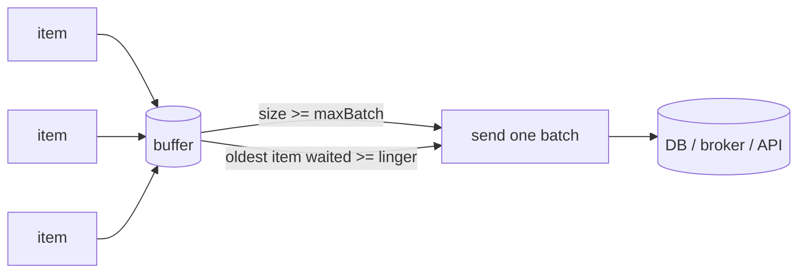

- **Flush on size OR time:** size gives throughput; linger bounds the extra latency. Kafka's producer works exactly this way (`batch.size`, `linger.ms`).
- **Choose batch size by diminishing returns:** once the fixed cost is spread over ~50-500 items, bigger batches barely help and increase memory, lock time and blast radius on failure.
- **Coalescing:** keep a map of in-flight requests (`key → future`). The first caller starts the load; others attach to the same future; the entry is removed when it completes.

---

## 3.4 Complete Java Example - Round Trips, a Size-or-Linger Batcher and Single-Flight

Part A uses a cost model (0.5 ms per round trip, 0.01 ms per row). Part B runs a size-4 / linger-20 ms batcher on a virtual clock with a 1 ms background tick. Part C makes 20 real concurrent requests for the same key through a coalescing map.

```java
import java.util.ArrayList;
import java.util.List;
import java.util.Map;
import java.util.concurrent.CompletableFuture;
import java.util.concurrent.ConcurrentHashMap;
import java.util.concurrent.CountDownLatch;
import java.util.concurrent.ExecutorService;
import java.util.concurrent.Executors;
import java.util.concurrent.atomic.AtomicInteger;

// Batching: pay the fixed per-call cost once for many items.
// Part A: cost model for inserting 10,000 rows (one-by-one vs JDBC batch vs multi-row insert).
// Part B: a batch writer that flushes on size OR time (like Kafka's batch.size + linger.ms), on a virtual clock.
// Part C: request coalescing ("single flight"): 20 concurrent requests for the same key -> 1 backend call.

public class BatchingDemo {
    static final double ROUND_TRIP_MS = 0.5, PER_ROW_MS = 0.01;      // network + parse per statement vs per-row work

    static double cost(int rows, int rowsPerRoundTrip) {
        int trips = (rows + rowsPerRoundTrip - 1) / rowsPerRoundTrip;
        return trips * ROUND_TRIP_MS + rows * PER_ROW_MS;
    }

    // ---- Part B ----
    static class BatchWriter {
        final int maxBatch; final long lingerMs; final List<String> buffer = new ArrayList<>(); long firstItemAt = -1; int flushes = 0;
        BatchWriter(int maxBatch, long lingerMs) { this.maxBatch = maxBatch; this.lingerMs = lingerMs; }
        void add(String item, long now) {
            tick(now);
            if (buffer.isEmpty()) firstItemAt = now;
            buffer.add(item);
            if (buffer.size() >= maxBatch) flush(now, "size");
        }
        void tick(long now) { if (!buffer.isEmpty() && now - firstItemAt >= lingerMs) flush(now, "linger"); }
        void flush(long now, String why) {
            flushes++;
            System.out.printf("    t=%3dms flush #%d (%s): %d items, oldest waited %dms%n", now, flushes, why, buffer.size(), now - firstItemAt);
            buffer.clear();
        }
    }

    // ---- Part C ----
    static final AtomicInteger backendCalls = new AtomicInteger();
    static final Map<String, CompletableFuture<String>> inFlight = new ConcurrentHashMap<>();
    static CompletableFuture<String> getCoalesced(String key, CountDownLatch allArrived) {
        return inFlight.computeIfAbsent(key, k -> CompletableFuture.supplyAsync(() -> {
            try { allArrived.await(); } catch (InterruptedException e) { throw new IllegalStateException(e); }   // slow backend
            backendCalls.incrementAndGet();
            return "profile-of-" + k;
        }).whenComplete((v, e) -> inFlight.remove(k)));
    }

    public static void main(String[] args) throws Exception {
        System.out.println("=== A) Insert 10,000 rows (0.5 ms per round trip, 0.01 ms per row) ===");
        System.out.printf("  one INSERT per row        : %7.1f ms (10,000 round trips)%n", cost(10_000, 1));
        System.out.printf("  JDBC batch of 50          : %7.1f ms (200 round trips)%n", cost(10_000, 50));
        System.out.printf("  JDBC batch of 1,000       : %7.1f ms (10 round trips)%n", cost(10_000, 1_000));
        System.out.printf("  -> diminishing returns: batch 50 already removes %.0f%% of the cost%n", 100 * (1 - cost(10_000, 50) / cost(10_000, 1)));

        System.out.println("=== B) Batch writer: max 4 items OR 20 ms linger ===");
        BatchWriter w = new BatchWriter(4, 20);
        long[] arrivals = {0, 1, 2, 3, 10, 12, 50, 51, 52, 53, 54, 120};   // a burst, a trickle, another burst, a straggler
        int next = 0;
        for (long now = 0; now <= 150; now++) {                   // a background timer checks the linger every millisecond
            w.tick(now);
            while (next < arrivals.length && arrivals[next] == now) w.add("e" + next++, now);
        }
        System.out.println("    " + arrivals.length + " events -> " + w.flushes + " writes; latency is bounded by linger (20 ms)");

        System.out.println("=== C) Request coalescing: 20 concurrent requests for the same profile ===");
        ExecutorService pool = Executors.newFixedThreadPool(20);
        CountDownLatch arrived = new CountDownLatch(20);
        List<CompletableFuture<String>> results = new ArrayList<>();
        for (int i = 0; i < 20; i++) results.add(CompletableFuture.supplyAsync(() -> {
            CompletableFuture<String> f = getCoalesced("u-42", arrived);
            arrived.countDown();                                  // the backend call finishes only after all 20 have joined it
            return f.join();
        }, pool));
        long same = results.stream().map(CompletableFuture::join).filter("profile-of-u-42"::equals).count();
        pool.shutdown();
        System.out.println("  " + same + " callers got the result, backend calls made: " + backendCalls.get());
    }
}
```

**Output:**
```
=== A) Insert 10,000 rows (0.5 ms per round trip, 0.01 ms per row) ===
  one INSERT per row        :  5100.0 ms (10,000 round trips)
  JDBC batch of 50          :   200.0 ms (200 round trips)
  JDBC batch of 1,000       :   105.0 ms (10 round trips)
  -> diminishing returns: batch 50 already removes 96% of the cost
=== B) Batch writer: max 4 items OR 20 ms linger ===
    t=  3ms flush #1 (size): 4 items, oldest waited 3ms
    t= 30ms flush #2 (linger): 2 items, oldest waited 20ms
    t= 53ms flush #3 (size): 4 items, oldest waited 3ms
    t= 74ms flush #4 (linger): 1 items, oldest waited 20ms
    t=140ms flush #5 (linger): 1 items, oldest waited 20ms
    12 events -> 5 writes; latency is bounded by linger (20 ms)
=== C) Request coalescing: 20 concurrent requests for the same profile ===
  20 callers got the result, backend calls made: 1
```

What the output shows:
- **Part A:** one INSERT per row cost 5.1 s; a batch of **50** cut it to 0.2 s (**96%** less), and a batch of 1,000 only saved another 95 ms: diminishing returns.
- **Part B:** bursts were flushed by **size** within 3 ms; the trickle and the straggler were flushed by **linger**, so no event waited more than **20 ms**. 12 events → 5 writes.
- **Part C:** 20 concurrent callers got the same profile, but the backend was called **once**. This is the same idea as `@Cacheable(sync = true)` and protects against cache stampedes.

---

## 3.5 In Spring Boot (JDBC, Hibernate, Kafka, GraphQL)

```java
// JdbcTemplate batch: one round trip per 500 rows
jdbcTemplate.batchUpdate("INSERT INTO events(id, type, payload) VALUES (?, ?, ?)", events, 500,
        (ps, e) -> { ps.setLong(1, e.id()); ps.setString(2, e.type()); ps.setString(3, e.payload()); });
```

```yaml
spring:
  jpa:
    properties:
      hibernate:
        jdbc.batch_size: 50            # Hibernate groups INSERT/UPDATE statements
        order_inserts: true            # sort statements by entity so batches aren't broken up
        order_updates: true
  datasource:
    url: jdbc:mysql://db/shop?rewriteBatchedStatements=true     # MySQL: turn a batch into multi-row INSERTs
    # PostgreSQL equivalent: jdbc:postgresql://db/shop?reWriteBatchedInserts=true
```

```java
@Entity
class Event {
    @Id
    @GeneratedValue(strategy = GenerationType.SEQUENCE, generator = "event_seq")
    @SequenceGenerator(name = "event_seq", allocationSize = 50)   // IDENTITY ids DISABLE insert batching in Hibernate; use a sequence
    private Long id;
}

// Large imports with JPA: flush + clear every batch so the persistence context doesn't grow without bound
@Transactional
public void importAll(List<EventDto> rows) {
    for (int i = 0; i < rows.size(); i++) {
        em.persist(Event.from(rows.get(i)));
        if (i % 50 == 49) { em.flush(); em.clear(); }
    }
}
```

```yaml
# Kafka producer batching (Spring Boot properties)
spring:
  kafka:
    producer:
      batch-size: 65536                # bytes per partition batch (default 16384)
      compression-type: lz4            # batches compress far better than single records
      properties:
        linger.ms: 10                  # wait up to 10 ms to fill a batch (default 5 ms in Kafka 4.0+, 0 before)
```

```java
// GraphQL: Spring for GraphQL @BatchMapping turns N per-order author lookups into ONE call (DataLoader under the hood)
@Controller
class OrderGraphQlController {
    @BatchMapping
    Map<Order, Customer> customer(List<Order> orders) {
        return customerService.findByIds(orders.stream().map(Order::customerId).toList());   // one query for all
    }
}
```

**Other batching:** Redis `MGET`/pipelining, Elasticsearch `_bulk`, bulk REST endpoints (`POST /orders:batch`), Spring Batch chunks ([01_Architectural_Pattern.md](../02_HLD/01_Architectural_Pattern.md#66-pipe-and-filter-in-java-and-spring)), Hibernate `@BatchSize` for lazy loading ([02_Enterprise_Application_Pattern.md](../02_HLD/02_Enterprise_Application_Pattern.md#64-the-n1-select-problem-interview-imp---java)).

#### 📘 Terms Explained

| Term | Simple meaning |
|---|---|
| **`batchUpdate`** | `JdbcTemplate` method that sends many parameter sets in one JDBC batch. |
| **`hibernate.jdbc.batch_size`** | Number of statements Hibernate groups into one JDBC batch. |
| **`rewriteBatchedStatements`** | MySQL driver option that rewrites batched INSERTs into multi-row INSERTs. |
| **`linger.ms` / `batch.size`** | Kafka producer: max wait to fill a batch / max batch size in bytes. |
| **DataLoader / `@BatchMapping`** | GraphQL batching utilities that collect per-field lookups and load them together. |
| **Pipelining** | Sending many commands without waiting for each reply (Redis). |

---

## 3.6 Pros, Cons, Pitfalls, Interview Questions and Cheat Sheet

| Pros | Cons |
|---|---|
| Huge throughput gains for many small operations | Extra latency for early items (bounded by linger) |
| Less CPU and network overhead on both sides | Partial failure handling: which item in the batch failed? |
| Coalescing removes duplicate work and stampedes | Big batches hold locks longer and use more memory |

| Pitfall | Fix |
|---|---|
| `GenerationType.IDENTITY` with Hibernate batching | SEQUENCE with `allocationSize` (pooled optimizer). |
| One huge transaction for a million rows | Chunks (e.g. 500-5,000) with commits; restartable jobs. |
| Batch without a time limit | Always flush on size **or** linger. |
| Coalescing with no timeout | A failed or hung load fails all waiters: add timeouts, remove the in-flight entry on completion. |
| Mixed statement types breaking batches | `order_inserts`/`order_updates`. |

**Q1. Why is batching faster?** It pays the fixed per-call costs (round trip, parse, commit, network headers) once for many items; total time becomes roughly `trips × roundTrip + items × perItem` with far fewer trips.

**Q2. How do you enable JDBC batching with Hibernate?** `hibernate.jdbc.batch_size`, `order_inserts`/`order_updates`, a SEQUENCE id generator (IDENTITY disables insert batching), and the driver rewrite flag for MySQL/PostgreSQL.

**Q3. What is request coalescing?** Merging concurrent identical requests into a single backend call and sharing its result, e.g. via a map of in-flight futures, `@Cacheable(sync = true)` or a CDN's request collapsing.

```
BATCHING      Pay fixed cost once for many items. Flush on SIZE or LINGER. Diminishing returns past ~50-500.
              JDBC batchUpdate; Hibernate jdbc.batch_size + order_inserts + SEQUENCE ids (not IDENTITY); flush/clear per chunk;
              rewriteBatchedStatements / reWriteBatchedInserts; Kafka batch.size + linger.ms + compression; @BatchMapping, MGET, _bulk.
COALESCING    In-flight map key -> future; N identical concurrent requests -> 1 backend call. @Cacheable(sync=true).
```

---

# 4. Asynchronous Processing (Interview Imp - Java)

## 4.1 What Is It?

**Asynchronous processing** means not making a caller **wait** for work it doesn't need to wait for. For performance it shows up in two ways:

1. **Parallel fan-out:** independent calls run **at the same time**, so latency becomes the **slowest** call instead of the **sum** of all calls.
2. **Offloading:** slow work (sending email, generating a PDF, transcoding a video) is put on a **queue** and done in the background; the request returns immediately (often `202 Accepted` with a job URL).

The building blocks (thread pools, `CompletableFuture`, virtual threads, structured concurrency) are covered in [11_Concurrency_Pattern.md](11_Concurrency_Pattern.md#6-future--promise-pattern-interview-imp---java) and queues in [04_Messaging_Pattern.md](04_Messaging_Pattern.md#1-message-queue-pattern-interview-imp---java). This section is about **when and how they make things faster**.

**Analogy:** Cooking dinner. Boiling rice, then making dal, then frying vegetables one after another takes 60 minutes; doing all three on three burners takes 25 (the longest dish). Offloading: you put the dishes in the dishwasher and go eat; you don't stand and watch it.

#### 📘 Terms Explained

| Term | Simple meaning |
|---|---|
| **Asynchronous** | The caller continues without waiting for the operation to finish. |
| **Fan-out / fan-in** | Start several operations in parallel / combine their results. |
| **`CompletableFuture`** | Java's composable future: run tasks async and combine results. |
| **Offloading** | Moving work off the request path to a background worker. |
| **202 Accepted** | HTTP status meaning "request accepted for processing, not finished yet". |
| **Virtual threads** | Cheap JVM-managed threads (Java 21+) that make blocking code scale. |

---

## 4.2 Why Do We Need It?

| Situation | Sync cost | Async benefit |
|---|---|---|
| Page needs 3 independent backend calls (300 + 200 + 400 ms) | 900 ms | ~400 ms (max) |
| Signup sends a welcome email (800 ms SMTP) | User waits 800 ms more | Return immediately; email sent by a worker |
| Report generation takes 2 minutes | HTTP timeout | 202 + job status / webhook / notification |
| Traffic spike of uploads | Threads blocked, server stalls | Queue absorbs the spike; workers drain at their pace |

> Async doesn't make the **work** faster; it makes the **user-visible latency** smaller and the **throughput** higher by not wasting threads on waiting.

---

## 4.3 How It Works: Parallel Fan-Out and Offloading

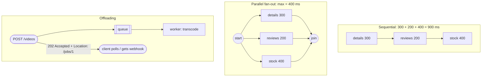

**Requirements:**
- Fan-out calls must be **independent** (no call needs another's result).
- Use a **dedicated executor** for blocking I/O (or virtual threads), never `ForkJoinPool.commonPool()` for blocking calls.
- Set **timeouts** on every branch, and decide what to do when one fails (fail all, or return partial results with a fallback).
- Offloaded work must be **durable** (queue, outbox) and **idempotent** (it may run twice), with a way to report status.

---

## 4.4 Complete Java Example - Sequential vs Parallel Calls, and 202 Accepted

This example uses **real threads and sleeps**, so instead of printing exact timings (which vary by machine), it prints whether each timing falls in the expected range.

```java
import java.util.ArrayList;
import java.util.List;
import java.util.concurrent.BlockingQueue;
import java.util.concurrent.CompletableFuture;
import java.util.concurrent.ExecutorService;
import java.util.concurrent.Executors;
import java.util.concurrent.LinkedBlockingQueue;
import java.util.concurrent.TimeUnit;

// Asynchronous processing for performance:
// Part A: independent remote calls in sequence vs in parallel (CompletableFuture on virtual-thread-friendly executor).
// Part B: take slow work off the request path: return 202 Accepted immediately, process from a queue in the background.

public class AsyncProcessingDemo {
    static String call(String name, int ms) {                    // a blocking remote call (simulated with sleep)
        try { Thread.sleep(ms); } catch (InterruptedException e) { Thread.currentThread().interrupt(); }
        return name;
    }

    record Job(String id, String file) {}

    public static void main(String[] args) throws Exception {
        System.out.println("=== A) Product page needs: details (300 ms), reviews (200 ms), stock (400 ms) ===");
        long t0 = System.nanoTime();
        List<String> seq = List.of(call("details", 300), call("reviews", 200), call("stock", 400));
        long seqMs = (System.nanoTime() - t0) / 1_000_000;

        ExecutorService io = Executors.newFixedThreadPool(8);    // on Java 21: Executors.newVirtualThreadPerTaskExecutor()
        t0 = System.nanoTime();
        CompletableFuture<String> d = CompletableFuture.supplyAsync(() -> call("details", 300), io);
        CompletableFuture<String> r = CompletableFuture.supplyAsync(() -> call("reviews", 200), io);
        CompletableFuture<String> s = CompletableFuture.supplyAsync(() -> call("stock", 400), io);
        List<String> par = CompletableFuture.allOf(d, r, s).thenApply(v -> List.of(d.join(), r.join(), s.join())).get(2, TimeUnit.SECONDS);
        long parMs = (System.nanoTime() - t0) / 1_000_000;
        io.shutdown();

        System.out.println("  sequential result " + seq + ", took >= 900 ms (sum of calls): " + (seqMs >= 900));
        System.out.println("  parallel   result " + par + ", took about 400 ms (slowest call): " + (parMs >= 400 && parMs < 700));
        System.out.println("  latency goes from SUM(calls) to MAX(calls); same answer, same order");

        System.out.println("=== B) Upload a video: transcoding takes 'minutes', the HTTP request must not wait ===");
        BlockingQueue<Job> queue = new LinkedBlockingQueue<>();
        List<String> done = new ArrayList<>();
        Thread worker = new Thread(() -> {                        // background worker (a Kafka/SQS consumer in real life)
            try {
                while (true) {
                    Job j = queue.take();
                    if (j.id().equals("STOP")) break;
                    call("transcode", 50);
                    synchronized (done) { done.add(j.id() + " -> " + j.file().replace(".mov", ".mp4")); }
                }
            } catch (InterruptedException ignored) {}
        });
        worker.start();
        for (int i = 1; i <= 3; i++) {
            long start = System.nanoTime();
            String id = "job-" + i;
            queue.put(new Job(id, "clip" + i + ".mov"));            // enqueue and return immediately
            long ms = (System.nanoTime() - start) / 1_000_000;
            System.out.println("  POST /videos -> 202 Accepted, Location: /jobs/" + id + "   (responded in < 50 ms: " + (ms < 50) + ")");
        }
        queue.put(new Job("STOP", ""));
        worker.join();
        System.out.println("  GET /jobs/* later -> " + done);
    }
}
```

**Output:**
```
=== A) Product page needs: details (300 ms), reviews (200 ms), stock (400 ms) ===
  sequential result [details, reviews, stock], took >= 900 ms (sum of calls): true
  parallel   result [details, reviews, stock], took about 400 ms (slowest call): true
  latency goes from SUM(calls) to MAX(calls); same answer, same order
=== B) Upload a video: transcoding takes 'minutes', the HTTP request must not wait ===
  POST /videos -> 202 Accepted, Location: /jobs/job-1   (responded in < 50 ms: true)
  POST /videos -> 202 Accepted, Location: /jobs/job-2   (responded in < 50 ms: true)
  POST /videos -> 202 Accepted, Location: /jobs/job-3   (responded in < 50 ms: true)
  GET /jobs/* later -> [job-1 -> clip1.mp4, job-2 -> clip2.mp4, job-3 -> clip3.mp4]
```

What the output shows:
- The **same three results in the same order**, but the parallel version took about the **slowest call** (~400 ms) instead of the **sum** (~900 ms).
- Each upload **returned immediately** (202 with a job URL) because it only enqueued work; the worker transcoded the files in the background in order.

---

## 4.5 In Spring Boot (`@Async`, CompletableFuture, Virtual Threads, Queues)

```java
@Configuration
@EnableAsync
class AsyncConfig {
    @Bean(name = "ioExecutor")
    ThreadPoolTaskExecutor ioExecutor() {
        ThreadPoolTaskExecutor ex = new ThreadPoolTaskExecutor();
        ex.setCorePoolSize(16); ex.setMaxPoolSize(16); ex.setQueueCapacity(500);
        ex.setThreadNamePrefix("io-");
        ex.setTaskDecorator(new ContextPropagatingTaskDecorator());     // carry MDC/trace context to async threads
        return ex;
    }
}

@Service
class CatalogClient {
    @Async("ioExecutor")
    public CompletableFuture<Details> details(long id) { return CompletableFuture.completedFuture(rest.getDetails(id)); }
    // reviews(...), stock(...) the same way
}

@GetMapping("/products/{id}")
ProductPage page(@PathVariable long id) {
    var d = catalog.details(id).orTimeout(500, TimeUnit.MILLISECONDS);
    var r = catalog.reviews(id).completeOnTimeout(Reviews.empty(), 300, TimeUnit.MILLISECONDS);   // optional part: fallback
    var s = catalog.stock(id).orTimeout(500, TimeUnit.MILLISECONDS);
    return CompletableFuture.allOf(d, r, s).thenApply(v -> new ProductPage(d.join(), r.join(), s.join())).join();
}
```

```yaml
# Java 21 + Spring Boot 3.2+: virtual threads for Tomcat request handling and @Async/task executors
spring:
  threads:
    virtual:
      enabled: true
```

With virtual threads you can keep simple blocking code and still run thousands of concurrent calls; still **limit scarce resources** (DB pool, partner API) with pools or semaphores. On Java 21+, `StructuredTaskScope` (a preview API) gives fan-out with automatic cancellation of sibling tasks.

**Offloading:**

```java
@PostMapping("/reports")
ResponseEntity<JobDto> request(@RequestBody ReportRequest req) {
    Job job = jobs.create(req);                               // persist job (status PENDING) + outbox event in ONE transaction
    return ResponseEntity.accepted().location(URI.create("/jobs/" + job.id())).body(JobDto.from(job));
}

@KafkaListener(topics = "report-requests", groupId = "report-workers")
void generate(ReportRequested e) {                            // idempotent worker
    if (jobs.isDone(e.jobId())) return;
    jobs.complete(e.jobId(), pdf.render(e));
}
```

Reactive alternative: **Spring WebFlux** with `Mono.zip(details, reviews, stock)` for non-blocking fan-out on a small number of event-loop threads.

#### 📘 Terms Explained

| Term | Simple meaning |
|---|---|
| **`@EnableAsync` / `@Async`** | Enable / mark methods that Spring runs on a task executor (through a proxy). |
| **`ThreadPoolTaskExecutor`** | Spring's configurable thread pool for async tasks. |
| **`orTimeout` / `completeOnTimeout`** | `CompletableFuture` methods to fail / substitute a value after a timeout. |
| **`TaskDecorator`** | Wraps async tasks, e.g. to copy logging/tracing context to the worker thread. |
| **`StructuredTaskScope`** | Java's (preview) structured concurrency API: fork subtasks, join, cancel on failure. |
| **`Mono.zip`** | Reactor operator that runs publishers concurrently and combines their results. |

---

## 4.6 Pros, Cons, Pitfalls, Interview Questions and Cheat Sheet

| Pros | Cons |
|---|---|
| Latency = slowest branch, not the sum | More complex error handling, timeouts and debugging |
| Short request times; threads not wasted on waiting | Offloaded work needs status tracking, retries, idempotency |
| Queues absorb spikes | Eventual results: the user doesn't see the outcome immediately |

| Pitfall | Fix |
|---|---|
| `CompletableFuture.supplyAsync(blockingCall)` on the common pool | Dedicated executor or virtual threads. |
| `@Async` on a method called from the same class | Proxy rule: call it through another bean. |
| `@Async` with an unbounded queue | Bounded queue + rejection policy, or a real broker. |
| No timeouts on fan-out branches | `orTimeout` / client timeouts per call. |
| Losing MDC / security / trace context in async threads | `TaskDecorator`, context propagation (Micrometer). |
| "Fire and forget" in memory for important work | Durable queue / outbox; work survives restarts. |

**Q1. How does async processing improve performance?** Parallel fan-out reduces latency from the sum to the maximum of independent calls; offloading moves slow work off the request path so responses return quickly and threads are freed.

**Q2. How would you call three services in parallel in Spring?** `@Async` methods (or `supplyAsync` with a dedicated executor) returning `CompletableFuture`, combined with `allOf`, each with a timeout; or WebFlux `Mono.zip`; or virtual threads with structured concurrency.

**Q3. When do you return 202 Accepted?** When the work takes longer than a reasonable request time: accept, store a job, return its location, and let the client poll or receive a webhook/notification.

```
ASYNC        Fan-out: independent calls in parallel -> latency = MAX not SUM (CompletableFuture.allOf, Mono.zip, virtual threads).
             Offload: queue + worker, 202 Accepted + Location /jobs/{id}; durable (outbox) + idempotent + status.
             Dedicated executor for blocking I/O (not commonPool), timeouts per branch, propagate MDC/trace, bounded queues.
             Spring: @EnableAsync/@Async (proxy), ThreadPoolTaskExecutor, spring.threads.virtual.enabled=true (Java 21, Boot 3.2+).
```

---

## 4.7 Types and Variants

| Style | How the caller waits | Java / Spring |
|---|---|---|
| **Fire-and-forget** | Doesn't wait at all | `@Async void`, sending an event |
| **Future / promise** | Gets a handle, composes or waits later | `CompletableFuture` (`thenCompose`, `allOf`) |
| **Callback / listener** | Is called back when done | `ListenableFuture` callbacks, `@EventListener` |
| **Message queue** | Work handed to another process, durable | Kafka, RabbitMQ, SQS + `@KafkaListener` workers |
| **Reactive streams** | Non-blocking pipelines with backpressure | Project Reactor (`Mono`/`Flux`), WebFlux |
| **Virtual threads** | Blocking code that doesn't block an OS thread | Java 21 `Executors.newVirtualThreadPerTaskExecutor()`, `spring.threads.virtual.enabled` |
| **Async request processing** | HTTP thread released while work continues | `DeferredResult`, `Callable` controllers, 202 Accepted + status URL |

# 5. Pagination at Scale: Offset vs Keyset (Interview Imp - Java)

## 5.1 What Is It?

**Pagination** returns a large result in pages instead of all at once. The API design side (page/size parameters, cursors in responses, `Link` headers) is in [08_API_Design_Pattern.md](08_API_Design_Pattern.md#8-pagination-pattern-interview-imp---java). Here we look at **what the database does** for each style:

- **Offset pagination:** `ORDER BY created_at DESC LIMIT 20 OFFSET 80000`. "Skip 80,000 rows, then give me 20."
- **Keyset (seek / cursor) pagination:** `WHERE (created_at, id) < (:lastCreatedAt, :lastId) ORDER BY created_at DESC, id DESC LIMIT 20`. "Give me the 20 rows that come right after the last one I saw."

**Analogy:** Reading a 1,000-page book. **Offset:** to reach page 800 you count 799 pages from the start every time. **Keyset:** you use a **bookmark** and open the book right there.

#### 📘 Terms Explained

| Term | Simple meaning |
|---|---|
| **Offset pagination** | Skip N rows, then return the next page; easy, slow for deep pages. |
| **Keyset / seek pagination** | Continue after the last seen sort key; uses the index to jump directly. |
| **Cursor** | An opaque token (often the encoded last sort key) the client sends to get the next page. |
| **Tiebreaker** | A unique column (usually `id`) added to the sort so the order is total and stable. |
| **Row value comparison** | SQL like `(a, b) < (x, y)`, comparing tuples lexicographically. |

---

## 5.2 Why Does OFFSET Get Slow?

The database can't jump to "row 80,000" of an ordered result; it must **walk** the index (or sort the table) and **discard** the first 80,000 rows. Work grows **linearly with the page number**.

| Problem with OFFSET | Effect |
|---|---|
| Deep pages read and discard `offset` rows | p99 latency grows with page number; crawlers/exports hurt the DB |
| `COUNT(*)` for "page X of Y" | A full count on every request (can be the slowest query) |
| Rows inserted/deleted between page requests | Duplicates or skipped items for the user |

Keyset pagination reads only `limit` rows (plus an index seek) on **every** page and is stable under inserts.

---

## 5.3 How Keyset Pagination Works

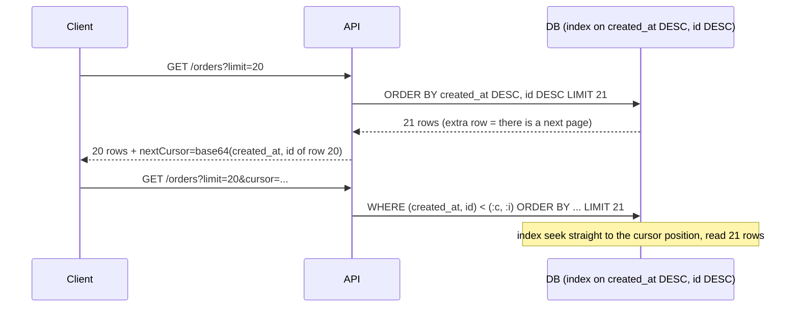

**Requirements:**
1. A **deterministic sort** with a unique **tiebreaker** (`created_at DESC, id DESC`).
2. A **composite index** matching the sort (`(created_at, id)`).
3. The cursor encodes the **last row's sort key**; make it opaque (Base64/JSON, optionally signed) so clients don't build it themselves.
4. Databases without row-value comparison: `WHERE created_at < :c OR (created_at = :c AND id < :i)`.

**Trade-offs:** no "jump to page 57", no exact total (show "more results" or an approximate count), and sort columns are fixed per cursor.

---

## 5.4 Complete Java Example - Rows Examined and Shifting Pages

A `TreeMap` keyed on `(createdAt, id)` stands in for a B-tree index over 100,000 orders. We count **rows examined** for deep offset pages vs a keyset page, then insert two new orders between page requests.

```java
import java.util.ArrayList;
import java.util.List;
import java.util.Map;
import java.util.NavigableMap;
import java.util.TreeMap;

// Offset pagination vs keyset (seek / cursor) pagination over an index on (created_at, id).
// We count "rows examined", which is what makes deep OFFSET pages slow, and show how inserts
// between page requests cause duplicates with OFFSET but not with keyset.

public class KeysetPaginationDemo {
    record Key(long createdAt, long id) implements Comparable<Key> {    // composite index key, newest first in queries
        public int compareTo(Key o) { int c = Long.compare(createdAt, o.createdAt); return c != 0 ? c : Long.compare(id, o.id); }
    }

    static final TreeMap<Key, String> index = new TreeMap<>();           // B-tree index stand-in
    static int examined = 0;

    // SELECT ... ORDER BY created_at DESC, id DESC LIMIT size OFFSET offset
    static List<Long> offsetPage(int offset, int size) {
        examined = 0; List<Long> out = new ArrayList<>(); int skipped = 0;
        for (Map.Entry<Key, String> e : index.descendingMap().entrySet()) {
            examined++;                                                 // the DB must walk past every skipped row
            if (skipped++ < offset) continue;
            out.add(e.getKey().id());
            if (out.size() == size) break;
        }
        return out;
    }

    // SELECT ... WHERE (created_at, id) < (:lastCreatedAt, :lastId) ORDER BY created_at DESC, id DESC LIMIT size
    static List<Long> keysetPage(Key after, int size) {
        examined = 0; List<Long> out = new ArrayList<>();
        NavigableMap<Key, String> view = after == null ? index.descendingMap() : index.headMap(after, false).descendingMap();
        for (Key k : view.keySet()) {                                   // index seek straight to the cursor, then read 'size' rows
            examined++; out.add(k.id());
            if (out.size() == size) break;
        }
        return out;
    }

    static Key keyOf(long id) { return index.keySet().stream().filter(k -> k.id() == id).findFirst().orElseThrow(); }

    public static void main(String[] args) {
        for (long id = 1; id <= 100_000; id++) index.put(new Key(1_700_000_000L + id, id), "order-" + id);

        System.out.println("=== Rows examined to fetch 20 rows ===");
        for (int page : new int[]{1, 100, 4_000}) {
            offsetPage((page - 1) * 20, 20);
            System.out.printf("  OFFSET page %5d : %6d rows examined%n", page, examined);
        }
        Key cursor = keyOf(20_001);                                     // the last row the client saw
        keysetPage(cursor, 20);
        System.out.printf("  KEYSET any page   : %6d rows examined (WHERE (created_at,id) < cursor)%n", examined);

        System.out.println("=== New rows arrive while a user is paging ===");
        List<Long> p1 = offsetPage(0, 5);
        Key last = keyOf(p1.get(p1.size() - 1));
        System.out.println("  page 1                  : " + p1);
        for (long id = 100_001; id <= 100_002; id++) index.put(new Key(1_700_000_000L + id, id), "order-" + id);   // 2 new orders
        System.out.println("  OFFSET page 2 (offset 5): " + offsetPage(5, 5) + "  <- 99996 and 99997 shown AGAIN");
        System.out.println("  KEYSET page 2 (after " + last.id() + "): " + keysetPage(last, 5) + "  <- continues exactly where page 1 ended");
    }
}
```

**Output:**
```
=== Rows examined to fetch 20 rows ===
  OFFSET page     1 :     20 rows examined
  OFFSET page   100 :   2000 rows examined
  OFFSET page  4000 :  80000 rows examined
  KEYSET any page   :     20 rows examined (WHERE (created_at,id) < cursor)
=== New rows arrive while a user is paging ===
  page 1                  : [100000, 99999, 99998, 99997, 99996]
  OFFSET page 2 (offset 5): [99997, 99996, 99995, 99994, 99993]  <- 99996 and 99997 shown AGAIN
  KEYSET page 2 (after 99996): [99995, 99994, 99993, 99992, 99991]  <- continues exactly where page 1 ended
```

What the output shows:
- **OFFSET** examined 20 rows for page 1 but **80,000** rows for page 4,000. Same 20-row result, 4,000× the work.
- **KEYSET** examined **20 rows for any page**, because the index seek jumps straight to the cursor.
- When two orders were inserted after page 1, **OFFSET page 2 repeated** two items the user had already seen (and an item would be skipped if rows were deleted instead). **KEYSET page 2** continued exactly after `99996`.

---

## 5.5 In Spring Data (`Page`, `Slice`, `Window` + `ScrollPosition`)

```java
interface OrderRepository extends JpaRepository<Order, Long> {

    // OFFSET + COUNT: fine for admin screens with page numbers and small tables
    Page<Order> findByCustomerId(long customerId, Pageable pageable);          // runs a COUNT(*) query too

    // OFFSET without COUNT: "load more" without totals
    Slice<Order> findByStatus(OrderStatus status, Pageable pageable);          // fetches size+1 to know if there's more

    // KEYSET scrolling (Spring Data 3.1+)
    Window<Order> findFirst20ByStatusOrderByCreatedAtDescIdDesc(OrderStatus status, ScrollPosition position);

    // Hand-written keyset query (works everywhere)
    @Query("""
           select o from Order o
           where o.createdAt < :createdAt or (o.createdAt = :createdAt and o.id < :id)
           order by o.createdAt desc, o.id desc""")
    List<Order> nextPage(Instant createdAt, long id, Limit limit);
}

// Using Window/ScrollPosition
Window<Order> first = repo.findFirst20ByStatusOrderByCreatedAtDescIdDesc(PAID, ScrollPosition.keyset());
if (first.hasNext()) {
    ScrollPosition next = first.positionAt(first.size() - 1);                 // a KeysetScrollPosition (encode it as the API cursor)
    Window<Order> second = repo.findFirst20ByStatusOrderByCreatedAtDescIdDesc(PAID, next);
}
```

```sql
-- the index that makes keyset fast (PostgreSQL)
CREATE INDEX CONCURRENTLY idx_orders_status_created_id ON orders (status, created_at DESC, id DESC);
```

| Spring Data type | Count query? | Deep pages fast? | Use for |
|---|---|---|---|
| `Page<T>` | Yes | No (OFFSET) | Admin tables needing "page 3 of 12" |
| `Slice<T>` | No | No (OFFSET) | "Load more" on small/medium tables |
| `Window<T>` + keyset `ScrollPosition` | No | **Yes** | Feeds, infinite scroll, exports, public APIs |
| `Stream<T>` / `@QueryHints(fetchSize)` | No | n/a | Server-side processing of everything (batch jobs) |

#### 📘 Terms Explained

| Term | Simple meaning |
|---|---|
| **`Page` / `Slice`** | Spring Data page with total count / page that only knows if a next one exists. |
| **`Window` / `ScrollPosition`** | Spring Data 3.1+ scrolling API supporting offset and keyset positions. |
| **`Limit`** | Spring Data parameter type to cap results without a `Pageable`. |
| **`CREATE INDEX CONCURRENTLY`** | PostgreSQL index build that doesn't block writes. |
| **Fetch size** | How many rows the JDBC driver fetches per round trip when streaming. |

---

## 5.6 Pros, Cons, Pitfalls, Interview Questions and Cheat Sheet

| | Pros | Cons |
|---|---|---|
| **Offset** | Simple; jump to any page; page numbers and totals | Cost grows with depth; COUNT is expensive; duplicates/skips on changes |
| **Keyset** | Constant cost per page; stable under inserts; index-friendly | No random page access; total is hard; needs a stable unique sort and matching index |

| Pitfall | Fix |
|---|---|
| Sorting by a non-unique column (`created_at`) only | Add `id` as tiebreaker in sort, index and cursor. |
| `Page<T>` on a huge table → slow COUNT | `Slice` or keyset; cached/approximate counts. |
| No index matching the ORDER BY | Composite index in the same order (and direction where it matters). |
| Exposing raw SQL values as the cursor | Opaque, versioned (and optionally signed) cursor token. |
| Unlimited `size` parameter | Cap it (e.g. max 100). |

**Q1. Why is `OFFSET 100000` slow?** The DB must read and discard 100,000 rows before returning the page; cost grows linearly with the offset.

**Q2. How does keyset pagination work?** Sort by a unique, indexed key; remember the last row's key; next page = rows "after" that key (`WHERE (created_at, id) < (?, ?)`). The index seek makes every page cost the same.

**Q3. When is offset still fine?** Small tables, admin UIs needing page numbers, or when users rarely go past the first few pages.

```
PAGINATION   OFFSET: LIMIT n OFFSET k -> reads k+n rows; deep pages slow; COUNT costly; duplicates/skips on inserts.
             KEYSET: WHERE (sort, id) < (:last) ORDER BY sort, id LIMIT n -> constant cost; stable; needs composite index +
             unique tiebreaker; opaque cursor; no page jumps. Spring: Page (count), Slice (no count), Window + ScrollPosition.keyset().
```

---

# 6. Indexing (Interview Imp - Java)

## 6.1 What Is It?

An **index** is an extra, sorted data structure the database maintains alongside a table, so it can **find rows by a column's value without reading the whole table**. Most relational indexes are **B-trees** (B+ trees): sorted, balanced trees where finding a value takes a handful of page reads even for billions of rows.

**Analogy:** The index at the back of a textbook. To find "polymorphism", you don't read all 900 pages; you look it up alphabetically and jump to pages 211 and 487. But every time the book changes, the index must be updated too, and an index for every word would be bigger than the book.

#### 📘 Terms Explained

| Term | Simple meaning |
|---|---|
| **Index** | A sorted structure mapping column values to row locations for fast lookup. |
| **B-tree / B+ tree** | A balanced tree of sorted pages; lookups, ranges and ordering in O(log n). |
| **Full table scan** | Reading every row because no suitable index exists (or it isn't worth using). |
| **Composite index** | An index on several columns in a specific order, e.g. `(customer_id, status)`. |
| **Covering index** | An index that contains every column a query needs, so the table isn't touched. |
| **Selectivity** | How well a value narrows the result; high selectivity = few matching rows. |
| **Query plan** | The database's chosen strategy for executing a query (shown by `EXPLAIN`). |

---

## 6.2 Why Do We Need It?

| Without a suitable index | With one |
|---|---|
| `WHERE email = ?` reads all 10M rows | Reads ~3-4 index pages + 1 row |
| `ORDER BY created_at LIMIT 20` sorts the whole table | Reads the first 20 entries of the index in order |
| Joins compare every row with every row | Index lookups per join key |
| Locks held longer, CPU and I/O saturated | Short queries, more throughput |

The most common cause of a "suddenly slow" Java service is a query that lost (or never had) the index it needs as the table grew.

---

## 6.3 How It Works: B-Trees, Composite, Covering and Selectivity

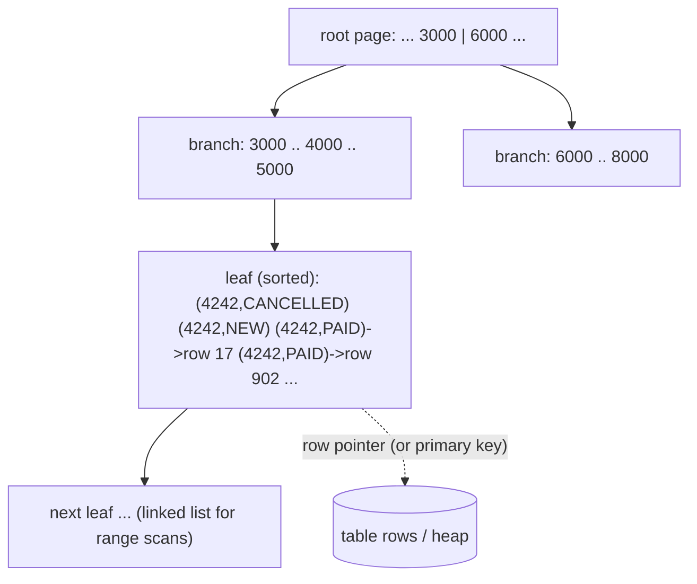

| Concept | Rule |
|---|---|
| **Leftmost prefix** | An index on `(a, b, c)` helps `WHERE a=?`, `a=? AND b=?`, `a=? AND b=? AND c=?`, and `ORDER BY a, b`. It does **not** help `WHERE b=?` alone. |
| **Column order** | Put **equality** columns first, then the **range/sort** column: `(customer_id, status, created_at)` for `WHERE customer_id=? AND status=? ORDER BY created_at`. |
| **Covering index** | If the index holds all needed columns, the DB answers from the index alone ("Index Only Scan" in PostgreSQL, "Using index" in MySQL). PostgreSQL/SQL Server can add non-key columns with `INCLUDE`. |
| **Selectivity** | An index on a column with few distinct values (`status`, `gender`, `is_active`) often isn't used: reading 25% of the table through an index is slower than a scan. Partial indexes (`WHERE status = 'PENDING'`) help for rare values. |
| **Functions break indexes** | `WHERE LOWER(email) = ?` or `WHERE DATE(created_at) = ?` can't use a plain index on the column: use a functional index or rewrite as a range. |
| **Leading wildcards** | `LIKE '%phone'` can't use a B-tree; `LIKE 'phone%'` can. Use full-text search for "contains". |
| **Write cost** | Every INSERT/UPDATE/DELETE must update every index on the table: more indexes = slower writes and more storage. |
| **InnoDB clustered index** | MySQL InnoDB stores rows in primary-key order; secondary indexes point to the PK. Random UUID PKs fragment it; prefer sequential keys (or UUIDv7). |

---

## 6.4 Complete Java Example - Full Scan vs Index vs Composite vs Covering

A 200,000-row in-memory "orders" table (fixed random seed) with three index structures. We count rows read for the same query each way, then show the leftmost-prefix rule and the write cost.

```java
import java.util.ArrayList;
import java.util.List;
import java.util.Random;
import java.util.TreeMap;

// How indexes change the work a database does. We count rows/pages touched for:
// full scan vs single-column index vs composite index (leftmost prefix rule) vs covering index,
// plus the write cost each extra index adds.

public class IndexingDemo {
    record Order(int id, int customerId, String status, int amount) {}

    static final List<Order> table = new ArrayList<>();
    // index on (customer_id) -> row ids
    static final TreeMap<Integer, List<Integer>> idxCustomer = new TreeMap<>();
    // composite index on (customer_id, status) -> row ids ; key encoded as "customer|status"
    static final TreeMap<String, List<Integer>> idxCustomerStatus = new TreeMap<>();
    // covering index on (customer_id, status, amount): the index itself holds 'amount'
    static final TreeMap<String, List<Integer>> idxCovering = new TreeMap<>();

    public static void main(String[] args) {
        Random rnd = new Random(7);
        String[] statuses = {"NEW", "PAID", "SHIPPED", "CANCELLED"};
        for (int id = 0; id < 200_000; id++) {
            Order o = new Order(id, rnd.nextInt(10_000), statuses[rnd.nextInt(4)], 100 + rnd.nextInt(10_000));
            table.add(o);
            idxCustomer.computeIfAbsent(o.customerId(), k -> new ArrayList<>()).add(id);
            idxCustomerStatus.computeIfAbsent(String.format("%05d|%s", o.customerId(), o.status()), k -> new ArrayList<>()).add(id);
            idxCovering.computeIfAbsent(String.format("%05d|%s", o.customerId(), o.status()), k -> new ArrayList<>()).add(o.amount());
        }
        int customer = 4242;

        System.out.println("Query: SELECT SUM(amount) FROM orders WHERE customer_id = 4242 AND status = 'PAID'  (200,000 rows)");
        // 1) full table scan
        long sum = 0; int touched = 0;
        for (Order o : table) { touched++; if (o.customerId() == customer && o.status().equals("PAID")) sum += o.amount(); }
        System.out.printf("  no index (full scan)             : rows read %,7d -> sum %d%n", touched, sum);

        // 2) index on customer_id: seek, then read each matching row from the table to check status
        sum = 0; touched = 0;
        for (int rowId : idxCustomer.get(customer)) { touched++; Order o = table.get(rowId); if (o.status().equals("PAID")) sum += o.amount(); }
        System.out.printf("  INDEX(customer_id)               : rows read %,7d -> sum %d (seek + filter status on table rows)%n", touched, sum);

        // 3) composite index (customer_id, status): seek directly to the matching entries, then fetch each row for 'amount'
        sum = 0; touched = 0;
        for (int rowId : idxCustomerStatus.get(String.format("%05d|PAID", customer))) { touched++; sum += table.get(rowId).amount(); }
        System.out.printf("  INDEX(customer_id, status)       : rows read %,7d -> sum %d%n", touched, sum);

        // 4) covering index (customer_id, status, amount): answer from the index alone, zero table lookups
        sum = 0;
        for (int amount : idxCovering.get(String.format("%05d|PAID", customer))) sum += amount;
        System.out.printf("  INDEX(customer_id, status, amount): rows read %,7d -> sum %d (index-only scan)%n", 0, sum);

        System.out.println("Leftmost-prefix rule for INDEX(customer_id, status):");
        System.out.println("  WHERE customer_id = ?                -> uses the index (prefix)");
        System.out.println("  WHERE customer_id = ? AND status = ? -> uses the index fully");
        // WHERE status = 'PAID' alone: entries are sorted by customer first, so PAID rows are scattered across the whole index
        int entriesScanned = 0, paid = 0;
        for (var e : idxCustomerStatus.entrySet()) { entriesScanned += e.getValue().size(); if (e.getKey().endsWith("|PAID")) paid += e.getValue().size(); }
        System.out.printf("  WHERE status = 'PAID'                -> cannot seek; scans all %,d entries to find %,d matches%n", entriesScanned, paid);

        System.out.println("Low selectivity: status has only 4 values -> an index on status alone would still return ~25% of the table,");
        System.out.println("  so the optimizer usually prefers a full scan.");

        System.out.println("Write cost: each INSERT updates the table + every index");
        System.out.println("  table only: 1 write | +3 indexes: 4 writes per INSERT -> index what you query, not every column");
    }
}
```

**Output:**
```
Query: SELECT SUM(amount) FROM orders WHERE customer_id = 4242 AND status = 'PAID'  (200,000 rows)
  no index (full scan)             : rows read 200,000 -> sum 37437
  INDEX(customer_id)               : rows read      19 -> sum 37437 (seek + filter status on table rows)
  INDEX(customer_id, status)       : rows read       6 -> sum 37437
  INDEX(customer_id, status, amount): rows read       0 -> sum 37437 (index-only scan)
Leftmost-prefix rule for INDEX(customer_id, status):
  WHERE customer_id = ?                -> uses the index (prefix)
  WHERE customer_id = ? AND status = ? -> uses the index fully
  WHERE status = 'PAID'                -> cannot seek; scans all 200,000 entries to find 50,074 matches
Low selectivity: status has only 4 values -> an index on status alone would still return ~25% of the table,
  so the optimizer usually prefers a full scan.
Write cost: each INSERT updates the table + every index
  table only: 1 write | +3 indexes: 4 writes per INSERT -> index what you query, not every column
```

What the output shows:
- **Full scan:** 200,000 rows read to find a handful. **INDEX(customer_id):** 19 rows (that customer's orders), filtered by status on the table rows.
- **Composite INDEX(customer_id, status):** jumped straight to the 6 matching entries, but still read 6 table rows to get `amount`. **Covering index:** **0** table reads, because `amount` lives in the index.
- All four gave the **same sum** (37,437): indexes change the cost, never the result.
- **Leftmost prefix:** filtering on `status` alone couldn't seek in `(customer_id, status)` and had to scan all 200,000 entries.
- **Write cost:** each extra index is another structure to update on every INSERT.

---

## 6.5 Indexes in Practice (EXPLAIN, JPA, Migrations)

```sql
-- PostgreSQL: see the real plan, timing and buffers
EXPLAIN (ANALYZE, BUFFERS)
SELECT SUM(amount) FROM orders WHERE customer_id = 4242 AND status = 'PAID';
--  Seq Scan on orders  (rows=200000)                         <- bad: full scan
--  Index Scan using idx_orders_customer_status on orders      <- good
--  Index Only Scan using idx_orders_cust_status_amount        <- best for this query (covering)

CREATE INDEX CONCURRENTLY idx_orders_customer_status ON orders (customer_id, status);
CREATE INDEX CONCURRENTLY idx_orders_cust_status_amount ON orders (customer_id, status) INCLUDE (amount);   -- covering
CREATE INDEX CONCURRENTLY idx_orders_pending ON orders (created_at) WHERE status = 'PENDING';             -- partial
CREATE INDEX CONCURRENTLY idx_users_email_lower ON users (LOWER(email));                                 -- functional

-- MySQL 8: EXPLAIN ANALYZE ...; look for type=ref/range (good) vs ALL (full scan), and "Using index" (covering)
```

```java
// Declare indexes in JPA for documentation / schema generation (real schemas: use Flyway/Liquibase migrations)
@Entity
@Table(name = "orders", indexes = {
        @Index(name = "idx_orders_customer_status", columnList = "customer_id, status"),
        @Index(name = "idx_orders_created_id", columnList = "created_at DESC, id DESC")
})
class Order { ... }
```

```sql
-- Flyway migration V42__add_order_indexes.sql (PostgreSQL: CONCURRENTLY can't run inside a transaction;
-- mark the migration non-transactional, e.g. Flyway's "-- flyway:executeInTransaction=false" script config)
CREATE INDEX CONCURRENTLY IF NOT EXISTS idx_orders_customer_status ON orders (customer_id, status);
```

**Finding missing indexes:** slow query log (`log_min_duration_statement` in PostgreSQL, `slow_query_log` in MySQL), `pg_stat_statements`, APM traces, and checking every `WHERE`/`JOIN`/`ORDER BY` in new repository methods during code review. **Finding unused ones:** `pg_stat_user_indexes` (idx_scan = 0), MySQL `sys.schema_unused_indexes`. More SQL detail: [MySQL_Complete_Guide.md](../../mysql/MySQL_Complete_Guide.md).

#### 📘 Terms Explained

| Term | Simple meaning |
|---|---|
| **`EXPLAIN ANALYZE`** | Runs the query and shows the actual plan with timings and row counts. |
| **Seq Scan / Index Scan / Index Only Scan** | PostgreSQL plan nodes: full scan / index lookup + table fetch / index-only answer. |
| **`INCLUDE` columns** | Extra non-key columns stored in an index to make it covering. |
| **Partial index** | An index over only the rows matching a condition. |
| **Functional (expression) index** | An index on an expression such as `LOWER(email)`. |
| **`pg_stat_statements`** | PostgreSQL extension tracking execution statistics for all queries. |

---

## 6.6 Pros, Cons, Pitfalls, Interview Questions and Cheat Sheet

| Pros | Cons |
|---|---|
| Orders-of-magnitude faster reads, sorts and joins | Slower writes (every index updated) |
| Enables keyset pagination and fast ORDER BY ... LIMIT | Storage and memory (indexes compete for buffer cache) |
| Covering indexes avoid table access entirely | Wrong or unused indexes cost without helping; planners may still ignore them |

| Pitfall | Fix |
|---|---|
| Index on every column "just in case" | Index the real query patterns; drop unused indexes. |
| Wrong column order in a composite index | Equality columns first, then range/sort column. |
| `WHERE LOWER(col) = ?`, implicit type casts, `LIKE '%x'` | Functional index, matching parameter types, full-text search. |
| Creating indexes on big tables with plain `CREATE INDEX` in production | `CONCURRENTLY` (PostgreSQL) / online DDL (MySQL `ALGORITHM=INPLACE, LOCK=NONE`). |
| Missing indexes on foreign keys | Index FK columns used in joins and cascades. |
| Random UUIDv4 primary keys in InnoDB | Sequential IDs or UUIDv7 to avoid page splits. |

**Q1. How does a B-tree index speed up queries?** It keeps keys sorted in a balanced tree of pages, so finding a value or range takes O(log n) page reads, and range/ordered scans follow linked leaf pages, instead of reading every row.

**Q2. What is the leftmost prefix rule?** A composite index on (a, b, c) can be used for conditions on a, (a, b) or (a, b, c), but not for b or c alone, because entries are sorted by a first.

**Q3. What is a covering index?** One that includes all the columns a query reads, so the database returns results from the index without visiting the table.

**Q4. Why might the database ignore my index?** Low selectivity (it would return a large fraction of rows), functions or type casts on the column, leading wildcards, stale statistics, or a small table where a scan is cheaper.

**Q5. What's the downside of too many indexes?** Every write updates each index (slower inserts/updates, more locks and WAL), and they take storage and cache memory.

```
INDEXING     B-tree: sorted, O(log n) lookups + ordered range scans. Composite (a,b,c): LEFTMOST PREFIX; equality cols first, then range/sort.
             Covering index (INCLUDE) -> index-only scan. Low selectivity -> scan. Functions/casts/'%x' break indexes -> functional/full-text.
             Every index slows writes. EXPLAIN (ANALYZE, BUFFERS); slow query log; pg_stat_statements; CREATE INDEX CONCURRENTLY.
```

---

# 7. Lazy Loading and Prefetching (Interview Imp - Java)

## 7.1 What Are They?

Two opposite timing choices:

- **Lazy loading:** load something **only when it is first needed**. Saves work when it's never needed. (Database associations, N+1 and Hibernate proxies are covered in [02_Enterprise_Application_Pattern.md](../02_HLD/02_Enterprise_Application_Pattern.md#6-lazy-load-and-eager-loading-interview-imp---java).)
- **Prefetching:** load something **before it is needed**, predicting the next request, so it's ready when asked for. Includes **cache warming** (loading hot data before taking traffic) and **read-ahead** (OS/DB reading the next disk blocks).

**Analogy:** A waiter. **Lazy:** brings the dessert menu only if you ask. **Prefetching:** sees you finishing the main course and brings the dessert menu just before you look up. **Cache warming:** the kitchen preps the most-ordered dishes before the restaurant opens.

#### 📘 Terms Explained

| Term | Simple meaning |
|---|---|
| **Lazy loading** | Deferring a load until first access. |
| **Prefetching** | Loading data in advance based on a prediction of future use. |
| **Cache warming** | Filling a cache with known-hot data before serving traffic. |
| **Read-ahead** | Reading the next sequential blocks before they're requested (OS, databases, Kafka). |
| **Prediction accuracy** | How often prefetched data is actually used; wasted prefetches cost bandwidth and load. |

---

## 7.2 Why Do We Need Them?

| Use lazy loading when... | Use prefetching when... |
|---|---|
| Most users never need the data (image galleries below the fold, rarely opened tabs, optional associations) | The next step is **highly predictable** (next page of a feed, next video segment, the page a link hovers over) |
| Loading is expensive and the start-up/first-paint time matters | There's **idle time** to use (the user is reading) |
| Memory is limited | Waiting at the moment of need would hurt the user |

Cache warming fixes the **cold start** problem after deploys or restarts: without it, the first users after a deploy hit an empty cache and the DB gets a burst of misses.

---

## 7.3 How They Work

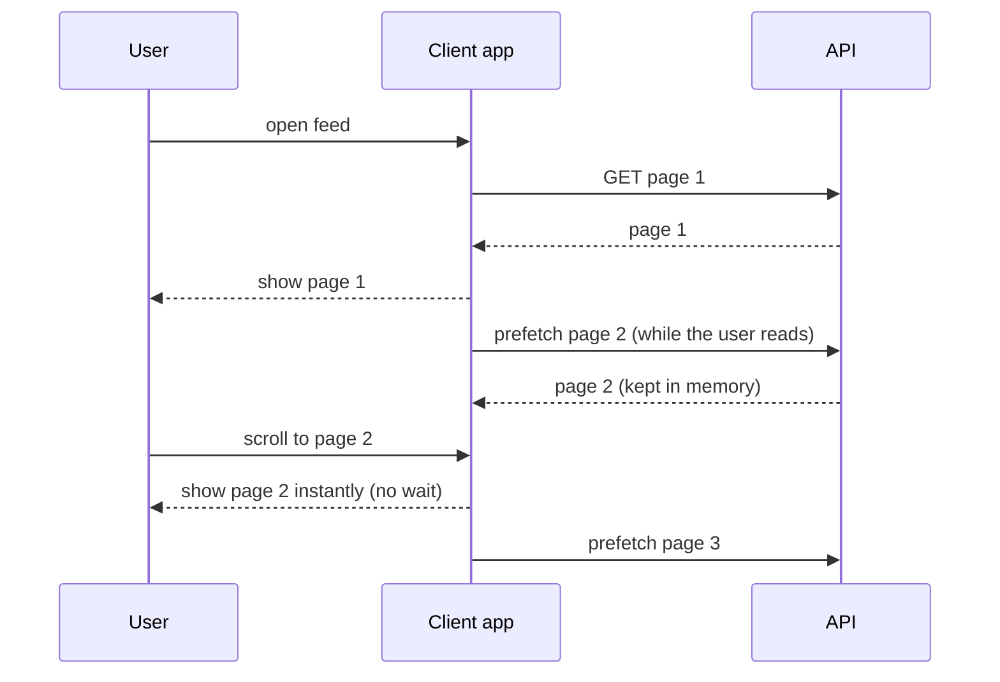

- **Predictive prefetch:** next page, next segment, linked resources (`<link rel="prefetch">`), "people who view X open Y".
- **Bounded prefetch:** only **one step ahead**, and cancel/skip on slow networks (`navigator.connection.saveData`) or low battery.
- **Cache warming:** at startup (before the readiness probe passes), or continuously (**refresh-ahead**, [section 1.5](#15-in-spring-boot-caffeine-redis-cacheable)).

---

## 7.4 Complete Java Example - Next-Page Prefetch and Cache Warming

A virtual-clock reader: each page takes 400 ms to fetch and the user reads each for 2 s. Then the first 8 requests after a restart, with and without warming the 5 hottest keys.

```java
import java.util.HashMap;
import java.util.HashSet;
import java.util.List;
import java.util.Map;
import java.util.Set;

// Prefetching (load before it's needed) and cache warming, on a virtual clock.
// A user reads a paged feed: each page takes 400 ms to fetch and the user spends 2 s reading each page.

public class PrefetchDemo {
    static final int FETCH_MS = 400, READ_MS = 2000;

    // returns the total time the user spent WAITING across 'pages' page views
    static long readFeed(int pages, boolean prefetchNext, int[] fetches) {
        Map<Integer, Long> readyAt = new HashMap<>();                // page -> time its data is available
        long now = 0, waited = 0;
        for (int p = 1; p <= pages; p++) {
            if (!readyAt.containsKey(p)) { readyAt.put(p, now + FETCH_MS); fetches[0]++; }   // on-demand fetch
            long ready = readyAt.get(p);
            if (ready > now) { waited += ready - now; now = ready; }
            if (prefetchNext && !readyAt.containsKey(p + 1)) {     // start fetching the NEXT page while the user reads this one
                readyAt.put(p + 1, now + FETCH_MS); fetches[0]++;
            }
            now += READ_MS;
        }
        return waited;
    }

    public static void main(String[] args) {
        System.out.println("=== Prefetch the next page while the user reads (10 pages) ===");
        int[] f1 = {0}, f2 = {0};
        long noPrefetch = readFeed(10, false, f1), prefetch = readFeed(10, true, f2);
        System.out.println("  on demand : user waited " + noPrefetch + " ms, fetches " + f1[0]);
        System.out.println("  prefetch  : user waited " + prefetch + " ms, fetches " + f2[0] + " (1 extra fetch for page 11 that may never be read)");

        System.out.println("=== Cache warming at startup ===");
        List<String> top = List.of("home", "deals", "category-phones", "category-laptops", "help");
        Set<String> cache = new HashSet<>();
        int coldMisses = 0;
        String[] firstRequests = {"home", "deals", "home", "category-phones", "home", "help", "deals", "category-laptops"};
        for (String r : firstRequests) if (cache.add(r)) coldMisses++;
        System.out.println("  cold start : first " + firstRequests.length + " requests -> " + coldMisses + " slow cache misses hit the DB");
        Set<String> warmed = new HashSet<>(top);                        // load the known-hot keys before taking traffic
        int warmMisses = 0;
        for (String r : firstRequests) if (warmed.add(r)) warmMisses++;
        System.out.println("  warmed     : first " + firstRequests.length + " requests -> " + warmMisses + " misses (readiness probe passes only after warming)");
    }
}
```

**Output:**
```
=== Prefetch the next page while the user reads (10 pages) ===
  on demand : user waited 4000 ms, fetches 10
  prefetch  : user waited 400 ms, fetches 11 (1 extra fetch for page 11 that may never be read)
=== Cache warming at startup ===
  cold start : first 8 requests -> 5 slow cache misses hit the DB
  warmed     : first 8 requests -> 0 misses (readiness probe passes only after warming)
```

What the output shows:
- **On demand,** the user waited 400 ms on **every** page (4 s in total). With **prefetch**, they waited only for page 1; every later page was ready because it was fetched during the 2 s of reading. The cost: **one wasted fetch** (page 11) if the user stops.
- **Cache warming** turned 5 cold misses into **0**. In Kubernetes, warm before reporting ready so the load balancer only sends traffic to warm instances.

---

## 7.5 In Practice (JPA, Spring, Browsers, Kafka)

| Where | Lazy loading | Prefetching / warming |
|---|---|---|
| **JPA/Hibernate** | `FetchType.LAZY`, proxies | `JOIN FETCH`, `@EntityGraph`, `@BatchSize` prefetch children for many parents |
| **Spring** | `@Lazy` beans (created on first use, faster startup), `spring.main.lazy-initialization=true` (dev) | Cache warming in an `ApplicationRunner` / `@EventListener(ApplicationReadyEvent.class)` before readiness; Caffeine `refreshAfterWrite` |
| **Browser** | ``, `React.lazy()` + dynamic `import()` | `<link rel="prefetch">`, `<link rel="preload">`, router link prefetch on hover/viewport (Next.js), `fetchpriority="high"` |
| **JDBC** | Streaming results with a fetch size | `setFetchSize(500)`: driver fetches rows ahead in chunks |
| **Kafka consumer** | — | `fetch.min.bytes`, `max.poll.records`: the client prefetches records in the background |
| **OS / DB** | — | Read-ahead of sequential blocks; PostgreSQL `pg_prewarm` to load a table into cache |

```java
// Cache warming before the instance reports READY (Spring Boot Actuator readiness)
@Component
@RequiredArgsConstructor
class CacheWarmer {
    private final ProductService products;           // @Cacheable("products")
    private final ApplicationEventPublisher events;

    @EventListener(ApplicationStartedEvent.class)
    void warm() {
        AvailabilityChangeEvent.publish(events, this, ReadinessState.REFUSING_TRAFFIC);
        products.topSellingIds(500).forEach(products::find);         // fills the cache through the normal path
        AvailabilityChangeEvent.publish(events, this, ReadinessState.ACCEPTING_TRAFFIC);
    }
}
```

---

## 7.6 Pros, Cons, Pitfalls, Interview Questions and Cheat Sheet

| | Pros | Cons |
|---|---|---|
| **Lazy** | Less upfront work, memory and bandwidth; faster startup/first paint | Latency at the moment of first use; N+1 in ORMs; surprising errors outside sessions |
| **Prefetch** | Hides latency behind idle time; smoother UX | Wasted work when predictions are wrong; extra load on servers; mobile data costs |

| Pitfall | Fix |
|---|---|
| Prefetching too much (whole catalog, 10 pages ahead) | One step ahead; prefetch only high-probability items. |
| Prefetch requests competing with real ones | Low priority (`fetchpriority="low"`, idle callbacks), cancel on navigation. |
| Lazy-loading above-the-fold images | Eager-load the LCP image; lazy-load below the fold. |
| Warming with a thundering herd against the DB on every pod restart | Warm from L2 (Redis) or throttle the warmer; stagger rollouts. |

**Q1. Lazy loading vs prefetching?** Lazy loads on first use to avoid unnecessary work; prefetching loads before use to hide latency. Lazy suits uncertain needs; prefetching suits predictable next steps with idle time.

**Q2. What is cache warming and why do it?** Preloading hot data before serving traffic so the first requests after a deploy/restart don't all miss and overload the database.

```
LAZY        Load on first use (JPA LAZY, @Lazy beans, img loading=lazy, React.lazy). Saves work; first-use latency; N+1 risk.
PREFETCH    Load the predictable next thing during idle time (next page/segment, link prefetch, JDBC fetchSize, Kafka fetch).
            One step ahead, low priority, cancel when wrong. CACHE WARMING before readiness; refresh-ahead for hot keys.
```

---

## 7.7 Types and Variants

| Variant | Idea | Example |
|---|---|---|
| **Lazy initialisation** | Create an object on first use | `Supplier` memoisation, holder idiom, Spring `@Lazy` beans |
| **Lazy loading of data (ORM)** | Load associations when accessed | Hibernate `FetchType.LAZY` proxies (watch N+1) |
| **Lazy loading of UI/assets** | Load images/code when they come into view | `loading="lazy"`, `IntersectionObserver`, code splitting |
| **Prefetching** | Load data *before* it's requested, predicting the next need | Next page of results, `<link rel="prefetch">`, CPU prefetchers |
| **Read-ahead** | Load the next block while processing the current one | Database/OS read-ahead, Kafka consumer fetch |
| **Cache warming** | Fill caches at startup or before peak | Warm-up job loading top-N products |
| **Eager loading** | The opposite: load everything up front when it will certainly be needed | JPA `JOIN FETCH`, `@EntityGraph` |

# 8. Compression (Gzip, Brotli, Zstd) (Interview Imp - Java)

## 8.1 What Is It?

**Compression** encodes data in fewer bytes by removing redundancy, and the receiver decompresses it. For performance it matters wherever **bytes travel or are stored**: HTTP responses, message batches (Kafka), cache values (Redis), files and backups, database pages.

| Algorithm | Typical use | Notes |
|---|---|---|
| **gzip / DEFLATE** | HTTP responses, files | Universal support; JDK built-in (`java.util.zip`) |
| **Brotli (br)** | HTTP responses (text: HTML, CSS, JS, JSON) | ~15-25% smaller than gzip for text; slow at max level, so pre-compress static assets; usually done by CDN/Nginx |
| **Zstandard (zstd)** | Kafka, databases, logs, increasingly HTTP (`Content-Encoding: zstd` in modern browsers) | Excellent speed/ratio balance |
| **LZ4 / Snappy** | Kafka, Cassandra, in-memory stores | Very fast, lower ratio |

**Analogy:** Vacuum-packing clothes for a trip. The suitcase (network) carries far more, but packing and unpacking take a little effort (CPU). It's pointless for things that don't squash, like books (already-compressed JPEGs or videos).

#### 📘 Terms Explained

| Term | Simple meaning |
|---|---|
| **Compression ratio** | Compressed size divided by original size (smaller is better). |
| **`Accept-Encoding` / `Content-Encoding`** | Request header listing algorithms the client supports / response header naming the one used. |
| **`Vary: Accept-Encoding`** | Tells caches that the response differs by the client's encoding support. |
| **Entropy** | How random data is; high-entropy data (encrypted, already compressed) can't be compressed further. |
| **Compression level** | Trade-off knob: higher = smaller output, more CPU. |
| **BREACH** | An attack that can leak secrets from compressed HTTPS responses that mix secrets and attacker-controlled input. |

---

## 8.2 Why Do We Need It?

| Payload | Typical gzip result | Worth it? |
|---|---|---|
| JSON / HTML / CSS / JS / XML / CSV | 70-95% smaller | ✅ Yes |
| Tiny responses (< ~1 KB) | Bigger (headers/framing overhead) | ❌ Skip |
| JPEG, PNG, MP4, ZIP, PDF (already compressed) | ~0% gain, wasted CPU | ❌ Skip |
| Kafka batches of similar events | Often 3-10× smaller | ✅ Yes (per batch, not per message) |

On a slow mobile link, a 50 KB JSON response takes ~40 ms just to transfer at 10 Mbit/s; compressed to ~3 KB it takes ~3 ms. On a fast internal network with tiny payloads, compression may cost more CPU than it saves.

---

## 8.3 How It Works: Content Negotiation

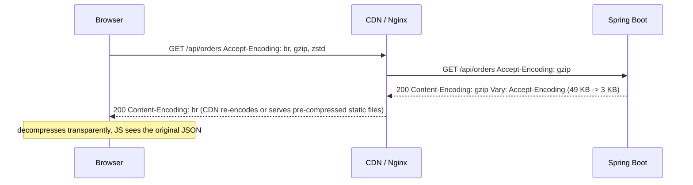

- The client says what it supports; the server picks one and labels the response.
- **Static assets:** pre-compress at build time (`app.js.br`, `app.js.gz`) at maximum level; serve directly.
- **Dynamic responses:** compress on the fly at a moderate level (gzip 4-6, Brotli 4-5).
- **Requests** can be compressed too (`Content-Encoding: gzip` on large uploads), but servers must opt in.

---

## 8.4 Complete Java Example - What Compresses, Levels and Thresholds

Real compression using the JDK's `GZIPOutputStream` and `Deflater` (output sizes are deterministic for the same input and JDK).

```java
import java.io.ByteArrayOutputStream;
import java.io.IOException;
import java.nio.charset.StandardCharsets;
import java.util.Random;
import java.util.zip.Deflater;
import java.util.zip.GZIPOutputStream;

// Real compression with the JDK's GZIP/Deflater: what compresses well, what doesn't, and the size threshold.

public class CompressionDemo {
    static byte[] gzip(byte[] data) throws IOException {
        ByteArrayOutputStream out = new ByteArrayOutputStream();
        try (GZIPOutputStream gz = new GZIPOutputStream(out)) { gz.write(data); }
        return out.toByteArray();
    }
    static int deflateSize(byte[] data, int level) {
        Deflater d = new Deflater(level, true);
        d.setInput(data); d.finish();
        byte[] buf = new byte[data.length + 1024]; int n = 0;
        while (!d.finished()) n += d.deflate(buf, n, buf.length - n);
        d.end();
        return n;
    }
    static void row(String name, byte[] data) throws IOException {
        int z = gzip(data).length;
        System.out.printf("  %-34s %8d B -> gzip %8d B  (%5.1f%% of original)%n", name, data.length, z, 100.0 * z / data.length);
    }

    public static void main(String[] args) throws IOException {
        StringBuilder json = new StringBuilder("[");
        for (int i = 0; i < 500; i++) {
            if (i > 0) json.append(',');
            json.append("{\"orderId\":\"ORD-").append(10_000 + i).append("\",\"status\":\"").append(i % 3 == 0 ? "SHIPPED" : "PAID")
                .append("\",\"currency\":\"INR\",\"amount\":").append(500 + (i * 37) % 9000).append(",\"customer\":{\"tier\":\"GOLD\"}}");
        }
        json.append("]");
        byte[] jsonBytes = json.toString().getBytes(StandardCharsets.UTF_8);
        byte[] tiny = "{\"ok\":true}".getBytes(StandardCharsets.UTF_8);
        byte[] random = new byte[50_000]; new Random(1).nextBytes(random);     // like JPEG/MP4/ZIP: already high-entropy
        byte[] alreadyGzipped = gzip(jsonBytes);

        System.out.println("=== What compresses well ===");
        row("JSON API response (500 orders)", jsonBytes);
        row("tiny JSON {\"ok\":true}", tiny);
        row("random bytes (like JPEG/MP4)", random);
        row("gzip of an already-gzipped body", alreadyGzipped);

        System.out.println("=== Compression level trade-off (raw DEFLATE, same JSON) ===");
        for (int level : new int[]{1, 6, 9})
            System.out.printf("  level %d -> %6d B%n", level, deflateSize(jsonBytes, level));
        System.out.println("  higher levels cost more CPU for a few % smaller output; level 1-6 is usual for dynamic responses");

        double mbps = 10;                                          // a slow mobile connection, 10 Mbit/s
        double before = jsonBytes.length * 8 / (mbps * 1_000_000) * 1000, after = gzip(jsonBytes).length * 8 / (mbps * 1_000_000) * 1000;
        System.out.printf("=== Transfer time at %.0f Mbit/s: %.1f ms -> %.1f ms ===%n", mbps, before, after);
    }
}
```

**Output:**
```
=== What compresses well ===
  JSON API response (500 orders)        49462 B -> gzip     3315 B  (  6.7% of original)
  tiny JSON {"ok":true}                    11 B -> gzip       31 B  (281.8% of original)
  random bytes (like JPEG/MP4)          50000 B -> gzip    50038 B  (100.1% of original)
  gzip of an already-gzipped body        3315 B -> gzip     2730 B  ( 82.4% of original)
=== Compression level trade-off (raw DEFLATE, same JSON) ===
  level 1 ->   4033 B
  level 6 ->   3297 B
  level 9 ->   3247 B
  higher levels cost more CPU for a few % smaller output; level 1-6 is usual for dynamic responses
=== Transfer time at 10 Mbit/s: 39.6 ms -> 2.7 ms ===
```

What the output shows:
- The repetitive **JSON** shrank to **6.7%** of its size (49 KB → 3.3 KB).
- The **tiny** JSON got **bigger** (11 B → 31 B) because of gzip's header and trailer: that's why servers have a minimum size (Spring Boot's default is 2 KB).
- **Random bytes** (a stand-in for JPEG/MP4/encrypted data) didn't shrink at all and grew slightly.
- Compressing an **already-gzipped** body still found a little redundancy (DEFLATE output isn't perfectly random), but saving ~0.6 KB isn't worth a second compression and decompression on both sides; servers exclude already-compressed types.
- **Levels:** level 1 → 4.0 KB, level 6 → 3.3 KB, level 9 → 3.2 KB. Most of the gain comes early; the top levels mostly cost CPU.

---

## 8.5 In Spring Boot, Nginx and Kafka

```yaml
# Spring Boot embedded server (Tomcat/Jetty/Undertow/Netty): gzip for dynamic responses
server:
  compression:
    enabled: true
    mime-types: application/json,application/xml,text/html,text/plain,text/css,application/javascript
    min-response-size: 2KB          # default 2KB: don't compress tiny responses
```

```nginx
# Nginx in front of the app: Brotli (ngx_brotli module) + gzip fallback, pre-compressed static files
gzip on;            gzip_comp_level 5;  gzip_min_length 1024;  gzip_types application/json text/css application/javascript;
gzip_static on;                          # serve app.js.gz if it exists
brotli on;          brotli_comp_level 5; brotli_types application/json text/css application/javascript;
brotli_static on;                        # serve app.js.br if it exists
gzip_vary on;                            # adds Vary: Accept-Encoding
```

```yaml
# Kafka producer: compress whole batches (consumer decompresses automatically)
spring:
  kafka:
    producer:
      compression-type: zstd        # or lz4 (fastest), snappy, gzip
```

**Other places:** Redis values (compress large JSON with a custom `RedisSerializer`, e.g. Snappy/LZ4), HTTP clients (the JDK `HttpClient` does **not** decompress automatically; Apache HttpClient and Spring's `WebClient`/Reactor Netty can), PostgreSQL TOAST and InnoDB page compression, log shipping, backups.

---

## 8.6 Pros, Cons, Pitfalls, Interview Questions and Cheat Sheet

| Pros | Cons |
|---|---|
| Big bandwidth and transfer-time savings for text | CPU cost on both sides |
| Lower egress/CDN costs | No gain (or loss) on small or already-compressed data |
| Batches in Kafka/Redis use less storage and network | Security caveat (BREACH) for secrets in compressed HTTPS responses |

| Pitfall | Fix |
|---|---|
| Compressing images/video/zip | Restrict `mime-types` to text types. |
| Compressing tiny responses | Minimum size threshold (~1-2 KB). |
| Max Brotli level for dynamic responses | Level 4-5 on the fly; max level only for pre-compressed static assets. |
| Missing `Vary: Accept-Encoding` | Caches might serve gzip to a client that can't decode it. |
| Compressing both in the app and at the proxy | Do it once, at the edge (CDN/Nginx) where possible. |
| Secrets (CSRF tokens) reflected next to user input in compressed pages | Mask tokens per response, separate secrets from reflected input, or disable compression for those responses. |

**Q1. How does HTTP compression work?** The client sends `Accept-Encoding` (gzip, br, zstd); the server compresses the body and sets `Content-Encoding`; caches use `Vary: Accept-Encoding`. Spring Boot enables it with `server.compression.enabled=true`.

**Q2. When should you not compress?** Small responses (overhead), already-compressed formats (images, video, archives), CPU-bound servers on fast networks, and pages mixing secrets with reflected input (BREACH).

**Q3. gzip vs Brotli?** Brotli compresses text ~15-25% better and is supported by all modern browsers, but is slower at high levels; pre-compress static files with Brotli, use moderate levels (or gzip) for dynamic content.

```
COMPRESSION  Text (JSON/HTML/CSS/JS) shrinks 70-95%; skip tiny (<1-2 KB) and already-compressed (JPEG/MP4/ZIP).
             HTTP: Accept-Encoding -> Content-Encoding (gzip/br/zstd) + Vary. Spring: server.compression.enabled, mime-types, min-response-size.
             Static: pre-compress max level (.br/.gz); dynamic: moderate level, at the edge (Nginx/CDN). Kafka: compression.type=zstd/lz4.
             Levels: diminishing returns. BREACH caution for secrets + reflected input.
```

---

# 9. HTTP Performance: Multiplexing, Conditional Requests and ETags (Interview Imp - Java)

## 9.1 What Are They?

- **Multiplexing:** sending **many requests and responses at the same time over one connection**, interleaved as independent streams. HTTP/2 does this over TCP; HTTP/3 over QUIC (UDP).
- **Conditional requests:** the client says "send the body **only if** it changed since the version I have", using a validator. If unchanged, the server answers **`304 Not Modified`** with **no body**.
- **ETag:** an opaque **version identifier** for a resource (often a hash of its content or a version number), sent by the server in `ETag` and echoed back by the client in **`If-None-Match`**. The time-based alternative is `Last-Modified` / `If-Modified-Since`.

Keep-alive (reusing connections) is covered in [section 2](#2-connection-pooling-and-keep-alive-interview-imp---java); the API-design view of caching headers and `If-Match` for concurrency is in [08_API_Design_Pattern.md](08_API_Design_Pattern.md#11-errors-idempotency-caching-and-rate-limit-headers-interview-imp---java).

**Analogy:**
- **Multiplexing:** one phone call in which you and a friend discuss five topics at once, taking turns sentence by sentence, instead of hanging up and dialling again for each topic.
- **ETag:** asking a newsagent "is there a newer edition than No. 42?" If not, they just say "no" instead of handing you the same paper again.

#### 📘 Terms Explained

| Term | Simple meaning |
|---|---|
| **Multiplexing** | Interleaving several independent request/response streams on one connection. |
| **Head-of-line (HOL) blocking** | A slow or lost item at the front of a queue delays everything behind it. |
| **HPACK / QPACK** | Header compression schemes of HTTP/2 / HTTP/3. |
| **QUIC** | A UDP-based transport with built-in TLS 1.3 and independent streams, used by HTTP/3. |
| **Validator** | A value (ETag or Last-Modified) used to check if a cached copy is still current. |
| **`304 Not Modified`** | Response meaning "your cached copy is still valid"; no body. |
| **Strong vs weak ETag** | Byte-for-byte identical (`"abc"`) vs semantically equivalent (`W/"abc"`). |

---

## 9.2 Why Do We Need Them?

| Problem | Pattern |
|---|---|
| HTTP/1.1 handles one request at a time per connection, so browsers open ~6 connections per host and requests queue | **HTTP/2 multiplexing**: hundreds of concurrent streams on one connection |
| Repeated headers (cookies, user agent) on every request | **HPACK** header compression |
| A lost TCP packet stalls all HTTP/2 streams (TCP-level HOL blocking) | **HTTP/3 over QUIC**: streams are independent |
| Clients poll or re-download unchanged resources | **ETag + If-None-Match → 304**: no body sent |
| CDNs and browsers can't safely cache dynamic API responses | Validators let them **revalidate** cheaply instead of refetching |

---

## 9.3 How They Work: HTTP/1.1 vs HTTP/2 vs HTTP/3, and Revalidation

| | HTTP/1.1 | HTTP/2 | HTTP/3 |
|---|---|---|---|
| Transport | TCP (+TLS) | TCP + TLS (ALPN `h2`) | QUIC over UDP (TLS 1.3 built in) |
| Concurrency per connection | 1 request at a time (pipelining unused) | Many multiplexed streams | Many independent streams |
| Head-of-line blocking | Request level | TCP packet level | Removed at transport level |
| Headers | Plain text, repeated | HPACK compressed | QPACK compressed |
| Connection setup | TCP + TLS handshakes | Same, but only one connection | 1-RTT (0-RTT on resume) |
| Domain sharding / sprite sheets | Helped | **Harmful** (defeats multiplexing) | Harmful |

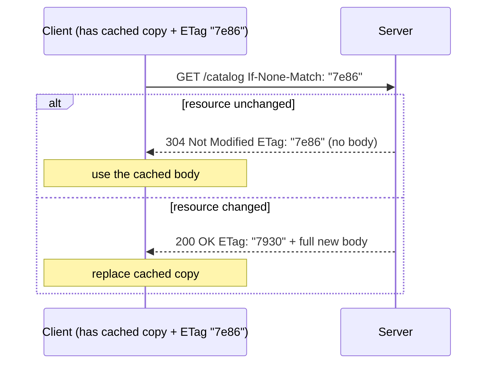

**`Cache-Control` decides when to revalidate:**

| Directive | Meaning |
|---|---|
| `max-age=600` | Fresh for 10 min: no request at all during that time |
| `no-cache` | May store, but **must revalidate** (ETag) before each use |
| `no-store` | Never store (sensitive data) |
| `public` / `private` | Shared caches (CDN) may / may not store it |
| `s-maxage=60` | Freshness for shared caches only |
| `immutable` | Never revalidate (fingerprinted static files like `app.3f9a1c.js`) |
| `stale-while-revalidate=30` | Serve stale for 30 s while refreshing in the background |

**Static asset strategy:** fingerprint the filename (`app.3f9a1c.js`) and send `Cache-Control: public, max-age=31536000, immutable`; the HTML that references it uses `no-cache` + ETag.

---

## 9.4 Complete Java Example - ETag and 304 Against a Real HTTP Server

A JDK `HttpServer` on a random local port serves a 300-item catalog with a content-hash ETag. A JDK `HttpClient` (which reuses its connection via keep-alive) fetches it, revalidates it unchanged, then revalidates after a price change.

```java
import com.sun.net.httpserver.HttpServer;
import java.io.IOException;
import java.io.OutputStream;
import java.net.InetSocketAddress;
import java.net.URI;
import java.net.http.HttpClient;
import java.net.http.HttpRequest;
import java.net.http.HttpResponse;
import java.nio.charset.StandardCharsets;
import java.security.MessageDigest;
import java.util.HexFormat;

// Conditional requests with ETag / If-None-Match against a REAL local HTTP server (JDK HttpServer + HttpClient).
// Unchanged resource -> 304 Not Modified with an empty body. Changed resource -> 200 with the new body and a new ETag.

public class ETagDemo {
    static volatile String catalog;

    static String etagOf(String body) throws Exception {
        byte[] hash = MessageDigest.getInstance("SHA-256").digest(body.getBytes(StandardCharsets.UTF_8));
        return "\"" + HexFormat.of().formatHex(hash, 0, 8) + "\"";           // strong validator from content hash
    }

    public static void main(String[] args) throws Exception {
        StringBuilder sb = new StringBuilder("[");
        for (int i = 0; i < 300; i++) sb.append(i == 0 ? "" : ",").append("{\"sku\":\"SKU-").append(i).append("\",\"price\":").append(100 + i).append('}');
        catalog = sb.append(']').toString();

        HttpServer server = HttpServer.create(new InetSocketAddress("127.0.0.1", 0), 0);
        server.createContext("/catalog", ex -> {
            try {
                String body = catalog, etag = etagOf(body);
                ex.getResponseHeaders().set("ETag", etag);
                ex.getResponseHeaders().set("Cache-Control", "no-cache");      // may store, but must revalidate each time
                if (etag.equals(ex.getRequestHeaders().getFirst("If-None-Match"))) {
                    ex.sendResponseHeaders(304, -1);                            // no body at all
                } else {
                    byte[] bytes = body.getBytes(StandardCharsets.UTF_8);
                    ex.sendResponseHeaders(200, bytes.length);
                    try (OutputStream os = ex.getResponseBody()) { os.write(bytes); }
                }
            } catch (Exception e) { throw new IOException(e); }
            finally { ex.close(); }
        });
        server.start();
        String url = "http://127.0.0.1:" + server.getAddress().getPort() + "/catalog";
        HttpClient client = HttpClient.newHttpClient();                     // reuses the TCP connection (keep-alive)

        HttpResponse<String> r1 = client.send(HttpRequest.newBuilder(URI.create(url)).build(), HttpResponse.BodyHandlers.ofString());
        String etag = r1.headers().firstValue("ETag").orElseThrow();
        System.out.println("1) GET /catalog                      -> " + r1.statusCode() + ", body " + r1.body().length() + " bytes, ETag " + etag);

        HttpResponse<String> r2 = client.send(HttpRequest.newBuilder(URI.create(url)).header("If-None-Match", etag).build(), HttpResponse.BodyHandlers.ofString());
        System.out.println("2) GET with If-None-Match (unchanged) -> " + r2.statusCode() + ", body " + r2.body().length() + " bytes (client reuses its cached copy)");

        catalog = catalog.replace("\"price\":100", "\"price\":99");          // a price changes on the server
        HttpResponse<String> r3 = client.send(HttpRequest.newBuilder(URI.create(url)).header("If-None-Match", etag).build(), HttpResponse.BodyHandlers.ofString());
        System.out.println("3) GET with old ETag (changed)        -> " + r3.statusCode() + ", body " + r3.body().length() + " bytes, new ETag "
                + r3.headers().firstValue("ETag").orElseThrow());
        server.stop(0);

        System.out.printf("Polling every minute for an hour while unchanged: %,d bytes with ETags vs %,d bytes without%n",
                r1.body().length(), r1.body().length() * 60);
    }
}
```

**Output:**
```
1) GET /catalog                      -> 200, body 8891 bytes, ETag "7e862fc4ad0877ba"
2) GET with If-None-Match (unchanged) -> 304, body 0 bytes (client reuses its cached copy)
3) GET with old ETag (changed)        -> 200, body 8890 bytes, new ETag "7930194a87125a5e"
Polling every minute for an hour while unchanged: 8,891 bytes with ETags vs 533,460 bytes without
```

What the output shows:
- The first GET returned the full **8,891-byte** body plus an ETag.
- Revalidating with `If-None-Match` while nothing changed returned **304 with 0 bytes**: the client kept using its copy.
- After one price changed, the same old ETag no longer matched, so the server sent **200** with the new body and a **new ETag**.
- A client polling every minute for an hour downloads the body **once** instead of 60 times (8.9 KB vs 533 KB). The server still did the work to build the response and hash it; to save that work too, use a version column or `Last-Modified` and check it **before** building the body.

---

## 9.5 In Spring Boot

```java
// 1) Cheap but only saves BANDWIDTH: hash every response body, reply 304 if it matches If-None-Match
@Bean
FilterRegistrationBean<ShallowEtagHeaderFilter> etagFilter() {
    FilterRegistrationBean<ShallowEtagHeaderFilter> f = new FilterRegistrationBean<>(new ShallowEtagHeaderFilter());
    f.addUrlPatterns("/api/catalog/*");
    return f;
}

// 2) "Deep" ETag: decide from a version BEFORE doing the expensive work (saves server CPU and DB time too)
@GetMapping("/api/products/{id}")
ResponseEntity<ProductDto> get(@PathVariable long id, WebRequest request) {
    long version = products.versionOf(id);                        // cheap: SELECT version FROM product WHERE id = ?
    String etag = "\"" + version + "\"";
    if (request.checkNotModified(etag)) return null;               // Spring writes 304 + ETag
    return ResponseEntity.ok()
            .eTag(etag)
            .cacheControl(CacheControl.noCache())                  // store but revalidate
            .body(products.load(id));                              // expensive part only when changed
}

// 3) Static resources: fingerprinted URLs + long immutable caching
@Configuration
class StaticConfig implements WebMvcConfigurer {
    public void addResourceHandlers(ResourceHandlerRegistry r) {
        r.addResourceHandler("/assets/**").addResourceLocations("classpath:/static/assets/")
         .setCacheControl(CacheControl.maxAge(365, TimeUnit.DAYS).cachePublic().immutable())
         .resourceChain(true).addResolver(new VersionResourceResolver().addContentVersionStrategy("/**"));
    }
}
```

```yaml
# HTTP/2 in Spring Boot (browsers need TLS for h2; h2c = cleartext HTTP/2 for internal traffic)
server:
  http2:
    enabled: true
  ssl:
    bundle: web          # configure an SSL bundle (spring.ssl.bundle.*) for TLS
```

**HTTP/3:** usually terminated at the edge (CDN, Nginx 1.25+ with QUIC, Envoy, cloud load balancers) rather than in the Java app.

#### 📘 Terms Explained

| Term | Simple meaning |
|---|---|
| **`ShallowEtagHeaderFilter`** | Spring filter that hashes the generated body to produce an ETag and a 304 when it matches. |
| **`WebRequest.checkNotModified`** | Spring helper that compares validators and prepares a 304 response. |
| **`CacheControl`** | Spring builder for `Cache-Control` header values. |
| **Fingerprinting / content hashing** | Putting a hash of the file's contents in its name so it can be cached forever. |
| **ALPN** | TLS extension that negotiates the application protocol (h2, http/1.1). |
| **h2c** | HTTP/2 over plain TCP without TLS. |

---

## 9.6 Pros, Cons, Pitfalls, Interview Questions and Cheat Sheet

| Pros | Cons |
|---|---|
| HTTP/2/3: fewer connections, parallel requests, compressed headers | Needs TLS and modern infrastructure end to end; debugging is harder (binary framing) |
| ETags: no body for unchanged resources; cheap revalidation for browsers and CDNs | Shallow ETags still cost full server work; ETags must change when content changes |
| Correct `Cache-Control` removes requests entirely | Wrong caching headers serve stale or private data |

| Pitfall | Fix |
|---|---|
| Weak/strong ETag mismatch behind proxies that modify bodies (compression) | Understand weak ETags (`W/`); compare consistently. |
| ETag based on something that doesn't change with the content | Content hash or version column. |
| `Cache-Control: public` on user-specific data | `private` or `no-store`. |
| HTTP/1.1-era tricks (domain sharding, concatenating everything into one bundle) under HTTP/2 | Let multiplexing work; split bundles sensibly. |
| Long `max-age` on non-fingerprinted files | Fingerprint, or use `no-cache` + ETag. |

**Q1. What is HTTP/2 multiplexing?** Many concurrent request/response streams interleaved on one TCP connection, removing HTTP/1.1's one-request-at-a-time limit per connection and the need for many connections.

**Q2. How do ETags work?** The server sends an `ETag` version; the client later sends `If-None-Match` with it; if unchanged the server returns `304 Not Modified` with no body, otherwise `200` with a new ETag.

**Q3. `no-cache` vs `no-store`?** `no-cache`: may be stored but must be revalidated before use. `no-store`: must not be stored at all.

**Q4. Shallow vs deep ETag in Spring?** `ShallowEtagHeaderFilter` hashes the rendered body (saves bandwidth only); a deep ETag compares a version before doing the work (saves CPU/DB too).

```
HTTP PERF   HTTP/1.1: 1 req/conn at a time, ~6 conns/host. HTTP/2: multiplexed streams on 1 TCP conn, HPACK; TCP HOL remains.
            HTTP/3: QUIC/UDP, independent streams, 1-RTT. Don't domain-shard. server.http2.enabled=true (TLS).
ETAG        ETag + If-None-Match -> 304 (no body); Last-Modified/If-Modified-Since. Shallow (ShallowEtagHeaderFilter) vs deep
            (checkNotModified with a version). Cache-Control: max-age, no-cache (revalidate), no-store, private/public, immutable,
            stale-while-revalidate. Fingerprinted static assets: max-age=1y, immutable.
```

---

# 10. Throttling and Debouncing (Interview Imp - Java)

## 10.1 What Are They?

Two ways to **reduce how often** an expensive action runs when events arrive rapidly:

- **Throttling:** run the action **at most once per interval** while events keep coming (e.g. at most every 100 ms during scrolling). Steady, regular execution.
- **Debouncing:** wait until events **stop** for a quiet period, then run **once** (e.g. search 300 ms after the user stops typing). Execution only after a pause.

On the **server side**, "throttling" usually means limiting how much load a client or job may create (rate limiting, concurrency limits, backpressure); that is covered in [02_Reliability_Pattern.md](02_Reliability_Pattern.md#7-throttling-pattern). This section focuses on the **event-handling** meaning, used in UIs, event streams and telemetry.

**Analogy:** A lift (elevator).
- **Debounce:** the doors close only after nobody has walked in for a few seconds; each new person resets the wait.
- **Throttle:** a shuttle bus that leaves every 10 minutes no matter how many people keep arriving.

#### 📘 Terms Explained

| Term | Simple meaning |
|---|---|
| **Throttle** | Allow an action at most once per time window. |
| **Debounce** | Run an action only after events have stopped for a set time. |
| **Leading / trailing edge** | Run at the start of a burst/window, and/or at its end with the latest value. |
| **Event storm / burst** | Many events in a short time (keystrokes, scroll, resize, sensor readings). |
| **`requestAnimationFrame`** | Browser API to run code before the next repaint (~60 times per second). |

---

## 10.2 Why Do We Need Them?

| Event source | Raw rate | Without control | With control |
|---|---|---|---|
| Search box keystrokes | ~5-10/s | An API call per keystroke, out-of-order results | **Debounce** 300 ms: one call when typing pauses |
| Scroll / resize / mouse move | 60+/s | Layout thrashing, janky UI | **Throttle** 100 ms or `requestAnimationFrame` |
| Auto-save while editing | Every keystroke | Constant writes | **Debounce** 1-2 s (+ save on blur) |
| Telemetry/metrics from devices | Thousands/s | Overloaded backend | **Throttle**/sample, batch |
| "Pay" button double-clicks | Bursts | Duplicate orders | Debounce/disable + server idempotency key |

---

## 10.3 How They Work

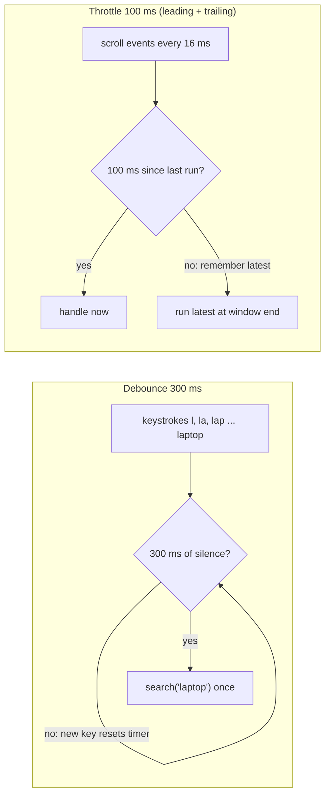

**Choosing:** if you only care about the **final** value after a burst → debounce. If you need **regular updates during** the burst → throttle. Many libraries support both leading and trailing calls.

---

## 10.4 Complete Java Example - Search-as-You-Type and Scroll Events

A 1 ms virtual clock drives a debouncer (300 ms) over two typing bursts, and a throttler (100 ms, leading + trailing) over 500 ms of 60 fps scroll events.

```java
import java.util.ArrayList;
import java.util.List;

// Debounce vs throttle on a virtual clock.
// Debounce: run once, after events STOP for 'wait' ms (search-as-you-type).
// Throttle: run at most once every 'interval' ms while events keep coming (scroll/resize handlers, telemetry).

public class DebounceThrottleDemo {
    static class Debouncer {
        final long waitMs; long deadline = -1; String pending; final List<String> runs = new ArrayList<>();
        Debouncer(long waitMs) { this.waitMs = waitMs; }
        void event(long now, String value) { pending = value; deadline = now + waitMs; }        // every event resets the timer
        void tick(long now) { if (deadline >= 0 && now >= deadline) { runs.add("t=" + now + " search('" + pending + "')"); deadline = -1; } }
    }

    static class Throttler {                                       // leading edge + trailing edge
        final long intervalMs; long lastRun = Long.MIN_VALUE / 2; String trailing; final List<String> runs = new ArrayList<>();
        Throttler(long intervalMs) { this.intervalMs = intervalMs; }
        void event(long now, String value) {
            if (now - lastRun >= intervalMs) { lastRun = now; runs.add("t=" + now + " handle(" + value + ")"); trailing = null; }
            else trailing = value;                                 // remember the latest, run it when the window ends
        }
        void tick(long now) { if (trailing != null && now - lastRun >= intervalMs) { lastRun = now; runs.add("t=" + now + " handle(" + trailing + ") [trailing]"); trailing = null; } }
    }

    public static void main(String[] args) {
        System.out.println("=== Debounce 300 ms: user types 'laptop', pauses, then adds ' bag' ===");
        long[] times = {0, 120, 230, 330, 450, 560, 1500, 1610, 1720, 1830};
        String[] text = {"l", "la", "lap", "lapt", "lapto", "laptop", "laptop ", "laptop b", "laptop ba", "laptop bag"};
        Debouncer d = new Debouncer(300);
        int ti = 0;
        for (long now = 0; now <= 2500; now++) {
            d.tick(now);
            if (ti < times.length && times[ti] == now) d.event(now, text[ti++]);
        }
        System.out.println("  " + times.length + " keystrokes -> " + d.runs.size() + " API calls: " + d.runs);

        System.out.println("=== Throttle 100 ms: scroll events every 16 ms (60 fps) for 500 ms ===");
        Throttler t = new Throttler(100);
        int events = 0;
        for (long now = 0; now <= 700; now++) {
            t.tick(now);
            if (now % 16 == 0 && now <= 500) { t.event(now, "y=" + now * 3); events++; }
        }
        System.out.println("  " + events + " scroll events -> " + t.runs.size() + " handler runs:");
        t.runs.forEach(r -> System.out.println("    " + r));
    }
}
```

**Output:**
```
=== Debounce 300 ms: user types 'laptop', pauses, then adds ' bag' ===
  10 keystrokes -> 2 API calls: [t=860 search('laptop'), t=2130 search('laptop bag')]
=== Throttle 100 ms: scroll events every 16 ms (60 fps) for 500 ms ===
  32 scroll events -> 6 handler runs:
    t=0 handle(y=0)
    t=100 handle(y=288) [trailing]
    t=200 handle(y=576) [trailing]
    t=300 handle(y=864) [trailing]
    t=400 handle(y=1152) [trailing]
    t=500 handle(y=1488) [trailing]
```

What the output shows:
- **Debounce:** 10 keystrokes produced only **2** searches: `'laptop'` 300 ms after the user paused at t = 560, and `'laptop bag'` 300 ms after the last key. The intermediate prefixes (`l`, `la`, ...) never hit the API.
- **Throttle:** 32 scroll events produced **6** handler runs, one per 100 ms window. The first ran immediately (leading edge); later ones used the **latest** position (trailing edge), so the final position `y=1488` was still handled.

---

## 10.5 In JavaScript, Reactor and the Backend

```javascript
// Browser: debounce and throttle helpers (lodash has _.debounce / _.throttle)
function debounce(fn, wait) {
  let timer;
  return (...args) => { clearTimeout(timer); timer = setTimeout(() => fn(...args), wait); };
}
function throttle(fn, interval) {
  let last = 0, trailing;
  return (...args) => {
    const now = Date.now();
    if (now - last >= interval) { last = now; fn(...args); }
    else { clearTimeout(trailing); trailing = setTimeout(() => { last = Date.now(); fn(...args); }, interval - (now - last)); }
  };
}
searchInput.addEventListener('input', debounce(e => search(e.target.value), 300));
window.addEventListener('scroll', throttle(updateStickyHeader, 100), { passive: true });
// Also cancel stale searches with AbortController, so a slow old response can't overwrite a newer one.
```

```java
// Project Reactor (Spring WebFlux): the same ideas on event streams
Flux<String> queries = keystrokes
        .sampleTimeout(q -> Mono.delay(Duration.ofMillis(300)))     // debounce: emit after 300 ms of silence
        .distinctUntilChanged()
        .switchMap(q -> searchClient.search(q));                     // cancel the previous in-flight search

Flux<Reading> perSecond = sensorReadings.sample(Duration.ofSeconds(1));   // throttle: latest value once per second
```

**Backend equivalents:** rate limiting per client (token bucket, Bucket4j, Resilience4j `RateLimiter`), concurrency limits (`Semaphore`, bulkheads), consumer-side throttling (`max.poll.records`, pausing partitions), and **coalescing duplicate requests** ([section 3](#3-batching-and-request-coalescing)). See [02_Reliability_Pattern.md](02_Reliability_Pattern.md#6-rate-limiting-pattern-interview-imp---java).

---

## 10.6 Pros, Cons, Pitfalls, Interview Questions and Cheat Sheet

| | Pros | Cons |
|---|---|---|
| **Debounce** | Minimal calls; only the final value matters | Adds delay; never fires during a continuous stream |
| **Throttle** | Regular, bounded update rate | May drop intermediate events; can still be too frequent if the interval is badly chosen |

| Pitfall | Fix |
|---|---|
| Debouncing something that must update continuously (progress bars, scroll position) | Throttle or `requestAnimationFrame`. |
| Throttle without a trailing call → final state missed | Enable the trailing edge. |
| Out-of-order async responses (old search result arrives last) | Cancel previous requests (`AbortController`, `switchMap`). |
| Relying on client debounce to prevent duplicate payments | Server-side idempotency keys too. |

**Q1. Debounce vs throttle?** Debounce runs once after events stop for a period (search box). Throttle runs at most once per interval while events continue (scroll handler).

**Q2. How would you implement search-as-you-type efficiently?** Debounce input (~300 ms), skip unchanged queries, cancel in-flight requests when a new one starts, cache recent results, and limit requests server-side.

```
DEBOUNCE   Run once after N ms of silence (search box, auto-save, resize end). Reactor: sampleTimeout. JS: clearTimeout/setTimeout.
THROTTLE   At most once per N ms during a stream (scroll, mousemove, telemetry); leading + trailing. Reactor: sample(Duration).
           Cancel stale requests (AbortController / switchMap). Server-side: rate limits, Reliability_Pattern §6-7.
```

---

# 11. Front-End Delivery Patterns

## 11.1 The Patterns at a Glance

These patterns from the extended list make **web pages** fast. They matter to Java developers because Spring Boot often serves the front end, sets its caching headers, and is judged by the same user-facing metrics.

| Goal | Patterns |
|---|---|
| **Send less code** | Code splitting, bundle splitting, tree shaking, minification, compression ([section 8](#8-compression-gzip-brotli-zstd-interview-imp---java)) |
| **Send it sooner** | Critical CSS, resource hints (preload, prefetch, preconnect), HTTP/2 Server Push (deprecated) → 103 Early Hints, multiplexing ([section 9](#9-http-performance-multiplexing-conditional-requests-and-etags-interview-imp---java)) |
| **Send lighter media** | Image optimisation, lazy-loading images, progressive images, WebP/AVIF, responsive images, adaptive bitrate video |
| **Render less** | Virtual scrolling (windowing) |

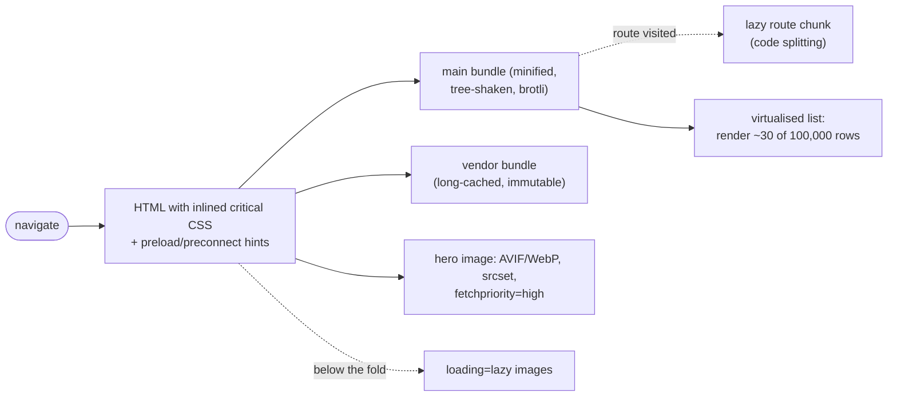

#### 📘 Terms Explained

| Term | Simple meaning |
|---|---|
| **Bundle** | A JavaScript/CSS file produced by a build tool (Vite, webpack) from many source modules. |
| **Above / below the fold** | Visible without scrolling / only after scrolling. |
| **Render-blocking resource** | CSS/JS the browser must load before it can paint the page. |
| **LCP / INP / CLS** | Core Web Vitals: largest paint time, interaction responsiveness, layout stability. |
| **Hydration** | Attaching JavaScript behaviour to server-rendered HTML. |

---

## 11.2 Loading Less: Code Splitting, Bundle Splitting, Tree Shaking, Minification

| Pattern | What it does | How |
|---|---|---|
| **Code splitting** | Split the app into chunks loaded **on demand** (per route/feature) instead of one huge bundle | Dynamic `import()`, `React.lazy()` + `<Suspense>`, router-level lazy routes |
| **Bundle splitting** | Separate rarely-changing code (vendor libraries) from frequently-changing app code, so users keep the vendor bundle cached across deploys | Vite/Rollup `manualChunks`, webpack `splitChunks` |
| **Tree shaking** | Remove code that is imported but never used | ES modules (`import { debounce } from 'lodash-es'`), `"sideEffects": false` in `package.json`, production builds |
| **Minification** | Remove whitespace/comments and shorten names | Terser, esbuild, Lightning CSS (automatic in production builds) |

```javascript
// React: route-level code splitting
const AdminPage = React.lazy(() => import('./pages/AdminPage'));     // separate chunk, fetched on first visit
<Suspense fallback={<Spinner />}><AdminPage /></Suspense>

// vite.config.js: keep big vendor libraries in their own long-cached chunk
build: { rollupOptions: { output: { manualChunks: { react: ['react', 'react-dom'], charts: ['echarts'] } } } }
```

**Measure:** bundle analysers (`rollup-plugin-visualizer`, `webpack-bundle-analyzer`), Lighthouse "unused JavaScript". See [React_Complete_Guide.md](../../react/React_Complete_Guide.md).

---

## 11.3 Loading Sooner: Critical CSS, Resource Hints, Server Push and Early Hints

| Pattern | What it does | Example |
|---|---|---|
| **Critical CSS** | Inline the small CSS needed for above-the-fold content in `<head>`; load the rest asynchronously, so first paint isn't blocked | Build tools like `critters`/`beasties`; frameworks do it automatically |
| **`preload`** | Fetch a resource needed **for this page** early, at high priority | `<link rel="preload" href="/fonts/inter.woff2" as="font" type="font/woff2" crossorigin>` |
| **`prefetch`** | Fetch a resource likely needed for the **next** navigation, at low priority | `<link rel="prefetch" href="/checkout.js">` |
| **`preconnect` / `dns-prefetch`** | Open the connection (DNS + TCP + TLS) to another origin early | `<link rel="preconnect" href="https://cdn.example.com">` |
| **`modulepreload`** | Preload an ES module and its dependencies | `<link rel="modulepreload" href="/assets/app.js">` |
| **`fetchpriority`** | Tell the browser which resources matter most | `` |
| **HTTP/2 Server Push** | Server sends resources before the browser asks | **Deprecated**: removed from Chrome (2022) because it often pushed already-cached files |
| **103 Early Hints** | Server sends `Link: <...>; rel=preload` headers **before** the final response, while it's still building the page | `HTTP/1.1 103 Early Hints` + `Link` headers (CDNs, Nginx, Node; Spring can send it via the servlet API on supporting containers) |

---

## 11.4 Images and Video: Lazy, Progressive, WebP/AVIF, Adaptive Bitrate

Images are often the **largest bytes** on a page.

| Pattern | How |
|---|---|
| **Modern formats** | **AVIF** and **WebP** are typically 25-50% smaller than JPEG/PNG at similar quality; serve with `<picture>` fallbacks |
| **Responsive images** | `srcset` + `sizes` so phones download small versions |
| **Lazy-loading images** | `` for below-the-fold images (never for the main/LCP image) |
| **Progressive images** | Progressive JPEG or a tiny blurred placeholder (LQIP/"blur-up") that is replaced when the full image arrives |
| **Explicit dimensions** | `width`/`height` (or `aspect-ratio`) so the layout doesn't jump (CLS) |
| **Image CDN / on-the-fly resizing** | Cloudinary, imgix, Cloudflare Images, Thumbor: resize, convert format by `Accept` header |
| **Adaptive bitrate streaming (ABR)** | Video is encoded at several qualities and cut into short **segments** (HLS, MPEG-DASH); the player picks each segment's quality from measured bandwidth and buffer level |

```html
<picture>
  <source type="image/avif" srcset="/img/shoe-480.avif 480w, /img/shoe-960.avif 960w" sizes="(max-width: 600px) 480px, 960px">
  <source type="image/webp" srcset="/img/shoe-480.webp 480w, /img/shoe-960.webp 960w" sizes="(max-width: 600px) 480px, 960px">
  
</picture>
```

---

## 11.5 Rendering Less: Virtual Scrolling

**Virtual scrolling (windowing)** renders only the rows visible in the viewport (plus a small **overscan** buffer) instead of all 100,000 rows. Empty spacer elements keep the scrollbar the correct height; as the user scrolls, the same few DOM nodes are reused with new data.

| Without | With |
|---|---|
| 100,000 DOM nodes: seconds to render, huge memory, laggy scrolling | ~30 DOM nodes at any time; constant render cost |

Libraries: **TanStack Virtual**, **react-window**, **react-virtuoso**; for Angular, the CDK `cdk-virtual-scroll-viewport`. Combine with keyset pagination ([section 5](#5-pagination-at-scale-offset-vs-keyset-interview-imp---java)) and prefetching ([section 7](#7-lazy-loading-and-prefetching-interview-imp---java)) for infinite lists.

---

## 11.6 Complete Java Example - Virtual Scrolling Window and Adaptive Bitrate Choice

Both computations are what the browser library / video player does internally, written in Java for clarity.

```java
import java.util.List;

// Two client-side delivery patterns, computed the way the browser/player does it:
// Part A: virtual scrolling (render only the visible rows + a small overscan).
// Part B: adaptive bitrate streaming (pick the video quality from measured throughput and buffer level).

public class FrontendDeliveryDemo {
    record Window(int first, int last) { int count() { return last - first + 1; } }

    static Window visibleRows(int totalRows, int rowHeightPx, int viewportPx, int scrollTopPx, int overscan) {
        int first = Math.max(0, scrollTopPx / rowHeightPx - overscan);
        int last = Math.min(totalRows - 1, (scrollTopPx + viewportPx) / rowHeightPx + overscan);
        return new Window(first, last);
    }

    record Rendition(String name, int kbps) {}
    static final List<Rendition> LADDER = List.of(new Rendition("240p", 400), new Rendition("480p", 1_000),
            new Rendition("720p", 2_500), new Rendition("1080p", 5_000));

    static Rendition choose(int measuredKbps, double bufferSeconds) {
        double safety = bufferSeconds < 5 ? 0.5 : 0.8;               // low buffer -> be conservative to avoid stalling
        Rendition pick = LADDER.get(0);
        for (Rendition r : LADDER) if (r.kbps() <= measuredKbps * safety) pick = r;
        return pick;
    }

    public static void main(String[] args) {
        System.out.println("=== A) Virtual scrolling: 100,000-row table, 32 px rows, 640 px viewport ===");
        int total = 100_000;
        for (int scrollTop : new int[]{0, 1_600_000, 3_199_360}) {
            Window w = visibleRows(total, 32, 640, scrollTop, 5);
            System.out.printf("  scrollTop %,9d px -> render rows %,6d..%,6d (%d DOM rows instead of %,d)%n", scrollTop, w.first(), w.last(), w.count(), total);
        }
        System.out.println("  spacer elements above/below keep the scrollbar height = 100,000 x 32 px = 3,200,000 px");

        System.out.println("=== B) Adaptive bitrate: choose each 4-second segment's quality ===");
        int[] throughputKbps = {8_000, 7_500, 3_000, 1_200, 1_100, 2_800, 6_500, 9_000};
        double buffer = 2;                                          // seconds of video already downloaded
        for (int i = 0; i < throughputKbps.length; i++) {
            Rendition r = choose(throughputKbps[i], buffer);
            double downloadSeconds = r.kbps() * 4.0 / throughputKbps[i];   // time to fetch a 4 s segment
            buffer = Math.max(0, buffer - downloadSeconds) + 4;
            System.out.printf("  segment %d: network %,5d kbps, buffer before %4.1fs -> %-5s (%,5d kbps), buffer after %4.1fs%n",
                    i + 1, throughputKbps[i], buffer - 4 + downloadSeconds, r.name(), r.kbps(), buffer);
        }
        System.out.println("  quality drops when the network slows (no stall), and climbs back when it recovers");
    }
}
```

**Output:**
```
=== A) Virtual scrolling: 100,000-row table, 32 px rows, 640 px viewport ===
  scrollTop         0 px -> render rows      0..    25 (26 DOM rows instead of 100,000)
  scrollTop 1,600,000 px -> render rows 49,995..50,025 (31 DOM rows instead of 100,000)
  scrollTop 3,199,360 px -> render rows 99,975..99,999 (25 DOM rows instead of 100,000)
  spacer elements above/below keep the scrollbar height = 100,000 x 32 px = 3,200,000 px
=== B) Adaptive bitrate: choose each 4-second segment's quality ===
  segment 1: network 8,000 kbps, buffer before  2.0s -> 720p  (2,500 kbps), buffer after  4.8s
  segment 2: network 7,500 kbps, buffer before  4.8s -> 720p  (2,500 kbps), buffer after  7.4s
  segment 3: network 3,000 kbps, buffer before  7.4s -> 480p  (1,000 kbps), buffer after 10.1s
  segment 4: network 1,200 kbps, buffer before 10.1s -> 240p  (  400 kbps), buffer after 12.8s
  segment 5: network 1,100 kbps, buffer before 12.8s -> 240p  (  400 kbps), buffer after 15.3s
  segment 6: network 2,800 kbps, buffer before 15.3s -> 480p  (1,000 kbps), buffer after 17.9s
  segment 7: network 6,500 kbps, buffer before 17.9s -> 1080p (5,000 kbps), buffer after 18.8s
  segment 8: network 9,000 kbps, buffer before 18.8s -> 1080p (5,000 kbps), buffer after 20.6s
  quality drops when the network slows (no stall), and climbs back when it recovers
```

What the output shows:
- **Virtual scrolling:** whether the user is at the top, middle or bottom of a 100,000-row table, only **25-31 rows** (visible + 5 overscan on each side) are rendered.
- **Adaptive bitrate:** with a small starting buffer, the player chose conservatively (720p at 8 Mbit/s). When bandwidth dropped to ~1.2 Mbit/s it fell to **240p instead of stalling**, then climbed back to **1080p** once the network recovered and the buffer was healthy.

---

## 11.7 Core Web Vitals, Interview Questions and Cheat Sheet

| Metric | Measures | "Good" threshold | Patterns that help |
|---|---|---|---|
| **LCP** (Largest Contentful Paint) | When the main content appears | ≤ 2.5 s | Critical CSS, preload/fetchpriority for the hero image, modern formats, CDN, server response time, compression |
| **INP** (Interaction to Next Paint, replaced FID in 2024) | How quickly the page responds to input | ≤ 200 ms | Code splitting (less JS), debounce/throttle handlers, virtual scrolling, moving work off the main thread (Web Workers) |
| **CLS** (Cumulative Layout Shift) | Visual stability | ≤ 0.1 | Image `width`/`height`, reserved space for ads/embeds, font loading strategy |

| Pitfall | Fix |
|---|---|
| Lazy-loading the hero (LCP) image | Eager + `fetchpriority="high"` for it; lazy for the rest. |
| One giant JS bundle | Route-level code splitting + vendor chunk. |
| Preloading everything | Preload only what this page needs right away. |
| Rendering huge lists | Virtual scrolling + pagination. |
| No caching strategy for assets | Fingerprinted files with `immutable`, HTML with `no-cache` ([9.3](#93-how-they-work-http11-vs-http2-vs-http3-and-revalidation)). |

**Q1. Code splitting vs tree shaking?** Code splitting divides used code into chunks loaded on demand; tree shaking removes code that is never used at all.

**Q2. preload vs prefetch?** `preload` = high priority, needed for the current page now; `prefetch` = low priority, likely needed for a future navigation.

**Q3. What replaced HTTP/2 Server Push?** `103 Early Hints` plus `preload` links: the browser decides what to fetch, avoiding pushing already-cached resources.

**Q4. How does adaptive bitrate streaming work?** Video is encoded at multiple bitrates and split into segments (HLS/DASH); the player measures throughput and buffer level and chooses each segment's quality to avoid stalls.

```
FRONT END   Less code: code splitting (import(), React.lazy), bundle/vendor splitting, tree shaking (ESM, sideEffects:false), minify.
            Sooner: critical CSS inline, preload (now) / prefetch (next) / preconnect, fetchpriority, 103 Early Hints (Server Push is dead).
            Media: AVIF/WebP + <picture>, srcset/sizes, loading=lazy (not LCP image), progressive/LQIP, width/height, ABR (HLS/DASH).
            Render less: virtual scrolling (TanStack Virtual/react-window). Core Web Vitals: LCP <= 2.5 s, INP <= 200 ms, CLS <= 0.1.
```

---

## 11.8 Pros and Cons

| Pros | Cons |
|---|---|
| Faster first paint and interaction (better Core Web Vitals, conversion and SEO) | More build tooling and configuration (bundler, image pipeline) |
| Less data on mobile networks | Over-splitting creates many small requests and waterfalls |
| Smooth scrolling for long lists (virtualisation) | Lazy loading above-the-fold content *hurts* LCP |
| Cheaper bandwidth (compressed, modern image formats) | Browser support differences (AVIF), fallbacks needed |
| Hints (preload/preconnect) cut latency | Wrong hints waste bandwidth and compete with critical resources |

# 12. How the Performance Patterns Fit Together

## 12.1 One-Line Summary of Each

| # | Pattern | One line | Saves |
|---|---|---|---|
| 1 | **Multi-level caching** | L1 in-JVM + L2 shared + invalidation | Round trips, DB load |
| 1 | **Memoization** | Cache pure function results | CPU |
| 2 | **Connection pooling** | Reuse open connections; cap concurrency | Connect/TLS time, DB overload |
| 2 | **Keep-alive** | Reuse TCP/TLS for many HTTP requests | Handshakes |
| 3 | **Batching** | Many items per round trip (size or linger) | Round trips, per-call overhead |
| 3 | **Request coalescing** | Identical concurrent requests → one call | Duplicate work, stampedes |
| 4 | **Async processing** | Parallel fan-out; offload slow work to queues | User-visible latency, threads |
| 5 | **Keyset pagination** | Seek to the cursor instead of skipping rows | Rows examined |
| 6 | **Indexing** | Sorted structures to find rows without scanning | Rows/pages read |
| 7 | **Lazy loading** | Load on first use | Unneeded work |
| 7 | **Prefetching / cache warming** | Load before it's needed | Waiting time |
| 8 | **Compression** | Fewer bytes on the wire/disk | Bandwidth, transfer time |
| 9 | **Multiplexing (HTTP/2/3)** | Many streams over one connection | Connections, queuing |
| 9 | **Conditional requests / ETags** | 304 instead of resending unchanged data | Bytes (and work, if deep) |
| 10 | **Throttling / debouncing** | Limit how often handlers run | Calls, CPU, jank |
| 11 | **Front-end delivery** | Less/smaller/sooner code and media; render less | Page load and interaction time |

---

## 12.2 The Performance Tuning Workflow (Interview Imp - Java)

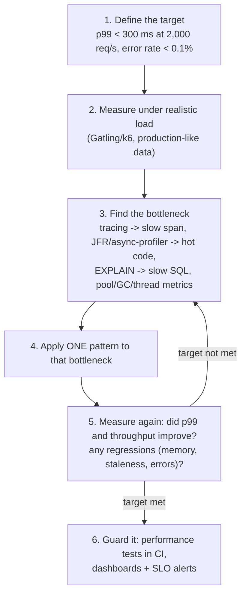

**Typical bottleneck → first pattern to try:**

| What the trace/profile shows | Try first |
|---|---|
| One slow SQL query | Index ([6](#6-indexing-interview-imp---java)), query rewrite, keyset pagination ([5](#5-pagination-at-scale-offset-vs-keyset-interview-imp---java)) |
| Hundreds of fast identical queries | Fix N+1: join fetch / batch fetch / DTO projection |
| Time spent waiting for a connection | Shorter transactions, no I/O inside tx, then pool sizing ([2](#2-connection-pooling-and-keep-alive-interview-imp---java)) |
| Same data loaded on every request | Caching ([1](#1-caching-strategy-multi-level-caching-and-memoization-interview-imp---java)) |
| Several independent downstream calls in sequence | Parallel fan-out ([4](#4-asynchronous-processing-interview-imp---java)) |
| Slow work the user doesn't need to wait for | Offload to a queue, 202 Accepted |
| Many small writes / messages | Batching ([3](#3-batching-and-request-coalescing)) |
| Large responses on slow networks | Compression, pagination, field selection, ETags |
| High CPU in serialization / a hot method | Profile; memoize; cheaper algorithm; less allocation |
| Long GC pauses | Reduce allocation, right-size heap, G1/ZGC tuning |
| Slow page load / interaction in the browser | Front-end delivery patterns ([11](#11-front-end-delivery-patterns)) |

---

## 12.3 Where Each Pattern Acts on a Request

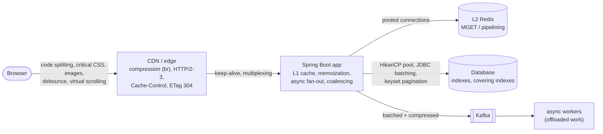

---

## 12.4 Decision Guide: Symptom to Pattern

| Symptom | Likely cause | Pattern |
|---|---|---|
| p99 latency much higher than p50 | Queueing (pool/threads), GC, a slow dependency, cold caches | Pool sizing, timeouts, async, cache warming |
| Latency grows with page number | OFFSET pagination | Keyset pagination |
| Latency grows with table size | Missing index / full scans | Indexing, covering indexes |
| DB CPU high with many identical queries | N+1, no caching | Join/batch fetch, caching, coalescing |
| `Connection is not available, request timed out` | Pool exhaustion | Short transactions, no remote calls in tx, leak detection, sizing |
| Slow bulk imports | Row-by-row writes | JDBC/Hibernate batching, sequences, chunks |
| Page waits for several services | Sequential calls | Parallel fan-out, BFF aggregation |
| Big JSON over mobile networks | Bytes | Compression, pagination, sparse fieldsets, ETags |
| Clients polling unchanged data | Re-downloads | ETags / 304, webhooks, SSE |
| UI freezes on typing/scrolling | Too many handler runs, huge DOM | Debounce/throttle, virtual scrolling |
| Slow first page load | Big bundles, render-blocking CSS, heavy images | Code splitting, critical CSS, AVIF/WebP, preload |

---

## 12.5 Look-Alike Concepts

| Look-alikes | Difference |
|---|---|
| **Latency vs throughput** | Time per request vs requests per second; batching can raise throughput while adding a little latency. |
| **Caching vs memoization** | Memoization is caching of a pure function's results; caching in general also covers remote data with staleness. |
| **L1 cache vs Identity Map** | L1 is a shared performance cache across requests; the identity map is per-transaction correctness ([Enterprise](../02_HLD/02_Enterprise_Application_Pattern.md#5-unit-of-work-and-identity-map)). |
| **Batching vs coalescing** | Different items grouped into one call vs identical requests merged into one call. |
| **Async vs parallel** | Async = caller doesn't wait; parallel = several things run at once. Fan-out is both. |
| **Lazy loading vs prefetching** | Load later on demand vs load earlier by prediction. |
| **Prefetch vs preload (browser)** | Next navigation, low priority vs current page, high priority. |
| **Keep-alive vs multiplexing** | Reuse a connection sequentially vs run many requests on it concurrently. |
| **ETag vs Cache-Control max-age** | Cheap revalidation (a request, maybe no body) vs no request at all until expiry. |
| **Throttling (UI) vs rate limiting (server)** | Limit how often *your own* handler runs vs limit how much *a client* may call you. |
| **Throttle vs debounce** | Regular runs during a burst vs one run after the burst. |
| **Compression vs minification** | Generic byte encoding (decompressed by the client) vs rewriting code to be smaller (no decoding needed); use both. |
| **Code splitting vs tree shaking** | Load used code later vs delete unused code. |
| **Index vs cache** | Faster access path inside the DB (always consistent) vs a copy outside (may be stale). |
| **Connection pool vs thread pool** | Reuse expensive connections vs reuse threads; both cap concurrency and are sized with Little's Law. |

---

# 13. Performance Patterns Cheat Sheet

```
MEASURE FIRST    Targets in p95/p99 + throughput. Little's Law L = λ x W. Amdahl: fix the biggest slice. Tracing, JFR, async-profiler,
                 EXPLAIN ANALYZE, JMH, Gatling/k6. One change at a time, measure again.
CACHING          L1 Caffeine (µs, small, short TTL) + L2 Redis (shared) + DB; invalidate L1 via pub/sub; refresh-ahead; @Cacheable(sync=true).
MEMOIZATION      Cache pure function results; bounded; no recursive computeIfAbsent. Basics: Scalability_Pattern §8-11.
CONNECTION POOL  HikariCP: small fixed pool (default 10), size = λ x hold time, DB total ~ cores*2+spindles; connection-timeout low;
                 max-lifetime, keepalive-time, leak detection; short tx, no HTTP inside tx; PgBouncer/RDS Proxy.
KEEP-ALIVE       Reuse TCP+TLS; one shared pooled HTTP client; server.tomcat.keep-alive-timeout.
BATCHING         Size OR linger; diminishing returns; JDBC batchUpdate, hibernate.jdbc.batch_size + order_inserts + SEQUENCE ids,
                 rewriteBatchedStatements; Kafka batch.size/linger.ms/compression; @BatchMapping; MGET/_bulk. COALESCING: in-flight futures.
ASYNC            Fan-out (latency = max): CompletableFuture.allOf + timeouts, dedicated executor / virtual threads, Mono.zip.
                 Offload: queue + worker + 202 Accepted + job status; durable + idempotent.
PAGINATION       OFFSET reads offset+limit rows (slow deep, duplicates). KEYSET: WHERE (sort,id) < cursor + composite index; constant cost.
                 Spring: Page (count) / Slice / Window + ScrollPosition.keyset().
INDEXING         B-tree; composite leftmost prefix (equality cols first, then range/sort); covering (INCLUDE) = index-only scan;
                 selectivity; functions/casts/'%x' break indexes; writes pay per index; EXPLAIN (ANALYZE, BUFFERS); CONCURRENTLY.
LAZY / PREFETCH  Lazy = on first use (N+1 risk). Prefetch = predictable next item in idle time, one step ahead. Cache warming before ready.
COMPRESSION      Text 70-95% smaller; skip <1-2 KB and JPEG/MP4/ZIP. Accept-Encoding/Content-Encoding/Vary. server.compression.*;
                 Brotli pre-compressed static at the edge; Kafka zstd/lz4. Levels: diminishing returns. BREACH caution.
HTTP             HTTP/2 multiplexing + HPACK (one conn), HTTP/3 QUIC (no TCP HOL). ETag + If-None-Match -> 304; deep vs shallow ETag.
                 Cache-Control max-age / no-cache / no-store / private / immutable / stale-while-revalidate; fingerprinted assets.
THROTTLE/DEBOUNCE Throttle: <= once per interval during bursts (scroll). Debounce: once after silence (search). Cancel stale requests.
FRONT END        Code/bundle splitting, tree shaking, minify; critical CSS; preload/prefetch/preconnect; Early Hints (no Server Push);
                 AVIF/WebP, srcset, lazy images (not LCP), progressive; ABR (HLS/DASH); virtual scrolling. LCP/INP/CLS.
```

### Quick Decision Table

| Interview question | Short answer |
|---|---|
| "The API got slow as data grew. What do you check?" | Traces for the slow span → `EXPLAIN` for full scans/missing indexes, N+1 query counts, OFFSET pagination, pool wait time. |
| "How do you size a connection pool?" | Little's Law (throughput × hold time), DB capacity (~cores × 2 total across instances), small fixed pool, watch pending metrics. |
| "Why is `OFFSET 100000` slow and what's the fix?" | It reads and discards 100,000 rows; use keyset pagination with a composite index. |
| "How do you make a page that calls 3 services faster?" | Call them in parallel with timeouts (CompletableFuture / WebFlux / virtual threads), cache stable parts, or aggregate in a BFF. |
| "How do you speed up inserting 1M rows with JPA?" | JDBC batching (`batch_size`, `order_inserts`), SEQUENCE ids, flush/clear per chunk, driver rewrite flag, or plain `JdbcTemplate.batchUpdate`. |
| "Local cache or Redis?" | Both: L1 for hot read-mostly data (µs), L2 for shared state; invalidate L1 on writes; TTLs everywhere. |
| "How do ETags save bandwidth?" | `If-None-Match` → `304` with no body when unchanged; deep ETags also skip server work. |
| "Debounce or throttle for search-as-you-type?" | Debounce (~300 ms) + cancel stale requests. |

### Top Interview Traps

| Trap | Correct answer |
|---|---|
| "Bigger connection pools are faster" | Past Little's Law needs, they add DB contention; smaller pools are often faster. |
| "Optimise the averages" | Users feel the tail: target p95/p99. |
| "Add an index on every column" | Each index slows writes and uses memory; index real query patterns. |
| "Async makes the work faster" | It reduces waiting (latency) and frees threads; total work is the same or more. |
| "Compress everything" | Tiny and already-compressed payloads get bigger or waste CPU. |
| "HTTP/2 Server Push is the way to send assets early" | It's deprecated; use preload + 103 Early Hints. |
| "Offset pagination is fine because page 1 is fast" | Deep pages and exports degrade linearly and show duplicates on changing data. |
| "Caching fixes slow queries" | It hides them until the cache misses (cold start, eviction, stampede); fix the query too. |
| "`System.currentTimeMillis()` loops are a benchmark" | Use JMH (warm-up, dead-code elimination, forks) or real load tests. |
