---
mdx:
  format: md
---

# Messaging & Communication Patterns

> **Note**: Patterns marked with **(Interview Imp - Java)** are frequently asked in Java interviews
>
> **How to read this file:** Every section ends with a **📘 Terms Explained** table. If you see a word you don't know, check the table right below that section. Each pattern goes from the basic idea to advanced usage (plain Java, Kafka, RabbitMQ, Spring Boot, pitfalls) and ends with interview questions and a mini cheat sheet.
>
> **What are messaging patterns?** They answer one question: *"How do services talk to each other without being tightly tied together in time and space?"* Instead of calling each other directly and waiting, services send **messages** through a **broker**. This file covers the core patterns (queue, pub-sub, request-reply, broker, routing, translation, correlation, dead letters, idempotency) plus **guaranteed delivery and the Transactional Outbox**, the topics interviewers dig into most.
>
> **Verified code:** Every main "Complete Java Example" in this file is **plain Java 17 (no libraries)**: a small in-memory simulation of how a real broker behaves. Each was compiled and run, and its **Output** block is the real program output. The simulations are single-threaded, so the output is the same on every run. To run one, save it as `<ClassName>.java` and run `javac <ClassName>.java && java <ClassName>`. (Running it directly with `java <ClassName>.java` won't work, because the class with `main` is not the first class in the file.) The Kafka / RabbitMQ / Spring snippets show the production way to do the same thing.

---

## Table of Contents
1. [Message Queue Pattern](#1-message-queue-pattern-interview-imp---java) **(Interview Imp - Java)**
   - [1.1 What is a Message Queue?](#11-what-is-a-message-queue)
   - [1.2 Why Do We Need It?](#12-why-do-we-need-it)
   - [1.3 How It Works: Acknowledgements and Redelivery](#13-how-it-works-acknowledgements-and-redelivery)
   - [1.4 Complete Java Example - Competing Consumers with Ack and Redelivery](#14-complete-java-example---competing-consumers-with-ack-and-redelivery)
   - [1.5 Message Queues with RabbitMQ and Spring Boot](#15-message-queues-with-rabbitmq-and-spring-boot)
   - [1.6 Pros, Cons and Pitfalls](#16-pros-cons-and-pitfalls)
   - [1.7 Message Queue - Interview Questions](#17-message-queue---interview-questions)
   - [1.8 Message Queue - Cheat Sheet](#18-message-queue---cheat-sheet)
2. [Publish-Subscribe (Pub-Sub) Pattern](#2-publish-subscribe-pub-sub-pattern-interview-imp---java) **(Interview Imp - Java)**
   - [2.1 What is Pub-Sub?](#21-what-is-pub-sub)
   - [2.2 Why Do We Need It?](#22-why-do-we-need-it)
   - [2.3 How It Works](#23-how-it-works)
   - [2.4 Complete Java Example - A Kafka-Style Topic with Consumer Groups](#24-complete-java-example---a-kafka-style-topic-with-consumer-groups)
   - [2.5 Pub-Sub with Kafka and Spring Boot](#25-pub-sub-with-kafka-and-spring-boot)
   - [2.6 Pros, Cons and Pitfalls](#26-pros-cons-and-pitfalls)
   - [2.7 Pub-Sub - Interview Questions](#27-pub-sub---interview-questions)
   - [2.8 Pub-Sub - Cheat Sheet](#28-pub-sub---cheat-sheet)
   - [2.9 Types and Variants](#29-types-and-variants)
3. [Request-Reply Pattern](#3-request-reply-pattern)
   - [3.1 What is Request-Reply?](#31-what-is-request-reply)
   - [3.2 Why Do We Need It?](#32-why-do-we-need-it)
   - [3.3 How It Works: Reply Channels](#33-how-it-works-reply-channels)
   - [3.4 Complete Java Example - Matching Replies by Correlation ID](#34-complete-java-example---matching-replies-by-correlation-id)
   - [3.5 Request-Reply in Spring Boot](#35-request-reply-in-spring-boot)
   - [3.6 Pros, Cons and Pitfalls](#36-pros-cons-and-pitfalls)
   - [3.7 Request-Reply - Interview Questions](#37-request-reply---interview-questions)
   - [3.8 Request-Reply - Cheat Sheet](#38-request-reply---cheat-sheet)
   - [3.9 Types and Variants](#39-types-and-variants)
4. [Message Broker Pattern](#4-message-broker-pattern-interview-imp---java) **(Interview Imp - Java)**
   - [4.1 What is a Message Broker?](#41-what-is-a-message-broker)
   - [4.2 Why Do We Need It?](#42-why-do-we-need-it)
   - [4.3 How It Works: Inside Kafka](#43-how-it-works-inside-kafka)
   - [4.4 How It Works: Inside RabbitMQ](#44-how-it-works-inside-rabbitmq)
   - [4.5 Kafka vs RabbitMQ (Interview Imp - Java)](#45-kafka-vs-rabbitmq-interview-imp---java)
   - [4.6 Pros, Cons and Pitfalls](#46-pros-cons-and-pitfalls)
   - [4.7 Message Broker - Interview Questions](#47-message-broker---interview-questions)
   - [4.8 Message Broker - Cheat Sheet](#48-message-broker---cheat-sheet)
5. [Event Bus Pattern](#5-event-bus-pattern)
   - [5.1 What is an Event Bus?](#51-what-is-an-event-bus)
   - [5.2 Why Do We Need It?](#52-why-do-we-need-it)
   - [5.3 Types of Event Bus and Event Styles](#53-types-of-event-bus-and-event-styles)
   - [5.4 Event Bus in Spring Boot](#54-event-bus-in-spring-boot)
   - [5.5 Pros, Cons and Pitfalls](#55-pros-cons-and-pitfalls)
   - [5.6 Event Bus - Interview Questions](#56-event-bus---interview-questions)
   - [5.7 Event Bus - Cheat Sheet](#57-event-bus---cheat-sheet)
6. [Message Channel Pattern](#6-message-channel-pattern)
   - [6.1 What is a Message Channel?](#61-what-is-a-message-channel)
   - [6.2 Why Do We Need It?](#62-why-do-we-need-it)
   - [6.3 Types of Channels](#63-types-of-channels)
   - [6.4 Message Channels in Spring](#64-message-channels-in-spring)
   - [6.5 Pros, Cons, Pitfalls and Interview Questions](#65-pros-cons-pitfalls-and-interview-questions)
   - [6.6 Message Channel - Cheat Sheet](#66-message-channel---cheat-sheet)
7. [Message Router Pattern](#7-message-router-pattern)
   - [7.1 What is a Message Router?](#71-what-is-a-message-router)
   - [7.2 Why Do We Need It?](#72-why-do-we-need-it)
   - [7.3 Types of Routers (EIP)](#73-types-of-routers-eip)
   - [7.4 Message Routers in Spring and Kafka](#74-message-routers-in-spring-and-kafka)
   - [7.5 Pros, Cons, Pitfalls and Interview Questions](#75-pros-cons-pitfalls-and-interview-questions)
   - [7.6 Message Router - Cheat Sheet](#76-message-router---cheat-sheet)
8. [Message Translator Pattern](#8-message-translator-pattern)
   - [8.1 What is a Message Translator?](#81-what-is-a-message-translator)
   - [8.2 Why Do We Need It?](#82-why-do-we-need-it)
   - [8.3 Levels of Translation](#83-levels-of-translation)
   - [8.4 Complete Java Example - Translating Partner Orders to a Canonical Model](#84-complete-java-example---translating-partner-orders-to-a-canonical-model)
   - [8.5 Message Translation in Spring and Kafka](#85-message-translation-in-spring-and-kafka)
   - [8.6 Pros, Cons, Pitfalls and Interview Questions](#86-pros-cons-pitfalls-and-interview-questions)
   - [8.7 Message Translator - Cheat Sheet](#87-message-translator---cheat-sheet)
9. [Content-Based Router Pattern](#9-content-based-router-pattern)
   - [9.1 What is a Content-Based Router?](#91-what-is-a-content-based-router)
   - [9.2 Why Do We Need It?](#92-why-do-we-need-it)
   - [9.3 How It Works](#93-how-it-works)
   - [9.4 Complete Java Example - Routing Orders by Their Contents](#94-complete-java-example---routing-orders-by-their-contents)
   - [9.5 Content-Based Routing in Spring and Kafka](#95-content-based-routing-in-spring-and-kafka)
   - [9.6 Pros, Cons, Pitfalls and Interview Questions](#96-pros-cons-pitfalls-and-interview-questions)
   - [9.7 Content-Based Router - Cheat Sheet](#97-content-based-router---cheat-sheet)
10. [Correlation Identifier Pattern](#10-correlation-identifier-pattern)
   - [10.1 What is a Correlation Identifier?](#101-what-is-a-correlation-identifier)
   - [10.2 Why Do We Need It?](#102-why-do-we-need-it)
   - [10.3 How It Works](#103-how-it-works)
   - [10.4 Complete Java Example - Propagating a Correlation ID Through Messages](#104-complete-java-example---propagating-a-correlation-id-through-messages)
   - [10.5 Correlation and Tracing in Spring Boot](#105-correlation-and-tracing-in-spring-boot)
   - [10.6 Pros, Cons, Pitfalls and Interview Questions](#106-pros-cons-pitfalls-and-interview-questions)
   - [10.7 Correlation Identifier - Cheat Sheet](#107-correlation-identifier---cheat-sheet)
   - [10.8 Types and Variants](#108-types-and-variants)
11. [Dead Letter Queue Pattern](#11-dead-letter-queue-pattern-interview-imp---java) **(Interview Imp - Java)**
   - [11.1 What is a Dead Letter Queue?](#111-what-is-a-dead-letter-queue)
   - [11.2 Why Do We Need It?](#112-why-do-we-need-it)
   - [11.3 How It Works](#113-how-it-works)
   - [11.4 Complete Java Example - Retry, Dead-Letter and Replay](#114-complete-java-example---retry-dead-letter-and-replay)
   - [11.5 Dead Letter Queues in Spring Boot](#115-dead-letter-queues-in-spring-boot)
   - [11.6 Pros, Cons and Pitfalls](#116-pros-cons-and-pitfalls)
   - [11.7 Dead Letter Queue - Interview Questions](#117-dead-letter-queue---interview-questions)
   - [11.8 Dead Letter Queue - Cheat Sheet](#118-dead-letter-queue---cheat-sheet)
12. [Idempotent Consumer Pattern](#12-idempotent-consumer-pattern-interview-imp---java) **(Interview Imp - Java)**
   - [12.1 What is an Idempotent Consumer?](#121-what-is-an-idempotent-consumer)
   - [12.2 Why Do We Need It?](#122-why-do-we-need-it)
   - [12.3 How It Works: Techniques](#123-how-it-works-techniques)
   - [12.4 Complete Java Example - Duplicate Payment Events](#124-complete-java-example---duplicate-payment-events)
   - [12.5 Idempotent Consumers in Spring Boot](#125-idempotent-consumers-in-spring-boot)
   - [12.6 Pros, Cons and Pitfalls](#126-pros-cons-and-pitfalls)
   - [12.7 Idempotent Consumer - Interview Questions](#127-idempotent-consumer---interview-questions)
   - [12.8 Idempotent Consumer - Cheat Sheet](#128-idempotent-consumer---cheat-sheet)
   - [12.9 Types and Variants](#129-types-and-variants)
13. [Guaranteed Delivery and the Transactional Outbox](#13-guaranteed-delivery-and-the-transactional-outbox-interview-imp---java) **(Interview Imp - Java)**
   - [13.1 Delivery Guarantees](#131-delivery-guarantees)
   - [13.2 The Dual-Write Problem](#132-the-dual-write-problem)
   - [13.3 How the Transactional Outbox Works](#133-how-the-transactional-outbox-works)
   - [13.4 Complete Java Example - Dual Write vs Outbox](#134-complete-java-example---dual-write-vs-outbox)
   - [13.5 Transactional Outbox in Spring Boot](#135-transactional-outbox-in-spring-boot)
   - [13.6 Pros, Cons, Pitfalls and Interview Questions](#136-pros-cons-pitfalls-and-interview-questions)
   - [13.7 Guaranteed Delivery and Outbox - Cheat Sheet](#137-guaranteed-delivery-and-outbox---cheat-sheet)
14. [How the Messaging Patterns Fit Together](#14-how-the-messaging-patterns-fit-together)
   - [14.1 One-Line Summary of Each](#141-one-line-summary-of-each)
   - [14.2 The Life of One Message (Interview Imp - Java)](#142-the-life-of-one-message-interview-imp---java)
   - [14.3 Decision Guide](#143-decision-guide)
   - [14.4 Look-Alike Patterns](#144-look-alike-patterns)
   - [14.5 Messaging Inside Spring](#145-messaging-inside-spring)
   - [14.6 Comparison Table](#146-comparison-table)
15. [Messaging Patterns Cheat Sheet](#15-messaging-patterns-cheat-sheet)

---

## Before You Start: Synchronous vs Asynchronous Communication

### Two ways for services to talk

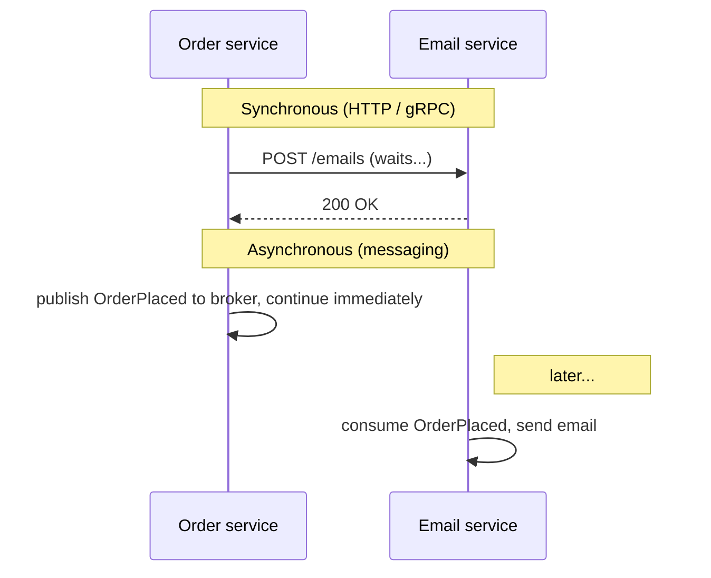

| | Synchronous (REST, gRPC) | Asynchronous (messaging) |
|---|---|---|
| Caller waits for the answer? | Yes | No: "fire and forget" (or wait for a reply later) |
| Both services must be up at the same time? | **Yes** (temporal coupling) | No: the broker stores messages until the consumer is back |
| Caller must know where the receiver is? | Yes (URL, service discovery) | No: it only knows a queue/topic name |
| Handles traffic spikes | Callee must keep up instantly | Broker buffers; consumers work at their own pace |
| One message to many receivers | Caller calls each one | Publish once, many subscribers |
| Complexity | Simple to understand and debug | Broker to run; eventual consistency; duplicates; ordering |
| Best for | Queries needing an immediate answer ("what's my balance?") | Commands and events that can complete later ("send email", "order placed") |

> **Rule of thumb:** use synchronous calls when the user **needs the answer now**; use messaging for work that can happen **after** the response, or that **many** services care about.

### Three kinds of messages

| Kind | Meaning | Naming | Receivers | Example |
|---|---|---|---|---|
| **Command** | "Please do this" | Imperative verb | Usually exactly one | `SendInvoiceEmail`, `ReserveStock` |
| **Event** | "This happened" (a fact, can't be rejected) | Past tense | Zero, one or many | `OrderPlaced`, `PaymentFailed` |
| **Query / request** | "Tell me this" | Question | One, which sends a reply | `GetPriceRequest` |

### The broker landscape

| Broker | Model | Strengths | Typical use |
|---|---|---|---|
| **Apache Kafka** | Distributed, partitioned **log**; messages kept for days (retention) | Huge throughput, replay, ordering per partition | Event streaming, analytics, event-driven microservices, CDC |
| **RabbitMQ** | Classic **queues** + flexible routing via exchanges | Rich routing, per-message acks, priorities, TTL, easy RPC | Task queues, commands, complex routing |
| **Amazon SQS / SNS** | Managed queue / managed pub-sub | Zero ops, scales automatically | AWS-native apps |
| **ActiveMQ Artemis / IBM MQ** | JMS queues and topics | JMS standard, XA transactions | Enterprise / legacy Java (JMS) |
| **Google Pub/Sub, Azure Service Bus** | Managed pub-sub / queues | Managed | Cloud-native |
| **Redis Streams / Pub/Sub** | Log-like streams / fire-and-forget pub-sub | Very fast, simple | Lightweight messaging, real-time features |
| **Apache Pulsar** | Log + queue semantics, tiered storage | Multi-tenancy, geo-replication | Large multi-tenant platforms |

#### 📘 Terms Explained

| Term | Simple meaning |
|---|---|
| **Message** | A packet of data (headers + body) sent from one program to another. |
| **Producer / publisher** | The program that sends messages. |
| **Consumer / subscriber** | The program that receives and processes messages. |
| **Broker** | The server in the middle that receives, stores and delivers messages (Kafka, RabbitMQ). |
| **Temporal coupling** | Both sides must be running at the same moment for communication to work. |
| **Fire and forget** | Send a message and continue without waiting for any answer. |
| **Eventual consistency** | Different parts of the system may disagree for a short time, but they all catch up. |
| **JMS** | Java Message Service: the old standard Java API for messaging (`jakarta.jms`). |

---

# 1. Message Queue Pattern (Interview Imp - Java)

## 1.1 What is a Message Queue?

A **message queue** is a buffer where **producers put messages** and **consumers take them out**, usually in order (FIFO). Each message is processed by **exactly one** consumer, then removed. The producer and consumer don't need to know about each other or be running at the same time.

**Analogy:** A restaurant's order rail. Waiters (producers) clip order slips onto the rail and go back to customers. Cooks (consumers) take the next slip when they're free. One slip is cooked by one cook. If the kitchen is busy, slips just wait on the rail.

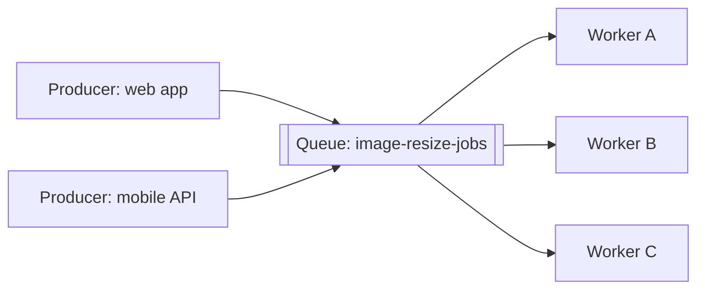

This is also called **point-to-point** messaging, and the many-workers setup is the **competing consumers** pattern.

#### 📘 Terms Explained

| Term | Simple meaning |
|---|---|
| **Queue** | A line of messages waiting to be processed, normally first in, first out. |
| **FIFO** | First In, First Out: the oldest message is taken first. |
| **Point-to-point** | Each message goes to exactly one receiver. |
| **Competing consumers** | Several consumers read the same queue; each message goes to whichever one grabs it first. |

---

## 1.2 Why Do We Need It?

| Benefit | Example |
|---|---|
| **Decoupling** | The web app doesn't know or care how many image workers exist. |
| **Load levelling / buffering** | A sale sends 50,000 orders in a minute; workers process them steadily over 10 minutes instead of crashing. |
| **Scaling out** | Add more workers to drain the queue faster (Kubernetes KEDA can scale on queue length). |
| **Resilience** | If the email service is down for an hour, messages wait in the queue; nothing is lost. |
| **Fast responses** | The API returns "202 Accepted" immediately; slow work happens in the background. |

---

## 1.3 How It Works: Acknowledgements and Redelivery

The critical question: **when is a message removed from the queue?**

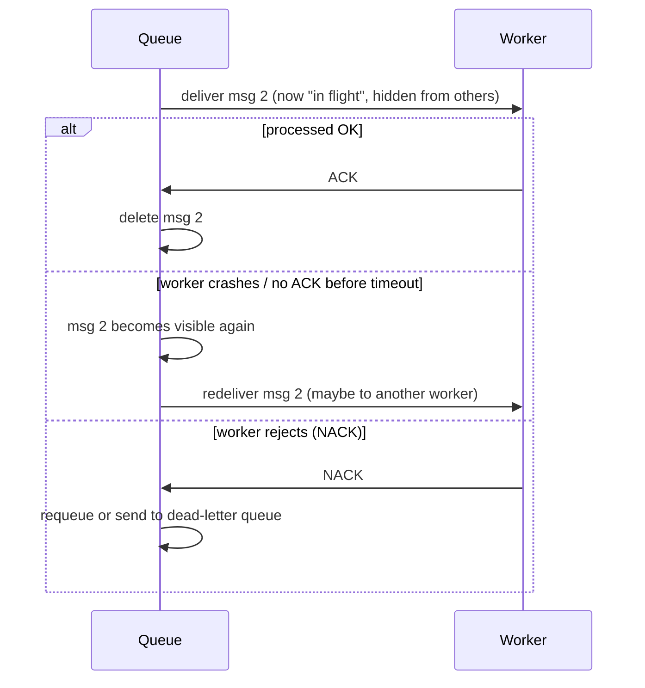

| Ack mode | When the message is removed | Risk |
|---|---|---|
| **Auto-ack** (ack on delivery) | As soon as it's sent to the consumer | Consumer crashes → message **lost** (at-most-once) |
| **Manual ack after processing** ✅ | After the consumer finishes | Crash after processing but before ack → **duplicate** (at-least-once) |

Because of the second case, **consumers must be idempotent** (see [section 12](#12-idempotent-consumer-pattern-interview-imp---java)).

---

## 1.4 Complete Java Example - Competing Consumers with Ack and Redelivery

```java
import java.util.ArrayDeque;
import java.util.Deque;
import java.util.LinkedHashMap;
import java.util.Map;

record Message(int id, String body) {}

// A tiny point-to-point queue with acknowledgements and redelivery (like SQS / RabbitMQ)
class InMemoryQueue {
    private final Deque<Message> ready = new ArrayDeque<>();
    private final Map<Integer, Long> inFlight = new LinkedHashMap<>();   // id -> deadline to ack
    private final Map<Integer, Message> byId = new LinkedHashMap<>();
    private final long visibilityTimeout;
    private int nextId = 1;

    InMemoryQueue(long visibilityTimeout) { this.visibilityTimeout = visibilityTimeout; }

    void send(String body) {
        Message m = new Message(nextId++, body);
        byId.put(m.id(), m);
        ready.addLast(m);
    }

    // Give one message to a consumer; it stays "in flight" (invisible) until acked or the timeout passes
    Message receive(long now) {
        Message m = ready.pollFirst();
        if (m != null) inFlight.put(m.id(), now + visibilityTimeout);
        return m;
    }

    void ack(int id) { inFlight.remove(id); byId.remove(id); }    // done: delete for good

    // Messages whose consumer died (never acked) become visible again
    void redeliverExpired(long now) {
        inFlight.entrySet().removeIf(e -> {
            if (e.getValue() <= now) {
                System.out.println("   [queue] msg " + e.getKey() + " not acked in time -> back in the queue");
                ready.addFirst(byId.get(e.getKey()));
                return true;
            }
            return false;
        });
    }

    int depth() { return ready.size() + inFlight.size(); }
}

public class MessageQueueDemo {
    public static void main(String[] args) {
        InMemoryQueue queue = new InMemoryQueue(30);              // 30 "seconds" visibility timeout

        // Producer: sends and moves on immediately - it doesn't wait for anyone to process
        for (int i = 1; i <= 5; i++) queue.send("resize image #" + i);
        System.out.println("Producer sent 5 jobs, queue depth = " + queue.depth());

        // Three competing consumers take turns; each message goes to exactly ONE of them
        String[] workers = {"worker-A", "worker-B", "worker-C"};
        long now = 0;
        int turn = 0;
        while (queue.depth() > 0) {
            queue.redeliverExpired(now);
            Message m = queue.receive(now);
            if (m == null) { now += 10; continue; }               // nothing ready: wait a bit
            String worker = workers[turn++ % workers.length];
            if (worker.equals("worker-B") && m.id() == 2) {
                System.out.println(worker + " got msg " + m.id() + " ... and CRASHED before acking");
                continue;                                         // no ack -> will be redelivered
            }
            System.out.println(worker + " processed msg " + m.id() + " (" + m.body() + ") -> ack");
            queue.ack(m.id());
            now += 10;
        }
        System.out.println("All jobs done, queue depth = " + queue.depth());
    }
}
```

**Output:**
```
Producer sent 5 jobs, queue depth = 5
worker-A processed msg 1 (resize image #1) -> ack
worker-B got msg 2 ... and CRASHED before acking
worker-C processed msg 3 (resize image #3) -> ack
worker-A processed msg 4 (resize image #4) -> ack
worker-B processed msg 5 (resize image #5) -> ack
   [queue] msg 2 not acked in time -> back in the queue
worker-C processed msg 2 (resize image #2) -> ack
All jobs done, queue depth = 0
```

What the output shows:
- The producer finished immediately: it never waited for the workers.
- Each message was processed by **one** worker only.
- worker-B **crashed** holding message 2. Because it never acked, the queue made message 2 visible again after the visibility timeout, and worker-C processed it. **Nothing was lost**, but message 2 was delivered **twice**: that's at-least-once delivery.
- Message 2 was finished **after** message 5: with competing consumers, **strict ordering is lost**.

#### 📘 Terms Explained

| Term | Simple meaning |
|---|---|
| **Ack (acknowledgement)** | The consumer tells the broker "done, you can delete it". |
| **Nack / reject** | The consumer tells the broker "I couldn't process this". |
| **In flight** | Delivered to a consumer but not yet acked. |
| **Visibility timeout** (SQS) | How long an in-flight message stays hidden before it's redelivered. |
| **Queue depth** | How many messages are waiting; a key metric for scaling and alerts. |

---

## 1.5 Message Queues with RabbitMQ and Spring Boot

```java
@Configuration
class QueueConfig {
    @Bean
    Queue imageJobs() {
        return QueueBuilder.durable("image-resize-jobs")          // survives broker restart
                .quorum()                                          // replicated queue (RabbitMQ 3.8+)
                .deadLetterExchange("dlx")                         // failed messages go here (section 11)
                .build();
    }

    @Bean
    MessageConverter jsonConverter() { return new Jackson2JsonMessageConverter(); }   // send objects as JSON
}

@Service
class ImageJobProducer {
    private final RabbitTemplate rabbit;
    ImageJobProducer(RabbitTemplate rabbit) { this.rabbit = rabbit; }

    void submit(ResizeJob job) {
        rabbit.convertAndSend("", "image-resize-jobs", job);      // "" = default exchange: routes by queue name
    }
}

@Component
class ImageWorker {
    @RabbitListener(queues = "image-resize-jobs", concurrency = "3-10")   // 3 to 10 competing consumer threads
    void handle(ResizeJob job) {
        imageService.resize(job);                                 // normal return = ACK; exception = NACK
    }
}
```

```yaml
spring:
  rabbitmq:
    host: rabbitmq
    listener:
      simple:
        acknowledge-mode: auto        # Spring acks after the method returns, nacks if it throws
        prefetch: 10                  # max un-acked messages per consumer (fair distribution)
        default-requeue-rejected: false   # failed messages go to the DLQ instead of looping forever
        retry:
          enabled: true
          max-attempts: 3
          initial-interval: 1s
          multiplier: 2
```

> **Spring AMQP `acknowledge-mode: auto`** isn't RabbitMQ's auto-ack. Spring acks **after** your listener returns successfully, so a crash mid-processing leads to redelivery. That's the safe at-least-once behaviour.

**Amazon SQS equivalent:** a standard queue with a visibility timeout (default 30 s), long polling, and a **redrive policy** (`maxReceiveCount`) to a DLQ. **SQS FIFO** queues add ordering per `MessageGroupId` and deduplication by `MessageDeduplicationId`.

#### 📘 Terms Explained

| Term | Simple meaning |
|---|---|
| **Durable queue** | A queue definition that survives a broker restart (messages must also be *persistent*). |
| **Quorum queue** | RabbitMQ queue type replicated across several nodes using the Raft algorithm. |
| **`RabbitTemplate`** | Spring AMQP helper for sending messages (a Facade over the RabbitMQ client). |
| **`@RabbitListener`** | Spring annotation that turns a method into a queue consumer. |
| **Prefetch** | How many unacknowledged messages the broker may push to one consumer at a time. |
| **Long polling** | The consumer's receive call waits up to N seconds for a message instead of returning empty at once. |

---

## 1.6 Pros, Cons and Pitfalls

| Pros | Cons |
|---|---|
| Decouples producers and consumers in time and space | Another system (the broker) to run, monitor and secure |
| Absorbs traffic spikes | At-least-once means duplicates are possible |
| Easy horizontal scaling with competing consumers | Global ordering is lost with many consumers |
| Work survives consumer crashes | Harder to debug than a direct call |

| Pitfall | Fix |
|---|---|
| Auto-ack on delivery → lost messages on crash | Ack **after** processing. |
| Non-idempotent consumers → double processing | Idempotent consumers (section 12). |
| Failing message requeued forever (poison message loop) | `default-requeue-rejected: false` + DLQ (section 11). |
| Huge prefetch → one slow consumer hoards messages | Small prefetch (1-50) for slow tasks. |
| Putting large files (images, PDFs) in messages | **Claim check**: store the file in S3/blob storage, send only its key. |
| No monitoring of queue depth / age of oldest message | Alert on growing backlog; autoscale consumers (KEDA). |

---

## 1.7 Message Queue - Interview Questions

**Q1. What is a message queue and why use it?**
A broker-managed buffer where producers send messages and consumers process them asynchronously, each message by one consumer. It decouples services, levels load, enables scaling with competing consumers, and makes work survive outages.

**Q2. What happens if a consumer crashes while processing a message?**
With acks after processing, the message isn't acked; after the visibility timeout / connection loss the broker redelivers it to another consumer. Hence at-least-once delivery and the need for idempotency.

**Q3. Queue vs topic?**
A queue delivers each message to **one** consumer (point-to-point). A topic delivers each message to **every** subscriber (pub-sub).

**Q4. How do you preserve order with multiple consumers?**
You can't globally. Partition by a key (Kafka partitions, SQS FIFO message groups, RabbitMQ consistent-hash exchange / single active consumer) so messages for the same entity are processed in order by one consumer at a time.

**Q5. What is the claim check pattern?**
Store a large payload in external storage and send only a reference (key/URL) in the message, keeping messages small.

**Q6. What does prefetch do in RabbitMQ?**
It limits how many unacked messages a consumer may hold, giving fair distribution and stopping one consumer from hoarding work.

---

## 1.8 Message Queue - Cheat Sheet

```
MESSAGE QUEUE  Point-to-point: each message processed by ONE consumer, then deleted.
          Benefits: decoupling, load levelling, competing consumers (scale out), survives outages.
          Ack AFTER processing -> at-least-once -> idempotent consumers. Auto-ack on delivery = may lose.
          Crash without ack -> redelivery after visibility timeout. Ordering lost with many consumers.
          RabbitMQ/Spring: QueueBuilder.durable().quorum().deadLetterExchange(), RabbitTemplate.convertAndSend,
                           @RabbitListener(concurrency), prefetch, default-requeue-rejected=false, retry.
          SQS: visibility timeout, long polling, redrive policy -> DLQ; FIFO + MessageGroupId.
          Large payloads -> Claim Check. Monitor queue depth & oldest message age.
```

---

# 2. Publish-Subscribe (Pub-Sub) Pattern (Interview Imp - Java)

## 2.1 What is Pub-Sub?

In **publish-subscribe**, a publisher sends a message to a **topic**, and **every subscriber** of that topic gets **its own copy**. The publisher doesn't know who (or how many) the subscribers are.

**Analogy:** A newspaper. The publisher prints one edition; every subscriber gets a copy delivered. New subscribers can sign up without the newspaper changing how it prints.

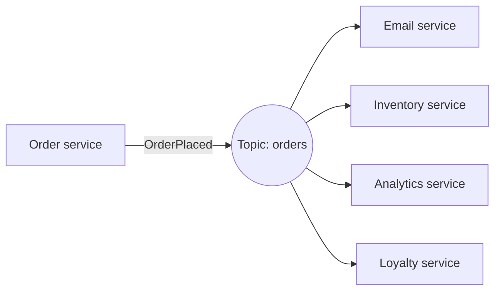

This is the **Observer pattern** at system scale. (In-process Observer is covered in [04_Behavioral_Pattern.md](../01_LLD/04_Behavioral_Pattern.md#7-observer-pattern-interview-imp---java).)

#### 📘 Terms Explained

| Term | Simple meaning |
|---|---|
| **Topic** | A named channel; every subscriber of it receives every message. |
| **Fan-out** | One message is copied to many receivers. |
| **Subscription** | A subscriber's registration with a topic. |

---

## 2.2 Why Do We Need It?

- **One event, many reactions:** `OrderPlaced` must trigger email, inventory, loyalty points, analytics, fraud checks... The order service shouldn't call each one.
- **Add consumers without changing the producer:** a new "recommendations" team can subscribe tomorrow; the order service doesn't change (Open/Closed at system level).
- **Event-driven architecture:** services communicate through facts ("this happened") instead of commands, which reduces coupling.

---

## 2.3 How It Works

### 2.3.1 Two styles of pub-sub

| | Traditional pub-sub (RabbitMQ fanout, SNS, JMS topics) | Log-based (Kafka, Pulsar, Kinesis) |
|---|---|---|
| Storage | The broker copies the message into **each subscriber's queue** | One **append-only log**; each subscriber tracks its own **offset** |
| After consumption | Message deleted from that subscriber's queue | Message **stays** until retention expires (e.g. 7 days) |
| Replay old messages | No (unless stored elsewhere) | **Yes**: reset the offset and re-read |
| New subscriber sees old messages? | No | Yes, if it starts from the earliest offset |

### 2.3.2 Kafka consumer groups: pub-sub AND queue in one (Interview Imp - Java)

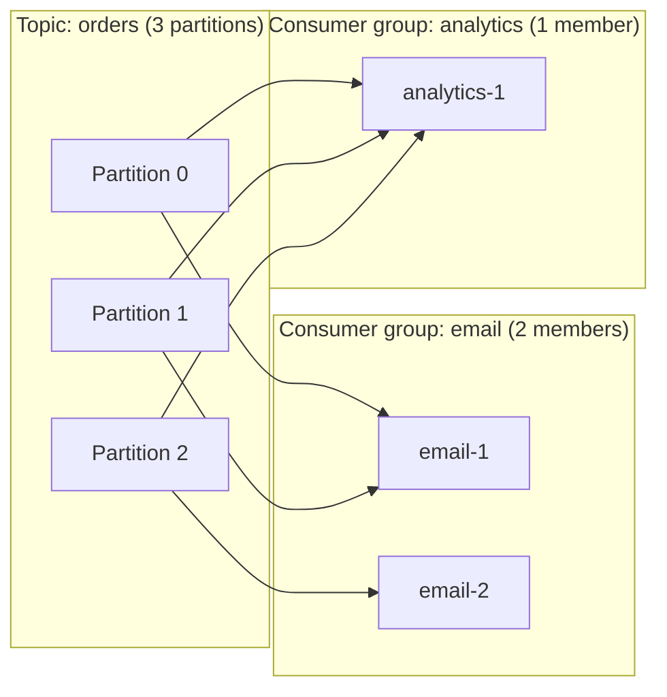

- **Between groups → pub-sub:** every consumer group gets **every** message.
- **Inside a group → queue:** each **partition** is read by **only one** member, so members share the work.
- **Ordering:** guaranteed **within a partition** only. Messages with the **same key** (e.g. `orderId`) go to the same partition, so all events of one order stay in order.
- **Parallelism limit:** a group can use at most **as many consumers as partitions**. See [01_Scalability_Pattern.md](01_Scalability_Pattern.md#74-partitioning-in-kafka-and-distributed-systems).

#### 📘 Terms Explained

| Term | Simple meaning |
|---|---|
| **Append-only log** | A list where new entries are only added at the end; old entries aren't changed. |
| **Offset** | The position number of a message inside a Kafka partition (0, 1, 2...). |
| **Consumer group** | A set of consumers sharing a topic's work; each group has its own offsets. |
| **Partition** | A slice of a Kafka topic; the unit of ordering and parallelism. |
| **Retention** | How long Kafka keeps messages (by time or size), whether or not they've been read. |
| **Replay** | Reading old messages again by moving the offset back. |

---

## 2.4 Complete Java Example - A Kafka-Style Topic with Consumer Groups

```java
import java.util.ArrayList;
import java.util.HashMap;
import java.util.List;
import java.util.Map;

record Event(String key, String value) {}

// A Kafka-like topic: an append-only log split into partitions. Messages are NOT deleted when read.
class Topic {
    final String name;
    final List<List<Event>> partitions = new ArrayList<>();

    Topic(String name, int partitionCount) {
        this.name = name;
        for (int i = 0; i < partitionCount; i++) partitions.add(new ArrayList<>());
    }

    int publish(Event e) {
        int p = Math.abs(e.key().hashCode()) % partitions.size();   // same key -> same partition -> ordered
        partitions.get(p).add(e);
        return p;
    }
}

// A consumer group: has its OWN offsets; partitions are shared out among its members
class ConsumerGroup {
    final String groupId;
    final List<String> members;
    final Map<Integer, Integer> committedOffsets = new HashMap<>();   // partition -> next offset to read

    ConsumerGroup(String groupId, List<String> members) { this.groupId = groupId; this.members = members; }

    void poll(Topic topic) {
        for (int p = 0; p < topic.partitions.size(); p++) {
            String member = members.get(p % members.size());           // partition assignment
            List<Event> log = topic.partitions.get(p);
            int offset = committedOffsets.getOrDefault(p, 0);
            for (; offset < log.size(); offset++) {
                Event e = log.get(offset);
                System.out.printf("   [%s] %-9s p%d@%d  %s=%s%n", groupId, member, p, offset, e.key(), e.value());
            }
            committedOffsets.put(p, offset);                           // commit after processing
        }
    }
}

public class PubSubDemo {
    public static void main(String[] args) {
        Topic orders = new Topic("orders", 2);
        ConsumerGroup email = new ConsumerGroup("email", List.of("email-1", "email-2"));
        ConsumerGroup analytics = new ConsumerGroup("analytics", List.of("analytics-1"));

        String[][] events = {{"ORD-1", "CREATED"}, {"ORD-2", "CREATED"}, {"ORD-1", "PAID"}, {"ORD-1", "SHIPPED"}};
        for (String[] e : events) {
            int p = orders.publish(new Event(e[0], e[1]));
            System.out.println("published " + e[0] + "=" + e[1] + " -> partition " + p);
        }

        System.out.println("Both groups receive EVERY event; inside a group, partitions are split:");
        email.poll(orders);
        analytics.poll(orders);

        System.out.println("A new event arrives; groups continue from their committed offsets:");
        orders.publish(new Event("ORD-2", "PAID"));
        email.poll(orders);
        analytics.poll(orders);

        System.out.println("A brand-new 'audit' group starts from offset 0 and replays history:");
        new ConsumerGroup("audit", List.of("audit-1")).poll(orders);
    }
}
```

**Output:**
```
published ORD-1=CREATED -> partition 1
published ORD-2=CREATED -> partition 0
published ORD-1=PAID -> partition 1
published ORD-1=SHIPPED -> partition 1
Both groups receive EVERY event; inside a group, partitions are split:
   [email] email-1   p0@0  ORD-2=CREATED
   [email] email-2   p1@0  ORD-1=CREATED
   [email] email-2   p1@1  ORD-1=PAID
   [email] email-2   p1@2  ORD-1=SHIPPED
   [analytics] analytics-1 p0@0  ORD-2=CREATED
   [analytics] analytics-1 p1@0  ORD-1=CREATED
   [analytics] analytics-1 p1@1  ORD-1=PAID
   [analytics] analytics-1 p1@2  ORD-1=SHIPPED
A new event arrives; groups continue from their committed offsets:
   [email] email-1   p0@1  ORD-2=PAID
   [analytics] analytics-1 p0@1  ORD-2=PAID
A brand-new 'audit' group starts from offset 0 and replays history:
   [audit] audit-1   p0@0  ORD-2=CREATED
   [audit] audit-1   p0@1  ORD-2=PAID
   [audit] audit-1   p1@0  ORD-1=CREATED
   [audit] audit-1   p1@1  ORD-1=PAID
   [audit] audit-1   p1@2  ORD-1=SHIPPED
```

What the output shows:
- All `ORD-1` events went to **partition 1**, so `CREATED → PAID → SHIPPED` stay **in order**.
- Both `email` and `analytics` received **every** event (pub-sub between groups).
- Inside `email`, partition 0 went to email-1 and partition 1 to email-2 (work sharing inside a group).
- After the new event, each group continued from **its own committed offset**: nothing re-read, nothing missed.
- The new `audit` group **replayed the whole history**, because messages were never deleted. That's a **durable subscriber**.

---

## 2.5 Pub-Sub with Kafka and Spring Boot

```java
public record OrderPlaced(String orderId, String customerId, BigDecimal amount, Instant at) {}

@Service
class OrderEventsPublisher {
    private final KafkaTemplate<String, OrderPlaced> kafka;
    OrderEventsPublisher(KafkaTemplate<String, OrderPlaced> kafka) { this.kafka = kafka; }

    void publish(OrderPlaced event) {
        kafka.send("orders", event.orderId(), event)             // key = orderId -> same partition -> ordered
             .whenComplete((result, ex) -> {
                 if (ex != null) log.error("publish failed for {}", event.orderId(), ex);
             });
    }
}

@Component
class EmailListener {
    @KafkaListener(topics = "orders", groupId = "email-service", concurrency = "3")
    void on(OrderPlaced event) { emailService.sendConfirmation(event); }
}

@Component
class AnalyticsListener {
    @KafkaListener(topics = "orders", groupId = "analytics-service")    // different group -> gets every event too
    void on(OrderPlaced event, @Header(KafkaHeaders.RECEIVED_PARTITION) int partition,
            @Header(KafkaHeaders.OFFSET) long offset) {
        analytics.record(event, partition, offset);
    }
}
```

```yaml
spring:
  kafka:
    bootstrap-servers: kafka1:9092,kafka2:9092,kafka3:9092
    producer:
      key-serializer: org.apache.kafka.common.serialization.StringSerializer
      value-serializer: org.springframework.kafka.support.serializer.JsonSerializer
      acks: all                          # wait for all in-sync replicas
      properties:
        enable.idempotence: true         # no duplicates from producer retries
    consumer:
      auto-offset-reset: earliest        # a NEW group starts from the beginning (latest = only new messages)
      key-deserializer: org.apache.kafka.common.serialization.StringDeserializer
      value-deserializer: org.springframework.kafka.support.serializer.JsonDeserializer
      properties:
        spring.json.trusted.packages: "com.shop.events"
```

**RabbitMQ pub-sub:** a **fanout** (or topic) exchange with one queue **per subscriber service**:

```java
@Bean FanoutExchange ordersExchange() { return new FanoutExchange("orders.fanout"); }
@Bean Queue emailQueue()     { return QueueBuilder.durable("orders.email").build(); }
@Bean Queue inventoryQueue() { return QueueBuilder.durable("orders.inventory").build(); }
@Bean Binding emailBinding()     { return BindingBuilder.bind(emailQueue()).to(ordersExchange()); }
@Bean Binding inventoryBinding() { return BindingBuilder.bind(inventoryQueue()).to(ordersExchange()); }

rabbit.convertAndSend("orders.fanout", "", event);    // every bound queue gets a copy
```

> **Durable subscriber:** in RabbitMQ the subscriber's queue must be **durable** (and messages persistent) so events published while the subscriber is down are kept. In Kafka every consumer group is durable by nature (offsets are stored).

#### 📘 Terms Explained

| Term | Simple meaning |
|---|---|
| **`KafkaTemplate`** | Spring helper for sending Kafka records; `send()` returns a `CompletableFuture`. |
| **`@KafkaListener`** | Spring annotation that turns a method into a Kafka consumer. |
| **`auto-offset-reset`** | Where a group with no committed offset starts: `earliest` (beginning) or `latest` (only new). |
| **`acks=all`** | The leader replies only after all in-sync replicas have the record. |
| **Fanout exchange** | RabbitMQ exchange that copies every message to all bound queues. |
| **Durable subscriber** | A subscriber that receives messages published while it was offline. |

---

## 2.6 Pros, Cons and Pitfalls

| Pros | Cons |
|---|---|
| Producers fully decoupled from consumers | Hard to see "who reacts to what" across many services |
| Add consumers without touching producers | Event schema changes affect every subscriber |
| Kafka: replay history, new consumers can catch up | Eventual consistency between services |
| Natural fit for event-driven architecture | Ordering only per partition/key |

| Pitfall | Fix |
|---|---|
| Wrong partition key (or none) → related events out of order | Key by the entity whose order matters (`orderId`, `accountId`). |
| More consumers than partitions | Extra consumers sit idle; plan partition count for future scale. |
| Hot partition (one key gets most traffic) | Better key choice; split hot entities. |
| Breaking event schema changes | Versioned schemas (Avro/Protobuf + Schema Registry), only additive changes. |
| Using events as remote commands ("EmailService.sendNow" event) | Events describe facts; use commands/queues for "do this". |
| Fat events carrying the entire database row | Include what consumers need; consider "event-carried state transfer" deliberately (section 5). |

---

## 2.7 Pub-Sub - Interview Questions

**Q1. Pub-sub vs message queue?**
Queue: each message to one consumer (work distribution). Pub-sub: each message to every subscriber (broadcast).

**Q2. Explain Kafka consumer groups.**
Each group receives all messages of a topic and tracks its own offsets (pub-sub between groups). Within a group, partitions are divided among members so each partition is read by one member (queue semantics inside a group).

**Q3. How does Kafka guarantee ordering?**
Only within a partition. Producers use a key; the same key always maps to the same partition, so events for one entity are ordered. With idempotent producers, retries don't reorder or duplicate.

**Q4. Why can't you have more active consumers than partitions in a group?**
A partition is assigned to exactly one consumer in the group; extra consumers have nothing to read.

**Q5. What is a durable subscriber?**
A subscriber that doesn't miss messages published while it was offline: a durable queue in RabbitMQ, a durable JMS subscription, or a Kafka consumer group with committed offsets.

**Q6. Kafka vs RabbitMQ: when to choose which?**
Kafka: high-throughput event streams, retention and replay, ordering per key, many independent consumer groups, stream processing. RabbitMQ: task queues, complex routing, per-message acks/priorities/TTL, request-reply, lower volume with lower latency.

---

## 2.8 Pub-Sub - Cheat Sheet

```
PUB-SUB   Publish once to a TOPIC; EVERY subscriber gets a copy. Publisher doesn't know subscribers.
          Traditional (RabbitMQ fanout/SNS): copy per subscriber queue, deleted after ack, no replay.
          Log-based (Kafka): append-only partitions, consumers track OFFSETS, retention, replay.
          Kafka groups: between groups = pub-sub; inside a group = queue (1 partition -> 1 member).
          Ordering per partition; key = entity id. Max useful consumers per group = partitions.
          Spring: KafkaTemplate.send(topic, key, value), @KafkaListener(groupId, concurrency),
                  auto-offset-reset earliest|latest, acks=all, enable.idempotence=true.
          Durable subscriber: durable queue / committed offsets. Version your event schemas.
```

---

## 2.9 Types and Variants

| Variant | Behaviour | Example |
|---|---|---|
| **Topic-based** | Subscribers choose topics | Kafka topics, RabbitMQ fanout/topic exchanges, SNS topics |
| **Content-based** | Subscribers filter on message attributes | RabbitMQ headers exchange, SNS filter policies, JMS selectors |
| **Durable subscription** | Messages kept for offline subscribers | Kafka consumer groups (offsets), JMS durable subscribers |
| **Non-durable / fire-and-forget** | Only currently connected subscribers receive | Redis Pub/Sub, WebSocket broadcast |
| **Fan-out to queues** | Each subscriber gets its own queue (competing consumers inside each) | SNS → several SQS queues, RabbitMQ fanout |
| **Log-based (replayable)** | Subscribers read from an offset and can replay history | Kafka, Pulsar, Kinesis |
| **In-process events** | Publisher and listeners in one JVM | Spring `ApplicationEventPublisher`, `@TransactionalEventListener` |

# 3. Request-Reply Pattern

## 3.1 What is Request-Reply?

**Request-reply** makes a two-way conversation over messaging. The requester sends a request message that includes a **reply-to address** and a **correlation ID**. The replier processes it and sends the answer to that address, copying the correlation ID, so the requester can match each reply to its request.

**Analogy:** Sending a letter with a self-addressed envelope and a reference number. The other side replies in your envelope and quotes your reference number, so you know which of your letters it answers.

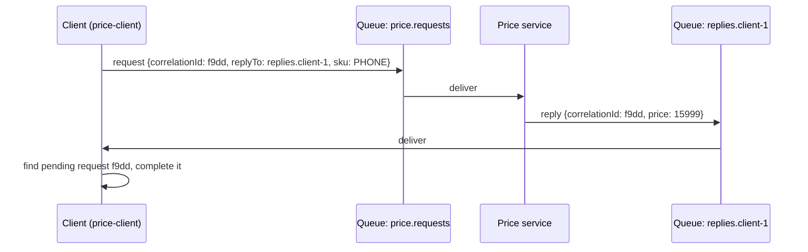

#### 📘 Terms Explained

| Term | Simple meaning |
|---|---|
| **Request-reply** | Messaging pattern for asking a question and getting an answer back. |
| **Reply-to** | A header naming the queue/topic where the answer should be sent. |
| **Correlation ID** | A unique ID that links a reply to its request (see section 10). |
| **RPC** | Remote Procedure Call: calling a function on another machine as if it were local. |

---

## 3.2 Why Do We Need It?

- You need an answer, but want messaging's benefits: the **broker buffers** requests, **many workers** can serve them, and the replier needs **no public HTTP endpoint**.
- **Long-running work:** the reply may come minutes later (e.g. a report), while the client stays free.
- Some legacy systems (mainframes via IBM MQ) only speak messaging.

> If you need a fast, simple answer and both sides are online, **plain HTTP/gRPC is usually better**. Request-reply over a broker adds latency and complexity. Use it deliberately.

---

## 3.3 How It Works: Reply Channels

| Option | How | Notes |
|---|---|---|
| **Temporary reply queue per request** | Created and deleted for each request | Simple, but expensive |
| **One reply queue per client instance** ✅ | All replies for that client instance arrive there; correlation ID matches them | Most common |
| **RabbitMQ direct reply-to** | Pseudo-queue `amq.rabbitmq.reply-to`; no real queue needed | Very fast; used by default by Spring's `RabbitTemplate` |
| **Shared reply topic (Kafka)** | Replies go to a topic; each instance filters by correlation ID / its own partition | Spring Kafka `ReplyingKafkaTemplate` |

Always set a **timeout** on the waiting side, and decide what to do with **late replies** (ignore them).

---

## 3.4 Complete Java Example - Matching Replies by Correlation ID

```java
import java.util.ArrayList;
import java.util.Collections;
import java.util.LinkedHashMap;
import java.util.List;
import java.util.Map;
import java.util.UUID;
import java.util.concurrent.CompletableFuture;
import java.util.concurrent.TimeUnit;

record Request(String correlationId, String replyTo, String body) {}
record Reply(String correlationId, String body) {}

// The service: reads requests, sends each reply to the request's replyTo, copying the correlationId
class PriceService {
    void processBatch(List<Request> requests, Map<String, List<Reply>> replyQueues) {
        List<Request> shuffled = new ArrayList<>(requests);
        Collections.reverse(shuffled);                                   // replies come back in a DIFFERENT order
        for (Request r : shuffled) {
            String price = switch (r.body()) {
                case "PHONE" -> "15999";
                case "LAPTOP" -> "62999";
                default -> "unknown";
            };
            replyQueues.get(r.replyTo()).add(new Reply(r.correlationId(), r.body() + "=" + price));
        }
    }
}

// The client: one reply queue for the whole client; matches replies to requests by correlationId
class PriceClient {
    private final String replyQueue = "replies.client-1";
    private final Map<String, CompletableFuture<String>> pending = new LinkedHashMap<>();

    Request send(String sku) {
        String id = UUID.nameUUIDFromBytes(sku.getBytes()).toString().substring(0, 8);   // usually a random UUID
        pending.put(id, new CompletableFuture<String>().orTimeout(2, TimeUnit.SECONDS));
        System.out.println("sent    request " + id + " for " + sku + " (replyTo=" + replyQueue + ")");
        return new Request(id, replyQueue, sku);
    }

    void onReply(Reply reply) {
        CompletableFuture<String> f = pending.remove(reply.correlationId());
        if (f == null) { System.out.println("   late/unknown reply " + reply.correlationId() + " ignored"); return; }
        System.out.println("matched reply   " + reply.correlationId() + " -> " + reply.body());
        f.complete(reply.body());
    }

    String replyQueue() { return replyQueue; }
}

public class RequestReplyDemo {
    public static void main(String[] args) {
        PriceClient client = new PriceClient();
        Map<String, List<Reply>> replyQueues = Map.of(client.replyQueue(), new ArrayList<>());

        List<Request> requestQueue = new ArrayList<>();
        for (String sku : List.of("PHONE", "LAPTOP", "WATCH")) requestQueue.add(client.send(sku));

        new PriceService().processBatch(requestQueue, replyQueues);

        for (Reply r : replyQueues.get(client.replyQueue())) client.onReply(r);
        client.onReply(new Reply("deadbeef", "stale reply from a previous run"));
    }
}
```

**Output:**
```
sent    request f9dd946c for PHONE (replyTo=replies.client-1)
sent    request eefe54b1 for LAPTOP (replyTo=replies.client-1)
sent    request e586513b for WATCH (replyTo=replies.client-1)
matched reply   e586513b -> WATCH=unknown
matched reply   eefe54b1 -> LAPTOP=62999
matched reply   f9dd946c -> PHONE=15999
   late/unknown reply deadbeef ignored
```

What the output shows:
- Replies came back in **reverse** order, but each was matched to the right request by its **correlation ID**.
- A stray reply with an unknown ID (from a previous run, or one that arrived after its timeout) was **safely ignored**.
- Each pending request is a `CompletableFuture` with `orTimeout`, so the caller never waits forever.

---

## 3.5 Request-Reply in Spring Boot

### RabbitMQ

```java
// Client: convertSendAndReceive blocks until the reply arrives (or the reply timeout passes)
@Service
class PriceClient {
    private final RabbitTemplate rabbit;
    PriceClient(RabbitTemplate rabbit) {
        this.rabbit = rabbit;
        this.rabbit.setReplyTimeout(2_000);                       // ms; returns null on timeout
    }

    PriceReply price(String sku) {
        return (PriceReply) rabbit.convertSendAndReceive("prices", "price.request", new PriceRequest(sku));
    }
}

// Server: the RETURN VALUE of the listener is sent automatically to the request's reply-to,
// with the correlation id copied over
@Component
class PriceServer {
    @RabbitListener(queues = "price.requests")
    PriceReply handle(PriceRequest req) { return new PriceReply(req.sku(), catalog.price(req.sku())); }
}
```

`AsyncRabbitTemplate.convertSendAndReceive(...)` returns a `CompletableFuture` instead of blocking.

### Kafka

```java
@Bean
ReplyingKafkaTemplate<String, PriceRequest, PriceReply> replyingTemplate(
        ProducerFactory<String, PriceRequest> pf,
        ConcurrentMessageListenerContainer<String, PriceReply> repliesContainer) {
    ReplyingKafkaTemplate<String, PriceRequest, PriceReply> t = new ReplyingKafkaTemplate<>(pf, repliesContainer);
    t.setDefaultReplyTimeout(Duration.ofSeconds(2));
    return t;
}

// Client
RequestReplyFuture<String, PriceRequest, PriceReply> future =
        replyingTemplate.sendAndReceive(new ProducerRecord<>("price.requests", sku, new PriceRequest(sku)));
PriceReply reply = future.get(2, TimeUnit.SECONDS).value();

// Server: @SendTo sends the return value to the topic in the request's REPLY_TOPIC header
@KafkaListener(topics = "price.requests", groupId = "price-service")
@SendTo
PriceReply handle(PriceRequest req) { return new PriceReply(req.sku(), catalog.price(req.sku())); }
```

#### 📘 Terms Explained

| Term | Simple meaning |
|---|---|
| **`convertSendAndReceive`** | `RabbitTemplate` method that sends a request and waits for the reply. |
| **Direct reply-to** | RabbitMQ feature letting a client receive replies without declaring a reply queue. |
| **`ReplyingKafkaTemplate`** | Spring Kafka template that sends a record and returns a future completed by the matching reply. |
| **`@SendTo`** | Sends a listener's return value to a reply destination. |

---

## 3.6 Pros, Cons and Pitfalls

| Pros | Cons |
|---|---|
| Request buffering and load balancing across workers | Slower and more complex than HTTP for simple queries |
| Replier needs no HTTP endpoint | Requester must manage pending requests, timeouts, late replies |
| Works for long-running replies | Temporal coupling comes back if the client waits synchronously |

| Pitfall | Fix |
|---|---|
| Waiting forever for a reply | Reply timeout; fail or fall back. |
| Leaking pending-request entries when replies never come | Remove on timeout (futures with `orTimeout`). |
| Requests piling up after the client gave up | Set message TTL/expiration on requests. |
| Using request-reply everywhere ("RPC over a broker") | Prefer events; use HTTP for simple synchronous queries. |
| Replies to the wrong instance in a scaled app | Reply queue per instance, or filter by correlation ID. |

---

## 3.7 Request-Reply - Interview Questions

**Q1. How do you implement request-reply over a message broker?**
The request carries a reply-to address and a correlation ID; the replier sends the response to reply-to with the same correlation ID; the requester matches it to the pending request, with a timeout.

**Q2. Why not just use HTTP?**
Often you should. Messaging helps when you need buffering, load balancing across workers without a load balancer, long-running processing, or when the replier can't expose endpoints.

**Q3. What happens with a reply that arrives after the timeout?**
The requester no longer has a pending entry for that correlation ID, so it's logged and discarded. The work may still have been done, so the operation should be idempotent if the client retries.

**Q4. How does Spring support it?**
RabbitMQ: `RabbitTemplate.convertSendAndReceive` / `AsyncRabbitTemplate` and listener return values. Kafka: `ReplyingKafkaTemplate` with `@SendTo` on the server listener.

---

## 3.8 Request-Reply - Cheat Sheet

```
REQUEST-REPLY  Two-way messaging: request has replyTo + correlationId; reply copies the correlationId.
          Reply channels: per-client queue (common), temp queue, RabbitMQ direct reply-to, Kafka reply topic.
          Always: timeout, discard late replies, TTL on requests, idempotent handling.
          Spring: RabbitTemplate.convertSendAndReceive / AsyncRabbitTemplate; listener return value = reply.
                  Kafka: ReplyingKafkaTemplate.sendAndReceive + @SendTo.
          Simple synchronous query with both sides online? Prefer HTTP/gRPC.
```

---

## 3.9 Types and Variants

| Variant | How the reply is matched | Example |
|---|---|---|
| **Synchronous RPC** | The connection itself carries the reply | REST, gRPC unary calls |
| **Temporary reply queue** | Requester creates a private queue; puts its name in `reply-to` | RabbitMQ direct reply-to, JMS `TemporaryQueue` |
| **Shared reply queue + correlation id** | All replies on one queue; `correlationId` matches them | Spring `RabbitTemplate.convertSendAndReceive`, Kafka `ReplyingKafkaTemplate` |
| **Asynchronous callback** | Reply sent later to a callback URL | Webhooks |
| **Request-reply over streams** | Bidirectional streaming | gRPC streams, WebSockets |
| **Scatter-gather** | One request, many replies aggregated | Price comparison, search across shards |

# 4. Message Broker Pattern (Interview Imp - Java)

## 4.1 What is a Message Broker?

A **message broker** is a server that sits **between** producers and consumers. It **receives** messages, **stores** them safely, **routes** them to the right destinations, and **delivers** them, handling acknowledgements, retries and back-pressure. Producers and consumers only ever talk to the broker, never to each other.

**Analogy:** A post office. You drop a letter in; the post office sorts it, keeps it safe, routes it through hubs, and delivers it, even if the recipient is away for a few days (it waits in their PO box). You never need the recipient's phone number or schedule.

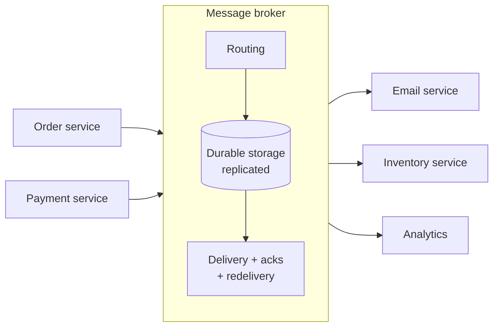

Everything in sections 1-3 (queues, topics, request-reply) runs **on** a broker. This section looks inside the two most important ones.

#### 📘 Terms Explained

| Term | Simple meaning |
|---|---|
| **Message broker** | Middleware that receives, stores, routes and delivers messages between applications. |
| **Middleware** | Software that sits between applications to help them communicate. |
| **Hub-and-spoke** | Architecture where everything connects through one central hub (the broker) instead of to each other. |

---

## 4.2 Why Do We Need It?

| Without a broker (point-to-point HTTP between N services) | With a broker |
|---|---|
| Each service must know every other service's address | Services only know the broker and topic/queue names |
| If a receiver is down, the sender must retry/store itself | The broker stores messages durably until delivered |
| Up to N × (N-1) connections to manage | N connections (each to the broker) |
| Routing/fan-out logic duplicated in every sender | Routing configured once in the broker |
| No central place to monitor message flow | Queue depth, consumer lag and throughput in one place |

The broker is the system-level version of the **Mediator** pattern ([04_Behavioral_Pattern.md](../01_LLD/04_Behavioral_Pattern.md#5-mediator-pattern)).

---

## 4.3 How It Works: Inside Kafka

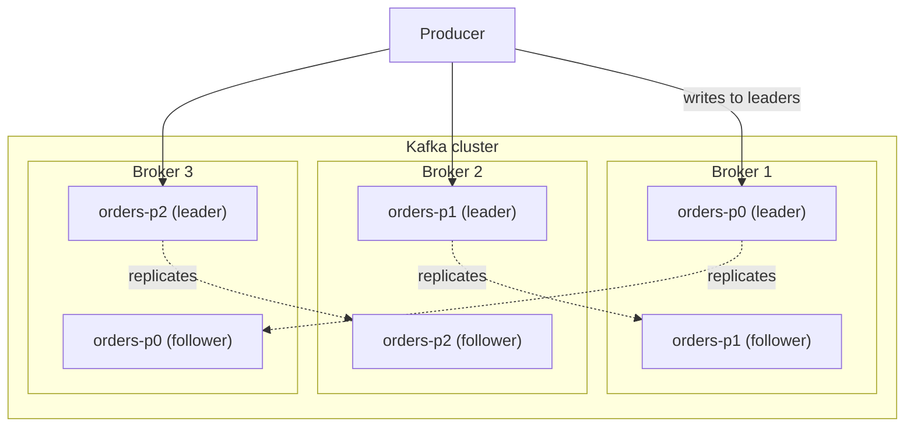

| Concept | Meaning |
|---|---|
| **Topic** | A named stream of records (`orders`). |
| **Partition** | Topics are split into partitions; each is an ordered, append-only log on disk. |
| **Offset** | A record's position in its partition. Consumers commit offsets to remember progress. |
| **Replication factor** | Copies of each partition (usually 3): one **leader** + **followers**. |
| **ISR (in-sync replicas)** | Followers that are fully caught up. With `acks=all` + `min.insync.replicas=2`, a write survives a broker crash. |
| **Retention** | Records are kept for a time/size limit (default 7 days), regardless of being read. |
| **Log compaction** | Alternative cleanup: keep only the **latest** record per key (great for "current state" topics). |
| **Controller (KRaft)** | Manages cluster metadata and leader election. Kafka 4.x uses KRaft only (ZooKeeper removed). |

Why Kafka is fast: sequential disk writes, OS page cache, batching, compression, and zero-copy transfer to consumers.

---

## 4.4 How It Works: Inside RabbitMQ

RabbitMQ implements **AMQP 0-9-1**. Producers never write to a queue directly; they publish to an **exchange**, which routes to **queues** via **bindings**.

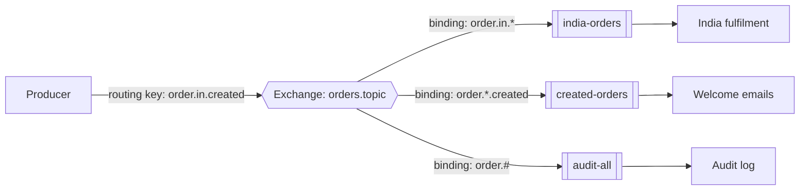

| Exchange type | Routes by | Example |
|---|---|---|
| **Direct** | Exact routing-key match | key `error` → `error-alerts` queue |
| **Topic** | Pattern match on dot-separated words: `*` = exactly one word, `#` = zero or more | `order.*.created`, `order.#` |
| **Fanout** | Ignores the key; copies to **all** bound queues | Broadcast `price.changed` |
| **Headers** | Message header values instead of the key | `x-match: all, region: IN, type: B2B` |
| **Default ("")** | Queue name = routing key | Simple point-to-point |

### Complete Java Example - How Exchanges Route Messages

```java
import java.util.ArrayList;
import java.util.List;

// RabbitMQ-style routing: producers publish to an EXCHANGE with a routing key; bindings decide which queues get a copy
class Exchange {
    enum Type { DIRECT, TOPIC, FANOUT }

    private final String name;
    private final Type type;
    private final List<String[]> bindings = new ArrayList<>();      // {pattern, queue}

    Exchange(String name, Type type) { this.name = name; this.type = type; }

    Exchange bind(String queue, String pattern) { bindings.add(new String[]{pattern, queue}); return this; }

    List<String> route(String routingKey) {
        List<String> queues = new ArrayList<>();
        for (String[] b : bindings) {
            boolean match = switch (type) {
                case FANOUT -> true;                                  // ignore the key: everyone gets it
                case DIRECT -> b[0].equals(routingKey);               // exact match
                case TOPIC  -> topicMatches(b[0], routingKey);        // wildcards
            };
            if (match && !queues.contains(b[1])) queues.add(b[1]);
        }
        return queues;
    }

    // '*' = exactly one word, '#' = zero or more words (words are separated by '.')
    static boolean topicMatches(String pattern, String key) {
        return match(pattern.split("\\."), 0, key.split("\\."), 0);
    }

    private static boolean match(String[] p, int i, String[] k, int j) {
        if (i == p.length) return j == k.length;
        if (p[i].equals("#")) {
            for (int skip = j; skip <= k.length; skip++) if (match(p, i + 1, k, skip)) return true;
            return false;
        }
        if (j == k.length) return false;
        return (p[i].equals("*") || p[i].equals(k[j])) && match(p, i + 1, k, j + 1);
    }

    String name() { return name; }
}

public class ExchangeRoutingDemo {
    public static void main(String[] args) {
        Exchange topic = new Exchange("orders.topic", Exchange.Type.TOPIC)
                .bind("india-orders",   "order.in.*")
                .bind("created-orders", "order.*.created")
                .bind("audit-all",      "order.#")
                .bind("payments",       "*.*.paid");

        for (String key : List.of("order.in.created", "order.us.created", "order.in.paid", "order.us.cancelled", "order", "invoice.in.paid")) {
            System.out.printf("%-8s %-20s -> %s%n", "TOPIC", key, topic.route(key));
        }

        Exchange direct = new Exchange("logs.direct", Exchange.Type.DIRECT)
                .bind("error-alerts", "error")
                .bind("all-logs", "error").bind("all-logs", "warn").bind("all-logs", "info");
        for (String key : List.of("error", "info")) {
            System.out.printf("%-8s %-20s -> %s%n", "DIRECT", key, direct.route(key));
        }

        Exchange fanout = new Exchange("price.changed", Exchange.Type.FANOUT)
                .bind("search-index", "").bind("cache-invalidator", "").bind("mobile-push", "");
        System.out.printf("%-8s %-20s -> %s%n", "FANOUT", "(any key)", fanout.route("whatever"));
    }
}
```

**Output:**
```
TOPIC    order.in.created     -> [india-orders, created-orders, audit-all]
TOPIC    order.us.created     -> [created-orders, audit-all]
TOPIC    order.in.paid        -> [india-orders, audit-all, payments]
TOPIC    order.us.cancelled   -> [audit-all]
TOPIC    order                -> [audit-all]
TOPIC    invoice.in.paid      -> [payments]
DIRECT   error                -> [error-alerts, all-logs]
DIRECT   info                 -> [all-logs]
FANOUT   (any key)            -> [search-index, cache-invalidator, mobile-push]
```

What the output shows:
- `order.in.created` matched **three** bindings, so three queues each got a copy (pub-sub through routing).
- `order.#` matches even the single word `order` (`#` can match **zero** words); `order.in.*` does **not** match `order` (`*` needs exactly one word).
- `*.*.paid` matched `invoice.in.paid` too: wildcards are powerful, and also easy to over-match.
- **Direct** needs an exact key; **fanout** ignores the key completely.

---

## 4.5 Kafka vs RabbitMQ (Interview Imp - Java)

| | Kafka | RabbitMQ |
|---|---|---|
| **Model** | Distributed commit **log** | Message **queues** with exchanges |
| **Consumers** | **Pull** (poll) and track offsets | Broker **pushes** (with prefetch) |
| **After consumption** | Message stays (retention) → **replay** | Message deleted after ack |
| **Ordering** | Per partition (by key) | Per queue (lost with competing consumers) |
| **Throughput** | Very high (millions/s across a cluster) | High (tens of thousands/s per node, more with clusters/streams) |
| **Routing** | Simple: by topic (+ key → partition) | Rich: direct, topic, fanout, headers exchanges |
| **Per-message features** | Few (no per-message TTL/priority) | TTL, priorities, delayed messages (plugin), per-message ack/nack |
| **Scaling consumers** | Up to the number of partitions | Add consumers freely |
| **Stream processing** | Kafka Streams, ksqlDB, Flink | Not built in (RabbitMQ Streams adds a log-like queue type) |
| **Best for** | Event streaming, event sourcing, analytics, CDC, high volume | Task/work queues, commands, complex routing, RPC |

> **Interview answer:** "Kafka if I need high-throughput event streams that many services read independently, with replay and per-key ordering. RabbitMQ if I need flexible routing, per-message acknowledgement/priorities/TTL, or classic work queues."

### Spring abstraction: Spring Cloud Stream

```java
// Business code is broker-neutral: the BINDER (Kafka or RabbitMQ) is chosen by the dependency
@Bean
Consumer<OrderPlaced> sendConfirmation(EmailService email) {
    return event -> email.sendConfirmation(event);
}

@Service
class Publisher {
    private final StreamBridge bridge;
    Publisher(StreamBridge bridge) { this.bridge = bridge; }
    void publish(OrderPlaced e) { bridge.send("orders-out-0", e); }
}
```

```yaml
spring:
  cloud:
    stream:
      bindings:
        sendConfirmation-in-0:            # <function name>-in-<index>
          destination: orders             # Kafka topic / RabbitMQ exchange
          group: email-service            # consumer group (durable, load-balanced)
        orders-out-0:
          destination: orders
```

#### 📘 Terms Explained

| Term | Simple meaning |
|---|---|
| **Leader / follower** | The leader replica handles reads/writes for a partition; followers copy it. |
| **ISR** | In-Sync Replicas: replicas fully caught up with the leader. |
| **Log compaction** | Kafka keeps only the newest record for each key. |
| **KRaft** | Kafka's built-in Raft consensus for metadata, replacing ZooKeeper. |
| **AMQP** | Advanced Message Queuing Protocol, the protocol RabbitMQ speaks. |
| **Exchange / binding** | RabbitMQ: an exchange receives messages; bindings are rules connecting it to queues. |
| **Routing key** | A label on a RabbitMQ message that exchanges use for routing. |
| **Pull vs push** | Consumer asks for messages (Kafka) vs broker sends them (RabbitMQ). |
| **Spring Cloud Stream / binder** | Spring framework for broker-neutral messaging; the binder is the broker-specific plugin. |
| **`StreamBridge`** | Spring Cloud Stream helper to send messages from imperative code. |

---

## 4.6 Pros, Cons and Pitfalls

| Pros | Cons |
|---|---|
| Decouples services in time, location and count | A critical piece of infrastructure: must be highly available |
| Durable storage, retries, back-pressure built in | Operational cost (upgrades, monitoring, capacity) |
| Central routing and monitoring | Adds latency vs a direct call |
| Enables event-driven architecture | Can become a "dumping ground" without schema governance |

| Pitfall | Fix |
|---|---|
| Single broker node | Cluster with replication (Kafka RF=3, RabbitMQ quorum queues). |
| `acks=1` / non-persistent messages for important data | `acks=all` + `min.insync.replicas=2`; persistent messages + publisher confirms. |
| Putting business logic in the broker (complex routing rules nobody understands) | "Smart endpoints, dumb pipes": keep logic in services. |
| No consumer lag monitoring | Monitor lag (Kafka) / queue depth (RabbitMQ); alert on growth. |
| One giant topic for everything | Topic per event type / bounded context, with clear ownership. |

---

## 4.7 Message Broker - Interview Questions

**Q1. What does a message broker do?**
Receives, stores, routes and delivers messages between producers and consumers, providing decoupling, durability, buffering, fan-out and delivery guarantees.

**Q2. Explain Kafka's architecture.**
A cluster of brokers; topics split into partitions (ordered append-only logs); each partition replicated (leader + followers, ISR); producers write to leaders; consumers in groups pull and commit offsets; records retained by time/size or compacted by key; metadata managed by KRaft controllers.

**Q3. Explain RabbitMQ exchanges.**
Producers publish to exchanges with a routing key. Direct (exact key), topic (`*`/`#` patterns), fanout (all bound queues), headers (header matching). Bindings connect exchanges to queues; consumers read queues.

**Q4. Kafka vs RabbitMQ?**
See the table: log with replay, partition ordering and huge throughput (Kafka) vs flexible routing, per-message features and work queues (RabbitMQ).

**Q5. How do you make sure a Kafka write isn't lost if a broker dies?**
Replication factor 3, `min.insync.replicas=2`, producer `acks=all` and `enable.idempotence=true`, and handle send failures (callbacks/retries).

**Q6. What is consumer lag?**
The difference between the latest offset in a partition and the consumer group's committed offset: how far behind the consumer is. A key health metric.

---

## 4.8 Message Broker - Cheat Sheet

```
MESSAGE BROKER  Middleware that receives, stores (durably, replicated), routes, delivers messages.
          Kafka: topics -> partitions (ordered logs) -> offsets; RF=3, leader/followers, ISR, acks=all,
                 min.insync.replicas=2; retention or compaction; consumer groups pull; KRaft.
          RabbitMQ: producer -> EXCHANGE (direct | topic */# | fanout | headers) -> bindings -> QUEUES -> push.
          Kafka = streaming, replay, per-key order, huge volume. RabbitMQ = work queues, routing, TTL/priority, RPC.
          Spring Cloud Stream: Consumer<T>/Function beans + bindings; binder picks the broker; StreamBridge.
          "Smart endpoints, dumb pipes". Monitor consumer lag / queue depth.
```

---

# 5. Event Bus Pattern

## 5.1 What is an Event Bus?

An **event bus** is a **central channel** where any component can **publish events** and any component can **subscribe** to event types, without knowing each other. It can be **in-process** (inside one application) or **distributed** (across services, usually backed by a broker).

**Analogy:** A school's public-address system. Anyone with access can make an announcement; everyone tuned in hears it, and each person decides whether it matters to them.

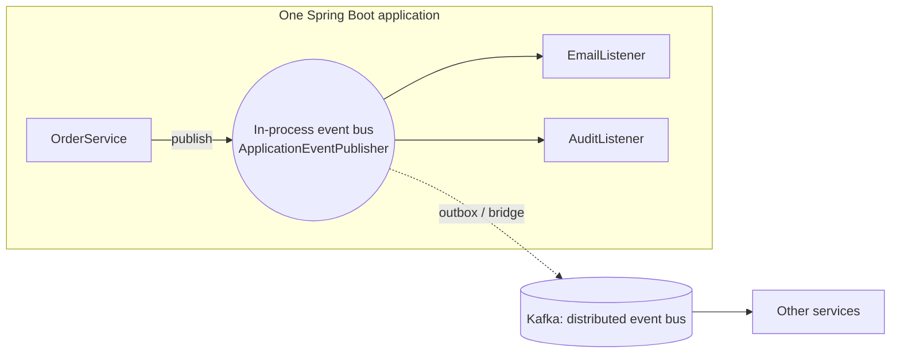

#### 📘 Terms Explained

| Term | Simple meaning |
|---|---|
| **Event bus** | A shared channel where events are published and subscribers receive the types they care about. |
| **In-process** | Inside the same running program (same JVM). |
| **Distributed** | Across several programs/machines, connected by the network. |

---

## 5.2 Why Do We Need It?

- Decouple modules **inside** a monolith or service (orders don't call emails directly), which makes it much easier to split into microservices later.
- Give the whole system **one standard way** to broadcast facts.
- Let new features plug in by subscribing, with no change to publishers.

---

## 5.3 Types of Event Bus and Event Styles

### Where the bus lives

| Type | Examples | Delivery | Survives a crash? |
|---|---|---|---|
| **In-process** | Spring `ApplicationEventPublisher`, Guava `EventBus`, the small `EventBus` in [04_Behavioral_Pattern.md](../01_LLD/04_Behavioral_Pattern.md#74-complete-java-example---order-events-and-a-tiny-event-bus) | Method calls (sync by default) | No (in memory) |
| **Distributed** | Kafka/RabbitMQ topics, AWS EventBridge, Azure Event Grid, Spring Cloud Bus | Over the network | Yes (broker storage) |
| **Hybrid** | Spring Modulith event publication registry, outbox → Kafka | In-process first, then externalised | Yes (stored in the DB) |

### What the event carries (Interview Imp - Java)

| Style | Event contains | Pros | Cons |
|---|---|---|---|
| **Event notification** | Just the fact + ID: `OrderPlaced{orderId}` | Small; producer exposes little | Consumers call back for details (load + coupling) |
| **Event-carried state transfer** | The data consumers need: `OrderPlaced{orderId, items, total, address}` | Consumers are autonomous (keep their own copy) | Bigger events; schema coupling; data duplicated |
| **Event sourcing** | Every state change as an event; the event log **is** the source of truth | Full history, replay, audit | Complex; snapshots; schema evolution is hard |

---

## 5.4 Event Bus in Spring Boot

### In-process

```java
@Service
class OrderService {
    private final ApplicationEventPublisher events;
    OrderService(ApplicationEventPublisher events) { this.events = events; }

    @Transactional
    public void place(Order o) {
        repo.save(o);
        events.publishEvent(new OrderPlaced(o.getId(), o.getTotal()));
    }
}

@Component
class LoyaltyListener {
    @TransactionalEventListener                 // AFTER_COMMIT by default
    void on(OrderPlaced e) { loyalty.addPoints(e); }
}
```

See [04_Behavioral_Pattern.md](../01_LLD/04_Behavioral_Pattern.md#76-observer-in-spring-boot-application-events-interview-imp---java) for synchronous-by-default behaviour, `@Async` and `@TransactionalEventListener`.

### Spring Modulith: in-process events that are not lost

```java
// Spring Modulith stores each event in an "event publication" table in the SAME transaction,
// marks it complete when the listener succeeds, and can re-submit incomplete ones after a crash.
@ApplicationModuleListener                      // = @Async + @Transactional + @TransactionalEventListener
void on(OrderPlaced e) { inventory.reserve(e); }

// And it can externalise selected events to Kafka/RabbitMQ automatically
@Externalized("orders::#{orderId()}")          // topic "orders", key = orderId
public record OrderPlaced(String orderId, BigDecimal total) {}
```

### Distributed: Spring Cloud Bus

Spring Cloud Bus links service instances through RabbitMQ or Kafka to broadcast **management events**, the classic use being "refresh configuration on all instances" (`POST /actuator/busrefresh`).

#### 📘 Terms Explained

| Term | Simple meaning |
|---|---|
| **Event notification** | An event that only says something happened (plus an ID). |
| **Event-carried state transfer** | An event that carries enough data for consumers to work without calling back. |
| **Event sourcing** | Storing state as the sequence of events that produced it. |
| **Spring Modulith** | Spring project for well-structured modular monoliths, with reliable in-process events. |
| **Spring Cloud Bus** | Broadcasts events (like config refresh) to all instances over a broker. |
| **AWS EventBridge** | AWS's managed event bus with rule-based routing. |

---

## 5.5 Pros, Cons and Pitfalls

| Pros | Cons |
|---|---|
| Very loose coupling between modules/services | "Event spaghetti": hard to follow cause and effect |
| Easy to add new reactions | In-process buses lose events on crash (unless persisted) |
| Prepares a monolith for later splitting | Debugging needs good tracing (correlation IDs) |

| Pitfall | Fix |
|---|---|
| Using in-memory events for things that must not be lost | Outbox / Spring Modulith publication registry / a real broker. |
| Events that are really commands in disguise | Name events as past-tense facts; use commands for requests. |
| No catalogue of events | Document events (AsyncAPI), owners and schemas. |
| Chains of events triggering events with no visibility | Correlation IDs + distributed tracing (section 10). |

---

## 5.6 Event Bus - Interview Questions

**Q1. What is an event bus?**
A central publish-subscribe channel through which components exchange events without direct references. It can be in-process or distributed.

**Q2. In-process vs distributed event bus?**
In-process: same JVM, fast, method calls, lost on crash. Distributed: through a broker, survives crashes, works across services, but adds latency and eventual consistency.

**Q3. Event notification vs event-carried state transfer?**
Notification carries just the fact and an ID (consumers fetch details). State transfer carries the data so consumers don't need to call back.

**Q4. How do you avoid losing in-process events when the app crashes?**
Persist them in the same transaction as the business data (outbox, Spring Modulith's event publication registry) and re-deliver incomplete ones on restart.

---

## 5.7 Event Bus - Cheat Sheet

```
EVENT BUS  Central pub-sub channel; publishers and subscribers don't know each other.
          In-process: ApplicationEventPublisher / @EventListener / @TransactionalEventListener, Guava EventBus.
          Distributed: Kafka/RabbitMQ topics, EventBridge, Spring Cloud Bus (config refresh).
          Hybrid/reliable: Spring Modulith event publication registry (@ApplicationModuleListener, @Externalized), outbox.
          Event styles: notification (id only) | event-carried state transfer (data) | event sourcing (log = truth).
          Watch out: event spaghetti, lost in-memory events, commands disguised as events. Document events (AsyncAPI).
```

---

# 6. Message Channel Pattern

## 6.1 What is a Message Channel?

A **message channel** is the **named pipe** through which messages travel from a sender to a receiver: a queue, a topic, a Kafka topic, or an in-memory channel. Senders write to a channel, receivers read from it, and **neither needs to know the other**, only the channel's name.

**Analogy:** TV channels. The broadcaster sends on channel 5; anyone tuned to channel 5 receives it. Neither side needs the other's address.

#### 📘 Terms Explained

| Term | Simple meaning |
|---|---|
| **Channel** | A named path for messages: a queue, topic or in-memory pipe. |
| **Logical address** | A name (`orders.created`) instead of a machine address (`10.0.3.7:8080`). |
| **EIP** | *Enterprise Integration Patterns*, the 2003 book by Hohpe and Woolf that named most patterns in this file. |

---

## 6.2 Why Do We Need It?

Channels give messaging its **structure**: by choosing channels carefully, you decide who can talk to whom, what kind of data flows where, and where errors go. Most other messaging patterns (routers, translators, DLQs) are about moving messages **between channels**.

---

## 6.3 Types of Channels

| Channel type (EIP) | Meaning | Kafka / RabbitMQ example |
|---|---|---|
| **Point-to-point channel** | One receiver gets each message | RabbitMQ queue; Kafka topic read by one group |
| **Publish-subscribe channel** | Every subscriber gets each message | Kafka topic with many groups; fanout exchange |
| **Datatype channel** | One channel per type of message, so receivers know what to expect | Topics `orders.placed`, `payments.completed` (not one `events` topic) |
| **Invalid message channel** | Messages that can't be parsed/validated go here | `orders.invalid` topic |
| **Dead letter channel** | Messages that couldn't be **delivered or processed** after retries | `orders.dlq` (section 11) |
| **Guaranteed delivery channel** | Messages are persisted, so they survive broker restarts | Durable queues + persistent messages; Kafka replication |
| **Channel adapter** | Connects a non-messaging app/system to a channel | Kafka Connect, Spring Integration file/FTP/JDBC adapters |
| **Messaging bridge** | Connects two messaging systems | MirrorMaker 2 (Kafka→Kafka), RabbitMQ Shovel, Kafka Connect RabbitMQ connector |

### Naming conventions for topics/queues

```
<domain>.<entity>.<event>[.version]      orders.order.placed.v1
<service>.<purpose>                       email-service.commands
<topic>.<suffix>                          orders.order.placed.v1.dlq / .retry
```

---

## 6.4 Message Channels in Spring

### Spring Integration: in-memory channels inside an app

```java
@Configuration
class ChannelsConfig {
    @Bean MessageChannel orders()        { return new DirectChannel(); }        // point-to-point, caller's thread
    @Bean MessageChannel orderEvents()   { return new PublishSubscribeChannel(); } // every subscriber gets a copy
    @Bean MessageChannel bufferedJobs()  { return new QueueChannel(500); }       // buffered, bounded, polled

    @Bean
    IntegrationFlow fileToKafka(KafkaTemplate<String, String> kafka) {          // channel adapter: files -> channel -> Kafka
        return IntegrationFlow
                .from(Files.inboundAdapter(new File("/data/incoming")).patternFilter("*.csv"),
                      e -> e.poller(Pollers.fixedDelay(5_000)))
                .transform(Files.toStringTransformer())
                .handle(Kafka.outboundChannelAdapter(kafka).topic("orders.csv.received"))
                .get();
    }
}
```

### Kafka Connect: channel adapters without code

```json
{
  "name": "orders-jdbc-sink",
  "config": {
    "connector.class": "io.confluent.connect.jdbc.JdbcSinkConnector",
    "topics": "orders.order.placed.v1",
    "connection.url": "jdbc:postgresql://db:5432/reporting",
    "auto.create": "true"
  }
}
```

#### 📘 Terms Explained

| Term | Simple meaning |
|---|---|
| **Datatype channel** | A channel that carries only one kind of message. |
| **Invalid message channel** | Where messages that fail parsing/validation are sent for inspection. |
| **Channel adapter** | Connects something that isn't messaging-aware (files, DB, FTP) to a channel. |
| **Messaging bridge** | Copies messages from one messaging system to another. |
| **Spring Integration** | Spring framework implementing Enterprise Integration Patterns with channels, routers, transformers, adapters. |
| **`DirectChannel` / `PublishSubscribeChannel` / `QueueChannel`** | Spring Integration channel types: point-to-point, broadcast, buffered. |
| **Kafka Connect** | Kafka framework of ready-made source/sink connectors for databases, files, cloud services. |
| **MirrorMaker 2** | Tool that replicates topics between Kafka clusters. |

---

## 6.5 Pros, Cons, Pitfalls and Interview Questions

| Pros | Cons |
|---|---|
| Logical addressing decouples senders and receivers | Too many channels become hard to manage |
| Channel type expresses intent (p2p vs pub-sub) | One "catch-all" channel loses type safety |

| Pitfall | Fix |
|---|---|
| One `events` topic for all event types | Datatype channels per event type. |
| Inconsistent names | Naming convention + ownership per topic. |
| Invalid messages mixed with retryable failures | Separate invalid-message and dead-letter channels. |
| Auto-creating topics in production | Disable auto-create; manage topics as code (Terraform, Strimzi). |

**Q1. What is a message channel?** A named, logical pipe between senders and receivers (queue, topic, in-memory channel); it decouples them from each other's location.

**Q2. Point-to-point vs publish-subscribe channel?** One receiver per message vs every subscriber gets a copy.

**Q3. What is a datatype channel and why use it?** A channel per message type, so consumers know what they'll receive and can be scaled/secured independently.

**Q4. Dead letter channel vs invalid message channel?** Invalid: the message itself is malformed (can't be parsed/validated). Dead letter: the message is fine but couldn't be delivered or processed after retries.

---

## 6.6 Message Channel - Cheat Sheet

```
MESSAGE CHANNEL  Named logical pipe (queue/topic/in-memory) between sender and receiver.
          Types: point-to-point, publish-subscribe, datatype (one per message type), invalid message,
                 dead letter, guaranteed delivery (persistent), channel adapter, messaging bridge.
          Spring Integration: DirectChannel, PublishSubscribeChannel, QueueChannel, IntegrationFlow + adapters.
          Kafka Connect = config-only channel adapters; MirrorMaker 2 / Shovel = bridges.
          Naming convention (domain.entity.event.v1), topics as code, no auto-create in prod.
```

---

# 7. Message Router Pattern

## 7.1 What is a Message Router?

A **message router** reads messages from one channel and **sends each one to a different channel** depending on a rule, without changing the message. Senders publish to one place; the router decides where each message really goes.

**Analogy:** A mail sorting machine. Every letter enters on one belt; the machine reads the PIN code and drops each letter into the right bag for its city.

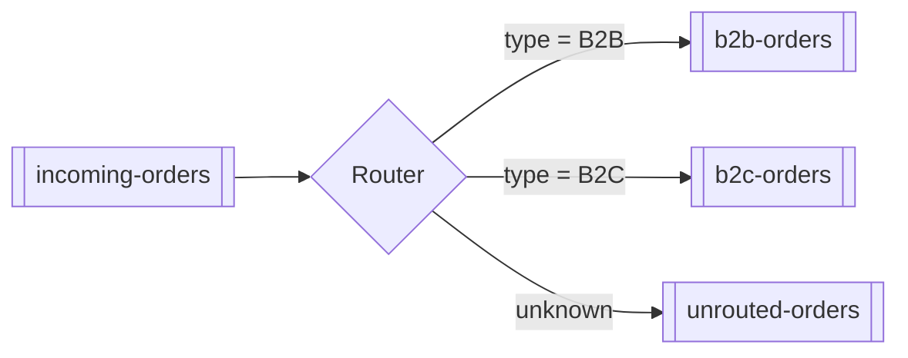

#### 📘 Terms Explained

| Term | Simple meaning |
|---|---|
| **Router** | A component that chooses an output channel for each message. |
| **Routing rule** | The condition that decides the destination (message type, header, content). |
| **Default channel** | Where messages go when no rule matches, so nothing is silently lost. |

---

## 7.2 Why Do We Need It?

- Senders shouldn't need to know about every downstream consumer and its rules.
- Routing logic changes often (new regions, new partners). Keep it in **one** place.
- Different kinds of messages need different processing pipelines, SLAs or security.

---

## 7.3 Types of Routers (EIP)

| Router | Decides by | Example |
|---|---|---|
| **Simple / type router** | Message type or a header | `type=REFUND` → `refunds` |
| **Content-based router** | Data **inside** the payload (section 9) | `amount > 1 lakh` → `fraud-review` |
| **Message filter** | Keep or drop (a router with one output) | Drop test orders in production |
| **Recipient list** | Sends a copy to **several** computed channels | Notify every warehouse that stocks the item |
| **Splitter** | One message → several messages | An order with 3 items → 3 `ItemOrdered` messages |
| **Aggregator** | Several related messages → one | Collect 3 shipment confirmations → one `OrderShipped` |
| **Resequencer** | Puts out-of-order messages back in order | Reorder by sequence number |
| **Routing slip** | The message carries its own list of steps | `steps: [validate, enrich, price, store]` |
| **Dynamic router** | Rules change at runtime (from config/DB) | Partner routing table updated without deploys |

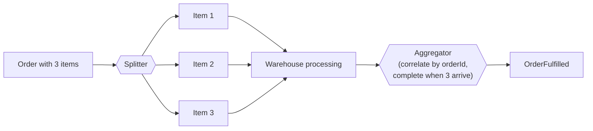

Broker-level routing (RabbitMQ exchanges) was shown in [section 4.4](#44-how-it-works-inside-rabbitmq): exchanges **are** routers.

---

## 7.4 Message Routers in Spring and Kafka

### Spring Integration router

```java
@Bean
IntegrationFlow orderRouting() {
    return IntegrationFlow.from("incomingOrders")
            .<Order, String>route(Order::type, mapping -> mapping
                    .channelMapping("B2B", "b2bOrders")
                    .channelMapping("B2C", "b2cOrders")
                    .defaultOutputChannel("unroutedOrders"))
            .get();
}

@Bean
IntegrationFlow splitAndAggregate() {
    return IntegrationFlow.from("ordersToFulfil")
            .split(Order.class, Order::items)                      // splitter: one message per item
            .handle(warehouse, "fulfil")
            .aggregate(a -> a.correlationStrategy(m -> m.getHeaders().get("orderId"))
                             .releaseStrategy(group -> group.size() == (int) group.getOne().getHeaders().get("itemCount")))
            .channel("fulfilledOrders")
            .get();
}
```

### Kafka Streams: route by type into separate topics

```java
@Bean
KStream<String, OrderEvent> route(StreamsBuilder builder) {
    KStream<String, OrderEvent> orders = builder.stream("orders.incoming");
    orders.split()
          .branch((key, o) -> o.type().equals("B2B"), Branched.withConsumer(s -> s.to("orders.b2b")))
          .branch((key, o) -> o.type().equals("B2C"), Branched.withConsumer(s -> s.to("orders.b2c")))
          .defaultBranch(Branched.withConsumer(s -> s.to("orders.unrouted")));
    return orders;
}
```

### Spring Cloud Stream: route by header

```yaml
spring:
  cloud:
    function:
      routing-expression: "headers['type'] == 'REFUND' ? 'handleRefund' : 'handleOrder'"   # SpEL picks the function
    stream:
      function:
        routing:
          enabled: true                 # turn on the built-in RoutingFunction
      bindings:
        functionRouter-in-0:
          destination: orders.incoming
```

#### 📘 Terms Explained

| Term | Simple meaning |
|---|---|
| **Splitter** | Breaks one message into several smaller ones. |
| **Aggregator** | Collects related messages (by a correlation key) and combines them into one. |
| **Release strategy** | The rule that decides when an aggregator has collected enough to emit its result. |
| **Recipient list** | Sends a message to a computed list of channels. |
| **Kafka Streams** | Java library for processing Kafka topics as streams (filter, map, join, branch). |
| **`split().branch()`** | Kafka Streams API to send records to different branches by a condition. |

---

## 7.5 Pros, Cons, Pitfalls and Interview Questions

| Pros | Cons |
|---|---|
| Senders stay simple; routing in one place | The router is an extra hop (latency) and must be scaled |
| Easy to add destinations | Complex routing tables are hard to reason about |

| Pitfall | Fix |
|---|---|
| No default channel → unmatched messages silently dropped | Always route unknowns to a default/unrouted channel and alert. |
| Router becoming a business-logic monster | Route only; keep processing in the destination services. |
| Aggregator waiting forever for a missing part | Group timeout → emit partial result or send to DLQ. |
| Splitter losing the link between parts | Copy the correlation ID (and part count) into every part. |

**Q1. What does a message router do?** Consumes from one channel and forwards each message unchanged to one of several channels according to a rule.

**Q2. Splitter vs aggregator?** A splitter turns one message into many; an aggregator combines many related messages (correlated by a key) into one, using a completion/release rule and a timeout.

**Q3. What is scatter-gather?** Broadcast a request to several recipients (scatter), then aggregate their replies (gather): e.g. ask 3 insurers for quotes and pick the best within 2 seconds.

**Q4. Where can routing happen?** In the broker (RabbitMQ exchanges), in stream processors (Kafka Streams `split()`), in integration frameworks (Spring Integration, Camel), or in consumer code.

---

## 7.6 Message Router - Cheat Sheet

```
MESSAGE ROUTER  Read from one channel, forward each message (unchanged) to the right channel by a rule.
          Variants: type/header router, content-based router, filter, recipient list, splitter, aggregator,
                    resequencer, routing slip, dynamic router, scatter-gather.
          Where: RabbitMQ exchanges, Kafka Streams split().branch(), Spring Integration .route()/.split()/.aggregate(),
                 Spring Cloud Function routing-expression, Apache Camel.
          ALWAYS a default channel; aggregator timeouts; carry correlation ids through splits.
```

---

# 8. Message Translator Pattern

## 8.1 What is a Message Translator?

A **message translator** converts a message from **one format into another**, so systems that use different data formats can still talk. It's the **Adapter pattern for messages** ([03_Structural_Pattern.md](../01_LLD/03_Structural_Pattern.md#1-adapter-pattern-interview-imp---java)).

**Analogy:** A human interpreter at a meeting between a Tamil-speaking supplier and a German-speaking buyer. Neither changes their language; the interpreter converts in both directions.

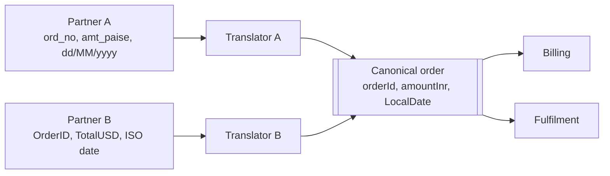

#### 📘 Terms Explained

| Term | Simple meaning |
|---|---|
| **Message translator / transformer** | Converts a message's structure, field names, units or encoding. |
| **Canonical data model** | One shared internal format that every external format is translated to and from. |
| **Normalizer** | Detects which format a message is in and routes it to the right translator. |

---

## 8.2 Why Do We Need It?

- **Partners, vendors and legacy systems** all send different formats (CSV, XML, fixed-width, JSON with different field names, different units and date formats).
- Without translation, **every** consumer has to understand **every** format.
- With a **canonical data model**, N external formats need only N translators, instead of every consumer parsing every format.

| Without a canonical model | With a canonical model |
|---|---|
| N formats × M consumers parsers (N × M) | N translators in, M consumers read one format (N + M) |

---

## 8.3 Levels of Translation

| Level | What changes | Example |
|---|---|---|
| **Transport** | Protocol | HTTP → Kafka; FTP file → message |
| **Encoding / data format** | Serialization | XML → JSON; JSON → Avro/Protobuf |
| **Structure** | Field names and nesting | `ord_no` → `orderId`; flatten nested address |
| **Data types / units** | Values | paise → rupees; USD → INR; `dd/MM/yyyy` → ISO date |
| **Semantics** | Meaning / codes | Partner status `"S"` → our `SHIPPED` |

Related EIP patterns:

| Pattern | What it does |
|---|---|
| **Envelope wrapper** | Wraps the payload with metadata (headers: id, type, timestamp, correlation id), e.g. **CloudEvents** |
| **Content enricher** | Adds missing data (look up the customer's tier and add it to the message) |
| **Content filter** | Removes data consumers shouldn't see (strip card numbers, PII) |
| **Claim check** | Replaces a large payload with a reference to where it's stored |
| **Format indicator** | A field/header saying which format/version the message uses (`schemaVersion: 2`) |

---

## 8.4 Complete Java Example - Translating Partner Orders to a Canonical Model

```java
import java.math.BigDecimal;
import java.time.LocalDate;
import java.time.format.DateTimeFormatter;
import java.util.List;
import java.util.Map;

// ----- Canonical data model: the ONE format used inside our system -----
record CanonicalOrder(String orderId, String customerEmail, BigDecimal amountInr, LocalDate orderDate, String source) {}

// ----- Message translator interface -----
interface OrderTranslator {
    boolean supports(Map<String, String> message);
    CanonicalOrder toCanonical(Map<String, String> message);
}

// Partner A sends: {"ord_no": "A-77", "mail": "...", "amt_paise": "49999", "dt": "25/10/2026"}
class PartnerATranslator implements OrderTranslator {
    public boolean supports(Map<String, String> m) { return "partnerA".equals(m.get("source")); }
    public CanonicalOrder toCanonical(Map<String, String> m) {
        return new CanonicalOrder(
                "A-" + m.get("ord_no"),
                m.get("mail").toLowerCase(),
                new BigDecimal(m.get("amt_paise")).movePointLeft(2),                       // paise -> rupees
                LocalDate.parse(m.get("dt"), DateTimeFormatter.ofPattern("dd/MM/yyyy")),
                "partnerA");
    }
}

// Partner B sends: {"OrderID": "9001", "Email": "...", "TotalUSD": "12.50", "Date": "2026-10-24"}
class PartnerBTranslator implements OrderTranslator {
    private static final BigDecimal USD_TO_INR = new BigDecimal("84.00");
    public boolean supports(Map<String, String> m) { return "partnerB".equals(m.get("source")); }
    public CanonicalOrder toCanonical(Map<String, String> m) {
        return new CanonicalOrder(
                "B-" + m.get("OrderID"),
                m.get("Email").toLowerCase(),
                new BigDecimal(m.get("TotalUSD")).multiply(USD_TO_INR).setScale(2),        // USD -> INR
                LocalDate.parse(m.get("Date")),                                            // ISO already
                "partnerB");
    }
}

// ----- Normalizer: picks the right translator for each incoming message -----
class Normalizer {
    private final List<OrderTranslator> translators;
    Normalizer(List<OrderTranslator> translators) { this.translators = translators; }

    CanonicalOrder normalize(Map<String, String> message) {
        return translators.stream().filter(t -> t.supports(message)).findFirst()
                .orElseThrow(() -> new IllegalArgumentException("no translator for " + message.get("source")))
                .toCanonical(message);
    }
}

public class TranslatorDemo {
    public static void main(String[] args) {
        Normalizer normalizer = new Normalizer(List.of(new PartnerATranslator(), new PartnerBTranslator()));

        List<Map<String, String>> incoming = List.of(
                Map.of("source", "partnerA", "ord_no", "77", "mail", "Asha@Example.com", "amt_paise", "49999", "dt", "25/10/2026"),
                Map.of("source", "partnerB", "OrderID", "9001", "Email", "RAVI@example.com", "TotalUSD", "12.50", "Date", "2026-10-24"),
                Map.of("source", "partnerC", "id", "1"));

        for (Map<String, String> msg : incoming) {
            try {
                System.out.println(normalizer.normalize(msg));
            } catch (IllegalArgumentException e) {
                System.out.println("-> invalid message channel: " + e.getMessage());
            }
        }
    }
}
```

**Output:**
```
CanonicalOrder[orderId=A-77, customerEmail=asha@example.com, amountInr=499.99, orderDate=2026-10-25, source=partnerA]
CanonicalOrder[orderId=B-9001, customerEmail=ravi@example.com, amountInr=1050.00, orderDate=2026-10-24, source=partnerB]
-> invalid message channel: no translator for partnerC
```

What the output shows:
- Two completely different partner formats became the **same** `CanonicalOrder` shape: consistent IDs, lower-case emails, amounts in INR as `BigDecimal`, real `LocalDate`s.
- Units were converted (paise → rupees, USD → INR), not just renamed.
- An unknown format went to the **invalid message channel** instead of crashing the consumer.

---

## 8.5 Message Translation in Spring and Kafka

### Serialization formats

| Format | Schema? | Size / speed | Notes |
|---|---|---|---|
| **JSON** | Optional (JSON Schema) | Larger, slower | Human-readable; default choice for many teams |
| **Avro** | Yes (required) | Compact, fast | Popular with Kafka + **Schema Registry** |
| **Protobuf** | Yes (`.proto`) | Compact, fast | Also used by gRPC |
| **XML** | Optional (XSD) | Large | Legacy / enterprise / banking integrations |

### Schema Registry and schema evolution (Interview Imp - Java)

```yaml
spring:
  kafka:
    producer:
      value-serializer: io.confluent.kafka.serializers.KafkaAvroSerializer
    consumer:
      value-deserializer: io.confluent.kafka.serializers.KafkaAvroDeserializer
    properties:
      schema.registry.url: http://schema-registry:8081
      specific.avro.reader: true
```

The producer registers the schema; each message carries a small **schema ID**; consumers fetch the schema to decode. The registry **rejects incompatible changes**.

| Compatibility mode | Allowed changes | Upgrade order |
|---|---|---|
| **BACKWARD** (default) | Delete fields, add **optional** fields (with defaults) | Upgrade **consumers** first |
| **FORWARD** | Add fields, delete optional fields | Upgrade **producers** first |
| **FULL** | Only add/remove optional fields with defaults | Any order |

> **Safe evolution rules:** only **add** optional fields with defaults; never rename or change the type of a field; never reuse a removed field's name/number. For breaking changes, publish a **new version topic** (`orders.placed.v2`) and run both for a while.

### Transformers in code

```java
// Spring Integration transformer
@Bean
IntegrationFlow partnerOrders(PartnerATranslator translator) {
    return IntegrationFlow.from("partnerA.raw")
            .transform(Transformers.fromJson(PartnerAOrder.class))    // encoding: JSON -> object
            .transform(translator::toCanonical)                        // structure/units -> canonical
            .channel("orders.canonical")
            .get();
}

// Spring Cloud Stream: a Function IS a translator (in-topic -> out-topic)
@Bean
Function<PartnerBOrder, CanonicalOrder> normalizePartnerB(PartnerBTranslator t) {
    return t::toCanonical;
}
```

#### 📘 Terms Explained

| Term | Simple meaning |
|---|---|
| **Serialization** | Turning an object into bytes to send/store; deserialization is the reverse. |
| **Avro / Protobuf** | Compact binary formats with a schema describing the fields. |
| **Schema Registry** | A service storing message schemas and checking that new versions are compatible. |
| **Backward compatible** | New consumers can read data written with the old schema. |
| **Forward compatible** | Old consumers can read data written with the new schema. |
| **CloudEvents** | A CNCF standard envelope format for events (`id`, `source`, `type`, `time`, `data`). |
| **PII** | Personally Identifiable Information (names, emails, phone numbers, card numbers). |

---

## 8.6 Pros, Cons, Pitfalls and Interview Questions

| Pros | Cons |
|---|---|
| Consumers see one clean format | Translation logic must be maintained per partner |
| External changes are isolated in one translator | A canonical model can become a huge "everything" model |
| Units and codes are converted consistently | Loss of information if the canonical model is too narrow |

| Pitfall | Fix |
|---|---|
| Breaking schema changes break all consumers | Schema registry + compatibility rules; versioned topics for breaking changes. |
| Using `double` for money in messages | Strings/decimal types (`BigDecimal`, Avro `decimal` logical type). |
| Timezone-less dates | ISO-8601 with offset (`2026-10-25T10:15:30+05:30`) or `Instant` in UTC. |
| Huge enterprise-wide canonical model | Canonical model per bounded context (DDD). |
| Silently dropping unknown formats | Invalid message channel + alert. |

**Q1. What is a message translator?** A component that converts a message from one format/structure/units into another so systems with different data models can communicate: the Adapter pattern for messages.

**Q2. What is a canonical data model?** One shared internal message format; each external format is translated to/from it, reducing N × M conversions to N + M.

**Q3. How do you evolve message schemas safely in Kafka?** Use Avro/Protobuf with a Schema Registry enforcing BACKWARD (or FULL) compatibility; only add optional fields with defaults; never rename or change types; new topic version for breaking changes.

**Q4. Content enricher vs content filter?** Enricher adds missing data (e.g. customer tier); filter removes data (e.g. strips PII) before passing the message on.

---

## 8.7 Message Translator - Cheat Sheet

```
MESSAGE TRANSLATOR  Convert format/structure/units/codes between systems = Adapter for messages.
          Canonical data model + normalizer: N translators instead of N x M parsers.
          Levels: transport, encoding (JSON/Avro/Protobuf/XML), structure, units/types, semantics.
          Related: envelope wrapper (CloudEvents), content enricher, content filter (strip PII), claim check, format indicator.
          Kafka: Avro/Protobuf + Schema Registry; BACKWARD default; add optional fields only; v2 topic for breaking changes.
          Spring: Integration .transform(), Cloud Stream Function<In, Out>. Money as decimal, dates ISO-8601 with offset.
```

---

# 9. Content-Based Router Pattern

## 9.1 What is a Content-Based Router?

A **content-based router** looks **inside each message's data** (amount, country, product type, customer tier...) and sends it to the channel whose rule it matches. It's the most common kind of message router (section 7).

**Analogy:** A hospital triage nurse. Every patient comes through the same door; the nurse checks symptoms (the content) and sends each one to emergency, general OPD or the pharmacy.

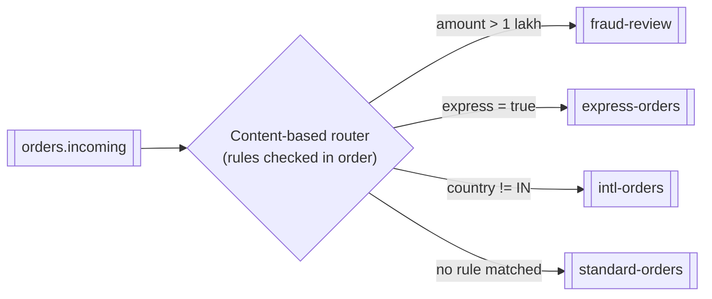

#### 📘 Terms Explained

| Term | Simple meaning |
|---|---|
| **Content-based routing** | Choosing a destination from values inside the message body. |
| **Triage** | Sorting by urgency or type so each case goes to the right place. |
| **First-match routing** | Rules are checked in order; the first rule that matches decides. |

---

## 9.2 Why Do We Need It?

- Different business cases need different processing: high-value orders need fraud checks; international orders need customs; express orders need priority picking.
- Producers shouldn't contain this logic (they'd need to know every downstream process).
- Consumers shouldn't all read everything and throw most of it away (wasted work, more coupling).

---

## 9.3 How It Works

1. Parse just enough of the message to evaluate the rules.
2. Check rules **in priority order** (or send to **every** matching channel, if that's the design: a recipient list).
3. Forward the **unchanged** message to the chosen channel.
4. If nothing matches, send it to a **default** channel.

| Design decision | Options |
|---|---|
| One match or many? | First match (exclusive) vs all matches (recipient list) |
| Where do rules live? | Code, config, a rules table in the DB (dynamic router), a rule engine |
| Where does routing run? | Broker (RabbitMQ headers/topic exchange), stream processor (Kafka Streams), integration framework, consumer |

> **Routing by content in RabbitMQ:** exchanges only see the **routing key and headers**, not the body. So the producer copies the important content into the key (`order.in.express`) or headers (`amountBand: HIGH`), and a topic or headers exchange routes on those.

---

## 9.4 Complete Java Example - Routing Orders by Their Contents

```java
import java.math.BigDecimal;
import java.util.ArrayList;
import java.util.LinkedHashMap;
import java.util.List;
import java.util.Map;
import java.util.function.Predicate;

record Order(String id, String country, BigDecimal amount, boolean express) {}

// Content-based router: looks INSIDE each message and sends it to the matching channel
class ContentBasedRouter {
    private final Map<String, Predicate<Order>> rules = new LinkedHashMap<>();   // checked in order
    private final String defaultChannel;
    final Map<String, List<String>> channels = new LinkedHashMap<>();

    ContentBasedRouter(String defaultChannel) { this.defaultChannel = defaultChannel; }

    ContentBasedRouter when(String channel, Predicate<Order> rule) { rules.put(channel, rule); return this; }

    void route(Order o) {
        String target = rules.entrySet().stream()
                .filter(r -> r.getValue().test(o))
                .map(Map.Entry::getKey)
                .findFirst()
                .orElse(defaultChannel);
        channels.computeIfAbsent(target, k -> new ArrayList<>()).add(o.id());
        System.out.printf("%-6s %-3s Rs.%-7s express=%-5s -> %s%n", o.id(), o.country(), o.amount(), o.express(), target);
    }
}

public class ContentRouterDemo {
    public static void main(String[] args) {
        ContentBasedRouter router = new ContentBasedRouter("standard-orders")
                .when("fraud-review",   o -> o.amount().compareTo(new BigDecimal("100000")) > 0)  // first match wins
                .when("express-orders", Order::express)
                .when("intl-orders",    o -> !o.country().equals("IN"));

        List.of(new Order("O-1", "IN", new BigDecimal("2500"), false),
                new Order("O-2", "IN", new BigDecimal("1800"), true),
                new Order("O-3", "US", new BigDecimal("4000"), false),
                new Order("O-4", "US", new BigDecimal("250000"), true),
                new Order("O-5", "IN", new BigDecimal("999"), false))
            .forEach(router::route);

        System.out.println("Channels: " + router.channels);
    }
}
```

**Output:**
```
O-1    IN  Rs.2500    express=false -> standard-orders
O-2    IN  Rs.1800    express=true  -> express-orders
O-3    US  Rs.4000    express=false -> intl-orders
O-4    US  Rs.250000  express=true  -> fraud-review
O-5    IN  Rs.999     express=false -> standard-orders
Channels: {standard-orders=[O-1, O-5], express-orders=[O-2], intl-orders=[O-3], fraud-review=[O-4]}
```

What the output shows:
- O-4 is international **and** express, but matched `fraud-review` first, because rules are checked **in order** and the highest-priority rule wins.
- O-1 and O-5 matched nothing, so they went to the **default** channel instead of being lost.
- The router never changed the orders; it only chose where they go.

---

## 9.5 Content-Based Routing in Spring and Kafka

```java
// Spring Integration: route on a payload property with a SpEL expression
@Bean
IntegrationFlow contentRouting() {
    return IntegrationFlow.from("orders.incoming")
            .<Order, String>route(o ->
                      o.amount().compareTo(new BigDecimal("100000")) > 0 ? "fraudReview"
                    : o.express()                                        ? "expressOrders"
                    : !o.country().equals("IN")                          ? "intlOrders"
                    :                                                      "standardOrders")
            .get();
}

// Kafka Streams: same rules, output to topics
orders.split(Named.as("orders-"))
      .branch((k, o) -> o.amount().compareTo(new BigDecimal("100000")) > 0, Branched.withConsumer(s -> s.to("fraud-review")))
      .branch((k, o) -> o.express(),                                       Branched.withConsumer(s -> s.to("express-orders")))
      .branch((k, o) -> !o.country().equals("IN"),                         Branched.withConsumer(s -> s.to("intl-orders")))
      .defaultBranch(Branched.withConsumer(s -> s.to("standard-orders")));
```

```java
// RabbitMQ headers exchange: the producer copies content into headers, the exchange routes on them
@Bean HeadersExchange ordersHeaders() { return new HeadersExchange("orders.headers"); }
@Bean Binding highValue(Queue fraudReview, HeadersExchange ex) {
    return BindingBuilder.bind(fraudReview).to(ex).where("amountBand").matches("HIGH");
}

rabbit.convertAndSend("orders.headers", "", order, m -> {
    m.getMessageProperties().setHeader("amountBand", order.amount().compareTo(LAKH) > 0 ? "HIGH" : "NORMAL");
    return m;
});
```

#### 📘 Terms Explained

| Term | Simple meaning |
|---|---|
| **Headers exchange** | RabbitMQ exchange that routes on header values instead of the routing key. |
| **`Named.as`** | Kafka Streams option giving a processor a readable name. |
| **Recipient list** | Sending to every matching destination rather than just the first. |

---

## 9.6 Pros, Cons, Pitfalls and Interview Questions

| Pros | Cons |
|---|---|
| Each consumer only receives relevant messages | The router must understand the message format (coupling to the schema) |
| Business routing rules in one visible place | Routers that parse full payloads add latency |
| New rules without touching producers or consumers | Rule order mistakes cause misrouting |

| Pitfall | Fix |
|---|---|
| Overlapping rules with unclear priority | Explicit order; tests per rule; document it. |
| No default route | Default channel + alert on volume. |
| Router doing business processing | Route only; process downstream. |
| Every consumer subscribing to everything and filtering ("smart consumer" anti-pattern at scale) | Route once, centrally, into datatype channels. |

**Q1. What is a content-based router?** A router that inspects message content and forwards each message to the channel whose rule it matches, with a default for no match.

**Q2. How do you do content-based routing with RabbitMQ, which can't read the body?** Copy routing-relevant values into the routing key (topic exchange) or headers (headers exchange) at publish time.

**Q3. Content-based router vs message filter?** A filter is a router with one output: messages either pass or are dropped. A content-based router chooses among many outputs.

**Q4. First-match vs recipient list?** First-match sends each message to exactly one channel (priority order). A recipient list sends copies to every channel whose rule matches.

---

## 9.7 Content-Based Router - Cheat Sheet

```
CONTENT-BASED ROUTER  Inspect message DATA, forward (unchanged) to the matching channel; default if none.
          First match (priority order) vs recipient list (all matches). Rules in code/config/DB/rule engine.
          RabbitMQ can't read bodies -> put content in routing key (topic exch.) or headers (headers exch.).
          Kafka Streams split().branch(...).defaultBranch(...); Spring Integration .route(lambda/SpEL).
          Test each rule; watch rule order; route once centrally into datatype channels.
```

---

# 10. Correlation Identifier Pattern

## 10.1 What is a Correlation Identifier?

A **correlation identifier** is a unique ID attached to a message (usually as a header) that **links related messages together**: a reply to its request, or every message, log line and call that belongs to one user action as it flows through many services.

**Analogy:** A courier tracking number. The parcel passes through 6 hubs, 3 trucks and 2 delivery agents; every scan at every step records the same tracking number, so you can see the parcel's whole journey.

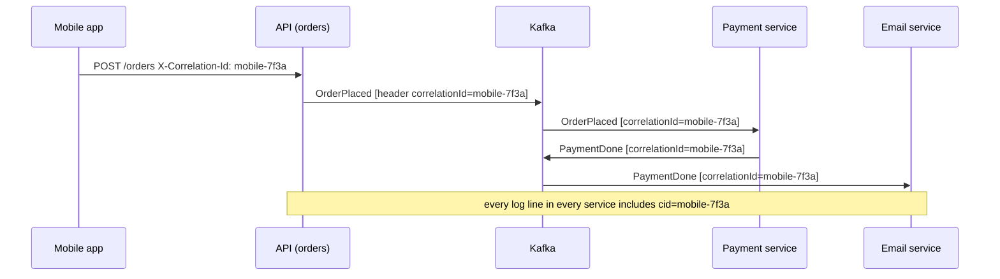

#### 📘 Terms Explained

| Term | Simple meaning |
|---|---|
| **Correlation ID** | An ID shared by all messages/logs belonging to the same request or conversation. |
| **Message ID** | An ID unique to **one** message (used for deduplication). Different from the correlation ID. |
| **Causation ID** | The ID of the message that directly caused this one (builds a chain: A caused B caused C). |
| **Trace ID / span ID** | Distributed-tracing IDs: the trace = the whole request; a span = one step within it. |

---

## 10.2 Why Do We Need It?

- **Request-reply:** match each reply to its request (section 3).
- **Debugging:** a customer says "my order failed at 10:42". With a correlation ID you can `grep` (or search in Kibana/Loki) every service's logs for the whole story.
- **Aggregators:** know which parts belong together (section 7).
- **Tracing and latency analysis:** see where time was spent across services.

| ID | Unique per | Used for |
|---|---|---|
| **Message ID** | Each message | Deduplication / idempotency (section 12) |
| **Correlation ID** | Each business request / conversation | Matching replies, linking logs, aggregation |
| **Causation ID** | Parent message | Reconstructing the chain of events |
| **Trace ID** (W3C `traceparent`) | Each end-to-end trace | Distributed tracing tools (Zipkin, Jaeger, Tempo) |

---

## 10.3 How It Works

1. **At the edge:** reuse the incoming ID (`X-Correlation-Id` / `traceparent` header) or generate one.
2. **Store it in a context** for the current thread/request (SLF4J **MDC**), so every log line includes it.
3. **Copy it into every outgoing message header** and HTTP call.
4. **Consumers restore it** from the message headers into their own context before processing.
5. **Clear the context** afterwards (thread pools reuse threads!).

---

## 10.4 Complete Java Example - Propagating a Correlation ID Through Messages

```java
import java.util.ArrayDeque;
import java.util.Deque;
import java.util.HashMap;
import java.util.Map;
import java.util.UUID;

// A message = headers + body. Headers carry metadata such as the correlation id.
record Msg(Map<String, String> headers, String body) {}

// ThreadLocal "log context", like SLF4J's MDC: every log line on this thread includes the id
class LogContext {
    private static final ThreadLocal<String> CORRELATION_ID = new ThreadLocal<>();
    static void set(String id) { CORRELATION_ID.set(id); }
    static void clear()        { CORRELATION_ID.remove(); }
    static void log(String service, String text) {
        System.out.printf("[cid=%s] %-10s %s%n", CORRELATION_ID.get(), service, text);
    }
}

class Bus {
    final Deque<Msg> queue = new ArrayDeque<>();

    // Producer side: copy the CURRENT correlation id into the outgoing message's headers
    void publish(String correlationId, String body) {
        Map<String, String> headers = new HashMap<>();
        headers.put("correlationId", correlationId);
        queue.add(new Msg(headers, body));
    }
}

public class CorrelationIdDemo {
    public static void main(String[] args) {
        Bus bus = new Bus();

        // 1) API receives a request: reuse the caller's id or create a new one
        for (String incomingHeader : new String[]{null, "mobile-7f3a"}) {
            String cid = incomingHeader != null ? incomingHeader
                    : UUID.nameUUIDFromBytes("req-1".getBytes()).toString().substring(0, 8);   // normally UUID.randomUUID()
            LogContext.set(cid);
            LogContext.log("api", "POST /orders received");
            LogContext.log("api", "publishing OrderPlaced");
            bus.publish(cid, "OrderPlaced");
            LogContext.clear();
        }

        // 2) Consumers on other services restore the id from the message headers before logging
        while (!bus.queue.isEmpty()) {
            Msg m = bus.queue.poll();
            LogContext.set(m.headers().get("correlationId"));
            LogContext.log("payment", "charging card for " + m.body());
            LogContext.log("payment", "publishing PaymentDone (same correlation id)");
            LogContext.log("email", "sending confirmation");
            LogContext.clear();
        }
        System.out.println("grep 'cid=mobile-7f3a' across ALL services' logs -> the full story of one request");
    }
}
```

**Output:**
```
[cid=d22ff9b9] api        POST /orders received
[cid=d22ff9b9] api        publishing OrderPlaced
[cid=mobile-7f3a] api        POST /orders received
[cid=mobile-7f3a] api        publishing OrderPlaced
[cid=d22ff9b9] payment    charging card for OrderPlaced
[cid=d22ff9b9] payment    publishing PaymentDone (same correlation id)
[cid=d22ff9b9] email      sending confirmation
[cid=mobile-7f3a] payment    charging card for OrderPlaced
[cid=mobile-7f3a] payment    publishing PaymentDone (same correlation id)
[cid=mobile-7f3a] email      sending confirmation
grep 'cid=mobile-7f3a' across ALL services' logs -> the full story of one request
```

What the output shows:
- The first request had no incoming ID, so one was generated (`d22ff9b9`); the second **reused** the mobile app's ID (`mobile-7f3a`).
- The payment and email services restored the ID from the **message headers**, so their log lines carry the same ID as the API's.
- Searching for one ID across all services gives the whole journey of one request, even though the messages were interleaved.

---

## 10.5 Correlation and Tracing in Spring Boot

### Automatic: Micrometer Tracing (Spring Boot 3)

```xml
<dependency>
    <groupId>io.micrometer</groupId>
    <artifactId>micrometer-tracing-bridge-otel</artifactId>    <!-- OpenTelemetry -->
</dependency>
<dependency>
    <groupId>io.opentelemetry</groupId>
    <artifactId>opentelemetry-exporter-otlp</artifactId>
</dependency>
```

```yaml
management:
  tracing:
    sampling:
      probability: 1.0                 # trace 100% in dev; lower (e.g. 0.1) in production
spring:
  kafka:
    template:
      observation-enabled: true        # add trace headers to outgoing Kafka records
    listener:
      observation-enabled: true        # continue the trace in consumers
  rabbitmq:
    template:
      observation-enabled: true
    listener:
      simple:
        observation-enabled: true
logging:
  pattern:
    correlation: "[${spring.application.name:},%X{traceId:-},%X{spanId:-}] "    # trace ids in every log line
```

With this, `RestClient`/`WebClient`, `KafkaTemplate`, `@KafkaListener`, `RabbitTemplate` and `@RabbitListener` propagate the W3C `traceparent` header automatically, and `traceId`/`spanId` appear in the MDC.

### Manual: a business correlation ID header

```java
// Producer side: copy the id from MDC into a Kafka header
ProducerRecord<String, OrderPlaced> record = new ProducerRecord<>("orders", event.orderId(), event);
record.headers().add("correlationId", MDC.get("correlationId").getBytes(StandardCharsets.UTF_8));
kafka.send(record);

// Consumer side: restore it into the MDC for the duration of processing
@KafkaListener(topics = "orders", groupId = "payment-service")
void on(OrderPlaced event, @Header(name = "correlationId", required = false) String correlationId) {
    MDC.put("correlationId", correlationId != null ? correlationId : UUID.randomUUID().toString());
    try {
        payments.charge(event);
    } finally {
        MDC.remove("correlationId");          // threads are reused by the listener container
    }
}
```

Spring Kafka also has a built-in header constant, `KafkaHeaders.CORRELATION_ID`, used by `ReplyingKafkaTemplate` for request-reply.

#### 📘 Terms Explained

| Term | Simple meaning |
|---|---|
| **MDC (Mapped Diagnostic Context)** | A per-thread map in SLF4J/Logback; its values can be printed in every log line (`%X{key}`). |
| **Micrometer Tracing** | Spring Boot 3's tracing facade (replacing Spring Cloud Sleuth); bridges to OpenTelemetry or Brave. |
| **OpenTelemetry (OTel)** | The open standard and SDKs for traces, metrics and logs. |
| **W3C `traceparent`** | The standard HTTP/message header carrying the trace ID and parent span ID. |
| **Sampling** | Recording only a fraction of traces to reduce cost. |
| **Observation (`observation-enabled`)** | Micrometer's API that produces both metrics and traces for an operation. |

---

## 10.6 Pros, Cons, Pitfalls and Interview Questions

| Pros | Cons |
|---|---|
| End-to-end debugging across services | Every hop must propagate it (one missing hop breaks the chain) |
| Enables request-reply and aggregation | Async boundaries (thread pools, `@Async`) need explicit context propagation |
| Foundation for distributed tracing | Tracing everything costs storage (use sampling) |

| Pitfall | Fix |
|---|---|
| ID lost when switching threads (`@Async`, executors, `CompletableFuture`) | Context propagation (Micrometer `ContextSnapshot`, `TaskDecorator` copying the MDC). |
| MDC not cleared → wrong ID on the next message handled by that thread | Always clear in `finally`. |
| Confusing correlation ID with message ID | Correlation = conversation; message ID = this one message (dedupe). |
| Trusting a client-supplied ID blindly (huge or malicious values) | Validate length/characters, or generate your own and log the client's as a separate field. |

**Q1. What is a correlation ID?** An identifier carried in headers through every message and call belonging to one request/conversation, used to match replies, link logs and trace flows.

**Q2. Correlation ID vs message ID?** Message ID is unique per message (for deduplication). Correlation ID is shared by all messages of one conversation.

**Q3. How do you propagate it across Kafka in Spring Boot?** Micrometer Tracing with `observation-enabled` on Kafka template/listener (W3C `traceparent`), or manually: copy from MDC into record headers on send, restore into MDC in the listener and clear it afterwards.

**Q4. Why does the ID disappear with `@Async`?** The MDC is thread-local; work moves to another thread. Use a `TaskDecorator` or Micrometer context propagation to copy it.

---

## 10.7 Correlation Identifier - Cheat Sheet

```
CORRELATION ID  One id in headers across every message/log/call of one request or conversation.
          Edge: reuse incoming (X-Correlation-Id / traceparent) or generate -> MDC -> copy into outgoing headers
                -> consumers restore into MDC -> clear in finally.
          IDs: message id (dedupe) | correlation id (conversation) | causation id (parent) | trace/span id (tracing).
          Spring Boot 3: Micrometer Tracing + OpenTelemetry; spring.kafka.template/listener.observation-enabled=true;
                         logging.pattern.correlation with %X{traceId}. KafkaHeaders.CORRELATION_ID for request-reply.
          Async hops need context propagation (TaskDecorator / ContextSnapshot).
```

---

## 10.8 Types and Variants

| Variant | Where the id lives | Example |
|---|---|---|
| **Message header** | `correlationId` property of the message | JMS `JMSCorrelationID`, AMQP `correlation_id`, Kafka record header |
| **Trace context** | Propagated through every hop for observability | W3C `traceparent` (OpenTelemetry), Micrometer Tracing |
| **Business key** | A natural id such as order id | Saga steps keyed by `orderId` |
| **Request id at the edge** | Generated by the gateway, logged everywhere | `X-Request-Id`, MDC in logs |
| **Conversation id** | Groups several request/replies of one long process | Process manager / saga instance id |
| **Causation id** | The id of the message that caused this one (with the correlation id of the whole flow) | Event-sourced systems |

# 11. Dead Letter Queue Pattern (Interview Imp - Java)

## 11.1 What is a Dead Letter Queue?

A **dead letter queue (DLQ)** is a separate queue/topic where messages go when they **can't be processed** successfully, after retries run out or because they're invalid. They're moved **out of the way** so they don't block other messages, and **kept** so people can inspect, fix and **replay** them.

**Analogy:** The post office's "undeliverable mail" section. A letter with a wrong address isn't thrown away, and it isn't sent round the delivery route forever either. It goes to a special office where someone investigates.

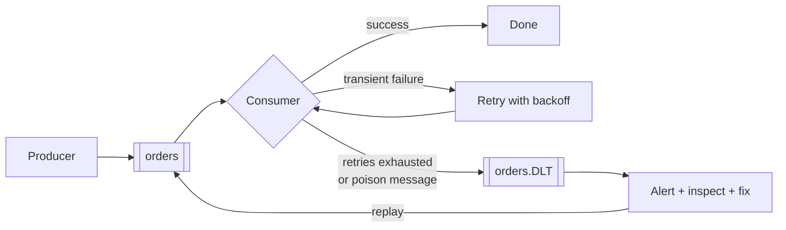

#### 📘 Terms Explained

| Term | Simple meaning |
|---|---|
| **Dead letter queue / topic (DLQ / DLT)** | Where messages that couldn't be processed are parked. |
| **Poison message / poison pill** | A message that fails **every** time (bad format, impossible data), however often you retry. |
| **Replay / redrive** | Sending messages from the DLQ back to the main queue after fixing the problem. |
| **Head-of-line blocking** | One stuck message at the front stops everything behind it. |

---

## 11.2 Why Do We Need It?

Without a DLQ, a failing message has only bad options:

| Option | Problem |
|---|---|
| Retry forever | **Poison message loop**: it fails forever, wastes CPU, floods logs. In Kafka it **blocks the whole partition** (head-of-line blocking). |
| Drop it (ack and move on) | **Data loss**: a real order is silently gone. |
| Crash the consumer | All processing stops. |

With a DLQ: **retry a few times → park it → keep going → alert a human → fix → replay**.

**Why messages end up in a DLQ:**

| Cause | Retryable? | Example |
|---|---|---|
| Deserialization error | ❌ No | Malformed JSON, wrong schema |
| Validation / business rule failure | ❌ No | Unknown product ID, negative quantity |
| Bug in consumer code | ❌ Not until the code is fixed | `NullPointerException` on a new optional field |
| Dependency down for a long time | ✅ Yes, later | Tax service down for an hour |
| Message expired (TTL) / queue overflow | n/a | RabbitMQ `x-message-ttl`, `x-max-length` |

> **Separate non-retryable errors:** send them to the DLQ **immediately**. Retrying a malformed message 5 times only delays everything else.

---

## 11.3 How It Works

1. Consumer fails processing.
2. **Retryable?** Retry with backoff (in-memory, or via **retry topics/queues** so the main queue isn't blocked).
3. Retries exhausted, or not retryable → publish to the DLQ **with diagnostic headers**: original topic/partition/offset, exception class and message, stack trace, attempt count, timestamp.
4. **Ack** the original so the main flow continues.
5. **Alert** on DLQ messages (any message in a DLQ is a bug or an incident).
6. After the fix: **replay** the DLQ messages to the main topic (consumers must be idempotent).

### Blocking vs non-blocking retries in Kafka

| | Blocking retries (`DefaultErrorHandler`) | Non-blocking retries (`@RetryableTopic`) |
|---|---|---|
| How | Retry the same record in place, with backoff | Move the record to `orders-retry-0`, `orders-retry-1`... with delays, then `orders-dlt` |
| Partition blocked while retrying? | **Yes** | **No**, the main topic keeps flowing |
| Ordering preserved? | Yes | **No**: later records overtake the retried one |
| Good for | Short retries (seconds), strict ordering | Long backoffs (minutes), throughput matters more than order |

---

## 11.4 Complete Java Example - Retry, Dead-Letter and Replay

```java
import java.util.ArrayList;
import java.util.ArrayDeque;
import java.util.Deque;
import java.util.List;

record Delivery(String id, String payload, int attempt) {}

class RetryingConsumer {
    private final int maxAttempts;
    final Deque<Delivery> mainQueue = new ArrayDeque<>();
    final List<String> deadLetterQueue = new ArrayList<>();
    final List<String> processed = new ArrayList<>();
    boolean taxServiceUp = false;

    RetryingConsumer(int maxAttempts) { this.maxAttempts = maxAttempts; }

    void handle(Delivery d) {
        // Poison message: can never succeed, however many times we retry
        if (!d.payload().matches("ORDER:\\d+")) throw new IllegalArgumentException("unparseable payload '" + d.payload() + "'");
        // Transient failure: works once the dependency is back
        if (!taxServiceUp) throw new IllegalStateException("tax-service unavailable");
        processed.add(d.id());
    }

    void drain() {
        while (!mainQueue.isEmpty()) {
            Delivery d = mainQueue.poll();
            try {
                handle(d);
                System.out.println("  " + d.id() + " attempt " + d.attempt() + ": OK");
            } catch (IllegalArgumentException e) {
                // Non-retryable -> straight to the DLQ, don't waste retries
                System.out.println("  " + d.id() + " attempt " + d.attempt() + ": " + e.getMessage() + " -> DLQ (not retryable)");
                deadLetterQueue.add(d.id() + " | " + d.payload() + " | reason=" + e.getMessage());
            } catch (RuntimeException e) {
                if (d.attempt() < maxAttempts) {
                    System.out.println("  " + d.id() + " attempt " + d.attempt() + ": " + e.getMessage() + " -> retry later");
                    mainQueue.addLast(new Delivery(d.id(), d.payload(), d.attempt() + 1));
                } else {
                    System.out.println("  " + d.id() + " attempt " + d.attempt() + ": " + e.getMessage() + " -> DLQ (retries exhausted)");
                    deadLetterQueue.add(d.id() + " | " + d.payload() + " | reason=" + e.getMessage());
                }
            }
        }
    }
}

public class DeadLetterQueueDemo {
    public static void main(String[] args) {
        RetryingConsumer consumer = new RetryingConsumer(3);
        consumer.mainQueue.add(new Delivery("m1", "ORDER:101", 1));
        consumer.mainQueue.add(new Delivery("m2", "ORDER:#$%!", 1));      // poison message

        System.out.println("Processing while tax-service is DOWN:");
        consumer.drain();
        System.out.println("DLQ now holds:");
        consumer.deadLetterQueue.forEach(e -> System.out.println("  " + e));

        System.out.println("tax-service fixed. Ops replays the retryable DLQ entries:");
        consumer.taxServiceUp = true;
        List<String> stillDead = new ArrayList<>();
        for (String entry : consumer.deadLetterQueue) {
            String[] parts = entry.split(" \\| ");
            if (entry.contains("unparseable")) { stillDead.add(entry); continue; }   // needs a human/code fix
            consumer.mainQueue.add(new Delivery(parts[0], parts[1], 1));
        }
        consumer.deadLetterQueue.clear();
        consumer.deadLetterQueue.addAll(stillDead);
        consumer.drain();
        System.out.println("processed=" + consumer.processed + ", DLQ left=" + consumer.deadLetterQueue.size());
    }
}
```

**Output:**
```
Processing while tax-service is DOWN:
  m1 attempt 1: tax-service unavailable -> retry later
  m2 attempt 1: unparseable payload 'ORDER:#$%!' -> DLQ (not retryable)
  m1 attempt 2: tax-service unavailable -> retry later
  m1 attempt 3: tax-service unavailable -> DLQ (retries exhausted)
DLQ now holds:
  m2 | ORDER:#$%! | reason=unparseable payload 'ORDER:#$%!'
  m1 | ORDER:101 | reason=tax-service unavailable
tax-service fixed. Ops replays the retryable DLQ entries:
  m1 attempt 1: OK
processed=[m1], DLQ left=1
```

What the output shows:
- The **poison message** `m2` went to the DLQ **immediately** (no wasted retries).
- `m1` was retried 3 times while the tax service was down, then parked in the DLQ with the **reason** recorded.
- After the fix, ops **replayed** only the retryable entry; `m1` succeeded. The poison message stayed in the DLQ, waiting for a human or a code fix.

---

## 11.5 Dead Letter Queues in Spring Boot

### Kafka: blocking retries + DLT

```java
@Configuration
class KafkaErrorHandling {
    @Bean
    DefaultErrorHandler errorHandler(KafkaTemplate<Object, Object> template) {
        DeadLetterPublishingRecoverer recoverer = new DeadLetterPublishingRecoverer(template,
                (record, ex) -> new TopicPartition(record.topic() + ".DLT", record.partition()));   // DLT name

        ExponentialBackOffWithMaxRetries backOff = new ExponentialBackOffWithMaxRetries(3);       // 3 retries
        backOff.setInitialInterval(1_000);
        backOff.setMultiplier(2.0);

        DefaultErrorHandler handler = new DefaultErrorHandler(recoverer, backOff);
        handler.addNotRetryableExceptions(ValidationException.class, DeserializationException.class);   // straight to DLT
        return handler;                       // Spring Boot plugs this into the listener container factory
    }
}
```

```yaml
# Poison pills that can't even be deserialized: wrap the real deserializer
spring:
  kafka:
    consumer:
      value-deserializer: org.springframework.kafka.support.serializer.ErrorHandlingDeserializer
      properties:
        spring.deserializer.value.delegate.class: org.springframework.kafka.support.serializer.JsonDeserializer
```

The DLT record keeps the original key/value and adds headers like `kafka_dlt-exception-fqcn`, `kafka_dlt-exception-message`, `kafka_dlt-original-topic`, `kafka_dlt-original-offset`.

### Kafka: non-blocking retry topics

```java
@RetryableTopic(attempts = "4",                                   // 1 try + 3 retries
                backoff = @Backoff(delay = 60_000, multiplier = 5),  // 1 min, 5 min, 25 min
                exclude = {ValidationException.class})            // straight to the DLT
@KafkaListener(topics = "orders", groupId = "invoice-service")
void on(OrderPlaced event) { invoices.create(event); }

@DltHandler
void dlt(OrderPlaced event, @Header(KafkaHeaders.EXCEPTION_MESSAGE) String error) {
    log.error("Order {} dead-lettered: {}", event.orderId(), error);
    alerts.raise("invoice-dlt", event.orderId());
}
```

### RabbitMQ: dead-letter exchange

```java
@Bean DirectExchange dlx() { return new DirectExchange("orders.dlx"); }
@Bean Queue ordersDlq()    { return QueueBuilder.durable("orders.dlq").build(); }
@Bean Binding dlqBinding() { return BindingBuilder.bind(ordersDlq()).to(dlx()).with("orders"); }

@Bean
Queue orders() {
    return QueueBuilder.durable("orders")
            .quorum()
            .deadLetterExchange("orders.dlx")       // x-dead-letter-exchange
            .deadLetterRoutingKey("orders")         // x-dead-letter-routing-key
            .deliveryLimit(5)                       // quorum queues: dead-letter after 5 redeliveries
            .build();
}
```

A RabbitMQ message is dead-lettered when it's **rejected without requeue** (`default-requeue-rejected: false`, or throwing `AmqpRejectAndDontRequeueException`), its **TTL expires**, the queue **overflows** its max length, or (quorum queues) it exceeds the **delivery limit**. The `x-death` header records why and how many times.

**SQS:** a redrive policy with `maxReceiveCount` moves messages to the DLQ; the console/API can **redrive** them back to the source queue.

#### 📘 Terms Explained

| Term | Simple meaning |
|---|---|
| **`DefaultErrorHandler`** | Spring Kafka's error handler: retries with a back-off, then calls a recoverer. |
| **`DeadLetterPublishingRecoverer`** | Publishes the failed record (with exception headers) to a dead-letter topic. |
| **`ErrorHandlingDeserializer`** | Wraps the real deserializer so bad bytes become an error the handler can dead-letter, instead of an endless crash loop. |
| **`@RetryableTopic` / `@DltHandler`** | Spring Kafka non-blocking retries via retry topics, and the method that handles the DLT. |
| **Dead-letter exchange (DLX)** | RabbitMQ exchange that receives rejected/expired messages from a queue. |
| **`x-death` header** | RabbitMQ header listing why and how often a message was dead-lettered. |
| **Redrive policy** | SQS setting: after `maxReceiveCount` receives, move the message to the DLQ. |

---

## 11.6 Pros, Cons and Pitfalls

| Pros | Cons |
|---|---|
| Failed messages don't block healthy ones | Someone must own, monitor and process the DLQ |
| No silent data loss | Replays can cause duplicates and out-of-order processing |
| Diagnostic information captured with the message | Retry topics break per-key ordering |

| Pitfall | Fix |
|---|---|
| DLQ with no alerts ("message graveyard") | Alert on DLQ depth > 0; dashboards; runbooks. |
| Retrying non-retryable errors | Classify exceptions; send validation/deserialization errors straight to the DLQ. |
| Losing the error reason | Add exception headers (Spring does this) and original topic/offset. |
| Replaying into consumers that aren't idempotent | Idempotent consumers (section 12). |
| Retry topics used where order matters (account balance events) | Blocking retries for ordered streams, or park the whole key's later events too. |
| RabbitMQ requeue loop (`requeue=true` default on failure) | `default-requeue-rejected: false` + DLX, or a delivery limit. |
| DLQ retention shorter than your investigation time | Long retention for DLTs (e.g. 14-30 days). |

---

## 11.7 Dead Letter Queue - Interview Questions

**Q1. What is a dead letter queue, and why do you need one?**
A queue/topic for messages that couldn't be processed after retries (or are invalid). It prevents poison messages from blocking or looping, avoids silent loss, and keeps failed messages for inspection and replay.

**Q2. What is a poison message?**
A message that fails every time it's processed (bad format, impossible data, consumer bug). Without a DLQ it retries forever, and in Kafka it blocks its partition.

**Q3. How do you configure a DLQ in Spring Kafka?**
`DefaultErrorHandler` with a `DeadLetterPublishingRecoverer` and a `BackOff`, non-retryable exceptions sent straight to the DLT, plus `ErrorHandlingDeserializer` for deserialization failures. Or `@RetryableTopic` + `@DltHandler` for non-blocking retries.

**Q4. Blocking vs non-blocking retries?**
Blocking retries the record in place and preserves order but stalls the partition. Non-blocking moves it to retry topics with delays, keeping the main topic flowing but losing per-key order.

**Q5. When does RabbitMQ dead-letter a message?**
When it's rejected/nacked with requeue=false, when its TTL expires, when the queue exceeds its max length, or when a quorum queue's delivery limit is exceeded, if the queue has a dead-letter exchange configured.

**Q6. How do you safely replay DLQ messages?**
Fix the cause, then republish (in original order where it matters) to the main topic; consumers must be idempotent; monitor that they don't fail again.

---

## 11.8 Dead Letter Queue - Cheat Sheet

```
DEAD LETTER QUEUE  Park messages that can't be processed (retries exhausted / poison) -> keep flowing -> alert -> fix -> replay.
          Non-retryable (deserialization, validation) -> DLQ immediately. Retryable -> backoff first.
          Kafka: DefaultErrorHandler(DeadLetterPublishingRecoverer, ExponentialBackOffWithMaxRetries),
                 addNotRetryableExceptions, ErrorHandlingDeserializer; @RetryableTopic + @DltHandler (non-blocking, loses order).
          RabbitMQ: deadLetterExchange + deadLetterRoutingKey, default-requeue-rejected=false, quorum deliveryLimit, x-death.
          SQS: redrive policy maxReceiveCount; redrive back to source.
          Alert on DLQ depth > 0; keep error headers; long retention; idempotent consumers for replay.
```

---

# 12. Idempotent Consumer Pattern (Interview Imp - Java)

## 12.1 What is an Idempotent Consumer?

An **idempotent consumer** produces the **same result** whether it receives a message **once or many times**. It detects (or naturally tolerates) **duplicates**, so redelivered messages don't cause double charges, double emails or double stock deductions.

**Analogy:** A lift button. Pressing it once or ten times calls the lift exactly once. The extra presses change nothing.

> Why duplicates are **normal**: almost every real messaging system delivers **at least once** (sections 1, 11, 13). A consumer can crash after processing but before acking; a producer can retry after a lost acknowledgement; ops can replay a DLQ. You **must** design for duplicates.

#### 📘 Terms Explained

| Term | Simple meaning |
|---|---|
| **Idempotent** | Doing it twice has the same effect as doing it once. |
| **Duplicate delivery** | The same message arriving more than once. |
| **Deduplication** | Detecting and ignoring repeats. |
| **Idempotency key / message ID** | A unique ID per logical message used to detect repeats. |

---

## 12.2 Why Do We Need It?

| Where duplicates come from | Example |
|---|---|
| Consumer crash after processing, before ack/offset commit | Wallet credited, then the pod is killed; message redelivered |
| Producer retry after a lost acknowledgement | Broker saved the message but its "OK" was lost; producer sends again |
| Kafka consumer-group rebalance | Partition moves to another consumer before the old one committed |
| Outbox relay crash after publishing, before marking sent | Event published twice |
| Manual DLQ replay | Some messages had actually succeeded |

Without idempotency, each of these is a **real money bug**.

---

## 12.3 How It Works: Techniques

| Technique | How | When to use |
|---|---|---|
| **Naturally idempotent operations** | Design the change so repeating it is harmless: `SET status = 'SHIPPED'`, upsert by key, "set balance to X" | Whenever possible: simplest |
| **Conditional update** | `UPDATE orders SET status='PAID' WHERE id=? AND status='PENDING'` (0 rows = already done) | State transitions |
| **Processed-message table** ✅ | Insert the message ID into a table with a **unique** key, **in the same DB transaction** as the business change | General case |
| **Version / sequence check** | Ignore events with `version <= lastSeenVersion` for that entity | Ordered entity events (also handles out-of-order) |
| **Idempotency key at the API** | Client sends `Idempotency-Key`; server stores and returns the first result | HTTP APIs (see [02_Reliability_Pattern.md](02_Reliability_Pattern.md#232-idempotency-the-key-to-safe-retries-interview-imp---java)) |
| **Broker-level dedupe** | Kafka idempotent producer, SQS FIFO deduplication ID, Kafka transactions | Removes **some** duplicates; not a replacement for consumer idempotency |

> **The key detail:** the "already processed?" record and the business change must be committed **atomically** (same transaction). If you mark the message processed in Redis and then the DB update fails (or the other way round), you either lose or duplicate work.

---

## 12.4 Complete Java Example - Duplicate Payment Events

```java
import java.util.HashMap;
import java.util.HashSet;
import java.util.List;
import java.util.Map;
import java.util.Set;

record PaymentEvent(String messageId, String accountId, long amountPaise) {}

class WalletService {
    final Map<String, Long> balances = new HashMap<>(Map.of("acc-1", 100_000L));

    void credit(String account, long paise) { balances.merge(account, paise, Long::sum); }
}

// NOT idempotent: every delivery changes the balance
class NaiveConsumer {
    private final WalletService wallet;
    NaiveConsumer(WalletService wallet) { this.wallet = wallet; }
    void onMessage(PaymentEvent e) { wallet.credit(e.accountId(), e.amountPaise()); }
}

// Idempotent: remembers processed message ids (in real life: a DB table with a UNIQUE key,
// updated in the SAME transaction as the balance)
class IdempotentConsumer {
    private final WalletService wallet;
    private final Set<String> processedIds = new HashSet<>();
    IdempotentConsumer(WalletService wallet) { this.wallet = wallet; }

    void onMessage(PaymentEvent e) {
        if (!processedIds.add(e.messageId())) {                    // add() returns false if already present
            System.out.println("   duplicate " + e.messageId() + " ignored");
            return;
        }
        wallet.credit(e.accountId(), e.amountPaise());
    }
}

public class IdempotentConsumerDemo {
    public static void main(String[] args) {
        // At-least-once delivery: the broker redelivers msg-1 (consumer crashed before acking) and msg-2 (network retry)
        List<PaymentEvent> deliveries = List.of(
                new PaymentEvent("msg-1", "acc-1", 50_000),
                new PaymentEvent("msg-1", "acc-1", 50_000),
                new PaymentEvent("msg-2", "acc-1", 25_000),
                new PaymentEvent("msg-2", "acc-1", 25_000),
                new PaymentEvent("msg-2", "acc-1", 25_000));

        WalletService w1 = new WalletService();
        NaiveConsumer naive = new NaiveConsumer(w1);
        deliveries.forEach(naive::onMessage);
        System.out.println("Naive consumer      balance = Rs." + w1.balances.get("acc-1") / 100 + "  (WRONG: duplicates counted)");

        WalletService w2 = new WalletService();
        IdempotentConsumer safe = new IdempotentConsumer(w2);
        System.out.println("Idempotent consumer:");
        deliveries.forEach(safe::onMessage);
        System.out.println("Idempotent consumer balance = Rs." + w2.balances.get("acc-1") / 100 + "  (correct: 1000 + 500 + 250)");
    }
}
```

**Output:**
```
Naive consumer      balance = Rs.2750  (WRONG: duplicates counted)
Idempotent consumer:
   duplicate msg-1 ignored
   duplicate msg-2 ignored
   duplicate msg-2 ignored
Idempotent consumer balance = Rs.1750  (correct: 1000 + 500 + 250)
```

What the output shows:
- 5 deliveries of 2 logical messages. The naive consumer credited **Rs.2,750** instead of Rs.1,750: Rs.1,000 of money created from nothing.
- The idempotent consumer remembered `msg-1` and `msg-2` and **ignored the 3 duplicates**: correct balance.
- In production, the `Set` becomes a **database table with a unique key**, written in the **same transaction** as the balance update.

---

## 12.5 Idempotent Consumers in Spring Boot

### Processed-message table (works with any broker)

```sql
CREATE TABLE processed_messages (
    consumer      VARCHAR(100) NOT NULL,
    message_id    VARCHAR(100) NOT NULL,
    processed_at  TIMESTAMP    NOT NULL DEFAULT CURRENT_TIMESTAMP,
    PRIMARY KEY (consumer, message_id)          -- the unique key does the deduplication
);
```

```java
@Component
class WalletCreditListener {
    private final JdbcTemplate jdbc;
    private final WalletRepository wallets;

    WalletCreditListener(JdbcTemplate jdbc, WalletRepository wallets) { this.jdbc = jdbc; this.wallets = wallets; }

    @KafkaListener(topics = "payments", groupId = "wallet-service")
    @Transactional                                         // dedupe row + balance change commit TOGETHER
    public void on(PaymentEvent e) {
        int inserted = jdbc.update("""
                INSERT INTO processed_messages (consumer, message_id) VALUES ('wallet-service', ?)
                ON CONFLICT (consumer, message_id) DO NOTHING
                """, e.messageId());                        // PostgreSQL; MySQL: INSERT IGNORE
        if (inserted == 0) {
            log.info("duplicate {} ignored", e.messageId());
            return;                                         // already processed: still ack
        }
        wallets.credit(e.accountId(), e.amountPaise());
    }
}
```

> Why not catch `DataIntegrityViolationException` from a JPA `save()`? Inside a `@Transactional` method, that exception usually marks the transaction **rollback-only**, so the commit fails later anyway. `INSERT ... ON CONFLICT DO NOTHING` (or `INSERT IGNORE`) avoids the exception entirely.

### Where does the message ID come from?

| Source | Example |
|---|---|
| A business ID that's unique per event | `paymentId`, `orderId + eventType + version` |
| An event ID set by the producer | CloudEvents `id`, outbox row ID |
| Broker coordinates (Kafka) | `topic-partition-offset`: unique per record, but a **re-published** duplicate gets a new offset, so prefer a producer-assigned ID |

### Kafka's own guarantees (and their limits)

```yaml
spring:
  kafka:
    producer:
      acks: all
      properties:
        enable.idempotence: true            # default in Kafka 3.x: no duplicates from producer RETRIES
      transaction-id-prefix: tx-            # enables Kafka transactions (read-process-write)
    consumer:
      isolation-level: read_committed       # don't read aborted transactional writes
```

| Kafka feature | Prevents | Does NOT prevent |
|---|---|---|
| **Idempotent producer** (producer ID + sequence numbers) | Duplicates caused by the producer's internal retries | An app that calls `send()` twice; consumer-side duplicates |
| **Transactions / exactly-once (EOS)** | Duplicates in **Kafka → process → Kafka** pipelines (offsets committed atomically with output) | Side effects outside Kafka (DB writes, emails, HTTP calls) |

> **"Exactly-once" in practice = at-least-once delivery + idempotent processing.** Kafka EOS only covers work whose inputs and outputs are all Kafka topics.

#### 📘 Terms Explained

| Term | Simple meaning |
|---|---|
| **`ON CONFLICT DO NOTHING`** | PostgreSQL: skip the insert if it would violate a unique key (returns 0 rows). |
| **Rollback-only** | A Spring transaction that has been marked to roll back; it can't commit any more. |
| **Idempotent producer** | Kafka producer mode where the broker discards duplicate sends caused by retries. |
| **Kafka transactions / EOS** | Atomic writes to several partitions plus offset commits, giving exactly-once within Kafka. |
| **`read_committed`** | Consumers only see records from committed Kafka transactions. |
| **Rebalance** | Kafka reassigning partitions among a group's consumers (when consumers join/leave). |

---

## 12.6 Pros, Cons and Pitfalls

| Pros | Cons |
|---|---|
| Makes at-least-once delivery safe | Extra table/storage and a lookup per message |
| Lets you retry and replay freely | The dedupe table grows; needs cleanup |
| Protects against bugs anywhere upstream | Requires a reliable unique message ID |

| Pitfall | Fix |
|---|---|
| Dedupe check and business change in different transactions/stores | Same DB transaction; or a naturally idempotent operation. |
| "Check then insert" without a unique constraint (race between two consumers) | Rely on the database's unique key, not a `SELECT` first. |
| Using a timestamp or random value generated by the consumer as the ID | The ID must come from the message (producer-assigned). |
| Dedupe table never cleaned | Delete rows older than the maximum redelivery/replay window (e.g. 30 days). |
| Assuming Kafka "exactly-once" covers DB writes and emails | It doesn't; make consumers idempotent. |
| External side effects (emails, payment API) not idempotent | Pass an idempotency key to the external API; record "email sent" in the same transaction (or via outbox). |

---

## 12.7 Idempotent Consumer - Interview Questions

**Q1. Why must message consumers be idempotent?**
Brokers deliver at least once: crashes before ack, producer retries, rebalances and replays all cause duplicates. Idempotent consumers make duplicates harmless.

**Q2. How do you implement an idempotent consumer?**
Prefer naturally idempotent operations (upserts, conditional updates). Otherwise store each processed message ID in a table with a unique key, in the same transaction as the business change, and skip messages whose ID is already there.

**Q3. Does Kafka's exactly-once mean I don't need idempotency?**
No. Idempotent producers stop duplicates from producer retries, and transactions give exactly-once for Kafka-to-Kafka processing. Side effects in databases or external APIs still need idempotent handling.

**Q4. Where should the message ID come from?**
From the producer: a business key or event ID (outbox row ID, CloudEvents `id`). Not from the consumer, and preferably not from broker offsets, since a re-published duplicate gets a new offset.

**Q5. How long do you keep processed IDs?**
At least as long as duplicates can arrive: the maximum redelivery, retry and replay window (often days or weeks), then clean up.

---

## 12.8 Idempotent Consumer - Cheat Sheet

```
IDEMPOTENT CONSUMER  Same result for 1 or N deliveries. Duplicates are NORMAL (at-least-once).
          Sources of duplicates: crash before ack/commit, producer retry, rebalance, outbox relay crash, DLQ replay.
          Techniques: naturally idempotent ops (upsert, SET), conditional update (WHERE status='PENDING'),
                      processed_messages table with UNIQUE key IN THE SAME TX, version checks, idempotency keys.
          Spring: @Transactional listener + INSERT ... ON CONFLICT DO NOTHING (row count 0 = duplicate).
          Kafka: enable.idempotence (producer retries only), transactions + read_committed (Kafka->Kafka only).
          "Exactly-once" = at-least-once + idempotency. Clean old dedupe rows.
```

---

## 12.9 Types and Variants

| Technique | How duplicates are detected | Trade-off |
|---|---|---|
| **Processed-message table** | Store each message id in the same DB transaction as the side effect; unique constraint rejects repeats | Strongest; table grows (clean up by age) |
| **Natural idempotency** | The operation is idempotent by design (`SET status = PAID`, upsert) | No bookkeeping; not always possible |
| **Version / sequence check** | Apply only if `version = expected` or `seq > lastSeq` | Also handles out-of-order messages |
| **Dedup cache with TTL** | Redis `SET msgId NX EX` | Fast; a window, not a guarantee if the cache is lost |
| **Broker-side dedup** | Kafka idempotent producer + transactions (exactly-once within Kafka), SQS FIFO deduplication id | Doesn't cover external side effects |
| **Outbox + idempotent consumer** | Producer side reliable, consumer side de-duplicates | The standard end-to-end recipe |

# 13. Guaranteed Delivery and the Transactional Outbox (Interview Imp - Java)

## 13.1 Delivery Guarantees

| Guarantee | Meaning | How you get it | Risk |
|---|---|---|---|
| **At-most-once** | Delivered 0 or 1 times | Ack/commit **before** processing; no retries | Messages can be **lost** |
| **At-least-once** ✅ | Delivered 1 or more times | Ack/commit **after** processing; retries | **Duplicates** → idempotent consumers |
| **Exactly-once** | Delivered and processed exactly once | Only within closed systems (Kafka transactions); otherwise **effectively-once** = at-least-once + idempotency | Complexity; limited scope |

**Guaranteed delivery** (EIP) means a message, once accepted, survives crashes until it's processed. It needs **all three** links to be reliable:

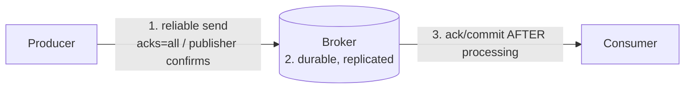

| Link | Kafka | RabbitMQ |
|---|---|---|
| **1. Producer → broker** | `acks=all`, `enable.idempotence=true`, check the `send()` future | **Publisher confirms** (`publisher-confirm-type: correlated`), `publisher-returns` + `mandatory` for unroutable messages |
| **2. Broker storage** | `replication.factor=3`, `min.insync.replicas=2` | Durable quorum queues + persistent messages (Spring's default delivery mode) |
| **3. Broker → consumer** | Commit offsets **after** processing (Spring's default; `enable.auto.commit=false`) | Ack after processing (Spring `acknowledge-mode: auto`/`manual`) |

```yaml
spring:
  rabbitmq:
    publisher-confirm-type: correlated     # broker confirms each publish
    publisher-returns: true                # get unroutable messages back
    template:
      mandatory: true
```

But one more gap remains, and it's the most important one: **the gap between your database and the broker.**

#### 📘 Terms Explained

| Term | Simple meaning |
|---|---|
| **At-most-once / at-least-once / exactly-once** | Delivery guarantees: may lose / may duplicate / neither. |
| **Effectively-once** | At-least-once delivery made safe by idempotent processing. |
| **Publisher confirms** | RabbitMQ acknowledges to the producer once a message is safely stored. |
| **Unroutable message** | A message that matched no queue; with `mandatory`, it's returned to the producer instead of dropped. |

---

## 13.2 The Dual-Write Problem

A service must **save data** and **publish an event**: two different systems, with no shared transaction.

```java
@Transactional
public void placeOrder(Order order) {
    orderRepository.save(order);                       // write #1: database
    kafka.send("orders", new OrderPlaced(order));      // write #2: broker
}
```

| What goes wrong | Result |
|---|---|
| Broker down after the DB commit | Order saved, **event lost**: inventory never reserved, no email |
| Event sent, then the DB transaction rolls back | Event for an order that **doesn't exist** |
| App crashes between the two | Either of the above |
| Sending inside the transaction and the commit then fails | Same as row 2 |

Distributed transactions (2PC/XA) across the DB and broker are slow, complex and unsupported by Kafka. The standard answer is the **Transactional Outbox**.

---

## 13.3 How the Transactional Outbox Works

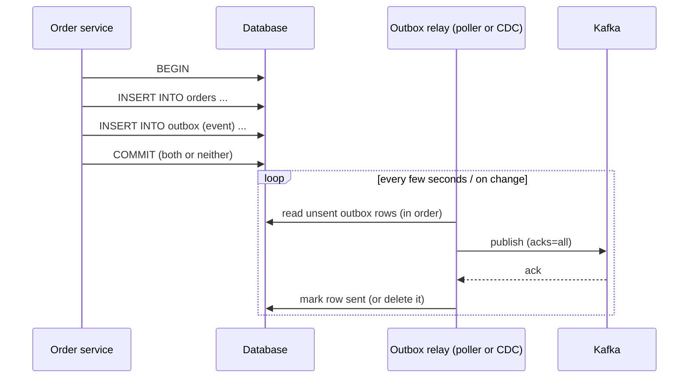

1. In the **same local transaction**, write the business data **and** an `outbox` row describing the event.
2. A separate **relay** reads unsent outbox rows and publishes them to the broker.
3. Only after the broker confirms, the relay marks the row as sent (or deletes it).
4. If the relay crashes after publishing but before marking, the event is published **again**, so consumers must be idempotent (section 12). The **outbox row ID** is a perfect message ID.

The receiving side can use the mirror image, an **Inbox** table: store incoming message IDs (and payloads) before processing, which is exactly the processed-messages table from section 12.

---

## 13.4 Complete Java Example - Dual Write vs Outbox

```java
import java.util.ArrayList;
import java.util.List;

// Simulated database with two tables and all-or-nothing transactions
class Database {
    final List<String> orders = new ArrayList<>();
    final List<OutboxRow> outbox = new ArrayList<>();

    record OutboxRow(long id, String eventType, String payload, boolean[] sent) {}

    // Runs the work atomically: either everything is saved or nothing is
    void inTransaction(Runnable work) {
        int ordersBefore = orders.size(), outboxBefore = outbox.size();
        try {
            work.run();
        } catch (RuntimeException e) {
            while (orders.size() > ordersBefore) orders.remove(orders.size() - 1);       // rollback
            while (outbox.size() > outboxBefore) outbox.remove(outbox.size() - 1);
            throw e;
        }
    }
}

class Broker {
    final List<String> topic = new ArrayList<>();
    boolean up = true;
    void publish(String event) {
        if (!up) throw new RuntimeException("broker unreachable");
        topic.add(event);
    }
}

public class OutboxDemo {
    static void scenario(String title, Runnable r) {
        System.out.println(title);
        try { r.run(); } catch (RuntimeException e) { System.out.println("   ! " + e.getMessage()); }
    }

    public static void main(String[] args) {
        // ---------- DUAL WRITE: save to DB, then publish to the broker ----------
        Database db1 = new Database();
        Broker broker1 = new Broker();
        broker1.up = false;
        scenario("1) Dual write, broker down after the DB commit:", () -> {
            db1.inTransaction(() -> db1.orders.add("ORD-1"));            // committed
            broker1.publish("OrderPlaced ORD-1");                        // fails -> event LOST
        });
        System.out.println("   orders in DB = " + db1.orders + ", events on broker = " + broker1.topic + "  <- inconsistent!");

        // ---------- OUTBOX: save order AND event in ONE transaction; a relay publishes later ----------
        Database db2 = new Database();
        Broker broker2 = new Broker();
        broker2.up = false;
        long[] seq = {1};
        scenario("2) Outbox, broker down:", () -> db2.inTransaction(() -> {
            db2.orders.add("ORD-2");
            db2.outbox.add(new Database.OutboxRow(seq[0]++, "OrderPlaced", "ORD-2", new boolean[]{false}));
        }));
        System.out.println("   orders in DB = " + db2.orders + ", outbox rows = " + db2.outbox.size() + " (unsent)");

        Runnable relay = () -> {                                         // runs every few seconds (poller) or via CDC
            for (Database.OutboxRow row : db2.outbox) {
                if (row.sent()[0]) continue;
                try {
                    broker2.publish(row.eventType() + " " + row.payload() + " (outboxId=" + row.id() + ")");
                    row.sent()[0] = true;                                // mark as sent AFTER the broker confirmed
                    System.out.println("   relay: published outbox row " + row.id());
                } catch (RuntimeException e) {
                    System.out.println("   relay: " + e.getMessage() + ", will retry row " + row.id());
                    return;
                }
            }
        };
        relay.run();
        broker2.up = true;
        System.out.println("   ...broker comes back...");
        relay.run();
        System.out.println("   events on broker = " + broker2.topic);

        scenario("3) Outbox, the transaction fails (e.g. validation) -> neither order nor event is saved:", () ->
            db2.inTransaction(() -> {
                db2.orders.add("ORD-3");
                db2.outbox.add(new Database.OutboxRow(seq[0]++, "OrderPlaced", "ORD-3", new boolean[]{false}));
                throw new RuntimeException("credit limit exceeded -> rollback");
            }));
        System.out.println("   orders in DB = " + db2.orders + ", outbox rows = " + db2.outbox.size());
    }
}
```

**Output:**
```
1) Dual write, broker down after the DB commit:
   ! broker unreachable
   orders in DB = [ORD-1], events on broker = []  <- inconsistent!
2) Outbox, broker down:
   orders in DB = [ORD-2], outbox rows = 1 (unsent)
   relay: broker unreachable, will retry row 1
   ...broker comes back...
   relay: published outbox row 1
   events on broker = [OrderPlaced ORD-2 (outboxId=1)]
3) Outbox, the transaction fails (e.g. validation) -> neither order nor event is saved:
   ! credit limit exceeded -> rollback
   orders in DB = [ORD-2], outbox rows = 1
```

What the output shows:
1. **Dual write:** the order was committed but the event was lost: the system is now **inconsistent**, and nothing will ever fix it.
2. **Outbox:** the order and its event were saved **together**. While the broker was down the relay simply retried; when it came back, the event was published. Eventually consistent, nothing lost.
3. When the business transaction **rolled back**, the outbox row rolled back with it: no event for an order that doesn't exist.

---

## 13.5 Transactional Outbox in Spring Boot

### Outbox table and writing to it

```sql
CREATE TABLE outbox (
    id             BIGSERIAL    PRIMARY KEY,           -- also used as the message id for deduplication
    aggregate_type VARCHAR(50)  NOT NULL,              -- e.g. 'order'  -> topic
    aggregate_id   VARCHAR(50)  NOT NULL,              -- e.g. 'ORD-2'  -> message key (ordering)
    event_type     VARCHAR(100) NOT NULL,              -- e.g. 'OrderPlaced'
    payload        JSONB        NOT NULL,
    created_at     TIMESTAMP    NOT NULL DEFAULT now(),
    sent_at        TIMESTAMP
);
CREATE INDEX outbox_unsent ON outbox (id) WHERE sent_at IS NULL;
```

```java
@Service
@RequiredArgsConstructor
public class OrderService {
    private final OrderRepository orders;
    private final OutboxRepository outbox;
    private final ObjectMapper json;

    @Transactional                                            // ONE local transaction for both writes
    public Order place(PlaceOrderRequest req) throws JsonProcessingException {
        Order order = orders.save(Order.from(req));
        outbox.save(new OutboxEvent("order", order.getId(), "OrderPlaced",
                json.writeValueAsString(new OrderPlaced(order.getId(), order.getTotal()))));
        return order;                                         // no broker call here at all
    }
}
```

### Option A: polling relay

```java
@Component
@RequiredArgsConstructor
class OutboxRelay {
    private final JdbcTemplate jdbc;
    private final KafkaTemplate<String, String> kafka;

    @Scheduled(fixedDelay = 1_000)
    @Transactional
    public void publishPending() throws Exception {
        List<Map<String, Object>> rows = jdbc.queryForList("""
                SELECT id, aggregate_type, aggregate_id, event_type, payload::text AS payload
                FROM outbox WHERE sent_at IS NULL
                ORDER BY id
                LIMIT 100
                FOR UPDATE SKIP LOCKED
                """);                                         // several relay instances won't grab the same rows
        for (Map<String, Object> row : rows) {
            ProducerRecord<String, String> record = new ProducerRecord<>(
                    (String) row.get("aggregate_type") + "s", (String) row.get("aggregate_id"), (String) row.get("payload"));
            record.headers().add("eventId", String.valueOf(row.get("id")).getBytes(StandardCharsets.UTF_8));
            record.headers().add("eventType", ((String) row.get("event_type")).getBytes(StandardCharsets.UTF_8));
            kafka.send(record).get(5, TimeUnit.SECONDS);      // wait for the broker's ack
            jdbc.update("UPDATE outbox SET sent_at = now() WHERE id = ?", row.get("id"));
        }
    }
}
```

> `FOR UPDATE SKIP LOCKED` lets several relay instances run safely. Strict per-key ordering, though, is simplest with **one** active relay (or by partitioning outbox rows by aggregate ID).

### Option B: Change Data Capture (CDC) with Debezium

Instead of polling, **Debezium** reads the database's transaction log (PostgreSQL WAL, MySQL binlog) and streams new outbox rows to Kafka, with very low latency and no polling load.

```properties
# Kafka Connect: Debezium PostgreSQL connector with the Outbox Event Router
connector.class=io.debezium.connector.postgresql.PostgresConnector
database.hostname=orders-db
database.dbname=orders
table.include.list=public.outbox
transforms=outbox
transforms.outbox.type=io.debezium.transforms.outbox.EventRouter
transforms.outbox.table.field.event.key=aggregate_id
transforms.outbox.route.by.field=aggregate_type
```

| | Polling relay | CDC (Debezium) |
|---|---|---|
| Latency | Poll interval (~1 s) | Sub-second |
| DB load | Repeated queries | Reads the transaction log |
| Infrastructure | Just your app | Kafka Connect + Debezium |
| Ordering | `ORDER BY id`, single relay | Follows commit order in the log |

> **Spring Modulith** offers a built-in alternative: its event publication registry stores events in the same transaction and can externalise them to Kafka/RabbitMQ (section 5.4).

#### 📘 Terms Explained

| Term | Simple meaning |
|---|---|
| **Dual write** | Writing to two systems (DB + broker) without a shared transaction, which can leave them inconsistent. |
| **2PC / XA** | Two-phase commit: a protocol for distributed transactions across systems; slow and rarely used with brokers. |
| **Transactional outbox** | Saving outgoing events in a DB table in the same transaction as the business data, then relaying them. |
| **Relay** | The process that reads the outbox and publishes to the broker. |
| **`FOR UPDATE SKIP LOCKED`** | SQL that locks selected rows and skips rows locked by others, so workers don't collide. |
| **CDC (Change Data Capture)** | Streaming every DB change by reading the database's transaction log. |
| **Debezium** | Open-source CDC platform built on Kafka Connect. |
| **WAL / binlog** | PostgreSQL's Write-Ahead Log / MySQL's binary log: records of every committed change. |
| **Inbox pattern** | Storing incoming message IDs/payloads in the consumer's DB before processing, for deduplication. |

---

## 13.6 Pros, Cons, Pitfalls and Interview Questions

| Pros | Cons |
|---|---|
| No lost or phantom events: DB and events always agree | Extra table, relay process and monitoring |
| Works with any broker; no distributed transactions | Events are published slightly later (eventual consistency) |
| Natural message ID (outbox row ID) for deduplication | Relay can publish duplicates; consumers must be idempotent |

| Pitfall | Fix |
|---|---|
| Publishing to Kafka inside `@Transactional` and calling it "safe" | It's still a dual write; use the outbox. |
| Marking rows sent **before** the broker acks | Mark only after a confirmed send. |
| Outbox table grows forever | Delete or archive sent rows on a schedule. |
| Multiple relays reordering events for the same key | One active relay, or partition by aggregate; Debezium follows log order. |
| No monitoring of unsent rows | Alert on oldest unsent row age. |

**Q1. What is the dual-write problem?** Writing to a database and a broker in two separate steps; a failure between them leaves the systems inconsistent (lost events or phantom events). There's no shared transaction to make them atomic.

**Q2. Explain the Transactional Outbox pattern.** Write the business change and an outbox row in one local DB transaction; a relay (poller or CDC) publishes outbox rows to the broker and marks them sent after confirmation. It gives at-least-once publishing with no distributed transaction.

**Q3. Polling publisher vs CDC?** Polling: simple, runs in the app, adds query load and latency. CDC (Debezium): reads the transaction log, low latency, preserves commit order, but needs Kafka Connect infrastructure.

**Q4. Can the outbox publish an event twice? What then?** Yes, if the relay crashes after publishing but before marking the row. Consumers dedupe by the event ID (outbox row ID): the idempotent consumer / inbox pattern.

**Q5. At-most-once vs at-least-once vs exactly-once?** Commit before processing (may lose) / commit after processing (may duplicate) / no loss and no duplicates, which in practice means at-least-once plus idempotency, or Kafka transactions for Kafka-only pipelines.

**Q6. How do you guarantee a message isn't lost end to end?** Outbox for DB→broker; `acks=all` + idempotent producer or publisher confirms; replicated durable storage; commit/ack after processing; DLQ for failures; idempotent consumers.

---

## 13.7 Guaranteed Delivery and Outbox - Cheat Sheet

```
GUARANTEED DELIVERY  Reliable producer (acks=all + idempotence / publisher confirms + mandatory)
          + durable replicated broker (RF=3, min.insync=2 / quorum queues, persistent)
          + ack/commit AFTER processing.  At-most-once (commit first) | at-least-once (commit after) | exactly-once (Kafka-only).
DUAL WRITE  DB save + broker send = two systems, no shared TX -> lost or phantom events.
OUTBOX    Same local TX: business row + outbox row. Relay publishes, marks sent AFTER ack.
          Relay: @Scheduled poller (ORDER BY id, FOR UPDATE SKIP LOCKED) or CDC (Debezium EventRouter, WAL/binlog).
          At-least-once -> outbox id = message id -> idempotent consumer / inbox table.
          Spring Modulith event publication registry = built-in alternative. Clean sent rows; alert on unsent age.
```

---

# 14. How the Messaging Patterns Fit Together

## 14.1 One-Line Summary of Each

| Pattern | Question it answers | One-line answer |
|---|---|---|
| **Message Queue** | "How do I hand work to one of many workers?" | Point-to-point queue, competing consumers, ack after processing. |
| **Pub-Sub** | "How do I tell everyone who cares?" | Publish once to a topic; every subscriber gets a copy. |
| **Request-Reply** | "How do I get an answer over messaging?" | Reply-to address + correlation ID + timeout. |
| **Message Broker** | "Who stores and moves the messages?" | Kafka (log) or RabbitMQ (queues + exchanges). |
| **Event Bus** | "How do modules broadcast facts?" | A central pub-sub channel, in-process or distributed. |
| **Message Channel** | "Where do messages travel?" | Named logical pipes: p2p, pub-sub, datatype, invalid, dead-letter. |
| **Message Router** | "Which channel should this go to?" | Rules forward messages unchanged; splitter/aggregator for parts. |
| **Message Translator** | "We speak different formats." | Convert to a canonical model; version schemas. |
| **Content-Based Router** | "Route by what's inside." | Inspect data, first-match rules, default channel. |
| **Correlation Identifier** | "Which messages belong together?" | One ID in headers through every hop and log line. |
| **Dead Letter Queue** | "What about messages that keep failing?" | Retry, park, alert, fix, replay. |
| **Idempotent Consumer** | "What about duplicates?" | Dedupe by message ID in the same transaction. |
| **Outbox / Guaranteed Delivery** | "How do I never lose an event?" | Event saved with the data; relay publishes; at-least-once end to end. |

## 14.2 The Life of One Message (Interview Imp - Java)

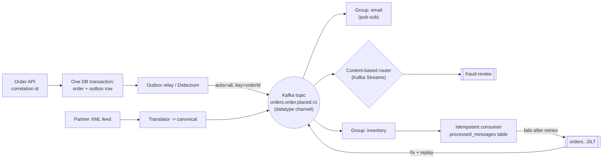

| Step | Patterns |
|---|---|
| API receives the request | Correlation Identifier |
| Save order + event atomically | Transactional Outbox, Guaranteed Delivery |
| Publish with a key | Message Broker, Datatype Channel, ordering per partition |
| Many services react | Pub-Sub, consumer groups, Event Bus |
| Workers share the load | Message Queue / competing consumers |
| Special cases routed | Message Router, Content-Based Router |
| External formats accepted | Message Translator, canonical model |
| Duplicates handled | Idempotent Consumer |
| Failures parked and replayed | Dead Letter Queue |
| Occasional questions answered | Request-Reply |

## 14.3 Decision Guide

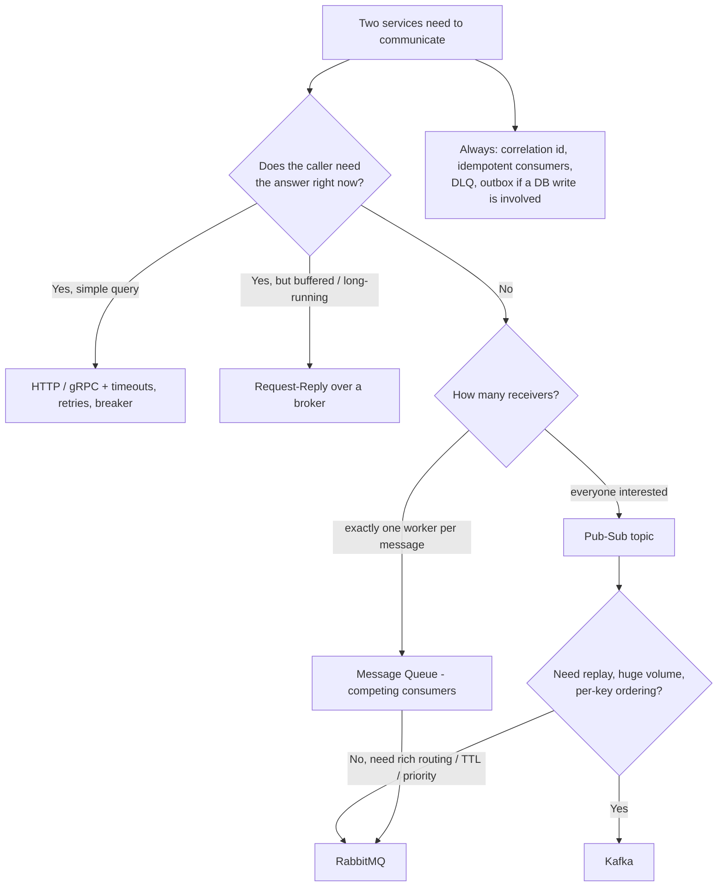

| If you hear... | Think... |
|---|---|
| "Background jobs", "workers", "spikes", "202 Accepted" | Message Queue |
| "Notify many services", "event-driven", "consumer group", "fan-out" | Pub-Sub |
| "Need a response over the queue", "reply-to" | Request-Reply |
| "Kafka vs RabbitMQ", "partitions", "exchanges", "retention" | Message Broker |
| "Decouple modules", "ApplicationEventPublisher", "Spring Modulith" | Event Bus |
| "Topic naming", "one topic per event type", "Kafka Connect" | Message Channel |
| "Route by type", "splitter", "aggregator", "scatter-gather" | Message Router |
| "Different partner formats", "schema evolution", "Avro", "Schema Registry" | Message Translator |
| "High-value orders to fraud review", "route by country" | Content-Based Router |
| "Trace a request across services", "traceparent", "MDC" | Correlation Identifier |
| "Poison message", "retries exhausted", "replay" | Dead Letter Queue |
| "Duplicates", "at-least-once", "double charge" | Idempotent Consumer |
| "Save to DB and publish", "lost events", "Debezium", "CDC" | Transactional Outbox |

## 14.4 Look-Alike Patterns

| Pair | Difference |
|---|---|
| **Queue vs Pub-Sub** | One consumer per message vs every subscriber gets a copy. Kafka does both via consumer groups. |
| **Message Router vs Content-Based Router** | Router is the general idea (type, header, content); content-based is the subtype that reads the body. |
| **Message Translator vs Router** | Translator changes the message; router changes only where it goes. |
| **Correlation ID vs Message ID** | Conversation-wide ID (link things) vs per-message ID (deduplicate). |
| **Dead Letter vs Invalid Message channel** | Couldn't be processed after retries vs couldn't even be understood. |
| **Idempotent Consumer vs Outbox** | Receiver-side duplicate safety vs sender-side "never lose an event"; you need both. |
| **Event Bus vs Message Broker** | Event bus is a usage pattern (central pub-sub for events); a broker is infrastructure that can implement it. |
| **Pub-Sub (system) vs Observer (in-process)** | Same idea; Observer is object-level, pub-sub adds a broker, durability and the network. |

## 14.5 Messaging Inside Spring

| Pattern | Spring / ecosystem |
|---|---|
| Message Queue | Spring AMQP `RabbitTemplate`, `@RabbitListener(concurrency)`, Spring Cloud AWS SQS `@SqsListener` |
| Pub-Sub | Spring Kafka `KafkaTemplate`, `@KafkaListener(groupId)`, fanout/topic exchanges |
| Request-Reply | `RabbitTemplate.convertSendAndReceive`, `AsyncRabbitTemplate`, `ReplyingKafkaTemplate` + `@SendTo` |
| Message Broker | Spring Cloud Stream binders (Kafka, RabbitMQ), `StreamBridge` |
| Event Bus | `ApplicationEventPublisher`, `@TransactionalEventListener`, Spring Modulith, Spring Cloud Bus |
| Message Channel | Spring Integration `DirectChannel`, `PublishSubscribeChannel`, `QueueChannel`, adapters |
| Message Router | Spring Integration `.route()`, `.split()`, `.aggregate()`, Kafka Streams `split().branch()` |
| Message Translator | `Jackson2JsonMessageConverter`, `JsonSerializer`, Avro serializers, Integration `.transform()` |
| Content-Based Router | Integration `.route(lambda)`, headers/topic exchanges, Cloud Function `routing-expression` |
| Correlation Identifier | Micrometer Tracing + `observation-enabled`, MDC, `KafkaHeaders.CORRELATION_ID` |
| Dead Letter Queue | `DefaultErrorHandler` + `DeadLetterPublishingRecoverer`, `@RetryableTopic`/`@DltHandler`, RabbitMQ DLX |
| Idempotent Consumer | `@Transactional` listener + unique-key insert, Kafka idempotent producer / transactions |
| Outbox | Outbox table + `@Scheduled` relay, Debezium, Spring Modulith event publication registry |

## 14.6 Comparison Table

| Pattern | Main problem solved | Key mechanism | Biggest risk | Interview favourite |
|---|---|---|---|---|
| **Message Queue** | Distribute work, absorb spikes | Competing consumers, ack after processing | Lost messages (auto-ack), duplicates | Ack modes, ordering |
| **Pub-Sub** | One event, many reactions | Topics, consumer groups, offsets | Wrong key → lost ordering | Consumer groups vs partitions |
| **Request-Reply** | Answers over messaging | Reply-to + correlation ID | Waiting forever | When not to use it |
| **Message Broker** | Store and move messages | Kafka log / RabbitMQ exchanges | Single point of failure | Kafka vs RabbitMQ |
| **Event Bus** | Module decoupling | Central pub-sub | Lost in-memory events, spaghetti | Notification vs state transfer |
| **Message Channel** | Structure the flow | Named logical pipes | One catch-all topic | Datatype / dead-letter channels |
| **Message Router** | Right destination | Routing rules, splitter, aggregator | No default route | Splitter/aggregator, scatter-gather |
| **Message Translator** | Format mismatch | Canonical model, schemas | Breaking schema changes | Schema Registry compatibility |
| **Content-Based Router** | Route by data | First-match rules on content | Rule order bugs | RabbitMQ can't read bodies |
| **Correlation Identifier** | Link related messages | ID in headers + MDC | Lost across threads | Correlation vs message ID |
| **Dead Letter Queue** | Failing messages | Retry → park → replay | Unmonitored graveyard | Poison messages, blocking vs non-blocking |
| **Idempotent Consumer** | Duplicates | Dedupe ID in same transaction | Check and change not atomic | Exactly-once myth |
| **Outbox** | Lost/phantom events | Same-TX outbox row + relay | Relay ordering, table growth | Dual-write problem |

---

# 15. Messaging Patterns Cheat Sheet

```
MESSAGE QUEUE   Point-to-point; competing consumers; ack AFTER processing (at-least-once); prefetch; claim check.
PUB-SUB         Topic -> every subscriber. Kafka: between groups pub-sub, inside a group queue; order per partition (key).
REQUEST-REPLY   replyTo + correlationId + timeout; discard late replies. convertSendAndReceive / ReplyingKafkaTemplate.
MESSAGE BROKER  Kafka: partitions, offsets, RF=3, ISR, acks=all, retention/compaction, pull.
                RabbitMQ: exchanges (direct, topic */#, fanout, headers) -> bindings -> queues, push, TTL, priority.
EVENT BUS       Central pub-sub. In-process (ApplicationEventPublisher) vs distributed (Kafka) vs reliable (Modulith/outbox).
                Event notification vs event-carried state transfer vs event sourcing.
MESSAGE CHANNEL p2p, pub-sub, datatype, invalid-message, dead-letter, adapters (Kafka Connect), bridges (MirrorMaker).
MESSAGE ROUTER  Forward unchanged by rules; filter, recipient list, splitter, aggregator (+timeout), scatter-gather. Default route!
TRANSLATOR      Canonical model; JSON/Avro/Protobuf; Schema Registry BACKWARD; add optional fields only; enrich/filter/envelope.
CONTENT ROUTER  Rules on payload data, first match, default channel; RabbitMQ: copy content into key/headers.
CORRELATION ID  Same id in headers through every hop; MDC; clear in finally; Micrometer Tracing + observation-enabled.
DEAD LETTER     Retry (backoff) -> DLQ with error headers -> alert -> fix -> replay. Non-retryable -> DLQ at once.
                DefaultErrorHandler + DeadLetterPublishingRecoverer; @RetryableTopic; RabbitMQ DLX + requeue=false.
IDEMPOTENT      Dedupe by producer-assigned id in the SAME TX (INSERT ... ON CONFLICT DO NOTHING); naturally idempotent ops.
OUTBOX          Business row + outbox row in one TX; relay (poller SKIP LOCKED / Debezium CDC) publishes; mark after ack.
DELIVERY        at-most-once (commit first) | at-least-once (commit after) | exactly-once = at-least-once + idempotency.
```

### Quick Decision Table

| Need | Use |
|---|---|
| Background work shared by workers | Message Queue |
| Broadcast an event to many services | Pub-Sub (Kafka topic / fanout exchange) |
| Ask a question over messaging | Request-Reply |
| High volume, replay, per-key order | Kafka |
| Flexible routing, TTL, priority, task queues | RabbitMQ |
| Decouple modules inside one app | Event Bus (Spring events / Modulith) |
| Accept many partner formats | Message Translator + canonical model |
| Send special cases elsewhere | Content-Based Router |
| Follow one request across services | Correlation Identifier + tracing |
| Handle messages that keep failing | Dead Letter Queue |
| Survive duplicates | Idempotent Consumer |
| Never lose an event after a DB write | Transactional Outbox |
| Need the answer immediately, both sides online | Plain HTTP/gRPC (not messaging) |

### Top Interview Traps

1. **Delivery is at-least-once in practice;** duplicates are normal, so every consumer must be idempotent.
2. **"Exactly-once" in Kafka covers Kafka-to-Kafka only,** not your DB writes or emails.
3. **Ordering is per partition,** so choose the key (e.g. `orderId`) carefully; more consumers than partitions sit idle.
4. **Saving to the DB and then publishing is a dual write,** even inside `@Transactional`. Use the outbox.
5. **Auto-ack on delivery loses messages;** ack/commit after processing.
6. **RabbitMQ requeues failed messages by default,** which causes poison loops. Set `default-requeue-rejected: false` + DLX.
7. **A poison message blocks a Kafka partition** with blocking retries; use `ErrorHandlingDeserializer`, non-retryable exceptions and a DLT.
8. **Retry topics break per-key ordering.**
9. **Correlation ID ≠ message ID;** and the MDC must be cleared and propagated across threads.
10. **Schema changes break consumers:** add optional fields only, use a Schema Registry, and create a v2 topic for breaking changes.

> **Related files:** [02_Reliability_Pattern.md](02_Reliability_Pattern.md) (retries, idempotency keys, timeouts, circuit breakers) · [04_Behavioral_Pattern.md](../01_LLD/04_Behavioral_Pattern.md) (Observer, Command, Mediator: the object-level versions) · [03_Structural_Pattern.md](../01_LLD/03_Structural_Pattern.md) (Adapter = translator) · [01_Scalability_Pattern.md](01_Scalability_Pattern.md) (queues for horizontal scaling, Kafka partitioning) · [00_Design_Patterns_Complete_List.md](../00_Design_Patterns_Complete_List.md) (master list)
