# Data Management Patterns

> **Note**: Patterns marked with **(Interview Imp - Java)** are frequently asked in Java interviews
>
> **How to read this file:** Every section ends with a **📘 Terms Explained** table. If you see a word you don't know, check the table right below that section. Each pattern goes from the basic idea to advanced usage (plain Java, Spring Boot, databases, pitfalls) and ends with interview questions and a mini cheat sheet.
>
> **What are data management patterns?** They answer one question: *"How do we store, change, copy and query data correctly when it lives in many places at once?"* That covers separating reads from writes (CQRS), storing history instead of state (Event Sourcing), transactions across systems (Saga, 2PC), the consistency trade-offs every distributed database makes (strong vs eventual consistency, CAP, BASE), and moving data around for queries and analytics (Materialized View, CDC, Data Lake, Data Warehouse).
>
> **Builds on:** [02_Microservices_Pattern.md](../04_Specialized/02_Microservices_Pattern.md) (database per service, sagas, CQRS read models), [04_Messaging_Pattern.md](04_Messaging_Pattern.md) (outbox, idempotent consumers) and [01_Scalability_Pattern.md](01_Scalability_Pattern.md) (replication, sharding, caching). Those topics are linked rather than repeated.
>
> **Verified code:** Every main "Complete Java Example" in this file is **plain Java 17 (no libraries)**: a small, single-threaded simulation of how the real system behaves (replicas, quorums, a WAL, a star schema...). Each was compiled and run, and its **Output** block is the real program output, the same on every run. To run one, save it as `<ClassName>.java` and run `javac <ClassName>.java && java <ClassName>`. (Running it directly with `java <ClassName>.java` won't work, because the class with `main` is not the first class in the file.)

---

## Table of Contents
1. [CQRS Pattern](#1-cqrs-pattern-interview-imp---java) **(Interview Imp - Java)**
   - [1.1 What is CQRS?](#11-what-is-cqrs)
   - [1.2 Why Do We Need It?](#12-why-do-we-need-it)
   - [1.3 Types and Levels of CQRS](#13-types-and-levels-of-cqrs)
   - [1.4 Complete Java Example - Commands, Events and Several Read Views](#14-complete-java-example---commands-events-and-several-read-views)
   - [1.5 CQRS in Spring Boot](#15-cqrs-in-spring-boot)
   - [1.6 Pros, Cons and Pitfalls](#16-pros-cons-and-pitfalls)
   - [1.7 CQRS - Interview Questions](#17-cqrs---interview-questions)
   - [1.8 CQRS - Cheat Sheet](#18-cqrs---cheat-sheet)
2. [Event Sourcing Pattern](#2-event-sourcing-pattern-interview-imp---java) **(Interview Imp - Java)**
   - [2.1 What is Event Sourcing?](#21-what-is-event-sourcing)
   - [2.2 Why Do We Need It?](#22-why-do-we-need-it)
   - [2.3 How It Works](#23-how-it-works)
   - [2.4 Complete Java Example - An Event-Sourced Bank Account](#24-complete-java-example---an-event-sourced-bank-account)
   - [2.5 Event Sourcing in Java and Spring](#25-event-sourcing-in-java-and-spring)
   - [2.6 Pros, Cons and Pitfalls](#26-pros-cons-and-pitfalls)
   - [2.7 Event Sourcing - Interview Questions](#27-event-sourcing---interview-questions)
   - [2.8 Event Sourcing - Cheat Sheet](#28-event-sourcing---cheat-sheet)
3. [Saga and Two-Phase Commit](#3-saga-and-two-phase-commit-interview-imp---java) **(Interview Imp - Java)**
   - [3.1 What Are They?](#31-what-are-they)
   - [3.2 Why 2PC Exists, and Why Microservices Avoid It](#32-why-2pc-exists-and-why-microservices-avoid-it)
   - [3.3 Complete Java Example - 2PC and the Blocking Problem](#33-complete-java-example---2pc-and-the-blocking-problem)
   - [3.4 Saga vs 2PC](#34-saga-vs-2pc)
   - [3.5 Pitfalls and Interview Questions](#35-pitfalls-and-interview-questions)
   - [3.6 Saga and 2PC - Cheat Sheet](#36-saga-and-2pc---cheat-sheet)
   - [3.7 Pros and Cons](#37-pros-and-cons)
4. [Strong Consistency](#4-strong-consistency-interview-imp---java) **(Interview Imp - Java)**
   - [4.1 What is Strong Consistency?](#41-what-is-strong-consistency)
   - [4.2 Why Do We Need It?](#42-why-do-we-need-it)
   - [4.3 How It Works](#43-how-it-works)
   - [4.4 Complete Java Example - Quorum Reads and Writes](#44-complete-java-example---quorum-reads-and-writes)
   - [4.5 Strong Consistency in Practice (Java / Spring)](#45-strong-consistency-in-practice-java--spring)
   - [4.6 Pros, Cons, Pitfalls and Interview Questions](#46-pros-cons-pitfalls-and-interview-questions)
   - [4.7 Strong Consistency - Cheat Sheet](#47-strong-consistency---cheat-sheet)
   - [4.8 Types and Variants](#48-types-and-variants)
5. [Eventual Consistency](#5-eventual-consistency-interview-imp---java) **(Interview Imp - Java)**
   - [5.1 What is Eventual Consistency?](#51-what-is-eventual-consistency)
   - [5.2 Why Do We Need It?](#52-why-do-we-need-it)
   - [5.3 How It Works: Convergence and Conflicts](#53-how-it-works-convergence-and-conflicts)
   - [5.4 Complete Java Example - Stale Reads, LWW Data Loss and a CRDT Counter](#54-complete-java-example---stale-reads-lww-data-loss-and-a-crdt-counter)
   - [5.5 Eventual Consistency in Java and Spring Systems](#55-eventual-consistency-in-java-and-spring-systems)
   - [5.6 Pros, Cons, Pitfalls and Interview Questions](#56-pros-cons-pitfalls-and-interview-questions)
   - [5.7 Eventual Consistency - Cheat Sheet](#57-eventual-consistency---cheat-sheet)
6. [CAP Theorem](#6-cap-theorem-interview-imp---java) **(Interview Imp - Java)**
   - [6.1 What is the CAP Theorem?](#61-what-is-the-cap-theorem)
   - [6.2 Why It Matters](#62-why-it-matters)
   - [6.3 PACELC: The More Complete Picture](#63-pacelc-the-more-complete-picture)
   - [6.4 Complete Java Example - CP vs AP During a Partition](#64-complete-java-example---cp-vs-ap-during-a-partition)
   - [6.5 Pitfalls and Interview Questions](#65-pitfalls-and-interview-questions)
   - [6.6 CAP Theorem - Cheat Sheet](#66-cap-theorem---cheat-sheet)
7. [BASE](#7-base-interview-imp---java) **(Interview Imp - Java)**
   - [7.1 What is BASE?](#71-what-is-base)
   - [7.2 ACID vs BASE](#72-acid-vs-base)
   - [7.3 How BASE Shows Up in a Spring Microservice System](#73-how-base-shows-up-in-a-spring-microservice-system)
   - [7.4 BASE - Interview Questions and Cheat Sheet](#74-base---interview-questions-and-cheat-sheet)
   - [7.5 Types, In Java, Pros and Cons, and Pitfalls](#75-types-in-java-pros-and-cons-and-pitfalls)
8. [Materialized View Pattern](#8-materialized-view-pattern)
   - [8.1 What is a Materialized View?](#81-what-is-a-materialized-view)
   - [8.2 Why Do We Need It?](#82-why-do-we-need-it)
   - [8.3 Types: How the View Is Kept Up to Date](#83-types-how-the-view-is-kept-up-to-date)
   - [8.4 Complete Java Example - Full vs Incremental Refresh](#84-complete-java-example---full-vs-incremental-refresh)
   - [8.5 Materialized Views in Practice](#85-materialized-views-in-practice)
   - [8.6 Pros, Cons, Pitfalls and Interview Questions](#86-pros-cons-pitfalls-and-interview-questions)
   - [8.7 Materialized View - Cheat Sheet](#87-materialized-view---cheat-sheet)
   - [8.8 How It Works](#88-how-it-works)
9. [Change Data Capture (CDC) Pattern](#9-change-data-capture-cdc-pattern)
   - [9.1 What is Change Data Capture?](#91-what-is-change-data-capture)
   - [9.2 Why Do We Need It?](#92-why-do-we-need-it)
   - [9.3 Types of CDC](#93-types-of-cdc)
   - [9.4 Complete Java Example - Polling vs Log-Based CDC](#94-complete-java-example---polling-vs-log-based-cdc)
   - [9.5 CDC with Debezium, Kafka Connect and Spring](#95-cdc-with-debezium-kafka-connect-and-spring)
   - [9.6 Pros, Cons, Pitfalls and Interview Questions](#96-pros-cons-pitfalls-and-interview-questions)
   - [9.7 Change Data Capture - Cheat Sheet](#97-change-data-capture---cheat-sheet)
10. [Data Lake and Data Warehouse](#10-data-lake-and-data-warehouse)
   - [10.1 What Are They?](#101-what-are-they)
   - [10.2 Why Do We Need Them?](#102-why-do-we-need-them)
   - [10.3 How It Works: ETL vs ELT and Dimensional Modelling](#103-how-it-works-etl-vs-elt-and-dimensional-modelling)
   - [10.4 Complete Java Example - A Tiny ETL into a Star Schema](#104-complete-java-example---a-tiny-etl-into-a-star-schema)
   - [10.5 Data Platforms in Practice (and Where Java Fits)](#105-data-platforms-in-practice-and-where-java-fits)
   - [10.6 Pros, Cons, Pitfalls and Interview Questions](#106-pros-cons-pitfalls-and-interview-questions)
   - [10.7 Data Lake and Warehouse - Cheat Sheet](#107-data-lake-and-warehouse---cheat-sheet)
11. [How the Data Management Patterns Fit Together](#11-how-the-data-management-patterns-fit-together)
   - [11.1 One-Line Summary of Each](#111-one-line-summary-of-each)
   - [11.2 One Order's Data Through the Whole System (Interview Imp - Java)](#112-one-orders-data-through-the-whole-system-interview-imp---java)
   - [11.3 Decision Guide](#113-decision-guide)
   - [11.4 Look-Alike Patterns](#114-look-alike-patterns)
   - [11.5 Data Management Inside the Java / Spring Ecosystem](#115-data-management-inside-the-java--spring-ecosystem)
   - [11.6 Comparison Table](#116-comparison-table)
12. [Data Management Patterns Cheat Sheet](#12-data-management-patterns-cheat-sheet)

---

## Before You Start: ACID, Isolation and Why Distributed Data Is Hard

### ACID: what one database transaction gives you

| Letter | Guarantee | Example |
|---|---|---|
| **A**tomicity | All changes happen, or none | Debit A and credit B: never just one of them |
| **C**onsistency | Constraints (keys, checks, foreign keys) hold before and after | Balance can't go below 0 if a `CHECK` says so |
| **I**solation | Concurrent transactions don't see each other's half-done work | Two transfers at once don't corrupt balances |
| **D**urability | Once committed, it survives a crash | Written to the transaction log (WAL/redo log) on disk |

### Isolation levels (one database)

| Level | Prevents | Still allows | Default in |
|---|---|---|---|
| Read Uncommitted | (almost nothing) | Dirty reads | Rarely used |
| **Read Committed** | Dirty reads | Non-repeatable reads, phantoms | PostgreSQL, Oracle, SQL Server |
| **Repeatable Read** | + Non-repeatable reads | Phantoms (in theory; MySQL InnoDB also blocks most) | MySQL InnoDB |
| **Serializable** | Everything: as if transactions ran one at a time | (slower, more aborts/retries) | Opt-in |

```java
@Transactional(isolation = Isolation.REPEATABLE_READ)   // Spring: per-transaction isolation
public void transfer(long from, long to, BigDecimal amount) { ... }
```

> SQL transactions, `COMMIT`/`ROLLBACK` and locking are covered in [SQL_Database_Essentials_Syllabus_Guide.md](../../mysql/SQL_Database_Essentials_Syllabus_Guide.md) and [MySQL_Complete_Guide.md](../../mysql/MySQL_Complete_Guide.md).

### Why it gets hard once data is distributed

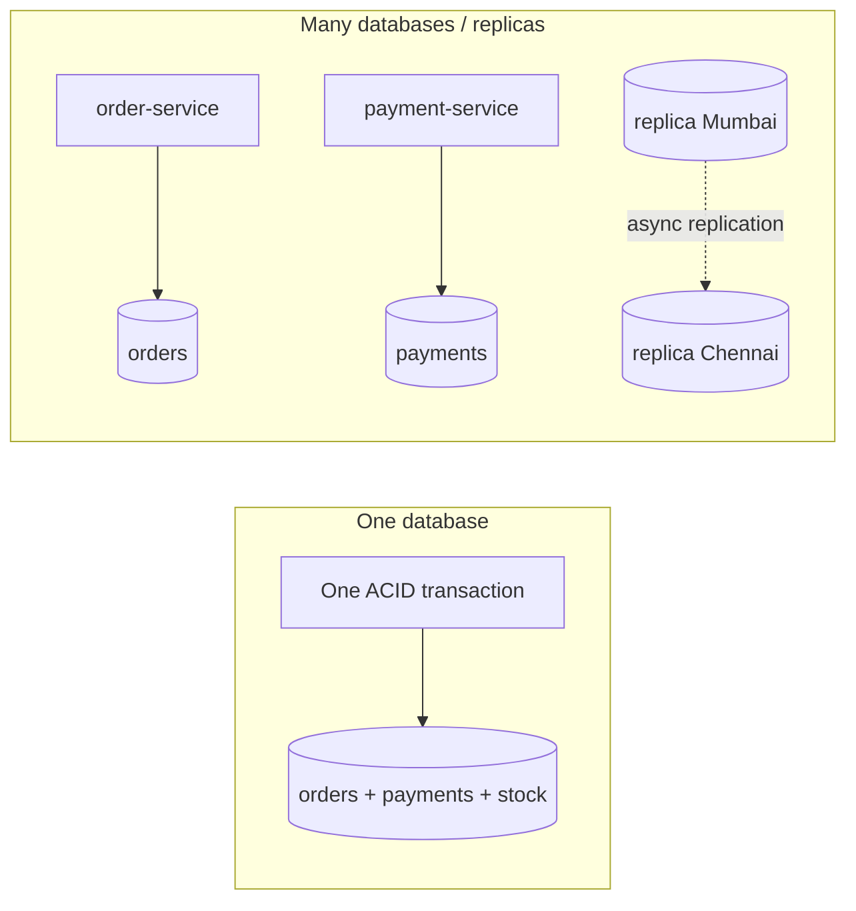

| In one database | Across services, replicas or regions |
|---|---|
| One transaction covers everything | Each system has its own transactions |
| Every reader sees the latest commit | Replicas can lag (stale reads) |
| The network isn't involved | Networks are slow, lose messages and **partition** |
| Joins are cheap | Data lives in different stores |

The rest of this file is the toolbox for that right-hand column.

### The consistency spectrum

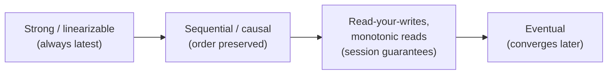

Stronger consistency → simpler to reason about, but higher latency and lower availability. Weaker consistency → faster and more available, but the application must cope with stale or conflicting data.

#### 📘 Terms Explained

| Term | Simple meaning |
|---|---|
| **ACID** | Atomicity, Consistency, Isolation, Durability: the guarantees of a classic DB transaction. |
| **Isolation level** | How much concurrent transactions are protected from seeing each other's changes. |
| **Dirty read** | Reading data another transaction wrote but hasn't committed (and might roll back). |
| **Non-repeatable read** | Reading the same row twice in one transaction and getting different values. |
| **Phantom read** | Re-running a query and getting new rows that another transaction inserted. |
| **WAL (Write-Ahead Log)** | The log where a database writes every change before applying it; used for durability, replication and CDC. |
| **Replica** | A copy of a database kept in sync with the primary. |
| **Network partition** | Some nodes can't talk to others because of a network failure. |

---

# 1. CQRS Pattern (Interview Imp - Java)

## 1.1 What is CQRS?

**CQRS (Command Query Responsibility Segregation)** splits an application's data handling into two sides:

- **Command side (write model):** handles requests that **change** state (`PlaceOrder`, `CancelOrder`). It validates business rules and stores data in a form that's good for **correctness** (normalised).
- **Query side (read model):** handles requests that **read** state. It stores data in forms shaped for each **screen or report** (denormalised, pre-joined, pre-aggregated), good for **speed**.

The read side is kept up to date from the write side, usually through **events**.

**Analogy:** A restaurant. The kitchen (command side) follows strict recipes and hygiene rules to cook orders correctly. The menu board and the "today's specials" board at the entrance (query side) are separate, simplified displays updated by the kitchen, designed for customers to read quickly. Nobody reads the kitchen's recipe book to decide what to order.

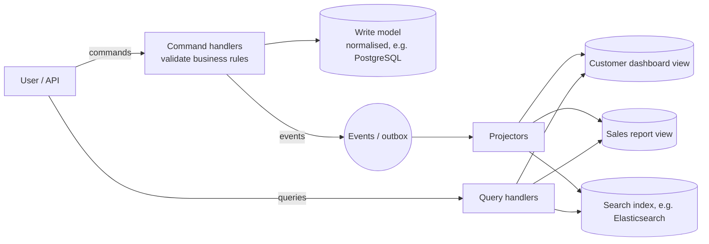

> **CQS vs CQRS:** CQS (Command-Query Separation, Bertrand Meyer) is a **method-level** rule: a method either changes state or returns data, never both. CQRS applies the same idea at the **architecture level**, with separate models (and often separate stores).

#### 📘 Terms Explained

| Term | Simple meaning |
|---|---|
| **Command** | A request to change something (`PlaceOrder`). It can be rejected. |
| **Query** | A request to read something. It never changes state. |
| **Write model** | The data model used to enforce rules when changing state. |
| **Read model / view** | A data model optimised for one kind of query. |
| **Projection / projector** | Code that turns events into read-model updates. |
| **Denormalised** | Data deliberately duplicated/pre-joined to make reads fast. |

---

## 1.2 Why Do We Need It?

One model for everything often serves neither reads nor writes well:

| Problem with a single model | With CQRS |
|---|---|
| Reports need 7-table joins on the same tables that handle checkout traffic | Reports read a pre-joined view; checkout tables stay fast |
| Read traffic is 100× write traffic, but both scale together | Scale read stores (replicas, caches, search) independently |
| Some queries need full-text search or graphs the relational DB is bad at | Project into Elasticsearch / a graph DB for those queries |
| Rich business rules clutter simple read DTOs | Write model focuses on rules; read model on display |
| Data from several microservices must be queried together | A read model combines their events ([02_Microservices_Pattern.md](../04_Specialized/02_Microservices_Pattern.md#45-cqrs-and-materialized-views-for-cross-service-queries-interview-imp---java)) |

---

## 1.3 Types and Levels of CQRS

| Level | Write store | Read store | Sync | Complexity |
|---|---|---|---|---|
| **1. Separate classes, same tables** | One DB | Same DB (read-only DTO queries, projections) | Immediate | Low |
| **2. Same DB, separate read tables/views** | One DB | Materialized views / summary tables in the same DB | Same transaction or refresh | Medium |
| **3. Separate stores** | PostgreSQL | Elasticsearch, Redis, MongoDB, another DB | **Asynchronous** via events/CDC | High |
| **4. With Event Sourcing** | Event store | Any number of projections | Asynchronous | Highest |

> Most teams should start at **level 1 or 2**. Go to level 3 only for specific query-heavy features.

### Read-your-own-writes with async read models

With level 3/4, a user who just placed an order may not see it on the next page (the projection lags). Fixes:

| Technique | How |
|---|---|
| Return the new data in the command response | UI shows it immediately without re-querying |
| Version/position token | Command returns `version=42`; the query waits (briefly) until the view has processed v42 |
| Read from the write model for "my own recent items" | Only for the few screens that need it |
| Optimistic UI | Show "processing..." and update when the view catches up |

---

## 1.4 Complete Java Example - Commands, Events and Several Read Views

```java
import java.util.ArrayDeque;
import java.util.ArrayList;
import java.util.Deque;
import java.util.HashMap;
import java.util.List;
import java.util.Map;
import java.util.TreeMap;

// ===== COMMAND side: validates and changes state, emits events. Optimised for correctness. =====
record PlaceOrder(String orderId, String customer, String category, int amount) {}
record CancelOrder(String orderId) {}
record OrderPlaced(String orderId, String customer, String category, int amount) {}
record OrderCancelled(String orderId, String customer, String category, int amount) {}

class OrderCommandHandler {
    private final Map<String, OrderPlaced> orders = new HashMap<>();     // write model (normalised, e.g. PostgreSQL)
    private final Deque<Object> outbox;
    OrderCommandHandler(Deque<Object> outbox) { this.outbox = outbox; }

    void handle(PlaceOrder c) {
        if (c.amount() <= 0) throw new IllegalArgumentException("amount must be positive");
        if (orders.containsKey(c.orderId())) throw new IllegalStateException("duplicate order " + c.orderId());
        OrderPlaced e = new OrderPlaced(c.orderId(), c.customer(), c.category(), c.amount());
        orders.put(c.orderId(), e);
        outbox.add(e);                                                    // published for the read side
    }

    void handle(CancelOrder c) {
        OrderPlaced o = orders.remove(c.orderId());
        if (o == null) throw new IllegalStateException("unknown order " + c.orderId());
        outbox.add(new OrderCancelled(o.orderId(), o.customer(), o.category(), o.amount()));
    }
}

// ===== QUERY side: denormalised views shaped for each screen. Optimised for fast reads. =====
class OrderQueries {
    final Map<String, Integer> spendByCustomer = new TreeMap<>();         // "customer dashboard" view
    final Map<String, Integer> revenueByCategory = new TreeMap<>();       // "sales report" view
    final List<String> recentOrders = new ArrayList<>();                  // "admin feed" view

    void project(Object event) {
        if (event instanceof OrderPlaced e) {
            spendByCustomer.merge(e.customer(), e.amount(), Integer::sum);
            revenueByCategory.merge(e.category(), e.amount(), Integer::sum);
            recentOrders.add(0, e.orderId() + " " + e.customer() + " Rs." + e.amount());
        } else if (event instanceof OrderCancelled e) {
            spendByCustomer.merge(e.customer(), -e.amount(), Integer::sum);
            revenueByCategory.merge(e.category(), -e.amount(), Integer::sum);
            recentOrders.removeIf(s -> s.startsWith(e.orderId() + " "));
        }
    }
}

public class CqrsDemo {
    public static void main(String[] args) {
        Deque<Object> events = new ArrayDeque<>();
        OrderCommandHandler commands = new OrderCommandHandler(events);
        OrderQueries queries = new OrderQueries();

        commands.handle(new PlaceOrder("O1", "asha", "books", 600));
        commands.handle(new PlaceOrder("O2", "ravi", "electronics", 15000));
        commands.handle(new PlaceOrder("O3", "asha", "electronics", 2500));
        try {
            commands.handle(new PlaceOrder("O4", "ravi", "books", -5));
        } catch (IllegalArgumentException e) {
            System.out.println("command rejected: " + e.getMessage() + " (no event, no view change)");
        }

        System.out.println("Before the projector runs, the read side is empty: " + queries.spendByCustomer);
        while (!events.isEmpty()) queries.project(events.poll());           // async in real life
        System.out.println("spend by customer   : " + queries.spendByCustomer);
        System.out.println("revenue by category : " + queries.revenueByCategory);
        System.out.println("recent orders       : " + queries.recentOrders);

        commands.handle(new CancelOrder("O2"));
        while (!events.isEmpty()) queries.project(events.poll());
        System.out.println("after cancelling O2 : " + queries.revenueByCategory + " " + queries.recentOrders);
    }
}
```

**Output:**
```
command rejected: amount must be positive (no event, no view change)
Before the projector runs, the read side is empty: {}
spend by customer   : {asha=3100, ravi=15000}
revenue by category : {books=600, electronics=17500}
recent orders       : [O3 asha Rs.2500, O2 ravi Rs.15000, O1 asha Rs.600]
after cancelling O2 : {books=600, electronics=2500} [O3 asha Rs.2500, O1 asha Rs.600]
```

What the output shows:
- The invalid command was **rejected on the command side**: no event, so the views never changed.
- Until the projector ran, the read side was **empty**: the read model is **eventually consistent**.
- One stream of events built **three different views**, each shaped for its own screen.
- Cancelling O2 produced an `OrderCancelled` event, and each view updated itself accordingly.

---

## 1.5 CQRS in Spring Boot

```java
// ---- Command side: JPA entity with business rules ----
@Service
@RequiredArgsConstructor
class OrderCommandService {
    private final OrderRepository orders;
    private final ApplicationEventPublisher events;

    @Transactional
    public String place(PlaceOrderCommand cmd) {
        Order order = Order.place(cmd);                         // validation inside the aggregate
        orders.save(order);
        events.publishEvent(new OrderPlaced(order.getId(), cmd.customerId(), order.total()));  // -> outbox / Kafka
        return order.getId();
    }
}

// ---- Query side: a separate, denormalised table maintained by a projector ----
@Entity
@Table(name = "customer_order_summary")
class CustomerOrderSummary {
    @Id String customerId;
    int orderCount;
    BigDecimal totalSpent;
    Instant lastOrderAt;
}

@Component
@RequiredArgsConstructor
class CustomerSummaryProjector {
    private final JdbcTemplate jdbc;

    @KafkaListener(topics = "orders.events", groupId = "customer-summary-projector")
    @Transactional
    public void on(OrderPlaced e) {
        jdbc.update("""
            INSERT INTO customer_order_summary (customer_id, order_count, total_spent, last_order_at)
            VALUES (?, 1, ?, now())
            ON CONFLICT (customer_id) DO UPDATE
              SET order_count = customer_order_summary.order_count + 1,
                  total_spent = customer_order_summary.total_spent + EXCLUDED.total_spent,
                  last_order_at = now()
            """, e.customerId(), e.total());
        // make it idempotent (processed-message table) - events can be redelivered
    }
}

// ---- Query side API: read-only, no business rules ----
interface CustomerSummaryRepository extends JpaRepository<CustomerOrderSummary, String> {
    List<CustomerOrderSummary> findTop10ByOrderByTotalSpentDesc();
}
```

Level-1 CQRS without any extra store: read-only DTO projections straight from JPA.

```java
public record OrderListItem(String id, String status, BigDecimal total) {}

@Query("select new com.shop.OrderListItem(o.id, o.status, o.total) from Order o where o.customerId = :c")
List<OrderListItem> listForCustomer(@Param("c") String customerId);      // no entity loading, no dirty checking

@Transactional(readOnly = true)                                          // hint: no flush, read replica routing possible
public List<OrderListItem> myOrders(String customerId) { ... }
```

Frameworks: **Axon Framework** (commands, events, queries, projections, event store), **Spring Modulith** for in-process events.

#### 📘 Terms Explained

| Term | Simple meaning |
|---|---|
| **`ON CONFLICT ... DO UPDATE`** | PostgreSQL "upsert": insert, or update if the key already exists. |
| **DTO projection** | Selecting just the needed columns into a small read-only object instead of a full entity. |
| **`@Transactional(readOnly = true)`** | Tells Spring/Hibernate the transaction only reads (skips flushes; can route to replicas). |
| **Axon Framework** | Java framework for CQRS and event sourcing. |

---

## 1.6 Pros, Cons and Pitfalls

| Pros | Cons |
|---|---|
| Reads and writes scale and evolve independently | More moving parts: events, projectors, extra stores |
| Each query gets a perfectly shaped, fast view | Read models are eventually consistent |
| Write model stays focused on business rules | Projections must be idempotent and rebuildable |
| Easy to add new views later by replaying events | Overkill for simple CRUD |

| Pitfall | Fix |
|---|---|
| CQRS everywhere, including simple CRUD screens | Use it only where reads and writes really differ. |
| Users don't see their own change after submitting | Return data from the command, version tokens, or optimistic UI. |
| Non-idempotent projectors double-count on redelivery | Dedupe by event ID; use upserts/absolute values. |
| No way to rebuild a broken view | Keep events replayable (event store, compacted topics); rebuild into a new table, then swap. |
| Dual writes (save + publish) on the command side | Transactional outbox ([04_Messaging_Pattern.md](04_Messaging_Pattern.md#13-guaranteed-delivery-and-the-transactional-outbox-interview-imp---java)). |

---

## 1.7 CQRS - Interview Questions

**Q1. What is CQRS?**
Separating the model that changes data (commands) from the model(s) that read data (queries), so each can be designed, stored and scaled for its own job. Read models are usually updated from events.

**Q2. When should you use CQRS?**
When reads and writes have very different shapes or loads: complex reporting, dashboards, search, cross-service queries, or very high read traffic. Not for simple CRUD.

**Q3. Does CQRS require event sourcing or separate databases?**
No. You can apply it with separate classes on the same tables, or with summary tables in the same DB. Event sourcing and separate stores are optional, more advanced levels.

**Q4. How do you handle eventual consistency in the read model?**
Return results from the command, use version tokens so queries wait for the projection, read recent own data from the write side, or show a "processing" state.

**Q5. How do you rebuild a read model?**
Replay all events (from the event store or a retained Kafka topic) into a new table with an idempotent projector, then switch queries to it.

**Q6. CQS vs CQRS?**
CQS: a single method should either command or query. CQRS: the whole system has separate command and query models.

---

## 1.8 CQRS - Cheat Sheet

```
CQRS      Separate WRITE model (commands, rules, normalised) from READ models (queries, denormalised views).
          Levels: separate classes same tables -> summary tables/materialized views -> separate stores (async)
                  -> with event sourcing. Start simple.
          Read side updated by projectors from events (outbox/Kafka/CDC); idempotent upserts; rebuildable by replay.
          Read-your-writes: return data from command, version token, read own data from write side, optimistic UI.
          Spring: command service + @Transactional, projector @KafkaListener + upsert, DTO projections,
                  @Transactional(readOnly=true), Axon. Not for simple CRUD.
```

---

# 2. Event Sourcing Pattern (Interview Imp - Java)

## 2.1 What is Event Sourcing?

**Event sourcing** stores **every change** to an entity as an **immutable event** in an append-only log (the **event store**), instead of storing only the **current** state. The current state is **derived** by **replaying** the events. The events **are** the source of truth.

**Analogy:** A bank passbook. The bank doesn't just write "balance: Rs.4,600" and erase the old value. It records every deposit and withdrawal; the balance is the result of adding them all up. You can see how you got there, and the history can't be quietly rewritten.

| Traditional (state-oriented) | Event-sourced |
|---|---|
| `accounts` row: `balance = 4600` | `Opened(asha)`, `Deposited(5000)`, `Withdrawn(1200)`, `Deposited(800)` |
| `UPDATE` overwrites the past | Only `INSERT` (append); nothing is updated or deleted |
| "How did it get to 4600?" unknown (unless you add an audit table) | Full history by design |

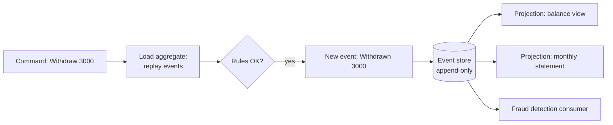

#### 📘 Terms Explained

| Term | Simple meaning |
|---|---|
| **Event sourcing** | Persisting state as the sequence of events that changed it. |
| **Event store** | A database optimised for appending and reading event streams (EventStoreDB, Axon Server, or a table in PostgreSQL). |
| **Stream** | All events for one entity (aggregate), e.g. everything that happened to `acc-1`. |
| **Replay / rehydrate** | Rebuild current state by applying events in order. |
| **Snapshot** | A saved state at some version, so you don't replay from the very beginning. |

---

## 2.2 Why Do We Need It?

| Benefit | Example |
|---|---|
| **Complete audit trail** | Banking, insurance, healthcare: regulators want every change, with who and when |
| **Time travel** | "What was this account's balance on 31 March?": replay up to that date |
| **Debugging** | Reproduce a bug by replaying the exact events that caused it |
| **New read models anytime** | A new report next year can be built from all historical events |
| **Natural fit with event-driven systems** | The events you store are the events you publish |
| **No lost information** | "Customer added then removed an item" is kept; a cart table would only show the final state |

> **Event sourcing is a big commitment.** Use it for parts of the domain where history matters (ledgers, orders, workflows), not for every table.

---

## 2.3 How It Works

1. **Load:** read the aggregate's events (from the latest snapshot, if any) and apply them in order to rebuild state.
2. **Decide:** run the command against the current state; if the rules pass, create **new events** (don't change state directly).
3. **Append with optimistic concurrency:** write the new events **only if** the stream is still at the version you loaded (`expectedVersion`). If someone else appended first, you get a conflict: reload and retry.
4. **Publish:** projections and other services consume the new events.

### Key design points

| Topic | Practice |
|---|---|
| **Event naming** | Past tense, business language: `MoneyWithdrawn`, not `BalanceUpdated` |
| **Snapshots** | Every N events (e.g. 100) save state + version; load = snapshot + later events |
| **Schema evolution** | Events live forever. Add fields with defaults; **upcast** old events to new versions when reading; never change history |
| **Projections** | Separate read models (this is CQRS level 4) |
| **Deleting personal data (GDPR)** | Events are immutable, so use **crypto-shredding** (encrypt personal data per user, delete the key) or store PII outside the events |
| **Queries like "all accounts with balance > X"** | Not from the event store: use a projection |

---

## 2.4 Complete Java Example - An Event-Sourced Bank Account

```java
import java.util.ArrayList;
import java.util.HashMap;
import java.util.List;
import java.util.Map;

// ----- Events: the source of truth -----
sealed interface AccountEvent permits Opened, Deposited, Withdrawn {}
record Opened(String owner) implements AccountEvent {}
record Deposited(long amount) implements AccountEvent {}
record Withdrawn(long amount) implements AccountEvent {}

// ----- Append-only event store with optimistic concurrency (expected version) -----
class EventStore {
    private final Map<String, List<AccountEvent>> streams = new HashMap<>();
    private final Map<String, Snapshot> snapshots = new HashMap<>();
    record Snapshot(int version, long balance, String owner) {}

    void append(String streamId, int expectedVersion, List<AccountEvent> newEvents) {
        List<AccountEvent> stream = streams.computeIfAbsent(streamId, k -> new ArrayList<>());
        if (stream.size() != expectedVersion)
            throw new IllegalStateException("concurrency conflict: expected v" + expectedVersion + " but stream is at v" + stream.size());
        stream.addAll(newEvents);
    }

    List<AccountEvent> read(String streamId, int fromVersion) {
        List<AccountEvent> s = streams.getOrDefault(streamId, List.of());
        return s.subList(Math.min(fromVersion, s.size()), s.size());
    }

    void saveSnapshot(String id, Snapshot s) { snapshots.put(id, s); }
    Snapshot snapshot(String id) { return snapshots.get(id); }
}

// ----- Aggregate: rebuilt by replaying events; commands produce NEW events -----
class BankAccount {
    String owner;
    long balance;
    int version;                                         // number of events applied

    static BankAccount load(EventStore store, String id) {
        BankAccount a = new BankAccount();
        EventStore.Snapshot s = store.snapshot(id);
        if (s != null) { a.owner = s.owner(); a.balance = s.balance(); a.version = s.version(); }
        List<AccountEvent> rest = store.read(id, a.version);
        rest.forEach(a::apply);
        System.out.println("   loaded " + id + ": " + (s == null ? "no snapshot" : "snapshot at v" + s.version())
                + " + replayed " + rest.size() + " events -> balance " + a.balance + ", v" + a.version);
        return a;
    }

    void apply(AccountEvent e) {
        if (e instanceof Opened o)         owner = o.owner();          // Java 21: a switch with type patterns
        else if (e instanceof Deposited d) balance += d.amount();
        else if (e instanceof Withdrawn w) balance -= w.amount();
        version++;
    }

    List<AccountEvent> withdraw(long amount) {
        if (amount > balance) throw new IllegalStateException("insufficient funds: balance " + balance);
        return List.of(new Withdrawn(amount));
    }
}

public class EventSourcingDemo {
    public static void main(String[] args) {
        EventStore store = new EventStore();
        store.append("acc-1", 0, List.of(new Opened("asha"), new Deposited(5000), new Withdrawn(1200), new Deposited(800)));

        System.out.println("1) Current state is DERIVED by replaying events:");
        BankAccount acc = BankAccount.load(store, "acc-1");

        System.out.println("2) Full history = free audit log:");
        store.read("acc-1", 0).forEach(e -> System.out.println("   " + e));

        System.out.println("3) Two clerks load v4 at the same time and both withdraw:");
        BankAccount clerkA = BankAccount.load(store, "acc-1");
        BankAccount clerkB = BankAccount.load(store, "acc-1");
        store.append("acc-1", clerkA.version, clerkA.withdraw(3000));
        System.out.println("   clerk A withdrew 3000 -> stream now at v5");
        try {
            store.append("acc-1", clerkB.version, clerkB.withdraw(3000));
        } catch (IllegalStateException e) {
            System.out.println("   clerk B: " + e.getMessage() + " -> reload and retry");
            BankAccount fresh = BankAccount.load(store, "acc-1");
            try { fresh.withdraw(3000); } catch (IllegalStateException e2) { System.out.println("   clerk B retry: " + e2.getMessage()); }
        }

        System.out.println("4) Snapshot at v5, then two more events:");
        BankAccount now = BankAccount.load(store, "acc-1");
        store.saveSnapshot("acc-1", new EventStore.Snapshot(now.version, now.balance, now.owner));
        store.append("acc-1", now.version, List.of(new Deposited(10000), new Withdrawn(500)));
        BankAccount.load(store, "acc-1");

        System.out.println("5) Time travel: balance after the first 3 events:");
        BankAccount past = new BankAccount();
        store.read("acc-1", 0).subList(0, 3).forEach(past::apply);
        System.out.println("   balance at v3 = " + past.balance);
    }
}
```

**Output:**
```
1) Current state is DERIVED by replaying events:
   loaded acc-1: no snapshot + replayed 4 events -> balance 4600, v4
2) Full history = free audit log:
   Opened[owner=asha]
   Deposited[amount=5000]
   Withdrawn[amount=1200]
   Deposited[amount=800]
3) Two clerks load v4 at the same time and both withdraw:
   loaded acc-1: no snapshot + replayed 4 events -> balance 4600, v4
   loaded acc-1: no snapshot + replayed 4 events -> balance 4600, v4
   clerk A withdrew 3000 -> stream now at v5
   clerk B: concurrency conflict: expected v4 but stream is at v5 -> reload and retry
   loaded acc-1: no snapshot + replayed 5 events -> balance 1600, v5
   clerk B retry: insufficient funds: balance 1600
4) Snapshot at v5, then two more events:
   loaded acc-1: no snapshot + replayed 5 events -> balance 1600, v5
   loaded acc-1: snapshot at v5 + replayed 2 events -> balance 11100, v7
5) Time travel: balance after the first 3 events:
   balance at v3 = 3800
```

What the output shows:
1. The balance (4600) was **never stored**; it was calculated by replaying four events.
2. The event list **is** the audit log.
3. Both clerks loaded **v4**. Clerk A appended first, so clerk B's append (expecting v4) hit a **concurrency conflict**. After reloading, the rule check correctly refused the second withdrawal. Without the version check, both would have withdrawn and the account would go negative.
4. After a **snapshot** at v5, loading replayed only the **2** newer events.
5. **Time travel:** replaying only the first 3 events gave the balance at that point in history.

---

## 2.5 Event Sourcing in Java and Spring

### A simple event store table (PostgreSQL)

```sql
CREATE TABLE events (
    stream_id   VARCHAR(100) NOT NULL,
    version     INT          NOT NULL,          -- 1, 2, 3 ... per stream
    event_type  VARCHAR(100) NOT NULL,
    payload     JSONB        NOT NULL,
    occurred_at TIMESTAMPTZ  NOT NULL DEFAULT now(),
    PRIMARY KEY (stream_id, version)            -- the PK enforces optimistic concurrency
);
```

```java
@Transactional
public void append(String streamId, int expectedVersion, List<Object> newEvents) {
    int v = expectedVersion;
    for (Object e : newEvents) {
        try {
            jdbc.update("INSERT INTO events (stream_id, version, event_type, payload) VALUES (?, ?, ?, ?::jsonb)",
                    streamId, ++v, e.getClass().getSimpleName(), json.writeValueAsString(e));
        } catch (DuplicateKeyException dup) {
            throw new ConcurrencyException(streamId, expectedVersion);       // someone else wrote version v first
        } catch (JsonProcessingException ex) {
            throw new IllegalStateException(ex);
        }
    }
    // + write the same events to the outbox in this transaction for publishing
}
```

### Axon Framework

```java
@Aggregate
public class BankAccount {
    @AggregateIdentifier private String id;
    private long balance;

    protected BankAccount() { }                                    // required by Axon

    @CommandHandler
    public BankAccount(OpenAccountCommand cmd) {
        AggregateLifecycle.apply(new AccountOpenedEvent(cmd.id(), cmd.owner()));
    }

    @CommandHandler
    public void handle(WithdrawCommand cmd) {
        if (cmd.amount() > balance) throw new InsufficientFundsException();
        AggregateLifecycle.apply(new MoneyWithdrawnEvent(id, cmd.amount()));   // decide -> event
    }

    @EventSourcingHandler void on(AccountOpenedEvent e)  { this.id = e.id(); }
    @EventSourcingHandler void on(MoneyWithdrawnEvent e) { this.balance -= e.amount(); }   // evolve state
}
```

| Option | Notes |
|---|---|
| **EventStoreDB (KurrentDB)** | Purpose-built event store with streams, subscriptions and projections |
| **Axon Server / Axon Framework** | Java-native CQRS + event sourcing |
| **PostgreSQL table** | Simple and transactional; you build subscriptions (outbox/CDC) yourself |
| **Kafka as the event store** | Good for distribution and replay, weaker for per-entity loading and optimistic concurrency; usually used *alongside* a store |

#### 📘 Terms Explained

| Term | Simple meaning |
|---|---|
| **Optimistic concurrency** | Don't lock; check at write time that nobody changed the data since you read it. |
| **Expected version** | The stream version a writer thinks is current; the append fails if it's different. |
| **Upcasting** | Converting an old event version to the new format when reading it. |
| **Crypto-shredding** | Encrypting personal data with a per-user key and deleting the key to "forget" the data. |
| **`@EventSourcingHandler`** | Axon method that applies an event to the aggregate's state during replay. |

---

## 2.6 Pros, Cons and Pitfalls

| Pros | Cons |
|---|---|
| Full, tamper-evident history and audit | Steep learning curve; unfamiliar to many developers |
| Time travel and replay for debugging and new views | Event schema evolution is hard (events live forever) |
| Natural source of domain events for other services | Querying requires projections (CQRS) |
| No update contention: append-only writes | Eventual consistency of read models |
| | GDPR "right to be forgotten" needs special design |

| Pitfall | Fix |
|---|---|
| Event-sourcing the whole system | Use it only where history adds real value. |
| Events that are really table rows (`CustomerUpdated` with every field) | Model business facts (`AddressChanged`, `CreditLimitRaised`). |
| Querying the event store for lists and reports | Build projections. |
| Long streams → slow loads | Snapshots. |
| Changing or deleting past events | Never. Add compensating events (`DepositCorrected`) and upcast old versions. |
| Personal data inside immutable events | Crypto-shredding or keep PII in a separate deletable store. |

---

## 2.7 Event Sourcing - Interview Questions

**Q1. What is event sourcing?**
Storing every state change as an immutable event in an append-only store and deriving current state by replaying those events.

**Q2. Event sourcing vs a traditional audit table?**
An audit table is a side copy that can drift from the real data. In event sourcing, the events **are** the data: state is derived from them, so history is complete and authoritative by construction.

**Q3. How do you get current state quickly if there are thousands of events?**
Snapshots (state at a version) plus the events after it; and read models (projections) for queries.

**Q4. How do you handle concurrent updates?**
Optimistic concurrency: append with an expected version; if the stream has moved on, reject, reload and retry. A unique key on (stream_id, version) enforces it.

**Q5. How do you change an event's structure later?**
Never edit stored events. Add new optional fields, introduce new event versions, and upcast old events when reading.

**Q6. Event sourcing and CQRS: how are they related?**
They're independent, but event sourcing almost always needs CQRS, because the event store is poor at queries; projections build the read models.

**Q7. How do you delete a user's data under GDPR?**
Crypto-shredding (encrypt personal fields per user, delete the key) or keep personal data outside the events and reference it by ID.

---

## 2.8 Event Sourcing - Cheat Sheet

```
EVENT SOURCING  Store every change as an immutable event; state = replay(events). Events are the source of truth.
          Load (snapshot + later events) -> decide (rules) -> append NEW events with expectedVersion -> publish.
          Optimistic concurrency: PK (stream_id, version) -> conflict -> reload + retry.
          Snapshots every N events. Schema evolution: additive + upcasting; never edit history.
          Queries via projections (CQRS). GDPR: crypto-shredding / PII outside events.
          Tools: EventStoreDB, Axon (@Aggregate, @CommandHandler, @EventSourcingHandler), PostgreSQL events table.
          Benefits: audit, time travel, replay, new views. Use only where history matters.
```

---

# 3. Saga and Two-Phase Commit (Interview Imp - Java)

## 3.1 What Are They?

Both answer the same question: **how do I change data in several databases/services as one business transaction?**

- **Two-Phase Commit (2PC):** a **coordinator** makes all participants **prepare** (lock and promise), then tells all to **commit** (or all to abort). It gives true **atomicity** across systems.
- **Saga:** a sequence of **local transactions**, each committed immediately, with **compensating transactions** to undo earlier steps if a later one fails. It gives **eventual** atomicity without distributed locks.

> The **Saga** pattern (orchestration vs choreography, compensations, pivot steps, Temporal, Spring code) is covered in depth in [02_Microservices_Pattern.md](../04_Specialized/02_Microservices_Pattern.md#5-saga-pattern-interview-imp---java). This section focuses on **2PC** and the comparison.

**Analogy for 2PC:** A wedding ceremony. The officiant (coordinator) asks each partner "Do you?" (prepare). Only if **both** say yes does the officiant pronounce them married (commit). If the officiant faints between the two "I do"s and the pronouncement, everyone is stuck waiting at the altar: that's 2PC's blocking problem.

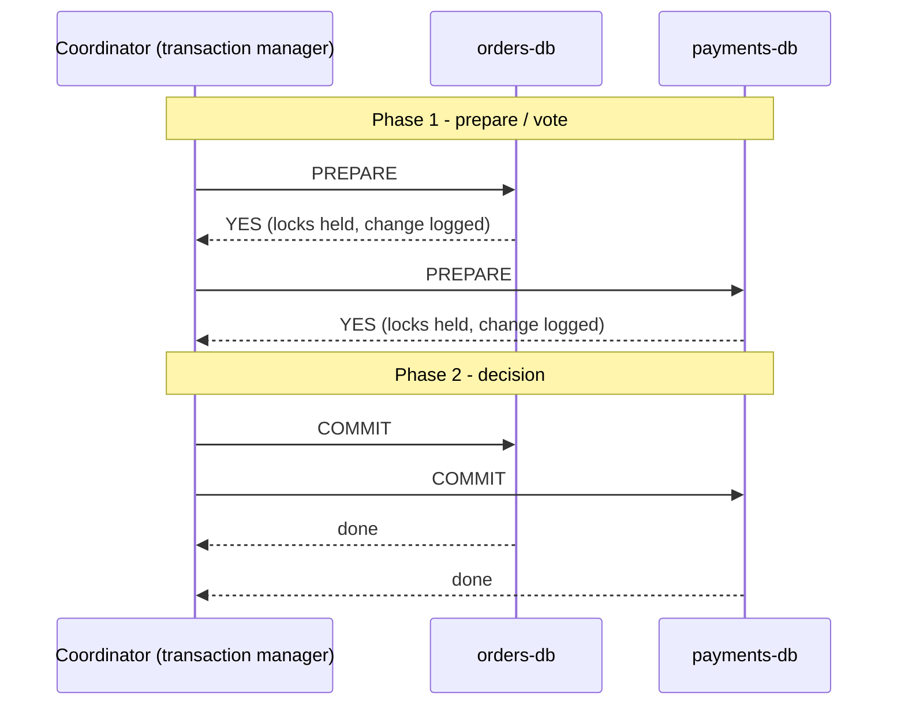

#### 📘 Terms Explained

| Term | Simple meaning |
|---|---|
| **Two-phase commit (2PC)** | A protocol that commits a transaction across several resources atomically: prepare, then commit/abort. |
| **Coordinator / transaction manager** | The component that runs 2PC and makes the final decision. |
| **Participant / resource manager** | A database or broker taking part in the transaction. |
| **Prepared state** | A participant has promised it can commit and is holding locks, waiting for the decision. |
| **XA** | The X/Open standard interface for 2PC; in Java exposed through JTA. |
| **JTA** | Jakarta Transactions: Java API for distributed (XA) transactions. |

---

## 3.2 Why 2PC Exists, and Why Microservices Avoid It

2PC gives you what a single database gives you (all-or-nothing) across **several** resources: for example, a Java EE app writing to two databases and a JMS queue in one transaction.

But in microservices it causes problems:

| Problem | Explanation |
|---|---|
| **Blocking** | A participant that voted YES must hold its locks until it hears the decision. If the coordinator crashes, participants wait (other transactions touching those rows wait too). |
| **Availability** | All participants must be up for any transaction to commit: availability multiplies down. |
| **Latency** | Extra round trips while holding locks; throughput falls. |
| **Support** | Kafka, most NoSQL databases and REST APIs don't support XA. |
| **Coupling** | Services must share a transaction manager and protocol: against service autonomy. |

**Three-phase commit (3PC)** adds a "pre-commit" phase to reduce blocking, but it assumes reliable timeouts and still fails under network partitions, so it's rarely used. Modern distributed databases (Spanner, CockroachDB) use **2PC combined with consensus (Paxos/Raft)** internally, so the coordinator itself is replicated and doesn't become a single point of failure.

---

## 3.3 Complete Java Example - 2PC and the Blocking Problem

```java
import java.util.ArrayList;
import java.util.List;

// A participant (database / resource manager) in a two-phase commit
class Participant {
    final String name;
    final boolean canCommit;
    String state = "IDLE";            // IDLE -> PREPARED (locks held!) -> COMMITTED / ABORTED

    Participant(String name, boolean canCommit) { this.name = name; this.canCommit = canCommit; }

    boolean prepare() {               // phase 1: write to the log, take locks, promise to commit
        if (!canCommit) { state = "ABORTED"; return false; }
        state = "PREPARED (holding row locks)";
        return true;
    }
    void commit()   { state = "COMMITTED"; }
    void rollback() { if (!state.equals("ABORTED")) state = "ABORTED"; }
}

class Coordinator {
    boolean crashAfterPrepare = false;

    String run(List<Participant> participants) {
        System.out.println("  Phase 1 - PREPARE (vote)");
        boolean allYes = true;
        for (Participant p : participants) {
            boolean vote = p.prepare();
            System.out.println("    " + p.name + " votes " + (vote ? "YES" : "NO"));
            allYes &= vote;
        }
        if (crashAfterPrepare) {
            System.out.println("  !! coordinator CRASHES before sending the decision");
            return "UNKNOWN";
        }
        System.out.println("  Phase 2 - " + (allYes ? "COMMIT" : "ROLLBACK"));
        for (Participant p : participants) { if (allYes) p.commit(); else p.rollback(); }
        return allYes ? "COMMITTED" : "ROLLED BACK";
    }
}

public class TwoPhaseCommitDemo {
    static void show(List<Participant> ps) {
        for (Participant p : ps) System.out.println("    " + p.name + ": " + p.state);
    }

    public static void main(String[] args) {
        System.out.println("1) Everyone can commit");
        List<Participant> a = List.of(new Participant("orders-db", true), new Participant("payments-db", true));
        System.out.println("  result = " + new Coordinator().run(a));
        show(a);

        System.out.println("2) One participant votes NO -> everyone rolls back (atomic)");
        List<Participant> b = List.of(new Participant("orders-db", true), new Participant("payments-db", false));
        System.out.println("  result = " + new Coordinator().run(b));
        show(b);

        System.out.println("3) Coordinator crashes after everyone voted YES -> participants are BLOCKED");
        List<Participant> c = new ArrayList<>(List.of(new Participant("orders-db", true), new Participant("payments-db", true)));
        Coordinator coordinator = new Coordinator();
        coordinator.crashAfterPrepare = true;
        System.out.println("  result = " + coordinator.run(c));
        show(c);
        System.out.println("  They can't commit (others may have voted NO) or abort (others may have committed).");
        System.out.println("  Rows stay locked until the coordinator recovers -> other transactions wait.");
    }
}
```

**Output:**
```
1) Everyone can commit
  Phase 1 - PREPARE (vote)
    orders-db votes YES
    payments-db votes YES
  Phase 2 - COMMIT
  result = COMMITTED
    orders-db: COMMITTED
    payments-db: COMMITTED
2) One participant votes NO -> everyone rolls back (atomic)
  Phase 1 - PREPARE (vote)
    orders-db votes YES
    payments-db votes NO
  Phase 2 - ROLLBACK
  result = ROLLED BACK
    orders-db: ABORTED
    payments-db: ABORTED
3) Coordinator crashes after everyone voted YES -> participants are BLOCKED
  Phase 1 - PREPARE (vote)
    orders-db votes YES
    payments-db votes YES
  !! coordinator CRASHES before sending the decision
  result = UNKNOWN
    orders-db: PREPARED (holding row locks)
    payments-db: PREPARED (holding row locks)
  They can't commit (others may have voted NO) or abort (others may have committed).
  Rows stay locked until the coordinator recovers -> other transactions wait.
```

What the output shows:
1. Both voted YES → both committed: **atomic** across two databases.
2. One voted NO → **everyone** rolled back.
3. The coordinator crashed after both voted YES. Both participants are stuck in **PREPARED**, **holding locks**. Neither can decide alone, because neither knows what the other voted or what the coordinator decided. This is why 2PC is called a **blocking** protocol.

---

## 3.4 Saga vs 2PC

| | 2PC / XA | Saga |
|---|---|---|
| **Atomicity** | Immediate: all commit or all abort | Eventual: all steps succeed, or completed steps are compensated |
| **Isolation** | Yes (locks held across systems) | **No**: intermediate states are visible (use semantic locks) |
| **Locks across services** | Yes, during both phases | None (each step commits locally) |
| **Coordinator failure** | Participants blocked | Saga resumes from persisted state |
| **Availability** | All participants must be up | Steps can wait/retry independently |
| **Technology support** | Relational DBs, JMS (XA) | Anything (DBs, Kafka, REST) |
| **Failure handling** | Automatic rollback | Business compensations you design |
| **Use when** | Single-organisation, few XA resources, short transactions, strong consistency essential | Microservices, long-running business processes, heterogeneous systems |

### 2PC in Java (when you really need it)

```java
// Spring Boot + JTA transaction manager (e.g. Atomikos or Narayana) with two XA datasources
@Transactional                    // one JTA transaction spans BOTH databases
public void transfer(long from, long to, BigDecimal amount) {
    accountsDbA.debit(from, amount);       // XA datasource 1
    accountsDbB.credit(to, amount);        // XA datasource 2
}   // the JTA transaction manager runs prepare + commit on both
```

> Even then, a simpler design (one database, or a saga + outbox) is usually preferred. Kafka transactions are a separate mechanism and don't join XA transactions.

#### 📘 Terms Explained

| Term | Simple meaning |
|---|---|
| **Three-phase commit (3PC)** | A 2PC variant with an extra phase to reduce blocking; impractical under network partitions. |
| **Atomikos / Narayana** | JTA transaction managers usable with Spring Boot. |
| **XA datasource** | A JDBC datasource that can take part in 2PC. |
| **Blocking protocol** | A protocol where a failure can leave participants unable to proceed until it's repaired. |
| **Heuristic decision** | When an administrator (or a timeout) forces a prepared participant to commit or abort on its own, which risks inconsistency. |

---

## 3.5 Pitfalls and Interview Questions

| Pitfall | Fix |
|---|---|
| Using XA across microservices | Saga + outbox. |
| Long 2PC transactions holding locks | Keep them short; better, avoid them. |
| Assuming a saga is isolated like a DB transaction | Semantic locks (PENDING), commutative updates, optimistic locking. |
| Heuristic commits/aborts after a coordinator crash | Monitor in-doubt transactions; recover the coordinator log. |

**Q1. How does two-phase commit work?** Phase 1: the coordinator asks every participant to prepare; each writes the change to its log, takes locks and votes YES or NO. Phase 2: if all voted YES, the coordinator tells everyone to commit; otherwise, to roll back.

**Q2. What is the main weakness of 2PC?** It's blocking: if the coordinator fails after participants prepared, they hold locks and can't decide on their own. It also reduces availability and adds latency.

**Q3. 2PC vs saga?** 2PC: atomic and isolated, but blocking, lock-heavy and needs XA support. Saga: local commits + compensations, highly available, works with any technology, but no isolation and more business logic.

**Q4. Is 2PC ever used today?** Yes: inside some databases and app servers (JTA with XA resources), and inside distributed SQL databases where the coordinator is replicated with consensus (Spanner, CockroachDB). Rarely between microservices.

---

## 3.6 Saga and 2PC - Cheat Sheet

```
2PC       Coordinator: PREPARE (participants log + lock + vote) -> COMMIT/ROLLBACK to all.
          Atomic + isolated, BUT blocking on coordinator crash, locks held, availability multiplies down,
          no XA in Kafka/NoSQL/REST. Java: JTA + XA datasources (Atomikos, Narayana). 3PC impractical.
          Distributed SQL (Spanner, CockroachDB) = 2PC + Raft/Paxos-replicated coordinator.
SAGA      Local transactions + compensations; no isolation (semantic locks); see Microservices file.
          Microservices: SAGA + OUTBOX, not 2PC.
```

---

## 3.7 Pros and Cons

| | Saga | Two-Phase Commit (2PC) |
|---|---|---|
| **Pros** | No distributed locks; services stay independent; scales; works with any database/broker | Atomic: all-or-nothing, strong consistency; simple to reason about for the application |
| **Cons** | Only eventual consistency; intermediate states are visible; compensations must be designed and can fail; harder debugging | Blocking: participants hold locks while waiting; coordinator is a single point of failure; poor fit for microservices and many NoSQL stores; slower |
| **Use when** | Long-running business processes across services (order → payment → shipping) | A few resources inside one trust boundary that support XA (two databases, DB + JMS) |

# 4. Strong Consistency (Interview Imp - Java)

## 4.1 What is Strong Consistency?

A system is **strongly consistent** if, once a write is acknowledged, **every** later read (by anyone, on any node) returns that write or something newer. To clients it behaves **as if there were only one copy** of the data.

**Analogy:** A single shared whiteboard in a meeting room. When someone writes on it, everyone who looks next sees the new text. There's no way to see an older version.

| Model | Guarantee |
|---|---|
| **Linearizability** (strongest "single-copy" consistency) | Every operation appears to happen instantly at some point between its start and end; reads always see the latest completed write |
| **Serializability** (transaction isolation) | Concurrent transactions give the same result as some one-at-a-time order |
| **Strict serializability** | Both: serializable transactions that also respect real-time order (Spanner, FoundationDB) |

> Linearizability is about **single objects and real time**; serializability is about **transactions** (groups of operations). Interviewers like this distinction.

#### 📘 Terms Explained

| Term | Simple meaning |
|---|---|
| **Strong consistency** | Every read returns the latest acknowledged write. |
| **Linearizability** | The system behaves like a single copy where each operation takes effect at one instant. |
| **Serializability** | Transactions behave as if they ran one after another. |
| **Stale read** | Reading an older value after a newer one was written. |

---

## 4.2 Why Do We Need It?

Some data **must never** be read stale or decided twice:

| Use case | What goes wrong without it |
|---|---|
| Bank balances, payments, ledgers | Two withdrawals both see enough money: overdraft |
| Inventory for the last unit / seat booking | Two customers buy the same seat |
| Unique usernames / email registration | Two accounts with the same email |
| Distributed locks and leader election | Two "leaders" act at once (split brain) |
| Configuration / feature flags that must switch atomically | Half the fleet on old rules, half on new |

---

## 4.3 How It Works

| Technique | How | Cost |
|---|---|---|
| **Single leader, read from leader** | All writes and reads go to one primary | Primary is a bottleneck; reads from replicas are not strong |
| **Synchronous replication** | Commit only after replicas confirm | Higher write latency; a slow replica slows writes (see [01_Scalability_Pattern.md](01_Scalability_Pattern.md#44-synchronous-vs-asynchronous-replication-interview-imp---java)) |
| **Quorum reads/writes** | Write to W of N replicas, read from R; if **W + R > N**, every read overlaps the latest write | Fewer available nodes → requests fail |
| **Consensus (Raft, Paxos)** | A majority agrees on each change in order | Majority must be reachable; extra round trips |
| **Distributed SQL** | Spanner (TrueTime), CockroachDB, YugabyteDB, TiDB | Higher latency across regions |

### Quorums: why W + R > N works

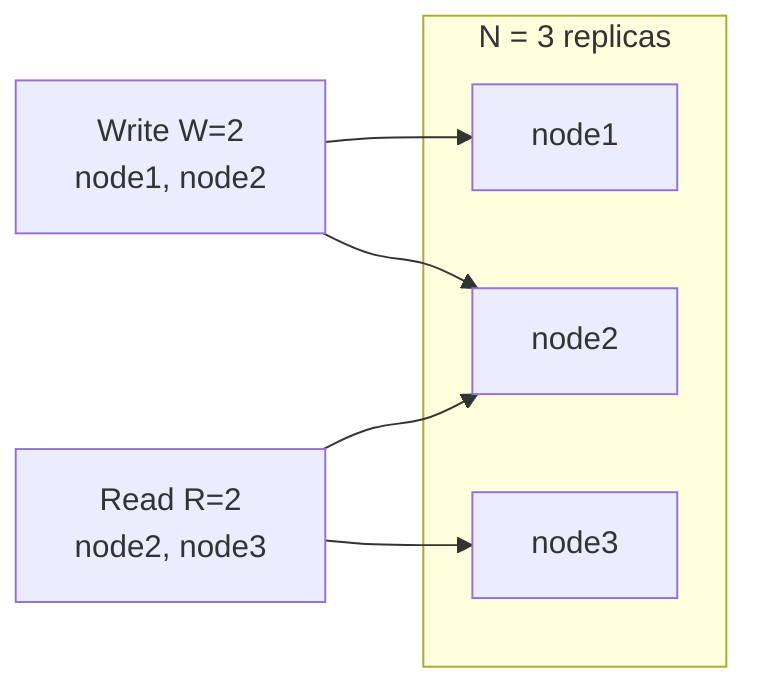

With N=3, W=2, R=2, any set of 2 readers **must overlap** any set of 2 writers in at least one node (here node2), and the reader picks the value with the **highest version**.

---

## 4.4 Complete Java Example - Quorum Reads and Writes

```java
import java.util.ArrayList;
import java.util.List;

// One replica stores a value with a version number
class Replica {
    final String name;
    String value = "v0";
    int version = 0;
    boolean up = true;
    Replica(String name) { this.name = name; }
}

class QuorumStore {
    final List<Replica> replicas = new ArrayList<>();
    final int w, r;
    QuorumStore(int n, int w, int r) {
        for (int i = 1; i <= n; i++) replicas.add(new Replica("node" + i));
        this.w = w; this.r = r;
    }

    // Write succeeds once W replicas have stored it (we write to the FIRST live ones)
    boolean write(String value, int version) {
        int acks = 0;
        for (Replica rep : replicas) {
            if (acks == w) break;
            if (!rep.up) continue;
            rep.value = value; rep.version = version; acks++;
        }
        return acks == w;
    }

    // Read asks R replicas (here: the LAST live ones, to model "different nodes") and takes the highest version
    String read() {
        List<Replica> asked = new ArrayList<>();
        for (int i = replicas.size() - 1; i >= 0 && asked.size() < r; i--) if (replicas.get(i).up) asked.add(replicas.get(i));
        if (asked.size() < r) return "FAILED (not enough replicas)";
        Replica newest = asked.stream().max((x, y) -> x.version - y.version).get();
        return newest.value + " (asked " + asked.stream().map(x -> x.name).toList() + ")";
    }
}

public class QuorumDemo {
    static void scenario(int n, int w, int r) {
        QuorumStore s = new QuorumStore(n, w, r);
        boolean ok = s.write("price=7999", 1);
        System.out.printf("N=%d W=%d R=%d  (W+R %s N)  write ok=%-5s read -> %s%n",
                n, w, r, (w + r > n ? ">" : "<="), ok, s.read());
    }

    public static void main(String[] args) {
        scenario(3, 2, 2);     // overlap guaranteed -> latest value
        scenario(3, 3, 1);     // write all, read one -> latest value
        scenario(3, 1, 1);     // no overlap -> may read stale
        scenario(5, 3, 3);

        System.out.println("N=3 W=2 R=2 with one node down:");
        QuorumStore s = new QuorumStore(3, 2, 2);
        s.replicas.get(2).up = false;
        System.out.println("  write ok=" + s.write("price=7999", 1) + ", read -> " + s.read());
        s.replicas.get(1).up = false;
        System.out.println("  two nodes down: write ok=" + s.write("price=6999", 2) + ", read -> " + s.read() + "  <- consistency chosen over availability");
    }
}
```

**Output:**
```
N=3 W=2 R=2  (W+R > N)  write ok=true  read -> price=7999 (asked [node3, node2])
N=3 W=3 R=1  (W+R > N)  write ok=true  read -> price=7999 (asked [node3])
N=3 W=1 R=1  (W+R <= N)  write ok=true  read -> v0 (asked [node3])
N=5 W=3 R=3  (W+R > N)  write ok=true  read -> price=7999 (asked [node5, node4, node3])
N=3 W=2 R=2 with one node down:
  write ok=true, read -> price=7999 (asked [node2, node1])
  two nodes down: write ok=false, read -> FAILED (not enough replicas)  <- consistency chosen over availability
```

What the output shows:
- When **W + R > N** (2+2>3, 3+1>3, 3+3>5), the read always overlapped the write and returned the **latest** value.
- With **W=1, R=1** (1+1 ≤ 3), the read hit a replica that never got the write and returned the **stale** `v0`.
- With one node down, W=2/R=2 still worked. With **two** nodes down, the system **refused** both the write and the read rather than return possibly stale data: that's choosing **consistency over availability** (section 6).

> Real quorum systems (Cassandra, DynamoDB-style stores) also use **read repair** and **hinted handoff** to fix lagging replicas, and may still show anomalies with "sloppy quorums". Use consensus-based stores when you need true linearizability.

---

## 4.5 Strong Consistency in Practice (Java / Spring)

```java
// 1) Inside one relational DB: transactions + the right isolation + locking
@Transactional(isolation = Isolation.SERIALIZABLE)          // or REPEATABLE_READ + explicit locks
public void bookSeat(String flight, String seat, String user) {
    Seat s = seats.findForUpdate(flight, seat);             // SELECT ... FOR UPDATE (pessimistic lock)
    if (s.isTaken()) throw new SeatTakenException(seat);
    s.assignTo(user);
}

// 2) Let a unique constraint decide races (strongly consistent, simple)
// CREATE UNIQUE INDEX ux_users_email ON users(lower(email));
try {
    users.saveAndFlush(new User(email));
} catch (DataIntegrityViolationException e) {
    throw new EmailAlreadyRegisteredException(email);
}

// 3) Optimistic locking: no locks held, conflicts detected at commit
@Entity class Account { @Id Long id; BigDecimal balance; @Version long version; }
// concurrent update -> ObjectOptimisticLockingFailureException -> retry
```

```yaml
# 4) Read-after-write: route reads that need fresh data to the primary, not a replica
#    (e.g. with AbstractRoutingDataSource keyed on @Transactional(readOnly = true), see 01_Scalability_Pattern.md section 5.2)
```

| Store | Consistency |
|---|---|
| PostgreSQL / MySQL (single primary) | Strong when reading from the primary |
| etcd, ZooKeeper, Consul KV | Linearizable (Raft/Zab) |
| Spanner, CockroachDB, YugabyteDB | Strictly serializable / serializable, distributed |
| MongoDB | Tunable: `writeConcern: majority` + `readConcern: linearizable` |
| Cassandra | Tunable: `QUORUM` writes + `QUORUM` reads |
| DynamoDB | Eventually consistent by default; `ConsistentRead=true` per request |

#### 📘 Terms Explained

| Term | Simple meaning |
|---|---|
| **Quorum** | A minimum number of replicas that must take part in a read or write. |
| **Consensus (Raft, Paxos)** | Algorithms that let a group of nodes agree on a sequence of values despite failures, using majorities. |
| **`SELECT ... FOR UPDATE`** | Locks the selected rows until the transaction ends. |
| **Optimistic locking (`@Version`)** | Detects concurrent modification by checking a version column on update. |
| **Read repair** | Fixing an out-of-date replica during a read when a newer value is seen elsewhere. |
| **TrueTime** | Google Spanner's clock API with bounded uncertainty, used to order transactions globally. |

---

## 4.6 Pros, Cons, Pitfalls and Interview Questions

| Pros | Cons |
|---|---|
| Simple to reason about: no stale data | Higher latency (coordination, synchronous replication) |
| Correctness for money, inventory, uniqueness | Lower availability during failures and partitions |
| Fewer application-level conflict cases | Harder to scale writes, especially across regions |

| Pitfall | Fix |
|---|---|
| Reading from an async replica right after writing | Read from the primary for read-after-write paths. |
| Assuming `@Transactional` gives serializability | Default is usually Read Committed; choose isolation/locks deliberately. |
| Strong consistency everywhere, even for likes and view counts | Use it where correctness needs it; eventual elsewhere. |
| Quorum math with N even (N=4, W=2, R=2: no overlap) | Ensure W + R > N; prefer odd N. |

**Q1. What is strong consistency?** After a write is acknowledged, every subsequent read returns it (or a newer value): the system behaves like a single copy.

**Q2. Linearizability vs serializability?** Linearizability: single-object operations appear instantaneous in real-time order. Serializability: transactions appear to run in some serial order (not necessarily real-time). Strict serializability combines both.

**Q3. How do quorums give consistency?** With N replicas, writing to W and reading from R where W + R > N guarantees every read set overlaps the latest write set; the highest version wins.

**Q4. How do you prevent double-booking the last seat?** Within one DB: `SELECT ... FOR UPDATE`, a unique constraint, or optimistic locking with retries. Across services: route all bookings for a seat to one owner (partition by seat) or use a strongly consistent store.

---

## 4.7 Strong Consistency - Cheat Sheet

```
STRONG CONSISTENCY  Every read sees the latest acknowledged write ("single copy").
          Linearizable (objects, real time) vs serializable (transactions) vs strict serializable (both).
          How: single leader + read from leader, synchronous replication, quorums W+R>N, consensus (Raft/Paxos),
               distributed SQL (Spanner, CockroachDB). Costs latency + availability.
          Java: @Transactional isolation, SELECT ... FOR UPDATE, unique constraints, @Version optimistic locking,
                read-after-write from the primary. Use it for money, stock, uniqueness, locks.
```

---

## 4.8 Types and Variants

| Model | Guarantee | Example systems |
|---|---|---|
| **Linearizability** (strongest) | Every operation appears to happen instantly at one point between call and return; everyone sees the latest write | etcd, ZooKeeper (writes), Spanner, single-leader DB reads from the leader |
| **Sequential consistency** | All nodes see operations in the same order, though not necessarily real-time | Some memory models |
| **Serializability** (transactions) | Transactions behave as if run one after another | PostgreSQL `SERIALIZABLE`, Spanner (strict serializability) |
| **Snapshot isolation** | Each transaction sees a consistent snapshot; write skew possible | PostgreSQL `REPEATABLE READ`, Oracle |
| **Causal consistency** | Cause-and-effect order is preserved | MongoDB causal sessions |
| **Read-your-writes / monotonic reads** | Session guarantees for one client | Sticky sessions, reading from the leader after a write |
| **Eventual consistency** (weakest) | Replicas converge if writes stop | DynamoDB default reads, Cassandra `ONE` |

# 5. Eventual Consistency (Interview Imp - Java)

## 5.1 What is Eventual Consistency?

**Eventual consistency** guarantees that if **no new updates** are made, all copies of the data will **eventually** become the same. In the meantime, different readers may see **different (older) values**.

**Analogy:** News spreading through a village. When something happens, some people hear first and some later; for a while, people have different versions. Given a little time without new events, everyone knows the same story.

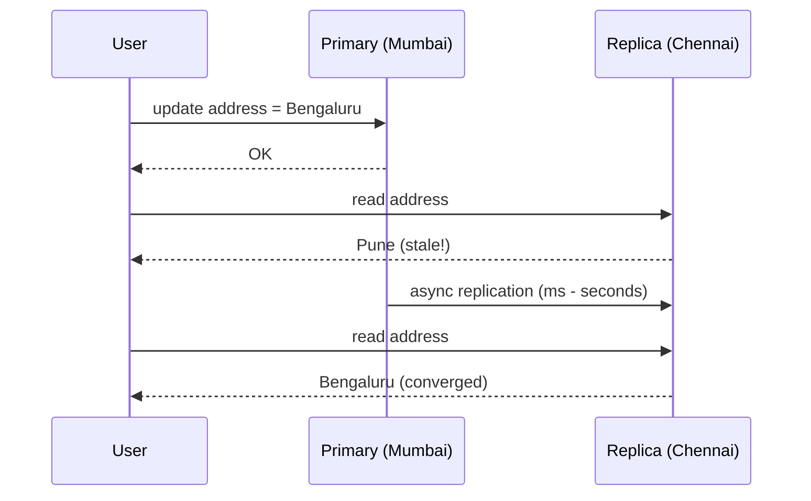

#### 📘 Terms Explained

| Term | Simple meaning |
|---|---|
| **Eventual consistency** | Copies may differ temporarily, but converge once updates stop. |
| **Convergence** | All replicas reaching the same value. |
| **Replication lag** | How far behind a replica is from the primary. |
| **Conflict** | Two replicas accepted different updates to the same data concurrently. |

---

## 5.2 Why Do We Need It?

Eventual consistency is what you get (and often **want**) when you prefer **speed and availability**:

| Situation | Why eventual is acceptable / necessary |
|---|---|
| Social feeds, likes, view counts | A count that's 2 seconds old harms nobody |
| Read replicas and caches | Massive read scale and low latency |
| Multi-region apps | Writes accepted locally in each region, even during partitions |
| Microservices with events | Each service updates its own copy when events arrive |
| Search indexes, analytics | Updated asynchronously from the source of truth |
| Shopping carts (Amazon Dynamo paper) | Always accept "add to cart", reconcile later |

---

## 5.3 How It Works: Convergence and Conflicts

### Getting copies to converge

| Mechanism | How |
|---|---|
| **Asynchronous replication** | The primary streams its log to replicas |
| **Event propagation** | Services publish events; consumers update their copies |
| **Anti-entropy** | Replicas periodically compare (e.g. with Merkle trees) and repair differences |
| **Read repair** | A read that sees different versions fixes the stale replica |
| **Gossip** | Nodes share state with random peers until everyone knows |

### Resolving conflicting writes

| Strategy | How | Risk |
|---|---|---|
| **Last-Writer-Wins (LWW)** | Keep the value with the latest timestamp | **Silently loses** concurrent updates; clock skew |
| **Application merge** | Code merges both versions (union of cart items) | Business logic needed |
| **Version vectors / vector clocks** | Detect true concurrency; keep both "siblings" for the app to resolve | Complexity |
| **CRDTs** | Data types whose merge is mathematically guaranteed to converge (counters, sets, maps) | Limited to supported types |
| **Single owner per key** | Route all writes for a key to one leader/partition | Avoids conflicts entirely; less availability for that key |

### Session guarantees (make eventual consistency friendlier)

| Guarantee | Meaning | Typical fix |
|---|---|---|
| **Read-your-writes** | You always see your own updates | Read from primary for a short time after writing; sticky sessions |
| **Monotonic reads** | You never see data go "back in time" | Stick a user to one replica |
| **Monotonic writes** | Your writes are applied in order | Single partition/key ordering |
| **Consistent prefix** | You see updates in the order they happened | Kafka partition ordering by key |

(See replication-lag fixes in [01_Scalability_Pattern.md](01_Scalability_Pattern.md#46-replication-lag-problems-and-fixes-interview-imp---java).)

---

## 5.4 Complete Java Example - Stale Reads, LWW Data Loss and a CRDT Counter

```java
import java.util.HashMap;
import java.util.Map;

// Last-Writer-Wins register: keeps the value with the newest timestamp
class LwwRegister {
    String value; long timestamp;
    void set(String v, long ts) { if (ts > timestamp) { value = v; timestamp = ts; } }
    void merge(LwwRegister other) { set(other.value, other.timestamp); }
}

// Grow-only counter CRDT: each replica counts its own increments; merge = max per replica; value = sum
class GCounter {
    final String replicaId;
    final Map<String, Integer> counts = new HashMap<>();
    GCounter(String replicaId) { this.replicaId = replicaId; }
    void increment() { counts.merge(replicaId, 1, Integer::sum); }
    void merge(GCounter other) { other.counts.forEach((k, v) -> counts.merge(k, v, Math::max)); }
    int value() { return counts.values().stream().mapToInt(Integer::intValue).sum(); }
}

public class EventualConsistencyDemo {
    public static void main(String[] args) {
        System.out.println("1) Asynchronous replication: a read right after a write can be stale");
        Map<String, String> primary = new HashMap<>(), replica = new HashMap<>();
        primary.put("address", "Pune");
        replica.put("address", "Pune");
        primary.put("address", "Bengaluru");                          // user updates address on the primary
        System.out.println("   read from replica immediately: " + replica.get("address") + "   <- stale");
        replica.putAll(primary);                                     // replication catches up (ms - seconds later)
        System.out.println("   read from replica later      : " + replica.get("address") + "   <- converged");

        System.out.println("2) Concurrent writes during a partition, resolved with Last-Writer-Wins:");
        LwwRegister mumbai = new LwwRegister(), delhi = new LwwRegister();
        mumbai.set("cart=[phone]", 100);
        delhi.set("cart=[phone, case]", 101);                        // added on another device 1 ms later
        mumbai.set("cart=[phone, charger]", 102);                     // and again on the first device
        mumbai.merge(delhi); delhi.merge(mumbai);
        System.out.println("   after merge both say: " + mumbai.value + " / " + delhi.value + "   <- 'case' silently LOST");

        System.out.println("3) Same idea with a CRDT counter (page likes on 3 replicas during a partition):");
        GCounter a = new GCounter("A"), b = new GCounter("B"), c = new GCounter("C");
        for (int i = 0; i < 3; i++) a.increment();
        for (int i = 0; i < 2; i++) b.increment();
        c.increment();
        System.out.println("   before merge: A=" + a.value() + " B=" + b.value() + " C=" + c.value());
        a.merge(b); a.merge(c); b.merge(a); c.merge(a);
        b.merge(a);                                                  // merging twice changes nothing (idempotent)
        System.out.println("   after merge : A=" + a.value() + " B=" + b.value() + " C=" + c.value() + "   <- no increments lost");
    }
}
```

**Output:**
```
1) Asynchronous replication: a read right after a write can be stale
   read from replica immediately: Pune   <- stale
   read from replica later      : Bengaluru   <- converged
2) Concurrent writes during a partition, resolved with Last-Writer-Wins:
   after merge both say: cart=[phone, charger] / cart=[phone, charger]   <- 'case' silently LOST
3) Same idea with a CRDT counter (page likes on 3 replicas during a partition):
   before merge: A=3 B=2 C=1
   after merge : A=6 B=6 C=6   <- no increments lost
```

What the output shows:
1. The replica returned the **old** address right after the write, then **converged**.
2. Concurrent cart updates on two replicas merged with **Last-Writer-Wins**: both ended up identical (converged), but the **"case" item was silently lost**. Convergence alone doesn't mean correctness.
3. The **G-Counter CRDT** kept a separate count per replica and merged with `max`: all replicas converged to **6** and **no increments were lost**. Merging twice changed nothing (merge is idempotent, commutative and associative).

---

## 5.5 Eventual Consistency in Java and Spring Systems

| Where you meet it | How to handle it |
|---|---|
| Read replicas (`@Transactional(readOnly = true)` routed to replicas) | Read-after-write paths go to the primary |
| Redis/Caffeine caches | TTLs, evict on write, version keys (see caching in [01_Scalability_Pattern.md](01_Scalability_Pattern.md#8-caching-interview-imp---java)) |
| CQRS read models / projections | Version tokens, "processing" UI states |
| Microservice data copies via events | Idempotent consumers, ordering by key, periodic reconciliation jobs |
| Cassandra / DynamoDB | Choose consistency level per query (`ONE`, `QUORUM`, `ConsistentRead`) |
| Redis CRDTs (Redis Enterprise Active-Active), Riak | Built-in CRDT types for multi-region writes |

```java
// Reconciliation job: periodically compare the source of truth with a copy and repair drift
@Scheduled(cron = "0 0 3 * * *")
public void reconcileOrderStatuses() {
    for (OrderStatusRow copy : localCopies.findUpdatedSince(Instant.now().minus(Duration.ofDays(1)))) {
        String truth = orderClient.status(copy.orderId());
        if (!truth.equals(copy.status())) {
            log.warn("drift for {}: copy={} truth={}", copy.orderId(), copy.status(), truth);
            localCopies.updateStatus(copy.orderId(), truth);
        }
    }
}
```

#### 📘 Terms Explained

| Term | Simple meaning |
|---|---|
| **Last-Writer-Wins (LWW)** | Conflict rule: keep the value with the newest timestamp. |
| **Clock skew** | Different machines' clocks disagree, so "latest timestamp" may be wrong. |
| **Vector clock / version vector** | Per-node counters that tell whether two updates are ordered or concurrent. |
| **CRDT** | Conflict-free Replicated Data Type: a data structure whose replicas can always be merged without conflicts. |
| **G-Counter** | Grow-only counter CRDT: one count per replica; total = sum. |
| **Anti-entropy** | Background process that compares replicas and fixes differences. |
| **Merkle tree** | A tree of hashes used to find which parts of two data sets differ, efficiently. |
| **Reconciliation job** | A scheduled check that compares copies with the source of truth and repairs drift. |

---

## 5.6 Pros, Cons, Pitfalls and Interview Questions

| Pros | Cons |
|---|---|
| High availability: accept reads/writes even during failures | Stale reads; users can be confused |
| Low latency: no waiting for remote replicas | Conflicts must be detected and resolved |
| Scales across regions and services | Harder to test and reason about |

| Pitfall | Fix |
|---|---|
| Users not seeing their own updates | Read-your-writes techniques. |
| LWW losing data silently | Merge logic, CRDTs, or single-writer per key. |
| Relying on wall-clock timestamps for ordering | Logical versions (sequence numbers, vector clocks, Kafka offsets). |
| "Eventually" meaning "never" (a lost event) | Outbox, retries, DLQs, reconciliation jobs, lag monitoring. |
| Using eventual consistency for money/unique constraints | Strong consistency for invariants that must never break. |

**Q1. What is eventual consistency?** If updates stop, all replicas converge to the same value; until then, reads may return stale data.

**Q2. How do you resolve conflicting concurrent writes?** LWW (simple but lossy), application-level merge, version vectors with siblings, CRDTs, or avoiding conflicts with a single writer per key.

**Q3. What is a CRDT?** A replicated data type (counter, set, map) whose merge operation is commutative, associative and idempotent, so replicas always converge without coordination.

**Q4. What is read-your-writes consistency and how do you provide it?** A user always sees their own updates. Read from the primary (or the replica that took the write) for a while after writing, use sticky sessions, or pass a version token and wait for the replica to catch up.

**Q5. Give examples where eventual consistency is fine and where it isn't.** Fine: likes, feeds, search indexes, analytics, recommendations. Not fine: account balances, seat/stock reservation for the last unit, unique usernames.

---

## 5.7 Eventual Consistency - Cheat Sheet

```
EVENTUAL CONSISTENCY  Replicas converge if updates stop; meanwhile reads may be stale. Chosen for availability + latency.
          Convergence: async replication, events, anti-entropy (Merkle trees), read repair, gossip.
          Conflicts: LWW (loses data, clock skew), app merge, vector clocks (siblings), CRDTs (G-Counter, OR-Set), single writer per key.
          Session guarantees: read-your-writes, monotonic reads, monotonic writes, consistent prefix.
          Safety nets: outbox, idempotent consumers, reconciliation jobs, lag monitoring.
          OK for feeds/likes/search/analytics; NOT for balances/last seat/uniqueness.
```

---

# 6. CAP Theorem (Interview Imp - Java)

## 6.1 What is the CAP Theorem?

The **CAP theorem** (Eric Brewer, 2000; proven by Gilbert and Lynch, 2002) says that a distributed data store **cannot guarantee all three** of these at the same time **when a network partition happens**:

| Letter | Property | Meaning |
|---|---|---|
| **C** | **Consistency** | Every read gets the latest write (linearizability), or an error |
| **A** | **Availability** | Every request to a non-failed node gets a (non-error) response |
| **P** | **Partition tolerance** | The system keeps working despite messages between nodes being lost |

Networks **do** partition, so P isn't optional in a distributed system. The real choice is: **during a partition, do you give up C or A?**

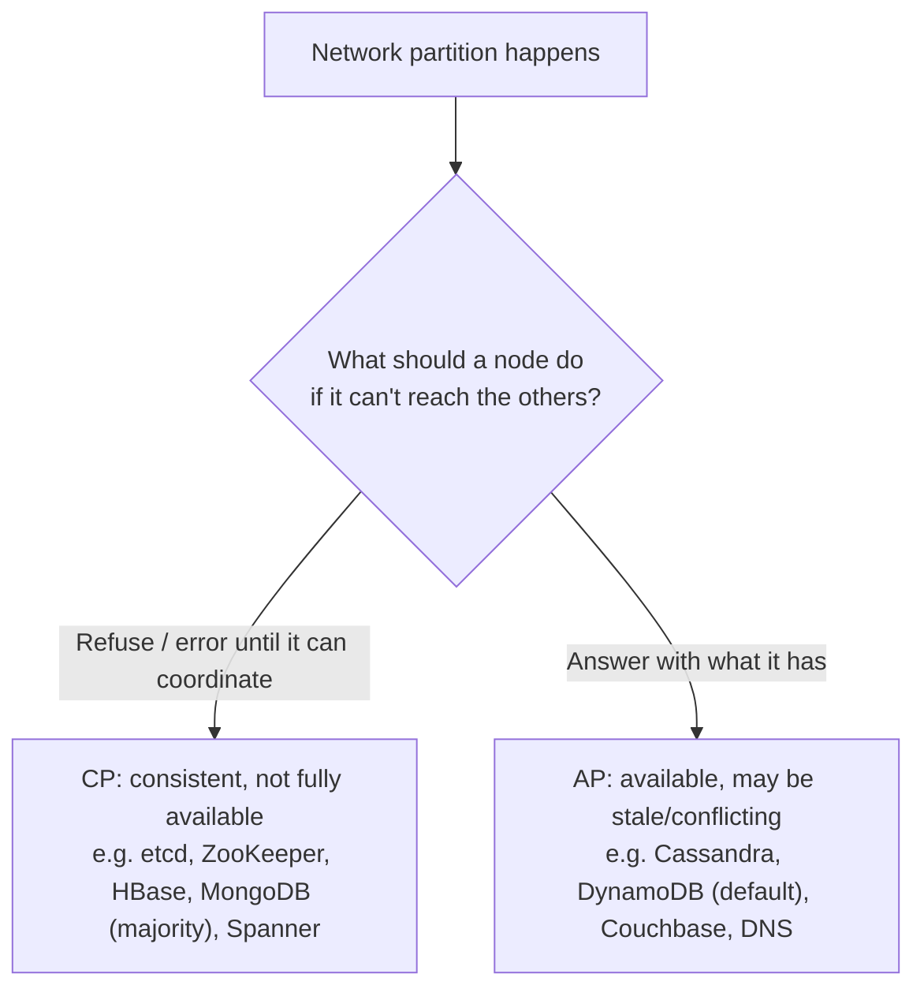

**Analogy:** Two bank branches lose their phone line. Option CP: both branches stop processing withdrawals until the line is back (correct, but customers are turned away). Option AP: both keep serving customers from their own ledger (customers are happy, but someone may withdraw the same money twice, to be fixed later).

#### 📘 Terms Explained

| Term | Simple meaning |
|---|---|
| **CAP theorem** | In a partition, a distributed store must choose between consistency and availability. |
| **CP system** | Stays consistent during a partition by refusing some requests. |
| **AP system** | Stays available during a partition by allowing temporarily inconsistent data. |
| **Partition tolerance** | Continuing to operate when the network splits the cluster. |

---

## 6.2 Why It Matters

- It explains **why** different databases behave so differently during failures.
- It forces an explicit **business decision** per kind of data: is a wrong answer worse than no answer?
- Common misunderstanding: "pick any 2 of 3". You can't choose "CA" for a distributed system, because partitions will happen. **CA only exists on a single node.**

| Data | Better choice in a partition | Why |
|---|---|---|
| Account balance, payment ledger | **CP** | A wrong balance or double spend is worse than a brief error |
| Seat / ticket inventory (last units) | **CP** (or a single owner per item) | Double booking is expensive |
| Shopping cart, likes, feeds, product reviews | **AP** | Availability matters more; reconcile later |
| DNS, CDN content | **AP** | Slightly stale is fine |
| Leader election, locks, config | **CP** | Two leaders = split brain |

---

## 6.3 PACELC: The More Complete Picture

CAP only talks about partitions. **PACELC** (Daniel Abadi) adds the everyday case:

> **If** there's a **P**artition, choose **A** or **C**; **E**lse (normal operation), choose **L**atency or **C**onsistency.

| System | During partition (PA/PC) | Normally (EL/EC) |
|---|---|---|
| Cassandra, DynamoDB (default) | PA | EL (fast, eventually consistent) |
| MongoDB (majority writes/reads) | PC | EC |
| Spanner, CockroachDB | PC | EC (pays latency for consistency) |
| PostgreSQL + async replicas | Primary stays C; replicas serve stale reads | EL for replica reads |

Many stores are **tunable** per request: Cassandra `ONE` vs `QUORUM`, MongoDB read/write concerns, DynamoDB `ConsistentRead`.

---

## 6.4 Complete Java Example - CP vs AP During a Partition

```java
import java.util.HashMap;
import java.util.Map;

// Two replicas of a seat-booking store in two data centres
class Node {
    final String name;
    final Map<String, String> seats = new HashMap<>();
    Node(String name) { this.name = name; }
}

class Cluster {
    final Node mumbai = new Node("mumbai"), chennai = new Node("chennai");
    boolean partitioned = false;
    final boolean preferConsistency;          // true = CP, false = AP

    Cluster(boolean preferConsistency) { this.preferConsistency = preferConsistency; }

    String book(Node at, String seat, String user) {
        Node other = at == mumbai ? chennai : mumbai;
        if (partitioned && preferConsistency) {
            return "REJECTED (can't reach " + other.name + "; refusing to risk a double booking)";
        }
        if (at.seats.containsKey(seat)) return "REJECTED (seat already taken by " + at.seats.get(seat) + ")";
        at.seats.put(seat, user);
        if (!partitioned) other.seats.put(seat, user);              // synchronous replication when connected
        return "OK" + (partitioned ? " (accepted locally; " + other.name + " doesn't know yet)" : "");
    }

    void heal() {
        partitioned = false;
        // reconcile: find conflicts where both sides booked the same seat
        for (String seat : mumbai.seats.keySet()) {
            String m = mumbai.seats.get(seat), c = chennai.seats.get(seat);
            if (c != null && !c.equals(m)) System.out.println("   CONFLICT on " + seat + ": " + m + " vs " + c + " -> business must resolve (refund/upgrade)");
        }
    }
}

public class CapDemo {
    static void run(boolean cp) {
        System.out.println(cp ? "CP system (choose Consistency during a partition):" : "AP system (choose Availability during a partition):");
        Cluster cl = new Cluster(cp);
        System.out.println("   normal       : asha books 12A in mumbai  -> " + cl.book(cl.mumbai, "12A", "asha"));
        cl.partitioned = true;
        System.out.println("   ~~ network partition between the data centres ~~");
        System.out.println("   partitioned  : ravi books 14C in mumbai  -> " + cl.book(cl.mumbai, "14C", "ravi"));
        System.out.println("   partitioned  : meera books 14C in chennai -> " + cl.book(cl.chennai, "14C", "meera"));
        System.out.println("   ~~ partition heals ~~");
        cl.heal();
        System.out.println("   final: mumbai=" + cl.mumbai.seats + " chennai=" + cl.chennai.seats);
    }

    public static void main(String[] args) {
        run(true);
        run(false);
    }
}
```

**Output:**
```
CP system (choose Consistency during a partition):
   normal       : asha books 12A in mumbai  -> OK
   ~~ network partition between the data centres ~~
   partitioned  : ravi books 14C in mumbai  -> REJECTED (can't reach chennai; refusing to risk a double booking)
   partitioned  : meera books 14C in chennai -> REJECTED (can't reach mumbai; refusing to risk a double booking)
   ~~ partition heals ~~
   final: mumbai={12A=asha} chennai={12A=asha}
AP system (choose Availability during a partition):
   normal       : asha books 12A in mumbai  -> OK
   ~~ network partition between the data centres ~~
   partitioned  : ravi books 14C in mumbai  -> OK (accepted locally; chennai doesn't know yet)
   partitioned  : meera books 14C in chennai -> OK (accepted locally; mumbai doesn't know yet)
   ~~ partition heals ~~
   CONFLICT on 14C: ravi vs meera -> business must resolve (refund/upgrade)
   final: mumbai={12A=asha, 14C=ravi} chennai={12A=asha, 14C=meera}
```

What the output shows:
- **CP:** during the partition, **both** bookings for seat 14C were **rejected**. No double booking, but two customers were turned away. After healing, both nodes agree.
- **AP:** both bookings were **accepted**, so both customers got an answer. But seat 14C now belongs to **two** people; after healing, the conflict had to be resolved by the business (refund, upgrade, apology).
- Neither is "right": it's a **business trade-off**, decided per kind of data.

---

## 6.5 Pitfalls and Interview Questions

| Pitfall | Fix |
|---|---|
| Saying "we chose CA" for a distributed system | Partitions happen; CA = single node only. |
| Treating CAP as a property of the whole company system | Decide **per data type / per operation**. |
| Ignoring latency in normal operation | Use PACELC thinking. |
| Choosing AP without a conflict-resolution plan | Define merge rules, CRDTs, or business compensation. |

**Q1. Explain the CAP theorem.** In a distributed system, during a network partition you must choose between consistency (every read sees the latest write, else error) and availability (every request gets a response). Partition tolerance is mandatory.

**Q2. Why isn't "CA" a real option?** Because in a distributed system you can't prevent partitions; when one happens, you must give up C or A. A "CA" system is effectively a single node.

**Q3. Give examples of CP and AP systems.** CP: etcd, ZooKeeper, Consul, HBase, Spanner, MongoDB with majority concerns. AP: Cassandra, DynamoDB (default), Couchbase, DNS.

**Q4. What is PACELC?** An extension of CAP: if Partitioned, choose Availability or Consistency; Else, choose Latency or Consistency.

**Q5. Your e-commerce site: CP or AP?** Both, per data: cart, catalogue, reviews AP; payments, stock reservation for the last units, order totals CP. Combine with sagas and reconciliation.

---

## 6.6 CAP Theorem - Cheat Sheet

```
CAP       During a network PARTITION choose Consistency (refuse/err) or Availability (answer, maybe stale). P is mandatory.
          CA = single node only. Decide PER DATA TYPE: money/locks/last seat -> CP; carts/feeds/likes/DNS -> AP.
          CP examples: etcd, ZooKeeper, Consul, HBase, Spanner, MongoDB majority. AP: Cassandra, DynamoDB default, Couchbase.
          PACELC: if Partition -> A or C; Else -> Latency or Consistency. Many stores are tunable per request.
          AP needs conflict resolution (merge, CRDTs, compensation).
```

---

# 7. BASE (Interview Imp - Java)

## 7.1 What is BASE?

**BASE** describes the design philosophy of many large-scale, AP-leaning systems, as a deliberate contrast to ACID:

| Letter | Meaning |
|---|---|
| **B**asically **A**vailable | The system keeps responding (maybe with degraded or stale data) even when parts fail |
| **S**oft state | The state can change over time without new input, as replicas sync in the background |
| **E**ventually consistent | Given time without new updates, all copies converge |

**Analogy:** ACID is a bank vault: nothing moves until every check passes. BASE is a busy marketplace: stalls keep trading, prices on different boards may differ for a few minutes, and everything settles by the end of the day.

#### 📘 Terms Explained

| Term | Simple meaning |
|---|---|
| **BASE** | Basically Available, Soft state, Eventually consistent. |
| **Soft state** | State that may change as background replication/reconciliation happens. |
| **Basically available** | Responds even if partially degraded. |

---

## 7.2 ACID vs BASE

| | ACID | BASE |
|---|---|---|
| Priority | Correctness, isolation | Availability, scale, latency |
| Consistency | Strong, immediate | Eventual |
| Transactions | Multi-row/multi-table, isolated | Often single-item; multi-step via sagas |
| Failure behaviour | Reject/rollback | Degrade, accept, reconcile later |
| Typical stores | PostgreSQL, MySQL, Oracle, SQL Server | Cassandra, DynamoDB, Couchbase, Riak, many caches |
| Typical uses | Payments, ledgers, inventory reservations, orders | Feeds, catalogues, carts, sessions, analytics, IoT telemetry |

> **It's not either/or.** Most real systems are **ACID inside each service** (its own relational DB) and **BASE between services** (events, sagas, read models, caches). Modern NoSQL stores also offer ACID transactions within a partition (DynamoDB transactions, MongoDB multi-document transactions).

---

## 7.3 How BASE Shows Up in a Spring Microservice System

| BASE property | Concrete mechanism |
|---|---|
| Basically available | Circuit breakers + fallbacks, graceful degradation ([02_Reliability_Pattern.md](02_Reliability_Pattern.md#9-graceful-degradation-pattern)), AP stores, caches |
| Soft state | Read models updated by projectors, caches with TTL, replicas catching up |
| Eventually consistent | Domain events + outbox, sagas, reconciliation jobs, CDC |

---

## 7.4 BASE - Interview Questions and Cheat Sheet

**Q1. What does BASE stand for, and how does it differ from ACID?** Basically Available, Soft state, Eventually consistent. ACID prioritises immediate consistency and isolation; BASE prioritises availability and scale, accepting temporary inconsistency.

**Q2. Can a system be both ACID and BASE?** Yes: ACID within each service's database, BASE across services via events and sagas.

**Q3. When would you choose a BASE-style store?** Very high write/read volume, multi-region availability, data where staleness is acceptable (feeds, telemetry, carts, catalogues).

```
BASE      Basically Available, Soft state, Eventually consistent (vs ACID: atomic, consistent, isolated, durable).
          AP-leaning philosophy: degrade/accept/reconcile instead of reject/rollback.
          Real systems: ACID inside each service, BASE between services (events, sagas, read models, caches).
          Stores: Cassandra, DynamoDB, Couchbase (many now offer partition-level ACID transactions too).
```

---

## 7.5 Types, In Java, Pros and Cons, and Pitfalls

**Types and variants:** *basically available* (respond even if some data is stale), *soft state* (state may change without input as replicas converge), *eventually consistent* (replicas agree after a while). In practice the knobs are **tunable consistency** (Cassandra `ONE` / `QUORUM` / `ALL`, DynamoDB eventual vs strong reads), **conflict resolution** (last-write-wins, vector clocks, CRDTs) and **session guarantees** (read-your-writes).

**In Java and Spring:**
```java
// Cassandra (DataStax driver): choose consistency per query
session.execute(SimpleStatement.newInstance("SELECT * FROM carts WHERE id = ?", id).setConsistencyLevel(DefaultConsistencyLevel.ONE));     // fast, may be stale
session.execute(SimpleStatement.newInstance("UPDATE carts SET items = ? WHERE id = ?", items, id).setConsistencyLevel(DefaultConsistencyLevel.QUORUM));
// DynamoDB (AWS SDK v2): eventual by default, strong on request
dynamo.getItem(r -> r.tableName("carts").key(key).consistentRead(true));
```

| Pros | Cons |
|---|---|
| High availability and partition tolerance | Users can see stale or conflicting data |
| Low latency, easy horizontal scaling | Application must handle conflicts and retries |
| Fits global, multi-region systems | Harder to test and reason about |

**Common pitfalls**
- Using eventual consistency for money, stock or uniqueness checks.
- Assuming "eventually" means "within milliseconds" (lag can be seconds or more during failures).
- Last-write-wins with unsynchronised clocks silently dropping updates.
- No read-your-writes, so users don't see the change they just made.

# 8. Materialized View Pattern

## 8.1 What is a Materialized View?

A **materialized view** is a **precomputed, stored result of a query**: joins, filters and aggregations are calculated **ahead of time** and saved, so reads are fast lookups instead of expensive computations. It must be **refreshed** when the underlying data changes.

**Analogy:** A school's printed exam results sheet on the notice board. The teachers already added up every student's marks and ranked them. Students just read the sheet instead of recalculating from all the answer papers. When a re-evaluation changes marks, the sheet must be reprinted (refreshed).

| | Normal view | Materialized view |
|---|---|---|
| Stored data | No: just a saved query | **Yes**: the result rows are stored |
| Query speed | Same as running the query | Very fast (precomputed) |
| Freshness | Always current | Only as fresh as the last refresh |
| Storage | None | Extra disk |

#### 📘 Terms Explained

| Term | Simple meaning |
|---|---|
| **Materialized view** | A stored, precomputed query result. |
| **Refresh** | Recomputing (or updating) the stored result after the base data changes. |
| **Base table** | The original table(s) the view is computed from. |
| **Staleness** | How out of date the view is compared to the base tables. |

---

## 8.2 Why Do We Need It?

- Dashboards and reports that aggregate **millions of rows** can't run the full query on every page load.
- Data needed for one screen lives in **several tables or services** (the CQRS read model in section 1 is a materialized view kept by an application).
- The source store is bad at the query shape needed (e.g. a key-value store can't do `GROUP BY`).

---

## 8.3 Types: How the View Is Kept Up to Date

| Refresh strategy | How | Freshness | Cost |
|---|---|---|---|
| **Full refresh, on schedule** | Recompute everything every N minutes/hours | Minutes-hours stale | Reads every base row each time |
| **Full refresh, on demand** | Recompute after a batch load | Stale until triggered | Same |
| **Incremental (delta) refresh** | Apply only the rows changed since last refresh | Close to fresh | Proportional to changes |
| **Event-driven / streaming** | Update the view as each change event arrives (CQRS projector, Kafka Streams, Flink) | Seconds | Continuous, small |
| **Automatic incremental (DB-managed)** | Oracle fast refresh with MV logs; some cloud warehouses | Near real time | Managed by the DB |

| Where it lives | Example |
|---|---|
| Inside the database | PostgreSQL `MATERIALIZED VIEW`, Oracle materialized views (fast refresh) |
| In a separate store | Redis hash of top products; Elasticsearch index; a summary table |
| In a stream processor | Kafka Streams `KTable` / ksqlDB tables, Flink |
| In a data warehouse | Aggregated tables built by dbt models |

---

## 8.4 Complete Java Example - Full vs Incremental Refresh

```java
import java.util.ArrayList;
import java.util.List;
import java.util.Map;
import java.util.TreeMap;

record Sale(int id, String category, int amount) {}

public class MaterializedViewDemo {
    static int rowsScanned = 0;

    // Full refresh: recompute the whole view from the base table (like REFRESH MATERIALIZED VIEW)
    static Map<String, Integer> fullRefresh(List<Sale> sales) {
        Map<String, Integer> view = new TreeMap<>();
        for (Sale s : sales) { view.merge(s.category(), s.amount(), Integer::sum); rowsScanned++; }
        return view;
    }

    // Incremental refresh: apply only the new rows since the last refresh
    static void incrementalRefresh(Map<String, Integer> view, List<Sale> sales, int fromIndex) {
        for (int i = fromIndex; i < sales.size(); i++) {
            Sale s = sales.get(i);
            view.merge(s.category(), s.amount(), Integer::sum);
            rowsScanned++;
        }
    }

    public static void main(String[] args) {
        List<Sale> sales = new ArrayList<>();
        String[] cats = {"books", "electronics", "fashion"};
        for (int i = 0; i < 100_000; i++) sales.add(new Sale(i, cats[i % 3], 100 + i % 50));

        rowsScanned = 0;
        Map<String, Integer> view = fullRefresh(sales);
        System.out.println("initial build      : " + view + "  rows scanned=" + rowsScanned);

        int lastRefreshed = sales.size();
        sales.add(new Sale(100_000, "books", 999));
        sales.add(new Sale(100_001, "fashion", 1));
        System.out.println("2 new sales arrive : view is now STALE until refreshed -> books still " + view.get("books"));

        rowsScanned = 0;
        Map<String, Integer> full = fullRefresh(sales);
        System.out.println("full refresh       : books=" + full.get("books") + "  rows scanned=" + rowsScanned);

        rowsScanned = 0;
        incrementalRefresh(view, sales, lastRefreshed);
        System.out.println("incremental refresh: books=" + view.get("books") + "  rows scanned=" + rowsScanned);
        System.out.println("same result? " + view.equals(full));
    }
}
```

**Output:**
```
initial build      : {books=4150083, electronics=4149967, fashion=4149950}  rows scanned=100000
2 new sales arrive : view is now STALE until refreshed -> books still 4150083
full refresh       : books=4151082  rows scanned=100002
incremental refresh: books=4151082  rows scanned=2
same result? true
```

What the output shows:
- The view was **stale** as soon as new sales arrived, until it was refreshed.
- A **full refresh** rescanned all 100,002 rows; an **incremental refresh** touched only the **2** new rows and produced the **same** result.
- Incremental refresh is far cheaper, but it needs a reliable way to know **what changed** (an `id`/`updated_at` watermark, a change log, or CDC: section 9).

---

## 8.5 Materialized Views in Practice

### PostgreSQL

```sql
CREATE MATERIALIZED VIEW sales_by_category AS
SELECT p.category, date_trunc('day', o.created_at) AS day, SUM(o.amount) AS revenue, COUNT(*) AS orders
FROM orders o JOIN products p ON p.id = o.product_id
WHERE o.status = 'DELIVERED'
GROUP BY p.category, date_trunc('day', o.created_at);

CREATE UNIQUE INDEX ON sales_by_category (category, day);      -- required for CONCURRENTLY

REFRESH MATERIALIZED VIEW CONCURRENTLY sales_by_category;     -- rebuilds without blocking readers
```

> PostgreSQL refreshes are always **full** recomputations. Use `CONCURRENTLY` (needs a unique index) so readers aren't blocked. For incremental updates, maintain a summary table yourself (upserts from triggers, a job, or events). Oracle supports **fast (incremental) refresh** with materialized view logs (see [Oracle_SQL_Complete_Guide.md](../../oracle/Oracle_SQL_Complete_Guide.md)).

### Spring Boot: scheduled refresh and reading the view

```java
@Component
@RequiredArgsConstructor
class SalesViewRefresher {
    private final JdbcTemplate jdbc;

    @Scheduled(cron = "0 */15 * * * *")                                  // every 15 minutes
    public void refresh() {
        jdbc.execute("REFRESH MATERIALIZED VIEW CONCURRENTLY sales_by_category");
    }
}

@Entity
@Immutable                                                               // Hibernate: read-only mapping
@Table(name = "sales_by_category")
class SalesByCategory {
    @EmbeddedId SalesKey key;            // (category, day)
    BigDecimal revenue;
    long orders;
}
```

### Streaming materialized view (Kafka Streams)

```java
@Bean
KTable<String, Long> revenueByCategory(StreamsBuilder builder) {
    return builder.stream("orders.delivered", Consumed.with(Serdes.String(), orderSerde))
            .groupBy((orderId, order) -> order.category(), Grouped.with(Serdes.String(), orderSerde))
            .aggregate(() -> 0L, (category, order, total) -> total + order.amountPaise(),
                       Materialized.as("revenue-by-category"));         // queryable state store
}
```

#### 📘 Terms Explained

| Term | Simple meaning |
|---|---|
| **`REFRESH MATERIALIZED VIEW CONCURRENTLY`** | PostgreSQL command that rebuilds the view while still allowing reads (needs a unique index). |
| **Fast refresh (Oracle)** | Incremental refresh using logs of changes to the base tables. |
| **`@Immutable`** | Hibernate annotation for read-only entities (no updates are ever flushed). |
| **`KTable`** | Kafka Streams table: the latest value per key, continuously updated from a stream. |
| **Watermark** | The last position (id, timestamp, log offset) already processed, so the next refresh starts after it. |
| **dbt** | Tool for building warehouse tables/views with SQL models. |

---

## 8.6 Pros, Cons, Pitfalls and Interview Questions

| Pros | Cons |
|---|---|
| Very fast reads for expensive queries | Stale between refreshes |
| Offloads heavy queries from transactional tables | Extra storage and refresh cost |
| Can combine data from many sources | Refresh logic can be complex (incremental, deletes) |

| Pitfall | Fix |
|---|---|
| Full refresh of a huge view every minute | Incremental/streaming updates; or refresh less often. |
| Refresh locking readers | `CONCURRENTLY` (PostgreSQL); swap tables (build new, rename). |
| Incremental refresh missing deletes/updates | Use a change log / CDC, not just "new ids". |
| Users not knowing data is stale | Show "updated at" on dashboards. |
| Writing to the view directly | Treat it as read-only; change base data instead. |

**Q1. View vs materialized view?** A view stores only the query and runs it every time; a materialized view stores the result, so it's fast to read but must be refreshed.

**Q2. How do you keep a materialized view up to date?** Full refresh on a schedule or trigger, incremental refresh from a change log/watermark, or event-driven/streaming updates (projectors, Kafka Streams).

**Q3. How is a materialized view related to CQRS?** A CQRS read model is an application-maintained materialized view, usually updated from events.

**Q4. What does `REFRESH MATERIALIZED VIEW CONCURRENTLY` do?** Rebuilds the view without blocking concurrent reads; it requires a unique index on the view.

---

## 8.7 Materialized View - Cheat Sheet

```
MATERIALIZED VIEW  Precomputed, stored query result -> fast reads, but stale until refreshed.
          Refresh: full (scheduled/on demand) | incremental (watermark, MV logs, CDC) | streaming (projector, Kafka Streams KTable).
          PostgreSQL: CREATE MATERIALIZED VIEW + UNIQUE INDEX + REFRESH ... CONCURRENTLY (always full).
          Oracle: fast refresh with MV logs. Spring: @Scheduled refresh, @Immutable entity for reading.
          CQRS read model = app-maintained materialized view. Show "last updated"; handle deletes.
```

---

## 8.8 How It Works

1. **Choose the query** the view must answer quickly (for example "revenue per product per day").
2. **Define the view** as the precomputed result of that query: `CREATE MATERIALIZED VIEW daily_revenue AS SELECT product_id, date(created_at), sum(amount) ... GROUP BY ...`.
3. **Refresh it**, in one of three ways:
   - *On a schedule:* `REFRESH MATERIALIZED VIEW CONCURRENTLY daily_revenue` (PostgreSQL; `CONCURRENTLY` needs a unique index and keeps the view readable).
   - *Incrementally on change:* triggers or the database's own incremental maintenance (Oracle fast refresh, SQL Server indexed views).
   - *From events:* a consumer of domain events or CDC (Debezium) updates a separate read table/Elasticsearch index (the CQRS read model).
4. **Serve reads** from the view; accept that it is as fresh as the last refresh.

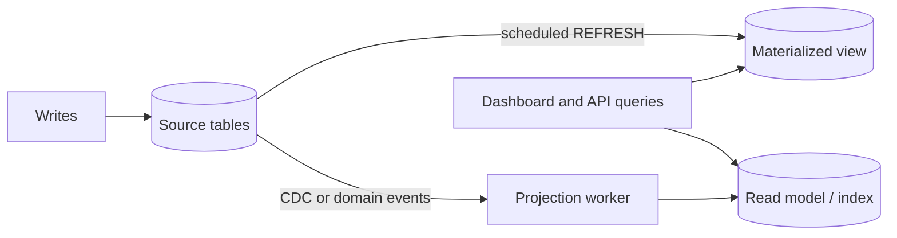

# 9. Change Data Capture (CDC) Pattern

## 9.1 What is Change Data Capture?

**Change Data Capture (CDC)** detects **every change** (insert, update, delete) made to a database and **streams** those changes to other systems (Kafka, a search index, a cache, a data warehouse), in **order**, usually within milliseconds or seconds.

**Analogy:** A CCTV recording of a shop's stock room. Instead of counting the shelves every hour and guessing what changed, you watch the recording and see every item that came in or went out, in order, including the ones that came in and left again between counts.

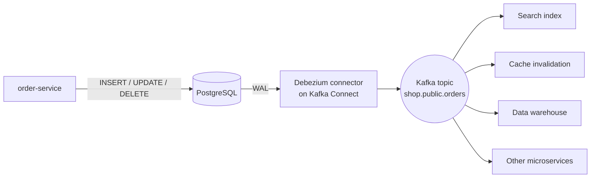

#### 📘 Terms Explained

| Term | Simple meaning |
|---|---|
| **CDC** | Capturing database changes as a stream of events. |
| **Transaction log** | The database's internal ordered record of committed changes (PostgreSQL WAL, MySQL binlog, Oracle redo log). |
| **Debezium** | Open-source CDC platform that reads database logs and writes change events to Kafka. |
| **Change event** | A message describing one row change: operation, before values, after values, position in the log. |
| **LSN / binlog position** | The position of a change in the transaction log; used as the CDC connector's offset. |

---

## 9.2 Why Do We Need It?

| Use case | Example |
|---|---|
| **Reliable event publishing (outbox)** | Stream outbox rows to Kafka with no dual write (**Transaction Log Tailing**, see [04_Messaging_Pattern.md](04_Messaging_Pattern.md#13-guaranteed-delivery-and-the-transactional-outbox-interview-imp---java)) |
| **Keep search/caches in sync** | Every product change updates Elasticsearch and evicts Redis keys |
| **Feed data warehouses / lakes** | Near-real-time analytics without nightly full dumps |
| **Migrate off a monolith** | New services build their own data from the legacy DB (Strangler Fig in [02_Microservices_Pattern.md](../04_Specialized/02_Microservices_Pattern.md#13-strangler-fig-pattern-migrating-from-a-monolith-interview-imp---java)) |
| **Audit / history** | Capture before/after values of every change |
| **Database replication across technologies** | MySQL → PostgreSQL, Oracle → Kafka → S3 |

The key advantage over application-level events: **nothing is missed**, even changes made by scripts, admin tools or legacy code that doesn't publish events.

---

## 9.3 Types of CDC

| Type | How | Captures deletes? | Captures every intermediate change? | Load on source DB | Notes |
|---|---|---|---|---|---|
| **Query-based (polling)** | `SELECT * WHERE updated_at > :lastSeen` periodically | ❌ (unless soft deletes) | ❌ (only latest state per poll) | Repeated queries | Needs an `updated_at` column; simple |
| **Trigger-based** | DB triggers write each change to a shadow/audit table | ✅ | ✅ | Extra writes on every transaction | Slows writes; triggers to maintain |
| **Log-based** ✅ | Read the transaction log (WAL/binlog/redo) | ✅ | ✅ with before/after | Very low | Best option; needs log access/config (Debezium, AWS DMS, GoldenGate) |

---

## 9.4 Complete Java Example - Polling vs Log-Based CDC

```java
import java.util.ArrayList;
import java.util.LinkedHashMap;
import java.util.List;
import java.util.Map;

record Row(String id, String status, long updatedAt) {}
record LogEntry(long lsn, String op, String id, String before, String after) {}

// A table plus its transaction log (WAL / binlog), the way a real database works
class Database {
    final Map<String, Row> table = new LinkedHashMap<>();
    final List<LogEntry> wal = new ArrayList<>();
    private long lsn = 0;

    void insert(String id, String status, long t) { table.put(id, new Row(id, status, t)); wal.add(new LogEntry(++lsn, "c", id, null, status)); }
    void update(String id, String status, long t) {
        String before = table.get(id).status();
        table.put(id, new Row(id, status, t));
        wal.add(new LogEntry(++lsn, "u", id, before, status));
    }
    void delete(String id) { String before = table.remove(id).status(); wal.add(new LogEntry(++lsn, "d", id, before, null)); }
}

public class CdcDemo {
    public static void main(String[] args) {
        Database db = new Database();
        db.insert("O1", "NEW", 1);
        db.insert("O2", "NEW", 1);

        // ---- Query-based CDC: poll "WHERE updated_at > lastSeen" every 10 time units ----
        long lastSeen = 1;
        db.update("O1", "PAID", 3);
        db.update("O1", "SHIPPED", 5);            // two changes between polls
        db.delete("O2");                          // a delete
        db.insert("O3", "NEW", 7);

        List<String> polled = new ArrayList<>();
        for (Row r : db.table.values()) if (r.updatedAt() > lastSeen) polled.add(r.id() + "=" + r.status());
        System.out.println("Query-based (polling) sees : " + polled);
        System.out.println("   missed: O1's intermediate PAID state, and the DELETE of O2 entirely");

        // ---- Log-based CDC (Debezium style): read every committed change from the log, in order ----
        System.out.println("Log-based (WAL/binlog) sees:");
        for (LogEntry e : db.wal) {
            System.out.printf("   lsn=%d op=%s id=%s before=%s after=%s%n", e.lsn(), e.op(), e.id(), e.before(), e.after());
        }
        System.out.println("   every insert/update/delete, with before/after values, in commit order; the connector stores the last LSN as its offset");
    }
}
```

**Output:**
```
Query-based (polling) sees : [O1=SHIPPED, O3=NEW]
   missed: O1's intermediate PAID state, and the DELETE of O2 entirely
Log-based (WAL/binlog) sees:
   lsn=1 op=c id=O1 before=null after=NEW
   lsn=2 op=c id=O2 before=null after=NEW
   lsn=3 op=u id=O1 before=NEW after=PAID
   lsn=4 op=u id=O1 before=PAID after=SHIPPED
   lsn=5 op=d id=O2 before=NEW after=null
   lsn=6 op=c id=O3 before=null after=NEW
   every insert/update/delete, with before/after values, in commit order; the connector stores the last LSN as its offset
```

What the output shows:
- **Polling** saw only the **final** state of O1 (it never saw `PAID`) and **completely missed** the deletion of O2: a downstream search index would keep showing a deleted order forever.
- **Log-based CDC** saw **every** create (`c`), update (`u`) and delete (`d`), with **before/after** values, in **commit order**, numbered by LSN. The connector saves the last LSN it processed (its offset), so after a restart it continues exactly where it left off.

---

## 9.5 CDC with Debezium, Kafka Connect and Spring

```properties
# Debezium PostgreSQL connector (Kafka Connect)
name=orders-cdc
connector.class=io.debezium.connector.postgresql.PostgresConnector
database.hostname=orders-db
database.port=5432
database.user=debezium
database.password=${file:/secrets/db.properties:password}
database.dbname=shop
plugin.name=pgoutput                      # PostgreSQL's built-in logical decoding plugin
topic.prefix=shop                         # topics: shop.public.orders, shop.public.order_lines
table.include.list=public.orders,public.order_lines
snapshot.mode=initial                     # first copy existing rows, then stream changes
```

```sql
-- PostgreSQL needs logical replication enabled
ALTER SYSTEM SET wal_level = logical;     -- requires a restart
```

A Debezium change event (simplified):

```json
{
  "before": { "id": "O1", "status": "PAID" },
  "after":  { "id": "O1", "status": "SHIPPED" },
  "op": "u",
  "source": { "table": "orders", "lsn": 23987512, "txId": 771 },
  "ts_ms": 1761400000123
}
```

```java
// Consuming CDC events in Spring Boot: keep an Elasticsearch index in sync
@KafkaListener(topics = "shop.public.orders", groupId = "order-search-indexer")
void on(ChangeEvent<OrderRow> e) {
    switch (e.op()) {
        case "c", "u", "r" -> searchIndex.upsert(e.after());     // r = row from the initial snapshot
        case "d"           -> searchIndex.delete(e.before().id());
        default            -> log.warn("unknown op {}", e.op());
    }
}
```

| Tool | Notes |
|---|---|
| **Debezium** | Open source; PostgreSQL, MySQL, MongoDB, Oracle, SQL Server, Db2; outbox event router |
| **AWS DMS, Google Datastream, Azure Data Factory** | Managed CDC/replication services |
| **Oracle GoldenGate** | Enterprise Oracle CDC |
| **Kafka Connect sink connectors** | Write CDC topics into Elasticsearch, S3, Snowflake, JDBC targets |

#### 📘 Terms Explained

| Term | Simple meaning |
|---|---|
| **Kafka Connect** | Framework for running source/sink connectors that move data in and out of Kafka. |
| **Logical decoding / `pgoutput`** | PostgreSQL feature (and plugin) that turns WAL entries into row-level change events. |
| **Replication slot** | PostgreSQL bookmark that keeps WAL until the CDC consumer has read it. |
| **Initial snapshot** | CDC first copies existing rows, then switches to streaming new changes. |
| **`op` (c/u/d/r)** | Debezium operation: create, update, delete, read (snapshot). |

---

## 9.6 Pros, Cons, Pitfalls and Interview Questions

| Pros | Cons |
|---|---|
| Captures **every** change, including deletes, from any writer | Exposes internal table structure to consumers (couples them to the schema) |
| Very low load on the source (log-based) | Extra infrastructure (Kafka Connect, Debezium) and DB configuration |
| Ordered, replayable, near real time | Schema changes in the source must be handled downstream |
| No dual writes | Large initial snapshots take time |

| Pitfall | Fix |
|---|---|
| Consumers depending on raw table columns | Publish via an **outbox** table with a stable event schema (Debezium outbox router), or transform. |
| PostgreSQL replication slot not consumed → WAL fills the disk | Monitor slot lag; drop unused slots; alert on WAL size. |
| Polling CDC used where deletes matter | Log-based CDC, or soft deletes with `deleted_at`. |
| Assuming exactly-once delivery | Consumers idempotent (upsert by primary key, check LSN). |
| Schema change breaks the pipeline | Schema Registry, compatible changes, coordinated migrations. |

**Q1. What is CDC and why use it?** Capturing every insert/update/delete from a database's transaction log and streaming it to other systems, to keep caches, search, warehouses and other services in sync without dual writes or missed changes.

**Q2. Polling vs trigger vs log-based CDC?** Polling queries `updated_at` (misses deletes and intermediate changes). Triggers write change tables (complete but slows writes). Log-based reads WAL/binlog (complete, ordered, low overhead): the preferred approach.

**Q3. How does Debezium work?** It runs as a Kafka Connect source connector, reads the database's log (logical decoding/binlog), emits a change event per row change (before/after/op/source position) to a Kafka topic per table, and tracks its log position as its offset.

**Q4. CDC vs domain events from the application?** CDC captures everything at the data level but exposes table structure; domain events are designed business facts. The outbox + CDC combination gives both: designed events, published via the log.

**Q5. What operational risk does CDC add on PostgreSQL?** Replication slots keep WAL until consumed; a stopped connector can fill the disk. Monitor slot lag.

---

## 9.7 Change Data Capture - Cheat Sheet

```
CDC       Stream every DB change (c/u/d, before/after, ordered) to other systems.
          Types: polling updated_at (misses deletes/intermediate) | triggers (complete, slows writes) |
                 LOG-BASED (WAL/binlog/redo; complete, low overhead) <- preferred.
          Debezium on Kafka Connect: topic per table, initial snapshot then streaming, offset = LSN/binlog position.
          Uses: outbox relay (transaction log tailing), search/cache sync, data warehouse feeds, monolith migration, audit.
          Pitfalls: schema coupling (use outbox events), PostgreSQL replication slot lag fills disk, idempotent consumers.
```

---

# 10. Data Lake and Data Warehouse

## 10.1 What Are They?

Both are **central stores for analytics**, separate from the operational (OLTP) databases that run the application.

- **Data warehouse:** stores **cleaned, structured, modelled** data (tables with a fixed schema), optimised for **SQL analytics and BI dashboards**. Schema is applied **when data is written** (schema-on-write).
- **Data lake:** stores **raw data of any type** (JSON, CSV, logs, images, Parquet files) cheaply in object storage, **as it arrives**. Schema is applied **when data is read** (schema-on-read).
- **Lakehouse:** a lake (cheap object storage, open file formats) with **warehouse features** on top (ACID tables, schemas, fast SQL) via table formats like **Delta Lake, Apache Iceberg, Apache Hudi**.

**Analogy:** A warehouse is a well-organised supermarket: everything is cleaned, labelled and on the right shelf, easy to find. A lake is the farm's storage barn: everything that came in, in its original form, cheap to keep, but you have to sort it yourself before using it.

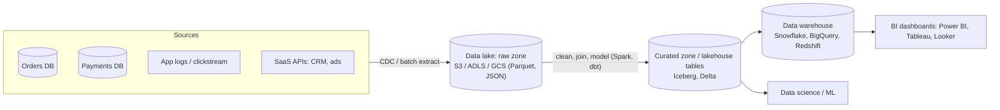

#### 📘 Terms Explained

| Term | Simple meaning |
|---|---|
| **OLTP** | Online Transaction Processing: many small reads/writes by the app (place order, update stock). |
| **OLAP** | Online Analytical Processing: big read-only queries over lots of data (revenue by month by region). |
| **Data warehouse** | A structured, modelled analytics database (schema-on-write). |
| **Data lake** | Cheap storage of raw data in any format (schema-on-read). |
| **Lakehouse** | A data lake plus table formats that add ACID, schemas and fast SQL. |
| **Parquet** | A columnar file format, very efficient for analytics. |
| **BI** | Business Intelligence: dashboards and reports for decision-makers. |

---

## 10.2 Why Do We Need Them?

- **Don't run analytics on the production OLTP database:** a "revenue for the last 3 years" query scanning millions of rows slows down checkout for real customers.
- **Data from many services** (each with its own DB) must be combined for company-wide reporting.
- **History:** OLTP databases keep current state; analytics needs years of history.
- **Different shape:** OLAP queries scan few columns across many rows, which **columnar** storage handles far better.

| | OLTP database | Data warehouse | Data lake |
|---|---|---|---|
| Users | The application | Analysts, BI tools | Data engineers, data scientists |
| Data | Current, normalised | Cleaned, modelled, historical | Raw, any format, everything |
| Schema | Fixed (on write) | Fixed (on write) | On read |
| Queries | Small, many, fast | Large aggregations | Exploration, ML, batch processing |
| Storage layout | Row-oriented | **Column-oriented** | Files (often columnar Parquet) |
| Cost per TB | High | Medium | Low |
| Examples | PostgreSQL, MySQL, Oracle | Snowflake, BigQuery, Redshift, Synapse | S3/ADLS/GCS + Spark, Athena, Trino |

---

## 10.3 How It Works: ETL vs ELT and Dimensional Modelling

| | ETL (Extract, Transform, Load) | ELT (Extract, Load, Transform) |
|---|---|---|
| Transform where | In a separate engine before loading | Inside the warehouse/lakehouse after loading raw data |
| Raw data kept? | Usually not | Yes (in the lake/raw tables) |
| Typical tools | Informatica, Talend, custom Spark jobs | Fivetran/Airbyte/CDC + dbt in Snowflake/BigQuery |
| Trend | Traditional | **Modern default** (cheap storage, powerful warehouses) |

### Star schema

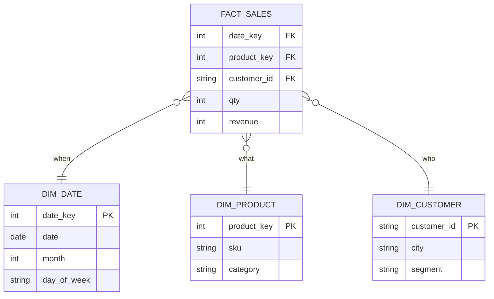

- **Fact table:** one row per business event (a sale), with **measures** (qty, revenue) and keys to dimensions.
- **Dimension tables:** descriptive context (date, product, customer, store) used to **filter and group**.
- **Slowly Changing Dimensions (SCD):** how to handle a customer moving city: overwrite (Type 1) or keep history with validity dates (Type 2).

---

## 10.4 Complete Java Example - A Tiny ETL into a Star Schema

```java
import java.time.LocalDate;
import java.util.ArrayList;
import java.util.HashMap;
import java.util.List;
import java.util.Map;
import java.util.TreeMap;

// ---- OLTP source rows (normalised, from the orders service) ----
record OrderRow(String orderId, String customerId, String sku, int qty, int unitPrice, String createdAt, String status) {}

// ---- Star schema in the warehouse ----
record DimProduct(int productKey, String sku, String category) {}
record DimDate(int dateKey, LocalDate date, int month, String dayOfWeek) {}
record FactSales(int dateKey, int productKey, String customerId, int qty, int revenue) {}

public class WarehouseEtlDemo {
    public static void main(String[] args) {
        List<OrderRow> extract = List.of(                               // E: extract from the OLTP database / CDC stream
                new OrderRow("O1", "C1", "BK-1", 2, 300, "2026-10-24", "DELIVERED"),
                new OrderRow("O2", "C2", "PH-9", 1, 15999, "2026-10-24", "DELIVERED"),
                new OrderRow("O3", "C1", "PH-9", 1, 15999, "2026-10-25", "CANCELLED"),
                new OrderRow("O4", "C3", "BK-2", 3, 250, "2026-10-25", "DELIVERED"),
                new OrderRow("O5", "C2", "BK-1", 1, 300, "2026-10-25", "DELIVERED"));
        Map<String, String> catalog = Map.of("BK-1", "books", "BK-2", "books", "PH-9", "electronics");

        // T: transform - filter, look up dimensions, compute measures
        Map<String, DimProduct> products = new HashMap<>();
        Map<String, DimDate> dates = new HashMap<>();
        List<FactSales> facts = new ArrayList<>();
        for (OrderRow o : extract) {
            if (o.status().equals("CANCELLED")) continue;              // business rule: only completed sales
            DimProduct p = products.computeIfAbsent(o.sku(), s -> new DimProduct(products.size() + 1, s, catalog.get(s)));
            LocalDate d = LocalDate.parse(o.createdAt());
            DimDate dd = dates.computeIfAbsent(o.createdAt(), s -> new DimDate(Integer.parseInt(s.replace("-", "")), d, d.getMonthValue(), d.getDayOfWeek().toString()));
            facts.add(new FactSales(dd.dateKey(), p.productKey(), o.customerId(), o.qty(), o.qty() * o.unitPrice()));
        }
        // L: load into the warehouse tables
        System.out.println("dim_product : " + products.values().stream().sorted((a, b) -> a.productKey() - b.productKey()).toList());
        System.out.println("fact_sales  : " + facts.size() + " rows (cancelled order filtered out)");

        // OLAP query: revenue by category and day (GROUP BY over the star schema)
        Map<String, Integer> revenue = new TreeMap<>();
        Map<Integer, DimProduct> byKey = new HashMap<>();
        products.values().forEach(p -> byKey.put(p.productKey(), p));
        Map<Integer, DimDate> dateByKey = new HashMap<>();
        dates.values().forEach(d -> dateByKey.put(d.dateKey(), d));
        for (FactSales f : facts) {
            String k = dateByKey.get(f.dateKey()).date() + " " + dateByKey.get(f.dateKey()).dayOfWeek() + " | " + byKey.get(f.productKey()).category();
            revenue.merge(k, f.revenue(), Integer::sum);
        }
        System.out.println("SELECT d.date, p.category, SUM(f.revenue) ... GROUP BY d.date, p.category:");
        revenue.forEach((k, v) -> System.out.println("   " + k + " = Rs." + v));
    }
}
```

**Output:**
```
dim_product : [DimProduct[productKey=1, sku=BK-1, category=books], DimProduct[productKey=2, sku=PH-9, category=electronics], DimProduct[productKey=3, sku=BK-2, category=books]]
fact_sales  : 4 rows (cancelled order filtered out)
SELECT d.date, p.category, SUM(f.revenue) ... GROUP BY d.date, p.category:
   2026-10-24 SATURDAY | books = Rs.600
   2026-10-24 SATURDAY | electronics = Rs.15999
   2026-10-25 SUNDAY | books = Rs.1050
```

What the output shows:
- **Extract:** rows came from the operational orders data.
- **Transform:** a business rule removed the cancelled order; products and dates were turned into **dimension** rows with surrogate keys; revenue was calculated as a **measure**.
- **Load + query:** an OLAP-style `GROUP BY` over the star schema answered "revenue per day per category" without touching the operational database.

---

## 10.5 Data Platforms in Practice (and Where Java Fits)

| Layer | Common tools | Java's role |
|---|---|---|
| Ingestion | Debezium/Kafka Connect (CDC), Fivetran, Airbyte, Kafka | Services publish events; Kafka Connect is Java |
| Storage | S3/ADLS/GCS, Iceberg/Delta/Hudi tables, Snowflake/BigQuery/Redshift | Iceberg/Delta have Java APIs |
| Processing | Apache Spark, Flink, dbt (SQL), Kafka Streams | Spark/Flink jobs in Java/Scala; Kafka Streams in Spring Boot |
| Orchestration | Airflow, Dagster, Prefect | (Python mostly) |
| Serving | BI tools, reverse ETL back into apps, ML feature stores | Spring Boot APIs reading aggregated tables |

```java
// Writing a stream of order events into a lakehouse table with Spark (Java API)
Dataset<Row> orders = spark.readStream().format("kafka")
        .option("kafka.bootstrap.servers", "kafka:9092")
        .option("subscribe", "orders.events")
        .load()
        .selectExpr("CAST(value AS STRING) AS json")
        .select(from_json(col("json"), orderSchema).as("o"))
        .select("o.*");

orders.writeStream()
      .format("iceberg")
      .outputMode("append")
      .option("checkpointLocation", "s3://lake/checkpoints/orders")
      .toTable("lake.curated.orders");
```

#### 📘 Terms Explained

| Term | Simple meaning |
|---|---|
| **ETL / ELT** | Extract-Transform-Load (transform before loading) / Extract-Load-Transform (load raw, transform in the warehouse). |
| **Star schema** | A fact table in the middle with dimension tables around it. |
| **Fact / dimension** | Business events with measures / descriptive context for filtering and grouping. |
| **Surrogate key** | A warehouse-generated key (1, 2, 3...) instead of the source system's ID. |
| **SCD (Slowly Changing Dimension)** | Techniques for dimension values that change over time (Type 1 overwrite, Type 2 history rows). |
| **Iceberg / Delta Lake / Hudi** | Open table formats adding ACID, schema evolution and time travel to files in a data lake. |
| **Columnar storage** | Storing each column together, so analytics reading a few columns is very fast. |
| **Reverse ETL** | Sending warehouse results back into operational tools (CRM, apps). |

---

## 10.6 Pros, Cons, Pitfalls and Interview Questions

| | Pros | Cons |
|---|---|---|
| **Warehouse** | Clean, trusted, fast SQL; great for BI | Costly for huge raw data; schema changes need modelling work |
| **Lake** | Cheap, stores everything, any format, ML-friendly | Becomes a "data swamp" without catalogues and quality controls |
| **Lakehouse** | Lake cost + warehouse features, open formats | Newer, more components to run |

| Pitfall | Fix |
|---|---|
| Running analytics on the production OLTP DB | Replicate to a warehouse (CDC/ELT); or at least a read replica. |
| Data lake with no catalogue, owners or quality checks ("swamp") | Data catalogue, schemas, data contracts, quality tests (dbt tests, Great Expectations). |
| PII copied everywhere | Mask/tokenise at ingestion; access controls; retention policies. |
| Nightly full dumps of huge tables | Incremental loads / CDC. |
| Metrics defined differently by each team | Shared semantic layer / metrics definitions. |

**Q1. Data lake vs data warehouse?** Warehouse: structured, modelled, schema-on-write, optimised for SQL/BI. Lake: raw data of any format in cheap object storage, schema-on-read, for exploration, ML and batch processing. A lakehouse combines both.

**Q2. OLTP vs OLAP?** OLTP serves the application: many small, fast transactions on current data (row stores). OLAP serves analytics: few large queries over historical data (columnar stores).

**Q3. ETL vs ELT?** ETL transforms data before loading into the warehouse; ELT loads raw data first and transforms inside the warehouse (the modern default with cheap storage and powerful engines).

**Q4. What is a star schema?** A central fact table (events with measures) linked to dimension tables (date, product, customer) used for filtering and grouping.

**Q5. How do you get data from microservices into a warehouse?** CDC (Debezium) or domain events into Kafka, landed in the lake/warehouse (Kafka Connect sinks, Spark/Flink), then modelled with dbt. Never by querying each service's production DB with heavy reports.

---

## 10.7 Data Lake and Warehouse - Cheat Sheet

```
WAREHOUSE  Structured, modelled, schema-on-write, columnar; SQL/BI (Snowflake, BigQuery, Redshift).
LAKE       Raw data, any format, object storage, schema-on-read; ML/exploration (S3 + Spark/Trino). Beware the swamp.
LAKEHOUSE  Lake + ACID tables/schemas/time travel (Iceberg, Delta, Hudi).
          OLTP (app, row store, current) vs OLAP (analytics, columnar, history).
          ETL (transform before load) vs ELT (load raw, transform in warehouse with dbt) <- modern default.
          Star schema: fact (measures + keys) + dimensions (date, product, customer); SCD Type 1/2.
          Feed via CDC/events -> Kafka -> lake/warehouse. Never run heavy analytics on production OLTP.
```

---

# 11. How the Data Management Patterns Fit Together

## 11.1 One-Line Summary of Each

| Pattern | Question it answers | One-line answer |
|---|---|---|
| **CQRS** | "Reads and writes need different shapes." | Separate write model and read models, synced by events. |
| **Event Sourcing** | "We need the full history." | Store events; derive state by replay. |
| **Saga** | "Business transaction across services?" | Local transactions + compensations. |
| **Two-Phase Commit** | "Atomic commit across databases?" | Prepare + commit via a coordinator; blocking. |
| **Strong Consistency** | "Reads must never be stale." | Single leader, sync replication, quorums, consensus. |
| **Eventual Consistency** | "Fast and available, staleness OK." | Async replication; converge; resolve conflicts. |
| **CAP Theorem** | "What happens in a partition?" | Choose consistency or availability, per data type. |
| **BASE** | "What's the philosophy of AP systems?" | Basically available, soft state, eventually consistent. |
| **Materialized View** | "Expensive query, needed often." | Precompute and store the result; refresh it. |
| **CDC** | "How do other systems see every DB change?" | Read the transaction log and stream changes. |
| **Data Lake / Warehouse** | "Where does analytics happen?" | Separate analytical stores fed by CDC/ELT. |

## 11.2 One Order's Data Through the Whole System (Interview Imp - Java)

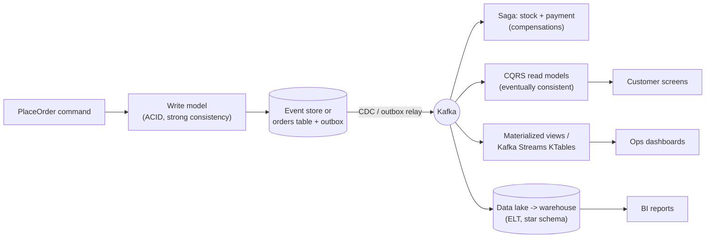

| Step | Patterns |
|---|---|
| Accept and validate the change | CQRS command side, strong consistency, ACID |
| Record it | Event sourcing (optional) or state + outbox |
| Publish it reliably | CDC / transaction log tailing, outbox |
| Coordinate other services | Saga (not 2PC) |
| Serve screens fast | CQRS read models, materialized views (eventual consistency) |
| Survive partitions and regions | CAP/PACELC choice per data type, BASE between services |
| Analyse history | Data lake / warehouse via CDC and ELT |

## 11.3 Decision Guide

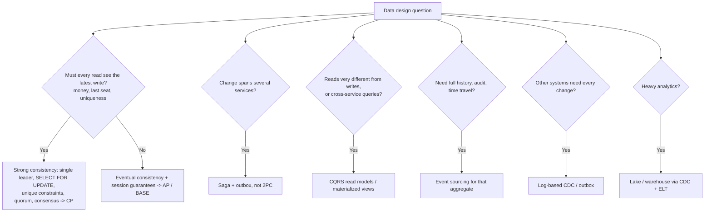

| If you hear... | Think... |
|---|---|
| "Reporting slows down checkout", "separate read and write" | CQRS / Materialized View |
| "Audit trail", "time travel", "replay", "ledger" | Event Sourcing |
| "Distributed transaction", "XA", "2PC" | 2PC → prefer Saga |
| "Never stale", "linearizable", "quorum", "Raft" | Strong Consistency |
| "Replication lag", "converge", "CRDT", "LWW" | Eventual Consistency |
| "Partition", "CP or AP", "Cassandra vs etcd" | CAP / PACELC |
| "ACID vs NoSQL philosophy" | BASE |
| "Precomputed", "dashboard too slow", "REFRESH" | Materialized View |
| "Debezium", "WAL", "binlog", "sync Elasticsearch" | CDC |
| "Analytics", "OLAP", "star schema", "Snowflake", "S3 + Spark" | Data Warehouse / Lake |

## 11.4 Look-Alike Patterns

| Pair | Difference |
|---|---|
| **CQRS vs Event Sourcing** | CQRS separates read/write models; ES stores history as events. Independent, but ES nearly always needs CQRS. |
| **Materialized View vs CQRS read model** | Same idea; a materialized view is often DB-managed, a read model is app-maintained from events. |
| **Saga vs 2PC** | Local commits + compensation (available, no isolation) vs atomic commit with locks (blocking). |
| **Strong vs Eventual consistency** | Always latest (costs latency/availability) vs converges later (fast, available, stale reads). |
| **CAP vs BASE** | CAP is a theorem about trade-offs; BASE is the design philosophy of systems that choose A. |
| **CDC vs Domain Events** | Data-level changes captured from the log vs designed business facts; combine via outbox + CDC. |
| **Data Lake vs Warehouse** | Raw, any format, schema-on-read vs cleaned, modelled, schema-on-write. |
| **Event sourcing vs CDC** | ES: events are the source of truth, written by the app. CDC: the table is the truth, changes are derived from its log. |

## 11.5 Data Management Inside the Java / Spring Ecosystem

| Pattern | Java / Spring / ecosystem |
|---|---|
| CQRS | Separate services/repositories, DTO projections, `@Transactional(readOnly = true)`, projectors with `@KafkaListener`, Axon |
| Event Sourcing | Axon Framework (`@Aggregate`, `@EventSourcingHandler`), EventStoreDB Java client, PostgreSQL events table |
| Saga / 2PC | Orchestrator + outbox, Temporal, Axon sagas / JTA + Atomikos/Narayana with XA datasources |
| Strong Consistency | Isolation levels, `SELECT ... FOR UPDATE`, `@Version`, unique constraints, etcd/ZooKeeper clients |
| Eventual Consistency | Read replicas with routing datasources, caches with TTL, event-driven copies, reconciliation `@Scheduled` jobs |
| CAP / BASE | Choosing stores (PostgreSQL, Cassandra, DynamoDB, MongoDB) and consistency levels per query |
| Materialized View | PostgreSQL MVs + `@Scheduled` refresh, `@Immutable` entities, Kafka Streams `KTable` |
| CDC | Debezium on Kafka Connect, Spring Kafka consumers of change events |
| Lake / Warehouse | Kafka Connect sinks, Spark/Flink Java jobs, Iceberg/Delta Java APIs |

## 11.6 Comparison Table

| Pattern | Main problem solved | Key mechanism | Biggest risk | Interview favourite |
|---|---|---|---|---|
| **CQRS** | Conflicting read/write needs | Separate models + projections | Overuse, stale views | When to use it, read-your-writes |
| **Event Sourcing** | Lost history | Append-only events + replay | Complexity, schema evolution | Snapshots, optimistic concurrency |
| **Saga** | Cross-service consistency | Compensations | No isolation | Orchestration vs choreography |
| **2PC** | Atomic multi-DB commit | Prepare/commit | Blocking, availability | Why microservices avoid it |
| **Strong Consistency** | Stale/incorrect reads | Leader, quorum, consensus | Latency, availability | Linearizable vs serializable, W+R>N |
| **Eventual Consistency** | Availability and latency | Async replication, CRDTs | Conflicts, confused users | LWW vs CRDT, session guarantees |
| **CAP** | Partition behaviour | Choose C or A | "CA" misconception | CP vs AP examples, PACELC |
| **BASE** | Scale and availability | Soft state, convergence | Misused for invariants | ACID vs BASE |
| **Materialized View** | Slow repeated queries | Precompute + refresh | Staleness, refresh cost | View vs MV, CONCURRENTLY |
| **CDC** | Syncing other systems | Read the transaction log | Schema coupling, WAL growth | Polling vs log-based, Debezium |
| **Lake / Warehouse** | Analytics on OLTP | Separate analytical stores | Data swamp, PII sprawl | OLTP vs OLAP, ETL vs ELT, star schema |

---

# 12. Data Management Patterns Cheat Sheet

```
CQRS             Write model (commands, rules) vs read models (views); projectors from events; rebuildable; eventual.
EVENT SOURCING   State = replay(events); append-only; expectedVersion (optimistic concurrency); snapshots; upcasting;
                 projections for queries; crypto-shredding for GDPR.
SAGA             Local transactions + compensations; orchestration/choreography; outbox; no isolation (semantic locks).
2PC              Coordinator: prepare (lock + vote) -> commit/rollback. Atomic, but BLOCKING + low availability. JTA/XA.
STRONG           Every read sees the latest write. Linearizable vs serializable. Leader, sync replication, W+R>N, Raft/Paxos.
EVENTUAL         Replicas converge if updates stop. Async replication, anti-entropy, read repair.
                 Conflicts: LWW (lossy), merge, vector clocks, CRDTs. Session guarantees: read-your-writes, monotonic reads.
CAP              Partition -> choose C (refuse) or A (answer, maybe stale). P is mandatory; CA = single node. PACELC adds latency.
BASE             Basically Available, Soft state, Eventually consistent. ACID inside a service, BASE between services.
MATERIALIZED VW  Precomputed stored query; full / incremental / streaming refresh; REFRESH ... CONCURRENTLY; show staleness.
CDC              Log-based (WAL/binlog) > triggers > polling. Debezium + Kafka Connect; c/u/d with before/after; LSN offsets.
LAKE/WAREHOUSE   OLTP vs OLAP. Warehouse = modelled, schema-on-write; lake = raw, schema-on-read; lakehouse = Iceberg/Delta.
                 ELT + dbt; star schema (facts + dimensions); feed via CDC/events.
```

### Quick Decision Table

| Need | Use |
|---|---|
| Fast dashboards without slowing writes | CQRS read model / Materialized View |
| Full audit trail and replay | Event Sourcing |
| Business transaction across services | Saga (+ outbox) |
| Atomic commit across two DBs in one app (rare) | 2PC / JTA with XA |
| Money, last-unit stock, unique usernames | Strong consistency (CP) |
| Feeds, likes, carts, search, analytics | Eventual consistency (AP / BASE) |
| Keep search/cache/warehouse in sync with every change | Log-based CDC (Debezium) |
| Company-wide analytics and reporting | Data warehouse / lakehouse via CDC + ELT |
| Simple CRUD app with one database | None of the above. One ACID database is enough. |

### Top Interview Traps

1. **CAP's "pick 2 of 3" is misleading:** partitions are unavoidable, so the real choice is C or A during a partition. "CA" means a single node.
2. **Linearizability ≠ serializability:** single-object real-time order vs transaction ordering.
3. **Quorums only guarantee overlap when W + R > N.**
4. **2PC is blocking:** a coordinator crash leaves participants holding locks. Microservices use sagas.
5. **Sagas have no isolation:** use semantic locks (PENDING states) and compensations.
6. **Last-Writer-Wins converges but silently loses updates;** CRDTs or merges avoid that.
7. **Event sourcing almost always needs CQRS,** and events must never be edited (upcast instead).
8. **Polling-based CDC misses deletes and intermediate changes;** log-based CDC doesn't.
9. **CQRS read models are eventually consistent:** plan for read-your-writes.
10. **Never run heavy analytics on the production OLTP database;** feed a warehouse via CDC/ELT.

> **Related files:** [02_Microservices_Pattern.md](../04_Specialized/02_Microservices_Pattern.md) (database per service, saga, CQRS read models) · [04_Messaging_Pattern.md](04_Messaging_Pattern.md) (outbox, idempotent consumers, Kafka) · [01_Scalability_Pattern.md](01_Scalability_Pattern.md) (replication, read replicas, sharding, caching) · [02_Reliability_Pattern.md](02_Reliability_Pattern.md) (redundancy, quorum, failover) · [00_Design_Patterns_Complete_List.md](../00_Design_Patterns_Complete_List.md) (master list) · [SQL_Database_Essentials_Syllabus_Guide.md](../../mysql/SQL_Database_Essentials_Syllabus_Guide.md) (transactions, normalization)
