---
mdx:
  format: md
---

# Distributed Systems Patterns

> **Note**: Patterns marked with **(Interview Imp - Java)** are frequently asked in Java interviews
>
> **How to read this file:** Every section ends with a **📘 Terms Explained** table. If you see a word you don't know, check the table right below that section. Each pattern goes from the basic idea to advanced usage (plain Java, Redis/ZooKeeper/etcd, Spring Boot, pitfalls) and ends with interview questions and a mini cheat sheet.
>
> **What are distributed systems patterns?** They answer one question: *"How do many machines, connected by an unreliable network and without a shared clock, cooperate as if they were one reliable system?"* That covers sharing a cache, spreading data across nodes (consistent hashing), agreeing on decisions (quorum, consensus, leader election), spreading information (gossip), ordering events without a global clock (vector clocks), and coordinating exclusive work (distributed locks).
>
> **Builds on:** [05_Data_Management_Pattern.md](05_Data_Management_Pattern.md) (strong vs eventual consistency, CAP, quorum reads/writes), [02_Reliability_Pattern.md](02_Reliability_Pattern.md) (redundancy, failover, split brain), [01_Scalability_Pattern.md](01_Scalability_Pattern.md) (caching, sharding). Sidecar, Ambassador and Service Mesh are covered in [02_Microservices_Pattern.md](../04_Specialized/02_Microservices_Pattern.md#11-sidecar-ambassador-and-service-mesh-patterns-interview-imp---java) and summarised in section 9.
>
> **Verified code:** Every main "Complete Java Example" in this file is **plain Java 17 (no libraries)**: a small, single-threaded simulation of the real algorithm (a hash ring, a Raft log, gossip rounds, fencing tokens...). Each was compiled and run, and its **Output** block is the real program output. Simulations use fake clocks or fixed random seeds, so the output is the same on every run. To run one, save it as `<ClassName>.java` and run `javac <ClassName>.java && java <ClassName>`. (Running it directly with `java <ClassName>.java` won't work, because the class with `main` is not the first class in the file.)

---

## Table of Contents
1. [Distributed Cache Pattern](#1-distributed-cache-pattern-interview-imp---java) **(Interview Imp - Java)**
   - [1.1 What is a Distributed Cache?](#11-what-is-a-distributed-cache)
   - [1.2 Why Do We Need It?](#12-why-do-we-need-it)
   - [1.3 Types and Topologies](#13-types-and-topologies)
   - [1.4 Complete Java Example - Local vs Shared vs Near Cache](#14-complete-java-example---local-vs-shared-vs-near-cache)
   - [1.5 Distributed Caching in Spring Boot](#15-distributed-caching-in-spring-boot)
   - [1.6 Pros, Cons and Pitfalls](#16-pros-cons-and-pitfalls)
   - [1.7 Distributed Cache - Interview Questions](#17-distributed-cache---interview-questions)
   - [1.8 Distributed Cache - Cheat Sheet](#18-distributed-cache---cheat-sheet)
2. [Consistent Hashing Pattern](#2-consistent-hashing-pattern-interview-imp---java) **(Interview Imp - Java)**
   - [2.1 What is Consistent Hashing?](#21-what-is-consistent-hashing)
   - [2.2 Why Do We Need It?](#22-why-do-we-need-it)
   - [2.3 How It Works](#23-how-it-works)
   - [2.4 Complete Java Example - Modulo vs Hash Ring vs Virtual Nodes](#24-complete-java-example---modulo-vs-hash-ring-vs-virtual-nodes)
   - [2.5 Consistent Hashing in Practice](#25-consistent-hashing-in-practice)
   - [2.6 Pros, Cons, Pitfalls and Interview Questions](#26-pros-cons-pitfalls-and-interview-questions)
   - [2.7 Consistent Hashing - Cheat Sheet](#27-consistent-hashing---cheat-sheet)
3. [Quorum Pattern](#3-quorum-pattern-interview-imp---java) **(Interview Imp - Java)**
   - [3.1 What is a Quorum?](#31-what-is-a-quorum)
   - [3.2 Why Do We Need It?](#32-why-do-we-need-it)
   - [3.3 Complete Java Example - Majorities, Partitions and Cluster Sizes](#33-complete-java-example---majorities-partitions-and-cluster-sizes)
   - [3.4 Quorums in Practice](#34-quorums-in-practice)
   - [3.5 How It Works, Pros and Cons, Interview Questions and Cheat Sheet](#35-how-it-works-pros-and-cons-interview-questions-and-cheat-sheet)
4. [Leader Election Pattern](#4-leader-election-pattern-interview-imp---java) **(Interview Imp - Java)**
   - [4.1 What is Leader Election?](#41-what-is-leader-election)
   - [4.2 Why Do We Need It?](#42-why-do-we-need-it)
   - [4.3 How It Works: Approaches](#43-how-it-works-approaches)
   - [4.4 Complete Java Example - Lease-Based Election with Fencing Terms](#44-complete-java-example---lease-based-election-with-fencing-terms)
   - [4.5 Leader Election in Java, Spring and Kubernetes](#45-leader-election-in-java-spring-and-kubernetes)
   - [4.6 Pros, Cons, Pitfalls and Interview Questions](#46-pros-cons-pitfalls-and-interview-questions)
   - [4.7 Leader Election - Cheat Sheet](#47-leader-election---cheat-sheet)
5. [Consensus Algorithms: Raft and Paxos](#5-consensus-algorithms-raft-and-paxos-interview-imp---java) **(Interview Imp - Java)**
   - [5.1 What is Consensus?](#51-what-is-consensus)
   - [5.2 Why Do We Need It?](#52-why-do-we-need-it)
   - [5.3 How Raft Works](#53-how-raft-works)
   - [5.4 Complete Java Example - Simplified Raft Log Replication and Election](#54-complete-java-example---simplified-raft-log-replication-and-election)
   - [5.5 Consensus in the Java World](#55-consensus-in-the-java-world)
   - [5.6 Pros, Cons, Pitfalls and Interview Questions](#56-pros-cons-pitfalls-and-interview-questions)
   - [5.7 Consensus - Cheat Sheet](#57-consensus---cheat-sheet)
6. [Gossip Protocol Pattern](#6-gossip-protocol-pattern)
   - [6.1 What is a Gossip Protocol?](#61-what-is-a-gossip-protocol)
   - [6.2 Why Do We Need It?](#62-why-do-we-need-it)
   - [6.3 How It Works](#63-how-it-works)
   - [6.4 Complete Java Example - Rumour Spreading and Heartbeat Failure Detection](#64-complete-java-example---rumour-spreading-and-heartbeat-failure-detection)
   - [6.5 Gossip in Practice](#65-gossip-in-practice)
   - [6.6 Pros, Cons, Pitfalls and Interview Questions](#66-pros-cons-pitfalls-and-interview-questions)
   - [6.7 Gossip Protocol - Cheat Sheet](#67-gossip-protocol---cheat-sheet)
   - [6.8 Types and Variants](#68-types-and-variants)
7. [Vector Clocks and Logical Time](#7-vector-clocks-and-logical-time)
   - [7.1 What Are Logical Clocks?](#71-what-are-logical-clocks)
   - [7.2 Why Do We Need Them?](#72-why-do-we-need-them)
   - [7.3 Complete Java Example - Lamport vs Vector Clocks](#73-complete-java-example---lamport-vs-vector-clocks)
   - [7.4 Logical Clocks in Practice](#74-logical-clocks-in-practice)
   - [7.5 Pros, Cons, Pitfalls and Interview Questions](#75-pros-cons-pitfalls-and-interview-questions)
   - [7.6 Vector Clocks - Cheat Sheet](#76-vector-clocks---cheat-sheet)
   - [7.7 Types and Variants](#77-types-and-variants)
8. [Distributed Locks Pattern](#8-distributed-locks-pattern-interview-imp---java) **(Interview Imp - Java)**
   - [8.1 What is a Distributed Lock?](#81-what-is-a-distributed-lock)
   - [8.2 Why Do We Need It?](#82-why-do-we-need-it)
   - [8.3 How It Works: Safety Rules and Implementations](#83-how-it-works-safety-rules-and-implementations)
   - [8.4 Complete Java Example - Why Fencing Tokens Matter](#84-complete-java-example---why-fencing-tokens-matter)
   - [8.5 Distributed Locks in Spring Boot](#85-distributed-locks-in-spring-boot)
   - [8.6 Pros, Cons, Pitfalls and Interview Questions](#86-pros-cons-pitfalls-and-interview-questions)
   - [8.7 Distributed Locks - Cheat Sheet](#87-distributed-locks---cheat-sheet)
   - [8.8 Types and Variants](#88-types-and-variants)
9. [Sidecar, Ambassador, Service Mesh and Anti-Corruption Layer](#9-sidecar-ambassador-service-mesh-and-anti-corruption-layer)
10. [How the Distributed Systems Patterns Fit Together](#10-how-the-distributed-systems-patterns-fit-together)
   - [10.1 One-Line Summary of Each](#101-one-line-summary-of-each)
   - [10.2 How a Real Cluster Uses Them Together (Interview Imp - Java)](#102-how-a-real-cluster-uses-them-together-interview-imp---java)
   - [10.3 Decision Guide](#103-decision-guide)
   - [10.4 Look-Alike Patterns](#104-look-alike-patterns)
   - [10.5 Distributed Systems Tools in the Java Ecosystem](#105-distributed-systems-tools-in-the-java-ecosystem)
   - [10.6 Comparison Table](#106-comparison-table)
11. [Distributed Systems Patterns Cheat Sheet](#11-distributed-systems-patterns-cheat-sheet)

---

## Before You Start: What Makes Distributed Systems Hard

A **distributed system** is a set of computers that work together and appear to users as one system. The three things that make it hard:

### 1. Partial failure

In one machine, things usually work or crash completely. In a distributed system, **some parts fail while others keep running**, and you often **can't tell** which.

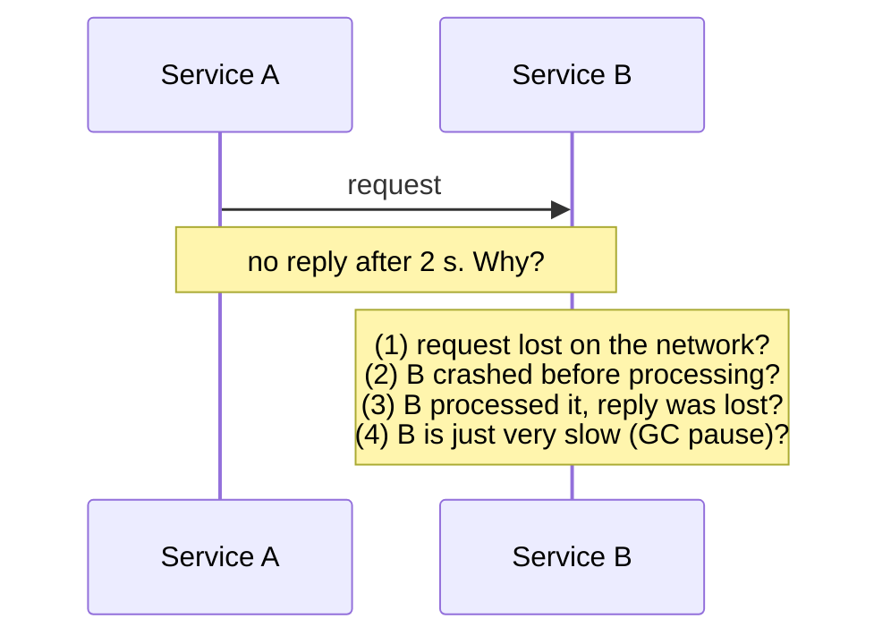

A timeout tells you **"I didn't hear back"**, not **"it didn't happen"**. That's why retries need idempotency ([02_Reliability_Pattern.md](02_Reliability_Pattern.md#2-retry-pattern-interview-imp---java)).

### 2. Unreliable networks

Messages can be **lost, delayed, duplicated or reordered**, and the network can **partition** (split the cluster into groups that can't talk). See the fallacies of distributed computing in [02_Reliability_Pattern.md](02_Reliability_Pattern.md#before-you-start-failure-is-normal).

### 3. No shared clock

Every machine has its own clock, and clocks **drift** and **jump** (NTP corrections, leap seconds, VM pauses). You **can't reliably order events by wall-clock timestamps** across machines. Distributed systems use **logical clocks** (section 7), **leases with margins** (sections 4 and 8) or specialised hardware (Google TrueTime).

### Failure models

| Model | Nodes can... | Handled by |
|---|---|---|
| **Crash-stop** | Stop and never come back | Redundancy, failover |
| **Crash-recovery** | Stop and restart later (with what's on disk) | Write-ahead logs, Raft/Paxos |
| **Omission** | Lose some messages | Retries, acknowledgements |
| **Byzantine** | Behave arbitrarily or maliciously (lie) | BFT protocols, blockchains (rare in normal backends) |

Most business systems (and Raft/Paxos) assume **crash-recovery, non-Byzantine** nodes: machines may fail, but they don't lie.

#### 📘 Terms Explained

| Term | Simple meaning |
|---|---|
| **Distributed system** | Several computers cooperating over a network to act as one system. |
| **Node** | One machine or process in the cluster. |
| **Partial failure** | Some components fail while others keep working. |
| **Network partition** | The network splits the nodes into groups that can't communicate. |
| **Clock drift / skew** | Machine clocks slowly diverge / differ from each other. |
| **NTP** | Network Time Protocol: synchronises clocks over the network (to within milliseconds, not perfectly). |
| **Byzantine failure** | A node sends wrong or malicious information, not just stops. |
| **GC pause** | The JVM stopping application threads for garbage collection; can last seconds with big heaps. |

---

# 1. Distributed Cache Pattern (Interview Imp - Java)

## 1.1 What is a Distributed Cache?

A **distributed cache** keeps frequently used data **in memory across several nodes** (a cache cluster) that **all application instances share**. Instead of each instance keeping its own private copy, everyone reads from and writes to the same cache, which can grow beyond one machine's RAM by **partitioning** keys across nodes.

**Analogy:** A team's shared Google Sheet vs everyone keeping their own notebook. With notebooks (local caches), when one person updates a number, everyone else's notebook is out of date. With the shared sheet, an update is visible to all at once.

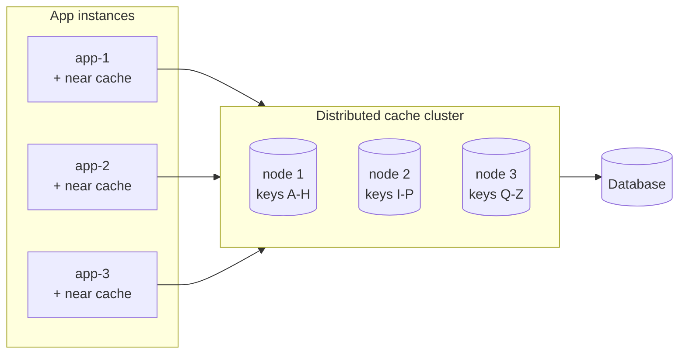

> Caching strategies (cache-aside, write-through, write-back), eviction and invalidation basics are in [01_Scalability_Pattern.md](01_Scalability_Pattern.md#8-caching-interview-imp---java). This section focuses on the **distributed** part.

#### 📘 Terms Explained

| Term | Simple meaning |
|---|---|
| **Distributed cache** | An in-memory key-value store spread across several nodes, shared by all app instances. |
| **Local (in-process) cache** | A cache inside one JVM's heap (Caffeine, a `ConcurrentHashMap`). |
| **Near cache** | A small local cache in front of the distributed cache, for the hottest keys. |
| **Partitioning (sharding)** | Splitting keys across nodes so each holds only part of the data. |

---

## 1.2 Why Do We Need It?

| Problem with local caches only | Distributed cache |
|---|---|
| Each of 20 instances caches separately → 20× memory, 20× DB loads on a cold start | One shared copy; the DB is hit once per key |
| An update on one instance leaves the other 19 **stale** | One place to update or invalidate |
| Restarting/deploying instances empties their caches | Cache survives app restarts |
| Can't hold more than one JVM heap | Scales to hundreds of GB across nodes |
| Session data tied to one instance (sticky sessions) | Shared sessions (Spring Session + Redis) |

**Common uses:** database query results, sessions, rate-limit counters, feature flags, idempotency keys, leaderboards, distributed locks (section 8).

---

## 1.3 Types and Topologies

| Topology | How | Latency | Consistency across instances |
|---|---|---|---|
| **Local only** (Caffeine) | Each JVM caches privately | ~nanoseconds | Poor (stale on other instances) |
| **Distributed / remote** (Redis, Memcached) | Network call to the cache cluster | ~0.2-1 ms | Good (one copy) |
| **Near cache + distributed** (two-level) | Local L1 for hot keys, remote L2, invalidation messages | ~ns for hits | Good if invalidations work; short TTL as a safety net |
| **Embedded data grid** (Hazelcast, Apache Ignite, Infinispan) | Cache nodes run **inside** the app JVMs and form a cluster | Local for owned keys | Good; app and cache scale together |

| Product | Notes |
|---|---|
| **Redis** (Redis Cluster, Sentinel) | Most popular; rich data types, pub/sub, Lua, persistence options |
| **Memcached** | Simple, fast, multi-threaded; strings only, no persistence/replication built in |
| **Hazelcast / Apache Ignite / Infinispan** | Java data grids: distributed maps, near caches, compute next to data |
| **Managed** | AWS ElastiCache / MemoryDB, Azure Cache for Redis, Google Memorystore |

### How Redis Cluster partitions data

Redis Cluster splits keys into **16,384 hash slots** (`CRC16(key) mod 16384`) assigned to master nodes, each with replicas. Clients learn the slot map and talk directly to the right node. **Hash tags** (`{user:42}:cart`, `{user:42}:profile`) force related keys into the same slot so multi-key operations work.

---

## 1.4 Complete Java Example - Local vs Shared vs Near Cache

```java
import java.util.ArrayList;
import java.util.HashMap;
import java.util.List;
import java.util.Map;
import java.util.function.Consumer;

// The source of truth
class ProductDb {
    final Map<String, Integer> prices = new HashMap<>(Map.of("P1", 7999));
    int reads = 0;
    int load(String id) { reads++; return prices.get(id); }
}

// A shared, distributed cache (Redis / Hazelcast in real life): one copy for every app instance
class SharedCache {
    final Map<String, Integer> data = new HashMap<>();
    final List<Consumer<String>> invalidationSubscribers = new ArrayList<>();   // Redis pub/sub channel
    void publishInvalidation(String key) { invalidationSubscribers.forEach(s -> s.accept(key)); }
}

class AppInstance {
    final String name;
    final ProductDb db;
    final SharedCache shared;
    final Map<String, Integer> local = new HashMap<>();     // in-process cache (Caffeine) = "near cache"
    final boolean useLocal, useShared;

    AppInstance(String name, ProductDb db, SharedCache shared, boolean useLocal, boolean useShared) {
        this.name = name; this.db = db; this.shared = shared; this.useLocal = useLocal; this.useShared = useShared;
        if (useLocal && useShared) shared.invalidationSubscribers.add(local::remove);   // listen for invalidations
    }

    int price(String id) {
        if (useLocal && local.containsKey(id)) return local.get(id);
        Integer v = useShared ? shared.data.get(id) : null;
        if (v == null) {
            v = db.load(id);
            if (useShared) shared.data.put(id, v);
        }
        if (useLocal) local.put(id, v);
        return v;
    }

    void updatePrice(String id, int newPrice) {
        db.prices.put(id, newPrice);
        if (useLocal) local.remove(id);                     // evicts only THIS instance's local copy
        if (useShared) { shared.data.remove(id); shared.publishInvalidation(id); }
    }
}

public class DistributedCacheDemo {
    static void run(String title, boolean useLocal, boolean useShared) {
        ProductDb db = new ProductDb();
        SharedCache shared = new SharedCache();
        AppInstance a = new AppInstance("app-1", db, shared, useLocal, useShared);
        AppInstance b = new AppInstance("app-2", db, shared, useLocal, useShared);

        a.price("P1"); b.price("P1"); a.price("P1"); b.price("P1");
        int readsBefore = db.reads;
        a.updatePrice("P1", 6999);                          // admin changes the price via app-1
        System.out.printf("%-34s DB reads for 4 lookups=%d | after update: app-1 sees %d, app-2 sees %d%s%n",
                title, readsBefore, a.price("P1"), b.price("P1"),
                a.price("P1") != b.price("P1") ? "   <- STALE on app-2" : "");
    }

    public static void main(String[] args) {
        run("Local cache only (per instance):", true, false);
        run("Shared distributed cache:", false, true);
        run("Near cache + shared + pub/sub:", true, true);
    }
}
```

**Output:**
```
Local cache only (per instance):   DB reads for 4 lookups=2 | after update: app-1 sees 6999, app-2 sees 7999   <- STALE on app-2
Shared distributed cache:          DB reads for 4 lookups=1 | after update: app-1 sees 6999, app-2 sees 6999
Near cache + shared + pub/sub:     DB reads for 4 lookups=1 | after update: app-1 sees 6999, app-2 sees 6999
```

What the output shows:
- **Local only:** each instance loaded P1 from the DB separately (2 DB reads), and after the update **app-2 kept serving the old price**.
- **Shared cache:** one DB read for all instances; after the update, both instances saw the new price.
- **Near cache + shared + pub/sub invalidation:** local (nanosecond) hits **and** correctness: the update published an invalidation that evicted the key from every instance's near cache.

---

## 1.5 Distributed Caching in Spring Boot

```yaml
spring:
  cache:
    type: redis
    redis:
      time-to-live: 10m              # every entry expires: the safety net against missed invalidations
      cache-null-values: false
  data:
    redis:
      cluster:
        nodes: redis-1:6379,redis-2:6379,redis-3:6379
```

```java
@Service
class ProductService {
    @Cacheable(cacheNames = "products", key = "#id")
    public Product find(String id) { return repo.findById(id).orElseThrow(); }        // cache-aside via Spring Cache

    @CacheEvict(cacheNames = "products", key = "#p.id")
    public Product update(Product p) { return repo.save(p); }

    @Cacheable(cacheNames = "products", key = "#id", sync = true)                     // one loader per key per instance
    public Product findHot(String id) { ... }
}
```

```java
// Two-level cache: Caffeine (L1) in front of Redis (L2), with pub/sub invalidation
@Component
@RequiredArgsConstructor
class TwoLevelPriceCache {
    private final Cache<String, Integer> l1 = Caffeine.newBuilder().maximumSize(10_000).expireAfterWrite(Duration.ofSeconds(30)).build();
    private final StringRedisTemplate redis;

    Integer get(String sku, Function<String, Integer> loader) {
        return l1.get(sku, k -> {
            String v = redis.opsForValue().get("price:" + k);
            if (v != null) return Integer.valueOf(v);
            Integer loaded = loader.apply(k);
            redis.opsForValue().set("price:" + k, loaded.toString(), Duration.ofMinutes(10));
            return loaded;
        });
    }

    void invalidate(String sku) {
        redis.delete("price:" + sku);
        redis.convertAndSend("price-invalidations", sku);      // every instance's listener calls l1.invalidate(sku)
    }
}
```

**Cache stampede** (many instances missing the same hot key at once and all hitting the DB) is a distributed problem: fix it with `sync = true` (per instance), a short **distributed lock** around the reload (section 8), **early probabilistic refresh**, or **stale-while-revalidate** (serve the old value while one caller refreshes). See also the caching problems in [01_Scalability_Pattern.md](01_Scalability_Pattern.md#86-common-caching-problems-interview-imp---java).

#### 📘 Terms Explained

| Term | Simple meaning |
|---|---|
| **Hash slot (Redis Cluster)** | One of 16,384 buckets that keys map to; slots are assigned to nodes. |
| **Hash tag** | The part of a Redis key in `{}`; only it is hashed, so related keys land in the same slot. |
| **`@Cacheable` / `@CacheEvict`** | Spring Cache annotations to read-through / remove cache entries (proxy-based). |
| **Spring Session** | Stores HTTP sessions in Redis/JDBC so any instance can serve any user. |
| **Cache stampede** | Many requests miss the same key simultaneously and overload the database. |
| **Stale-while-revalidate** | Keep serving the expired value while one request refreshes it in the background. |

---

## 1.6 Pros, Cons and Pitfalls

| Pros | Cons |
|---|---|
| Shared, consistent view across all instances | Network hop on every access (~ms) |
| Scales memory beyond one JVM | Another critical system to run (HA, failover, memory limits) |
| Survives app restarts and deployments | Cache and DB can still diverge (invalidation is hard) |
| Enables shared sessions, counters, locks | Serialisation cost and versioning of cached objects |

| Pitfall | Fix |
|---|---|
| No TTL ("cache forever") | Always set TTLs; they repair missed invalidations. |
| Caching huge objects or unbounded keys | Size limits, `maxmemory` + eviction policy (`allkeys-lru`), compact formats. |
| Hot key on one node | Near cache, key replication/splitting, client-side caching. |
| Cluster operations across slots failing (`CROSSSLOT`) | Hash tags for related keys. |
| Changing a cached class breaks deserialisation after a deployment | JSON serialisation with tolerant readers; versioned cache names. |
| Treating the cache as the source of truth | The DB is the truth; the cache must be rebuildable. |

---

## 1.7 Distributed Cache - Interview Questions

**Q1. Local cache vs distributed cache?**
Local: fastest, but per-instance copies, duplicated memory and stale data on other instances. Distributed: one shared copy across the cluster, scales beyond one JVM, but a network hop away.

**Q2. What is a near cache and how do you keep it consistent?**
A small local cache in front of a distributed cache. Keep it consistent with invalidation messages (Redis pub/sub, Hazelcast near-cache invalidation) plus a short TTL as a safety net.

**Q3. How does Redis Cluster distribute keys?**
CRC16(key) mod 16,384 hash slots, slots assigned to master nodes with replicas; clients route directly; hash tags group related keys.

**Q4. How do you prevent a cache stampede?**
Request coalescing (`sync = true`), a distributed lock so only one caller reloads, early/probabilistic refresh, stale-while-revalidate, and jittered TTLs so keys don't expire together.

**Q5. Redis vs Memcached vs Hazelcast?**
Redis: rich data types, persistence, replication, pub/sub, cluster. Memcached: simple, multithreaded string cache. Hazelcast: Java data grid embedded in app JVMs with near caches and distributed compute.

---

## 1.8 Distributed Cache - Cheat Sheet

```
DISTRIBUTED CACHE  Shared in-memory store across nodes (Redis, Memcached, Hazelcast); all instances see one copy.
          Topologies: local (fast, stale elsewhere) | remote | near cache + remote (+ pub/sub invalidation) | embedded grid.
          Redis Cluster: 16,384 hash slots, CRC16, replicas, hash tags {..} for multi-key ops.
          Spring: spring.cache.type=redis + TTL, @Cacheable(sync=true) / @CacheEvict, Spring Session, Caffeine L1.
          Always TTL; cache is NOT the source of truth; stampede fixes: coalescing, lock, early refresh, jitter.
```

---

# 2. Consistent Hashing Pattern (Interview Imp - Java)

## 2.1 What is Consistent Hashing?

**Consistent hashing** maps both **nodes** and **keys** onto the same circular hash space (a **ring**). Each key belongs to the **first node clockwise** from its position. When a node is added or removed, **only the keys next to it move**; everything else stays where it was.

**Analogy:** Seats around a round dining table with name cards for waiters. Each guest is served by the next waiter sitting clockwise. If a new waiter sits down between two others, only the guests just before the new waiter switch to them. Everyone else keeps their waiter.

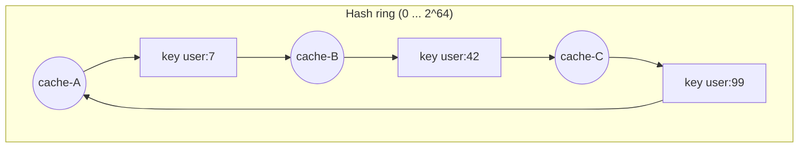

*Each key goes to the next node clockwise: `user:7` → cache-B, `user:42` → cache-C, `user:99` → cache-A.*

#### 📘 Terms Explained

| Term | Simple meaning |
|---|---|
| **Consistent hashing** | A way to assign keys to nodes so that adding/removing a node moves only about 1/N of the keys. |
| **Hash ring** | The range of hash values bent into a circle. |
| **Virtual node (vnode)** | Each physical node is placed at many points on the ring, for an even spread. |
| **Rebalancing** | Moving keys/data when nodes are added or removed. |

---

## 2.2 Why Do We Need It?

The naive way to pick a node is `node = hash(key) % N`. The problem: when N changes, **almost every key moves**.

| Change | `hash % N` | Consistent hashing |
|---|---|---|
| 4 → 5 nodes | ~80% of keys move | ~20% (≈ 1/5) move |
| One of 5 nodes fails | ~80% move | Only that node's ~20% move |

For a cache, moving 80% of keys means an 80% **miss rate** at once: the database gets hammered right when you were scaling up. For a database, it means moving most of the data.

Used by: **Cassandra, DynamoDB, Riak, Akka Cluster sharding, Memcached clients (ketama), Envoy/Nginx ring-hash load balancing, Discord, CDNs**. (Redis Cluster uses fixed hash slots instead, a related idea: keys map to fixed slots and only **slots** move between nodes.)

---

## 2.3 How It Works

1. Hash each node's name (many times, for **virtual nodes**) to positions on the ring.
2. Hash each key to a position.
3. Walk **clockwise** to the first node position: that's the owner.
4. **Add a node:** it takes over only the key ranges just counter-clockwise of its positions.
5. **Remove a node:** its ranges pass to the next node(s) clockwise.
6. **Replication:** store each key on the owner **and the next R-1 distinct nodes** clockwise (Cassandra/Dynamo style).

### Why virtual nodes?

With one point per node, the gaps between nodes are random, so some nodes own far bigger ranges (uneven load). With **100-256 virtual nodes** per physical node, ranges average out. Vnodes also let a **more powerful machine** take more points (weighted capacity), and when a node fails its load spreads over **many** nodes instead of one neighbour.

---

## 2.4 Complete Java Example - Modulo vs Hash Ring vs Virtual Nodes

```java
import java.nio.charset.StandardCharsets;
import java.security.MessageDigest;
import java.util.HashMap;
import java.util.List;
import java.util.Map;
import java.util.SortedMap;
import java.util.TreeMap;

class HashRing {
    private final TreeMap<Long, String> ring = new TreeMap<>();
    private final int virtualNodes;

    HashRing(int virtualNodes) { this.virtualNodes = virtualNodes; }

    void addNode(String node) {
        for (int i = 0; i < virtualNodes; i++) ring.put(hash(node + "#" + i), node);   // many points per node
    }
    void removeNode(String node) {
        for (int i = 0; i < virtualNodes; i++) ring.remove(hash(node + "#" + i));
    }

    // Walk clockwise from the key's position to the first node point
    String nodeFor(String key) {
        long h = hash(key);
        SortedMap<Long, String> tail = ring.tailMap(h);
        return tail.isEmpty() ? ring.firstEntry().getValue() : tail.get(tail.firstKey());
    }

    static long hash(String s) {
        try {
            byte[] d = MessageDigest.getInstance("MD5").digest(s.getBytes(StandardCharsets.UTF_8));
            long h = 0;
            for (int i = 0; i < 8; i++) h = (h << 8) | (d[i] & 0xff);
            return h;
        } catch (Exception e) { throw new IllegalStateException(e); }
    }
}

public class ConsistentHashingDemo {
    static final int KEYS = 100_000;

    static Map<String, String> assignModulo(List<String> nodes) {
        Map<String, String> m = new HashMap<>();
        for (int i = 0; i < KEYS; i++) {
            String key = "user:" + i;
            m.put(key, nodes.get((int) Math.floorMod(HashRing.hash(key), (long) nodes.size())));
        }
        return m;
    }

    static Map<String, String> assignRing(HashRing ring) {
        Map<String, String> m = new HashMap<>();
        for (int i = 0; i < KEYS; i++) m.put("user:" + i, ring.nodeFor("user:" + i));
        return m;
    }

    static int moved(Map<String, String> before, Map<String, String> after) {
        int n = 0;
        for (String k : before.keySet()) if (!before.get(k).equals(after.get(k))) n++;
        return n;
    }

    static Map<String, Integer> load(Map<String, String> assignment) {
        Map<String, Integer> l = new TreeMap<>();
        assignment.values().forEach(n -> l.merge(n, 1, Integer::sum));
        return l;
    }

    public static void main(String[] args) {
        List<String> four = List.of("cache-A", "cache-B", "cache-C", "cache-D");
        List<String> five = List.of("cache-A", "cache-B", "cache-C", "cache-D", "cache-E");

        int movedModulo = moved(assignModulo(four), assignModulo(five));
        System.out.printf("hash %% N, 4 -> 5 nodes        : %5.1f%% of keys moved%n", 100.0 * movedModulo / KEYS);

        for (int vnodes : new int[]{1, 100}) {
            HashRing ring = new HashRing(vnodes);
            four.forEach(ring::addNode);
            Map<String, String> before = assignRing(ring);
            ring.addNode("cache-E");
            Map<String, String> after = assignRing(ring);
            System.out.printf("ring (%3d vnodes), 4 -> 5 nodes: %5.1f%% of keys moved, load after = %s%n",
                    vnodes, 100.0 * moved(before, after) / KEYS, load(after));
        }

        HashRing ring = new HashRing(100);
        five.forEach(ring::addNode);
        Map<String, String> before = assignRing(ring);
        ring.removeNode("cache-C");                             // node fails
        Map<String, String> after = assignRing(ring);
        int fromC = 0, others = 0;
        for (String k : before.keySet()) {
            if (!before.get(k).equals(after.get(k))) { if (before.get(k).equals("cache-C")) fromC++; else others++; }
        }
        System.out.printf("cache-C fails: %d keys moved, all from cache-C? %s%n", fromC + others, others == 0);
    }
}
```

**Output:**
```
hash % N, 4 -> 5 nodes        :  80.1% of keys moved
ring (  1 vnodes), 4 -> 5 nodes:  15.4% of keys moved, load after = {cache-A=19134, cache-B=14236, cache-C=48428, cache-D=2793, cache-E=15409}
ring (100 vnodes), 4 -> 5 nodes:  17.3% of keys moved, load after = {cache-A=18099, cache-B=22374, cache-C=21171, cache-D=21009, cache-E=17347}
cache-C fails: 21171 keys moved, all from cache-C? true
```

What the output shows:
- `hash % N`: adding one node moved **~80%** of the keys.
- The ring moved only **~15-17%** (close to the ideal 1/5 = 20%).
- With **1 point per node**, load was badly uneven (one node had ~48% of keys, another ~3%). With **100 virtual nodes**, every node held roughly 17-22%.
- When cache-C failed, **only cache-C's keys** moved; no other key was disturbed.

---

## 2.5 Consistent Hashing in Practice

| Where | How it's used |
|---|---|
| **Cassandra / ScyllaDB** | Token ring with vnodes (`num_tokens`); replication to the next nodes |
| **DynamoDB** | Partitions by hashed partition key; adaptive splitting |
| **Envoy / Istio** | `ringHash` / `maglev` load balancing for session affinity (same user → same pod) |
| **Nginx** | `hash $request_uri consistent;` in an upstream block |
| **Memcached clients** | Ketama consistent hashing across servers |
| **Kafka** | Not a ring: key hash mod **partition count** (that's why changing the partition count reshuffles keys) |
| **Jump consistent hash, rendezvous (HRW) hashing** | Alternatives with no ring, good balance, minimal movement |

```nginx
upstream product_cache {
    hash $request_uri consistent;         # same URL -> same backend; adding a backend moves ~1/N of URLs
    server cache-1:8080;
    server cache-2:8080;
    server cache-3:8080;
}
```

See sharding strategies in [01_Scalability_Pattern.md](01_Scalability_Pattern.md#63-sharding-strategies) for how this applies to databases.

#### 📘 Terms Explained

| Term | Simple meaning |
|---|---|
| **Token (Cassandra)** | A position on the ring owned by a node. |
| **Ketama** | A widely used consistent hashing algorithm for Memcached clients. |
| **Rendezvous / HRW hashing** | Each key picks the node with the highest hash(key, node) score; also moves only ~1/N keys. |
| **Jump consistent hash** | A fast, memory-free algorithm mapping keys to N numbered buckets with minimal movement. |
| **Maglev** | Google's consistent hashing for load balancers, with very even spread. |

---

## 2.6 Pros, Cons, Pitfalls and Interview Questions

| Pros | Cons |
|---|---|
| Adding/removing nodes moves only ~1/N of keys | Needs vnodes (or weights) for even load |
| Smooth scaling for caches and databases | Hot **keys** still overload one node |
| Natural replication (next nodes clockwise) | Clients must share the same ring view |

| Pitfall | Fix |
|---|---|
| One point per node → uneven load | 100-256 virtual nodes; weights for bigger machines. |
| Different clients with different node lists → keys "lost" | Shared membership (gossip, a registry, cluster metadata). |
| Assuming it fixes hot keys | Split hot keys, replicate them, or add a near cache. |
| Using `hashCode()` (poor distribution, can be negative) | A good hash (MurmurHash3, xxHash, MD5 for demos). |

**Q1. Why not `hash(key) % N`?** Changing N remaps almost every key, so caches miss and data must move massively. Consistent hashing moves only ~1/N.

**Q2. What are virtual nodes and why use them?** Multiple ring positions per physical node; they even out key distribution, allow weighting by capacity, and spread a failed node's load across many nodes.

**Q3. How does replication work with a hash ring?** Each key is stored on its owner and the next R-1 distinct nodes clockwise.

**Q4. Design a distributed cache that can add nodes without a mass of misses.** Consistent hashing with vnodes on the client (or a proxy), shared membership, replication to the next node, warm-up of the new node's range, and a near cache for hot keys.

---

## 2.7 Consistent Hashing - Cheat Sheet

```
CONSISTENT HASHING  Nodes + keys on one hash ring; key -> first node clockwise. Add/remove node -> only ~1/N keys move.
          hash % N moves ~(N-1)/N of keys. Virtual nodes (100-256 per node) = even load, weights, spread-out recovery.
          Replication: owner + next R-1 distinct nodes. Used by Cassandra, DynamoDB, Envoy ringHash/Maglev, Nginx, Memcached.
          Redis Cluster = fixed 16,384 slots (move slots, not keys). Hot keys still need splitting/near cache.
```

---

# 3. Quorum Pattern (Interview Imp - Java)

## 3.1 What is a Quorum?

A **quorum** is the **minimum number of nodes that must agree** before an operation counts as done. The most common is a **majority quorum**: more than half of the cluster (`N/2 + 1`). Because any two majorities of the same cluster **always overlap** in at least one node, decisions made by different majorities can't contradict each other.

**Analogy:** A company board of 5 directors needs at least 3 votes to pass a resolution. If the board splits into a group of 3 and a group of 2 (say, two offices that lost their video link), only the group of 3 can pass anything, so the company never ends up with two contradictory decisions.

| Kind of quorum | Rule | Used for |
|---|---|---|
| **Majority quorum** | `N/2 + 1` of N nodes | Consensus (Raft, Paxos, ZooKeeper, etcd), leader election, split-brain prevention |
| **Read/write quorum** | Write to W, read from R, with **W + R > N** | Replicated stores (Cassandra, Dynamo-style); see [05_Data_Management_Pattern.md](05_Data_Management_Pattern.md#4-strong-consistency-interview-imp---java) |
| **Sloppy quorum + hinted handoff** | If home nodes are down, write to other nodes temporarily and hand data back later | AP stores (Dynamo, Cassandra) favouring availability |

#### 📘 Terms Explained

| Term | Simple meaning |
|---|---|
| **Quorum** | The minimum number of participants needed for a valid decision. |
| **Majority** | More than half: `floor(N/2) + 1`. |
| **Split brain** | Two parts of a cluster both act as the leader/primary after a partition, causing conflicting changes. |
| **Hinted handoff** | A temporary node stores writes meant for a down node and forwards them when it returns. |

---

## 3.2 Why Do We Need It?

- **Prevent split brain:** after a partition, only the side with a majority may elect a leader or accept writes.
- **Tolerate failures:** a cluster of `2f + 1` nodes keeps working with up to `f` nodes down.
- **Guarantee overlap:** any decision is "seen" by at least one node that takes part in the next decision, which is how consensus keeps committed data safe.

---

## 3.3 Complete Java Example - Majorities, Partitions and Cluster Sizes

```java
import java.util.List;

public class QuorumMajorityDemo {
    static int majority(int clusterSize) { return clusterSize / 2 + 1; }

    // A group of reachable nodes can make decisions only if it has a majority of the WHOLE cluster
    static String decide(String side, List<String> reachable, int clusterSize) {
        boolean ok = reachable.size() >= majority(clusterSize);
        return String.format("  %-6s %s (%d/%d) -> %s", side, reachable, reachable.size(), clusterSize,
                ok ? "HAS QUORUM: can elect a leader and commit writes" : "no quorum: refuses writes (stays consistent)");
    }

    public static void main(String[] args) {
        System.out.println("Cluster size -> majority needed -> failures tolerated");
        for (int n = 1; n <= 7; n++) {
            System.out.printf("  N=%d -> majority=%d -> tolerates %d failure(s)%n", n, majority(n), n - majority(n));
        }

        System.out.println("5-node cluster split by a network partition into 3 + 2:");
        System.out.println(decide("left", List.of("n1", "n2", "n3"), 5));
        System.out.println(decide("right", List.of("n4", "n5"), 5));

        System.out.println("4-node cluster split 2 + 2 (why even sizes are bad):");
        System.out.println(decide("left", List.of("n1", "n2"), 4));
        System.out.println(decide("right", List.of("n3", "n4"), 4));
        System.out.println("  -> neither side can act: the whole cluster is unavailable, and a 4th node bought nothing over 3");
    }
}
```

**Output:**
```
Cluster size -> majority needed -> failures tolerated
  N=1 -> majority=1 -> tolerates 0 failure(s)
  N=2 -> majority=2 -> tolerates 0 failure(s)
  N=3 -> majority=2 -> tolerates 1 failure(s)
  N=4 -> majority=3 -> tolerates 1 failure(s)
  N=5 -> majority=3 -> tolerates 2 failure(s)
  N=6 -> majority=4 -> tolerates 2 failure(s)
  N=7 -> majority=4 -> tolerates 3 failure(s)
5-node cluster split by a network partition into 3 + 2:
  left   [n1, n2, n3] (3/5) -> HAS QUORUM: can elect a leader and commit writes
  right  [n4, n5] (2/5) -> no quorum: refuses writes (stays consistent)
4-node cluster split 2 + 2 (why even sizes are bad):
  left   [n1, n2] (2/4) -> no quorum: refuses writes (stays consistent)
  right  [n3, n4] (2/4) -> no quorum: refuses writes (stays consistent)
  -> neither side can act: the whole cluster is unavailable, and a 4th node bought nothing over 3
```

What the output shows:
- Fault tolerance grows only at **odd** sizes: 3 tolerates 1, 5 tolerates 2, 7 tolerates 3. **Even sizes add cost without adding tolerance** (4 tolerates the same 1 failure as 3).
- In a 5-node cluster split 3 + 2, only the 3-node side can act. The 2-node side **refuses writes**: no split brain.
- A 4-node cluster split 2 + 2 has **no majority anywhere**: the whole cluster stops. That's why consensus clusters are 3 or 5 nodes (sometimes 7), spread across 3 availability zones.

---

## 3.4 Quorums in Practice

| System | Quorum use |
|---|---|
| **etcd / ZooKeeper / Consul servers** | Raft/Zab majority for every write; run 3 or 5 servers |
| **Kafka (KRaft controllers)** | Majority of controller nodes for metadata |
| **Kafka data** | `min.insync.replicas=2` with `acks=all` and RF=3: a write needs 2 replicas |
| **Cassandra** | Per-query consistency: `ONE`, `QUORUM`, `LOCAL_QUORUM`, `ALL` |
| **MongoDB replica set** | Majority elects the primary; `writeConcern: "majority"` |
| **Kubernetes control plane** | etcd quorum; losing majority = cluster can't change state |
| **Redis Sentinel** | `quorum` setting: how many Sentinels must agree a master is down |

> **Placement matters:** 3 nodes in 3 availability zones survive a zone failure; 3 nodes in 2 zones (2 + 1) don't if the zone with 2 fails. See [02_Reliability_Pattern.md](02_Reliability_Pattern.md#113-types-and-levels-of-redundancy).

**Q1. Why do consensus clusters have odd sizes?** A cluster of 2f+1 tolerates f failures; adding one more node (even size) raises the majority without tolerating more failures, and allows even splits with no majority.

**Q2. How does a quorum prevent split brain?** After a partition, only the side holding a majority of the full cluster may act; there can be at most one such side.

**Q3. Majority quorum vs read/write quorum?** Majority is used by consensus to agree on an order of decisions. Read/write quorums (W + R > N) make replicated reads overlap the latest write.

**Q4. What is a sloppy quorum?** When home replicas are unreachable, writes go to other available nodes (with hints) to stay available; consistency is weaker until hinted handoff repairs it.

```
QUORUM    Minimum agreeing nodes. Majority = N/2 + 1; any two majorities overlap -> no contradictory decisions.
          2f+1 nodes tolerate f failures -> use 3 or 5 (odd), across 3 zones. Even sizes add nothing; 2+2 split = no majority.
          Read/write quorum W+R>N (Cassandra QUORUM, Dynamo); sloppy quorum + hinted handoff for availability.
          Users: etcd, ZooKeeper, Consul, KRaft, MongoDB, Redis Sentinel quorum, Kafka min.insync.replicas.
```

---

## 3.5 How It Works, Pros and Cons, Interview Questions and Cheat Sheet

**How it works.** Data is stored on **N** replicas. A write is acknowledged after **W** replicas confirm it; a read asks **R** replicas and returns the newest version among their answers. If **R + W > N**, every read set overlaps every write set in at least one replica, so a read always contains the latest acknowledged write. Common setting: N = 3, W = 2, R = 2 (survives one replica down for both reads and writes). Leader-based systems use the same idea for elections: a candidate needs votes from a **majority** (⌊N/2⌋ + 1).

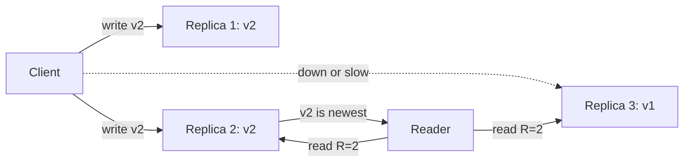

| Pros | Cons |
|---|---|
| Tunable trade-off between consistency, latency and availability | Higher latency than single-replica reads/writes |
| Tolerates `N − W` failed replicas for writes and `N − R` for reads | Needs versioning (timestamps/vector clocks) to pick the newest value |
| No single leader needed (Dynamo-style) | "Sloppy" quorums and hinted handoff weaken the guarantee during failures |
| Majority quorums prevent split-brain in elections | An even number of nodes wastes capacity (4 nodes tolerate the same failures as 3) |

**Interview questions**
1. *What does R + W > N guarantee?* → Read and write quorums overlap, so reads see the latest acknowledged write.
2. *Why use an odd number of nodes?* → A majority of 3 is 2 and of 4 is 3; both tolerate one failure, so the 4th node adds no fault tolerance.
3. *What is a sloppy quorum?* → During failures, writes go to other healthy nodes (hinted handoff) to stay available, which can temporarily break the overlap guarantee.
4. *How does Cassandra expose quorums?* → Consistency levels per query: `ONE`, `QUORUM`, `LOCAL_QUORUM`, `ALL`.

**Cheat sheet**
```
N replicas, write waits for W acks, read asks R replicas ; R + W > N -> reads see latest write
Classic: N=3, W=2, R=2 (one replica may be down) ; fast reads: R=1, W=N ; fast writes: W=1, R=N
Majority = floor(N/2)+1 ; use odd cluster sizes (3, 5, 7)
Cassandra: QUORUM / LOCAL_QUORUM ; Raft/Paxos: majority of voters commits
```

# 4. Leader Election Pattern (Interview Imp - Java)

## 4.1 What is Leader Election?

**Leader election** chooses **one node** in a group to be the **coordinator (leader)** that performs some job, while the others stand by as **followers**. If the leader fails, the group automatically **elects a new one**.

**Analogy:** A cricket team's captain. One person makes field decisions so the team doesn't get 11 conflicting instructions. If the captain is injured, the vice-captain takes over immediately.

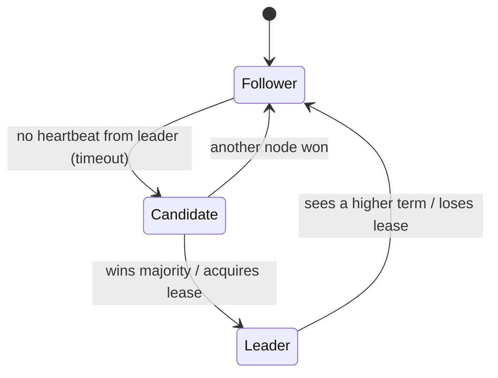

#### 📘 Terms Explained

| Term | Simple meaning |
|---|---|
| **Leader** | The single node allowed to do a particular job (accept writes, run scheduled jobs, assign work). |
| **Follower / standby** | Nodes waiting to take over. |
| **Lease** | A time-limited right to be leader; it must be renewed before it expires. |
| **Term / epoch** | A number that increases with every new leader; used to recognise stale leaders. |
| **Fencing token** | The term/epoch number attached to the leader's actions, so resources can reject a stale leader. |

---

## 4.2 Why Do We Need It?

| Need | Example |
|---|---|
| **Exactly one writer** | One primary database node accepts writes (others replicate) |
| **Run a job once, not on every instance** | A nightly billing batch in a Spring Boot app with 6 replicas |
| **Coordination / assignment** | Kafka controller assigning partition leaders; a scheduler assigning shards to workers |
| **Avoid conflicting decisions** | One node manages cluster membership or configuration |

The danger is **split brain**: two nodes both believe they're leader (after a network partition or a long GC pause) and both act. Good leader election always comes with a way to **stop the old leader** from doing damage.

---

## 4.3 How It Works: Approaches

| Approach | How | Notes |
|---|---|---|
| **Consensus-based** (Raft, Zab, Paxos) | Nodes vote; a candidate needs a **majority** for the current term | Used inside etcd, ZooKeeper, Consul, Kafka KRaft, MongoDB |
| **Lease in a coordination service** ✅ for apps | Apps race to create/hold a key with a TTL in etcd/ZooKeeper/Consul; the holder is leader; it renews before expiry | Easiest for application code (Spring Integration, Kubernetes Lease) |
| **Database lock/lease row** | `UPDATE leader SET owner=?, expires=? WHERE expires < now()` | No extra infrastructure; DB must be reliable |
| **Bully algorithm** | The live node with the highest ID becomes leader | Classic textbook; simple, chatty, no partition safety |
| **Ring algorithm** | An election message travels around a logical ring | Textbook; rarely used in practice |

### The stale leader problem

Leases expire by **time**, but a paused process doesn't notice time passing. A leader in a 20-second GC pause wakes up still believing it holds a 10-second lease. The fix is a **fencing token**: every leader gets a strictly increasing term, sends it with every write, and the resource **rejects** writes with a term lower than the highest it has seen.

---

## 4.4 Complete Java Example - Lease-Based Election with Fencing Terms

```java
import java.util.ArrayList;
import java.util.List;

// A lease-based lock service (etcd / ZooKeeper / Consul / a DB row in real life). It hands out increasing TERMS.
class LeaseStore {
    String holder;
    long expiresAt;
    long term = 0;

    // Atomic compare-and-set: acquire if free or expired
    synchronized long tryAcquire(String node, long now, long ttl) {
        if (holder == null || now >= expiresAt) {
            holder = node;
            expiresAt = now + ttl;
            return ++term;                                     // new leader -> new term (fencing token)
        }
        return -1;
    }

    synchronized boolean renew(String node, long now, long ttl) {
        if (node.equals(holder) && now < expiresAt) { expiresAt = now + ttl; return true; }
        return false;
    }
}

// The protected resource remembers the highest term it has seen and rejects older ones
class JobDatabase {
    long highestTermSeen = 0;
    final List<String> log = new ArrayList<>();

    boolean write(String node, long term, String action) {
        if (term < highestTermSeen) {
            log.add("REJECTED " + node + " (term " + term + " < " + highestTermSeen + "): " + action);
            return false;
        }
        highestTermSeen = term;
        log.add("ok       " + node + " (term " + term + "): " + action);
        return true;
    }
}

public class LeaderElectionDemo {
    public static void main(String[] args) {
        LeaseStore lease = new LeaseStore();
        JobDatabase db = new JobDatabase();
        long ttl = 10;                                          // seconds

        long t1 = lease.tryAcquire("node-A", 0, ttl);
        long tb = lease.tryAcquire("node-B", 0, ttl);
        System.out.println("t=0  node-A acquires lease -> term " + t1 + "; node-B tries -> " + (tb < 0 ? "denied (A is leader)" : tb));
        db.write("node-A", t1, "run nightly billing batch 1");

        System.out.println("t=5  node-A renews lease -> " + lease.renew("node-A", 5, ttl));

        System.out.println("t=6  node-A freezes (long GC pause / network blip) and stops renewing...");
        long t2 = lease.tryAcquire("node-B", 16, ttl);
        System.out.println("t=16 lease expired; node-B acquires -> term " + t2);
        db.write("node-B", t2, "run nightly billing batch 2");

        System.out.println("t=17 node-A wakes up, still THINKS it is leader, and writes:");
        db.write("node-A", t1, "run nightly billing batch 2 again");
        System.out.println("     node-A renew -> " + lease.renew("node-A", 17, ttl) + " (it finally learns it lost leadership)");

        System.out.println("Resource log:");
        db.log.forEach(l -> System.out.println("   " + l));
    }
}
```

**Output:**
```
t=0  node-A acquires lease -> term 1; node-B tries -> denied (A is leader)
t=5  node-A renews lease -> true
t=6  node-A freezes (long GC pause / network blip) and stops renewing...
t=16 lease expired; node-B acquires -> term 2
t=17 node-A wakes up, still THINKS it is leader, and writes:
     node-A renew -> false (it finally learns it lost leadership)
Resource log:
   ok       node-A (term 1): run nightly billing batch 1
   ok       node-B (term 2): run nightly billing batch 2
   REJECTED node-A (term 1 < 2): run nightly billing batch 2 again
```

What the output shows:
- node-B was **denied** while node-A's lease was valid: one leader at a time.
- node-A **froze** and stopped renewing; after the TTL, node-B became leader with **term 2**.
- When node-A woke up it still **thought** it was leader and wrote with **term 1**. The resource had already seen term 2, so it **rejected** the stale write. Without the term check, the billing batch would have run **twice**.
- node-A's next renewal failed, so it stepped down.

---

## 4.5 Leader Election in Java, Spring and Kubernetes

### Spring Integration leader election (ZooKeeper, etcd, Hazelcast, JDBC, Kubernetes)

```java
@Configuration
class LeaderConfig {
    @Bean
    LeaderInitiatorFactoryBean leaderInitiator(CuratorFramework curator) {      // ZooKeeper via Apache Curator
        return new LeaderInitiatorFactoryBean()
                .setClient(curator)
                .setPath("/leaders/billing")
                .setRole("billing");
    }
}

@Component
class BillingLeader {
    private volatile boolean leader;

    @EventListener void onGranted(OnGrantedEvent e) { leader = true;  log.info("became leader"); }
    @EventListener void onRevoked(OnRevokedEvent e) { leader = false; log.info("lost leadership"); }

    @Scheduled(cron = "0 0 2 * * *")
    void nightlyBilling() {
        if (!leader) return;                       // only the leader runs the job
        billing.run(currentTerm());                // pass the term/epoch to the resource (fencing)
    }
}
```

### Kubernetes Lease objects

Kubernetes controllers (and your own operators) elect leaders with `coordination.k8s.io/v1` **Lease** objects (`holderIdentity`, `leaseDurationSeconds`, `renewTime`). Spring Cloud Kubernetes and the Fabric8/official Java clients provide leader election helpers built on them.

### Simpler alternative for scheduled jobs: ShedLock

If you only need "run this `@Scheduled` job on one instance", a **distributed lock** per execution is simpler than full leader election (section 8):

```java
@Scheduled(cron = "0 0 2 * * *")
@SchedulerLock(name = "nightlyBilling", lockAtMostFor = "PT30M", lockAtLeastFor = "PT1M")
public void nightlyBilling() { ... }               // ShedLock: only one instance acquires the lock row/key
```

#### 📘 Terms Explained

| Term | Simple meaning |
|---|---|
| **Apache Curator** | Java client library for ZooKeeper with recipes (leader election, locks). |
| **`LeaderInitiator`** | Spring Integration component that runs an election and publishes granted/revoked events. |
| **Kubernetes Lease** | An API object used as a lock/lease for leader election. |
| **ShedLock** | Library ensuring a `@Scheduled` task runs on at most one instance at a time (lock in DB/Redis/ZooKeeper). |
| **Bully algorithm** | Election where the highest-ID live node becomes leader. |

---

## 4.6 Pros, Cons, Pitfalls and Interview Questions

| Pros | Cons |
|---|---|
| One coordinator: simple decisions, no conflicts | Leader is a bottleneck and a failover delay |
| Automatic failover | Needs a reliable coordination service or consensus |
| Clear ownership of jobs and resources | Split-brain risk if fencing is ignored |

| Pitfall | Fix |
|---|---|
| Trusting a lease without fencing | Pass a monotonically increasing term to resources; reject stale terms. |
| Lease TTL shorter than worst-case GC pause | TTL with margin; tune GC; leader checks it still holds the lease before critical steps. |
| Electing with only 2 coordination nodes | 3 or 5 (majority). |
| Every instance runs the job when the coordination service is down | Fail closed: no lease, no job. |
| Long-running leader work with no progress checks | Break work into steps, re-check leadership/term between them. |

**Q1. Why do distributed systems need leader election?** To have exactly one node coordinate or perform a task (primary writer, scheduler, controller), with automatic replacement when it fails.

**Q2. How would you make a scheduled job run on only one of N Spring Boot instances?** ShedLock (distributed lock per run), Spring Integration leader election on ZooKeeper/etcd/JDBC, or a Kubernetes Lease / CronJob with a single replica.

**Q3. What is the stale leader problem and how do fencing tokens solve it?** A paused or partitioned old leader may act after a new one is elected. Each leader gets an increasing term; resources reject requests with a lower term than they've seen.

**Q4. How does Raft elect a leader?** A follower that hears no heartbeat within a randomized election timeout becomes a candidate, increments the term, votes for itself and requests votes; the first to get a majority (with an up-to-date log) becomes leader for that term.

---

## 4.7 Leader Election - Cheat Sheet

```
LEADER ELECTION  Pick ONE coordinator; auto-replace on failure. Followers -> candidate (timeout) -> leader (majority/lease).
          Approaches: consensus (Raft/Zab/Paxos), LEASE in etcd/ZooKeeper/Consul/K8s Lease/DB row, bully, ring.
          Danger: split brain / stale leader after GC pause or partition -> FENCING TOKEN (increasing term) checked by resources.
          Spring: Spring Integration LeaderInitiator (OnGranted/OnRevoked events), Curator; ShedLock for @Scheduled.
          3 or 5 coordination nodes; TTL > worst pause; fail closed.
```

---

# 5. Consensus Algorithms: Raft and Paxos (Interview Imp - Java)

## 5.1 What is Consensus?

**Consensus** is getting a group of nodes to **agree on a single value, or on the same ordered sequence of values (a log)**, even when some nodes crash or messages are lost. Once a value is **committed**, it never changes, and every non-failed node eventually learns it.

**Analogy:** A group of friends agreeing on a restaurant over a flaky group chat. As long as a majority confirm the same choice, the decision stands, even if a couple of phones are off. Anyone who was offline catches up from the chat history when they're back.

Consensus gives you a **replicated state machine**: if every node applies the **same commands in the same order**, every node ends up in the **same state**.

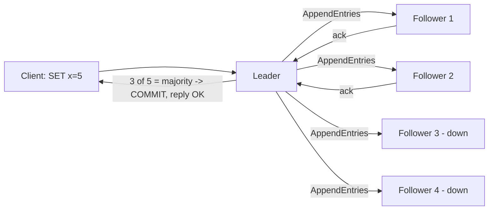

#### 📘 Terms Explained

| Term | Simple meaning |
|---|---|
| **Consensus** | Nodes agreeing on values/order despite failures. |
| **Replicated state machine** | Every node applies the same log of commands in the same order, so all reach the same state. |
| **Log entry** | One command in the replicated log (e.g. `SET x=5`). |
| **Committed** | Stored on a majority; guaranteed never to be lost or changed. |
| **Raft** | A consensus algorithm designed to be understandable (leader, terms, log replication). |
| **Paxos** | The original family of consensus algorithms (Leslie Lamport); powerful but notoriously hard to understand. |

---

## 5.2 Why Do We Need It?

Consensus is the foundation for anything that must be **correct and highly available at the same time**:

| Built on consensus | Purpose |
|---|---|
| **etcd** (Kubernetes' brain), **Consul**, **ZooKeeper** (Zab) | Config, service discovery, locks, leader election |
| **Kafka KRaft** | Cluster metadata, partition leadership |
| **CockroachDB, TiDB, YugabyteDB, Spanner** | Each data range replicated with Raft/Paxos |
| **MongoDB replica sets** | Raft-like primary election |
| **RabbitMQ quorum queues** | Raft-replicated queues |

**You rarely implement consensus yourself.** You use these systems. But interviews ask how it works.

---

## 5.3 How Raft Works

| Part | How it works |
|---|---|
| **Roles** | Each node is a **leader**, **follower** or **candidate**. At most one leader per **term**. |
| **Terms** | Numbered periods; each starts with an election. A node seeing a higher term steps down to follower. |
| **Leader election** | Followers expect heartbeats. After a **randomised election timeout** (e.g. 150-300 ms) without one, a follower becomes a candidate, increments the term, and asks for votes. It needs a **majority**. Randomisation avoids repeated split votes. |
| **Election restriction** | Nodes only vote for a candidate whose log is **at least as up to date** as their own, so a new leader always has every committed entry. |
| **Log replication** | Clients send commands to the leader. The leader appends to its log and sends `AppendEntries` to followers. |
| **Commit** | Once a **majority** have stored an entry, the leader marks it committed, applies it, and replies to the client. Followers apply it when they learn the commit index. |
| **Consistency check** | `AppendEntries` includes the previous entry's index and term; followers with a mismatching log are brought back in line by the leader (overwriting uncommitted, conflicting entries). |
| **Snapshots / compaction** | Old log entries are replaced by a snapshot of the state machine. |

### Paxos in one paragraph

**Basic Paxos** agrees on a **single value** in two phases: a **proposer** sends *Prepare(n)* with a proposal number; **acceptors** promise to ignore lower numbers and report any value they already accepted; the proposer then sends *Accept(n, value)* (using the highest previously accepted value, if any); once a **majority** accepts, the value is chosen. **Multi-Paxos** runs this repeatedly for a log, usually with a stable leader, which makes it look a lot like Raft. Raft was designed (Ongaro and Ousterhout, 2014) to be easier to understand and implement.

| | Raft | Paxos |
|---|---|---|
| Understandability | Designed for it | Famously hard |
| Leader | Strong leader always | Optional in basic Paxos; usual in Multi-Paxos |
| Log | Built in | Multi-Paxos extension |
| Used by | etcd, Consul, KRaft, CockroachDB, TiKV, RabbitMQ quorum queues | Chubby, Spanner (Paxos variants), Cassandra lightweight transactions |

---

## 5.4 Complete Java Example - Simplified Raft Log Replication and Election

> A deliberately simplified model of Raft's **commit rule** and **election safety**: no timers, RPCs or log-conflict repair, but the majority logic is the real one.

```java
import java.util.ArrayList;
import java.util.List;

// A heavily simplified Raft: one leader appends entries, replicates them, and commits once a MAJORITY has them.
class RaftNode {
    final String id;
    final List<String> log = new ArrayList<>();
    int commitIndex = 0;                     // number of entries known to be committed
    boolean reachable = true;
    RaftNode(String id) { this.id = id; }
}

class RaftCluster {
    final List<RaftNode> nodes = new ArrayList<>();
    RaftNode leader;
    int term = 1;

    RaftCluster(int n) {
        for (int i = 1; i <= n; i++) nodes.add(new RaftNode("n" + i));
        leader = nodes.get(0);
    }

    int majority() { return nodes.size() / 2 + 1; }

    // Client write: leader appends, sends AppendEntries, commits only with majority acknowledgement
    void clientWrite(String command) {
        if (!leader.reachable) { System.out.println("  client: leader " + leader.id + " unreachable, retry later"); return; }
        leader.log.add("t" + term + ":" + command);
        int acks = 1;                                          // the leader itself
        for (RaftNode f : nodes) {
            if (f == leader || !f.reachable) continue;
            f.log.clear(); f.log.addAll(leader.log);           // follower catches up to the leader's log
            acks++;
        }
        if (acks >= majority()) {
            leader.commitIndex = leader.log.size();
            for (RaftNode f : nodes) if (f.reachable) f.commitIndex = leader.commitIndex;
            System.out.printf("  %-14s acks=%d/%d -> COMMITTED (apply to state machine, reply OK)%n", command, acks, nodes.size());
        } else {
            System.out.printf("  %-14s acks=%d/%d -> NOT committed (no majority; client must wait/retry)%n", command, acks, nodes.size());
        }
    }

    // Election: a candidate with a log at least as up to date as a majority's wins
    void electNewLeader() {
        term++;
        RaftNode best = null;
        int votes = 0;
        for (RaftNode n : nodes) {
            if (!n.reachable) continue;
            votes++;
            if (best == null || n.commitIndex > best.commitIndex) best = n;
        }
        if (votes >= majority()) {
            leader = best;
            System.out.println("  election for term " + term + ": " + best.id + " wins with " + votes + " votes (has all committed entries)");
        } else {
            System.out.println("  election for term " + term + ": only " + votes + " reachable votes -> no leader");
        }
    }

    void print() {
        for (RaftNode n : nodes) {
            System.out.printf("    %s%s%-12s log=%s committed=%d%n", n.id, n == leader ? "*" : " ",
                    n.reachable ? "" : " (down)", n.log, n.commitIndex);
        }
    }
}

public class RaftDemo {
    public static void main(String[] args) {
        RaftCluster c = new RaftCluster(5);
        System.out.println("1) Healthy 5-node cluster, leader n1:");
        c.clientWrite("SET x=1");
        c.clientWrite("SET y=2");

        System.out.println("2) Two followers crash: majority (3/5) still available");
        c.nodes.get(3).reachable = false;
        c.nodes.get(4).reachable = false;
        c.clientWrite("SET x=5");
        c.print();

        System.out.println("3) Leader n1 crashes too: only 2/5 left -> no progress (stays consistent)");
        c.nodes.get(0).reachable = false;
        c.electNewLeader();
        c.clientWrite("SET z=9");

        System.out.println("4) n4 recovers: 3/5 reachable -> new leader, and committed data survived");
        c.nodes.get(3).reachable = true;
        c.electNewLeader();
        c.clientWrite("SET z=9");
        c.print();
    }
}
```

**Output:**
```
1) Healthy 5-node cluster, leader n1:
  SET x=1        acks=5/5 -> COMMITTED (apply to state machine, reply OK)
  SET y=2        acks=5/5 -> COMMITTED (apply to state machine, reply OK)
2) Two followers crash: majority (3/5) still available
  SET x=5        acks=3/5 -> COMMITTED (apply to state machine, reply OK)
    n1*             log=[t1:SET x=1, t1:SET y=2, t1:SET x=5] committed=3
    n2              log=[t1:SET x=1, t1:SET y=2, t1:SET x=5] committed=3
    n3              log=[t1:SET x=1, t1:SET y=2, t1:SET x=5] committed=3
    n4  (down)      log=[t1:SET x=1, t1:SET y=2] committed=2
    n5  (down)      log=[t1:SET x=1, t1:SET y=2] committed=2
3) Leader n1 crashes too: only 2/5 left -> no progress (stays consistent)
  election for term 2: only 2 reachable votes -> no leader
  client: leader n1 unreachable, retry later
4) n4 recovers: 3/5 reachable -> new leader, and committed data survived
  election for term 3: n2 wins with 3 votes (has all committed entries)
  SET z=9        acks=3/5 -> COMMITTED (apply to state machine, reply OK)
    n1  (down)      log=[t1:SET x=1, t1:SET y=2, t1:SET x=5] committed=3
    n2*             log=[t1:SET x=1, t1:SET y=2, t1:SET x=5, t3:SET z=9] committed=4
    n3              log=[t1:SET x=1, t1:SET y=2, t1:SET x=5, t3:SET z=9] committed=4
    n4              log=[t1:SET x=1, t1:SET y=2, t1:SET x=5, t3:SET z=9] committed=4
    n5  (down)      log=[t1:SET x=1, t1:SET y=2] committed=2
```

What the output shows:
1. With all 5 nodes, writes need 3 acks and are committed.
2. With **2 followers down**, the leader still has a majority (3/5) and keeps committing. n4/n5 are simply behind.
3. When the **leader** also fails, only 2/5 nodes remain: **no leader can be elected and nothing is committed**. The cluster chooses **consistency over availability** (CP).
4. When n4 returns, 3/5 are reachable: **n2**, which has all committed entries, wins the election for a **new term** (term 3; term 2 had no winner), and the committed data (`SET x=5`) **survived** the leader's crash. n4 was caught up by the new leader.

#### 📘 Terms Explained

| Term | Simple meaning |
|---|---|
| **`AppendEntries`** | Raft RPC the leader uses to replicate log entries (and as a heartbeat when empty). |
| **`RequestVote`** | Raft RPC a candidate sends to ask for votes. |
| **Election timeout** | How long a follower waits without hearing from a leader before starting an election (randomised). |
| **Commit index** | The highest log index known to be committed. |
| **Proposer / acceptor (Paxos)** | The node proposing a value / the nodes voting to accept it. |
| **Zab** | ZooKeeper Atomic Broadcast, ZooKeeper's consensus protocol. |

---

## 5.5 Consensus in the Java World

```java
// Using etcd (via jetcd) as a linearizable, consensus-backed key-value store
Client etcd = Client.builder().endpoints("http://etcd-1:2379", "http://etcd-2:2379", "http://etcd-3:2379").build();
KV kv = etcd.getKVClient();

ByteSequence key = ByteSequence.from("/config/payments/limit", StandardCharsets.UTF_8);
kv.put(key, ByteSequence.from("50000", StandardCharsets.UTF_8)).get();     // committed via Raft on a majority
String value = kv.get(key).get().getKvs().get(0).getValue().toString(StandardCharsets.UTF_8);
```

| Java option | What it gives |
|---|---|
| **etcd + jetcd**, **Consul + Spring Cloud Consul** | Consensus-backed KV, watches, leases, locks |
| **ZooKeeper + Apache Curator** | Znodes, watches, recipes (locks, leader election, barriers) |
| **Apache Ratis** | A Java Raft library to embed (used by Apache Ozone) |
| **Hazelcast CP Subsystem** | Raft-backed `FencedLock`, `IAtomicLong`, `CPMap` |
| **Distributed SQL (CockroachDB, YugabyteDB)** | Raft per range behind a normal JDBC/PostgreSQL interface |

---

## 5.6 Pros, Cons, Pitfalls and Interview Questions

| Pros | Cons |
|---|---|
| Strong consistency (linearizable) with automatic failover | Needs a majority: a minority partition can't make progress |
| Tolerates `f` failures with `2f+1` nodes | Every write needs a majority round trip (latency, esp. across regions) |
| Proven foundation (etcd, ZooKeeper, KRaft) | Throughput limited by the leader |

| Pitfall | Fix |
|---|---|
| Implementing your own consensus | Use etcd/ZooKeeper/Consul/Ratis; it's very easy to get wrong. |
| Even-sized or 2-node clusters | 3 or 5 nodes in 3 zones. |
| Putting high-volume business data in etcd/ZooKeeper | Use them for small, critical metadata; use databases for data. |
| Slow disks (fsync latency) on consensus nodes | SSDs; dedicated nodes; monitor fsync and leader changes. |

**Q1. What problem does consensus solve?** Getting nodes to agree on the same ordered log of decisions despite crashes and lost messages, enabling replicated state machines, leader election and strongly consistent metadata.

**Q2. Explain Raft briefly.** Nodes are leaders, followers or candidates in numbered terms. A follower without heartbeats starts an election and needs a majority. The leader replicates log entries with AppendEntries and commits an entry once a majority stores it; only up-to-date nodes can win elections, so committed entries survive.

**Q3. Why does Raft use randomised election timeouts?** So that followers don't all become candidates at the same moment and split the vote repeatedly.

**Q4. What happens in a 5-node Raft cluster if 3 nodes fail?** The 2 survivors can't form a majority, so no leader is elected and no writes are committed until enough nodes return (CP behaviour).

**Q5. Raft vs Paxos?** Same guarantees; Raft structures the problem around a strong leader and a replicated log to be understandable; Paxos is the older, more general family (Multi-Paxos for logs).

---

## 5.7 Consensus - Cheat Sheet

```
CONSENSUS  Agree on one ordered log despite failures -> replicated state machine. Committed = on a MAJORITY, never lost.
          RAFT: leader/follower/candidate, terms, randomised election timeout, RequestVote needs majority + up-to-date log,
                AppendEntries replicates, commit at majority, snapshots. PAXOS: prepare/promise + accept, Multi-Paxos for logs.
          2f+1 tolerate f; minority side can't progress (CP). Used by etcd, Consul, ZooKeeper (Zab), KRaft, CockroachDB, quorum queues.
          Java: jetcd, Curator, Spring Cloud Consul, Apache Ratis, Hazelcast CP. Never roll your own.
```

---

# 6. Gossip Protocol Pattern

## 6.1 What is a Gossip Protocol?

In a **gossip (epidemic) protocol**, each node **periodically shares what it knows with a few randomly chosen peers**, who do the same. Information spreads through the whole cluster like a rumour, in about **O(log N)** rounds, **without any central coordinator**.

**Analogy:** Office gossip. You tell two colleagues at lunch; each of them tells two more at tea; by the end of the day the whole floor knows, even though nobody sent a company-wide email.

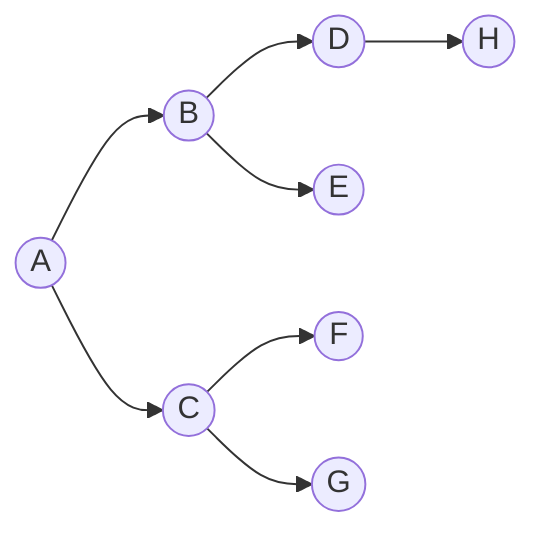
*Round 1: A tells B and C. Round 2: B and C tell four more. Round 3: ... Each round roughly doubles the informed nodes.*

#### 📘 Terms Explained

| Term | Simple meaning |
|---|---|
| **Gossip / epidemic protocol** | Nodes repeatedly exchange information with random peers until everyone has it. |
| **Fan-out** | How many peers a node gossips to per round. |
| **Membership** | The list of nodes in the cluster and their status (alive, suspect, dead). |
| **Failure detector** | A mechanism deciding whether a node is probably down. |

---

## 6.2 Why Do We Need It?

| Need | Why gossip fits |
|---|---|
| **Cluster membership** in large clusters | No single registry to overload or fail |
| **Failure detection** | Nodes learn about failures from many peers, robustly |
| **Spreading metadata** (ring ownership, schema versions, load) | Cheap, eventually consistent dissemination |
| **Anti-entropy** (repairing replicas) | Periodic random comparisons converge all copies |

Used by: **Cassandra** (membership, ring state), **Consul/Serf** and **HashiCorp memberlist** (SWIM protocol), **Akka Cluster**, **Redis Cluster** (cluster bus), **Amazon Dynamo**, **Hazelcast**, **ScyllaDB**.

---

## 6.3 How It Works

| Style | How |
|---|---|
| **Push** | Informed nodes send the news to random peers |
| **Pull** | Nodes ask random peers "what's new?" |
| **Push-pull** | Exchange in both directions (fastest convergence) |

### Gossip-based failure detection

- Each node keeps a **heartbeat counter** that it increments, and gossips its view of everyone's counters.
- If a node's counter **hasn't increased** for a while, peers mark it **suspect**, then **dead**.
- **SWIM** improves this: nodes **ping** a random peer; if there's no reply, they ask **k other nodes to ping it indirectly** before suspecting it (avoids false alarms from a single bad link).
- **Phi accrual failure detector** (Cassandra, Akka) outputs a **suspicion level** based on the history of heartbeat intervals instead of a fixed timeout.

---

## 6.4 Complete Java Example - Rumour Spreading and Heartbeat Failure Detection

```java
import java.util.ArrayList;
import java.util.HashMap;
import java.util.HashSet;
import java.util.List;
import java.util.Map;
import java.util.Random;
import java.util.Set;

public class GossipDemo {
    public static void main(String[] args) {
        Random random = new Random(42);                       // fixed seed -> same output every run

        // ---- 1) Rumour spreading: each informed node tells 1 random peer per round ----
        for (int n : new int[]{16, 128, 1024}) {
            Set<Integer> informed = new HashSet<>(Set.of(0));  // node 0 learns "cache-C is leaving"
            int rounds = 0;
            while (informed.size() < n) {
                Set<Integer> next = new HashSet<>(informed);
                for (int node : informed) next.add(random.nextInt(n));     // push to a random peer
                informed = next;
                rounds++;
            }
            System.out.printf("cluster of %4d nodes: everyone informed after %2d rounds (theory ~ log2(n) + ln(n) = %.1f)%n",
                    n, rounds, Math.log(n) / Math.log(2) + Math.log(n));
        }

        // ---- 2) Gossip-style failure detection with heartbeat counters ----
        System.out.println("Failure detection: nodes gossip heartbeat counters; a counter that stops growing = suspect");
        List<String> nodes = List.of("A", "B", "C", "D");
        Map<String, Map<String, Integer>> view = new HashMap<>();          // each node's view of everyone's heartbeat
        for (String n : nodes) { Map<String, Integer> m = new HashMap<>(); nodes.forEach(x -> m.put(x, 0)); view.put(n, m); }

        for (int round = 1; round <= 6; round++) {
            for (String n : nodes) {
                if (n.equals("C") && round > 2) continue;                   // C crashes after round 2
                view.get(n).merge(n, 1, Integer::sum);                     // increment own heartbeat
                String peer = nodes.get(random.nextInt(nodes.size()));
                if (peer.equals(n) || (peer.equals("C") && round > 2)) continue;
                // exchange views: keep the max counter for each node
                for (String x : nodes) {
                    int max = Math.max(view.get(n).get(x), view.get(peer).get(x));
                    view.get(n).put(x, max); view.get(peer).put(x, max);
                }
            }
        }
        System.out.println("   A's view of heartbeats after 6 rounds: " + new java.util.TreeMap<>(view.get("A")));
        System.out.println("   C's counter stopped at " + view.get("A").get("C") + " while others kept growing -> A marks C as SUSPECTED");
    }
}
```

**Output:**
```
cluster of   16 nodes: everyone informed after  9 rounds (theory ~ log2(n) + ln(n) = 6.8)
cluster of  128 nodes: everyone informed after 13 rounds (theory ~ log2(n) + ln(n) = 11.9)
cluster of 1024 nodes: everyone informed after 18 rounds (theory ~ log2(n) + ln(n) = 16.9)
Failure detection: nodes gossip heartbeat counters; a counter that stops growing = suspect
   A's view of heartbeats after 6 rounds: {A=6, B=6, C=1, D=5}
   C's counter stopped at 1 while others kept growing -> A marks C as SUSPECTED
```

What the output shows:
- Going from 16 to 1,024 nodes (64× bigger) only roughly **doubled** the rounds needed: dissemination time grows **logarithmically** (about log₂(n) + ln(n) rounds for simple push gossip).
- Every node learned about everyone's heartbeats **without a central server**.
- **C's heartbeat counter stopped** while the others kept increasing, so A could mark C as **suspected**, purely from gossip.

---

## 6.5 Gossip in Practice

| System | Gossip use |
|---|---|
| **Cassandra** | Every second, each node gossips with up to 3 others: endpoint state, tokens, schema version, load; phi accrual failure detector |
| **Consul / Serf (memberlist)** | SWIM-based LAN/WAN gossip for membership and failure detection; Raft for the catalogue |
| **Akka Cluster** | Gossip of cluster state + phi accrual failure detection; `akka-cluster` in Java/Scala |
| **Redis Cluster** | Cluster bus: nodes gossip slot ownership and failure reports |
| **Hazelcast** | Member list and partition table sync |

```hocon
# Akka Cluster (application.conf) - gossip-based membership in a JVM cluster
akka.cluster {
  seed-nodes = ["akka://shop@10.0.1.10:25520", "akka://shop@10.0.1.11:25520"]
  failure-detector.threshold = 8.0          # phi accrual: higher = slower to mark unreachable, fewer false alarms
  downing-provider-class = "akka.cluster.sbr.SplitBrainResolverProvider"
}
```

#### 📘 Terms Explained

| Term | Simple meaning |
|---|---|
| **SWIM** | Scalable Weakly-consistent Infection-style Membership: gossip + direct/indirect pings for failure detection. |
| **Phi accrual failure detector** | Gives a continuous "how likely is it dead?" value from heartbeat timing statistics. |
| **Seed node** | A known node new members contact first to join the gossip. |
| **Split brain resolver (Akka)** | Decides which side of a partition keeps running, to avoid two clusters. |

---

## 6.6 Pros, Cons, Pitfalls and Interview Questions

| Pros | Cons |
|---|---|
| No central coordinator; very scalable and robust | Eventually consistent: nodes may briefly disagree |
| Spreads in O(log N) rounds | Redundant messages (bandwidth overhead) |
| Tolerates node and link failures naturally | Hard to reason about exact timing; false suspicions possible |

| Pitfall | Fix |
|---|---|
| Fixed short failure timeouts → false "dead" verdicts during GC pauses | Indirect probes (SWIM), phi accrual, suspicion periods. |
| Using gossip for data that must be strongly consistent | Use consensus for critical decisions; gossip for membership/metadata. |
| Unbounded gossip payloads in big clusters | Send digests/deltas, not full state. |

**Q1. What is a gossip protocol?** Nodes periodically exchange state with random peers so information spreads epidemically to the whole cluster in O(log N) rounds, without a central coordinator.

**Q2. Where is gossip used?** Cluster membership and failure detection (Cassandra, Consul/Serf, Akka, Redis Cluster bus), metadata dissemination, anti-entropy repair.

**Q3. How do gossip-based systems detect failures?** Heartbeat counters gossiped around the cluster; nodes whose counters stop increasing become suspect. SWIM adds indirect pings; phi accrual uses timing statistics.

**Q4. Gossip vs consensus?** Gossip: scalable, eventually consistent dissemination. Consensus: strongly consistent agreement on an ordered log, but needs a majority and doesn't scale to thousands of voters.

---

## 6.7 Gossip Protocol - Cheat Sheet

```
GOSSIP    Periodically exchange state with random peers -> epidemic spread in O(log N) rounds, no coordinator.
          Push / pull / push-pull. Uses: membership, failure detection, metadata, anti-entropy.
          Failure detection: heartbeat counters; SWIM (ping + indirect ping-req); phi accrual (Cassandra, Akka).
          Systems: Cassandra, Consul/Serf memberlist, Akka Cluster, Redis Cluster bus, Hazelcast, Dynamo.
          Eventually consistent -> consensus for critical decisions, gossip for membership.
```

---

## 6.8 Types and Variants

| Variant | How information spreads | Example |
|---|---|---|
| **Push gossip** | A node sends its updates to random peers | Rumour spreading |
| **Pull gossip** | A node asks random peers for updates | Anti-entropy |
| **Push-pull** | Both directions in one exchange (fastest convergence) | Cassandra, Consul (Serf) |
| **Anti-entropy** | Peers compare full state (often with Merkle trees) and repair differences | Cassandra repair, DynamoDB |
| **Rumour mongering** | Spread a new update until it is "old news", then stop | Epidemic broadcast |
| **SWIM failure detection** | Gossip-based membership with indirect pings | HashiCorp memberlist/Serf, Consul, Hazelcast-like systems |

# 7. Vector Clocks and Logical Time

## 7.1 What Are Logical Clocks?

Because machine clocks can't be trusted to order events across nodes, distributed systems use **logical clocks**: counters that capture **causality** ("did A happen before B?") instead of wall-clock time.

- **Lamport clock:** one counter per node; increment on every event; on receiving a message, set `counter = max(local, received) + 1`. If A happened-before B, then `L(A) < L(B)`. But **the reverse isn't true**: `L(A) < L(B)` doesn't prove A caused B, and equal-looking values can't reveal **concurrency**.
- **Vector clock:** one counter **per node**, carried with each version. Comparing two vectors tells you whether one happened **before** the other, or whether they're **concurrent** (a conflict).

**Analogy:** Each family member keeps a notebook of how many letters they've received from every other member. When two letters arrive, comparing those counts tells you whether one letter was written after reading the other, or whether they were written independently.

| Compare vectors `a` and `b` | Meaning |
|---|---|
| Every entry of `a` ≤ `b`, and at least one < | `a` **happened before** `b` (b can replace a) |
| Every entry of `b` ≤ `a`, and at least one < | `b` happened before `a` |
| Some entries bigger in `a`, some bigger in `b` | **Concurrent**: neither saw the other → conflict to resolve |
| All equal | Same version |

#### 📘 Terms Explained

| Term | Simple meaning |
|---|---|
| **Logical clock** | A counter that orders events by cause and effect rather than real time. |
| **Happened-before (→)** | A → B if A could have influenced B (same node earlier, or via messages). |
| **Lamport timestamp** | A single logical counter giving a total order consistent with causality. |
| **Vector clock** | A map node → counter that can detect concurrent (conflicting) updates. |
| **Siblings** | Concurrent versions of the same key kept side by side until resolved. |

---

## 7.2 Why Do We Need Them?

- **Detect conflicts** in multi-master or offline-capable systems (shopping carts, collaborative editing, mobile sync) instead of silently overwriting with Last-Writer-Wins (see [05_Data_Management_Pattern.md](05_Data_Management_Pattern.md#5-eventual-consistency-interview-imp---java)).
- **Order events** consistently across nodes without trusting clocks (Lamport clocks for total ordering, e.g. in mutual exclusion algorithms).
- **Debugging/tracing** causality in distributed logs.

---

## 7.3 Complete Java Example - Lamport vs Vector Clocks

```java
import java.util.Map;
import java.util.TreeMap;

class VectorClock {
    final Map<String, Integer> clock = new TreeMap<>();

    VectorClock copy() { VectorClock c = new VectorClock(); c.clock.putAll(clock); return c; }

    void tick(String node) { clock.merge(node, 1, Integer::sum); }               // local event or send

    void receive(String node, VectorClock other) {                               // merge = element-wise max, then tick
        other.clock.forEach((k, v) -> clock.merge(k, v, Math::max));
        tick(node);
    }

    // a happened-before b if a <= b everywhere and a != b
    static String compare(VectorClock a, VectorClock b) {
        boolean aLess = false, bLess = false;
        for (String k : union(a, b)) {
            int x = a.clock.getOrDefault(k, 0), y = b.clock.getOrDefault(k, 0);
            if (x < y) aLess = true;
            if (y < x) bLess = true;
        }
        if (aLess && !bLess) return "BEFORE (a happened-before b)";
        if (bLess && !aLess) return "AFTER (b happened-before a)";
        if (!aLess && !bLess) return "EQUAL";
        return "CONCURRENT (conflict: neither knew about the other)";
    }

    static java.util.Set<String> union(VectorClock a, VectorClock b) {
        java.util.Set<String> s = new java.util.TreeSet<>(a.clock.keySet()); s.addAll(b.clock.keySet()); return s;
    }

    public String toString() { return clock.toString(); }
}

public class VectorClockDemo {
    public static void main(String[] args) {
        // ---- Lamport clock: a single counter gives an ORDER, but can't detect concurrency ----
        int lamportA = 0, lamportB = 0;
        lamportA++;                                   // A: event 1
        lamportB++;                                   // B: event 1 (independent)
        System.out.println("Lamport: A event=" + lamportA + ", B event=" + lamportB + " -> equal numbers, but are they related? Lamport can't tell.");

        // ---- Vector clocks: replicas of a shopping cart ----
        VectorClock v1 = new VectorClock();
        v1.tick("phone");                                                    // user adds item on the phone replica
        System.out.println("v1 (phone adds 'shoes')           = " + v1);

        VectorClock v2 = v1.copy();
        v2.receive("laptop", v1);                                            // laptop replica syncs, then adds
        System.out.println("v2 (laptop syncs v1, adds 'socks') = " + v2);
        System.out.println("   compare(v1, v2): " + VectorClock.compare(v1, v2) + " -> v2 can safely replace v1");

        VectorClock v3 = v1.copy();
        v3.tick("phone");                                                    // meanwhile phone (offline) adds again
        System.out.println("v3 (phone, offline, adds 'cap')    = " + v3);
        System.out.println("   compare(v2, v3): " + VectorClock.compare(v2, v3));
        System.out.println("   -> keep BOTH versions as siblings and merge carts: [shoes, socks, cap]");

        VectorClock merged = v2.copy();
        merged.receive("phone", v3);
        System.out.println("merged after resolving             = " + merged);
        System.out.println("   compare(v2, merged): " + VectorClock.compare(v2, merged));
        System.out.println("   compare(v3, merged): " + VectorClock.compare(v3, merged) + " -> the merge supersedes both siblings");
    }
}
```

**Output:**
```
Lamport: A event=1, B event=1 -> equal numbers, but are they related? Lamport can't tell.
v1 (phone adds 'shoes')           = {phone=1}
v2 (laptop syncs v1, adds 'socks') = {laptop=1, phone=1}
   compare(v1, v2): BEFORE (a happened-before b) -> v2 can safely replace v1
v3 (phone, offline, adds 'cap')    = {phone=2}
   compare(v2, v3): CONCURRENT (conflict: neither knew about the other)
   -> keep BOTH versions as siblings and merge carts: [shoes, socks, cap]
merged after resolving             = {laptop=1, phone=3}
   compare(v2, merged): BEFORE (a happened-before b)
   compare(v3, merged): BEFORE (a happened-before b) -> the merge supersedes both siblings
```

What the output shows:
- Two independent events both had Lamport time **1**: Lamport clocks can't tell they're unrelated.
- `v2` (laptop, after syncing `v1`) compared as **after** `v1`, so it can safely replace it.
- `v3` (phone, offline) and `v2` compared as **concurrent**: a real conflict. Instead of losing one (LWW), the store keeps both as **siblings** and the app **merges** the carts.
- The merged version dominates **both** parents, so it supersedes them.

---

## 7.4 Logical Clocks in Practice

| Where | Mechanism |
|---|---|
| **Amazon Dynamo (paper), Riak** | Vector clocks / dotted version vectors on each object; siblings returned to the client |
| **Cassandra** | Uses timestamps + LWW per cell (simpler, but loses concurrent updates) |
| **CRDT libraries, collaborative editors** | Version vectors / hybrid clocks to merge changes |
| **CockroachDB, YugabyteDB, MongoDB** | **Hybrid Logical Clocks (HLC)**: physical time + a logical counter, monotonic and close to real time |
| **Google Spanner** | TrueTime: GPS/atomic clocks with bounded uncertainty, waits out the uncertainty on commit |
| **Kafka** | Offsets: a total order **within a partition** (a log is its own clock) |

> **Practical tip for Java apps:** don't order cross-service events by `Instant.now()` from different machines. Use a **sequence from a single source** (DB sequence, Kafka offset within a partition key), an **aggregate version number** (event sourcing), or an HLC library.

#### 📘 Terms Explained

| Term | Simple meaning |
|---|---|
| **Dotted version vector** | An improved vector clock that avoids false conflicts with many clients. |
| **Hybrid Logical Clock (HLC)** | Timestamp = physical time + logical counter; stays monotonic even if clocks drift a little. |
| **TrueTime** | Spanner's time API returning an interval [earliest, latest] with guaranteed bounds. |

---

## 7.5 Pros, Cons, Pitfalls and Interview Questions

| Pros | Cons |
|---|---|
| Detects true conflicts instead of silently losing data | Vector size grows with the number of writers |
| Independent of wall clocks | Applications must resolve siblings |
| Captures causality precisely | More complex than timestamps |

| Pitfall | Fix |
|---|---|
| Ordering events by wall-clock timestamps from different hosts | Logical clocks, single-source sequences, Kafka offsets per key. |
| Vector clocks per client in huge client populations | Per-server vectors, dotted version vectors, pruning. |
| Using LWW where updates must not be lost | Vector clocks + merge, or CRDTs. |

**Q1. Why can't we just use timestamps to order events?** Clocks on different machines drift and jump, so "later" timestamps may belong to earlier events; and timestamps can't show that two events were concurrent.

**Q2. Lamport clock vs vector clock?** Lamport: one counter, gives an order consistent with causality but can't detect concurrency. Vector: a counter per node; comparing vectors shows happened-before or concurrent.

**Q3. How would you detect conflicting updates to a shopping cart edited on two devices offline?** Attach a vector clock to each version; if the versions are concurrent, keep both as siblings and merge (union of items), then write the merged version with a vector dominating both.

**Q4. What are hybrid logical clocks?** Timestamps combining physical time with a logical counter, giving monotonic, causality-respecting timestamps close to wall-clock time (used by CockroachDB, MongoDB).

---

## 7.6 Vector Clocks - Cheat Sheet

```
LOGICAL TIME  Don't order cross-node events by wall clocks (drift, jumps, pauses).
          Lamport: one counter; max(local, received)+1; A->B implies L(A)<L(B), NOT the reverse; can't see concurrency.
          Vector clock: counter per node; compare -> BEFORE / AFTER / CONCURRENT (conflict) -> siblings + merge.
          Used by Dynamo/Riak (dotted version vectors); Cassandra uses LWW timestamps; CockroachDB/MongoDB use HLC;
          Spanner TrueTime; Kafka offsets order within a partition.
```

---

## 7.7 Types and Variants

| Clock | Captures | Size | Example |
|---|---|---|---|
| **Physical (wall) clock** | Real time; can drift and jump | 1 timestamp | `System.currentTimeMillis()` with NTP |
| **Lamport clock** | A total order consistent with causality (but can't detect concurrency) | 1 counter | Ordering events in logs |
| **Vector clock** | Causality *and* concurrency between replicas | 1 counter per node | Dynamo/Riak conflict detection |
| **Version vector** | Like vector clocks, per replica of a data item | 1 counter per replica | Riak, CRDT stores |
| **Hybrid logical clock (HLC)** | Close to physical time + logical counter for ties | timestamp + counter | CockroachDB, YugabyteDB |
| **TrueTime** | Physical time with a bounded uncertainty interval | interval | Google Spanner (commit-wait) |

# 8. Distributed Locks Pattern (Interview Imp - Java)

## 8.1 What is a Distributed Lock?

A **distributed lock** ensures that **only one process across many machines** does a particular thing at a time: processes an invoice, runs a job, updates a shared resource. It's the cluster-wide version of Java's `synchronized` or `ReentrantLock`, which only work **inside one JVM**.

**Analogy:** The single key to a shared meeting room, kept at reception. Whoever has the key uses the room; others wait. Because people forget to return keys, the key is lent only for a fixed time (a **lease**), and the room has a logbook that only accepts entries from whoever holds the **latest** key number.

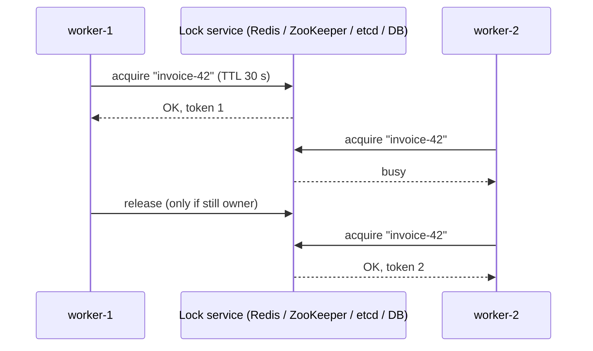

#### 📘 Terms Explained

| Term | Simple meaning |
|---|---|
| **Distributed lock** | Mutual exclusion across processes on different machines. |
| **Mutual exclusion** | Only one participant may be in the critical section at a time. |
| **Lease / TTL** | The lock expires automatically after a time, in case the holder crashes. |
| **Fencing token** | A number that increases with every lock grant; the protected resource rejects older tokens. |
| **Critical section** | The code that must not run concurrently. |

---

## 8.2 Why Do We Need It?

| Use case | Without a lock |
|---|---|
| Scheduled job on 6 instances | The job runs 6 times (6 emails, 6 charges) |
| Processing one customer's account at a time | Two workers interleave updates |
| Rebuilding a cache entry (stampede) | 500 instances all hit the DB at once |
| Calling a non-idempotent external API exactly once | Duplicate side effects |

> **First ask: do you really need a lock?** Often a **unique constraint**, an **idempotency key**, **optimistic locking** (`@Version`), a **conditional update** (`WHERE status = 'PENDING'`), or **partitioning work by key** (Kafka: one consumer per partition) is simpler and safer.

---

## 8.3 How It Works: Safety Rules and Implementations

### The four rules of a safe distributed lock

1. **Atomic acquire with expiry:** create the lock and its TTL in **one** operation (otherwise a crash between them leaves a lock that never expires).
2. **Owner-checked release:** only delete the lock if **you** still own it (store a unique owner ID).
3. **Expiry handling:** renew (watchdog/heartbeat) while working, or choose a TTL longer than the work.
4. **Fencing:** because a paused holder can outlive its lease, the **resource** must check a **monotonically increasing token**. Without fencing, a lease-based lock is an **efficiency** optimisation, not a **correctness** guarantee.

### Implementations

| Backend | Acquire | Fencing token | Notes |
|---|---|---|---|
| **Redis** (single node) | `SET key ownerId NX PX 30000` | `INCR` a counter on acquire (DIY) | Fast; lock lost if Redis fails over before replicating |
| **Redis Redlock** (5 independent masters) | Majority of nodes within the TTL | None built in | Controversial for correctness; fine for efficiency |
| **Redisson `RLock`** | Lua scripts; **watchdog** auto-renews | `RFencedLock` (newer versions) | Reentrant, fair locks, read-write locks |
| **ZooKeeper (Curator)** | Ephemeral **sequential** znode; lowest number holds the lock | znode version / zxid | Consensus-backed; lock released automatically if the session dies |
| **etcd** | Lease + `txn` (create if not exists) | Revision number | Consensus-backed |
| **Database** | `SELECT ... FOR UPDATE`, unique row insert, PostgreSQL `pg_try_advisory_lock` | Row version / sequence | No extra infrastructure; DB load |
| **Hazelcast CP `FencedLock`** | Raft-backed | **Built-in fence** | Java-native |

---

## 8.4 Complete Java Example - Why Fencing Tokens Matter

```java
import java.util.ArrayList;
import java.util.List;

// Lock service with TTL and an increasing fencing token per acquisition (like Redis SET NX PX + INCR, or ZooKeeper zxid)
class LockService {
    private String owner;
    private long expiresAt;
    private long tokenCounter = 0;

    synchronized Long acquire(String client, long now, long ttl) {
        if (owner != null && now < expiresAt) return null;          // held by someone else
        owner = client;
        expiresAt = now + ttl;
        return ++tokenCounter;
    }

    synchronized boolean release(String client) {                   // only the owner may release
        if (!client.equals(owner)) return false;
        owner = null;
        return true;
    }
}

// Storage that checks fencing tokens (the critical part most implementations forget)
class Storage {
    private long maxTokenSeen = 0;
    final List<String> log = new ArrayList<>();
    final boolean checksTokens;
    Storage(boolean checksTokens) { this.checksTokens = checksTokens; }

    void write(String client, long token, String data) {
        if (checksTokens && token < maxTokenSeen) {
            log.add("REJECT " + client + " token=" + token + " (already saw " + maxTokenSeen + ")");
            return;
        }
        maxTokenSeen = Math.max(maxTokenSeen, token);
        log.add("WRITE  " + client + " token=" + token + " -> " + data);
    }
}

public class DistributedLockDemo {
    static void run(boolean fencing) {
        LockService locks = new LockService();
        Storage storage = new Storage(fencing);
        long ttl = 30;

        Long t1 = locks.acquire("worker-1", 0, ttl);                 // worker-1 gets the lock
        // worker-1 pauses for 40s (GC / VM migration) while still "holding" the lock...
        Long rejected = locks.acquire("worker-2", 10, ttl);          // still held: worker-2 must wait
        Long t2 = locks.acquire("worker-2", 35, ttl);                // lease expired: worker-2 gets it
        storage.write("worker-2", t2, "invoice #42 = PAID");
        storage.write("worker-1", t1, "invoice #42 = PENDING");      // worker-1 wakes up and writes stale data
        boolean badRelease = locks.release("worker-1");              // and tries to release worker-2's lock

        System.out.println((fencing ? "WITH fencing tokens" : "WITHOUT fencing tokens") + ":");
        System.out.println("   worker-2 at t=10 -> " + (rejected == null ? "lock busy, wait" : "got it"));
        storage.log.forEach(l -> System.out.println("   " + l));
        System.out.println("   worker-1 release() of worker-2's lock -> " + (badRelease ? "allowed (BUG)" : "refused (owner check)"));
        System.out.println("   final invoice state: " + (fencing ? "PAID (correct)" : "PENDING (corrupted by the paused worker)"));
    }

    public static void main(String[] args) {
        run(false);
        run(true);
    }
}
```

**Output:**
```
WITHOUT fencing tokens:
   worker-2 at t=10 -> lock busy, wait
   WRITE  worker-2 token=2 -> invoice #42 = PAID
   WRITE  worker-1 token=1 -> invoice #42 = PENDING
   worker-1 release() of worker-2's lock -> refused (owner check)
   final invoice state: PENDING (corrupted by the paused worker)
WITH fencing tokens:
   worker-2 at t=10 -> lock busy, wait
   WRITE  worker-2 token=2 -> invoice #42 = PAID
   REJECT worker-1 token=1 (already saw 2)
   worker-1 release() of worker-2's lock -> refused (owner check)
   final invoice state: PAID (correct)
```

What the output shows:
- In both runs, mutual exclusion worked **while the lease was valid** (worker-2 had to wait at t=10), and the owner check stopped worker-1 from releasing worker-2's lock.
- **Without fencing:** worker-1 paused past its lease, worker-2 legitimately took the lock and wrote `PAID`, and then worker-1 woke up and overwrote it with stale `PENDING`. The lock "worked", yet the data was **corrupted**.
- **With fencing:** the storage remembered it had seen token 2 and **rejected** worker-1's token 1. Correct result.

---

## 8.5 Distributed Locks in Spring Boot

### Spring Integration `LockRegistry` (Redis, JDBC, ZooKeeper, Hazelcast)

```java
@Configuration
class LockConfig {
    @Bean
    RedisLockRegistry lockRegistry(RedisConnectionFactory cf) {
        return new RedisLockRegistry(cf, "shop-locks", Duration.ofSeconds(30).toMillis());   // key prefix, TTL
    }
}

@Service
@RequiredArgsConstructor
class InvoiceProcessor {
    private final LockRegistry locks;

    void process(String invoiceId) throws InterruptedException {
        Lock lock = locks.obtain("invoice-" + invoiceId);          // a java.util.concurrent.locks.Lock
        if (!lock.tryLock(2, TimeUnit.SECONDS)) {
            log.info("invoice {} is being processed elsewhere", invoiceId);
            return;
        }
        try {
            invoices.process(invoiceId);                          // keep the critical section short
        } finally {
            lock.unlock();                                        // owner-checked release
        }
    }
}
```

### Redisson

```java
RLock lock = redisson.getLock("lock:invoice-42");
if (lock.tryLock(2, TimeUnit.SECONDS)) {               // no leaseTime -> watchdog renews every ~10 s (default 30 s timeout)
    try { process(); } finally { lock.unlock(); }
}
```

### Raw Redis (what the libraries do)

```java
String owner = UUID.randomUUID().toString();
Boolean ok = redis.opsForValue().setIfAbsent("lock:invoice-42", owner, Duration.ofSeconds(30));   // SET NX PX, atomic
if (Boolean.TRUE.equals(ok)) {
    try { process(); }
    finally {
        // compare-and-delete must be atomic -> Lua script
        redis.execute(new DefaultRedisScript<>(
                "if redis.call('get', KEYS[1]) == ARGV[1] then return redis.call('del', KEYS[1]) else return 0 end",
                Long.class), List.of("lock:invoice-42"), owner);
    }
}
```

### Database-based locking

```java
// PostgreSQL advisory lock: no table needed, released at transaction end
@Transactional
public void rebuildReport(long reportId) {
    Boolean got = jdbc.queryForObject("SELECT pg_try_advisory_xact_lock(?)", Boolean.class, reportId);
    if (!Boolean.TRUE.equals(got)) return;                 // someone else is rebuilding it
    reports.rebuild(reportId);
}
```

**ShedLock** (`@SchedulerLock`) wraps this pattern for `@Scheduled` jobs (section 4.5).

#### 📘 Terms Explained

| Term | Simple meaning |
|---|---|
| **`SET key value NX PX ms`** | Redis: set only if the key doesn't exist (NX) with an expiry in ms (PX), atomically. |
| **Lua script (Redis)** | Runs several commands atomically on the Redis server. |
| **Watchdog (Redisson)** | Background renewal that keeps extending the lock's TTL while the holder is alive. |
| **Redlock** | Redis's multi-node lock algorithm; debated because it relies on timing assumptions. |
| **Ephemeral sequential znode** | ZooKeeper node deleted when the client's session ends, with a sequence number for ordering. |
| **Advisory lock (PostgreSQL)** | An application-defined lock identified by a number, managed by the database. |
| **`LockRegistry`** | Spring Integration abstraction that hands out distributed `Lock` objects. |

---

## 8.6 Pros, Cons, Pitfalls and Interview Questions

| Pros | Cons |
|---|---|
| Familiar `Lock` semantics across a cluster | Adds latency and a dependency on the lock service |
| Prevents duplicate work and races | Leases + pauses can break mutual exclusion without fencing |
| Libraries make it easy (Redisson, Spring Integration, ShedLock) | Contention reduces throughput; deadlock-like stalls if misused |

| Pitfall | Fix |
|---|---|
| `SETNX` then `EXPIRE` as two commands | Atomic `SET NX PX`. |
| Deleting the lock without checking ownership | Compare-and-delete (Lua) with a unique owner ID. |
| TTL shorter than the work (or a long GC pause) | Watchdog renewal, generous TTL, and **fencing tokens** on the resource. |
| Relying on a single Redis master for correctness-critical locks | Consensus-backed locks (ZooKeeper, etcd, Hazelcast CP) + fencing. |
| Holding locks while calling slow remote services | Keep critical sections short; prefer idempotency over locking. |
| Using a distributed lock where a DB constraint or `@Version` would do | Simpler mechanisms first. |

**Q1. How do you implement a distributed lock with Redis?** `SET key uniqueValue NX PX ttl` to acquire atomically; release with a Lua script that deletes only if the value matches; renew with a watchdog for long work (Redisson does all this).

**Q2. What is a fencing token and why is it needed?** A strictly increasing number issued with each lock grant and checked by the protected resource. It stops a holder that paused past its lease from writing after a new holder took over.

**Q3. Is Redlock safe?** It's fine for efficiency (avoiding duplicate work), but for correctness it relies on timing assumptions (bounded pauses and clock drift) and provides no fencing token. For correctness, use a consensus system with fencing.

**Q4. ZooKeeper locks vs Redis locks?** ZooKeeper: consensus-backed, ephemeral nodes released when the session dies, ordering via sequence numbers, version numbers for fencing; slower. Redis: very fast and simple, but a failover can lose the lock.

**Q5. How do you make sure a `@Scheduled` task runs only once across instances?** ShedLock (lock in DB/Redis/ZooKeeper per execution), or leader election, or a Kubernetes CronJob instead of in-app scheduling.

---

## 8.7 Distributed Locks - Cheat Sheet

```
DISTRIBUTED LOCK  Mutual exclusion across machines. First try: unique constraint, idempotency key, @Version, partition by key.
          Rules: atomic acquire+TTL (SET NX PX) | owner-checked release (Lua compare-and-delete) | renew (watchdog) | FENCING TOKEN.
          Backends: Redis/Redisson (fast), Redlock (debated), ZooKeeper/Curator (ephemeral sequential), etcd (lease + revision),
                    DB (FOR UPDATE, pg_try_advisory_lock), Hazelcast CP FencedLock (built-in fence).
          Spring: Spring Integration LockRegistry (Redis/JDBC/ZooKeeper), Redisson RLock, ShedLock for @Scheduled.
          Lease without fencing = efficiency, not correctness.
```

---

## 8.8 Types and Variants

| Implementation | How the lock works | Notes |
|---|---|---|
| **Database row lock / advisory lock** | `SELECT ... FOR UPDATE`, PostgreSQL `pg_advisory_lock` | Simple if you already have the DB |
| **Redis `SET key value NX PX ttl`** | Set-if-absent with expiry; delete only if value matches (Lua) | Fast; single-node Redis is not fault-tolerant |
| **Redlock** | Majority of independent Redis nodes | Debated (clock and GC pause assumptions) |
| **ZooKeeper / Curator** | Ephemeral sequential znodes; lock released when the session dies | Strong, battle-tested (`InterProcessMutex`) |
| **etcd / Consul** | Leases + compare-and-swap | Used by Kubernetes for leader election |
| **Fencing tokens** | Lock service returns an increasing number; storage rejects stale tokens | Needed for correctness when a lock holder can pause |
| **ShedLock (Spring)** | Ensures a `@Scheduled` job runs on one node (JDBC, Redis, Mongo) | Common in Spring Boot clusters |

# 9. Sidecar, Ambassador, Service Mesh and Anti-Corruption Layer

These four patterns from the master list's Distributed Systems section are covered in depth elsewhere in this wiki. This section is a quick reminder with links.

| Pattern | One-line meaning | Detailed coverage |
|---|---|---|
| **Sidecar** | A helper container deployed next to each service instance (same pod/lifecycle) for proxying, logging, secrets | [02_Microservices_Pattern.md](../04_Specialized/02_Microservices_Pattern.md#11-sidecar-ambassador-and-service-mesh-patterns-interview-imp---java) |
| **Ambassador** | A sidecar acting as an outbound proxy for calls to external services (retries, auth, monitoring) | [02_Microservices_Pattern.md](../04_Specialized/02_Microservices_Pattern.md#11-sidecar-ambassador-and-service-mesh-patterns-interview-imp---java) |
| **Service Mesh** | Sidecar proxies everywhere + a control plane: mTLS, retries, timeouts, traffic splitting, telemetry | [02_Microservices_Pattern.md](../04_Specialized/02_Microservices_Pattern.md#114-service-mesh-configuration-examples-istio) |
| **Anti-Corruption Layer** | A translation layer protecting your model from a legacy/external system's model | [03_Structural_Pattern.md](../01_LLD/03_Structural_Pattern.md#154-anti-corruption-layer-system-level-adapter) |

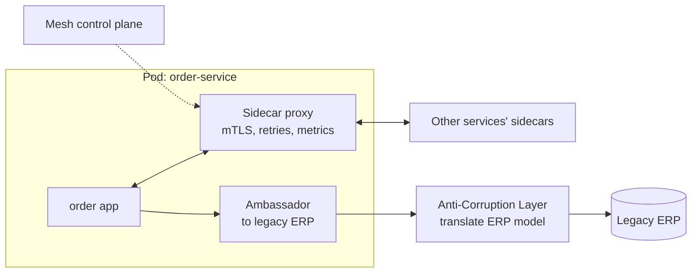

**How they relate to the rest of this file:** a service mesh's control plane typically stores its configuration in a **consensus-backed** store (Kubernetes etcd); sidecars use **consistent hashing** (Envoy `ringHash`/`maglev`) for sticky load balancing; and mesh **outlier detection** is a form of failure detection.

**Q1. Sidecar vs ambassador?** A sidecar is any helper container next to the app; an ambassador is a sidecar specialised as an outbound proxy to external services.

**Q2. When would you use an anti-corruption layer?** When integrating with a legacy or third-party system whose data model you don't want leaking into your own domain: translate at the boundary.

```
SIDECAR / AMBASSADOR / MESH / ACL  Helper container per instance / outbound proxy sidecar / sidecars + control plane
          (mTLS, retries, canary, telemetry) / translation boundary to legacy models. Details: Microservices + Structural files.
```

---

# 10. How the Distributed Systems Patterns Fit Together

## 10.1 One-Line Summary of Each

| Pattern | Question it answers | One-line answer |
|---|---|---|
| **Distributed Cache** | "How do all instances share fast data?" | One partitioned in-memory store (+ near cache with invalidation). |
| **Consistent Hashing** | "Which node owns this key, as nodes come and go?" | Hash ring with virtual nodes; only ~1/N keys move. |
| **Quorum** | "How many must agree?" | A majority (N/2+1), or W + R > N for reads/writes. |
| **Leader Election** | "Who's in charge?" | Lease or consensus vote, with increasing terms. |
| **Consensus (Raft/Paxos)** | "How do nodes agree on an ordered log?" | Leader replicates; commit on majority; safe elections. |
| **Gossip** | "How does news spread without a coordinator?" | Random peer exchanges; O(log N) rounds. |
| **Vector Clocks** | "Which update came first, or were they concurrent?" | Per-node counters compared element-wise. |
| **Distributed Locks** | "How do I do this exactly once at a time?" | Atomic lease + owner check + fencing token. |
| **Sidecar / Mesh / ACL** | "How do I add networking or translation without changing code?" | Co-located proxies and translation boundaries. |

## 10.2 How a Real Cluster Uses Them Together (Interview Imp - Java)

Take a **Cassandra-like** store plus a **Kubernetes/etcd** control plane, two systems Java developers meet constantly:

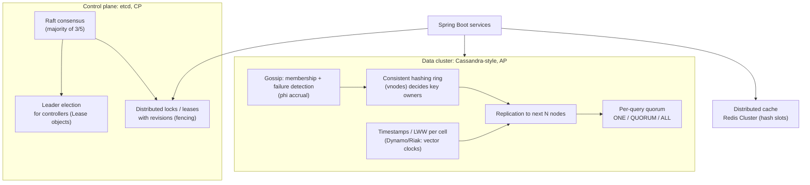

| Concern | AP data store (Cassandra/Dynamo) | CP coordination store (etcd/ZooKeeper) |
|---|---|---|
| Who owns data | Consistent hashing ring | Single Raft group (small data) |
| Membership/failure detection | Gossip | Raft heartbeats |
| Agreement | Tunable quorums | Majority consensus |
| Conflicts | LWW / vector clocks / CRDTs | None (linearizable) |
| Used for | Business data at scale | Config, discovery, locks, leader election |

## 10.3 Decision Guide

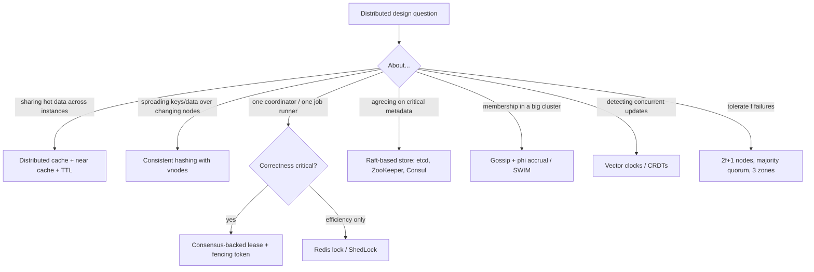

| If you hear... | Think... |
|---|---|
| "Redis", "near cache", "stale cache on other instances" | Distributed Cache |
| "Adding a cache node causes a miss storm", "hash ring", "vnodes" | Consistent Hashing |
| "Majority", "odd number of nodes", "split brain", "W+R>N" | Quorum |
| "Only one instance should run the job", "primary", "lease" | Leader Election / Distributed Lock |
| "Raft", "Paxos", "etcd", "ZooKeeper", "replicated log" | Consensus |
| "Membership", "failure detection", "Cassandra gossip" | Gossip |
| "Which write came first", "conflict detection", "siblings" | Vector Clocks |
| "Exactly one worker", "Redlock", "fencing", "Redisson" | Distributed Locks |

## 10.4 Look-Alike Patterns

| Pair | Difference |
|---|---|
| **Leader election vs distributed lock** | Election picks a long-term coordinator; a lock guards one critical section. Both need leases and fencing. |
| **Quorum vs consensus** | A quorum is a counting rule (how many must agree); consensus is a full protocol (terms, logs, elections) built on majority quorums. |
| **Gossip vs consensus** | Gossip: scalable, eventually consistent dissemination. Consensus: strongly consistent agreement, majority required. |
| **Lamport vs vector clocks** | Total order consistent with causality vs detecting concurrency. |
| **Consistent hashing vs hash slots** | Ring positions (Cassandra) vs a fixed number of slots assigned to nodes (Redis Cluster); both minimise data movement. |
| **Distributed cache vs database** | Cache: fast, rebuildable copy, may be lost. Database: durable source of truth. |

## 10.5 Distributed Systems Tools in the Java Ecosystem

| Pattern | Java / Spring / ecosystem |
|---|---|
| Distributed Cache | Spring Cache + Redis (Lettuce), Redisson, Hazelcast, Infinispan, Caffeine near cache, Spring Session |
| Consistent Hashing | Cassandra driver token awareness, Envoy/Istio ring hash, Guava `Hashing.consistentHash`, custom `TreeMap` rings |
| Quorum | Cassandra Java driver consistency levels, Kafka `min.insync.replicas`, MongoDB write/read concerns |
| Leader Election | Spring Integration `LeaderInitiator` (ZooKeeper/etcd/JDBC/Hazelcast), Curator `LeaderLatch`, Kubernetes Lease, ShedLock |
| Consensus | etcd + jetcd, ZooKeeper + Curator, Consul, Apache Ratis, Hazelcast CP Subsystem, Kafka KRaft |
| Gossip | Akka Cluster (phi accrual, SBR), Cassandra internals, HashiCorp memberlist (Consul) |
| Vector Clocks | Riak client siblings, CRDT libraries, HLC in CockroachDB/MongoDB drivers |
| Distributed Locks | Redisson, Spring Integration `LockRegistry`, ShedLock, Curator `InterProcessMutex`, PostgreSQL advisory locks, Hazelcast `FencedLock` |

## 10.6 Comparison Table

| Pattern | Main problem solved | Key mechanism | Biggest risk | Interview favourite |
|---|---|---|---|---|
| **Distributed Cache** | Shared fast data | Partitioned in-memory store | Stale/invalidations, stampede | Local vs distributed, near cache |
| **Consistent Hashing** | Minimal remapping | Ring + vnodes | Uneven load, hot keys | Why not hash % N |
| **Quorum** | Safe agreement | Majorities overlap | Even cluster sizes | 2f+1, split brain |
| **Leader Election** | Single coordinator | Lease / vote + terms | Stale leader | Fencing tokens |
| **Consensus** | Replicated log | Raft/Paxos majorities | Minority can't progress | Explain Raft |
| **Gossip** | Scalable dissemination | Random peer exchange | False suspicions | O(log N), SWIM |
| **Vector Clocks** | Causality, conflicts | Per-node counters | Vector growth | Lamport vs vector |
| **Distributed Locks** | Mutual exclusion | Atomic lease + owner + fence | Pauses outliving leases | Redis lock, Redlock debate |

---

# 11. Distributed Systems Patterns Cheat Sheet

```
BASICS          Partial failure; timeout = "didn't hear back", not "didn't happen"; unreliable networks; no shared clock.
DISTRIBUTED     Shared partitioned in-memory store (Redis Cluster 16,384 slots, hash tags). Near cache + pub/sub invalidation.
CACHE           Always TTL; cache is not the truth; stampede: sync=true, lock, early refresh, jitter.
CONSISTENT      Ring + vnodes; add/remove node moves ~1/N keys (hash % N moves ~all). Replicate to next R-1 nodes.
HASHING         Cassandra, DynamoDB, Envoy ringHash/Maglev, Nginx `hash ... consistent`.
QUORUM          Majority N/2+1; 2f+1 tolerate f; odd sizes in 3 zones; minority side refuses writes. W+R>N for replicas.
LEADER          Lease (etcd/ZooKeeper/K8s Lease/DB) or Raft vote; increasing TERM as fencing token; ShedLock for @Scheduled.
ELECTION
CONSENSUS       Raft: terms, randomised election timeouts, majority votes + up-to-date log, AppendEntries, commit at majority.
                Paxos: prepare/promise + accept. Use etcd/ZooKeeper/Consul/Ratis; never roll your own.
GOSSIP          Random peer exchange, O(log N) rounds; membership + failure detection (heartbeats, SWIM, phi accrual).
VECTOR CLOCKS   Lamport = order, can't detect concurrency. Vector = BEFORE/AFTER/CONCURRENT -> siblings + merge. HLC, TrueTime.
DISTRIBUTED     SET NX PX + owner + Lua release + watchdog + FENCING TOKEN checked by the resource.
LOCKS           Redisson, Spring Integration LockRegistry, Curator, pg advisory locks, Hazelcast FencedLock. Prefer constraints/idempotency.
```

### Quick Decision Table

| Need | Use |
|---|---|
| Fast shared data for many instances | Distributed cache (+ near cache) |
| Add/remove cache or storage nodes smoothly | Consistent hashing with virtual nodes |
| Survive f node failures without split brain | 2f+1 nodes with majority quorum |
| Exactly one coordinator | Leader election with leases + fencing |
| Small, critical, strongly consistent metadata | Raft-based store (etcd, ZooKeeper, Consul) |
| Membership/failure detection in a large cluster | Gossip (SWIM, phi accrual) |
| Detect conflicting concurrent updates | Vector clocks (or CRDTs) |
| One worker at a time for a task | Distributed lock with fencing (or ShedLock for jobs) |
| Simple race on one row | Unique constraint / `@Version` / conditional update, no distributed lock |

### Top Interview Traps

1. **A timeout doesn't mean the operation failed;** it may have succeeded. Make retries idempotent.
2. **Don't order events across machines by wall-clock time;** use logical clocks, sequences or per-key offsets.
3. **`hash % N` remaps almost everything** when N changes; consistent hashing moves ~1/N.
4. **Consistent hashing doesn't fix hot keys.**
5. **Even cluster sizes add no fault tolerance,** and a 2+2 split stops everything. Use 3 or 5 nodes.
6. **Leases alone don't prevent split brain:** a paused leader can wake up after expiry. Use fencing tokens.
7. **Redis `SETNX` + `EXPIRE` as two commands is broken;** use `SET NX PX` and an owner-checked Lua release.
8. **Redlock is for efficiency, not correctness** (no fencing; timing assumptions).
9. **A minority partition in Raft can't make progress;** that's by design (CP).
10. **Gossip is eventually consistent;** don't use it for decisions that need agreement.

> **Related files:** [05_Data_Management_Pattern.md](05_Data_Management_Pattern.md) (consistency models, CAP, quorum reads/writes, CRDTs) · [02_Reliability_Pattern.md](02_Reliability_Pattern.md) (redundancy, failover, split brain, health checks) · [01_Scalability_Pattern.md](01_Scalability_Pattern.md) (caching, sharding, replication, load balancing) · [02_Microservices_Pattern.md](../04_Specialized/02_Microservices_Pattern.md) (service discovery, sidecar, service mesh) · [04_Messaging_Pattern.md](04_Messaging_Pattern.md) (Kafka partitions, ordering, idempotency) · [00_Design_Patterns_Complete_List.md](../00_Design_Patterns_Complete_List.md) (master list)
