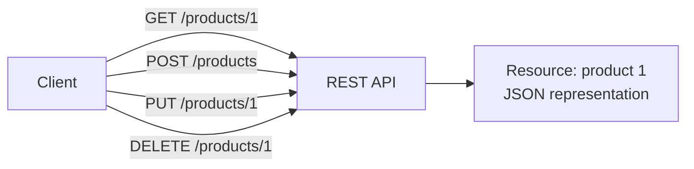
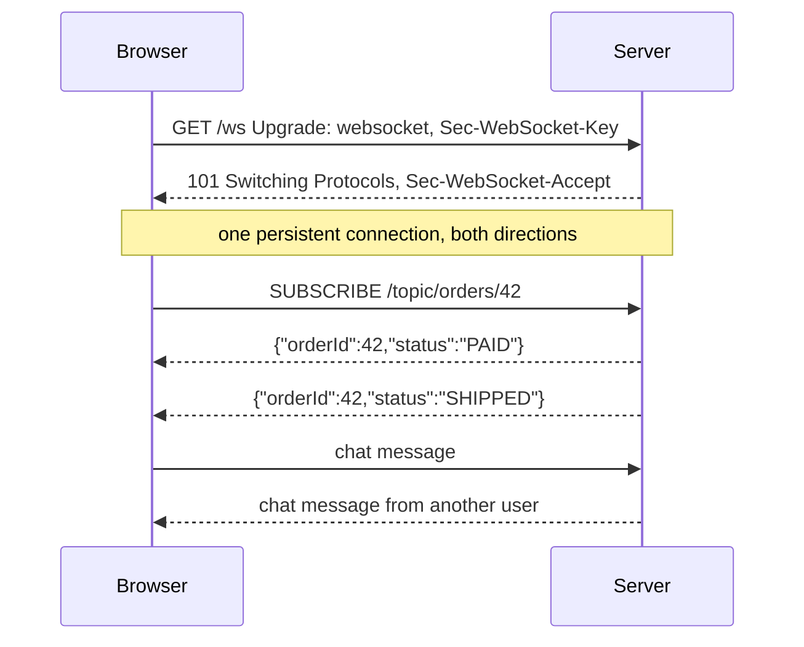
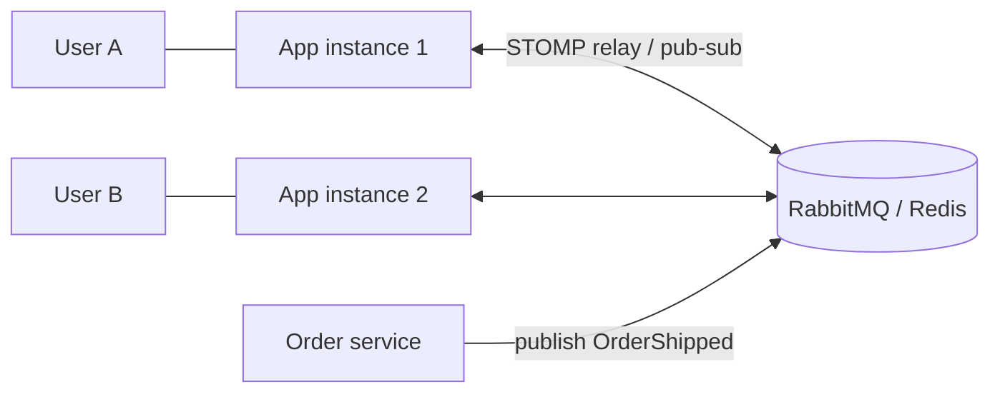
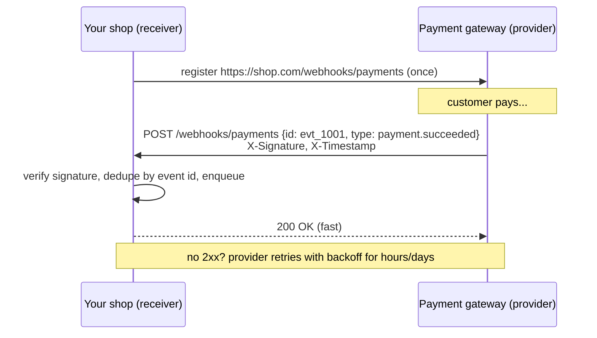
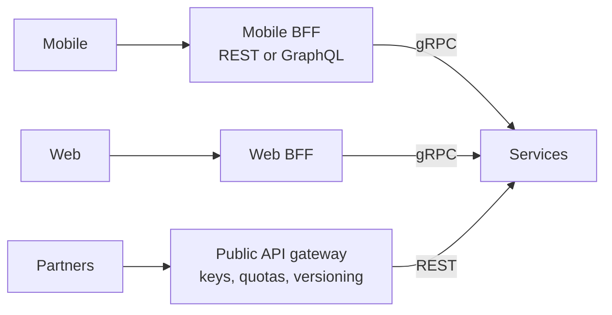
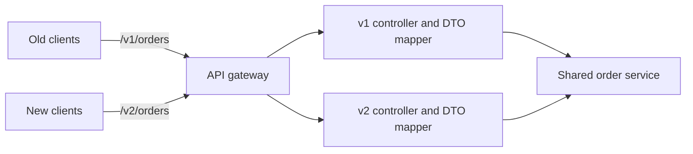
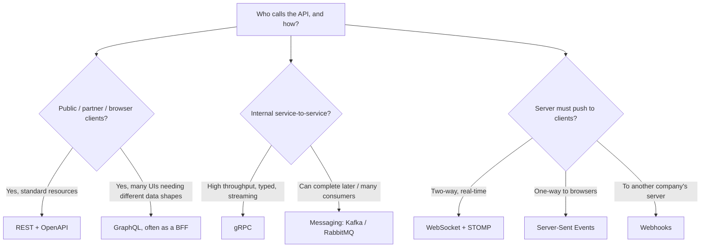
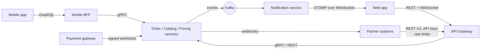

# API Design Patterns

> **Note**: Patterns marked with **(Interview Imp - Java)** are frequently asked in Java interviews
>
> **How to read this file:** Every section ends with a **📘 Terms Explained** table. If you see a word you don't know, check the table right below that section. Each pattern goes from the basic idea to advanced usage (plain Java, Spring Boot, pitfalls) and ends with interview questions and a mini cheat sheet.
>
> **What are API design patterns?** They answer one question: *"How should systems expose their capabilities to clients (apps, partners, other services) so the API is easy to use, fast, safe to evolve, and hard to misuse?"* This file covers the API styles (REST, GraphQL, gRPC, WebSocket, Webhook), the edge (API Gateway, BFF), and the design details interviewers probe: versioning, pagination, filtering and sorting, HATEOAS, plus a cross-cutting section on errors, idempotency, caching and rate-limit headers.
>
> **Builds on:** [02_Microservices_Pattern.md](../04_Specialized/02_Microservices_Pattern.md) (API Gateway, BFF, API composition, access tokens), [02_Reliability_Pattern.md](02_Reliability_Pattern.md) (timeouts, retries, idempotency keys, rate limiting), [04_Messaging_Pattern.md](04_Messaging_Pattern.md) (async alternatives), and [Client_Server_Web_Architecture_Guide.md](../../web-architecture/Client_Server_Web_Architecture_Guide.md) (HTTP, servers, Tomcat/Nginx).
>
> **Verified code:** Every main "Complete Java Example" in this file is **plain Java 17 (no libraries)** and was compiled and run **three times** with identical output. The REST example is a **real HTTP server and client** (the JDK's built-in `com.sun.net.httpserver.HttpServer` and `java.net.http.HttpClient`), so its status codes and headers are genuine. The others are small simulations. To run one, save it as `<ClassName>.java` and run `javac <ClassName>.java && java <ClassName>`. (Running it directly with `java <ClassName>.java` won't work, because the class with `main` is not the first class in the file.)

---

## Table of Contents
1. [REST Pattern](#1-rest-pattern-interview-imp---java) **(Interview Imp - Java)**
   - [1.1 What is REST?](#11-what-is-rest)
   - [1.2 Why Do We Need It?](#12-why-do-we-need-it)
   - [1.3 How It Works: Resource Design Rules](#13-how-it-works-resource-design-rules)
   - [1.4 Complete Java Example - A Real REST API with ETags and Idempotency Keys](#14-complete-java-example---a-real-rest-api-with-etags-and-idempotency-keys)
   - [1.5 REST in Spring Boot](#15-rest-in-spring-boot)
   - [1.6 Pros, Cons and Pitfalls](#16-pros-cons-and-pitfalls)
   - [1.7 REST - Interview Questions](#17-rest---interview-questions)
   - [1.8 REST - Cheat Sheet](#18-rest---cheat-sheet)
2. [GraphQL Pattern](#2-graphql-pattern-interview-imp---java) **(Interview Imp - Java)**
   - [2.1 What is GraphQL?](#21-what-is-graphql)
   - [2.2 Why Do We Need It?](#22-why-do-we-need-it)
   - [2.3 How It Works](#23-how-it-works)
   - [2.4 Complete Java Example - Field Selection and the N+1 Problem](#24-complete-java-example---field-selection-and-the-n1-problem)
   - [2.5 GraphQL in Spring Boot (Spring for GraphQL)](#25-graphql-in-spring-boot-spring-for-graphql)
   - [2.6 Pros, Cons, Pitfalls and Interview Questions](#26-pros-cons-pitfalls-and-interview-questions)
   - [2.7 GraphQL - Cheat Sheet](#27-graphql---cheat-sheet)
3. [gRPC Pattern](#3-grpc-pattern-interview-imp---java) **(Interview Imp - Java)**
   - [3.1 What is gRPC?](#31-what-is-grpc)
   - [3.2 Why Do We Need It?](#32-why-do-we-need-it)
   - [3.3 How It Works: Why Protobuf Is Small](#33-how-it-works-why-protobuf-is-small)
   - [3.4 Complete Java Example - Hand-Encoding a Protobuf Message](#34-complete-java-example---hand-encoding-a-protobuf-message)
   - [3.5 gRPC in Java and Spring Boot](#35-grpc-in-java-and-spring-boot)
   - [3.6 Pros, Cons, Pitfalls and Interview Questions](#36-pros-cons-pitfalls-and-interview-questions)
   - [3.7 gRPC - Cheat Sheet](#37-grpc---cheat-sheet)
4. [WebSocket Pattern](#4-websocket-pattern-interview-imp---java) **(Interview Imp - Java)**
   - [4.1 What is WebSocket?](#41-what-is-websocket)
   - [4.2 Why Do We Need It?](#42-why-do-we-need-it)
   - [4.3 How It Works](#43-how-it-works)
   - [4.4 Complete Java Example - Handshake Key and Topic Push vs Polling](#44-complete-java-example---handshake-key-and-topic-push-vs-polling)
   - [4.5 WebSocket in Spring Boot (STOMP)](#45-websocket-in-spring-boot-stomp)
   - [4.6 Pros, Cons, Pitfalls and Interview Questions](#46-pros-cons-pitfalls-and-interview-questions)
   - [4.7 WebSocket - Cheat Sheet](#47-websocket---cheat-sheet)
5. [Webhook Pattern](#5-webhook-pattern)
   - [5.1 What is a Webhook?](#51-what-is-a-webhook)
   - [5.2 Why Do We Need It?](#52-why-do-we-need-it)
   - [5.3 How It Works: Rules for Both Sides](#53-how-it-works-rules-for-both-sides)
   - [5.4 Complete Java Example - Verifying Webhooks Safely](#54-complete-java-example---verifying-webhooks-safely)
   - [5.5 Webhooks in Spring Boot](#55-webhooks-in-spring-boot)
   - [5.6 Pros, Cons, Pitfalls and Interview Questions](#56-pros-cons-pitfalls-and-interview-questions)
   - [5.7 Webhook - Cheat Sheet](#57-webhook---cheat-sheet)
6. [API Gateway and Backend for Frontend (BFF)](#6-api-gateway-and-backend-for-frontend-bff)
7. [API Versioning Pattern](#7-api-versioning-pattern-interview-imp---java) **(Interview Imp - Java)**
   - [7.1 What is API Versioning?](#71-what-is-api-versioning)
   - [7.2 Why Do We Need It?](#72-why-do-we-need-it)
   - [7.3 Types of Versioning](#73-types-of-versioning)
   - [7.4 Complete Java Example - Path, Header and Media-Type Versions with Deprecation](#74-complete-java-example---path-header-and-media-type-versions-with-deprecation)
   - [7.5 API Versioning in Spring Boot](#75-api-versioning-in-spring-boot)
   - [7.6 Pros, Cons, Pitfalls and Interview Questions](#76-pros-cons-pitfalls-and-interview-questions)
   - [7.7 API Versioning - Cheat Sheet](#77-api-versioning---cheat-sheet)
   - [7.8 How It Works](#78-how-it-works)
8. [Pagination Pattern](#8-pagination-pattern-interview-imp---java) **(Interview Imp - Java)**
   - [8.1 What is Pagination?](#81-what-is-pagination)
   - [8.2 Why Do We Need It?](#82-why-do-we-need-it)
   - [8.3 How It Works: Offset vs Keyset](#83-how-it-works-offset-vs-keyset)
   - [8.4 Complete Java Example - Offset vs Keyset: Cost and Consistency](#84-complete-java-example---offset-vs-keyset-cost-and-consistency)
   - [8.5 Pagination in Spring Boot](#85-pagination-in-spring-boot)
   - [8.6 Pitfalls and Interview Questions](#86-pitfalls-and-interview-questions)
   - [8.7 Pagination - Cheat Sheet](#87-pagination---cheat-sheet)
   - [8.8 Pros and Cons](#88-pros-and-cons)
9. [Filtering and Sorting Pattern](#9-filtering-and-sorting-pattern)
   - [9.1 What is Filtering and Sorting?](#91-what-is-filtering-and-sorting)
   - [9.2 Why Do We Need It?](#92-why-do-we-need-it)
   - [9.3 Common Conventions](#93-common-conventions)
   - [9.4 Complete Java Example - Whitelisted Filters and Multi-Field Sort](#94-complete-java-example---whitelisted-filters-and-multi-field-sort)
   - [9.5 Filtering and Sorting in Spring Boot](#95-filtering-and-sorting-in-spring-boot)
   - [9.6 Pitfalls and Interview Questions](#96-pitfalls-and-interview-questions)
   - [9.7 Filtering and Sorting - Cheat Sheet](#97-filtering-and-sorting---cheat-sheet)
   - [9.8 How It Works, Pros and Cons](#98-how-it-works-pros-and-cons)
10. [HATEOAS Pattern](#10-hateoas-pattern)
   - [10.1 What is HATEOAS?](#101-what-is-hateoas)
   - [10.2 Why Do We Need It?](#102-why-do-we-need-it)
   - [10.3 Complete Java Example - State-Dependent Links in HAL](#103-complete-java-example---state-dependent-links-in-hal)
   - [10.4 HATEOAS in Spring Boot (Spring HATEOAS)](#104-hateoas-in-spring-boot-spring-hateoas)
   - [10.5 Pros, Cons, Pitfalls and Interview Questions](#105-pros-cons-pitfalls-and-interview-questions)
   - [10.6 HATEOAS - Cheat Sheet](#106-hateoas---cheat-sheet)
   - [10.7 How It Works](#107-how-it-works)
11. [Errors, Idempotency, Caching and Rate-Limit Headers](#11-errors-idempotency-caching-and-rate-limit-headers-interview-imp---java) **(Interview Imp - Java)**
   - [11.1 Error Responses: Problem Details (RFC 9457)](#111-error-responses-problem-details-rfc-9457)
   - [11.2 Idempotency Keys](#112-idempotency-keys)
   - [11.3 HTTP Caching and Conditional Requests](#113-http-caching-and-conditional-requests)
   - [11.4 Rate-Limit and Retry Headers](#114-rate-limit-and-retry-headers)
   - [11.5 Other Cross-Cutting Rules](#115-other-cross-cutting-rules)
   - [11.6 Interview Questions and Cheat Sheet](#116-interview-questions-and-cheat-sheet)
   - [11.7 How It Works, Pros and Cons, and Pitfalls](#117-how-it-works-pros-and-cons-and-pitfalls)
12. [How the API Design Patterns Fit Together](#12-how-the-api-design-patterns-fit-together)
   - [12.1 One-Line Summary of Each](#121-one-line-summary-of-each)
   - [12.2 Choosing an API Style (Interview Imp - Java)](#122-choosing-an-api-style-interview-imp---java)
   - [12.3 One E-commerce Platform Using All of Them](#123-one-e-commerce-platform-using-all-of-them)
   - [12.4 Look-Alike Patterns](#124-look-alike-patterns)
   - [12.5 API Design in the Spring Ecosystem](#125-api-design-in-the-spring-ecosystem)
   - [12.6 Comparison Table](#126-comparison-table)
13. [API Design Patterns Cheat Sheet](#13-api-design-patterns-cheat-sheet)

---

## Before You Start: HTTP Essentials and the API Styles

### HTTP methods

| Method | Meaning | Safe? (no state change) | Idempotent? (repeat = same effect) | Request body |
|---|---|---|---|---|
| `GET` | Read a resource | ✅ | ✅ | No |
| `HEAD` | `GET` without the body (headers only) | ✅ | ✅ | No |
| `POST` | Create, or run an action | ❌ | ❌ (unless you add an idempotency key) | Yes |
| `PUT` | Replace a resource completely | ❌ | ✅ | Yes |
| `PATCH` | Change part of a resource | ❌ | ❌ (usually) | Yes |
| `DELETE` | Remove a resource | ❌ | ✅ | Usually no |
| `OPTIONS` | Ask what's allowed (CORS preflight) | ✅ | ✅ | No |

> **Idempotency is the key property for retries:** a client can safely retry `GET`, `PUT` and `DELETE` after a timeout. A retried `POST` may create a duplicate, which is why payment APIs use **idempotency keys** (section 11 and [02_Reliability_Pattern.md](02_Reliability_Pattern.md#232-idempotency-the-key-to-safe-retries-interview-imp---java)).

### Status codes worth memorising

| Code | Meaning | Use when |
|---|---|---|
| **200 OK** | Success with a body | GET, PUT, PATCH returning data |
| **201 Created** | A resource was created | POST that creates; include a `Location` header |
| **202 Accepted** | Accepted for **async** processing | Long-running jobs (return a status URL) |
| **204 No Content** | Success, no body | DELETE, or PUT without a response body |
| **304 Not Modified** | The cached copy is still valid | Conditional GET with `If-None-Match` |
| **400 Bad Request** | Malformed request / validation error | Bad JSON, missing fields |
| **401 Unauthorized** | Not authenticated (missing/invalid credentials) | No or bad token |
| **403 Forbidden** | Authenticated but not allowed | Valid token, wrong role/scope |
| **404 Not Found** | Resource doesn't exist | Unknown ID (also to hide existence from unauthorised users) |
| **405 Method Not Allowed** | Method not supported on this resource | `DELETE /products` collection |
| **409 Conflict** | Conflicts with current state | Duplicate unique value, invalid state transition |
| **412 Precondition Failed** | `If-Match` didn't match | Optimistic concurrency failure |
| **415 Unsupported Media Type** | Wrong `Content-Type` | XML sent to a JSON-only endpoint |
| **422 Unprocessable Content** | Syntactically fine, semantically invalid | Some teams use it for validation errors |
| **429 Too Many Requests** | Rate limited | Include `Retry-After` |
| **500 Internal Server Error** | Unexpected server failure | Bugs (never leak stack traces) |
| **502 / 503 / 504** | Bad gateway / unavailable / gateway timeout | Downstream or overload problems (retryable) |

### The API styles at a glance

| Style | Shape | Transport | Best for |
|---|---|---|---|
| **REST** | Resources + HTTP methods | HTTP/1.1, HTTP/2 | Public APIs, CRUD, cacheable reads, broad tooling |
| **GraphQL** | One endpoint; client asks for exactly the fields it needs | HTTP (POST) | Many client types needing different shapes of related data |
| **gRPC** | Typed RPC methods from `.proto` contracts | HTTP/2 + Protobuf | Fast internal service-to-service calls, streaming |
| **WebSocket** | Persistent two-way connection | TCP via HTTP upgrade | Real-time push both ways (chat, live updates, games) |
| **Webhook** | The **server calls you** over HTTP when an event happens | HTTP POST | Notifying partners/integrations of events |
| **Messaging** | Async messages via a broker | Kafka, RabbitMQ | Decoupled, buffered workflows ([04_Messaging_Pattern.md](04_Messaging_Pattern.md)) |

### API-first (contract-first) design

Write the **contract first** (OpenAPI for REST, `.proto` for gRPC, GraphQL SDL, AsyncAPI for events), review it with consumers, then generate stubs/clients and implement. Contracts become the source of truth for docs, mocks, client SDKs and **contract tests** (Spring Cloud Contract, Pact).

#### 📘 Terms Explained

| Term | Simple meaning |
|---|---|
| **API** | Application Programming Interface: the contract for how other software talks to yours. |
| **Safe method** | An HTTP method that doesn't change server state (`GET`, `HEAD`). |
| **Idempotent method** | Repeating the request has the same effect as sending it once (`PUT`, `DELETE`). |
| **Status code** | The 3-digit number in an HTTP response saying what happened. |
| **Contract-first** | Designing the API specification before writing the implementation. |
| **OpenAPI** | The standard YAML/JSON format for describing REST APIs (formerly Swagger). |

---

# 1. REST Pattern (Interview Imp - Java)

## 1.1 What is REST?

**REST (Representational State Transfer)** is an architectural style (Roy Fielding, 2000) where an API is a set of **resources** identified by **URLs**, manipulated with the standard **HTTP methods**, and transferred as **representations** (usually JSON). The server is **stateless**: every request carries everything needed to process it.

**Analogy:** A library catalogue. Every book has a fixed shelf address (URL). You use a few standard actions on any book: look it up (GET), add a new one (POST), replace its record (PUT), remove it (DELETE). The librarian doesn't remember your previous questions; each request stands on its own.



### REST constraints

| Constraint | Meaning |
|---|---|
| **Client-server** | UI and data storage are separated |
| **Stateless** | No client session stored on the server between requests (auth via tokens on each request) |
| **Cacheable** | Responses say whether/how long they can be cached (`Cache-Control`, `ETag`) |
| **Uniform interface** | Resources by URI, standard methods, self-descriptive messages, hypermedia (HATEOAS, section 10) |
| **Layered system** | Clients can't tell whether they talk to the server or a proxy/CDN/gateway |
| **Code on demand** (optional) | Server may send executable code (e.g. JavaScript) |

#### 📘 Terms Explained

| Term | Simple meaning |
|---|---|
| **Resource** | A "thing" the API exposes (a product, an order, a customer's address). |
| **URI / URL** | The address of a resource (`/products/1`). |
| **Representation** | The format a resource is sent in (JSON, XML). |
| **Stateless** | The server doesn't keep per-client conversation state between requests. |
| **Richardson Maturity Model** | A 4-level scale of "how RESTful" an API is (below). |

---

## 1.2 Why Do We Need It?

- **Universal:** every language, browser, tool and proxy speaks HTTP.
- **Scalable:** statelessness lets any instance serve any request (horizontal scaling: [01_Scalability_Pattern.md](01_Scalability_Pattern.md#2-horizontal-scaling-interview-imp---java)).
- **Cacheable:** HTTP caching (browsers, CDNs, gateways) works out of the box for `GET`.
- **Simple and discoverable:** predictable URLs and methods; easy to test with `curl`.

### Richardson Maturity Model

| Level | Description | Example |
|---|---|---|
| 0 | One URL, one method, actions in the body (RPC over HTTP) | `POST /api` with `{"action":"getProduct"}` |
| 1 | **Resources** with their own URLs | `POST /products/1/get` |
| 2 | Resources + **HTTP methods and status codes** | `GET /products/1` → 200/404 |
| 3 | Level 2 + **hypermedia links** (HATEOAS) | Responses include `_links` to next actions |

> Most "REST APIs" in industry are **level 2**. That's fine; know that level 3 exists.

---

## 1.3 How It Works: Resource Design Rules

| Rule | Good | Avoid |
|---|---|---|
| **Nouns, not verbs** | `POST /orders` | `POST /createOrder` |
| **Plural collections** | `/products`, `/products/42` | `/product/42` mixed with `/products` |
| **Hierarchy for ownership** (shallow) | `/customers/7/addresses` | `/customers/7/orders/42/lines/3/discounts/1` |
| **Lowercase, hyphenated** | `/order-items` | `/OrderItems`, `/order_items` |
| **Filtering in the query string** | `/orders?status=SHIPPED` | `/orders/shipped` |
| **Actions that aren't CRUD** | Model as a resource: `POST /orders/42/cancellation` | `POST /orders/42?action=cancel` |
| **Correct status codes** | `201` + `Location` on create | `200` with `{"error": ...}` |
| **Consistent JSON style** | `camelCase` everywhere, ISO-8601 dates, decimal strings/minor units for money | Mixed styles |

---

## 1.4 Complete Java Example - A Real REST API with ETags and Idempotency Keys

```java
import com.sun.net.httpserver.HttpExchange;
import com.sun.net.httpserver.HttpServer;
import java.io.IOException;
import java.net.InetSocketAddress;
import java.net.URI;
import java.net.http.HttpClient;
import java.net.http.HttpRequest;
import java.net.http.HttpResponse;
import java.nio.charset.StandardCharsets;
import java.util.LinkedHashMap;
import java.util.Map;
import java.util.regex.Matcher;
import java.util.regex.Pattern;

// A tiny REST API on the JDK's built-in HTTP server: resources, methods, status codes, ETags, idempotency keys
class ProductApi {
    record Product(int id, String name, int price, int version) {
        String json() { return "{\"id\":" + id + ",\"name\":\"" + name + "\",\"price\":" + price + "}"; }
        String etag() { return "\"v" + version + "\""; }
    }
    private final Map<Integer, Product> products = new LinkedHashMap<>();
    private final Map<String, String> idempotencyResults = new LinkedHashMap<>();   // key -> "status|location|body"
    private int nextId = 1;

    void handle(HttpExchange ex) throws IOException {
        String method = ex.getRequestMethod();
        String[] parts = ex.getRequestURI().getPath().split("/");                  // ["", "products", "{id}"]
        String body = new String(ex.getRequestBody().readAllBytes(), StandardCharsets.UTF_8);
        try {
            if (parts.length == 2 && method.equals("POST")) create(ex, body);
            else if (parts.length == 3) {
                int id = Integer.parseInt(parts[2]);
                Product p = products.get(id);
                if (p == null) { problem(ex, 404, "Not Found", "product " + id + " does not exist"); return; }
                switch (method) {
                    case "GET" -> get(ex, p);
                    case "PUT" -> update(ex, p, body);
                    case "DELETE" -> { products.remove(id); send(ex, 204, null, ""); }
                    default -> problem(ex, 405, "Method Not Allowed", method + " not supported");
                }
            } else problem(ex, 404, "Not Found", "no such resource");
        } catch (NumberFormatException e) {
            problem(ex, 400, "Bad Request", "id must be a number");
        }
    }

    private void create(HttpExchange ex, String body) throws IOException {
        String key = ex.getRequestHeaders().getFirst("Idempotency-Key");
        if (key != null && idempotencyResults.containsKey(key)) {                   // same key again: replay, don't create twice
            String[] saved = idempotencyResults.get(key).split("\\|", 3);
            ex.getResponseHeaders().add("Idempotent-Replayed", "true");
            ex.getResponseHeaders().add("Location", saved[1]);
            send(ex, Integer.parseInt(saved[0]), "application/json", saved[2]);
            return;
        }
        int price = intField(body, "price");
        if (price <= 0) { problem(ex, 400, "Validation failed", "price must be positive"); return; }
        Product p = new Product(nextId++, strField(body, "name"), price, 1);
        products.put(p.id(), p);
        String location = "/products/" + p.id();
        if (key != null) idempotencyResults.put(key, "201|" + location + "|" + p.json());
        ex.getResponseHeaders().add("Location", location);
        ex.getResponseHeaders().add("ETag", p.etag());
        send(ex, 201, "application/json", p.json());
    }

    private void get(HttpExchange ex, Product p) throws IOException {
        if (p.etag().equals(ex.getRequestHeaders().getFirst("If-None-Match"))) { send(ex, 304, null, ""); return; }   // unchanged
        ex.getResponseHeaders().add("ETag", p.etag());
        ex.getResponseHeaders().add("Cache-Control", "max-age=60");
        send(ex, 200, "application/json", p.json());
    }

    private void update(HttpExchange ex, Product p, String body) throws IOException {
        String ifMatch = ex.getRequestHeaders().getFirst("If-Match");
        if (ifMatch != null && !ifMatch.equals(p.etag())) {                         // someone else changed it first
            problem(ex, 412, "Precondition Failed", "product was modified (current version is v" + p.version() + ")");
            return;
        }
        Product updated = new Product(p.id(), strField(body, "name"), intField(body, "price"), p.version() + 1);
        products.put(p.id(), updated);
        ex.getResponseHeaders().add("ETag", updated.etag());
        send(ex, 200, "application/json", updated.json());
    }

    private void problem(HttpExchange ex, int status, String title, String detail) throws IOException {     // RFC 9457
        String json = "{\"type\":\"about:blank\",\"title\":\"" + title + "\",\"status\":" + status + ",\"detail\":\"" + detail + "\"}";
        send(ex, status, "application/problem+json", json);
    }

    private void send(HttpExchange ex, int status, String type, String body) throws IOException {
        byte[] bytes = body.getBytes(StandardCharsets.UTF_8);
        if (type != null) ex.getResponseHeaders().add("Content-Type", type);
        ex.sendResponseHeaders(status, bytes.length == 0 ? -1 : bytes.length);
        if (bytes.length > 0) ex.getResponseBody().write(bytes);
        ex.close();
    }

    static String strField(String json, String f) { Matcher m = Pattern.compile("\"" + f + "\"\\s*:\\s*\"([^\"]*)\"").matcher(json); return m.find() ? m.group(1) : ""; }
    static int intField(String json, String f) { Matcher m = Pattern.compile("\"" + f + "\"\\s*:\\s*(-?\\d+)").matcher(json); return m.find() ? Integer.parseInt(m.group(1)) : 0; }
}

public class RestApiDemo {
    static HttpClient client = HttpClient.newHttpClient();
    static String base;

    static void call(String label, String method, String path, String body, String... headers) throws Exception {
        HttpRequest.Builder b = HttpRequest.newBuilder(URI.create(base + path))
                .method(method, body == null ? HttpRequest.BodyPublishers.noBody() : HttpRequest.BodyPublishers.ofString(body));
        if (body != null) b.header("Content-Type", "application/json");
        for (int i = 0; i < headers.length; i += 2) b.header(headers[i], headers[i + 1]);
        HttpResponse<String> r = client.send(b.build(), HttpResponse.BodyHandlers.ofString());
        StringBuilder h = new StringBuilder();
        for (String name : new String[]{"Location", "ETag", "Idempotent-Replayed", "Content-Type"}) {
            r.headers().firstValue(name).ifPresent(v -> h.append(" ").append(name).append("=").append(v));
        }
        System.out.printf("%-34s %-6s %-12s -> %d%s%n", label, method, path, r.statusCode(), h);
        if (!r.body().isEmpty()) System.out.println("      " + r.body());
    }

    public static void main(String[] args) throws Exception {
        ProductApi api = new ProductApi();
        HttpServer server = HttpServer.create(new InetSocketAddress("127.0.0.1", 0), 0);   // port 0 = any free port
        server.createContext("/products", api::handle);
        server.start();
        base = "http://127.0.0.1:" + server.getAddress().getPort();

        call("create", "POST", "/products", "{\"name\":\"Headphones\",\"price\":7999}", "Idempotency-Key", "k-123");
        call("client retries (same key)", "POST", "/products", "{\"name\":\"Headphones\",\"price\":7999}", "Idempotency-Key", "k-123");
        call("invalid body", "POST", "/products", "{\"name\":\"Bad\",\"price\":-5}");
        call("read", "GET", "/products/1", null);
        call("read again with If-None-Match", "GET", "/products/1", null, "If-None-Match", "\"v1\"");
        call("update with If-Match v1", "PUT", "/products/1", "{\"name\":\"Headphones Pro\",\"price\":8999}", "If-Match", "\"v1\"");
        call("stale update with If-Match v1", "PUT", "/products/1", "{\"name\":\"Old\",\"price\":1}", "If-Match", "\"v1\"");
        call("delete", "DELETE", "/products/1", null);
        call("read deleted", "GET", "/products/1", null);
        call("bad id", "GET", "/products/abc", null);
        server.stop(0);
    }
}
```

**Output:**
```
create                             POST   /products    -> 201 Location=/products/1 ETag="v1" Content-Type=application/json
      {"id":1,"name":"Headphones","price":7999}
client retries (same key)          POST   /products    -> 201 Location=/products/1 Idempotent-Replayed=true Content-Type=application/json
      {"id":1,"name":"Headphones","price":7999}
invalid body                       POST   /products    -> 400 Content-Type=application/problem+json
      {"type":"about:blank","title":"Validation failed","status":400,"detail":"price must be positive"}
read                               GET    /products/1  -> 200 ETag="v1" Content-Type=application/json
      {"id":1,"name":"Headphones","price":7999}
read again with If-None-Match      GET    /products/1  -> 304
update with If-Match v1            PUT    /products/1  -> 200 ETag="v2" Content-Type=application/json
      {"id":1,"name":"Headphones Pro","price":8999}
stale update with If-Match v1      PUT    /products/1  -> 412 Content-Type=application/problem+json
      {"type":"about:blank","title":"Precondition Failed","status":412,"detail":"product was modified (current version is v2)"}
delete                             DELETE /products/1  -> 204
read deleted                       GET    /products/1  -> 404 Content-Type=application/problem+json
      {"type":"about:blank","title":"Not Found","status":404,"detail":"product 1 does not exist"}
bad id                             GET    /products/abc -> 400 Content-Type=application/problem+json
      {"type":"about:blank","title":"Bad Request","status":400,"detail":"id must be a number"}
```

What the output shows:
- **201 Created** with a `Location` header pointing to the new resource, and an `ETag` (version tag).
- The **retry with the same `Idempotency-Key`** returned the **same** response (`Idempotent-Replayed=true`) instead of creating a second product.
- Validation failures and unknown resources returned **`application/problem+json`** error bodies (RFC 9457) with the right **400/404** codes.
- **Conditional GET:** sending the known ETag in `If-None-Match` returned **304 Not Modified** with no body (saves bandwidth).
- **Optimistic concurrency:** `PUT` with `If-Match: "v1"` succeeded and produced ETag `v2`; a second `PUT` still claiming `v1` got **412 Precondition Failed**, so a stale update couldn't overwrite newer data.
- **204 No Content** on delete; a later GET returned **404**.

---

## 1.5 REST in Spring Boot

```java
@RestController
@RequestMapping("/products")
@RequiredArgsConstructor
class ProductController {
    private final ProductService service;

    @GetMapping("/{id}")
    ResponseEntity<ProductDto> get(@PathVariable long id) {
        ProductDto p = service.find(id);                                     // throws ProductNotFoundException -> 404
        return ResponseEntity.ok()
                .eTag("\"" + p.version() + "\"")
                .cacheControl(CacheControl.maxAge(Duration.ofSeconds(60)))
                .body(p);
    }

    @PostMapping
    ResponseEntity<ProductDto> create(@Valid @RequestBody CreateProductRequest req,
                                      @RequestHeader(value = "Idempotency-Key", required = false) String key) {
        ProductDto created = service.create(req, key);
        URI location = ServletUriComponentsBuilder.fromCurrentRequest().path("/{id}").buildAndExpand(created.id()).toUri();
        return ResponseEntity.created(location).body(created);              // 201 + Location
    }

    @PutMapping("/{id}")
    ProductDto replace(@PathVariable long id, @RequestHeader("If-Match") String ifMatch,
                       @Valid @RequestBody UpdateProductRequest req) {
        return service.update(id, req, ifMatch);                             // version mismatch -> 412
    }

    @DeleteMapping("/{id}")
    @ResponseStatus(HttpStatus.NO_CONTENT)
    void delete(@PathVariable long id) { service.delete(id); }
}

public record CreateProductRequest(
        @NotBlank @Size(max = 100) String name,
        @Positive long pricePaise,
        @NotBlank String category) {}
```

```yaml
spring:
  mvc:
    problemdetails:
      enabled: true          # standard RFC 9457 error bodies for Spring MVC exceptions
```

| Topic | Spring support |
|---|---|
| Validation | `@Valid` + Jakarta Bean Validation (`@NotBlank`, `@Positive`) → `MethodArgumentNotValidException` → 400 |
| Errors | `ProblemDetail`, `ErrorResponseException`, `@RestControllerAdvice` (section 11) |
| ETags | `ResponseEntity.eTag(...)`, `WebRequest.checkNotModified(etag)`, `ShallowEtagHeaderFilter` |
| Docs | springdoc-openapi: generates OpenAPI + Swagger UI from controllers |
| Clients | `RestClient`, HTTP Interface clients (`@GetExchange`), OpenFeign |

#### 📘 Terms Explained

| Term | Simple meaning |
|---|---|
| **`Location` header** | Tells the client the URL of a newly created resource. |
| **ETag** | A version identifier of a representation; used for caching (`If-None-Match`) and optimistic locking (`If-Match`). |
| **Conditional request** | A request that only acts if a precondition holds (`If-None-Match`, `If-Match`). |
| **`ResponseEntity`** | Spring object to control the status code, headers and body of a response. |
| **springdoc-openapi** | Library that generates OpenAPI docs and Swagger UI from Spring controllers. |
| **DTO** | Data Transfer Object: the API's representation, separate from the JPA entity. |

---

## 1.6 Pros, Cons and Pitfalls

| Pros | Cons |
|---|---|
| Universal, simple, cacheable | Over-fetching / under-fetching (fixed response shapes) |
| Stateless → scales horizontally | Many round trips for related data |
| Great tooling (OpenAPI, curl, Postman) | No built-in schema enforcement for responses (unless contract-first) |
| Works through proxies, CDNs, browsers | Verbose JSON compared to binary protocols |

| Pitfall | Fix |
|---|---|
| Verbs in URLs, everything as `POST` | Resource nouns + correct methods. |
| `200 OK` with an error message inside | Proper 4xx/5xx codes + problem+json bodies. |
| Exposing JPA entities directly | DTOs (avoid leaking internals and lazy-loading surprises). |
| Non-idempotent POST retried by clients | Idempotency keys. |
| Lost updates from concurrent PUTs | ETag + `If-Match` → 412. |
| Huge unpaginated lists | Pagination with limits (section 8). |
| Breaking changes without versioning | Additive changes; versioning strategy (section 7). |

---

## 1.7 REST - Interview Questions

**Q1. What makes an API RESTful?**
Resources identified by URIs, manipulated through a uniform interface (HTTP methods), stateless requests, cacheable responses, a layered system, and ideally hypermedia links.

**Q2. PUT vs PATCH vs POST?**
PUT replaces the whole resource and is idempotent. PATCH changes part of it (not necessarily idempotent). POST creates or triggers an action and isn't idempotent.

**Q3. 401 vs 403?**
401: not authenticated (no/invalid credentials). 403: authenticated, but not allowed to do this.

**Q4. How do you prevent two users overwriting each other's changes?**
Optimistic concurrency with ETags: return an ETag with GET; require `If-Match` on PUT/PATCH; return 412 if the version changed (Spring/JPA: `@Version`).

**Q5. How do you make a POST safe to retry?**
An `Idempotency-Key` header: store the key with the result; on a repeat, return the stored result instead of creating again.

**Q6. What is the Richardson Maturity Model?**
Level 0: one endpoint (RPC). Level 1: resources. Level 2: resources + HTTP methods/status codes. Level 3: plus hypermedia controls (HATEOAS).

**Q7. How should a REST API represent an action like "cancel order"?**
As a sub-resource or state change: `POST /orders/42/cancellation` (or `PATCH /orders/42` with `{"status":"CANCELLED"}`), returning 409 if the order can't be cancelled in its current state.

---

## 1.8 REST - Cheat Sheet

```
REST      Resources (plural nouns) + HTTP methods + status codes + stateless + cacheable (+ HATEOAS = level 3).
          GET/HEAD safe; GET/PUT/DELETE idempotent; POST not (use Idempotency-Key).
          201 + Location on create, 204 on delete, 304 with If-None-Match, 412 with stale If-Match, 409 state conflict,
          400 validation, 401 vs 403, 429 + Retry-After. Errors as application/problem+json (RFC 9457).
          Spring: @RestController, ResponseEntity.created/eTag/cacheControl, @Valid, ProblemDetail, springdoc-openapi.
          DTOs not entities; pagination; versioning; ETag optimistic concurrency.
```

---

# 2. GraphQL Pattern (Interview Imp - Java)

## 2.1 What is GraphQL?

**GraphQL** is a query language and runtime for APIs (Facebook, 2015). The server publishes a **typed schema**; the client sends a **query** listing **exactly the fields it wants**, possibly across several related types, and receives a JSON response with **that exact shape**, usually from a **single endpoint** (`POST /graphql`).

**Analogy:** A buffet vs a set meal. REST endpoints are set meals: you get the whole plate whether you want it or not, and you might need three different counters for one dinner. GraphQL is a buffet with a waiter who brings exactly the items you list, from all counters, on one plate.

```graphql
# Schema (server)
type Query { posts(first: Int = 10): [Post!]! }
type Post   { id: ID!, title: String!, body: String!, likes: Int!, author: Author! }
type Author { id: ID!, name: String!, email: String!, bio: String }
type Mutation { createPost(title: String!, body: String!): Post! }

# Query (client): only title and author name
query {
  posts(first: 4) {
    title
    author { name }
  }
}
```

#### 📘 Terms Explained

| Term | Simple meaning |
|---|---|
| **Schema (SDL)** | The typed description of everything the API offers, in GraphQL's Schema Definition Language. |
| **Query / mutation / subscription** | Read data / change data / receive real-time updates. |
| **Resolver** | A function that fetches the data for one field. |
| **Over-fetching / under-fetching** | Getting more fields than needed / needing extra calls to get enough. |
| **N+1 problem** | One query for a list, then one more query per item to resolve a nested field. |
| **DataLoader** | A utility that batches and caches per-request lookups to avoid N+1. |

---

## 2.2 Why Do We Need It?

| REST pain | GraphQL answer |
|---|---|
| Mobile screen needs data from 4 endpoints → 4 round trips | One query fetches related data in one request |
| Endpoints return big fixed payloads (over-fetching) | Client selects only the fields it needs |
| New screen = new endpoint or a "fat" endpoint | Clients compose new queries from the same schema |
| Docs drift from implementation | The schema **is** the contract, introspectable, with tooling (GraphiQL) |
| Versioning many endpoints | Evolve one schema: add fields, `@deprecated` old ones |

Good fit: client-facing APIs consumed by **several UIs** (web, iOS, Android) with different data needs, often as a **BFF** or a **federated** graph over many microservices.

---

## 2.3 How It Works

1. The server parses and **validates** the query against the schema.
2. It walks the query tree, calling a **resolver** for each field.
3. Nested fields (e.g. `author` on each `post`) are resolved per parent object, which naively causes **N+1** database/service calls.
4. **DataLoader** collects all the IDs requested in one "tick" and fetches them in **one batch**.

| Operation | HTTP | Notes |
|---|---|---|
| Query | `POST /graphql` (or GET for cacheable persisted queries) | Always returns 200 with `data` and/or `errors` (by convention) |
| Mutation | `POST /graphql` | Runs top-level fields sequentially |
| Subscription | WebSocket / SSE | Server pushes events |

---

## 2.4 Complete Java Example - Field Selection and the N+1 Problem

```java
import java.util.ArrayList;
import java.util.LinkedHashMap;
import java.util.List;
import java.util.Map;
import java.util.Set;
import java.util.stream.Collectors;

record Author(int id, String name, String email, String bio) {}
record Post(int id, String title, String body, int authorId, int likes) {}

class Database {
    static int queries = 0;
    static final List<Post> POSTS = List.of(new Post(1, "Intro to Kafka", "long text...", 10, 42),
            new Post(2, "Spring tips", "long text...", 11, 17), new Post(3, "Kafka partitions", "long text...", 10, 9),
            new Post(4, "Virtual threads", "long text...", 12, 88));
    static final Map<Integer, Author> AUTHORS = Map.of(10, new Author(10, "Asha", "asha@x.com", "long bio..."),
            11, new Author(11, "Ravi", "ravi@x.com", "long bio..."), 12, new Author(12, "Meera", "meera@x.com", "long bio..."));

    static List<Post> allPosts() { queries++; return POSTS; }
    static Author authorById(int id) { queries++; return AUTHORS.get(id); }                     // SELECT ... WHERE id = ?
    static Map<Integer, Author> authorsByIds(Set<Integer> ids) {                               // SELECT ... WHERE id IN (...)
        queries++;
        return ids.stream().collect(Collectors.toMap(i -> i, AUTHORS::get));
    }
}

public class GraphQlDemo {
    // query { posts { title author { name } } }  -> the client chooses EXACTLY these fields
    static List<Map<String, Object>> resolve(boolean useDataLoader) {
        List<Post> posts = Database.allPosts();
        Map<Integer, Author> batch = useDataLoader
                ? Database.authorsByIds(posts.stream().map(Post::authorId).collect(Collectors.toSet()))   // one batched query
                : null;
        List<Map<String, Object>> result = new ArrayList<>();
        for (Post p : posts) {
            Author a = useDataLoader ? batch.get(p.authorId()) : Database.authorById(p.authorId());   // N+1 without batching
            Map<String, Object> row = new LinkedHashMap<>();
            row.put("title", p.title());
            row.put("author", Map.of("name", a.name()));
            result.add(row);
        }
        return result;
    }

    public static void main(String[] args) {
        // REST-style: GET /posts then GET /authors/{id} for each post, each returning ALL fields
        Database.queries = 0;
        int restCalls = 1;
        int restBytes = Database.allPosts().toString().length();
        for (Post p : Database.POSTS) { restCalls++; restBytes += Database.authorById(p.authorId()).toString().length(); }
        System.out.println("REST    : " + restCalls + " HTTP round trips, ~" + restBytes + " chars (over-fetching: body, email, bio...)");

        Database.queries = 0;
        List<Map<String, Object>> naive = resolve(false);
        System.out.println("GraphQL : 1 HTTP request, ~" + naive.toString().length() + " chars, naive resolvers -> " + Database.queries + " DB queries (N+1)");

        Database.queries = 0;
        List<Map<String, Object>> batched = resolve(true);
        System.out.println("GraphQL : 1 HTTP request, same data, DataLoader batching -> " + Database.queries + " DB queries");
        StringBuilder json = new StringBuilder("{\"data\":{\"posts\":[");
        for (int i = 0; i < batched.size(); i++) {
            Map<String, Object> row = batched.get(i);
            @SuppressWarnings("unchecked")
            Map<String, Object> author = (Map<String, Object>) row.get("author");
            json.append(i == 0 ? "" : ",").append("{\"title\":\"").append(row.get("title"))
                .append("\",\"author\":{\"name\":\"").append(author.get("name")).append("\"}}");
        }
        System.out.println("response: " + json.append("]}}"));
    }
}
```

**Output:**
```
REST    : 5 HTTP round trips, ~541 chars (over-fetching: body, email, bio...)
GraphQL : 1 HTTP request, ~177 chars, naive resolvers -> 5 DB queries (N+1)
GraphQL : 1 HTTP request, same data, DataLoader batching -> 2 DB queries
response: {"data":{"posts":[{"title":"Intro to Kafka","author":{"name":"Asha"}},{"title":"Spring tips","author":{"name":"Ravi"}},{"title":"Kafka partitions","author":{"name":"Asha"}},{"title":"Virtual threads","author":{"name":"Meera"}}]}}
```

What the output shows:
- The REST-style approach needed **5 round trips** and transferred every field (bodies, emails, bios) the screen didn't need.
- One GraphQL request returned **only `title` and `author.name`**, a fraction of the size.
- But naive resolvers still made **5 database queries** (1 for posts + 1 per post's author): the **N+1 problem** moved to the server.
- **DataLoader-style batching** fetched all authors in **one** `WHERE id IN (...)` query: **2** queries total.

---

## 2.5 GraphQL in Spring Boot (Spring for GraphQL)

```graphql
# src/main/resources/graphql/schema.graphqls
type Query    { posts(first: Int = 10): [Post!]!  post(id: ID!): Post }
type Mutation { createPost(input: CreatePostInput!): Post! }
type Post     { id: ID!  title: String!  likes: Int!  author: Author! }
type Author   { id: ID!  name: String! }
input CreatePostInput { title: String!  body: String! }
```

```java
@Controller
@RequiredArgsConstructor
class PostGraphQlController {
    private final PostRepository posts;
    private final AuthorRepository authors;

    @QueryMapping
    List<Post> posts(@Argument int first) { return posts.findTop(first); }

    @MutationMapping
    Post createPost(@Argument CreatePostInput input) { return posts.save(Post.from(input)); }

    // @BatchMapping = DataLoader built in: ONE call for all posts' authors (no N+1)
    @BatchMapping
    Map<Post, Author> author(List<Post> postsInThisRequest) {
        Map<Long, Author> byId = authors.findAllById(postsInThisRequest.stream().map(Post::authorId).toList())
                .stream().collect(Collectors.toMap(Author::id, a -> a));
        return postsInThisRequest.stream().collect(Collectors.toMap(p -> p, p -> byId.get(p.authorId())));
    }
}
```

```yaml
spring:
  graphql:
    graphiql:
      enabled: true            # browser IDE at /graphiql (disable in production or protect it)
    schema:
      introspection:
        enabled: false         # consider disabling introspection for public production APIs
```

**Protecting a GraphQL API:** limit **query depth** and **complexity** (graphql-java `MaxQueryDepthInstrumentation`, `MaxQueryComplexityInstrumentation`), set timeouts, paginate lists (Relay-style connections with cursors), authorise per field, and consider **persisted queries** (only pre-registered queries are allowed, which also enables GET caching).

#### 📘 Terms Explained

| Term | Simple meaning |
|---|---|
| **Spring for GraphQL** | Spring's official GraphQL integration, built on graphql-java. |
| **`@QueryMapping` / `@MutationMapping`** | Map a controller method to a top-level query/mutation field. |
| **`@BatchMapping`** | Resolve a field for many parents at once (built-in DataLoader). |
| **Introspection** | Asking the GraphQL server for its schema (used by tools; can expose internals). |
| **Persisted queries** | Queries registered in advance and referenced by ID. |
| **Federation** | Combining several GraphQL services ("subgraphs") into one graph via a router (Apollo, Netflix DGS). |

---

## 2.6 Pros, Cons, Pitfalls and Interview Questions

| Pros | Cons |
|---|---|
| Exactly the data needed, in one request | HTTP caching is harder (POST to one URL) |
| Strongly typed, self-documenting schema | N+1 and expensive queries are easy to create |
| Evolve without versions (add fields, deprecate) | Errors come back with HTTP 200 + `errors` array; monitoring needs care |
| Great for multiple different clients | File uploads, rate limiting by "cost" are more complex |

| Pitfall | Fix |
|---|---|
| N+1 resolvers | `@BatchMapping` / DataLoader. |
| Malicious deep or huge queries | Depth/complexity limits, timeouts, pagination, persisted queries. |
| Exposing the database schema 1:1 | Design the graph around client use cases. |
| Authorisation only at the endpoint | Authorise per field/type (`@PreAuthorize` on resolvers). |
| Treating "200 OK" as success in monitoring | Track the `errors` array in metrics. |

**Q1. GraphQL vs REST?** REST: many resource endpoints, fixed shapes, HTTP caching, simple. GraphQL: one endpoint, client-selected fields across related types, typed schema, but harder caching and query-cost control.

**Q2. What is the N+1 problem in GraphQL and how do you fix it?** Resolving a nested field per parent triggers one extra query per item. Fix with DataLoader batching (`@BatchMapping` in Spring for GraphQL).

**Q3. How do you secure a public GraphQL API?** Authentication, per-field authorisation, query depth/complexity limits, timeouts, pagination, persisted queries, and disabling introspection/GraphiQL in production if needed.

**Q4. How do you version a GraphQL API?** Usually you don't: add new fields/types and mark old ones `@deprecated`, removing them once unused.

---

## 2.7 GraphQL - Cheat Sheet

```
GRAPHQL   Typed schema (SDL); one endpoint; client selects exact fields; query / mutation / subscription.
          Fixes REST over/under-fetching and round trips; great as BFF / federated graph.
          N+1 resolvers -> DataLoader (Spring @BatchMapping). Protect: depth/complexity limits, timeouts, pagination,
          per-field auth, persisted queries, introspection off in prod. Evolve with @deprecated, not versions.
          Spring for GraphQL: schema.graphqls, @QueryMapping, @MutationMapping, @SchemaMapping, @BatchMapping, GraphiQL.
```

---

# 3. gRPC Pattern (Interview Imp - Java)

## 3.1 What is gRPC?

**gRPC** is a high-performance **RPC (Remote Procedure Call)** framework from Google. You define **services and messages** in a `.proto` file; tools **generate** client and server code in many languages; calls look like local method calls but travel as compact **Protocol Buffers (Protobuf)** binary messages over **HTTP/2**.

**Analogy:** A phone line with a shared phrasebook. Both sides agreed in advance on numbered phrases (the `.proto` schema), so instead of spelling out "the product's SKU is P-101", you just say "phrase 1: P-101". Messages are short, and the line (HTTP/2) can carry many conversations at once.

```protobuf
syntax = "proto3";
package shop.pricing.v1;

service Pricing {
  rpc GetPrice (PriceRequest) returns (PriceReply);                     // unary
  rpc WatchPrices (WatchRequest) returns (stream PriceReply);           // server streaming
  rpc UploadPrices (stream PriceReply) returns (UploadSummary);         // client streaming
  rpc Negotiate (stream Offer) returns (stream Offer);                  // bidirectional streaming
}

message PriceRequest { string sku = 1; }
message PriceReply   { string sku = 1; int64 amount_paise = 2; bool in_stock = 3; }
```

#### 📘 Terms Explained

| Term | Simple meaning |
|---|---|
| **RPC** | Calling a function on another machine as if it were local. |
| **Protocol Buffers (Protobuf)** | Google's compact binary serialization format with a schema (`.proto`). |
| **HTTP/2** | Newer HTTP version with binary framing, multiplexing many streams on one connection, header compression. |
| **Stub** | Generated client code that turns method calls into network requests. |
| **Field number** | The number (`= 1`, `= 2`) that identifies a field on the wire instead of its name. |

---

## 3.2 Why Do We Need It?

| Need | gRPC strength |
|---|---|
| Low latency, high throughput between internal services | Binary Protobuf + HTTP/2 multiplexing |
| Strict contracts across many languages (Java, Go, Python...) | Code generation from one `.proto` |
| Streaming (live prices, telemetry, chat) | Four call types including bidirectional streaming |
| Timeouts that propagate across services | **Deadlines** built into every call |
| Consistent error handling | Standard status codes (`NOT_FOUND`, `DEADLINE_EXCEEDED`, `UNAVAILABLE`...) |

Used by Kubernetes (etcd API), Envoy/Istio control planes, Google Cloud APIs, Netflix, many internal microservice platforms.

---

## 3.3 How It Works: Why Protobuf Is Small

| Protobuf rule | Effect |
|---|---|
| Each field is sent as **(field number + wire type)** then the value | No field **names** on the wire |
| Integers use **varints** (7 bits per byte) | Small numbers take 1 byte |
| Default values (0, "", false) are **not sent** | Empty fields cost nothing |
| Unknown fields are **skipped** by old readers | Forward/backward compatibility |

**Schema evolution rules:** never change a field's **number** or **type**; never reuse a deleted field's number (mark it `reserved`); add new fields with new numbers. Old and new clients keep working.

---

## 3.4 Complete Java Example - Hand-Encoding a Protobuf Message

```java
import java.io.ByteArrayOutputStream;
import java.nio.charset.StandardCharsets;

// Hand-encoding a Protobuf message to show why gRPC payloads are small.
// message PriceReply { string sku = 1; int64 amount_paise = 2; bool in_stock = 3; }
public class GrpcEncodingDemo {
    static void varint(ByteArrayOutputStream out, long v) {          // 7 bits per byte, high bit = "more bytes follow"
        while ((v & ~0x7FL) != 0) { out.write((int) ((v & 0x7F) | 0x80)); v >>>= 7; }
        out.write((int) v);
    }
    static void tag(ByteArrayOutputStream out, int field, int wireType) { varint(out, ((long) field << 3) | wireType); }

    static String hex(byte[] b) {
        StringBuilder s = new StringBuilder();
        for (byte x : b) s.append(String.format("%02X ", x));
        return s.toString().trim();
    }

    public static void main(String[] args) {
        ByteArrayOutputStream v = new ByteArrayOutputStream();
        varint(v, 1);
        System.out.println("varint(1)   = " + hex(v.toByteArray()));
        v.reset();
        varint(v, 300);
        System.out.println("varint(300) = " + hex(v.toByteArray()) + "   (the classic example from the Protobuf docs)");

        ByteArrayOutputStream pb = new ByteArrayOutputStream();
        byte[] sku = "P-101".getBytes(StandardCharsets.UTF_8);
        tag(pb, 1, 2); varint(pb, sku.length); pb.writeBytes(sku);   // field 1, wire type 2 (length-delimited)
        tag(pb, 2, 0); varint(pb, 799_900);                          // field 2, wire type 0 (varint)
        tag(pb, 3, 0); varint(pb, 1);                                // field 3, bool true
        byte[] proto = pb.toByteArray();

        String json = "{\"sku\":\"P-101\",\"amountPaise\":799900,\"inStock\":true}";
        System.out.println("protobuf bytes : " + hex(proto));
        System.out.println("protobuf size  : " + proto.length + " bytes (field NUMBERS, not names, are sent)");
        System.out.println("JSON size      : " + json.getBytes(StandardCharsets.UTF_8).length + " bytes  " + json);
        System.out.printf("protobuf is %.0f%% smaller for this message%n", 100.0 * (json.length() - proto.length) / json.length());
    }
}
```

**Output:**
```
varint(1)   = 01
varint(300) = AC 02   (the classic example from the Protobuf docs)
protobuf bytes : 0A 05 50 2D 31 30 31 10 9C E9 30 18 01
protobuf size  : 13 bytes (field NUMBERS, not names, are sent)
JSON size      : 51 bytes  {"sku":"P-101","amountPaise":799900,"inStock":true}
protobuf is 75% smaller for this message
```

What the output shows:
- **Varints:** `1` is one byte (`01`); `300` is two bytes (`AC 02`), matching the official Protobuf documentation.
- The whole `PriceReply` was **13 bytes**: `0A` = field 1 (string), `05` = length, then `P-101`; `10` = field 2 (varint) then `9C E9 30` = 799,900; `18 01` = field 3 = true.
- The same data as JSON was **51 bytes**, about **4× larger**, mostly because JSON repeats field **names** as text.

---

## 3.5 gRPC in Java and Spring Boot

```java
// Server: implement the generated base class
public class PricingService extends PricingGrpc.PricingImplBase {
    @Override
    public void getPrice(PriceRequest req, StreamObserver<PriceReply> response) {
        Price p = catalog.find(req.getSku());
        if (p == null) {
            response.onError(Status.NOT_FOUND.withDescription("unknown sku " + req.getSku()).asRuntimeException());
            return;
        }
        response.onNext(PriceReply.newBuilder().setSku(req.getSku()).setAmountPaise(p.paise()).setInStock(p.inStock()).build());
        response.onCompleted();
    }

    @Override
    public void watchPrices(WatchRequest req, StreamObserver<PriceReply> response) {
        priceFeed.subscribe(req.getSkusList(), response::onNext);          // server streaming: push updates
    }
}
```

```java
// Client: blocking stub with a DEADLINE (always set one)
ManagedChannel channel = ManagedChannelBuilder.forTarget("dns:///pricing-service:9090").usePlaintext().build();
PricingGrpc.PricingBlockingStub stub = PricingGrpc.newBlockingStub(channel);

try {
    PriceReply reply = stub.withDeadlineAfter(500, TimeUnit.MILLISECONDS)
                           .getPrice(PriceRequest.newBuilder().setSku("P-101").build());
} catch (StatusRuntimeException e) {
    if (e.getStatus().getCode() == Status.Code.DEADLINE_EXCEEDED) { /* fallback */ }
}
```

| gRPC status | HTTP equivalent | Retry? |
|---|---|---|
| `OK` | 200 | n/a |
| `INVALID_ARGUMENT` | 400 | No |
| `UNAUTHENTICATED` / `PERMISSION_DENIED` | 401 / 403 | No |
| `NOT_FOUND` | 404 | No |
| `ALREADY_EXISTS` / `FAILED_PRECONDITION` | 409 / 412 | No |
| `RESOURCE_EXHAUSTED` | 429 | Later |
| `UNAVAILABLE` | 503 | **Yes** (with backoff) |
| `DEADLINE_EXCEEDED` | 504 | Maybe (if idempotent) |
| `INTERNAL` | 500 | No |

**Spring integration:** the **Spring gRPC** project and the community `grpc-spring-boot-starter` let you register service implementations as Spring beans, configure the server port, add interceptors (auth, tracing) and inject client stubs. **gRPC-Web** or **gRPC transcoding** (Envoy, gateways) expose gRPC services to browsers/REST clients.

#### 📘 Terms Explained

| Term | Simple meaning |
|---|---|
| **`StreamObserver`** | gRPC Java callback interface: `onNext` (send a message), `onError`, `onCompleted`. |
| **`ManagedChannel`** | A gRPC client connection (pooled HTTP/2) to a target service. |
| **Deadline** | An absolute time by which the call must finish; propagated to downstream calls. |
| **Unary / streaming RPC** | One request, one response / a stream of messages in one or both directions. |
| **gRPC-Web / transcoding** | Ways to call gRPC services from browsers or as JSON/REST. |
| **`reserved`** | Protobuf keyword to stop deleted field numbers/names being reused. |

---

## 3.6 Pros, Cons, Pitfalls and Interview Questions

| Pros | Cons |
|---|---|
| Small, fast binary messages; HTTP/2 multiplexing | Not human-readable; needs tooling (grpcurl) to debug |
| Strong contracts + code generation in many languages | Browsers can't call it directly (need gRPC-Web/proxy) |
| Streaming in both directions | Load balancing long-lived HTTP/2 connections needs L7-aware balancers |
| Deadlines and status codes built in | Schema changes need discipline (field numbers) |

| Pitfall | Fix |
|---|---|
| No deadlines → hung calls | Always `withDeadlineAfter(...)`; propagate remaining time. |
| L4 load balancer pins all traffic to one pod (one long HTTP/2 connection) | L7/gRPC-aware LB (Envoy, service mesh) or client-side balancing. |
| Reusing or renumbering fields | Never change numbers; `reserved` for deleted fields. |
| Creating a new channel per call | Reuse channels (they're expensive and thread-safe). |
| Using gRPC for public browser APIs | REST/GraphQL at the edge; gRPC internally. |

**Q1. Why is gRPC faster than REST/JSON?** Protobuf binary encoding (no field names, varints), HTTP/2 multiplexing and header compression, persistent connections, and generated code with no reflection-heavy JSON mapping.

**Q2. What are the four kinds of gRPC calls?** Unary, server streaming, client streaming, bidirectional streaming.

**Q3. How does gRPC handle timeouts?** Each call carries a deadline; servers can check `Context.current().getDeadline()` and propagate it; expired calls fail with `DEADLINE_EXCEEDED`.

**Q4. How do you evolve a `.proto` safely?** Add fields with new numbers; never change numbers or types; reserve removed numbers/names; old clients ignore unknown fields.

**Q5. When would you choose gRPC vs REST?** gRPC for internal, high-throughput, polyglot service-to-service calls and streaming; REST for public/browser APIs, simplicity and HTTP caching.

---

## 3.7 gRPC - Cheat Sheet

```
GRPC      .proto contract -> generated stubs; Protobuf binary over HTTP/2; unary + server/client/bidirectional streaming.
          Small: field numbers (not names), varints, defaults omitted. Evolve: new numbers, never renumber, reserved.
          Always set deadlines (withDeadlineAfter); status codes (UNAVAILABLE retryable, DEADLINE_EXCEEDED, NOT_FOUND...).
          Reuse ManagedChannel; L7/gRPC-aware load balancing; gRPC-Web/transcoding for browsers.
          Internal service-to-service; REST/GraphQL at the public edge.
```

---

# 4. WebSocket Pattern (Interview Imp - Java)

## 4.1 What is WebSocket?

**WebSocket** is a protocol (RFC 6455) that upgrades an HTTP connection into a **persistent, full-duplex** TCP connection: **both** client and server can send messages **at any time**, with tiny per-message overhead. The server can **push** data the moment something happens, instead of the client asking repeatedly.

**Analogy:** A phone call vs sending letters. With HTTP, the client writes a letter (request) and waits for a reply every time; the server can never write first. With WebSocket, once the call is connected either side can talk whenever it wants.



#### 📘 Terms Explained

| Term | Simple meaning |
|---|---|
| **Full-duplex** | Both sides can send at the same time. |
| **Upgrade handshake** | The HTTP request that switches the connection to WebSocket (`101 Switching Protocols`). |
| **Frame** | One WebSocket message unit (text, binary, ping/pong, close). |
| **STOMP** | A simple messaging protocol often used on top of WebSocket (SUBSCRIBE/SEND to destinations). |
| **SSE (Server-Sent Events)** | One-way server-to-browser push over plain HTTP. |
| **Long polling** | The client sends a request that the server holds open until there's news. |

---

## 4.2 Why Do We Need It?

| Real-time need | Example |
|---|---|
| Server → client push | Order status, delivery driver location, stock tickers, notifications |
| Two-way, low-latency | Chat, collaborative editing, multiplayer games |
| Very frequent small updates | Live dashboards, sports scores |

### Real-time options compared

| Technique | Direction | How | Good for | Drawback |
|---|---|---|---|---|
| **Short polling** | Client pulls | Request every N seconds | Simple, rare updates | Wasted requests, delayed updates |
| **Long polling** | Client pulls (held open) | Server replies when there's news, client re-requests | Fallback where WebSocket is blocked | Request overhead per message |
| **Server-Sent Events (SSE)** | Server → client only | One HTTP response streaming `text/event-stream` | Notifications, feeds, AI token streaming | One-way; text only |
| **WebSocket** ✅ | Both ways | Upgraded persistent connection | Chat, collaboration, games, high-frequency updates | Stateful connections to scale; proxies must support it |

---

## 4.3 How It Works

1. **Handshake:** the client sends an HTTP `GET` with `Upgrade: websocket` and a random `Sec-WebSocket-Key`; the server answers `101` with `Sec-WebSocket-Accept` = Base64(SHA-1(key + a fixed GUID)).
2. **Frames** flow both ways over the same TCP connection; **ping/pong** frames keep it alive.
3. **Sub-protocols** like **STOMP** add destinations (`/topic/...`, `/queue/...`) and subscribe/send semantics.
4. **Scaling:** a connection lives on **one** server instance. To broadcast to users connected to **other** instances, use a shared **broker** (RabbitMQ/ActiveMQ STOMP relay, Redis pub/sub, Kafka) so every instance receives every message.



---

## 4.4 Complete Java Example - Handshake Key and Topic Push vs Polling

```java
import java.nio.charset.StandardCharsets;
import java.security.MessageDigest;
import java.util.ArrayList;
import java.util.Base64;
import java.util.HashMap;
import java.util.List;
import java.util.Map;
import java.util.function.Consumer;

public class WebSocketDemo {
    // RFC 6455: the server proves it understood the WebSocket handshake
    static String acceptKey(String clientKey) throws Exception {
        String magic = "258EAFA5-E914-47DA-95CA-C5AB0DC85B11";
        byte[] sha1 = MessageDigest.getInstance("SHA-1").digest((clientKey + magic).getBytes(StandardCharsets.US_ASCII));
        return Base64.getEncoder().encodeToString(sha1);
    }

    // A simple in-memory topic broker, like Spring's SimpleBroker for STOMP destinations
    static class Broker {
        final Map<String, List<Consumer<String>>> subscriptions = new HashMap<>();
        void subscribe(String destination, Consumer<String> session) { subscriptions.computeIfAbsent(destination, d -> new ArrayList<>()).add(session); }
        void send(String destination, String message) { subscriptions.getOrDefault(destination, List.of()).forEach(s -> s.accept(message)); }
    }

    public static void main(String[] args) throws Exception {
        System.out.println("1) Handshake (HTTP Upgrade):");
        System.out.println("   GET /ws  Upgrade: websocket  Sec-WebSocket-Key: dGhlIHNhbXBsZSBub25jZQ==");
        System.out.println("   101 Switching Protocols  Sec-WebSocket-Accept: " + acceptKey("dGhlIHNhbXBsZSBub25jZQ=="));

        System.out.println("2) Server pushes order-status updates to subscribed sessions:");
        Broker broker = new Broker();
        List<String> ashaPhone = new ArrayList<>(), ashaLaptop = new ArrayList<>(), opsDashboard = new ArrayList<>();
        broker.subscribe("/topic/orders/42", ashaPhone::add);
        broker.subscribe("/topic/orders/42", ashaLaptop::add);
        broker.subscribe("/topic/orders", opsDashboard::add);
        for (String status : new String[]{"PAID", "SHIPPED", "DELIVERED"}) {
            broker.send("/topic/orders/42", "{\"orderId\":42,\"status\":\"" + status + "\"}");
            broker.send("/topic/orders", "order 42 -> " + status);
        }
        System.out.println("   phone   received " + ashaPhone);
        System.out.println("   laptop  received " + ashaLaptop.size() + " messages");
        System.out.println("   ops     received " + opsDashboard);

        System.out.println("3) Same 60 seconds with polling every 2 s instead:");
        int polls = 60 / 2, updates = 3;
        System.out.println("   polling: " + polls + " requests per client, " + (polls - updates) + " of them returned 'no change'");
        System.out.println("   websocket: 1 connection, " + updates + " messages, pushed the moment the status changed");
    }
}
```

**Output:**
```
1) Handshake (HTTP Upgrade):
   GET /ws  Upgrade: websocket  Sec-WebSocket-Key: dGhlIHNhbXBsZSBub25jZQ==
   101 Switching Protocols  Sec-WebSocket-Accept: s3pPLMBiTxaQ9kYGzzhZRbK+xOo=
2) Server pushes order-status updates to subscribed sessions:
   phone   received [{"orderId":42,"status":"PAID"}, {"orderId":42,"status":"SHIPPED"}, {"orderId":42,"status":"DELIVERED"}]
   laptop  received 3 messages
   ops     received [order 42 -> PAID, order 42 -> SHIPPED, order 42 -> DELIVERED]
3) Same 60 seconds with polling every 2 s instead:
   polling: 30 requests per client, 27 of them returned 'no change'
   websocket: 1 connection, 3 messages, pushed the moment the status changed
```

What the output shows:
- The computed `Sec-WebSocket-Accept` value matches the example in **RFC 6455** exactly: this is how the client knows the server really speaks WebSocket.
- A topic broker delivered each order update to **every subscribed session** (Asha's phone and laptop) and to the ops dashboard subscribed to a broader topic.
- Polling every 2 seconds would have cost **30 requests per client**, **27** of them useless, and each update could arrive up to 2 seconds late.

---

## 4.5 WebSocket in Spring Boot (STOMP)

```java
@Configuration
@EnableWebSocketMessageBroker
class WebSocketConfig implements WebSocketMessageBrokerConfigurer {
    @Override
    public void registerStompEndpoints(StompEndpointRegistry registry) {
        registry.addEndpoint("/ws").setAllowedOriginPatterns("https://*.shop.com");   // never "*" with credentials
    }

    @Override
    public void configureMessageBroker(MessageBrokerRegistry registry) {
        registry.setApplicationDestinationPrefixes("/app");          // client -> @MessageMapping methods
        registry.enableStompBrokerRelay("/topic", "/queue")          // external broker so ALL instances share messages
                .setRelayHost("rabbitmq").setRelayPort(61613);       // (enableSimpleBroker for a single instance)
        registry.setUserDestinationPrefix("/user");                  // per-user queues: /user/queue/notifications
    }
}

@Controller
@RequiredArgsConstructor
class ChatController {
    private final SimpMessagingTemplate messaging;

    @MessageMapping("/chat/{room}")                                  // client SENDs to /app/chat/{room}
    @SendTo("/topic/chat/{room}")                                    // broadcast to subscribers
    ChatMessage relay(@DestinationVariable String room, ChatMessage msg, Principal user) {
        return msg.from(user.getName());
    }

    @EventListener
    void on(OrderShipped e) {                                        // push from the server side at any time
        messaging.convertAndSend("/topic/orders/" + e.orderId(), new OrderStatus(e.orderId(), "SHIPPED"));
        messaging.convertAndSendToUser(e.customerId(), "/queue/notifications", "Your order has shipped");
    }
}
```

```java
// Server-Sent Events alternative (one-way push) with Spring MVC
@GetMapping(path = "/orders/{id}/events", produces = MediaType.TEXT_EVENT_STREAM_VALUE)
SseEmitter orderEvents(@PathVariable long id) {
    SseEmitter emitter = new SseEmitter(Duration.ofMinutes(30).toMillis());
    orderUpdates.register(id, emitter);                              // later: emitter.send(SseEmitter.event().name("status").data(...))
    return emitter;
}
```

**Infrastructure notes:** load balancers/proxies must allow the `Upgrade` header and long-lived connections (Nginx: `proxy_set_header Upgrade $http_upgrade; proxy_set_header Connection "upgrade"; proxy_read_timeout 1h;`). Authenticate during the handshake (token in a cookie or the first STOMP `CONNECT` frame), not via query strings that end up in logs.

#### 📘 Terms Explained

| Term | Simple meaning |
|---|---|
| **`@EnableWebSocketMessageBroker`** | Turns on STOMP messaging over WebSocket in Spring. |
| **`@MessageMapping`** | Handles messages sent by clients to an application destination. |
| **`SimpMessagingTemplate`** | Sends messages to destinations/users from anywhere in the app. |
| **Broker relay** | Spring forwards STOMP traffic to an external broker (RabbitMQ) so all instances share subscriptions. |
| **`SseEmitter`** | Spring MVC object for streaming Server-Sent Events to a client. |
| **Sticky connections** | A WebSocket stays on the instance where it was opened. |

---

## 4.6 Pros, Cons, Pitfalls and Interview Questions

| Pros | Cons |
|---|---|
| True real-time, bidirectional | Stateful connections: harder to scale and load-balance |
| Low per-message overhead after the handshake | Proxies/firewalls/corporate networks may interfere |
| Push instead of wasteful polling | Reconnection, missed messages and back-pressure are your job |

| Pitfall | Fix |
|---|---|
| In-memory broker with several app instances (users miss messages) | External broker relay / Redis pub/sub. |
| No heartbeats → silent dead connections | Ping/pong or STOMP heartbeats; reconnect with backoff on the client. |
| Missing messages during reconnects | Fetch current state over REST on reconnect; sequence numbers. |
| Unbounded per-connection send buffers (slow clients) | Send-buffer and time limits; drop slow consumers. |
| `setAllowedOrigins("*")` | Restrict origins (cross-site WebSocket hijacking). |
| Using WebSocket where SSE or polling would do | SSE for one-way updates; polling for rare changes. |

**Q1. WebSocket vs HTTP polling vs SSE?** Polling repeats requests (simple, wasteful). SSE streams server → client over HTTP (one-way). WebSocket is a persistent full-duplex connection (two-way, real-time).

**Q2. How does the WebSocket handshake work?** HTTP GET with `Upgrade: websocket` and `Sec-WebSocket-Key`; server returns `101 Switching Protocols` with `Sec-WebSocket-Accept` = Base64(SHA-1(key + GUID)); then frames flow both ways.

**Q3. How do you scale WebSockets across many instances?** Each connection lives on one instance; use a shared broker (STOMP relay to RabbitMQ, Redis pub/sub, Kafka) so a message published anywhere reaches subscribers on every instance; L7 load balancers with WebSocket support.

**Q4. How does Spring support WebSocket?** `@EnableWebSocketMessageBroker`, STOMP endpoints, `@MessageMapping`/`@SendTo`, `SimpMessagingTemplate`, simple broker or broker relay, user destinations.

---

## 4.7 WebSocket - Cheat Sheet

```
WEBSOCKET  HTTP Upgrade -> 101 -> persistent full-duplex connection (RFC 6455). Server push + client messages.
          Options: short polling < long polling < SSE (one-way, text/event-stream) < WebSocket (two-way).
          Spring: @EnableWebSocketMessageBroker, STOMP /ws, /app -> @MessageMapping, /topic & /queue, SimpMessagingTemplate,
                  broker RELAY (RabbitMQ) for multiple instances, /user destinations; SseEmitter for SSE.
          Heartbeats, reconnect + resync via REST, restrict origins, auth at handshake, proxy Upgrade + long timeouts.
```

---

# 5. Webhook Pattern

## 5.1 What is a Webhook?

A **webhook** is a **reverse API**: instead of a client repeatedly asking "did anything happen?", the **provider calls the client's URL** with an HTTP `POST` when an event occurs. The client registers a callback URL once; the provider pushes events to it.

**Analogy:** Asking a courier company to SMS you when your parcel is out for delivery, instead of refreshing the tracking page every few minutes.



Examples: Stripe/Razorpay payment events, GitHub push events triggering CI, Twilio SMS delivery status, Shopify order events, Slack apps.

#### 📘 Terms Explained

| Term | Simple meaning |
|---|---|
| **Webhook** | An HTTP callback: the provider POSTs event data to a URL you registered. |
| **Provider / receiver** | The system sending events / the system exposing the callback URL. |
| **Signature (HMAC)** | A hash of the payload made with a shared secret, proving the request came from the provider and wasn't changed. |
| **Replay attack** | Re-sending a captured, genuinely signed request later. |

---

## 5.2 Why Do We Need It?

| Polling the provider's API | Webhooks |
|---|---|
| Many wasted requests; hits rate limits | One request per real event |
| Delay up to the polling interval | Near real-time |
| Your system does all the work | The provider does the push |

Webhooks bring the benefits of events across **organisational boundaries**, where you can't share a Kafka cluster.

---

## 5.3 How It Works: Rules for Both Sides

### Receiver checklist

1. **Verify the signature:** HMAC-SHA256 over the **raw body** (often `timestamp + "." + body`) with the shared secret; compare in **constant time**.
2. **Check the timestamp:** reject requests older than a few minutes (stops **replays**).
3. **Dedupe by event ID:** providers deliver **at least once**, so ignore repeats (**idempotent receiver**).
4. **Respond 2xx fast** (within seconds), then process **asynchronously** (queue/outbox), because providers time out and retry slow endpoints.
5. **Don't trust the payload blindly:** for critical data, re-fetch the object from the provider's API.
6. **Use HTTPS**, and consider IP allow-lists or mTLS if the provider supports them.

### Provider checklist

| Topic | Practice |
|---|---|
| Delivery | At-least-once with **exponential backoff** retries (e.g. for 3 days); a dead-letter list + "resend" button |
| Security | Per-subscriber secret, signature header, timestamp, secret rotation |
| Payload | Event ID, type, created time, API version; small payload or a "thin event + fetch" design |
| Ordering | Not guaranteed; include a sequence/version or timestamp |
| Management | Register/test/disable endpoints; delivery logs; auto-disable endpoints failing for days |

---

## 5.4 Complete Java Example - Verifying Webhooks Safely

```java
import java.nio.charset.StandardCharsets;
import java.security.MessageDigest;
import java.util.HashSet;
import java.util.HexFormat;
import java.util.Set;
import javax.crypto.Mac;
import javax.crypto.spec.SecretKeySpec;

// Webhook receiver: verify signature (HMAC-SHA256 over "timestamp.body"), reject old timestamps, ignore duplicate event ids
class WebhookReceiver {
    private final byte[] secret;
    private final Set<String> processedEventIds = new HashSet<>();
    static final long TOLERANCE_SECONDS = 300;

    WebhookReceiver(String secret) { this.secret = secret.getBytes(StandardCharsets.UTF_8); }

    static String sign(byte[] secret, long timestamp, String body) throws Exception {
        Mac mac = Mac.getInstance("HmacSHA256");
        mac.init(new SecretKeySpec(secret, "HmacSHA256"));
        return HexFormat.of().formatHex(mac.doFinal((timestamp + "." + body).getBytes(StandardCharsets.UTF_8)));
    }

    int receive(String signatureHeader, long timestamp, String body, long now) throws Exception {
        String expected = sign(secret, timestamp, body);
        if (!MessageDigest.isEqual(expected.getBytes(StandardCharsets.UTF_8), signatureHeader.getBytes(StandardCharsets.UTF_8))) return 401;
        if (Math.abs(now - timestamp) > TOLERANCE_SECONDS) return 400;          // replay of an old (but validly signed) request
        String eventId = body.replaceAll(".*\"id\":\"([^\"]+)\".*", "$1");
        if (!processedEventIds.add(eventId)) return 200;                        // duplicate delivery: acknowledge, do nothing
        // ... enqueue the event for async processing, then return quickly
        return 200;
    }

    int processedCount() { return processedEventIds.size(); }
}

public class WebhookDemo {
    public static void main(String[] args) throws Exception {
        String secret = "whsec_demo_shared_secret";
        WebhookReceiver receiver = new WebhookReceiver(secret);
        long now = 1_761_400_000L;
        String body = "{\"id\":\"evt_1001\",\"type\":\"payment.succeeded\",\"orderId\":\"ORD-42\",\"amount\":7999}";
        String sig = WebhookReceiver.sign(secret.getBytes(StandardCharsets.UTF_8), now, body);

        System.out.println("provider sends POST /webhooks/payments  X-Signature: " + sig.substring(0, 16) + "...  X-Timestamp: " + now);
        System.out.println("1) genuine delivery            -> " + receiver.receive(sig, now, body, now + 2));
        System.out.println("2) provider retries (same id)  -> " + receiver.receive(sig, now, body, now + 65) + " (duplicate ignored)");
        String tampered = body.replace("7999", "1");
        System.out.println("3) amount tampered in transit  -> " + receiver.receive(sig, now, tampered, now + 3));
        String forged = WebhookReceiver.sign("attacker-guess".getBytes(StandardCharsets.UTF_8), now, body);
        System.out.println("4) signed with the wrong secret -> " + receiver.receive(forged, now, body, now + 3));
        System.out.println("5) captured request replayed 1h later -> " + receiver.receive(sig, now, body, now + 3600));
        System.out.println("events actually processed: " + receiver.processedCount());
    }
}
```

**Output:**
```
provider sends POST /webhooks/payments  X-Signature: 8cff818d147f00b1...  X-Timestamp: 1761400000
1) genuine delivery            -> 200
2) provider retries (same id)  -> 200 (duplicate ignored)
3) amount tampered in transit  -> 401
4) signed with the wrong secret -> 401
5) captured request replayed 1h later -> 400
events actually processed: 1
```

What the output shows:
1. The genuine, correctly signed event was **accepted**.
2. The provider's **retry** of the same event ID returned 200 (so it stops retrying) but did **nothing**: idempotent receiver.
3. A **tampered amount** broke the signature → 401.
4. A request **signed with the wrong secret** (a forgery) → 401.
5. A **captured request replayed an hour later**, though validly signed, was rejected by the **timestamp check** → 400.
- Only **one** event was actually processed.

---

## 5.5 Webhooks in Spring Boot

```java
@RestController
@RequiredArgsConstructor
class PaymentWebhookController {
    private final WebhookVerifier verifier;
    private final ProcessedEvents processed;          // table with a UNIQUE event_id
    private final OutboxService outbox;

    @PostMapping("/webhooks/payments")
    ResponseEntity<Void> receive(@RequestBody String rawBody,                         // RAW body: needed for the signature
                                 @RequestHeader("X-Signature") String signature,
                                 @RequestHeader("X-Timestamp") long timestamp) {
        if (!verifier.isValid(rawBody, signature, timestamp)) return ResponseEntity.status(401).build();
        PaymentEvent event = json.read(rawBody, PaymentEvent.class);
        if (processed.markIfNew(event.id())) {
            outbox.enqueue(event);                     // process asynchronously; keep the webhook response fast
        }
        return ResponseEntity.ok().build();            // 2xx even for duplicates
    }
}
```

> **Sending** webhooks from your own system is an event-delivery problem: use the **transactional outbox**, a worker with **retries and backoff**, a **dead-letter** store, and **signatures** ([04_Messaging_Pattern.md](04_Messaging_Pattern.md#13-guaranteed-delivery-and-the-transactional-outbox-interview-imp---java)). The **Standard Webhooks** specification describes common header and signing conventions.

#### 📘 Terms Explained

| Term | Simple meaning |
|---|---|
| **Raw body** | The exact bytes received; parsing and re-serialising JSON changes them and breaks signatures. |
| **Constant-time comparison** | Comparing secrets in a way whose timing doesn't reveal how many characters matched (`MessageDigest.isEqual`). |
| **Standard Webhooks** | An open specification for consistent webhook headers, signatures and retries. |

---

## 5.6 Pros, Cons, Pitfalls and Interview Questions

| Pros | Cons |
|---|---|
| Real-time events across organisations | Receiver must be publicly reachable and always up |
| No wasted polling | Security (spoofing, replay) is the receiver's job |
| Simple: just HTTP POST | At-least-once, unordered delivery |

| Pitfall | Fix |
|---|---|
| No signature verification | HMAC check with a constant-time compare. |
| Slow processing inside the request → provider timeouts → duplicate retries | Acknowledge fast, process async. |
| Processing duplicates | Dedupe by event ID. |
| Verifying against re-serialised JSON | Verify the raw request body. |
| Relying on webhooks only (missed events during outages) | Periodic reconciliation via the provider's API. |

**Q1. What is a webhook?** An HTTP callback: the provider POSTs event data to a URL the consumer registered, instead of the consumer polling.

**Q2. How do you secure a webhook endpoint?** HTTPS, HMAC signature over the raw body with a shared secret (constant-time compare), timestamp tolerance against replays, event-ID dedupe, optional IP allow-list/mTLS, and re-fetching critical data.

**Q3. Why respond quickly and process asynchronously?** Providers time out and retry slow responses, causing duplicates and backlog; queue the work and return 2xx immediately.

**Q4. Webhook vs WebSocket?** Webhook: server-to-server HTTP POST per event to a registered URL (no persistent connection). WebSocket: persistent two-way connection, usually to browsers/apps.

---

## 5.7 Webhook - Cheat Sheet

```
WEBHOOK   Provider POSTs events to your registered URL (reverse API). At-least-once, unordered, retried with backoff.
          Receiver: verify HMAC over RAW body (constant-time), timestamp tolerance (anti-replay), dedupe by event id,
                    2xx fast + async processing, HTTPS, reconcile via API. Provider: outbox + retries + DLQ + signing + logs.
```

---

# 6. API Gateway and Backend for Frontend (BFF)

Both patterns are covered in depth in [02_Microservices_Pattern.md](../04_Specialized/02_Microservices_Pattern.md#2-api-gateway-and-backends-for-frontends-interview-imp---java) (Spring Cloud Gateway routes and filters, BFF per client type, token relay) and [02_Microservices_Pattern.md](../04_Specialized/02_Microservices_Pattern.md#3-api-composition-pattern-interview-imp---java) (API composition). A quick reminder:

| Pattern | One-line meaning | Key API-design responsibilities |
|---|---|---|
| **API Gateway** | Single entry point routing external requests to internal services | TLS, authentication, rate limiting + `429`/`RateLimit` headers, CORS, request size limits, API keys, versioned routing, request/response logging |
| **BFF** | A dedicated backend per client type (mobile, web, partner) | Shapes responses for that client, aggregates calls, hides internal API churn, can expose REST to apps and use gRPC internally |



> **API design tip:** the **public** contract (at the gateway/BFF) should be stable and versioned; **internal** service APIs can change faster behind it. A common combination: REST or GraphQL at the edge, gRPC between services, events for asynchronous work.

**Q. API gateway vs BFF?** A gateway is one shared entry point for routing and cross-cutting concerns; a BFF is a client-specific backend that shapes and aggregates data for one frontend. Many systems have a gateway in front of several BFFs.

```
GATEWAY / BFF  Gateway = single entry: routing, auth, rate limits, TLS, CORS, versioned routes. BFF = backend per client type.
          Stable versioned public contract at the edge; internal APIs evolve behind it. Details: Microservices file sections 2-3.
```

---

# 7. API Versioning Pattern (Interview Imp - Java)

## 7.1 What is API Versioning?

**API versioning** lets you make **breaking changes** to an API while **existing clients keep working**: clients state which version they use, and the server keeps serving old versions for a while before retiring them.

**Analogy:** A government form. When the form changes, the old version is still accepted for a period ("Form 16, old format valid until 31 March"), clearly marked as being phased out, while everyone moves to the new one.

#### 📘 Terms Explained

| Term | Simple meaning |
|---|---|
| **Breaking change** | A change that makes existing clients fail (removing/renaming a field, changing a type or meaning). |
| **Non-breaking (additive) change** | Adding an optional field, a new endpoint, or a new enum value that clients tolerate. |
| **Deprecation** | Announcing that something will be removed, while it still works. |
| **Sunset** | The date after which a deprecated version stops working. |

---

## 7.2 Why Do We Need It?

You can't update every client at once: mobile apps stay installed for years, partners deploy on their own schedules. Versioning plus **compatibility rules** prevents a deployment from breaking them.

| Change | Breaking? |
|---|---|
| Add a new optional response field | No (if clients ignore unknown fields) |
| Add a new endpoint / optional request parameter | No |
| Add a new enum value | **Maybe**: clients with exhaustive `switch` statements may fail |
| Remove or rename a field | **Yes** |
| Change a field's type or format (string → number, date format) | **Yes** |
| Make an optional request field required | **Yes** |
| Change meaning/semantics (amount in rupees → paise) | **Yes**, and the worst kind (silent) |
| Change error codes or status codes | **Yes** for clients that rely on them |

> **Robustness principle for clients:** "be liberal in what you accept": ignore unknown fields (Jackson: `FAIL_ON_UNKNOWN_PROPERTIES = false`, Spring Boot's default).

---

## 7.3 Types of Versioning

| Strategy | Example | Pros | Cons |
|---|---|---|---|
| **URI path** ✅ most common | `/v2/customers/42` | Obvious, easy to route/cache/test in a browser | Resource URL changes with version |
| **Request header** | `API-Version: 2` | Clean URLs | Less visible; caches need `Vary: API-Version` |
| **Media type (content negotiation)** | `Accept: application/vnd.shop.v2+json` | "Most RESTful"; versions representations | Harder for clients and tooling |
| **Query parameter** | `/customers/42?version=2` | Easy to try | Mixes versioning with filtering; caching quirks |
| **Date-based (Stripe style)** | `Stripe-Version: 2026-09-30` | Fine-grained, account-pinned versions | Complex to implement (version transforms) |
| **No versioning (evolution)** | Additive changes only; GraphQL `@deprecated` | No duplication | Requires strict discipline |

Versioning granularity: **major versions only** (v1, v2) for breaking changes; additive changes ship within a version.

---

## 7.4 Complete Java Example - Path, Header and Media-Type Versions with Deprecation

```java
import java.util.LinkedHashMap;
import java.util.Map;
import java.util.function.Function;

record Customer(String firstName, String lastName, String email) {}
record Response(int status, Map<String, String> headers, String body) {}

class VersionedCustomerApi {
    private final Customer customer = new Customer("Asha", "Rao", "asha@example.com");
    private final Map<String, Function<Customer, String>> representations = new LinkedHashMap<>();

    VersionedCustomerApi() {
        representations.put("1", c -> "{\"name\":\"" + c.firstName() + " " + c.lastName() + "\",\"email\":\"" + c.email() + "\"}");
        representations.put("2", c -> "{\"firstName\":\"" + c.firstName() + "\",\"lastName\":\"" + c.lastName() + "\",\"email\":\"" + c.email() + "\"}");
    }

    // Accepts the version from the URI (/v2/...), a header (API-Version: 2) or a media type (application/vnd.shop.v2+json)
    Response get(String path, Map<String, String> headers) {
        String version = null;
        if (path.matches("/v\\d+/.*")) version = path.substring(2, path.indexOf('/', 1));
        else if (headers.containsKey("API-Version")) version = headers.get("API-Version");
        else if (headers.getOrDefault("Accept", "").matches("application/vnd\\.shop\\.v\\d+\\+json")) {
            version = headers.get("Accept").replaceAll("\\D", "");
        }
        if (version == null) version = "2";                                       // default: latest stable
        Function<Customer, String> view = representations.get(version);
        if (view == null) return new Response(400, Map.of(), "{\"title\":\"Unsupported API version " + version + "\"}");

        Map<String, String> out = new LinkedHashMap<>();
        out.put("API-Version", version);
        if (version.equals("1")) {                                                 // announce retirement (RFC 9745 / RFC 8594)
            out.put("Deprecation", "@1767225600");
            out.put("Sunset", "Wed, 30 Jun 2027 00:00:00 GMT");
            out.put("Link", "</v2/customers/42>; rel=\"successor-version\"");
        }
        return new Response(200, out, view.apply(customer));
    }
}

public class VersioningDemo {
    public static void main(String[] args) {
        VersionedCustomerApi api = new VersionedCustomerApi();
        Object[][] calls = {
                {"URI version v1", "/v1/customers/42", Map.of()},
                {"URI version v2", "/v2/customers/42", Map.of()},
                {"header API-Version: 1", "/customers/42", Map.of("API-Version", "1")},
                {"media type vnd.shop.v2", "/customers/42", Map.of("Accept", "application/vnd.shop.v2+json")},
                {"no version (default)", "/customers/42", Map.of()},
                {"unknown version 9", "/v9/customers/42", Map.of()}};
        for (Object[] c : calls) {
            @SuppressWarnings("unchecked")
            Response r = api.get((String) c[1], (Map<String, String>) c[2]);
            System.out.printf("%-24s -> %d %s%n", c[0], r.status(), r.body());
            if (r.headers().containsKey("Sunset")) {
                System.out.println("      Deprecation: " + r.headers().get("Deprecation") + "  Sunset: " + r.headers().get("Sunset"));
                System.out.println("      Link: " + r.headers().get("Link"));
            }
        }
    }
}
```

**Output:**
```
URI version v1           -> 200 {"name":"Asha Rao","email":"asha@example.com"}
      Deprecation: @1767225600  Sunset: Wed, 30 Jun 2027 00:00:00 GMT
      Link: </v2/customers/42>; rel="successor-version"
URI version v2           -> 200 {"firstName":"Asha","lastName":"Rao","email":"asha@example.com"}
header API-Version: 1    -> 200 {"name":"Asha Rao","email":"asha@example.com"}
      Deprecation: @1767225600  Sunset: Wed, 30 Jun 2027 00:00:00 GMT
      Link: </v2/customers/42>; rel="successor-version"
media type vnd.shop.v2   -> 200 {"firstName":"Asha","lastName":"Rao","email":"asha@example.com"}
no version (default)     -> 200 {"firstName":"Asha","lastName":"Rao","email":"asha@example.com"}
unknown version 9        -> 400 {"title":"Unsupported API version 9"}
```

What the output shows:
- **v1** returns a single `name` field; **v2** splits it into `firstName`/`lastName` (a breaking change, hence a new version).
- The same server accepted the version from the **path**, a **header** or the **media type**, and defaulted to the latest when none was given.
- **v1** responses carried `Deprecation`, `Sunset` and a `successor-version` `Link`, so clients get a machine-readable warning before v1 is switched off.
- An unknown version got a clear **400**.

---

## 7.5 API Versioning in Spring Boot

```java
// 1) URI versioning with separate controllers (works in every Spring version)
@RestController @RequestMapping("/v1/customers")
class CustomerV1Controller {
    @GetMapping("/{id}")
    ResponseEntity<CustomerV1> get(@PathVariable long id) {
        return ResponseEntity.ok()
                .header("Deprecation", "@1767225600")
                .header("Sunset", "Wed, 30 Jun 2027 00:00:00 GMT")
                .header("Link", "</v2/customers/" + id + ">; rel=\"successor-version\"")
                .body(mapper.toV1(service.find(id)));
    }
}

@RestController @RequestMapping("/v2/customers")
class CustomerV2Controller {
    @GetMapping("/{id}") CustomerV2 get(@PathVariable long id) { return mapper.toV2(service.find(id)); }
}

// 2) Header / media-type conditions on the same path
@GetMapping(path = "/customers/{id}", headers = "API-Version=2")
CustomerV2 getV2Header(@PathVariable long id) { ... }

@GetMapping(path = "/customers/{id}", produces = "application/vnd.shop.v2+json")
CustomerV2 getV2MediaType(@PathVariable long id) { ... }
```

```java
// 3) Spring Framework 7 / Spring Boot 4: first-class API versioning
@Configuration
class VersioningConfig implements WebMvcConfigurer {
    @Override
    public void configureApiVersioning(ApiVersionConfigurer configurer) {
        configurer.useRequestHeader("API-Version");          // or usePathSegment(...), useMediaTypeParameter(...)
    }
}

@GetMapping(path = "/customers/{id}", version = "2")
CustomerV2 get(@PathVariable long id) { ... }
```

> The `version` attribute and `ApiVersionConfigurer` arrived with **Spring Framework 7** (Spring Boot 4). On older versions use options 1-2. Check the reference docs for the exact options in your version.

**Keep one domain model:** versions should be **thin mapping layers** (DTOs + mappers) over the same service and domain, not copies of the whole codebase.

#### 📘 Terms Explained

| Term | Simple meaning |
|---|---|
| **Content negotiation** | Client and server agree on a representation via `Accept` / `Content-Type` headers. |
| **Vendor media type** | A custom content type like `application/vnd.shop.v2+json`. |
| **`Deprecation` / `Sunset` headers** | Standard headers announcing that an API is deprecated and when it will stop working. |
| **`Vary` header** | Tells caches which request headers change the response (e.g. `Vary: API-Version`). |
| **`FAIL_ON_UNKNOWN_PROPERTIES`** | Jackson setting; when false, unknown JSON fields are ignored instead of causing errors. |

---

## 7.6 Pros, Cons, Pitfalls and Interview Questions

| Pros | Cons |
|---|---|
| Breaking changes without breaking clients | Maintaining several versions costs effort |
| Clear migration path with deprecation dates | Version sprawl if old versions are never retired |
| Different clients move at their own pace | Duplicate code if versions aren't thin mapping layers |

| Pitfall | Fix |
|---|---|
| Versioning every small additive change | Version only breaking changes; additive changes are free. |
| Never retiring old versions | Deprecation + Sunset headers, usage metrics per version, communicated timelines. |
| Copy-pasting whole services per version | Version only DTOs/controllers; share the domain. |
| Header versioning with caches ignoring the header | `Vary: API-Version`. |
| Clients that crash on unknown fields | Tolerant readers; document the rule. |

**Q1. How do you version a REST API?** URI path (`/v2/...`, most common), request header, media type, or query parameter. Version only for breaking changes; make additive changes compatible; announce deprecation and sunset dates.

**Q2. What counts as a breaking change?** Removing/renaming fields, changing types/formats/meaning, making optional input required, changing status codes or error formats. Adding optional fields or endpoints is usually not.

**Q3. URI vs header versioning?** URI: visible, easy to route and cache, simple for clients. Header/media type: cleaner URLs and "more RESTful", but less discoverable and caches need `Vary`.

**Q4. How do you retire an old version?** Mark it deprecated (docs + `Deprecation`/`Sunset` headers), measure who still calls it, contact those clients, and switch it off after the sunset date (returning `410 Gone`).

---

## 7.7 API Versioning - Cheat Sheet

```
API VERSIONING  Version only BREAKING changes (remove/rename/type/meaning/required). Additive changes are free (tolerant readers).
          Strategies: URI /v2 (common) | header API-Version | media type vnd.shop.v2+json | query param | date-based (Stripe).
          Retire: Deprecation + Sunset + Link rel=successor-version headers, usage metrics, then 410 Gone.
          Spring: separate controllers / headers= / produces= conditions; Spring Framework 7 version attribute + ApiVersionConfigurer.
          Versions = thin DTO mappers over one domain. Header versions need Vary.
```

---

## 7.8 How It Works

1. **Pick the versioning scheme** (URI `/v2/orders`, header `Accept: application/vnd.shop.v2+json`, or query `?version=2`) and use it everywhere.
2. **Make additive changes without a new version:** adding optional fields or endpoints is backward compatible; clients must ignore unknown fields (Jackson `FAIL_ON_UNKNOWN_PROPERTIES=false`).
3. **Create a new major version only for breaking changes:** removing/renaming fields, changing types or meanings, changing required inputs.
4. **Run old and new side by side:** route by version at the gateway or with separate controllers; share the domain logic, map to version-specific DTOs.
5. **Deprecate with notice:** `Deprecation` and `Sunset` headers, documentation and changelog, usage metrics per version and per client.
6. **Retire** the old version after the sunset date when traffic is (near) zero.



# 8. Pagination Pattern (Interview Imp - Java)

## 8.1 What is Pagination?

**Pagination** splits a large result set into **pages** so clients fetch a manageable chunk at a time ("20 orders per request") instead of everything at once.

**Analogy:** A long book is split into pages with page numbers, and you keep a bookmark. You read a page at a time, not the whole book in one breath.

| Style | Request | How the server finds the page |
|---|---|---|
| **Offset (page number)** | `GET /orders?page=3&size=20` or `?offset=40&limit=20` | `ORDER BY ... OFFSET 40 LIMIT 20` |
| **Keyset / cursor** ✅ for feeds and large data | `GET /orders?limit=20&after=eyJpZCI6NDJ9` | `WHERE id < :lastSeenId ORDER BY id DESC LIMIT 20` |

#### 📘 Terms Explained

| Term | Simple meaning |
|---|---|
| **Pagination** | Returning results in fixed-size chunks (pages). |
| **Offset** | How many rows to skip before the page starts. |
| **Keyset / seek pagination** | "Give me the next N rows after this key", using an index. |
| **Cursor** | An opaque token encoding the position (e.g. the last seen ID) for the next page. |

---

## 8.2 Why Do We Need It?

- Returning 2 million rows in one response would exhaust **server memory**, **network** and the **client**.
- Users only look at the first pages anyway.
- Bounded page sizes protect the database and make response times predictable.

---

## 8.3 How It Works: Offset vs Keyset

| | Offset | Keyset / cursor |
|---|---|---|
| Jump to page 57 | ✅ Yes | ❌ No (only next/previous) |
| Total count / page numbers | Easy (but `COUNT(*)` can be expensive) | Usually not provided |
| Performance on deep pages | ❌ Degrades: the DB still reads and discards `offset` rows | ✅ Constant: index seek |
| Stable when rows are inserted/deleted between requests | ❌ Duplicates or skipped items | ✅ No duplicates or gaps |
| Requirement | Any sortable column | A **unique, indexed, stable** sort key (often `(created_at, id)`) |
| Best for | Admin tables with page numbers, small datasets | Feeds, timelines, infinite scroll, exports, sync APIs |

**Response formats:**

```json
// Offset style (e.g. Spring Data Page)
{ "content": [ ... ], "page": 3, "size": 20, "totalElements": 1342, "totalPages": 68 }

// Cursor style
{ "data": [ ... ], "nextCursor": "aWQ6Nw", "hasMore": true }
```

Also common: an RFC 8288 `Link` header (`<https://api.shop.com/orders?after=aWQ6Nw>; rel="next"`), as GitHub's API does.

---

## 8.4 Complete Java Example - Offset vs Keyset: Cost and Consistency

```java
import java.nio.charset.StandardCharsets;
import java.util.ArrayList;
import java.util.Base64;
import java.util.List;
import java.util.NavigableMap;
import java.util.TreeMap;

record Item(long id, String title) {}

public class PaginationDemo {
    static int rowsTouched;

    // OFFSET pagination: the DB must walk past `offset` rows before returning the page
    static List<Item> offsetPage(List<Item> newestFirst, int offset, int limit) {
        rowsTouched = Math.min(offset + limit, newestFirst.size());
        return newestFirst.subList(Math.min(offset, newestFirst.size()), Math.min(offset + limit, newestFirst.size()));
    }

    // KEYSET (cursor) pagination: WHERE id < :lastSeenId ORDER BY id DESC LIMIT :limit, served from an index
    static List<Item> keysetPage(NavigableMap<Long, Item> index, Long beforeId, int limit) {
        NavigableMap<Long, Item> view = beforeId == null ? index.descendingMap() : index.headMap(beforeId, false).descendingMap();
        List<Item> page = new ArrayList<>();
        for (Item it : view.values()) { if (page.size() == limit) break; page.add(it); }
        rowsTouched = page.size();
        return page;
    }

    static String cursor(long id) { return Base64.getUrlEncoder().withoutPadding().encodeToString(("id:" + id).getBytes(StandardCharsets.UTF_8)); }
    static long decode(String c) { return Long.parseLong(new String(Base64.getUrlDecoder().decode(c), StandardCharsets.UTF_8).substring(3)); }
    static List<Long> ids(List<Item> items) { return items.stream().map(Item::id).toList(); }

    public static void main(String[] args) {
        // ---- 1) Cost of deep pages ----
        List<Item> feed = new ArrayList<>();
        TreeMap<Long, Item> index = new TreeMap<>();
        for (long id = 1_000_000; id >= 1; id--) { Item it = new Item(id, "post " + id); feed.add(it); index.put(id, it); }
        offsetPage(feed, 500_000, 20);
        System.out.println("page at offset 500,000 : OFFSET touched " + rowsTouched + " rows");
        keysetPage(index, 500_001L, 20);
        System.out.println("same page by cursor    : KEYSET touched " + rowsTouched + " rows");

        // ---- 2) Consistency when new items arrive between page requests ----
        List<Item> small = new ArrayList<>();
        TreeMap<Long, Item> smallIndex = new TreeMap<>();
        for (long id = 10; id >= 1; id--) { Item it = new Item(id, "post " + id); small.add(it); smallIndex.put(id, it); }

        List<Item> p1 = offsetPage(small, 0, 4);
        System.out.println("offset page 1          : " + ids(p1));
        Item fresh = new Item(11, "breaking news");
        small.add(0, fresh); smallIndex.put(11L, fresh);                  // a new post is published
        List<Item> p2 = offsetPage(small, 4, 4);
        System.out.println("offset page 2          : " + ids(p2) + "   <- post 7 shown AGAIN (everything shifted down)");

        List<Item> k1 = keysetPage(smallIndex.headMap(11L, false), null, 4);   // pretend page 1 was read before post 11 existed
        String next = cursor(k1.get(k1.size() - 1).id());
        System.out.println("keyset page 1          : " + ids(k1) + "  next cursor = " + next);
        List<Item> k2 = keysetPage(smallIndex, decode(next), 4);
        System.out.println("keyset page 2          : " + ids(k2) + "   <- no duplicates, no gaps");
    }
}
```

**Output:**
```
page at offset 500,000 : OFFSET touched 500020 rows
same page by cursor    : KEYSET touched 20 rows
offset page 1          : [10, 9, 8, 7]
offset page 2          : [7, 6, 5, 4]   <- post 7 shown AGAIN (everything shifted down)
keyset page 1          : [10, 9, 8, 7]  next cursor = aWQ6Nw
keyset page 2          : [6, 5, 4, 3]   <- no duplicates, no gaps
```

What the output shows:
- **Cost:** fetching a page at offset 500,000 made the database walk **500,020 rows**; the same page by **keyset** touched only **20** (an index seek).
- **Consistency:** a new post arrived between page 1 and page 2. With **offset**, everything shifted down by one, so **post 7 appeared twice**. With **keyset**, page 2 continued **after post 7**: no duplicates, no gaps.
- The **cursor** (`aWQ6Nw`) is an opaque Base64 token, so clients can't build or tamper with positions and the server can change its encoding later.

---

## 8.5 Pagination in Spring Boot

```java
// Offset pagination with Spring Data
@GetMapping("/orders")
Page<OrderDto> list(@PageableDefault(size = 20, sort = "createdAt", direction = Sort.Direction.DESC) Pageable pageable) {
    return orders.findAll(pageable).map(OrderDto::from);            // ?page=0&size=20&sort=createdAt,desc
}

// Slice: no COUNT(*) query, just "is there a next page?"
Slice<Order> findByCustomerId(String customerId, Pageable pageable);
```

```yaml
spring:
  data:
    web:
      pageable:
        max-page-size: 100            # clients can't request size=1000000 (default max is 2000)
        default-page-size: 20
```

```java
// Keyset scrolling with Spring Data (3.1+): Window + ScrollPosition
Window<Order> findFirst20ByCustomerIdOrderByCreatedAtDescIdDesc(String customerId, ScrollPosition position);

Window<Order> first = repo.findFirst20ByCustomerIdOrderByCreatedAtDescIdDesc("C1", ScrollPosition.keyset());
if (first.hasNext()) {
    ScrollPosition next = first.positionAt(first.size() - 1);       // encode into an opaque cursor for the client
    Window<Order> second = repo.findFirst20ByCustomerIdOrderByCreatedAtDescIdDesc("C1", next);
}
```

```sql
-- Hand-written keyset query (index on (customer_id, created_at DESC, id DESC))
SELECT * FROM orders
WHERE customer_id = :c AND (created_at, id) < (:lastCreatedAt, :lastId)
ORDER BY created_at DESC, id DESC
LIMIT 20;
```

#### 📘 Terms Explained

| Term | Simple meaning |
|---|---|
| **`Pageable` / `Page` / `Slice`** | Spring Data request for a page / a page with total count / a page with only "has next". |
| **`@PageableDefault`** | Default page size and sort when the client doesn't specify them. |
| **`Window` / `ScrollPosition`** | Spring Data 3.1+ types for keyset (and offset) scrolling. |
| **Tie-breaker** | A unique column (like `id`) added to the sort so the order is total and stable. |
| **Row value comparison** | SQL `(a, b) < (x, y)`, which compares tuples; handy for keyset queries. |

---

## 8.6 Pitfalls and Interview Questions

| Pitfall | Fix |
|---|---|
| No maximum page size | Enforce a max (e.g. 100) and a default. |
| Deep `OFFSET` on big tables | Keyset pagination. |
| Sorting by a non-unique column only (`created_at`) | Add a tie-breaker (`id`). |
| Exposing raw IDs/offsets as cursors clients can manipulate | Opaque (Base64, optionally signed) cursors. |
| `COUNT(*)` on every request over millions of rows | `Slice`/`hasMore`, cached or estimated counts. |
| Paginating in memory after loading everything | Paginate in the query. |

**Q1. Offset vs cursor pagination?** Offset is simple and supports jumping to page numbers, but gets slow on deep pages and shows duplicates/gaps when data changes. Cursor (keyset) is fast at any depth and stable, but only supports next/previous.

**Q2. Why is `OFFSET 1000000` slow?** The database must still read and discard a million rows before returning the page.

**Q3. How do you implement keyset pagination?** Sort by a unique, indexed key (often `(created_at, id)`), return the last key as an opaque cursor, and query `WHERE (created_at, id) < (:c, :i) ORDER BY created_at DESC, id DESC LIMIT n`.

**Q4. How does Spring Data support pagination?** `Pageable` parameters, `Page`/`Slice` return types, `@PageableDefault`, `max-page-size`, and keyset scrolling with `Window`/`ScrollPosition`.

---

## 8.7 Pagination - Cheat Sheet

```
PAGINATION  Never return unbounded lists. Default + MAX page size.
          Offset (?page&size / OFFSET LIMIT): page numbers + totals; slow deep pages; duplicates/gaps on changes.
          Keyset/cursor (?after=opaque): WHERE key < last ORDER BY key LIMIT n; constant cost; stable; next/prev only.
          Unique tie-breaker sort (created_at, id); opaque cursors; Slice/hasMore to avoid COUNT(*); Link rel="next".
          Spring: Pageable, Page vs Slice, @PageableDefault, spring.data.web.pageable.max-page-size, Window + ScrollPosition.keyset().
```

---

## 8.8 Pros and Cons

| | Offset/limit | Cursor (keyset) | Page tokens |
|---|---|---|---|
| **Pros** | Simple, jump to page N, total count easy | Fast at any depth (index seek), stable when data changes | Opaque, server can change the scheme, works for any backend |
| **Cons** | Slow for deep pages (`OFFSET 100000` scans rows), duplicates/skips when rows are inserted | No random page jumps, needs a unique sort key | Same as cursor; harder to debug |
| **Best for** | Admin tables, small data | Feeds, infinite scroll, large tables, APIs | Public APIs (Google-style `pageToken`) |

# 9. Filtering and Sorting Pattern

## 9.1 What is Filtering and Sorting?

**Filtering** lets clients ask for only the items matching conditions (`category=books`, `minPrice=300`), and **sorting** lets them choose the order (`sort=-price,name`), using **query parameters** on a collection endpoint. Often combined with **search** (`q=java`), **field selection** (`fields=id,name`) and pagination.

**Analogy:** Filters on a shopping website's sidebar. You tick "Books", set a price range, and choose "Price: high to low". The shop returns exactly that slice of its catalogue, already ordered.

```
GET /products?category=books&minPrice=300&q=java&sort=-rating,name&fields=sku,name,price&limit=20
```

#### 📘 Terms Explained

| Term | Simple meaning |
|---|---|
| **Query parameter** | The `key=value` pairs after `?` in a URL. |
| **Filter** | A condition that narrows down which items are returned. |
| **Sort key** | The field used to order results; `-` prefix often means descending. |
| **Whitelist (allow-list)** | The fixed set of fields that may be filtered or sorted on. |
| **Sparse fieldset** | Letting the client choose which fields to include (`fields=...`). |

---

## 9.2 Why Do We Need It?

- Clients need different slices of the same collection; without filters they'd download everything and filter locally.
- Fewer specialised endpoints (`/products/cheap-books`): one flexible, consistent endpoint.
- Less data over the network and less work for the client.

**But** every filterable/sortable field is a promise: it needs an **index** (or it's a slow full scan), and accepting arbitrary field names is a **security risk** (SQL/NoSQL injection, sorting by hidden columns, denial of service).

---

## 9.3 Common Conventions

| Need | Convention | Example |
|---|---|---|
| Equality | `field=value` | `status=SHIPPED` |
| Multiple values | Repeat or comma list | `status=PAID&status=SHIPPED`, `status=PAID,SHIPPED` |
| Ranges | `min`/`max` prefixes, or bracket operators | `minPrice=300&maxPrice=900`, `price[gte]=300` |
| Text search | `q=` | `q=java` |
| Dates | ISO-8601 | `createdAfter=2026-10-01T00:00:00Z` |
| Sorting | `sort=field,-other` (or `sort=price,desc`) | `sort=-price,name` |
| Field selection | `fields=` | `fields=id,name,price` |
| Complex filters | A filter language (RSQL/FIQL, OData `$filter`) or a `POST /products/search` with a JSON body | `filter=category==books;price>300` |

> Spring Data's `Pageable` uses `sort=price,desc&sort=name,asc`. Pick **one** convention and use it across all endpoints.

---

## 9.4 Complete Java Example - Whitelisted Filters and Multi-Field Sort

```java
import java.util.ArrayList;
import java.util.Comparator;
import java.util.LinkedHashMap;
import java.util.List;
import java.util.Map;
import java.util.Set;
import java.util.function.Function;
import java.util.function.Predicate;

record Product(String sku, String name, String category, int price, double rating) {}

class ProductQuery {
    // WHITELISTS: only these fields may be filtered/sorted (protects against injection and slow unindexed queries)
    static final Map<String, Function<Product, Comparable<?>>> SORTABLE = Map.of(
            "price", Product::price, "rating", Product::rating, "name", Product::name);
    static final Set<String> FILTERABLE = Set.of("category", "minPrice", "maxPrice", "q");

    static List<Product> run(List<Product> all, String queryString) {
        Map<String, String> params = new LinkedHashMap<>();
        for (String pair : queryString.split("&")) {
            String[] kv = pair.split("=", 2);
            params.put(kv[0], kv.length > 1 ? kv[1] : "");
        }
        Predicate<Product> filter = p -> true;
        Comparator<Product> order = null;
        for (var e : params.entrySet()) {
            String k = e.getKey(), v = e.getValue();
            switch (k) {
                case "category" -> filter = filter.and(p -> p.category().equals(v));
                case "minPrice" -> filter = filter.and(p -> p.price() >= Integer.parseInt(v));
                case "maxPrice" -> filter = filter.and(p -> p.price() <= Integer.parseInt(v));
                case "q"        -> filter = filter.and(p -> p.name().toLowerCase().contains(v.toLowerCase()));
                case "sort"     -> order = sortSpec(v);
                default -> throw new IllegalArgumentException("400 Bad Request: unknown filter '" + k + "' (allowed: " + FILTERABLE.stream().sorted().toList() + " and sort)");
            }
        }
        List<Product> result = new ArrayList<>(all.stream().filter(filter).toList());
        if (order != null) result.sort(order);
        return result;
    }

    // sort=-price,name  ->  price DESC, then name ASC
    @SuppressWarnings({"unchecked", "rawtypes"})
    static Comparator<Product> sortSpec(String spec) {
        Comparator<Product> c = null;
        for (String part : spec.split(",")) {
            boolean desc = part.startsWith("-");
            String field = desc ? part.substring(1) : part;
            Function<Product, Comparable> key = (Function) SORTABLE.get(field);
            if (key == null) throw new IllegalArgumentException("400 Bad Request: cannot sort by '" + field + "' (allowed: " + SORTABLE.keySet().stream().sorted().toList() + ")");
            Comparator<Product> next = Comparator.comparing(key);
            if (desc) next = next.reversed();
            c = c == null ? next : c.thenComparing(next);
        }
        return c;
    }
}

public class FilterSortDemo {
    public static void main(String[] args) {
        List<Product> all = List.of(
                new Product("B1", "Clean Code", "books", 650, 4.7),
                new Product("B2", "Effective Java", "books", 900, 4.8),
                new Product("B3", "Java Puzzlers", "books", 650, 4.2),
                new Product("E1", "Headphones", "electronics", 7999, 4.4),
                new Product("E2", "Java Mug", "home", 299, 3.9));

        String[] queries = {
                "category=books&sort=-price,name",
                "q=java&minPrice=300&sort=-rating",
                "category=books&sort=password",
                "category=books&isAdmin=true"};
        for (String q : queries) {
            try {
                List<Product> r = ProductQuery.run(all, q);
                System.out.println("GET /products?" + q);
                r.forEach(p -> System.out.printf("      %s %-15s Rs.%-5d rating %.1f%n", p.sku(), p.name(), p.price(), p.rating()));
            } catch (IllegalArgumentException e) {
                System.out.println("GET /products?" + q + "\n      -> " + e.getMessage());
            }
        }
    }
}
```

**Output:**
```
GET /products?category=books&sort=-price,name
      B2 Effective Java  Rs.900   rating 4.8
      B1 Clean Code      Rs.650   rating 4.7
      B3 Java Puzzlers   Rs.650   rating 4.2
GET /products?q=java&minPrice=300&sort=-rating
      B2 Effective Java  Rs.900   rating 4.8
      B3 Java Puzzlers   Rs.650   rating 4.2
GET /products?category=books&sort=password
      -> 400 Bad Request: cannot sort by 'password' (allowed: [name, price, rating])
GET /products?category=books&isAdmin=true
      -> 400 Bad Request: unknown filter 'isAdmin' (allowed: [category, maxPrice, minPrice, q] and sort)
```

What the output shows:
- `sort=-price,name` sorted by price **descending**, then by name **ascending** to break the tie between the two Rs.650 books.
- Filters combined with **AND**: `q=java&minPrice=300` excluded the Rs.299 mug.
- Sorting by `password` and filtering by `isAdmin` were **rejected with 400** because they're not on the **allow-list**, instead of being passed blindly to the database.

---

## 9.5 Filtering and Sorting in Spring Boot

```java
// Spring Data JPA Specifications: build a type-safe WHERE clause from optional parameters
public final class ProductSpecs {
    static Specification<Product> category(String c) { return (root, q, cb) -> c == null ? null : cb.equal(root.get("category"), c); }
    static Specification<Product> minPrice(Long p)  { return (root, q, cb) -> p == null ? null : cb.ge(root.get("pricePaise"), p); }
    static Specification<Product> nameLike(String s) {
        return (root, q, cb) -> s == null ? null : cb.like(cb.lower(root.get("name")), "%" + s.toLowerCase() + "%");
    }
}

interface ProductRepository extends JpaRepository<Product, Long>, JpaSpecificationExecutor<Product> {}

@GetMapping("/products")
Page<ProductDto> search(@RequestParam(required = false) String category,
                        @RequestParam(required = false) Long minPrice,
                        @RequestParam(required = false) String q,
                        Pageable pageable) {
    Set<String> sortable = Set.of("pricePaise", "rating", "name");
    pageable.getSort().forEach(order -> {
        if (!sortable.contains(order.getProperty()))
            throw new ResponseStatusException(HttpStatus.BAD_REQUEST, "cannot sort by " + order.getProperty());
    });
    Specification<Product> spec = Specification.allOf(
            ProductSpecs.category(category), ProductSpecs.minPrice(minPrice), ProductSpecs.nameLike(q));
    return repo.findAll(spec, pageable).map(ProductDto::from);
}
```

| Option | When |
|---|---|
| Derived query methods (`findByCategoryAndPriceGreaterThan`) | A few fixed filters |
| **Specifications** / Querydsl | Many optional filters combined dynamically |
| Query by Example | Simple equality filters from an example object |
| Elasticsearch / OpenSearch | Full-text search, facets, fuzzy matching, relevance sorting |

> Never build SQL by concatenating request parameters (`"ORDER BY " + sort`): that's SQL injection. Use parameters, criteria APIs and allow-lists.

#### 📘 Terms Explained

| Term | Simple meaning |
|---|---|
| **`Specification`** | Spring Data JPA object representing one WHERE condition; combinable with `and`/`or`/`allOf`. |
| **`JpaSpecificationExecutor`** | Repository interface adding `findAll(Specification, Pageable)`. |
| **Querydsl** | Library for type-safe queries in Java. |
| **RSQL / FIQL** | Small URL-friendly filter languages (`price>300;category==books`). |
| **Facets** | Counts per filter value shown in search UIs ("Books (120), Electronics (45)"). |

---

## 9.6 Pitfalls and Interview Questions

| Pitfall | Fix |
|---|---|
| Passing sort/filter field names straight to SQL | Allow-lists + criteria API; never string concatenation. |
| Filters on unindexed columns → full scans | Index what you expose; limit filter combinations; use a search engine for free-text. |
| `LIKE '%term%'` on huge tables | Full-text indexes or Elasticsearch. |
| Inconsistent conventions across endpoints | One documented convention (OpenAPI parameters). |
| Unbounded `IN` lists / very long query strings | Limit counts; `POST /search` with a body for complex queries. |

**Q1. How would you design filtering and sorting for a product listing API?** Query parameters with a documented convention (`category`, `minPrice`, `q`, `sort=-price,name`), an allow-list of filterable/sortable fields backed by indexes, combined with pagination; validate and return 400 for unknown fields.

**Q2. How do you prevent injection through sort parameters?** Map allowed client field names to known columns (allow-list); never interpolate raw input into SQL; use the criteria API/Spring Data `Sort`.

**Q3. Specifications vs derived queries?** Derived queries are fixed at compile time; Specifications compose optional conditions dynamically at runtime.

---

## 9.7 Filtering and Sorting - Cheat Sheet

```
FILTER/SORT  Query params on collections: field=value, min/max, q=, sort=-price,name, fields=; combine with pagination.
          ALLOW-LIST fields (security + indexes); 400 on unknown; never concatenate into SQL.
          Spring: Specifications (JpaSpecificationExecutor, Specification.allOf), Querydsl, Query by Example,
                  Pageable sort with validation; Elasticsearch for full-text/facets. Complex queries: POST /search.
```

---

## 9.8 How It Works, Pros and Cons

**How it works.** The client sends filter and sort parameters (`GET /orders?status=PAID&createdAfter=2025-01-01&sort=-createdAt,id`). The server **validates them against an allow-list** of fields and operators, translates them into a query (Spring Data `Specification`/Criteria, QueryDSL, or parameterised SQL — never string concatenation), always adds a **unique tie-breaker** (`id`) to the sort so pagination is stable, and makes sure there is an **index** that matches common filter + sort combinations.

```java
Specification<Order> spec = Specification.where(hasStatus(status)).and(createdAfter(from));
Sort sort = Sort.by(Sort.Order.desc("createdAt"), Sort.Order.asc("id"));        // tie-breaker for stable pages
Page<Order> page = repo.findAll(spec, PageRequest.of(0, 50, sort));
```

| Pros | Cons |
|---|---|
| Clients fetch exactly what they need, less data over the wire | Every filter/sort combination needs index support or it becomes slow |
| One endpoint serves many use cases | A too-flexible query language becomes a performance and security risk |
| Standard conventions are easy to document (OpenAPI) | Complex filtering may justify GraphQL or a search engine instead |

# 10. HATEOAS Pattern

## 10.1 What is HATEOAS?

**HATEOAS (Hypermedia As The Engine Of Application State)** means API responses include **links** to the **actions available right now** and to related resources. Clients **follow links** instead of hard-coding URLs and business rules. It's the final constraint of REST (Richardson **level 3**).

**Analogy:** A website. You don't memorise URLs; you click the links on each page. And the page only shows the buttons you're allowed to use right now: a "Cancel order" link appears only while cancellation is possible.

```json
{
  "id": 42,
  "status": "PENDING_PAYMENT",
  "total": 7999,
  "_links": {
    "self":   { "href": "/orders/42" },
    "pay":    { "href": "/orders/42/payment" },
    "cancel": { "href": "/orders/42/cancellation" }
  }
}
```

#### 📘 Terms Explained

| Term | Simple meaning |
|---|---|
| **Hypermedia** | Data that contains links to other data or actions. |
| **Link relation (`rel`)** | The name/meaning of a link (`self`, `next`, `pay`, `cancel`). |
| **HAL** | Hypertext Application Language: a simple JSON format with `_links` and `_embedded`. |
| **Affordance** | An available action (what the client can do next). |

---

## 10.2 Why Do We Need It?

| Without links | With HATEOAS |
|---|---|
| Clients hard-code URL templates (`/orders/{id}/cancellation`) | Clients follow `_links.cancel.href` |
| Clients duplicate business rules ("show Cancel if status is PENDING or PAID") | The server decides; the link is present or absent |
| Changing URLs breaks clients | URLs can change; link relations stay stable |
| API is hard to discover | Start at the root and follow links |

> **Reality check:** few public APIs are fully hypermedia-driven, and many clients still hard-code URLs. The most practical benefits are **state-dependent action links** (UI shows only allowed buttons) and **pagination links** (`next`, `prev`). Interviewers mainly want you to know what it is and its trade-offs.

---

## 10.3 Complete Java Example - State-Dependent Links in HAL

```java
import java.util.ArrayList;
import java.util.List;

// HAL-style responses: the links a client may follow depend on the resource's CURRENT STATE
public class HateoasDemo {
    record Order(long id, String status, int total) {}

    static String toHal(Order o) {
        List<String> links = new ArrayList<>();
        links.add(link("self", "/orders/" + o.id(), "GET"));
        switch (o.status()) {
            case "PENDING_PAYMENT" -> {
                links.add(link("pay", "/orders/" + o.id() + "/payment", "POST"));
                links.add(link("cancel", "/orders/" + o.id() + "/cancellation", "POST"));
            }
            case "PAID" -> links.add(link("cancel", "/orders/" + o.id() + "/cancellation", "POST"));
            case "SHIPPED" -> links.add(link("track", "/shipments/" + (o.id() + 9000), "GET"));
            case "DELIVERED" -> links.add(link("return", "/orders/" + o.id() + "/returns", "POST"));
            default -> { }
        }
        links.add(link("customer", "/customers/7", "GET"));
        return "{\"id\":" + o.id() + ",\"status\":\"" + o.status() + "\",\"total\":" + o.total()
                + ",\"_links\":{" + String.join(",", links) + "}}";
    }

    static String link(String rel, String href, String method) {
        return "\"" + rel + "\":{\"href\":\"" + href + "\",\"method\":\"" + method + "\"}";
    }

    public static void main(String[] args) {
        for (String status : new String[]{"PENDING_PAYMENT", "PAID", "SHIPPED", "DELIVERED", "CANCELLED"}) {
            System.out.println(toHal(new Order(42, status, 7999)));
        }
        System.out.println("A client shows a 'Cancel' button only if _links.cancel exists: the server owns the business rule.");
    }
}
```

**Output:**
```
{"id":42,"status":"PENDING_PAYMENT","total":7999,"_links":{"self":{"href":"/orders/42","method":"GET"},"pay":{"href":"/orders/42/payment","method":"POST"},"cancel":{"href":"/orders/42/cancellation","method":"POST"},"customer":{"href":"/customers/7","method":"GET"}}}
{"id":42,"status":"PAID","total":7999,"_links":{"self":{"href":"/orders/42","method":"GET"},"cancel":{"href":"/orders/42/cancellation","method":"POST"},"customer":{"href":"/customers/7","method":"GET"}}}
{"id":42,"status":"SHIPPED","total":7999,"_links":{"self":{"href":"/orders/42","method":"GET"},"track":{"href":"/shipments/9042","method":"GET"},"customer":{"href":"/customers/7","method":"GET"}}}
{"id":42,"status":"DELIVERED","total":7999,"_links":{"self":{"href":"/orders/42","method":"GET"},"return":{"href":"/orders/42/returns","method":"POST"},"customer":{"href":"/customers/7","method":"GET"}}}
{"id":42,"status":"CANCELLED","total":7999,"_links":{"self":{"href":"/orders/42","method":"GET"},"customer":{"href":"/customers/7","method":"GET"}}}
A client shows a 'Cancel' button only if _links.cancel exists: the server owns the business rule.
```

What the output shows:
- Every representation has a `self` link and a `customer` link.
- The **action links change with the order's state**: `pay` + `cancel` while pending, only `cancel` once paid, `track` once shipped, `return` once delivered, and no actions when cancelled.
- The client's logic becomes "show a button for each action link", so the **business rules stay on the server** (compare the State pattern in [04_Behavioral_Pattern.md](../01_LLD/04_Behavioral_Pattern.md#8-state-pattern-interview-imp---java)).

---

## 10.4 HATEOAS in Spring Boot (Spring HATEOAS)

```java
@RestController
@RequestMapping("/orders")
@RequiredArgsConstructor
class OrderController {
    private final OrderService service;

    @GetMapping("/{id}")
    EntityModel<OrderDto> get(@PathVariable long id) {
        OrderDto order = service.find(id);
        EntityModel<OrderDto> model = EntityModel.of(order,
                linkTo(methodOn(OrderController.class).get(id)).withSelfRel(),
                linkTo(methodOn(CustomerController.class).get(order.customerId())).withRel("customer"));
        if (order.canBeCancelled()) {
            model.add(linkTo(methodOn(OrderController.class).cancel(id)).withRel("cancel"));
        }
        if (order.status() == OrderStatus.PENDING_PAYMENT) {
            model.add(linkTo(methodOn(PaymentController.class).pay(id, null)).withRel("pay"));
        }
        return model;                                    // rendered as application/hal+json
    }

    @PostMapping("/{id}/cancellation")
    ResponseEntity<Void> cancel(@PathVariable long id) { service.cancel(id); return ResponseEntity.noContent().build(); }
}
```

| Spring HATEOAS type | Use |
|---|---|
| `EntityModel<T>` | One resource + links |
| `CollectionModel<T>` / `PagedModel<T>` | Collections, with `next`/`prev`/`first`/`last` page links (`PagedResourcesAssembler`) |
| `RepresentationModelAssembler` | Reusable entity → model + links conversion |
| `WebMvcLinkBuilder.linkTo(methodOn(...))` | Build links from controller methods (no hard-coded URLs) |
| **Spring Data REST** | Exposes repositories as HAL APIs automatically (good for prototypes/admin tools) |

#### 📘 Terms Explained

| Term | Simple meaning |
|---|---|
| **Spring HATEOAS** | Spring library for building hypermedia representations (HAL, HAL-FORMS, Collection+JSON). |
| **`EntityModel`** | A wrapper adding links to a single resource. |
| **`PagedModel`** | A page of resources plus pagination links and metadata. |
| **HAL-FORMS** | HAL extension that also describes the fields an action expects. |
| **Spring Data REST** | Automatically exports Spring Data repositories as hypermedia REST APIs. |

---

## 10.5 Pros, Cons, Pitfalls and Interview Questions

| Pros | Cons |
|---|---|
| Server controls allowed actions and URLs | Bigger responses; more server work |
| Clients decoupled from URL structure | Most client developers still hard-code URLs |
| Self-documenting navigation and pagination | Generic hypermedia clients are rare |

| Pitfall | Fix |
|---|---|
| Adding links but clients ignore them | Agree with client teams; use links at least for actions and pagination. |
| Links that ignore permissions | Only add links the current user may follow. |
| Hard-coded link strings in code | Build links from controller methods (`linkTo(methodOn(...))`). |

**Q1. What is HATEOAS?** Responses include hypermedia links to related resources and currently available actions, so clients navigate the API by following links rather than hard-coding URLs.

**Q2. Why is it considered the highest REST maturity level?** It completes REST's uniform interface: clients drive application state through server-provided links (Richardson level 3).

**Q3. What's a practical benefit?** State-dependent action links: the UI shows "Cancel" only if the server includes the `cancel` link, so business rules aren't duplicated in clients. Also pagination links.

---

## 10.6 HATEOAS - Cheat Sheet

```
HATEOAS   Responses carry links to related resources + currently allowed actions (_links: self, next, pay, cancel). REST level 3.
          Benefits: server owns URLs and business rules; state-dependent actions; pagination links. Formats: HAL, HAL-FORMS.
          Spring HATEOAS: EntityModel, CollectionModel, PagedModel + PagedResourcesAssembler, linkTo(methodOn(...)); Spring Data REST.
          Only include links the user may follow.
```

---

## 10.7 How It Works

1. The server returns, with each resource, **links** to related resources and to the **actions currently allowed** in its state.
2. The client starts from one well-known entry URL and follows links by their **relation name** (`rel`) instead of building URLs itself.
3. When the state changes, the available links change: an order in `PENDING` has `pay` and `cancel` links, a `SHIPPED` order has only `track`.
4. Media types such as **HAL** (`_links`), JSON:API or Siren standardise the link format.

```json
{ "id": 42, "status": "PENDING",
  "_links": { "self":   { "href": "/orders/42" },
              "pay":    { "href": "/orders/42/payment" },
              "cancel": { "href": "/orders/42/cancel" } } }
```
```java
// Spring HATEOAS
EntityModel<OrderDto> model = EntityModel.of(dto, linkTo(methodOn(OrderController.class).get(id)).withSelfRel());
if (order.isPending()) model.add(linkTo(methodOn(PaymentController.class).pay(id, null)).withRel("pay"));
```

# 11. Errors, Idempotency, Caching and Rate-Limit Headers (Interview Imp - Java)

Cross-cutting rules that apply to **every** endpoint, whatever its style. The REST example in [section 1.4](#14-complete-java-example---a-real-rest-api-with-etags-and-idempotency-keys) demonstrates most of them on a real HTTP server.

## 11.1 Error Responses: Problem Details (RFC 9457)

Use **one standard error format** everywhere, with the right status code:

```http
HTTP/1.1 400 Bad Request
Content-Type: application/problem+json

{
  "type": "https://api.shop.com/problems/validation-error",
  "title": "Validation failed",
  "status": 400,
  "detail": "2 fields are invalid",
  "instance": "/orders",
  "traceId": "4bf92f3577b34da6",
  "errors": [
    { "field": "quantity", "message": "must be greater than 0" },
    { "field": "email", "message": "must be a well-formed email address" }
  ]
}
```

```java
@RestControllerAdvice
class ApiExceptionHandler extends ResponseEntityExceptionHandler {          // already maps Spring MVC exceptions to ProblemDetail

    @ExceptionHandler(OrderNotFoundException.class)
    ProblemDetail notFound(OrderNotFoundException e) {
        ProblemDetail pd = ProblemDetail.forStatusAndDetail(HttpStatus.NOT_FOUND, e.getMessage());
        pd.setType(URI.create("https://api.shop.com/problems/order-not-found"));
        pd.setProperty("orderId", e.orderId());
        return pd;
    }

    @ExceptionHandler(InvalidStateTransitionException.class)
    ProblemDetail conflict(InvalidStateTransitionException e) {
        return ProblemDetail.forStatusAndDetail(HttpStatus.CONFLICT, e.getMessage());            // 409
    }

    @ExceptionHandler(Exception.class)
    ProblemDetail unexpected(Exception e) {
        log.error("unexpected error", e);                                                     // full details in logs only
        return ProblemDetail.forStatusAndDetail(HttpStatus.INTERNAL_SERVER_ERROR, "Unexpected error");   // no stack traces to clients
    }
}
```

## 11.2 Idempotency Keys

For non-idempotent operations (create order, charge payment), accept an `Idempotency-Key` header: store the key with the **result** (with a unique constraint, in the same transaction); on a repeat, return the **stored** response. Keys expire after a window (e.g. 24 hours). If the same key arrives with a **different** body, return **422/409**. Details: [02_Reliability_Pattern.md](02_Reliability_Pattern.md#232-idempotency-the-key-to-safe-retries-interview-imp---java).

## 11.3 HTTP Caching and Conditional Requests

| Header | Purpose |
|---|---|
| `Cache-Control: max-age=60, public` / `private` / `no-store` | Who may cache the response and for how long |
| `ETag: "v7"` + `If-None-Match` | Revalidate cheaply: `304 Not Modified` if unchanged |
| `Last-Modified` + `If-Modified-Since` | Time-based revalidation |
| `ETag` + `If-Match` | Optimistic concurrency on updates: `412 Precondition Failed` if stale |
| `Vary: Accept, API-Version` | Tell caches which request headers change the response |

See the CDN and cache-header discussion in [01_Scalability_Pattern.md](01_Scalability_Pattern.md#125-controlling-caching-with-http-headers).

## 11.4 Rate-Limit and Retry Headers

```http
HTTP/1.1 429 Too Many Requests
Retry-After: 30
RateLimit-Policy: 100;w=60
RateLimit: limit=100, remaining=0, reset=30
```

The IETF `RateLimit` / `RateLimit-Policy` header fields are being standardised; many APIs still use the older `X-RateLimit-Limit`, `X-RateLimit-Remaining`, `X-RateLimit-Reset`. Implementation details: [02_Reliability_Pattern.md](02_Reliability_Pattern.md#6-rate-limiting-pattern-interview-imp---java).

## 11.5 Other Cross-Cutting Rules

| Topic | Rule |
|---|---|
| **Async operations** | `202 Accepted` + `Location: /jobs/123`; client polls the job (or gets a webhook) |
| **Correlation** | Accept/return `X-Request-Id` or W3C `traceparent`; include the trace ID in error bodies |
| **Security** | HTTPS only, OAuth2/JWT, validate all input, limit request size, CORS allow-lists ([02_Microservices_Pattern.md](../04_Specialized/02_Microservices_Pattern.md#9-access-token-pattern-securing-service-to-service-calls-interview-imp---java)) |
| **Money and time** | Minor units or decimal strings for money (never floats); ISO-8601 with offset/UTC for timestamps |
| **Naming** | Consistent `camelCase` JSON, plural resources, stable enum values |
| **Documentation** | OpenAPI kept in sync (contract-first or generated), examples, error catalogue |
| **Bulk operations** | Batch endpoints with per-item results (`207 Multi-Status` style) instead of N calls |

#### 📘 Terms Explained

| Term | Simple meaning |
|---|---|
| **Problem Details (RFC 9457)** | Standard JSON error format: `type`, `title`, `status`, `detail`, `instance` + extensions. |
| **`ResponseEntityExceptionHandler`** | Spring base class that turns Spring MVC exceptions into ProblemDetail responses. |
| **`Cache-Control`** | Header controlling who can cache a response and for how long. |
| **`Retry-After`** | Header telling the client how long to wait before retrying (with 429/503). |
| **`202 Accepted`** | The request was accepted for processing that hasn't finished yet. |

---

## 11.6 Interview Questions and Cheat Sheet

**Q1. How should a REST API return errors?** With the correct 4xx/5xx status and a consistent machine-readable body, ideally RFC 9457 Problem Details (`application/problem+json`), including a trace ID, and never stack traces.

**Q2. How do you design a long-running operation?** Return `202 Accepted` with a `Location` of a job/status resource; the client polls it (or receives a webhook/WebSocket notification); the job resource ends with a link to the result.

**Q3. How do ETags help?** Cheap revalidation (`If-None-Match` → 304) and optimistic concurrency (`If-Match` → 412 on stale updates).

```
ERRORS        Right status + application/problem+json (type, title, status, detail, instance, traceId, errors[]). No stack traces.
              Spring: ProblemDetail, @RestControllerAdvice extends ResponseEntityExceptionHandler, spring.mvc.problemdetails.enabled.
IDEMPOTENCY   Idempotency-Key on POST: store key + result (unique, same TX), replay on repeat, expire, 422 if body differs.
CACHING       Cache-Control, ETag + If-None-Match (304), If-Match (412), Last-Modified, Vary.
RATE LIMITS   429 + Retry-After + RateLimit/RateLimit-Policy (or X-RateLimit-*).
ASYNC         202 + Location: /jobs/{id}. Correlation ids; HTTPS; minor units for money; ISO-8601 UTC times.
```

---

## 11.7 How It Works, Pros and Cons, and Pitfalls

**How it works (one request through all four mechanisms)**
1. The client sends `POST /payments` with an `Idempotency-Key`; the server stores the key and the response, so a retry returns the same result.
2. Errors come back as **Problem Details** (`application/problem+json`, RFC 9457): `type`, `title`, `status`, `detail`, `instance`, plus extension fields.
3. Cacheable reads carry `Cache-Control` and an `ETag`; the client sends `If-None-Match` and gets `304 Not Modified` when nothing changed. Updates use `If-Match` for optimistic concurrency (`412 Precondition Failed` on a conflict).
4. Every response tells the client its quota (`RateLimit-Limit`, `RateLimit-Remaining`, `RateLimit-Reset`); a `429` includes `Retry-After`.

| Pros | Cons |
|---|---|
| Clients can handle errors, retries and caching generically | Idempotency keys need storage and expiry |
| Fewer duplicate side effects and less wasted bandwidth | ETags must be computed consistently (version column or content hash) |
| Standards (RFC 9457, `RateLimit` headers) are understood by tools | Some headers are still drafts/inconsistently supported by clients |

**Common pitfalls**
- Returning `200` with `{"error": ...}` in the body.
- Leaking stack traces or SQL in error details.
- Retrying non-idempotent `POST`s without an idempotency key.
- Weak ETags on responses that differ (wrong cache hits).
- `429` without `Retry-After`, so clients hammer the server.

# 12. How the API Design Patterns Fit Together

## 12.1 One-Line Summary of Each

| Pattern | Question it answers | One-line answer |
|---|---|---|
| **REST** | "How do I expose resources over HTTP?" | Nouns + methods + status codes + caching. |
| **GraphQL** | "Clients need different shapes of related data." | One typed schema; clients select fields; batch resolvers. |
| **gRPC** | "Fast, typed internal calls and streaming?" | Protobuf over HTTP/2 with generated stubs and deadlines. |
| **WebSocket** | "How does the server push in real time?" | A persistent full-duplex connection (or SSE for one-way). |
| **Webhook** | "How do I notify another company's system?" | Signed HTTP POST to their registered URL, retried. |
| **API Gateway / BFF** | "One front door / per-client backends?" | Edge routing + cross-cutting; client-shaped aggregation. |
| **API Versioning** | "How do I make breaking changes safely?" | Version breaking changes; deprecate and sunset. |
| **Pagination** | "How do I return huge lists?" | Bounded pages; keyset cursors for scale and stability. |
| **Filtering & Sorting** | "How do clients get just the slice they need?" | Allow-listed query parameters backed by indexes. |
| **HATEOAS** | "How do clients know what they can do next?" | Links for related resources and allowed actions. |
| **Errors / idempotency / caching** | "What applies to every endpoint?" | Problem Details, idempotency keys, ETags, rate-limit headers. |

## 12.2 Choosing an API Style (Interview Imp - Java)



| Style | Typical place | Contract | Caching | Streaming |
|---|---|---|---|---|
| REST | Public/partner/mobile APIs | OpenAPI | ✅ HTTP caching | Limited (SSE) |
| GraphQL | Client-facing BFF, federated graph | SDL schema | Harder (POST); persisted queries | Subscriptions |
| gRPC | Internal services | `.proto` | No HTTP caching | ✅ All four kinds |
| WebSocket | Real-time UI features | Message formats (STOMP destinations) | n/a | ✅ Two-way |
| Webhook | Server-to-server notifications | Event schemas | n/a | One event per POST |

## 12.3 One E-commerce Platform Using All of Them



| Concern | Patterns used |
|---|---|
| Mobile home screen | GraphQL BFF + DataLoader batching + gRPC to services |
| Public partner API | REST + OpenAPI + URI versioning + cursor pagination + filters + ProblemDetail + idempotency keys + rate limits |
| Live order tracking | WebSocket (STOMP) fed by Kafka events |
| Payment confirmation | Inbound webhooks (signature, dedupe, async) |
| Partner notifications | Outbound webhooks via outbox + retries |
| Admin UI | REST with HATEOAS action links and page links |

## 12.4 Look-Alike Patterns

| Pair | Difference |
|---|---|
| **REST vs GraphQL** | Many fixed-shape resource endpoints + HTTP caching vs one endpoint with client-chosen shapes. |
| **REST vs gRPC** | Text JSON over HTTP/1.1+, universal vs binary Protobuf over HTTP/2, generated stubs, streaming, internal. |
| **WebSocket vs SSE** | Two-way persistent connection vs one-way server push over plain HTTP. |
| **Webhook vs WebSocket** | Server-to-server POST per event vs persistent client connection. |
| **Webhook vs polling** | Provider pushes on change vs client asks repeatedly. |
| **Offset vs cursor pagination** | Page numbers, deep-page cost, drift vs constant cost, stable, next/prev only. |
| **URI vs header versioning** | Visible and cache-friendly vs clean URLs needing `Vary`. |
| **API Gateway vs BFF** | Shared edge for all clients vs one backend per client type. |

## 12.5 API Design in the Spring Ecosystem

| Pattern | Spring / Java |
|---|---|
| REST | Spring MVC/WebFlux, `ResponseEntity`, `@Valid`, `ProblemDetail`, springdoc-openapi, `RestClient`, HTTP Interface clients |
| GraphQL | Spring for GraphQL (`@QueryMapping`, `@BatchMapping`), GraphiQL, Netflix DGS |
| gRPC | grpc-java, Spring gRPC / grpc-spring-boot-starter, Protobuf Gradle/Maven plugins |
| WebSocket / SSE | `@EnableWebSocketMessageBroker`, STOMP, `SimpMessagingTemplate`, broker relay, `SseEmitter`, WebFlux `Flux<ServerSentEvent>` |
| Webhook | `@RestController` with raw body + HMAC verification; outbox + scheduled sender for outbound |
| API Gateway / BFF | Spring Cloud Gateway, BFF services |
| Versioning | Path/headers/produces conditions; Spring Framework 7 `version` attribute + `ApiVersionConfigurer` |
| Pagination | `Pageable`, `Page`/`Slice`, `Window` + `ScrollPosition`, `PagedModel` |
| Filtering & Sorting | Specifications, Querydsl, Query by Example, validated `Sort` |
| HATEOAS | Spring HATEOAS (`EntityModel`, `linkTo(methodOn(...))`), Spring Data REST |
| Errors & caching | `@RestControllerAdvice`, `ResponseEntityExceptionHandler`, `CacheControl`, ETag support |

## 12.6 Comparison Table

| Pattern | Main problem solved | Key mechanism | Biggest risk | Interview favourite |
|---|---|---|---|---|
| **REST** | Simple, universal resource APIs | Methods, status codes, caching | Wrong codes, chatty endpoints | PUT vs PATCH, 401 vs 403, idempotency |
| **GraphQL** | Over/under-fetching | Schema + field selection | N+1, expensive queries | DataLoader, security limits |
| **gRPC** | Fast typed internal calls | Protobuf + HTTP/2 | LB pinning, no deadlines | Why faster, streaming types |
| **WebSocket** | Real-time push | Persistent full-duplex connection | Scaling stateful connections | vs SSE/polling, broker relay |
| **Webhook** | Cross-company events | Signed POST callbacks | Spoofing, replays, duplicates | HMAC + timestamp + dedupe |
| **Gateway / BFF** | Edge concerns, client shapes | Routing + aggregation | God gateway | Gateway vs BFF |
| **Versioning** | Breaking changes | Versions + deprecation | Version sprawl | What's breaking, URI vs header |
| **Pagination** | Huge result sets | Offset / keyset | Deep offsets, drift | Offset vs cursor |
| **Filtering & Sorting** | Client-specific slices | Allow-listed params | Injection, unindexed scans | Specifications, allow-lists |
| **HATEOAS** | Coupled clients | Hypermedia links | Ignored by clients | Richardson level 3 |
| **Errors/idempotency/caching** | Consistency, safety | ProblemDetail, keys, ETags | Leaking internals, duplicates | RFC 9457, 304/412 |

---

# 13. API Design Patterns Cheat Sheet

```
HTTP           GET/HEAD safe; GET/PUT/DELETE idempotent; POST not. 201+Location, 202 async, 204, 304, 400, 401 vs 403, 404,
               409 conflict, 412 stale If-Match, 429 + Retry-After, 5xx retryable (502/503/504).
REST           Plural nouns, methods, status codes, stateless, cacheable; Richardson 0-3. DTOs; ETags; Idempotency-Key.
GRAPHQL        Schema + client-selected fields; one endpoint; N+1 -> DataLoader/@BatchMapping; depth/complexity limits.
GRPC           .proto -> stubs; Protobuf (field numbers, varints) over HTTP/2; 4 call types; deadlines; status codes; L7 LB.
WEBSOCKET      Upgrade 101 -> full duplex; STOMP topics; broker relay for many instances; heartbeats; SSE for one-way.
WEBHOOK        Signed POST callbacks: HMAC over raw body, timestamp tolerance, dedupe by event id, 2xx fast + async.
GATEWAY / BFF  Edge routing + auth + limits / per-client backend. Stable public contract; internal APIs evolve behind.
VERSIONING     Only for breaking changes; URI /v2 | header | media type; Deprecation + Sunset + successor Link; thin mappers.
PAGINATION     Max page size; offset (page numbers) vs keyset cursor (constant cost, stable); tie-breaker sort; opaque cursors.
FILTER / SORT  field=value, min/max, q, sort=-price,name; ALLOW-LIST + indexes; Specifications; never concatenate SQL.
HATEOAS        _links with self/related/allowed actions (HAL); state-dependent actions; Spring HATEOAS.
ERRORS         application/problem+json (RFC 9457) everywhere; trace id; no stack traces.
```

### Quick Decision Table

| Need | Use |
|---|---|
| Public CRUD-style API | REST + OpenAPI + ProblemDetail |
| Several frontends needing different data | GraphQL (as a BFF) |
| Fast typed internal calls / streaming | gRPC |
| Live updates in the browser, two-way | WebSocket (STOMP) |
| Live updates, one-way | Server-Sent Events |
| Notify a partner's system of events | Webhooks (signed, retried) |
| Breaking change for existing clients | New API version + deprecation/sunset |
| Big or fast-changing lists | Cursor (keyset) pagination |
| Admin table with page numbers | Offset pagination with a max size |
| Clients filtering/sorting collections | Allow-listed query parameters + Specifications |
| Show only allowed actions in the UI | HATEOAS links |
| Safe retries of POST | Idempotency-Key |

### Top Interview Traps

1. **`POST` isn't idempotent;** retries need an `Idempotency-Key`. `PUT` and `DELETE` are idempotent.
2. **401 = not authenticated, 403 = authenticated but not allowed.**
3. **Return 201 + `Location` on create,** not 200, and use Problem Details for errors (not 200 with an error body).
4. **GraphQL moves N+1 to the server;** batch with DataLoader and limit query depth/complexity.
5. **gRPC needs deadlines and L7-aware load balancing** (long-lived HTTP/2 connections pin to one pod behind L4 balancers).
6. **WebSockets on several instances need a shared broker;** an in-memory broker misses users on other instances.
7. **Verify webhook signatures over the raw body,** check timestamps against replays, and dedupe by event ID.
8. **Version only breaking changes;** adding optional fields isn't breaking if clients ignore unknown fields.
9. **Deep `OFFSET` pagination is slow and drifts;** use keyset cursors with a unique tie-breaker.
10. **Never pass sort/filter field names straight into SQL;** use allow-lists.

> **Related files:** [02_Microservices_Pattern.md](../04_Specialized/02_Microservices_Pattern.md) (API Gateway, BFF, API composition, access tokens, communication styles) · [02_Reliability_Pattern.md](02_Reliability_Pattern.md) (timeouts, retries, idempotency keys, rate limiting) · [04_Messaging_Pattern.md](04_Messaging_Pattern.md) (async APIs, outbox for webhooks) · [01_Scalability_Pattern.md](01_Scalability_Pattern.md) (caching, CDN headers, load balancing) · [04_Behavioral_Pattern.md](../01_LLD/04_Behavioral_Pattern.md) (State pattern behind HATEOAS links) · [Client_Server_Web_Architecture_Guide.md](../../web-architecture/Client_Server_Web_Architecture_Guide.md) (HTTP, Nginx, Tomcat) · [00_Design_Patterns_Complete_List.md](../00_Design_Patterns_Complete_List.md) (master list)
