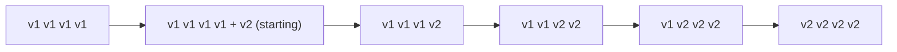
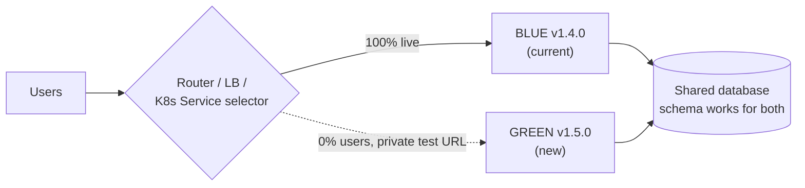
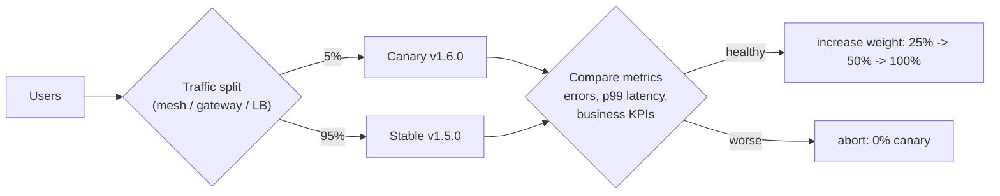
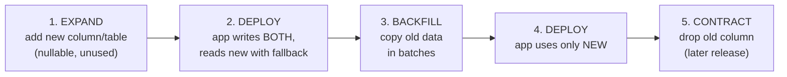
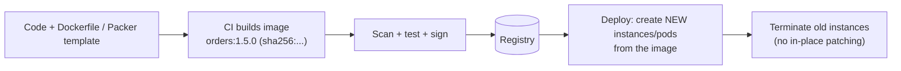
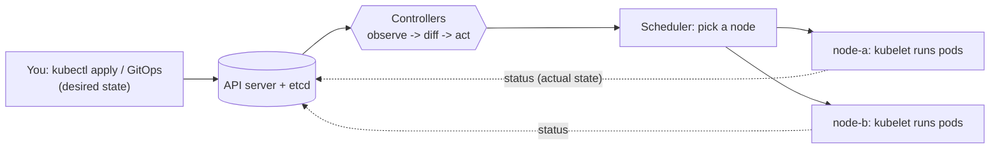
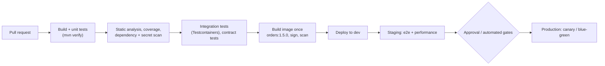
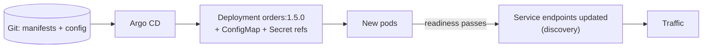
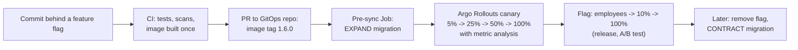
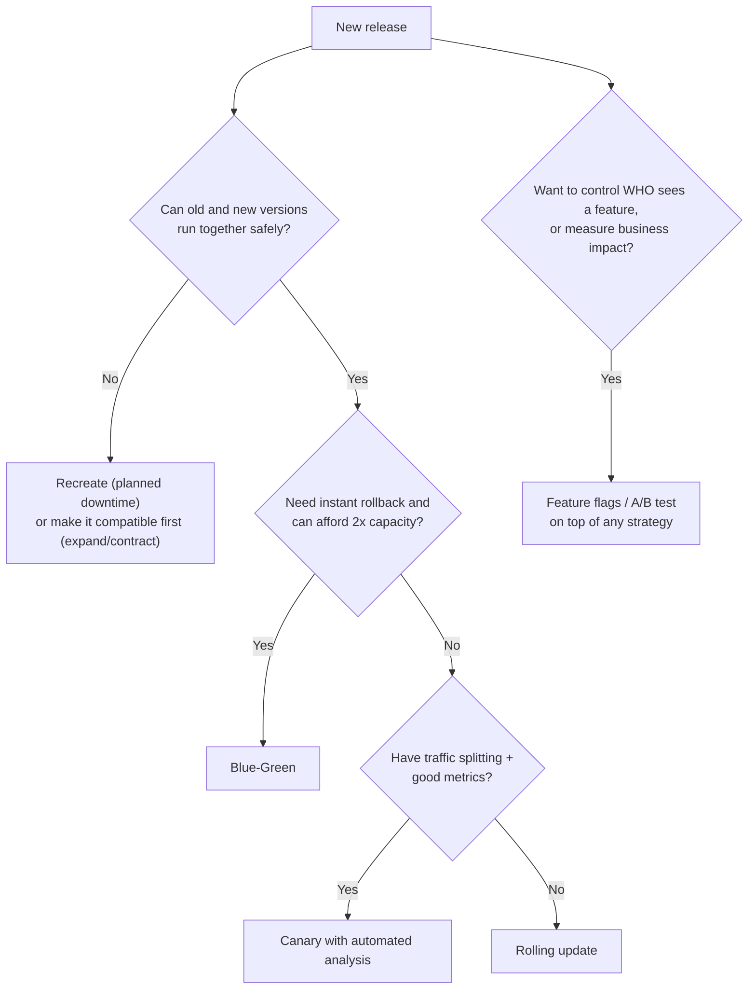

# Deployment & DevOps Patterns

> **Note**: Patterns marked with **(Interview Imp - Java)** are frequently asked in Java interviews
>
> **How to read this file:** Every section ends with a **📘 Terms Explained** table. If you see a word you don't know, check the table right below that section. Each pattern goes from the basic idea to advanced usage (plain Java simulation, Kubernetes/Spring Boot configuration, pitfalls) and ends with interview questions and a mini cheat sheet.
>
> **What are deployment & DevOps patterns?** They answer one question: *"How do we get new code into production often, safely, without downtime, and undo it quickly when something goes wrong?"* This file covers the master list's ten deployment patterns (rolling, blue-green, canary, A/B testing, feature flags, infrastructure as code, immutable infrastructure, container orchestration, service discovery, configuration management) plus two topics interviewers always pair with them: **zero-downtime database migrations** and **CI/CD with GitOps**.
>
> **Builds on:** tools and commands live in [DevOps_Complete_Guide.md](../../devops/DevOps_Complete_Guide.md) (CI/CD, IaC, cloud, GitOps), [00_Kubernetes_Index.md](../../kubernetes/00_Kubernetes_Index.md) (Deployments, Services, probes) and [00_Docker_Index.md](../../docker/00_Docker_Index.md). Health checks and graceful shutdown are in [02_Reliability_Pattern.md](02_Reliability_Pattern.md#8-health-check-pattern-interview-imp---java); discovery and externalized configuration in [02_Microservices_Pattern.md](../04_Specialized/02_Microservices_Pattern.md). This file focuses on the **patterns and trade-offs** and links to those for tooling details.
>
> **Verified code:** Every main "Complete Java Example" in this file is **plain Java 17 (no libraries)**: a small simulation of the real mechanism (a rolling update, a canary analysis, a reconciliation loop, an IaC plan...). Each was compiled and run **three times** with identical output. To run one, save it as `<ClassName>.java` and run `javac <ClassName>.java && java <ClassName>`. (Running it directly with `java <ClassName>.java` won't work, because the class with `main` is not the first class in the file.)

---

## Table of Contents
1. [Rolling Deployment Pattern](#1-rolling-deployment-pattern)
   - [1.1 What is a Rolling Deployment?](#11-what-is-a-rolling-deployment)
   - [1.2 Why Use It?](#12-why-use-it)
   - [1.3 How It Works](#13-how-it-works)
   - [1.4 Complete Java Example - Simulating a Rolling Update](#14-complete-java-example---simulating-a-rolling-update)
   - [1.5 Rolling Deployments in Kubernetes and Spring Boot](#15-rolling-deployments-in-kubernetes-and-spring-boot)
   - [1.6 Pitfalls, Interview Questions and Cheat Sheet](#16-pitfalls-interview-questions-and-cheat-sheet)
2. [Blue-Green Deployment Pattern](#2-blue-green-deployment-pattern-interview-imp---java) **(Interview Imp - Java)**
   - [2.1 What is Blue-Green Deployment?](#21-what-is-blue-green-deployment)
   - [2.2 Why Use It?](#22-why-use-it)
   - [2.3 How It Works](#23-how-it-works)
   - [2.4 Complete Java Example - Switch and Instant Rollback](#24-complete-java-example---switch-and-instant-rollback)
   - [2.5 Blue-Green in Kubernetes](#25-blue-green-in-kubernetes)
   - [2.6 Pitfalls, Interview Questions and Cheat Sheet](#26-pitfalls-interview-questions-and-cheat-sheet)
3. [Canary Deployment Pattern](#3-canary-deployment-pattern-interview-imp---java) **(Interview Imp - Java)**
   - [3.1 What is a Canary Deployment?](#31-what-is-a-canary-deployment)
   - [3.2 Why Use It?](#32-why-use-it)
   - [3.3 How It Works](#33-how-it-works)
   - [3.4 Complete Java Example - Progressive Canary with Automated Analysis](#34-complete-java-example---progressive-canary-with-automated-analysis)
   - [3.5 Canary Releases with Argo Rollouts, Flagger and Gateways](#35-canary-releases-with-argo-rollouts-flagger-and-gateways)
   - [3.6 Pitfalls, Interview Questions and Cheat Sheet](#36-pitfalls-interview-questions-and-cheat-sheet)
4. [A/B Testing Pattern](#4-ab-testing-pattern)
   - [4.1 What is A/B Testing?](#41-what-is-ab-testing)
   - [4.2 Why Use It?](#42-why-use-it)
   - [4.3 How It Works](#43-how-it-works)
   - [4.4 Complete Java Example - Sticky Assignment and Significance Test](#44-complete-java-example---sticky-assignment-and-significance-test)
   - [4.5 A/B Testing in Practice](#45-ab-testing-in-practice)
   - [4.6 Pitfalls, Interview Questions and Cheat Sheet](#46-pitfalls-interview-questions-and-cheat-sheet)
   - [4.7 Pros and Cons](#47-pros-and-cons)
5. [Feature Flags Pattern](#5-feature-flags-pattern-interview-imp---java) **(Interview Imp - Java)**
   - [5.1 What are Feature Flags?](#51-what-are-feature-flags)
   - [5.2 Why Do We Need Them?](#52-why-do-we-need-them)
   - [5.3 How It Works](#53-how-it-works)
   - [5.4 Complete Java Example - Targeting, Sticky Rollout and Kill Switch](#54-complete-java-example---targeting-sticky-rollout-and-kill-switch)
   - [5.5 Feature Flags in Java and Spring Boot](#55-feature-flags-in-java-and-spring-boot)
   - [5.6 Pitfalls, Interview Questions and Cheat Sheet](#56-pitfalls-interview-questions-and-cheat-sheet)
   - [5.7 Pros and Cons](#57-pros-and-cons)
6. [Zero-Downtime Database Migrations: Expand and Contract](#6-zero-downtime-database-migrations-expand-and-contract-interview-imp---java) **(Interview Imp - Java)**
   - [6.1 What Is It?](#61-what-is-it)
   - [6.2 Why Do We Need It?](#62-why-do-we-need-it)
   - [6.3 How It Works: Recipes](#63-how-it-works-recipes)
   - [6.4 Complete Java Example - Renaming a Column Without Downtime](#64-complete-java-example---renaming-a-column-without-downtime)
   - [6.5 Migrations in Spring Boot (Flyway / Liquibase)](#65-migrations-in-spring-boot-flyway--liquibase)
   - [6.6 Pitfalls, Interview Questions and Cheat Sheet](#66-pitfalls-interview-questions-and-cheat-sheet)
   - [6.7 Pros and Cons](#67-pros-and-cons)
7. [Infrastructure as Code and Immutable Infrastructure](#7-infrastructure-as-code-and-immutable-infrastructure)
   - [7.1 What Are They?](#71-what-are-they)
   - [7.2 Why Do We Need Them?](#72-why-do-we-need-them)
   - [7.3 How It Works](#73-how-it-works)
   - [7.4 Complete Java Example - Computing an IaC Plan and Detecting Drift](#74-complete-java-example---computing-an-iac-plan-and-detecting-drift)
   - [7.5 IaC in Practice](#75-iac-in-practice)
   - [7.6 Pitfalls, Interview Questions and Cheat Sheet](#76-pitfalls-interview-questions-and-cheat-sheet)
8. [Container Orchestration Pattern](#8-container-orchestration-pattern-interview-imp---java) **(Interview Imp - Java)**
   - [8.1 What is Container Orchestration?](#81-what-is-container-orchestration)
   - [8.2 Why Do We Need It?](#82-why-do-we-need-it)
   - [8.3 How It Works: The Building Blocks](#83-how-it-works-the-building-blocks)
   - [8.4 Complete Java Example - A Reconciliation Loop](#84-complete-java-example---a-reconciliation-loop)
   - [8.5 Running Spring Boot Well on Kubernetes](#85-running-spring-boot-well-on-kubernetes)
   - [8.6 Pitfalls, Interview Questions and Cheat Sheet](#86-pitfalls-interview-questions-and-cheat-sheet)
   - [8.7 Pros and Cons](#87-pros-and-cons)
9. [CI/CD Pipelines and GitOps](#9-cicd-pipelines-and-gitops-interview-imp---java) **(Interview Imp - Java)**
   - [9.1 What Are They?](#91-what-are-they)
   - [9.2 Why Do We Need Them?](#92-why-do-we-need-them)
   - [9.3 How It Works](#93-how-it-works)
   - [9.4 CI/CD and GitOps in Practice](#94-cicd-and-gitops-in-practice)
   - [9.5 Pitfalls, Interview Questions and Cheat Sheet](#95-pitfalls-interview-questions-and-cheat-sheet)
   - [9.6 In Java and Spring, Pros and Cons](#96-in-java-and-spring-pros-and-cons)
10. [Service Discovery and Configuration Management](#10-service-discovery-and-configuration-management)
11. [How the Deployment Patterns Fit Together](#11-how-the-deployment-patterns-fit-together)
   - [11.1 One-Line Summary of Each](#111-one-line-summary-of-each)
   - [11.2 One Change from Commit to Full Release (Interview Imp - Java)](#112-one-change-from-commit-to-full-release-interview-imp---java)
   - [11.3 Choosing a Deployment Strategy](#113-choosing-a-deployment-strategy)
   - [11.4 Look-Alike Patterns](#114-look-alike-patterns)
   - [11.5 Deployment in the Java / Spring / Kubernetes Ecosystem](#115-deployment-in-the-java--spring--kubernetes-ecosystem)
   - [11.6 Comparison Table](#116-comparison-table)
12. [Deployment & DevOps Patterns Cheat Sheet](#12-deployment--devops-patterns-cheat-sheet)

---

## Before You Start: Deploy vs Release, and the Strategy Menu

### Deployment is not release

| Term | Meaning | Controlled by |
|---|---|---|
| **Deployment** | New code is **running** in production | CI/CD pipeline, orchestrator |
| **Release** | Users can **use** the new behaviour | Traffic routing, feature flags |

Separating the two is the core idea of modern delivery: you can **deploy** code that's switched off (dark), then **release** it gradually, and undo the release without redeploying.

### The deployment strategy menu

| Strategy | How | Downtime | Rollback speed | Extra cost | Risk exposure |
|---|---|---|---|---|---|
| **Recreate** | Stop all old, start all new | ❌ Yes | Slow (redeploy) | None | Everyone at once |
| **Rolling** | Replace instances a few at a time | ✅ None | Medium (roll back the same way) | Small surge | Grows gradually, no control over *who* |
| **Blue-green** | Two full environments; switch traffic at once | ✅ None | **Instant** (switch back) | **2× capacity** during release | Everyone at switch time (after testing) |
| **Canary** | Small % of traffic to the new version, increase while metrics are good | ✅ None | Fast (route back) | Small | **Limited** (5% → 25% → ...) |
| **A/B testing** | Split users between variants to **measure** business impact | ✅ None | n/a (experiment) | Small | Planned split |
| **Shadow / dark launch** | Copy real traffic to the new version, discard its responses | ✅ None | n/a | Extra compute | **None** for users |
| **Feature flags** | Code deployed off; switch on per user/segment at runtime | ✅ None | **Instant** (flip flag) | Flag system | As small as you want |

### Prerequisites for zero-downtime deployments

| Requirement | Why | Details |
|---|---|---|
| **Readiness probes** | New instances get traffic only when ready | [02_Reliability_Pattern.md](02_Reliability_Pattern.md#8-health-check-pattern-interview-imp---java) |
| **Graceful shutdown** | Old instances finish in-flight requests | `server.shutdown=graceful` + `preStop` delay |
| **Backward-compatible APIs** | Old and new versions run **together** during rollouts | Additive changes ([08_API_Design_Pattern.md](08_API_Design_Pattern.md#7-api-versioning-pattern-interview-imp---java)) |
| **Backward-compatible DB changes** | The schema must work for both versions | Expand/contract (section 6) |
| **Stateless instances** | Any instance can serve any request | Sessions in Redis, not in memory |
| **Automated, repeatable pipeline** | Every release follows the same tested path | Section 9 |
| **Observability** | Know quickly whether the new version is healthy | Metrics, logs, traces ([02_Microservices_Pattern.md](../04_Specialized/02_Microservices_Pattern.md#10-observability-patterns-interview-imp---java)) |

### Measuring delivery: the DORA metrics

| Metric | Elite teams (indicative) | Meaning |
|---|---|---|
| **Deployment frequency** | On demand (many per day) | How often you deploy to production |
| **Lead time for changes** | Less than a day | Commit → running in production |
| **Change failure rate** | Low (roughly 0-15%) | % of deployments causing a failure in production |
| **Time to restore service** | Less than an hour | How fast you recover from a failed change |

#### 📘 Terms Explained

| Term | Simple meaning |
|---|---|
| **Deployment** | Putting a new version of software onto production servers. |
| **Release** | Making new functionality available to users. |
| **Rollback** | Returning to the previous version after a bad deployment. |
| **Zero-downtime deployment** | Updating without users experiencing errors or outages. |
| **Dark launch** | Deploying a feature to production but keeping it hidden or switched off. |
| **DORA metrics** | Four delivery metrics from Google's DevOps Research and Assessment programme. |

---

# 1. Rolling Deployment Pattern

## 1.1 What is a Rolling Deployment?

A **rolling deployment** replaces the instances of the old version with the new version **gradually, a few at a time**, while the rest keep serving traffic. At the end, all instances run the new version. It's the **default** strategy for Kubernetes Deployments.

**Analogy:** Replacing the tyres of a bus fleet one bus at a time. The route never stops; at any moment most buses are running, and there's always a spare bus covering the one in the garage.



#### 📘 Terms Explained

| Term | Simple meaning |
|---|---|
| **Rolling update** | Gradually replacing old instances with new ones. |
| **`maxSurge`** | How many **extra** instances may exist above the desired count during the update. |
| **`maxUnavailable`** | How many instances may be **unavailable** (not ready) during the update. |
| **Readiness probe** | A check deciding whether an instance may receive traffic. |

---

## 1.2 Why Use It?

| Pros | Cons |
|---|---|
| No downtime, no duplicate environment | **Old and new versions run at the same time** (must be compatible) |
| Built into Kubernetes, ECS, most platforms | No control over **which** users get the new version |
| Small extra capacity (`maxSurge`) | Rollback is another rolling update (minutes, not seconds) |
| Simple | A bad version affects more and more users as it rolls |

---

## 1.3 How It Works

1. Create a new-version instance (up to `maxSurge` extra).
2. Wait until it passes its **readiness probe** (and `minReadySeconds`).
3. Remove an old instance (keeping at least `replicas - maxUnavailable` ready).
4. Repeat until all instances are new. If new pods never become ready, the rollout **stalls** (and is marked failed after `progressDeadlineSeconds`), leaving old pods serving.

| Setting | Effect | Typical zero-downtime value |
|---|---|---|
| `maxSurge` | Speed vs extra capacity | `1` or `25%` (default 25%) |
| `maxUnavailable` | Allowed capacity drop | `0` (default 25%) |
| `minReadySeconds` | How long a pod must stay ready before counting | 10-30 s (catches crash-after-start) |
| `progressDeadlineSeconds` | When a stuck rollout is reported as failed | 600 (default) |

---

## 1.4 Complete Java Example - Simulating a Rolling Update

```java
import java.util.ArrayList;
import java.util.List;

// Simulates a Kubernetes-style RollingUpdate with maxSurge / maxUnavailable
public class RollingDeploymentDemo {
    record Pod(String name, String version, boolean ready) {}

    public static void main(String[] args) {
        int desired = 4, maxSurge = 1, maxUnavailable = 0;          // zero-downtime settings
        List<Pod> pods = new ArrayList<>();
        for (int i = 1; i <= desired; i++) pods.add(new Pod("v1-" + i, "v1", true));

        System.out.printf("replicas=%d maxSurge=%d maxUnavailable=%d -> at most %d pods, at least %d ready%n",
                desired, maxSurge, maxUnavailable, desired + maxSurge, desired - maxUnavailable);
        print(0, "start", pods);
        int step = 1, newCount = 0;
        while (pods.stream().anyMatch(p -> p.version().equals("v1"))) {
            // 1) surge: start a new pod (not ready yet: it must pass its readiness probe)
            newCount++;
            pods.add(new Pod("v2-" + newCount, "v2", false));
            print(step++, "create v2-" + newCount + " (starting)", pods);
            // 2) readiness probe passes -> it receives traffic
            pods.set(pods.size() - 1, new Pod("v2-" + newCount, "v2", true));
            // 3) only now remove an old pod, so ready capacity never drops below 'desired'
            Pod old = pods.stream().filter(p -> p.version().equals("v1")).findFirst().orElseThrow();
            pods.remove(old);
            print(step++, "v2-" + newCount + " ready, terminate " + old.name(), pods);
        }
        System.out.println("Done: every step kept >= " + (desired - maxUnavailable) + " ready pods. v1 and v2 served traffic TOGETHER during the rollout.");
    }

    static void print(int step, String action, List<Pod> pods) {
        long ready = pods.stream().filter(Pod::ready).count();
        long v1 = pods.stream().filter(p -> p.ready() && p.version().equals("v1")).count();
        System.out.printf("  %2d %-34s pods=%d ready=%d (v1=%d, v2=%d)%n", step, action, pods.size(), ready, v1, ready - v1);
    }
}
```

**Output:**
```
replicas=4 maxSurge=1 maxUnavailable=0 -> at most 5 pods, at least 4 ready
   0 start                              pods=4 ready=4 (v1=4, v2=0)
   1 create v2-1 (starting)             pods=5 ready=4 (v1=4, v2=0)
   2 v2-1 ready, terminate v1-1         pods=4 ready=4 (v1=3, v2=1)
   3 create v2-2 (starting)             pods=5 ready=4 (v1=3, v2=1)
   4 v2-2 ready, terminate v1-2         pods=4 ready=4 (v1=2, v2=2)
   5 create v2-3 (starting)             pods=5 ready=4 (v1=2, v2=2)
   6 v2-3 ready, terminate v1-3         pods=4 ready=4 (v1=1, v2=3)
   7 create v2-4 (starting)             pods=5 ready=4 (v1=1, v2=3)
   8 v2-4 ready, terminate v1-4         pods=4 ready=4 (v1=0, v2=4)
Done: every step kept >= 4 ready pods. v1 and v2 served traffic TOGETHER during the rollout.
```

What the output shows:
- With `maxSurge=1, maxUnavailable=0`, the cluster briefly ran **5 pods** but never fewer than **4 ready** ones: no capacity loss.
- An old pod was removed **only after** its replacement passed readiness.
- For most of the rollout **v1 and v2 served traffic together**, which is why API and database changes must be backward compatible (section 6).

---

## 1.5 Rolling Deployments in Kubernetes and Spring Boot

```yaml
apiVersion: apps/v1
kind: Deployment
metadata: { name: orders }
spec:
  replicas: 4
  revisionHistoryLimit: 10            # old ReplicaSets kept for `kubectl rollout undo`
  minReadySeconds: 15
  strategy:
    type: RollingUpdate
    rollingUpdate:
      maxSurge: 1
      maxUnavailable: 0
  template:
    spec:
      terminationGracePeriodSeconds: 40
      containers:
        - name: orders
          image: registry.shop.com/orders:1.5.0     # immutable version tag (or a digest)
          readinessProbe:
            httpGet: { path: /actuator/health/readiness, port: 8080 }
            periodSeconds: 5
          lifecycle:
            preStop:
              exec: { command: ["sh", "-c", "sleep 10"] }   # let the Service stop routing before shutdown
```

```yaml
# application.yml: finish in-flight requests on SIGTERM
server:
  shutdown: graceful
spring:
  lifecycle:
    timeout-per-shutdown-phase: 25s
```

```bash
kubectl set image deployment/orders orders=registry.shop.com/orders:1.5.0
kubectl rollout status deployment/orders        # watch progress
kubectl rollout undo deployment/orders          # back to the previous ReplicaSet
```

See the rolling update flow and zero-downtime recipe in [11_Production_Operations.md](../../kubernetes/11_Production_Operations.md#114-zero-downtime-deployment-recipe).

#### 📘 Terms Explained

| Term | Simple meaning |
|---|---|
| **ReplicaSet** | The Kubernetes object keeping N identical pods running; each Deployment revision has one. |
| **`minReadySeconds`** | A new pod must be ready for this long before it counts as available. |
| **`preStop` hook** | Command run before a container is stopped (often a short sleep to drain traffic). |
| **`terminationGracePeriodSeconds`** | Time Kubernetes waits after SIGTERM before killing the container. |
| **`kubectl rollout undo`** | Reverts a Deployment to its previous revision. |

---

## 1.6 Pitfalls, Interview Questions and Cheat Sheet

| Pitfall | Fix |
|---|---|
| No readiness probe → traffic hits pods still starting | Readiness probes + `minReadySeconds`. |
| `maxUnavailable: 25%` default on a small deployment | Set `maxUnavailable: 0` for zero downtime. |
| Breaking API/DB changes in one release | Backward-compatible changes; expand/contract. |
| Abrupt shutdown drops in-flight requests | Graceful shutdown + `preStop` + grace period. |
| Mutable image tags (`:latest`) | Immutable version tags or digests. |

**Q1. What is a rolling deployment?** Gradually replacing old instances with new ones, a few at a time, so the service stays up; the default in Kubernetes.

**Q2. What do `maxSurge` and `maxUnavailable` control?** How many extra pods may be created and how many may be unavailable during the update; `maxSurge: 1, maxUnavailable: 0` gives zero capacity loss.

**Q3. What's the main risk of rolling updates?** Two versions serve traffic at the same time, so APIs, messages and database schema must be compatible both ways; and a bad version gradually reaches everyone unless monitoring stops it.

```
ROLLING   Replace instances gradually (K8s default). maxSurge (extra pods) / maxUnavailable (capacity drop): 1 / 0 for zero downtime.
          Needs readiness probes, minReadySeconds, graceful shutdown + preStop, immutable image tags.
          Old + new run TOGETHER -> backward-compatible APIs/DB. Rollback = kubectl rollout undo (another rolling update).
```

---

# 2. Blue-Green Deployment Pattern (Interview Imp - Java)

## 2.1 What is Blue-Green Deployment?

**Blue-green deployment** keeps **two complete production environments**. **Blue** serves all users; the new version is deployed to **green**, tested there privately, then a **router switch** sends all traffic to green at once. Blue stays running, so switching back is instant.

**Analogy:** A theatre with two identical stages. While the audience watches the play on the blue stage, the crew sets up the next act on the green stage behind a curtain. When it's ready, the audience's chairs rotate to face green. If something goes wrong, they rotate back.



#### 📘 Terms Explained

| Term | Simple meaning |
|---|---|
| **Blue / green** | The names of the two identical environments (current and new). |
| **Cut-over / switch** | Moving all traffic from one environment to the other. |
| **Smoke test** | A quick check that the main functions work after deployment. |
| **Warm standby** | An environment that's running and ready to take traffic immediately. |

---

## 2.2 Why Use It?

| Pros | Cons |
|---|---|
| **Instant rollback**: switch back to blue | **Double the infrastructure** during the release |
| Test the new version **in production** before users see it | Database must work for both versions (schema compatibility) |
| No mixed versions serving users at the same time (except in-flight requests) | All users move at once: no gradual exposure |
| Simple mental model | Long-running jobs, caches and sessions need care at switch time |

**Good fit:** systems where fast, reliable rollback matters more than infrastructure cost (payments, regulated systems), and releases that need full pre-production verification on real infrastructure.

---

## 2.3 How It Works

1. Blue is live. Deploy the new version to **green** (same infrastructure, same config, production data).
2. Run **smoke tests / automated checks** against green's private URL.
3. **Switch** the router (load balancer target group, DNS, Kubernetes Service selector, gateway route) to green.
4. **Monitor** closely. If anything is wrong, **switch back** to blue.
5. Once confident, blue becomes the **next green** (or is scaled down to save cost).

| Where the switch happens | How |
|---|---|
| Load balancer | Change the target group (AWS ALB listener rule) |
| Kubernetes | Change the Service's selector `version: blue` → `version: green` |
| DNS | Change the record (slow: TTLs and caches; avoid for fast rollback) |
| API gateway / service mesh | Change the route weight 100/0 → 0/100 |

---

## 2.4 Complete Java Example - Switch and Instant Rollback

```java
import java.util.List;
import java.util.Map;

// Blue-green: two full environments; a router (load balancer / K8s Service selector) points at one of them
public class BlueGreenDemo {
    static class Router {
        String live = "blue";
        String route() { return live; }
        void switchTo(String env) { System.out.println("   [router] live: " + live + " -> " + env + " (one atomic change)"); live = env; }
    }

    static boolean smokeTest(Map<String, String> env, String name) {
        boolean ok = env.get("health").equals("UP") && env.get("checkout").equals("OK");
        System.out.println("   smoke test on " + name + " (private URL): health=" + env.get("health") + " checkout=" + env.get("checkout") + " -> " + (ok ? "PASS" : "FAIL"));
        return ok;
    }

    public static void main(String[] args) {
        Router router = new Router();
        Map<String, Map<String, String>> envs = Map.of(
                "blue",  Map.of("version", "1.4.0", "health", "UP", "checkout", "OK"),
                "green", Map.of("version", "1.5.0", "health", "UP", "checkout", "OK"));

        System.out.println("1) Users on blue (" + envs.get("blue").get("version") + "); green (" + envs.get("green").get("version") + ") deployed alongside, receiving NO user traffic");
        System.out.println("2) Test green before any user sees it");
        if (smokeTest(envs.get("green"), "green")) router.switchTo("green");
        for (String user : List.of("asha", "ravi")) System.out.println("   " + user + " -> " + router.route() + " (" + envs.get(router.route()).get("version") + ")");

        System.out.println("3) Error spike found 10 minutes later -> instant rollback (blue is still running, warm)");
        router.switchTo("blue");
        System.out.println("   everyone -> " + router.route() + " (" + envs.get(router.route()).get("version") + "), rollback took one switch, no redeploy");
        System.out.println("4) Cost: during the release you run TWO full environments (2x capacity)");
    }
}
```

**Output:**
```
1) Users on blue (1.4.0); green (1.5.0) deployed alongside, receiving NO user traffic
2) Test green before any user sees it
   smoke test on green (private URL): health=UP checkout=OK -> PASS
   [router] live: blue -> green (one atomic change)
   asha -> green (1.5.0)
   ravi -> green (1.5.0)
3) Error spike found 10 minutes later -> instant rollback (blue is still running, warm)
   [router] live: green -> blue (one atomic change)
   everyone -> blue (1.4.0), rollback took one switch, no redeploy
4) Cost: during the release you run TWO full environments (2x capacity)
```

What the output shows:
- Green was deployed and **tested privately** while users stayed on blue.
- One **atomic router change** moved everyone to green.
- When a problem appeared, one more change **rolled back instantly**, with no redeploy, because blue was still running.
- The price: **two full environments** during the release.

---

## 2.5 Blue-Green in Kubernetes

```yaml
# Two Deployments (orders-blue, orders-green) with a 'version' label; the Service decides which one is live
apiVersion: v1
kind: Service
metadata: { name: orders }
spec:
  selector:
    app: orders
    version: blue          # change to "green" to switch; change back to roll back
  ports: [{ port: 80, targetPort: 8080 }]
```

```yaml
# Argo Rollouts automates it: preview service for testing, manual or automatic promotion
apiVersion: argoproj.io/v1alpha1
kind: Rollout
metadata: { name: orders }
spec:
  replicas: 4
  strategy:
    blueGreen:
      activeService: orders            # live traffic
      previewService: orders-preview   # private test traffic to the new version
      autoPromotionEnabled: false      # wait for approval (or analysis) before switching
      scaleDownDelaySeconds: 600       # keep the old version for 10 min for fast rollback
  selector: { matchLabels: { app: orders } }
  template: { ... }                    # same pod template as a Deployment
```

#### 📘 Terms Explained

| Term | Simple meaning |
|---|---|
| **Service selector** | The labels a Kubernetes Service uses to choose which pods receive traffic. |
| **Argo Rollouts** | Kubernetes controller adding blue-green and canary strategies with analysis and promotion. |
| **Preview service** | A second Service pointing at the new version for testing before promotion. |
| **Target group** | A set of instances behind a cloud load balancer. |

---

## 2.6 Pitfalls, Interview Questions and Cheat Sheet

| Pitfall | Fix |
|---|---|
| Incompatible DB migration makes rollback impossible | Expand/contract migrations; never drop columns in the same release. |
| DNS-based switch with long TTLs | Switch at the load balancer / Service / gateway. |
| In-memory sessions lost at switch | External session store (Redis) or stateless tokens. |
| Background jobs running in both environments | Only the live environment runs schedulers (leader election / ShedLock). |
| Green never exercised before the switch | Automated smoke tests on the preview URL. |

**Q1. What is blue-green deployment?** Running two identical production environments; deploy to the idle one, test it, switch all traffic to it, and keep the old one for instant rollback.

**Q2. Blue-green vs rolling?** Blue-green: instant switch and rollback, no mixed versions for users, but double capacity. Rolling: no extra environment, but versions mix and rollback is slower.

**Q3. How do you handle the database in blue-green?** Both environments share it, so every schema change must be backward compatible (expand/contract), applied before the switch and cleaned up only after the old version is gone.

```
BLUE-GREEN  Two full environments; deploy + test GREEN privately; switch router 100% at once; switch back = instant rollback.
          Switch at LB / K8s Service selector / gateway (not DNS). Costs 2x capacity during release.
          Shared DB -> backward-compatible migrations. External sessions; one scheduler. Argo Rollouts blueGreen (active/preview services).
```

---

# 3. Canary Deployment Pattern (Interview Imp - Java)

## 3.1 What is a Canary Deployment?

A **canary deployment** releases the new version to a **small slice of traffic** first (say 5%), **compares its metrics** with the stable version, and **gradually increases** the share (25% → 50% → 100%) only while it stays healthy. If metrics get worse, traffic goes back to the stable version automatically.

**Analogy:** Coal miners took a canary into the mine; if dangerous gas was present, the bird showed signs first, warning the miners before they were harmed. The canary release warns you before most users are affected.



#### 📘 Terms Explained

| Term | Simple meaning |
|---|---|
| **Canary** | The new version receiving a small, controlled share of traffic. |
| **Baseline / stable** | The current version the canary is compared against. |
| **Traffic weight** | The percentage of requests sent to the canary. |
| **Automated canary analysis** | Software that compares canary and baseline metrics and decides to promote or abort. |
| **Blast radius** | How many users a bad release can affect. |

---

## 3.2 Why Use It?

| Pros | Cons |
|---|---|
| **Small blast radius**: problems hit only a few % of users | Needs fine-grained traffic splitting (mesh, gateway, ingress) |
| Tests with **real production traffic** and data | Needs good metrics and enough traffic for meaningful comparisons |
| Automated promotion/rollback | Versions run side by side (compatibility needed, like rolling) |
| Cheaper than blue-green (no full duplicate) | Slower overall rollout (each step waits for analysis) |

---

## 3.3 How It Works

1. Deploy the canary alongside stable (a few pods).
2. Route **N%** of traffic to it (by weight, or by header/cookie for internal testers first).
3. During an **analysis window**, compare canary vs stable: error rate, latency percentiles, saturation, and **business metrics** (checkout success, payment failures).
4. Pass → increase weight. Fail → **abort**: route 0% to the canary and scale it down.
5. At 100%, promote the canary to stable.

| Splitting by | How | Use |
|---|---|---|
| **Percentage** | Random N% of requests | General rollout |
| **Sticky percentage** | Hash of user ID → same users stay on the canary | Consistent user experience |
| **Header / cookie** | `X-Canary: true` | Internal testers, QA before real users |
| **Segment** | Region, plan, employees | Low-risk segments first |

---

## 3.4 Complete Java Example - Progressive Canary with Automated Analysis

```java
import java.util.List;

// Progressive canary with automated analysis: compare the canary's error rate to the stable version at each step
public class CanaryDemo {
    record Step(int weightPercent, double stableErrorRate, double canaryErrorRate, double canaryP99Ms) {}

    static void rollout(String name, List<Step> steps) {
        System.out.println(name);
        double maxErrorRatio = 1.5, maxP99 = 800;
        for (Step s : steps) {
            boolean errorsOk = s.canaryErrorRate() <= s.stableErrorRate() * maxErrorRatio;
            boolean latencyOk = s.canaryP99Ms() <= maxP99;
            System.out.printf("   weight %3d%% | errors stable %.2f%% canary %.2f%% | canary p99 %4.0f ms -> %s%n",
                    s.weightPercent(), s.stableErrorRate(), s.canaryErrorRate(), s.canaryP99Ms(),
                    errorsOk && latencyOk ? "PASS, promote to next step" : "FAIL -> ABORT, route 100% back to stable");
            if (!(errorsOk && latencyOk)) {
                System.out.println("   impact limited to " + s.weightPercent() + "% of traffic for one analysis window");
                return;
            }
        }
        System.out.println("   canary is now 100%: promote it to stable");
    }

    public static void main(String[] args) {
        rollout("Release 1.5.0 (healthy):", List.of(
                new Step(5, 0.20, 0.22, 310), new Step(25, 0.21, 0.19, 320), new Step(50, 0.20, 0.23, 330), new Step(100, 0.20, 0.21, 325)));
        rollout("Release 1.6.0 (regression in a new code path):", List.of(
                new Step(5, 0.20, 0.25, 340), new Step(25, 0.21, 1.90, 360)));
        rollout("Release 1.7.0 (slow, but no errors):", List.of(
                new Step(5, 0.20, 0.20, 1450)));
    }
}
```

**Output:**
```
Release 1.5.0 (healthy):
   weight   5% | errors stable 0.20% canary 0.22% | canary p99  310 ms -> PASS, promote to next step
   weight  25% | errors stable 0.21% canary 0.19% | canary p99  320 ms -> PASS, promote to next step
   weight  50% | errors stable 0.20% canary 0.23% | canary p99  330 ms -> PASS, promote to next step
   weight 100% | errors stable 0.20% canary 0.21% | canary p99  325 ms -> PASS, promote to next step
   canary is now 100%: promote it to stable
Release 1.6.0 (regression in a new code path):
   weight   5% | errors stable 0.20% canary 0.25% | canary p99  340 ms -> PASS, promote to next step
   weight  25% | errors stable 0.21% canary 1.90% | canary p99  360 ms -> FAIL -> ABORT, route 100% back to stable
   impact limited to 25% of traffic for one analysis window
Release 1.7.0 (slow, but no errors):
   weight   5% | errors stable 0.20% canary 0.20% | canary p99 1450 ms -> FAIL -> ABORT, route 100% back to stable
   impact limited to 5% of traffic for one analysis window
```

What the output shows:
- **1.5.0:** at every step the canary's error rate stayed within 1.5× of stable and its p99 under 800 ms, so it was promoted step by step to 100%.
- **1.6.0:** looked fine at 5%, but at 25% the error rate jumped to 1.9% (9× stable), so the rollout was **aborted automatically**; only 25% of traffic was affected, for one window.
- **1.7.0:** had **no errors** but p99 latency of 1,450 ms, and was stopped at **5%**. Analysis must include **latency**, not just errors.

---

## 3.5 Canary Releases with Argo Rollouts, Flagger and Gateways

```yaml
apiVersion: argoproj.io/v1alpha1
kind: Rollout
metadata: { name: orders }
spec:
  replicas: 10
  strategy:
    canary:
      canaryService: orders-canary
      stableService: orders-stable
      trafficRouting:
        istio: { virtualService: { name: orders } }     # precise % via the mesh (or nginx, ALB, Gateway API)
      analysis:
        templates: [{ templateName: success-rate }]
        startingStep: 1
      steps:
        - setWeight: 5
        - pause: { duration: 10m }
        - setWeight: 25
        - pause: { duration: 10m }
        - setWeight: 50
        - pause: { duration: 10m }
---
apiVersion: argoproj.io/v1alpha1
kind: AnalysisTemplate
metadata: { name: success-rate }
spec:
  metrics:
    - name: success-rate
      interval: 1m
      failureLimit: 2
      successCondition: result[0] >= 0.99
      provider:
        prometheus:
          address: http://prometheus.monitoring:9090
          query: |
            sum(rate(http_server_requests_seconds_count{app="orders-canary",status!~"5.."}[2m]))
            / sum(rate(http_server_requests_seconds_count{app="orders-canary"}[2m]))
```

| Tool | Notes |
|---|---|
| **Argo Rollouts** | Rollout CRD with canary/blue-green steps and Prometheus/Datadog analysis |
| **Flagger** | Progressive delivery operator for Istio, Linkerd, Gateway API, NGINX |
| **Istio VirtualService weights** | Manual weighted routing ([02_Microservices_Pattern.md](../04_Specialized/02_Microservices_Pattern.md#114-service-mesh-configuration-examples-istio)) |
| **Spring Cloud Gateway `Weight` predicate** | Weighted routes between versions in a gateway |
| **AWS CodeDeploy / Lambda aliases, ALB weighted target groups** | Managed canaries in the cloud |

> Spring Boot's Micrometer metrics (`http_server_requests_seconds_*`) are exactly what canary analysis queries, so tag metrics with the **version** (e.g. `management.metrics.tags.version=${app.version}`).

#### 📘 Terms Explained

| Term | Simple meaning |
|---|---|
| **`Rollout` CRD** | Argo Rollouts' replacement for a Deployment, adding canary/blue-green steps. |
| **`AnalysisTemplate`** | Defines the metric queries and success conditions used to judge a canary. |
| **Flagger** | A Kubernetes operator that automates canary releases using a service mesh or ingress. |
| **Progressive delivery** | Releasing to gradually larger audiences with automated checks (canary, flags). |

---

## 3.6 Pitfalls, Interview Questions and Cheat Sheet

| Pitfall | Fix |
|---|---|
| Too little traffic for meaningful stats at 1-5% | Longer windows, or route internal users first; compare with confidence thresholds. |
| Only checking error rate | Also latency percentiles, saturation and business KPIs. |
| Canary and stable sharing a cache/queue that hides problems | Tag metrics by version; isolate where needed. |
| Manual "eyeballing" of dashboards | Automated analysis with clear abort conditions. |
| Non-sticky splits causing users to flip versions | Sticky routing by user/session where UX matters. |

**Q1. What is a canary deployment?** Releasing the new version to a small percentage of traffic, comparing its metrics with the stable version, and increasing exposure step by step only while it's healthy, with automatic rollback otherwise.

**Q2. Canary vs blue-green?** Canary limits the blast radius with gradual exposure and needs traffic-splitting plus metrics; blue-green switches everyone at once but offers instant rollback at the cost of double capacity.

**Q3. What metrics would you watch?** Error rate (5xx), latency (p95/p99), saturation (CPU, memory, pool usage), and business metrics (checkout success, payment errors), all compared against the stable baseline.

```
CANARY    Small % of traffic to new version -> compare with stable (errors, p99, saturation, business KPIs) -> 5 -> 25 -> 50 -> 100%.
          Abort automatically on regression (blast radius = current weight). Split by %, sticky hash, header, segment.
          Tools: Argo Rollouts (steps + AnalysisTemplate), Flagger, Istio weights, Gateway Weight, ALB weighted TGs.
          Needs version-tagged metrics and enough traffic; compatibility like rolling.
```

---

# 4. A/B Testing Pattern

## 4.1 What is A/B Testing?

**A/B testing** shows **different variants** of a feature to **different groups of users** at the same time and **measures** which one performs better on a business metric (conversion rate, click-through, revenue per visitor). It answers "is B **better** for the business?", whereas a canary answers "is the new version **safe**?".

**Analogy:** A shop testing two shop-window displays in two identical branches for a month and counting which one brings more customers inside.

| | Canary | A/B test |
|---|---|---|
| Question | Is the new **version** technically healthy? | Which **variant** performs better for users/business? |
| Split | Small, growing % | Fixed split (often 50/50) for the whole experiment |
| Duration | Minutes to hours | Days to weeks |
| Metrics | Errors, latency | Conversion, engagement, revenue |
| Decision | Promote / roll back | Ship the winner (statistically significant) |
| Mechanism | Traffic routing to versions | Usually **feature flags** inside one version |

#### 📘 Terms Explained

| Term | Simple meaning |
|---|---|
| **Variant** | One version of the feature in the experiment (A = control, B = treatment). |
| **Conversion rate** | Share of users who complete the goal (purchase, sign-up). |
| **Statistical significance** | Confidence that a difference isn't just random chance. |
| **Sample size** | How many users each variant needs for a reliable result. |
| **Sticky assignment** | A user always sees the same variant. |

---

## 4.2 Why Use It?

- Decisions based on **evidence**, not opinions ("the new checkout button colour feels better").
- Small UX changes can move revenue a lot, and some "improvements" make things worse.
- Run safely in production with real users, at a controlled exposure.

---

## 4.3 How It Works

1. **Hypothesis and metric:** "A one-page checkout increases conversion." Primary metric: purchase conversion.
2. **Sticky assignment:** hash(experiment + user ID) → variant, so each user always sees the same one.
3. **Run until the planned sample size**, not until the result "looks good" (peeking inflates false positives).
4. **Analyse** with a statistical test (e.g. two-proportion z-test; |z| ≥ 1.96 ≈ 95% confidence).
5. **Ship** the winner; remove the losing code and the flag.

---

## 4.4 Complete Java Example - Sticky Assignment and Significance Test

```java
import java.nio.charset.StandardCharsets;
import java.util.zip.CRC32;

// A/B test: sticky assignment by user id + a two-proportion z-test to decide if variant B really converts better
public class AbTestDemo {
    static String variant(String experiment, String userId) {
        CRC32 crc = new CRC32();
        crc.update((experiment + ":" + userId).getBytes(StandardCharsets.UTF_8));
        return crc.getValue() % 100 < 50 ? "A" : "B";                    // 50/50 split, same user always gets the same variant
    }

    static void analyse(String label, int visitorsA, int buyersA, int visitorsB, int buyersB) {
        double pA = (double) buyersA / visitorsA, pB = (double) buyersB / visitorsB;
        double pooled = (double) (buyersA + buyersB) / (visitorsA + visitorsB);
        double se = Math.sqrt(pooled * (1 - pooled) * (1.0 / visitorsA + 1.0 / visitorsB));
        double z = (pB - pA) / se;
        System.out.printf("%s A: %.2f%% (%d/%d)  B: %.2f%% (%d/%d)  lift %+.1f%%  z=%.2f -> %s%n",
                label, pA * 100, buyersA, visitorsA, pB * 100, buyersB, visitorsB, (pB / pA - 1) * 100, z,
                Math.abs(z) >= 1.96 ? "SIGNIFICANT (95%): ship B" : "not significant: keep testing / no real difference");
    }

    public static void main(String[] args) {
        int a = 0, b = 0;
        for (int i = 0; i < 10_000; i++) { if (variant("checkout-button", "user-" + i).equals("A")) a++; else b++; }
        System.out.println("assignment of 10,000 users: A=" + a + " B=" + b + "; user-42 always gets " + variant("checkout-button", "user-42")
                + ", " + variant("checkout-button", "user-42") + ", " + variant("checkout-button", "user-42"));
        analyse("after 2 days :", 1_000, 50, 1_000, 60);
        analyse("after 3 weeks:", 20_000, 1_000, 20_000, 1_160);
    }
}
```

**Output:**
```
assignment of 10,000 users: A=5059 B=4941; user-42 always gets A, A, A
after 2 days : A: 5.00% (50/1000)  B: 6.00% (60/1000)  lift +20.0%  z=0.98 -> not significant: keep testing / no real difference
after 3 weeks: A: 5.00% (1000/20000)  B: 5.80% (1160/20000)  lift +16.0%  z=3.54 -> SIGNIFICANT (95%): ship B
```

What the output shows:
- Hash-based assignment split 10,000 users roughly 50/50, and **user-42 always got the same variant**.
- After 2 days, B looked **20% better**, but with only 1,000 users per side the z-score was 0.98: **not significant**. Shipping on that result would be guessing.
- After 3 weeks, with 20,000 users per side, a 16% lift gave z = 3.54: **significant**, so ship B.

---

## 4.5 A/B Testing in Practice

| Option | Notes |
|---|---|
| Feature-flag platforms with experiments | LaunchDarkly, Unleash (variants), Optimizely, Statsig, GrowthBook, Firebase A/B Testing |
| OpenFeature | Vendor-neutral Java SDK; the provider decides variants |
| DIY | Hash-based assignment + events to the analytics pipeline / data warehouse |

```java
// Variant from an OpenFeature-compatible provider (Unleash, LaunchDarkly, flagd, ...)
Client flags = OpenFeatureAPI.getInstance().getClient();
EvaluationContext ctx = new ImmutableContext(userId, Map.of("country", new Value("IN")));
String variant = flags.getStringValue("checkout-layout", "control", ctx);     // "control" | "one-page"
analytics.track("checkout_viewed", userId, Map.of("experiment", "checkout-layout", "variant", variant));
```

#### 📘 Terms Explained

| Term | Simple meaning |
|---|---|
| **z-test** | A statistical test comparing two proportions; \|z\| ≥ 1.96 means about 95% confidence. |
| **Peeking problem** | Stopping a test as soon as it looks good, which raises the chance of a false winner. |
| **OpenFeature** | CNCF standard API for feature flags with pluggable providers. |
| **Control / treatment** | The existing experience / the new variant being tested. |

---

## 4.6 Pitfalls, Interview Questions and Cheat Sheet

| Pitfall | Fix |
|---|---|
| Stopping early when results "look good" | Pre-compute sample size; fixed duration or sequential testing methods. |
| Non-sticky assignment | Hash user ID per experiment. |
| Too many metrics, then picking the one that "won" | One primary metric decided beforehand; guardrail metrics. |
| Experiments interfering with each other | Mutually exclusive experiment layers. |
| Forgetting to remove the losing variant | Clean up flags and code after the decision. |

**Q1. A/B testing vs canary?** A canary checks technical health of a new version with a small, growing share of traffic; A/B testing compares variants' business impact with a fixed split over a longer period.

**Q2. How do you make sure a user always sees the same variant?** Deterministic assignment: hash (experiment key + user ID) into buckets.

**Q3. How do you know a result is real?** Plan the sample size, run to completion, and use a significance test (e.g. two-proportion z-test at 95% confidence) on the pre-chosen primary metric.

```
A/B TEST  Variants to user groups at the same time; measure a BUSINESS metric; ship the significant winner.
          Sticky hash(experiment+user) assignment; planned sample size; no peeking; one primary metric + guardrails.
          z-test |z| >= 1.96 ~ 95%. Usually implemented with feature flags (OpenFeature, Unleash, LaunchDarkly, GrowthBook).
```

---

## 4.7 Pros and Cons

| Pros | Cons |
|---|---|
| Decisions based on measured user behaviour, not opinions | Needs enough traffic for statistical significance |
| Controls for seasonality (both variants run at the same time) | Peeking and multiple metrics create false winners |
| Limits risk: only part of users see a variant | Engineering overhead: assignment, exposure logging, analysis |
| Works for UI, pricing, algorithms and ML models | Users in different variants can affect each other (marketplaces, social) |

# 5. Feature Flags Pattern (Interview Imp - Java)

## 5.1 What are Feature Flags?

A **feature flag** (feature toggle) is a runtime switch that turns a code path **on or off** without deploying new code. The flag's value can depend on **who** the user is (targeting), a **percentage rollout**, or an operator's decision (kill switch). Flags are how teams **separate deployment from release**.

**Analogy:** The light switches in a new house. The electrician wires every room before you move in (deployment), but you decide which lights to turn on and when (release), and you can switch one off instantly if it flickers.

```java
if (flags.isEnabled("new-checkout", user)) {
    return newCheckout.process(cart);       // new code path, deployed but released gradually
}
return legacyCheckout.process(cart);
```

#### 📘 Terms Explained

| Term | Simple meaning |
|---|---|
| **Feature flag / toggle** | A configuration switch that enables or disables functionality at runtime. |
| **Targeting** | Rules choosing which users see a feature (country, plan, employee, user ID). |
| **Percentage rollout** | Enabling a feature for a stable random N% of users. |
| **Kill switch** | A flag used to turn a feature off instantly during an incident. |
| **Flag debt** | Old flags left in the code after they're no longer needed. |

---

## 5.2 Why Do We Need Them?

| Need | How flags help |
|---|---|
| **Trunk-based development** | Merge unfinished features to `main` behind a flag that's off; no long-lived branches |
| **Gradual release** | 1% → 10% → 50% → 100% of users, independent of deployments |
| **Instant rollback of a feature** | Flip the flag off (seconds), without redeploying |
| **Targeted release** | Employees first (dogfooding), beta customers, one country |
| **Experiments** | A/B tests (section 4) |
| **Operational control** | Disable expensive features under load (graceful degradation, [02_Reliability_Pattern.md](02_Reliability_Pattern.md#9-graceful-degradation-pattern)) |
| **Entitlements** | Features only for paid plans |

### Types of flags (Pete Hodgson / Martin Fowler)

| Type | Lifetime | Who changes it | Example |
|---|---|---|---|
| **Release toggle** | Days-weeks; **remove after rollout** | Developers / release managers | `new-checkout` |
| **Experiment toggle** | Duration of the test | Product / data teams | `checkout-layout` A/B |
| **Ops toggle (kill switch)** | Long-lived | Operations / on-call | `recommendations-enabled` |
| **Permission toggle** | Long-lived | Product / billing | `pro-analytics` for paid plans |

---

## 5.3 How It Works

1. Code checks the flag through a **flag client** (in-process SDK with cached rules, or a remote evaluation service).
2. Rules are evaluated against a **context** (user ID, country, plan, employee, app version).
3. **Percentage rollouts** hash `flagKey + userId` into 0-99, so each user consistently gets the same answer, and increasing 10% → 30% only **adds** users.
4. **Safe defaults:** if the flag service is unreachable or the flag is unknown, use the default value (usually *off*).
5. Flag changes are **audited** and propagate in seconds (streaming or polling).

---

## 5.4 Complete Java Example - Targeting, Sticky Rollout and Kill Switch

```java
import java.nio.charset.StandardCharsets;
import java.util.List;
import java.util.Map;
import java.util.Set;
import java.util.zip.CRC32;

record UserContext(String id, String country, String plan, boolean employee) {}

// A small feature-flag engine: kill switch, targeting rules, sticky percentage rollout
class FlagEngine {
    record Flag(boolean enabled, Set<String> allowCountries, boolean employeesFirst, int rolloutPercent) {}
    private final Map<String, Flag> flags;
    FlagEngine(Map<String, Flag> flags) { this.flags = flags; }

    boolean isEnabled(String key, UserContext u) {
        Flag f = flags.get(key);
        if (f == null || !f.enabled()) return false;                               // unknown or killed -> safe default (off)
        if (f.employeesFirst() && u.employee()) return true;                        // dogfooding
        if (!f.allowCountries().isEmpty() && !f.allowCountries().contains(u.country())) return false;
        return bucket(key, u.id()) < f.rolloutPercent();                            // same user, same answer
    }

    static int bucket(String key, String userId) {
        CRC32 crc = new CRC32();
        crc.update((key + ":" + userId).getBytes(StandardCharsets.UTF_8));
        return (int) (crc.getValue() % 100);
    }
}

public class FeatureFlagDemo {
    public static void main(String[] args) {
        List<UserContext> users = List.of(
                new UserContext("dev-1", "IN", "PRO", true),
                new UserContext("u-101", "IN", "FREE", false),
                new UserContext("u-102", "IN", "PRO", false),
                new UserContext("u-103", "US", "PRO", false),
                new UserContext("u-104", "IN", "FREE", false));

        for (int percent : new int[]{0, 30, 100}) {
            FlagEngine engine = new FlagEngine(Map.of("new-checkout", new FlagEngine.Flag(true, Set.of("IN"), true, percent)));
            StringBuilder line = new StringBuilder();
            for (UserContext u : users) line.append(u.id()).append('=').append(engine.isEnabled("new-checkout", u) ? "ON " : "off ");
            System.out.printf("rollout %3d%% (India only, employees first): %s%n", percent, line);
        }

        FlagEngine killed = new FlagEngine(Map.of("new-checkout", new FlagEngine.Flag(false, Set.of("IN"), true, 100)));
        System.out.println("incident! kill switch flipped -> dev-1=" + (killed.isEnabled("new-checkout", users.get(0)) ? "ON" : "off")
                + ", u-102=" + (killed.isEnabled("new-checkout", users.get(2)) ? "ON" : "off") + "  (no deployment needed)");
        System.out.println("unknown flag 'typo-flag' -> " + (killed.isEnabled("typo-flag", users.get(0)) ? "ON" : "off (safe default)"));

        int on = 0;
        FlagEngine thirty = new FlagEngine(Map.of("new-checkout", new FlagEngine.Flag(true, Set.of(), false, 30)));
        for (int i = 0; i < 10_000; i++) if (thirty.isEnabled("new-checkout", new UserContext("user-" + i, "IN", "FREE", false))) on++;
        System.out.println("30% rollout over 10,000 users -> " + on + " enabled");
    }
}
```

**Output:**
```
rollout   0% (India only, employees first): dev-1=ON u-101=off u-102=off u-103=off u-104=off 
rollout  30% (India only, employees first): dev-1=ON u-101=off u-102=off u-103=off u-104=ON 
rollout 100% (India only, employees first): dev-1=ON u-101=ON u-102=ON u-103=off u-104=ON 
incident! kill switch flipped -> dev-1=off, u-102=off  (no deployment needed)
unknown flag 'typo-flag' -> off (safe default)
30% rollout over 10,000 users -> 2964 enabled
```

What the output shows:
- At **0%**, only the **employee** (dogfooding rule) saw the new checkout.
- At **30%**, some Indian users were added; at **100%**, all Indian users had it, while the **US user** never did (targeting rule).
- Raising the percentage only **added** users (u-104 stayed on); the hash keeps assignments **sticky**.
- The **kill switch** turned the feature off for everyone instantly, with no deployment.
- An unknown flag fell back to the **safe default** (off).
- A 30% rollout across 10,000 users enabled **2,964** (about 30%).

---

## 5.5 Feature Flags in Java and Spring Boot

```java
// Vendor-neutral: OpenFeature Java SDK with a provider (flagd, Unleash, LaunchDarkly, ConfigCat, ...)
@Configuration
class FlagsConfig {
    @Bean
    Client featureFlags() {
        OpenFeatureAPI api = OpenFeatureAPI.getInstance();
        api.setProviderAndWait(new FlagdProvider());          // provider choice is configuration, not code changes
        return api.getClient("orders-service");
    }
}

@Service
@RequiredArgsConstructor
class CheckoutService {
    private final Client flags;

    Receipt checkout(Cart cart, User user) {
        EvaluationContext ctx = new ImmutableContext(user.id(), Map.of(
                "country", new Value(user.country()), "plan", new Value(user.plan())));
        boolean useNew = flags.getBooleanValue("new-checkout", false, ctx);     // default false if the provider fails
        return useNew ? newCheckout.process(cart) : legacyCheckout.process(cart);
    }
}
```

| Option | Notes |
|---|---|
| **OpenFeature** (+ flagd, Unleash, LaunchDarkly, Flagsmith, ConfigCat providers) | Standard API; swap vendors without code changes |
| **Unleash** (open source) | Self-hosted; strategies (gradual rollout, user IDs, IPs), variants |
| **LaunchDarkly, Split, Statsig** | SaaS with targeting, experiments, audit logs |
| **Togglz, FF4J** | Java libraries with admin consoles, Spring integration |
| **Spring `@ConditionalOnProperty` / config properties** | **Static** toggles at startup only (needs restart or `@RefreshScope`); fine for simple ops switches |

> Keep flag checks **at the edges** of a feature (one check deciding which implementation to use, often via the **Strategy** pattern) rather than scattering `if (flag)` throughout the code.

#### 📘 Terms Explained

| Term | Simple meaning |
|---|---|
| **OpenFeature** | CNCF specification and SDKs for vendor-neutral feature flag evaluation. |
| **flagd** | OpenFeature's lightweight open-source flag evaluation daemon. |
| **Evaluation context** | The data (user ID, attributes) a flag rule is evaluated against. |
| **Trunk-based development** | Everyone integrates small changes into the main branch frequently. |
| **Dogfooding** | Using your own product internally before customers do. |

---

## 5.6 Pitfalls, Interview Questions and Cheat Sheet

| Pitfall | Fix |
|---|---|
| **Flag debt**: hundreds of stale release flags | Expiry dates/owners on every flag; remove release flags after 100%; lint for stale flags. |
| Flags nested inside flags (combinatorial testing) | Keep flags independent; test both paths of each flag. |
| Remote flag lookup on every request | Local SDK evaluation with cached rules, streaming updates. |
| Flag service outage breaks the app | Safe defaults; cached last-known values. |
| Using flags for secrets or permissions without audit | Audit logs, access control on flag changes. |
| Database schema tied to a flag | Schema changes must be compatible with both flag states (expand/contract). |

**Q1. What are feature flags and why use them?** Runtime switches that enable features without deploying, allowing trunk-based development, gradual and targeted releases, instant rollback (kill switches) and experiments.

**Q2. How do percentage rollouts stay consistent per user?** Hash (flag key + user ID) into a bucket 0-99 and enable when the bucket is below the percentage; the same user always lands in the same bucket.

**Q3. What is flag debt and how do you manage it?** Stale flags that complicate code and testing. Give flags owners and expiry dates, remove release flags after full rollout, and track them in the flag system.

**Q4. Feature flags vs canary deployments?** Canary routes traffic between **versions** (infrastructure level); flags switch **behaviour** inside one version (application level) and can target specific users. They're often used together.

```
FEATURE FLAGS  Runtime switches: deploy dark, release gradually. Types: release (remove later), experiment, ops/kill switch, permission.
          Targeting rules + sticky % rollout (hash flagKey+userId) + safe defaults (off) + audit + fast propagation.
          Java: OpenFeature SDK (+ flagd/Unleash/LaunchDarkly), Unleash, Togglz, FF4J; @ConditionalOnProperty = static only.
          Check at feature edges (Strategy pattern); manage flag debt (owners, expiry, cleanup).
```

---

## 5.7 Pros and Cons

| Pros | Cons |
|---|---|
| Deploy code dark, release when ready (decouple deploy from release) | Flag debt: old flags left in code become dead branches |
| Instant kill switch without a redeploy | Combinatorial testing (many flags × states) |
| Gradual rollouts, per-user/tenant targeting, A/B tests | A flag service outage must not break the app (cache defaults) |
| Trunk-based development without long-lived branches | Business logic scattered behind flags is harder to read |

# 6. Zero-Downtime Database Migrations: Expand and Contract (Interview Imp - Java)

## 6.1 What Is It?

Every zero-downtime strategy (rolling, blue-green, canary) means **old and new application versions run at the same time against the same database**. **Expand and contract** (also called **parallel change**) splits a breaking schema change into **several backward-compatible steps** spread across releases, so both versions keep working at every moment.

**Analogy:** Building a new bridge next to the old one. You don't demolish the old bridge first. You build the new one (expand), let traffic use both, move all traffic over, and only then demolish the old bridge (contract).



#### 📘 Terms Explained

| Term | Simple meaning |
|---|---|
| **Schema migration** | A versioned change to the database structure (tables, columns, indexes). |
| **Expand / contract (parallel change)** | Add the new structure first, migrate, then remove the old one later. |
| **Backfill** | Filling a new column/table with data derived from existing rows. |
| **Backward compatible (schema)** | The old application version still works with the new schema. |
| **Online DDL** | Schema changes that don't lock the table for long. |

---

## 6.2 Why Do We Need It?

| Change done in one step | What breaks |
|---|---|
| Rename a column | The still-running old version queries the old name → SQL errors |
| Drop a column | Old version (and rollback!) still reads/writes it |
| Add a `NOT NULL` column without a default | Old version's inserts fail |
| Change a column type | Old version sends/reads the old format |
| Huge `ALTER TABLE` that rewrites the table | Locks the table for minutes → downtime |

And **rollback** becomes impossible if the new schema can't run the old code.

---

## 6.3 How It Works: Recipes

| Change | Expand / contract steps |
|---|---|
| **Rename column** | Add new → write both → backfill → read new → stop writing old → drop old |
| **Add NOT NULL column** | Add nullable (or with default) → deploy code that always sets it → backfill → add `NOT NULL` constraint |
| **Drop column** | Stop reading it (deploy) → stop writing it (deploy) → drop it (later release) |
| **Split a table** | Create new table → dual-write → backfill → switch reads → stop old writes → drop |
| **Change type** | New column with the new type → dual-write with conversion → backfill → switch → drop old |

**Safe-DDL rules of thumb:**
- Create indexes **concurrently** (`CREATE INDEX CONCURRENTLY` in PostgreSQL; online DDL / gh-ost / pt-online-schema-change in MySQL).
- **Backfill in batches** (e.g. 5,000 rows per transaction) to avoid long locks and replication lag.
- Set a **lock timeout** for migrations so a blocked `ALTER` fails fast instead of queueing every query behind it.
- Run migrations as a **separate pipeline step** (or a Kubernetes Job) before the new app version, not from every pod at startup in large systems.

---

## 6.4 Complete Java Example - Renaming a Column Without Downtime

```java
import java.util.ArrayList;
import java.util.LinkedHashMap;
import java.util.List;
import java.util.Map;

// Renaming a column (full_name -> display_name) with ZERO downtime: old and new app versions must both work at every step
public class ExpandContractDemo {
    static final Map<String, List<String>> schema = new LinkedHashMap<>();
    static final List<Map<String, String>> rows = new ArrayList<>();

    static void migrate(String step, Runnable change) {
        change.run();
        System.out.println(step + "  -> columns " + schema.get("customers"));
    }

    // App v1 knows only full_name; app v2 writes BOTH during the transition and reads display_name; v3 uses only display_name
    static String appRead(String version, Map<String, String> row) {
        return switch (version) {
            case "v1" -> row.get("full_name");
            case "v2" -> row.getOrDefault("display_name", row.get("full_name"));
            default -> row.get("display_name");
        };
    }
    static void appWrite(String version, String name) {
        Map<String, String> r = new LinkedHashMap<>();
        if (!version.equals("v3")) r.put("full_name", name);
        if (!version.equals("v1") && schema.get("customers").contains("display_name")) r.put("display_name", name);
        rows.add(r);
    }

    static void check(String... versions) {
        StringBuilder sb = new StringBuilder("     running ");
        for (String v : versions) {
            boolean ok = true;
            for (Map<String, String> row : rows) {
                if (!schema.get("customers").containsAll(row.keySet()) || appRead(v, row) == null) ok = false;
            }
            sb.append(v).append(ok ? " OK  " : " BROKEN  ");
        }
        System.out.println(sb);
    }

    public static void main(String[] args) {
        schema.put("customers", new ArrayList<>(List.of("id", "full_name")));
        appWrite("v1", "Asha Rao");

        System.out.println("Naive way: rename the column in one release");
        List<String> naive = new ArrayList<>(List.of("id", "display_name"));
        System.out.println("  columns " + naive + " -> app v1 (still running during the rollout) queries full_name -> SQL ERROR");

        System.out.println("Expand / contract:");
        migrate("  1 EXPAND   : ADD COLUMN display_name (nullable)", () -> schema.get("customers").add("display_name"));
        check("v1");
        System.out.println("  2 DEPLOY v2 : writes both columns, reads display_name with fallback to full_name");
        appWrite("v2", "Ravi Kumar");
        check("v1", "v2");
        migrate("  3 BACKFILL : UPDATE customers SET display_name = full_name WHERE display_name IS NULL", () ->
                rows.forEach(r -> r.putIfAbsent("display_name", r.get("full_name"))));
        check("v1", "v2");
        System.out.println("  4 DEPLOY v3 : uses display_name only (v1 is gone now)");
        appWrite("v3", "Meera Shah");
        check("v2", "v3");
        migrate("  5 CONTRACT : DROP COLUMN full_name (a later release)", () -> {
            schema.get("customers").remove("full_name");
            rows.forEach(r -> r.remove("full_name"));
        });
        check("v3");
        System.out.println("Every step was backward compatible, so each one could be rolled back on its own.");
    }
}
```

**Output:**
```
Naive way: rename the column in one release
  columns [id, display_name] -> app v1 (still running during the rollout) queries full_name -> SQL ERROR
Expand / contract:
  1 EXPAND   : ADD COLUMN display_name (nullable)  -> columns [id, full_name, display_name]
     running v1 OK  
  2 DEPLOY v2 : writes both columns, reads display_name with fallback to full_name
     running v1 OK  v2 OK  
  3 BACKFILL : UPDATE customers SET display_name = full_name WHERE display_name IS NULL  -> columns [id, full_name, display_name]
     running v1 OK  v2 OK  
  4 DEPLOY v3 : uses display_name only (v1 is gone now)
     running v2 OK  v3 OK  
  5 CONTRACT : DROP COLUMN full_name (a later release)  -> columns [id, display_name]
     running v3 OK  
Every step was backward compatible, so each one could be rolled back on its own.
```

What the output shows:
- A **one-step rename** would break the old v1 pods still running during the rollout.
- With expand/contract, **every pair of versions that run together** (v1+v2, v2+v3) worked at every step.
- The old column was dropped only **after** no running version used it, so every step could also be **rolled back** independently.

---

## 6.5 Migrations in Spring Boot (Flyway / Liquibase)

```
src/main/resources/db/migration/
├── V12__add_display_name_column.sql        -- release N:   EXPAND
├── V13__backfill_display_name.sql          -- release N:   BACKFILL (or a batched job)
└── V14__drop_full_name_column.sql          -- release N+2: CONTRACT
```

```sql
-- V12__add_display_name_column.sql  (PostgreSQL)
SET lock_timeout = '3s';
ALTER TABLE customers ADD COLUMN display_name VARCHAR(200);           -- nullable, no default: metadata-only, instant
CREATE INDEX CONCURRENTLY IF NOT EXISTS idx_customers_display_name ON customers (display_name);
-- note: CONCURRENTLY can't run inside a transaction; Flyway needs this migration marked non-transactional
```

```java
// Release N: write both columns, read the new one with a fallback
@Entity
class Customer {
    @Column(name = "full_name")    private String fullName;          // removed in release N+1
    @Column(name = "display_name") private String displayName;

    public String name() { return displayName != null ? displayName : fullName; }
    public void rename(String n) { this.displayName = n; this.fullName = n; }
}
```

```yaml
spring:
  flyway:
    enabled: true
    baseline-on-migrate: true
    out-of-order: false
```

| Tool | Notes |
|---|---|
| **Flyway** | Versioned SQL files (`V<n>__desc.sql`), simple, widely used with Spring Boot |
| **Liquibase** | Changelogs in YAML/XML/SQL, rollback scripts, preconditions |
| **gh-ost / pt-online-schema-change** | Online schema changes for large MySQL tables |

#### 📘 Terms Explained

| Term | Simple meaning |
|---|---|
| **Flyway** | Database migration tool that applies numbered SQL scripts in order and records them. |
| **Liquibase** | Migration tool using changelogs with changesets, preconditions and rollbacks. |
| **`CREATE INDEX CONCURRENTLY`** | PostgreSQL option to build an index without blocking writes. |
| **`lock_timeout`** | Maximum time a statement waits for a lock before failing. |
| **Dual-write** | Writing the same data to both old and new structures during a transition. |

---

## 6.6 Pitfalls, Interview Questions and Cheat Sheet

| Pitfall | Fix |
|---|---|
| Rename/drop in the same release as the code change | Spread over releases (expand → migrate → contract). |
| Backfilling millions of rows in one transaction | Batches with pauses; monitor replication lag. |
| Long table locks from `ALTER TABLE` | Lock timeouts, online DDL, concurrent index builds. |
| Migrations run by every pod at startup racing each other | One migration step in the pipeline (Flyway uses a lock table, but large migrations still belong in a Job). |
| Irreversible migrations without a plan | Keep each step backward compatible so rollback is just redeploying the previous app version. |

**Q1. How do you deploy a database schema change without downtime?** Expand/contract: add new structures in a backward-compatible way, deploy code that works with both, backfill, switch reads/writes, and remove the old structure in a later release.

**Q2. Why can't you rename a column in a single release with rolling deployments?** Old pods still running during the rollout (and any rollback) use the old column name and would fail.

**Q3. How do you add a NOT NULL column safely?** Add it as nullable (or with a constant default), deploy code that always populates it, backfill existing rows, then add the NOT NULL constraint.

```
DB MIGRATIONS  Old + new app versions share the DB during rollouts -> every step must work for BOTH.
          EXPAND (add nullable/new) -> dual-write + read-with-fallback -> BACKFILL in batches -> use new only -> CONTRACT (drop later).
          lock_timeout, CREATE INDEX CONCURRENTLY, online DDL (gh-ost), migrations as a separate pipeline step.
          Flyway (V12__desc.sql) / Liquibase. Each step reversible = rollback is safe.
```

---

## 6.7 Pros and Cons

| Pros | Cons |
|---|---|
| Schema changes with zero downtime and rolling deploys | Several releases for one logical change (expand → migrate → contract) |
| Old and new application versions work during the rollout | Temporary duplication (old and new columns, dual writes) |
| Easy rollback of the application (schema stays compatible) | Backfilling large tables needs batching and monitoring |
| Works with Flyway/Liquibase in CI | Discipline: forgetting the "contract" step leaves clutter |

# 7. Infrastructure as Code and Immutable Infrastructure

## 7.1 What Are They?

- **Infrastructure as Code (IaC):** servers, networks, databases, load balancers, DNS and permissions are **defined in code files**, kept in **Git**, reviewed like application code, and **applied by tools** (Terraform, OpenTofu, Pulumi, CloudFormation/CDK). The code describes the **desired state**; the tool works out how to reach it.
- **Immutable infrastructure:** once a server/container is deployed, it is **never modified in place** (no SSH-and-patch). Any change (new app version, OS patch, config) means **building a new image and replacing** the old instances.

**Analogy:** IaC is an architect's blueprint: anyone can build an identical house from it, and every change is a reviewed revision of the drawing. Immutable infrastructure is like disposable paper cups: when one is dirty you don't wash it, you take a fresh one from the same batch.

#### 📘 Terms Explained

| Term | Simple meaning |
|---|---|
| **IaC** | Managing infrastructure through versioned code instead of manual console clicks. |
| **Declarative** | You describe *what* you want (3 servers of type X); the tool figures out *how*. |
| **State file** | Terraform's record of what it created, used to compute changes. |
| **Drift** | When real infrastructure no longer matches the code (manual changes). |
| **Immutable infrastructure** | Replace instances to change them; never modify running ones. |
| **Golden image** | A pre-built, tested machine/container image used for every instance. |

---

## 7.2 Why Do We Need Them?

| Manual infrastructure ("ClickOps", snowflake servers) | IaC + immutable infrastructure |
|---|---|
| Nobody knows exactly how production was configured | The code **is** the documentation |
| Staging and production slowly differ | Same modules, different variables → consistent environments |
| Changes happen without review or history | Pull requests, reviews, `git log`, rollbacks |
| Rebuilding after a disaster takes days | Recreate an environment in minutes/hours |
| Servers patched by hand drift apart ("works on server 3 only") | Every instance comes from the same image |
| Hard to audit | Every change is a commit, with a plan output |

---

## 7.3 How It Works

### IaC workflow

1. Write/change code (e.g. Terraform modules).
2. **Plan:** compare desired state with actual state → a list of creates/updates/destroys.
3. **Review** the plan in a pull request (policy checks: no public buckets, encryption on).
4. **Apply** from CI (not from laptops), with remote state and locking.
5. **Detect drift** regularly and fix it in code, not in the console.

### Immutable deployment flow



| Mutable (traditional) | Immutable |
|---|---|
| SSH in, `apt upgrade`, edit config files | Build a new image with the change; replace instances |
| Configuration drift over time | Every instance identical to the image |
| Rollback = undo manual steps | Rollback = redeploy the previous image |
| Debug "what changed on this box?" | Nothing changes on a running box |

---

## 7.4 Complete Java Example - Computing an IaC Plan and Detecting Drift

```java
import java.util.LinkedHashMap;
import java.util.Map;
import java.util.TreeSet;

// Infrastructure as Code: compare DESIRED state (in Git) with ACTUAL state (in the cloud) and print a plan, like `terraform plan`
public class DriftDemo {
    static Map<String, Map<String, String>> resources(Object[][] spec) {
        Map<String, Map<String, String>> m = new LinkedHashMap<>();
        for (Object[] r : spec) {
            Map<String, String> attrs = new LinkedHashMap<>();
            for (int i = 1; i < r.length; i += 2) attrs.put((String) r[i], (String) r[i + 1]);
            m.put((String) r[0], attrs);
        }
        return m;
    }

    public static void main(String[] args) {
        Map<String, Map<String, String>> desired = resources(new Object[][]{
                {"aws_instance.web",        "type", "t3.large", "image", "ami-shop-1.5.0", "count", "3"},
                {"aws_db_instance.orders",  "class", "db.r6g.large", "multi_az", "true", "encrypted", "true"},
                {"aws_s3_bucket.invoices",  "versioning", "enabled", "public", "false"}});
        Map<String, Map<String, String>> actual = resources(new Object[][]{
                {"aws_instance.web",        "type", "t3.large", "image", "ami-shop-1.4.0", "count", "3"},
                {"aws_db_instance.orders",  "class", "db.r6g.large", "multi_az", "false", "encrypted", "true"},  // someone clicked in the console
                {"aws_security_group.temp", "ingress", "0.0.0.0/0:22"}});                                       // created by hand, never removed

        System.out.println("plan: desired (Git) vs actual (cloud)");
        int add = 0, change = 0, destroy = 0;
        for (String name : new TreeSet<>(union(desired, actual))) {
            Map<String, String> d = desired.get(name), a = actual.get(name);
            if (a == null) { System.out.println("  + create  " + name + " " + d); add++; }
            else if (d == null) { System.out.println("  - destroy " + name + " " + a + "   (unmanaged / drift)"); destroy++; }
            else if (!d.equals(a)) {
                System.out.print("  ~ update  " + name + ":");
                d.forEach((k, v) -> { if (!v.equals(a.get(k))) System.out.print(" " + k + " " + a.get(k) + " -> " + v); });
                System.out.println();
                change++;
            }
        }
        System.out.printf("Plan: %d to add, %d to change, %d to destroy. Review it in a pull request, then apply.%n", add, change, destroy);
        System.out.println("Immutable infrastructure: the image change is applied by REPLACING the 3 web servers with new ones, not patching them in place.");
    }

    static java.util.Set<String> union(Map<String, ?> a, Map<String, ?> b) {
        java.util.Set<String> s = new java.util.HashSet<>(a.keySet()); s.addAll(b.keySet()); return s;
    }
}
```

**Output:**
```
plan: desired (Git) vs actual (cloud)
  ~ update  aws_db_instance.orders: multi_az false -> true
  ~ update  aws_instance.web: image ami-shop-1.4.0 -> ami-shop-1.5.0
  + create  aws_s3_bucket.invoices {versioning=enabled, public=false}
  - destroy aws_security_group.temp {ingress=0.0.0.0/0:22}   (unmanaged / drift)
Plan: 1 to add, 2 to change, 1 to destroy. Review it in a pull request, then apply.
Immutable infrastructure: the image change is applied by REPLACING the 3 web servers with new ones, not patching them in place.
```

What the output shows:
- The **image upgrade** (1.4.0 → 1.5.0) is a planned change from Git.
- **Drift:** someone turned off Multi-AZ on the database in the console; the plan restores the declared value.
- A missing bucket will be **created**, and a hand-made security group opening SSH to the world will be **destroyed** because it isn't in code.
- The plan is **reviewed before applying**, and the web servers are **replaced** (immutable), not patched.

---

## 7.5 IaC in Practice

```hcl
# Terraform: a versioned, reviewable definition of the orders database
resource "aws_db_instance" "orders" {
  identifier              = "orders-prod"
  engine                  = "postgres"
  engine_version          = "16"
  instance_class          = "db.r6g.large"
  allocated_storage       = 200
  multi_az                = true
  storage_encrypted       = true
  backup_retention_period = 14
  deletion_protection     = true
  username                = "orders_admin"
  manage_master_user_password = true          # password generated and stored in Secrets Manager, not in code
}

terraform {
  backend "s3" {                              # remote state with locking, never local state for shared infra
    bucket       = "shop-terraform-state"
    key          = "prod/orders.tfstate"
    region       = "ap-south-1"
    use_lockfile = true
  }
}
```

| Tool | Style |
|---|---|
| **Terraform / OpenTofu** | Declarative HCL, multi-cloud, huge provider ecosystem |
| **Pulumi**, **AWS CDK**, **CDK for Terraform** | Real programming languages (Java, TypeScript, Python) generating infrastructure |
| **CloudFormation / Azure Bicep** | Cloud-native declarative templates |
| **Packer** | Builds golden VM images (immutable infrastructure) |
| **Ansible** | Configuration management (mostly for mutable servers; still useful for bootstrapping) |
| **Crossplane** | Manages cloud resources as Kubernetes custom resources (GitOps-friendly) |
| **Policy as code** | OPA/Conftest, Checkov, tfsec: fail the plan if it violates rules |

See [DevOps_Complete_Guide.md](../../devops/DevOps_Complete_Guide.md#6-infrastructure-as-code-iac-interview-imp) for Terraform commands, modules and state management.

#### 📘 Terms Explained

| Term | Simple meaning |
|---|---|
| **HCL** | HashiCorp Configuration Language, used by Terraform. |
| **Remote state + locking** | Storing Terraform state centrally so a team doesn't overwrite each other's changes. |
| **Module** | A reusable bundle of IaC resources (e.g. "standard Postgres database"). |
| **Policy as code** | Automated rules checked against infrastructure plans (no public buckets, encryption required). |
| **Snowflake server** | A unique, hand-configured server that nobody can reproduce exactly. |
| **Image digest** | The `sha256:...` content hash of a container image; an exact, immutable reference. |

---

## 7.6 Pitfalls, Interview Questions and Cheat Sheet

| Pitfall | Fix |
|---|---|
| Manual console changes ("just this once") | Read-only console access for prod; drift detection; fix in code. |
| Secrets in Terraform code or state | Secret managers; generated passwords; encrypted, access-restricted state. |
| Applying from laptops | Apply only from CI with reviewed plans. |
| Mutable image tags (`:latest`) | Version tags + digests; images signed and scanned. |
| One giant state for everything | Split state per environment/component; modules. |

**Q1. What is Infrastructure as Code and its benefits?** Defining infrastructure in versioned code that tools apply; benefits: repeatability, consistent environments, reviews and history, fast recovery, automation, auditability.

**Q2. What is immutable infrastructure?** Never changing running servers/containers; every change produces a new image and replaces instances. It removes configuration drift and makes rollback a redeploy of the previous image.

**Q3. What is configuration drift and how do you handle it?** Real infrastructure diverging from its definition through manual changes. Prevent with restricted access; detect with scheduled `plan`/drift tools; fix by updating code and re-applying.

**Q4. Declarative vs imperative IaC?** Declarative describes the end state (Terraform, CloudFormation); imperative lists steps (scripts). Declarative tools compute the steps and are idempotent.

```
IaC        Infrastructure defined in Git (Terraform/OpenTofu, Pulumi, CDK, CloudFormation): plan -> review (PR + policy as code) -> apply from CI.
           Remote state + locking; modules; secrets never in code/state; drift detection; same modules for every environment.
IMMUTABLE  Never patch running instances: build image (Docker/Packer) -> scan/sign -> deploy new -> terminate old.
           No drift; rollback = previous image; pin tags/digests.
```

---

# 8. Container Orchestration Pattern (Interview Imp - Java)

## 8.1 What is Container Orchestration?

**Container orchestration** automates running containers across a **cluster** of machines: **scheduling** them onto nodes, **restarting** failed ones, **scaling** up and down, **networking** and service discovery, **rolling out** new versions, and managing configuration and storage. **Kubernetes** is the standard; others include Amazon ECS, Nomad and managed variants (EKS, GKE, AKS, OpenShift).

The central idea is **declarative desired state + continuous reconciliation**: you declare "3 replicas of `orders:1.5.0` with these resources", and **controllers** keep comparing the actual state with that declaration, fixing any difference forever.

**Analogy:** A thermostat. You set the desired temperature (desired state); it keeps measuring the room (actual state) and turns heating on or off to close the gap, without you doing anything.



#### 📘 Terms Explained

| Term | Simple meaning |
|---|---|
| **Container orchestration** | Automated scheduling, scaling, healing and networking of containers across many machines. |
| **Desired state** | What you declared should be running. |
| **Reconciliation loop** | A controller repeatedly comparing actual with desired state and fixing differences. |
| **Pod / node** | The smallest deployable unit (one or more containers) / a worker machine. |
| **Scheduler** | Chooses which node runs a new pod, based on resources and rules. |
| **HPA** | Horizontal Pod Autoscaler: changes the replica count based on metrics. |

---

## 8.2 Why Do We Need It?

| Without orchestration | With it |
|---|---|
| Hand-placing containers on servers | Automatic scheduling by resources and constraints |
| A crashed container stays down until someone notices | Restarted automatically |
| A dead server takes its containers with it | Pods rescheduled on healthy nodes |
| Scaling = manual work | HPA / cluster autoscaler |
| Custom scripts for deployments | Rolling updates, rollbacks, canary tools |
| Hard-coded IPs | Service discovery (Services, DNS) |
| Config/secrets copied around | ConfigMaps, Secrets, volumes |

---

## 8.3 How It Works: The Building Blocks

| Concern | Kubernetes object |
|---|---|
| Run N stateless replicas, roll out versions | **Deployment** (→ ReplicaSet → Pods) |
| Stateful apps with stable identity/storage | **StatefulSet** + PersistentVolumeClaims |
| One pod per node (agents, log shippers) | **DaemonSet** |
| Batch and scheduled work | **Job**, **CronJob** |
| Stable network name for pods | **Service** (ClusterIP, LoadBalancer), **Ingress / Gateway API** |
| Configuration and secrets | **ConfigMap**, **Secret** |
| Health | **liveness / readiness / startup probes** |
| Resource guarantees and limits | `requests` / `limits`, **ResourceQuota**, **LimitRange** |
| Scaling | **HPA** (pods), **VPA** (pod size), **Cluster Autoscaler / Karpenter** (nodes), **KEDA** (event-driven) |
| Availability during maintenance | **PodDisruptionBudget**, topology spread constraints |
| Extending the platform | **Operators** (custom controllers + CRDs) |

---

## 8.4 Complete Java Example - A Reconciliation Loop

```java
import java.util.ArrayList;
import java.util.List;

// Container orchestration's core idea: a controller loop that keeps ACTUAL state equal to DESIRED state
public class ReconcileDemo {
    record Pod(String name, String node, boolean running) {}

    static int nextId = 1;
    static final List<String> nodes = new ArrayList<>(List.of("node-a", "node-b", "node-c"));

    static void reconcile(String event, int desiredReplicas, List<Pod> pods) {
        pods.removeIf(p -> !p.running() || !nodes.contains(p.node()));                 // drop crashed pods / pods on dead nodes
        int diff = desiredReplicas - pods.size();
        List<String> actions = new ArrayList<>();
        for (int i = 0; i < diff; i++) {
            String node = nodes.stream().min((x, y) -> Long.compare(count(pods, x), count(pods, y))).orElseThrow();   // spread across nodes
            Pod p = new Pod("web-" + nextId++, node, true);
            pods.add(p);
            actions.add("start " + p.name() + "@" + node);
        }
        for (int i = 0; i < -diff; i++) actions.add("stop " + pods.remove(pods.size() - 1).name());
        System.out.printf("%-34s desired=%d actual=%d  %s%n", event, desiredReplicas, pods.size(), actions.isEmpty() ? "(nothing to do)" : actions);
    }

    static long count(List<Pod> pods, String node) { return pods.stream().filter(p -> p.node().equals(node)).count(); }

    public static void main(String[] args) {
        List<Pod> pods = new ArrayList<>();
        reconcile("kubectl apply (replicas: 3)", 3, pods);
        reconcile("loop tick, all healthy", 3, pods);

        Pod crashed = pods.get(1);
        pods.set(1, new Pod(crashed.name(), crashed.node(), false));
        reconcile(crashed.name() + " crashed (OOMKilled)", 3, pods);

        nodes.remove("node-c");
        reconcile("node-c lost", 3, pods);

        reconcile("HPA scales to 5 (CPU 85%)", 5, pods);
        reconcile("traffic drops, scale to 2", 2, pods);
        System.out.println("final pods: " + pods.stream().map(p -> p.name() + "@" + p.node()).toList());
    }
}
```

**Output:**
```
kubectl apply (replicas: 3)        desired=3 actual=3  [start web-1@node-a, start web-2@node-b, start web-3@node-c]
loop tick, all healthy             desired=3 actual=3  (nothing to do)
web-2 crashed (OOMKilled)          desired=3 actual=3  [start web-4@node-b]
node-c lost                        desired=3 actual=3  [start web-5@node-a]
HPA scales to 5 (CPU 85%)          desired=5 actual=5  [start web-6@node-b, start web-7@node-a]
traffic drops, scale to 2          desired=2 actual=2  [stop web-7, stop web-6, stop web-5]
final pods: [web-1@node-a, web-4@node-b]
```

What the output shows:
- `apply` declared 3 replicas; the controller started 3 pods **spread across nodes**.
- When everything matched, the loop did **nothing** (reconciliation is idempotent).
- A **crashed** pod and a **lost node** were both healed automatically by starting replacements, without anyone running a command.
- Changing the desired count (autoscaling up to 5, then down to 2) was handled by the **same loop**.

This is how Deployments, ReplicaSets, HPA and every Kubernetes operator work, and it's also the idea behind **GitOps** (section 9).

---

## 8.5 Running Spring Boot Well on Kubernetes

```yaml
apiVersion: apps/v1
kind: Deployment
metadata: { name: orders, labels: { app: orders } }
spec:
  replicas: 3
  selector: { matchLabels: { app: orders } }
  template:
    metadata: { labels: { app: orders, version: "1.5.0" } }
    spec:
      containers:
        - name: orders
          image: registry.shop.com/orders@sha256:4f1c...          # pinned digest
          ports: [{ containerPort: 8080 }]
          env:
            - { name: JAVA_TOOL_OPTIONS, value: "-XX:MaxRAMPercentage=75" }   # JVM sizes heap from the container limit
          resources:
            requests: { cpu: "500m", memory: "768Mi" }
            limits:   { memory: "1Gi" }                            # memory limit; CPU limits are often omitted to avoid throttling
          startupProbe:   { httpGet: { path: /actuator/health/liveness, port: 8080 }, failureThreshold: 30, periodSeconds: 5 }
          livenessProbe:  { httpGet: { path: /actuator/health/liveness, port: 8080 } }
          readinessProbe: { httpGet: { path: /actuator/health/readiness, port: 8080 } }
          envFrom:
            - configMapRef: { name: orders-config }
            - secretRef: { name: orders-secrets }
---
apiVersion: autoscaling/v2
kind: HorizontalPodAutoscaler
metadata: { name: orders }
spec:
  scaleTargetRef: { apiVersion: apps/v1, kind: Deployment, name: orders }
  minReplicas: 3
  maxReplicas: 20
  metrics:
    - type: Resource
      resource: { name: cpu, target: { type: Utilization, averageUtilization: 70 } }
```

| Spring Boot feature | Why it matters on Kubernetes |
|---|---|
| Actuator liveness/readiness groups | Correct probes ([02_Reliability_Pattern.md](02_Reliability_Pattern.md#8-health-check-pattern-interview-imp---java)) |
| `server.shutdown=graceful` | Clean pod termination during rollouts and scale-down |
| Buildpacks (`./mvnw spring-boot:build-image`) / Jib | Efficient, reproducible container images without hand-written Dockerfiles |
| Layered JARs | Smaller image updates (dependencies cached in lower layers) |
| Container-aware JVM (`MaxRAMPercentage`) | Heap sized to the pod's memory limit; avoids OOMKills |
| Spring Cloud Kubernetes (optional) | Reading ConfigMaps/Secrets and discovery via the Kubernetes API |

See [00_Kubernetes_Index.md](../../kubernetes/00_Kubernetes_Index.md) and [00_Docker_Index.md](../../docker/00_Docker_Index.md) for objects, commands and image building.

#### 📘 Terms Explained

| Term | Simple meaning |
|---|---|
| **StatefulSet / DaemonSet / Job** | Kubernetes controllers for stable stateful pods / one pod per node / run-to-completion work. |
| **requests / limits** | Resources reserved for scheduling / maximum allowed (memory over limit = OOMKill). |
| **Operator** | A custom controller encoding operational knowledge for an app (e.g. PostgreSQL operator). |
| **Karpenter / Cluster Autoscaler** | Add and remove worker nodes based on pending pods. |
| **KEDA** | Scales workloads on event metrics (Kafka lag, queue length). |
| **Jib / Buildpacks** | Tools to build optimised container images for Java apps without Dockerfiles. |
| **`MaxRAMPercentage`** | JVM option setting the heap as a percentage of the container's memory limit. |

---

## 8.6 Pitfalls, Interview Questions and Cheat Sheet

| Pitfall | Fix |
|---|---|
| No resource requests/limits | Set requests (scheduling) and memory limits; right-size from metrics. |
| JVM heap ignoring container limits (old JDKs / fixed `-Xmx` too big) | Container-aware JVM, `MaxRAMPercentage`. |
| Liveness probe checking the database | Liveness = app only; dependencies in readiness at most. |
| Single replica for production services | ≥ 2-3 replicas + PodDisruptionBudget + topology spread. |
| `latest` tags | Pinned versions/digests. |
| Running as root, writable root filesystem | `securityContext` (runAsNonRoot, readOnlyRootFilesystem), minimal base images. |

**Q1. What does a container orchestrator do?** Schedules containers across a cluster, restarts and reschedules failed ones, scales them, provides service discovery and load balancing, rolls out updates, and manages configuration, secrets and storage.

**Q2. What is the reconciliation loop?** Controllers continuously compare the declared desired state with the observed actual state and act to remove any difference; this is how Kubernetes self-heals.

**Q3. How do you run a Spring Boot app well on Kubernetes?** Proper liveness/readiness/startup probes via Actuator, graceful shutdown, resource requests and limits with a container-aware JVM, externalized config (ConfigMaps/Secrets), multiple replicas with a PDB, HPA, and immutable image tags.

**Q4. Deployment vs StatefulSet?** Deployments manage interchangeable stateless pods; StatefulSets give each pod a stable name, ordered rollout and its own persistent volume (databases, Kafka, ZooKeeper).

```
ORCHESTRATION  Declare desired state; controllers reconcile forever (observe -> diff -> act): schedule, restart, reschedule, scale, roll out.
          K8s: Deployment/ReplicaSet, StatefulSet, DaemonSet, Job/CronJob, Service/Ingress/Gateway API, ConfigMap/Secret, probes,
               requests/limits, HPA/VPA/KEDA/Karpenter, PDB, operators.
          Spring Boot: Actuator probes, graceful shutdown, MaxRAMPercentage, Buildpacks/Jib, pinned digests, non-root, >= 3 replicas.
```

---

## 8.7 Pros and Cons

| Pros | Cons |
|---|---|
| Self-healing (restarts, rescheduling), autoscaling, rolling updates | Steep learning curve and operational complexity |
| Same declarative deployment model everywhere (cloud, on-prem) | Overkill for a handful of services |
| Efficient bin-packing of containers onto nodes | Networking, storage and security need extra components (CNI, CSI, policies) |
| Huge ecosystem (Helm, operators, service meshes) | Misconfigured resource limits cause throttling or OOM kills |

# 9. CI/CD Pipelines and GitOps (Interview Imp - Java)

## 9.1 What Are They?

- **Continuous Integration (CI):** every change is merged to the main branch often and **automatically built and tested**, so problems are found within minutes.
- **Continuous Delivery (CD):** every change that passes the pipeline is **ready to deploy** to production at the push of a button. **Continuous Deployment** goes one step further: it deploys automatically, with no manual step.
- **GitOps:** the **desired state of every environment is stored in Git** (Kubernetes manifests, Helm values), and an **agent inside the cluster** (Argo CD, Flux) **pulls** and continuously **reconciles** the cluster to match Git. Deploying = merging a commit; rolling back = reverting it.

**Analogy:** A car factory's assembly line with quality checkpoints (CI/CD): every car passes the same inspections in the same order, and only cars that pass leave the factory. GitOps is the factory's master build sheet: the line always builds exactly what the sheet says, and changing the sheet is the only way to change the cars.

#### 📘 Terms Explained

| Term | Simple meaning |
|---|---|
| **CI** | Automatically building and testing every change merged into the main branch. |
| **Continuous delivery / deployment** | Always releasable (manual deploy button) / automatically deployed after passing all checks. |
| **Pipeline** | The automated sequence of build, test, scan and deploy stages. |
| **Artifact** | The build output that gets deployed (JAR, container image). |
| **GitOps** | Git as the source of truth for environments, applied by an in-cluster agent that reconciles continuously. |
| **Argo CD / Flux** | The two main GitOps tools for Kubernetes. |

---

## 9.2 Why Do We Need Them?

| Manual releases | CI/CD + GitOps |
|---|---|
| "Release weekend" with a long checklist | Small, frequent, boring deployments |
| Bugs found weeks later, hard to trace | Found minutes after the commit that caused them |
| Each environment built differently | One artifact promoted through all environments |
| Who changed production, and when? | Every change is a commit with a reviewer |
| Cluster credentials on CI servers and laptops | GitOps agent pulls; CI never needs cluster admin access |
| Manual changes drift from what was intended | Agent continuously reverts drift to the Git state |

---

## 9.3 How It Works

### A typical pipeline for a Spring Boot service



**Principles:**

| Principle | Meaning |
|---|---|
| **Build once, deploy many** | The **same** image (by digest) goes to dev, staging and prod; only configuration differs |
| **Fail fast** | Cheap checks first (compile, unit tests), expensive ones later |
| **Everything as code** | Pipeline definitions, infrastructure, policies in Git |
| **Shift left on quality and security** | Tests, SAST, dependency/secret scanning, image scanning in the pipeline |
| **Small batches** | Small changes are easier to review, test and roll back |
| **Progressive delivery in prod** | Canary/blue-green + automated analysis + feature flags |

### GitOps: push vs pull

| | Push-based CD | Pull-based GitOps |
|---|---|---|
| Who applies changes | The CI server runs `kubectl`/`helm` | An agent **inside** the cluster pulls from Git |
| Credentials | CI needs cluster write access | Cluster credentials never leave the cluster |
| Drift | Not corrected | Continuously corrected (self-healing) |
| Audit and rollback | Pipeline logs | `git log`, `git revert` |

**OpenGitOps principles:** the system is described **declaratively**; the desired state is **versioned and immutable** (Git); it's **pulled automatically**; and it's **continuously reconciled**, the same loop as in section 8.

---

## 9.4 CI/CD and GitOps in Practice

```yaml
# .github/workflows/ci.yml - build, test, scan, publish one image
name: orders-ci
on:
  push: { branches: [main] }
  pull_request:
jobs:
  build:
    runs-on: ubuntu-latest
    steps:
      - uses: actions/checkout@v4
      - uses: actions/setup-java@v4
        with: { distribution: temurin, java-version: '21', cache: maven }
      - run: ./mvnw -B verify                                  # unit + integration tests (Testcontainers)
      - run: ./mvnw -B org.owasp:dependency-check-maven:check  # vulnerable dependencies
      - name: Build image (once)
        if: github.ref == 'refs/heads/main'
        run: ./mvnw -B spring-boot:build-image -Dspring-boot.build-image.imageName=registry.shop.com/orders:${{ github.sha }}
      # push, scan (Trivy/Grype), sign (cosign), then open a PR in the GitOps repo bumping the image tag
```

```yaml
# Argo CD Application: the cluster follows the Git repo for this environment
apiVersion: argoproj.io/v1alpha1
kind: Application
metadata: { name: orders-prod, namespace: argocd }
spec:
  project: shop
  source:
    repoURL: https://github.com/shop/gitops-environments
    path: prod/orders                    # Helm/Kustomize manifests with the image tag
    targetRevision: main
  destination:
    server: https://kubernetes.default.svc
    namespace: orders
  syncPolicy:
    automated:
      prune: true                        # delete resources removed from Git
      selfHeal: true                     # revert manual changes (drift)
```

| Tool area | Options |
|---|---|
| CI servers | GitHub Actions, GitLab CI, Jenkins, Azure DevOps, CircleCI, Tekton |
| Image build for Java | Spring Boot Buildpacks, Jib, Dockerfile multi-stage builds |
| Supply-chain security | Trivy/Grype scans, cosign signatures, SBOMs (CycloneDX/SPDX), SLSA provenance |
| GitOps | Argo CD, Flux, plus Argo Rollouts/Flagger for progressive delivery |
| Environment promotion | Separate folders/branches per environment; Kustomize overlays; Helm values |

See [DevOps_Complete_Guide.md](../../devops/DevOps_Complete_Guide.md#5-cicd-pipelines-interview-imp) and [DevOps_Complete_Guide.md](../../devops/DevOps_Complete_Guide.md#10-gitops-platform-engineering-and-release-management) for pipeline syntax, runners and GitOps setup.

#### 📘 Terms Explained

| Term | Simple meaning |
|---|---|
| **Build once, deploy many** | One artifact is promoted unchanged through environments. |
| **SAST / dependency scanning** | Static analysis of your code / checking libraries for known vulnerabilities. |
| **SBOM** | Software Bill of Materials: the list of components inside an artifact. |
| **cosign** | Tool for signing and verifying container images. |
| **Self-heal / prune (Argo CD)** | Revert manual drift / delete resources no longer defined in Git. |
| **Kustomize / Helm** | Tools to template and customise Kubernetes manifests per environment. |

---

## 9.5 Pitfalls, Interview Questions and Cheat Sheet

| Pitfall | Fix |
|---|---|
| Rebuilding the artifact per environment | Build once; promote the same digest. |
| Flaky tests everyone ignores | Fix or quarantine; a red pipeline must mean something. |
| Long pipelines (hours) | Parallelise, cache, test pyramid (more unit, fewer e2e). |
| CI with cluster-admin credentials | GitOps pull model; least-privilege deploy identities. |
| Manual `kubectl edit` in production | GitOps self-heal; changes only via pull requests. |
| No rollback plan | Revert commit / previous image; tested regularly. |

**Q1. Continuous delivery vs continuous deployment?** Delivery: every passing change is releasable, with a manual deploy decision. Deployment: every passing change is deployed automatically.

**Q2. What is GitOps?** Using Git as the single source of truth for environment state; an in-cluster agent pulls changes and continuously reconciles the cluster to match, so deployments are commits and rollbacks are reverts.

**Q3. What stages would a Java service's pipeline have?** Compile + unit tests, static analysis and coverage, dependency/secret scanning, integration and contract tests, image build (once), image scan/sign, deploy to dev, staging tests, approval/automated gates, progressive production rollout.

**Q4. Why "build once, deploy many"?** So production runs exactly the artifact that was tested; rebuilding per environment can change dependencies or code.

```
CI/CD      CI: merge often, build + test every change. CD: always releasable (delivery) / auto-deployed (deployment).
           Pipeline: build+unit -> analysis/scans -> integration/contract tests -> image ONCE (sign, scan, SBOM) -> dev -> staging -> gates -> prod (canary/blue-green).
GITOPS     Git = desired state per environment; Argo CD/Flux PULL + reconcile (selfHeal, prune); deploy = merge, rollback = revert.
           No cluster creds in CI. Measure with DORA metrics.
```

---

## 9.6 In Java and Spring, Pros and Cons

**In Java and Spring Boot:** a typical pipeline for a Spring Boot service (GitHub Actions shown; Jenkins/GitLab are equivalent):
```yaml
name: ci
on: [push]
jobs:
  build:
    runs-on: ubuntu-latest
    steps:
      - uses: actions/checkout@v4
      - uses: actions/setup-java@v4
        with: { distribution: temurin, java-version: '21', cache: maven }
      - run: ./mvnw -B verify                              # unit + integration tests (Testcontainers), ArchUnit, coverage
      - run: ./mvnw -B spring-boot:build-image -Dspring-boot.build-image.imageName=ghcr.io/acme/orders:${{ github.sha }}
      - run: docker push ghcr.io/acme/orders:${{ github.sha }}
# GitOps: a later step updates the image tag in the deployment repo; Argo CD/Flux syncs it to the cluster
```
```java
// The kind of test that makes 'mvnw verify' a real quality gate: a real PostgreSQL in Docker via Testcontainers
@SpringBootTest @Testcontainers
class OrderRepositoryIT {
    @Container @ServiceConnection                                     // Spring Boot 3.1+: wires the datasource automatically
    static PostgreSQLContainer<?> db = new PostgreSQLContainer<>("postgres:16-alpine");

    @Autowired OrderRepository orders;

    @Test void savesAndFindsOrders() {
        orders.save(new Order("SKU-1", 2));
        assertThat(orders.findBySku("SKU-1")).hasSize(1);             // fails the pipeline if the mapping or migration is broken
    }
}
```

| Pros | Cons |
|---|---|
| Fast, repeatable, low-risk releases (small batches) | Pipeline maintenance and flaky tests slow everyone down |
| Git is the audit log and the rollback button (GitOps) | Secrets handling in pipelines must be done carefully |
| Quality gates catch problems before production | Needs good automated tests to be safe |
| Reproducible environments | GitOps needs a separate config repo and discipline |

# 10. Service Discovery and Configuration Management

The master list's last two deployment patterns are covered in depth in the Microservices file. Quick reminder, from a **deployment** point of view:

| Pattern | Deployment angle | Details |
|---|---|---|
| **Service Discovery** | New instances become reachable automatically when they pass readiness; removed instances disappear from routing, which is what makes rolling, blue-green and canary possible without editing config | [02_Microservices_Pattern.md](../04_Specialized/02_Microservices_Pattern.md#1-service-registry-and-discovery-pattern-interview-imp---java) |
| **Configuration Management** | Same image in every environment; environment-specific config injected at deploy time (ConfigMaps, Secrets, Config Server, Vault); config changes reviewed in Git like code (GitOps) | [02_Microservices_Pattern.md](../04_Specialized/02_Microservices_Pattern.md#8-externalized-configuration-pattern-interview-imp---java) |



**Configuration management tools** in the older, server-centric sense (Ansible, Chef, Puppet, SaltStack) install and configure software on long-lived servers. With containers and immutable infrastructure, most of that work moves into **image builds** (Dockerfile/Buildpacks/Packer) and **runtime configuration** (ConfigMaps/Secrets), and these tools are mostly used for bootstrapping VMs and network gear.

**Q. How do service discovery and configuration management enable safe deployments?** Discovery automatically adds/removes instances from routing based on health, so traffic shifts without manual edits; externalized configuration lets one immutable image run in every environment and lets config changes go through the same review and rollback process as code.

```
DISCOVERY + CONFIG  Readiness-gated endpoints = traffic follows healthy pods (enables rolling/blue-green/canary).
          One image + injected config (ConfigMap/Secret/Config Server/Vault), config in Git (GitOps). Ansible/Chef/Puppet = server-era config mgmt.
```

---

# 11. How the Deployment Patterns Fit Together

## 11.1 One-Line Summary of Each

| Pattern | Question it answers | One-line answer |
|---|---|---|
| **Rolling** | "How do I update without downtime, cheaply?" | Replace instances a few at a time behind readiness checks. |
| **Blue-Green** | "How do I get instant rollback?" | Two environments; switch traffic at once; switch back if needed. |
| **Canary** | "How do I limit the damage of a bad release?" | Small % first; promote on healthy metrics; auto-abort. |
| **A/B Testing** | "Which variant is better for the business?" | Fixed split, business metric, significance test. |
| **Feature Flags** | "How do I release separately from deploying?" | Runtime switches with targeting and kill switches. |
| **Expand/Contract** | "How do I change the DB while two versions run?" | Backward-compatible steps across releases. |
| **IaC** | "How do I build infrastructure reliably?" | Desired state in Git; plan, review, apply. |
| **Immutable Infrastructure** | "How do I avoid drift?" | Replace, never patch. |
| **Container Orchestration** | "Who keeps it all running?" | Controllers reconcile actual state to desired state. |
| **CI/CD + GitOps** | "How does a commit reach production safely?" | Automated pipeline, one artifact, Git-driven reconciliation. |
| **Discovery + Config** | "How does traffic and config follow deployments?" | Health-gated endpoints, injected configuration. |

## 11.2 One Change from Commit to Full Release (Interview Imp - Java)



| Stage | Patterns |
|---|---|
| Code merged | Trunk-based development + feature flag (off) |
| Built and verified | CI pipeline, build once, scans, contract tests |
| Infrastructure ready | IaC, immutable images |
| Schema ready | Expand migration (backward compatible) |
| Deployed | GitOps + container orchestration + rolling/canary/blue-green |
| Released | Feature flag rollout, A/B test |
| Cleaned up | Remove flag, contract migration |

## 11.3 Choosing a Deployment Strategy



| If you hear... | Think... |
|---|---|
| "Default Kubernetes update", "maxSurge" | Rolling |
| "Instant rollback", "two environments", "switch traffic" | Blue-Green |
| "5% of users first", "automated rollback on errors", "Argo Rollouts" | Canary |
| "Which design converts better", "statistical significance" | A/B Testing |
| "Deploy dark", "kill switch", "release to employees first" | Feature Flags |
| "Rename a column with zero downtime" | Expand/Contract |
| "Terraform", "drift", "reproducible environments" | IaC |
| "Never SSH into servers", "golden image" | Immutable Infrastructure |
| "Self-healing", "desired state", "Kubernetes" | Container Orchestration |
| "Argo CD", "deploy by merging", "pipeline stages" | CI/CD + GitOps |

## 11.4 Look-Alike Patterns

| Pair | Difference |
|---|---|
| **Rolling vs Blue-Green** | Gradual replacement, versions mix vs full switch, instant rollback, 2× cost. |
| **Canary vs Rolling** | Controlled % with metric gates and automatic abort vs fixed pace with only readiness checks. |
| **Canary vs A/B test** | Technical safety of a version vs business comparison of variants. |
| **Canary vs Feature flag** | Routes traffic between versions (infra) vs switches behaviour inside one version (app). |
| **Blue-green vs Shadow/dark launch** | Users switched to the new version vs new version gets copied traffic but users never see its responses. |
| **IaC vs Configuration management** | Provisioning infrastructure (Terraform) vs configuring software on servers (Ansible). |
| **Continuous delivery vs deployment** | Manual final deploy decision vs fully automatic. |
| **Push CD vs GitOps** | CI applies changes vs in-cluster agent pulls and reconciles. |

## 11.5 Deployment in the Java / Spring / Kubernetes Ecosystem

| Pattern | Tools |
|---|---|
| Rolling | Kubernetes Deployment (`maxSurge`/`maxUnavailable`), Spring graceful shutdown, Actuator readiness |
| Blue-Green | Service selector switch, Argo Rollouts `blueGreen`, ALB target groups |
| Canary | Argo Rollouts `canary` + AnalysisTemplate, Flagger, Istio weights, Spring Cloud Gateway `Weight` |
| A/B Testing | OpenFeature variants, Unleash, LaunchDarkly, GrowthBook + analytics |
| Feature Flags | OpenFeature Java SDK, Unleash, Togglz, FF4J, `@ConditionalOnProperty` (static) |
| DB migrations | Flyway, Liquibase, gh-ost, Kubernetes Jobs / Argo CD pre-sync hooks |
| IaC / Immutable | Terraform/OpenTofu, Pulumi (Java), AWS CDK (Java), Packer, Buildpacks/Jib |
| Orchestration | Kubernetes (EKS/GKE/AKS), HPA, KEDA, operators |
| CI/CD + GitOps | GitHub Actions, GitLab CI, Jenkins; Argo CD, Flux; Trivy, cosign |

## 11.6 Comparison Table

| Pattern | Main problem solved | Key mechanism | Biggest risk | Interview favourite |
|---|---|---|---|---|
| **Rolling** | Downtime during updates | Gradual replacement + readiness | Incompatible versions mixing | maxSurge/maxUnavailable |
| **Blue-Green** | Slow, risky rollback | Two environments + switch | DB compatibility, 2× cost | vs rolling, DB handling |
| **Canary** | Large blast radius | Weighted traffic + analysis | Too little traffic/metrics | Metrics to watch, auto-abort |
| **A/B Testing** | Opinion-based decisions | Fixed split + statistics | Peeking, bad metrics | vs canary, significance |
| **Feature Flags** | Deploy = release coupling | Runtime targeting + kill switch | Flag debt | Types of flags, sticky rollout |
| **Expand/Contract** | Breaking schema changes | Multi-release compatible steps | One-step renames/drops | Rename a column safely |
| **IaC** | Manual, unreproducible infra | Desired state + plan/apply | Drift, secrets in state | Declarative vs imperative |
| **Immutable Infra** | Configuration drift | Replace, don't patch | Mutable tags | Benefits, rollback |
| **Orchestration** | Running containers at scale | Reconciliation loops | Missing limits/probes | Desired state, self-healing |
| **CI/CD + GitOps** | Slow, manual releases | Pipelines + pull-based sync | Flaky tests, rebuilds per env | Delivery vs deployment, GitOps |

---

# 12. Deployment & DevOps Patterns Cheat Sheet

```
BASICS         Deploy (code running) != release (users see it). DORA: deploy frequency, lead time, change failure rate, time to restore.
               Zero downtime needs: readiness probes, graceful shutdown, backward-compatible APIs + DB, stateless instances.
ROLLING        Replace gradually; maxSurge 1 / maxUnavailable 0; minReadySeconds; versions mix; rollout undo.
BLUE-GREEN     Two full envs; test green privately; switch router at once; instant switch-back; 2x cost; shared DB compatible.
CANARY         5 -> 25 -> 50 -> 100% with analysis (errors, p99, saturation, business KPIs); auto-abort; Argo Rollouts / Flagger / Istio.
A/B TEST       Fixed split, sticky hash assignment, business metric, planned sample size, z-test; usually via flags.
FEATURE FLAGS  Release/experiment/ops/permission toggles; targeting + sticky % + kill switch + safe defaults; OpenFeature/Unleash; remove flag debt.
EXPAND/        Add new (nullable) -> dual-write + read fallback -> batched backfill -> use new -> drop old LATER.
CONTRACT       lock_timeout, CREATE INDEX CONCURRENTLY, online DDL; Flyway/Liquibase as a pipeline step.
IaC            Terraform/OpenTofu/Pulumi/CDK in Git; plan -> PR review + policy -> apply from CI; remote state + locking; drift detection.
IMMUTABLE      Build image -> scan/sign -> replace instances; never patch in place; pin tags/digests.
ORCHESTRATION  Desired state + reconciliation (schedule, heal, scale, roll out); probes, requests/limits, HPA, PDB, operators.
CI/CD          Build once deploy many; fail fast; scans + tests; progressive prod rollout. Delivery (manual go) vs deployment (auto).
GITOPS         Git = env state; Argo CD/Flux pull + selfHeal + prune; deploy = merge, rollback = revert.
```

### Quick Decision Table

| Need | Use |
|---|---|
| Simple zero-downtime updates | Rolling update with readiness probes and graceful shutdown |
| Instant rollback, budget for 2× | Blue-green |
| Minimise the blast radius of bad releases | Canary with automated analysis |
| Prove a change improves a business metric | A/B test |
| Ship code before releasing it / instant feature off | Feature flags |
| Rename/drop a column with zero downtime | Expand/contract over several releases |
| Reproducible, reviewable infrastructure | Infrastructure as Code |
| No configuration drift on servers | Immutable infrastructure (golden images, containers) |
| Self-healing, autoscaling containers | Kubernetes (container orchestration) |
| Every commit safely to production | CI/CD pipeline + GitOps |

### Top Interview Traps

1. **Deployment ≠ release:** feature flags let you deploy dark and release later (or never).
2. **Rolling, blue-green and canary all run old and new code against the same database:** schema changes must be backward compatible (expand/contract).
3. **Never rename or drop a column in the same release** that stops using it.
4. **Kubernetes' default `maxUnavailable` is 25%;** set it to 0 for true zero downtime, and use readiness probes.
5. **Blue-green rollback is instant only if the old environment is still running** and the DB is still compatible.
6. **A canary that only watches errors misses latency regressions;** watch p99 and business KPIs too.
7. **A/B tests need planned sample sizes and significance;** two days of "looks better" isn't evidence.
8. **Feature flags create flag debt;** release flags must be removed after rollout.
9. **Build once, deploy many:** don't rebuild the artifact per environment.
10. **Immutable infrastructure means never patching running servers;** rollback is redeploying the previous image.

> **Related files:** [DevOps_Complete_Guide.md](../../devops/DevOps_Complete_Guide.md) (CI/CD, IaC, cloud, GitOps tooling) · [00_Kubernetes_Index.md](../../kubernetes/00_Kubernetes_Index.md) (Deployments, probes, rollouts) · [00_Docker_Index.md](../../docker/00_Docker_Index.md) (images) · [02_Reliability_Pattern.md](02_Reliability_Pattern.md) (health checks, graceful degradation) · [02_Microservices_Pattern.md](../04_Specialized/02_Microservices_Pattern.md) (discovery, configuration, strangler fig) · [08_API_Design_Pattern.md](08_API_Design_Pattern.md) (versioning, backward compatibility) · [06_Security_Pattern.md](06_Security_Pattern.md) (secrets, supply chain) · [00_Design_Patterns_Complete_List.md](../00_Design_Patterns_Complete_List.md) (master list)
