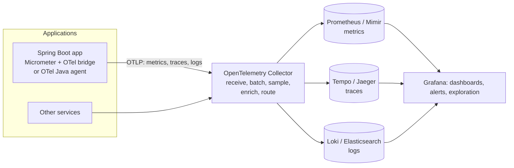
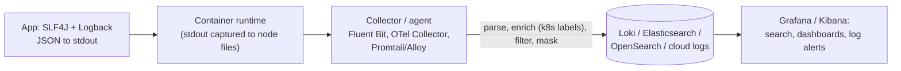
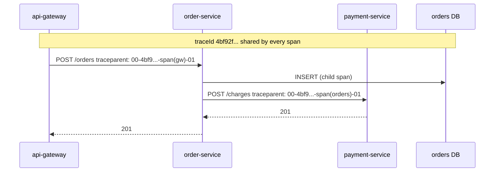
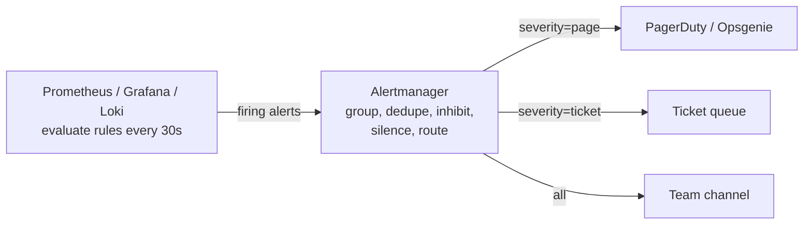
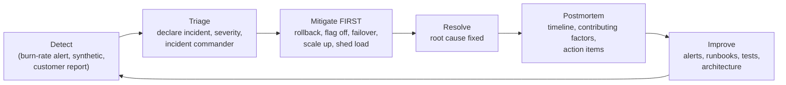
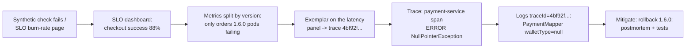

---
mdx:
  format: md
---

# Observability Patterns

> **Note**: Patterns marked with **(Interview Imp - Java)** are frequently asked in Java interviews
>
> **How to read this file:** Every section ends with a **📘 Terms Explained** table. If you see a word you don't know, check the table right below that section. Each pattern goes from the basic idea to advanced usage (plain Java simulation, Spring Boot / Micrometer / OpenTelemetry configuration, pitfalls) and ends with interview questions and a mini cheat sheet.
>
> **What are observability patterns?** They answer one question: *"When something is slow or broken in production, how do we find out quickly, understand why, and know whether users are affected?"* This file covers the master list's Monitoring & Observability patterns (logging, metrics, tracing, distributed tracing, alerting, health checks, synthetic monitoring) plus **SLIs/SLOs/error budgets** and **incident response**, which modern alerting is built on.
>
> **Builds on:** [02_Microservices_Pattern.md](../04_Specialized/02_Microservices_Pattern.md#10-observability-patterns-interview-imp---java) (a first overview of the three pillars), [04_Messaging_Pattern.md](04_Messaging_Pattern.md#10-correlation-identifier-pattern) (correlation IDs through messages), [02_Reliability_Pattern.md](02_Reliability_Pattern.md#8-health-check-pattern-interview-imp---java) (health checks and probes), [09_Deployment_Pattern.md](09_Deployment_Pattern.md#3-canary-deployment-pattern-interview-imp---java) (metrics-driven canaries) and [DevOps_Complete_Guide.md](../../devops/DevOps_Complete_Guide.md#8-observability-monitoring-and-reliability-sre-interview-imp) (Prometheus/Grafana setup, SRE practices).
>
> **Verified code:** Every main "Complete Java Example" in this file is **plain Java 17 (no libraries)** and was compiled and run **three times** with identical output (fixed clocks and random seeds where needed). The synthetic-monitoring example probes a **real local HTTP server** (JDK `HttpServer` + `HttpClient`). To run one, save it as `<ClassName>.java` and run `javac <ClassName>.java && java <ClassName>`. (Running it directly with `java <ClassName>.java` won't work, because the class with `main` is not the first class in the file.)

---

## Table of Contents
1. [Logging Pattern](#1-logging-pattern-interview-imp---java) **(Interview Imp - Java)**
   - [1.1 What is Logging?](#11-what-is-logging)
   - [1.2 Why Do We Need It (Done Right)?](#12-why-do-we-need-it-done-right)
   - [1.3 How It Works: The Log Pipeline](#13-how-it-works-the-log-pipeline)
   - [1.4 Complete Java Example - Structured Logs with Context and Masking](#14-complete-java-example---structured-logs-with-context-and-masking)
   - [1.5 Logging in Spring Boot](#15-logging-in-spring-boot)
   - [1.6 Pitfalls, Interview Questions and Cheat Sheet](#16-pitfalls-interview-questions-and-cheat-sheet)
   - [1.7 Pros and Cons](#17-pros-and-cons)
2. [Metrics Pattern](#2-metrics-pattern-interview-imp---java) **(Interview Imp - Java)**
   - [2.1 What are Metrics?](#21-what-are-metrics)
   - [2.2 Why Do We Need Them?](#22-why-do-we-need-them)
   - [2.3 How It Works: Percentiles, Histograms and Cardinality](#23-how-it-works-percentiles-histograms-and-cardinality)
   - [2.4 Complete Java Example - Averages vs Percentiles, Buckets and Cardinality](#24-complete-java-example---averages-vs-percentiles-buckets-and-cardinality)
   - [2.5 Metrics in Spring Boot (Micrometer + Prometheus)](#25-metrics-in-spring-boot-micrometer--prometheus)
   - [2.6 Pitfalls, Interview Questions and Cheat Sheet](#26-pitfalls-interview-questions-and-cheat-sheet)
   - [2.7 Pros and Cons](#27-pros-and-cons)
3. [Tracing and Distributed Tracing Pattern](#3-tracing-and-distributed-tracing-pattern-interview-imp---java) **(Interview Imp - Java)**
   - [3.1 What is (Distributed) Tracing?](#31-what-is-distributed-tracing)
   - [3.2 Why Do We Need It?](#32-why-do-we-need-it)
   - [3.3 How It Works](#33-how-it-works)
   - [3.4 Complete Java Example - Parsing and Propagating `traceparent`](#34-complete-java-example---parsing-and-propagating-traceparent)
   - [3.5 Tracing in Spring Boot (Micrometer Tracing + OpenTelemetry)](#35-tracing-in-spring-boot-micrometer-tracing--opentelemetry)
   - [3.6 Pitfalls, Interview Questions and Cheat Sheet](#36-pitfalls-interview-questions-and-cheat-sheet)
4. [Health Checks Pattern](#4-health-checks-pattern-interview-imp---java) **(Interview Imp - Java)**
5. [SLIs, SLOs and Error Budgets](#5-slis-slos-and-error-budgets-interview-imp---java) **(Interview Imp - Java)**
   - [5.1 What Are They?](#51-what-are-they)
   - [5.2 Why Do We Need Them?](#52-why-do-we-need-them)
   - [5.3 How It Works](#53-how-it-works)
   - [5.4 Complete Java Example - Error Budget and Burn-Rate Alerts](#54-complete-java-example---error-budget-and-burn-rate-alerts)
   - [5.5 SLOs in Practice](#55-slos-in-practice)
   - [5.6 Pitfalls, Interview Questions and Cheat Sheet](#56-pitfalls-interview-questions-and-cheat-sheet)
   - [5.7 Pros and Cons](#57-pros-and-cons)
6. [Alerting Pattern](#6-alerting-pattern)
   - [6.1 What is Alerting?](#61-what-is-alerting)
   - [6.2 Why Does It Need Design?](#62-why-does-it-need-design)
   - [6.3 How It Works](#63-how-it-works)
   - [6.4 Complete Java Example - `for` Durations, Grouping and Inhibition](#64-complete-java-example---for-durations-grouping-and-inhibition)
   - [6.5 Alerting in Practice](#65-alerting-in-practice)
   - [6.6 Pitfalls, Interview Questions and Cheat Sheet](#66-pitfalls-interview-questions-and-cheat-sheet)
   - [6.7 Types and Variants, Pros and Cons](#67-types-and-variants-pros-and-cons)
7. [Synthetic Monitoring Pattern](#7-synthetic-monitoring-pattern)
   - [7.1 What is Synthetic Monitoring?](#71-what-is-synthetic-monitoring)
   - [7.2 Why Do We Need It?](#72-why-do-we-need-it)
   - [7.3 How It Works](#73-how-it-works)
   - [7.4 Complete Java Example - A Synthetic Check Runner Against a Real HTTP Server](#74-complete-java-example---a-synthetic-check-runner-against-a-real-http-server)
   - [7.5 Synthetic Monitoring in Practice](#75-synthetic-monitoring-in-practice)
   - [7.6 Pitfalls, Interview Questions and Cheat Sheet](#76-pitfalls-interview-questions-and-cheat-sheet)
   - [7.7 Types and Variants, Pros and Cons](#77-types-and-variants-pros-and-cons)
8. [Incident Response and Postmortems](#8-incident-response-and-postmortems)
   - [8.1 What Is It?](#81-what-is-it)
   - [8.2 How It Works: The Incident Lifecycle](#82-how-it-works-the-incident-lifecycle)
   - [8.3 A Postmortem Template](#83-a-postmortem-template)
   - [8.4 Interview Questions and Cheat Sheet](#84-interview-questions-and-cheat-sheet)
   - [8.5 Types, In Java, Pros and Cons, and Pitfalls](#85-types-in-java-pros-and-cons-and-pitfalls)
9. [How the Observability Patterns Fit Together](#9-how-the-observability-patterns-fit-together)
   - [9.1 One-Line Summary of Each](#91-one-line-summary-of-each)
   - [9.2 From "Something Is Wrong" to Root Cause (Interview Imp - Java)](#92-from-something-is-wrong-to-root-cause-interview-imp---java)
   - [9.3 Decision Guide](#93-decision-guide)
   - [9.4 Look-Alike Concepts](#94-look-alike-concepts)
   - [9.5 Observability in the Java / Spring Ecosystem](#95-observability-in-the-java--spring-ecosystem)
   - [9.6 Comparison Table](#96-comparison-table)
10. [Observability Patterns Cheat Sheet](#10-observability-patterns-cheat-sheet)

---

## Before You Start: Monitoring vs Observability and the Signals

### Monitoring vs observability

| | Monitoring | Observability |
|---|---|---|
| Question | "Is the thing I **expected** to break broken?" | "**Why** is it behaving like this?", including problems nobody predicted |
| Built from | Predefined dashboards and alerts | Rich, correlated telemetry you can slice in new ways |
| Works best for | Known failure modes (disk full, service down) | Unknown unknowns in distributed systems |

You need both: monitoring tells you **that** something is wrong; observability helps you find **why**.

### The signals

| Signal | Answers | Shape | Cost profile | Example |
|---|---|---|---|---|
| **Metrics** | "How much / how fast / how often?" | Numbers aggregated over time | Cheap, fixed size per series | `http_server_requests` rate, p99, error % |
| **Logs** | "What exactly happened?" | Timestamped events with details | Grows with traffic | `payment failed orderId=ORD-42 errorType=CardDeclined` |
| **Traces** | "Where did this request spend its time, across services?" | Tree of spans per request | Sampled | gateway → orders → payment → fraud waterfall |
| **Profiles** | "Which code is using CPU/memory?" | Stack samples over time | Continuous, low overhead | JFR, async-profiler, Pyroscope flame graphs |
| **Events** | "What changed?" | Deployments, config changes, flag flips | Small | "orders 1.6.0 deployed at 10:40" overlaid on graphs |

The signals are most powerful when **linked**: a metric spike → **exemplar** trace → the trace's spans → the logs with the same `traceId`.

### OpenTelemetry: one standard pipeline



**OpenTelemetry (OTel)** standardises the APIs, SDKs, wire protocol (**OTLP**) and semantic conventions for telemetry, so you can switch back-ends (Grafana stack, Datadog, New Relic, Elastic, cloud vendors) without re-instrumenting code.

#### 📘 Terms Explained

| Term | Simple meaning |
|---|---|
| **Telemetry** | Data a system emits about its own behaviour (metrics, logs, traces). |
| **Observability** | How well you can understand a system's internal state from its outputs. |
| **Instrumentation** | Code (or an agent) that produces telemetry. |
| **OpenTelemetry (OTel)** | The vendor-neutral CNCF standard for telemetry APIs, SDKs and the OTLP protocol. |
| **Collector** | A service that receives telemetry, processes it (batch, sample, filter) and exports it to back-ends. |
| **Exemplar** | A sample trace ID attached to a metric data point, linking a graph to an example request. |

---

# 1. Logging Pattern (Interview Imp - Java)

## 1.1 What is Logging?

**Logging** records **discrete events** that happen inside an application (a request handled, an order placed, a payment failing) with a timestamp, a severity level and details. Logs are the most detailed signal: they tell you **exactly what happened** to a specific request.

**Analogy:** A ship's logbook. The captain writes down important events with the time, position and what happened. After a storm, the log tells you exactly what was done, and when.

| Level | Use for | In production |
|---|---|---|
| `ERROR` | Something failed and needs attention (request failed, data couldn't be saved) | Always on; usually alert-worthy in aggregate |
| `WARN` | Unexpected but handled (retry succeeded, fallback used, deprecated API called) | On |
| `INFO` | Important business/lifecycle events (started, order placed, job finished) | On (keep volume reasonable) |
| `DEBUG` | Detailed diagnostic information | Off; enable temporarily per package |
| `TRACE` | Very detailed flow (every method entry) | Off |

#### 📘 Terms Explained

| Term | Simple meaning |
|---|---|
| **Log event / log line** | One recorded event with timestamp, level, message and fields. |
| **Log level** | Severity of an event; lets you filter what gets written. |
| **Structured logging** | Logging as key/value fields (usually JSON) instead of free text. |
| **MDC** | Mapped Diagnostic Context: per-thread key/values (traceId, userId) added to every log line. |
| **Log aggregation** | Shipping logs from every instance to one searchable store. |
| **Retention** | How long logs are kept before deletion. |

---

## 1.2 Why Do We Need It (Done Right)?

| Bad logging | Good logging |
|---|---|
| Free-text lines that need regex parsing | **Structured JSON**: query `level=ERROR AND orderId=ORD-42` |
| No request context | `traceId`, `userId`, `orderId` on every line (MDC) |
| Written to local files inside short-lived pods | **stdout** → collector → central store |
| Logging everything at INFO ("log and pray") | Meaningful events; DEBUG off by default |
| Passwords, tokens, card numbers in logs | Masking/redaction ([06_Security_Pattern.md](06_Security_Pattern.md#10-data-protection-masking-tokenization-and-privacy-by-design-interview-imp---java)) |
| Stack trace logged 3 times as an exception bubbles up | Log once, where you handle it |

---

## 1.3 How It Works: The Log Pipeline



**Good log line checklist:**
- Timestamp in UTC (ISO-8601), level, service name, version, environment.
- `traceId` / `spanId` (links logs ↔ traces) and business IDs (`orderId`).
- A **stable message** ("payment failed") plus **fields** for variable data (amount, errorType), not values baked into the message text.
- Error type and (once) the stack trace.
- **Never:** passwords, tokens, full card numbers, personal data you don't need.

**Volume control:** keep INFO meaningful, sample noisy DEBUG/INFO lines, use different retention for audit vs debug logs, drop health-check noise at the collector.

---

## 1.4 Complete Java Example - Structured Logs with Context and Masking

```java
import java.time.Instant;
import java.util.LinkedHashMap;
import java.util.Map;
import java.util.regex.Pattern;

// A tiny structured (JSON) logger with levels, MDC context and secret masking, to show what good log lines look like
class Log {
    enum Level { TRACE, DEBUG, INFO, WARN, ERROR }
    static Level threshold = Level.INFO;                                   // production default
    static final ThreadLocal<Map<String, String>> MDC = ThreadLocal.withInitial(LinkedHashMap::new);
    static final Pattern CARD = Pattern.compile("\\b\\d{12}(\\d{4})\\b");
    static final Instant FIXED_NOW = Instant.parse("2026-10-26T10:42:13.481Z");   // fixed clock so the demo output is repeatable

    static void log(Level level, String logger, String message, Map<String, Object> fields) {
        if (level.ordinal() < threshold.ordinal()) return;                 // filtered out cheaply
        StringBuilder json = new StringBuilder("{");
        add(json, "@timestamp", FIXED_NOW.toString());
        add(json, "level", level.name());
        add(json, "service", "order-service");
        add(json, "logger", logger);
        MDC.get().forEach((k, v) -> add(json, k, v));                     // traceId, userId... from the request context
        fields.forEach((k, v) -> add(json, k, v));                         // structured key/values, not string concatenation
        add(json, "message", CARD.matcher(message).replaceAll("************$1"));
        json.setLength(json.length() - 1);
        System.out.println(json.append("}"));
    }

    private static void add(StringBuilder b, String k, Object v) {
        b.append('"').append(k).append("\":");
        if (v instanceof Number || v instanceof Boolean) b.append(v); else b.append('"').append(String.valueOf(v).replace("\"", "\\\"")).append('"');
        b.append(',');
    }
}

public class StructuredLoggingDemo {
    // Ordered key/value helper (Map.of has no stable iteration order)
    static Map<String, Object> kv(Object... pairs) {
        Map<String, Object> m = new LinkedHashMap<>();
        for (int i = 0; i < pairs.length; i += 2) m.put((String) pairs[i], pairs[i + 1]);
        return m;
    }

    public static void main(String[] args) {
        System.out.println("Unstructured (hard to search, parse or aggregate):");
        System.out.println("2026-10-26 10:42:13 INFO Order 42 placed by asha for 7999 rupees in 182ms");

        System.out.println("Structured JSON with request context:");
        Log.MDC.get().put("traceId", "4bf92f3577b34da6a3ce929d0e0e4736");
        Log.MDC.get().put("userId", "u-101");
        Log.log(Log.Level.DEBUG, "OrderService", "cart loaded", kv("items", 3));           // below threshold: not written
        Log.log(Log.Level.INFO, "OrderService", "order placed", kv("orderId", "ORD-42", "amountPaise", 799900, "durationMs", 182));
        Log.log(Log.Level.WARN, "PaymentClient", "payment retry for card 4111111111111234",
                kv("orderId", "ORD-42", "attempt", 2, "errorType", "SocketTimeoutException"));
        Log.log(Log.Level.ERROR, "PaymentClient", "payment failed", kv("orderId", "ORD-42", "errorType", "CardDeclined", "retryable", false));
        Log.MDC.remove();                                                                       // clear context (threads are reused)

        System.out.println("Now a query like  level:ERROR AND orderId:ORD-42  or  traceId:4bf92f... finds these lines across ALL services.");
    }
}
```

**Output:**
```
Unstructured (hard to search, parse or aggregate):
2026-10-26 10:42:13 INFO Order 42 placed by asha for 7999 rupees in 182ms
Structured JSON with request context:
{"@timestamp":"2026-10-26T10:42:13.481Z","level":"INFO","service":"order-service","logger":"OrderService","traceId":"4bf92f3577b34da6a3ce929d0e0e4736","userId":"u-101","orderId":"ORD-42","amountPaise":799900,"durationMs":182,"message":"order placed"}
{"@timestamp":"2026-10-26T10:42:13.481Z","level":"WARN","service":"order-service","logger":"PaymentClient","traceId":"4bf92f3577b34da6a3ce929d0e0e4736","userId":"u-101","orderId":"ORD-42","attempt":2,"errorType":"SocketTimeoutException","message":"payment retry for card ************1234"}
{"@timestamp":"2026-10-26T10:42:13.481Z","level":"ERROR","service":"order-service","logger":"PaymentClient","traceId":"4bf92f3577b34da6a3ce929d0e0e4736","userId":"u-101","orderId":"ORD-42","errorType":"CardDeclined","retryable":false,"message":"payment failed"}
Now a query like  level:ERROR AND orderId:ORD-42  or  traceId:4bf92f... finds these lines across ALL services.
```

What the output shows:
- The unstructured line hides its data inside free text; the JSON lines have **queryable fields** (`orderId`, `amountPaise`, `errorType`).
- `traceId` and `userId` came from the **MDC**, so every line of this request carries them without being passed around explicitly.
- The **DEBUG** line was filtered out by the INFO threshold.
- The card number in the WARN message was **masked** before writing.

---

## 1.5 Logging in Spring Boot

```yaml
# Spring Boot 3.4+: structured JSON logs without extra dependencies
logging:
  structured:
    format:
      console: ecs            # or logstash, gelf
  level:
    root: INFO
    com.shop.orders: INFO
    org.hibernate.SQL: WARN   # set DEBUG temporarily to see SQL
```

```java
@Service
@Slf4j
class PaymentService {
    PaymentResult charge(Order order) {
        try {
            PaymentResult r = gateway.charge(order);
            log.atInfo().setMessage("payment captured")                     // SLF4J 2 fluent API: structured key/values
               .addKeyValue("orderId", order.id())
               .addKeyValue("amountPaise", order.totalPaise())
               .log();
            return r;
        } catch (CardDeclinedException e) {
            log.atWarn().setMessage("card declined").addKeyValue("orderId", order.id())
               .addKeyValue("declineCode", e.code()).log();                   // expected business failure: WARN, no stack trace
            throw e;
        } catch (RuntimeException e) {
            log.error("payment failed orderId={}", order.id(), e);           // unexpected: ERROR with stack trace, logged ONCE here
            throw e;
        }
    }
}
```

- With **Micrometer Tracing** on the classpath, `traceId`/`spanId` are put into the MDC automatically and appear in structured logs.
- Change levels at runtime with the Actuator **`/actuator/loggers`** endpoint (protect it!): `POST /actuator/loggers/com.shop.orders {"configuredLevel":"DEBUG"}`.

#### 📘 Terms Explained

| Term | Simple meaning |
|---|---|
| **SLF4J / Logback** | The standard Java logging API / Spring Boot's default logging implementation. |
| **ECS / Logstash / GELF** | Common JSON log formats understood by Elastic, Logstash and Graylog. |
| **Fluent Bit / Promtail / Grafana Alloy** | Lightweight agents that collect and ship logs. |
| **Loki** | Grafana's log store that indexes labels, not full text (cheap at scale). |
| **`/actuator/loggers`** | Spring Boot endpoint to view and change log levels at runtime. |

---

## 1.6 Pitfalls, Interview Questions and Cheat Sheet

| Pitfall | Fix |
|---|---|
| Logging inside tight loops / per row | Log summaries; sample. |
| `log.debug("x=" + expensive())` building strings even when disabled | Parameterised messages `log.debug("x={}", x)` or fluent API with suppliers. |
| Same exception logged at every layer | Log once where it's handled; rethrow without logging. |
| Local log files in containers | stdout + collector. |
| PII and secrets in logs | Masking, safe `toString()`, reviews. |
| No correlation between services | traceId in MDC + propagation. |

**Q1. Why structured logging?** JSON fields can be indexed, filtered and aggregated reliably (`orderId=ORD-42`), unlike free text that needs fragile parsing.

**Q2. What is MDC and why is it useful?** A per-thread map whose values (traceId, userId) are added to every log line, so all lines for one request can be found together. It must be cleared after the request and propagated to async threads.

**Q3. How do you aggregate logs in Kubernetes?** Applications log JSON to stdout; a node agent (Fluent Bit/OTel Collector) ships them to Loki/Elasticsearch, enriching with pod/namespace labels.

**Q4. Which level for a declined card vs a NullPointerException?** Declined card is an expected business outcome (INFO/WARN, no stack trace); an NPE is a bug (ERROR with stack trace).

```
LOGGING   Discrete events: what exactly happened. Levels ERROR/WARN/INFO (prod) DEBUG/TRACE (temporary).
          Structured JSON (logging.structured.format.console=ecs), stable message + fields, UTC timestamps, service/version.
          MDC: traceId/spanId/userId on every line (Micrometer Tracing adds trace ids); clear + propagate to async threads.
          stdout -> Fluent Bit/OTel Collector -> Loki/Elasticsearch -> Grafana/Kibana. Log once; no PII/secrets; control volume.
```

---

## 1.7 Pros and Cons

| Pros | Cons |
|---|---|
| Full detail for debugging a specific request (with trace ids) | Storage and indexing cost grow fast with volume |
| Structured JSON logs are searchable and machine-readable | Easy to leak personal data or secrets into logs |
| Centralised logging (ELK, Loki) gives one place to search | Too much logging hurts performance and hides signal in noise |
| Audit trail for security and compliance | Not good for trends and alerting (use metrics) |

# 2. Metrics Pattern (Interview Imp - Java)

## 2.1 What are Metrics?

**Metrics** are **numeric measurements aggregated over time**: how many requests per second, how many failed, how long they took, how full the connection pool is. They're cheap to store and query, perfect for **dashboards and alerts**, and show **trends**.

**Analogy:** A car's dashboard. You don't get a log of every engine revolution; you get a speedometer, fuel gauge and temperature needle, which tell you at a glance whether everything is normal.

| Metric type | Behaviour | Example | Query idea |
|---|---|---|---|
| **Counter** | Only goes up (resets on restart) | Requests served, errors, orders placed | `rate(errors_total[5m])` |
| **Gauge** | Goes up and down | Active connections, queue depth, heap used, temperature | Current value, max over time |
| **Histogram** | Counts observations into **buckets** (plus sum and count) | Request latency, payload size | Percentiles across instances (`histogram_quantile`) |
| **Summary** | Calculates percentiles **inside each instance** | Latency quantiles | Can't be aggregated across instances correctly |

#### 📘 Terms Explained

| Term | Simple meaning |
|---|---|
| **Time series** | A metric name + a unique set of labels, with values over time. |
| **Label / tag** | A dimension on a metric (`method="GET"`, `status="500"`). |
| **Cardinality** | The number of unique time series (label combinations). |
| **Percentile (p99)** | The value below which 99% of observations fall. |
| **Scrape** | Prometheus pulling metrics from an app's endpoint periodically. |
| **Micrometer** | Spring Boot's metrics facade (like SLF4J, but for metrics). |

---

## 2.2 Why Do We Need Them?

- **Detect** problems fast: error rate up, latency up, queue growing (alerting runs on metrics).
- **Understand trends and capacity**: traffic growth, memory creeping up, saturation before an outage.
- **Measure SLOs** (section 5) and **drive automation** (autoscaling, canary analysis).

### What to measure

| Method | For | Signals |
|---|---|---|
| **RED** | Request-driven services | **R**ate, **E**rrors, **D**uration |
| **USE** | Resources (CPU, memory, pools, queues, disks) | **U**tilisation, **S**aturation, **E**rrors |
| **Four golden signals** (Google SRE) | Any user-facing system | Latency, traffic, errors, saturation |
| **Business metrics** | The product | Orders/min, payment success %, sign-ups |

For a Spring Boot service: HTTP RED metrics, JVM (heap, GC pauses, threads), HikariCP pool (active, pending, timeouts), Kafka consumer lag, cache hit ratio, circuit breaker state, plus business counters.

---

## 2.3 How It Works: Percentiles, Histograms and Cardinality

- **Averages hide pain.** If 98% of requests take 80 ms and 2% take 2 s, the average looks fine while 1 in 50 users waits 2 seconds. Use **percentiles** (p50, p95, p99).
- **Percentiles can't be averaged across instances.** The p99 of 20 pods isn't the average of their p99s. **Histograms** store bucket counts that **can** be summed across instances, then a percentile is estimated from the combined buckets.
- **Bucket choice matters:** put bucket boundaries near your SLO thresholds (e.g. 100 ms, 250 ms, 500 ms).
- **Cardinality** = product of label values. `endpoint × status × instance` is fine; adding `userId` or `orderId` creates millions of series and can take down your metrics system.

---

## 2.4 Complete Java Example - Averages vs Percentiles, Buckets and Cardinality

```java
import java.util.ArrayList;
import java.util.Arrays;
import java.util.List;
import java.util.Random;

public class MetricsDemo {
    // Exact percentile from raw samples (what a histogram approximates)
    static double percentile(double[] sorted, double p) {
        int idx = (int) Math.ceil(p / 100.0 * sorted.length) - 1;
        return sorted[Math.max(0, idx)];
    }

    public static void main(String[] args) {
        // 10,000 request latencies: most are fast, 2% hit a slow database path
        Random random = new Random(7);
        double[] latencies = new double[10_000];
        for (int i = 0; i < latencies.length; i++) {
            latencies[i] = random.nextDouble() < 0.02 ? 1_500 + random.nextDouble() * 1_500 : 40 + random.nextDouble() * 80;
        }
        double[] sorted = latencies.clone();
        Arrays.sort(sorted);
        double avg = Arrays.stream(latencies).average().orElse(0);

        System.out.println("1) Why averages lie");
        System.out.printf("   average = %4.0f ms   <- looks fine%n", avg);
        System.out.printf("   p50     = %4.0f ms%n", percentile(sorted, 50));
        System.out.printf("   p95     = %4.0f ms%n", percentile(sorted, 95));
        System.out.printf("   p99     = %4.0f ms   <- 1 in 100 requests is this slow: users notice%n", percentile(sorted, 99));

        System.out.println("2) Histogram buckets (what Prometheus stores: cumulative counts per 'le' bucket)");
        double[] buckets = {50, 100, 250, 500, 1000, 2500, Double.POSITIVE_INFINITY};
        for (double le : buckets) {
            long count = Arrays.stream(latencies).filter(l -> l <= le).count();
            System.out.printf("   le=%-8s %5d%n", le == Double.POSITIVE_INFINITY ? "+Inf" : String.valueOf((int) le), count);
        }
        long within500 = Arrays.stream(latencies).filter(l -> l <= 500).count();
        System.out.printf("   SLI 'requests faster than 500 ms' = %.2f%%%n", 100.0 * within500 / latencies.length);

        System.out.println("3) Label cardinality: each unique label combination is a separate time series");
        int endpoints = 40, statuses = 5, instances = 20;
        List<String> rows = new ArrayList<>();
        rows.add(String.format("   http_requests{endpoint, status, instance}          = %,d series", endpoints * statuses * instances));
        rows.add(String.format("   ... + userId label (1,000,000 users)              = %,d series  <- cardinality explosion", (long) endpoints * statuses * instances * 1_000_000));
        rows.forEach(System.out::println);
        System.out.println("   -> put user IDs in logs/traces, never in metric labels");
    }
}
```

**Output:**
```
1) Why averages lie
   average =  118 ms   <- looks fine
   p50     =   81 ms
   p95     =  117 ms
   p99     = 2078 ms   <- 1 in 100 requests is this slow: users notice
2) Histogram buckets (what Prometheus stores: cumulative counts per 'le' bucket)
   le=50        1186
   le=100       7371
   le=250       9825
   le=500       9825
   le=1000      9825
   le=2500      9943
   le=+Inf     10000
   SLI 'requests faster than 500 ms' = 98.25%
3) Label cardinality: each unique label combination is a separate time series
   http_requests{endpoint, status, instance}          = 4,000 series
   ... + userId label (1,000,000 users)              = 4,000,000,000 series  <- cardinality explosion
   -> put user IDs in logs/traces, never in metric labels
```

What the output shows:
- The **average** (118 ms) and even **p95** (117 ms) looked healthy, but **p99 was over 2 seconds** because of the 2% slow path.
- Histogram **buckets** are cumulative counts (`le` = "less than or equal"); from them you can compute an SLI like "98.25% of requests were faster than 500 ms".
- Adding a `userId` label would turn **4,000** time series into **4 billion**: a cardinality explosion.

---

## 2.5 Metrics in Spring Boot (Micrometer + Prometheus)

```yaml
management:
  endpoints:
    web:
      exposure:
        include: health,info,prometheus
  metrics:
    tags:
      application: ${spring.application.name}
      version: ${app.version:unknown}           # lets canary analysis compare versions
    distribution:
      percentiles-histogram:
        http.server.requests: true             # publish buckets -> percentiles across instances
      slo:
        http.server.requests: 100ms,250ms,500ms # extra buckets at SLO thresholds
```

```java
@Service
class CheckoutMetrics {
    private final Counter ordersPlaced;
    private final Timer paymentTimer;
    private final AtomicInteger inFlightCheckouts;

    CheckoutMetrics(MeterRegistry registry) {
        this.ordersPlaced = Counter.builder("orders.placed").tag("channel", "web").register(registry);         // counter
        this.paymentTimer = Timer.builder("payment.duration").publishPercentileHistogram().register(registry); // histogram
        this.inFlightCheckouts = registry.gauge("checkout.in.flight", new AtomicInteger(0));                   // gauge
    }

    Receipt checkout(Cart cart) {
        inFlightCheckouts.incrementAndGet();
        try {
            Receipt r = paymentTimer.record(() -> payments.charge(cart));
            ordersPlaced.increment();
            return r;
        } finally {
            inFlightCheckouts.decrementAndGet();
        }
    }
}
```

```promql
# PromQL: requests per second, error ratio, p99 latency across all pods
sum(rate(http_server_requests_seconds_count{application="orders"}[5m]))
sum(rate(http_server_requests_seconds_count{application="orders",status=~"5.."}[5m]))
  / sum(rate(http_server_requests_seconds_count{application="orders"}[5m]))
histogram_quantile(0.99, sum by (le) (rate(http_server_requests_seconds_bucket{application="orders"}[5m])))
```

Spring Boot auto-instruments HTTP server/client requests, JVM, HikariCP, Tomcat, Kafka, caches, Resilience4j and more.

#### 📘 Terms Explained

| Term | Simple meaning |
|---|---|
| **`MeterRegistry`** | Micrometer's registry where you create counters, timers and gauges. |
| **`Timer`** | Micrometer meter recording durations (count, total, max, optional histogram). |
| **`publishPercentileHistogram`** | Exports histogram buckets so percentiles can be computed in Prometheus. |
| **PromQL** | Prometheus Query Language. |
| **`rate()`** | PromQL function: per-second increase of a counter over a time window. |
| **`histogram_quantile`** | PromQL function estimating a percentile from histogram buckets. |

---

## 2.6 Pitfalls, Interview Questions and Cheat Sheet

| Pitfall | Fix |
|---|---|
| Dashboards of averages | p50/p95/p99 from histograms. |
| Client-side percentiles (summaries) averaged across pods | Histograms + `histogram_quantile`. |
| High-cardinality labels (userId, orderId, full URLs) | Low-cardinality labels only; templated URIs (`/orders/{id}`). |
| Measuring only technical metrics | Add business metrics (orders/min, payment success). |
| No units / inconsistent names | Base units (seconds, bytes), conventions (`_total`, `_seconds`). |

**Q1. Counter vs gauge vs histogram?** Counter only increases (requests, errors); gauge goes up and down (queue size, memory); histogram buckets observations (latency) so percentiles can be computed.

**Q2. Why use percentiles instead of averages?** Averages hide the slow tail that real users experience; p95/p99 show it.

**Q3. Why histograms rather than summaries for latency in a cluster?** Histogram buckets can be summed across instances before computing a percentile; summary quantiles can't be meaningfully aggregated.

**Q4. What is metric cardinality and why does it matter?** The number of unique label combinations; each is a separate time series. Unbounded labels (user IDs) explode memory and cost.

**Q5. What metrics would you monitor for a Spring Boot service?** RED for HTTP endpoints, JVM heap/GC/threads, DB pool usage and wait time, downstream call latency/errors, consumer lag, circuit breaker state, and business KPIs.

```
METRICS   Numbers over time: counter (only up), gauge (up/down), histogram (buckets -> percentiles), summary (per-instance quantiles).
          RED (rate, errors, duration), USE (utilisation, saturation, errors), golden signals, business KPIs.
          Percentiles not averages; histograms aggregate across pods; buckets at SLO thresholds; LOW cardinality labels.
          Spring: Micrometer MeterRegistry (Counter, Timer, gauge), /actuator/prometheus, percentiles-histogram, slo buckets, version tag.
          PromQL: rate(), sum by (le), histogram_quantile(0.99, ...).
```

---

## 2.7 Pros and Cons

| Pros | Cons |
|---|---|
| Cheap to store and query (numbers over time) | No per-request detail (use logs/traces to investigate) |
| Ideal for dashboards, SLOs and alerting | High-cardinality labels (user id, URL with ids) explode storage |
| Micrometer gives one API for Prometheus, Datadog, CloudWatch | Averages mislead; you need histograms/percentiles configured up front |
| Good for capacity planning and trends | Aggregation choices (rates, windows) can hide short spikes |

# 3. Tracing and Distributed Tracing Pattern (Interview Imp - Java)

## 3.1 What is (Distributed) Tracing?

**Tracing** records the **path and timing of a single request** as a tree of **spans**: each span is one operation (an HTTP call, a DB query, a Kafka send) with a start time, duration, attributes and a parent. **Distributed tracing** follows that request **across many services**, by passing the **trace context** (trace ID + current span ID) along with every call.

**Analogy:** A parcel's tracking history. Every hub scans the same tracking number and records arrival and departure times. Looking at the whole history shows where the parcel waited longest, even though no single hub saw the full journey.



#### 📘 Terms Explained

| Term | Simple meaning |
|---|---|
| **Trace** | The full journey of one request: a tree of spans with one trace ID. |
| **Span** | One timed operation in a trace (name, start, duration, attributes, status, parent). |
| **Trace context** | The trace ID and parent span ID passed between services. |
| **W3C `traceparent`** | The standard HTTP header carrying the trace context. |
| **Sampling** | Recording only some traces to control cost. |
| **Context propagation** | Carrying the trace context across threads, HTTP calls and messages. |

---

## 3.2 Why Do We Need It?

- A slow checkout touches **10 services**; metrics show checkout is slow, logs are scattered, but only a trace shows that **fraud scoring inside payment-service** took 900 ms of the 1.2 s.
- Find **which dependency** is failing or slow, **N+1 calls**, unexpected **retries**, and **serial calls** that could be parallel.
- Understand the **real architecture** (service maps are generated from traces).
- Link from a slow metric point to an example trace (exemplars), then to the logs with the same `traceId`.

---

## 3.3 How It Works

### Trace context propagation (W3C Trace Context)

```
traceparent: 00-4bf92f3577b34da6a3ce929d0e0e4736-00f067aa0ba902b7-01
             │   │                                │                └ flags (01 = sampled)
             │   │                                └ parent span id (16 hex)
             │   └ trace id (32 hex), same for the whole request
             └ version
```

1. The first service (or the browser/gateway) creates a **trace ID** and a root span.
2. Each outgoing call carries `traceparent` with the **current span ID** as the parent.
3. The receiving service creates a **child span** and continues propagating.
4. For **messages** (Kafka/RabbitMQ), the context goes into message **headers**.
5. Each service exports its spans (OTLP) to a back-end that assembles the full trace.

### Sampling

| Strategy | Decides | Pros | Cons |
|---|---|---|---|
| **Head-based** (e.g. 10%) | At the start of the trace, from the trace ID | Cheap, consistent across services | Might drop the one interesting (error) trace |
| **Tail-based** | After the trace completes, in the collector | Keep 100% of errors and slow traces, a few % of the rest | Collector must buffer whole traces (memory, complexity) |
| **Always on** | Everything | Complete | Expensive at scale (fine in dev/staging) |

---

## 3.4 Complete Java Example - Parsing and Propagating `traceparent`

```java
import java.util.ArrayList;
import java.util.HexFormat;
import java.util.List;
import java.util.Random;

// W3C Trace Context: how one trace id travels through HTTP headers across services, and how sampling is decided
public class TraceContextDemo {
    record TraceParent(String version, String traceId, String parentSpanId, String flags) {
        static TraceParent parse(String header) {
            String[] p = header.split("-");
            if (p.length != 4 || p[1].length() != 32 || p[2].length() != 16) throw new IllegalArgumentException("invalid traceparent");
            return new TraceParent(p[0], p[1], p[2], p[3]);
        }
        boolean sampled() { return (Integer.parseInt(flags, 16) & 1) == 1; }
        String header() { return version + "-" + traceId + "-" + parentSpanId + "-" + flags; }
    }

    static final Random RANDOM = new Random(11);                // fixed seed: repeatable demo ids
    static String newSpanId() { byte[] b = new byte[8]; RANDOM.nextBytes(b); return HexFormat.of().formatHex(b); }

    // A service receives the header, creates its own span (child of the caller's span), and passes a NEW header downstream
    static TraceParent handle(String service, TraceParent incoming, List<String> spans) {
        String mySpan = newSpanId();
        spans.add(String.format("  %-15s trace=%s span=%s parent=%s", service, incoming.traceId().substring(0, 8) + "...", mySpan, incoming.parentSpanId()));
        return new TraceParent(incoming.version(), incoming.traceId(), mySpan, incoming.flags());
    }

    // Head-based ratio sampling: decide from the trace id so every service makes the SAME decision
    static boolean sampleByRatio(String traceId, double ratio) {
        long low = Long.parseUnsignedLong(traceId.substring(16), 16) >>> 1;
        return low < (long) (ratio * Long.MAX_VALUE);
    }

    public static void main(String[] args) {
        String fromBrowser = "00-4bf92f3577b34da6a3ce929d0e0e4736-00f067aa0ba902b7-01";   // example from the W3C spec
        TraceParent tp = TraceParent.parse(fromBrowser);
        System.out.println("incoming traceparent: " + fromBrowser);
        System.out.println("  version=" + tp.version() + " traceId=" + tp.traceId() + " parentSpanId=" + tp.parentSpanId() + " sampled=" + tp.sampled());

        List<String> spans = new ArrayList<>();
        TraceParent toOrders = handle("api-gateway", tp, spans);
        TraceParent toPayment = handle("order-service", toOrders, spans);
        handle("payment-service", toPayment, spans);
        System.out.println("spans recorded (each service's parent = the caller's span):");
        spans.forEach(System.out::println);
        System.out.println("header sent from order-service to payment-service: " + toPayment.header());

        System.out.println("head-based sampling at 10% (decided once from the trace id, consistent across services):");
        int kept = 0;
        for (int i = 0; i < 10_000; i++) {
            byte[] b = new byte[16]; RANDOM.nextBytes(b);
            if (sampleByRatio(HexFormat.of().formatHex(b), 0.10)) kept++;
        }
        System.out.println("  kept " + kept + " of 10,000 traces");
        System.out.println("tail-based sampling instead decides AFTER the trace ends: e.g. keep 100% of errors and slow traces, 5% of the rest");
    }
}
```

**Output:**
```
incoming traceparent: 00-4bf92f3577b34da6a3ce929d0e0e4736-00f067aa0ba902b7-01
  version=00 traceId=4bf92f3577b34da6a3ce929d0e0e4736 parentSpanId=00f067aa0ba902b7 sampled=true
spans recorded (each service's parent = the caller's span):
  api-gateway     trace=4bf92f35... span=e59bf7ba9862f4b6 parent=00f067aa0ba902b7
  order-service   trace=4bf92f35... span=2fa0666d872ec936 parent=e59bf7ba9862f4b6
  payment-service trace=4bf92f35... span=22df26a1366d3b66 parent=2fa0666d872ec936
header sent from order-service to payment-service: 00-4bf92f3577b34da6a3ce929d0e0e4736-2fa0666d872ec936-01
head-based sampling at 10% (decided once from the trace id, consistent across services):
  kept 980 of 10,000 traces
tail-based sampling instead decides AFTER the trace ends: e.g. keep 100% of errors and slow traces, 5% of the rest
```

What the output shows:
- The header (the example from the W3C specification) was parsed into version, **trace ID**, **parent span ID** and the **sampled** flag.
- Every service kept the **same trace ID** but created its own **span ID**, recording the caller's span as its **parent**: that's how the back-end rebuilds the tree.
- **Head-based ratio sampling** derived from the trace ID kept about **10%** of traces, and every service computing the same rule on the same trace ID reaches the **same decision**.

---

## 3.5 Tracing in Spring Boot (Micrometer Tracing + OpenTelemetry)

```xml
<dependency><groupId>io.micrometer</groupId><artifactId>micrometer-tracing-bridge-otel</artifactId></dependency>
<dependency><groupId>io.opentelemetry</groupId><artifactId>opentelemetry-exporter-otlp</artifactId></dependency>
```

```yaml
management:
  tracing:
    sampling:
      probability: 0.1                       # head sampling in the app; tail sampling can run in the Collector
  otlp:
    tracing:
      endpoint: http://otel-collector:4318/v1/traces
spring:
  kafka:
    template: { observation-enabled: true }  # propagate trace context into Kafka headers
    listener: { observation-enabled: true }
```

```java
// Custom spans around important work (Observation API: one instrumentation -> metrics AND traces)
@Service
@RequiredArgsConstructor
class FraudService {
    private final ObservationRegistry registry;

    FraudScore score(Payment p) {
        return Observation.createNotStarted("fraud.score", registry)
                .lowCardinalityKeyValue("channel", p.channel())          // becomes a metric tag + span attribute
                .highCardinalityKeyValue("paymentId", p.id())            // span attribute only (never a metric tag)
                .observe(() -> model.score(p));
    }
}
```

```bash
# Alternative: zero-code instrumentation with the OpenTelemetry Java agent
java -javaagent:opentelemetry-javaagent.jar \
     -Dotel.service.name=orders -Dotel.exporter.otlp.endpoint=http://otel-collector:4318 \
     -jar orders.jar
```

| Back-end | Notes |
|---|---|
| **Grafana Tempo**, **Jaeger**, **Zipkin** | Open-source trace stores and UIs |
| Datadog APM, New Relic, Dynatrace, Honeycomb, AWS X-Ray, Google Cloud Trace | Commercial/cloud |
| OTel Collector `tail_sampling` processor | Policies: keep errors, keep latency > X, probabilistic for the rest |

> **Async boundaries:** `@Async`, executors, `CompletableFuture` and reactive pipelines need **context propagation** (Micrometer's context-propagation library / `ContextSnapshot`, or the OTel agent's automatic wrapping), or the trace breaks.

#### 📘 Terms Explained

| Term | Simple meaning |
|---|---|
| **Micrometer Tracing** | Spring Boot 3's tracing facade, bridging to OpenTelemetry or Brave. |
| **Observation API** | Micrometer API that produces metrics and spans from one instrumentation point. |
| **Low vs high cardinality key/values** | Safe for metric tags vs only for span attributes. |
| **OTel Java agent** | A `-javaagent` that automatically instruments common libraries without code changes. |
| **Service map** | A diagram of which services call which, generated from traces. |
| **Tail sampling processor** | Collector component that decides which complete traces to keep. |

---

## 3.6 Pitfalls, Interview Questions and Cheat Sheet

| Pitfall | Fix |
|---|---|
| One service doesn't propagate headers → broken traces | Instrument every hop (HTTP clients, messaging, gateways); test propagation. |
| Lost context on async threads | Context propagation libraries / agent. |
| 100% sampling in high-traffic production | Head sampling + tail sampling for errors/slow traces. |
| Sensitive data in span attributes | Same rules as logs: no secrets/PII. |
| Spans without useful attributes | Add route, status, key IDs (as attributes), error flags. |

**Q1. How does distributed tracing work?** A trace ID is created at the entry point; each service creates spans with parent IDs and propagates the context (W3C `traceparent`) in HTTP/message headers; spans are exported to a back-end that assembles the tree.

**Q2. Trace vs span?** A trace is the whole request journey; a span is one timed operation within it, with a parent span.

**Q3. Head-based vs tail-based sampling?** Head decides at the start (cheap, consistent, may miss errors); tail decides after completion (keeps errors/slow traces, needs buffering in the collector).

**Q4. How do you propagate traces through Kafka?** Put the trace context into message headers when producing and extract it when consuming (Spring Kafka `observation-enabled`, OTel instrumentation).

**Q5. How do logs, metrics and traces connect?** traceId/spanId in every log line (MDC), exemplars on metrics pointing to trace IDs, and trace spans linking to logs by traceId.

```
TRACING    One request = trace (traceId) of spans (spanId + parent). Propagate W3C traceparent 00-<trace>-<parent span>-<flags>
           over HTTP and message headers; export spans via OTLP -> Tempo/Jaeger/Zipkin.
           Sampling: head ratio (consistent, cheap) vs tail (keep errors/slow, in Collector).
           Spring: Micrometer Tracing + OTel bridge, management.tracing.sampling.probability, observation-enabled for Kafka,
                   Observation API (low vs high cardinality), or OTel Java agent. Propagate context across async threads.
```

---

# 4. Health Checks Pattern (Interview Imp - Java)

Health checks are covered in depth in [02_Reliability_Pattern.md](02_Reliability_Pattern.md#8-health-check-pattern-interview-imp---java): liveness vs readiness vs startup probes, Spring Boot Actuator health groups, custom `HealthIndicator`s, Kubernetes probe configuration and graceful shutdown. From an **observability** point of view:

| Aspect | Practice |
|---|---|
| **Purpose** | Health checks tell **infrastructure** (load balancer, Kubernetes) whether to route to or restart an instance; they're not a substitute for monitoring user experience |
| **Expose health as a metric** | Spring Boot can export health status; alert on "instances not ready" and on restarts (`kube_pod_container_status_restarts_total`) |
| **Dependency health** | Readiness may include essential dependencies; dashboards should show each dependency's health separately |
| **Don't alert on a single instance's health check** | Alert on **user-facing symptoms** (SLO burn, error rate); a single unhealthy pod that Kubernetes replaces isn't an incident |
| **External view** | Health endpoints say "the process thinks it's fine"; **synthetic monitoring** (section 7) checks what users actually experience |

```yaml
management:
  endpoint:
    health:
      probes: { enabled: true }
      show-details: when-authorized
  health:
    db: { enabled: true }
    redis: { enabled: true }
```

```
HEALTH CHECKS  For infrastructure decisions (route / restart): liveness (app only), readiness (can serve), startup.
          Observe: ready replicas, restarts, per-dependency health. Alert on symptoms, not single-pod health. Details: Reliability file.
```

---

# 5. SLIs, SLOs and Error Budgets (Interview Imp - Java)

## 5.1 What Are They?

| Term | Meaning | Example |
|---|---|---|
| **SLI** (Service Level Indicator) | A **measurement** of user experience, usually a ratio of good events to all events | % of checkout requests that succeed in under 500 ms |
| **SLO** (Service Level Objective) | The **target** for an SLI over a time window | 99.9% of checkout requests succeed in < 500 ms, over 30 days |
| **SLA** (Service Level Agreement) | A **contract** with customers, with penalties if missed | 99.5% monthly availability or service credits |
| **Error budget** | The amount of "bad" the SLO **allows**: 100% − SLO | 0.1% of requests (about 43 minutes of full outage per 30 days) |

**Analogy:** A train company's punctuality target. The SLI is "% of trains arriving within 5 minutes". The SLO is "95% this month". The error budget is the 5% that may be late; once it's used up, the company stops trying risky timetable changes and focuses on reliability.

> SLOs are normally **stricter** than SLAs, so you notice and fix problems before you owe customers money.

#### 📘 Terms Explained

| Term | Simple meaning |
|---|---|
| **SLI** | A metric that reflects what users experience (success rate, latency). |
| **SLO** | The reliability target for an SLI over a period. |
| **SLA** | A customer-facing contract with consequences. |
| **Error budget** | How much unreliability the SLO permits (1 − SLO). |
| **Burn rate** | How fast the error budget is being consumed relative to plan (1× = exactly on budget). |
| **SRE** | Site Reliability Engineering: Google's approach to running production with engineering practices. |

---

## 5.2 Why Do We Need Them?

| Without SLOs | With SLOs |
|---|---|
| "100% uptime" goals (impossible, and blocks all change) | An explicit, realistic target |
| Alerts on every CPU spike (noise, burnout) | Alerts when **users** are affected at a rate that threatens the target |
| Endless arguments: ship features or fix reliability? | The **error budget** decides: budget left → ship; budget gone → stabilise |
| Reliability measured by internal metrics | Measured from the **user's** point of view |

---

## 5.3 How It Works

### Choosing SLIs

| Kind | SLI definition (good / valid events) |
|---|---|
| **Availability** | Requests that didn't fail with 5xx / all requests |
| **Latency** | Requests faster than a threshold (e.g. 500 ms) / all requests |
| **Freshness** | Data updated within N minutes / all reads |
| **Correctness** | Correct results / all results (e.g. payment reconciliations) |
| **Throughput / completeness** | Batch jobs finished on time / scheduled jobs |

Measure as close to the **user** as possible (load balancer/gateway metrics, real user monitoring), and exclude invalid traffic (health checks, bots).

### Choosing targets

| SLO | Error budget per 30 days | Practical meaning |
|---|---|---|
| 99% | 7.2 hours | Internal tools |
| 99.5% | 3.6 hours | Many business apps |
| 99.9% | 43.2 minutes | Customer-facing APIs |
| 99.95% | 21.6 minutes | Core flows (checkout) |
| 99.99% | 4.3 minutes | Payments infrastructure; very expensive |

Each extra "nine" costs a lot more (redundancy, multi-region, slower releases); pick what users actually need.

### Burn-rate alerts (multi-window, multi-burn-rate)

**Burn rate** = observed error rate ÷ allowed error rate. Alert when the budget is burning **fast** over a **long** window **and** is still burning over a **short** window (so you don't page for something that already recovered):

| Severity | Long window | Short window | Burn rate | Budget consumed if it continues |
|---|---|---|---|---|
| Page | 1 hour | 5 minutes | 14.4× | 2% of the 30-day budget in 1 hour |
| Page | 6 hours | 30 minutes | 6× | 5% in 6 hours |
| Ticket | 3 days | 6 hours | 1× | 10% in 3 days |

---

## 5.4 Complete Java Example - Error Budget and Burn-Rate Alerts

```java
// SLI -> SLO -> error budget -> burn rate: the maths behind modern alerting
public class SloBudgetDemo {
    public static void main(String[] args) {
        double slo = 0.999;                                 // 99.9% of requests succeed, over 30 days
        long requestsPer30Days = 100_000_000L;
        double budgetFraction = 1 - slo;
        long budgetRequests = Math.round(requestsPer30Days * budgetFraction);
        double budgetMinutes = 30 * 24 * 60 * budgetFraction;

        System.out.printf("SLO %.1f%% over 30 days -> error budget = %.1f%% = %,d failed requests (or %.1f minutes of full outage)%n",
                slo * 100, budgetFraction * 100, budgetRequests, budgetMinutes);

        long failedSoFar = 62_000;                          // day 12 of the month
        System.out.printf("day 12: %,d failures -> %.0f%% of the budget used, %.0f%% left%n",
                failedSoFar, 100.0 * failedSoFar / budgetRequests, 100 - 100.0 * failedSoFar / budgetRequests);

        System.out.println("Burn rate = observed error rate / allowed error rate (1.0 = exactly uses the budget in 30 days)");
        double[][] windows = {
                // {long window hours, short window minutes, observed error % in long, observed error % in short}
                {1, 5, 1.6, 1.8},       // sudden outage
                {6, 30, 0.7, 0.65},     // serious degradation
                {72, 360, 0.12, 0.11},  // slow leak
                {1, 5, 1.6, 0.05}};     // spike that already recovered
        double[] thresholds = {14.4, 6, 1, 14.4};
        String[] actions = {"PAGE on-call now", "PAGE on-call", "TICKET (fix this week)", "PAGE?"};
        for (int i = 0; i < windows.length; i++) {
            double longBurn = windows[i][2] / 100 / budgetFraction, shortBurn = windows[i][3] / 100 / budgetFraction;
            boolean fire = longBurn >= thresholds[i] && shortBurn >= thresholds[i];
            System.out.printf("  %3.0fh window burn %5.1fx, %3.0fm window burn %5.1fx (threshold %4.1fx) -> %s%n",
                    windows[i][0], longBurn, windows[i][1], shortBurn, thresholds[i],
                    fire ? actions[i] : "no alert (short window shows it has recovered)");
        }
        System.out.printf("At 14.4x burn, the whole 30-day budget would be gone in %.1f hours.%n", 30 * 24 / 14.4);
    }
}
```

**Output:**
```
SLO 99.9% over 30 days -> error budget = 0.1% = 100,000 failed requests (or 43.2 minutes of full outage)
day 12: 62,000 failures -> 62% of the budget used, 38% left
Burn rate = observed error rate / allowed error rate (1.0 = exactly uses the budget in 30 days)
    1h window burn  16.0x,   5m window burn  18.0x (threshold 14.4x) -> PAGE on-call now
    6h window burn   7.0x,  30m window burn   6.5x (threshold  6.0x) -> PAGE on-call
   72h window burn   1.2x, 360m window burn   1.1x (threshold  1.0x) -> TICKET (fix this week)
    1h window burn  16.0x,   5m window burn   0.5x (threshold 14.4x) -> no alert (short window shows it has recovered)
At 14.4x burn, the whole 30-day budget would be gone in 50.0 hours.
```

What the output shows:
- A 99.9% SLO allows **100,000** failed requests (or about **43 minutes** of total outage) per 30 days.
- By day 12, **62%** of the budget was already spent: a signal to slow down risky releases.
- A sudden outage burning at **16×** pages immediately; a serious degradation at **6-7×** pages; a slow leak at **~1×** opens a ticket.
- A spike that **already recovered** (long window high, short window low) does **not** page anyone.
- At 14.4× burn, the whole monthly budget would be gone in **50 hours**.

---

## 5.5 SLOs in Practice

```yaml
# Prometheus recording + alerting rules for an availability SLO (99.9%)
groups:
  - name: orders-slo
    rules:
      - record: sli:orders_errors:ratio_rate1h
        expr: |
          sum(rate(http_server_requests_seconds_count{application="orders",status=~"5.."}[1h]))
          / sum(rate(http_server_requests_seconds_count{application="orders"}[1h]))
      - record: sli:orders_errors:ratio_rate5m
        expr: |
          sum(rate(http_server_requests_seconds_count{application="orders",status=~"5.."}[5m]))
          / sum(rate(http_server_requests_seconds_count{application="orders"}[5m]))
      - alert: OrdersErrorBudgetFastBurn
        expr: sli:orders_errors:ratio_rate1h > (14.4 * 0.001) and sli:orders_errors:ratio_rate5m > (14.4 * 0.001)
        labels: { severity: page }
        annotations:
          summary: "orders is burning its 30-day error budget 14x too fast"
          runbook_url: "https://runbooks.shop.com/orders/high-error-rate"
```

| Tooling | Notes |
|---|---|
| **Sloth**, **Pyrra**, OpenSLO | Generate Prometheus SLO recording and burn-rate rules from a short SLO spec |
| Grafana SLO, Datadog SLOs, Nobl9, Google Cloud SLO monitoring | Managed SLO tracking and burn-rate alerts |
| **Error budget policy** | Written agreement: what happens when budget is exhausted (feature freeze, reliability work) |

#### 📘 Terms Explained

| Term | Simple meaning |
|---|---|
| **Recording rule** | A Prometheus rule that precomputes an expression into a new series (faster dashboards/alerts). |
| **Multi-window burn-rate alert** | Alert requiring a high burn rate over both a long and a short window. |
| **Error budget policy** | Team agreement on what to do as the budget is consumed. |
| **Runbook** | Step-by-step instructions for handling a specific alert. |
| **Real user monitoring (RUM)** | Measuring performance from real users' browsers/apps. |

---

## 5.6 Pitfalls, Interview Questions and Cheat Sheet

| Pitfall | Fix |
|---|---|
| SLOs on internal metrics (CPU) | SLIs from the user's perspective (success, latency at the edge). |
| 100% targets | Realistic SLOs with an error budget. |
| SLOs nobody looks at | Review monthly; tie to release decisions via an error budget policy. |
| Too many SLOs per service | 1-3 per critical user journey. |
| Paging on raw thresholds | Burn-rate alerts. |

**Q1. SLI vs SLO vs SLA?** SLI: the measurement (success ratio, latency). SLO: the internal target for it. SLA: the external contract, usually looser than the SLO, with penalties.

**Q2. What is an error budget and how is it used?** The allowed unreliability (1 − SLO). If budget remains, teams can ship faster and take risks; if it's exhausted, they prioritise reliability work and slow releases.

**Q3. What is a burn-rate alert?** An alert based on how fast the error budget is consumed relative to the SLO; multi-window variants page on fast burns that are still happening and ticket on slow burns, reducing noise.

**Q4. How would you define an SLO for a checkout API?** SLI: share of checkout requests (excluding health checks/bots) returning non-5xx in under 500 ms, measured at the gateway; SLO: 99.9% over 30 days; burn-rate alerts at 14.4×/1h and 6×/6h; an error budget policy.

```
SLI/SLO    SLI = good events / valid events (availability, latency, freshness, correctness), measured near the user.
           SLO = target over a window (99.9% / 30 days); SLA = contract (looser). Error budget = 1 - SLO (99.9% = 43.2 min / 30 d).
           Burn rate = observed / allowed error rate. Page: 14.4x (1h & 5m), 6x (6h & 30m); ticket: 1x (3d & 6h).
           Budget left -> ship; exhausted -> stabilise (error budget policy). Tools: Sloth, Pyrra, OpenSLO, Grafana/Datadog SLOs.
```

---

## 5.7 Pros and Cons

| Pros | Cons |
|---|---|
| Reliability defined from the user's point of view | Picking good SLIs takes iteration and real data |
| Error budgets balance feature speed and stability objectively | Needs organisational agreement to "freeze features" when the budget is spent |
| Fewer, more meaningful alerts (burn-rate alerting) | Wrong targets (too strict) waste money; too loose hide pain |
| Common language between engineering and business | SLOs for every service can become bureaucracy |

# 6. Alerting Pattern

## 6.1 What is Alerting?

**Alerting** automatically **notifies people** when the system needs human attention: evaluating **rules** over metrics (or logs/traces), deciding severity, **grouping and deduplicating**, and **routing** to the right channel (page the on-call engineer, post to Slack, open a ticket).

**Analogy:** A smoke detector that's wired well: it ignores the toast you burnt for a second, but rings loudly for a real fire, in the right room, and doesn't wake the whole building for one candle.

| Severity | Meaning | Channel |
|---|---|---|
| **Page** | Users are affected now (or will be soon); act immediately | PagerDuty/Opsgenie phone call, push notification |
| **Ticket** | Needs fixing within days; no immediate user impact | Jira/issue, team channel |
| **Info** | Useful context, no action required | Dashboard annotation, chat |

#### 📘 Terms Explained

| Term | Simple meaning |
|---|---|
| **Alert rule** | A condition (query + threshold + duration) that triggers an alert. |
| **`for` duration** | How long a condition must hold before the alert fires (filters short spikes). |
| **Alertmanager** | Prometheus component that groups, deduplicates, silences and routes alerts. |
| **Inhibition** | Suppressing dependent alerts while a root-cause alert is firing. |
| **Silence** | Temporarily muting alerts (planned maintenance). |
| **Alert fatigue** | People ignoring alerts because there are too many false or useless ones. |
| **On-call** | The engineer responsible for responding to pages during a shift. |

---

## 6.2 Why Does It Need Design?

Bad alerting is worse than none: **alert fatigue** trains people to ignore pages, and then the real incident is missed.

| Principle | Meaning |
|---|---|
| **Alert on symptoms, not causes** | Page for "checkout errors are burning the SLO", not "CPU 80% on one pod" |
| **Every page must be actionable** | If nobody needs to do anything, it shouldn't page |
| **Every page has a runbook** | What it means, how to check, how to mitigate |
| **Use durations and burn rates** | Ignore brief blips; react to sustained or fast-burning problems |
| **Group and deduplicate** | One notification per problem, not one per pod |
| **Route by ownership** | The team owning the service gets the page |
| **Review regularly** | Delete or tune noisy alerts; count pages per shift |

---

## 6.3 How It Works



1. **Evaluate** each rule periodically. A true condition makes the alert **pending**; if it stays true for the `for` duration, it's **firing**.
2. **Group** alerts with the same labels (alertname, service) into one notification.
3. **Inhibit** dependent alerts when a root-cause alert fires (database down → suppress "high error rate" for its dependent services).
4. **Route** by labels (team, severity) to receivers; **repeat** reminders at an interval; send **resolved** notifications.

---

## 6.4 Complete Java Example - `for` Durations, Grouping and Inhibition

```java
import java.util.ArrayList;
import java.util.LinkedHashMap;
import java.util.List;
import java.util.Map;

// Prometheus/Alertmanager-style rules: a condition must hold FOR a duration; alerts are grouped and deduplicated
public class AlertingDemo {
    record Rule(String name, String severity, double threshold, int forMinutes) {}

    public static void main(String[] args) {
        Rule rule = new Rule("HighErrorRate", "page", 5.0, 3);                 // error rate > 5% for 3 minutes
        double[] errorRatePerMinute = {0.4, 7.2, 0.5, 0.6, 6.1, 8.3, 9.0, 8.8, 7.5, 1.2, 0.4};

        System.out.println("Rule: error_rate > 5% for 3m");
        int pendingSince = -1;
        boolean firing = false;
        for (int minute = 0; minute < errorRatePerMinute.length; minute++) {
            double v = errorRatePerMinute[minute];
            String state;
            if (v > rule.threshold()) {
                if (pendingSince < 0) pendingSince = minute;
                if (minute - pendingSince + 1 >= rule.forMinutes()) {
                    state = firing ? "FIRING (already notified, no repeat)" : "FIRING -> notify on-call";
                    firing = true;
                } else state = "pending";
            } else {
                state = firing ? "RESOLVED -> send resolved message" : "ok";
                pendingSince = -1;
                firing = false;
            }
            System.out.printf("  t=%2dm error=%4.1f%% %s%n", minute, v, state);
        }
        System.out.println("The 1-minute spike at t=1 never paged anyone: the 'for' duration filters noise.");

        System.out.println("Grouping: 30 pods fire the same alert during a database outage");
        List<Map<String, String>> alerts = new ArrayList<>();
        for (int i = 1; i <= 30; i++) alerts.add(Map.of("alertname", "HighErrorRate", "service", i <= 20 ? "orders" : "payments", "pod", "pod-" + i));
        alerts.add(Map.of("alertname", "DatabaseDown", "service", "orders-db", "pod", "db-0"));
        Map<String, Integer> groups = new LinkedHashMap<>();
        for (Map<String, String> a : alerts) groups.merge(a.get("alertname") + "{service=" + a.get("service") + "}", 1, Integer::sum);
        groups.forEach((k, n) -> System.out.println("  1 notification: " + k + " (" + n + (n == 1 ? " alert)" : " alerts)")));
        System.out.println("  inhibition: while DatabaseDown fires, suppress HighErrorRate for dependent services -> on-call sees the ROOT cause first");
    }
}
```

**Output:**
```
Rule: error_rate > 5% for 3m
  t= 0m error= 0.4% ok
  t= 1m error= 7.2% pending
  t= 2m error= 0.5% ok
  t= 3m error= 0.6% ok
  t= 4m error= 6.1% pending
  t= 5m error= 8.3% pending
  t= 6m error= 9.0% FIRING -> notify on-call
  t= 7m error= 8.8% FIRING (already notified, no repeat)
  t= 8m error= 7.5% FIRING (already notified, no repeat)
  t= 9m error= 1.2% RESOLVED -> send resolved message
  t=10m error= 0.4% ok
The 1-minute spike at t=1 never paged anyone: the 'for' duration filters noise.
Grouping: 30 pods fire the same alert during a database outage
  1 notification: HighErrorRate{service=orders} (20 alerts)
  1 notification: HighErrorRate{service=payments} (10 alerts)
  1 notification: DatabaseDown{service=orders-db} (1 alert)
  inhibition: while DatabaseDown fires, suppress HighErrorRate for dependent services -> on-call sees the ROOT cause first
```

What the output shows:
- A **1-minute spike** (t=1) went to *pending* and back to *ok*: no page, thanks to the `for: 3m` duration.
- The **sustained** problem (t=4-8) fired once, did **not** repeat on every evaluation, and sent a **resolved** message when it ended.
- 31 individual alerts became **3 notifications** after grouping by alert name and service, and **inhibition** would put the root cause (`DatabaseDown`) in front of the on-call engineer.

---

## 6.5 Alerting in Practice

```yaml
# Prometheus alert rule with a runbook
- alert: OrdersHighErrorRate
  expr: |
    sum(rate(http_server_requests_seconds_count{application="orders",status=~"5.."}[5m]))
      / sum(rate(http_server_requests_seconds_count{application="orders"}[5m])) > 0.05
  for: 3m
  labels: { severity: page, team: checkout }
  annotations:
    summary: "orders error rate above 5% for 3 minutes"
    dashboard: "https://grafana.shop.com/d/orders"
    runbook_url: "https://runbooks.shop.com/orders/high-error-rate"
```

```yaml
# Alertmanager: group, route by team/severity, inhibit symptoms when the database is down
route:
  group_by: [alertname, service]
  group_wait: 30s
  group_interval: 5m
  repeat_interval: 4h
  receiver: team-chat
  routes:
    - matchers: [severity="page", team="checkout"]
      receiver: checkout-pagerduty
inhibit_rules:
  - source_matchers: [alertname="DatabaseDown"]
    target_matchers: [alertname="OrdersHighErrorRate"]
    equal: [environment]
receivers:
  - name: checkout-pagerduty
    pagerduty_configs: [{ routing_key: "<from secret>" }]
  - name: team-chat
    slack_configs: [{ channel: "#checkout-alerts", api_url: "<from secret>" }]
```

**Good alerts for a Spring Boot service:** SLO burn rate (availability and latency), Kafka consumer lag growing, DLQ depth > 0, circuit breaker open for > N minutes, HikariCP pending connections, pods crash-looping, certificate expiring in < 14 days, disk filling fast.

#### 📘 Terms Explained

| Term | Simple meaning |
|---|---|
| **`group_wait` / `group_interval` / `repeat_interval`** | Wait before the first notification / between group updates / before repeating an unresolved alert. |
| **Receiver** | A notification destination (PagerDuty, Slack, email, webhook). |
| **Matchers** | Label conditions used for routing, silencing and inhibition. |
| **PagerDuty / Opsgenie** | On-call scheduling and paging services. |
| **Crash loop** | A container repeatedly starting and crashing (`CrashLoopBackOff`). |

---

## 6.6 Pitfalls, Interview Questions and Cheat Sheet

| Pitfall | Fix |
|---|---|
| Paging on causes (CPU, memory on one pod) | Page on user-facing symptoms (SLO burn); causes go to dashboards/tickets. |
| No `for` duration → flapping alerts | Durations, hysteresis, burn-rate windows. |
| Alert storms (one per pod) | Grouping, inhibition. |
| Alerts without context | Summary, dashboard link, runbook link. |
| "Nobody owns this alert" | Route by team labels; delete orphaned alerts. |
| Alerting pipeline itself unmonitored | **Dead man's switch**: an always-firing "watchdog" alert; page if it stops arriving. |

**Q1. What makes a good alert?** Actionable, tied to user impact (symptom/SLO-based), with enough duration or burn-rate logic to avoid noise, routed to the owner, with a runbook and dashboard link.

**Q2. Symptom-based vs cause-based alerting?** Symptom-based alerts fire on what users experience (errors, latency, SLO burn) and catch any cause; cause-based alerts (CPU, disk) are often noisy and belong on dashboards or as tickets, except for clear predictors (disk will be full in 4 hours).

**Q3. How do you avoid alert fatigue?** Fewer, better alerts: SLO burn rates, `for` durations, grouping/inhibition, regular reviews of page volume, and deleting alerts nobody acts on.

**Q4. What is a dead man's switch?** An alert that always fires; if the paging system stops receiving it, the monitoring pipeline itself is broken.

```
ALERTING  Rules (query + threshold + `for`) -> pending -> firing -> Alertmanager (group, dedupe, inhibit, silence, route) -> page/ticket/chat.
          Symptoms over causes; every page actionable with a runbook; SLO burn-rate alerts; group by alertname/service;
          inhibit downstream symptoms of a root cause; dead man's switch; review noise.
```

---

## 6.7 Types and Variants, Pros and Cons

| Alert type | Triggers on | Example |
|---|---|---|
| **Symptom-based** | What users feel | Error rate > 1%, p99 latency > 1 s |
| **Cause-based** | Internal causes | Disk 90% full, CPU high (better as warnings/tickets) |
| **SLO burn-rate** | Error budget consumed too fast | 2% of the monthly budget burned in 1 hour (fast) / 5% in 6 hours (slow) |
| **Threshold vs anomaly** | Fixed limit vs deviation from normal patterns | Static `> 500` vs seasonal baseline |
| **Page vs ticket** | Wake someone up now vs fix during working hours | Only user-impacting, actionable alerts page |
| **Heartbeat / dead man's switch** | Expected signal stops arriving | Batch job didn't report success by 06:00 |

| Pros | Cons |
|---|---|
| Problems found before customers report them | Alert fatigue from noisy, non-actionable alerts |
| Burn-rate alerts are precise and few | Requires good metrics and tuned windows |
| Runbooks linked from alerts speed up response | On-call load affects people; needs rotation and follow-up |

# 7. Synthetic Monitoring Pattern

## 7.1 What is Synthetic Monitoring?

**Synthetic monitoring** uses **scripted robot users** that call your system **from the outside, on a schedule** (every minute, from several regions) and check that key journeys work: the API returns the right status **and content**, within a latency limit, with a valid TLS certificate. Unlike passive monitoring, it **doesn't wait for real users** to hit a problem.

**Analogy:** A mystery shopper who visits the store every hour, buys one item and reports any problem, even at 3 AM when no real customers are around.

| Kind | Checks | Example tools |
|---|---|---|
| **Uptime / ping checks** | Endpoint reachable, status 200, latency, TLS expiry | Prometheus Blackbox exporter, UptimeRobot, Pingdom |
| **API checks** | Multi-step API flows with assertions on responses | Grafana Synthetic Monitoring (k6), Checkly, Datadog Synthetics, Postman monitors |
| **Browser checks** | Real browser scripts: log in, search, add to cart | Playwright, Selenium, Checkly, Datadog browser tests |
| **Real user monitoring (complement)** | Passive measurement from real users' browsers/apps | Grafana Faro, Datadog RUM, Google Analytics web vitals |

#### 📘 Terms Explained

| Term | Simple meaning |
|---|---|
| **Synthetic monitoring** | Automated, scheduled scripts that simulate users to test availability and behaviour. |
| **Probe** | One execution of a synthetic check from a location. |
| **Blackbox monitoring** | Testing from outside, without knowledge of internals (vs whitebox metrics from inside). |
| **Assertion** | A condition the response must satisfy (status, body contains, latency). |
| **RUM** | Real User Monitoring: measuring real users' experience in their browsers/apps. |

---

## 7.2 Why Do We Need It?

| Problem | Why internal metrics miss it | Synthetic monitoring catches it |
|---|---|---|
| DNS, CDN, TLS or load balancer misconfiguration | Requests never reach your app, so the app's metrics look **quiet**, not broken | External probe fails |
| Endpoint returns 200 but wrong/empty data | Status codes look healthy | Content assertions fail |
| Low traffic at night / new region / rarely used flow | Too few real requests to notice | Probes run constantly |
| Certificate about to expire | Works until the day it doesn't | Expiry check warns days ahead |
| Before launching a new feature | No real users yet | Scripted journeys verify it works in production |

---

## 7.3 How It Works

1. Pick **critical user journeys** (login, search, add to cart, checkout, payment callback).
2. Script them with **assertions** on status, body content, latency and TLS.
3. Run them **frequently** from **multiple regions/networks**.
4. Alert when checks fail from **several locations** (avoids paging for one probe's network blip).
5. Use **test accounts and test data** (e.g. sandbox payment cards) so probes don't create real orders or pollute business metrics; tag synthetic traffic (header/user agent) so it can be excluded from SLIs.

---

## 7.4 Complete Java Example - A Synthetic Check Runner Against a Real HTTP Server

```java
import com.sun.net.httpserver.HttpServer;
import java.net.InetSocketAddress;
import java.net.URI;
import java.net.http.HttpClient;
import java.net.http.HttpRequest;
import java.net.http.HttpResponse;
import java.nio.charset.StandardCharsets;
import java.time.Duration;
import java.util.List;
import java.util.concurrent.atomic.AtomicBoolean;

// Synthetic monitoring: a robot user calls the real endpoints on a schedule and checks status, content and latency
public class SyntheticCheckDemo {
    record Check(String name, String path, int expectedStatus, String mustContain, long maxMillis) {}

    public static void main(String[] args) throws Exception {
        AtomicBoolean searchBroken = new AtomicBoolean(false);
        HttpServer server = HttpServer.create(new InetSocketAddress("127.0.0.1", 0), 0);
        server.createContext("/", ex -> {
            String path = ex.getRequestURI().getPath();
            int status = 200;
            String body;
            if (path.equals("/actuator/health")) body = "{\"status\":\"UP\"}";
            else if (path.equals("/products/P-101")) body = "{\"sku\":\"P-101\",\"price\":7999}";
            else if (path.equals("/search")) {
                if (searchBroken.get()) body = "{\"results\":[]}";           // returns 200 but the feature is broken!
                else body = "{\"results\":[{\"sku\":\"P-101\"}]}";
            } else { status = 404; body = "{}"; }
            byte[] b = body.getBytes(StandardCharsets.UTF_8);
            ex.sendResponseHeaders(status, b.length);
            ex.getResponseBody().write(b);
            ex.close();
        });
        server.start();
        String base = "http://127.0.0.1:" + server.getAddress().getPort();
        HttpClient client = HttpClient.newBuilder().connectTimeout(Duration.ofSeconds(2)).build();

        List<Check> checks = List.of(
                new Check("health endpoint", "/actuator/health", 200, "\"UP\"", 2000),
                new Check("product page", "/products/P-101", 200, "\"price\"", 2000),
                new Check("search returns results", "/search?q=headphones", 200, "P-101", 2000));

        for (String run : new String[]{"run 1 (all good)", "run 2 (bad search index deployed)"}) {
            if (run.startsWith("run 2")) searchBroken.set(true);
            System.out.println(run + ":");
            for (Check c : checks) {
                long start = System.nanoTime();
                HttpResponse<String> r = client.send(HttpRequest.newBuilder(URI.create(base + c.path())).timeout(Duration.ofSeconds(3)).build(),
                        HttpResponse.BodyHandlers.ofString());
                long ms = (System.nanoTime() - start) / 1_000_000;
                boolean ok = r.statusCode() == c.expectedStatus() && r.body().contains(c.mustContain()) && ms <= c.maxMillis();
                System.out.printf("  %-24s status=%d contains '%s'=%-5s fast=%-5s -> %s%n", c.name(), r.statusCode(), c.mustContain(),
                        r.body().contains(c.mustContain()), ms <= c.maxMillis(), ok ? "PASS" : "FAIL -> alert");
            }
        }
        System.out.println("Run 2: health was UP and every status was 200, but the synthetic check caught that search returned nothing.");
        server.stop(0);
    }
}
```

**Output:**
```
run 1 (all good):
  health endpoint          status=200 contains '"UP"'=true  fast=true  -> PASS
  product page             status=200 contains '"price"'=true  fast=true  -> PASS
  search returns results   status=200 contains 'P-101'=true  fast=true  -> PASS
run 2 (bad search index deployed):
  health endpoint          status=200 contains '"UP"'=true  fast=true  -> PASS
  product page             status=200 contains '"price"'=true  fast=true  -> PASS
  search returns results   status=200 contains 'P-101'=false fast=true  -> FAIL -> alert
Run 2: health was UP and every status was 200, but the synthetic check caught that search returned nothing.
```

What the output shows:
- In run 1, all three journeys passed status, **content** and latency assertions.
- In run 2, a bad search index made search return **200 with empty results**. Health was `UP` and every status code was 200, so status-based monitoring and the health endpoint missed it. The synthetic check's **content assertion** caught it.

---

## 7.5 Synthetic Monitoring in Practice

```yaml
# Prometheus Blackbox exporter module: HTTPS check with content and TLS assertions
modules:
  http_search_ok:
    prober: http
    timeout: 5s
    http:
      valid_status_codes: [200]
      fail_if_body_not_matches_regexp: ['"sku":"P-101"']
      fail_if_not_ssl: true
```

```promql
# Alert if the probe fails from 2+ locations, or if the certificate expires within 14 days
count by (instance) (probe_success{job="synthetic-search"} == 0) >= 2
(probe_ssl_earliest_cert_expiry - time()) / 86400 < 14
```

```javascript
// Playwright browser journey (runs in CI or a synthetic monitoring service)
test('search and add to cart', async ({ page }) => {
  await page.goto('https://shop.com');
  await page.getByPlaceholder('Search').fill('headphones');
  await page.keyboard.press('Enter');
  await expect(page.getByText('Noise-cancelling headphones')).toBeVisible();
  await page.getByRole('button', { name: 'Add to cart' }).first().click();
  await expect(page.getByTestId('cart-count')).toHaveText('1');
});
```

#### 📘 Terms Explained

| Term | Simple meaning |
|---|---|
| **Blackbox exporter** | Prometheus tool that probes HTTP, TCP, DNS, ICMP endpoints and exposes the results as metrics. |
| **`probe_success`** | Blackbox exporter metric: 1 if the probe passed, 0 if it failed. |
| **Playwright** | Browser automation framework for end-to-end tests and synthetic browser checks. |
| **Test account / sandbox** | Credentials and payment methods that don't affect real customers or money. |

---

## 7.6 Pitfalls, Interview Questions and Cheat Sheet

| Pitfall | Fix |
|---|---|
| Only checking `/health` | Check real journeys with content assertions. |
| Single probe location → false alarms | Multiple locations; alert on a quorum of failures. |
| Probes creating real orders/payments | Test accounts, sandbox payments, cleanup; tag synthetic traffic. |
| Synthetic traffic counted in business metrics/SLIs | Exclude by header/user agent. |
| Brittle browser scripts | Stable selectors (`data-testid`), retries for navigation, keep journeys short. |

**Q1. What is synthetic monitoring?** Scheduled, scripted checks that act like users from outside the system, asserting availability, correctness and latency of key journeys.

**Q2. Synthetic monitoring vs real user monitoring?** Synthetic is active and predictable (works with zero traffic, catches outages early); RUM is passive and shows real users' experience across devices and networks. Use both.

**Q3. Why isn't a health check enough?** A health check reports what the process thinks about itself; it can't see DNS/CDN/TLS problems or wrong content, which external synthetic checks detect.

```
SYNTHETIC  Robot users from outside on a schedule: uptime, API flows, browser journeys; assert status + CONTENT + latency + TLS expiry.
          Multiple regions, alert on a quorum; test accounts/sandbox; tag + exclude synthetic traffic from SLIs.
          Tools: Blackbox exporter (probe_success, probe_ssl_earliest_cert_expiry), Grafana Synthetic Monitoring/k6, Checkly, Playwright.
          Complements RUM (real users) and internal metrics.
```

---

## 7.7 Types and Variants, Pros and Cons

| Variant | What it simulates | Tools |
|---|---|---|
| **Uptime / ping checks** | Is the endpoint reachable and returning 200? | Pingdom, UptimeRobot, Blackbox exporter |
| **API checks** | Multi-step API calls with assertions | Checkly, Postman monitors, k6 cloud |
| **Browser (transaction) checks** | A scripted user journey in a real browser | Playwright/Selenium scripts in Datadog Synthetics, New Relic, Checkly |
| **Multi-region checks** | The same check from several locations | Detects regional DNS/CDN problems |
| **Real User Monitoring (RUM)** (complementary) | Real users' timings, not synthetic | Browser SDKs, Core Web Vitals |

| Pros | Cons |
|---|---|
| Detects outages even with no real traffic (nights, new features) | Only tests the scripted paths |
| Consistent baseline from fixed locations | Scripts break when the UI changes (maintenance) |
| Validates SLAs from the customer's side | Test accounts and data must not pollute production metrics |

# 8. Incident Response and Postmortems

## 8.1 What Is It?

Observability tells you **something is wrong**; **incident response** is how the team **restores service quickly and learns from it**. A **postmortem** (incident review) documents what happened and what will change, **without blame**.

**Analogy:** A fire brigade. There's a clear commander at the scene, everyone knows their role, the priority is putting out the fire (not finding who left the stove on), and afterwards there's a review to improve building safety.

| Role | Responsibility |
|---|---|
| **Incident commander** | Coordinates, makes decisions, keeps people focused; doesn't debug |
| **Operations / subject-matter experts** | Investigate and mitigate |
| **Communications lead** | Status page, stakeholder and customer updates |
| **Scribe** | Timeline of events and decisions |

#### 📘 Terms Explained

| Term | Simple meaning |
|---|---|
| **Incident** | An unplanned event that disrupts or degrades a service. |
| **Severity (SEV1-SEV4)** | How bad the incident is (SEV1 = major customer impact). |
| **Mitigation** | Reducing the impact quickly (rollback, failover, feature flag off), before the full fix. |
| **Postmortem / incident review** | A written, blameless analysis of an incident and the follow-up actions. |
| **MTTD / MTTR** | Mean time to detect / to restore (or resolve). |

---

## 8.2 How It Works: The Incident Lifecycle



| Phase | Key practice |
|---|---|
| **Detect** | SLO burn alerts and synthetic checks so you find out before customers tell you |
| **Triage** | Declare early; assign an incident commander; open a dedicated channel |
| **Mitigate** | **Stop the bleeding first**: roll back the last deployment, flip a feature flag, fail over, scale, shed load. Debug later |
| **Communicate** | Regular status updates (internal + status page), even if "no news" |
| **Resolve** | Confirm with metrics/SLIs that users are fine |
| **Postmortem** | Blameless; focus on systems and processes; concrete, owned, dated action items |

### Using the signals during an incident

1. **Dashboards / SLO burn**: which journey and how bad? Since when? (Overlay deployment events.)
2. **Metrics by dimension**: one region, one version (canary?), one endpoint, one dependency?
3. **Traces / exemplars**: an example slow or failing request → which span?
4. **Logs filtered by traceId / service / errorType**: the exact error.
5. **Recent changes**: deployments, config, feature flags, infrastructure (most incidents follow a change).

---

## 8.3 A Postmortem Template

```
Title:        Checkout errors after orders 1.6.0 deployment   (SEV2)
Impact:       12% of checkout requests failed for 23 minutes (10:41-11:04 IST); ~3,100 orders delayed; ~6% of the monthly error budget (0.12 x 23 min = 2.8 of 43.2 budget minutes)
Detection:    10:44 burn-rate page (14.4x, 1h/5m)                                  -> time to detect: 3 min
Timeline:     10:40 deploy 1.6.0 (canary skipped for a "small" change) | 10:44 page | 10:49 IC declared |
              10:58 traces show NPE in PaymentMapper for wallet payments | 11:02 rollback | 11:04 SLI recovered
Root cause /  New optional field 'walletType' was null for older wallet tokens; mapper assumed non-null.
contributing  Canary step bypassed; no test data for legacy wallet tokens.
factors:
What went well: fast detection via SLO alert; rollback in 2 minutes.
Action items: (1) make canary mandatory for orders, owner: platform, due 2026-11-05
              (2) add legacy wallet tokens to contract tests, owner: payments, due 2026-11-02
              (3) alert on NPE rate per version, owner: checkout, due 2026-11-09
```

**Blameless** means asking "**how** did our system allow this?" rather than "**who** did this?": people who fear blame hide information, and the same failure happens again.

---

## 8.4 Interview Questions and Cheat Sheet

**Q1. Walk me through how you'd handle a production incident.** Acknowledge the page, assess impact on SLOs/dashboards, declare an incident and roles if significant, mitigate first (rollback, flag off, failover), communicate regularly, confirm recovery via SLIs, then run a blameless postmortem with owned action items.

**Q2. Why mitigate before finding the root cause?** User impact (and error budget burn) continues while you debug; rolling back or switching off the change usually restores service in minutes, and the root cause can be found afterwards with the evidence preserved.

**Q3. What makes a good postmortem?** A clear impact statement, an accurate timeline, contributing factors (not a single "human error"), what went well, and specific action items with owners and dates, written blamelessly.

```
INCIDENTS  Detect (SLO burn, synthetic) -> triage (declare, severity, incident commander) -> MITIGATE first (rollback, flag off,
           failover, shed load) -> communicate -> resolve (SLIs back) -> blameless postmortem -> action items (owner + date).
           Investigate: SLO dashboard -> metrics by version/region/endpoint -> exemplar trace -> logs by traceId -> recent changes.
```

---

## 8.5 Types, In Java, Pros and Cons, and Pitfalls

**Types and variants:** severity levels (SEV1 = customer-facing outage … SEV4 = minor), roles (**incident commander**, communications lead, operations/subject experts, scribe), **blameless postmortems** (focus on systems and processes, not people), and the classic phases: detect → triage → mitigate → resolve → review. Formats include Google SRE postmortems and the "5 whys"/contributing-factors analysis.

**In Java and Spring:** most incident work is process, but the application should make it easier:
```java
// Kill switches and degraded modes you can flip during an incident (feature flag or property, refreshed at runtime)
@ConditionalOnProperty(name = "features.recommendations.enabled", havingValue = "true") class RecommendationsClient { ... }
// Actuator endpoints for diagnosis: /actuator/health, /metrics, /loggers (raise log level live), /threaddump, /heapdump (protect them!)
// management.endpoints.web.exposure.include=health,info,metrics,loggers,prometheus
```

| Pros | Cons |
|---|---|
| Clear roles shorten outages and reduce chaos | Process overhead for minor incidents (scale by severity) |
| Blameless reviews surface real causes and get honest input | Action items are often not completed (track them like features) |
| Postmortems build shared knowledge | Writing good postmortems takes time and skill |

**Common pitfalls**
- Debugging the root cause before mitigating (roll back first, investigate later).
- No single incident commander; everyone talks at once.
- Blame culture, so people hide information.
- Postmortem action items without owners or due dates.
- Not practising (game days) before a real incident.

# 9. How the Observability Patterns Fit Together

## 9.1 One-Line Summary of Each

| Pattern | Question it answers | One-line answer |
|---|---|---|
| **Logging** | "What exactly happened?" | Structured events with context (traceId), shipped centrally. |
| **Metrics** | "How is it behaving overall?" | Counters, gauges, histograms with low-cardinality labels. |
| **Tracing / Distributed Tracing** | "Where did this request spend its time?" | Spans linked by trace context across services. |
| **Health Checks** | "Should infra route to / restart this instance?" | Liveness, readiness, startup probes. |
| **SLIs / SLOs / Error Budgets** | "Are users getting a good enough experience?" | User-centric targets with a budget for failure. |
| **Alerting** | "When should a human act?" | Symptom/burn-rate rules, grouped and routed. |
| **Synthetic Monitoring** | "Does it work from the outside, right now?" | Scripted robot users with content assertions. |
| **Incident Response** | "What do we do when it breaks?" | Mitigate first, communicate, learn blamelessly. |

## 9.2 From "Something Is Wrong" to Root Cause (Interview Imp - Java)



| Step | Signal | Pattern |
|---|---|---|
| Notice | Burn-rate alert / failing probe | Alerting, SLOs, Synthetic |
| Scope | Which journey, version, region? | Metrics with good labels |
| Locate | Which service/span? | Distributed tracing, exemplars |
| Explain | Exact error and data | Structured logs with traceId |
| Act | Rollback / flag off | Incident response (+ Deployment patterns) |
| Prevent | Tests, alerts, runbooks | Postmortem action items |

## 9.3 Decision Guide

| If you hear... | Think... |
|---|---|
| "Search the error for one order", "JSON logs", "MDC" | Logging |
| "p99", "dashboard", "Prometheus", "counter vs gauge", "cardinality" | Metrics |
| "Which service is slow?", "traceparent", "spans", "Jaeger/Tempo" | Distributed Tracing |
| "Kubernetes restarts it", "readiness" | Health Checks |
| "99.9%", "error budget", "how reliable is enough?" | SLIs / SLOs |
| "Too many pages", "on-call", "Alertmanager" | Alerting |
| "Find outages before users", "it returned 200 but was wrong", "TLS expiry" | Synthetic Monitoring |
| "What do you do when production breaks?" | Incident Response |

## 9.4 Look-Alike Concepts

| Pair | Difference |
|---|---|
| **Monitoring vs observability** | Watching known failure signals vs being able to ask new questions of rich telemetry. |
| **Logs vs metrics** | Detailed individual events (expensive, searchable) vs cheap aggregated numbers (trends, alerts). |
| **Tracing vs logging** | The structure and timing of one request across services vs the details of individual events. |
| **Histogram vs summary** | Buckets aggregatable across instances vs per-instance quantiles. |
| **SLO vs SLA** | Internal target vs external contract (looser, with penalties). |
| **Health check vs synthetic check** | Infra-facing self-report vs user-facing external test. |
| **Head vs tail sampling** | Decide at the start (cheap) vs after completion (keeps errors). |
| **Symptom vs cause alerts** | User impact (page) vs internal resource signals (dashboards/tickets). |

## 9.5 Observability in the Java / Spring Ecosystem

| Pattern | Tools |
|---|---|
| Logging | SLF4J 2 fluent API, Logback, `logging.structured.format.*`, MDC, `/actuator/loggers`; Fluent Bit/OTel Collector → Loki/Elasticsearch |
| Metrics | Micrometer (`Counter`, `Timer`, gauges), `/actuator/prometheus`, percentile histograms, SLO buckets; Prometheus/Mimir, Grafana |
| Tracing | Micrometer Tracing + OTel bridge, Observation API, OTel Java agent, `observation-enabled` for Kafka/RabbitMQ; Tempo/Jaeger/Zipkin |
| Health Checks | Actuator health groups, probes, `HealthIndicator` |
| SLOs | Prometheus recording rules, Sloth/Pyrra/OpenSLO, Grafana SLO |
| Alerting | Prometheus rules, Alertmanager, Grafana alerting, PagerDuty/Opsgenie |
| Synthetic | Blackbox exporter, Grafana Synthetic Monitoring (k6), Checkly, Playwright |
| Profiling | Java Flight Recorder (JFR), async-profiler, Pyroscope / Grafana continuous profiling |

## 9.6 Comparison Table

| Pattern | Main problem solved | Key mechanism | Biggest risk | Interview favourite |
|---|---|---|---|---|
| **Logging** | "What happened to this request?" | Structured JSON + MDC + aggregation | Volume, PII, unstructured text | Structured logging, MDC |
| **Metrics** | Trends, alerts, dashboards | Counters/gauges/histograms | Cardinality, averages | Counter vs gauge vs histogram, p99 |
| **Tracing** | Cross-service latency/errors | Spans + context propagation | Broken propagation, cost | How tracing works, sampling |
| **Health Checks** | Routing/restarting instances | Probes | DB in liveness | Liveness vs readiness |
| **SLOs** | "Reliable enough?" decisions | SLI + target + budget | Internal-metric SLOs | SLI/SLO/SLA, error budget |
| **Alerting** | Getting humans to act at the right time | Rules + Alertmanager | Alert fatigue | Symptom-based, burn-rate |
| **Synthetic** | Outside-in verification | Scripted probes with assertions | Real side effects, flaky scripts | vs health checks, vs RUM |
| **Incident Response** | Fast recovery and learning | Roles, mitigate first, postmortems | Blame culture | Walk through an incident |

---

# 10. Observability Patterns Cheat Sheet

```
SIGNALS        Metrics (how much/fast), logs (what exactly), traces (where, across services), profiles (which code), events (what changed).
               Link them: traceId in logs, exemplars on metrics. OpenTelemetry: SDK/agent -> OTLP -> Collector -> backends.
LOGGING        Structured JSON to stdout, levels, stable message + fields, MDC (traceId, userId), log once, no PII/secrets,
               Fluent Bit/OTel Collector -> Loki/Elasticsearch. Spring: logging.structured.format.console=ecs, /actuator/loggers.
METRICS        Counter / gauge / histogram (summary per-instance only). RED, USE, golden signals, business KPIs. Percentiles not averages.
               Low-cardinality labels. Micrometer + /actuator/prometheus + percentiles-histogram + slo buckets. histogram_quantile().
TRACING        trace = spans (id + parent); W3C traceparent 00-trace-span-flags over HTTP + message headers; OTLP -> Tempo/Jaeger.
               Head (ratio, consistent) vs tail sampling (keep errors/slow). Micrometer Tracing/OTel agent; propagate across async.
HEALTH         Liveness / readiness / startup for infrastructure; alert on symptoms, not single-pod health.
SLO            SLI = good/valid (near the user); SLO 99.9%/30d -> budget 43.2 min; SLA looser. Burn rate 14.4x (1h&5m), 6x (6h&30m) page.
ALERTING       Symptom/burn-rate rules with `for`; Alertmanager group/dedupe/inhibit/silence/route; runbooks; dead man's switch; cut noise.
SYNTHETIC      Outside-in robot checks of key journeys: status + content + latency + TLS, multi-region quorum, test accounts.
INCIDENTS      Detect -> declare (IC) -> MITIGATE first (rollback/flag/failover) -> communicate -> resolve -> blameless postmortem.
```

### Quick Decision Table

| Need | Use |
|---|---|
| Find what happened to one order | Structured logs filtered by orderId/traceId |
| See error rate and latency trends | Metrics (RED) with histograms |
| Find which service makes checkout slow | Distributed tracing |
| Decide how reliable a service must be | SLIs + SLOs + error budget |
| Page people only when users are affected | SLO burn-rate alerts |
| Detect outages with zero user traffic / wrong content | Synthetic monitoring |
| Let Kubernetes route/restart correctly | Health checks (probes) |
| Find which code burns CPU | Continuous profiling (JFR, async-profiler) |
| Recover fast and learn | Incident response + blameless postmortems |

### Top Interview Traps

1. **Averages hide tail latency;** use p95/p99, computed from **histograms** (summaries can't be aggregated across pods).
2. **Never put user IDs or order IDs in metric labels** (cardinality explosion); they belong in logs and traces.
3. **Structured logs + traceId** are what make logs useful across services; MDC must be cleared and propagated to async threads.
4. **One service that doesn't forward `traceparent` breaks the whole trace.**
5. **Head sampling may drop the error you need;** tail sampling keeps errors and slow traces.
6. **SLO ≠ SLA;** the SLO is the stricter internal target, and the error budget is what drives release decisions.
7. **Alert on symptoms (SLO burn), not causes (CPU on one pod),** and use durations/burn-rate windows to avoid noise.
8. **A health check saying UP doesn't mean users are fine;** synthetic checks with content assertions catch "200 but broken".
9. **In an incident, mitigate first** (rollback, flag off), then find the root cause.
10. **Postmortems are blameless** and end with owned, dated action items.

> **Related files:** [02_Microservices_Pattern.md](../04_Specialized/02_Microservices_Pattern.md) (observability overview, correlation, service mesh telemetry) · [02_Reliability_Pattern.md](02_Reliability_Pattern.md) (health checks, circuit breakers, chaos engineering) · [09_Deployment_Pattern.md](09_Deployment_Pattern.md) (canary analysis, rollbacks, feature flags) · [04_Messaging_Pattern.md](04_Messaging_Pattern.md) (correlation IDs, consumer lag, DLQs) · [06_Security_Pattern.md](06_Security_Pattern.md) (log masking, security audit logging) · [DevOps_Complete_Guide.md](../../devops/DevOps_Complete_Guide.md#8-observability-monitoring-and-reliability-sre-interview-imp) (Prometheus/Grafana, SRE) · [00_Design_Patterns_Complete_List.md](../00_Design_Patterns_Complete_List.md) (master list)
