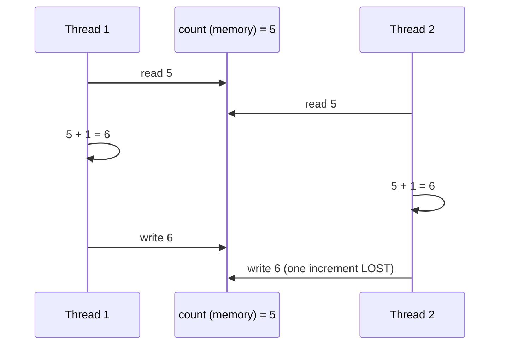
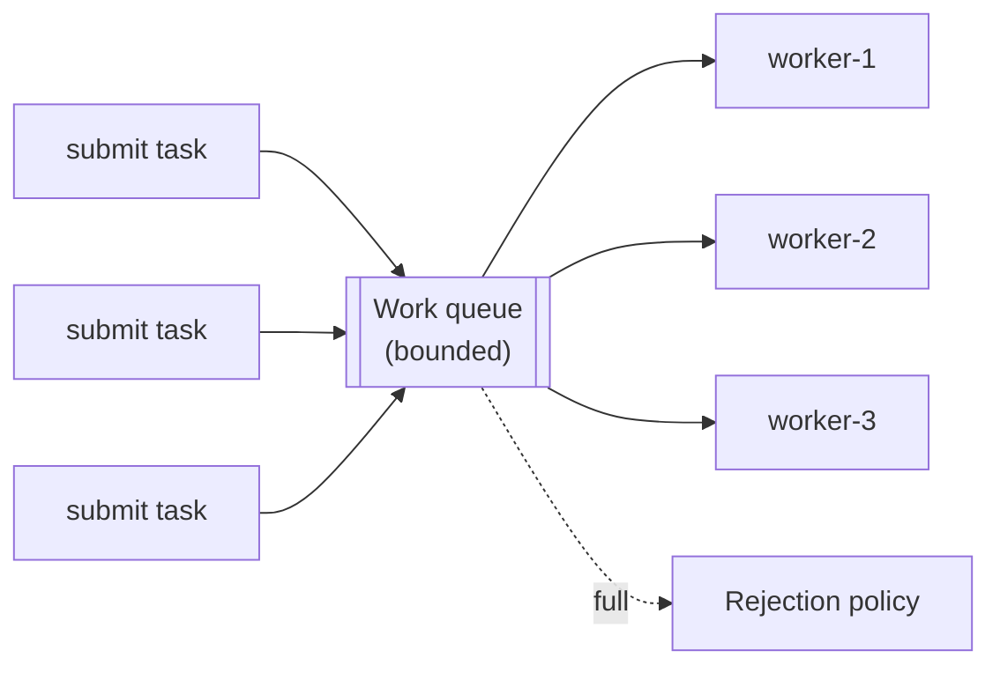
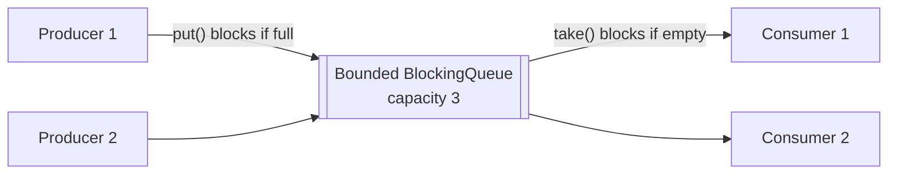
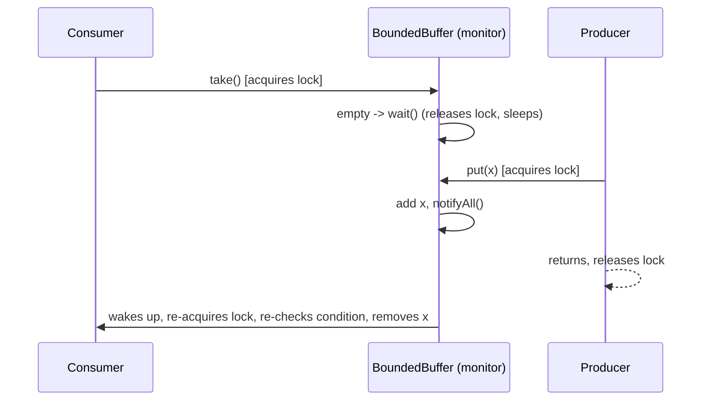
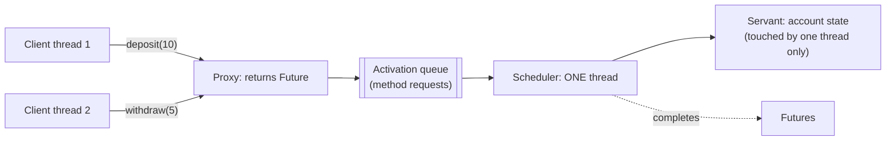
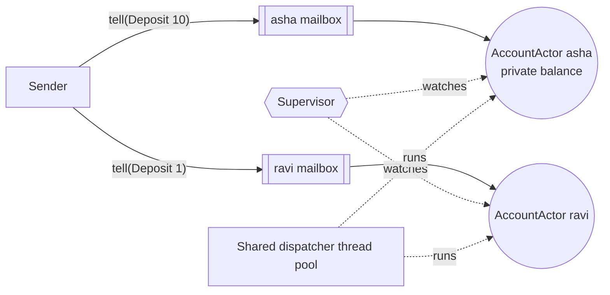
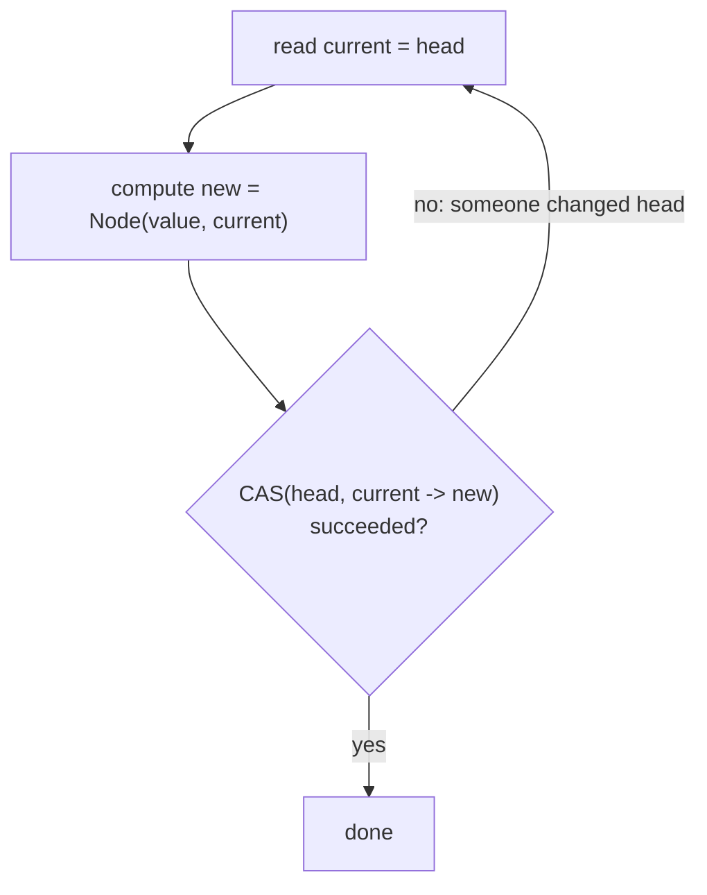
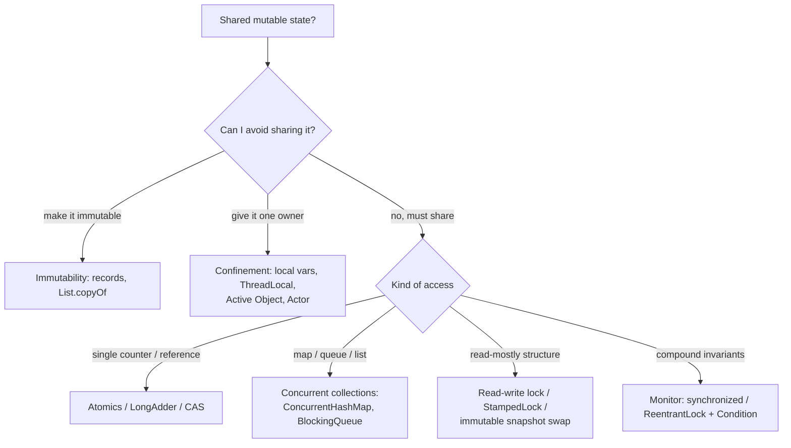

---
mdx:
  format: md
---

# Concurrency Patterns

> **Note**: Patterns marked with **(Interview Imp - Java)** are frequently asked in Java interviews
>
> **How to read this file:** Every section ends with a **📘 Terms Explained** table. If you see a word you don't know, check the table right below that section. Each pattern goes from the basic idea to advanced usage (plain Java, `java.util.concurrent`, Spring Boot, pitfalls) and ends with interview questions and a mini cheat sheet.
>
> **What are concurrency patterns?** They answer one question: *"How do many threads work on shared problems at the same time without corrupting data, deadlocking, or wasting resources?"* This file covers the master list's eight concurrency patterns (Thread Pool, Producer-Consumer, Read-Write Lock, Monitor Object, Active Object, Future/Promise, Actor Model, Lock-Free Data Structures) plus a section of related everyday patterns (immutability, thread confinement, fork/join, guarded suspension, virtual threads).
>
> **Builds on:** the thread and executor **API basics** (creating threads, `synchronized`, `volatile`, executors, concurrent collections, virtual threads) are in [Java_Complete_Guide.md](../../java/Java_Complete_Guide.md#12-multithreading-and-concurrency-interview-imp). This file focuses on the **patterns** and design decisions, and links there rather than repeating it.
>
> **Verified code:** Every main "Complete Java Example" in this file is **plain Java 17** and was compiled and run **three times**; each **Output** block is the real output and was **identical on all three runs**. Thread timing varies between runs, so the examples print only results that don't depend on timing (counts, sums, states controlled with latches and barriers). The one deliberately broken example says so in its output. To run one, save it as `<ClassName>.java` and run `javac <ClassName>.java && java <ClassName>`. (Running it directly with `java <ClassName>.java` won't work, because the class with `main` is not the first class in the file.)

---

## Table of Contents
1. [Thread Pool Pattern](#1-thread-pool-pattern-interview-imp---java) **(Interview Imp - Java)**
   - [1.1 What is a Thread Pool?](#11-what-is-a-thread-pool)
   - [1.2 Why Do We Need It?](#12-why-do-we-need-it)
   - [1.3 How `ThreadPoolExecutor` Works (Interview Imp - Java)](#13-how-threadpoolexecutor-works-interview-imp---java)
   - [1.4 Complete Java Example - Watching a Pool Grow and Reject](#14-complete-java-example---watching-a-pool-grow-and-reject)
   - [1.5 Thread Pools in Spring Boot](#15-thread-pools-in-spring-boot)
   - [1.6 Pros, Cons and Pitfalls](#16-pros-cons-and-pitfalls)
   - [1.7 Thread Pool - Interview Questions](#17-thread-pool---interview-questions)
   - [1.8 Thread Pool - Cheat Sheet](#18-thread-pool---cheat-sheet)
2. [Producer-Consumer Pattern](#2-producer-consumer-pattern-interview-imp---java) **(Interview Imp - Java)**
   - [2.1 What is Producer-Consumer?](#21-what-is-producer-consumer)
   - [2.2 Why Do We Need It?](#22-why-do-we-need-it)
   - [2.3 How It Works](#23-how-it-works)
   - [2.4 Complete Java Example - Bounded Buffer with Poison Pills](#24-complete-java-example---bounded-buffer-with-poison-pills)
   - [2.5 Producer-Consumer in Spring and Libraries](#25-producer-consumer-in-spring-and-libraries)
   - [2.6 Pros, Cons, Pitfalls and Interview Questions](#26-pros-cons-pitfalls-and-interview-questions)
   - [2.7 Producer-Consumer - Cheat Sheet](#27-producer-consumer---cheat-sheet)
   - [2.8 Types and Variants](#28-types-and-variants)
3. [Read-Write Lock Pattern](#3-read-write-lock-pattern-interview-imp---java) **(Interview Imp - Java)**
   - [3.1 What is a Read-Write Lock?](#31-what-is-a-read-write-lock)
   - [3.2 Why Do We Need It?](#32-why-do-we-need-it)
   - [3.3 How It Works in Java: `ReentrantReadWriteLock` and `StampedLock`](#33-how-it-works-in-java-reentrantreadwritelock-and-stampedlock)
   - [3.4 Complete Java Example - Concurrent Readers, Exclusive Writer, Optimistic Reads](#34-complete-java-example---concurrent-readers-exclusive-writer-optimistic-reads)
   - [3.5 Read-Write Locks in Practice](#35-read-write-locks-in-practice)
   - [3.6 Pros, Cons, Pitfalls and Interview Questions](#36-pros-cons-pitfalls-and-interview-questions)
   - [3.7 Read-Write Lock - Cheat Sheet](#37-read-write-lock---cheat-sheet)
   - [3.8 Types and Variants](#38-types-and-variants)
4. [Monitor Object Pattern](#4-monitor-object-pattern-interview-imp---java) **(Interview Imp - Java)**
   - [4.1 What is a Monitor Object?](#41-what-is-a-monitor-object)
   - [4.2 Why Do We Need It?](#42-why-do-we-need-it)
   - [4.3 How It Works: `synchronized` + `wait/notifyAll` vs `Lock` + `Condition`](#43-how-it-works-synchronized--waitnotifyall-vs-lock--condition)
   - [4.4 Complete Java Example - Race Condition, Monitor and Atomic; Hand-Written Bounded Buffer](#44-complete-java-example---race-condition-monitor-and-atomic-hand-written-bounded-buffer)
   - [4.5 Monitors in the JDK and Spring](#45-monitors-in-the-jdk-and-spring)
   - [4.6 Pros, Cons, Pitfalls and Interview Questions](#46-pros-cons-pitfalls-and-interview-questions)
   - [4.7 Monitor Object - Cheat Sheet](#47-monitor-object---cheat-sheet)
5. [Active Object Pattern](#5-active-object-pattern)
   - [5.1 What is an Active Object?](#51-what-is-an-active-object)
   - [5.2 Why Do We Need It?](#52-why-do-we-need-it)
   - [5.3 Complete Java Example - An Account as an Active Object](#53-complete-java-example---an-account-as-an-active-object)
   - [5.4 Active Objects in Practice](#54-active-objects-in-practice)
   - [5.5 Pros, Cons, Pitfalls and Interview Questions](#55-pros-cons-pitfalls-and-interview-questions)
   - [5.6 Active Object - Cheat Sheet](#56-active-object---cheat-sheet)
   - [5.7 Types and Variants](#57-types-and-variants)
6. [Future / Promise Pattern](#6-future--promise-pattern-interview-imp---java) **(Interview Imp - Java)**
   - [6.1 What is a Future / Promise?](#61-what-is-a-future--promise)
   - [6.2 Why Do We Need It?](#62-why-do-we-need-it)
   - [6.3 How It Works: The `CompletableFuture` Toolbox](#63-how-it-works-the-completablefuture-toolbox)
   - [6.4 Complete Java Example - Futures, Promises and Composition](#64-complete-java-example---futures-promises-and-composition)
   - [6.5 Futures and Promises in Spring](#65-futures-and-promises-in-spring)
   - [6.6 Pros, Cons, Pitfalls and Interview Questions](#66-pros-cons-pitfalls-and-interview-questions)
   - [6.7 Future / Promise - Cheat Sheet](#67-future--promise---cheat-sheet)
7. [Actor Model Pattern](#7-actor-model-pattern)
   - [7.1 What is the Actor Model?](#71-what-is-the-actor-model)
   - [7.2 Why Do We Need It?](#72-why-do-we-need-it)
   - [7.3 How It Works](#73-how-it-works)
   - [7.4 Complete Java Example - A Tiny Actor Runtime](#74-complete-java-example---a-tiny-actor-runtime)
   - [7.5 Actors on the JVM](#75-actors-on-the-jvm)
   - [7.6 Pros, Cons, Pitfalls and Interview Questions](#76-pros-cons-pitfalls-and-interview-questions)
   - [7.7 Actor Model - Cheat Sheet](#77-actor-model---cheat-sheet)
8. [Lock-Free Data Structures Pattern](#8-lock-free-data-structures-pattern)
   - [8.1 What Are Lock-Free Data Structures?](#81-what-are-lock-free-data-structures)
   - [8.2 Why Do We Need It?](#82-why-do-we-need-it)
   - [8.3 How It Works: The JDK's Lock-Free Toolbox](#83-how-it-works-the-jdks-lock-free-toolbox)
   - [8.4 Complete Java Example - Treiber Stack, LongAdder and the ABA Problem](#84-complete-java-example---treiber-stack-longadder-and-the-aba-problem)
   - [8.5 Pros, Cons, Pitfalls and Interview Questions](#85-pros-cons-pitfalls-and-interview-questions)
   - [8.6 Lock-Free Data Structures - Cheat Sheet](#86-lock-free-data-structures---cheat-sheet)
   - [8.7 Types and Variants](#87-types-and-variants)
9. [More Everyday Concurrency Patterns](#9-more-everyday-concurrency-patterns)
   - [9.1 Immutability (Interview Imp - Java)](#91-immutability-interview-imp---java)
   - [9.2 Thread Confinement and `ThreadLocal`](#92-thread-confinement-and-threadlocal)
   - [9.3 Fork/Join (Divide and Conquer)](#93-forkjoin-divide-and-conquer)
   - [9.4 Guarded Suspension and Balking](#94-guarded-suspension-and-balking)
   - [9.5 Double-Checked Locking and Safe Publication](#95-double-checked-locking-and-safe-publication)
   - [9.6 Virtual Threads and Thread-per-Request (Java 21+)](#96-virtual-threads-and-thread-per-request-java-21)
   - [9.7 More Patterns - Interview Questions and Cheat Sheet](#97-more-patterns---interview-questions-and-cheat-sheet)
   - [9.8 How They Work, Types and Pros and Cons](#98-how-they-work-types-and-pros-and-cons)
10. [How the Concurrency Patterns Fit Together](#10-how-the-concurrency-patterns-fit-together)
   - [10.1 One-Line Summary of Each](#101-one-line-summary-of-each)
   - [10.2 The Big Picture: Ways to Handle Shared State (Interview Imp - Java)](#102-the-big-picture-ways-to-handle-shared-state-interview-imp---java)
   - [10.3 Decision Guide](#103-decision-guide)
   - [10.4 Look-Alike Patterns](#104-look-alike-patterns)
   - [10.5 Concurrency Inside Spring and the JDK](#105-concurrency-inside-spring-and-the-jdk)
   - [10.6 Comparison Table](#106-comparison-table)
11. [Concurrency Patterns Cheat Sheet](#11-concurrency-patterns-cheat-sheet)

---

## Before You Start: The Three Problems of Shared Memory

When two threads touch the same data, three different things can go wrong:

| Problem | What happens | Example | Fixed by |
|---|---|---|---|
| **Atomicity** | A "single" operation is really several steps, and threads interleave | `count++` = read, add, write: two threads both read 5 and both write 6 | `synchronized`, locks, `AtomicInteger` |
| **Visibility** | One thread's write isn't seen by another (CPU caches, compiler reordering) | A `boolean running = false` set by thread A; thread B loops forever | `volatile`, `synchronized`, locks (they create *happens-before*) |
| **Ordering** | The compiler/CPU reorders instructions | Another thread sees a half-constructed object (broken double-checked locking) | `volatile`, `final` fields, proper publication |



### Happens-before (Java Memory Model) in one table

A write is guaranteed visible to a later read only if a **happens-before** relationship connects them:

| Rule | Meaning |
|---|---|
| Program order | Within one thread, earlier actions happen-before later ones |
| Monitor lock | Unlocking a lock happens-before every later lock of the **same** lock |
| `volatile` | A write to a volatile field happens-before every later read of it |
| Thread start / join | `t.start()` happens-before `t`'s actions; `t`'s actions happen-before `t.join()` returns |
| `final` fields | Values set in a constructor are visible to all threads once the object is safely published |
| Concurrent utilities | e.g. putting into a `BlockingQueue` happens-before taking that element out; completing a `Future` happens-before `get()` returns |

### Liveness problems

| Problem | Meaning | Fix |
|---|---|---|
| **Deadlock** | Threads wait for each other's locks forever (A holds L1 wants L2; B holds L2 wants L1) | Always acquire locks in the **same global order**; `tryLock` with timeout; fewer, coarser locks |
| **Livelock** | Threads keep reacting to each other and make no progress | Randomised back-off |
| **Starvation** | A thread never gets the CPU or lock (e.g. writers behind endless readers) | Fair locks, bounded work, priorities used carefully |

> Deadlock needs all four **Coffman conditions**: mutual exclusion, hold-and-wait, no preemption, circular wait. Break any one (usually circular wait, via lock ordering) and deadlock can't happen. Diagnose with `jstack <pid>` or `ThreadMXBean.findDeadlockedThreads()`.

#### 📘 Terms Explained

| Term | Simple meaning |
|---|---|
| **Thread** | An independent path of execution inside a program, sharing memory with other threads. |
| **Race condition** | The result depends on the unpredictable timing of threads. |
| **Critical section** | Code that accesses shared data and must not run in two threads at once. |
| **Atomic** | Happens as one indivisible step; no other thread can see it half-done. |
| **Visibility** | Whether one thread can see another thread's writes. |
| **Happens-before** | The Java Memory Model's guarantee that one action's effects are visible to another. |
| **`volatile`** | Field modifier guaranteeing visibility and ordering (but not atomicity of `++`). |
| **Deadlock / livelock / starvation** | Stuck forever waiting / busy but making no progress / never getting a turn. |

---

# 1. Thread Pool Pattern (Interview Imp - Java)

## 1.1 What is a Thread Pool?

A **thread pool** keeps a set of **reusable worker threads** and a **queue of tasks**. Instead of creating a new thread for every task, you **submit tasks** to the pool; idle workers pick them up, run them, and go back to waiting for the next one.

**Analogy:** A restaurant kitchen with a fixed team of cooks and an order rail. The restaurant doesn't hire a new cook for each order and fire them afterwards; the same cooks take the next order from the rail. If the rail is full on a busy night, the manager has a rule for what to do (make customers wait, or turn them away).



This is the **Command** pattern (tasks are `Runnable`/`Callable` objects) plus a reusable set of executors. See also [04_Behavioral_Pattern.md](../01_LLD/04_Behavioral_Pattern.md#25-commands-in-modern-java-runnable-callable-lambdas).

#### 📘 Terms Explained

| Term | Simple meaning |
|---|---|
| **Thread pool** | A group of pre-created threads that run submitted tasks. |
| **Worker thread** | A thread in the pool that repeatedly takes and runs tasks. |
| **Work queue** | Where submitted tasks wait until a worker is free. |
| **`ExecutorService`** | Java's interface for submitting tasks to a pool and shutting it down. |
| **Rejection policy** | What the pool does when it can't accept more tasks. |

---

## 1.2 Why Do We Need It?

| Without a pool (thread per task) | With a pool |
|---|---|
| Creating a platform thread costs ~0.5-1 MB of stack and an OS call | Threads are created once and reused |
| 10,000 simultaneous requests → 10,000 threads → memory exhaustion, heavy context switching | Concurrency is **capped**; extra work waits in a queue |
| No control over overload | Bounded queue + rejection policy = **back-pressure** |
| Hard to shut down cleanly | `shutdown()` / `awaitTermination()` |
| No metrics | Pool size, active count, queue size, completed tasks |

---

## 1.3 How `ThreadPoolExecutor` Works (Interview Imp - Java)

```java
new ThreadPoolExecutor(
    corePoolSize,      // threads kept even when idle
    maximumPoolSize,   // upper limit on threads
    keepAliveTime, unit,   // idle time before threads above core are removed
    workQueue,         // where tasks wait
    threadFactory,     // names, daemon flag, priority
    rejectedHandler);  // what to do when full
```

**What happens on `execute(task)`, in this exact order:**

1. Fewer than `corePoolSize` threads? → **start a new thread** for it (even if others are idle).
2. Otherwise → **put it in the queue**.
3. Queue full and fewer than `maximumPoolSize` threads? → **start a new (non-core) thread**.
4. Queue full and at max threads → **reject** it using the rejection policy.

> **The classic trap:** with an **unbounded** queue (`LinkedBlockingQueue()`), step 2 never fails, so the pool **never grows beyond core size** and the queue can grow until `OutOfMemoryError`.

| Rejection policy | Behaviour |
|---|---|
| `AbortPolicy` (default) | Throws `RejectedExecutionException` |
| `CallerRunsPolicy` | The submitting thread runs the task itself, which naturally **slows the producer** (back-pressure) |
| `DiscardPolicy` | Silently drops the task (dangerous) |
| `DiscardOldestPolicy` | Drops the oldest queued task and retries |

### The `Executors` factory methods and their traps

| Factory | Threads | Queue | Risk |
|---|---|---|---|
| `newFixedThreadPool(n)` | n | **Unbounded** `LinkedBlockingQueue` | Queue grows without limit → OOM |
| `newCachedThreadPool()` | 0 … **unlimited** | `SynchronousQueue` (no storage) | Thread explosion under load |
| `newSingleThreadExecutor()` | 1 | Unbounded | Same queue risk |
| `newScheduledThreadPool(n)` | n | Delay queue (unbounded) | Same queue risk |
| `newWorkStealingPool()` | ForkJoinPool | Per-worker deques | Fine for CPU-bound fork/join work |
| `newVirtualThreadPerTaskExecutor()` (Java 21) | One **virtual** thread per task | n/a | Limit access to scarce resources with a `Semaphore` |

> **Production rule:** create pools with `new ThreadPoolExecutor(...)` (or Spring's `ThreadPoolTaskExecutor`) with a **bounded queue**, **named threads** and an explicit **rejection policy**.

### Sizing a pool

| Workload | Rule of thumb |
|---|---|
| **CPU-bound** (calculations) | `≈ number of cores + 1` |
| **I/O-bound** (DB, HTTP calls) | `≈ cores × (1 + wait time / compute time)` |
| Bound by a downstream limit | No more threads than the DB pool / partner's rate limit allows |

Then **measure** and adjust (Little's Law: concurrency ≈ arrival rate × time per task, see [02_Reliability_Pattern.md](02_Reliability_Pattern.md#4-bulkhead-pattern-interview-imp---java)).

---

## 1.4 Complete Java Example - Watching a Pool Grow and Reject

```java
import java.util.concurrent.ArrayBlockingQueue;
import java.util.concurrent.CountDownLatch;
import java.util.concurrent.RejectedExecutionException;
import java.util.concurrent.ThreadFactory;
import java.util.concurrent.ThreadPoolExecutor;
import java.util.concurrent.TimeUnit;
import java.util.concurrent.atomic.AtomicInteger;

public class ThreadPoolDemo {
    public static void main(String[] args) throws Exception {
        CountDownLatch release = new CountDownLatch(1);           // keeps tasks busy so we can watch the pool fill up
        AtomicInteger n = new AtomicInteger();
        ThreadFactory named = r -> new Thread(r, "order-worker-" + n.incrementAndGet());

        ThreadPoolExecutor pool = new ThreadPoolExecutor(
                2,                                  // corePoolSize
                4,                                  // maximumPoolSize
                30, TimeUnit.SECONDS,               // keepAlive for threads above core
                new ArrayBlockingQueue<>(2),        // BOUNDED work queue
                named,
                new ThreadPoolExecutor.AbortPolicy());   // reject when threads AND queue are full

        System.out.println("core=2, max=4, queue=2. Submitting 8 long tasks:");
        for (int i = 1; i <= 8; i++) {
            int id = i;
            try {
                pool.execute(() -> { try { release.await(); } catch (InterruptedException e) { Thread.currentThread().interrupt(); } });
                System.out.printf("  task %d accepted -> threads=%d, queued=%d%n", id, pool.getPoolSize(), pool.getQueue().size());
            } catch (RejectedExecutionException e) {
                System.out.printf("  task %d REJECTED (4 threads busy + queue full)%n", id);
            }
        }
        System.out.println("Order of growth: fill core threads -> fill the queue -> add threads up to max -> reject.");

        release.countDown();
        pool.shutdown();
        System.out.println("shutdown requested; terminated cleanly = " + pool.awaitTermination(5, TimeUnit.SECONDS)
                + ", completed tasks = " + pool.getCompletedTaskCount());

        int cpus = 8;
        double waitMs = 90, computeMs = 10;
        System.out.printf("Sizing for %d CPUs: CPU-bound ~ %d threads; IO-bound (wait %.0fms / compute %.0fms) ~ %d threads%n",
                cpus, cpus + 1, waitMs, computeMs, (int) (cpus * (1 + waitMs / computeMs)));
    }
}
```

**Output:**
```
core=2, max=4, queue=2. Submitting 8 long tasks:
  task 1 accepted -> threads=1, queued=0
  task 2 accepted -> threads=2, queued=0
  task 3 accepted -> threads=2, queued=1
  task 4 accepted -> threads=2, queued=2
  task 5 accepted -> threads=3, queued=2
  task 6 accepted -> threads=4, queued=2
  task 7 REJECTED (4 threads busy + queue full)
  task 8 REJECTED (4 threads busy + queue full)
Order of growth: fill core threads -> fill the queue -> add threads up to max -> reject.
shutdown requested; terminated cleanly = true, completed tasks = 6
Sizing for 8 CPUs: CPU-bound ~ 9 threads; IO-bound (wait 90ms / compute 10ms) ~ 80 threads
```

What the output shows:
- Tasks 1-2 started **core threads**. Tasks 3-4 went into the **queue**: no new threads yet, even though max is 4.
- Only when the queue was **full** did tasks 5-6 start **extra threads** up to the max of 4.
- Tasks 7-8 were **rejected**: 4 busy threads + a full queue.
- After releasing the tasks, `shutdown()` + `awaitTermination()` stopped the pool cleanly, having completed the 6 accepted tasks.

---

## 1.5 Thread Pools in Spring Boot

```yaml
# The auto-configured executor used by @Async, Spring MVC async requests, etc.
spring:
  task:
    execution:
      pool:
        core-size: 8
        max-size: 32
        queue-capacity: 500          # default is unbounded -> set it!
        keep-alive: 60s
      thread-name-prefix: app-async-
      shutdown:
        await-termination: true
        await-termination-period: 30s
  threads:
    virtual:
      enabled: true                  # Spring Boot 3.2+ on Java 21: Tomcat + @Async use virtual threads
```

```java
@Configuration
@EnableAsync
class ExecutorConfig {
    @Bean("reportExecutor")                                  // a SEPARATE pool for slow report jobs (bulkhead)
    ThreadPoolTaskExecutor reportExecutor() {
        ThreadPoolTaskExecutor ex = new ThreadPoolTaskExecutor();
        ex.setCorePoolSize(4);
        ex.setMaxPoolSize(8);
        ex.setQueueCapacity(100);
        ex.setThreadNamePrefix("report-");
        ex.setRejectedExecutionHandler(new ThreadPoolExecutor.CallerRunsPolicy());
        ex.setWaitForTasksToCompleteOnShutdown(true);
        ex.setAwaitTerminationSeconds(30);
        return ex;
    }
}

@Service
class ReportService {
    @Async("reportExecutor")
    public CompletableFuture<Report> build(long id) { return CompletableFuture.completedFuture(generate(id)); }
}
```

> `@Async` is proxy-based: calling it from the same class runs synchronously (see [03_Structural_Pattern.md](../01_LLD/03_Structural_Pattern.md#76-proxy-in-spring-boot-aop-transactional-self-invocation-interview-imp---java)). Exceptions in `void` `@Async` methods are lost unless you configure an `AsyncUncaughtExceptionHandler`.

### Virtual threads change the sizing story

With **virtual threads** (Java 21+), threads are cheap (a few KB), so you **don't pool them**: you create one per task. You still limit access to **scarce resources** (DB connections, partner API calls) with a `Semaphore` or the resource's own pool. See [Java_Complete_Guide.md](../../java/Java_Complete_Guide.md#128-virtual-threads-and-structured-concurrency-java-21-interview-imp).

#### 📘 Terms Explained

| Term | Simple meaning |
|---|---|
| **`corePoolSize` / `maximumPoolSize`** | Threads kept alive normally / upper limit when the queue is full. |
| **Bounded queue** | A queue with a maximum size, e.g. `ArrayBlockingQueue(100)`. |
| **`ThreadFactory`** | Creates the pool's threads (lets you name them, which helps debugging). |
| **`ThreadPoolTaskExecutor`** | Spring's configurable wrapper around `ThreadPoolExecutor`. |
| **Virtual thread** | A lightweight thread managed by the JVM (Java 21+); millions can exist. |
| **Context switch** | The CPU saving one thread's state and loading another's; expensive when there are too many threads. |

---

## 1.6 Pros, Cons and Pitfalls

| Pros | Cons |
|---|---|
| Reuses threads; avoids creation cost | Wrong sizing → idle CPUs or overload |
| Caps concurrency; protects the system | Shared pools let one slow task type starve others |
| Built-in queueing, back-pressure and shutdown | Tasks must not block forever (pool exhaustion) |

| Pitfall | Fix |
|---|---|
| `Executors.newFixedThreadPool` / `newCachedThreadPool` in servers | `ThreadPoolExecutor` with bounded queue + rejection policy. |
| One shared pool for everything | Separate pools per kind of work (bulkheads). |
| Never calling `shutdown()` | Shut down on application stop (Spring does for its beans). |
| Swallowed exceptions in `execute()` tasks / `void @Async` | Use `submit()` and check the `Future`, or set an uncaught exception handler. |
| Tasks waiting on other tasks in the **same** bounded pool | Thread-starvation deadlock: use separate pools or async composition. |
| `ThreadLocal` values leaking between tasks on reused threads | Always `remove()` in `finally` (section 9). |
| Pooling virtual threads | Don't; use `newVirtualThreadPerTaskExecutor()` and limit resources with semaphores. |

---

## 1.7 Thread Pool - Interview Questions

**Q1. Why use a thread pool instead of `new Thread()` per task?**
Thread creation is expensive and unbounded threads exhaust memory and CPU. A pool reuses threads, caps concurrency, queues extra work, and supports clean shutdown and monitoring.

**Q2. Explain how `ThreadPoolExecutor` handles a new task.**
Below core size: new thread. Otherwise: queue it. Queue full and below max: new thread. Queue full at max: reject via the handler.

**Q3. Why is `Executors.newFixedThreadPool` dangerous in production?**
It uses an unbounded `LinkedBlockingQueue`: under overload the queue grows until `OutOfMemoryError`, and the pool never grows beyond n threads.

**Q4. What rejection policies exist? Which gives back-pressure?**
Abort (exception), CallerRuns (submitter runs it: natural back-pressure), Discard, DiscardOldest.

**Q5. How do you size a thread pool?**
CPU-bound: about cores + 1. I/O-bound: cores × (1 + wait/compute). Cap by downstream limits (DB pool size), then load-test and tune.

**Q6. `execute()` vs `submit()`?**
`execute(Runnable)` returns nothing; exceptions go to the uncaught handler. `submit()` returns a `Future`; exceptions are captured and rethrown from `get()`.

**Q7. How do virtual threads change things?**
Threads become cheap, so you create one per task instead of pooling; blocking code scales. You still limit concurrency to scarce resources with semaphores, and avoid long `synchronized` blocks around blocking calls on older JDKs (pinning).

---

## 1.8 Thread Pool - Cheat Sheet

```
THREAD POOL  Reusable workers + task queue (Command pattern). Caps concurrency; back-pressure; clean shutdown.
          ThreadPoolExecutor order: <core -> new thread | else queue | queue full & <max -> new thread | else REJECT.
          Unbounded queue => never grows past core, OOM risk. Executors.newFixed/Cached = traps in servers.
          Policies: Abort (default), CallerRuns (back-pressure), Discard, DiscardOldest.
          Size: CPU-bound cores+1; IO-bound cores*(1+wait/compute); cap by downstream limits; measure.
          Spring: spring.task.execution.pool.* (set queue-capacity!), ThreadPoolTaskExecutor beans per workload, @Async(name).
          Java 21: virtual thread per task, don't pool them, limit resources with Semaphore.
```

---

# 2. Producer-Consumer Pattern (Interview Imp - Java)

## 2.1 What is Producer-Consumer?

**Producers** create work items and put them into a **shared buffer (queue)**; **consumers** take items out and process them. The buffer **decouples** the two sides: they run at different speeds, and neither needs to know about the other.

**Analogy:** A bakery. Bakers (producers) put fresh bread on a shelf; shop assistants (consumers) take bread from the shelf for customers. If the shelf is full, bakers wait before baking more; if it's empty, assistants wait for the next batch.



It's the in-JVM version of a **message queue** ([04_Messaging_Pattern.md](04_Messaging_Pattern.md#1-message-queue-pattern-interview-imp---java)).

#### 📘 Terms Explained

| Term | Simple meaning |
|---|---|
| **Producer** | A thread that creates work items. |
| **Consumer** | A thread that processes work items. |
| **Buffer** | The shared queue between them. |
| **`BlockingQueue`** | A thread-safe queue whose `put` waits when full and `take` waits when empty. |
| **Back-pressure** | A slow consumer automatically slowing down fast producers. |
| **Poison pill** | A special item that tells a consumer to stop. |

---

## 2.2 Why Do We Need It?

- **Different speeds:** a file reader produces 10,000 lines/s; a database writer can only insert 2,000/s. The buffer absorbs bursts.
- **Parallelism:** many consumers process items in parallel.
- **Decoupling:** producers don't wait for each item to be processed.
- **Back-pressure:** a **bounded** buffer makes producers wait when consumers fall behind, instead of running out of memory.

Real examples: thread pools (submitters → workers), logging frameworks (app threads → async appender thread), Kafka consumer → processing pool, batch import pipelines, Spring Batch reader → writer.

---

## 2.3 How It Works

| `BlockingQueue` method | When full / empty |
|---|---|
| `put(e)` / `take()` | **Block** until space / an item is available |
| `offer(e)` / `poll()` | Return `false` / `null` immediately |
| `offer(e, timeout, unit)` / `poll(timeout, unit)` | Wait up to the timeout |
| `add(e)` / `remove()` | Throw an exception |

| Implementation | Notes |
|---|---|
| `ArrayBlockingQueue` | Bounded, array-based, optional fairness; good default |
| `LinkedBlockingQueue` | Optionally bounded (**unbounded by default!**), separate locks for put/take |
| `SynchronousQueue` | No capacity: each put waits for a take (direct hand-off) |
| `PriorityBlockingQueue` | Unbounded, ordered by priority |
| `DelayQueue` | Items become available after a delay |
| `LinkedTransferQueue` | Producers can wait until a consumer receives the item |

**Stopping consumers cleanly:** send one **poison pill** per consumer, or interrupt the consumer threads and handle `InterruptedException`, or use `poll(timeout)` with a "done" flag.

---

## 2.4 Complete Java Example - Bounded Buffer with Poison Pills

```java
import java.util.ArrayList;
import java.util.List;
import java.util.concurrent.ArrayBlockingQueue;
import java.util.concurrent.BlockingQueue;
import java.util.concurrent.ExecutorService;
import java.util.concurrent.Executors;
import java.util.concurrent.TimeUnit;
import java.util.concurrent.atomic.AtomicInteger;
import java.util.concurrent.atomic.AtomicLong;

record OrderJob(int id, long amountPaise) {
    static final OrderJob POISON_PILL = new OrderJob(-1, 0);      // special message meaning "no more work"
}

public class ProducerConsumerDemo {
    public static void main(String[] args) throws Exception {
        BlockingQueue<OrderJob> queue = new ArrayBlockingQueue<>(3);  // BOUNDED buffer -> back-pressure on producers
        int consumers = 2;
        AtomicInteger processed = new AtomicInteger();
        AtomicLong total = new AtomicLong();
        AtomicInteger maxDepthSeen = new AtomicInteger();
        List<String> stoppedBy = new ArrayList<>();

        ExecutorService pool = Executors.newFixedThreadPool(3);

        // ---- Producer: put() BLOCKS when the queue is full ----
        pool.submit(() -> {
            for (int i = 1; i <= 20; i++) {
                queue.put(new OrderJob(i, i * 10_000L));
                maxDepthSeen.accumulateAndGet(queue.size(), Math::max);
            }
            for (int c = 0; c < consumers; c++) queue.put(OrderJob.POISON_PILL);   // one pill per consumer
            return null;
        });

        // ---- Consumers: take() BLOCKS when the queue is empty ----
        for (int c = 1; c <= consumers; c++) {
            String name = "consumer-" + c;
            pool.submit(() -> {
                while (true) {
                    OrderJob job = queue.take();
                    if (job == OrderJob.POISON_PILL) {
                        synchronized (stoppedBy) { stoppedBy.add(name); }
                        return null;
                    }
                    Thread.sleep(2);                                   // pretend to process
                    processed.incrementAndGet();
                    total.addAndGet(job.amountPaise());
                }
            });
        }

        pool.shutdown();
        pool.awaitTermination(10, TimeUnit.SECONDS);
        System.out.println("orders processed     : " + processed.get());
        System.out.println("total amount         : Rs." + total.get() / 100 + " (expected Rs." + (210 * 10_000L) / 100 + ")");
        System.out.println("queue never exceeded : " + (maxDepthSeen.get() <= 3) + " (capacity 3 -> producer was slowed down)");
        System.out.println("consumers stopped    : " + stoppedBy.size() + " of " + consumers + " via poison pill");
        System.out.println("queue empty at end   : " + queue.isEmpty());
    }
}
```

**Output:**
```
orders processed     : 20
total amount         : Rs.21000 (expected Rs.21000)
queue never exceeded : true (capacity 3 -> producer was slowed down)
consumers stopped    : 2 of 2 via poison pill
queue empty at end   : true
```

What the output shows:
- All 20 orders were processed exactly once (the total matches), with no locks in our code: `BlockingQueue` handles the synchronisation.
- The queue never held more than **3** items: when it was full, `put()` **blocked** the producer until a consumer made space. That's back-pressure.
- Each consumer received one **poison pill** and stopped; the queue ended empty.

---

## 2.5 Producer-Consumer in Spring and Libraries

| Where | Producer-Consumer |
|---|---|
| `ThreadPoolExecutor` | Callers produce tasks into the work queue; workers consume |
| Logback `AsyncAppender` | App threads produce log events into a bounded queue; one thread writes them |
| Spring Batch | `ItemReader` (produce) → `ItemProcessor` → `ItemWriter` (consume), chunked |
| Spring Kafka | The listener container consumes records; you can hand off to a bounded executor |
| Project Reactor | `Flux` with `onBackpressureBuffer(n)`, `limitRate(n)` |
| **LMAX Disruptor** | A lock-free ring buffer for very high-throughput producer-consumer |

```java
// Hand-off from a Kafka listener to a bounded processing pool with back-pressure
private final ThreadPoolExecutor workers = new ThreadPoolExecutor(8, 8, 0, TimeUnit.SECONDS,
        new ArrayBlockingQueue<>(200), new ThreadPoolExecutor.CallerRunsPolicy());

@KafkaListener(topics = "images", groupId = "thumbnailer")
void on(ImageUploaded e) {
    workers.execute(() -> thumbnails.create(e));     // when the queue is full, the listener thread runs it -> polling slows down
}
```

> **Careful with offset commits:** if the listener returns before the work is done, Kafka may commit the offset for an unprocessed record. Commit only after processing (manual acks), or keep processing on the listener thread.

#### 📘 Terms Explained

| Term | Simple meaning |
|---|---|
| **`ArrayBlockingQueue`** | Fixed-capacity blocking queue backed by an array. |
| **`SynchronousQueue`** | A queue with no storage: hand-off from one thread directly to another. |
| **`AsyncAppender`** | Logback appender that queues log events and writes them on a background thread. |
| **Ring buffer** | A fixed-size circular array reused for a stream of items (used by the Disruptor). |

---

## 2.6 Pros, Cons, Pitfalls and Interview Questions

| Pros | Cons |
|---|---|
| Decouples speeds; smooths bursts | Extra latency while items wait |
| Easy parallelism with many consumers | Ordering is lost with multiple consumers |
| Bounded buffer = built-in back-pressure | Shutdown and error handling need care |

| Pitfall | Fix |
|---|---|
| Unbounded queue (`new LinkedBlockingQueue<>()`) | Always give a capacity. |
| Consumers never stop (no shutdown signal) | Poison pills, interrupts, or timeouts. |
| Swallowing `InterruptedException` | Restore the flag: `Thread.currentThread().interrupt()` and exit. |
| Busy-waiting with `poll()` in a loop | Use blocking `take()` or `poll(timeout)`. |
| Losing items on shutdown | Drain the queue (`drainTo`) or persist items before stopping. |

**Q1. Implement producer-consumer in Java.** Use a bounded `BlockingQueue` (e.g. `ArrayBlockingQueue`): producers call `put`, consumers call `take`; stop consumers with poison pills or interrupts. (Or implement a bounded buffer with `wait/notifyAll`: see section 4.)

**Q2. Why a bounded queue?** It provides back-pressure: producers block when consumers fall behind, preventing unbounded memory growth.

**Q3. `put/take` vs `offer/poll`?** `put/take` block; `offer/poll` return immediately (or after a timeout) with a failure value.

**Q4. How do you shut consumers down gracefully?** Send one poison pill per consumer after the last real item, or interrupt them and handle `InterruptedException`, then drain or persist remaining items.

---

## 2.7 Producer-Consumer - Cheat Sheet

```
PRODUCER-CONSUMER  Producers put -> shared BOUNDED buffer -> consumers take. Decouples speeds, parallelism, back-pressure.
          BlockingQueue: put/take block; offer/poll return; timeouts. ArrayBlockingQueue (bounded), LinkedBlockingQueue
          (UNBOUNDED by default), SynchronousQueue (hand-off), PriorityBlockingQueue, DelayQueue.
          Stop: poison pill per consumer / interrupt. Never swallow InterruptedException.
          Seen in: ThreadPoolExecutor, Logback AsyncAppender, Spring Batch, Reactor back-pressure, LMAX Disruptor.
```

---

## 2.8 Types and Variants

| Variant | Buffer | Java |
|---|---|---|
| **Bounded blocking queue** | Fixed capacity; producers block when full (backpressure) | `ArrayBlockingQueue`, `LinkedBlockingQueue(capacity)` |
| **Unbounded queue** | Grows without limit (risk of OOM) | `LinkedBlockingQueue()`, `ConcurrentLinkedQueue` |
| **Hand-off (no buffer)** | Producer waits for a consumer | `SynchronousQueue` (used by `newCachedThreadPool`) |
| **Priority queue** | Consumers take the most important item first | `PriorityBlockingQueue` |
| **Delay queue** | Items become available after a delay | `DelayQueue` (scheduled retries) |
| **Ring buffer** | Pre-allocated, lock-free, very fast | LMAX Disruptor |
| **Distributed** | Producers and consumers in different processes | Kafka, RabbitMQ, SQS ([04_Messaging_Pattern.md](04_Messaging_Pattern.md)) |
| **Reactive streams** | Consumer signals demand (`request(n)`) | Project Reactor, `java.util.concurrent.Flow` |

# 3. Read-Write Lock Pattern (Interview Imp - Java)

## 3.1 What is a Read-Write Lock?

A **read-write lock** has two modes: a **read lock** that **many threads can hold at the same time**, and a **write lock** that only **one thread** can hold, with **no readers** active. It speeds up data that is **read often and written rarely**.

**Analogy:** A museum exhibit. Any number of visitors can look at a painting at once (readers). When the restorer needs to work on it (writer), the room is closed: visitors leave, the restorer works alone, then the room reopens.

| | Read lock held by others | Write lock held by another |
|---|---|---|
| **Want read lock** | ✅ Granted (shared) | ⏳ Wait |
| **Want write lock** | ⏳ Wait for all readers to leave | ⏳ Wait |

#### 📘 Terms Explained

| Term | Simple meaning |
|---|---|
| **Read lock (shared lock)** | Many holders allowed at once; no writers. |
| **Write lock (exclusive lock)** | One holder; no readers or other writers. |
| **Read-mostly data** | Data read far more often than it changes (config, caches, reference data). |
| **Lock downgrade** | Going from write lock to read lock without letting another writer in between. |

---

## 3.2 Why Do We Need It?

With a normal lock (`synchronized`, `ReentrantLock`), readers **block each other** even though reading doesn't change anything. For read-heavy data (configuration, routing tables, in-memory caches, price lists), that wastes parallelism. A read-write lock lets all readers proceed together and only serialises around writes.

> **Only worth it when** reads are much more frequent than writes **and** the critical section isn't tiny. For tiny critical sections, the extra bookkeeping can make a read-write lock **slower** than a plain lock. Often a `ConcurrentHashMap`, an immutable snapshot swapped atomically (`volatile` reference / copy-on-write), or `StampedLock` optimistic reads are better.

---

## 3.3 How It Works in Java: `ReentrantReadWriteLock` and `StampedLock`

| | `ReentrantReadWriteLock` | `StampedLock` (Java 8) |
|---|---|---|
| Modes | Read, write | Read, write, **optimistic read** |
| Reentrant | Yes | **No** (a thread re-locking itself deadlocks) |
| Optimistic reads | No | `tryOptimisticRead()` + `validate(stamp)`: no locking for the common case |
| Conditions | Write lock supports `Condition` | No |
| Fairness option | Yes (`new ReentrantReadWriteLock(true)`) | No |
| Best for | General read-mostly data | Very hot, tiny reads (coordinates, counters) |

**Rules for `ReentrantReadWriteLock`:**
- **Downgrade is allowed:** hold write → acquire read → release write.
- **Upgrade is NOT allowed:** holding read and asking for write **deadlocks** (the write waits for all readers, including you).
- In non-fair mode, a stream of readers can **starve** writers; use fair mode if writes must not wait long.

---

## 3.4 Complete Java Example - Concurrent Readers, Exclusive Writer, Optimistic Reads

```java
import java.util.HashMap;
import java.util.Map;
import java.util.concurrent.CountDownLatch;
import java.util.concurrent.CyclicBarrier;
import java.util.concurrent.ExecutorService;
import java.util.concurrent.Executors;
import java.util.concurrent.TimeUnit;
import java.util.concurrent.atomic.AtomicInteger;
import java.util.concurrent.locks.ReentrantReadWriteLock;
import java.util.concurrent.locks.StampedLock;

// A read-mostly config store: many readers at once, writers exclusive
class ConfigStore {
    private final Map<String, String> config = new HashMap<>(Map.of("payment.timeout", "2s"));
    private final ReentrantReadWriteLock rw = new ReentrantReadWriteLock();
    final AtomicInteger activeReaders = new AtomicInteger();
    final AtomicInteger maxConcurrentReaders = new AtomicInteger();
    volatile int readersSeenDuringWrite = -1;

    String get(String key, CyclicBarrier allReadersInside) throws Exception {
        rw.readLock().lock();
        try {
            maxConcurrentReaders.accumulateAndGet(activeReaders.incrementAndGet(), Math::max);
            allReadersInside.await(2, TimeUnit.SECONDS);                // proves they hold the read lock TOGETHER
            return config.get(key);
        } finally {
            activeReaders.decrementAndGet();
            rw.readLock().unlock();
        }
    }

    void put(String key, String value) {
        rw.writeLock().lock();                                         // waits until all readers are out
        try {
            readersSeenDuringWrite = activeReaders.get();
            config.put(key, value);
        } finally {
            rw.writeLock().unlock();
        }
    }

    String plainGet(String key) {
        rw.readLock().lock();
        try { return config.get(key); } finally { rw.readLock().unlock(); }
    }
}

// StampedLock optimistic read: no locking at all for the common case
class Point {
    private double x, y;
    private final StampedLock sl = new StampedLock();

    void move(double dx, double dy) {
        long stamp = sl.writeLock();
        try { x += dx; y += dy; } finally { sl.unlockWrite(stamp); }
    }

    double distanceFromOrigin(Runnable somethingHappensDuringRead) {
        long stamp = sl.tryOptimisticRead();                           // not a lock: just a version number
        double cx = x, cy = y;
        somethingHappensDuringRead.run();
        if (!sl.validate(stamp)) {                                     // a write happened in between -> data may be torn
            System.out.println("   optimistic read invalidated by a write -> retry with a real read lock");
            stamp = sl.readLock();
            try { cx = x; cy = y; } finally { sl.unlockRead(stamp); }
        } else {
            System.out.println("   optimistic read valid -> no lock was ever taken");
        }
        return Math.sqrt(cx * cx + cy * cy);
    }
}

public class ReadWriteLockDemo {
    public static void main(String[] args) throws Exception {
        ConfigStore store = new ConfigStore();
        int readers = 4;
        CyclicBarrier barrier = new CyclicBarrier(readers);
        ExecutorService pool = Executors.newFixedThreadPool(readers + 1);
        CountDownLatch done = new CountDownLatch(readers);

        for (int i = 0; i < readers; i++) {
            pool.submit(() -> { try { store.get("payment.timeout", barrier); } catch (Exception e) { throw new RuntimeException(e); } finally { done.countDown(); } });
        }
        done.await();
        pool.submit(() -> store.put("payment.timeout", "3s")).get();
        pool.shutdown();

        System.out.println("ReentrantReadWriteLock:");
        System.out.println("   max readers holding the lock at the same time = " + store.maxConcurrentReaders.get());
        System.out.println("   readers active while the writer held the lock = " + store.readersSeenDuringWrite);
        System.out.println("   value after write = " + store.plainGet("payment.timeout"));

        System.out.println("StampedLock:");
        Point p = new Point();
        p.move(3, 4);
        System.out.println("   distance = " + p.distanceFromOrigin(() -> { }));
        System.out.println("   distance = " + p.distanceFromOrigin(() -> p.move(3, 4)));
    }
}
```

**Output:**
```
ReentrantReadWriteLock:
   max readers holding the lock at the same time = 4
   readers active while the writer held the lock = 0
   value after write = 3s
StampedLock:
   optimistic read valid -> no lock was ever taken
   distance = 5.0
   optimistic read invalidated by a write -> retry with a real read lock
   distance = 10.0
```

What the output shows:
- **4 readers** held the read lock **at the same moment** (the `CyclicBarrier` would have timed out otherwise): reads don't block each other.
- When the writer held the write lock, **0 readers** were active: writes are exclusive.
- **StampedLock:** the first optimistic read took **no lock at all** and was still valid. In the second, a write happened during the read, so `validate()` failed and the code **retried under a real read lock**, getting the correct new value.

---

## 3.5 Read-Write Locks in Practice

```java
// Swap-a-snapshot alternative: often simpler and faster than a read-write lock for config
class RoutingTable {
    private volatile Map<String, String> routes = Map.of();          // immutable snapshot

    String route(String path) { return routes.get(path); }            // lock-free read

    synchronized void reload(Map<String, String> newRoutes) {         // rare writes
        routes = Map.copyOf(newRoutes);                               // publish a new immutable map atomically
    }
}
```

| Option | When |
|---|---|
| `ReentrantReadWriteLock` | Read-mostly mutable structure, non-trivial reads |
| `StampedLock` optimistic read | Very hot reads of a few fields |
| Immutable snapshot + `volatile` swap | Config/routing tables reloaded occasionally |
| `ConcurrentHashMap` | Key-value data with concurrent reads and writes |
| `CopyOnWriteArrayList` | Small lists, many reads, rare writes (listeners) |
| Distributed equivalent | Redisson `RReadWriteLock`, ZooKeeper read/write lock recipe |

#### 📘 Terms Explained

| Term | Simple meaning |
|---|---|
| **`ReentrantReadWriteLock`** | Java's standard read-write lock; the same thread can re-acquire locks it holds. |
| **`StampedLock`** | Java 8 lock with read, write and optimistic read modes, using "stamps". |
| **Optimistic read** | Read without locking, then check (validate) that no write happened meanwhile. |
| **Writer starvation** | Writers waiting forever because readers keep holding the read lock. |
| **`CyclicBarrier`** | Makes a set of threads wait until all of them reach the same point. |

---

## 3.6 Pros, Cons, Pitfalls and Interview Questions

| Pros | Cons |
|---|---|
| Parallel reads for read-heavy data | More overhead than a simple lock for short sections |
| Writes remain safe and exclusive | Writer starvation in non-fair mode |
| `StampedLock` optimistic reads avoid locking entirely | Upgrade deadlocks; `StampedLock` isn't reentrant |

| Pitfall | Fix |
|---|---|
| Trying to upgrade read → write | Release read, acquire write, **re-check** state. |
| Unlocking outside `finally` | Always `lock(); try { ... } finally { unlock(); }`. |
| Using it for write-heavy data | Plain lock or concurrent collections. |
| Re-entering a `StampedLock` | Don't; it's not reentrant. |

**Q1. When would you use a read-write lock?** For data that's read far more often than written, with reads long enough that letting them run in parallel matters (config, caches, reference tables).

**Q2. Can you upgrade a read lock to a write lock in `ReentrantReadWriteLock`?** No: it deadlocks. You can downgrade (write → read).

**Q3. What is `StampedLock`'s optimistic read?** `tryOptimisticRead()` returns a stamp without locking; after reading, `validate(stamp)` tells you whether a write happened; if so, retry with a real read lock.

**Q4. What simpler alternatives exist?** Immutable snapshots swapped via a `volatile` reference, `ConcurrentHashMap`, `CopyOnWriteArrayList`.

---

## 3.7 Read-Write Lock - Cheat Sheet

```
READ-WRITE LOCK  Many readers OR one writer. For read-mostly data with non-trivial reads.
          ReentrantReadWriteLock: reentrant, fair option, downgrade OK (write->read), UPGRADE DEADLOCKS, writer starvation (non-fair).
          StampedLock: optimistic read (tryOptimisticRead + validate -> fallback readLock), not reentrant.
          Alternatives: immutable snapshot + volatile swap, ConcurrentHashMap, CopyOnWriteArrayList.
          Always unlock in finally.
```

---

## 3.8 Types and Variants

| Variant | Behaviour | Java |
|---|---|---|
| **Reentrant read-write lock** | Many readers or one writer; a thread can re-acquire | `ReentrantReadWriteLock` |
| **Fair vs non-fair** | Fair: threads get the lock in arrival order (no starvation, slower); non-fair: higher throughput | `new ReentrantReadWriteLock(true)` |
| **Lock downgrading** | Writer acquires the read lock before releasing the write lock | Supported by `ReentrantReadWriteLock` (upgrading is not) |
| **Optimistic read** | Read without locking, then validate that no write happened | `StampedLock.tryOptimisticRead()` + `validate(stamp)` |
| **Copy-on-write** | Readers never lock; writers copy the whole structure | `CopyOnWriteArrayList` (read-mostly lists) |
| **Database equivalent** | Shared vs exclusive row locks | `SELECT ... FOR SHARE` / `FOR UPDATE` |

# 4. Monitor Object Pattern (Interview Imp - Java)

## 4.1 What is a Monitor Object?

A **monitor object** bundles **shared state** with the **methods** that use it, and makes sure that **only one thread at a time** runs any of those methods (**mutual exclusion**). It also lets threads **wait** inside the object until some **condition** becomes true (e.g. "buffer not empty") and **signal** others when it changes.

**Analogy:** A single-occupancy changing room with an attendant. Only one person may be inside at a time (mutual exclusion). If you go in and realise you need a different size, you step out and **wait on the bench** until the attendant calls you (condition wait); when someone returns that size, the attendant **calls** waiting people (signal).

**Every Java object is a monitor:** `synchronized` gives mutual exclusion on the object's intrinsic lock, and `wait()` / `notify()` / `notifyAll()` give condition waiting.



#### 📘 Terms Explained

| Term | Simple meaning |
|---|---|
| **Monitor** | An object whose methods run under one lock and that supports waiting for conditions. |
| **Intrinsic lock** | The built-in lock every Java object has, used by `synchronized`. |
| **Condition variable** | A queue of threads waiting for some condition (`wait`/`notify`, or `Condition.await/signal`). |
| **Spurious wakeup** | A waiting thread waking up without being notified; allowed by the JVM spec. |
| **Guarded method** | A method that waits until a condition (the "guard") is true before proceeding. |

---

## 4.2 Why Do We Need It?

- Encapsulation **plus** thread safety: callers just call `buffer.put(x)`; all synchronisation is hidden inside the object.
- Some operations must **wait** for a state change (an item to arrive, space to free up, a resource to become available) without busy-spinning the CPU.
- It's the building block underneath most of `java.util.concurrent` (blocking queues, latches, semaphores).

---

## 4.3 How It Works: `synchronized` + `wait/notifyAll` vs `Lock` + `Condition`

### Rules for `wait()` / `notify()`

1. Call them **only while holding the object's lock** (inside `synchronized`), or you get `IllegalMonitorStateException`.
2. **Always wait in a `while` loop**, re-checking the condition: wakeups can be spurious, or another thread may have taken the item first.
3. `wait()` **releases** the lock while sleeping and **re-acquires** it before returning.
4. Prefer **`notifyAll()`**: `notify()` wakes one arbitrary thread, which may be the wrong kind (a producer instead of a consumer), leading to stalls.

```java
synchronized (lock) {
    while (!conditionHolds()) {   // NOT "if"
        lock.wait();
    }
    // act on the condition
}
```

### Explicit locks and conditions (more control)

```java
class BoundedBuffer<T> {
    private final Deque<T> items = new ArrayDeque<>();
    private final int capacity;
    private final ReentrantLock lock = new ReentrantLock();
    private final Condition notFull  = lock.newCondition();    // two separate wait sets
    private final Condition notEmpty = lock.newCondition();

    BoundedBuffer(int capacity) { this.capacity = capacity; }

    void put(T item) throws InterruptedException {
        lock.lock();
        try {
            while (items.size() == capacity) notFull.await();
            items.addLast(item);
            notEmpty.signal();                                  // wake exactly one consumer (right kind of waiter)
        } finally {
            lock.unlock();
        }
    }

    T take() throws InterruptedException {
        lock.lock();
        try {
            while (items.isEmpty()) notEmpty.await();
            T item = items.removeFirst();
            notFull.signal();
            return item;
        } finally {
            lock.unlock();
        }
    }
}
```

| | `synchronized` + `wait/notify` | `ReentrantLock` + `Condition` |
|---|---|---|
| Syntax | Built into the language; auto-release | Explicit `lock()` / `unlock()` in `finally` |
| Conditions per lock | One wait set | **Many** (`notFull`, `notEmpty`) |
| `tryLock()` / timeout | No | Yes (`tryLock(1, SECONDS)`), helps avoid deadlock |
| Interruptible lock wait | No | `lockInterruptibly()` |
| Fairness | No | Optional |
| Virtual threads (JDK 21-23) | `synchronized` around blocking I/O **pins** the carrier thread | No pinning |

> JDK 24 (JEP 491) removed most `synchronized` pinning for virtual threads; on Java 21 prefer `ReentrantLock` around blocking calls in virtual-thread code.

---

## 4.4 Complete Java Example - Race Condition, Monitor and Atomic; Hand-Written Bounded Buffer

```java
import java.util.ArrayDeque;
import java.util.Deque;
import java.util.concurrent.ExecutorService;
import java.util.concurrent.Executors;
import java.util.concurrent.TimeUnit;
import java.util.concurrent.atomic.AtomicInteger;
import java.util.concurrent.atomic.AtomicLong;

// ----- A monitor object: all state guarded by ONE lock (this); threads WAIT on conditions -----
class BoundedBuffer<T> {
    private final Deque<T> items = new ArrayDeque<>();
    private final int capacity;
    BoundedBuffer(int capacity) { this.capacity = capacity; }

    public synchronized void put(T item) throws InterruptedException {
        while (items.size() == capacity) wait();       // condition "not full"; ALWAYS a while loop (spurious wakeups)
        items.addLast(item);
        notifyAll();                                   // wake consumers waiting for "not empty"
    }

    public synchronized T take() throws InterruptedException {
        while (items.isEmpty()) wait();                // condition "not empty"
        T item = items.removeFirst();
        notifyAll();                                   // wake producers waiting for "not full"
        return item;
    }
}

class Counters {
    int unsafe = 0;                                    // no protection
    int monitor = 0;                                   // guarded by synchronized
    final AtomicInteger atomic = new AtomicInteger();  // lock-free CAS

    void unsafeIncrement() { unsafe++; }               // read-modify-write: NOT atomic
    synchronized void monitorIncrement() { monitor++; }
}

public class MonitorObjectDemo {
    public static void main(String[] args) throws Exception {
        // ---- 1) Race condition vs monitor vs atomic ----
        Counters c = new Counters();
        int threads = 4, perThread = 1_000_000;
        ExecutorService pool = Executors.newFixedThreadPool(threads);
        for (int t = 0; t < threads; t++) {
            pool.submit(() -> {
                for (int i = 0; i < perThread; i++) { c.unsafeIncrement(); c.monitorIncrement(); c.atomic.incrementAndGet(); }
            });
        }
        pool.shutdown();
        pool.awaitTermination(1, TimeUnit.MINUTES);
        int expected = threads * perThread;
        System.out.println("expected count           = " + expected);
        System.out.println("synchronized (monitor)   = " + c.monitor + " correct=" + (c.monitor == expected));
        System.out.println("AtomicInteger (CAS)      = " + c.atomic.get() + " correct=" + (c.atomic.get() == expected));
        System.out.println("unsafe int++ lost updates? " + (c.unsafe < expected) + "  (exact value differs on every run)");

        // ---- 2) Monitor with wait/notifyAll: 3 producers + 3 consumers through a buffer of 2 ----
        BoundedBuffer<Integer> buffer = new BoundedBuffer<>(2);
        AtomicLong sum = new AtomicLong();
        ExecutorService pool2 = Executors.newFixedThreadPool(6);
        for (int p = 0; p < 3; p++) {
            int base = p * 1000;
            pool2.submit(() -> { for (int i = 1; i <= 1000; i++) buffer.put(base + i); return null; });
        }
        for (int k = 0; k < 3; k++) {
            pool2.submit(() -> { for (int i = 0; i < 1000; i++) sum.addAndGet(buffer.take()); return null; });
        }
        pool2.shutdown();
        boolean finished = pool2.awaitTermination(1, TimeUnit.MINUTES);
        long expectedSum = 0;
        for (int i = 1; i <= 3000; i++) expectedSum += i;
        System.out.println("bounded buffer: all threads finished=" + finished + ", sum=" + sum.get() + " correct=" + (sum.get() == expectedSum));
    }
}
```

**Output:**
```
expected count           = 4000000
synchronized (monitor)   = 4000000 correct=true
AtomicInteger (CAS)      = 4000000 correct=true
unsafe int++ lost updates? true  (exact value differs on every run)
bounded buffer: all threads finished=true, sum=4501500 correct=true
```

What the output shows:
- **Unprotected `int++`** lost updates: 4 threads × 1,000,000 increments didn't add up to 4,000,000. (The exact number is different on every run; that's what a race condition looks like.)
- The **`synchronized` (monitor)** counter and the **`AtomicInteger`** were both exactly right.
- The hand-written **monitor bounded buffer** (capacity 2) moved 3,000 items from 3 producers to 3 consumers using only `synchronized`, `wait()` and `notifyAll()`, with every item delivered exactly once (correct sum) and no deadlock.

---

## 4.5 Monitors in the JDK and Spring

| Where | Monitor idea |
|---|---|
| `ArrayBlockingQueue`, `LinkedBlockingQueue` | `ReentrantLock` + `notFull`/`notEmpty` conditions (exactly the code above) |
| `CountDownLatch`, `Semaphore`, `CyclicBarrier` | Built on `AbstractQueuedSynchronizer`: threads wait for a condition (count = 0, permit available) |
| `Collections.synchronizedList`, `Vector`, `Hashtable` | Every method `synchronized` on the collection (simple, but coarse) |
| Spring singleton beans | Stateless by design; if they hold mutable state, it must be guarded (or use thread-safe types) |

#### 📘 Terms Explained

| Term | Simple meaning |
|---|---|
| **`IllegalMonitorStateException`** | Thrown when `wait/notify` is called without holding the object's lock. |
| **`ReentrantLock`** | An explicit lock with `tryLock`, timeouts, fairness and multiple conditions. |
| **`Condition`** | A wait set tied to a `Lock` (`await()`, `signal()`, `signalAll()`). |
| **Pinning** | A virtual thread stuck to its carrier OS thread (e.g. blocking inside `synchronized` on JDK 21-23). |
| **AQS** | `AbstractQueuedSynchronizer`: the framework most JDK locks and synchronisers are built on. |

---

## 4.6 Pros, Cons, Pitfalls and Interview Questions

| Pros | Cons |
|---|---|
| Simple, encapsulated thread safety | One lock serialises all methods (can limit throughput) |
| Built into every Java object | Easy to misuse `wait/notify` |
| Conditions avoid busy waiting | Holding the lock during slow work blocks everyone |

| Pitfall | Fix |
|---|---|
| `if (!condition) wait();` | Always `while`. |
| `notify()` waking the wrong waiter | `notifyAll()`, or separate `Condition`s with `signal()`. |
| Calling slow I/O or other locks inside `synchronized` | Keep critical sections short; avoid nested locks (deadlock). |
| Synchronising on a publicly visible object (or a `String` literal, boxed `Integer`) | Use a private final lock object. |
| Forgetting `unlock()` | `try { ... } finally { lock.unlock(); }`. |

**Q1. Why must `wait()` be called in a loop?** Because of spurious wakeups and because, by the time the thread re-acquires the lock, another thread may have changed the state again. The condition must be re-checked.

**Q2. `notify()` vs `notifyAll()`?** `notify()` wakes one arbitrary waiter (may be the wrong kind, causing stalls); `notifyAll()` wakes all and they re-check. With explicit `Condition`s you can `signal()` exactly the right group.

**Q3. `synchronized` vs `ReentrantLock`?** `synchronized` is simpler with automatic release. `ReentrantLock` adds `tryLock`/timeouts, interruptible waits, fairness and multiple conditions, and avoids virtual-thread pinning on older JDKs.

**Q4. Why can `count++` give wrong results with threads?** It's read-modify-write (three steps); threads interleave and overwrite each other's increments. Fix with `synchronized`, a lock, or `AtomicInteger`/`LongAdder`.

---

## 4.7 Monitor Object - Cheat Sheet

```
MONITOR OBJECT  State + methods under ONE lock (mutual exclusion) + condition waiting. Every Java object is a monitor.
          synchronized + wait()/notifyAll(): hold the lock, wait in a WHILE loop, wait releases the lock, prefer notifyAll.
          ReentrantLock + Condition: multiple conditions (notFull/notEmpty), tryLock/timeouts, lockInterruptibly, fairness, no pinning.
          count++ is NOT atomic -> synchronized / AtomicInteger / LongAdder. Private lock objects; short critical sections.
          Under the hood of: ArrayBlockingQueue, CountDownLatch, Semaphore (AQS).
```

---

# 5. Active Object Pattern

## 5.1 What is an Active Object?

An **active object** **decouples calling a method from executing it**. When a client calls a method, the call is turned into a **request object** placed on a **queue**; the active object's **own thread** (scheduler) takes requests one by one and runs them. The client immediately gets back a **Future** for the result.

**Analogy:** A bank teller window with a token system. You don't walk into the vault yourself; you hand over a slip, get a token number (a future), and continue with other things. One teller processes slips in order, so the vault's books are never touched by two people at once.



| Part | Role | In Java |
|---|---|---|
| **Proxy** | The object clients call; turns calls into requests | Your class's public methods |
| **Method request** | A call packaged as an object | A `Callable` / lambda |
| **Activation queue** | Holds pending requests | The executor's work queue |
| **Scheduler** | Takes requests and runs them on the object's thread | `Executors.newSingleThreadExecutor()` |
| **Servant** | Holds the state and does the real work | Private fields + logic |
| **Future** | Lets the client get the result later | `CompletableFuture` |

#### 📘 Terms Explained

| Term | Simple meaning |
|---|---|
| **Active object** | An object with its own thread; method calls are queued and executed asynchronously on that thread. |
| **Thread confinement** | State accessed by only one thread, so it needs no locks. |
| **Method request** | A method call converted into an object that can be queued. |
| **Scheduler** | The component that picks the next request and runs it. |

---

## 5.2 Why Do We Need It?

- **No locks needed:** the state is touched by **one thread only**, so there are no race conditions or deadlocks inside the object.
- **Callers don't block:** they get a future and continue.
- **Natural ordering:** requests are executed in the order they're queued.
- Good for wrapping **non-thread-safe resources** (a legacy library, a hardware device, a single DB connection, a file writer).

It's the object-oriented ancestor of the **Actor model** (section 7) and of **event loops** (Node.js, Netty, Swing's Event Dispatch Thread).

---

## 5.3 Complete Java Example - An Account as an Active Object

```java
import java.util.ArrayList;
import java.util.List;
import java.util.Set;
import java.util.concurrent.CompletableFuture;
import java.util.concurrent.ConcurrentHashMap;
import java.util.concurrent.ExecutorService;
import java.util.concurrent.Executors;
import java.util.concurrent.TimeUnit;

// Active object: callers invoke methods normally, but each call is turned into a request on a queue
// and executed by the object's OWN single thread. State is touched by one thread only -> no locks.
class AccountActiveObject {
    private final ExecutorService scheduler = Executors.newSingleThreadExecutor(r -> new Thread(r, "account-thread"));
    private long balance = 0;                                       // confined to account-thread
    final Set<String> threadsThatTouchedState = ConcurrentHashMap.newKeySet();

    CompletableFuture<Long> deposit(long amount) {                  // returns immediately with a Future
        return CompletableFuture.supplyAsync(() -> {
            threadsThatTouchedState.add(Thread.currentThread().getName());
            balance += amount;
            return balance;
        }, scheduler);
    }

    CompletableFuture<Long> withdraw(long amount) {
        return CompletableFuture.supplyAsync(() -> {
            threadsThatTouchedState.add(Thread.currentThread().getName());
            if (amount > balance) throw new IllegalStateException("insufficient funds");
            balance -= amount;
            return balance;
        }, scheduler);
    }

    CompletableFuture<Long> balance() { return CompletableFuture.supplyAsync(() -> balance, scheduler); }

    void shutdown() { scheduler.shutdown(); }
}

public class ActiveObjectDemo {
    public static void main(String[] args) throws Exception {
        AccountActiveObject account = new AccountActiveObject();
        ExecutorService callers = Executors.newFixedThreadPool(8);
        List<CompletableFuture<Long>> results = new ArrayList<>();

        for (int i = 0; i < 1000; i++) {                            // 1000 deposits of Rs.10 from 8 caller threads
            CompletableFuture<Long> f = new CompletableFuture<>();
            results.add(f);
            callers.submit(() -> account.deposit(10).thenAccept(f::complete));
        }
        CompletableFuture.allOf(results.toArray(CompletableFuture[]::new)).join();

        System.out.println("final balance          = " + account.balance().join() + " (expected 10000, no locks used)");
        System.out.println("threads touching state = " + account.threadsThatTouchedState);
        account.withdraw(50_000)
               .exceptionally(ex -> { System.out.println("withdraw 50000         -> failed: " + ex.getCause().getMessage()); return -1L; })
               .join();

        callers.shutdown();
        callers.awaitTermination(5, TimeUnit.SECONDS);
        account.shutdown();
    }
}
```

**Output:**
```
final balance          = 10000 (expected 10000, no locks used)
threads touching state = [account-thread]
withdraw 50000         -> failed: insufficient funds
```

What the output shows:
- 1,000 deposits from 8 caller threads produced exactly **Rs.10,000** with **no `synchronized` and no locks** in the account.
- The set of threads that touched the balance contains **only `account-thread`**: the state was confined to one thread.
- A failing request (insufficient funds) completed its **future exceptionally**; the caller handled it with `exceptionally`, and the active object kept running.

---

## 5.4 Active Objects in Practice

| Where | Active-object idea |
|---|---|
| **Swing / JavaFX** | All UI changes go through the Event Dispatch Thread / FX Application Thread (`SwingUtilities.invokeLater`) |
| **Netty event loops** | Each channel is bound to one event-loop thread; handlers run there without locks |
| **Vert.x verticles** | Each verticle runs on one event loop (or worker) thread |
| **Logback `AsyncAppender`** | One background thread writes all log events |
| **Spring `@Async` + single-thread executor** | A service whose calls are serialised on its own executor |
| **Actors (Akka/Pekko)** | The generalisation: many lightweight "active objects" sharing a thread pool |

#### 📘 Terms Explained

| Term | Simple meaning |
|---|---|
| **Event loop** | A single thread that repeatedly takes events/tasks from a queue and processes them. |
| **Event Dispatch Thread (EDT)** | Swing's single UI thread; all UI updates must run on it. |
| **Netty** | High-performance asynchronous networking framework for Java (used by Spring WebFlux). |
| **Vert.x** | Event-driven toolkit for reactive applications on the JVM. |

---

## 5.5 Pros, Cons, Pitfalls and Interview Questions

| Pros | Cons |
|---|---|
| No locks inside the object; no data races | Throughput limited to one thread per object |
| Callers don't block | Results arrive asynchronously (futures) |
| Requests execute in order | A slow request delays everything behind it |

| Pitfall | Fix |
|---|---|
| Blocking inside the scheduler thread (slow I/O) | Keep requests short; hand off slow I/O elsewhere. |
| Unbounded request queue | Bound it; reject or apply back-pressure. |
| Calling the active object's own methods and waiting on the future **from its own thread** | Self-deadlock: never block on your own queue. |
| Forgetting to shut the executor down | Lifecycle management (`shutdown()` on stop). |

**Q1. What is the active object pattern?** Each object has its own thread and request queue; method calls are converted into queued requests executed in order by that thread, returning futures to callers.

**Q2. How does it avoid synchronisation?** All state access happens on one thread (thread confinement), so no locks are needed.

**Q3. Active object vs actor?** An actor is a lightweight active object: it has a mailbox and processes one message at a time, but many actors share a thread pool and communicate only by messages.

---

## 5.6 Active Object - Cheat Sheet

```
ACTIVE OBJECT  Decouple invocation from execution: call -> method request on a queue -> object's OWN thread runs it -> Future.
          Parts: proxy, method request, activation queue, scheduler (single-thread executor), servant, future.
          No locks (thread confinement), ordered execution, callers don't block.
          Seen in: Swing EDT, Netty event loops, Vert.x, Logback AsyncAppender. Actors = lightweight active objects.
          Don't block the object's thread; bound the queue; never wait on your own future from inside.
```

---

## 5.7 Types and Variants

| Variant | Idea | Java / framework |
|---|---|---|
| **Classic Active Object** | Proxy turns method calls into requests on a queue; a scheduler thread executes them; caller gets a future | `ExecutorService` (single thread) + `CompletableFuture` |
| **Actor model** | Each actor has a mailbox and processes one message at a time; no shared state | Akka/Pekko, Erlang processes |
| **Event loop** | One thread serves many tasks from a queue | Netty event loops, Vert.x verticles, Node.js |
| **Thread-confined service** | A component owns its state and is only touched by its own thread | Swing EDT, Android main thread |
| **Spring `@Async`** | Method calls run on an executor and return `CompletableFuture` | Lightweight active-object style in Spring |

# 6. Future / Promise Pattern (Interview Imp - Java)

## 6.1 What is a Future / Promise?

A **future** is a **placeholder for a result that isn't ready yet**. You start an asynchronous operation and immediately get a future; later you **read** the result (or react when it arrives). A **promise** is the **writable side**: the code that produces the result **completes** the promise, which fulfils the future.

**Analogy:** A tailor's receipt. You hand over the cloth and get a receipt (future) saying "collect on Friday". The tailor's job card (promise) gets marked done when the suit is ready. You can wait at the shop (block), come back later, or ask them to call you when it's ready (callback).

| Concept | Java |
|---|---|
| Future (read side) | `java.util.concurrent.Future` (Java 5): `get()`, `isDone()`, `cancel()` |
| Promise + composable future | `CompletableFuture` (Java 8): `complete()`, `completeExceptionally()`, plus `thenApply`, `thenCompose`, `thenCombine`, `allOf`... |
| Reactive equivalents | Reactor `Mono` (0..1 value), `Flux` (0..N); RxJava `Single` |

#### 📘 Terms Explained

| Term | Simple meaning |
|---|---|
| **Future** | A handle to a result that will be available later. |
| **Promise** | The object a producer completes to fulfil a future. |
| **Callback** | A function run automatically when the result arrives. |
| **Composition** | Chaining and combining futures into new futures without blocking. |
| **Non-blocking** | Not making the current thread wait. |

---

## 6.2 Why Do We Need It?

| Problem | Futures solve it by |
|---|---|
| A page needs 4 remote calls; sequential = sum of latencies | Running them in parallel and combining results |
| Blocking a thread just to wait | Attaching callbacks instead of blocking |
| "Callback hell" (nested callbacks) | Flat chains: `thenApply().thenCompose().exceptionally()` |
| Errors in background threads getting lost | Errors travel through the future to whoever consumes it |
| Waiting forever | `orTimeout` / `completeOnTimeout` |

---

## 6.3 How It Works: The `CompletableFuture` Toolbox

| Method | Use when | Analogy |
|---|---|---|
| `supplyAsync(supplier, executor)` | Start async work that returns a value | Start the job |
| `thenApply(fn)` | Transform the result (sync function) | `map` |
| `thenCompose(fn)` | Next step is **itself async** (returns a future) | `flatMap` |
| `thenCombine(other, fn)` | Combine two **independent** futures | zip |
| `thenAccept(consumer)` / `thenRun(r)` | Side effect at the end | |
| `allOf(f1, f2, ...)` / `anyOf(...)` | Wait for all / the first | fan-in |
| `exceptionally(fn)` | Fallback value on error | catch |
| `handle((value, ex) -> ...)` | Handle success **and** failure | try/catch/finally |
| `whenComplete((v, ex) -> ...)` | Side effect (logging) without changing the result | finally |
| `orTimeout(t)` / `completeOnTimeout(v, t)` (Java 9) | Timeouts | |
| `join()` vs `get()` | `join` throws unchecked `CompletionException`; `get` throws checked `ExecutionException`/`InterruptedException` | |

> **Which thread runs the callbacks?** Non-`Async` methods (`thenApply`) run on whichever thread completes the previous stage (or the caller, if it's already done). `...Async` methods run on the given executor, or **`ForkJoinPool.commonPool()`** if none is given. **Always pass your own executor for blocking I/O**; the common pool is small (cores - 1) and shared by parallel streams.

---

## 6.4 Complete Java Example - Futures, Promises and Composition

```java
import java.util.List;
import java.util.concurrent.CompletableFuture;
import java.util.concurrent.ExecutorService;
import java.util.concurrent.Executors;
import java.util.concurrent.Future;
import java.util.concurrent.TimeUnit;

record Product(String sku, String name) {}

public class FuturePromiseDemo {
    static final ExecutorService io = Executors.newFixedThreadPool(4);

    static CompletableFuture<Product> findProduct(String sku) {
        return CompletableFuture.supplyAsync(() -> { sleep(50); return new Product(sku, "Headphones"); }, io);
    }
    static CompletableFuture<Integer> price(String sku)  { return CompletableFuture.supplyAsync(() -> { sleep(60); return 7999; }, io); }
    static CompletableFuture<Integer> stock(String sku)  { return CompletableFuture.supplyAsync(() -> { sleep(40); return 12; }, io); }
    static CompletableFuture<Integer> discountPercent(Product p) { return CompletableFuture.supplyAsync(() -> p.name().startsWith("Head") ? 10 : 0, io); }
    static CompletableFuture<String> reviews(String sku) {
        return CompletableFuture.supplyAsync(() -> { throw new IllegalStateException("review-service 503"); }, io);
    }

    public static void main(String[] args) throws Exception {
        // 1) Classic Future: you can only block on get()
        Future<Integer> f = io.submit(() -> 42);
        System.out.println("1) Future.get()           = " + f.get(1, TimeUnit.SECONDS));

        // 2) A Promise: someone else completes it later
        CompletableFuture<String> promise = new CompletableFuture<>();
        io.submit(() -> promise.complete("payment confirmed"));
        System.out.println("2) promise completed with = " + promise.get(1, TimeUnit.SECONDS));

        // 3) Composition without blocking: thenApply / thenCompose / thenCombine
        CompletableFuture<String> page = findProduct("P-1")
                .thenCompose(p -> discountPercent(p).thenApply(d -> p.name() + " (-" + d + "%)"))   // dependent async call
                .thenCombine(price("P-1"), (title, rupees) -> title + " Rs." + rupees)               // independent, in parallel
                .thenCombine(stock("P-1"), (s, qty) -> s + ", " + qty + " in stock");
        System.out.println("3) composed               = " + page.join());

        // 4) Errors: exceptionally / handle turn a failure into a fallback
        String r = reviews("P-1").exceptionally(ex -> "reviews unavailable (" + ex.getCause().getMessage() + ")").join();
        System.out.println("4) with fallback          = " + r);

        // 5) Fan-out / fan-in with allOf
        List<CompletableFuture<Integer>> prices = List.of(price("A"), price("B"), price("C"));
        int total = CompletableFuture.allOf(prices.toArray(CompletableFuture[]::new))
                .thenApply(v -> prices.stream().mapToInt(CompletableFuture::join).sum()).join();
        System.out.println("5) allOf total            = " + total);

        // 6) Timeouts
        String slow = CompletableFuture.supplyAsync(() -> { sleep(2000); return "late"; }, io)
                .completeOnTimeout("default", 100, TimeUnit.MILLISECONDS).join();
        System.out.println("6) completeOnTimeout      = " + slow);

        io.shutdownNow();
    }

    static void sleep(long ms) { try { Thread.sleep(ms); } catch (InterruptedException e) { Thread.currentThread().interrupt(); } }
}
```

**Output:**
```
1) Future.get()           = 42
2) promise completed with = payment confirmed
3) composed               = Headphones (-10%) Rs.7999, 12 in stock
4) with fallback          = reviews unavailable (review-service 503)
5) allOf total            = 23997
6) completeOnTimeout      = default
```

What the output shows:
1. A classic `Future` can only be read by **blocking** `get()` (with a timeout here).
2. A `CompletableFuture` used as a **promise**: another thread completed it.
3. **Composition:** `thenCompose` chained a dependent async call (discount needs the product); `thenCombine` merged **independent** calls (price, stock) that ran **in parallel**. No thread was blocked until the final `join()`.
4. A failing call turned into a **fallback** with `exceptionally`.
5. **Fan-out/fan-in** with `allOf`.
6. A slow call was replaced by a **default** after 100 ms with `completeOnTimeout`.

---

## 6.5 Futures and Promises in Spring

```java
// @Async methods return a CompletableFuture
@Service
class PricingService {
    @Async("ioExecutor")
    public CompletableFuture<Price> price(String sku) { return CompletableFuture.completedFuture(pricingClient.get(sku)); }
}

// Spring MVC: return a future and the request thread is released while waiting
@GetMapping("/products/{sku}/summary")
CompletableFuture<Summary> summary(@PathVariable String sku) {
    return pricing.price(sku).thenCombine(stock.level(sku), Summary::new);
}

// WebFlux / Reactor: Mono is the reactive future
@GetMapping("/products/{sku}")
Mono<ProductView> product(@PathVariable String sku) {
    return Mono.zip(catalog.find(sku), pricing.priceMono(sku)).map(t -> new ProductView(t.getT1(), t.getT2()));
}
```

| Async style | Notes |
|---|---|
| `CompletableFuture` + executors | Standard Java; good for a few parallel calls |
| Reactor (`Mono`/`Flux`) | Back-pressure, rich operators, non-blocking I/O (WebFlux, R2DBC) |
| **Virtual threads** (Java 21) | Write plain blocking code; run each task on a virtual thread; simpler than chaining |
| **Structured concurrency** (preview) | `StructuredTaskScope` forks subtasks and joins/cancels them as a unit |

#### 📘 Terms Explained

| Term | Simple meaning |
|---|---|
| **`thenApply` vs `thenCompose`** | Transform a value / chain another async call (avoids `CompletableFuture<CompletableFuture<T>>`). |
| **`ForkJoinPool.commonPool()`** | The JVM-wide shared pool used by default for `...Async` methods and parallel streams. |
| **`CompletionException`** | Unchecked wrapper thrown by `join()` when the future failed. |
| **`Mono` / `Flux`** | Reactor types for 0-1 / 0-N asynchronous values. |
| **`StructuredTaskScope`** | Java's (preview) API to run related subtasks as one unit with shared cancellation. |

---

## 6.6 Pros, Cons, Pitfalls and Interview Questions

| Pros | Cons |
|---|---|
| Parallelism without manual thread management | Harder to read and debug than sequential code |
| Non-blocking composition and error handling | Stack traces span threads |
| Timeouts and fallbacks built in | Executor choice matters (common pool pitfalls) |

| Pitfall | Fix |
|---|---|
| Calling `get()`/`join()` right after `supplyAsync` everywhere | Compose with `then*`; block only at the edge. |
| Blocking I/O on `ForkJoinPool.commonPool()` | Pass a dedicated executor (or use virtual threads). |
| Lost exceptions (nobody reads the future) | Always end chains with `exceptionally`/`handle`/`whenComplete` logging. |
| `thenApply` returning a future (nested futures) | Use `thenCompose`. |
| No timeouts | `orTimeout` / `completeOnTimeout`. |
| `cancel(true)` expecting the task to stop | `CompletableFuture.cancel` doesn't interrupt the running task. |

**Q1. `Future` vs `CompletableFuture`?** `Future` only supports blocking `get`, `isDone`, `cancel`. `CompletableFuture` can be completed manually (promise) and composed non-blockingly with callbacks, combinators, error handling and timeouts.

**Q2. `thenApply` vs `thenCompose` vs `thenCombine`?** Transform a result / chain a dependent async step returning a future / combine two independent futures.

**Q3. Which thread runs `thenApply`?** The thread that completed the previous stage (or the caller if already complete). `thenApplyAsync` uses the given executor or the common pool.

**Q4. How do you handle errors in a `CompletableFuture` chain?** `exceptionally` (fallback), `handle` (both outcomes), `whenComplete` (side effect). Exceptions propagate down the chain, wrapped in `CompletionException`.

**Q5. `join()` vs `get()`?** Both block; `join` throws unchecked `CompletionException`, `get` throws checked `ExecutionException` and `InterruptedException` (and supports timeouts).

---

## 6.7 Future / Promise - Cheat Sheet

```
FUTURE/PROMISE  Placeholder for a later result (future) + the writer that completes it (promise).
          Future: get (blocking), isDone, cancel. CompletableFuture: complete/completeExceptionally + composition.
          supplyAsync(fn, executor) | thenApply (map) | thenCompose (flatMap) | thenCombine (zip) | allOf/anyOf |
          exceptionally/handle/whenComplete | orTimeout/completeOnTimeout | join (unchecked) vs get (checked).
          ...Async without executor -> ForkJoinPool.commonPool(): pass your own for blocking I/O.
          Spring: @Async returning CompletableFuture, MVC async return, WebFlux Mono. Java 21: virtual threads / StructuredTaskScope.
```

---

# 7. Actor Model Pattern

## 7.1 What is the Actor Model?

In the **actor model**, the unit of concurrency is an **actor**: a lightweight object with **private state**, a **mailbox**, and **behaviour**. Actors **never share memory**; they communicate **only by sending immutable messages**. Each actor processes **one message at a time**, so its state needs no locks. Actors can create other actors and **supervise** them.

**Analogy:** A company where employees only communicate by putting notes in each other's in-trays. Each person handles their in-tray one note at a time and keeps their own files private. If someone breaks down, their manager (supervisor) decides whether to give them a break and continue, replace them, or escalate.



#### 📘 Terms Explained

| Term | Simple meaning |
|---|---|
| **Actor** | An entity with private state, a mailbox and behaviour; reacts to one message at a time. |
| **Mailbox** | The actor's queue of incoming messages. |
| **`tell`** | Send a message and continue (fire-and-forget). |
| **`ask`** | Send a message and get a future for the reply. |
| **Supervisor** | A parent actor that decides what to do when a child fails (resume, restart, stop, escalate). |
| **Dispatcher** | The thread pool on which many actors run. |

---

## 7.2 Why Do We Need It?

| Shared-memory threads + locks | Actors |
|---|---|
| Must reason about every interleaving | Each actor is single-threaded internally |
| Deadlocks and races | No shared mutable state, no locks |
| Threads are heavy | Millions of lightweight actors share a small thread pool |
| Failures handled ad hoc | Supervision hierarchies ("let it crash" and restart cleanly) |
| Mostly within one JVM | **Location transparency**: the same `tell` works to an actor on another machine (clustering) |

Typical uses: chat and messaging systems, IoT device twins (one actor per device), game servers, trading/bidding engines, stateful stream processing, workflow engines.

---

## 7.3 How It Works

1. **Send** a message to an actor's address (`ActorRef`): it goes into the mailbox; the sender never blocks.
2. The runtime schedules the actor on a **dispatcher thread** when its mailbox has messages.
3. The actor processes messages **one at a time**, updating its **private state**, possibly sending messages or creating actors.
4. **Replies** are just messages back (or a future for the `ask` pattern).
5. If processing throws, the actor's **supervisor** applies a strategy:

| Strategy | Effect |
|---|---|
| **Resume** | Keep state, drop the failing message, continue |
| **Restart** | Throw away the actor's state, create a fresh instance, continue with the next message |
| **Stop** | Terminate the actor |
| **Escalate** | Let the supervisor's own parent decide |

**Message guarantees (Akka/Pekko):** **at-most-once** delivery by default, and **ordering per sender-receiver pair**. For reliability, add acknowledgements or persistence (event-sourced actors).

---

## 7.4 Complete Java Example - A Tiny Actor Runtime

```java
import java.util.Queue;
import java.util.concurrent.CompletableFuture;
import java.util.concurrent.ConcurrentLinkedQueue;
import java.util.concurrent.ExecutorService;
import java.util.concurrent.Executors;
import java.util.concurrent.TimeUnit;
import java.util.concurrent.atomic.AtomicBoolean;
import java.util.function.Supplier;

// ----- Messages (immutable) -----
sealed interface Msg permits Deposit, Withdraw, GetBalance {}
record Deposit(long amount) implements Msg {}
record Withdraw(long amount) implements Msg {}
record GetBalance(CompletableFuture<Long> replyTo) implements Msg {}

// ----- A tiny actor runtime: one mailbox per actor, processed one message at a time on a shared pool -----
abstract class Actor<M> {
    private final Queue<M> mailbox = new ConcurrentLinkedQueue<>();
    private final AtomicBoolean scheduled = new AtomicBoolean(false);
    private final ExecutorService dispatcher;
    Actor(ExecutorService dispatcher) { this.dispatcher = dispatcher; }

    void tell(M message) {                                   // fire-and-forget, never blocks the sender
        mailbox.add(message);
        if (scheduled.compareAndSet(false, true)) dispatcher.execute(this::drain);
    }

    private void drain() {
        M m;
        while ((m = mailbox.poll()) != null) {
            try { receive(m); } catch (RuntimeException e) { onFailure(m, e); }
        }
        scheduled.set(false);
        if (!mailbox.isEmpty() && scheduled.compareAndSet(false, true)) dispatcher.execute(this::drain);
    }

    abstract void receive(M message);
    abstract void onFailure(M message, RuntimeException e);
}

class AccountActor extends Actor<Msg> {
    private long balance;                                    // private state: only the actor touches it
    private final Supplier<Long> initialState;
    int restarts = 0;

    AccountActor(ExecutorService d, Supplier<Long> initialState) { super(d); this.initialState = initialState; this.balance = initialState.get(); }

    void receive(Msg m) {
        if (m instanceof Deposit d) balance += d.amount();
        else if (m instanceof Withdraw w) {
            if (w.amount() > balance) throw new IllegalStateException("insufficient funds for " + w.amount());
            balance -= w.amount();
        } else if (m instanceof GetBalance g) g.replyTo().complete(balance);
    }

    // "Supervision": on failure, log it and keep going (resume). A real supervisor could restart or stop the actor.
    void onFailure(Msg m, RuntimeException e) {
        restarts++;
        System.out.println("   [supervisor] " + e.getMessage() + " -> message dropped, actor resumes");
    }
}

public class ActorDemo {
    public static void main(String[] args) throws Exception {
        ExecutorService dispatcher = Executors.newFixedThreadPool(4);
        AccountActor asha = new AccountActor(dispatcher, () -> 0L);
        AccountActor ravi = new AccountActor(dispatcher, () -> 1_000L);

        ExecutorService senders = Executors.newFixedThreadPool(8);
        for (int i = 0; i < 1000; i++) {
            senders.submit(() -> { asha.tell(new Deposit(10)); ravi.tell(new Deposit(1)); });
        }
        senders.shutdown();
        senders.awaitTermination(5, TimeUnit.SECONDS);

        System.out.println("Sending a withdrawal that is too large:");
        asha.tell(new Withdraw(1_000_000));

        CompletableFuture<Long> a = new CompletableFuture<>(), r = new CompletableFuture<>();
        asha.tell(new GetBalance(a));                       // "ask" pattern: reply via a future in the message
        ravi.tell(new GetBalance(r));
        System.out.println("asha balance = " + a.get(2, TimeUnit.SECONDS) + " (expected 10000)");
        System.out.println("ravi balance = " + r.get(2, TimeUnit.SECONDS) + " (expected 2000)");
        System.out.println("failures handled by supervisor = " + asha.restarts + "; no locks, no shared mutable state");
        dispatcher.shutdown();
    }
}
```

**Output:**
```
Sending a withdrawal that is too large:
   [supervisor] insufficient funds for 1000000 -> message dropped, actor resumes
asha balance = 10000 (expected 10000)
ravi balance = 2000 (expected 2000)
failures handled by supervisor = 1; no locks, no shared mutable state
```

What the output shows:
- 8 sender threads sent 2,000 messages to two actors; balances were exactly right with **no locks and no shared mutable state**. Each actor processed its mailbox one message at a time, even though a pool of 4 threads ran them.
- The invalid withdrawal **failed inside the actor**; the supervisor logic **resumed** it, so later messages were still processed.
- `GetBalance` used the **ask pattern**: the message carried a future that the actor completed.

---

## 7.5 Actors on the JVM

| Option | Notes |
|---|---|
| **Apache Pekko** | Open-source (Apache 2.0) fork of Akka 2.6: typed actors, clustering, sharding, persistence, streams |
| **Akka** | The original; changed to the Business Source License in 2022 (commercial licence for production use) |
| **Vert.x** | Event bus + verticles (actor-like) |
| **Erlang/Elixir (BEAM)** | Where the actor model shines natively ("let it crash") |
| **Orleans (.NET)**, **Dapr actors** | "Virtual actors" in other ecosystems |

```java
// Apache Pekko Typed (Java API) - an actor's behaviour
public class Counter extends AbstractBehavior<Counter.Command> {
    public sealed interface Command permits Increment, GetValue {}
    public record Increment() implements Command {}
    public record GetValue(ActorRef<Integer> replyTo) implements Command {}

    private int value = 0;                                            // private state, no locks

    public static Behavior<Command> create() { return Behaviors.setup(Counter::new); }
    private Counter(ActorContext<Command> ctx) { super(ctx); }

    @Override
    public Receive<Command> createReceive() {
        return newReceiveBuilder()
                .onMessage(Increment.class, m -> { value++; return this; })
                .onMessage(GetValue.class, m -> { m.replyTo().tell(value); return this; })
                .build();
    }
}
```

#### 📘 Terms Explained

| Term | Simple meaning |
|---|---|
| **`ActorRef`** | An address/handle to send messages to an actor (local or remote). |
| **Location transparency** | Sending to an actor looks the same whether it's in this JVM or on another machine. |
| **Cluster sharding** | Distributing many actors across cluster nodes by ID (e.g. one actor per user). |
| **"Let it crash"** | Erlang philosophy: don't defensively handle every error; let the actor fail and be restarted cleanly by its supervisor. |
| **Apache Pekko** | Community fork of Akka under the Apache licence. |

---

## 7.6 Pros, Cons, Pitfalls and Interview Questions

| Pros | Cons |
|---|---|
| No locks, no data races, no deadlocks from locks | Different programming style; harder to trace flows |
| Scales to millions of actors; can distribute across machines | Message delivery isn't guaranteed by default |
| Built-in fault tolerance via supervision | Mailboxes can grow (need back-pressure) |
| Natural fit for stateful entities (one actor per user/device) | Request-reply via `ask` adds overhead and timeouts |

| Pitfall | Fix |
|---|---|
| Sharing mutable objects inside messages | Messages must be immutable (records). |
| Blocking calls inside an actor | Use a separate dispatcher for blocking work, or async APIs (pipe results back as messages). |
| Using `ask` everywhere | Prefer `tell` and reply messages; use `ask` only at boundaries, with timeouts. |
| Unbounded mailboxes | Bounded mailboxes / back-pressure (Pekko Streams). |
| Assuming exactly-once delivery | Acknowledgements, idempotent handling, persistence. |

**Q1. What is the actor model?** A concurrency model of isolated actors with private state that communicate only by asynchronous immutable messages and process one message at a time, organised in supervision hierarchies.

**Q2. How do actors avoid locks?** Each actor's state is only accessed by the actor itself, one message at a time; no memory is shared between actors.

**Q3. What is supervision?** A parent actor handles a child's failure with a strategy: resume, restart (fresh state), stop, or escalate.

**Q4. Actors vs threads with locks?** Actors give isolation and message passing (easier reasoning, scalable, distributable); threads with locks share memory (lower overhead for simple cases, but races and deadlocks).

**Q5. Actor vs active object?** Both serialise access through a queue. An active object has its own thread; actors are lightweight, share a dispatcher pool, are addressed by references, and are supervised.

---

## 7.7 Actor Model - Cheat Sheet

```
ACTOR MODEL  Actors = private state + mailbox + behaviour; communicate ONLY via immutable messages; one message at a time.
          tell (fire-and-forget) / ask (future reply). Many actors share a dispatcher pool. No locks, no shared state.
          Supervision: resume / restart / stop / escalate ("let it crash"). At-most-once, ordered per sender->receiver.
          JVM: Apache Pekko (Akka fork, Apache 2.0), Akka (BSL), Vert.x. Location transparency, cluster sharding, persistence.
          Don't block inside actors; immutable messages; bounded mailboxes.
```

---

# 8. Lock-Free Data Structures Pattern

## 8.1 What Are Lock-Free Data Structures?

**Lock-free** data structures let many threads update shared data **without locks**. Instead of "lock, change, unlock", a thread **reads** the current value, **computes** a new one, and tries to **swap it in atomically with compare-and-set (CAS)**: "set it to *new* **only if** it's still *old*". If another thread changed it first, the CAS fails and the thread simply **retries**.

**Analogy:** Editing a shared online document with version checks. You read version 7, make your change, and submit "apply this if the document is still version 7". If someone else saved version 8 first, your submit is rejected: you reload and try again. Nobody ever locks the document.



#### 📘 Terms Explained

| Term | Simple meaning |
|---|---|
| **CAS (compare-and-set / compare-and-swap)** | An atomic CPU instruction: update a memory location only if it still holds an expected value. |
| **Lock-free** | At least one thread always makes progress, even if others are delayed. |
| **Wait-free** | **Every** thread finishes in a bounded number of steps (stronger, rarer). |
| **Contention** | Many threads trying to update the same thing at the same time. |
| **ABA problem** | A value changes A → B → A, so a CAS that expected A wrongly thinks nothing changed. |

---

## 8.2 Why Do We Need It?

| Problem with locks | Lock-free approach |
|---|---|
| A thread holding a lock gets paused (GC, preemption), so **everyone waits** | Other threads keep making progress |
| Deadlocks and priority inversion | No locks, so no lock deadlocks |
| Context switches when threads block | Threads spin briefly and retry instead of sleeping |
| Throughput collapse under heavy contention for very short operations | CAS on one word is much cheaper than lock acquire/release |

> **But:** lock-free algorithms are **hard to write correctly**. In application code, **use the JDK's** lock-free classes rather than writing your own.

---

## 8.3 How It Works: The JDK's Lock-Free Toolbox

| Class | What it is |
|---|---|
| `AtomicInteger`, `AtomicLong`, `AtomicBoolean`, `AtomicReference<T>` | Single values with CAS (`compareAndSet`, `incrementAndGet`, `updateAndGet`, `accumulateAndGet`) |
| `LongAdder`, `LongAccumulator`, `DoubleAdder` | High-contention counters: spread updates over several cells, sum on read |
| `AtomicStampedReference`, `AtomicMarkableReference` | Reference + version stamp/mark, to defeat ABA |
| `ConcurrentLinkedQueue`, `ConcurrentLinkedDeque` | Lock-free (Michael-Scott) queues |
| `ConcurrentSkipListMap/Set` | Lock-free sorted map/set |
| `ConcurrentHashMap` | CAS for empty bins + fine-grained locking per bin (not fully lock-free, but highly concurrent) |
| `VarHandle` (Java 9) | Low-level atomic access to fields and array elements (what the Atomic classes use) |
| **LMAX Disruptor** (library) | Lock-free ring buffer for millions of messages/s |

```java
AtomicLong highestBid = new AtomicLong();
highestBid.accumulateAndGet(newBid, Math::max);       // lock-free "set to max" with an internal CAS loop

AtomicReference<Config> config = new AtomicReference<>(Config.defaults());
config.updateAndGet(c -> c.withTimeout(Duration.ofSeconds(3)));   // updater must be side-effect free (may run several times)
```

---

## 8.4 Complete Java Example - Treiber Stack, LongAdder and the ABA Problem

```java
import java.util.concurrent.ExecutorService;
import java.util.concurrent.Executors;
import java.util.concurrent.TimeUnit;
import java.util.concurrent.atomic.AtomicReference;
import java.util.concurrent.atomic.AtomicStampedReference;
import java.util.concurrent.atomic.LongAdder;

// Treiber stack: a classic lock-free stack using compare-and-set on the head pointer
class LockFreeStack<T> {
    private record Node<T>(T value, Node<T> next) {}
    private final AtomicReference<Node<T>> head = new AtomicReference<>();
    final LongAdder casRetries = new LongAdder();

    void push(T value) {
        while (true) {
            Node<T> current = head.get();
            Node<T> newHead = new Node<>(value, current);
            if (head.compareAndSet(current, newHead)) return;   // succeeded: nobody changed head meanwhile
            casRetries.increment();                             // someone else won the race: retry
        }
    }

    T pop() {
        while (true) {
            Node<T> current = head.get();
            if (current == null) return null;
            if (head.compareAndSet(current, current.next())) return current.value();
            casRetries.increment();
        }
    }

    int size() { int n = 0; for (Node<T> x = head.get(); x != null; x = x.next()) n++; return n; }
}

public class LockFreeDemo {
    public static void main(String[] args) throws Exception {
        // ---- 1) Lock-free stack under contention ----
        LockFreeStack<Integer> stack = new LockFreeStack<>();
        ExecutorService pool = Executors.newFixedThreadPool(4);
        for (int t = 0; t < 4; t++) pool.submit(() -> { for (int i = 0; i < 10_000; i++) stack.push(i); });
        pool.shutdown();
        pool.awaitTermination(1, TimeUnit.MINUTES);
        System.out.println("1) Treiber stack: size after 4 x 10,000 pushes = " + stack.size() + " (no lock used)");
        System.out.println("   pushes lost = " + (40_000 - stack.size()) + " -> every CAS loop eventually succeeded (retry count varies by run)");

        // ---- 2) LongAdder vs AtomicLong for hot counters ----
        LongAdder hits = new LongAdder();
        ExecutorService pool2 = Executors.newFixedThreadPool(8);
        for (int t = 0; t < 8; t++) pool2.submit(() -> { for (int i = 0; i < 100_000; i++) hits.increment(); });
        pool2.shutdown();
        pool2.awaitTermination(1, TimeUnit.MINUTES);
        System.out.println("2) LongAdder total = " + hits.sum() + " (spreads contention over cells)");

        // ---- 3) The ABA problem ----
        AtomicReference<String> ref = new AtomicReference<>("A");
        String seen = ref.get();                       // thread 1 reads A ...
        ref.set("B"); ref.set("A");                    // ... thread 2 changes A -> B -> A
        System.out.println("3) plain CAS(A -> C) after A->B->A: " + ref.compareAndSet(seen, "C") + "   <- can't notice the change (ABA)");

        AtomicStampedReference<String> stamped = new AtomicStampedReference<>("A", 0);
        int[] stampHolder = new int[1];
        String seen2 = stamped.get(stampHolder);       // value A, stamp 0
        int seenStamp = stampHolder[0];
        stamped.compareAndSet("A", "B", 0, 1);
        stamped.compareAndSet("B", "A", 1, 2);         // back to A, but stamp is now 2
        System.out.println("   stamped CAS(A,0 -> C) after A->B->A: " + stamped.compareAndSet(seen2, "C", seenStamp, seenStamp + 1)
                + "  <- version stamp exposes the change");
    }
}
```

**Output:**
```
1) Treiber stack: size after 4 x 10,000 pushes = 40000 (no lock used)
   pushes lost = 0 -> every CAS loop eventually succeeded (retry count varies by run)
2) LongAdder total = 800000 (spreads contention over cells)
3) plain CAS(A -> C) after A->B->A: true   <- can't notice the change (ABA)
   stamped CAS(A,0 -> C) after A->B->A: false  <- version stamp exposes the change
```

What the output shows:
1. **Treiber stack:** 4 threads pushed 40,000 items with **no lock**; none were lost. Under contention some CAS attempts failed and **retried**, which is how lock-free code stays correct (the retry count varies by run).
2. **`LongAdder`** counted 800,000 increments from 8 threads correctly, with less contention than a single `AtomicLong`.
3. **ABA:** a plain CAS **succeeded** after the value went A → B → A, unaware it had changed. `AtomicStampedReference` added a **version stamp**, so the same CAS **failed** correctly.

> In garbage-collected Java, ABA is less dangerous than in C/C++ (nodes can't be freed and reused while referenced), but it still matters when the **same value** can legitimately reappear (state flags, counters, pooled objects).

#### 📘 Terms Explained

| Term | Simple meaning |
|---|---|
| **Treiber stack** | A classic lock-free stack where push/pop CAS the head pointer. |
| **`LongAdder`** | A counter that keeps several internal cells to reduce contention; `sum()` adds them up. |
| **`AtomicStampedReference`** | An atomic reference paired with an integer stamp (version) to detect A→B→A changes. |
| **`VarHandle`** | A typed reference to a variable that supports atomic and ordered memory operations. |
| **Michael-Scott queue** | A well-known lock-free queue algorithm, used by `ConcurrentLinkedQueue`. |

---

## 8.5 Pros, Cons, Pitfalls and Interview Questions

| Pros | Cons |
|---|---|
| No deadlocks; progress even if a thread stalls | Very hard to design and verify; subtle bugs |
| Excellent performance for short, contended updates | Retries waste CPU under extreme contention (spinning) |
| JDK provides robust implementations | Only single-word atomics are cheap; multi-field updates are complex |

| Pitfall | Fix |
|---|---|
| Writing custom lock-free structures | Use `java.util.concurrent` classes. |
| "Check then act" with two atomic calls (`if (a.get() == 0) a.set(1)`) | One atomic operation: `compareAndSet(0, 1)`, `updateAndGet`. |
| Side effects inside `updateAndGet` lambdas | Keep them pure: they can be retried. |
| `AtomicLong` as a hot metrics counter across many threads | `LongAdder`. |
| Ignoring ABA where values repeat | Stamped/versioned references. |

**Q1. What is CAS and how do atomic classes use it?** Compare-and-set atomically updates a value only if it equals the expected value. Atomic classes loop: read, compute, CAS; retry on failure.

**Q2. Lock-free vs wait-free vs lock-based?** Lock-based: threads block on locks. Lock-free: some thread always progresses (others may retry). Wait-free: every thread completes in bounded steps.

**Q3. `AtomicLong` vs `LongAdder`?** `AtomicLong` CASes one variable (contention under many threads); `LongAdder` spreads increments over cells and sums on read: faster for write-heavy counters, but `sum()` isn't an atomic snapshot.

**Q4. What is the ABA problem and how do you fix it?** A value goes A → B → A between your read and CAS, so the CAS wrongly succeeds. Fix with a version stamp (`AtomicStampedReference`) or by never reusing values.

**Q5. Is `ConcurrentHashMap` lock-free?** Mostly: reads are lock-free and inserting into an empty bin uses CAS; updates to a non-empty bin lock just that bin.

---

## 8.6 Lock-Free Data Structures - Cheat Sheet

```
LOCK-FREE  Read -> compute -> CAS(expected, new) -> retry on failure. No locks, no lock deadlocks, progress despite stalls.
          JDK: AtomicInteger/Long/Boolean/Reference (compareAndSet, updateAndGet, accumulateAndGet), LongAdder (hot counters),
               AtomicStampedReference (ABA), ConcurrentLinkedQueue, ConcurrentSkipListMap, ConcurrentHashMap (CAS + bin locks),
               VarHandle; LMAX Disruptor.
          Lock-free (someone progresses) vs wait-free (everyone, bounded). Don't write your own; pure updater lambdas.
```

---

## 8.7 Types and Variants

| Structure / technique | Guarantee | Java |
|---|---|---|
| **Atomic variables (CAS)** | Lock-free single-variable updates | `AtomicInteger`, `AtomicReference`, `VarHandle` |
| **Striped counters** | Low contention counting by spreading cells | `LongAdder`, `LongAccumulator` |
| **Lock-free queue** | Michael-Scott queue with CAS | `ConcurrentLinkedQueue`, `ConcurrentLinkedDeque` |
| **Lock-free skip list** | Sorted, concurrent | `ConcurrentSkipListMap/Set` |
| **Mostly lock-free hash map** | CAS for empty bins, fine-grained locks otherwise | `ConcurrentHashMap` |
| **Wait-free vs lock-free vs obstruction-free** | Every thread finishes in bounded steps / *some* thread always progresses / progress if run alone | Wait-free is the strongest and rarest |
| **ABA protection** | Detect a value changed and changed back | `AtomicStampedReference`, `AtomicMarkableReference` |

# 9. More Everyday Concurrency Patterns

These patterns aren't separate entries in the master list, but they come up constantly in Java code and interviews.

## 9.1 Immutability (Interview Imp - Java)

An **immutable object** can't change after construction, so it can be **shared freely between threads** with no synchronisation.

```java
public record Money(BigDecimal amount, String currency) {          // records: final fields, no setters
    public Money {
        Objects.requireNonNull(amount);
        Objects.requireNonNull(currency);
    }
    public Money plus(Money other) { return new Money(amount.add(other.amount), currency); }   // returns a NEW object
}

public final class Order {
    private final String id;
    private final List<String> items;
    public Order(String id, List<String> items) {
        this.id = id;
        this.items = List.copyOf(items);       // defensive, unmodifiable copy
    }
    public List<String> items() { return items; }
}
```

Rules: `final` class (or record), `private final` fields, no setters, defensive copies of mutable inputs/outputs, don't leak `this` from the constructor. `String`, `Integer`, `LocalDate`, `BigDecimal`, `List.of()` are immutable. See also [02_Creational_Pattern.md](../01_LLD/02_Creational_Pattern.md#4-builder-pattern-interview-imp---java) (builders produce immutable objects).

## 9.2 Thread Confinement and `ThreadLocal`

**Confinement:** if only one thread ever touches some data, it needs no locks (local variables, the active object's state, a request-scoped object).

**`ThreadLocal`** gives each thread its own copy of a variable: used for per-request context (MDC log context, security context, transaction context in Spring) and for non-thread-safe objects like `SimpleDateFormat`.

```java
private static final ThreadLocal<String> TENANT = new ThreadLocal<>();

void handle(Request r) {
    TENANT.set(r.tenantId());
    try {
        service.process(r);                   // anything on this thread can read TENANT.get()
    } finally {
        TENANT.remove();                      // MUST clear: pool threads are reused -> data leaks to the next request
    }
}
```

> **Java 25 `ScopedValue`** (final in JDK 25) is the modern alternative: immutable, bound for a scope, automatically cleared, and cheap with virtual threads: `ScopedValue.where(TENANT, id).run(() -> service.process(r));`.

## 9.3 Fork/Join (Divide and Conquer)

Split a big task into halves recursively until pieces are small, process them in parallel, and combine the results. `ForkJoinPool` uses **work stealing**: idle workers steal queued subtasks from busy ones.

```java
import java.util.concurrent.ForkJoinPool;
import java.util.concurrent.RecursiveTask;
import java.util.stream.LongStream;

// Divide and conquer: split big work into halves until small, solve, then combine (work-stealing pool)
class SumTask extends RecursiveTask<Long> {
    private static final long serialVersionUID = 1L;
    static final int THRESHOLD = 10_000;
    private final long[] data;
    private final int from, to;
    SumTask(long[] data, int from, int to) { this.data = data; this.from = from; this.to = to; }

    @Override
    protected Long compute() {
        if (to - from <= THRESHOLD) {                         // small enough: do it directly
            long s = 0;
            for (int i = from; i < to; i++) s += data[i];
            return s;
        }
        int mid = (from + to) >>> 1;
        SumTask left = new SumTask(data, from, mid);
        SumTask right = new SumTask(data, mid, to);
        left.fork();                                          // run left asynchronously (may be stolen by another worker)
        long rightResult = right.compute();                   // compute right in this thread
        return left.join() + rightResult;
    }
}

public class ForkJoinDemo {
    public static void main(String[] args) {
        long[] data = LongStream.rangeClosed(1, 10_000_000).toArray();
        long forkJoin = ForkJoinPool.commonPool().invoke(new SumTask(data, 0, data.length));
        long parallelStream = LongStream.of(data).parallel().sum();      // parallel streams use the same common pool
        long formula = 10_000_000L * 10_000_001L / 2;
        System.out.println("fork/join sum      = " + forkJoin);
        System.out.println("parallel stream    = " + parallelStream);
        System.out.println("n(n+1)/2           = " + formula + " -> all equal: " + (forkJoin == formula && parallelStream == formula));
    }
}
```

**Output:**
```
fork/join sum      = 50000005000000
parallel stream    = 50000005000000
n(n+1)/2           = 50000005000000 -> all equal: true
```

The fork/join task and the parallel stream (which runs on the same `ForkJoinPool.commonPool()`) both produced the correct sum. Use fork/join for **CPU-bound** recursive work; don't put blocking I/O on the common pool.

## 9.4 Guarded Suspension and Balking

| Pattern | Behaviour when the precondition isn't met | Example |
|---|---|---|
| **Guarded suspension** | **Wait** until it becomes true | `BlockingQueue.take()` waits for an item; the monitor buffer in section 4 |
| **Balking** | **Return immediately** and do nothing | "Save" does nothing if the document isn't dirty; a job that's already running isn't started again |

```java
class AutoSaver {
    private boolean dirty;
    synchronized void edit()  { dirty = true; }
    synchronized void save()  {
        if (!dirty) return;               // balk: nothing to do
        writeToDisk();
        dirty = false;
    }
}
```

## 9.5 Double-Checked Locking and Safe Publication

Lazy initialisation shared by threads must publish the object safely. Double-checked locking needs a **`volatile`** field; the **holder idiom** or an **enum** is simpler. Full details in [02_Creational_Pattern.md](../01_LLD/02_Creational_Pattern.md#14-thread-safe-implementations-basic-to-advanced).

```java
class Holder {
    private static class Lazy { static final ExpensiveClient INSTANCE = new ExpensiveClient(); }   // initialised on first use, thread-safe
    static ExpensiveClient client() { return Lazy.INSTANCE; }
}
```

## 9.6 Virtual Threads and Thread-per-Request (Java 21+)

Virtual threads make the simple **thread-per-request** model scale again: write plain blocking code, run each task on its own cheap virtual thread, and limit **scarce resources** explicitly.

```java
try (ExecutorService executor = Executors.newVirtualThreadPerTaskExecutor()) {        // Java 21+
    Semaphore dbPermits = new Semaphore(20);                                           // DB pool has 20 connections
    for (Order o : orders) {
        executor.submit(() -> {
            dbPermits.acquire();
            try { return repository.save(o); } finally { dbPermits.release(); }
        });
    }
}   // close() waits for all tasks
```

See [Java_Complete_Guide.md](../../java/Java_Complete_Guide.md#128-virtual-threads-and-structured-concurrency-java-21-interview-imp) for virtual threads, pinning and structured concurrency.

#### 📘 Terms Explained

| Term | Simple meaning |
|---|---|
| **Immutable object** | An object whose state can't change after construction. |
| **Defensive copy** | Copying a mutable input/output so callers can't change your internal state. |
| **Thread confinement** | Keeping data accessible to only one thread. |
| **`ThreadLocal`** | A variable with a separate value per thread. |
| **`ScopedValue`** | Java 25 immutable per-scope value, a safer alternative to `ThreadLocal`. |
| **Work stealing** | Idle worker threads take queued tasks from busy workers' queues. |
| **Guarded suspension / balking** | Wait until a condition holds / give up immediately if it doesn't. |
| **Safe publication** | Making a newly created object visible to other threads only once it's fully constructed. |

---

## 9.7 More Patterns - Interview Questions and Cheat Sheet

**Q1. Why are immutable objects thread-safe?** Their state never changes after construction, so concurrent reads can't see inconsistent data; with `final` fields, the JMM guarantees visibility once they're safely published.

**Q2. What's the danger of `ThreadLocal` in a thread pool?** Threads are reused, so a value set for one request leaks into the next unless you `remove()` it in `finally`; it can also cause memory leaks (class-loader leaks in app servers).

**Q3. When would you use fork/join?** CPU-bound, recursively splittable work (sorting, summing, tree processing); parallel streams use it underneath.

**Q4. Guarded suspension vs balking?** Guarded suspension waits for the precondition; balking returns immediately if it isn't met.

```
IMMUTABILITY    final class/record, final fields, no setters, defensive copies (List.copyOf) -> share freely.
CONFINEMENT     One thread owns the data. ThreadLocal per-thread context -> ALWAYS remove() in finally. Java 25 ScopedValue.
FORK/JOIN       RecursiveTask: split until small, fork/compute/join; work stealing; CPU-bound only; parallel streams use it.
GUARDED/BALKING Wait for the condition (take()) / return if not met (save if dirty).
SAFE PUBLISH    volatile DCL, holder idiom, enum, final fields.
VIRTUAL THREADS One per task (Java 21+); limit scarce resources with Semaphore; don't pool them.
```

---

## 9.8 How They Work, Types and Pros and Cons

**How they work (one line each):** *immutability* removes shared mutable state, so no locks are needed; *thread confinement* (`ThreadLocal`, one thread per object) means no sharing at all; *fork/join* splits a task recursively and work-stealing threads process the parts; *guarded suspension* waits on a condition (`wait/notify`, `Condition.await`) until it becomes true, while *balking* simply returns if the object isn't ready; *double-checked locking* checks a `volatile` field before and after taking a lock for lazy initialisation; *virtual threads* let blocking code run on cheap JVM-managed threads.

| Pattern | Use it when | Avoid when |
|---|---|---|
| Immutability | Value objects, configuration, messages | Huge objects updated constantly (copy cost) |
| Thread confinement | Per-request context, non-thread-safe helpers (`SimpleDateFormat`) | Thread pools with leaked `ThreadLocal`s (always `remove()`) |
| Fork/Join | CPU-bound divide-and-conquer (parallel streams) | Blocking I/O tasks |
| Guarded suspension / balking | Waiting for a resource or state | Busy-waiting loops |
| Double-checked locking | Lazy singletons/caches (with `volatile`) | Prefer the holder idiom or `enum` |
| Virtual threads | Many blocking I/O tasks (HTTP calls, JDBC) | CPU-bound work; code that pins carriers (long `synchronized` blocks before JDK 24) |

| Pros | Cons |
|---|---|
| Simple, well-understood building blocks from `java.util.concurrent` | Each has a sharp edge (ThreadLocal leaks, DCL without volatile, pinning) |
| Often removes the need for explicit locks | Mixing patterns carelessly creates subtle bugs |
| Virtual threads keep blocking code readable and scalable | Debugging and profiling concurrent code remains hard |

# 10. How the Concurrency Patterns Fit Together

## 10.1 One-Line Summary of Each

| Pattern | Question it answers | One-line answer |
|---|---|---|
| **Thread Pool** | "How do I run many tasks without a thread each?" | Reusable workers + bounded queue + rejection policy. |
| **Producer-Consumer** | "How do fast and slow parts work together?" | A bounded blocking buffer between them. |
| **Read-Write Lock** | "Mostly reads, rare writes?" | Shared read lock, exclusive write lock (or optimistic reads). |
| **Monitor Object** | "How do I make an object thread-safe and wait for conditions?" | One lock + wait/notify (or `Condition`s). |
| **Active Object** | "How do I avoid locking a non-thread-safe object?" | Queue its calls onto its own thread; return futures. |
| **Future / Promise** | "How do I work with results that arrive later?" | Placeholders you compose, combine and time out. |
| **Actor Model** | "How do I build highly concurrent, fault-tolerant stateful systems?" | Isolated actors exchanging immutable messages, supervised. |
| **Lock-Free** | "How do I update shared data without locks?" | CAS loops via JDK atomics and concurrent collections. |
| **Immutability / confinement** | "Can I avoid sharing mutable state at all?" | Yes: immutable objects, or one owner thread. |

## 10.2 The Big Picture: Ways to Handle Shared State (Interview Imp - Java)



> **Order of preference:** don't share (immutability, confinement) → use a JDK concurrent class → atomics → locks. Locks are the last resort, not the first tool.

## 10.3 Decision Guide

| If you hear... | Think... |
|---|---|
| "Too many threads", "OutOfMemoryError: unable to create native thread", "@Async config" | Thread Pool (bounded) |
| "Producer is faster than consumer", "back-pressure", "BlockingQueue" | Producer-Consumer |
| "Config/cache read thousands of times a second, updated rarely" | Read-Write Lock / snapshot swap |
| "wait/notify", "synchronized", "condition", "bounded buffer" | Monitor Object |
| "Non-thread-safe library", "single writer thread", "event loop" | Active Object |
| "Call 3 services in parallel", "CompletableFuture", "callback hell" | Future / Promise |
| "Millions of stateful entities", "Akka/Pekko", "supervision" | Actor Model |
| "High-contention counter", "CAS", "AtomicInteger", "ABA" | Lock-Free |
| "Thread safety without locks" | Immutability / Confinement |

## 10.4 Look-Alike Patterns

| Pair | Difference |
|---|---|
| **Thread Pool vs Producer-Consumer** | A thread pool **is** a producer-consumer system (submitters → queue → workers) specialised for tasks. |
| **Monitor vs Read-Write Lock** | Monitor: one lock for everything. RW lock: readers share, writers exclusive. |
| **Active Object vs Actor** | Active object: one object, its own thread. Actor: lightweight, many per thread pool, message-only, supervised, distributable. |
| **Future vs Promise** | Future = the read side; promise = the write side. `CompletableFuture` is both. |
| **Lock-free vs wait-free** | Some thread progresses vs every thread progresses in bounded steps. |
| **`volatile` vs `synchronized` vs Atomic** | Visibility only / mutual exclusion + visibility / atomic single-variable updates via CAS. |
| **Guarded suspension vs balking** | Wait vs give up. |

## 10.5 Concurrency Inside Spring and the JDK

| Pattern | JDK / Spring |
|---|---|
| Thread Pool | `ThreadPoolExecutor`, `ScheduledThreadPoolExecutor`, `ForkJoinPool`, `ThreadPoolTaskExecutor`, `spring.task.execution.*`, virtual threads |
| Producer-Consumer | `BlockingQueue` family, Logback `AsyncAppender`, Spring Batch, Reactor back-pressure |
| Read-Write Lock | `ReentrantReadWriteLock`, `StampedLock`, `CopyOnWriteArrayList`, Redisson `RReadWriteLock` |
| Monitor Object | `synchronized`, `wait/notifyAll`, `ReentrantLock` + `Condition`, AQS-based synchronisers |
| Active Object | Single-thread executors, Netty event loops, Swing EDT, Vert.x |
| Future / Promise | `Future`, `CompletableFuture`, `@Async`, MVC async returns, Reactor `Mono`, `StructuredTaskScope` |
| Actor Model | Apache Pekko / Akka, Vert.x event bus |
| Lock-Free | `java.util.concurrent.atomic`, `ConcurrentHashMap`, `ConcurrentLinkedQueue`, `VarHandle`, Disruptor |

## 10.6 Comparison Table

| Pattern | Main problem solved | Key mechanism | Biggest risk | Interview favourite |
|---|---|---|---|---|
| **Thread Pool** | Thread creation cost, overload | Workers + bounded queue | Unbounded queues, starvation | Executor internals, sizing |
| **Producer-Consumer** | Speed mismatch | Bounded `BlockingQueue` | Unbounded buffers, no shutdown | Implement it (queue or wait/notify) |
| **Read-Write Lock** | Readers blocking readers | Shared/exclusive modes | Upgrade deadlock, writer starvation | RW lock vs StampedLock |
| **Monitor Object** | Thread-safe object with waiting | One lock + conditions | `if` instead of `while`, `notify` | wait/notify rules |
| **Active Object** | Locking a non-thread-safe object | Own thread + request queue | Slow requests block all | vs actor |
| **Future / Promise** | Async results, parallel calls | Composition + callbacks | Common pool misuse, lost errors | thenApply vs thenCompose |
| **Actor Model** | Concurrent stateful entities | Mailboxes + messages + supervision | Blocking inside actors | Supervision, no shared state |
| **Lock-Free** | Lock contention and stalls | CAS loops | Complexity, ABA | CAS, AtomicLong vs LongAdder |

---

# 11. Concurrency Patterns Cheat Sheet

```
BASICS          Atomicity (count++ isn't), visibility (volatile/locks), ordering (happens-before). Deadlock: same lock order, tryLock.
THREAD POOL     ThreadPoolExecutor: <core new thread | queue | <max new thread | reject. BOUNDED queue, named threads,
                CallerRunsPolicy for back-pressure. Executors.newFixed/Cached = traps. Size: CPU cores+1, IO cores*(1+W/C).
                Spring: spring.task.execution.pool.* (queue-capacity!), per-workload ThreadPoolTaskExecutor. Java 21: virtual threads.
PRODUCER-       Bounded BlockingQueue: put/take block (back-pressure); poison pill per consumer; never swallow InterruptedException.
CONSUMER
READ-WRITE      ReentrantReadWriteLock: many readers or one writer; downgrade OK, upgrade deadlocks. StampedLock optimistic read
LOCK            + validate. Often better: immutable snapshot + volatile swap, ConcurrentHashMap.
MONITOR         synchronized + wait() in a WHILE loop + notifyAll(); or ReentrantLock + multiple Conditions, tryLock, timeouts.
ACTIVE OBJECT   Calls -> request queue -> object's own single thread -> Future. No locks (confinement). Event loops, Swing EDT.
FUTURE/PROMISE  CompletableFuture: supplyAsync(fn, executor), thenApply/thenCompose/thenCombine, allOf, exceptionally/handle,
                orTimeout/completeOnTimeout. Own executor for blocking I/O (not commonPool). join vs get.
ACTOR MODEL     Private state + mailbox + immutable messages, one at a time; tell/ask; supervision (resume/restart/stop/escalate).
                Apache Pekko/Akka. Don't block inside actors.
LOCK-FREE       CAS loops: Atomic*, updateAndGet, LongAdder, AtomicStampedReference (ABA), ConcurrentLinkedQueue, VarHandle.
OTHERS          Immutability (records, List.copyOf), confinement + ThreadLocal.remove() / ScopedValue, fork/join (CPU-bound),
                guarded suspension vs balking, safe publication (volatile DCL, holder idiom).
```

### Quick Decision Table

| Need | Use |
|---|---|
| Run many short tasks efficiently | Thread pool (bounded) or virtual threads |
| Connect a fast stage to a slow one | Producer-consumer with a bounded `BlockingQueue` |
| Read-heavy shared data | Immutable snapshot swap / `ReentrantReadWriteLock` / `StampedLock` |
| Thread-safe object that must wait for conditions | Monitor (`ReentrantLock` + `Condition`) |
| Wrap a non-thread-safe resource | Active object (single-thread executor) |
| Call several services in parallel | `CompletableFuture` composition (or virtual threads) |
| Millions of independent stateful entities | Actors (Apache Pekko) |
| Hot counter / single shared reference | `LongAdder` / `AtomicReference` |
| Avoid synchronisation entirely | Immutability or thread confinement |

### Top Interview Traps

1. **`count++` is not atomic,** and `volatile` doesn't make it atomic; use `AtomicInteger`/`LongAdder` or a lock.
2. **`Executors.newFixedThreadPool` has an unbounded queue;** `newCachedThreadPool` has unbounded threads.
3. **A `ThreadPoolExecutor` grows beyond core size only when the queue is full.**
4. **Always call `wait()` in a `while` loop,** holding the lock; prefer `notifyAll()`.
5. **You can't upgrade a read lock to a write lock** in `ReentrantReadWriteLock` (deadlock).
6. **`CompletableFuture.*Async` without an executor uses the shared common pool;** don't block it with I/O.
7. **`thenApply` returning a future gives nested futures;** use `thenCompose`.
8. **`ThreadLocal` must be removed in `finally`** with thread pools, or data leaks between requests.
9. **Deadlock needs circular wait;** acquire locks in one global order or use `tryLock` with timeouts.
10. **Don't pool virtual threads;** limit access to scarce resources with a `Semaphore`.

> **Related files:** [Java_Complete_Guide.md](../../java/Java_Complete_Guide.md#12-multithreading-and-concurrency-interview-imp) (threads, executors, virtual threads API basics) · [02_Creational_Pattern.md](../01_LLD/02_Creational_Pattern.md) (thread-safe singletons, double-checked locking) · [04_Behavioral_Pattern.md](../01_LLD/04_Behavioral_Pattern.md) (Command, Observer) · [02_Reliability_Pattern.md](02_Reliability_Pattern.md) (bulkheads, timeouts, Little's Law) · [04_Messaging_Pattern.md](04_Messaging_Pattern.md) (distributed producer-consumer) · [07_Distributed_Systems_Pattern.md](07_Distributed_Systems_Pattern.md) (distributed locks, consensus) · [00_Design_Patterns_Complete_List.md](../00_Design_Patterns_Complete_List.md) (master list)
