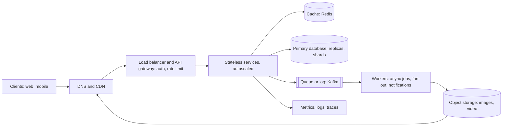
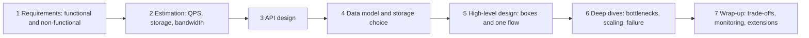
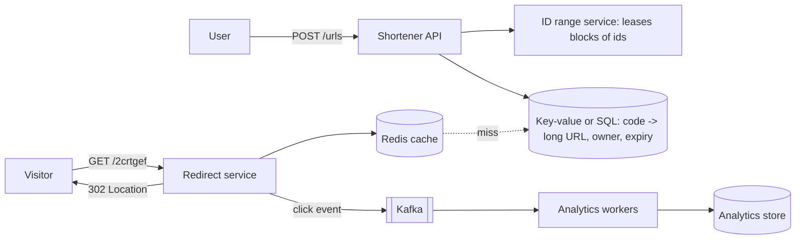
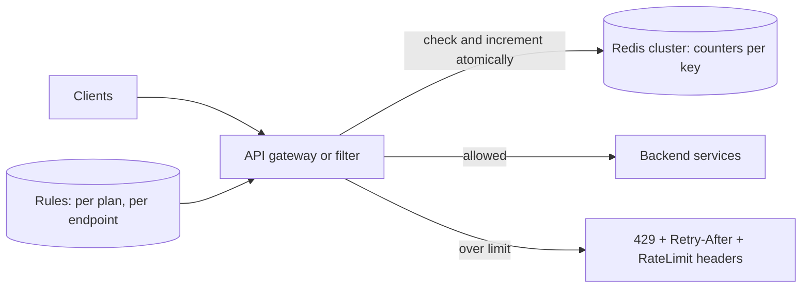
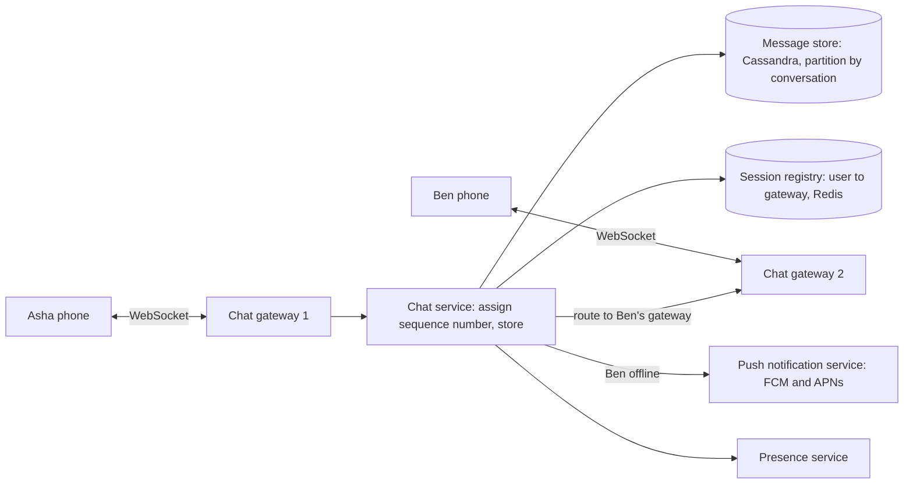
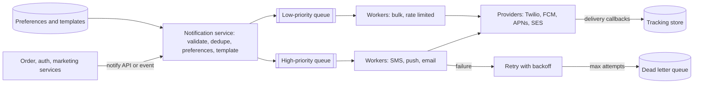
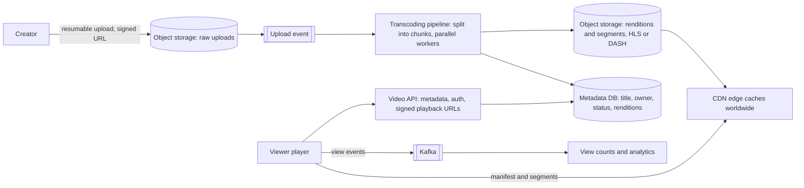
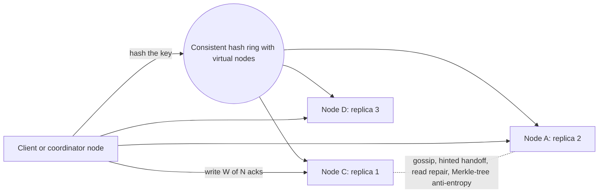
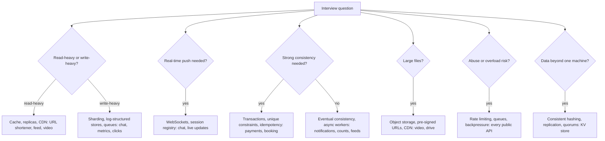

# System Design Interview Playbook (Method, Estimation, and Case Studies: URL Shortener, Rate Limiter, Chat, Notifications, Video Streaming, Key-Value Store)

> **Note**: Patterns marked with **(Interview Imp - Java)** are frequently asked in Java interviews
>
> **How to read this file:** Every section ends with a **📘 Terms Explained** table. If you see a word you don't know, check the table right below that section. Section 1 is the **method** for any system-design interview, section 2 is **estimation**, and sections 3–8 are full **case studies** with requirements, numbers, a high-level diagram, deep dives, a runnable Java model of the hardest part, Spring Boot notes, trade-offs, pitfalls, interview questions and a cheat sheet.
>
> **What is this file about?** The rest of this folder explains the building blocks (caching, sharding, queues, consistency, rate limiting…). This file shows **how to combine them under interview conditions**: 45–60 minutes, an open question ("Design WhatsApp"), and an interviewer who grades your *process* and *trade-offs* as much as the final picture.
>
> **What lives elsewhere:** More case studies are already written as domain patterns: news feed, search engine, recommendations, nearby drivers (geo), e-commerce, payments, booking, trading in [11_Domain_Specific_Pattern.md](../04_Specialized/11_Domain_Specific_Pattern.md). [Section 9](#9-more-case-studies-mapped-to-this-wiki) maps every common question to the right file. The *class-level* versions (LLD) of some problems are in [06_LLD_Interview_Problems.md](../01_LLD/06_LLD_Interview_Problems.md). Quality attributes, trade-off analysis and diagrams are in [03_Architecture_Practice.md](../02_HLD/03_Architecture_Practice.md).
>
> **Verified code:** Every "Complete Java Example" is **plain Java 17 (no libraries)** and was compiled and run **three times** with identical output (fixed seeds, simulated clocks). The examples model the *core mechanism* of each design on one machine (they are not distributed systems), and every number in the estimation examples follows from the stated assumptions. To run one, save it as `<ClassName>.java` and run `javac <ClassName>.java && java <ClassName>`. Spring Boot, Redis and Kafka snippets were **not** executed.

---

## Table of Contents
- [Big Picture: The Shape of Almost Every Answer](#big-picture-the-shape-of-almost-every-answer)
1. [The System Design Interview Framework](#1-the-system-design-interview-framework-interview-imp---java) **(Interview Imp - Java)**
   - [1.1 What Is It?](#11-what-is-it)
   - [1.2 Why Do We Need It?](#12-why-do-we-need-it)
   - [1.3 How It Works](#13-how-it-works)
   - [1.4 Types and Variants](#14-types-and-variants)
   - [1.5 Complete Java Example](#15-complete-java-example)
   - [1.6 In Practice: A Whiteboard Template](#16-in-practice-a-whiteboard-template)
   - [1.7 Pros and Cons](#17-pros-and-cons)
   - [1.8 Pitfalls, Interview Questions and Cheat Sheet](#18-pitfalls-interview-questions-and-cheat-sheet)
2. [Back-of-the-Envelope Estimation](#2-back-of-the-envelope-estimation-interview-imp---java) **(Interview Imp - Java)**
   - [2.1 What Is It?](#21-what-is-it)
   - [2.2 Why Do We Need It?](#22-why-do-we-need-it)
   - [2.3 How It Works](#23-how-it-works)
   - [2.4 Types and Variants](#24-types-and-variants)
   - [2.5 Complete Java Example - Estimating a Twitter-Like Service](#25-complete-java-example---estimating-a-twitter-like-service)
   - [2.6 In Practice](#26-in-practice)
   - [2.7 Pros and Cons](#27-pros-and-cons)
   - [2.8 Pitfalls, Interview Questions and Cheat Sheet](#28-pitfalls-interview-questions-and-cheat-sheet)
3. [Case Study: Design a URL Shortener](#3-case-study-design-a-url-shortener-interview-imp---java) **(Interview Imp - Java)**
   - [3.1 Requirements (What Are We Building?)](#31-requirements-what-are-we-building)
   - [3.2 Why Is It Hard?](#32-why-is-it-hard)
   - [3.3 How It Works: High-Level Design](#33-how-it-works-high-level-design)
   - [3.4 Design Choices and Variants](#34-design-choices-and-variants)
   - [3.5 Complete Java Example - Base62, Leased Id Ranges, Hash Collisions and a Redirect Cache](#35-complete-java-example---base62-leased-id-ranges-hash-collisions-and-a-redirect-cache)
   - [3.6 In Spring Boot](#36-in-spring-boot)
   - [3.7 Trade-Offs (Pros and Cons)](#37-trade-offs-pros-and-cons)
   - [3.8 Pitfalls, Interview Questions and Cheat Sheet](#38-pitfalls-interview-questions-and-cheat-sheet)
4. [Case Study: Design a Rate Limiter](#4-case-study-design-a-rate-limiter-interview-imp---java) **(Interview Imp - Java)**
   - [4.1 Requirements (What Are We Building?)](#41-requirements-what-are-we-building)
   - [4.2 Why Is It Hard?](#42-why-is-it-hard)
   - [4.3 How It Works: High-Level Design](#43-how-it-works-high-level-design)
   - [4.4 Design Choices and Variants](#44-design-choices-and-variants)
   - [4.5 Complete Java Example - Four Algorithms at a Window Boundary and Under Steady Load](#45-complete-java-example---four-algorithms-at-a-window-boundary-and-under-steady-load)
   - [4.6 In Spring Boot](#46-in-spring-boot)
   - [4.7 Trade-Offs (Pros and Cons)](#47-trade-offs-pros-and-cons)
   - [4.8 Pitfalls, Interview Questions and Cheat Sheet](#48-pitfalls-interview-questions-and-cheat-sheet)
5. [Case Study: Design a Chat System (WhatsApp)](#5-case-study-design-a-chat-system-whatsapp-interview-imp---java) **(Interview Imp - Java)**
   - [5.1 Requirements (What Are We Building?)](#51-requirements-what-are-we-building)
   - [5.2 Why Is It Hard?](#52-why-is-it-hard)
   - [5.3 How It Works: High-Level Design](#53-how-it-works-high-level-design)
   - [5.4 Design Choices and Variants](#54-design-choices-and-variants)
   - [5.5 Complete Java Example - Dedupe, Offline Inbox, Receipts, Ordering and Group Fan-Out](#55-complete-java-example---dedupe-offline-inbox-receipts-ordering-and-group-fan-out)
   - [5.6 In Spring Boot](#56-in-spring-boot)
   - [5.7 Trade-Offs (Pros and Cons)](#57-trade-offs-pros-and-cons)
   - [5.8 Pitfalls, Interview Questions and Cheat Sheet](#58-pitfalls-interview-questions-and-cheat-sheet)
6. [Case Study: Design a Notification System](#6-case-study-design-a-notification-system)
   - [6.1 Requirements (What Are We Building?)](#61-requirements-what-are-we-building)
   - [6.2 Why Is It Hard?](#62-why-is-it-hard)
   - [6.3 How It Works: High-Level Design](#63-how-it-works-high-level-design)
   - [6.4 Design Choices and Variants](#64-design-choices-and-variants)
   - [6.5 Complete Java Example - Priority, Dedupe, Preferences, Quiet Hours, Rate Limit, Retries](#65-complete-java-example---priority-dedupe-preferences-quiet-hours-rate-limit-retries)
   - [6.6 In Spring Boot](#66-in-spring-boot)
   - [6.7 Trade-Offs (Pros and Cons)](#67-trade-offs-pros-and-cons)
   - [6.8 Pitfalls, Interview Questions and Cheat Sheet](#68-pitfalls-interview-questions-and-cheat-sheet)
7. [Case Study: Design a Video Streaming Platform (YouTube / Netflix)](#7-case-study-design-a-video-streaming-platform-youtube--netflix)
   - [7.1 Requirements (What Are We Building?)](#71-requirements-what-are-we-building)
   - [7.2 Why Is It Hard?](#72-why-is-it-hard)
   - [7.3 How It Works: High-Level Design](#73-how-it-works-high-level-design)
   - [7.4 Design Choices and Variants](#74-design-choices-and-variants)
   - [7.5 Complete Java Example - Rendition Storage, Adaptive Bitrate vs Fixed Quality, CDN Offload](#75-complete-java-example---rendition-storage-adaptive-bitrate-vs-fixed-quality-cdn-offload)
   - [7.6 In Spring Boot](#76-in-spring-boot)
   - [7.7 Trade-Offs (Pros and Cons)](#77-trade-offs-pros-and-cons)
   - [7.8 Pitfalls, Interview Questions and Cheat Sheet](#78-pitfalls-interview-questions-and-cheat-sheet)
8. [Case Study: Design a Distributed Key-Value Store / Cache](#8-case-study-design-a-distributed-key-value-store--cache-interview-imp---java) **(Interview Imp - Java)**
   - [8.1 Requirements (What Are We Building?)](#81-requirements-what-are-we-building)
   - [8.2 Why Is It Hard?](#82-why-is-it-hard)
   - [8.3 How It Works: High-Level Design](#83-how-it-works-high-level-design)
   - [8.4 Design Choices and Variants](#84-design-choices-and-variants)
   - [8.5 Complete Java Example - Virtual Nodes, Rebalancing, Replication and Quorum Reads](#85-complete-java-example---virtual-nodes-rebalancing-replication-and-quorum-reads)
   - [8.6 In Java and Spring Boot](#86-in-java-and-spring-boot)
   - [8.7 Trade-Offs (Pros and Cons)](#87-trade-offs-pros-and-cons)
   - [8.8 Pitfalls, Interview Questions and Cheat Sheet](#88-pitfalls-interview-questions-and-cheat-sheet)
9. [More Case Studies Mapped to This Wiki](#9-more-case-studies-mapped-to-this-wiki)
10. [How the Case Studies Fit Together](#10-how-the-case-studies-fit-together)
11. [System Design Interview Cheat Sheet](#11-system-design-interview-cheat-sheet)

---

## Big Picture: The Shape of Almost Every Answer



| Building block | Use it for | Explained in |
|---|---|---|
| Load balancer, horizontal scaling | Spread traffic over stateless servers | [01_Scalability_Pattern.md](01_Scalability_Pattern.md) |
| Cache | Hot reads, sessions, counters | [01_Scalability_Pattern.md](01_Scalability_Pattern.md#8-caching-interview-imp---java) |
| Sharding, replication | Data too big or too busy for one database | [01_Scalability_Pattern.md](01_Scalability_Pattern.md) |
| Queue / log | Decouple, absorb spikes, fan-out | [04_Messaging_Pattern.md](04_Messaging_Pattern.md) |
| Consistency, CAP, sagas | Correctness across services | [05_Data_Management_Pattern.md](05_Data_Management_Pattern.md) |
| Rate limiting, circuit breakers | Protect the system | [02_Reliability_Pattern.md](02_Reliability_Pattern.md) |
| Consistent hashing, quorum | Distributed storage | [07_Distributed_Systems_Pattern.md](07_Distributed_Systems_Pattern.md) |
| Object storage + CDN | Large files close to users | [03_Performance_Pattern.md](03_Performance_Pattern.md) |

### 📘 Terms Explained

| Term | Meaning |
|---|---|
| **System design interview** | An open-ended interview where you design a large system and explain trade-offs |
| **Stateless service** | A server that keeps no user data between requests, so any instance can serve any request |
| **CDN** | Content Delivery Network: servers near users that cache static and media content |
| **Object storage** | Storage for files (blobs) addressed by key, such as Amazon S3 |
| **Fan-out** | Delivering one event to many recipients |

---

# 1. The System Design Interview Framework (Interview Imp - Java)

## 1.1 What Is It?

A step-by-step structure for a 45–60 minute design interview. Interviewers usually score four things: **problem exploration** (requirements), **high-level design**, **deep dives / trade-offs**, and **communication**. The framework makes sure you visibly cover all four.

## 1.2 Why Do We Need It?

| Common failure | Framework step that prevents it |
|---|---|
| Jumping into databases in minute 2 | Requirements first |
| Designing for "infinite scale" with no numbers | Estimation |
| A diagram with 30 boxes and no flow | API + data model + one end-to-end flow |
| Running out of time before the interesting part | Time-boxing; let the interviewer pick the deep dive |
| "It depends" with no decision | State the trade-off, then **choose** |

## 1.3 How It Works



| Step | Time | What to produce | Phrases that help |
|---|---|---|---|
| **1 Requirements** | 5–8 min | 3–5 core features; NFRs with numbers (users, latency, availability, consistency); out of scope | "Is it read-heavy or write-heavy?" "Is eventual consistency OK for X?" |
| **2 Estimation** | 3–5 min | DAU, read/write QPS (avg and peak), storage per year, bandwidth, cache size | "Let me assume… so roughly…" |
| **3 API** | 3–5 min | 3–6 endpoints or events with key parameters | `POST /urls {longUrl} -> {code}` |
| **4 Data model** | 3–5 min | Main entities, keys, access patterns, SQL vs NoSQL and why | "The main query is by X, so X is the partition key" |
| **5 High-level design** | 10 min | Diagram + walk through the main request end to end | "A request comes in, goes through the gateway, ..." |
| **6 Deep dives** | 15 min | 2–3 hard parts: hot keys, consistency, fan-out, failure, scaling a component | "The bottleneck here is ... options are A and B; I'd pick A because ..." |
| **7 Wrap-up** | 3–5 min | Trade-offs made, monitoring/alerts, what you'd do next | "With more time I'd add ..." |

**Rules of thumb that impress**
- **Start simple, then scale:** one server + one database first, then point out bottlenecks and fix them one by one.
- **Name trade-offs explicitly:** consistency vs availability, latency vs cost, push vs pull, SQL vs NoSQL.
- **Numbers drive decisions:** "1M QPS reads → we need a cache and replicas; 3.5k writes/s fits one sharded cluster."
- **Talk failures:** what happens when a node, a zone or a dependency dies? Idempotency, retries, timeouts, backpressure.
- **Make it observable:** key metrics (QPS, p99, error rate, queue lag) and alerts.

## 1.4 Types and Variants

| Interview flavour | Focus |
|---|---|
| **Product design** ("Design Instagram") | End-to-end features, data model, feeds, media |
| **Infrastructure design** ("Design a rate limiter / key-value store / message queue") | Algorithms, distribution, consistency |
| **Scaling an existing system** | Find bottlenecks, migrate without downtime |
| **API design** | Resource modelling, versioning, pagination, idempotency |
| **Object-oriented / LLD** | Classes and code ([06_LLD_Interview_Problems.md](../01_LLD/06_LLD_Interview_Problems.md)) |
| **Senior/architect level** | Trade-offs, evolution, cost, organisation, migration plans |

## 1.5 Complete Java Example

The method has no code of its own; sections 2–8 apply it. Each case study below follows steps 1–7 and implements the core of the hardest deep dive in Java.

## 1.6 In Practice: A Whiteboard Template

```text
REQUIREMENTS            | ESTIMATES               | API
- F1, F2, F3            | DAU, QPS r/w, peak      | POST /...  GET /...
- NFR: p99, avail, cons.| storage/yr, bandwidth   |
- out of scope          | cache size              |
------------------------------------------------------------------------------
DATA MODEL: entities, keys, indexes, which store and why
------------------------------------------------------------------------------
HIGH-LEVEL DIAGRAM (clients -> LB -> services -> cache/db/queue -> workers)
------------------------------------------------------------------------------
DEEP DIVES: 1) ...  2) ...  3) ...     |  TRADE-OFFS / FAILURES / MONITORING
```

## 1.7 Pros and Cons

| Pros | Cons |
|---|---|
| Nothing major is missed; calm structure | A rigid script can feel robotic; follow the interviewer's lead |
| Time is spent where points are | Spending too long on estimation/requirements |
| Shows senior habits (numbers, trade-offs, failures) | Different companies weight steps differently (ask) |

## 1.8 Pitfalls, Interview Questions and Cheat Sheet

**Common pitfalls**
- Not asking questions; designing for an imagined problem.
- Buzzword soup ("Kafka, Kubernetes, microservices") without saying why.
- Over-engineering: sharding a system that fits on one machine.
- Ignoring the data model.
- Never committing to a decision.
- Forgetting failure modes, security and monitoring.

**Interview questions**
1. *How do you approach a system design question?* → Clarify requirements and scale, estimate, define the API and data model, draw the high-level design with one flow, deep-dive bottlenecks, close with trade-offs and monitoring.
2. *How do you decide between SQL and NoSQL?* → Access patterns, consistency/transaction needs, scale of writes, query flexibility, team skills ([03_Data_Storage_Pattern.md](../04_Specialized/03_Data_Storage_Pattern.md)).
3. *What would you monitor?* → Traffic, p99 latency, error rate, saturation (CPU, queue lag, cache hit rate), business metrics.

**Cheat sheet**
```
Requirements (F + NFR numbers + out of scope) -> Estimates -> API -> Data model -> HLD + 1 flow -> Deep dives -> Wrap-up
Start simple, find the bottleneck, fix it, repeat; always say the trade-off and pick one
Failures: timeouts, retries + idempotency, replicas, multi-AZ, backpressure; Observability: QPS, p99, errors, saturation
```

### 📘 Terms Explained

| Term | Meaning |
|---|---|
| **DAU / MAU** | Daily / monthly active users |
| **QPS** | Queries (requests) per second |
| **Deep dive** | Detailed discussion of one hard part of the design |
| **Backpressure** | Slowing producers when consumers can't keep up |
| **Multi-AZ** | Running in several data centres (availability zones) of one region |

---

# 2. Back-of-the-Envelope Estimation (Interview Imp - Java)

## 2.1 What Is It?

Quick, rounded calculations that tell you the **scale** of the problem: requests per second, storage, bandwidth, cache size, number of servers. Precision doesn't matter; the order of magnitude decides the architecture.

## 2.2 Why Do We Need It?

| Estimate | Decision it drives |
|---|---|
| Read QPS ≫ write QPS | Cache, read replicas, CDN |
| Write QPS beyond one database | Sharding, write-optimised store, queues |
| Storage in petabytes | Object storage, tiering, compression, retention |
| Bandwidth in GB/s | CDN, compression, edge locations |
| Hot set fits in RAM | Caching strategy and cluster size |

## 2.3 How It Works

1. **State assumptions** (and write them down): users, activity per user, sizes, read/write ratio, peak factor, retention, replication.
2. **Derive:** DAU → actions/day → **QPS = actions per day / 86,400** (≈ 10⁵). Peak ≈ 2–5× average.
3. **Storage** = items/day × size × retention × replicas.
4. **Bandwidth** = QPS × response size.
5. **Cache** ≈ 20% of daily hot data (the 80/20 rule).
6. **Servers** ≈ peak QPS ÷ QPS per server (a few thousand simple requests/s per server is a common assumption).

**Handy numbers**

| Quantity | Value |
|---|---|
| Seconds per day | 86,400 ≈ 10⁵ |
| 1 million requests/day | ≈ 12 QPS |
| 100 million requests/day | ≈ 1,200 QPS |
| 1 KB × 1 billion | 1 TB |
| Memory read / SSD read / network round trip in a datacentre / cross-continent | ~100 ns / ~100 µs / ~0.5 ms / ~150 ms ([latency numbers](01_Scalability_Pattern.md)) |
| Powers of two | 2¹⁰ ≈ 10³ (KB), 2²⁰ ≈ 10⁶ (MB), 2³⁰ ≈ 10⁹ (GB), 2⁴⁰ ≈ 10¹² (TB) |

## 2.4 Types and Variants

| Estimate | Formula |
|---|---|
| **Traffic** | DAU × actions per user ÷ 86,400 (× peak factor) |
| **Storage** | new items per day × bytes × days × replicas (+ index overhead) |
| **Bandwidth** | QPS × bytes per response (ingress and egress separately) |
| **Memory** | hot items × bytes (+ ~30% overhead) |
| **Servers** | peak QPS ÷ per-server capacity (+ headroom for failure, N+1) |
| **Cost** | instances × hourly price + storage × $/GB + egress × $/GB |

## 2.5 Complete Java Example - Estimating a Twitter-Like Service

**What it shows:** from clearly stated assumptions (300M monthly users, 50% daily active, 2 posts/day, 100 reads per write, 10% posts with 500 KB media, peak 3×, 3 replicas), the program derives DAU, QPS, storage per day and over 5 years, read bandwidth and cache size.

```java
public class EstimationDemo {

    static String bytes(double b) {
        String[] u = {"B", "KB", "MB", "GB", "TB", "PB"}; int i = 0;
        while (b >= 1000 && i < u.length - 1) { b /= 1000; i++; }
        return String.format("%.1f %s", b, u[i]);
    }

    public static void main(String[] args) {
        // Assumptions for a Twitter-like service (state them out loud in the interview)
        double mau = 300e6, dauShare = 0.5, postsPerUserDay = 2, readsPerWrite = 100;
        double textBytes = 300, mediaShare = 0.10, mediaBytes = 500e3, peakFactor = 3, years = 5, replicas = 3;
        int secondsPerDay = 86_400;

        double dau = mau * dauShare;
        double writesPerDay = dau * postsPerUserDay;
        double writeQps = writesPerDay / secondsPerDay, readQps = writeQps * readsPerWrite;
        double textPerDay = writesPerDay * textBytes, mediaPerDay = writesPerDay * mediaShare * mediaBytes;
        double storage5y = (textPerDay + mediaPerDay) * 365 * years * replicas;
        double egress = readQps * (textBytes + mediaShare * mediaBytes);

        System.out.println("assumptions: 300M MAU, 50% daily active, 2 posts/user/day, 100 reads per write, 300 B text, 10% posts with 500 KB media, peak = 3x avg, 3 replicas");
        System.out.printf("1) DAU = %.0fM, posts/day = %.0fM%n", dau / 1e6, writesPerDay / 1e6);
        System.out.printf("2) write QPS avg %.0f, peak %.0f | read QPS avg %.0f, peak %.0f%n", writeQps, writeQps * peakFactor, readQps, readQps * peakFactor);
        System.out.printf("3) new storage per day: text %s + media %s%n", bytes(textPerDay), bytes(mediaPerDay));
        System.out.printf("4) 5 years with 3 replicas: %s   (media is %.0f%% of it -> object storage + CDN, not the database)%n", bytes(storage5y), 100 * mediaPerDay / (textPerDay + mediaPerDay));
        System.out.printf("5) read bandwidth (egress) avg: %s/s  -> served mostly by the CDN%n", bytes(egress));
        double cacheHot = textPerDay * 0.2;
        System.out.printf("6) cache the hottest 20%% of one day's text: %s of RAM -> a few cache nodes%n", bytes(cacheHot));

        System.out.println("handy numbers: 1 day = 86,400 s (~10^5) | 1M requests/day ~ 12 QPS | 1 KB x 1B = 1 TB | a server handles ~1k-10k simple QPS");
    }
}
```

**Output** (identical on all 3 runs):

```text
assumptions: 300M MAU, 50% daily active, 2 posts/user/day, 100 reads per write, 300 B text, 10% posts with 500 KB media, peak = 3x avg, 3 replicas
1) DAU = 150M, posts/day = 300M
2) write QPS avg 3472, peak 10417 | read QPS avg 347222, peak 1041667
3) new storage per day: text 90.0 GB + media 15.0 TB
4) 5 years with 3 replicas: 82.6 PB   (media is 99% of it -> object storage + CDN, not the database)
5) read bandwidth (egress) avg: 17.5 GB/s  -> served mostly by the CDN
6) cache the hottest 20% of one day's text: 18.0 GB of RAM -> a few cache nodes
handy numbers: 1 day = 86,400 s (~10^5) | 1M requests/day ~ 12 QPS | 1 KB x 1B = 1 TB | a server handles ~1k-10k simple QPS
```

**What the output shows**
- **Traffic:** ~3.5k writes/s average (10k peak) but ~350k reads/s (1M peak). The system is **read-heavy (100:1)**, so caching, read replicas and precomputed timelines matter far more than write scaling.
- **Storage:** text is only 90 GB/day; media is **15 TB/day** and 99% of the 82.6 PB five-year total. Media goes to **object storage + CDN**; the database holds text and metadata.
- **Bandwidth:** 17.5 GB/s of egress, which must come from a CDN, not the application servers.
- **Cache:** 18 GB covers the hottest 20% of a day's text, which is a handful of Redis nodes.

## 2.6 In Practice

Say the numbers out loud and **round aggressively** ("~350k reads/s, call it 400k peak per region"). Then immediately state the consequence ("so we need a cache in front of the timeline store"). Interviewers care about the *reasoning chain*, not the third digit. Re-check one number with a sanity comparison ("a single Postgres primary handles a few thousand writes/s, so 10k peak writes means sharding or a write-optimised store").

## 2.7 Pros and Cons

| Pros | Cons |
|---|---|
| Turns opinions into decisions | Wrong assumptions give wrong conclusions (state them!) |
| Fast and shows seniority | Easy to spend too long on arithmetic |
| Finds the real bottleneck early | Averages hide peaks (always add a peak factor) |

## 2.8 Pitfalls, Interview Questions and Cheat Sheet

**Common pitfalls**
- Forgetting replication and indexes in storage.
- Using averages without peaks.
- Mixing bits and bytes (bandwidth is often quoted in bits).
- Estimating everything instead of the numbers that change the design.
- Precise arithmetic with silly assumptions.

**Interview questions**
1. *Estimate QPS for 100M DAU making 10 requests/day.* → 10⁹ / 10⁵ ≈ 10k QPS average, ~30k peak.
2. *How much storage for 1B photos of 200 KB with 3 replicas?* → 200 TB × 3 = 600 TB.
3. *How big should the cache be?* → Roughly the hot 20% of the daily working set, adjusted by measured hit rate.

**Cheat sheet**
```
QPS = daily actions / 86,400 (~1e5) ; peak = 2-5x ; 1M/day ~ 12 QPS
Storage = items/day x size x days x replicas (+ indexes) ; media -> object storage + CDN
Bandwidth = QPS x response size ; cache ~ 20% of daily hot data ; servers = peak / per-server QPS (+N+1)
State assumptions, round hard, say what each number MEANS for the design
```

### 📘 Terms Explained

| Term | Meaning |
|---|---|
| **Back-of-the-envelope** | A quick, rough calculation |
| **Peak factor** | How many times higher the busiest period is than the average |
| **Egress / ingress** | Data leaving / entering a system |
| **Working set** | The data actively used in a period |
| **N+1** | One extra server beyond what is needed, to survive a failure |
| **Order of magnitude** | A factor of ten; "the same order of magnitude" means within about 10× |

---

# 3. Case Study: Design a URL Shortener (Interview Imp - Java)

## 3.1 Requirements (What Are We Building?)

**Functional:** create a short code for a long URL (`https://sho.rt/2crtgef`), redirect a short code to the long URL, optional custom aliases and expiry, basic click analytics.
**Non-functional:** very read-heavy (≈100:1); redirect p99 < 50 ms; highly available (redirects must work); codes must be **unique**; codes should not be guessable in sequence (optional).
**Estimates (assumed):** 100M new URLs/month (~40 writes/s), 10B redirects/month (~4k reads/s, peak ~12k). Five years × 100M × 12 × ~500 bytes ≈ 3 TB.

## 3.2 Why Is It Hard?

It looks trivial, but interviewers probe: **how to generate unique short codes at scale without a bottleneck**, how to make redirects fast (caching), 301 vs 302, analytics without slowing redirects, and abuse (spam/malware links).

## 3.3 How It Works: High-Level Design



**API**
```
POST /api/urls        { "longUrl": "...", "alias": "optional", "expiresAt": "optional" }  -> 201 { "code": "2crtgef" }
GET  /{code}          -> 302 Location: <longUrl>   (404 if unknown, 410 if expired)
GET  /api/urls/{code}/stats -> clicks by day, country, referrer
```
**Data model:** `url(code PK, long_url, owner_id, created_at, expires_at)`; lookups are always by `code`, so a key-value store (DynamoDB/Cassandra) or a SQL table with the code as primary key both work.

## 3.4 Design Choices and Variants

| Code generation | How | Pros | Cons |
|---|---|---|---|
| **Counter + base62** | Unique integer id → base62 | No collisions, short | Central counter; sequential codes are guessable |
| **Counter with leased ranges** | Each server leases a block (e.g. 1,000 ids) from a counter (DB sequence, ZooKeeper, Redis `INCRBY`) | No per-request coordination | Unused ids in a crashed server's block are lost (fine) |
| **Hash + truncate** (MD5/SHA → first 7 base62 chars) | Same URL → same code | Stateless | Collisions must be checked and retried |
| **Random code + uniqueness check** | Random 7 chars, insert-if-absent | Not guessable | Retry on conflict; more DB writes |
| **Snowflake-style ids** | Timestamp + machine + sequence | Distributed, sortable | Longer codes |

**Redirect status:** **301** (permanent) lets browsers cache, so less load but analytics are lost; **302/307** (temporary) sends every click to you (analytics, ability to change the target). Most shorteners use 302.

## 3.5 Complete Java Example - Base62, Leased Id Ranges, Hash Collisions and a Redirect Cache

**What it shows:** base62 encode/decode; two servers creating 5,000 unique codes with only 6 calls to the central counter; how many collisions truncated hashes produce at 4 and 7 characters; and the hit rate of a 1,000-entry LRU cache in front of 100,000 links with skewed traffic.

```java
import java.nio.charset.StandardCharsets;
import java.security.MessageDigest;
import java.util.*;

public class UrlShortenerDemo {
    static final String ALPHABET = "0123456789abcdefghijklmnopqrstuvwxyzABCDEFGHIJKLMNOPQRSTUVWXYZ";

    static String base62(long n) {
        if (n == 0) return "0";
        StringBuilder sb = new StringBuilder();
        while (n > 0) { sb.append(ALPHABET.charAt((int) (n % 62))); n /= 62; }
        return sb.reverse().toString();
    }
    static long decode62(String s) { long n = 0; for (char c : s.toCharArray()) n = n * 62 + ALPHABET.indexOf(c); return n; }

    // Each app server leases a block of ids from a central counter (e.g. a DB sequence or ZooKeeper), then works alone
    static class IdRangeAllocator {
        long nextBlockStart = 100_000_000_000L; final int blockSize;      // start high so codes are 7 characters
        IdRangeAllocator(int blockSize) { this.blockSize = blockSize; }
        synchronized long[] lease() { long s = nextBlockStart; nextBlockStart += blockSize; return new long[]{s, s + blockSize - 1}; }
    }
    static class AppServer {
        final IdRangeAllocator central; long next, end = -1; int leases = 0;
        AppServer(IdRangeAllocator c) { central = c; }
        String shorten() { if (next > end) { long[] r = central.lease(); next = r[0]; end = r[1]; leases++; } return base62(next++); }
    }

    static String hashCode(String url, int chars) throws Exception {
        byte[] h = MessageDigest.getInstance("MD5").digest(url.getBytes(StandardCharsets.UTF_8));
        long n = 0; for (int i = 0; i < 8; i++) n = (n << 8) | (h[i] & 0xff);
        String s = base62(Math.abs(n % (long) Math.pow(62, chars)));
        return "0".repeat(Math.max(0, chars - s.length())) + s;
    }

    public static void main(String[] args) throws Exception {
        System.out.println("1) base62: 7 characters give 62^7 = " + String.format("%,d", (long) Math.pow(62, 7)) + " codes");
        long id = 125_000_000_123L;
        System.out.println("   id " + id + " -> " + base62(id) + " -> back to " + decode62(base62(id)));

        IdRangeAllocator central = new IdRangeAllocator(1000);
        AppServer a = new AppServer(central), b = new AppServer(central);
        Set<String> codes = new HashSet<>();
        for (int i = 0; i < 2500; i++) { codes.add(a.shorten()); codes.add(b.shorten()); }
        System.out.println("2) two servers created 5000 codes with only " + (a.leases + b.leases) + " calls to the central counter; unique codes = " + codes.size() + " (no collisions by construction)");

        Set<String> seen = new HashSet<>(); int collisions = 0;
        for (int i = 0; i < 100_000; i++) if (!seen.add(hashCode("https://example.com/page/" + i, 4))) collisions++;
        System.out.println("3) hash approach, truncated to 4 chars (14.8M codes), 100,000 URLs: collisions = " + collisions + "  -> needs check-and-retry");
        seen.clear(); collisions = 0;
        for (int i = 0; i < 100_000; i++) if (!seen.add(hashCode("https://example.com/page/" + i, 7))) collisions++;
        System.out.println("   truncated to 7 chars (3.5 trillion codes): collisions = " + collisions + "  (rare, but still possible at billions of URLs)");

        // 4) redirect path: most traffic goes to few links, so a small cache absorbs it
        Map<String, String> cache = new LinkedHashMap<>(16, 0.75f, true) { protected boolean removeEldestEntry(Map.Entry<String, String> e) { return size() > 1000; } };
        Random r = new Random(3); int hits = 0, n = 200_000;
        for (int i = 0; i < n; i++) {
            int link = (int) Math.floor(Math.pow(r.nextDouble(), 10) * 100_000);     // skewed: low ids are much more popular
            String k = base62(link);
            if (cache.get(k) != null) hits++; else cache.put(k, "https://long/" + link);
        }
        System.out.printf("4) cache of 1,000 entries in front of 100,000 links, skewed traffic: hit rate %.1f%%%n", 100.0 * hits / n);
    }
}
```

**Output** (identical on all 3 runs):

```text
1) base62: 7 characters give 62^7 = 3,521,614,606,208 codes
   id 125000000123 -> 2crtgef -> back to 125000000123
2) two servers created 5000 codes with only 6 calls to the central counter; unique codes = 5000 (no collisions by construction)
3) hash approach, truncated to 4 chars (14.8M codes), 100,000 URLs: collisions = 318  -> needs check-and-retry
   truncated to 7 chars (3.5 trillion codes): collisions = 0  (rare, but still possible at billions of URLs)
4) cache of 1,000 entries in front of 100,000 links, skewed traffic: hit rate 53.7%
```

**What the output shows**
- **1:** 7 base62 characters give **3.5 trillion** codes, far more than 6 billion URLs over 5 years. Encoding is reversible.
- **2:** with leases of 1,000 ids, 5,000 codes needed only **6** calls to the central counter, and uniqueness is guaranteed by construction (no collision check needed).
- **3:** truncated hashes at 4 characters collide **318** times in 100,000 URLs (birthday paradox); at 7 characters, 0 here, but collisions remain *possible* at billions of URLs, so the hash approach always needs insert-if-absent and retry.
- **4:** a cache of just 1% of the links serves **53.7%** of redirects with this skewed traffic; real link traffic is usually even more concentrated (recent and viral links).

## 3.6 In Spring Boot

```java
@PostMapping("/api/urls")
ResponseEntity<UrlDto> create(@Valid @RequestBody NewUrl req) {
    String code = req.alias() != null ? reserveAlias(req.alias()) : base62(idRange.next());   // idRange leases blocks via a DB sequence
    repo.save(new ShortUrl(code, req.longUrl(), req.expiresAt()));
    return ResponseEntity.status(201).body(new UrlDto(code));
}

@GetMapping("/{code}")
ResponseEntity<Void> redirect(@PathVariable String code) {
    String target = cache.get(code, c -> repo.findById(c).map(ShortUrl::longUrl).orElse(null));   // Caffeine/Redis cache-aside
    if (target == null) return ResponseEntity.notFound().build();
    clicks.send("clicks", code, ClickEvent.now(code));                                           // async: never slow the redirect
    return ResponseEntity.status(HttpStatus.FOUND).location(URI.create(target)).build();          // 302
}
```
Validate and scan target URLs (malware/phishing lists), rate-limit creation per user/IP, and reserve a list of forbidden aliases.

## 3.7 Trade-Offs (Pros and Cons)

| Choice | Gain | Cost |
|---|---|---|
| Leased counter ranges | No collisions, no hot coordination | Sequential (guessable) codes unless shuffled |
| Hash codes | Idempotent (same URL → same code) | Collision handling, longer codes for safety |
| 302 redirects | Analytics and editable targets | More traffic than 301 |
| NoSQL key-value | Easy horizontal scale for key lookups | Weaker ad-hoc queries (analytics in a separate store) |

## 3.8 Pitfalls, Interview Questions and Cheat Sheet

**Common pitfalls**
- A single auto-increment database as the code generator for every request.
- Hash truncation without collision handling.
- Writing analytics synchronously in the redirect path.
- 301 when the product needs analytics.
- No abuse protection (spam, phishing, enumeration of sequential codes).

**Interview questions**
1. *How do you generate unique short codes?* → Counter-based ids with leased ranges + base62 (no collisions), or random/hash codes with insert-if-absent and retry.
2. *How many characters?* → 62⁷ ≈ 3.5 × 10¹² is plenty for billions of URLs.
3. *301 or 302?* → 302 for analytics/editability; 301 if you want browsers to cache and don't need click counts.
4. *How do you make redirects fast?* → Cache-aside (Redis/in-process), CDN/edge for popular codes, read replicas, key-value store.
5. *How do you collect analytics at scale?* → Emit click events to Kafka; aggregate asynchronously into an analytics store.

**Cheat sheet**
```
Write ~40/s, read ~4k/s (100:1) ; 7 base62 chars = 3.5e12 codes ; ~3 TB over 5 years
Code: leased counter ranges + base62 (no collisions) | hash/random + insert-if-absent + retry
Redirect: cache-aside (Redis) -> KV store ; 302 (analytics) vs 301 (cacheable) ; click events -> Kafka -> analytics
Extras: custom alias, expiry (410), abuse scanning, rate-limit creation
```

### 📘 Terms Explained

| Term | Meaning |
|---|---|
| **Base62** | Writing numbers with 0–9, a–z, A–Z (62 symbols) |
| **Birthday paradox** | Collisions become likely much sooner than intuition suggests |
| **301 / 302** | HTTP redirect codes: permanent / temporary |
| **Cache-aside** | The application checks the cache first and loads from the database on a miss |
| **Id range lease** | A server reserving a block of ids to hand out locally |

---

# 4. Case Study: Design a Rate Limiter (Interview Imp - Java)

## 4.1 Requirements (What Are We Building?)

**Functional:** limit how many requests a client (user, API key, IP) can make, e.g. 10 requests/second or 1,000/day per API key; return **429 Too Many Requests** with `Retry-After` when over the limit; configurable rules per endpoint and plan.
**Non-functional:** adds < 1–2 ms to each request; works across many API servers (a **distributed** limit); highly available (if the limiter fails, *fail open* for most APIs, *fail closed* for sensitive ones such as login).
**Estimates (assumed):** 1M QPS through the gateway, 10M active keys; counters per key are tiny (tens of bytes) → under 1 GB of state.

## 4.2 Why Is It Hard?

Choosing the **algorithm** (burst behaviour, accuracy, memory), keeping counts **consistent across servers** without a network round trip per decision becoming the bottleneck, and handling **races** (two servers incrementing at the same time).

## 4.3 How It Works: High-Level Design



**Algorithms**

| Algorithm | Idea | Burst | Memory per key |
|---|---|---|---|
| **Fixed window counter** | Count per calendar window (per second/minute) | Up to **2× limit** across a boundary | 1 counter |
| **Sliding window log** | Keep timestamps of recent requests | Exact | 1 entry per request (expensive) |
| **Sliding window counter** | Weighted mix of the previous and current window counts | Small error | 2 counters |
| **Token bucket** | Tokens refill at rate *r* up to capacity *b*; each request takes one | Allows controlled bursts up to *b* | 2 numbers (tokens, last refill) |
| **Leaky bucket** | Queue drained at a fixed rate | Smooths output | Queue size |

## 4.4 Design Choices and Variants

| Decision | Options |
|---|---|
| Where | API gateway (Spring Cloud Gateway, Envoy, Kong), a servlet filter, a sidecar, or a separate service |
| State | Local in-memory (fast, per instance, inaccurate across instances) vs **Redis** (shared, accurate, +1 ms) vs hybrid (local token buckets synced periodically) |
| Atomicity | Redis `INCR` + `EXPIRE`, or a **Lua script** for check-and-update in one round trip |
| Keys | `rl:{apiKey}:{endpoint}:{window}`, separate limits per plan |
| Failure mode | Fail open (allow) vs fail closed (deny) when Redis is unavailable |
| Response | 429 + `Retry-After` + `RateLimit-Limit/Remaining/Reset` headers |

## 4.5 Complete Java Example - Four Algorithms at a Window Boundary and Under Steady Load

**What it shows:** four limiters with the same limit (10 per second). First, 20 requests packed into 190 ms around the 1-second boundary; then a steady 15 requests/second for 3 seconds.

```java
import java.util.*;

public class RateLimiterDemo {
    interface Limiter { boolean allow(long ms); String name(); }

    // limit: 10 requests per 1000 ms for every algorithm
    static class FixedWindow implements Limiter {
        long window = -1; int count;
        public boolean allow(long t) { long w = t / 1000; if (w != window) { window = w; count = 0; } return ++count <= 10; }
        public String name() { return "fixed window"; }
    }
    static class SlidingLog implements Limiter {
        final Deque<Long> log = new ArrayDeque<>();
        public boolean allow(long t) { while (!log.isEmpty() && log.peekFirst() <= t - 1000) log.pollFirst(); if (log.size() < 10) { log.addLast(t); return true; } return false; }
        public String name() { return "sliding log"; }
    }
    static class SlidingCounter implements Limiter {                     // weighted mix of previous and current window counts
        long window = -1; int prev, cur;
        public boolean allow(long t) {
            long w = t / 1000;
            if (w != window) { prev = (w == window + 1) ? cur : 0; cur = 0; window = w; }
            double overlap = 1 - (t % 1000) / 1000.0;
            if (prev * overlap + cur < 10) { cur++; return true; } return false;
        }
        public String name() { return "sliding window counter"; }
    }
    static class TokenBucket implements Limiter {                        // capacity 10, refill 10 tokens/second
        double tokens = 10; long last = 0;
        public boolean allow(long t) { tokens = Math.min(10, tokens + (t - last) * 10 / 1000.0); last = t; if (tokens >= 1) { tokens -= 1; return true; } return false; }
        public String name() { return "token bucket"; }
    }

    static int countAllowed(Limiter l, long[] times, long from, long to) { int ok = 0; for (long t : times) { boolean a = l.allow(t); if (a && t >= from && t < to) ok++; } return ok; }

    public static void main(String[] args) {
        // 10 requests at t=900..990 ms and 10 more at t=1000..1090 ms: a burst across the window boundary
        long[] boundary = new long[20];
        for (int i = 0; i < 10; i++) { boundary[i] = 900 + i * 10; boundary[10 + i] = 1000 + i * 10; }
        System.out.println("1) 20 requests within 190 ms around the 1-second boundary (limit 10 per second):");
        for (Limiter l : List.of(new FixedWindow(), new SlidingLog(), new SlidingCounter(), new TokenBucket()))
            System.out.printf("   %-24s allowed %2d of 20%n", l.name(), countAllowed(l, boundary, 0, Long.MAX_VALUE));

        // steady 15 requests/second for 3 seconds
        long[] steady = new long[45];
        for (int i = 0; i < 45; i++) steady[i] = i * 1000L / 15;
        System.out.println("2) steady 15 req/s for 3 s (45 requests):");
        for (Limiter l : List.of(new FixedWindow(), new SlidingLog(), new SlidingCounter(), new TokenBucket()))
            System.out.printf("   %-24s allowed %2d%n", l.name(), countAllowed(l, steady, 0, Long.MAX_VALUE));

        System.out.println("   10 per second for 3 s = 30; the token bucket also passes its initial burst of 10 (full bucket at start), so about 10 + 10/s x 2.9 s");
        System.out.println("3) memory per client: fixed window = 1 counter, sliding counter = 2 counters, token bucket = 2 numbers, sliding log = 1 timestamp per request");
    }
}
```

**Output** (identical on all 3 runs):

```text
1) 20 requests within 190 ms around the 1-second boundary (limit 10 per second):
   fixed window             allowed 20 of 20
   sliding log              allowed 10 of 20
   sliding window counter   allowed 11 of 20
   token bucket             allowed 11 of 20
2) steady 15 req/s for 3 s (45 requests):
   fixed window             allowed 30
   sliding log              allowed 30
   sliding window counter   allowed 30
   token bucket             allowed 39
   10 per second for 3 s = 30; the token bucket also passes its initial burst of 10 (full bucket at start), so about 10 + 10/s x 2.9 s
3) memory per client: fixed window = 1 counter, sliding counter = 2 counters, token bucket = 2 numbers, sliding log = 1 timestamp per request
```

**What the output shows**
- **Boundary burst:** the fixed window lets **all 20** through in 190 ms (10 at the end of second 0, 10 at the start of second 1): double the intended rate. The sliding log allows exactly **10**; the sliding counter allows 11 (its approximation); the token bucket 11 (10 from the full bucket + 1 refilled).
- **Steady 15 req/s:** the window-based algorithms allow 30 over 3 seconds, as expected. The **token bucket allows 39**: it starts full (a burst of 10) and then refills 10/s. That burst allowance is a *feature* (users can be briefly bursty) as long as you size the bucket on purpose.
- **Memory:** the sliding log is exact but stores every timestamp; at millions of keys, the token bucket or sliding counter is the usual production choice.

## 4.6 In Spring Boot

```java
// Spring Cloud Gateway: Redis-backed token bucket per user
spring.cloud.gateway.routes[0].filters[0].name=RequestRateLimiter
spring.cloud.gateway.routes[0].filters[0].args.redis-rate-limiter.replenishRate=10      # tokens per second
spring.cloud.gateway.routes[0].filters[0].args.redis-rate-limiter.burstCapacity=20      # bucket size
spring.cloud.gateway.routes[0].filters[0].args.key-resolver=#{@userKeyResolver}

// In-process alternative: Bucket4j (token bucket), optionally backed by Redis/JCache for a distributed limit
Bucket bucket = Bucket.builder().addLimit(Bandwidth.simple(10, Duration.ofSeconds(1))).build();
if (!bucket.tryConsume(1)) return ResponseEntity.status(429).header("Retry-After", "1").build();
```
```lua
-- Redis Lua script: fixed-window check-and-increment atomically in ONE round trip
local c = redis.call('INCR', KEYS[1])
if c == 1 then redis.call('PEXPIRE', KEYS[1], ARGV[2]) end
if c > tonumber(ARGV[1]) then return 0 else return 1 end
```
More on rate limiting as a resilience pattern: [02_Reliability_Pattern.md](02_Reliability_Pattern.md#6-rate-limiting-pattern-interview-imp---java).

## 4.7 Trade-Offs (Pros and Cons)

| Choice | Gain | Cost |
|---|---|---|
| Fixed window | Simplest, cheapest | 2× bursts at boundaries |
| Sliding log | Exact | Memory per request |
| Sliding counter | Near-exact, cheap | Approximation |
| Token bucket | Controlled bursts, cheap, standard | Needs tuning of rate *and* capacity |
| Central Redis | Accurate global limit | Extra hop, Redis becomes critical |
| Local limits | Zero latency | Limit × number of instances |

## 4.8 Pitfalls, Interview Questions and Cheat Sheet

**Common pitfalls**
- Read-then-write counters (`GET` then `SET`) → races; use atomic `INCR` or Lua.
- Forgetting key expiry (memory grows forever).
- Limiting by IP only (NAT puts many users behind one IP; attackers rotate IPs).
- Fail-closed on a limiter outage for everything (you take your own site down).
- No `Retry-After`, so clients retry immediately and make it worse.

**Interview questions**
1. *Compare rate-limiting algorithms.* → Fixed window (simple, boundary bursts), sliding log (exact, memory), sliding counter (approximate, cheap), token bucket (bursts allowed, standard), leaky bucket (smooth).
2. *How do you rate-limit across 50 servers?* → Shared counters in Redis with atomic operations/Lua; or local buckets with periodic sync if approximate is fine.
3. *Where do you put the limiter?* → At the edge (gateway) for coarse limits; in services for business limits (e.g. 5 password attempts).
4. *What if Redis is down?* → Usually fail open with local fallback limits; fail closed for security-sensitive endpoints.
5. *What do you return?* → 429 with `Retry-After` and rate-limit headers.

**Cheat sheet**
```
Fixed window: 1 counter, 2x burst at boundary | Sliding log: exact, memory heavy | Sliding counter: 2 counters, ~exact
Token bucket: rate r + capacity b, bursts up to b (Spring Cloud Gateway, Bucket4j) | Leaky bucket: smooth queue
Distributed: Redis INCR/EXPIRE or Lua (atomic, 1 round trip) ; key = client + endpoint (+ window)
429 + Retry-After + RateLimit-* headers ; fail open (most) / fail closed (login, payments)
```

### 📘 Terms Explained

| Term | Meaning |
|---|---|
| **Rate limiter** | A component that restricts how many requests a client may make in a time period |
| **429 Too Many Requests** | HTTP status for "slow down" |
| **Token bucket** | Tokens refill at a steady rate; each request spends one; the bucket size allows bursts |
| **Lua script (Redis)** | A small program Redis runs atomically on the server |
| **Fail open / fail closed** | When the limiter is broken: allow everything / deny everything |
| **Burst** | Many requests in a very short time |

---

# 5. Case Study: Design a Chat System (WhatsApp) (Interview Imp - Java)

## 5.1 Requirements (What Are We Building?)

**Functional:** one-to-one and group chat (up to a few hundred members), online/last-seen presence, delivery receipts (sent ✓, delivered ✓✓, read in blue), offline delivery when the recipient comes back, media messages, push notifications when the app is closed.
**Non-functional:** low latency (< 200 ms delivery when both are online), **messages never lost**, per-conversation ordering, very high availability, end-to-end encryption (contents not readable by the server).
**Estimates (assumed):** 500M DAU × 40 messages/day = 20B messages/day ≈ 230k messages/s (peak ~700k); ~100 bytes of text each → 2 TB/day of message data.

## 5.2 Why Is It Hard?

Millions of **long-lived connections**, routing a message to *the server that holds the recipient's connection*, **ordering** within a conversation, **exactly-once-looking** delivery over unreliable mobile networks (retries without duplicates), offline storage, and group fan-out.

## 5.3 How It Works: High-Level Design



**Flow (Asha → Ben):** Asha's app sends `{clientMsgId, convoId, text}` over its WebSocket → the chat service **de-duplicates** by `clientMsgId`, assigns the next **sequence number** in the conversation, **stores** it (now Asha sees ✓) → looks up Ben's gateway in the session registry → pushes it (Ben's app acks → ✓✓) → if Ben is offline, it stays in his **inbox** and a push notification wakes his phone; on reconnect his app syncs everything after the last sequence it has.

**Data model:** `messages(convo_id, seq, msg_id, sender, body, created_at)` with **partition key `convo_id`, clustering key `seq`**: one partition read returns a conversation in order ([wide-column stores](../04_Specialized/03_Data_Storage_Pattern.md#4-wide-column-stores-column-family-stores)).

## 5.4 Design Choices and Variants

| Decision | Choice and why |
|---|---|
| Transport | **WebSocket** (or MQTT, as WhatsApp historically used a custom protocol) for bidirectional, low-latency push; long polling as fallback |
| Ordering | Per-conversation sequence numbers assigned by the service (not client clocks) |
| Delivery semantics | At-least-once delivery + **client message id** for dedupe = effectively once |
| Receipts | Small "delivered"/"read" events flowing back the same way |
| Groups | Store the message **once**; fan out a pointer/delivery to each member's connection or inbox; large groups fan out asynchronously |
| Presence | Heartbeats; `last_seen` updated lazily; presence fan-out only to contacts currently viewing |
| Media | Upload to object storage first, send a message containing the URL + key |
| Encryption | End-to-end (Signal protocol): the server routes ciphertext and never sees plaintext |
| Multi-device | Each device has its own sync cursor (last seq received) |

## 5.5 Complete Java Example - Dedupe, Offline Inbox, Receipts, Ordering and Group Fan-Out

**What it shows:** a server that de-duplicates client retries, keeps messages for an offline user, moves receipts from SENT to DELIVERED to READ, a client that re-orders out-of-order arrivals by sequence number and detects a gap, and the fan-out of one group message to 256 members.

```java
import java.util.*;

public class ChatDemo {

    enum Tick { SENT, DELIVERED, READ }
    record Message(String id, String convo, long seq, String from, String text) {}

    // Server side: assigns a per-conversation sequence number, stores, fans out, keeps offline inboxes
    static class ChatServer {
        final Map<String, Long> seqByConvo = new HashMap<>();
        final Map<String, List<String>> members = new HashMap<>();
        final Set<String> online = new HashSet<>();
        final Map<String, Deque<Message>> offlineInbox = new HashMap<>();
        final Set<String> seenIds = new HashSet<>();
        final Map<String, Tick> status = new LinkedHashMap<>();
        int pushes = 0;

        Message send(String clientMsgId, String convo, String from, String text) {
            if (!seenIds.add(clientMsgId)) return null;                         // client retried after a timeout: ignore the duplicate
            long seq = seqByConvo.merge(convo, 1L, Long::sum);
            Message m = new Message(clientMsgId, convo, seq, from, text);
            status.put(clientMsgId, Tick.SENT);
            boolean allDelivered = true;
            for (String u : members.get(convo)) {
                if (u.equals(from)) continue;
                if (online.contains(u)) pushes++;                                 // push over the user's WebSocket
                else { offlineInbox.computeIfAbsent(u, k -> new ArrayDeque<>()).add(m); allDelivered = false; }
            }
            if (allDelivered) status.put(clientMsgId, Tick.DELIVERED);
            return m;
        }
        List<Message> connect(String user) { online.add(user); Deque<Message> q = offlineInbox.remove(user); return q == null ? List.of() : new ArrayList<>(q); }
    }

    // Client side: messages may arrive out of order, so display by sequence number and detect gaps
    static String render(List<Message> arrived) {
        List<Message> sorted = new ArrayList<>(arrived); sorted.sort(Comparator.comparingLong(Message::seq));
        StringBuilder sb = new StringBuilder(); long expect = sorted.get(0).seq();
        for (Message m : sorted) { if (m.seq() != expect) sb.append("[gap: fetch seq ").append(expect).append("] "); sb.append(m.seq()).append(':').append(m.text()).append(' '); expect = m.seq() + 1; }
        return sb.toString().trim();
    }

    public static void main(String[] args) {
        ChatServer s = new ChatServer();
        s.members.put("dm-asha-ben", List.of("asha", "ben"));
        s.online.add("asha");                                                    // ben is offline
        s.send("c1", "dm-asha-ben", "asha", "hi");
        s.send("c2", "dm-asha-ben", "asha", "are you there?");
        s.send("c2", "dm-asha-ben", "asha", "are you there?");                   // network retry of the same message
        System.out.println("1) ben offline: ticks " + s.status + "  (single tick = stored on server)");
        List<Message> backlog = s.connect("ben");
        backlog.forEach(m -> s.status.put(m.id(), Tick.DELIVERED));
        System.out.println("   ben connects and receives " + backlog.size() + " queued messages (the retry was de-duplicated): ticks " + s.status);
        s.status.put("c2", Tick.READ);
        System.out.println("   ben opens the chat: c2 -> " + s.status.get("c2") + " (blue ticks)");

        List<Message> outOfOrder = List.of(new Message("x3", "g", 3, "a", "three"), new Message("x1", "g", 1, "a", "one"), new Message("x2", "g", 2, "a", "two"), new Message("x5", "g", 5, "a", "five"));
        System.out.println("2) arrival order 3,1,2,5 is displayed as: " + render(outOfOrder));

        List<String> group = new ArrayList<>(); for (int i = 0; i < 256; i++) group.add("u" + i);
        s.members.put("family", group); for (int i = 0; i < 200; i++) s.online.add("u" + i);
        int before = s.pushes;
        s.send("g1", "family", "u0", "dinner at 8");
        System.out.println("3) message to a 256-member group: " + (s.pushes - before) + " live pushes + " + s.offlineInbox.values().stream().mapToInt(Deque::size).sum() + " stored for offline members (1 message stored once, fan-out per member)");
    }
}
```

**Output** (identical on all 3 runs):

```text
1) ben offline: ticks {c1=SENT, c2=SENT}  (single tick = stored on server)
   ben connects and receives 2 queued messages (the retry was de-duplicated): ticks {c1=DELIVERED, c2=DELIVERED}
   ben opens the chat: c2 -> READ (blue ticks)
2) arrival order 3,1,2,5 is displayed as: 1:one 2:two 3:three [gap: fetch seq 4] 5:five
3) message to a 256-member group: 199 live pushes + 56 stored for offline members (1 message stored once, fan-out per member)
```

**What the output shows**
- **1:** while Ben is offline both messages are SENT (stored, single tick). The client's retry of `c2` was ignored by id, so Ben receives **2** messages, not 3. On connect they become DELIVERED; opening the chat marks c2 READ.
- **2:** arrivals 3, 1, 2, 5 are shown as 1, 2, 3 and the client notices **seq 4 is missing** and fetches it, which is why ordering uses server-assigned sequence numbers.
- **3:** a message to a 256-member group was stored once and produced **199 live pushes** (online members other than the sender) plus **56 offline inbox entries**.

## 5.6 In Spring Boot

```java
@Configuration @EnableWebSocketMessageBroker
class WsConfig implements WebSocketMessageBrokerConfigurer {
    public void registerStompEndpoints(StompEndpointRegistry r) { r.addEndpoint("/ws").setAllowedOrigins("*"); }
    public void configureMessageBroker(MessageBrokerRegistry r) { r.enableStompBrokerRelay("/queue").setRelayHost("rabbitmq"); }   // relay lets many gateways share routing
}

@MessageMapping("/send")
void send(ChatMessage m, Principal user) {
    if (!dedupe.firstTime(m.clientMsgId())) return;
    StoredMessage s = store.append(m.convoId(), user.getName(), m.body());       // assigns seq in the conversation partition
    for (String member : convos.members(m.convoId()))
        if (!member.equals(user.getName())) messaging.convertAndSendToUser(member, "/queue/messages", s);   // routed to the member's session
}
```
At WhatsApp scale, gateways are specialised connection servers (often Erlang/Elixir, or Netty in Java) with a session registry; the chat service is separate and stateless.

## 5.7 Trade-Offs (Pros and Cons)

| Choice | Gain | Cost |
|---|---|---|
| WebSockets | Real-time push both ways | Millions of stateful connections to manage |
| Server sequence numbers | Reliable ordering | A per-conversation ordering point |
| Store-then-deliver | No lost messages | A write before every delivery |
| E2E encryption | Privacy | Server-side search/moderation impossible; key management on devices |
| Store once + fan-out for groups | Saves storage | Fan-out work grows with group size |

## 5.8 Pitfalls, Interview Questions and Cheat Sheet

**Common pitfalls**
- Ordering by client timestamps (clocks differ).
- No client message id → duplicates on retry.
- Delivering before storing (message lost if the server crashes).
- Broadcasting presence changes to all contacts (huge fan-out).
- Assuming a user has one device and one connection.

**Interview questions**
1. *How does a message reach a user connected to another server?* → A session registry maps user → gateway; the chat service routes to that gateway (or via a pub/sub relay).
2. *How do you guarantee ordering?* → Server-assigned per-conversation sequence numbers; clients sort and fetch gaps.
3. *How do you avoid duplicates?* → Client-generated message ids + idempotent store; at-least-once delivery.
4. *How do offline users get messages?* → Messages stay in their inbox/log; a push notification wakes the app; on reconnect it syncs from its last sequence.
5. *How do group messages work?* → Store once; fan out deliveries to each member (asynchronously for big groups).

**Cheat sheet**
```
Client <-WebSocket-> gateway ; session registry (user -> gateway) ; chat service: dedupe(clientMsgId) -> seq -> store -> route
Store: Cassandra, partition = convo_id, clustering = seq ; receipts: sent (stored) / delivered (device ack) / read
Offline: inbox + push (FCM/APNs) + sync from last seq ; groups: store once, fan out per member
Media -> object storage URL ; E2E encryption: server routes ciphertext
```

### 📘 Terms Explained

| Term | Meaning |
|---|---|
| **WebSocket** | A persistent two-way connection between client and server |
| **Session registry** | A lookup of which gateway server holds each user's connection |
| **Delivery receipt** | A confirmation that a message reached (or was read on) the device |
| **Sequence number** | An increasing counter that orders messages in a conversation |
| **End-to-end encryption** | Only sender and recipient devices can read the message |
| **FCM / APNs** | Firebase Cloud Messaging / Apple Push Notification service |

---

# 6. Case Study: Design a Notification System

## 6.1 Requirements (What Are We Building?)

**Functional:** other services ask "notify user X about Y"; deliver via **push, SMS, email, in-app**; templates and localisation; user **preferences** (opt-outs per channel and category, quiet hours); scheduling; tracking (sent, delivered, opened).
**Non-functional:** OTPs and security alerts within seconds; marketing can wait; **no duplicates** (a user must not get the same OTP SMS three times); no lost critical notifications; per-user rate limits; provider outages must not lose messages.
**Estimates (assumed):** 50M notifications/day ≈ 600/s average, bursts of 50k/s during campaigns.

## 6.2 Why Is It Hard?

Mixing **urgent and bulk** traffic without one blocking the other, respecting **preferences and legal rules** (consent, unsubscribe), **unreliable third-party providers** (SMS gateways, email services) with rate limits of their own, and **deduplication** across retries.

## 6.3 How It Works: High-Level Design



1. **Ingest:** validate, attach a **dedupe key** (`otp-991:asha`), check preferences (opt-outs, quiet hours), render the template in the user's language.
2. **Prioritise:** separate queues (or topics) for critical vs bulk so a campaign can't delay OTPs.
3. **Deliver:** channel workers call providers with timeouts, **circuit breakers**, provider failover (two SMS vendors).
4. **Retry** with exponential backoff and jitter; after N attempts → **dead letter queue** for inspection.
5. **Track:** provider callbacks update status; analytics for opens/clicks.

## 6.4 Design Choices and Variants

| Decision | Options |
|---|---|
| API | Synchronous `POST /notifications` (returns 202) and/or events from Kafka |
| Priority | Separate topics/queues per priority; dedicated worker pools (bulkhead) |
| Dedupe | Idempotency key stored with TTL (Redis `SET NX EX`) |
| Preferences | Per user × category × channel; global unsubscribe; legal consent records |
| Rate limits | Per user (don't spam), per provider (their limits), per campaign |
| Scheduling | Delayed queue or a scheduler table for "send at 9 am local time" ([time zones](../04_Specialized/11_Domain_Specific_Pattern.md#10-time-zone-handling-interview-imp---java)) |
| Fallback channel | Push failed / not installed → SMS for critical messages |

## 6.5 Complete Java Example - Priority, Dedupe, Preferences, Quiet Hours, Rate Limit, Retries

**What it shows:** eight requests processed at 14:00: the high-priority OTP goes first despite arriving second, the SMS provider fails twice before succeeding (backoff), an opted-out email is skipped, a duplicate OTP request is dropped, and promotions beyond 3 per hour are dropped. A second run at 23:00 shows quiet hours delaying a promotion but not a fraud alert.

```java
import java.util.*;

public class NotificationDemo {

    enum Priority { HIGH, LOW }
    record Notification(String dedupeKey, String user, String channel, Priority priority, String text, int createdAt) {}

    static class Prefs { final Set<String> optedOut = new HashSet<>(); int quietFrom = 22, quietTo = 7; }

    static class Dispatcher {
        final PriorityQueue<Notification> queue = new PriorityQueue<>(Comparator.comparing(Notification::priority).thenComparingInt(Notification::createdAt));
        final Set<String> sentKeys = new HashSet<>();
        final Map<String, Integer> sentThisHour = new HashMap<>();
        final Map<String, Prefs> prefs = new HashMap<>();
        final List<String> log = new ArrayList<>(), deadLetters = new ArrayList<>();
        int smsFailuresLeft = 2;                                             // the SMS provider fails twice, then recovers

        void submit(Notification n) { queue.add(n); }

        void run(int hour) {
            while (!queue.isEmpty()) {
                Notification n = queue.poll();
                Prefs p = prefs.getOrDefault(n.user(), new Prefs());
                if (!sentKeys.add(n.dedupeKey())) { log.add("skip duplicate   " + n.dedupeKey()); continue; }
                if (p.optedOut.contains(n.channel())) { log.add("skip opted-out   " + n.user() + "/" + n.channel()); continue; }
                boolean quiet = hour >= p.quietFrom || hour < p.quietTo;
                if (quiet && n.priority() == Priority.LOW) { log.add("delay quiet hrs  " + n.dedupeKey() + " (low priority at " + hour + ":00)"); continue; }
                int count = sentThisHour.getOrDefault(n.user(), 0);
                if (count >= 3 && n.priority() == Priority.LOW) { log.add("drop rate limit  " + n.dedupeKey() + " (user already got " + count + " this hour)"); continue; }
                if (deliver(n, 1)) sentThisHour.merge(n.user(), 1, Integer::sum);
            }
        }
        boolean deliver(Notification n, int attempt) {
            boolean ok = !n.channel().equals("sms") || smsFailuresLeft-- <= 0;
            if (ok) { log.add(String.format("%-17s", "SENT " + n.priority()) + n.dedupeKey() + " via " + n.channel() + (attempt > 1 ? " (attempt " + attempt + ")" : "")); return true; }
            long backoffMs = 1000L << (attempt - 1);                         // 1s, 2s, 4s ...
            if (attempt >= 3) { deadLetters.add(n.dedupeKey()); log.add("DLQ " + n.dedupeKey()); return false; }
            log.add("retry            " + n.dedupeKey() + " failed, retry in " + backoffMs + " ms");
            return deliver(n, attempt + 1);
        }
    }

    public static void main(String[] args) {
        Dispatcher d = new Dispatcher();
        Prefs ben = new Prefs(); ben.optedOut.add("email"); d.prefs.put("ben", ben);
        int t = 0;
        d.submit(new Notification("promo-1:asha", "asha", "push", Priority.LOW, "50% off", t++));
        d.submit(new Notification("otp-991:asha", "asha", "sms", Priority.HIGH, "OTP 4821", t++));
        d.submit(new Notification("promo-2:asha", "asha", "push", Priority.LOW, "new arrivals", t++));
        d.submit(new Notification("promo-3:asha", "asha", "push", Priority.LOW, "last chance", t++));
        d.submit(new Notification("promo-4:asha", "asha", "push", Priority.LOW, "really last", t++));
        d.submit(new Notification("order-77:ben", "ben", "email", Priority.HIGH, "order shipped", t++));
        d.submit(new Notification("order-77:ben-push", "ben", "push", Priority.HIGH, "order shipped", t++));
        d.submit(new Notification("otp-991:asha", "asha", "sms", Priority.HIGH, "OTP 4821", t++));      // producer retried
        System.out.println("run at 14:00");
        d.run(14);
        d.log.forEach(l -> System.out.println("   " + l));

        Dispatcher night = new Dispatcher();
        night.submit(new Notification("promo-9:chen", "chen", "push", Priority.LOW, "weekend sale", 0));
        night.submit(new Notification("fraud-1:chen", "chen", "push", Priority.HIGH, "was this you?", 1));
        System.out.println("run at 23:00");
        night.run(23);
        night.log.forEach(l -> System.out.println("   " + l));
    }
}
```

**Output** (identical on all 3 runs):

```text
run at 14:00
   retry            otp-991:asha failed, retry in 1000 ms
   retry            otp-991:asha failed, retry in 2000 ms
   SENT HIGH        otp-991:asha via sms (attempt 3)
   skip opted-out   ben/email
   SENT HIGH        order-77:ben-push via push
   skip duplicate   otp-991:asha
   SENT LOW         promo-1:asha via push
   SENT LOW         promo-2:asha via push
   drop rate limit  promo-3:asha (user already got 3 this hour)
   drop rate limit  promo-4:asha (user already got 3 this hour)
run at 23:00
   SENT HIGH        fraud-1:chen via push
   delay quiet hrs  promo-9:chen (low priority at 23:00)
```

**What the output shows**
- **Priority:** the OTP (submitted second) and Ben's order notifications are handled before the promotions.
- **Retries:** the SMS provider failed twice; the worker retried after 1 s and 2 s (exponential backoff) and succeeded on attempt 3. A third failure would have sent it to the DLQ.
- **Preferences and dedupe:** Ben's email was skipped (opted out) but his push went through; the producer's second OTP request was dropped as a **duplicate**, so the user gets one SMS.
- **Rate limit:** Asha received 3 notifications this hour (OTP + 2 promotions), so promo-3 and promo-4 were dropped. High-priority messages are exempt.
- **Quiet hours:** at 23:00 the fraud alert is sent immediately; the weekend sale is delayed.

## 6.6 In Spring Boot

```java
@PostMapping("/notifications")
ResponseEntity<Void> notify(@RequestBody NotifyRequest r) {
    if (!Boolean.TRUE.equals(redis.opsForValue().setIfAbsent("ntf:" + r.dedupeKey(), "1", Duration.ofHours(24))))
        return ResponseEntity.accepted().build();                                           // duplicate: accept silently
    kafka.send(r.priority() == HIGH ? "notify.high" : "notify.low", r.userId(), r);       // key by user: per-user ordering
    return ResponseEntity.accepted().build();
}

@KafkaListener(topics = "notify.high", concurrency = "8")                                  // separate pool = bulkhead
@RetryableTopic(attempts = "3", backoff = @Backoff(delay = 1000, multiplier = 2), dltTopicSuffix = ".dlt")
void sendHigh(NotifyRequest r) { channels.get(r.channel()).send(render(r)); }             // provider call with timeout + circuit breaker
```
`@RetryableTopic` (Spring Kafka) implements retry topics with backoff and a dead-letter topic; Resilience4j wraps provider calls ([02_Reliability_Pattern.md](02_Reliability_Pattern.md)).

## 6.7 Trade-Offs (Pros and Cons)

| Choice | Gain | Cost |
|---|---|---|
| Separate priority queues | OTPs never wait behind campaigns | More infrastructure, capacity planning per queue |
| Dedupe keys | No duplicate SMS/emails | Extra store; choosing the right key and TTL |
| Async (202 Accepted) | Callers are fast and decoupled | Callers need status tracking for "was it sent?" |
| Multiple providers | Survive outages | Integration and cost |

## 6.8 Pitfalls, Interview Questions and Cheat Sheet

**Common pitfalls**
- One queue for everything (a campaign delays login OTPs).
- Retrying without idempotency (users get three identical SMS).
- Ignoring provider rate limits (they reject or block you).
- Sending marketing at 3 am local time; ignoring unsubscribe (legal risk).
- No DLQ, so failures disappear silently.

**Interview questions**
1. *How do you make OTPs fast during a big marketing campaign?* → Separate high-priority queue and worker pool (bulkhead); per-provider capacity reserved.
2. *How do you avoid duplicate notifications?* → Dedupe/idempotency key per logical notification, stored with a TTL; idempotent workers.
3. *What happens when the SMS provider is down?* → Circuit breaker, retry with backoff, failover provider, DLQ after N attempts, alerting.
4. *How do you respect user preferences?* → Preference service checked before enqueueing; quiet hours in the user's time zone; legal consent.
5. *How do you track delivery?* → Provider callbacks/webhooks update a status store; analytics on opens/clicks.

**Cheat sheet**
```
API/event -> validate + dedupe key (SET NX EX) + preferences + template -> priority topic -> channel workers -> providers
High vs low queues (bulkhead) ; per-user + per-provider rate limits ; quiet hours (user TZ) ; opt-outs
Retry: exponential backoff + jitter -> DLQ ; circuit breaker + failover provider ; callbacks -> tracking
```

### 📘 Terms Explained

| Term | Meaning |
|---|---|
| **Dedupe key** | An id that identifies one logical notification, used to drop repeats |
| **Exponential backoff** | Waiting 1 s, 2 s, 4 s… between retries |
| **Dead letter queue (DLQ)** | Where messages go after failing too many times |
| **Bulkhead** | Separate resources so one workload can't starve another |
| **Quiet hours** | Times when non-urgent notifications are held back |
| **202 Accepted** | HTTP status meaning "received, will be processed later" |

---

# 7. Case Study: Design a Video Streaming Platform (YouTube / Netflix)

## 7.1 Requirements (What Are We Building?)

**Functional:** upload videos, process them, stream on any device and network, search and recommendations, view counts, comments.
**Non-functional:** playback starts in < 2 s, minimal rebuffering, global reach, huge storage, uploads processed within minutes, cost efficiency (bandwidth is the biggest bill).
**Estimates (assumed):** 500 hours of video uploaded per minute; 1B views/day × 300 MB average.

## 7.2 Why Is It Hard?

**Storage and bandwidth** at petabyte scale, **transcoding** every upload into many formats and resolutions, and **smooth playback** on changing networks (a phone on a train).

## 7.3 How It Works: High-Level Design



1. **Upload** directly to object storage with a pre-signed URL (resumable, chunked); the API never handles the bytes ([Valet Key](../04_Specialized/01_Cloud_Native_Pattern.md)).
2. **Transcode** into a **bitrate ladder** (240p … 4K) and cut into 2–6 s **segments** with a manifest (HLS `.m3u8` / MPEG-DASH `.mpd`). Work is parallelised by splitting the video into chunks.
3. **Serve** through a **CDN**: segments are static files, ideal for edge caching. Popular content is pre-positioned near viewers (Netflix Open Connect).
4. **Adaptive bitrate (ABR):** the player measures throughput and buffer level and picks the next segment's quality.

## 7.4 Design Choices and Variants

| Decision | Options |
|---|---|
| Streaming protocol | HLS, MPEG-DASH (HTTP-based segments); WebRTC/LL-HLS for low-latency live |
| Codecs | H.264 (compatible), H.265/HEVC, VP9, AV1 (smaller files, more CPU to encode) |
| Ladder | Per-title encoding (fewer renditions for simple content) saves storage and bandwidth |
| Storage tiers | Hot (popular, many renditions) vs cold (rare videos, fewer renditions, generate on demand) |
| DRM | Widevine/FairPlay/PlayReady for paid content; signed, expiring URLs |
| Counts | View events → stream aggregation; approximate counters for hot videos |
| Live streaming | Ingest (RTMP/SRT) → real-time transcoding → short segments → CDN |

## 7.5 Complete Java Example - Rendition Storage, Adaptive Bitrate vs Fixed Quality, CDN Offload

**What it shows:** the storage needed for one 10-minute video across a five-step ladder; a player choosing a rendition per 4-second segment from a changing bandwidth trace, compared with always streaming 1080p; and how much the CDN takes off the origin.

```java
import java.util.*;

public class VideoDemo {

    record Rendition(String name, int kbps) {}
    static final List<Rendition> LADDER = List.of(new Rendition("240p", 400), new Rendition("480p", 1000), new Rendition("720p", 2500), new Rendition("1080p", 5000), new Rendition("4K", 15000));

    public static void main(String[] args) {
        // 1) storage for one 10-minute upload, all renditions
        int seconds = 600; long total = 0;
        System.out.println("1) one 10-minute video transcoded into the bitrate ladder:");
        for (Rendition r : LADDER) { long bytes = (long) r.kbps() * 1000 / 8 * seconds; total += bytes; System.out.printf("   %-5s %6d kbps -> %6.1f MB%n", r.name(), r.kbps(), bytes / 1e6); }
        System.out.printf("   total %.2f GB per video; 500 hours uploaded per minute ~ %.0f TB of new renditions per day%n", total / 1e9, total / 1e12 * (500 * 60.0 / 10) * 60 * 24);

        // 2) adaptive bitrate: the player measures bandwidth per 4-second segment and picks the best rendition that fits (with a safety margin)
        int[] bandwidthKbps = {8000, 7500, 6000, 3000, 1200, 900, 1500, 4000, 6500, 9000, 9500, 2500};
        StringBuilder chosen = new StringBuilder(); int abrStalls = 0, fixedStalls = 0; double abrBuffer = 8, fixedBuffer = 8;
        for (int bw : bandwidthKbps) {
            Rendition pick = LADDER.get(0);
            for (Rendition r : LADDER) if (r.kbps() <= bw * 0.8) pick = r;                          // keep 20% headroom
            chosen.append(pick.name()).append(' ');
            abrBuffer += 4 - 4.0 * pick.kbps() / bw;                                                   // download time vs playback time
            fixedBuffer += 4 - 4.0 * 5000 / bw;                                                        // always 1080p
            if (abrBuffer < 0) { abrStalls++; abrBuffer = 0; }
            if (fixedBuffer < 0) { fixedStalls++; fixedBuffer = 0; }
        }
        System.out.println("2) bandwidth per segment (kbps): " + Arrays.toString(bandwidthKbps));
        System.out.println("   adaptive picks : " + chosen.toString().trim());
        System.out.println("   rebuffering events: adaptive = " + abrStalls + ", fixed 1080p = " + fixedStalls);

        // 3) CDN offload
        double views = 1e9, avgMb = 300, cdnHit = 0.95;
        System.out.printf("3) 1B views/day x 300 MB: %.0f PB/day; with a 95%% CDN hit rate the origin serves only %.0f PB/day%n", views * avgMb / 1e9, views * avgMb * (1 - cdnHit) / 1e9);
    }
}
```

**Output** (identical on all 3 runs):

```text
1) one 10-minute video transcoded into the bitrate ladder:
   240p     400 kbps ->   30.0 MB
   480p    1000 kbps ->   75.0 MB
   720p    2500 kbps ->  187.5 MB
   1080p   5000 kbps ->  375.0 MB
   4K     15000 kbps -> 1125.0 MB
   total 1.79 GB per video; 500 hours uploaded per minute ~ 7744 TB of new renditions per day
2) bandwidth per segment (kbps): [8000, 7500, 6000, 3000, 1200, 900, 1500, 4000, 6500, 9000, 9500, 2500]
   adaptive picks : 1080p 1080p 720p 480p 240p 240p 480p 720p 1080p 1080p 1080p 480p
   rebuffering events: adaptive = 0, fixed 1080p = 4
3) 1B views/day x 300 MB: 300 PB/day; with a 95% CDN hit rate the origin serves only 15 PB/day
```

**What the output shows**
- **Storage:** one 10-minute video needs **1.79 GB** across all renditions (4K alone is 1.1 GB). Under the stated assumption (every upload gets all five renditions) that is about **7.7 PB/day**. This is why real platforms use per-title encoding, newer codecs and fewer renditions for unpopular videos.
- **ABR:** as bandwidth drops from 8 Mbps to 900 kbps and recovers, the adaptive player steps 1080p → 720p → 480p → 240p and back up, with **0 rebuffering events**. Always streaming 1080p would have **stalled 4 times**.
- **CDN:** 300 PB/day of views with a 95% hit rate leaves only 15 PB/day for the origin.

## 7.6 In Spring Boot

```java
// 1. Give the client a pre-signed upload URL (AWS SDK v2); the bytes never pass through our servers
@PostMapping("/videos")
UploadDto start(@RequestBody NewVideo v, Principal user) {
    Video video = videos.save(Video.uploading(v.title(), user.getName()));
    PresignedPutObjectRequest p = presigner.presignPutObject(r -> r.signatureDuration(Duration.ofMinutes(30))
            .putObjectRequest(o -> o.bucket("raw-uploads").key(video.id() + "/source.mp4")));
    return new UploadDto(video.id(), p.url().toString());
}
// 2. S3 event -> SQS/Kafka -> transcoding workers (FFmpeg in containers) -> renditions + HLS manifest -> status READY
// 3. Playback: return a signed CDN URL for the manifest; the player (hls.js, ExoPlayer, AVPlayer) does ABR itself
```

## 7.7 Trade-Offs (Pros and Cons)

| Choice | Gain | Cost |
|---|---|---|
| Many renditions | Smooth playback on every network | Storage and transcoding compute |
| Newer codecs (AV1) | 30%+ less bandwidth | Expensive encoding, device support |
| Aggressive CDN caching | Fast starts, low origin cost | CDN cost, cache invalidation for takedowns |
| Short segments | Faster quality switching, lower live latency | More requests and manifest overhead |

## 7.8 Pitfalls, Interview Questions and Cheat Sheet

**Common pitfalls**
- Uploading through application servers (bandwidth and timeouts).
- Serving video from the origin instead of a CDN.
- One fixed quality for everyone.
- Transcoding a 2-hour video in one job (split into chunks, process in parallel).
- Exact, strongly consistent view counters on viral videos (hot keys); use sharded/approximate counters.

**Interview questions**
1. *How does adaptive bitrate work?* → Videos are cut into segments at several bitrates; the player picks the next segment's bitrate from measured throughput and buffer level.
2. *How do you handle uploads of multi-GB files?* → Pre-signed, resumable multipart uploads straight to object storage.
3. *How is transcoding scaled?* → Event-driven pipeline; split videos into chunks; parallel workers; priority for popular creators.
4. *Why a CDN?* → Segments are static and cacheable; serving near users cuts latency and origin bandwidth by ~95%+.
5. *How do you count views at scale?* → Events to a stream, aggregated per video; counters sharded or approximate; deduplicate bots.

**Cheat sheet**
```
Upload: pre-signed resumable -> object storage -> event -> chunked parallel transcoding (FFmpeg) -> ladder 240p..4K
Package: HLS/DASH segments (2-6 s) + manifest ; Serve: CDN (95%+ offload) with signed URLs
Player: ABR picks bitrate per segment (throughput + buffer) ; Live: RTMP/SRT ingest, LL-HLS
Costs: storage (renditions) + egress (CDN) -> per-title encoding, AV1, tiering
```

### 📘 Terms Explained

| Term | Meaning |
|---|---|
| **Transcoding** | Converting a video into other formats, resolutions or bitrates |
| **Bitrate ladder** | The set of renditions (resolution + bitrate) produced for each video |
| **Segment** | A short piece (a few seconds) of a video stream |
| **HLS / DASH** | HTTP-based streaming formats using segments and a manifest |
| **Adaptive bitrate (ABR)** | Switching quality segment by segment based on network conditions |
| **Rebuffering** | Playback stopping because the buffer ran empty |
| **Pre-signed URL** | A temporary URL that grants upload/download rights to one object |

---

# 8. Case Study: Design a Distributed Key-Value Store / Cache (Interview Imp - Java)

## 8.1 Requirements (What Are We Building?)

**Functional:** `put(key, value)`, `get(key)`, `delete(key)`, optional TTL.
**Non-functional:** horizontally scalable to many nodes; high availability (survive node failures); low latency (single-digit ms); tunable consistency; automatic rebalancing when nodes join or leave.
This is the design behind **Amazon Dynamo, Cassandra, Riak**, and distributed caches like **Redis Cluster / Memcached** (with simpler replication).

## 8.2 Why Is It Hard?

Deciding **which node owns which key** (so adding a node doesn't reshuffle everything), **replicating** for availability, keeping replicas **consistent enough**, detecting failures, and repairing stale copies.

## 8.3 How It Works: High-Level Design



1. **Partitioning: consistent hashing.** Nodes and keys are hashed onto a ring; a key belongs to the first node clockwise. **Virtual nodes** (many points per physical node) spread the load evenly. Adding a node moves only ~1/N of the keys ([07_Distributed_Systems_Pattern.md](07_Distributed_Systems_Pattern.md)).
2. **Replication:** store each key on the next **N** distinct nodes clockwise (N = 3 typical).
3. **Quorums:** a write succeeds after **W** acks, a read asks **R** replicas; **R + W > N** guarantees the read set overlaps the latest write set (N=3, W=2, R=2).
4. **Versioning:** timestamps or **vector clocks** pick the newest version; conflicts can be resolved by "last write wins" or by the application.
5. **Repair:** **read repair** (fix stale replicas seen during reads), **hinted handoff** (a neighbour holds writes for a down node), **anti-entropy** with Merkle trees ([07_Blockchain_Pattern.md](../04_Specialized/07_Blockchain_Pattern.md#3-merkle-tree-interview-imp---java) explains Merkle trees).
6. **Membership:** gossip protocol to spread node status; failure detection by missed heartbeats.
7. **Storage engine per node:** an LSM tree (write-optimised) or an in-memory hash table (caches).

## 8.4 Design Choices and Variants

| Decision | Options |
|---|---|
| Consistency | Strong (W=N or R=N, or Raft per shard like etcd/TiKV) vs tunable eventual (Dynamo/Cassandra) |
| Partitioning | Consistent hashing (Dynamo, Cassandra) vs hash slots (Redis Cluster: 16,384 slots) vs range partitioning (Bigtable, HBase) |
| Conflict resolution | Last-write-wins (timestamps) vs vector clocks + client merge (shopping carts) vs CRDTs |
| Cache vs store | Cache: memory only, eviction (LRU/LFU), loss acceptable; store: durable (WAL + LSM), replication mandatory |
| Hot keys | Split the key, add a local near-cache, replicate hot keys more widely |

## 8.5 Complete Java Example - Virtual Nodes, Rebalancing, Replication and Quorum Reads

**What it shows:** 100,000 keys spread over 4 nodes with 1 vs 200 virtual nodes each; the share of keys that move when a 5th node is added (consistent hashing vs `hash % N`); and a 3-replica key written with W=2 while one replica is down, then read with R=2 including the stale replica, followed by read repair.

```java
import java.nio.charset.StandardCharsets;
import java.security.MessageDigest;
import java.util.*;

public class KvStoreDemo {

    static long hash(String s) {
        try { byte[] h = MessageDigest.getInstance("MD5").digest(s.getBytes(StandardCharsets.UTF_8)); long n = 0; for (int i = 0; i < 8; i++) n = (n << 8) | (h[i] & 0xff); return n; }
        catch (Exception e) { throw new RuntimeException(e); }
    }

    static class Ring {
        final TreeMap<Long, String> ring = new TreeMap<>(); final int vnodes;
        Ring(int vnodes, String... nodes) { this.vnodes = vnodes; for (String n : nodes) add(n); }
        void add(String node) { for (int i = 0; i < vnodes; i++) ring.put(hash(node + "#" + i), node); }
        String owner(String key) { Map.Entry<Long, String> e = ring.ceilingEntry(hash(key)); return (e == null ? ring.firstEntry() : e).getValue(); }
        List<String> replicas(String key, int n) {                       // walk clockwise, take n DISTINCT physical nodes
            List<String> out = new ArrayList<>();
            for (String node : ring.tailMap(hash(key)).values()) { if (!out.contains(node)) out.add(node); if (out.size() == n) return out; }
            for (String node : ring.values()) { if (!out.contains(node)) out.add(node); if (out.size() == n) return out; }
            return out;
        }
    }

    static String spread(Ring r, List<String> keys) {
        Map<String, Integer> c = new TreeMap<>(); for (String k : keys) c.merge(r.owner(k), 1, Integer::sum);
        int max = Collections.max(c.values()), min = Collections.min(c.values());
        return c + "  max/min = " + String.format("%.2f", (double) max / min);
    }

    public static void main(String[] args) {
        List<String> keys = new ArrayList<>(); for (int i = 0; i < 100_000; i++) keys.add("user:" + i);

        System.out.println("1) 100,000 keys on 4 nodes:");
        System.out.println("   1 virtual node each   : " + spread(new Ring(1, "A", "B", "C", "D"), keys));
        System.out.println("   200 virtual nodes each: " + spread(new Ring(200, "A", "B", "C", "D"), keys));

        Ring before = new Ring(200, "A", "B", "C", "D"), after = new Ring(200, "A", "B", "C", "D", "E");
        int moved = 0, movedMod = 0;
        for (String k : keys) {
            if (!before.owner(k).equals(after.owner(k))) moved++;
            if (Math.floorMod(hash(k), 4) != Math.floorMod(hash(k), 5)) movedMod++;
        }
        System.out.printf("2) add a 5th node: consistent hashing moves %.1f%% of keys (ideal 20%%); hash %% N moves %.1f%%%n", 100.0 * moved / keys.size(), 100.0 * movedMod / keys.size());

        // 3) replication N=3 with quorum writes W=2 and reads R=2
        Map<String, Map<String, long[]>> stores = new HashMap<>();        // node -> key -> {version, value}
        for (String n : List.of("A", "B", "C", "D")) stores.put(n, new HashMap<>());
        List<String> reps = before.replicas("cart:42", 3);
        Set<String> down = new HashSet<>();
        long version = 1;
        int acks = 0; for (String n : reps) { if (down.contains(n)) continue; stores.get(n).put("cart:42", new long[]{version, 100}); acks++; }
        System.out.println("3) key cart:42 lives on " + reps + "; write v1 acks=" + acks + " (W=2 -> success)");
        down.add(reps.get(0));
        version = 2; acks = 0;
        for (String n : reps) { if (down.contains(n)) continue; stores.get(n).put("cart:42", new long[]{version, 250}); acks++; }
        System.out.println("   " + reps.get(0) + " goes down; write v2 acks=" + acks + " (still >= W=2 -> success)");
        down.clear();                                                          // the node comes back with the OLD value
        List<long[]> answers = new ArrayList<>();
        for (String n : reps.subList(0, 2)) answers.add(stores.get(n).get("cart:42"));      // read from 2 replicas, including the stale one
        long[] newest = answers.stream().max(Comparator.comparingLong(a -> a[0])).get();
        System.out.println("   " + reps.get(0) + " is back with v" + stores.get(reps.get(0)).get("cart:42")[0] + "; read R=2 from " + reps.subList(0, 2) + " -> newest is v" + newest[0] + " value " + newest[1] + "  (R + W > N guarantees overlap)");
        stores.get(reps.get(0)).put("cart:42", newest.clone());
        System.out.println("   read repair: " + reps.get(0) + " is updated to v" + stores.get(reps.get(0)).get("cart:42")[0]);
    }
}
```

**Output** (identical on all 3 runs):

```text
1) 100,000 keys on 4 nodes:
   1 virtual node each   : {A=3057, B=1332, C=40206, D=55405}  max/min = 41.60
   200 virtual nodes each: {A=26701, B=26449, C=26320, D=20530}  max/min = 1.30
2) add a 5th node: consistent hashing moves 18.9% of keys (ideal 20%); hash % N moves 80.1%
3) key cart:42 lives on [C, A, D]; write v1 acks=3 (W=2 -> success)
   C goes down; write v2 acks=2 (still >= W=2 -> success)
   C is back with v1; read R=2 from [C, A] -> newest is v2 value 250  (R + W > N guarantees overlap)
   read repair: C is updated to v2
```

**What the output shows**
- **1:** with one point per node, the ring is badly unbalanced (one node has 41× more keys than another). With **200 virtual nodes** each, the spread is within 1.3×.
- **2:** adding a 5th node moves **18.9%** of keys with consistent hashing (the ideal is 1/5 = 20%), but **80.1%** with `hash % N`. That would be a near-total cache flush or data migration.
- **3:** `cart:42` lives on C, A, D. With C down, the v2 write still gets W=2 acks. When C returns with the old v1, a read from C and A (R=2) still sees **v2**, because R + W > N means at least one replica in the read set has the latest write. **Read repair** then updates C.

## 8.6 In Java and Spring Boot

```java
// Using a real distributed KV from Spring: Redis Cluster (hash slots, primary/replica per slot)
spring.data.redis.cluster.nodes=redis-1:6379,redis-2:6379,redis-3:6379
redisTemplate.opsForValue().set("cart:42", cartJson, Duration.ofDays(7));

// Cassandra: tunable consistency per query
session.execute(SimpleStatement.newInstance("UPDATE carts SET items = ? WHERE id = ?", items, id).setConsistencyLevel(DefaultConsistencyLevel.QUORUM));

// Embedded Java options: Hazelcast / Apache Ignite (distributed maps with partitions and backups)
IMap<String, Cart> carts = hazelcast.getMap("carts");     // partitioned across members, 1 backup by default
```

## 8.7 Trade-Offs (Pros and Cons)

| Choice | Gain | Cost |
|---|---|---|
| Consistent hashing + vnodes | Even load, minimal movement on scaling | Ring metadata and gossip |
| N=3, W=2, R=2 | Survives one node down for reads and writes; overlap guarantees latest read | 2 round trips' worth of latency, 3× storage |
| W=1, R=1 | Fastest | Stale reads possible |
| Last-write-wins | Simple | Clock skew can drop updates |
| Vector clocks | Detect concurrent updates | Clients must merge conflicts |

## 8.8 Pitfalls, Interview Questions and Cheat Sheet

**Common pitfalls**
- `hash(key) % N` partitioning (scaling reshuffles almost everything).
- No virtual nodes (hot spots).
- Replicas placed on the same rack/zone.
- Choosing R + W ≤ N and expecting read-your-writes.
- Ignoring hot keys and large values.
- Last-write-wins with unsynchronised clocks.

**Interview questions**
1. *How do you partition data across nodes?* → Consistent hashing with virtual nodes (or hash slots); adding a node moves ~1/N of keys.
2. *How do you keep data available when nodes fail?* → Replicate to N nodes, quorum reads/writes, hinted handoff, multi-zone placement.
3. *What does R + W > N guarantee?* → Every read quorum overlaps every write quorum, so a read sees the latest acknowledged write.
4. *How are stale replicas fixed?* → Read repair, anti-entropy with Merkle trees, hinted handoff.
5. *Cache vs key-value store?* → A cache can lose data and evicts (LRU/LFU); a store must be durable and replicated.

**Cheat sheet**
```
Partition: consistent hash ring + vnodes (~1/N keys move) | Redis Cluster: 16,384 hash slots
Replicate: N distinct nodes clockwise, across zones ; Quorum: W + R > N (3/2/2 classic)
Versions: timestamps (LWW) or vector clocks ; Repair: read repair, hinted handoff, Merkle anti-entropy ; Membership: gossip
Node engine: LSM tree (store) or in-memory hash + eviction (cache)
```

### 📘 Terms Explained

| Term | Meaning |
|---|---|
| **Consistent hashing** | Placing nodes and keys on a hash ring so adding nodes moves few keys |
| **Virtual node** | One of many ring positions owned by a physical node, for even spread |
| **Quorum (R, W, N)** | Replicas read, replicas written, total replicas |
| **Read repair** | Updating stale replicas discovered during a read |
| **Hinted handoff** | A neighbour temporarily keeping writes for a node that is down |
| **Gossip protocol** | Nodes periodically exchange membership and status with random peers |
| **LSM tree** | Log-structured merge tree: a write-optimised storage structure |

---

# 9. More Case Studies Mapped to This Wiki

Most other popular questions are covered as patterns elsewhere in this wiki. Use the same framework (section 1) and these sections for the deep dives.

| Interview question | Core of the answer | Where it is explained |
|---|---|---|
| **News feed (Twitter/Instagram/Facebook)** | Fan-out on write vs read, hybrid for celebrities, Redis timelines | [Social network patterns](../04_Specialized/11_Domain_Specific_Pattern.md#5-social-network-patterns-feed-follow-notifications) |
| **Web crawler / search engine** | URL frontier, politeness, dedupe (Bloom filter), inverted index, PageRank | [Search engine patterns](../04_Specialized/11_Domain_Specific_Pattern.md#6-search-engine-patterns-crawl-index-rank), [Search engines](../04_Specialized/03_Data_Storage_Pattern.md#7-search-engines-interview-imp---java) |
| **Typeahead / autocomplete** | Trie or prefix index of popular queries, precomputed top-k, cache | [Search engine patterns](../04_Specialized/11_Domain_Specific_Pattern.md#6-search-engine-patterns-crawl-index-rank) |
| **Uber / nearby drivers / Yelp** | Geohash/quadtree index, cell + neighbours, location updates in Redis | [Geospatial patterns](../04_Specialized/11_Domain_Specific_Pattern.md#9-geospatial-patterns) |
| **E-commerce / Amazon checkout / flash sale** | Atomic stock reservation, cart, order saga, queue for spikes | [E-commerce patterns](../04_Specialized/11_Domain_Specific_Pattern.md#1-e-commerce-patterns-cart-inventory-checkout-interview-imp---java) |
| **Payment system** | Idempotency keys, state machine, signed webhooks, reconciliation | [Payment gateway](../04_Specialized/11_Domain_Specific_Pattern.md#2-payment-gateway-pattern-interview-imp---java) |
| **Hotel / ticket booking (BookMyShow)** | Holds with TTL, unique constraint per seat/night, waiting room | [Booking systems](../04_Specialized/11_Domain_Specific_Pattern.md#3-booking-and-reservation-systems), [LLD movie booking](../01_LLD/06_LLD_Interview_Problems.md#5-movie-ticket-booking-bookmyshow-interview-imp---java) |
| **Stock exchange** | Order book, price-time priority, single-threaded matching per symbol | [Trading patterns](../04_Specialized/11_Domain_Specific_Pattern.md#4-financial-trading-patterns-order-matching-and-settlement) |
| **Recommendation system** | Candidate generation + ranking, collaborative/content filtering | [Recommendations](../04_Specialized/11_Domain_Specific_Pattern.md#7-recommendation-systems) |
| **Metrics / monitoring system (Prometheus-like)** | Time-series storage, rollups, retention, alerting | [Time-series databases](../04_Specialized/03_Data_Storage_Pattern.md#6-time-series-databases), [10_Observability_Pattern.md](10_Observability_Pattern.md) |
| **Distributed message queue (Kafka-like)** | Partitioned append-only log, consumer groups, replication | [04_Messaging_Pattern.md](04_Messaging_Pattern.md) |
| **Distributed job scheduler / cron** | Priority queue by next run, leader election, idempotent jobs | [07_Distributed_Systems_Pattern.md](07_Distributed_Systems_Pattern.md), [11_Concurrency_Pattern.md](11_Concurrency_Pattern.md) |
| **Google Docs (collaborative editing)** | Operational transformation or CRDTs, WebSockets, versioned snapshots | [07_Distributed_Systems_Pattern.md](07_Distributed_Systems_Pattern.md) (consistency), section 5 (WebSockets) |
| **Dropbox / Google Drive** | Chunked uploads, content hashes (dedupe), metadata DB, sync conflicts | Section 7 (uploads, object storage), [03_Data_Storage_Pattern.md](../04_Specialized/03_Data_Storage_Pattern.md) |
| **Ad click aggregation / leaderboard** | Stream aggregation, approximate counters, Redis sorted sets | [03_Data_Storage_Pattern.md](../04_Specialized/03_Data_Storage_Pattern.md#11-probabilistic-data-structures-bloom-filter-count-min-sketch-hyperloglog-interview-imp---java) |
| **IoT platform** | Gateways, telemetry ingestion, device shadow, commands | [09_IoT_Pattern.md](../04_Specialized/09_IoT_Pattern.md) |
| **ML model serving platform** | Online/batch prediction, feature store, canary, monitoring | [08_AI_ML_Pattern.md](../04_Specialized/08_AI_ML_Pattern.md) |

### 📘 Terms Explained

| Term | Meaning |
|---|---|
| **Trie** | A tree of characters used for fast prefix lookups |
| **CRDT** | Conflict-free replicated data type: data that merges automatically without conflicts |
| **Operational transformation** | Adjusting concurrent edits so all copies of a document converge |
| **Sorted set** | A Redis structure that keeps members ordered by score (leaderboards) |

---

# 10. How the Case Studies Fit Together



**Patterns that appear in almost every answer**
- **Idempotency** (URL creation, chat messages, notifications, payments).
- **A queue between the request path and slow work** (analytics, notifications, transcoding, fan-out).
- **Caching for read-heavy paths** and a **CDN for static/media content**.
- **Partitioning by the main access key** (code, conversation id, user id, video id).
- **Rate limiting and timeouts** at the edge.

### 📘 Terms Explained

| Term | Meaning |
|---|---|
| **Read-heavy / write-heavy** | Most requests read data / most requests change data |
| **Access key** | The value most queries look data up by |
| **Eventual consistency** | Copies converge after a delay instead of instantly |

---

# 11. System Design Interview Cheat Sheet

| Case | Key numbers | Core design | Hardest deep dive |
|---|---|---|---|
| **Framework** **(Interview Imp - Java)** | 45–60 min | Requirements → estimates → API → data → HLD → deep dives → wrap-up | Choosing *which* deep dive and committing to trade-offs |
| **Estimation** **(Interview Imp - Java)** | 86,400 s/day; 1M/day ≈ 12 QPS | Assumptions → QPS → storage → bandwidth → cache | Peak factors, replicas, media vs text |
| **URL shortener** **(Interview Imp - Java)** | 100:1 reads; 62⁷ ≈ 3.5T codes | Leased id ranges + base62; cache-aside; 302; async clicks | Unique codes without a bottleneck |
| **Rate limiter** **(Interview Imp - Java)** | < 1–2 ms overhead | Token bucket/sliding counter in Redis via Lua at the gateway | Distributed atomic counting, fail open/closed |
| **Chat** **(Interview Imp - Java)** | ~230k msgs/s | WebSockets + session registry; seq per conversation; store then deliver | Ordering, dedupe, offline sync, group fan-out |
| **Notifications** | Bursts of 50k/s | Dedupe + preferences → priority queues → channel workers → providers | Priority isolation, retries without duplicates |
| **Video streaming** | PB of storage, ~95% CDN offload | Pre-signed upload → chunked transcoding → HLS/DASH → CDN → ABR | Storage/bandwidth cost, smooth playback |
| **KV store / cache** **(Interview Imp - Java)** | N=3, W=2, R=2 | Consistent hashing + vnodes, replication, quorums, read repair | Rebalancing, consistency vs availability |

**Top interview one-liners**
```
Always: clarify -> estimate -> API -> data model -> one end-to-end flow -> deep dives -> trade-offs + monitoring
Estimation: QPS = daily actions / 1e5; media goes to object storage + CDN; cache ~20% of hot daily data
URL shortener: leased counter ranges + base62 = unique codes with no per-request coordination; 302 keeps analytics
Rate limiter: fixed windows allow 2x bursts at boundaries; token bucket = rate + burst; Redis Lua for atomic checks
Chat: WebSocket + session registry; server sequence per conversation; client message ids make retries safe
Notifications: dedupe key + preferences + priority queues + backoff + DLQ; OTPs never wait behind campaigns
Video: transcode into a bitrate ladder, segment (HLS/DASH), serve via CDN, the player adapts per segment
KV store: consistent hashing with virtual nodes moves ~1/N keys; R + W > N for up-to-date reads
```

### 📘 Terms Explained

| Term | Meaning |
|---|---|
| **Interview one-liner** | A short, memorable answer you can expand on |
| **Cheat sheet** | A one-page summary for revision |
| **Deep dive** | A detailed look at the hardest part of the design |
