---
mdx:
  format: md
---

# Cloud-Native Patterns

> **Note**: Patterns marked with **(Interview Imp - Java)** are frequently asked in Java interviews
>
> **How to read this file:** Every section ends with a **📘 Terms Explained** table. If you see a word you don't know, check the table right below that section. Each pattern goes from the basic idea to advanced usage (plain Java simulation, Spring Boot / Kubernetes / cloud configuration, pitfalls) and ends with interview questions and a mini cheat sheet.
>
> **What are cloud-native patterns?** They answer one question: *"How do we build an application that runs well on rented, elastic, sometimes-failing cloud infrastructure: it scales up and down by itself, survives machines disappearing, and doesn't waste money?"* Most of them come from the well-known cloud design-pattern catalogues (Microsoft Azure Architecture Center, AWS Prescriptive Guidance). The ideas are vendor-neutral; only the product names change.
>
> **What this file covers, and what lives elsewhere:** The master list's Cloud-Native category has 26 patterns. Many of them already have a detailed section in another file of this wiki: Strangler Fig, BFF, Gateway Routing/Aggregation, External Configuration, Choreography, Competing Consumers, Pipes and Filters, Compensating Transaction, Materialized View, Sharding, Throttling, Retry and Anti-Corruption Layer. This file does **not** repeat them. [Section 11](#11-cloud-patterns-covered-in-other-files) is a map with direct links. This file explains the rest in depth, plus the **Twelve-Factor App** and **autoscaling**, which every cloud-native interview starts with.
>
> **Builds on:** [00_Docker_Index.md](../../docker/00_Docker_Index.md) (containers), [03_Workload_Controllers.md](../../kubernetes/03_Workload_Controllers.md#36-autoscaling-interview-imp) (HPA/VPA setup), [02_Microservices_Pattern.md](02_Microservices_Pattern.md) (gateway, sidecar, config, saga), [04_Messaging_Pattern.md](../03_System_Design/04_Messaging_Pattern.md) (queues and brokers), [01_Architectural_Pattern.md](../02_HLD/01_Architectural_Pattern.md#10-serverless-architecture) (serverless) and [09_Deployment_Pattern.md](../03_System_Design/09_Deployment_Pattern.md) (rollouts and GitOps).
>
> **Verified code:** Every main "Complete Java Example" in this file is **plain Java 17 (no libraries)** and was compiled and run **three times** with identical output (fixed clocks and data, no randomness). To run one, save it as `<ClassName>.java` and run `javac <ClassName>.java && java <ClassName>`. (Running it directly with `java <ClassName>.java` won't work when the class with `main` is not the first class in the file.) Spring Boot, Kubernetes and cloud CLI snippets are configuration examples and were **not** executed.

---

## Table of Contents
- [Big Picture: What Makes an App "Cloud-Native"?](#big-picture-what-makes-an-app-cloud-native)
1. [The Twelve-Factor App](#1-the-twelve-factor-app-interview-imp---java) **(Interview Imp - Java)**
   - [1.1 What is the Twelve-Factor App?](#11-what-is-the-twelve-factor-app)
   - [1.2 Why Do We Need It?](#12-why-do-we-need-it)
   - [1.3 How It Works: The 12 Factors](#13-how-it-works-the-12-factors)
   - [1.4 Complete Java Example - Config, Stateless Processes and Graceful Shutdown](#14-complete-java-example---config-stateless-processes-and-graceful-shutdown)
   - [1.5 Twelve-Factor in Spring Boot and Kubernetes](#15-twelve-factor-in-spring-boot-and-kubernetes)
   - [1.6 Pros and Cons](#16-pros-and-cons)
   - [1.7 Pitfalls, Interview Questions and Cheat Sheet](#17-pitfalls-interview-questions-and-cheat-sheet)
2. [Autoscaling Pattern](#2-autoscaling-pattern-interview-imp---java) **(Interview Imp - Java)**
   - [2.1 What is Autoscaling?](#21-what-is-autoscaling)
   - [2.2 Why Do We Need It?](#22-why-do-we-need-it)
   - [2.3 How It Works: The Control Loop](#23-how-it-works-the-control-loop)
   - [2.4 Types of Autoscaling](#24-types-of-autoscaling)
   - [2.5 Complete Java Example - The HPA Algorithm with Stabilization](#25-complete-java-example---the-hpa-algorithm-with-stabilization)
   - [2.6 Autoscaling in Kubernetes and Spring Boot](#26-autoscaling-in-kubernetes-and-spring-boot)
   - [2.7 Pros and Cons](#27-pros-and-cons)
   - [2.8 Pitfalls, Interview Questions and Cheat Sheet](#28-pitfalls-interview-questions-and-cheat-sheet)
3. [Gateway Offloading and Gatekeeper Patterns](#3-gateway-offloading-and-gatekeeper-patterns)
   - [3.1 What Are They?](#31-what-are-they)
   - [3.2 Why Do We Need Them?](#32-why-do-we-need-them)
   - [3.3 How It Works](#33-how-it-works)
   - [3.4 What Can Be Offloaded (and What Shouldn't)](#34-what-can-be-offloaded-and-what-shouldnt)
   - [3.5 Complete Java Example - A Gatekeeper Filter Chain](#35-complete-java-example---a-gatekeeper-filter-chain)
   - [3.6 Gateway Offloading with Spring Cloud Gateway](#36-gateway-offloading-with-spring-cloud-gateway)
   - [3.7 Pros and Cons](#37-pros-and-cons)
   - [3.8 Pitfalls, Interview Questions and Cheat Sheet](#38-pitfalls-interview-questions-and-cheat-sheet)
   - [3.9 Types and Variants](#39-types-and-variants)
4. [Valet Key, Claim Check and Static Content Hosting](#4-valet-key-claim-check-and-static-content-hosting-interview-imp---java) **(Interview Imp - Java)**
   - [4.1 What Are They?](#41-what-are-they)
   - [4.2 Why Do We Need Them?](#42-why-do-we-need-them)
   - [4.3 How It Works](#43-how-it-works)
   - [4.4 Variants](#44-variants)
   - [4.5 Complete Java Example - Valet Key with HMAC-Signed URLs](#45-complete-java-example---valet-key-with-hmac-signed-urls)
   - [4.6 Complete Java Example - Claim Check](#46-complete-java-example---claim-check)
   - [4.7 Valet Key and Claim Check in Spring Boot (AWS SDK v2)](#47-valet-key-and-claim-check-in-spring-boot-aws-sdk-v2)
   - [4.8 Pros and Cons](#48-pros-and-cons)
   - [4.9 Pitfalls, Interview Questions and Cheat Sheet](#49-pitfalls-interview-questions-and-cheat-sheet)
5. [Queue-Based Load Leveling Pattern](#5-queue-based-load-leveling-pattern-interview-imp---java) **(Interview Imp - Java)**
   - [5.1 What is Queue-Based Load Leveling?](#51-what-is-queue-based-load-leveling)
   - [5.2 Why Do We Need It?](#52-why-do-we-need-it)
   - [5.3 How It Works](#53-how-it-works)
   - [5.4 Variants](#54-variants)
   - [5.5 Complete Java Example - Direct Calls vs a Leveling Queue](#55-complete-java-example---direct-calls-vs-a-leveling-queue)
   - [5.6 Load Leveling in Spring Boot](#56-load-leveling-in-spring-boot)
   - [5.7 Pros and Cons](#57-pros-and-cons)
   - [5.8 Pitfalls, Interview Questions and Cheat Sheet](#58-pitfalls-interview-questions-and-cheat-sheet)
6. [Priority Queue Pattern](#6-priority-queue-pattern-interview-imp---java) **(Interview Imp - Java)**
   - [6.1 What is the Priority Queue Pattern?](#61-what-is-the-priority-queue-pattern)
   - [6.2 Why Do We Need It?](#62-why-do-we-need-it)
   - [6.3 How It Works: Two Implementations](#63-how-it-works-two-implementations)
   - [6.4 Complete Java Example - Priority with Aging](#64-complete-java-example---priority-with-aging)
   - [6.5 Priority Queues in Spring Boot](#65-priority-queues-in-spring-boot)
   - [6.6 Pros and Cons](#66-pros-and-cons)
   - [6.7 Pitfalls, Interview Questions and Cheat Sheet](#67-pitfalls-interview-questions-and-cheat-sheet)
7. [Sequential Convoy Pattern](#7-sequential-convoy-pattern)
   - [7.1 What is a Sequential Convoy?](#71-what-is-a-sequential-convoy)
   - [7.2 Why Do We Need It?](#72-why-do-we-need-it)
   - [7.3 How It Works](#73-how-it-works)
   - [7.4 Complete Java Example - Round Robin vs Partition by Key](#74-complete-java-example---round-robin-vs-partition-by-key)
   - [7.5 Sequential Convoy with Kafka and Spring Boot](#75-sequential-convoy-with-kafka-and-spring-boot)
   - [7.6 Pros and Cons](#76-pros-and-cons)
   - [7.7 Pitfalls, Interview Questions and Cheat Sheet](#77-pitfalls-interview-questions-and-cheat-sheet)
   - [7.8 Types and Variants](#78-types-and-variants)
8. [Scheduler Agent Supervisor Pattern](#8-scheduler-agent-supervisor-pattern)
   - [8.1 What is Scheduler Agent Supervisor?](#81-what-is-scheduler-agent-supervisor)
   - [8.2 Why Do We Need It?](#82-why-do-we-need-it)
   - [8.3 How It Works](#83-how-it-works)
   - [8.4 Complete Java Example - Retry Stuck Steps, Compensate Failed Workflows](#84-complete-java-example---retry-stuck-steps-compensate-failed-workflows)
   - [8.5 In Practice: Workflow Engines](#85-in-practice-workflow-engines)
   - [8.6 Pros and Cons](#86-pros-and-cons)
   - [8.7 Pitfalls, Interview Questions and Cheat Sheet](#87-pitfalls-interview-questions-and-cheat-sheet)
9. [Index Table Pattern](#9-index-table-pattern)
   - [9.1 What is an Index Table?](#91-what-is-an-index-table)
   - [9.2 Why Do We Need It?](#92-why-do-we-need-it)
   - [9.3 How It Works: Three Designs](#93-how-it-works-three-designs)
   - [9.4 Complete Java Example - Hand-Maintained Index Tables](#94-complete-java-example---hand-maintained-index-tables)
   - [9.5 Index Tables in DynamoDB with Spring Boot](#95-index-tables-in-dynamodb-with-spring-boot)
   - [9.6 Pros and Cons](#96-pros-and-cons)
   - [9.7 Pitfalls, Interview Questions and Cheat Sheet](#97-pitfalls-interview-questions-and-cheat-sheet)
   - [9.8 Types and Variants](#98-types-and-variants)
10. [Deployment Stamps and Geode Patterns](#10-deployment-stamps-and-geode-patterns)
   - [10.1 What Are They?](#101-what-are-they)
   - [10.2 Why Do We Need Them?](#102-why-do-we-need-them)
   - [10.3 How It Works](#103-how-it-works)
   - [10.4 Variants](#104-variants)
   - [10.5 Complete Java Example - Blast Radius and Nearest-Region Routing](#105-complete-java-example---blast-radius-and-nearest-region-routing)
   - [10.6 Stamps and Geodes in Practice](#106-stamps-and-geodes-in-practice)
   - [10.7 Pros and Cons](#107-pros-and-cons)
   - [10.8 Pitfalls, Interview Questions and Cheat Sheet](#108-pitfalls-interview-questions-and-cheat-sheet)
11. [Cloud Patterns Covered in Other Files](#11-cloud-patterns-covered-in-other-files)
12. [How the Cloud-Native Patterns Fit Together](#12-how-the-cloud-native-patterns-fit-together)
13. [Cloud-Native Patterns Cheat Sheet](#13-cloud-native-patterns-cheat-sheet)

---

## Big Picture: What Makes an App "Cloud-Native"?

A **cloud-native** application is designed for the cloud's strengths and weaknesses rather than just moved there. A plain "lift-and-shift" (copying the old VM into the cloud) still behaves like it lives on one trusted server.

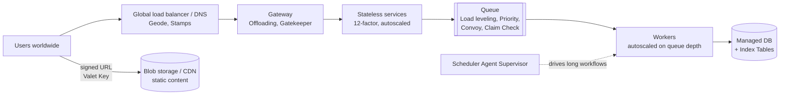

| Cloud property | What it means for your design | Patterns that help |
|---|---|---|
| **Elastic** - capacity can be added or removed in minutes | Run many small, identical, stateless copies | Twelve-Factor, Autoscaling |
| **Pay per use** | Idle capacity costs money; spiky load is expensive if you size for the peak | Queue-Based Load Leveling, scale-to-zero |
| **Machines fail and disappear** | Any instance may be killed at any moment | Disposability, Scheduler Agent Supervisor, Stamps |
| **Global** | Users are far from a single data centre | Geode, Static Content Hosting, CDN |
| **Managed services** (queues, blob storage, DBs) | Use them instead of building your own | Valet Key, Claim Check, Index Table |
| **Shared edge** | Every request enters through a gateway | Gateway Offloading, Gatekeeper |

### 📘 Terms Explained

| Term | Meaning |
|---|---|
| **Cloud-native** | Built to run on elastic cloud infrastructure: containers, automation, managed services, designed for failure |
| **Lift-and-shift** | Moving an existing app to the cloud unchanged (same VM, same design) |
| **Elasticity** | Ability to add/remove capacity automatically as load changes |
| **Managed service** | A service the cloud provider runs for you (e.g. AWS SQS, Azure Blob Storage, Google Cloud SQL) |
| **Blob storage** | Cheap storage for files ("binary large objects"): S3, Azure Blob, Google Cloud Storage |
| **Edge** | The entry point of your system (gateway, load balancer, CDN), closest to the user |
| **Global load balancer** | Routes users to one of several regions, usually by DNS or anycast IP |

---

# 1. The Twelve-Factor App (Interview Imp - Java)

## 1.1 What is the Twelve-Factor App?

The **Twelve-Factor App** is a list of 12 rules for building software-as-a-service apps that are easy to deploy, scale and run on any cloud. Engineers at Heroku wrote it around 2011, and it is still the most common starting point for "is your service cloud-ready?".

**Simple analogy:** Think of a food-truck franchise. Every truck is built from the same blueprint (one codebase). The local menu prices are taped on the window (config from the environment), not welded into the truck. Ingredients come from shared suppliers (backing services). A truck can be parked or towed away at any moment without losing customer orders (disposability), and you add more trucks on a busy day instead of building a bigger truck (concurrency).

## 1.2 Why Do We Need It?

| Without twelve-factor | Problem | With twelve-factor |
|---|---|---|
| Config in `application-prod.properties` baked into the JAR | Rebuild for every environment; secrets in Git | Same artifact everywhere; config injected at runtime |
| User session stored in the instance's memory | Instance dies → user logged out; sticky sessions needed | Session in Redis/DB → any instance serves any user |
| Logs written to `/var/log/app.log` | Disk fills up; logs lost when container is deleted | Logs to stdout; platform collects them |
| App takes 3 minutes to start, ignores SIGTERM | Slow autoscaling, dropped requests on every deploy | Fast start, graceful shutdown |
| "Works on my machine" (different library versions) | Prod-only bugs | Explicit dependencies, dev/prod parity |

## 1.3 How It Works: The 12 Factors

| # | Factor | Rule (plain words) | Java / Spring Boot example |
|---|---|---|---|
| I | **Codebase** | One repo per app, many deploys (dev, staging, prod) | One Git repo → one Spring Boot service |
| II | **Dependencies** | Declare all dependencies explicitly; never rely on what's installed on the machine | `pom.xml` / `build.gradle`, Maven Wrapper, a JDK in the Docker base image |
| III | **Config** **(Interview Imp - Java)** | Store config in the **environment**, not in code | `SPRING_DATASOURCE_URL` env var overrides `spring.datasource.url` |
| IV | **Backing services** | Treat DBs, queues, caches as attached resources, swappable by changing a URL | Point to a local Postgres or Amazon RDS just by changing config |
| V | **Build, release, run** | Strictly separate: build an artifact → combine with config into a release → run it | CI builds `app:1.4.2` image; CD deploys it with prod config |
| VI | **Processes** **(Interview Imp - Java)** | Run as **stateless** processes; keep state in backing services | No `HttpSession` in memory; use Spring Session + Redis |
| VII | **Port binding** | The app is self-contained and exposes HTTP on a port | Embedded Tomcat on `server.port=8080` (no external app server needed) |
| VIII | **Concurrency** | Scale out by running more processes, not one bigger process | More pods (horizontal scaling) |
| IX | **Disposability** **(Interview Imp - Java)** | Fast startup, **graceful shutdown** | `server.shutdown=graceful`, handle SIGTERM |
| X | **Dev/prod parity** | Keep dev, staging and prod as similar as possible | Testcontainers runs real Postgres in tests |
| XI | **Logs** | Treat logs as event streams written to stdout | Logback console appender, JSON format; platform ships them |
| XII | **Admin processes** | Run one-off tasks (migrations, scripts) as separate processes with the same code and config | Flyway migration as a Kubernetes Job / init container |

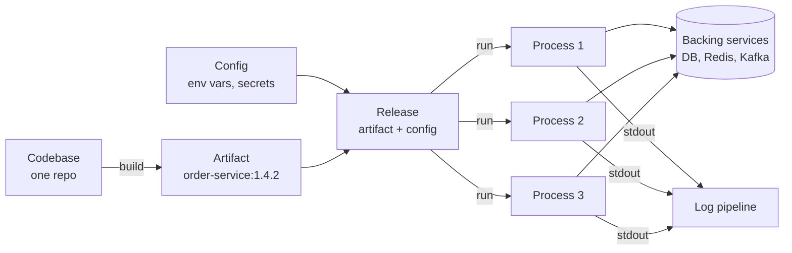

**Beyond twelve:** Many teams add "factor 13-15" ideas: **API first**, **telemetry** (metrics + traces, see [10_Observability_Pattern.md](../03_System_Design/10_Observability_Pattern.md)), and **security/authentication** built in (see [06_Security_Pattern.md](../03_System_Design/06_Security_Pattern.md)). Kevin Hoffman's book *Beyond the Twelve-Factor App* popularised this "15-factor" list.

## 1.4 Complete Java Example - Config, Stateless Processes and Graceful Shutdown

This program shows three factors working: the same code reads config from different environments (and refuses to start if a required secret is missing), a cart survives because it lives in a shared store instead of a pod's memory, and shutdown drains in-flight requests before exiting.

```java
import java.util.ArrayList;
import java.util.LinkedHashMap;
import java.util.List;
import java.util.Map;
import java.util.concurrent.CountDownLatch;
import java.util.concurrent.ExecutorService;
import java.util.concurrent.Executors;
import java.util.concurrent.TimeUnit;
import java.util.concurrent.atomic.AtomicInteger;

// Three of the twelve factors in plain Java:
//  III Config      - settings come from the environment, the same build artifact runs everywhere
//  VI  Processes   - stateless: session data lives in a backing service, so any instance can serve any request
//  IX  Disposability - start fast, and on SIGTERM stop taking work, finish in-flight work, then exit
public class TwelveFactorDemo {
    static Map<String, String> config(Map<String, String> env) {
        Map<String, String> c = new LinkedHashMap<>();
        c.put("DB_URL", env.getOrDefault("DB_URL", "jdbc:h2:mem:dev"));                     // safe local default
        c.put("PAYMENT_TIMEOUT_MS", env.getOrDefault("PAYMENT_TIMEOUT_MS", "2000"));
        c.put("FEATURE_NEW_CHECKOUT", env.getOrDefault("FEATURE_NEW_CHECKOUT", "false"));
        if (!env.containsKey("DB_PASSWORD") && !c.get("DB_URL").startsWith("jdbc:h2")) throw new IllegalStateException("DB_PASSWORD missing: fail fast at startup");
        return c;
    }

    public static void main(String[] args) throws Exception {
        // ---- III Config: one artifact (order-service-1.4.2.jar), different environments ----
        Map<String, Map<String, String>> environments = new LinkedHashMap<>();
        environments.put("dev", Map.of());
        environments.put("prod", Map.of("DB_URL", "jdbc:postgresql://orders-db:5432/orders", "DB_PASSWORD", "from-secret-store", "FEATURE_NEW_CHECKOUT", "true"));
        environments.put("prod-misconfigured", Map.of("DB_URL", "jdbc:postgresql://orders-db:5432/orders"));
        for (var e : environments.entrySet()) {
            try { System.out.println("[III] " + e.getKey() + " -> " + config(e.getValue())); }
            catch (IllegalStateException ex) { System.out.println("[III] " + e.getKey() + " -> refused to start: " + ex.getMessage()); }
        }

        // ---- VI Stateless processes: cart stored in a backing service (Redis in real life), not in instance memory ----
        Map<String, List<String>> sessionStore = new LinkedHashMap<>();
        String[] instances = {"pod-a", "pod-b", "pod-c"};
        String[] items = {"book", "pen", "lamp"};
        for (int i = 0; i < items.length; i++) {
            String pod = instances[i % instances.length];                 // load balancer sends each request to a different pod
            sessionStore.computeIfAbsent("session-42", k -> new ArrayList<>()).add(items[i]);
            System.out.println("[VI]  add " + items[i] + " via " + pod + " -> cart " + sessionStore.get("session-42"));
        }
        System.out.println("[VI]  pod-b is killed; pod-a still sees cart " + sessionStore.get("session-42"));

        // ---- IX Disposability: graceful shutdown on SIGTERM ----
        ExecutorService workers = Executors.newFixedThreadPool(2);
        AtomicInteger finished = new AtomicInteger();
        CountDownLatch started = new CountDownLatch(2);
        for (int i = 1; i <= 2; i++) {
            workers.submit(() -> { started.countDown(); try { Thread.sleep(150); } catch (InterruptedException ignored) { } finished.incrementAndGet(); });
        }
        started.await();
        System.out.println("[IX]  SIGTERM received with 2 requests in flight: readiness=DOWN, stop accepting new work");
        workers.shutdown();                                               // no new tasks accepted
        boolean drained = workers.awaitTermination(5, TimeUnit.SECONDS);  // grace period (Kubernetes default is 30 s)
        System.out.println("[IX]  drained=" + drained + ", in-flight requests completed=" + finished.get() + " -> exit 0");
    }
}
```

**Output:**
```
[III] dev -> {DB_URL=jdbc:h2:mem:dev, PAYMENT_TIMEOUT_MS=2000, FEATURE_NEW_CHECKOUT=false}
[III] prod -> {DB_URL=jdbc:postgresql://orders-db:5432/orders, PAYMENT_TIMEOUT_MS=2000, FEATURE_NEW_CHECKOUT=true}
[III] prod-misconfigured -> refused to start: DB_PASSWORD missing: fail fast at startup
[VI]  add book via pod-a -> cart [book]
[VI]  add pen via pod-b -> cart [book, pen]
[VI]  add lamp via pod-c -> cart [book, pen, lamp]
[VI]  pod-b is killed; pod-a still sees cart [book, pen, lamp]
[IX]  SIGTERM received with 2 requests in flight: readiness=DOWN, stop accepting new work
[IX]  drained=true, in-flight requests completed=2 -> exit 0
```

**What to notice:**
- `prod-misconfigured` **fails fast** at startup. A crash on boot is far better than a service that starts and then fails on the first real request.
- The cart is built across three different pods, and killing one changes nothing, because no pod holds state.
- `shutdown()` + `awaitTermination()` is exactly what Spring Boot's graceful shutdown does for its web server threads.

## 1.5 Twelve-Factor in Spring Boot and Kubernetes

Spring Boot was designed with these factors in mind. **Relaxed binding** maps environment variables to properties automatically: `SPRING_DATASOURCE_URL` → `spring.datasource.url`, `PAYMENT_TIMEOUT_MS` → `payment.timeout-ms`.

```yaml
# application.yml - safe defaults only; real values come from the environment
spring:
  datasource:
    url: ${DB_URL:jdbc:h2:mem:dev}
    password: ${DB_PASSWORD:}
  lifecycle:
    timeout-per-shutdown-phase: 20s     # IX: max time to finish in-flight requests
  session:
    store-type: redis                    # VI (older Spring Boot); newer versions auto-detect spring-session-data-redis on the classpath
server:
  port: ${PORT:8080}                     # VII: port binding
  shutdown: graceful                     # IX: stop accepting, finish in-flight work
management:
  endpoint:
    health:
      probes:
        enabled: true                    # /actuator/health/liveness and /readiness
logging:
  structured:
    format:
      console: ecs                       # XI: JSON logs to stdout (Spring Boot 3.4+)
```

```java
// Type-safe config, validated at startup (fail fast if missing or invalid)
@Validated
@ConfigurationProperties(prefix = "payment")
public record PaymentProperties(
        @NotNull Duration timeout,
        @NotBlank String providerUrl) {}
```

```yaml
# Kubernetes Deployment excerpt: config and secrets injected as env vars
spec:
  template:
    spec:
      terminationGracePeriodSeconds: 30           # must be longer than Spring's shutdown phase
      containers:
        - name: order-service
          image: registry.example.com/order-service:1.4.2   # V: same image in every environment
          envFrom:
            - configMapRef: { name: order-service-config }  # III: non-secret config
          env:
            - name: DB_PASSWORD
              valueFrom:
                secretKeyRef: { name: order-db, key: password }
          readinessProbe:
            httpGet: { path: /actuator/health/readiness, port: 8080 }
          lifecycle:
            preStop:
              exec: { command: ["sh", "-c", "sleep 5"] }   # let the load balancer stop routing first
```

**Why the `preStop` sleep?** When Kubernetes deletes a pod, it sends SIGTERM and removes the pod from Service endpoints **at the same time**. For a few seconds, some load balancers may still send traffic to it. A short sleep before shutdown starts avoids "connection refused" errors during deploys.

For layered config (defaults → files → env → config server) see [Externalized Configuration](02_Microservices_Pattern.md#8-externalized-configuration-pattern-interview-imp---java). For one-off admin tasks and migrations see [09_Deployment_Pattern.md](../03_System_Design/09_Deployment_Pattern.md).

## 1.6 Pros and Cons

| Pros | Cons |
|---|---|
| One artifact for all environments: what you tested is what you run | Env vars are flat strings; complex config gets awkward (use config files mounted from ConfigMaps) |
| Horizontal scaling becomes trivial | Stateless design pushes work to backing services (Redis, DB), which must scale too |
| Deploys and pod restarts don't hurt users | Env vars can leak in crash dumps or `/proc`; a secret manager is safer for secrets |
| Portable across clouds and Kubernetes | Some factors (e.g. "logs to stdout only") need platform support to be useful |

## 1.7 Pitfalls, Interview Questions and Cheat Sheet

**Common pitfalls**
- **Secrets in Git** "because it's only the dev password". Use a secret store (Vault, AWS Secrets Manager, Kubernetes Secrets + encryption) - see [06_Security_Pattern.md](../03_System_Design/06_Security_Pattern.md).
- **Hidden state:** local file uploads, in-memory caches used as the source of truth, scheduled jobs that run on *every* replica (use ShedLock or a single Kubernetes CronJob).
- **Ignoring SIGTERM:** a `kill -9` after the grace period drops requests. Make sure the JVM is PID 1 or uses an init (`exec java ...` in the entrypoint, not `sh -c java ...`, which can swallow the signal).
- **Slow startup:** huge classpath scanning and eager init make autoscaling useless. Consider lazy init, Class Data Sharing (CDS), or GraalVM native images.
- **Different DB in tests** (H2 in tests, Postgres in prod) breaks dev/prod parity. Use Testcontainers.

**Interview questions**
1. *What is the Twelve-Factor App? Name the factors you consider most important.* → Config in environment, stateless processes, disposability, logs as streams, backing services. Explain *why* each one enables scaling.
2. *Why should config not be inside the JAR?* → The same build must be promoted from staging to prod unchanged. Rebuilding per environment means prod runs something that was never tested, and secrets end up in artifacts.
3. *How do you make a Spring Boot app stateless?* → No in-memory sessions (Spring Session + Redis or JWT), no local files (blob storage), caches only as copies of data in the DB, and distributed locks for scheduled jobs.
4. *What happens when Kubernetes stops a pod and how should a Java app react?* → Endpoint removal + SIGTERM → stop accepting, finish in-flight requests, close pools, exit before `terminationGracePeriodSeconds`; otherwise SIGKILL.
5. *Are environment variables safe for secrets?* → Better than code, but they can leak through logs, crash reports and child processes. Prefer mounted secret files or a secret manager with short-lived credentials.

**Cheat sheet**
```
Same artifact everywhere   -> config via env / ConfigMap / Secret, fail fast if missing
Stateless                  -> session in Redis, files in blob storage, locks for cron jobs
Disposable                 -> fast start, server.shutdown=graceful, preStop sleep, grace > shutdown phase
Logs                       -> stdout, JSON; platform ships them
Admin tasks                -> Flyway/Liquibase as a Job, same image + config
```

### 📘 Terms Explained

| Term | Meaning |
|---|---|
| **Twelve-Factor App** | A set of 12 rules for cloud-friendly service design (12factor.net) |
| **Artifact** | The built output of CI: a JAR or, more often, a container image with a version tag |
| **Release** | An artifact combined with a specific environment's config |
| **Backing service** | Anything the app uses over the network: database, cache, queue, email API |
| **Stateless process** | A process that keeps no user data in memory between requests, so any copy can serve any request |
| **SIGTERM / SIGKILL** | Operating-system signals: SIGTERM = "please stop" (can be handled), SIGKILL = "die now" (cannot) |
| **Graceful shutdown** | Stop taking new work, finish current work, release resources, then exit |
| **Relaxed binding** | Spring Boot feature that maps `MY_PROP_NAME` env vars to `my.prop-name` properties |
| **ConfigMap / Secret** | Kubernetes objects holding config and sensitive values, injected into pods |
| **preStop hook** | A command Kubernetes runs in the container before sending SIGTERM |
| **Dev/prod parity** | Keeping environments alike (same DB engine, same versions) so bugs show up early |
| **Fail fast** | Crash immediately at startup when something required is wrong, instead of failing later |

---

# 2. Autoscaling Pattern (Interview Imp - Java)

## 2.1 What is Autoscaling?

**Autoscaling** means the platform adds or removes capacity automatically based on a measured signal (CPU, requests per second, queue length), so you have enough capacity at the peak and pay less at night.

**Simple analogy:** A supermarket opens more checkout counters when queues get long and closes them when the store is quiet. The manager doesn't open a counter for every single extra customer (that would be chaos). They wait until the queue is clearly longer, and close counters only after it has been quiet for a while.

## 2.2 Why Do We Need It?

| Fixed capacity | Problem |
|---|---|
| Sized for the average | Falls over at peak (sales, month-end, news events) |
| Sized for the peak | Pays for idle machines 90% of the time |
| Humans scale by hand | Too slow at 3 a.m., and people forget to scale back down |

Horizontal vs vertical scaling is covered in [01_Scalability_Pattern.md](../03_System_Design/01_Scalability_Pattern.md#2-horizontal-scaling-interview-imp---java). This section is about **making the platform do it for you**.

## 2.3 How It Works: The Control Loop

Every autoscaler is a **control loop**: measure → compare with a target → change replica count → wait → repeat.

The Kubernetes **Horizontal Pod Autoscaler (HPA)** uses this formula:

```
desiredReplicas = ceil( currentReplicas × currentMetricValue / targetMetricValue )
```

Example: 4 pods at 90% average CPU, target 60% → `ceil(4 × 90 / 60) = 6` pods.

Two safety features stop it from **flapping** (scaling up and down every few seconds):
- **Tolerance** (default 10%): if the ratio is between 0.9 and 1.1, do nothing.
- **Scale-down stabilization window** (default 5 minutes): when scaling down, use the *highest* recommendation from the last 5 minutes. Scale-up is immediate by default.

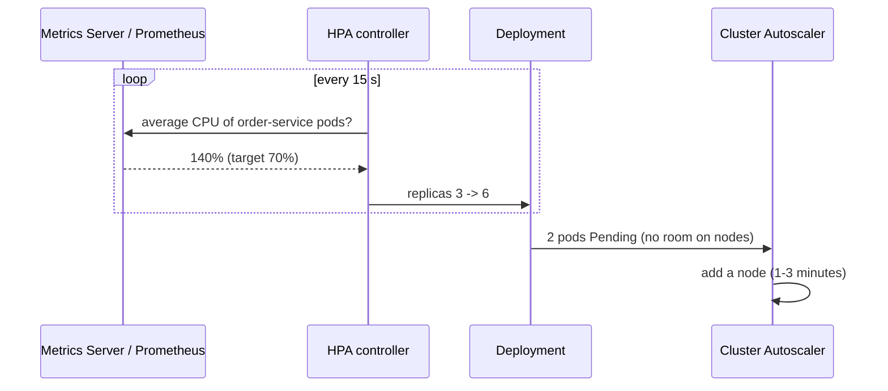

## 2.4 Types of Autoscaling

| Type | What it scales | Signal | Example tool |
|---|---|---|---|
| **Horizontal pod autoscaling** **(Interview Imp - Java)** | Number of pods | CPU, memory, custom metrics (RPS, latency) | Kubernetes HPA |
| **Vertical autoscaling** | CPU/memory per pod | Actual usage history | Kubernetes VPA (see [01_Scalability_Pattern.md](../03_System_Design/01_Scalability_Pattern.md#35-advanced---vertical-autoscaling-and-diagonal-scaling)) |
| **Cluster / node autoscaling** | Number of VMs in the cluster | Pods that can't be scheduled | Cluster Autoscaler, Karpenter |
| **Event-driven autoscaling** | Pods, including **scale to zero** | Queue length, Kafka consumer lag, cron | KEDA |
| **Scheduled (predictive) scaling** | Capacity before a known peak | Time of day, forecast | AWS Auto Scaling scheduled actions, KEDA cron scaler |
| **Serverless scaling** | One instance per concurrent request(s) | Incoming requests | AWS Lambda, Cloud Run, Knative |

**Which metric to choose?**
- **CPU** is fine for CPU-bound web services.
- **Requests per second or latency** is better for I/O-bound services, where threads wait on the DB and CPU stays low even when the service is overloaded.
- **Queue length / consumer lag** is right for workers (see [Queue-Based Load Leveling](#5-queue-based-load-leveling-pattern-interview-imp---java)).

## 2.5 Complete Java Example - The HPA Algorithm with Stabilization

The simulation applies the real HPA formula to a load spike. Load is measured in "pod-CPU-%" units, so the same load spread over more pods gives a lower average.

```java
// Kubernetes HPA algorithm: desired = ceil(current * currentMetric / targetMetric), with tolerance and scale-down stabilization
public class AutoscalerDemo {
    public static void main(String[] args) {
        double target = 70;                    // target average CPU % per pod
        double tolerance = 0.10;               // HPA default: ignore ratios within 10% of 1.0
        int min = 3, max = 20;
        int stabilizationTicks = 5;            // like the default 5-minute scale-down stabilization window
        // total load in "pod-CPU-%" units: 600 means six pods' worth at 100%
        int[] load = {200, 210, 420, 900, 1100, 1100, 700, 400, 300, 250, 250, 250, 250, 250};

        int replicas = 3;
        int[] recommendations = new int[load.length];
        System.out.println("tick  load  replicas  avgCPU  recommended  ->  new replicas");
        for (int t = 0; t < load.length; t++) {
            double avgCpu = (double) load[t] / replicas;                           // the same load spread over current pods
            double ratio = avgCpu / target;
            int recommended = Math.abs(ratio - 1) <= tolerance ? replicas : (int) Math.ceil(replicas * ratio);
            recommended = Math.max(min, Math.min(max, recommended));
            recommendations[t] = recommended;
            int next;
            if (recommended > replicas) {
                next = recommended;                                                  // scale UP immediately
            } else {
                int highestRecent = recommended;                                     // scale DOWN only to the highest recent recommendation
                for (int k = Math.max(0, t - stabilizationTicks + 1); k <= t; k++) highestRecent = Math.max(highestRecent, recommendations[k]);
                next = Math.min(replicas, highestRecent);
            }
            System.out.printf("%4d  %4d  %8d  %5.0f%%  %11d  ->  %12d%n", t, load[t], replicas, avgCpu, recommended, next);
            replicas = next;
        }
        System.out.println("Scale-up reacted at once; scale-down waited for the stabilization window, so no flapping.");
    }
}
```

**Output:**
```
tick  load  replicas  avgCPU  recommended  ->  new replicas
   0   200         3     67%            3  ->             3
   1   210         3     70%            3  ->             3
   2   420         3    140%            6  ->             6
   3   900         6    150%           13  ->            13
   4  1100        13     85%           16  ->            16
   5  1100        16     69%           16  ->            16
   6   700        16     44%           10  ->            16
   7   400        16     25%            6  ->            16
   8   300        16     19%            5  ->            16
   9   250        16     16%            4  ->            16
  10   250        16     16%            4  ->            10
  11   250        10     25%            4  ->             6
  12   250         6     42%            4  ->             5
  13   250         5     50%            4  ->             4
Scale-up reacted at once; scale-down waited for the stabilization window, so no flapping.
```

**What to notice:**
- Tick 1: 70% is exactly the target → no change. Tick 0 (67%) is within the 10% tolerance → no change.
- Ticks 2-4: replicas jump 3 → 6 → 13 → 16 straight away.
- Ticks 6-9: load drops but replicas stay at 16 because a recommendation of 16 is still inside the 5-tick window. Then they step down 10 → 6 → 5 → 4. If the load comes back during the window, the pods are still there.

## 2.6 Autoscaling in Kubernetes and Spring Boot

```yaml
# HPA on CPU plus a custom requests-per-second metric (autoscaling/v2)
apiVersion: autoscaling/v2
kind: HorizontalPodAutoscaler
metadata: { name: order-service }
spec:
  scaleTargetRef: { apiVersion: apps/v1, kind: Deployment, name: order-service }
  minReplicas: 3
  maxReplicas: 20
  metrics:
    - type: Resource
      resource: { name: cpu, target: { type: Utilization, averageUtilization: 70 } }
    - type: Pods
      pods:
        metric: { name: http_server_requests_per_second }     # exposed via Micrometer + Prometheus Adapter
        target: { type: AverageValue, averageValue: "100" }
  behavior:
    scaleDown:
      stabilizationWindowSeconds: 300
      policies: [{ type: Percent, value: 50, periodSeconds: 60 }]   # remove at most half the pods per minute
---
# KEDA: scale a worker on queue length, down to zero when idle
apiVersion: keda.sh/v1alpha1
kind: ScaledObject
metadata: { name: invoice-worker }
spec:
  scaleTargetRef: { name: invoice-worker }
  minReplicaCount: 0
  maxReplicaCount: 30
  triggers:
    - type: rabbitmq
      metadata: { queueName: invoices, mode: QueueLength, value: "50" }   # ~50 messages per pod
```

When an HPA has several metrics, it computes a replica count for each and uses the **highest**.

**Java-specific tips**
- **Set CPU requests.** HPA utilization is measured against the pod's CPU *request*. Without a request there is no percentage to compute.
- **JVM warm-up:** a new pod is slow for its first seconds (JIT compilation, cold caches, connection pools filling), and the CPU spike can trigger even more scaling. Use a **startup probe**, readiness only after warm-up, and consider CDS / CRaC / GraalVM native image for faster starts.
- **Memory is a poor scaling metric for Java:** the JVM rarely gives heap back to the OS, so memory "usage" stays high after load drops and the HPA never scales down.
- **Container-aware JVM:** use `-XX:MaxRAMPercentage=75` instead of a fixed `-Xmx`, so heap follows the pod's memory limit.

## 2.7 Pros and Cons

| Pros | Cons |
|---|---|
| Handles peaks without manual work | Reacts *after* load rises: new pods take seconds, new nodes take minutes |
| Lower cost off-peak | Downstream (DB, third-party APIs) may not scale; more pods can overload them |
| Scale-to-zero for rarely used workers | Cold start latency on the first request after zero |
| Combined with queues, absorbs any burst | Wrong metric or thresholds cause flapping or never scaling |

## 2.8 Pitfalls, Interview Questions and Cheat Sheet

**Common pitfalls**
- **Scaling the app into the database:** 20 pods × a pool of 20 connections = 400 DB connections. Size pools for `maxReplicas`, or put PgBouncer/RDS Proxy in between.
- **`maxReplicas` too low or unset limits** in the cluster: the HPA wants more pods, but they stay `Pending`.
- **HPA and VPA both on CPU** for the same Deployment: they fight each other. Use VPA in recommendation mode, or on a different resource.
- **No `PodDisruptionBudget`:** scale-down plus node drains can take too many pods at once.
- **Per-instance state** (local cache warm-up, in-memory sessions) makes new pods useless for a while. See [Twelve-Factor](#1-the-twelve-factor-app-interview-imp---java).

**Interview questions**
1. *How does the Kubernetes HPA decide the replica count?* → `ceil(current × actual/target)`, with a 10% tolerance and a 5-minute scale-down stabilization window. Multiple metrics: take the max.
2. *Your service is slow under load but CPU is only 30%. Why doesn't the HPA scale?* → I/O-bound: threads wait on the DB or a downstream call. Scale on RPS, latency or thread-pool saturation instead, and check whether the bottleneck is downstream (scaling won't help then).
3. *How do you autoscale a Kafka consumer?* → On consumer lag (KEDA Kafka scaler). Note: more consumers than partitions doesn't help, because extra consumers sit idle.
4. *What is scale-to-zero and what's the catch?* → No pods while idle (KEDA, Knative, Lambda); the catch is cold-start latency, which is especially painful for JVM apps.
5. *Why not scale on memory for a Spring Boot app?* → The JVM holds on to heap after GC, so memory stays high and the app never scales down.

**Cheat sheet**
```
HPA formula         desired = ceil(current * actual / target), tolerance 10 %, scale-down window 5 min
Web services        CPU (set requests!) or RPS / latency via custom metrics
Workers             queue length / consumer lag via KEDA, min 0 if cold start is OK
Nodes               Cluster Autoscaler / Karpenter adds VMs for Pending pods
JVM                 startup probe, MaxRAMPercentage, size DB pools for maxReplicas
```

### 📘 Terms Explained

| Term | Meaning |
|---|---|
| **HPA** | Horizontal Pod Autoscaler: Kubernetes controller that changes a Deployment's replica count |
| **VPA** | Vertical Pod Autoscaler: changes the CPU/memory requests of pods |
| **Cluster Autoscaler / Karpenter** | Tools that add or remove worker nodes (VMs) when pods can't be scheduled or nodes are idle |
| **KEDA** | Kubernetes Event-Driven Autoscaling: scales on external events (queues, Kafka lag, cron), including to zero |
| **Control loop** | Repeated measure → compare → act cycle, the basis of all Kubernetes controllers |
| **Flapping** | Scaling up and down repeatedly because the signal hovers around the threshold |
| **Stabilization window** | A period during which the autoscaler looks back and picks the safest recommendation |
| **CPU request** | The CPU a pod asks Kubernetes to reserve; HPA percentages are measured against it |
| **Cold start** | The delay when a new instance (pod or function) starts and warms up before serving fast |
| **Consumer lag** | How many messages a consumer group is behind the newest message in a Kafka partition |
| **PodDisruptionBudget** | A rule limiting how many pods of an app can be down at the same time during voluntary disruptions |
| **CDS / CRaC** | Class Data Sharing (faster class loading) / Coordinated Restore at Checkpoint (restore a warmed-up JVM snapshot) |

---

# 3. Gateway Offloading and Gatekeeper Patterns

> Gateway **Routing** (one entry point that routes to many services) and Gateway **Aggregation** (one call fans out to several services and merges the results) are covered with code in [02_Microservices_Pattern.md - API Gateway](02_Microservices_Pattern.md#2-api-gateway-and-backends-for-frontends-interview-imp---java) and [08_API_Design_Pattern.md](../03_System_Design/08_API_Design_Pattern.md#6-api-gateway-and-backend-for-frontend-bff). This section covers the other two gateway patterns from the cloud catalogue.

## 3.1 What Are They?

- **Gateway Offloading:** move **shared, cross-cutting work** (TLS termination, authentication, rate limiting, compression, caching, logging) out of every service and into the gateway. Each service only does its own business logic.
- **Gatekeeper:** put a **separate, minimally trusted host** in front of the trusted services. It validates and sanitizes every request and forwards only clean ones. If an attacker breaks into the gatekeeper, they find no keys, no database credentials and no business data there.

**Simple analogy:** In an office building, the reception desk checks badges and signs for parcels for every company in the building (offloading). The security booth at the gate has no keys to any office. It only checks visitors and lets the approved ones through to the lobby (gatekeeper). Breaking into the booth gives you nothing.

## 3.2 Why Do We Need Them?

| Without | Problem |
|---|---|
| Every service terminates TLS, validates JWTs, rate-limits | 30 services × the same code; each team does it slightly differently; certificate renewals in 30 places |
| A security fix (e.g. stricter header checks) | Must be rolled out to every service |
| The public-facing service holds DB credentials | A single remote-code-execution bug exposes everything |

## 3.3 How It Works

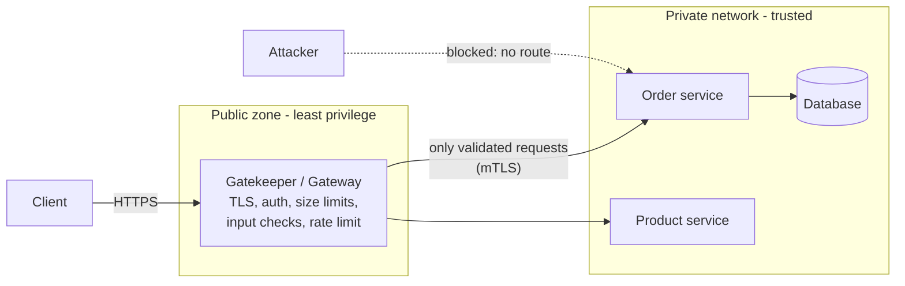

Key rules for a real gatekeeper:
1. **It is the only way in.** Trusted services aren't reachable from the internet (private subnet, network policies, security groups).
2. **It holds no secrets** apart from what it needs to validate requests (e.g. a JWKS public key).
3. **Validate, then forward.** Reject early and cheaply (size, schema, auth), before any business logic runs.
4. **Defence in depth:** services still check authorization themselves ("is this user allowed to see *this* order?"). The gateway checks *who* you are, the service checks *what* you may do.

## 3.4 What Can Be Offloaded (and What Shouldn't)

| Good to offload | Keep in the service |
|---|---|
| TLS termination, certificate management | Business validation (e.g. "quantity ≤ stock") |
| Authentication (JWT signature, expiry, audience) | Fine-grained authorization (object/row-level) |
| Rate limiting, quotas, IP allow/deny lists, WAF rules | Business rules that differ per service |
| Request size limits, compression, CORS | Data transformation specific to one domain |
| Access logs, trace ID creation, metrics | Transactions, retries of domain operations |
| Response caching for public GET endpoints | |

**Rule of thumb:** if the logic is *the same for every service* and doesn't need domain knowledge, offload it. If it needs to know what an "order" is, keep it in the service. Putting business logic in the gateway turns it into a fragile "smart pipe" that every team must change.

## 3.5 Complete Java Example - A Gatekeeper Filter Chain

The gatekeeper runs cheap checks in order and stops at the first failure. Only requests that pass everything reach the trusted host.

```java
import java.util.ArrayList;
import java.util.List;
import java.util.Map;
import java.util.Set;
import java.util.function.Function;

// Gatekeeper: a separate, minimal-privilege host validates and sanitises every request BEFORE the trusted host sees it.
// Gateway offloading: shared concerns (TLS, auth, compression, size limits) live in the gateway, not in each service.
public class GatekeeperDemo {
    record Request(String method, String path, Map<String, String> headers, String body) {}

    interface Check extends Function<Request, String> {}         // returns null if OK, or a rejection reason

    public static void main(String[] args) {
        Set<String> allowedPaths = Set.of("/api/orders", "/api/products");
        List<Check> gatekeeperChecks = List.of(
                r -> r.headers().getOrDefault("X-Forwarded-Proto", "http").equals("https") ? null : "400 HTTPS required (TLS offloaded at the edge)",
                r -> r.headers().containsKey("Authorization") ? null : "401 missing token",
                r -> allowedPaths.stream().anyMatch(r.path()::startsWith) ? null : "404 unknown route (internal paths never exposed)",
                r -> r.body().length() <= 1_000 ? null : "413 payload too large",
                r -> r.body().matches("(?s).*(<script|\\.\\./|' OR ').*") ? "400 suspicious input blocked" : null);

        Function<Request, String> trustedHost = r -> "200 handled by order-service (" + r.method() + " " + r.path() + ")";

        List<Request> requests = List.of(
                new Request("POST", "/api/orders", Map.of("X-Forwarded-Proto", "https", "Authorization", "Bearer t"), "{\"sku\":\"P-1\"}"),
                new Request("POST", "/api/orders", Map.of("X-Forwarded-Proto", "http", "Authorization", "Bearer t"), "{}"),
                new Request("GET", "/internal/admin/reset", Map.of("X-Forwarded-Proto", "https", "Authorization", "Bearer t"), ""),
                new Request("POST", "/api/products", Map.of("X-Forwarded-Proto", "https"), "{}"),
                new Request("POST", "/api/products", Map.of("X-Forwarded-Proto", "https", "Authorization", "Bearer t"), "x".repeat(5_000)),
                new Request("POST", "/api/orders", Map.of("X-Forwarded-Proto", "https", "Authorization", "Bearer t"), "{\"note\":\"<script>alert(1)</script>\"}"));

        int reachedBackend = 0;
        for (Request r : requests) {
            String verdict = null;
            for (Check c : gatekeeperChecks) { verdict = c.apply(r); if (verdict != null) break; }
            if (verdict == null) { verdict = trustedHost.apply(r); reachedBackend++; }
            System.out.printf("%-5s %-22s -> %s%n", r.method(), r.path(), verdict);
        }
        System.out.println(reachedBackend + " of " + requests.size() + " requests reached the trusted host; it never had to re-implement these checks.");
    }
}
```

**Output:**
```
POST  /api/orders            -> 200 handled by order-service (POST /api/orders)
POST  /api/orders            -> 400 HTTPS required (TLS offloaded at the edge)
GET   /internal/admin/reset  -> 404 unknown route (internal paths never exposed)
POST  /api/products          -> 401 missing token
POST  /api/products          -> 413 payload too large
POST  /api/orders            -> 400 suspicious input blocked
1 of 6 requests reached the trusted host; it never had to re-implement these checks.
```

**What to notice:** `/internal/admin/reset` gets a **404**, not a 403. The gatekeeper only knows about public routes, so internal endpoints simply don't exist from the outside.

## 3.6 Gateway Offloading with Spring Cloud Gateway

```yaml
spring:
  cloud:
    gateway:
      default-filters:
        - name: RequestSize
          args: { maxSize: 1MB }                      # reject big bodies at the edge
        - name: RequestRateLimiter                    # token bucket in Redis
          args:
            redis-rate-limiter.replenishRate: 50
            redis-rate-limiter.burstCapacity: 100
            key-resolver: "#{@userKeyResolver}"
        - RemoveRequestHeader=X-Internal-User        # clients must not be able to fake internal headers
      routes:
        - id: orders
          uri: lb://order-service
          predicates: [ Path=/api/orders/** ]
  security:
    oauth2:
      resourceserver:
        jwt:
          issuer-uri: https://auth.example.com/realms/shop   # JWT validation offloaded to the gateway
server:
  ssl:
    bundle: edge-cert                                  # TLS terminated here
```

```java
@Configuration
public class GatewaySecurity {
    @Bean
    SecurityWebFilterChain edge(ServerHttpSecurity http) {
        return http
                .authorizeExchange(ex -> ex
                        .pathMatchers("/api/products/**").permitAll()
                        .pathMatchers("/api/**").authenticated()
                        .anyExchange().denyAll())                 // unknown paths are never forwarded
                .oauth2ResourceServer(o -> o.jwt(Customizer.withDefaults()))
                .build();
    }
}
```

In Kubernetes the same offloading is often done by an **Ingress controller / Gateway API** implementation (NGINX, Envoy Gateway, Istio) or a managed API gateway (AWS API Gateway, Azure API Management). Network-level rules belong to a **WAF** (Web Application Firewall). More on edge defence: [06_Security_Pattern.md](../03_System_Design/06_Security_Pattern.md#9-rate-limiting-api-gateway-and-defense-at-the-edge).

## 3.7 Pros and Cons

| Pros | Cons |
|---|---|
| Consistent security and policies, changed in one place | Gateway is a single point of failure: run several replicas in several zones |
| Services are simpler and smaller | Extra network hop adds latency (usually 1-5 ms) |
| Smaller attack surface: trusted services are private | Gateway team can become a bottleneck for every change |
| Specialised hardware/software for TLS, WAF, caching | Temptation to put business logic in it |

## 3.8 Pitfalls, Interview Questions and Cheat Sheet

**Common pitfalls**
- **Trusting headers blindly:** if services trust `X-User-Id` set by the gateway, make sure clients can't send it themselves (strip it at the edge) and that services are reachable *only* through the gateway (mTLS or network policy).
- **No authorization in services** because "the gateway checks auth" → broken object-level authorization (OWASP API1).
- **One giant shared gateway config** edited by every team → outages from unrelated changes. Split by domain or use BFFs.
- **Forgetting the gatekeeper itself needs patching, monitoring and rate limits.**

**Interview questions**
1. *What would you put in an API gateway and what not?* → Cross-cutting concerns (TLS, authN, rate limits, logging, CORS) in; business rules and object-level authZ out.
2. *Gateway offloading vs gatekeeper?* → Offloading is about reusing shared functionality; gatekeeper is a security boundary: a separate least-privilege host that validates and sanitises before trusted code runs.
3. *If the gateway validates JWTs, should services validate them again?* → Yes, in zero-trust setups. It's cheap (signature check with a cached public key) and protects against internal traffic that bypasses the gateway. At minimum, services must check permissions.
4. *How do you avoid the gateway becoming a single point of failure?* → Multiple stateless replicas behind a load balancer, across zones; keep its state (rate-limit counters) in Redis; health checks and autoscaling.

**Cheat sheet**
```
Routing      one entry point -> many services            (Microservices file)
Aggregation  one call -> fan-out -> merged response      (Microservices file)
Offloading   TLS, authN, rate limit, size, CORS, logs at the gateway
Gatekeeper   separate least-privilege host, validate + sanitise, only path to trusted services
Still in services: object-level authorization, business validation
```

## 3.9 Types and Variants

| Variant | What the gateway does | Example |
|---|---|---|
| **TLS termination** | Decrypts HTTPS once at the edge | NGINX, Envoy, AWS ALB |
| **Authentication offloading** | Validates JWT/OAuth tokens before requests reach services | Spring Cloud Gateway + `oauth2ResourceServer`, Kong JWT plugin |
| **Rate limiting / quotas** | Protects services per client | Redis-backed rate limiter filters |
| **Request validation / WAF** | Blocks malformed or malicious requests (Gatekeeper) | AWS WAF, ModSecurity, Cloudflare |
| **Compression, caching, CORS** | Common HTTP concerns in one place | Gateway filters |
| **Gatekeeper as a separate tier** | A hardened host that only validates and forwards; it holds no secrets or data | Dedicated DMZ proxy in front of internal services |
| **Sidecar offloading** | The same concerns per service instead of at the edge | Service mesh proxies (mTLS, retries) |

### 📘 Terms Explained

| Term | Meaning |
|---|---|
| **Gateway Offloading** | Moving shared cross-cutting work from services into the gateway |
| **Gatekeeper** | A dedicated host that validates requests before they reach trusted services, with as few privileges as possible |
| **TLS termination** | Decrypting HTTPS at the gateway, then forwarding (often re-encrypted with mTLS) inside the network |
| **DMZ** | "Demilitarised zone": a network area exposed to the internet, separated from the private network |
| **Least privilege** | Giving a component only the permissions it absolutely needs |
| **WAF** | Web Application Firewall: blocks common attacks (SQL injection, XSS patterns) at the edge |
| **JWKS** | JSON Web Key Set: the public keys used to verify JWT signatures |
| **Zero trust** | Security model where no request is trusted just because it comes from inside the network |
| **Defence in depth** | Several independent layers of security, so one failure doesn't expose everything |
| **Ingress / Gateway API** | Kubernetes objects that route external HTTP traffic to services |

---

# 4. Valet Key, Claim Check and Static Content Hosting (Interview Imp - Java)

These three patterns share one idea: **don't push large bytes through your application servers or your message broker.** Let cheap, massively scalable storage do the heavy lifting, and pass around small tokens or references instead.

## 4.1 What Are They?

- **Valet Key:** the app gives the client a **short-lived, narrowly scoped token** (usually a signed URL) that allows direct access to one resource in storage, e.g. "upload this one file, PUT only, for 5 minutes". AWS calls these **presigned URLs**, Azure calls them **SAS tokens** (Shared Access Signatures), Google Cloud calls them **signed URLs**.
- **Claim Check:** when a message is too big for the broker, store the payload in blob storage and send only a **reference** (the "claim ticket") through the queue. The consumer uses the ticket to fetch the payload. (It also appears as an Enterprise Integration Pattern in [04_Integration_Pattern.md - Message Construction](04_Integration_Pattern.md#5-message-construction-envelope-wrapper-format-indicator-message-expiration-claim-check).)
- **Static Content Hosting:** serve images, JS, CSS, videos and downloads straight from blob storage + CDN instead of from your app servers.

**Simple analogy:** A **valet key** for a car starts the engine and opens the door, but not the boot or the glovebox, and you get it back after one use. A **claim check** is the ticket you get at a coat check: you carry a small ticket, not the coat.

## 4.2 Why Do We Need Them?

| Without | Problem |
|---|---|
| 50 MB video uploads go through the Spring Boot app | Threads, memory and bandwidth used just to copy bytes; slow uploads block other users |
| Broker messages with 5 MB PDFs inside | Broker size limits (SQS/Service Bus 256 KB standard, Kafka 1 MB default); slower replication and consumers |
| App serves `/static/app.js` | Every page view costs app CPU; no global edge caching |
| Giving clients permanent storage keys | One leaked key = full bucket access forever |

## 4.3 How It Works

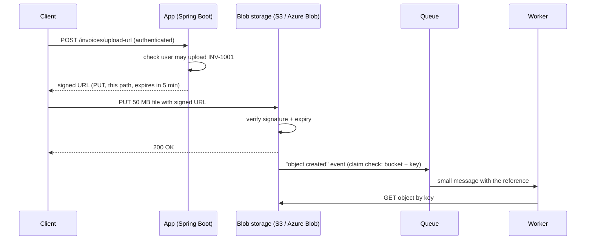

The signature is an **HMAC** computed over the method, path, expiry (and sometimes headers/IP range) with a secret key known only to the app and the storage service. Change anything (the path, the method, the expiry) and the signature no longer matches.

## 4.4 Variants

| Variant | Use |
|---|---|
| **Upload URL** (PUT/POST policy) | Users upload profile pictures, documents, videos directly |
| **Download URL** | Private files (invoices, reports) shared for a limited time |
| **Scoped short-lived credentials** | Mobile app gets temporary cloud credentials (AWS STS, Cognito identity pools) limited to its own folder |
| **Claim check, automatic** | Storage emits an "object created" event that is itself the claim check |
| **Claim check, manual** | Producer uploads, then publishes a message with the key + checksum |
| **Static hosting + CDN** | Single-page apps (React builds), images, downloads; see [CDN](../03_System_Design/01_Scalability_Pattern.md#12-cdn-content-delivery-network) |

## 4.5 Complete Java Example - Valet Key with HMAC-Signed URLs

The "storage service" verifies the signature itself. The app only signs, and is never involved in the transfer.

```java
import java.nio.charset.StandardCharsets;
import java.security.MessageDigest;
import java.util.HexFormat;
import javax.crypto.Mac;
import javax.crypto.spec.SecretKeySpec;

// Valet Key: the app hands the client a short-lived, narrowly-scoped signed URL so the client uploads/downloads
// DIRECTLY to/from storage, without the bytes passing through the app (like S3 presigned URLs / Azure SAS tokens).
class Storage {
    private final byte[] accountKey;                          // known only to the app and the storage service
    Storage(String key) { this.accountKey = key.getBytes(StandardCharsets.UTF_8); }

    String sign(String method, String path, long expiresAt) throws Exception {
        Mac mac = Mac.getInstance("HmacSHA256");
        mac.init(new SecretKeySpec(accountKey, "HmacSHA256"));
        return HexFormat.of().formatHex(mac.doFinal((method + "\n" + path + "\n" + expiresAt).getBytes(StandardCharsets.UTF_8)));
    }

    // The storage service validates the key itself: the app is not involved in the transfer
    String handle(String method, String url, long now) throws Exception {
        String path = url.substring(0, url.indexOf('?'));
        long expires = Long.parseLong(url.replaceAll(".*expires=(\\d+).*", "$1"));
        String sig = url.replaceAll(".*sig=([0-9a-f]+).*", "$1");
        if (!MessageDigest.isEqual(sign(method, path, expires).getBytes(), sig.getBytes())) return "403 signature does not match (path/method/expiry changed)";
        if (now > expires) return "403 URL expired";
        return "200 " + method + " " + path + " served directly by storage";
    }
}

public class ValetKeyDemo {
    public static void main(String[] args) throws Exception {
        Storage storage = new Storage("demo-account-key");
        long now = 1_761_800_000L;

        // App: user asha is allowed to upload ONE file, for 5 minutes, with PUT only
        String path = "/invoices/asha/INV-1001.pdf";
        long expires = now + 300;
        String url = path + "?expires=" + expires + "&sig=" + storage.sign("PUT", path, expires);
        System.out.println("app issues valet key: PUT " + url.substring(0, 60) + "...");

        System.out.println("1) client uploads with it              -> " + storage.handle("PUT", url, now + 20));
        System.out.println("2) client tries GET with the PUT key   -> " + storage.handle("GET", url, now + 20));
        String other = url.replace("asha/INV-1001", "ravi/INV-2002");
        System.out.println("3) client edits path to another file   -> " + storage.handle("PUT", other, now + 20));
        System.out.println("4) URL reused after 10 minutes         -> " + storage.handle("PUT", url, now + 600));
        System.out.println("A 50 MB upload never touched the app servers: no CPU, memory or bandwidth spent there.");
    }
}
```

**Output:**
```
app issues valet key: PUT /invoices/asha/INV-1001.pdf?expires=1761800300&sig=a7019855b...
1) client uploads with it              -> 200 PUT /invoices/asha/INV-1001.pdf served directly by storage
2) client tries GET with the PUT key   -> 403 signature does not match (path/method/expiry changed)
3) client edits path to another file   -> 403 signature does not match (path/method/expiry changed)
4) URL reused after 10 minutes         -> 403 URL expired
A 50 MB upload never touched the app servers: no CPU, memory or bandwidth spent there.
```

**What to notice:** `MessageDigest.isEqual` compares signatures in **constant time**, so an attacker can't guess the signature byte by byte from response timings.

## 4.6 Complete Java Example - Claim Check

```java
import java.nio.charset.StandardCharsets;
import java.security.MessageDigest;
import java.util.ArrayDeque;
import java.util.HexFormat;
import java.util.LinkedHashMap;
import java.util.Map;
import java.util.Queue;

// Claim Check: put the big payload in blob storage, send only a small "claim ticket" (reference) through the broker
public class ClaimCheckDemo {
    static final int BROKER_MAX_BYTES = 256 * 1024;                       // e.g. SQS / Service Bus standard limit is 256 KB
    static final Map<String, byte[]> blobStore = new LinkedHashMap<>();   // S3 / Azure Blob / GCS in real life
    static final Queue<String> broker = new ArrayDeque<>();

    static String sha256(byte[] b) throws Exception {
        return HexFormat.of().formatHex(MessageDigest.getInstance("SHA-256").digest(b)).substring(0, 16);
    }

    static void publish(String type, byte[] payload) throws Exception {
        if (payload.length <= BROKER_MAX_BYTES) {
            broker.add("{\"type\":\"" + type + "\",\"inline\":" + new String(payload, StandardCharsets.UTF_8) + "}");   // small: send as-is
            return;
        }
        String key = "claims/" + type + "/" + sha256(payload);           // content hash = natural, idempotent key
        blobStore.put(key, payload);
        broker.add("{\"type\":\"" + type + "\",\"claimCheck\":\"" + key + "\",\"bytes\":" + payload.length + ",\"sha256\":\"" + sha256(payload) + "\"}");
    }

    public static void main(String[] args) throws Exception {
        publish("order-created", "{\"orderId\":\"ORD-1\"}".getBytes(StandardCharsets.UTF_8));
        byte[] scan = new byte[5 * 1024 * 1024];                         // a 5 MB scanned invoice
        for (int i = 0; i < scan.length; i++) scan[i] = (byte) (i % 251);
        publish("invoice-scanned", scan);

        while (!broker.isEmpty()) {
            String msg = broker.poll();
            System.out.println("consumer got " + msg.length() + "-byte message: " + msg);
            if (msg.contains("claimCheck")) {
                String key = msg.replaceAll(".*\"claimCheck\":\"([^\"]+)\".*", "$1");
                byte[] body = blobStore.get(key);                       // redeem the ticket
                boolean ok = sha256(body).equals(msg.replaceAll(".*\"sha256\":\"([^\"]+)\".*", "$1"));
                System.out.println("  fetched " + body.length + " bytes from blob store, checksum ok=" + ok);
                blobStore.remove(key);                                   // or let a lifecycle rule expire it
            }
        }
        System.out.println("blobs left after processing: " + blobStore.size() + "; broker only ever carried small messages");
    }
}
```

**Output:**
```
consumer got 53-byte message: {"type":"order-created","inline":{"orderId":"ORD-1"}}
consumer got 125-byte message: {"type":"invoice-scanned","claimCheck":"claims/invoice-scanned/16b632f11cf950dd","bytes":5242880,"sha256":"16b632f11cf950dd"}
  fetched 5242880 bytes from blob store, checksum ok=true
blobs left after processing: 0; broker only ever carried small messages
```

**What to notice:** the 5 MB payload becomes a 125-byte message. The content hash makes the blob key **idempotent**: publishing the same file twice writes the same key, and the consumer can verify it got the right bytes.

## 4.7 Valet Key and Claim Check in Spring Boot (AWS SDK v2)

```java
@Service
public class InvoiceUploadService {
    private final S3Presigner presigner;                  // software.amazon.awssdk:s3

    public InvoiceUploadService(S3Presigner presigner) { this.presigner = presigner; }

    // Valet key: user gets a 5-minute PUT URL for exactly one object
    public URL uploadUrl(String userId, String invoiceId) {
        PutObjectRequest put = PutObjectRequest.builder()
                .bucket("acme-invoices")
                .key("invoices/" + userId + "/" + invoiceId + ".pdf")   // path chosen by the server, never by the client
                .contentType("application/pdf")
                .build();
        return presigner.presignPutObject(r -> r.signatureDuration(Duration.ofMinutes(5)).putObjectRequest(put)).url();
    }
}

// Claim check: publish only the reference
public record InvoiceUploaded(String bucket, String key, long sizeBytes, String sha256) {}

@Component
class InvoiceWorker {
    private final S3Client s3;
    InvoiceWorker(S3Client s3) { this.s3 = s3; }

    @SqsListener("invoice-uploaded")                     // Spring Cloud AWS
    void on(InvoiceUploaded msg) {
        byte[] pdf = s3.getObjectAsBytes(r -> r.bucket(msg.bucket()).key(msg.key())).asByteArray();
        // verify checksum, then process...
    }
}
```

**Static content hosting:** build the front end (`npm run build`), upload it to a bucket, put a CDN (CloudFront, Azure Front Door, Cloud CDN) in front, and use **content-hashed file names** (`app.3f9a1c.js`) with long cache lifetimes. Only `index.html` gets a short cache time. See [03_Performance_Pattern.md](../03_System_Design/03_Performance_Pattern.md#11-front-end-delivery-patterns).

## 4.8 Pros and Cons

| Pros | Cons |
|---|---|
| App servers don't move bytes: big cost and scaling win | The app loses direct control: validate files *after* upload (virus scan, type check) |
| Storage and CDNs scale almost without limit | Leaked signed URLs work until they expire, so keep them short |
| Broker messages stay small and fast | Claim check needs two systems to be available, and cleanup of old blobs |
| Fine-grained, temporary access instead of permanent keys | Clock skew between servers can make URLs expire early/late |

## 4.9 Pitfalls, Interview Questions and Cheat Sheet

**Common pitfalls**
- **Letting the client choose the object key** → overwrites other users' files. The server decides the path.
- **Long expiry** ("valid for 7 days") turns a valet key into a master key.
- **No post-upload validation:** a "PDF" may be an executable. Trigger a scan on the object-created event and quarantine until it's clean.
- **Claim check without lifecycle rules:** blobs pile up forever. Delete after processing or set an expiry rule on the bucket prefix.
- **Public buckets for "static" content that is actually private** (invoices, ID scans). Keep the bucket private, serve through a CDN with origin access control or signed URLs.

**Interview questions**
1. *How would you design file upload for a service handling 100 MB videos?* → Presigned/multipart upload directly to object storage, event on completion, async processing worker, CDN for playback. The app only issues URLs and stores metadata.
2. *What is a presigned URL and how is it secured?* → HMAC signature over method, path, expiry with a server-side secret; storage verifies it; short expiry; server-chosen key.
3. *How do you send large payloads through Kafka/SQS?* → Claim check: store the payload in S3, send the key + size + checksum; or compress/split as a last resort. Raising broker size limits hurts the whole cluster.
4. *Why serve static files from a CDN instead of Spring Boot?* → Edge caching near users, no app CPU per request, much cheaper bandwidth, and app scaling is decoupled from front-end traffic.

**Cheat sheet**
```
Valet Key       short-lived signed URL, one object, one method, server picks path; validate after upload
Claim Check     payload -> blob store, message = {key, size, sha256}; lifecycle-delete blobs
Static hosting  bucket + CDN, hashed file names + long Cache-Control, short TTL for index.html
Big idea        app servers move metadata, storage moves bytes
```

### 📘 Terms Explained

| Term | Meaning |
|---|---|
| **Valet Key** | A limited, temporary token giving direct access to one specific resource |
| **Presigned URL / SAS token / Signed URL** | AWS / Azure / Google names for URLs that carry their own time-limited permission |
| **HMAC** | Hash-based Message Authentication Code: a signature made with a shared secret key, proving the data wasn't changed |
| **Constant-time comparison** | Comparing secrets in a way that always takes the same time, so timing doesn't leak information |
| **Claim Check** | Storing a large payload separately and passing only a reference through the messaging system |
| **Object key** | The "path" of a file inside a bucket, e.g. `invoices/asha/INV-1001.pdf` |
| **Lifecycle rule** | A storage setting that deletes or archives objects automatically after some time |
| **Multipart upload** | Uploading a large file in parallel chunks that storage joins together |
| **Origin access control** | Setting that lets only the CDN, not the public, read from the storage bucket |
| **Content-hashed file name** | A file name that includes a hash of its content, so a new version gets a new name and caches never serve stale code |

---

# 5. Queue-Based Load Leveling Pattern (Interview Imp - Java)

## 5.1 What is Queue-Based Load Leveling?

Put a **queue between the producers of work and the service that does the work**. The producers can send work as fast as they like, and the service pulls from the queue at the rate it can handle. Spikes turn into a temporary backlog instead of overload and errors.

**Simple analogy:** A dam on a river. Heavy rain (a burst of traffic) fills the reservoir, but the water flows out downstream at a steady, safe rate. Without the dam, the town floods.

## 5.2 Why Do We Need It?

- The downstream service has a **hard limit**: a payment provider allows 200 calls/s, a legacy system handles 50 orders/s, a database has a fixed number of connections.
- Traffic is **bursty**: flash sales, a newsletter sent to 2 million people, end-of-month batch uploads.
- Scaling the downstream to the peak is **impossible or too expensive**.

## 5.3 How It Works

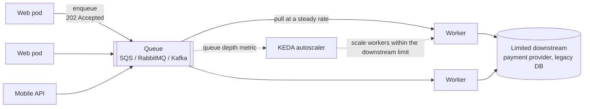

1. The API validates the request, writes it to the queue, and returns **202 Accepted** with a status URL (or later notifies via webhook/WebSocket).
2. Workers consume at a controlled rate (fixed number of consumers, prefetch limit, or a rate limiter).
3. Queue depth is a metric: autoscale workers on it (up to what the downstream can take) and alert if it keeps growing.

**Little's Law** helps estimate the delay: `wait time ≈ queue length / processing rate`. 900 messages processed at 200/s means the last one waits about 4.5 seconds.

## 5.4 Variants

| Variant | How |
|---|---|
| **Fixed-rate workers** | N consumers, each with a rate limiter: total throughput is capped |
| **Autoscaled workers** | Scale on queue depth, but cap `maxReplicas` at the downstream's capacity |
| **Async request-reply** | Return 202 + `Location: /status/{id}`; client polls or gets a callback (see [08_API_Design_Pattern.md](../03_System_Design/08_API_Design_Pattern.md)) |
| **Write-behind buffer** | Writes go to a queue, a batcher writes them to the DB in bulk (see [Write-Back Cache](../03_System_Design/01_Scalability_Pattern.md#11-write-back-cache-write-behind)) |
| **Combined with priority** | Separate queues per priority, see [Priority Queue](#6-priority-queue-pattern-interview-imp---java) |

## 5.5 Complete Java Example - Direct Calls vs a Leveling Queue

The downstream can process 200 requests per second. A flash sale sends 400-600 per second for 3 seconds.

```java
// Queue-Based Load Leveling: a queue absorbs a burst so the downstream service processes at its own steady rate
public class LoadLevelingDemo {
    public static void main(String[] args) {
        int[] arrivalsPerSecond = {50, 50, 400, 600, 500, 50, 50, 0, 0, 0, 0, 0};   // a 3-second flash sale burst
        int capacity = 200;                                                         // what the downstream (e.g. payment provider) can take

        System.out.println(" t  arrivals | direct: processed  rejected | via queue: processed  queue depth");
        int queue = 0, rejectedDirect = 0, maxDepth = 0;
        for (int t = 0; t < arrivalsPerSecond.length; t++) {
            int a = arrivalsPerSecond[t];
            int directProcessed = Math.min(a, capacity);
            int directRejected = a - directProcessed;                               // without a queue: overload -> errors/timeouts
            rejectedDirect += directRejected;

            queue += a;
            int qProcessed = Math.min(queue, capacity);                             // worker drains at a constant rate
            queue -= qProcessed;
            maxDepth = Math.max(maxDepth, queue);
            System.out.printf("%2d  %8d | %17d  %8d | %20d  %11d%n", t, a, directProcessed, directRejected, qProcessed, queue);
        }
        System.out.println("direct calls: " + rejectedDirect + " requests failed during the burst");
        System.out.println("with a queue: 0 failed; max backlog " + maxDepth + " messages, drained " + (int) Math.ceil(maxDepth / (double) capacity) + "+ s after the peak");
        System.out.println("(trade-off: callers get 202 Accepted and the result later, not an immediate answer)");
    }
}
```

**Output:**
```
 t  arrivals | direct: processed  rejected | via queue: processed  queue depth
 0        50 |                50         0 |                   50            0
 1        50 |                50         0 |                   50            0
 2       400 |               200       200 |                  200          200
 3       600 |               200       400 |                  200          600
 4       500 |               200       300 |                  200          900
 5        50 |                50         0 |                  200          750
 6        50 |                50         0 |                  200          600
 7         0 |                 0         0 |                  200          400
 8         0 |                 0         0 |                  200          200
 9         0 |                 0         0 |                  200            0
10         0 |                 0         0 |                    0            0
11         0 |                 0         0 |                    0            0
direct calls: 900 requests failed during the burst
with a queue: 0 failed; max backlog 900 messages, drained 5+ s after the peak
(trade-off: callers get 202 Accepted and the result later, not an immediate answer)
```

**What to notice:** with direct calls, 900 requests fail. With a queue, none fail, but the backlog peaks at 900 and takes until t=9 to drain. **Load leveling trades latency for reliability.** That's acceptable for orders, emails and reports, but not for a login page.

## 5.6 Load Leveling in Spring Boot

```java
@RestController
@RequestMapping("/api/orders")
class OrderController {
    private final RabbitTemplate rabbit;
    OrderController(RabbitTemplate rabbit) { this.rabbit = rabbit; }

    @PostMapping
    ResponseEntity<Map<String, String>> place(@Valid @RequestBody PlaceOrder cmd) {
        String id = UUID.randomUUID().toString();
        rabbit.convertAndSend("orders", new OrderRequested(id, cmd));     // durable queue, persistent message
        return ResponseEntity.accepted()
                .location(URI.create("/api/orders/" + id + "/status"))
                .body(Map.of("orderId", id, "status", "PENDING"));
    }
}

@Component
class PaymentWorker {
    private final RateLimiter limiter = RateLimiter.of("psp",                          // Resilience4j
            RateLimiterConfig.custom().limitForPeriod(50).limitRefreshPeriod(Duration.ofSeconds(1)).build());

    @RabbitListener(queues = "orders", concurrency = "4")     // 4 consumers x 50/s = 200/s max to the provider
    void handle(OrderRequested msg) {
        RateLimiter.waitForPermission(limiter);
        // call payment provider; on success update order status (idempotently: messages can be redelivered)
    }
}
```

```yaml
spring:
  rabbitmq:
    listener:
      simple:
        prefetch: 10                 # don't let one consumer grab thousands of messages
        acknowledge-mode: auto       # ack after the listener returns successfully
```

Consumers must be **idempotent** because queues deliver *at least once*: see [Idempotent Consumer](../03_System_Design/04_Messaging_Pattern.md#12-idempotent-consumer-pattern-interview-imp---java). Failed messages should end in a [Dead Letter Queue](../03_System_Design/04_Messaging_Pattern.md#11-dead-letter-queue-pattern-interview-imp---java).

## 5.7 Pros and Cons

| Pros | Cons |
|---|---|
| Survives bursts without errors | Callers don't get the result immediately (needs 202 + status API) |
| Downstream runs at a safe, steady rate | Extra infrastructure (broker) to run and monitor |
| Producers and consumers scale independently | Latency grows with backlog; a backlog that never drains means you're under-provisioned |
| Work isn't lost if workers crash (durable queue) | Ordering, duplicates and poison messages must be handled |

## 5.8 Pitfalls, Interview Questions and Cheat Sheet

**Common pitfalls**
- **Using it for requests that need an immediate answer** (price checks, login). Users wait for nothing.
- **Unbounded queue with no alert:** if arrivals are always above capacity, the backlog grows forever. Alert on queue age/depth and shed load at the API (429) when the backlog is too old.
- **Autoscaling workers past the downstream limit**: the queue no longer protects anything.
- **Message TTL shorter than the worst drain time:** messages expire during a spike.

**Interview questions**
1. *Your payment provider allows 100 TPS but Black Friday brings 1,000 TPS. What do you do?* → Accept the order into a durable queue, return 202, process at ≤ 100 TPS with rate-limited workers, notify the user on completion; monitor backlog age; idempotency keys for the provider.
2. *Queue-based load leveling vs rate limiting?* → Rate limiting **rejects** excess requests (429); load leveling **accepts and delays** them. Often both: level what you can, reject when the backlog is too old.
3. *How do you choose the number of consumers?* → Downstream capacity ÷ per-consumer throughput; then autoscale on queue depth within that cap.
4. *How long will a message wait?* → Little's Law: backlog ÷ drain rate.

**Cheat sheet**
```
Burst -> durable queue -> workers at a fixed/capped rate -> limited downstream
API returns 202 + status URL; consumers idempotent; DLQ for poison messages
Scale workers on queue depth, but max <= downstream capacity
Alert on oldest-message age; shed load (429) if backlog too old
wait ≈ backlog / drain rate (Little's Law)
```

### 📘 Terms Explained

| Term | Meaning |
|---|---|
| **Load leveling** | Smoothing a spiky arrival rate into a steady processing rate using a buffer |
| **Backlog / queue depth** | Number of messages waiting in the queue |
| **202 Accepted** | HTTP status meaning "request received, will be processed later" |
| **Prefetch** | How many unacknowledged messages a broker pushes to one consumer at a time |
| **Little's Law** | L = λ × W: items in a system = arrival rate × average time spent; used to estimate waiting time |
| **At-least-once delivery** | A message is never lost but may be delivered more than once |
| **Message TTL** | Time-to-live: how long a message may wait before the broker discards or dead-letters it |
| **Load shedding** | Deliberately rejecting some work to protect the system when overloaded |

---

# 6. Priority Queue Pattern (Interview Imp - Java)

## 6.1 What is the Priority Queue Pattern?

Make sure **important work is processed before less important work**, even when both arrive in the same system. Example: payment confirmations before marketing emails, premium customers' reports before free-tier ones.

**Simple analogy:** A hospital emergency room uses triage. Patients aren't seen in arrival order: a heart attack goes before a sprained ankle. But a good ER also makes sure the sprained ankle is seen *eventually*.

## 6.2 Why Do We Need It?

With one plain FIFO queue, a burst of 100,000 low-value jobs (a bulk export, a newsletter) delays the one job that matters (a password-reset email, a fraud check) by minutes or hours.

## 6.3 How It Works: Two Implementations

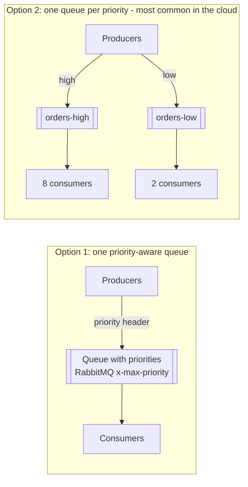

| Option | How | Notes |
|---|---|---|
| **Priority-aware broker** | RabbitMQ `x-max-priority`, ActiveMQ JMS priority | Simple, but only works for messages already waiting; many cloud queues (SQS, Kafka) don't support it |
| **Separate queues per priority** **(Interview Imp - Java)** | `orders-high`, `orders-low`, each with its own consumers | Works everywhere; scale and monitor each queue separately; low priority still progresses |
| **Consumer polls high first** | Worker checks high queue, then low | Strict priority: risk of starving low priority |
| **In-process** | `java.util.concurrent.PriorityBlockingQueue` in a thread pool | Single JVM only; lost on crash |

**Starvation:** with strict priority, low-priority work may never run if high-priority work keeps arriving. Fixes:
- **Aging:** priority improves the longer a job waits.
- **Weighted fair consumption:** e.g. take 8 high, then 2 low.
- **Dedicated consumers** for the low queue (Option 2 above).

## 6.4 Complete Java Example - Priority with Aging

```java
import java.util.ArrayList;
import java.util.Comparator;
import java.util.List;
import java.util.PriorityQueue;

// Priority queue for work items, with AGING so low-priority work can't starve forever
public class PriorityQueueDemo {
    record Job(String id, int priority, int enqueuedAt) {}         // priority: 1 = highest

    static List<String> run(boolean aging) {
        int agingEveryTicks = 3;                                     // every 3 ticks waiting = 1 priority level better
        int[] clock = {0};
        Comparator<Job> order = Comparator.comparingInt(j -> effective(j, clock[0], aging, agingEveryTicks));
        List<Job> waiting = new ArrayList<>();
        List<String> served = new ArrayList<>();
        waiting.add(new Job("bulk-export", 3, 0));
        for (int tick = 0; tick < 8; tick++) {
            clock[0] = tick;
            waiting.add(new Job("premium-" + tick, 1, tick));       // a steady stream of high-priority work
            PriorityQueue<Job> pq = new PriorityQueue<>(order.thenComparingInt(Job::enqueuedAt));
            pq.addAll(waiting);
            Job next = pq.poll();                                     // one worker, one job per tick
            waiting.remove(next);
            served.add(next.id() + "(p" + effective(next, tick, aging, agingEveryTicks) + ")");
        }
        return served;
    }

    static int effective(Job j, int now, boolean aging, int every) {
        return aging ? Math.max(1, j.priority() - (now - j.enqueuedAt()) / every) : j.priority();
    }

    public static void main(String[] args) {
        System.out.println("Plain priority  : " + run(false));
        System.out.println("  -> bulk-export never runs while premium work keeps arriving (starvation)");
        System.out.println("With aging      : " + run(true));
        System.out.println("  -> after waiting long enough, bulk-export's effective priority rises and it gets served");
        System.out.println("Cloud alternative: separate queues per priority with MORE consumers on the high-priority queue");
    }
}
```

**Output:**
```
Plain priority  : [premium-0(p1), premium-1(p1), premium-2(p1), premium-3(p1), premium-4(p1), premium-5(p1), premium-6(p1), premium-7(p1)]
  -> bulk-export never runs while premium work keeps arriving (starvation)
With aging      : [premium-0(p1), premium-1(p1), premium-2(p1), premium-3(p1), premium-4(p1), premium-5(p1), bulk-export(p1), premium-6(p1)]
  -> after waiting long enough, bulk-export's effective priority rises and it gets served
Cloud alternative: separate queues per priority with MORE consumers on the high-priority queue
```

**What to notice:** the `PriorityQueue` is rebuilt each tick because effective priority depends on the current time. A `java.util.PriorityQueue` only orders items when they are inserted, so it **doesn't re-sort when priorities change later**. That's a classic interview trap.

## 6.5 Priority Queues in Spring Boot

```java
// Option 1: RabbitMQ native priorities (0-10)
@Bean
Queue reports() {
    return QueueBuilder.durable("reports").maxPriority(10).build();
}

void submit(Report r, boolean premium) {
    rabbit.convertAndSend("reports", r, m -> { m.getMessageProperties().setPriority(premium ? 9 : 1); return m; });
}

// Option 2: separate queues, more consumers for high priority
@RabbitListener(queues = "reports-high", concurrency = "8")
void high(Report r) { generate(r); }

@RabbitListener(queues = "reports-low", concurrency = "2")
void low(Report r) { generate(r); }

// In-process: a thread pool that runs urgent tasks first
ThreadPoolExecutor pool = new ThreadPoolExecutor(4, 4, 0, TimeUnit.SECONDS,
        new PriorityBlockingQueue<>(100, Comparator.comparingInt(t -> ((PrioritizedTask) t).priority())));
// note: submit() wraps tasks in FutureTask, which isn't PrioritizedTask - use execute() with your own Runnable type
```

## 6.6 Pros and Cons

| Pros | Cons |
|---|---|
| Critical work meets its SLA during overload | More queues and consumers to manage |
| Different scaling and cost per tier (premium vs free) | Starvation risk with strict priority |
| Easy to explain to the business ("premium is faster") | Priority inflation: every team marks its jobs "high" |

## 6.7 Pitfalls, Interview Questions and Cheat Sheet

**Common pitfalls**
- **Everything is high priority**: define priority by business impact and keep the number of levels small (2-3).
- **Priority in a queue with a large prefetch:** consumers already hold hundreds of low-priority messages, so new high-priority ones wait behind them. Keep prefetch low.
- **Using `submit()` with a `PriorityBlockingQueue` executor** → `ClassCastException`, because tasks get wrapped in `FutureTask`.

**Interview questions**
1. *How do you implement priorities on SQS or Kafka, which don't support them?* → Separate queues/topics per priority, more consumers on the high one, or weighted polling.
2. *What is starvation and how do you prevent it?* → Low priority never served; aging, weighted fair scheduling, reserved consumers.
3. *Does `java.util.PriorityQueue` re-order if an element's priority changes?* → No. Remove and re-insert it.

**Cheat sheet**
```
Cloud-friendly   one queue per priority, more consumers on high, monitor each
Broker-native    RabbitMQ x-max-priority (keep prefetch small)
Avoid starvation aging / weighted consumption / dedicated low-priority consumers
Keep 2-3 levels, defined by business impact
```

### 📘 Terms Explained

| Term | Meaning |
|---|---|
| **Priority queue** | A queue where items with higher priority are taken out first |
| **FIFO** | First In, First Out: plain arrival order |
| **Starvation** | Low-priority work never getting processed because higher-priority work keeps arriving |
| **Aging** | Raising a job's priority the longer it waits, to prevent starvation |
| **Weighted fair queuing** | Serving queues in a fixed ratio (e.g. 8 high : 2 low) |
| **`PriorityBlockingQueue`** | A thread-safe, unbounded priority queue from `java.util.concurrent` |
| **Triage** | Sorting work by urgency before processing it |

---

# 7. Sequential Convoy Pattern

## 7.1 What is a Sequential Convoy?

Process a **group of related messages strictly in order** (for example, all events of one order: CREATED → PAID → SHIPPED), while **unrelated groups are still processed in parallel**. Each group is a "convoy" that moves in single file. Many convoys drive side by side.

**Simple analogy:** A bank with several tellers. Each customer's transactions are handled by one teller in order (deposit before withdrawal), but different customers are served by different tellers at the same time.

## 7.2 Why Do We Need It?

[Competing consumers](../03_System_Design/04_Messaging_Pattern.md#14-complete-java-example---competing-consumers-with-ack-and-redelivery) give great throughput, but they **break ordering**: consumer A may still be handling `PAID` when consumer B finishes `SHIPPED`. For some data the order matters:
- Order or account state changes (`CANCELLED` must not be overwritten by a late `PAID`)
- Ledger entries, bank transactions
- Updates to the same document or user profile

Processing everything on one consumer would keep the order, but kills throughput. The convoy gives you **ordering per key, parallelism across keys**.

## 7.3 How It Works

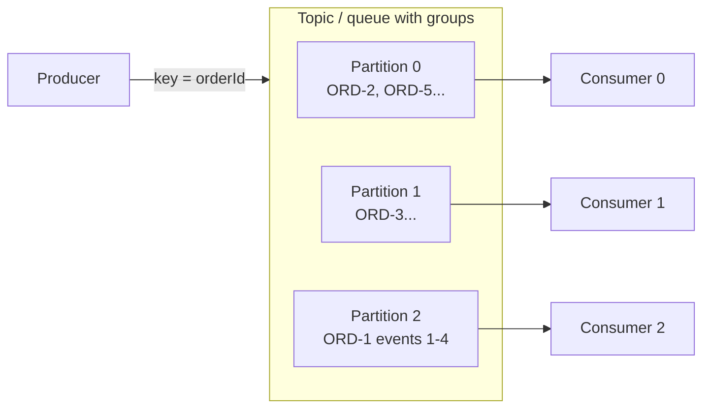

The broker guarantees that messages with the same **key** go to the same partition/session/group, and that each group is consumed by only one consumer at a time.

| Broker | Feature that implements the convoy |
|---|---|
| **Kafka** | Message key → partition; one consumer per partition in a group |
| **Azure Service Bus** | **Sessions** (`SessionId`), a consumer locks a session |
| **Amazon SQS FIFO** | `MessageGroupId`, ordered within a group |
| **RabbitMQ** | Single Active Consumer, or consistent-hash exchange to several queues |
| **Google Pub/Sub** | Ordering keys |

## 7.4 Complete Java Example - Round Robin vs Partition by Key

```java
import java.util.ArrayList;
import java.util.LinkedHashMap;
import java.util.List;
import java.util.Map;

// Sequential Convoy: process messages for the SAME key strictly in order, while different keys run in parallel
public class SequentialConvoyDemo {
    record Msg(String orderId, int seq, String event) {}

    public static void main(String[] args) {
        List<Msg> stream = List.of(
                new Msg("ORD-1", 1, "CREATED"), new Msg("ORD-2", 1, "CREATED"), new Msg("ORD-1", 2, "PAID"),
                new Msg("ORD-3", 1, "CREATED"), new Msg("ORD-1", 3, "SHIPPED"), new Msg("ORD-2", 2, "CANCELLED"),
                new Msg("ORD-3", 2, "PAID"), new Msg("ORD-1", 4, "DELIVERED"));
        int workers = 3;

        // 1) Naive competing consumers: round-robin -> the same order's events can be processed out of order in parallel
        Map<Integer, List<Msg>> roundRobin = new LinkedHashMap<>();
        for (int i = 0; i < stream.size(); i++) roundRobin.computeIfAbsent(i % workers, k -> new ArrayList<>()).add(stream.get(i));
        System.out.println("Round-robin (competing consumers): ORD-1 events spread over workers " + workersFor("ORD-1", roundRobin)
                + " -> SHIPPED may finish before PAID");

        // 2) Sequential convoy: route by key (like a Kafka partition key / Service Bus session id / SQS FIFO group id)
        Map<Integer, List<Msg>> byKey = new LinkedHashMap<>();
        for (Msg m : stream) byKey.computeIfAbsent(Math.floorMod(m.orderId().hashCode(), workers), k -> new ArrayList<>()).add(m);
        System.out.println("Partitioned by orderId:");
        byKey.forEach((w, msgs) -> System.out.println("  worker-" + w + " : " + msgs.stream().map(m -> m.orderId() + "#" + m.seq() + " " + m.event()).toList()));

        boolean inOrder = true;
        for (List<Msg> msgs : byKey.values()) {
            Map<String, Integer> last = new LinkedHashMap<>();
            for (Msg m : msgs) { if (last.getOrDefault(m.orderId(), 0) >= m.seq()) inOrder = false; last.put(m.orderId(), m.seq()); }
        }
        System.out.println("every order processed in sequence: " + inOrder + "; different orders still processed in parallel");
    }

    static List<Integer> workersFor(String key, Map<Integer, List<Msg>> assignment) {
        List<Integer> ws = new ArrayList<>();
        assignment.forEach((w, msgs) -> { if (msgs.stream().anyMatch(m -> m.orderId().equals(key))) ws.add(w); });
        return ws;
    }
}
```

**Output:**
```
Round-robin (competing consumers): ORD-1 events spread over workers [0, 1, 2] -> SHIPPED may finish before PAID
Partitioned by orderId:
  worker-2 : [ORD-1#1 CREATED, ORD-1#2 PAID, ORD-1#3 SHIPPED, ORD-1#4 DELIVERED]
  worker-0 : [ORD-2#1 CREATED, ORD-2#2 CANCELLED]
  worker-1 : [ORD-3#1 CREATED, ORD-3#2 PAID]
every order processed in sequence: true; different orders still processed in parallel
```

**What to notice:** with round robin, ORD-1's four events land on three different workers. With partitioning by `orderId`, each order's events stay on one worker in sequence. The routing rule `floorMod(hash(key), workers)` is the same idea Kafka's default partitioner uses (with murmur2 instead of `hashCode`).

## 7.5 Sequential Convoy with Kafka and Spring Boot

```java
// Producer: the key decides the partition, so all events of one order stay ordered
kafkaTemplate.send("order-events", order.id(), new OrderPaid(order.id(), amount));
```

```yaml
spring:
  kafka:
    producer:
      properties:
        enable.idempotence: true                         # no duplicates or reordering on producer retries
        max.in.flight.requests.per.connection: 5         # safe with idempotence enabled
    listener:
      concurrency: 6                                     # <= number of partitions
```

```java
@KafkaListener(topics = "order-events", groupId = "order-projection")
void on(ConsumerRecord<String, OrderEvent> rec) {
    // Process synchronously in the listener thread. Handing work to another thread pool here
    // would break the per-partition ordering the broker gave you.
    projection.apply(rec.value());
}
```

**Also guard against out-of-order arrival at the source.** Ordering is only per partition *after* the producer. If two services emit events for the same order, put a version or sequence number in each event and ignore anything older than what you've already applied.

## 7.6 Pros and Cons

| Pros | Cons |
|---|---|
| Correct ordering where it matters | A slow or stuck group (poison message) blocks everything behind it in that partition |
| Still parallel across keys | Hot keys (one very busy customer) overload a single consumer |
| Built into most brokers | Parallelism is capped by number of partitions/sessions |
| | Retries and DLQs must preserve order (can't just skip and continue) |

## 7.7 Pitfalls, Interview Questions and Cheat Sheet

**Common pitfalls**
- **Adding partitions later** changes `hash(key) % partitions`, so a key moves partition and new events can overtake old ones during the transition.
- **Async processing inside the listener** (e.g. `CompletableFuture.runAsync`) silently destroys ordering.
- **Poison message** in a convoy: retry a few times, then move the message *and* decide whether later messages for that key must be parked too.
- **Choosing a key with too few values** (e.g. `country`) → a few huge partitions, hot spots.

**Interview questions**
1. *How do you guarantee ordering in Kafka?* → Same key → same partition → one consumer per partition; idempotent producer; process synchronously; ordering is per partition only.
2. *How do you keep order but still scale?* → Partition by entity ID; parallelism across keys; number of partitions caps consumers.
3. *What happens to ordering when a consumer crashes?* → Partition is reassigned; the new consumer resumes from the last committed offset; some messages may be replayed (so be idempotent), but order is preserved.

**Cheat sheet**
```
Order per key, parallel across keys
Kafka key / Service Bus SessionId / SQS FIFO MessageGroupId / Pub/Sub ordering key
Process synchronously in the listener; version numbers to drop stale events
Watch: hot keys, poison messages, repartitioning
```

## 7.8 Types and Variants

| Variant | How ordering per group is kept | Example |
|---|---|---|
| **Partition by key** | All messages with the same key go to one partition, consumed by one consumer | Kafka record key = `orderId` |
| **Message sessions / groups** | The broker locks a session id to one consumer at a time | Azure Service Bus sessions, SQS FIFO `MessageGroupId`, JMS message groups |
| **Single consumer per queue** | One queue per entity group | Small numbers of groups |
| **Resequencing** | Consumers buffer and reorder by sequence number | When transport can't preserve order ([04_Integration_Pattern.md](04_Integration_Pattern.md)) |
| **Actor per entity** | Each entity's messages processed by its own actor | Akka/Pekko cluster sharding |

### 📘 Terms Explained

| Term | Meaning |
|---|---|
| **Sequential Convoy** | Ordered processing of related messages per group, parallel across groups |
| **Partition key / message key** | Value used to decide which partition a message goes to |
| **Session (Service Bus)** | A group of messages with the same `SessionId`, locked to one consumer |
| **Message group (SQS FIFO)** | Messages with the same `MessageGroupId`, delivered in order |
| **Hot key** | A key with far more traffic than others, overloading its partition |
| **Poison message** | A message that always fails processing |
| **Offset** | A message's position in a Kafka partition; consumers commit the last processed offset |
| **Idempotent producer** | Kafka producer setting that prevents duplicates and reordering from retries |

---

# 8. Scheduler Agent Supervisor Pattern

## 8.1 What is Scheduler Agent Supervisor?

A way to run a **long, multi-step workflow across remote services** reliably. It has three roles:
- **Scheduler:** runs the steps in order and records each step's state in a **durable state store**.
- **Agents:** each one wraps a call to a remote service (book flight, book hotel, charge card), with its own timeout.
- **Supervisor:** runs periodically, looks at the state store for steps that are **stuck** (no answer within the timeout) or **failed**, and decides: retry, or give up and **compensate** the steps that already succeeded.

**Simple analogy:** A travel agent (scheduler) books your trip step by step, writing each booking in a notebook. Their manager (supervisor) checks the notebook every hour: "the hotel hasn't confirmed for 2 hours, call again", or "the card was declined, cancel the flight we already booked".

## 8.2 Why Do We Need It?

- Remote calls **hang or fail** in the cloud, and the process running the workflow may itself **crash** halfway through.
- A workflow that touches several services can't use one database transaction.
- Without a supervisor, a crash after "flight booked" but before "card charged" leaves a booked flight nobody pays for.

It's the classic shape behind sagas with an orchestrator. The [Saga pattern](02_Microservices_Pattern.md#5-saga-pattern-interview-imp---java) describes the compensation idea. Scheduler Agent Supervisor adds the **recovery loop** that notices stuck work.

## 8.3 How It Works

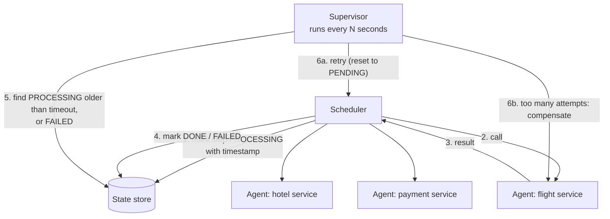

Important details:
- **State is durable** (a DB table): if the scheduler crashes, a new instance continues from the stored state.
- **Steps must be idempotent**, because the supervisor may retry a step whose first attempt actually succeeded but whose reply was lost.
- **Only one supervisor** acts on a workflow at a time (leader election, or a row lock / lease in the state store).

## 8.4 Complete Java Example - Retry Stuck Steps, Compensate Failed Workflows

`WF-1`'s first flight call hangs and succeeds on retry. `WF-2`'s hotel never answers, so after 2 attempts the flight is cancelled. `WF-3`'s card is declined immediately.

```java
import java.util.ArrayList;
import java.util.LinkedHashMap;
import java.util.List;
import java.util.Map;
import java.util.HashSet;
import java.util.Set;

// Scheduler Agent Supervisor: a scheduler runs the steps of a long workflow via agents (calls to remote services),
// records state in a durable store, and a supervisor periodically finds stuck/failed steps and retries or compensates.
public class SchedulerAgentSupervisorDemo {
    enum Status { PENDING, PROCESSING, DONE, FAILED, COMPENSATED }
    static class Step {
        final String name; Status status = Status.PENDING; int attempts = 0; long startedAt = -1;
        Step(String name) { this.name = name; }
        public String toString() { return name + "=" + status + (attempts > 1 ? "(x" + attempts + ")" : ""); }
    }

    // Durable state store (a DB table in real life) shared by scheduler and supervisor
    static final Map<String, List<Step>> stateStore = new LinkedHashMap<>();
    static final Set<String> closed = new HashSet<>();      // workflows already finished or compensated
    static int flakyCalls = 0;

    // Agent: wraps a remote call; may hang (no response) or fail
    static Status agentCall(String step, String workflow) {
        if (workflow.equals("WF-2") && step.equals("book-hotel")) return null;                 // hangs: no answer
        if (workflow.equals("WF-3") && step.equals("charge-card")) return Status.FAILED;      // hard failure
        if (step.equals("book-flight") && workflow.equals("WF-1") && flakyCalls++ == 0) return null;   // first call hangs, retry works
        return Status.DONE;
    }

    static void scheduler(String wf, long now) {
        for (Step s : stateStore.get(wf)) {
            if (s.status == Status.DONE) continue;
            if (s.status != Status.PENDING) return;                // waiting on an in-flight or failed step
            s.status = Status.PROCESSING; s.attempts++; s.startedAt = now;
            Status r = agentCall(s.name, wf);
            if (r == null) return;                                 // no reply yet: supervisor will notice
            s.status = r;
            if (r == Status.FAILED) return;
        }
    }

    static void supervisor(String wf, long now, long timeout, int maxAttempts) {
        List<Step> steps = stateStore.get(wf);
        if (closed.contains(wf)) return;
        if (steps.stream().allMatch(s -> s.status == Status.DONE)) { closed.add(wf); System.out.println("    [supervisor] " + wf + " completed"); return; }
        for (Step s : steps) {
            boolean stuck = s.status == Status.PROCESSING && now - s.startedAt > timeout;
            if (stuck && s.attempts < maxAttempts) { s.status = Status.PENDING; System.out.println("    [supervisor] " + wf + " " + s.name + " timed out -> retry"); }
            else if ((stuck && s.attempts >= maxAttempts) || s.status == Status.FAILED) {
                System.out.println("    [supervisor] " + wf + " " + s.name + " cannot complete -> compensate completed steps");
                s.status = Status.FAILED;
                for (Step done : steps) if (done.status == Status.DONE) done.status = Status.COMPENSATED;   // e.g. cancel flight
                closed.add(wf);
                return;
            }
        }
    }

    public static void main(String[] args) {
        for (String wf : List.of("WF-1", "WF-2", "WF-3")) {
            List<Step> steps = new ArrayList<>();
            for (String n : List.of("book-flight", "book-hotel", "charge-card")) steps.add(new Step(n));
            stateStore.put(wf, steps);
        }
        long timeout = 30;
        for (long now = 0; now <= 120; now += 40) {
            System.out.println("t=" + now + "s");
            for (String wf : stateStore.keySet()) { if (!closed.contains(wf)) scheduler(wf, now); supervisor(wf, now, timeout, 2); }
            stateStore.forEach((wf, steps) -> System.out.println("  " + wf + " " + steps));
        }
    }
}
```

**Output:**
```
t=0s
    [supervisor] WF-3 charge-card cannot complete -> compensate completed steps
  WF-1 [book-flight=PROCESSING, book-hotel=PENDING, charge-card=PENDING]
  WF-2 [book-flight=DONE, book-hotel=PROCESSING, charge-card=PENDING]
  WF-3 [book-flight=COMPENSATED, book-hotel=COMPENSATED, charge-card=FAILED]
t=40s
    [supervisor] WF-1 book-flight timed out -> retry
    [supervisor] WF-2 book-hotel timed out -> retry
  WF-1 [book-flight=PENDING, book-hotel=PENDING, charge-card=PENDING]
  WF-2 [book-flight=DONE, book-hotel=PENDING, charge-card=PENDING]
  WF-3 [book-flight=COMPENSATED, book-hotel=COMPENSATED, charge-card=FAILED]
t=80s
    [supervisor] WF-1 completed
  WF-1 [book-flight=DONE(x2), book-hotel=DONE, charge-card=DONE]
  WF-2 [book-flight=DONE, book-hotel=PROCESSING(x2), charge-card=PENDING]
  WF-3 [book-flight=COMPENSATED, book-hotel=COMPENSATED, charge-card=FAILED]
t=120s
    [supervisor] WF-2 book-hotel cannot complete -> compensate completed steps
  WF-1 [book-flight=DONE(x2), book-hotel=DONE, charge-card=DONE]
  WF-2 [book-flight=COMPENSATED, book-hotel=FAILED(x2), charge-card=PENDING]
  WF-3 [book-flight=COMPENSATED, book-hotel=COMPENSATED, charge-card=FAILED]
```

**What to notice:** nothing in the scheduler deals with timeouts. Detection and recovery all live in the supervisor, which only reads the state store. That's why it survives scheduler crashes.

## 8.5 In Practice: Workflow Engines

Writing this by hand is hard. In production, use a **workflow engine** that implements scheduler, durable state, timers, retries and compensation for you:

| Tool | Style |
|---|---|
| **Temporal** (Java SDK) | Workflows written as plain Java code; state is persisted by event history |
| **Camunda / Zeebe** | BPMN diagrams, Java workers |
| **AWS Step Functions** | JSON/YAML state machine, `Retry`, `Catch`, `TimeoutSeconds` per state |
| **Azure Durable Functions** | Orchestrator functions with automatic checkpointing |
| **Spring Batch / Quartz (JDBC job store)** | Batch jobs and schedules with durable job state |

```java
// Temporal (Java SDK) - the engine is the scheduler + supervisor; activities are the agents
@WorkflowInterface
public interface TripWorkflow { @WorkflowMethod void book(Trip trip); }

public class TripWorkflowImpl implements TripWorkflow {
    private final TripActivities act = Workflow.newActivityStub(TripActivities.class,
            ActivityOptions.newBuilder()
                    .setStartToCloseTimeout(Duration.ofSeconds(30))               // "stuck" detection
                    .setRetryOptions(RetryOptions.newBuilder().setMaximumAttempts(3).build())
                    .build());

    public void book(Trip trip) {
        Saga saga = new Saga(new Saga.Options.Builder().build());
        try {
            act.bookFlight(trip);  saga.addCompensation(act::cancelFlight, trip);
            act.bookHotel(trip);   saga.addCompensation(act::cancelHotel, trip);
            act.chargeCard(trip);
        } catch (ActivityFailure e) {
            saga.compensate();                                                    // undo in reverse order
            throw e;
        }
    }
}
```

## 8.6 Pros and Cons

| Pros | Cons |
|---|---|
| Survives crashes, hangs and partial failure | More moving parts: state store, supervisor, idempotent agents |
| Clear, auditable state of every workflow | Hand-written versions get complex fast (use an engine) |
| Failure handling separated from the happy path | Compensation is business logic, not always possible (an email can't be "unsent") |

## 8.7 Pitfalls, Interview Questions and Cheat Sheet

**Common pitfalls**
- **Non-idempotent steps** + retry = double booking or double charge. Pass an idempotency key to every remote call.
- **Timeouts shorter than the remote service's real processing time** → retries pile up.
- **Two supervisors** compensating the same workflow. Use a lease/lock.
- **No alert for workflows in FAILED state.** Someone must look at them.

**Interview questions**
1. *How do you make a multi-service booking reliable if the orchestrator can crash?* → Durable state per step, idempotent steps, a supervisor that retries stuck steps and compensates on permanent failure (or a workflow engine like Temporal/Step Functions).
2. *How is this different from a saga?* → A saga defines the steps + compensations. Scheduler Agent Supervisor is one way to *run* an orchestrated saga reliably, with explicit stuck-step detection.
3. *What do you do when a compensation itself fails?* → Retry it (must be idempotent), then escalate to a human / manual queue. Never silently drop it.

**Cheat sheet**
```
Scheduler   runs steps, writes state (PENDING -> PROCESSING(ts) -> DONE/FAILED)
Agent       wraps one remote call, timeout + idempotency key
Supervisor  periodic scan: stuck -> retry, too many attempts / failed -> compensate
Prefer      Temporal, Step Functions, Camunda, Durable Functions over hand-rolled
```

### 📘 Terms Explained

| Term | Meaning |
|---|---|
| **Scheduler** | Component that runs the workflow's steps in order and records their state |
| **Agent** | Component that calls one remote service on the scheduler's behalf |
| **Supervisor** | Periodic checker that finds stuck or failed steps and recovers them |
| **State store** | Durable storage (usually a DB table) for workflow and step status |
| **Compensation** | An action that undoes a step that already succeeded (cancel booking, refund) |
| **Workflow engine** | A platform (Temporal, Camunda, Step Functions) that runs durable, long-running workflows |
| **Lease** | A time-limited lock; if the holder dies, the lease expires and someone else can take over |
| **BPMN** | Business Process Model and Notation: a standard diagram language for workflows |

---

# 9. Index Table Pattern

## 9.1 What is an Index Table?

Many cloud data stores (DynamoDB, Cassandra, Azure Table Storage, Bigtable, and any sharded database) can only look up data **quickly by its primary/partition key**. An **index table** is an extra table you maintain yourself, keyed by another attribute you need to query on, that points back to the primary keys.

**Simple analogy:** A library shelves books by catalogue number (primary key). To find books by author, it keeps a separate card index sorted by author name, where each card says which catalogue number to look up.

## 9.2 Why Do We Need It?

- Query `customers where city = 'Chennai'` on a table keyed by `customerId` → full table scan across every partition. That's slow and, on pay-per-read databases, expensive.
- Relational databases create secondary indexes for you (see [Indexing](../03_System_Design/03_Performance_Pattern.md#6-indexing-interview-imp---java)). Many NoSQL stores don't, or only in limited form.
- In a **sharded** system, even a relational secondary index is local to each shard, so a non-key query must ask every shard ("scatter-gather").

## 9.3 How It Works: Three Designs

| Design | Index table stores | Read cost | Write cost / risk |
|---|---|---|---|
| **Keys only** | `city → [customerIds]` | Index lookup + one read per ID | Smallest index |
| **Denormalized (covering)** | `city → [full or partial customer rows]` | One read, no second hop | Data duplicated; every update touches more copies |
| **Partial / composite key** | `city#signupDate → customerId` | Range queries within a city | Must design keys for the exact query |

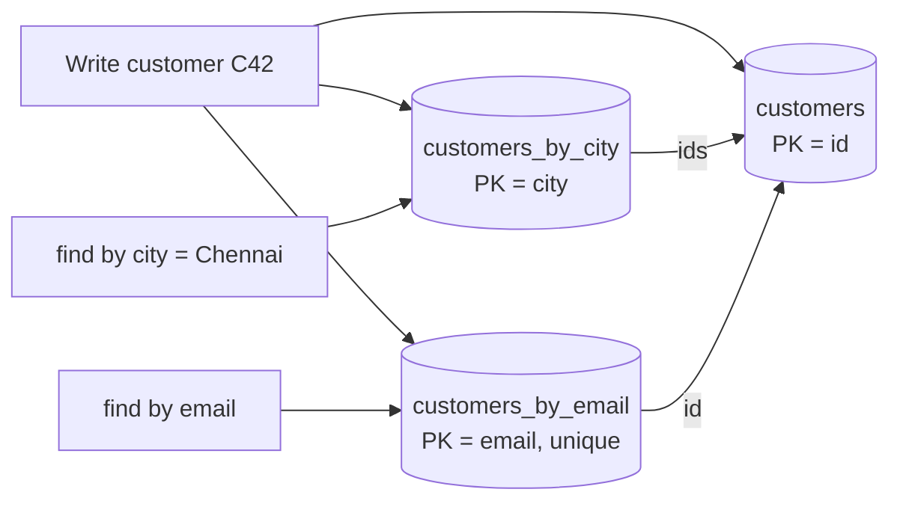

Keeping index tables in sync:
- **Same transaction** if the store supports it (DynamoDB `TransactWriteItems`, a relational DB).
- **Asynchronously** from a change stream (DynamoDB Streams, Cassandra CDC, Debezium): eventually consistent but decoupled. See [05_Data_Management_Pattern.md](../03_System_Design/05_Data_Management_Pattern.md).
- **Managed secondary indexes** where available (DynamoDB GSIs, Cosmos DB indexing): the database maintains the index table for you, usually eventually consistent.

Related: a [Materialized View](../03_System_Design/05_Data_Management_Pattern.md#8-materialized-view-pattern) precomputes a whole *query result*. An index table only maps another key to primary keys (or rows).

## 9.4 Complete Java Example - Hand-Maintained Index Tables

```java
import java.util.ArrayList;
import java.util.LinkedHashMap;
import java.util.List;
import java.util.Map;
import java.util.TreeMap;

// Index Table: in a key-value / partitioned store you can only look up by the primary key quickly.
// Maintain extra "index tables" keyed by the other attributes you query on.
public class IndexTableDemo {
    record Customer(String id, String name, String city, String email) {}

    static final Map<String, Customer> customers = new LinkedHashMap<>();             // primary table: key = id
    static final Map<String, List<String>> byCity = new TreeMap<>();                  // index table: city -> ids
    static final Map<String, String> byEmail = new LinkedHashMap<>();                 // unique index: email -> id

    static void save(Customer c) {
        Customer old = customers.put(c.id(), c);
        if (old != null) { byCity.get(old.city()).remove(old.id()); byEmail.remove(old.email()); }   // keep indexes in sync
        byCity.computeIfAbsent(c.city(), k -> new ArrayList<>()).add(c.id());
        byEmail.put(c.email(), c.id());
    }

    public static void main(String[] args) {
        String[] cities = {"Pune", "Delhi", "Mumbai", "Chennai"};
        for (int i = 1; i <= 100_000; i++) save(new Customer("C" + i, "user" + i, cities[i % 4], "user" + i + "@x.com"));

        int scanned = 0;
        List<String> scan = new ArrayList<>();
        for (Customer c : customers.values()) { scanned++; if (c.city().equals("Chennai")) scan.add(c.id()); }
        System.out.println("query city=Chennai without index : scanned " + scanned + " rows, found " + scan.size());
        System.out.println("query city=Chennai with index    : 1 index lookup + " + byCity.get("Chennai").size() + " primary-key reads");
        System.out.println("lookup by email with unique index: " + byEmail.get("user42@x.com") + " (1 lookup instead of a full scan)");

        save(new Customer("C42", "user42", "Delhi", "user42@new.com"));                // customer moves city and changes email
        System.out.println("after update: C42 in Delhi index=" + byCity.get("Delhi").contains("C42")
                + ", still in old city index=" + byCity.get(cities[42 % 4]).contains("C42")
                + ", old email resolves to " + byEmail.get("user42@x.com"));
        System.out.println("cost: every write updates 3 tables; in a NoSQL store these are separate writes -> eventual consistency between them");
    }
}
```

**Output:**
```
query city=Chennai without index : scanned 100000 rows, found 25000
query city=Chennai with index    : 1 index lookup + 25000 primary-key reads
lookup by email with unique index: C42 (1 lookup instead of a full scan)
after update: C42 in Delhi index=true, still in old city index=false, old email resolves to null
cost: every write updates 3 tables; in a NoSQL store these are separate writes -> eventual consistency between them
```

**What to notice:** the update has to **remove the old index entries** (old city, old email) as well as add new ones. Forgetting that is the most common index-table bug: stale entries that point to the wrong record.

## 9.5 Index Tables in DynamoDB with Spring Boot

```java
// Primary table: PK = customerId. Global Secondary Index "byCity": PK = city, SK = customerId.
@DynamoDbBean
public class Customer {
    private String customerId, city, email, name;

    @DynamoDbPartitionKey public String getCustomerId() { return customerId; }
    @DynamoDbSecondaryPartitionKey(indexNames = "byCity") public String getCity() { return city; }
    @DynamoDbSecondarySortKey(indexNames = "byCity") public String getCustomerIdSort() { return customerId; }
    // getters/setters ...
}

// Query the GSI: the database maintains it, reads are eventually consistent
DynamoDbIndex<Customer> byCity = enhancedClient.table("customers", TableSchema.fromBean(Customer.class)).index("byCity");
List<Customer> chennai = byCity.query(QueryConditional.keyEqualTo(k -> k.partitionValue("Chennai")))
        .stream().flatMap(p -> p.items().stream()).toList();

// Unique email: GSIs can't enforce uniqueness, so use a separate table + transactional write
enhancedClient.transactWriteItems(t -> t
        .addPutItem(customersTable, customer)
        .addPutItem(emailIndexTable, TransactPutItemEnhancedRequest.builder(EmailIndex.class)
                .item(new EmailIndex(customer.getEmail(), customer.getCustomerId()))
                .conditionExpression(Expression.builder().expression("attribute_not_exists(email)").build())
                .build()));
```

## 9.6 Pros and Cons

| Pros | Cons |
|---|---|
| Fast queries on non-key attributes without full scans | Extra storage and extra writes on every change |
| Works in any key-value or sharded store | Hand-maintained indexes can drift (stale or missing entries) |
| Can enforce uniqueness (email, username) | Usually eventually consistent with the main table |
| Denormalized index = single-hop reads | Needs a repair/rebuild job for when things go wrong |

## 9.7 Pitfalls, Interview Questions and Cheat Sheet

**Common pitfalls**
- **Low-cardinality index key** (`status = ACTIVE` for 90% of rows) → one giant hot partition. Add a suffix (`ACTIVE#3`) to spread it, or don't index it.
- **Forgetting deletes/updates** → stale entries. Drive index updates from a change stream so every change is covered.
- **Reading the index right after a write** with an eventually consistent GSI → the new item may not appear yet.

**Interview questions**
1. *How do you query DynamoDB/Cassandra by a non-key attribute?* → Index table (GSI or hand-made table keyed by that attribute), or denormalize for the query; avoid scans.
2. *How do you enforce a unique email in a NoSQL store?* → Separate table keyed by email with a conditional/transactional write (`attribute_not_exists`), or Cassandra LWT (`IF NOT EXISTS`).
3. *Index table vs materialized view?* → Index maps another key → primary keys/rows; materialized view stores a precomputed query result, often an aggregate.

**Cheat sheet**
```
Problem    store only fast by primary key; other queries = full scan
Solution   extra table keyed by the queried attribute -> PKs (or denormalized rows)
Sync       same transaction, or async from change stream (eventual)
Managed    DynamoDB GSI/LSI, Cosmos DB indexes
Watch      remove old entries on update, low-cardinality hot keys, stale reads
```

## 9.8 Types and Variants

| Variant | Idea | Example |
|---|---|---|
| **Manual index table** | Application writes a second table keyed by the secondary attribute | `orders_by_customer(customer_id, order_id)` in Cassandra/DynamoDB |
| **Fully denormalised index** | The index table stores all columns needed by the query | Avoids a second lookup; more storage and write cost |
| **Database-managed secondary index** | The store maintains it | DynamoDB GSI/LSI, Cassandra materialised views (use with care), MongoDB indexes |
| **Search index** | Index into Elasticsearch/OpenSearch via CDC | Full-text and multi-attribute queries |
| **Composite key index** | Index on (attribute, sort key) for range queries | `orders_by_customer_and_date` |

### 📘 Terms Explained

| Term | Meaning |
|---|---|
| **Index table** | A table you maintain, keyed by a secondary attribute, pointing to primary keys |
| **Partition key** | The key a distributed store uses to decide which node/partition stores an item |
| **Secondary index** | An index on a column other than the primary key |
| **GSI / LSI** | DynamoDB Global Secondary Index (different partition key) / Local Secondary Index (same partition key, different sort key) |
| **Denormalization** | Storing copies of data in several places to make reads faster |
| **Cardinality** | Number of distinct values of an attribute (high = many different values) |
| **Change stream / CDC** | A feed of every insert/update/delete in a database, used to update other copies |
| **Scatter-gather** | Sending a query to every shard and merging the results |
| **LWT** | Lightweight Transaction in Cassandra: a conditional write like `INSERT ... IF NOT EXISTS` |

---

# 10. Deployment Stamps and Geode Patterns

## 10.1 What Are They?

- **Deployment Stamps** (also called **cells** or **scale units**): deploy **many independent copies of the whole stack** (app + database + cache + queues). Each stamp serves a subset of tenants or users. To grow, you add another stamp instead of making one deployment bigger.
- **Geode:** deploy the service in **several geographic regions, each able to serve any user**. A global load balancer sends users to the nearest healthy region. All regions are active (active-active), and data is replicated between them.

**Simple analogy:** **Stamps** are like a chain of identical restaurants: each branch has its own kitchen, staff and stock, and a kitchen fire at one branch doesn't close the others. **Geode** is like a phone network: you connect to the nearest tower, and if it fails, your phone connects to the next one.

## 10.2 Why Do We Need Them?

| Problem | Stamps | Geode |
|---|---|---|
| One deployment hits a hard limit (DB size, subscription quotas, max nodes) | Add a new stamp | - |
| A bad deploy or failure takes down everyone (huge **blast radius**) | Only one stamp's tenants affected; deploy stamp by stamp | Other regions keep serving |
| Data must stay in a country (data residency, GDPR) | EU tenants on an EU stamp | Region-pinned data |
| Users far away see 200 ms+ latency | - | Users served by the nearest region |
| Whole-region cloud outage | Stamps in other regions survive | Traffic shifts to other regions automatically |

## 10.3 How It Works

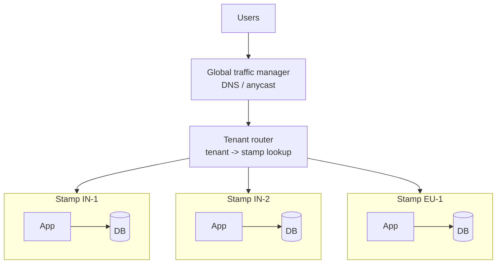

**Stamps** need:
1. A **tenant catalog / router**: a small, highly available lookup "tenant → stamp" (often in the gateway or DNS: `acme.app.example.com`).
2. **Infrastructure as code**, so a new stamp is one pipeline run (see [09_Deployment_Pattern.md](../03_System_Design/09_Deployment_Pattern.md)).
3. **Progressive rollout across stamps**: canary stamp first, then the rest in waves.
4. A way to **move tenants** between stamps (rebalancing big tenants).

**Geodes** need:
1. **Global routing**: latency-based DNS (Route 53, Azure Traffic Manager), anycast load balancers (Google Cloud LB, Azure Front Door), with health checks.
2. **Multi-region data**: an active-active database (DynamoDB global tables, Cosmos DB multi-region writes, Spanner, CockroachDB) or a partition of data by home region.
3. **A conflict strategy** for concurrent writes in two regions (last-writer-wins, CRDTs, or routing each user's writes to a home region). See [07_Distributed_Systems_Pattern.md](../03_System_Design/07_Distributed_Systems_Pattern.md) and [Database Replication](../03_System_Design/01_Scalability_Pattern.md#4-database-replication-interview-imp---java).

## 10.4 Variants

| Variant | Description |
|---|---|
| **Single-tenant stamps** | One big customer per stamp: isolation, custom upgrade schedule |
| **Multi-tenant stamps** | Many small tenants share a stamp (the common case) |
| **Cell-based architecture** (AWS term) | Stamps plus a thin cell router; failures are contained in one cell |
| **Active-passive multi-region** | Second region only takes over on failure (cheaper, slower failover); see [Failover](../03_System_Design/02_Reliability_Pattern.md#10-failover-pattern) |
| **Geode (active-active)** | Every region serves traffic all the time |
| **Stamps inside geodes** | Several stamps per region, several regions: large SaaS platforms |

## 10.5 Complete Java Example - Blast Radius and Nearest-Region Routing

```java
import java.util.LinkedHashMap;
import java.util.List;
import java.util.Map;

// Deployment Stamps: many independent copies ("stamps"/cells) of the whole stack, each serving a subset of tenants.
// Geode: copies of the service in several regions, each able to serve any user; users go to the nearest healthy one.
public class StampsGeodeDemo {
    public static void main(String[] args) {
        // ---- Deployment stamps ----
        Map<String, String> tenantToStamp = new LinkedHashMap<>();
        String[] stamps = {"stamp-in-1", "stamp-in-2", "stamp-eu-1"};
        List<String> tenants = List.of("acme-IN", "globex-IN", "initech-IN", "umbrella-EU", "hooli-EU", "stark-IN");
        for (String t : tenants) {
            String stamp = t.endsWith("EU") ? "stamp-eu-1" : stamps[Math.floorMod(t.hashCode(), 2)];   // data residency + spread
            tenantToStamp.put(t, stamp);
        }
        System.out.println("Deployment stamps (each = its own app + DB + cache):");
        tenantToStamp.forEach((t, s) -> System.out.println("  " + t + " -> " + s));
        String failed = "stamp-in-2";
        long affected = tenantToStamp.values().stream().filter(failed::equals).count();
        System.out.println("  " + failed + " has a bad deployment -> " + affected + " of " + tenants.size() + " tenants affected (blast radius), others untouched");

        // ---- Geode ----
        Map<String, Map<String, Integer>> latencyMs = new LinkedHashMap<>();
        latencyMs.put("user in Bengaluru", Map.of("ap-south-1 (Mumbai)", 25, "eu-west-1 (Ireland)", 140, "us-east-1 (Virginia)", 230));
        latencyMs.put("user in London",    Map.of("ap-south-1 (Mumbai)", 120, "eu-west-1 (Ireland)", 15, "us-east-1 (Virginia)", 80));
        latencyMs.put("user in New York",  Map.of("ap-south-1 (Mumbai)", 210, "eu-west-1 (Ireland)", 75, "us-east-1 (Virginia)", 12));
        System.out.println("Geode (every region serves everyone; global LB picks the nearest healthy one):");
        for (boolean mumbaiDown : new boolean[]{false, true}) {
            if (mumbaiDown) System.out.println("  -- ap-south-1 outage --");
            latencyMs.forEach((user, regions) -> {
                String best = regions.entrySet().stream()
                        .filter(e -> !(mumbaiDown && e.getKey().startsWith("ap-south-1")))
                        .min(Map.Entry.comparingByValue()).orElseThrow().getKey();
                System.out.println("  " + user + " -> " + best + " (" + regions.get(best) + " ms)");
            });
        }
    }
}
```

**Output:**
```
Deployment stamps (each = its own app + DB + cache):
  acme-IN -> stamp-in-1
  globex-IN -> stamp-in-2
  initech-IN -> stamp-in-1
  umbrella-EU -> stamp-eu-1
  hooli-EU -> stamp-eu-1
  stark-IN -> stamp-in-2
  stamp-in-2 has a bad deployment -> 2 of 6 tenants affected (blast radius), others untouched
Geode (every region serves everyone; global LB picks the nearest healthy one):
  user in Bengaluru -> ap-south-1 (Mumbai) (25 ms)
  user in London -> eu-west-1 (Ireland) (15 ms)
  user in New York -> us-east-1 (Virginia) (12 ms)
  -- ap-south-1 outage --
  user in Bengaluru -> eu-west-1 (Ireland) (140 ms)
  user in London -> eu-west-1 (Ireland) (15 ms)
  user in New York -> us-east-1 (Virginia) (12 ms)
```

**What to notice:** a bad deploy on `stamp-in-2` affects 2 of 6 tenants instead of all 6. In the geode, the Mumbai outage moves Bengaluru users to Ireland: the service stays up, with higher latency.

## 10.6 Stamps and Geodes in Practice

```java
// Tenant router in a Spring Cloud Gateway: look up the tenant's stamp, rewrite the target
@Bean
RouteLocator stamps(RouteLocatorBuilder b, TenantCatalog catalog) {
    return b.routes()
            .route("tenant-routing", r -> r.path("/api/**")
                    .filters(f -> f.filter((exchange, chain) -> {
                        String tenant = exchange.getRequest().getHeaders().getFirst("X-Tenant-Id");
                        URI stamp = catalog.stampFor(tenant);          // cached lookup, e.g. https://stamp-in-2.internal
                        exchange.getAttributes().put(ServerWebExchangeUtils.GATEWAY_REQUEST_URL_ATTR,
                                UriComponentsBuilder.fromUri(stamp).path(exchange.getRequest().getPath().value()).build().toUri());
                        return chain.filter(exchange);
                    }, RouteToRequestUrlFilter.ROUTE_TO_URL_FILTER_ORDER + 1))   // run after the default URL is set, then override it
                    .uri("no://op"))                                  // replaced per request by the filter above
            .build();
}
```

```yaml
# One stamp = one parameterised IaC deployment, rolled out in waves (illustrative pipeline)
stamps:
  - { name: stamp-canary, region: ap-south-1, wave: 0 }
  - { name: stamp-in-1,   region: ap-south-1, wave: 1 }
  - { name: stamp-in-2,   region: ap-south-1, wave: 1 }
  - { name: stamp-eu-1,   region: eu-west-1,  wave: 2 }
```

## 10.7 Pros and Cons

| Pros | Cons |
|---|---|
| Small blast radius for failures and bad deploys | Many copies of infrastructure: higher base cost |
| Near-linear scale: add stamps or regions | Cross-stamp features (global search, reports) need aggregation |
| Data residency and per-tenant isolation | Tenant routing and migration add complexity |
| Geode: low latency worldwide and region-outage survival | Multi-region writes bring conflicts and consistency trade-offs (CAP) |

## 10.8 Pitfalls, Interview Questions and Cheat Sheet

**Common pitfalls**
- **Hand-built stamps that drift apart** ("snowflake" stamps). Everything must come from the same IaC templates.
- **A single shared dependency** (one global DB, one auth service in one region) quietly brings back the global blast radius.
- **Geode without capacity headroom:** when one region fails, the others must absorb its traffic. Plan for N+1 regions.
- **Assuming the tenant catalog is always reachable.** Cache it at the router, and replicate it.

**Interview questions**
1. *How would you design a SaaS platform for 10,000 tenants with strict isolation for large customers?* → Deployment stamps (multi-tenant for small, dedicated for big), tenant catalog + router, IaC per stamp, wave-based rollouts, tenant migration tooling.
2. *What is blast radius and how do you reduce it?* → The share of users affected by one failure; cells/stamps, canary waves, per-region deployments, bulkheads.
3. *Active-active vs active-passive multi-region?* → Active-active: all regions serve, low latency, complex data consistency. Active-passive: simpler, cheaper, but failover time and an idle region.
4. *How do you handle writes in an active-active geode?* → Home-region per user, or a multi-master DB with conflict resolution (LWW, CRDT), or a globally consistent DB (Spanner) at higher write latency.

**Cheat sheet**
```
Stamps   N identical full stacks, tenant -> stamp router, IaC, deploy in waves, small blast radius
Geode    same service in many regions, nearest healthy via DNS/anycast, active-active data
Data     global tables / multi-region DB, or home region per user; plan conflict resolution
Capacity survive losing one region (N+1); no hidden global single points of failure
```

### 📘 Terms Explained

| Term | Meaning |
|---|---|
| **Deployment Stamp / cell / scale unit** | One independent, complete copy of the system serving a subset of users |
| **Geode** | Pattern of running the same service in many regions, each able to serve any request |
| **Blast radius** | How many users are affected when something fails |
| **Tenant** | A customer (company) of a SaaS product, with its own users and data |
| **Tenant catalog** | Lookup table mapping each tenant to the stamp holding its data |
| **Data residency** | Legal requirement to keep data inside a particular country/region |
| **Active-active / active-passive** | All regions serve traffic / one standby region waits for failover |
| **Anycast** | One IP address announced from many locations; the network delivers to the nearest |
| **Global tables** | Database tables replicated across regions with writes allowed in each (e.g. DynamoDB) |
| **CRDT** | Conflict-free Replicated Data Type: data structure that merges concurrent updates automatically |
| **N+1** | Having one more unit of capacity than needed, so one can fail without overload |

---

# 11. Cloud Patterns Covered in Other Files

The master list's Cloud-Native category overlaps with other categories. Here is every pattern in it and where its detailed section is, so you can revise the whole cloud catalogue in one pass.

| # | Pattern (master list) | One-line idea | Detailed section |
|---|---|---|---|
| 191 | **Strangler Fig** **(Interview Imp - Java)** | Replace a legacy system piece by piece behind a router | [Microservices - Strangler Fig](02_Microservices_Pattern.md#13-strangler-fig-pattern-migrating-from-a-monolith-interview-imp---java) |
| 192 | **Backends for Frontends (BFF)** | One backend per client type (web, mobile) | [Microservices - API Gateway and BFF](02_Microservices_Pattern.md#2-api-gateway-and-backends-for-frontends-interview-imp---java), [API Design - Gateway and BFF](../03_System_Design/08_API_Design_Pattern.md#6-api-gateway-and-backend-for-frontend-bff) |
| 193 | **External Configuration Store** **(Interview Imp - Java)** | Config outside the artifact, central and versioned | [Microservices - Externalized Configuration](02_Microservices_Pattern.md#8-externalized-configuration-pattern-interview-imp---java), plus [Twelve-Factor](#1-the-twelve-factor-app-interview-imp---java) here |
| 194 | **Gatekeeper** | Least-privilege host validates requests first | [Section 3](#3-gateway-offloading-and-gatekeeper-patterns) |
| 195 | **Valet Key** | Short-lived signed URL for direct storage access | [Section 4](#4-valet-key-claim-check-and-static-content-hosting-interview-imp---java) |
| 196 | **Static Content Hosting** | Serve static files from storage + CDN | [Section 4](#4-valet-key-claim-check-and-static-content-hosting-interview-imp---java), [Scalability - CDN](../03_System_Design/01_Scalability_Pattern.md#12-cdn-content-delivery-network) |
| 197 | **Gateway Routing** | One endpoint routes to many services | [Microservices - API Gateway](02_Microservices_Pattern.md#2-api-gateway-and-backends-for-frontends-interview-imp---java) |
| 198 | **Gateway Aggregation** **(Interview Imp - Java)** | One call fans out and merges responses | [Microservices - API Gateway](02_Microservices_Pattern.md#2-api-gateway-and-backends-for-frontends-interview-imp---java) |
| 199 | **Gateway Offloading** | Shared concerns (TLS, auth, limits) in the gateway | [Section 3](#3-gateway-offloading-and-gatekeeper-patterns) |
| 200 | **Claim Check** | Big payload in storage, reference in the message | [Section 4](#4-valet-key-claim-check-and-static-content-hosting-interview-imp---java), [04_Integration_Pattern.md - Message Construction](04_Integration_Pattern.md#5-message-construction-envelope-wrapper-format-indicator-message-expiration-claim-check) |
| 201 | **Choreography** **(Interview Imp - Java)** | Services react to each other's events, no central coordinator | [Microservices - Event-Driven Choreography](02_Microservices_Pattern.md#6-domain-events-and-event-driven-choreography-interview-imp---java) |
| 202 | **Competing Consumers** | Many consumers share one queue's work | [Messaging - Message Queue](../03_System_Design/04_Messaging_Pattern.md#1-message-queue-pattern-interview-imp---java) |
| 203 | **Priority Queue** **(Interview Imp - Java)** | Important work first, without starvation | [Section 6](#6-priority-queue-pattern-interview-imp---java) |
| 204 | **Queue-Based Load Leveling** **(Interview Imp - Java)** | Queue absorbs bursts for a limited downstream | [Section 5](#5-queue-based-load-leveling-pattern-interview-imp---java) |
| 205 | **Scheduler Agent Supervisor** | Durable workflow with stuck-step recovery | [Section 8](#8-scheduler-agent-supervisor-pattern) |
| 206 | **Sequential Convoy** | Ordered per key, parallel across keys | [Section 7](#7-sequential-convoy-pattern) |
| 207 | **Pipes and Filters** | Chain of independent processing steps | [Architectural - Pipe and Filter](../02_HLD/01_Architectural_Pattern.md#6-pipe-and-filter-architecture) |
| 208 | **Compensating Transaction** **(Interview Imp - Java)** | Undo completed steps when a later one fails | [Microservices - Saga](02_Microservices_Pattern.md#5-saga-pattern-interview-imp---java), plus [Section 8](#8-scheduler-agent-supervisor-pattern) here |
| 209 | **Materialized View** | Precomputed query results | [Data Management - Materialized View](../03_System_Design/05_Data_Management_Pattern.md#8-materialized-view-pattern) |
| 210 | **Index Table** | Self-maintained secondary index in key-value stores | [Section 9](#9-index-table-pattern) |
| 211 | **Sharding** **(Interview Imp - Java)** | Split data horizontally across databases | [Scalability - Database Sharding](../03_System_Design/01_Scalability_Pattern.md#6-database-sharding-interview-imp---java) |
| 212 | **Throttling** **(Interview Imp - Java)** | Limit resource use per client or overall | [Reliability - Throttling](../03_System_Design/02_Reliability_Pattern.md#7-throttling-pattern), [Reliability - Rate Limiting](../03_System_Design/02_Reliability_Pattern.md#6-rate-limiting-pattern-interview-imp---java) |
| 213 | **Retry with Exponential Backoff** **(Interview Imp - Java)** | Retry transient failures with growing, jittered delays | [Reliability - Retry](../03_System_Design/02_Reliability_Pattern.md#2-retry-pattern-interview-imp---java) |
| 214 | **Geode** | Same service in many regions, nearest serves | [Section 10](#10-deployment-stamps-and-geode-patterns) |
| 215 | **Deployment Stamps** | Many independent copies of the full stack | [Section 10](#10-deployment-stamps-and-geode-patterns) |
| 216 | **Anti-Corruption Layer** | Translation layer between a new model and a legacy one | [Distributed Systems - Sidecar, Ambassador, Mesh and ACL](../03_System_Design/07_Distributed_Systems_Pattern.md#9-sidecar-ambassador-service-mesh-and-anti-corruption-layer) |

**Other cloud-native building blocks covered elsewhere:**
- **Sidecar, Ambassador, Service Mesh** → [02_Microservices_Pattern.md](02_Microservices_Pattern.md#11-sidecar-ambassador-and-service-mesh-patterns-interview-imp---java)
- **Serverless / FaaS** → [01_Architectural_Pattern.md](../02_HLD/01_Architectural_Pattern.md#10-serverless-architecture)
- **Health checks, liveness/readiness probes** → [02_Reliability_Pattern.md](../03_System_Design/02_Reliability_Pattern.md#8-health-check-pattern-interview-imp---java)
- **Blue-green, canary, GitOps, IaC** → [09_Deployment_Pattern.md](../03_System_Design/09_Deployment_Pattern.md)
- **Containers and Kubernetes objects** → [00_Docker_Index.md](../../docker/00_Docker_Index.md), [00_Kubernetes_Index.md](../../kubernetes/00_Kubernetes_Index.md)

### 📘 Terms Explained

| Term | Meaning |
|---|---|
| **Cloud design-pattern catalogue** | Published pattern lists from cloud vendors (Azure Architecture Center, AWS Prescriptive Guidance), the source of most names in this category |
| **Fan-out** | Sending one request to several services at the same time |
| **Legacy system** | An older system still in use that is hard to change |
| **FaaS** | Function as a Service: running individual functions on demand (AWS Lambda, Azure Functions) |

---

# 12. How the Cloud-Native Patterns Fit Together

A typical request through a cloud-native SaaS platform uses almost every pattern in this file:

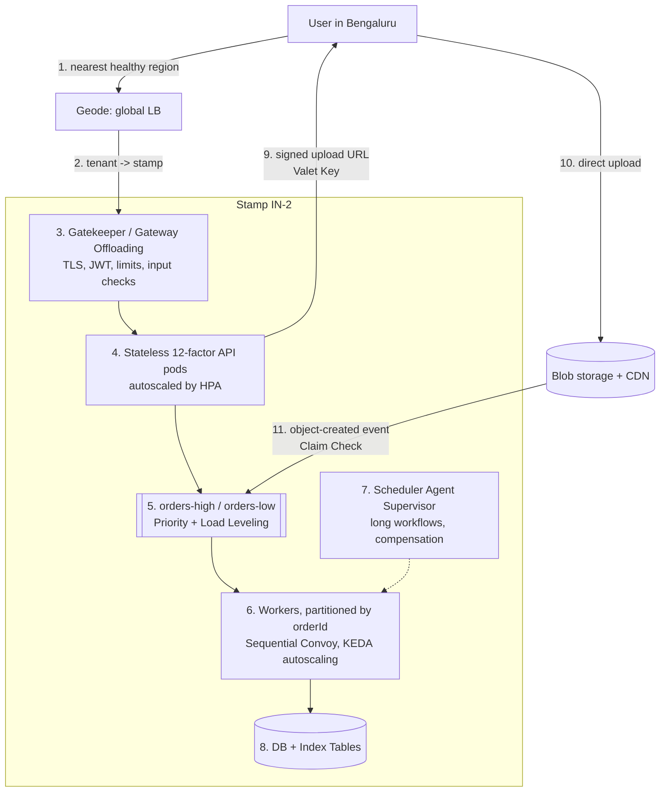

**Walk-through:** placing an order with an attached invoice scan
1. DNS sends the user to the nearest healthy region (**Geode**). The tenant router finds the tenant's stamp (**Deployment Stamps**).
2. The gateway terminates TLS, validates the JWT, enforces size and rate limits (**Gateway Offloading**), and rejects anything suspicious before it reaches business code (**Gatekeeper**).
3. A stateless API pod handles the request. It reads config from the environment and keeps no session in memory (**Twelve-Factor**). The HPA has already added pods because of the flash sale (**Autoscaling**).
4. The API returns an upload URL valid for 5 minutes (**Valet Key**). The scan goes straight to blob storage, and its "object created" event carries only the key (**Claim Check**).
5. The order goes into `orders-high` because it's a paid order, not a bulk export (**Priority Queue**). The queue absorbs the sale's burst so the payment provider sees a steady 200 TPS (**Queue-Based Load Leveling**).
6. Workers consume partitions keyed by `orderId`, so each order's events are applied in order (**Sequential Convoy**). KEDA scales the workers on queue lag.
7. The multi-step fulfilment (reserve stock → charge → ship) runs in a workflow engine that retries stuck steps and compensates failures (**Scheduler Agent Supervisor**).
8. "Orders by customer email" queries use an index table instead of scanning (**Index Table**).

| If your problem is... | Reach for |
|---|---|
| "The app can't be scaled out / deploys drop requests" | Twelve-Factor (stateless, config, disposability) |
| "Load changes a lot during the day" | Autoscaling (HPA, KEDA, cluster autoscaler) |
| "Every service re-implements auth and limits" | Gateway Offloading |
| "The public entry point holds too many secrets" | Gatekeeper |
| "Big files go through our servers / broker" | Valet Key, Claim Check, Static Content Hosting |
| "A downstream can't handle bursts" | Queue-Based Load Leveling |
| "Urgent jobs wait behind bulk jobs" | Priority Queue |
| "Parallel consumers process events out of order" | Sequential Convoy |
| "Multi-step processes get stuck halfway" | Scheduler Agent Supervisor / workflow engine |
| "Need to query a NoSQL store by a non-key field" | Index Table |
| "One failure takes down all customers" | Deployment Stamps |
| "Users far away are slow / need region-failure survival" | Geode |

**Common combinations**
- **Load Leveling + Priority Queue + Autoscaling on queue depth**: the standard worker setup.
- **Valet Key + Claim Check + event-driven worker**: the standard large-file pipeline.
- **Gateway Offloading + Gatekeeper + Twelve-Factor services**: the standard edge.
- **Stamps + Geode**: how large SaaS platforms (and the cloud providers themselves) contain failures.

### 📘 Terms Explained

| Term | Meaning |
|---|---|
| **SaaS** | Software as a Service: software used over the internet on a subscription |
| **TPS** | Transactions per second |
| **Walk-through** | Following one example request through every step of the system |

---

# 13. Cloud-Native Patterns Cheat Sheet

| Pattern | Problem | Solution | Key tools | Watch out for |
|---|---|---|---|---|
| **Twelve-Factor** **(Interview Imp - Java)** | App can't scale out or be redeployed safely | Env config, stateless, logs to stdout, graceful shutdown | Spring Boot relaxed binding, Spring Session, `server.shutdown=graceful` | Secrets in Git, hidden local state, ignored SIGTERM |
| **Autoscaling** **(Interview Imp - Java)** | Fixed capacity is too small or too costly | Control loop on a metric | HPA, KEDA, VPA, Cluster Autoscaler/Karpenter | Missing CPU requests, JVM warm-up, DB connection explosion |
| **Gateway Offloading** | Duplicate cross-cutting code | TLS, authN, limits at gateway | Spring Cloud Gateway, Envoy, API Gateway/APIM | Business logic creeping into the gateway |
| **Gatekeeper** | Public host has too much access | Separate least-privilege validator | Gateway in DMZ + WAF, private services | Services trusting unchecked headers |
| **Valet Key** **(Interview Imp - Java)** | Big transfers through app servers | Short-lived signed URL | S3 presigned URLs, Azure SAS, GCS signed URLs | Long expiry, client-chosen keys, no post-upload scan |
| **Claim Check** | Messages too big for the broker | Payload in blob store, reference in message | S3/Blob + SQS/Kafka, object-created events | Orphaned blobs, missing checksum |
| **Static Content Hosting** | App serves static files | Bucket + CDN | CloudFront, Front Door, Cloud CDN | Private files in public buckets, cache busting |
| **Queue-Based Load Leveling** **(Interview Imp - Java)** | Bursts overload a limited downstream | Durable queue, capped workers | SQS, RabbitMQ, Kafka, KEDA | Using it for sync requests, unbounded backlog |
| **Priority Queue** **(Interview Imp - Java)** | Urgent work stuck behind bulk work | Priority queues, more consumers for high | RabbitMQ `x-max-priority`, queue per priority | Starvation, big prefetch, everything "high" |
| **Sequential Convoy** | Parallel consumers break ordering | Partition / session by key | Kafka keys, Service Bus sessions, SQS FIFO groups | Hot keys, poison messages, async in listener |
| **Scheduler Agent Supervisor** | Multi-step workflows get stuck | Durable state + periodic supervisor + compensation | Temporal, Step Functions, Camunda, Durable Functions | Non-idempotent steps, two supervisors |
| **Index Table** | Non-key queries scan everything | Extra table keyed by queried attribute | DynamoDB GSI, Cassandra tables, change streams | Stale entries, low-cardinality hot partitions |
| **Deployment Stamps** | Global blast radius, scale limits | Many independent full stacks | IaC, tenant catalog, wave rollouts | Drift between stamps, hidden shared dependencies |
| **Geode** | Latency for far users, region outages | Active-active regions | Latency DNS, anycast LB, global tables | Write conflicts, no N+1 headroom |

**Top interview one-liners**
```
12-factor        same image everywhere; config from env; stateless; graceful shutdown on SIGTERM
HPA              desired = ceil(current * actual / target); 10 % tolerance; 5 min scale-down window
Valet key        app signs, storage serves; short expiry; server chooses the path
Claim check      broker carries the ticket, blob store carries the bytes
Load leveling    accept + delay (202) instead of reject (429); wait ≈ backlog / rate
Priority         queue per priority + aging/weights to avoid starvation
Convoy           ordered per key, parallel across keys; key = entity id
SAS              scheduler runs, supervisor recovers; steps idempotent; use a workflow engine
Index table      self-made secondary index for key-value stores; update old entries too
Stamps / Geode   contain failures per cell; serve from nearest region; plan N+1
```

### 📘 Terms Explained

| Term | Meaning |
|---|---|
| **Cache busting** | Changing a file's name or URL when its content changes, so browsers and CDNs fetch the new version |
| **APIM** | Azure API Management, a managed API gateway |
| **SAS (in the cheat sheet)** | Here: Scheduler Agent Supervisor. In Azure storage, "SAS" means Shared Access Signature (a valet key) |
| **One-liner** | A short, memorable answer you can give in an interview and then expand on |
