---
mdx:
  format: md
---

# Microservices Patterns

> **Note**: Patterns marked with **(Interview Imp - Java)** are frequently asked in Java interviews
>
> **How to read this file:** Every section ends with a **📘 Terms Explained** table. If you see a word you don't know, check the table right below that section. Each pattern goes from the basic idea to advanced usage (plain Java, Spring Boot / Spring Cloud, Kubernetes, pitfalls) and ends with interview questions and a mini cheat sheet.
>
> **What are microservices patterns?** They answer one question: *"Once an application is split into many small, independently deployable services, how do those services find each other, share data, stay consistent, stay secure, and stay understandable?"* This file covers the patterns from the master list's Microservices section, grouped into 13 sections. Topics already covered in depth elsewhere are linked rather than repeated: the **Transactional Outbox, polling publisher and log tailing** live in [04_Messaging_Pattern.md](../03_System_Design/04_Messaging_Pattern.md#13-guaranteed-delivery-and-the-transactional-outbox-interview-imp---java), and **health checks, circuit breakers and timeouts** in [02_Reliability_Pattern.md](../03_System_Design/02_Reliability_Pattern.md).
>
> **Verified code:** Every main "Complete Java Example" in this file is **plain Java 17 (no libraries)**: a small simulation of how the real infrastructure behaves (a registry, a gateway, a saga orchestrator...). Each was compiled and run, and its **Output** block is the real program output. Time-dependent examples use fixed or fake clocks, so the output is the same on every run. To run one, save it as `<ClassName>.java` and run `javac <ClassName>.java && java <ClassName>`. (Running it directly with `java <ClassName>.java` won't work, because the class with `main` is not the first class in the file.) The Spring Cloud / Kubernetes snippets show the production way to do the same thing.

---

## Table of Contents
1. [Service Registry and Discovery Pattern](#1-service-registry-and-discovery-pattern-interview-imp---java) **(Interview Imp - Java)**
   - [1.1 What is Service Discovery?](#11-what-is-service-discovery)
   - [1.2 Why Do We Need It?](#12-why-do-we-need-it)
   - [1.3 How It Works: Discovery and Registration Styles](#13-how-it-works-discovery-and-registration-styles)
   - [1.4 Complete Java Example - Registry with Heartbeats and Client-Side Load Balancing](#14-complete-java-example---registry-with-heartbeats-and-client-side-load-balancing)
   - [1.5 Service Discovery in Spring Cloud and Kubernetes](#15-service-discovery-in-spring-cloud-and-kubernetes)
   - [1.6 Pros, Cons and Pitfalls](#16-pros-cons-and-pitfalls)
   - [1.7 Service Discovery - Interview Questions](#17-service-discovery---interview-questions)
   - [1.8 Service Discovery - Cheat Sheet](#18-service-discovery---cheat-sheet)
   - [1.9 Types and Variants](#19-types-and-variants)
2. [API Gateway and Backends for Frontends](#2-api-gateway-and-backends-for-frontends-interview-imp---java) **(Interview Imp - Java)**
   - [2.1 What is an API Gateway?](#21-what-is-an-api-gateway)
   - [2.2 Why Do We Need It?](#22-why-do-we-need-it)
   - [2.3 Variants: One Gateway vs Backends for Frontends (BFF)](#23-variants-one-gateway-vs-backends-for-frontends-bff)
   - [2.4 Complete Java Example - A Mini API Gateway](#24-complete-java-example---a-mini-api-gateway)
   - [2.5 API Gateway with Spring Cloud Gateway](#25-api-gateway-with-spring-cloud-gateway)
   - [2.6 Pros, Cons and Pitfalls](#26-pros-cons-and-pitfalls)
   - [2.7 API Gateway - Interview Questions](#27-api-gateway---interview-questions)
   - [2.8 API Gateway - Cheat Sheet](#28-api-gateway---cheat-sheet)
3. [API Composition Pattern](#3-api-composition-pattern-interview-imp---java) **(Interview Imp - Java)**
   - [3.1 What is API Composition?](#31-what-is-api-composition)
   - [3.2 Why Do We Need It?](#32-why-do-we-need-it)
   - [3.3 How It Works and Its Variants](#33-how-it-works-and-its-variants)
   - [3.4 Complete Java Example - Parallel Composition with Fallbacks](#34-complete-java-example---parallel-composition-with-fallbacks)
   - [3.5 API Composition in Spring Boot](#35-api-composition-in-spring-boot)
   - [3.6 Pros, Cons and Pitfalls](#36-pros-cons-and-pitfalls)
   - [3.7 API Composition - Interview Questions](#37-api-composition---interview-questions)
   - [3.8 API Composition - Cheat Sheet](#38-api-composition---cheat-sheet)
4. [Database per Service Pattern](#4-database-per-service-pattern-interview-imp---java) **(Interview Imp - Java)**
   - [4.1 What is Database per Service?](#41-what-is-database-per-service)
   - [4.2 Why Do We Need It? (and Why Shared Database Is an Anti-Pattern)](#42-why-do-we-need-it-and-why-shared-database-is-an-anti-pattern)
   - [4.3 The Hard Part: Consistency and Queries Across Services](#43-the-hard-part-consistency-and-queries-across-services)
   - [4.4 How It Works in Spring Boot](#44-how-it-works-in-spring-boot)
   - [4.5 CQRS and Materialized Views for Cross-Service Queries (Interview Imp - Java)](#45-cqrs-and-materialized-views-for-cross-service-queries-interview-imp---java)
   - [4.6 Pros, Cons and Pitfalls](#46-pros-cons-and-pitfalls)
   - [4.7 Database per Service - Interview Questions](#47-database-per-service---interview-questions)
   - [4.8 Database per Service - Cheat Sheet](#48-database-per-service---cheat-sheet)
5. [Saga Pattern](#5-saga-pattern-interview-imp---java) **(Interview Imp - Java)**
   - [5.1 What is a Saga?](#51-what-is-a-saga)
   - [5.2 Why Do We Need It? (Why Not 2PC?)](#52-why-do-we-need-it-why-not-2pc)
   - [5.3 How It Works: Orchestration vs Choreography](#53-how-it-works-orchestration-vs-choreography)
   - [5.4 Complete Java Example - Orchestrated Saga with Compensation](#54-complete-java-example---orchestrated-saga-with-compensation)
   - [5.5 Sagas in Spring Boot](#55-sagas-in-spring-boot)
   - [5.6 Pros, Cons and Pitfalls](#56-pros-cons-and-pitfalls)
   - [5.7 Saga - Interview Questions](#57-saga---interview-questions)
   - [5.8 Saga - Cheat Sheet](#58-saga---cheat-sheet)
6. [Domain Events and Event-Driven Choreography](#6-domain-events-and-event-driven-choreography-interview-imp---java) **(Interview Imp - Java)**
   - [6.1 What are Domain Events?](#61-what-are-domain-events)
   - [6.2 Why Do We Need It?](#62-why-do-we-need-it)
   - [6.3 How It Works: Publishing Domain Events Reliably](#63-how-it-works-publishing-domain-events-reliably)
   - [6.4 Complete Java Example - A Choreographed Saga with Domain Events](#64-complete-java-example---a-choreographed-saga-with-domain-events)
   - [6.5 Domain Events in Spring Boot](#65-domain-events-in-spring-boot)
   - [6.6 Pros, Cons and Pitfalls](#66-pros-cons-and-pitfalls)
   - [6.7 Domain Events - Interview Questions](#67-domain-events---interview-questions)
   - [6.8 Domain Events - Cheat Sheet](#68-domain-events---cheat-sheet)
7. [Communication Styles: Remote Procedure Invocation vs Messaging](#7-communication-styles-remote-procedure-invocation-vs-messaging-interview-imp---java) **(Interview Imp - Java)**
   - [7.1 What Are the Options?](#71-what-are-the-options)
   - [7.2 Why the Choice Matters](#72-why-the-choice-matters)
   - [7.3 Types: REST vs gRPC vs GraphQL vs Messaging](#73-types-rest-vs-grpc-vs-graphql-vs-messaging)
   - [7.4 Communication in Spring Boot](#74-communication-in-spring-boot)
   - [7.5 Pros, Cons, Pitfalls and Interview Questions](#75-pros-cons-pitfalls-and-interview-questions)
   - [7.6 Communication Styles - Cheat Sheet](#76-communication-styles---cheat-sheet)
8. [Externalized Configuration Pattern](#8-externalized-configuration-pattern-interview-imp---java) **(Interview Imp - Java)**
   - [8.1 What is Externalized Configuration?](#81-what-is-externalized-configuration)
   - [8.2 Why Do We Need It?](#82-why-do-we-need-it)
   - [8.3 How It Works: Sources and Priority](#83-how-it-works-sources-and-priority)
   - [8.4 Complete Java Example - Layered Configuration Resolution](#84-complete-java-example---layered-configuration-resolution)
   - [8.5 Externalized Configuration in Spring Boot](#85-externalized-configuration-in-spring-boot)
   - [8.6 Pros, Cons and Pitfalls](#86-pros-cons-and-pitfalls)
   - [8.7 Externalized Configuration - Interview Questions](#87-externalized-configuration---interview-questions)
   - [8.8 Externalized Configuration - Cheat Sheet](#88-externalized-configuration---cheat-sheet)
9. [Access Token Pattern: Securing Service-to-Service Calls](#9-access-token-pattern-securing-service-to-service-calls-interview-imp---java) **(Interview Imp - Java)**
   - [9.1 What is the Access Token Pattern?](#91-what-is-the-access-token-pattern)
   - [9.2 Why Do We Need It?](#92-why-do-we-need-it)
   - [9.3 How It Works: What Each Service Must Check](#93-how-it-works-what-each-service-must-check)
   - [9.4 Complete Java Example - Issuing and Verifying a JWT](#94-complete-java-example---issuing-and-verifying-a-jwt)
   - [9.5 Access Tokens in Spring Boot](#95-access-tokens-in-spring-boot)
   - [9.6 Pros, Cons and Pitfalls](#96-pros-cons-and-pitfalls)
   - [9.7 Access Token - Interview Questions](#97-access-token---interview-questions)
   - [9.8 Access Token - Cheat Sheet](#98-access-token---cheat-sheet)
10. [Observability Patterns](#10-observability-patterns-interview-imp---java) **(Interview Imp - Java)**
   - [10.1 What is Observability?](#101-what-is-observability)
   - [10.2 Why Do We Need It?](#102-why-do-we-need-it)
   - [10.3 How It Works: Each Pattern](#103-how-it-works-each-pattern)
   - [10.4 Complete Java Example - A Trace Waterfall](#104-complete-java-example---a-trace-waterfall)
   - [10.5 Observability in Spring Boot](#105-observability-in-spring-boot)
   - [10.6 Pros, Cons and Pitfalls](#106-pros-cons-and-pitfalls)
   - [10.7 Observability - Interview Questions](#107-observability---interview-questions)
   - [10.8 Observability - Cheat Sheet](#108-observability---cheat-sheet)
11. [Sidecar, Ambassador and Service Mesh Patterns](#11-sidecar-ambassador-and-service-mesh-patterns-interview-imp---java) **(Interview Imp - Java)**
   - [11.1 What Are They?](#111-what-are-they)
   - [11.2 Why Do We Need Them?](#112-why-do-we-need-them)
   - [11.3 How It Works: Common Sidecar Uses](#113-how-it-works-common-sidecar-uses)
   - [11.4 Service Mesh Configuration Examples (Istio)](#114-service-mesh-configuration-examples-istio)
   - [11.5 Pros, Cons, Pitfalls and Interview Questions](#115-pros-cons-pitfalls-and-interview-questions)
   - [11.6 Sidecar and Service Mesh - Cheat Sheet](#116-sidecar-and-service-mesh---cheat-sheet)
   - [11.7 Types, Variants and In Java](#117-types-variants-and-in-java)
12. [Microservice Chassis and Service Template](#12-microservice-chassis-and-service-template)
   - [12.1 What Are They?](#121-what-are-they)
   - [12.2 Why Do We Need Them?](#122-why-do-we-need-them)
   - [12.3 How It Works in the Spring Ecosystem](#123-how-it-works-in-the-spring-ecosystem)
   - [12.4 Pros, Cons, Pitfalls and Interview Questions](#124-pros-cons-pitfalls-and-interview-questions)
   - [12.5 Microservice Chassis - Cheat Sheet](#125-microservice-chassis---cheat-sheet)
   - [12.6 Types and Variants](#126-types-and-variants)
13. [Strangler Fig Pattern: Migrating from a Monolith](#13-strangler-fig-pattern-migrating-from-a-monolith-interview-imp---java) **(Interview Imp - Java)**
   - [13.1 What is the Strangler Fig Pattern?](#131-what-is-the-strangler-fig-pattern)
   - [13.2 Why Do We Need It?](#132-why-do-we-need-it)
   - [13.3 How It Works: Steps and Techniques](#133-how-it-works-steps-and-techniques)
   - [13.4 Complete Java Example - A Routing Facade with Gradual Rollout](#134-complete-java-example---a-routing-facade-with-gradual-rollout)
   - [13.5 Strangler Fig with Spring Cloud Gateway](#135-strangler-fig-with-spring-cloud-gateway)
   - [13.6 Pros, Cons, Pitfalls and Interview Questions](#136-pros-cons-pitfalls-and-interview-questions)
   - [13.7 Strangler Fig - Cheat Sheet](#137-strangler-fig---cheat-sheet)
   - [13.8 Types and Variants](#138-types-and-variants)
14. [How the Microservices Patterns Fit Together](#14-how-the-microservices-patterns-fit-together)
   - [14.1 One-Line Summary of Each](#141-one-line-summary-of-each)
   - [14.2 One Request Through the Whole Architecture (Interview Imp - Java)](#142-one-request-through-the-whole-architecture-interview-imp---java)
   - [14.3 Decision Guide](#143-decision-guide)
   - [14.4 Look-Alike Patterns](#144-look-alike-patterns)
   - [14.5 Microservices Inside Spring Cloud and Kubernetes](#145-microservices-inside-spring-cloud-and-kubernetes)
   - [14.6 Comparison Table](#146-comparison-table)
15. [Microservices Patterns Cheat Sheet](#15-microservices-patterns-cheat-sheet)

---

## Before You Start: Monolith vs Microservices

### What are microservices?

A **microservice architecture** builds one application as a set of **small services**, each:
- owning **one business capability** (orders, payments, catalogue),
- running in its **own process** and **deployed independently**,
- owning **its own data**,
- talking to others over the network (HTTP/gRPC or messaging),
- built and run by **one small team**.

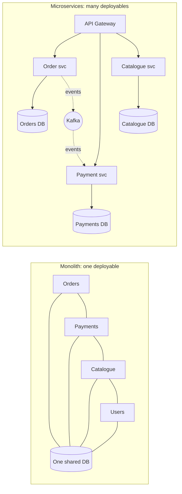

| | Monolith | Microservices |
|---|---|---|
| Deploy | Everything together | Each service on its own |
| Scale | The whole app | Only the busy services |
| Team autonomy | Many teams in one codebase | One team per service, own release cadence |
| Technology | One stack | Can differ per service (careful!) |
| Failure | A memory leak can take everything down | Failures can be isolated (with the patterns in [02_Reliability_Pattern.md](../03_System_Design/02_Reliability_Pattern.md)) |
| Data consistency | Easy: one ACID database | Hard: distributed data, sagas, eventual consistency |
| Operations | One app to monitor | Dozens of services: tracing, discovery, config, CI/CD for each |
| Debugging | Stack trace in one process | Requests cross many services |
| Latency | In-process calls (ns) | Network calls (ms) |

> **Interview-safe opinion:** "Start with a **well-structured modular monolith**. Split into microservices when team size, independent scaling or deployment speed really demand it. Microservices trade **code complexity** for **operational and distributed-systems complexity**."

### How to split: decomposition

| Strategy | Meaning | Example |
|---|---|---|
| **By business capability** | One service per thing the business does | Ordering, Billing, Shipping, Catalogue |
| **By subdomain / bounded context (DDD)** ✅ | Where the meaning of words changes, draw a boundary | "Product" in Catalogue (description, images) vs in Inventory (SKU, stock) |
| **Not** by technical layer | ❌ "UI service", "business-logic service", "DB service" | Every change touches all three: a **distributed monolith** |

**Conway's Law:** systems end up mirroring the communication structure of the organisation that builds them. Align service boundaries with team boundaries.

**Distributed monolith (anti-pattern):** services that must be deployed together, share a database, or call each other synchronously in long chains. You get all the costs of microservices and none of the benefits.

### Map of the patterns in this file

| # | Section | Master-list patterns |
|---|---|---|
| 1 | Service Registry and Discovery | Service Registry, Client-Side Discovery, Server-Side Discovery, Self Registration, Third-Party Registration |
| 2 | API Gateway and BFF | (API Gateway, Backends for Frontends) |
| 3 | API Composition | API Composition |
| 4 | Database per Service | Database per Service, Shared Database (anti-pattern), CQRS / materialized views |
| 5 | Saga | Saga |
| 6 | Domain Events and Event-Driven Choreography | Domain Event, Event-Driven, (Transactional Outbox, Transaction Log Tailing, Polling Publisher → Messaging file) |
| 7 | Communication Styles | Remote Procedure Invocation, Messaging |
| 8 | Externalized Configuration | Externalized Configuration |
| 9 | Access Tokens | Access Token |
| 10 | Observability | Application Metrics, Log Aggregation, Distributed Tracing, Exception Tracking, Audit Logging, Health Check API |
| 11 | Sidecar and Service Mesh | Sidecar, Service Mesh, (Ambassador) |
| 12 | Microservice Chassis and Service Template | Microservice Chassis, Service Template |
| 13 | Strangler Fig | (Legacy migration: decomposing a monolith) |

#### 📘 Terms Explained

| Term | Simple meaning |
|---|---|
| **Microservice** | A small, independently deployable service that owns one business capability and its data. |
| **Monolith** | An application built and deployed as a single unit. |
| **Modular monolith** | One deployable, but internally split into well-separated modules with clear boundaries. |
| **Bounded context (DDD)** | A boundary inside which a domain model and its words have one consistent meaning. |
| **Conway's Law** | System design mirrors the organisation's communication structure. |
| **Distributed monolith** | Microservices so tightly coupled that they behave (and must be released) like one monolith. |
| **ACID** | Atomicity, Consistency, Isolation, Durability: the guarantees of a single relational DB transaction. |

---

# 1. Service Registry and Discovery Pattern (Interview Imp - Java)

## 1.1 What is Service Discovery?

In microservices, instances start, stop, crash and move all the time (autoscaling, deployments, Kubernetes rescheduling), so their **IP addresses keep changing**. **Service discovery** lets a service find the **current, healthy** instances of another service **by name** (`inventory-service`) instead of a hard-coded address.

The **service registry** is the database of "which instances of which service are alive, and where".

**Analogy:** A hospital's reception desk with a live duty roster. You don't memorise which room Dr. Mehta is in today; you ask reception, who knows who's on duty and where. Doctors sign in when they arrive and sign out when they leave.

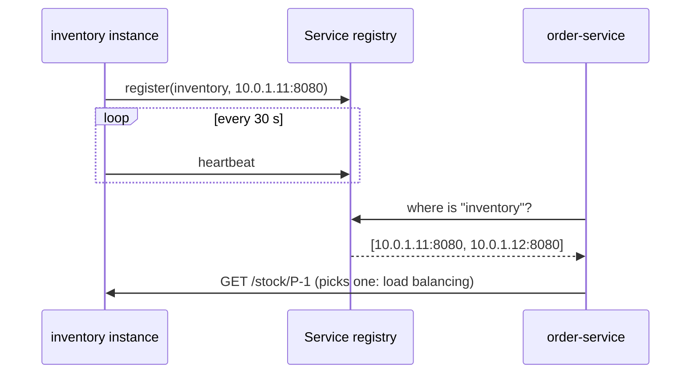

#### 📘 Terms Explained

| Term | Simple meaning |
|---|---|
| **Service discovery** | Finding the network location of a service's live instances by its name. |
| **Service registry** | The directory of available service instances (Eureka, Consul, etcd, Kubernetes API). |
| **Instance** | One running copy of a service (a pod, a container, a VM process). |
| **Heartbeat** | A periodic "I'm still alive" message from an instance to the registry. |
| **Lease** | How long a registration stays valid without a heartbeat before it's removed. |

---

## 1.2 Why Do We Need It?

- **Dynamic addresses:** with autoscaling, there may be 2 inventory instances at 9 AM and 12 at 8 PM, with different IPs every deployment.
- **Health awareness:** traffic must go only to instances that are alive.
- **No config files of IPs:** hard-coded addresses break with every change and don't scale.
- **Load balancing:** with several instances, someone must spread calls across them.

---

## 1.3 How It Works: Discovery and Registration Styles

### Who looks up the registry?

| | Client-side discovery | Server-side discovery |
|---|---|---|
| How | The **calling service** queries the registry and picks an instance itself (client-side load balancing) | The caller sends to a **router/load balancer**; the router queries the registry |
| Examples | Eureka + Spring Cloud LoadBalancer, Consul + client | Kubernetes Service (kube-proxy), AWS ALB, Nginx, API gateway, service mesh |
| Pros | No extra network hop; smart client-side balancing | Clients stay simple and language-neutral |
| Cons | Discovery logic in every client (per language) | Router must be highly available; one extra hop |

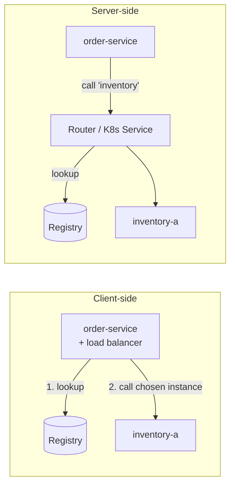

### Who registers the instance?

| | Self registration | Third-party registration |
|---|---|---|
| How | The **instance itself** registers on start-up, heartbeats, deregisters on shutdown | A **registrar** (platform) watches deployments and registers instances |
| Examples | Eureka client in Spring Boot | Kubernetes (endpoints controller), Consul agent/registrator, AWS ECS + Cloud Map |
| Pros | Simple, instance knows its own state | Services contain no registry code |
| Cons | Registry client code in every service | Depends on the platform |

> **In Kubernetes** you get server-side discovery and third-party registration for free: a `Service` named `inventory` gets a stable DNS name (`inventory.shop.svc.cluster.local`), and Kubernetes keeps its list of healthy pod IPs (only pods passing **readiness** probes) up to date. Eureka is mostly used outside Kubernetes (VMs, older Spring Cloud setups).

---

## 1.4 Complete Java Example - Registry with Heartbeats and Client-Side Load Balancing

```java
import java.util.ArrayList;
import java.util.LinkedHashMap;
import java.util.List;
import java.util.Map;
import java.util.concurrent.atomic.AtomicInteger;

record Instance(String service, String id, String address) {}

// ----- Service registry (like Eureka / Consul): instances register and send heartbeats -----
class ServiceRegistry {
    private final long leaseMillis;
    private final Map<String, Map<String, Long>> lastHeartbeat = new LinkedHashMap<>();   // service -> instanceId -> time
    private final Map<String, Instance> instances = new LinkedHashMap<>();

    ServiceRegistry(long leaseMillis) { this.leaseMillis = leaseMillis; }

    void register(Instance i, long now) {
        instances.put(i.id(), i);
        lastHeartbeat.computeIfAbsent(i.service(), k -> new LinkedHashMap<>()).put(i.id(), now);
        System.out.println("  [registry] registered " + i.id() + " at " + i.address());
    }

    void heartbeat(Instance i, long now) { lastHeartbeat.get(i.service()).put(i.id(), now); }

    void deregister(Instance i) {
        lastHeartbeat.get(i.service()).remove(i.id());
        instances.remove(i.id());
        System.out.println("  [registry] " + i.id() + " deregistered (graceful shutdown)");
    }

    // Instances that stopped sending heartbeats (crashed, network cut) are evicted
    void evictExpired(long now) {
        lastHeartbeat.values().forEach(m -> m.entrySet().removeIf(e -> {
            boolean expired = now - e.getValue() > leaseMillis;
            if (expired) System.out.println("  [registry] evicted " + e.getKey() + " (no heartbeat for " + (now - e.getValue()) + " ms)");
            return expired;
        }));
    }

    List<Instance> lookup(String service) {
        List<Instance> result = new ArrayList<>();
        lastHeartbeat.getOrDefault(service, Map.of()).keySet().forEach(id -> result.add(instances.get(id)));
        return result;
    }
}

// ----- Client-side discovery: the caller asks the registry and load-balances itself -----
class DiscoveryClient {
    private final ServiceRegistry registry;
    private final AtomicInteger counter = new AtomicInteger();
    DiscoveryClient(ServiceRegistry registry) { this.registry = registry; }

    String call(String service, String path) {
        List<Instance> live = registry.lookup(service);
        if (live.isEmpty()) return "503: no instances of " + service;
        Instance chosen = live.get(Math.floorMod(counter.getAndIncrement(), live.size()));   // round robin
        return "GET http://" + chosen.address() + path + "  (" + chosen.id() + ")";
    }
}

public class ServiceDiscoveryDemo {
    public static void main(String[] args) {
        ServiceRegistry registry = new ServiceRegistry(30_000);           // lease: 30s without heartbeat = dead
        Instance a = new Instance("inventory", "inventory-a", "10.0.1.11:8080");
        Instance b = new Instance("inventory", "inventory-b", "10.0.1.12:8080");
        Instance c = new Instance("inventory", "inventory-c", "10.0.2.21:8080");

        System.out.println("t=0s: two instances start and self-register");
        registry.register(a, 0);
        registry.register(b, 0);
        DiscoveryClient orders = new DiscoveryClient(registry);
        for (int i = 0; i < 3; i++) System.out.println("  order-service -> " + orders.call("inventory", "/stock/P-1"));

        System.out.println("t=20s: autoscaling adds inventory-c; inventory-b CRASHES (stops heartbeating)");
        registry.register(c, 20_000);
        registry.heartbeat(a, 20_000);

        System.out.println("t=45s: registry evicts dead instances");
        registry.heartbeat(a, 45_000);
        registry.heartbeat(c, 45_000);
        registry.evictExpired(45_000);
        for (int i = 0; i < 3; i++) System.out.println("  order-service -> " + orders.call("inventory", "/stock/P-1"));

        System.out.println("t=60s: inventory-a is shut down cleanly during a deployment");
        registry.deregister(a);
        System.out.println("  order-service -> " + orders.call("inventory", "/stock/P-1"));
        System.out.println("  order-service -> " + orders.call("payments", "/health"));
    }
}
```

**Output:**
```
t=0s: two instances start and self-register
  [registry] registered inventory-a at 10.0.1.11:8080
  [registry] registered inventory-b at 10.0.1.12:8080
  order-service -> GET http://10.0.1.11:8080/stock/P-1  (inventory-a)
  order-service -> GET http://10.0.1.12:8080/stock/P-1  (inventory-b)
  order-service -> GET http://10.0.1.11:8080/stock/P-1  (inventory-a)
t=20s: autoscaling adds inventory-c; inventory-b CRASHES (stops heartbeating)
  [registry] registered inventory-c at 10.0.2.21:8080
t=45s: registry evicts dead instances
  [registry] evicted inventory-b (no heartbeat for 45000 ms)
  order-service -> GET http://10.0.2.21:8080/stock/P-1  (inventory-c)
  order-service -> GET http://10.0.1.11:8080/stock/P-1  (inventory-a)
  order-service -> GET http://10.0.2.21:8080/stock/P-1  (inventory-c)
t=60s: inventory-a is shut down cleanly during a deployment
  [registry] inventory-a deregistered (graceful shutdown)
  order-service -> GET http://10.0.2.21:8080/stock/P-1  (inventory-c)
  order-service -> 503: no instances of payments
```

What the output shows:
- Instances **self-registered**; order-service found them **by name** and **round-robined** between them.
- inventory-b **crashed** (no deregistration), so it kept its registration until its **lease expired**, then was evicted. Calls in that window would have hit a dead instance, which is why clients also need **retries and timeouts**.
- inventory-c, added by autoscaling, received traffic without any config change.
- Graceful shutdown **deregistered** inventory-a immediately (no lease wait).
- An unknown service returns **503** instead of hanging.

---

## 1.5 Service Discovery in Spring Cloud and Kubernetes

### Eureka (self registration + client-side discovery)

```java
// Registry server (one small Spring Boot app, run 2-3 copies for HA)
@SpringBootApplication
@EnableEurekaServer
public class RegistryApplication { public static void main(String[] a) { SpringApplication.run(RegistryApplication.class, a); } }
```

```yaml
# Every service: depends on spring-cloud-starter-netflix-eureka-client -> registers itself automatically
spring:
  application:
    name: inventory-service             # the name others use to find it
eureka:
  client:
    service-url:
      defaultZone: http://registry-1:8761/eureka,http://registry-2:8761/eureka
  instance:
    prefer-ip-address: true
    lease-renewal-interval-in-seconds: 30     # heartbeat interval (default 30)
    lease-expiration-duration-in-seconds: 90  # evict after 90s without heartbeat (default 90)
```

```java
// Caller: @LoadBalanced makes "http://inventory-service" resolve through the registry
@Configuration
class ClientsConfig {
    @Bean
    @LoadBalanced
    RestClient.Builder loadBalancedRestClientBuilder() { return RestClient.builder(); }
}

@Service
class InventoryClient {
    private final RestClient rest;
    InventoryClient(RestClient.Builder builder) { this.rest = builder.baseUrl("http://inventory-service").build(); }

    StockLevel stock(String sku) {
        return rest.get().uri("/stock/{sku}", sku).retrieve().body(StockLevel.class);   // Spring Cloud LoadBalancer picks an instance
    }
}
```

```java
// OpenFeign: declarative client, discovered by name
@FeignClient(name = "inventory-service")
interface InventoryApi {
    @GetMapping("/stock/{sku}")
    StockLevel stock(@PathVariable String sku);
}
```

### Kubernetes (third-party registration + server-side discovery)

```yaml
apiVersion: v1
kind: Service
metadata:
  name: inventory-service
spec:
  selector:
    app: inventory            # all READY pods with this label are endpoints
  ports:
    - port: 80
      targetPort: 8080
```

```yaml
# order-service just uses the DNS name: no registry client, no Eureka
inventory:
  base-url: http://inventory-service      # or http://inventory-service.shop.svc.cluster.local
```

See [05_Networking.md](../../kubernetes/05_Networking.md#52-services) for Services, DNS and readiness probes.

#### 📘 Terms Explained

| Term | Simple meaning |
|---|---|
| **Eureka** | Netflix's service registry, integrated through Spring Cloud Netflix. |
| **Consul** | HashiCorp's registry + health checks + key-value store. |
| **`@LoadBalanced`** | Marks a `RestClient.Builder`/`WebClient.Builder`/`RestTemplate` so service names are resolved through Spring Cloud LoadBalancer. |
| **Spring Cloud LoadBalancer** | Client-side load balancer (round robin, random) that uses the discovery client. |
| **OpenFeign** | Declarative HTTP client: write an annotated interface, Spring generates the implementation (a dynamic proxy). |
| **kube-proxy** | Kubernetes component that routes traffic sent to a Service's IP to one of its pods. |
| **Self-preservation (Eureka)** | If many heartbeats fail at once (network trouble), Eureka stops evicting instances, assuming the network, not the instances, is broken. |

---

## 1.6 Pros, Cons and Pitfalls

| Pros | Cons |
|---|---|
| No hard-coded addresses; works with autoscaling | The registry is critical infrastructure (must be highly available) |
| Only healthy instances get traffic | Stale entries during the lease window |
| Enables client-side load balancing | Client-side discovery adds a library to every service |

| Pitfall | Fix |
|---|---|
| Single registry node | Run a cluster (Eureka peers, Consul servers); Kubernetes control plane is HA. |
| Crashed instances still registered for up to the lease time | Short leases, readiness probes, client retries to another instance, circuit breakers. |
| Clients caching the instance list forever | Refresh the cache regularly (Spring Cloud LoadBalancer does). |
| Running Eureka **and** Kubernetes Services | Pick one; on Kubernetes, use its Services (or Spring Cloud Kubernetes). |
| No graceful deregistration on shutdown | Graceful shutdown hooks (Spring does this for Eureka); `preStop` delay on Kubernetes. |

---

## 1.7 Service Discovery - Interview Questions

**Q1. Why do microservices need service discovery?**
Instances are dynamic (autoscaling, deployments, failures), so addresses change constantly. Discovery lets callers find the current healthy instances by service name.

**Q2. Client-side vs server-side discovery?**
Client-side: the caller queries the registry and load-balances itself (Eureka + Spring Cloud LoadBalancer). Server-side: the caller hits a router/LB that queries the registry (Kubernetes Service, AWS ALB). Server-side keeps clients simple; client-side saves a hop.

**Q3. Self registration vs third-party registration?**
Self: the service registers and heartbeats itself (Eureka client). Third-party: the platform registers instances (Kubernetes, Consul agent).

**Q4. How does discovery work in Kubernetes?**
A `Service` gives a stable virtual IP and DNS name; the endpoints controller keeps the list of ready pod IPs; kube-proxy (or the mesh) routes traffic to them. It's server-side discovery with third-party registration.

**Q5. What happens if the registry goes down?**
Clients keep using their cached instance lists, so existing services continue working, but new instances can't be discovered. That's why registries are clustered.

---

## 1.8 Service Discovery - Cheat Sheet

```
SERVICE DISCOVERY  Find live instances by NAME; registry = directory of instances + health.
          Client-side (caller queries registry + load-balances: Eureka + Spring Cloud LoadBalancer, @LoadBalanced, Feign)
          vs server-side (router/LB queries: Kubernetes Service + kube-proxy, ALB, gateway, mesh).
          Self registration (Eureka client, heartbeats, lease 90s) vs third-party (Kubernetes, Consul agent).
          Kubernetes: Service DNS name + readiness probes = discovery for free.
          HA registry; short leases + retries for stale entries; graceful deregistration.
```

---

## 1.9 Types and Variants

| Variant | Who looks up the registry | Example |
|---|---|---|
| **Client-side discovery** | The calling service queries the registry and load-balances itself | Eureka + Spring Cloud LoadBalancer |
| **Server-side discovery** | A router/load balancer queries the registry | AWS ALB + ECS, Kubernetes Services, NGINX + Consul |
| **Self registration** | Each instance registers itself and sends heartbeats | Spring Boot Eureka client |
| **Third-party registration** | A registrar watches the platform and registers instances | Kubernetes endpoints controller, Registrator for Docker |
| **DNS-based discovery** | Services found by DNS names | Kubernetes CoreDNS (`orders.default.svc.cluster.local`), Consul DNS |
| **Service mesh** | Sidecars get endpoints from the control plane | Istio (xDS from istiod), Linkerd |

# 2. API Gateway and Backends for Frontends (Interview Imp - Java)

## 2.1 What is an API Gateway?

An **API gateway** is the **single entry point** for all external clients. It receives every request, applies **cross-cutting concerns** (authentication, rate limiting, logging, CORS, TLS), and **routes** the request to the right internal service.

**Analogy:** An office building's reception and security desk. Visitors don't wander the floors looking for people; they check in at one desk, show ID, get a badge, and are directed to the right floor.

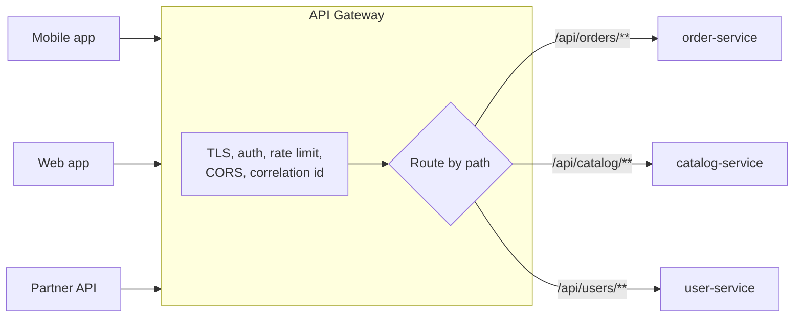

A gateway is the **Facade** pattern at system level ([03_Structural_Pattern.md](../01_LLD/03_Structural_Pattern.md#553-system-level-facades-api-gateway-and-bff)).

#### 📘 Terms Explained

| Term | Simple meaning |
|---|---|
| **API gateway** | A server that is the single front door for clients and routes requests to backend services. |
| **Cross-cutting concern** | A feature needed by every service (auth, logging, rate limiting) that isn't business logic. |
| **Edge** | The boundary between the outside world (internet) and your internal network. |
| **CORS** | Cross-Origin Resource Sharing: browser rules about which websites may call your API. |
| **TLS termination** | Decrypting HTTPS at the gateway so internal services receive plain HTTP (or re-encrypted mTLS). |

---

## 2.2 Why Do We Need It?

| Without a gateway | With a gateway |
|---|---|
| Clients must know the address of every service | One public hostname (`api.shop.com`) |
| Every service implements auth, rate limiting, CORS, TLS | Implemented once at the edge |
| Internal service structure leaks to clients (splitting a service breaks apps) | Gateway routes can change without client changes |
| Every service is exposed to the internet | Only the gateway is public |
| Mobile app makes 8 calls per screen over a slow network | Gateway/BFF can aggregate (section 3) |

**Common gateway responsibilities:** routing, authentication (validate JWT), rate limiting, TLS termination, CORS, request/response rewriting, correlation IDs, caching, circuit breaking, canary/blue-green routing, API versioning, metrics and access logs.

---

## 2.3 Variants: One Gateway vs Backends for Frontends (BFF)

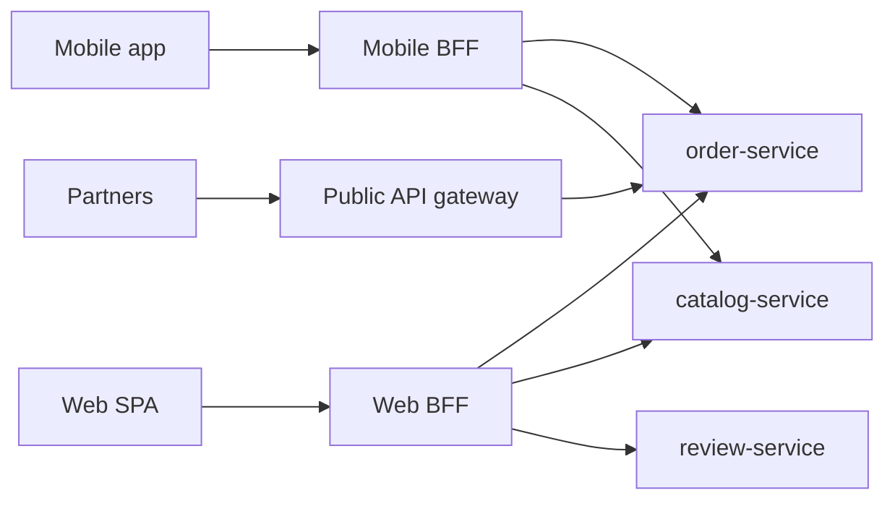

| | Single API gateway | Backends for Frontends (BFF) |
|---|---|---|
| Shape | One gateway for all clients | One gateway **per client type** (mobile, web, partner) |
| Owner | Platform team | Each frontend team owns its BFF |
| Responses | Generic | Tailored to each client (smaller payloads for mobile, fewer round trips) |
| Risk | Becomes a bottleneck "God gateway" with every team's logic | More components to run |

> **Rule:** keep **business logic out of the gateway**. Routing and cross-cutting concerns only. Aggregation belongs in a BFF or a composer service.

---

## 2.4 Complete Java Example - A Mini API Gateway

```java
import java.util.HashMap;
import java.util.LinkedHashMap;
import java.util.List;
import java.util.Map;
import java.util.Set;
import java.util.function.Function;

record HttpRequest(String method, String path, Map<String, String> headers) {}
record HttpResponse(int status, String body) {}

// A backend service is just "request in, response out" for this demo
interface Backend extends Function<HttpRequest, HttpResponse> {}

interface GatewayFilter {
    // return a response to STOP the chain, or null to continue
    HttpResponse apply(HttpRequest req, Map<String, String> addedHeaders);
}

class ApiGateway {
    private final Map<String, Backend> routes = new LinkedHashMap<>();       // path prefix -> service
    private final List<GatewayFilter> filters;
    private int requestCounter = 0;

    ApiGateway(List<GatewayFilter> filters) { this.filters = filters; }

    ApiGateway route(String prefix, Backend backend) { routes.put(prefix, backend); return this; }

    HttpResponse handle(HttpRequest req) {
        Map<String, String> added = new HashMap<>();
        added.put("X-Correlation-Id", "gw-" + (++requestCounter));          // cross-cutting: tracing
        for (GatewayFilter f : filters) {
            HttpResponse stop = f.apply(req, added);
            if (stop != null) return stop;                                   // e.g. 401, 429
        }
        for (Map.Entry<String, Backend> r : routes.entrySet()) {
            if (req.path().startsWith(r.getKey())) {
                String internalPath = req.path().substring(r.getKey().length() - 1);   // strip "/api/orders" -> "/..."
                Map<String, String> headers = new HashMap<>(req.headers());
                headers.remove("Authorization");                              // backends get identity, not raw creds
                headers.putAll(added);
                return r.getValue().apply(new HttpRequest(req.method(), internalPath, headers));
            }
        }
        return new HttpResponse(404, "no route for " + req.path());
    }
}

public class ApiGatewayDemo {
    public static void main(String[] args) {
        Map<String, String> tokens = Map.of("Bearer token-asha", "asha");

        GatewayFilter auth = (req, added) -> {
            if (req.path().startsWith("/api/public/")) return null;           // public routes skip auth
            String authHeader = req.headers().get("Authorization");
            String user = authHeader == null ? null : tokens.get(authHeader);
            if (user == null) return new HttpResponse(401, "missing or invalid token");
            added.put("X-User-Id", user);
            return null;
        };
        Set<String> blockedIps = Set.of("6.6.6.6");
        GatewayFilter ipBlock = (req, added) ->
                blockedIps.contains(req.headers().get("X-Forwarded-For")) ? new HttpResponse(403, "blocked") : null;

        Backend orderService = req -> new HttpResponse(200, "order-service " + req.method() + " " + req.path()
                + " user=" + req.headers().get("X-User-Id") + " cid=" + req.headers().get("X-Correlation-Id")
                + " sawAuthHeader=" + req.headers().containsKey("Authorization"));
        Backend catalogService = req -> new HttpResponse(200, "catalog-service GET " + req.path());

        ApiGateway gateway = new ApiGateway(List.of(ipBlock, auth))
                .route("/api/orders/", orderService)
                .route("/api/public/catalog/", catalogService);

        List<HttpRequest> requests = List.of(
                new HttpRequest("GET", "/api/orders/42", Map.of("Authorization", "Bearer token-asha", "X-Forwarded-For", "1.2.3.4")),
                new HttpRequest("GET", "/api/orders/42", Map.of("X-Forwarded-For", "1.2.3.4")),
                new HttpRequest("GET", "/api/public/catalog/phones", Map.of("X-Forwarded-For", "1.2.3.4")),
                new HttpRequest("GET", "/api/orders/42", Map.of("Authorization", "Bearer token-asha", "X-Forwarded-For", "6.6.6.6")),
                new HttpRequest("GET", "/api/unknown", Map.of("Authorization", "Bearer token-asha", "X-Forwarded-For", "1.2.3.4")));

        for (HttpRequest r : requests) {
            HttpResponse res = gateway.handle(r);
            System.out.printf("%-30s -> %d %s%n", r.path(), res.status(), res.body());
        }
    }
}
```

**Output:**
```
/api/orders/42                 -> 200 order-service GET /42 user=asha cid=gw-1 sawAuthHeader=false
/api/orders/42                 -> 401 missing or invalid token
/api/public/catalog/phones     -> 200 catalog-service GET /phones
/api/orders/42                 -> 403 blocked
/api/unknown                   -> 404 no route for /api/unknown
```

What the output shows:
- A valid token: the gateway **authenticated** the user, **stripped** the `/api/orders` prefix, added `X-User-Id` and a **correlation ID**, and **removed** the raw `Authorization` header before calling the backend.
- No token → **401** at the edge; order-service never saw the request.
- `/api/public/...` skipped authentication by design.
- A blocked IP → **403** from a filter earlier in the chain (the filters form a **Chain of Responsibility**).
- Unknown path → **404** from the gateway itself.

> **Forwarding identity:** forwarding only `X-User-Id` (as here) is simple but means backends must **trust** the gateway, so lock down the network so nothing else can reach them. A more secure option is to **relay the token** (or mint a new internal token) so each service verifies it itself (section 9).

---

## 2.5 API Gateway with Spring Cloud Gateway

```yaml
spring:
  cloud:
    gateway:
      default-filters:
        - TokenRelay=                          # pass the user's OAuth2 token to backends
        - AddResponseHeader=X-Content-Type-Options, nosniff
      routes:
        - id: orders
          uri: lb://order-service              # lb:// = resolve via service discovery + load balance
          predicates:
            - Path=/api/orders/**
          filters:
            - StripPrefix=2                    # /api/orders/42 -> /42
            - name: CircuitBreaker
              args:
                name: orders
                fallbackUri: forward:/fallback/orders
            - name: RequestRateLimiter
              args:
                redis-rate-limiter.replenishRate: 20
                redis-rate-limiter.burstCapacity: 40
        - id: catalog
          uri: lb://catalog-service
          predicates:
            - Path=/api/catalog/**
            - Method=GET
          filters:
            - StripPrefix=2
```

> Newer Spring Cloud Gateway releases (4.3+, Spring Cloud 2025) move these properties under `spring.cloud.gateway.server.webflux.*` and keep the old names working with a deprecation warning. Check the version you use.

```java
// Custom global filter: add a correlation id to every request (Java config)
@Component
class CorrelationIdFilter implements GlobalFilter, Ordered {
    public Mono<Void> filter(ServerWebExchange exchange, GatewayFilterChain chain) {
        String id = Optional.ofNullable(exchange.getRequest().getHeaders().getFirst("X-Correlation-Id"))
                            .orElse(UUID.randomUUID().toString());
        ServerHttpRequest req = exchange.getRequest().mutate().header("X-Correlation-Id", id).build();
        return chain.filter(exchange.mutate().request(req).build());
    }
    public int getOrder() { return -1; }      // run early
}
```

```yaml
# Validate JWTs at the gateway (OAuth2 resource server)
spring:
  security:
    oauth2:
      resourceserver:
        jwt:
          issuer-uri: https://auth.shop.com/realms/shop
```

**Other gateways:** Kong, NGINX / NGINX Plus, Envoy-based gateways (Istio ingress gateway, Emissary), AWS API Gateway, Azure API Management, Apigee, Traefik. For load-balancer and gateway basics see [01_Scalability_Pattern.md](../03_System_Design/01_Scalability_Pattern.md#1-load-balancer-pattern-interview-imp---java); for how Nginx works internally see [Client_Server_Web_Architecture_Guide.md](../../web-architecture/Client_Server_Web_Architecture_Guide.md).

#### 📘 Terms Explained

| Term | Simple meaning |
|---|---|
| **Spring Cloud Gateway** | Spring's reactive (WebFlux/Netty) API gateway, configured with routes, predicates and filters. |
| **Route / predicate / filter** | Where to send it / when a route matches (path, method, header) / what to change on the way. |
| **`lb://`** | Spring Cloud Gateway URI scheme meaning "look up this service name and load-balance". |
| **`StripPrefix=2`** | Removes the first two path segments before forwarding. |
| **`TokenRelay`** | Gateway filter that forwards the logged-in user's OAuth2 access token to the backend. |
| **`GlobalFilter`** | A Spring Cloud Gateway filter applied to every route. |

---

## 2.6 Pros, Cons and Pitfalls

| Pros | Cons |
|---|---|
| One public entry point; internal structure hidden | Extra network hop (latency) |
| Cross-cutting concerns implemented once | Must be highly available and scalable (it's on every request) |
| Central place for security, rate limits, metrics | Risk of becoming a bottleneck or a "God gateway" |
| Enables canary releases and API versioning | Another component to deploy and configure |

| Pitfall | Fix |
|---|---|
| Business logic creeping into the gateway | Routing + cross-cutting only; aggregation in BFF/composer. |
| One gateway shared by every team's custom logic | BFF per client type, owned by the frontend team. |
| Backends reachable directly (bypassing gateway auth) | Network policies; backends verify tokens too (defence in depth). |
| No timeouts/circuit breakers at the gateway | Configure them per route ([02_Reliability_Pattern.md](../03_System_Design/02_Reliability_Pattern.md)). |
| Single gateway instance | Several instances behind a load balancer. |

---

## 2.7 API Gateway - Interview Questions

**Q1. What is an API gateway and why use it?**
A single entry point for external clients that routes requests to services and handles cross-cutting concerns (auth, rate limiting, TLS, CORS, logging), hiding the internal service structure.

**Q2. API gateway vs load balancer?**
A load balancer spreads traffic across instances of the same service (mostly L4/L7 distribution). A gateway is application-aware: routes by path to different services, authenticates, rate-limits, transforms, aggregates.

**Q3. What is the BFF pattern?**
Backends for Frontends: a separate gateway/backend per client type (mobile, web), owned by that frontend team, shaping responses for that client.

**Q4. Should the gateway contain business logic?**
No. Keep it to routing and cross-cutting concerns; otherwise it becomes a bottleneck coupled to every team.

**Q5. How does Spring Cloud Gateway route to services?**
Routes with predicates (path, method, host, header) and filters (strip prefix, rate limiter, circuit breaker, token relay); `lb://service-name` resolves through service discovery and load-balances.

**Q6. How do backends know who the user is?**
The gateway validates the JWT and either relays the token (each service validates it again) or forwards identity headers over a trusted network. Token relay with verification in every service is more secure.

---

## 2.8 API Gateway - Cheat Sheet

```
API GATEWAY  Single entry point: routing + cross-cutting (TLS, auth/JWT, rate limit, CORS, correlation id,
          circuit breaker, caching, canary). System-level Facade; filters = Chain of Responsibility.
          BFF: one gateway per client type (mobile/web/partner), owned by frontend teams.
          Spring Cloud Gateway: routes (id, uri lb://svc, predicates Path/Method, filters StripPrefix,
          CircuitBreaker+fallbackUri, RequestRateLimiter, TokenRelay), GlobalFilter.
          NO business logic in the gateway. HA instances. Backends still verify tokens (defence in depth).
```

---

# 3. API Composition Pattern (Interview Imp - Java)

## 3.1 What is API Composition?

**API composition** answers a query that needs data from **several services** by having a **composer** (an API gateway, a BFF, or a dedicated service) **call each service and join the results in memory**.

**Analogy:** A wedding planner. You ask for "the plan for Saturday"; the planner calls the caterer, the decorator, the photographer and the venue, then hands you one combined plan.

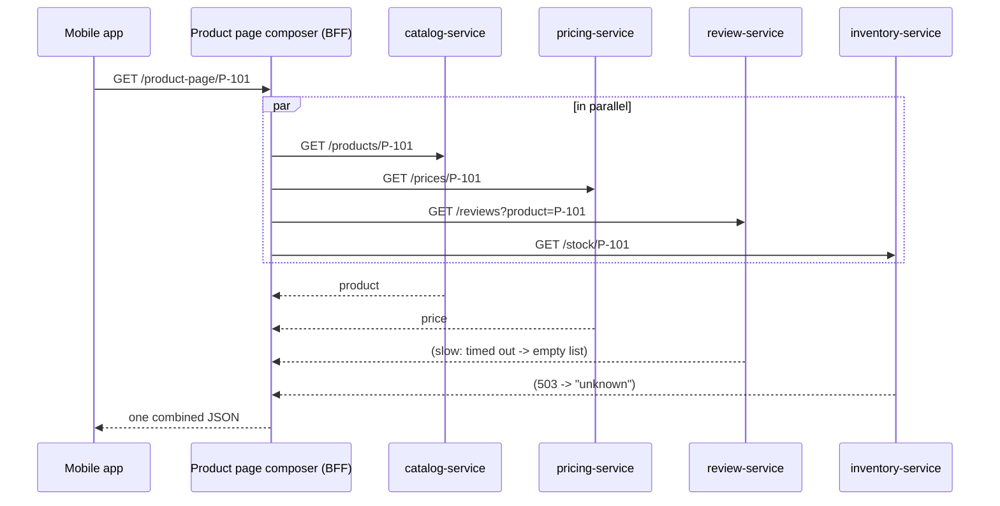

#### 📘 Terms Explained

| Term | Simple meaning |
|---|---|
| **API composition** | Building one response by calling several services and combining their results. |
| **Composer / aggregator** | The component that makes the calls and joins the data. |
| **In-memory join** | Combining data in application code instead of a SQL `JOIN` (the data is in different databases). |

---

## 3.2 Why Do We Need It?

With **database per service** (section 4), you can't run `SELECT ... JOIN` across Catalog, Pricing and Reviews: their data lives in different databases, owned by different teams. The simplest way to answer a cross-service query is to **ask each owner** and combine the answers.

It also saves the client **round trips**: one request from a phone over 4G instead of four.

---

## 3.3 How It Works and Its Variants

1. Call all independent services **in parallel** (not one after another).
2. Give every call a **timeout**.
3. Decide per part: **required** (fail the response) or **optional** (fallback: empty list, "unknown", cached value).
4. Join the results (often by ID) and return.

| Where the composer lives | Example |
|---|---|
| API gateway / BFF | Mobile BFF builds the home screen |
| A dedicated query service | `order-history-service` composes orders + shipments + payments |
| GraphQL server | Resolvers fetch fields from different services (GraphQL Federation) |

| When API composition struggles | Better option |
|---|---|
| Large joins (e.g. "all orders over Rs.5,000 by customers in Pune", sorting/filtering across services) | **CQRS read model / materialized view** (section 4.5) |
| Many sequential dependent calls (A then B then C) | Denormalised data via events; redesign boundaries |
| Very high read traffic | Cache, or a read model |

---

## 3.4 Complete Java Example - Parallel Composition with Fallbacks

```java
import java.util.List;
import java.util.concurrent.CompletableFuture;
import java.util.concurrent.ExecutorService;
import java.util.concurrent.Executors;
import java.util.concurrent.TimeUnit;

record Product(String id, String name) {}
record Price(String productId, int rupees) {}
record ProductPage(Product product, Price price, List<String> reviews, String stock) {}

// Pretend remote services (each owns its own database)
class Services {
    static Product catalog(String id)       { sleep(80);   return new Product(id, "Noise-cancelling headphones"); }
    static Price pricing(String id)         { sleep(60);   return new Price(id, 7999); }
    static List<String> reviews(String id)  { sleep(3000); return List.of("Great bass"); }   // very slow today
    static String inventory(String id)      { sleep(40);   throw new RuntimeException("inventory-service 503"); }

    static void sleep(long ms) { try { Thread.sleep(ms); } catch (InterruptedException e) { Thread.currentThread().interrupt(); } }
}

// API composer: calls the services IN PARALLEL and joins the results into one response
class ProductPageComposer {
    private final ExecutorService pool = Executors.newFixedThreadPool(8);

    ProductPage compose(String id) {
        // Required parts: if they fail, the whole page fails
        CompletableFuture<Product> product = CompletableFuture.supplyAsync(() -> Services.catalog(id), pool)
                .orTimeout(500, TimeUnit.MILLISECONDS);
        CompletableFuture<Price> price = CompletableFuture.supplyAsync(() -> Services.pricing(id), pool)
                .orTimeout(500, TimeUnit.MILLISECONDS);

        // Optional parts: time-box them and fall back instead of failing the page
        CompletableFuture<List<String>> reviews = CompletableFuture.supplyAsync(() -> Services.reviews(id), pool)
                .completeOnTimeout(List.of(), 300, TimeUnit.MILLISECONDS);
        CompletableFuture<String> stock = CompletableFuture.supplyAsync(() -> Services.inventory(id), pool)
                .exceptionally(ex -> "unknown (" + ex.getCause().getMessage() + ")");

        CompletableFuture.allOf(product, price, reviews, stock).join();
        return new ProductPage(product.join(), price.join(), reviews.join(), stock.join());
    }

    void shutdown() { pool.shutdownNow(); }
}

public class ApiCompositionDemo {
    public static void main(String[] args) {
        ProductPageComposer composer = new ProductPageComposer();
        long start = System.nanoTime();
        ProductPage page = composer.compose("P-101");
        long ms = (System.nanoTime() - start) / 1_000_000;

        System.out.println("product : " + page.product());
        System.out.println("price   : Rs." + page.price().rupees());
        System.out.println("reviews : " + page.reviews() + "   <- timed out after 300 ms, empty fallback");
        System.out.println("stock   : " + page.stock());
        System.out.println("done in under 500 ms (parallel, not 80+60+3000+40 sequential): " + (ms < 500));
        composer.shutdown();
    }
}
```

**Output:**
```
product : Product[id=P-101, name=Noise-cancelling headphones]
price   : Rs.7999
reviews : []   <- timed out after 300 ms, empty fallback
stock   : unknown (inventory-service 503)
done in under 500 ms (parallel, not 80+60+3000+40 sequential): true
```

What the output shows:
- All four calls ran **in parallel**, so the page was ready in well under 500 ms; a sequential version would take over 3 seconds.
- **Reviews** were slow (3 s); `completeOnTimeout` gave an empty list after 300 ms, so the page didn't wait.
- **Inventory** failed; `exceptionally` turned it into "unknown" instead of failing the whole page.
- **Product** and **price** are required: they have `orTimeout`, so if they failed, `join()` would throw and the page would return an error.

---

## 3.5 API Composition in Spring Boot

```java
@RestController
@RequiredArgsConstructor
class ProductPageController {
    private final WebClient catalog, pricing, reviews;       // three @LoadBalanced WebClient beans, matched by name/@Qualifier

    @GetMapping("/product-page/{id}")
    Mono<ProductPage> page(@PathVariable String id) {
        Mono<Product> product = catalog.get().uri("/products/{id}", id).retrieve()
                .bodyToMono(Product.class).timeout(Duration.ofMillis(500));                 // required
        Mono<Price> price = pricing.get().uri("/prices/{id}", id).retrieve()
                .bodyToMono(Price.class).timeout(Duration.ofMillis(500));                   // required
        Mono<List<Review>> revs = reviews.get().uri("/reviews?product={id}", id).retrieve()
                .bodyToFlux(Review.class).collectList()
                .timeout(Duration.ofMillis(300))
                .onErrorReturn(List.of());                                                    // optional

        return Mono.zip(product, price, revs)                                                 // runs all three concurrently
                   .map(t -> new ProductPage(t.getT1(), t.getT2(), t.getT3()));
    }
}
```

For blocking code (Spring MVC), use `CompletableFuture.supplyAsync(..., executor)` as in the demo, or virtual threads (Java 21: `spring.threads.virtual.enabled=true`), plus Resilience4j around each call.

#### 📘 Terms Explained

| Term | Simple meaning |
|---|---|
| **`Mono.zip`** | Reactor operator that waits for several `Mono`s (running concurrently) and combines their values. |
| **`onErrorReturn`** | Reactor operator that replaces an error with a default value. |
| **Virtual threads** | Java 21 lightweight threads; make blocking-style parallel calls cheap. |
| **GraphQL Federation** | Combining several GraphQL services into one graph; the router composes fields from different services. |

---

## 3.6 Pros, Cons and Pitfalls

| Pros | Cons |
|---|---|
| Simple way to query across services | Latency = slowest required call |
| Always reads current data from the owners | Availability drops: needs several services up at once |
| Fewer client round trips | Inefficient for large joins, filtering and sorting across services |

| Pitfall | Fix |
|---|---|
| Calling services sequentially | Call independent services in parallel. |
| No timeouts → one slow service stalls the page | Timeout every call; fallbacks for optional parts. |
| One failure fails everything | Classify required vs optional parts. |
| Large in-memory joins (thousands of IDs) | Use a CQRS read model instead. |
| N+1 calls (one call per item in a list) | Batch endpoints (`GET /prices?ids=1,2,3`). |

---

## 3.7 API Composition - Interview Questions

**Q1. How do you query data spread across several microservices?**
API composition (call the owners in parallel and join in memory) for simple queries; CQRS read models / materialized views fed by events for complex or high-volume queries.

**Q2. Where should the composition happen?**
In a BFF/gateway for client-specific screens, or in a dedicated query service for reusable cross-service queries. Not inside unrelated business services.

**Q3. How do you handle a failing service during composition?**
Timeouts on every call, fallbacks (empty/cached/"unknown") for optional parts, fail only when a required part fails, plus circuit breakers.

**Q4. When is API composition a bad fit?**
Large joins with filtering/sorting across services, high traffic, or long chains of dependent calls. Use a read model.

---

## 3.8 API Composition - Cheat Sheet

```
API COMPOSITION  Composer (BFF/gateway/query service) calls owners IN PARALLEL, joins in memory.
          Every call: timeout. Required parts fail the response; optional parts fall back (empty/cached/unknown).
          Java: CompletableFuture.supplyAsync + orTimeout/completeOnTimeout/exceptionally + allOf;
                Reactor Mono.zip + timeout + onErrorReturn; virtual threads.
          Avoid N+1 (batch endpoints). Big joins / filters / high traffic -> CQRS read model.
```

---

# 4. Database per Service Pattern (Interview Imp - Java)

## 4.1 What is Database per Service?

Each microservice **owns its data privately**. Its tables (or collections) can be read and written **only by that service**. Other services get the data **only through the owner's API or events**, never by querying its database directly.

**Analogy:** Each department in a company keeps its own files. HR doesn't walk into Finance and edit the ledger; it asks Finance, which updates its own records.

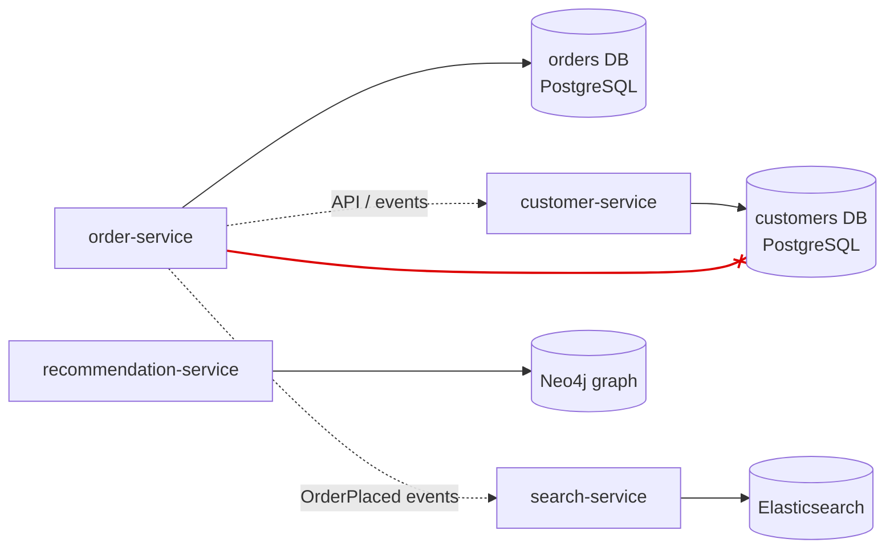

"Own database" doesn't have to mean a separate server:

| Isolation level | Meaning | Trade-off |
|---|---|---|
| **Private tables** | Same DB server and schema, but only the owner may touch its tables | Cheapest; relies on discipline |
| **Schema per service** ✅ | Same DB server, separate schema and DB user per service | Good balance; enforced by permissions |
| **Database server per service** | Separate instance (or managed DB) per service | Strongest isolation; costs more |

#### 📘 Terms Explained

| Term | Simple meaning |
|---|---|
| **Data ownership** | Only one service may change (and directly read) a piece of data. |
| **Schema** | A named set of tables inside a database (PostgreSQL schema, MySQL database). |
| **Polyglot persistence** | Different services use different database types that suit their needs. |

---

## 4.2 Why Do We Need It? (and Why Shared Database Is an Anti-Pattern)

### Shared database (anti-pattern)

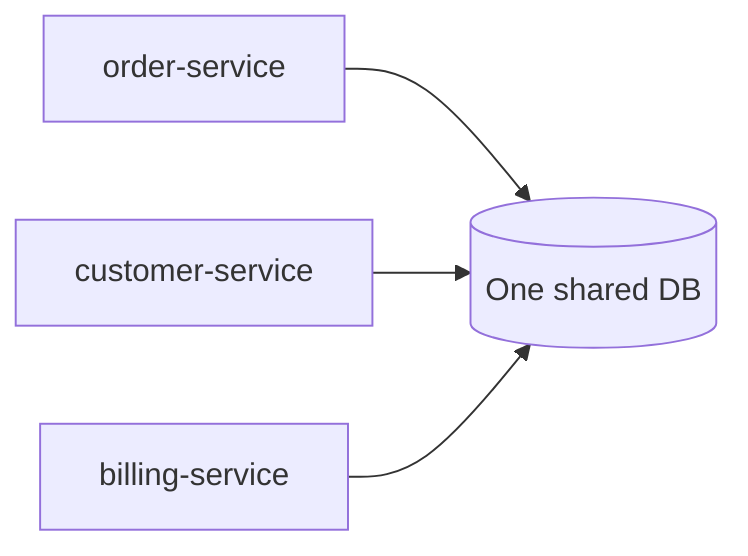

| Problem with a shared database | Example |
|---|---|
| **Schema coupling** | Customer team renames `customers.phone`; order-service and billing break in production |
| **Deployment coupling** | Schema migrations need coordinated releases of several services: a distributed monolith |
| **Runtime coupling** | Billing's heavy report query locks tables and slows down orders |
| **No clear owner** | Three services write the same table with different rules; data becomes inconsistent |
| **One technology for all** | Search wants Elasticsearch, but everyone is stuck with the shared RDBMS |

### Database per service benefits

- **Loose coupling:** the owner can change its schema freely; only its API is a contract.
- **Independent scaling and tuning:** a read-heavy catalogue gets replicas and caching; orders gets a write-optimised setup.
- **Polyglot persistence:** the right store for each job.
- **Failure isolation:** a runaway query in one DB doesn't hurt the others.

> **When a shared database is acceptable:** early in a migration, inside a modular monolith, or for a tightly-coupled pair of services owned by one team. Treat it as **temporary**, with clear table ownership.

---

## 4.3 The Hard Part: Consistency and Queries Across Services

Splitting the database creates two new problems:

| Problem | In a monolith | With database per service | Solution |
|---|---|---|---|
| **Transactions across services** ("reserve stock AND charge card AND create order") | One ACID transaction | No shared transaction | **Saga** (section 5) + eventual consistency |
| **Queries across services** ("orders with customer names and cities") | `SELECT ... JOIN` | Data is in different DBs | **API composition** (section 3) or **CQRS read models** (4.5) |
| **Keeping copies of data in sync** | n/a | Services cache others' data | **Domain events** (section 6) |

### Consistency models

| Model | Meaning | Where |
|---|---|---|
| **Strong consistency** | Every read sees the latest write | Inside one service's DB transaction |
| **Eventual consistency** | Readers may briefly see old data, but all copies converge | Across services, via events |

**CAP theorem (short version):** when the network partitions (P), a distributed system must choose between **consistency** (C: refuse or block requests) and **availability** (A: answer, possibly with stale data). Microservices usually choose **availability + eventual consistency** across services, and **strong consistency** inside each service.

#### 📘 Terms Explained

| Term | Simple meaning |
|---|---|
| **Eventual consistency** | Copies of data may disagree for a short time but will converge. |
| **Strong consistency** | Everyone always sees the most recent committed data. |
| **CAP theorem** | During a network partition you can't have both perfect consistency and full availability. |
| **Network partition** | Part of the network can't talk to another part. |
| **BASE** | Basically Available, Soft state, Eventually consistent: the typical microservices data philosophy (vs ACID). |

---

## 4.4 How It Works in Spring Boot

```yaml
# order-service: its own schema and its own DB user
spring:
  datasource:
    url: jdbc:postgresql://pg-cluster:5432/shop?currentSchema=orders
    username: order_service          # GRANT privileges ONLY on schema "orders"
  flyway:
    schemas: orders                  # migrations owned and run by this service only
```

```sql
-- One-time setup by the platform team
CREATE SCHEMA orders;
CREATE USER order_service WITH PASSWORD '...';
GRANT USAGE, CREATE ON SCHEMA orders TO order_service;
-- order_service has NO grants on schema "customers": it can't even read it
```

**Need another service's data?**

| Need | Do |
|---|---|
| Occasionally, current value | Call the owner's API (with timeout, cache) |
| Often, can be slightly stale | Keep a **local copy** updated by the owner's events (e.g. order-service stores `customerName` from `CustomerRenamed` events) |
| Complex cross-service reporting | A **read model** fed by events (4.5), or CDC into a data warehouse |

---

## 4.5 CQRS and Materialized Views for Cross-Service Queries (Interview Imp - Java)

**CQRS (Command Query Responsibility Segregation)** separates the **write model** (commands, owned by each service) from a **read model** built for queries. In microservices, a **query service** subscribes to events from several services and keeps a **materialized view**: a pre-joined, query-shaped copy of the data.

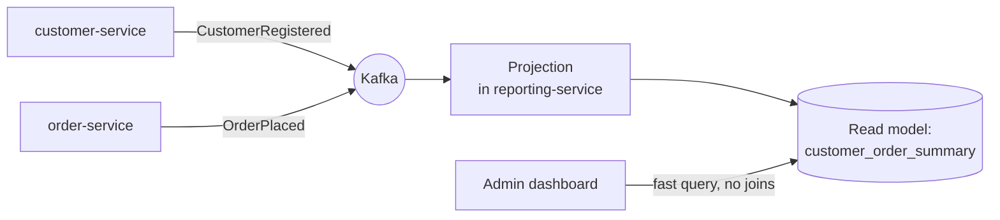

### Complete Java Example - Building a Read Model from Events

```java
import java.util.ArrayList;
import java.util.LinkedHashMap;
import java.util.List;
import java.util.Map;

// Events published by two services that each OWN their data
record CustomerRegistered(String customerId, String name, String city) {}
record OrderPlaced(String orderId, String customerId, int amount) {}

// Read model (materialized view) owned by a reporting/query service
record CustomerOrderSummary(String customerId, String name, String city, int orderCount, int totalSpent) {}

class OrderSummaryProjection {
    private final Map<String, CustomerOrderSummary> view = new LinkedHashMap<>();

    // Each event updates the view: no joins across databases at query time
    void on(Object event) {
        if (event instanceof CustomerRegistered c) {
            view.put(c.customerId(), new CustomerOrderSummary(c.customerId(), c.name(), c.city(), 0, 0));
        } else if (event instanceof OrderPlaced o) {
            CustomerOrderSummary s = view.get(o.customerId());
            view.put(o.customerId(), new CustomerOrderSummary(s.customerId(), s.name(), s.city(),
                    s.orderCount() + 1, s.totalSpent() + o.amount()));
        }
    }

    List<CustomerOrderSummary> topSpendersIn(String city) {
        return view.values().stream()
                .filter(s -> s.city().equals(city))
                .sorted((a, b) -> b.totalSpent() - a.totalSpent())
                .toList();
    }
}

public class CqrsViewDemo {
    public static void main(String[] args) {
        List<Object> eventStream = new ArrayList<>(List.of(
                new CustomerRegistered("C1", "Asha", "Pune"),         // from customer-service
                new CustomerRegistered("C2", "Ravi", "Pune"),
                new CustomerRegistered("C3", "Meera", "Delhi"),
                new OrderPlaced("O1", "C1", 2500),                    // from order-service
                new OrderPlaced("O2", "C2", 9000),
                new OrderPlaced("O3", "C1", 4000),
                new OrderPlaced("O4", "C3", 1200)));

        OrderSummaryProjection projection = new OrderSummaryProjection();
        eventStream.forEach(projection::on);

        System.out.println("Query: top spenders in Pune (answered from ONE read model, no cross-service join)");
        projection.topSpendersIn("Pune").forEach(s -> System.out.println("  " + s));

        System.out.println("A new order is placed; the view is updated only when the event is processed:");
        OrderPlaced late = new OrderPlaced("O5", "C1", 6000);
        System.out.println("  before projection: " + projection.topSpendersIn("Pune").get(0) + "   <- stale (eventual consistency)");
        projection.on(late);
        System.out.println("  after  projection: " + projection.topSpendersIn("Pune").get(0));
    }
}
```

**Output:**
```
Query: top spenders in Pune (answered from ONE read model, no cross-service join)
  CustomerOrderSummary[customerId=C2, name=Ravi, city=Pune, orderCount=1, totalSpent=9000]
  CustomerOrderSummary[customerId=C1, name=Asha, city=Pune, orderCount=2, totalSpent=6500]
A new order is placed; the view is updated only when the event is processed:
  before projection: CustomerOrderSummary[customerId=C2, name=Ravi, city=Pune, orderCount=1, totalSpent=9000]   <- stale (eventual consistency)
  after  projection: CustomerOrderSummary[customerId=C1, name=Asha, city=Pune, orderCount=3, totalSpent=12500]
```

What the output shows:
- The query "top spenders in Pune" needs **customer** data (name, city) and **order** data (totals), owned by two different services. The projection pre-joined them, so the query is a simple lookup.
- **Eventual consistency:** right after O5 was placed, the view still showed old totals until the projection processed the event. Real projections lag by milliseconds to seconds; the UI should tolerate that.

| | API composition | CQRS read model |
|---|---|---|
| Freshness | Always current | Slightly stale (eventual) |
| Query power | Simple lookups by ID | Rich filtering, sorting, aggregation, search |
| Read performance | Several calls per query | One fast local query |
| Complexity | Low | Higher: events, projection code, rebuilds |
| Availability | Needs all owners up | Works even if owners are down |

> CQRS doesn't require event sourcing, and it doesn't have to be used everywhere. Use it for the few query-heavy screens that need it. Read models can be **rebuilt** by replaying events from Kafka (retention / compacted topics) or from the owners' data.

#### 📘 Terms Explained

| Term | Simple meaning |
|---|---|
| **CQRS** | Separate models for writing (commands) and reading (queries). |
| **Read model / materialized view** | A precomputed, query-ready copy of data, updated as changes happen. |
| **Projection** | Code that consumes events and updates a read model. |
| **Rebuild / replay** | Recreating a read model from scratch by processing all past events again. |

---

## 4.6 Pros, Cons and Pitfalls

| Pros | Cons |
|---|---|
| Services evolve their schemas independently | No ACID transactions across services → sagas |
| Independent scaling, tuning and technology choice | Cross-service queries need composition or read models |
| Failure and performance isolation | Data duplication and eventual consistency |
| Clear ownership of every piece of data | More databases to operate, back up and secure |

| Pitfall | Fix |
|---|---|
| "Just this once" reading another service's tables | Enforce with DB permissions; expose an API or events instead. |
| Distributed transactions with 2PC/XA across service DBs | Saga + outbox. |
| Chatty synchronous calls to fetch other services' data on every request | Local copies via events; caching; read models. |
| Read models with no way to rebuild | Keep events replayable; write idempotent projections. |
| Splitting tables that are always changed together | Maybe they belong in the **same** service: revisit boundaries. |

---

## 4.7 Database per Service - Interview Questions

**Q1. Why does each microservice need its own database?**
To avoid schema, deployment and runtime coupling; to allow independent evolution, scaling and technology choice; and to give each piece of data one clear owner.

**Q2. Why is a shared database an anti-pattern?**
Any schema change can break other services; releases must be coordinated; one service's load affects others; ownership is unclear: it creates a distributed monolith.

**Q3. How do you implement a transaction spanning several services?**
A saga: a sequence of local transactions with compensating actions, coordinated by orchestration or choreography, using the outbox for reliable events.

**Q4. How do you run a query that joins data from several services?**
API composition for simple queries; a CQRS read model (materialized view fed by events) for complex, frequent or large queries.

**Q5. Does database per service mean one DB server per service?**
Not necessarily: private tables, a schema per service with separate credentials, or a server per service, depending on isolation needs and cost.

**Q6. Explain CAP in the context of microservices.**
During a network partition you must choose consistency or availability. Across services, microservices usually choose availability with eventual consistency; within a service's own DB they keep strong consistency.

---

## 4.8 Database per Service - Cheat Sheet

```
DATABASE PER SERVICE  Each service OWNS its data; others use its API/events, never its tables.
          Isolation: private tables < schema + DB user per service (common) < server per service.
          Shared DB = anti-pattern (schema/deploy/runtime coupling, distributed monolith).
          New problems: cross-service transactions -> SAGA; cross-service queries -> API COMPOSITION or CQRS read model;
                        data copies -> DOMAIN EVENTS. Eventual consistency between services, ACID inside one.
          CQRS read model: projection consumes events -> materialized view; rebuildable; slightly stale.
          CAP: partition -> choose C or A; microservices usually A + eventual consistency across services.
```

---

# 5. Saga Pattern (Interview Imp - Java)

## 5.1 What is a Saga?

A **saga** is a way to keep data consistent **across several services** without a distributed transaction. It splits a business transaction into a **sequence of local transactions**, one per service. Each step commits on its own and triggers the next. If a step fails, the saga runs **compensating transactions** to **undo** the steps that already succeeded.

**Analogy:** Booking a holiday: flight, then hotel, then car. If the car rental fails, you don't leave the flight and hotel booked; you **cancel** the hotel and the flight. Each cancellation is a compensating action, and "cancel" is a real business action (maybe with a fee), not a database rollback.

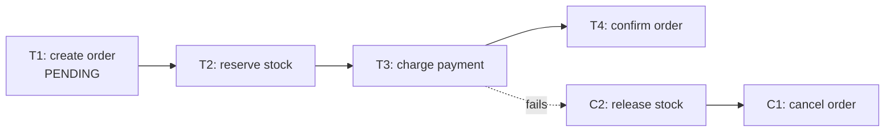

#### 📘 Terms Explained

| Term | Simple meaning |
|---|---|
| **Saga** | A sequence of local transactions, each with a compensating action, that together form one business transaction. |
| **Local transaction** | A normal ACID transaction inside one service's own database. |
| **Compensating transaction** | A business action that semantically undoes an earlier step (release stock, refund payment). |
| **Distributed transaction** | One transaction spanning several databases/services (2PC/XA). |

---

## 5.2 Why Do We Need It? (Why Not 2PC?)

**Two-phase commit (2PC)** coordinates one atomic transaction across several databases: a coordinator asks every participant to **prepare** (lock and promise), then tells all to **commit** (or abort).

| Problem with 2PC in microservices | Why |
|---|---|
| **Blocking** | Participants hold locks while waiting for the coordinator; if it crashes, they wait. |
| **Availability** | All participants must be up at the same time: availability multiplies down. |
| **Latency** | Two network round trips with locks held. |
| **Support** | Kafka, most NoSQL stores and REST APIs don't support XA. |
| **Coupling** | All services must use compatible transaction managers. |

A **saga** gives up **atomic isolation** in exchange for **availability and loose coupling**: each step commits immediately, and failures are fixed **forward** by compensation.

| | 2PC / XA | Saga |
|---|---|---|
| Atomic? | Yes (all or nothing at once) | Eventually: all steps or all compensated |
| Isolation | Full (locks) | **None** between steps (intermediate states visible) |
| Locks held across services | Yes | No |
| Works with Kafka/REST/NoSQL | Mostly no | Yes |
| Failure handling | Rollback | Compensating transactions |

---

## 5.3 How It Works: Orchestration vs Choreography

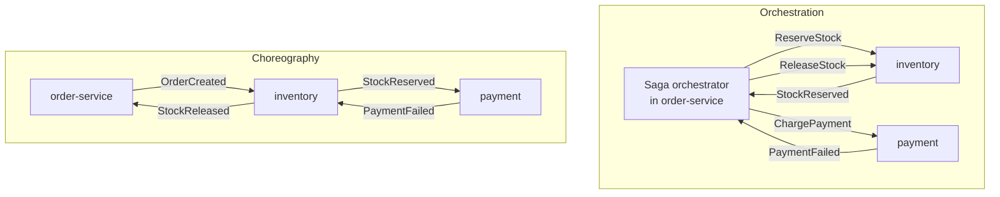

| | Orchestration | Choreography |
|---|---|---|
| Who decides the next step? | A central **orchestrator** sends commands and waits for replies | Each service **reacts to events** and publishes its own |
| Flow visible in | One place (the orchestrator) | Spread across services |
| Coupling | Orchestrator knows all participants | Services know only events |
| Adding a step | Change the orchestrator | Add a subscriber (but the flow gets harder to see) |
| Cyclic dependencies risk | Low | Higher |
| Good for | Complex flows, many steps, clear business process | Simple flows with few steps |
| Tools | Temporal, Camunda/Zeebe, Axon, Spring Statemachine, a hand-written orchestrator | Kafka/RabbitMQ events |

### Kinds of steps

| Step kind | Meaning | Example |
|---|---|---|
| **Compensatable** | Can be undone by a compensation | Reserve stock (→ release) |
| **Pivot** | The point of no return: once it succeeds, the saga will complete | Charge the card |
| **Retriable** | After the pivot; can't fail permanently, just retried until success | Send confirmation email, schedule shipping |

Order the steps so that risky, compensatable steps come **first**, the pivot in the middle, and only retriable steps after it.

### No isolation: dealing with anomalies

Because each step commits immediately, other requests can see **intermediate states** ("stock reserved but not paid"). Countermeasures:

| Countermeasure | Meaning |
|---|---|
| **Semantic lock** | Mark records as in progress (`status = PENDING`); other operations treat them carefully |
| **Commutative updates** | Design updates so order doesn't matter (debit/credit amounts rather than "set balance") |
| **Re-read value** | Check that data hasn't changed before acting (optimistic locking with `@Version`) |
| **Pessimistic view** | Order steps to reduce the risk of dirty reads (e.g. increase availability last) |

---

## 5.4 Complete Java Example - Orchestrated Saga with Compensation

```java
import java.util.ArrayDeque;
import java.util.Deque;
import java.util.List;

// One step of a saga: a local transaction in some service + the action that undoes it
record SagaStep(String name, Runnable action, Runnable compensation) {}

class SagaOrchestrator {
    // Runs steps in order; on failure, runs compensations of the COMPLETED steps in reverse order
    boolean run(String sagaId, List<SagaStep> steps) {
        Deque<SagaStep> completed = new ArrayDeque<>();
        for (SagaStep step : steps) {
            try {
                step.action().run();
                completed.push(step);
                System.out.println("  [" + sagaId + "] OK      " + step.name());
            } catch (RuntimeException e) {
                System.out.println("  [" + sagaId + "] FAILED  " + step.name() + ": " + e.getMessage());
                while (!completed.isEmpty()) {
                    SagaStep done = completed.pop();
                    done.compensation().run();
                    System.out.println("  [" + sagaId + "] UNDO    " + done.name());
                }
                return false;
            }
        }
        return true;
    }
}

public class SagaOrchestrationDemo {
    // Each "service" has its own state (its own database in real life)
    static String orderStatus;
    static int stock = 5;
    static int walletBalance;

    static List<SagaStep> placeOrderSaga(int qty, int price) {
        return List.of(
            new SagaStep("order-service:   create order (PENDING)",
                    () -> orderStatus = "PENDING",
                    () -> orderStatus = "CANCELLED"),
            new SagaStep("inventory:       reserve " + qty + " units",
                    () -> { if (stock < qty) throw new IllegalStateException("out of stock"); stock -= qty; },
                    () -> stock += qty),
            new SagaStep("payment:         charge Rs." + qty * price,
                    () -> { if (walletBalance < qty * price) throw new IllegalStateException("insufficient funds"); walletBalance -= qty * price; },
                    () -> walletBalance += qty * price),
            new SagaStep("order-service:   confirm order",
                    () -> orderStatus = "CONFIRMED",
                    () -> { })                                              // last step: nothing to undo
        );
    }

    public static void main(String[] args) {
        SagaOrchestrator orchestrator = new SagaOrchestrator();

        System.out.println("Saga 1: everything succeeds");
        walletBalance = 10_000;
        boolean ok = orchestrator.run("saga-1", placeOrderSaga(2, 1500));
        System.out.println("  result=" + ok + " order=" + orderStatus + " stock=" + stock + " wallet=" + walletBalance);

        System.out.println("Saga 2: payment fails -> compensate in reverse order");
        walletBalance = 1_000;
        ok = orchestrator.run("saga-2", placeOrderSaga(2, 1500));
        System.out.println("  result=" + ok + " order=" + orderStatus + " stock=" + stock + " wallet=" + walletBalance);
    }
}
```

**Output:**
```
Saga 1: everything succeeds
  [saga-1] OK      order-service:   create order (PENDING)
  [saga-1] OK      inventory:       reserve 2 units
  [saga-1] OK      payment:         charge Rs.3000
  [saga-1] OK      order-service:   confirm order
  result=true order=CONFIRMED stock=3 wallet=7000
Saga 2: payment fails -> compensate in reverse order
  [saga-2] OK      order-service:   create order (PENDING)
  [saga-2] OK      inventory:       reserve 2 units
  [saga-2] FAILED  payment:         charge Rs.3000: insufficient funds
  [saga-2] UNDO    inventory:       reserve 2 units
  [saga-2] UNDO    order-service:   create order (PENDING)
  result=false order=CANCELLED stock=3 wallet=1000
```

What the output shows:
- **Saga 1:** all four local transactions succeeded; the order is CONFIRMED.
- **Saga 2:** payment failed, so the orchestrator ran the compensations of the **completed** steps **in reverse order**: stock was released (back to 3) and the order was CANCELLED. The wallet was never charged.
- The order went through a visible **PENDING** state: that's the **semantic lock**. The UI shows "processing", and other operations know not to ship it yet.

> A real orchestrator also **persists** saga state (which step it's on) so it can resume after a crash, makes every step and compensation **idempotent** (they may be retried), and uses **timeouts** for steps that never reply. Workflow engines like **Temporal** handle this for you.

#### 📘 Terms Explained

| Term | Simple meaning |
|---|---|
| **Orchestrator** | The central coordinator that tells each participant what to do next. |
| **Choreography** | Decentralised coordination: services react to each other's events. |
| **Pivot transaction** | The step after which the saga can no longer be rolled back, only completed. |
| **Semantic lock** | An application-level "in progress" flag that warns other operations. |
| **Temporal / Camunda** | Workflow engines that run long-lived, durable, retryable processes (sagas). |

---

## 5.5 Sagas in Spring Boot

### Orchestration with commands and replies over Kafka (simplified)

```java
@Entity
class OrderSaga {                                      // persisted saga state, so a restart can resume
    @Id String sagaId;
    String orderId;
    @Enumerated(EnumType.STRING) SagaStep step;        // RESERVING_STOCK, CHARGING, COMPENSATING, DONE, FAILED
    @Version long version;
}

@Service
@RequiredArgsConstructor
class OrderSagaOrchestrator {
    private final OrderSagaRepository sagas;
    private final OutboxService outbox;                // commands go out via the transactional outbox

    @Transactional
    public void start(Order order) {
        sagas.save(OrderSaga.start(order));                                    // step = RESERVING_STOCK
        outbox.publish("inventory.commands", new ReserveStock(order.getId(), order.getLines()));
    }

    @KafkaListener(topics = "order-saga.replies", groupId = "order-saga")
    @Transactional
    public void onReply(SagaReply reply) {
        OrderSaga saga = sagas.findById(reply.sagaId()).orElseThrow();
        switch (reply) {
            case StockReserved r   -> { saga.moveTo(CHARGING);     outbox.publish("payment.commands", new ChargePayment(saga)); }
            case PaymentCompleted r-> { saga.moveTo(DONE);         orders.confirm(saga.orderId()); }
            case PaymentFailed r   -> { saga.moveTo(COMPENSATING); outbox.publish("inventory.commands", new ReleaseStock(saga)); }
            case StockReleased r   -> { saga.moveTo(FAILED);       orders.cancel(saga.orderId()); }
            default -> throw new IllegalStateException("unexpected " + reply);
        }
    }
}
```

> The `switch` with type patterns needs Java 21 (`SagaReply` as a sealed interface). On Java 17 use `if (reply instanceof StockReserved r)`.

### With a workflow engine (Temporal)

```java
@WorkflowInterface
public interface PlaceOrderWorkflow {
    @WorkflowMethod void placeOrder(Order order);
}

public class PlaceOrderWorkflowImpl implements PlaceOrderWorkflow {
    private final OrderActivities activities = Workflow.newActivityStub(OrderActivities.class,
            ActivityOptions.newBuilder().setStartToCloseTimeout(Duration.ofSeconds(10)).build());

    public void placeOrder(Order order) {
        Saga saga = new Saga(new Saga.Options.Builder().build());
        try {
            activities.reserveStock(order);
            saga.addCompensation(activities::releaseStock, order);
            activities.chargePayment(order);                    // pivot
            saga.addCompensation(activities::refundPayment, order);
            activities.confirmOrder(order);
        } catch (ActivityFailure e) {
            saga.compensate();                                  // runs compensations in reverse order
            throw e;
        }
    }
}
```

Temporal persists every step, retries failed activities, and survives process crashes. The workflow code reads like plain sequential Java.

#### 📘 Terms Explained

| Term | Simple meaning |
|---|---|
| **Saga state / saga log** | A persisted record of where each saga is, so it can resume after a crash. |
| **Command message** | A message asking a service to do something (`ReserveStock`), usually to one receiver. |
| **Reply message** | The participant's answer (`StockReserved`, `PaymentFailed`). |
| **Activity (Temporal)** | One step of a workflow that calls external systems; Temporal retries it automatically. |

---

## 5.6 Pros, Cons and Pitfalls

| Pros | Cons |
|---|---|
| Consistency across services without distributed locks | No isolation: intermediate states are visible |
| High availability: each step commits independently | Compensation logic is extra business code to design and test |
| Works with any database and broker | Debugging long flows across services is harder |
| Orchestration makes complex flows explicit | Eventual consistency must be explained to the business/UI |

| Pitfall | Fix |
|---|---|
| Thinking compensation = database rollback | Compensations are business actions (refund, release, cancel email). |
| Non-idempotent steps/compensations | Every step and compensation must be safe to retry. |
| Publishing commands/events outside the DB transaction | Transactional outbox ([04_Messaging_Pattern.md](../03_System_Design/04_Messaging_Pattern.md#13-guaranteed-delivery-and-the-transactional-outbox-interview-imp---java)). |
| Saga state only in memory | Persist it (or use a workflow engine). |
| A step that never replies | Timeouts → compensate or alert. |
| Long choreography chains nobody can follow | Use orchestration for flows with more than 3-4 steps; document with diagrams; tracing. |
| Compensation that can itself fail | Retry until it succeeds; alert humans if it keeps failing. |

---

## 5.7 Saga - Interview Questions

**Q1. What is the saga pattern?**
Managing a business transaction across services as a sequence of local transactions, each with a compensating transaction that undoes it if a later step fails.

**Q2. Why not use 2PC?**
2PC holds locks across services, blocks if the coordinator fails, reduces availability, adds latency, and isn't supported by Kafka, most NoSQL databases or REST APIs.

**Q3. Orchestration vs choreography?**
Orchestration: a central orchestrator sends commands and handles replies, so the flow is explicit in one place. Choreography: services react to each other's events, which is decoupled but harder to follow. Orchestration for complex flows; choreography for simple ones.

**Q4. What is a compensating transaction?**
A business operation that semantically reverses an earlier step: refund a payment, release reserved stock, cancel an order. It's not a database rollback, because the original step already committed.

**Q5. Sagas lack isolation. How do you deal with it?**
Semantic locks (PENDING states), commutative updates, re-reading values / optimistic locking, and ordering steps so risky ones happen first (compensatable → pivot → retriable).

**Q6. How do you make a saga reliable?**
Persist saga state, publish commands/events via the outbox, make steps and compensations idempotent, use timeouts and retries, and monitor stuck sagas. Or use a workflow engine like Temporal/Camunda.

**Q7. Walk me through an order-payment-inventory saga.**
Create order (PENDING) → reserve stock → charge payment (pivot) → confirm order. If payment fails: release stock, cancel order. The UI shows "processing" until the saga finishes.

---

## 5.8 Saga - Cheat Sheet

```
SAGA      Business transaction across services = sequence of LOCAL transactions + COMPENSATIONS (reverse order).
          Why not 2PC: locks, blocking coordinator, availability, latency, no XA in Kafka/NoSQL/REST.
          Orchestration (central orchestrator: commands/replies; Temporal, Camunda, Axon) vs
          Choreography (services react to events; simple flows).
          Steps: compensatable -> PIVOT -> retriable. No isolation: semantic lock (PENDING), commutative updates,
          re-read/optimistic locking. Persist saga state; outbox; idempotent steps; timeouts; monitor stuck sagas.
          Compensation = business action (refund/release/cancel), not a rollback.
```

---

# 6. Domain Events and Event-Driven Choreography (Interview Imp - Java)

## 6.1 What are Domain Events?

A **domain event** is a record of **something meaningful that happened in the business domain**, published by the service that owns that data: `OrderPlaced`, `PaymentFailed`, `CustomerAddressChanged`. In an **event-driven architecture**, services **react** to these events instead of being called directly.

**Analogy:** A newsroom wire. When something happens, a reporter files a short fact ("Monsoon reaches Kerala"). Every newspaper subscribed to the wire decides on its own what to do with it: a front-page story, a weather box, or nothing.

| Domain event properties | Why |
|---|---|
| **Past tense name** | It's a fact that already happened; it can't be rejected |
| **Immutable** | History doesn't change |
| **Owned by one service** | Only the order-service publishes `OrderPlaced` |
| **Has an ID, type, time, aggregate ID, version** | For deduplication, ordering, routing and schema evolution |
| **Business meaning, not technical** | `OrderPlaced`, not `OrdersTableRowInserted` |

#### 📘 Terms Explained

| Term | Simple meaning |
|---|---|
| **Domain event** | A business-meaningful fact about something that happened. |
| **Event-driven architecture (EDA)** | Services communicate mainly by producing and reacting to events. |
| **Aggregate (DDD)** | A cluster of objects treated as one unit for changes (an Order with its lines); events are usually per aggregate. |

---

## 6.2 Why Do We Need It?

- **Loose coupling:** order-service doesn't need to know that loyalty, email, analytics and search exist.
- **Keeping data copies in sync** across databases (section 4).
- **Choreographed sagas:** multi-step flows without a central coordinator (section 5).
- **Audit and history:** a stream of business facts is valuable for analytics and debugging.
- **Resilience:** consumers can be down for a while and catch up later.

---

## 6.3 How It Works: Publishing Domain Events Reliably

The **hard part** is publishing the event **atomically** with the database change that caused it. Three patterns from the master list solve this; they're covered in detail in [04_Messaging_Pattern.md](../03_System_Design/04_Messaging_Pattern.md#13-guaranteed-delivery-and-the-transactional-outbox-interview-imp---java):

| Pattern | How | Notes |
|---|---|---|
| **Transactional Outbox** | Save the event in an `outbox` table in the same transaction | The foundation |
| **Polling Publisher** | A relay polls the outbox and publishes new rows | Simple; adds polling load and a little latency |
| **Transaction Log Tailing** | CDC (Debezium) reads the DB's WAL/binlog and publishes outbox rows | Low latency; needs Kafka Connect |

And on the consuming side: **idempotent consumers** ([04_Messaging_Pattern.md](../03_System_Design/04_Messaging_Pattern.md#12-idempotent-consumer-pattern-interview-imp---java)), because delivery is at-least-once.

### Event design choices

| Choice | Options |
|---|---|
| Payload | **Notification** (ID only) vs **event-carried state transfer** (data consumers need); see [04_Messaging_Pattern.md](../03_System_Design/04_Messaging_Pattern.md#53-types-of-event-bus-and-event-styles) |
| Granularity | Fine-grained (`OrderLineAdded`) vs coarse (`OrderPlaced` with all lines) |
| Envelope | `eventId`, `eventType`, `aggregateId`, `version`, `occurredAt`, `correlationId` (CloudEvents format) |
| Schema evolution | Additive changes only; Schema Registry; versioned types |
| Topic layout | One topic per aggregate type (`orders.events`) keyed by aggregate ID → per-order ordering |

---

## 6.4 Complete Java Example - A Choreographed Saga with Domain Events

The same order flow as section 5, but **without an orchestrator**: each service listens for events and publishes its own.

```java
import java.util.ArrayDeque;
import java.util.ArrayList;
import java.util.Deque;
import java.util.HashMap;
import java.util.List;
import java.util.Map;
import java.util.function.Consumer;

record DomainEvent(String type, String orderId, int amount) {}

// In-memory event broker (Kafka in real life). Events are delivered in publish order.
class EventBroker {
    private final Map<String, List<Consumer<DomainEvent>>> subscribers = new HashMap<>();
    private final Deque<DomainEvent> pending = new ArrayDeque<>();

    void subscribe(String type, Consumer<DomainEvent> handler) {
        subscribers.computeIfAbsent(type, k -> new ArrayList<>()).add(handler);
    }
    void publish(DomainEvent e) {
        System.out.println("    event: " + e.type() + " " + e.orderId());
        pending.add(e);
    }
    void deliverAll() {
        while (!pending.isEmpty()) {
            DomainEvent e = pending.poll();
            subscribers.getOrDefault(e.type(), List.of()).forEach(h -> h.accept(e));
        }
    }
}

public class ChoreographyDemo {
    public static void main(String[] args) {
        EventBroker broker = new EventBroker();
        Map<String, String> orders = new HashMap<>();          // order-service's own data
        int[] stock = {10};                                     // inventory-service's own data
        int[] wallet = {2_000};                                 // payment-service's own data

        // ----- order-service: reacts to the end of the flow -----
        broker.subscribe("PaymentCompleted", e -> orders.put(e.orderId(), "CONFIRMED"));
        broker.subscribe("StockReservationFailed", e -> orders.put(e.orderId(), "REJECTED"));
        broker.subscribe("StockReleased", e -> orders.put(e.orderId(), "CANCELLED"));

        // ----- inventory-service -----
        broker.subscribe("OrderCreated", e -> {
            if (stock[0] >= 1) { stock[0]--; broker.publish(new DomainEvent("StockReserved", e.orderId(), e.amount())); }
            else broker.publish(new DomainEvent("StockReservationFailed", e.orderId(), e.amount()));
        });
        broker.subscribe("PaymentFailed", e -> {                 // compensation
            stock[0]++;
            broker.publish(new DomainEvent("StockReleased", e.orderId(), e.amount()));
        });

        // ----- payment-service -----
        broker.subscribe("StockReserved", e -> {
            if (wallet[0] >= e.amount()) { wallet[0] -= e.amount(); broker.publish(new DomainEvent("PaymentCompleted", e.orderId(), e.amount())); }
            else broker.publish(new DomainEvent("PaymentFailed", e.orderId(), e.amount()));
        });

        for (Object[] o : new Object[][]{{"ORD-1", 1500}, {"ORD-2", 1500}}) {
            String id = (String) o[0];
            int amount = (int) o[1];
            System.out.println("order-service creates " + id + " (Rs." + amount + ")");
            orders.put(id, "PENDING");
            broker.publish(new DomainEvent("OrderCreated", id, amount));
            broker.deliverAll();
            System.out.println("  => " + id + " " + orders.get(id) + ", stock=" + stock[0] + ", wallet=" + wallet[0]);
        }
    }
}
```

**Output:**
```
order-service creates ORD-1 (Rs.1500)
    event: OrderCreated ORD-1
    event: StockReserved ORD-1
    event: PaymentCompleted ORD-1
  => ORD-1 CONFIRMED, stock=9, wallet=500
order-service creates ORD-2 (Rs.1500)
    event: OrderCreated ORD-2
    event: StockReserved ORD-2
    event: PaymentFailed ORD-2
    event: StockReleased ORD-2
  => ORD-2 CANCELLED, stock=9, wallet=500
```

What the output shows:
- **ORD-1:** `OrderCreated → StockReserved → PaymentCompleted`, and order-service confirmed the order. No service called another directly.
- **ORD-2:** the wallet couldn't cover it, so payment published `PaymentFailed`; **inventory compensated** by releasing stock and published `StockReleased`; order-service cancelled the order. Stock is back to 9.
- The whole flow is visible only by **reading every service's subscriptions**: that's choreography's main weakness, and why tracing and event catalogues matter.

---

## 6.5 Domain Events in Spring Boot

```java
// Aggregate collects its own events (Spring Data publishes them on save)
@Entity
public class Order extends AbstractAggregateRoot<Order> {
    @Id private String id;
    @Enumerated(EnumType.STRING) private OrderStatus status;

    public static Order place(String id, List<Line> lines) {
        Order o = new Order(id, lines, OrderStatus.PENDING);
        o.registerEvent(new OrderPlaced(id, o.total(), Instant.now()));    // published when repository.save(o) runs
        return o;
    }
}

// Inside the same service: turn the in-process event into an outbox row in the SAME transaction
@Component
@RequiredArgsConstructor
class OrderEventsToOutbox {
    private final OutboxRepository outbox;

    @EventListener                                  // runs synchronously, inside the save() transaction
    void on(OrderPlaced e) { outbox.save(OutboxEvent.of("order", e.orderId(), e)); }
}
```

```java
// Another service: react to the event (idempotently)
@KafkaListener(topics = "orders.events", groupId = "loyalty-service")
@Transactional
void on(OrderPlaced e, @Header("eventId") String eventId) {
    if (!processedMessages.markProcessed("loyalty-service", eventId)) return;    // dedupe
    loyalty.addPoints(e.customerId(), e.total());
}
```

> **Spring Modulith** can do the in-process → outbox → broker part for you (`@ApplicationModuleListener`, `@Externalized`), see [04_Messaging_Pattern.md](../03_System_Design/04_Messaging_Pattern.md#54-event-bus-in-spring-boot).

#### 📘 Terms Explained

| Term | Simple meaning |
|---|---|
| **`AbstractAggregateRoot`** | Spring Data base class; `registerEvent()` events are published when the aggregate is saved. |
| **Event catalogue** | Documentation of every event: name, owner, schema, consumers (e.g. AsyncAPI, EventCatalog). |
| **Event storming** | A workshop technique where teams map a business process as a timeline of domain events. |

---

## 6.6 Pros, Cons and Pitfalls

| Pros | Cons |
|---|---|
| Very loose coupling; producers don't know consumers | Flow is implicit and spread across services |
| New features plug in by subscribing | Eventual consistency everywhere |
| Consumers can be offline and catch up | Event schema evolution is a long-term commitment |
| Natural audit trail | Debugging needs tracing and good tooling |

| Pitfall | Fix |
|---|---|
| Publishing events outside the DB transaction (dual write) | Outbox / log tailing. |
| Events that leak internal table structure | Design events as business facts with a stable public schema. |
| "Event-driven RPC": events that are really commands waiting for answers | Use commands (or orchestration) when you expect a specific receiver to act. |
| Cyclic event chains (A reacts to B reacts to A...) | Map the flow (event storming), add orchestration for complex flows. |
| Non-idempotent consumers | Dedupe by event ID. |

---

## 6.7 Domain Events - Interview Questions

**Q1. What is a domain event?**
An immutable, past-tense record of a business-meaningful change (e.g. `OrderPlaced`) published by the owning service so others can react.

**Q2. How do you publish a domain event reliably together with the DB change?**
Transactional outbox: store the event in an outbox table in the same transaction, then a polling publisher or transaction log tailing (Debezium) sends it to the broker.

**Q3. Event-driven choreography vs orchestration?**
Choreography: each service reacts to events and emits new ones (decoupled, implicit flow). Orchestration: a coordinator sends commands (explicit flow, more coupling). Choose by flow complexity.

**Q4. What should a domain event contain?**
Event ID, type, aggregate ID, version, timestamp, correlation ID, and the business data consumers need (or just IDs for notification-style events), in a versioned schema.

**Q5. How does Spring support domain events?**
`AbstractAggregateRoot.registerEvent` / `@DomainEvents` with Spring Data, `ApplicationEventPublisher` + `@TransactionalEventListener` in-process, Spring Modulith for persistent externalisation, and Spring Kafka for cross-service delivery.

---

## 6.8 Domain Events - Cheat Sheet

```
DOMAIN EVENTS  Past-tense, immutable business facts owned by one service (OrderPlaced). EDA = react to events.
          Reliable publishing: TRANSACTIONAL OUTBOX + POLLING PUBLISHER or TRANSACTION LOG TAILING (Debezium).
          Consumers: idempotent (dedupe by eventId). Envelope: eventId, type, aggregateId, version, time, correlationId.
          Topic per aggregate type, key = aggregate id (ordering). Additive schema changes only.
          Choreography = sagas via events (decoupled, implicit); orchestration for complex flows.
          Spring: AbstractAggregateRoot.registerEvent, @TransactionalEventListener, Spring Modulith, @KafkaListener.
```

---

# 7. Communication Styles: Remote Procedure Invocation vs Messaging (Interview Imp - Java)

## 7.1 What Are the Options?

Services talk to each other in one of two basic ways:

| Style | Master-list name | How | Examples |
|---|---|---|---|
| **Synchronous request/response** | **Remote Procedure Invocation (RPI)** | Caller sends a request and **waits** for the response | REST/HTTP (JSON), gRPC (Protobuf over HTTP/2), GraphQL |
| **Asynchronous messaging** | **Messaging** | Caller sends a message to a broker and **continues**; the receiver processes it later | Kafka, RabbitMQ, SQS (see [04_Messaging_Pattern.md](../03_System_Design/04_Messaging_Pattern.md)) |

**Analogy:** a phone call (both people must be available, you get an answer now) vs a WhatsApp message (send it and carry on; the reply comes when the other person is free).

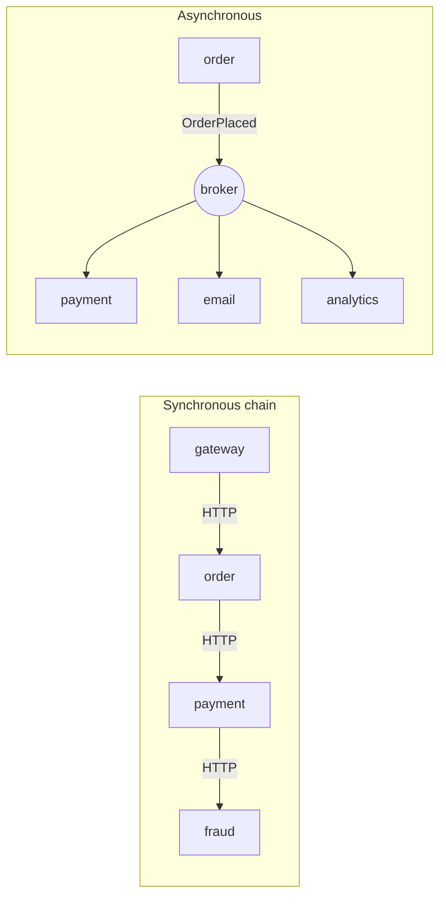

#### 📘 Terms Explained

| Term | Simple meaning |
|---|---|
| **RPI / RPC** | Remote Procedure Invocation/Call: calling another service's operation and waiting for the result. |
| **REST** | An HTTP-based style using resources (URLs) and verbs (GET, POST, PUT, DELETE). |
| **gRPC** | Google's RPC framework: Protobuf messages over HTTP/2, with generated client/server code and streaming. |
| **GraphQL** | A query language where the client asks for exactly the fields it needs. |

---

## 7.2 Why the Choice Matters

| | Synchronous (REST/gRPC) | Asynchronous (messaging) |
|---|---|---|
| **Temporal coupling** | Both must be up now | No: broker buffers |
| **Availability of a chain** | Multiplies: 3 services at 99.9% in a chain ≈ 99.7% | Each consumer fails independently |
| **Latency for the user** | Sum of the chain | User gets an early response; work completes later |
| **Simplicity** | Easy to understand, test, debug | Eventual consistency, duplicates, ordering |
| **Response needed now?** | Yes, natural | Awkward (request-reply) |
| **Fan-out to many** | Caller loops over services | Publish once |

### Rules of thumb

1. **Queries** that need an answer now ("get price", "check balance"): synchronous.
2. **Commands and events** that can finish later ("send invoice", "update search index"): asynchronous.
3. **Avoid long synchronous chains** (A → B → C → D): availability and latency multiply. Prefer one synchronous hop plus events.
4. **Every synchronous call needs** a timeout, retries (if idempotent), a circuit breaker and a fallback: see [02_Reliability_Pattern.md](../03_System_Design/02_Reliability_Pattern.md).

---

## 7.3 Types: REST vs gRPC vs GraphQL vs Messaging

| | REST (JSON/HTTP) | gRPC | GraphQL | Messaging |
|---|---|---|---|---|
| Contract | OpenAPI (optional) | `.proto` (required) | Schema (required) | Event/command schemas (AsyncAPI, Avro) |
| Payload | Text JSON | Binary Protobuf (small, fast) | JSON | Any (JSON, Avro, Protobuf) |
| Transport | HTTP/1.1 or 2 | HTTP/2 (streaming, multiplexing) | HTTP | Broker protocol |
| Browser-friendly | Yes | Needs gRPC-Web/proxy | Yes | No (via gateway/WebSocket) |
| Best for | Public APIs, CRUD, simplicity | Internal service-to-service, low latency, streaming | Client-driven queries across many types (BFF) | Decoupled workflows, events, buffering |

---

## 7.4 Communication in Spring Boot

```java
// REST: declarative HTTP interface (Spring 6 HTTP Interface client)
public interface PricingClient {
    @GetExchange("/prices/{sku}")
    Price price(@PathVariable String sku);
}

@Bean
PricingClient pricingClient(RestClient.Builder lb) {                 // lb = @LoadBalanced builder
    RestClient rest = lb.baseUrl("http://pricing-service").build();
    return HttpServiceProxyFactory.builderFor(RestClientAdapter.create(rest)).build().createClient(PricingClient.class);
}
```

```protobuf
// gRPC: contract first (pricing.proto) -> generated Java stubs
syntax = "proto3";
service Pricing {
  rpc GetPrice (PriceRequest) returns (PriceReply);
}
message PriceRequest { string sku = 1; }
message PriceReply   { string sku = 1; int64 amount_paise = 2; }
```

```java
// Messaging: publish and move on
kafka.send("orders.events", order.getId(), new OrderPlaced(order.getId(), order.getTotal()));
```

**Contracts and testing:** OpenAPI (springdoc) for REST, `.proto` for gRPC, AsyncAPI for events; **consumer-driven contract tests** (Spring Cloud Contract, Pact) catch breaking changes before deployment.

#### 📘 Terms Explained

| Term | Simple meaning |
|---|---|
| **HTTP Interface client** | Spring 6 feature: annotate an interface with `@GetExchange` etc., Spring creates the client (a proxy). |
| **Protobuf** | Protocol Buffers: a compact binary format with a schema (`.proto`). |
| **HTTP/2 multiplexing** | Many requests share one TCP connection at the same time. |
| **OpenAPI / AsyncAPI** | Standard formats to describe REST APIs / event-driven APIs. |
| **Consumer-driven contract test** | The consumer's expectations become tests the provider must pass before release. |

---

## 7.5 Pros, Cons, Pitfalls and Interview Questions

| Pitfall | Fix |
|---|---|
| Long synchronous call chains | One sync hop + events; API composition in parallel; local data copies. |
| Sync calls without timeouts/breakers | Resilience4j on every client ([02_Reliability_Pattern.md](../03_System_Design/02_Reliability_Pattern.md)). |
| Using messaging for simple queries that need an answer now | Use REST/gRPC. |
| Breaking API changes | Versioning, additive changes, contract tests. |
| Chatty APIs (many small calls per request) | Coarser endpoints, batch APIs, BFF. |

**Q1. Synchronous vs asynchronous communication between microservices?** Sync (REST/gRPC) is simple and gives an immediate answer but couples availability and latency; async (messaging) decouples in time and absorbs load but brings eventual consistency and duplicates.

**Q2. When would you choose gRPC over REST?** Internal, high-throughput or low-latency service-to-service calls, streaming, and strongly typed contracts. REST for public/browser APIs and simplicity.

**Q3. Why are long synchronous call chains dangerous?** Availability multiplies down, latency adds up, and one slow service stalls the whole chain (cascading failure).

**Q4. How do you prevent breaking changes between services?** Additive changes, versioning, OpenAPI/proto/AsyncAPI contracts, and consumer-driven contract tests in CI.

---

## 7.6 Communication Styles - Cheat Sheet

```
COMMUNICATION  Sync RPI (REST, gRPC, GraphQL): answer now, temporal coupling, chains multiply failure/latency.
          Async messaging (Kafka/RabbitMQ): decoupled, buffered, fan-out; eventual consistency, duplicates.
          Queries -> sync; commands/events that can finish later -> async. Avoid long sync chains.
          Every sync call: timeout + retry (idempotent) + circuit breaker + fallback.
          Spring: RestClient/@LoadBalanced, HTTP Interface (@GetExchange), Feign, gRPC stubs, KafkaTemplate.
          Contracts: OpenAPI, .proto, AsyncAPI; contract tests (Spring Cloud Contract, Pact).
```

---

# 8. Externalized Configuration Pattern (Interview Imp - Java)

## 8.1 What is Externalized Configuration?

**Externalized configuration** keeps settings (database URLs, credentials, timeouts, feature flags) **outside the application code and artifact**, and supplies them at **runtime** from the environment. The **same build** (JAR or container image) runs unchanged in dev, test and production; only the configuration differs.

**Analogy:** A rental car. The car is the same for every customer; each driver adjusts the seat and mirrors (configuration) when they pick it up. Nobody rebuilds the car for a taller driver.

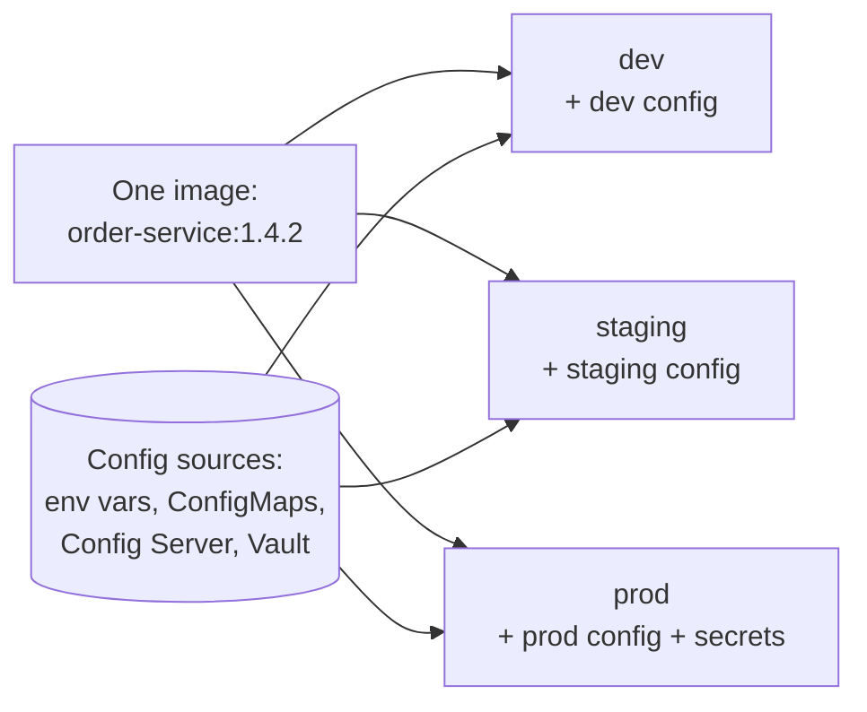

#### 📘 Terms Explained

| Term | Simple meaning |
|---|---|
| **Externalized configuration** | Settings provided from outside the build artifact at runtime. |
| **Twelve-Factor App** | A well-known set of 12 principles for cloud apps; factor III is "store config in the environment". |
| **Secret** | Sensitive configuration: passwords, API keys, certificates. |
| **Artifact** | The built output you deploy (JAR, Docker image). |

---

## 8.2 Why Do We Need It?

| Without it | With it |
|---|---|
| Rebuild the JAR to change a timeout | Change config and restart (or refresh) |
| Different builds per environment ("works in staging, not in prod") | One immutable artifact promoted through environments |
| Passwords committed to Git | Secrets injected at runtime from a secret store |
| 50 services × 3 environments of copied property files | Central, versioned configuration |

---

## 8.3 How It Works: Sources and Priority

Spring Boot reads configuration from many sources and **later/higher sources override earlier ones**. Simplified, from lowest to highest priority:

| Priority (low → high) | Source |
|---|---|
| 1 | `application.yml` inside the JAR (defaults) |
| 2 | `application-{profile}.yml` inside the JAR |
| 3 | `application.yml` / `application-{profile}.yml` **outside** the JAR (e.g. `./config/`) |
| 4 | Imported sources: Config Server, Kubernetes ConfigMaps/Secrets, Vault (`spring.config.import`) |
| 5 | **OS environment variables** (`ORDERS_DB_URL` → `orders.db.url`) |
| 6 | Java system properties (`-Dorders.db.url=...`) |
| 7 | **Command-line arguments** (`--orders.db.url=...`) |

### Where configuration comes from in microservices

| Source | Good for |
|---|---|
| **Environment variables** | Simple values per deployment; standard in containers |
| **Kubernetes ConfigMap / Secret** | Config/secrets per namespace, mounted as env vars or files |
| **Spring Cloud Config Server** | Central Git-backed config for many services, with history and refresh |
| **HashiCorp Vault / AWS Secrets Manager / Azure Key Vault** | Secrets: rotation, access policies, audit |
| **Feature-flag service** (Unleash, LaunchDarkly) | Flags changed at runtime without restarts |

---

## 8.4 Complete Java Example - Layered Configuration Resolution

```java
import java.util.LinkedHashMap;
import java.util.List;
import java.util.Map;

// Spring-Boot-like property resolution: later sources override earlier ones
class LayeredConfig {
    private record Source(String name, Map<String, String> values) {}
    private final List<Source> sources;

    LayeredConfig(List<Map.Entry<String, Map<String, String>>> ordered) {
        this.sources = ordered.stream().map(e -> new Source(e.getKey(), e.getValue())).toList();
    }

    String get(String key) {
        for (int i = sources.size() - 1; i >= 0; i--) {                  // highest priority first
            String v = sources.get(i).values().get(key);
            if (v != null) return v;
        }
        throw new IllegalStateException("missing required config: " + key);
    }

    String origin(String key) {
        for (int i = sources.size() - 1; i >= 0; i--) {
            if (sources.get(i).values().containsKey(key)) return sources.get(i).name();
        }
        return "-";
    }

    // Spring-style relaxed binding: ORDERS_DB_URL -> orders.db.url
    static Map<String, String> fromEnv(Map<String, String> env) {
        Map<String, String> m = new LinkedHashMap<>();
        env.forEach((k, v) -> m.put(k.toLowerCase().replace('_', '.'), v));
        return m;
    }
}

public class ExternalConfigDemo {
    public static void main(String[] args) {
        Map<String, String> applicationYml = Map.of(               // packaged inside the jar: safe defaults
                "orders.db.url", "jdbc:postgresql://localhost:5432/orders",
                "orders.payment.timeout-ms", "2000",
                "orders.feature.recommendations", "true");
        Map<String, String> applicationProdYml = Map.of(           // profile 'prod' (or Config Server / ConfigMap)
                "orders.db.url", "jdbc:postgresql://orders-db.prod:5432/orders",
                "orders.payment.timeout-ms", "1500");
        Map<String, String> environment = LayeredConfig.fromEnv(Map.of(   // injected by Kubernetes (Secret)
                "ORDERS_DB_PASSWORD", "s3cr3t-from-vault"));
        Map<String, String> commandLine = Map.of(                  // --orders.feature.recommendations=false
                "orders.feature.recommendations", "false");

        LayeredConfig config = new LayeredConfig(List.of(
                Map.entry("application.yml", applicationYml),
                Map.entry("application-prod.yml", applicationProdYml),
                Map.entry("environment variables", environment),
                Map.entry("command-line args", commandLine)));

        for (String key : List.of("orders.db.url", "orders.payment.timeout-ms", "orders.feature.recommendations", "orders.db.password")) {
            String value = key.contains("password") ? "******" : config.get(key);       // never log secrets
            System.out.printf("%-32s = %-45s (from %s)%n", key, value, config.origin(key));
        }
        try {
            config.get("orders.kafka.bootstrap-servers");
        } catch (IllegalStateException e) {
            System.out.println("startup check: " + e.getMessage() + " -> fail fast at boot, not at 3 AM");
        }
    }
}
```

**Output:**
```
orders.db.url                    = jdbc:postgresql://orders-db.prod:5432/orders  (from application-prod.yml)
orders.payment.timeout-ms        = 1500                                          (from application-prod.yml)
orders.feature.recommendations   = false                                         (from command-line args)
orders.db.password               = ******                                        (from environment variables)
startup check: missing required config: orders.kafka.bootstrap-servers -> fail fast at boot, not at 3 AM
```

What the output shows:
- The DB URL and timeout came from the **prod profile**, overriding the safe defaults in the JAR.
- The feature flag was overridden by a **command-line** argument, the highest priority.
- The password came from an **environment variable** (injected from a Kubernetes Secret) and was **masked** when printed.
- A missing required value made start-up **fail fast**, rather than failing at the first real request in production.

---

## 8.5 Externalized Configuration in Spring Boot

### Type-safe, validated properties

```java
@ConfigurationProperties(prefix = "orders")
@Validated
public record OrdersProperties(
        @NotBlank String dbUrl,
        @NotNull Duration paymentTimeout,            // "1500ms", "2s" are parsed automatically
        Feature feature) {
    public record Feature(boolean recommendations) {}
}

@SpringBootApplication
@ConfigurationPropertiesScan
public class OrderServiceApplication { ... }        // invalid/missing config -> app fails at start-up
```

### Spring Cloud Config Server

```java
@SpringBootApplication
@EnableConfigServer
public class ConfigServerApplication { ... }
```

```yaml
# config-server application.yml: config lives in Git (history, reviews, rollbacks)
spring:
  cloud:
    config:
      server:
        git:
          uri: https://github.com/shop/config-repo
          default-label: main
# repo layout: order-service.yml, order-service-prod.yml, application.yml (shared by all services)
```

```yaml
# client (order-service)
spring:
  application:
    name: order-service
  config:
    import: "optional:configserver:http://config-server:8888"
```

```java
@RestController
@RefreshScope                                   // bean is re-created after POST /actuator/refresh (or /busrefresh)
class FeatureController {
    @Value("${orders.feature.recommendations:true}") boolean recommendations;
}
```

### Kubernetes ConfigMap and Secret

```yaml
apiVersion: v1
kind: ConfigMap
metadata: { name: order-service-config }
data:
  ORDERS_PAYMENT_TIMEOUT: "1500ms"
  SPRING_PROFILES_ACTIVE: "prod"
---
apiVersion: v1
kind: Secret
metadata: { name: order-service-secrets }
type: Opaque
stringData:
  ORDERS_DB_PASSWORD: "change-me"            # in practice synced from Vault (External Secrets Operator)
---
# in the Deployment's container spec
envFrom:
  - configMapRef: { name: order-service-config }
  - secretRef:    { name: order-service-secrets }
```

See [04_Configuration_and_Secrets.md](../../kubernetes/04_Configuration_and_Secrets.md) and [08_Docker_Security.md](../../docker/08_Docker_Security.md#82-hardening-checklist) for ConfigMaps, Secrets and environment variables in containers.

#### 📘 Terms Explained

| Term | Simple meaning |
|---|---|
| **Profile** | A named set of config (`dev`, `prod`) activated with `spring.profiles.active`. |
| **`@ConfigurationProperties`** | Binds a group of properties to a typed Java object (record/class). |
| **Relaxed binding** | Spring maps `ORDERS_DB_URL`, `orders.db-url`, `orders.dbUrl` to the same property. |
| **Spring Cloud Config Server** | A service that serves configuration (usually from Git) to many applications. |
| **`spring.config.import`** | Tells Spring Boot to load extra config sources (Config Server, Vault, files). |
| **`@RefreshScope`** | Beans that are rebuilt with new config values when a refresh is triggered. |
| **ConfigMap / Secret** | Kubernetes objects holding non-sensitive / sensitive configuration. |
| **External Secrets Operator** | Kubernetes add-on that syncs secrets from Vault/AWS/Azure into Kubernetes Secrets. |

---

## 8.6 Pros, Cons and Pitfalls

| Pros | Cons |
|---|---|
| One immutable artifact for every environment | Config becomes a deployable thing that must be versioned and reviewed |
| Secrets kept out of Git and images | A central config server is another critical dependency |
| Change behaviour without rebuilding | Runtime refresh can create inconsistent states if done carelessly |

| Pitfall | Fix |
|---|---|
| Secrets in `application.yml` committed to Git | Secret store + env vars/files; secret scanning in CI. |
| Logging config values including secrets | Mask secrets; never log full config. |
| App starts with missing config and fails later | `@Validated` `@ConfigurationProperties`; fail fast. |
| Config Server down → services can't start | Run it HA; `optional:` import with sensible defaults; or use K8s ConfigMaps. |
| Different values drifting between environments by hand | Config in Git (GitOps), reviewed via pull requests. |
| Overusing `@RefreshScope` for things like DB pools | Refresh only simple values (flags, limits); restart for structural changes. |

---

## 8.7 Externalized Configuration - Interview Questions

**Q1. What is externalized configuration and why use it?**
Keeping configuration outside the artifact and supplying it at runtime, so the same build runs in every environment, secrets stay out of code, and settings change without rebuilding.

**Q2. What is Spring Boot's property precedence?**
Roughly: defaults in the JAR < profile-specific files < external files < imported sources (Config Server, ConfigMaps) < environment variables < system properties < command-line arguments.

**Q3. How do you manage secrets in microservices?**
A secret manager (Vault, AWS Secrets Manager), injected as env vars or mounted files (via Kubernetes Secrets/External Secrets), never committed to Git; rotation and access auditing.

**Q4. What is Spring Cloud Config Server and how does refresh work?**
A central server that serves configuration from Git. Clients import it with `spring.config.import`; `@RefreshScope` beans reload after `/actuator/refresh`, or Spring Cloud Bus `/busrefresh` for all instances.

**Q5. Config Server vs Kubernetes ConfigMaps?**
On Kubernetes, ConfigMaps/Secrets (plus GitOps) are often enough and remove a dependency. Config Server adds Git history, per-service/profile layering and refresh for non-Kubernetes or mixed environments.

---

## 8.8 Externalized Configuration - Cheat Sheet

```
EXTERNALIZED CONFIG  Same artifact everywhere; config + secrets supplied at runtime (12-factor III).
          Spring precedence (low -> high): jar application.yml < profile yml < external files <
          config import (Config Server/ConfigMap/Vault) < ENV VARS < -D system props < --command-line.
          Typed + validated: @ConfigurationProperties + @Validated -> fail fast at start-up.
          Spring Cloud Config Server (Git), spring.config.import=configserver:, @RefreshScope, /busrefresh.
          Kubernetes: ConfigMap + Secret via envFrom; secrets from Vault (External Secrets Operator).
          Never commit or log secrets.
```

---

# 9. Access Token Pattern: Securing Service-to-Service Calls (Interview Imp - Java)

## 9.1 What is the Access Token Pattern?

The **API gateway authenticates the user once** and passes an **access token** (usually a **JWT**) that carries the caller's identity and permissions. Each service **verifies the token itself** (signature, expiry, audience, scopes) without calling the auth server on every request. For calls **between services**, a service gets its **own** token, typically with the **OAuth2 client-credentials** flow.

**Analogy:** A conference badge. Security checks your ID once at the entrance and gives you a tamper-proof badge showing your name and which halls you can enter. Each hall's door staff just checks the badge (and its expiry date); they don't phone the registration desk every time.

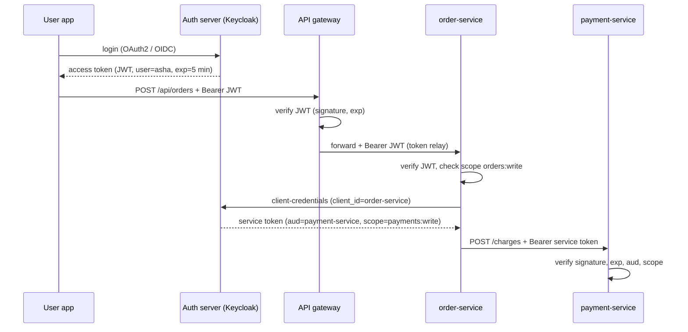

#### 📘 Terms Explained

| Term | Simple meaning |
|---|---|
| **Access token** | A short-lived credential sent with each request proving who the caller is and what it may do. |
| **JWT (JSON Web Token)** | A token format: `header.payload.signature`, Base64url-encoded, digitally signed. |
| **Claims** | The facts inside a JWT payload: `sub` (subject), `aud` (audience), `exp` (expiry), `scope`, roles. |
| **OAuth2** | The standard framework for issuing access tokens. |
| **OIDC (OpenID Connect)** | A layer on top of OAuth2 for user login (adds ID tokens and user info). |
| **Client credentials flow** | OAuth2 flow where a service authenticates as itself (client ID + secret/certificate) to get a token. No user involved. |
| **Token relay** | Passing the user's token along to the next service. |

---

## 9.2 Why Do We Need It?

| Approach | Problem |
|---|---|
| Every service checks username/password against a user DB | Passwords everywhere; every service needs the user DB |
| Every service calls the auth server to validate a session ID on each request | Auth server becomes a bottleneck and a single point of failure |
| Trust the internal network ("if it reached me, it's allowed") | One compromised service can call anything (no zero trust) |
| **Self-contained signed tokens** ✅ | Each service verifies locally with the auth server's public key; works offline; carries permissions |

---

## 9.3 How It Works: What Each Service Must Check

| Check | Why | Claim |
|---|---|---|
| **Signature** | Token wasn't modified and was issued by your auth server | (signature) |
| **Expiry** | Stolen tokens stop working quickly | `exp` (and `nbf`) |
| **Issuer** | Token comes from *your* auth server | `iss` |
| **Audience** | Token was meant for **this** service, not reused from another | `aud` |
| **Scope / roles** | Caller is allowed to do this operation | `scope`, `roles` |

| Signing | Keys | Typical use |
|---|---|---|
| **HS256** (HMAC) | One shared secret: whoever can verify can also **create** tokens | Demos, a single trusted app |
| **RS256 / ES256** ✅ | Auth server signs with a **private** key; services verify with the **public** key from a **JWKS** endpoint | Microservices |

> **JWTs are signed, not encrypted.** Anyone can Base64-decode the payload, so never put secrets or sensitive personal data in it.

---

## 9.4 Complete Java Example - Issuing and Verifying a JWT

```java
import java.nio.charset.StandardCharsets;
import java.security.MessageDigest;
import java.util.Base64;
import java.util.regex.Matcher;
import java.util.regex.Pattern;
import javax.crypto.Mac;
import javax.crypto.spec.SecretKeySpec;

// Minimal JWT (HS256) issue + verify, to show what's inside a token and how services check it.
// Real systems use a library (Nimbus, jjwt) and usually RS256/ES256 keys published via JWKS.
class Jwt {
    private static final Base64.Encoder B64 = Base64.getUrlEncoder().withoutPadding();
    private static final Base64.Decoder B64D = Base64.getUrlDecoder();

    static String issue(String payloadJson, byte[] key) throws Exception {
        String header = B64.encodeToString("{\"alg\":\"HS256\",\"typ\":\"JWT\"}".getBytes(StandardCharsets.UTF_8));
        String payload = B64.encodeToString(payloadJson.getBytes(StandardCharsets.UTF_8));
        return header + "." + payload + "." + sign(header + "." + payload, key);
    }

    static String sign(String data, byte[] key) throws Exception {
        Mac mac = Mac.getInstance("HmacSHA256");
        mac.init(new SecretKeySpec(key, "HmacSHA256"));
        return B64.encodeToString(mac.doFinal(data.getBytes(StandardCharsets.UTF_8)));
    }

    // Returns null if valid, otherwise the reason it was rejected
    static String verify(String token, byte[] key, long now, String expectedAudience, String requiredScope) throws Exception {
        String[] parts = token.split("\\.");
        if (parts.length != 3) return "malformed";
        String expected = sign(parts[0] + "." + parts[1], key);
        if (!MessageDigest.isEqual(expected.getBytes(StandardCharsets.UTF_8), parts[2].getBytes(StandardCharsets.UTF_8)))
            return "bad signature (token was modified or signed with another key)";
        String payload = new String(B64D.decode(parts[1]), StandardCharsets.UTF_8);
        if (Long.parseLong(claim(payload, "exp")) < now) return "expired";
        if (!expectedAudience.equals(claim(payload, "aud"))) return "wrong audience " + claim(payload, "aud");
        if (!(" " + claim(payload, "scope") + " ").contains(" " + requiredScope + " ")) return "missing scope " + requiredScope;
        return null;
    }

    static String claim(String json, String name) {
        Matcher m = Pattern.compile("\"" + name + "\":\"?([^\",}]*)\"?").matcher(json);
        return m.find() ? m.group(1) : "";
    }
}

public class AccessTokenDemo {
    public static void main(String[] args) throws Exception {
        byte[] key = "demo-only-secret-key-at-least-32-bytes!!".getBytes(StandardCharsets.UTF_8);
        long now = 1_761_400_000L;                                    // fixed "current time" (epoch seconds)

        // Issued by the auth server (e.g. Keycloak) to order-service via OAuth2 client credentials
        String good = Jwt.issue("{\"sub\":\"order-service\",\"aud\":\"payment-service\",\"scope\":\"payments:write payments:read\",\"exp\":" + (now + 300) + "}", key);
        System.out.println("token (header.payload.signature):");
        System.out.println("  " + good.substring(0, 40) + "...");
        System.out.println("payload is only Base64, NOT encrypted: " + new String(Base64.getUrlDecoder().decode(good.split("\\.")[1]), StandardCharsets.UTF_8));

        String tampered = good.split("\\.")[0] + "." + Base64.getUrlEncoder().withoutPadding().encodeToString(
                "{\"sub\":\"order-service\",\"aud\":\"payment-service\",\"scope\":\"payments:write admin\",\"exp\":9999999999}".getBytes(StandardCharsets.UTF_8))
                + "." + good.split("\\.")[2];
        String expired = Jwt.issue("{\"sub\":\"order-service\",\"aud\":\"payment-service\",\"scope\":\"payments:write\",\"exp\":" + (now - 60) + "}", key);
        String wrongAud = Jwt.issue("{\"sub\":\"order-service\",\"aud\":\"email-service\",\"scope\":\"payments:write\",\"exp\":" + (now + 300) + "}", key);
        String readOnly = Jwt.issue("{\"sub\":\"report-service\",\"aud\":\"payment-service\",\"scope\":\"payments:read\",\"exp\":" + (now + 300) + "}", key);

        System.out.println("payment-service checks each call to POST /charges (needs scope payments:write):");
        String[][] cases = {{"valid token", good}, {"tampered payload", tampered}, {"expired token", expired},
                            {"token for another service", wrongAud}, {"read-only token", readOnly}};
        for (String[] c : cases) {
            String reason = Jwt.verify(c[1], key, now, "payment-service", "payments:write");
            System.out.printf("  %-26s -> %s%n", c[0], reason == null ? "200 accepted" : "401/403 rejected: " + reason);
        }
    }
}
```

**Output:**
```
token (header.payload.signature):
  eyJhbGciOiJIUzI1NiIsInR5cCI6IkpXVCJ9.eyJ...
payload is only Base64, NOT encrypted: {"sub":"order-service","aud":"payment-service","scope":"payments:write payments:read","exp":1761400300}
payment-service checks each call to POST /charges (needs scope payments:write):
  valid token                -> 200 accepted
  tampered payload           -> 401/403 rejected: bad signature (token was modified or signed with another key)
  expired token              -> 401/403 rejected: expired
  token for another service  -> 401/403 rejected: wrong audience email-service
  read-only token            -> 401/403 rejected: missing scope payments:write
```

What the output shows:
- The payload is readable by anyone: **signed, not encrypted**.
- Changing the payload (adding `admin` scope) broke the **signature**, so the token was rejected.
- **Expired**, **wrong-audience** and **insufficient-scope** tokens were each rejected with a clear reason (401 for invalid tokens, 403 for valid-but-not-allowed).
- The signature comparison uses `MessageDigest.isEqual`, a **constant-time** comparison, to avoid timing attacks.

> This hand-written verifier is for learning only. In real services, use Spring Security's resource server (below), which uses Nimbus JOSE + JWT and checks everything above, including key rotation via JWKS.

---

## 9.5 Access Tokens in Spring Boot

### Every service: OAuth2 resource server

```yaml
spring:
  security:
    oauth2:
      resourceserver:
        jwt:
          issuer-uri: https://auth.shop.com/realms/shop     # discovers the JWKS public keys automatically
          audiences: payment-service                         # reject tokens meant for other services
```

```java
@Configuration
@EnableMethodSecurity
class SecurityConfig {
    @Bean
    SecurityFilterChain api(HttpSecurity http) throws Exception {
        return http
                .authorizeHttpRequests(a -> a
                        .requestMatchers("/actuator/health/**").permitAll()
                        .requestMatchers(HttpMethod.POST, "/charges").hasAuthority("SCOPE_payments:write")
                        .anyRequest().authenticated())
                .oauth2ResourceServer(o -> o.jwt(Customizer.withDefaults()))
                .sessionManagement(s -> s.sessionCreationPolicy(SessionCreationPolicy.STATELESS))
                .csrf(csrf -> csrf.disable())                     // stateless token API, no browser cookies
                .build();
    }
}

@Service
class RefundService {
    @PreAuthorize("hasAuthority('SCOPE_refunds:write') and #amount <= 50000")
    public void refund(String orderId, long amount) { ... }
}
```

### Calling another service with its own token (client credentials)

```yaml
spring:
  security:
    oauth2:
      client:
        registration:
          payment:
            provider: keycloak
            client-id: order-service
            client-secret: ${ORDER_SERVICE_CLIENT_SECRET}
            authorization-grant-type: client_credentials
            scope: payments:write
        provider:
          keycloak:
            issuer-uri: https://auth.shop.com/realms/shop
```

```java
@Bean
RestClient paymentRestClient(RestClient.Builder lb, OAuth2AuthorizedClientManager clients) {
    OAuth2ClientHttpRequestInterceptor oauth = new OAuth2ClientHttpRequestInterceptor(clients);
    oauth.setClientRegistrationIdResolver(request -> "payment");       // which registration to use
    return lb.baseUrl("http://payment-service").requestInterceptor(oauth).build();   // adds + refreshes Bearer token
}
```

### Other layers

| Mechanism | Adds |
|---|---|
| **mTLS between services** (often via a service mesh) | Each service proves its identity with a certificate; traffic encrypted |
| **Network policies** | Only allowed services can even connect |
| **Token exchange (RFC 8693)** | Swap a user token for a narrower token for a downstream service |
| **Short token lifetimes + refresh tokens** | Limit the damage of a leaked token |

#### 📘 Terms Explained

| Term | Simple meaning |
|---|---|
| **Resource server** | An API that accepts and verifies access tokens. |
| **JWKS** | JSON Web Key Set: the auth server's published public keys for verifying token signatures. |
| **`SCOPE_` authority** | Spring Security turns each token scope into an authority prefixed with `SCOPE_`. |
| **`@PreAuthorize`** | Method-level security check, written in SpEL (proxy-based). |
| **`OAuth2ClientHttpRequestInterceptor`** | Spring Security 6.4+ interceptor that obtains and attaches OAuth2 tokens to `RestClient` calls. |
| **mTLS** | Mutual TLS: both client and server present certificates. |
| **Zero trust** | Never trust a request just because it comes from inside the network; verify every call. |
| **Keycloak** | Popular open-source identity and access management server (OAuth2/OIDC). |

---

## 9.6 Pros, Cons and Pitfalls

| Pros | Cons |
|---|---|
| Stateless: services verify locally, no session store | Hard to revoke a JWT before it expires |
| Scales: no call to the auth server per request | Token size grows with claims |
| Carries identity and permissions end to end | Key management and rotation needed |

| Pitfall | Fix |
|---|---|
| Accepting `alg: none` or HS256 tokens signed with a public key | Use a proper library; pin the expected algorithm. |
| Not checking `aud` → a token for service A works on service B | Validate the audience in every service. |
| Long-lived access tokens | 5-15 minute lifetimes; refresh tokens for users. |
| Sensitive data in JWT claims | Only IDs and permissions; JWTs aren't encrypted. |
| Backends trusting gateway headers without network isolation | Verify tokens in every service, or enforce mTLS/network policies. |
| Logging full tokens | Log only the token ID (`jti`) or subject. |

---

## 9.7 Access Token - Interview Questions

**Q1. How do you secure communication between microservices?**
The gateway authenticates users and relays a JWT; every service validates signature, expiry, issuer, audience and scopes; service-to-service calls use client-credentials tokens; add mTLS and network policies for zero trust.

**Q2. What is inside a JWT and is it encrypted?**
A header (algorithm), a payload of claims (`sub`, `iss`, `aud`, `exp`, `scope`) and a signature. It's signed, not encrypted: anyone can read the payload.

**Q3. Why RS256 instead of HS256 for microservices?**
With RS256 only the auth server holds the private key; services verify with the public key from JWKS. With HS256 every verifier holds the shared secret and could forge tokens.

**Q4. How do you revoke a JWT?**
Keep lifetimes short, use refresh tokens that can be revoked, maintain a deny-list of token IDs (`jti`) for emergencies, or use opaque tokens with introspection for very sensitive APIs.

**Q5. What is the client credentials flow?**
An OAuth2 flow where a service authenticates as itself (client ID + secret or certificate) to get an access token for calling another service. No user is involved.

**Q6. How do you configure a Spring Boot service to validate JWTs?**
`spring-boot-starter-oauth2-resource-server`, `spring.security.oauth2.resourceserver.jwt.issuer-uri` (and `audiences`), `oauth2ResourceServer(o -> o.jwt(...))` in the `SecurityFilterChain`, and `hasAuthority('SCOPE_...')` / `@PreAuthorize` rules.

---

## 9.8 Access Token - Cheat Sheet

```
ACCESS TOKEN  Gateway authenticates once; JWT carries identity + scopes; EVERY service verifies locally.
          Check: signature (RS256/ES256 via JWKS), exp, iss, aud, scope. JWT = signed, NOT encrypted.
          Service-to-service: OAuth2 client credentials (own token); token relay for user context.
          Spring: oauth2-resource-server (issuer-uri, audiences), SecurityFilterChain + hasAuthority('SCOPE_x'),
                  @PreAuthorize, oauth2-client registration (client_credentials) + OAuth2ClientHttpRequestInterceptor.
          Short lifetimes, no secrets in claims, mTLS + network policies for zero trust. 401 invalid / 403 not allowed.
```

---

# 10. Observability Patterns (Interview Imp - Java)

## 10.1 What is Observability?

**Observability** is the ability to understand **what is happening inside** a distributed system from the data it produces. In a monolith you can attach a debugger or read one log file; with 40 services, a single user request can touch 10 of them. The master list's observability patterns:

| Pattern | Answers | Typical tools |
|---|---|---|
| **Log Aggregation** | "What exactly happened?" (details) | ELK/EFK (Elasticsearch, Logstash/Fluent Bit, Kibana), Grafana Loki, CloudWatch Logs |
| **Application Metrics** | "How is it behaving overall?" (numbers over time) | Micrometer → Prometheus → Grafana, Datadog |
| **Distributed Tracing** | "Where did this request spend its time?" (one request across services) | OpenTelemetry → Jaeger, Zipkin, Grafana Tempo |
| **Exception Tracking** | "Which errors are new or frequent?" | Sentry, Rollbar, Bugsnag |
| **Audit Logging** | "Who did what, and when?" (compliance) | Audit tables, Hibernate Envers, append-only audit topics |
| **Health Check API** | "Is this instance OK?" | Actuator `/health`, liveness/readiness (see [02_Reliability_Pattern.md](../03_System_Design/02_Reliability_Pattern.md#8-health-check-pattern-interview-imp---java)) |

The **three pillars** are **logs, metrics and traces**; they're most useful when **linked** by a shared **trace ID**.

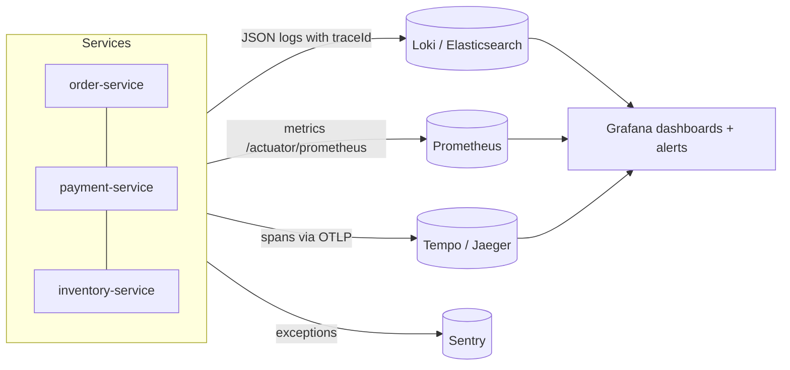

#### 📘 Terms Explained

| Term | Simple meaning |
|---|---|
| **Observability** | How well you can understand a system's internal state from its outputs (logs, metrics, traces). |
| **Monitoring** | Watching known metrics and alerting on known problems; observability also helps with unknown ones. |
| **Log aggregation** | Collecting logs from all instances into one searchable place. |
| **Metric** | A number measured over time (requests/s, error rate, p99 latency). |
| **Trace / span** | The path of one request across services / one timed step within it. |
| **OpenTelemetry (OTel)** | The open standard + SDKs for collecting traces, metrics and logs. |
| **OTLP** | OpenTelemetry Protocol, used to send telemetry to collectors/back-ends. |

---

## 10.2 Why Do We Need It?

- A customer says "checkout was slow at 10:42". Without tracing, you'd grep 10 services' logs on 30 pods by hand.
- Pods are short-lived: their local log files vanish when they're replaced. Logs must be shipped elsewhere.
- You need **alerts** before customers complain (error rate up, p99 latency up, consumer lag growing).
- Regulations (finance, healthcare) require **audit trails** of who changed what.

---

## 10.3 How It Works: Each Pattern

### 10.3.1 Log aggregation

- Log to **stdout** in **structured JSON** (one event per line), not to local files.
- Include `traceId`, `spanId`, service name, environment, and business IDs (`orderId`), never secrets.
- A collector (Fluent Bit, Promtail, the OTel Collector) ships logs to a central store.

```json
{"@timestamp":"2026-10-25T10:42:13.481+05:30","level":"ERROR","service":"payment-service",
 "traceId":"4bf92f3577b34da6","spanId":"s05","orderId":"ORD-2","message":"card declined","error.type":"CardDeclinedException"}
```

### 10.3.2 Application metrics

| Method | Measure | For |
|---|---|---|
| **RED** | **R**ate, **E**rrors, **D**uration (latency) | Every service/endpoint |
| **USE** | **U**tilisation, **S**aturation, **E**rrors | Resources: CPU, memory, thread pools, connection pools |
| **Golden signals** (Google SRE) | Latency, traffic, errors, saturation | Overall service health |

Plus **business metrics** (orders/minute, payment success rate), often the first sign that something is wrong.

### 10.3.3 Distributed tracing

Each request gets a **trace ID**; each operation (HTTP call, DB query, Kafka send) is a **span** with a parent. The trace ID travels in the W3C `traceparent` header (HTTP) and in message headers (Kafka/RabbitMQ). See also correlation IDs in [04_Messaging_Pattern.md](../03_System_Design/04_Messaging_Pattern.md#10-correlation-identifier-pattern).

### 10.3.4 Exception tracking

Errors are sent to a tool that **groups** identical stack traces, counts them, shows the **first/last seen** and the release that introduced them, and alerts on **new** errors.

### 10.3.5 Audit logging

| Audit log | Regular application log |
|---|---|
| **Who** did **what** to **which** record, **when**, from **where**, and the **before/after** values | Technical events for debugging |
| Must be complete, tamper-resistant, retained for years | Can be sampled, rotated, deleted after weeks |
| Business/compliance audience | Developer audience |

---

## 10.4 Complete Java Example - A Trace Waterfall

```java
import java.util.ArrayList;
import java.util.Comparator;
import java.util.List;

// A span = one timed operation. Spans share a traceId and point to their parent.
record Span(String traceId, String spanId, String parentId, String service, String operation, long start, long end) {
    long duration() { return end - start; }
}

class Tracer {
    final List<Span> finished = new ArrayList<>();
    private int nextId = 1;

    String newSpanId() { return String.format("s%02d", nextId++); }
    void record(Span s) { finished.add(s); }      // real tracers export to Zipkin/Jaeger/Tempo via OTLP

    void printWaterfall(String traceId) {
        List<Span> spans = finished.stream().filter(s -> s.traceId().equals(traceId))
                .sorted(Comparator.comparingLong(Span::start)).toList();
        long t0 = spans.get(0).start();
        for (Span s : spans) {
            int depth = depth(s, spans);
            String bar = " ".repeat((int) ((s.start() - t0) / 20)) + "#".repeat((int) Math.max(1, s.duration() / 20));
            System.out.printf("%-38s %4d ms  |%s%n", "  ".repeat(depth) + s.service() + ": " + s.operation(), s.duration(), bar);
        }
        Span slowestLeaf = spans.stream().filter(s -> spans.stream().noneMatch(c -> s.spanId().equals(c.parentId())))
                .max(Comparator.comparingLong(Span::duration)).orElseThrow();
        System.out.println("slowest leaf span: " + slowestLeaf.service() + " " + slowestLeaf.operation() + " (" + slowestLeaf.duration() + " ms)");
    }

    private int depth(Span s, List<Span> all) {
        int d = 0;
        String parent = s.parentId();
        while (parent != null) {
            String p = parent;
            parent = all.stream().filter(x -> x.spanId().equals(p)).findFirst().map(Span::parentId).orElse(null);
            d++;
        }
        return d;
    }
}

public class TracingDemo {
    public static void main(String[] args) {
        Tracer tracer = new Tracer();
        String trace = "4bf92f3577b34da6";                      // carried in the W3C traceparent header between services

        String root = tracer.newSpanId(), auth = tracer.newSpanId(), order = tracer.newSpanId();
        String db = tracer.newSpanId(), pay = tracer.newSpanId(), fraud = tracer.newSpanId(), kafka = tracer.newSpanId();

        // Times in ms on a fake clock; each service reports its own span
        tracer.record(new Span(trace, root,  null,  "api-gateway",   "POST /api/orders",        0, 1180));
        tracer.record(new Span(trace, auth,  root,  "api-gateway",   "validate JWT",            5,   25));
        tracer.record(new Span(trace, order, root,  "order-service", "placeOrder",             30, 1170));
        tracer.record(new Span(trace, db,    order, "order-service", "INSERT orders",          40,  100));
        tracer.record(new Span(trace, pay,   order, "payment-svc",   "POST /charges",         110, 1110));
        tracer.record(new Span(trace, fraud, pay,   "fraud-svc",     "score transaction",     130, 1050));
        tracer.record(new Span(trace, kafka, order, "order-service", "send OrderPlaced",     1120, 1160));

        System.out.println("trace " + trace);
        tracer.printWaterfall(trace);
    }
}
```

**Output:**
```
trace 4bf92f3577b34da6
api-gateway: POST /api/orders          1180 ms  |###########################################################
  api-gateway: validate JWT              20 ms  |#
  order-service: placeOrder            1140 ms  | #########################################################
    order-service: INSERT orders         60 ms  |  ###
    payment-svc: POST /charges         1000 ms  |     ##################################################
      fraud-svc: score transaction      920 ms  |      ##############################################
    order-service: send OrderPlaced      40 ms  |                                                        ##
slowest leaf span: fraud-svc score transaction (920 ms)
```

What the output shows:
- One `traceId` links spans reported by **four** services.
- The waterfall shows nesting (gateway → order → payment → fraud) and timing: the 1.18 s request was dominated by the **fraud scoring** call (920 ms) inside payment-service. That's the bottleneck to fix, which no single service's logs would reveal.
- The DB insert and Kafka send were fast. Without tracing, the team might have blamed the database.

---

## 10.5 Observability in Spring Boot

```xml
<dependency><groupId>org.springframework.boot</groupId><artifactId>spring-boot-starter-actuator</artifactId></dependency>
<dependency><groupId>io.micrometer</groupId><artifactId>micrometer-registry-prometheus</artifactId></dependency>
<dependency><groupId>io.micrometer</groupId><artifactId>micrometer-tracing-bridge-otel</artifactId></dependency>
<dependency><groupId>io.opentelemetry</groupId><artifactId>opentelemetry-exporter-otlp</artifactId></dependency>
```

```yaml
management:
  endpoints:
    web:
      exposure:
        include: health,info,prometheus,metrics
  metrics:
    tags:
      application: ${spring.application.name}     # tag every metric with the service name
    distribution:
      percentiles-histogram:
        http.server.requests: true                # enables p95/p99 latency in Prometheus
  tracing:
    sampling:
      probability: 0.1                            # sample 10% of traces in production
  otlp:
    tracing:
      endpoint: http://otel-collector:4318/v1/traces
logging:
  structured:
    format:
      console: ecs                                # JSON logs (Spring Boot 3.4+); traceId/spanId included
```

```java
// Business metrics with Micrometer
@Service
class CheckoutService {
    private final Counter ordersPlaced;
    private final Timer paymentTimer;

    CheckoutService(MeterRegistry registry) {
        this.ordersPlaced = Counter.builder("orders.placed").tag("channel", "web").register(registry);
        this.paymentTimer = Timer.builder("payment.duration").publishPercentiles(0.95, 0.99).register(registry);
    }

    void checkout(Order o) {
        paymentTimer.record(() -> payments.charge(o));
        ordersPlaced.increment();
    }
}

// Custom span around an important operation
@Observed(name = "fraud.score", contextualName = "score-transaction")    // needs an ObservedAspect bean
public FraudScore score(Payment p) { ... }
```

```java
// Audit logging with Spring Data JPA auditing (who/when) + Hibernate Envers (full history)
@Entity
@Audited                                                 // Envers keeps every version in orders_aud
@EntityListeners(AuditingEntityListener.class)
class Order {
    @CreatedBy String createdBy;
    @CreatedDate Instant createdAt;
    @LastModifiedBy String lastModifiedBy;
    @LastModifiedDate Instant lastModifiedAt;
}

@Configuration
@EnableJpaAuditing
class AuditConfig {
    @Bean
    AuditorAware<String> auditor() {                     // current user from the security context (JWT subject)
        return () -> Optional.ofNullable(SecurityContextHolder.getContext().getAuthentication()).map(Authentication::getName);
    }
}
```

**Typical alerts:** error rate > 1% for 5 min; p99 latency > SLO; Kafka consumer lag growing; circuit breaker OPEN; DLQ depth > 0; pod restarts; disk > 80%; payment success rate dropping.

#### 📘 Terms Explained

| Term | Simple meaning |
|---|---|
| **Micrometer** | Spring Boot's metrics (and observation) facade; exports to Prometheus, Datadog, etc. |
| **Prometheus** | Time-series database that scrapes metrics endpoints (`/actuator/prometheus`). |
| **Grafana** | Dashboard and alerting tool for metrics, logs and traces. |
| **Percentile histogram** | Metric buckets that let Prometheus compute p95/p99 latency across instances. |
| **`@Observed`** | Micrometer annotation creating a metric + span for a method. |
| **ECS** | Elastic Common Schema: a standard JSON log field layout. |
| **Hibernate Envers** | Hibernate module that keeps a versioned history table for audited entities. |
| **SLO** | Service Level Objective: a target such as "99% of checkouts under 800 ms". |

---

## 10.6 Pros, Cons and Pitfalls

| Pros | Cons |
|---|---|
| Find problems across services quickly | Telemetry volume and storage cost |
| Alert before users notice | Requires consistent instrumentation in every service |
| Data-driven performance work | Too many dashboards/alerts → alert fatigue |

| Pitfall | Fix |
|---|---|
| Plain-text logs written to local files in pods | JSON to stdout + a collector. |
| Logs without trace IDs | Micrometer Tracing; include `traceId` in the log pattern/format. |
| High-cardinality metric tags (userId, orderId as tags) | Tag with low-cardinality values (endpoint, status, region); put IDs in logs/traces. |
| Tracing 100% in production at high volume | Sampling (head or tail-based in the OTel Collector). |
| Logging secrets/PII | Masking filters; review log statements. |
| Alerts on causes (CPU 80%) rather than symptoms (users failing) | Alert on SLOs and golden signals; use causes for dashboards. |
| Audit log in the same mutable table as data | Append-only audit store; restrict deletes; long retention. |

---

## 10.7 Observability - Interview Questions

**Q1. What are the three pillars of observability?**
Logs (detailed events), metrics (aggregated numbers over time) and traces (the path and timing of one request across services), linked by trace IDs.

**Q2. How do you debug a slow request across microservices?**
Find its trace (by trace ID from logs or the user's correlation ID), look at the span waterfall to find the slowest span, then drill into that service's logs and metrics.

**Q3. How does distributed tracing work?**
The first service creates a trace ID; each operation records a span with a parent span ID; IDs are propagated in headers (W3C `traceparent`) over HTTP and messaging; spans are exported (OTLP) to a back-end that assembles the trace.

**Q4. What is log aggregation and why is it needed?**
Shipping logs from all instances to a central searchable store, because instances are many and short-lived. Use structured JSON with trace IDs.

**Q5. RED vs USE metrics?**
RED (rate, errors, duration) for request-driven services; USE (utilisation, saturation, errors) for resources like CPU, pools and queues.

**Q6. How do you implement audit logging in Spring?**
Spring Data JPA auditing (`@CreatedBy`, `@LastModifiedBy` with an `AuditorAware`) for who/when, Hibernate Envers for full history, or explicit append-only audit events (e.g. to a dedicated Kafka topic) for business actions.

---

## 10.8 Observability - Cheat Sheet

```
OBSERVABILITY  Logs (what happened) + metrics (how it behaves) + traces (where time went), linked by traceId.
          Log aggregation: JSON to stdout -> Fluent Bit/OTel Collector -> Loki/Elasticsearch. No secrets/PII.
          Metrics: Micrometer -> /actuator/prometheus -> Prometheus/Grafana; RED, USE, golden signals, business KPIs;
                   low-cardinality tags; percentiles-histogram for p99.
          Tracing: Micrometer Tracing + OpenTelemetry, W3C traceparent, OTLP -> Tempo/Jaeger/Zipkin; sampling.
          Exception tracking: Sentry (group, new-error alerts). Audit logging: JPA auditing + Envers / append-only events.
          Health Check API: Actuator liveness/readiness (Reliability file). Alert on SLO symptoms.
```

---

# 11. Sidecar, Ambassador and Service Mesh Patterns (Interview Imp - Java)

## 11.1 What Are They?

- **Sidecar:** a **helper process/container deployed next to** each service instance (same pod, same lifecycle), adding capabilities without changing the service's code: proxying traffic, shipping logs, renewing certificates, syncing config.
- **Ambassador:** a sidecar specialised as an **outbound proxy** for calls to **external** services: it adds retries, timeouts, auth and monitoring for the app.
- **Service mesh:** a **sidecar proxy in front of every service**, plus a **control plane** that configures all of them. It handles service-to-service networking (mTLS, retries, timeouts, traffic splitting, telemetry) **outside the application code**.

**Analogy:** A motorcycle with a sidecar: the sidecar travels everywhere the bike goes and carries extra things, but it isn't part of the engine. A service mesh is like giving every vehicle in a city the same smart co-driver, all centrally briefed by traffic control.

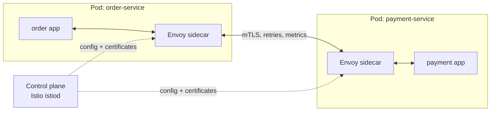

#### 📘 Terms Explained

| Term | Simple meaning |
|---|---|
| **Sidecar** | A helper container deployed alongside the main container in the same pod. |
| **Ambassador** | A sidecar that proxies the app's outgoing calls to external systems. |
| **Service mesh** | Infrastructure layer of sidecar proxies (data plane) managed by a control plane. |
| **Data plane / control plane** | The proxies that carry traffic / the brain that configures them. |
| **Envoy** | High-performance L7 proxy used by Istio and many meshes. |
| **Pod** | The smallest Kubernetes deployable unit: one or more containers sharing network and storage. |

---

## 11.2 Why Do We Need Them?

Without a mesh, **every service in every language** must implement: mTLS, retries, timeouts, circuit breaking, load balancing, metrics, tracing headers, traffic splitting for canaries. With 5 languages and 50 services, that's a lot of duplicated libraries to keep consistent.

| Concern | In-app library (e.g. Resilience4j, Spring Cloud) | Service mesh (e.g. Istio, Linkerd) |
|---|---|---|
| Where it runs | Inside each service's process | In the sidecar proxy |
| Languages | One library per language | Any language, no code |
| Business-aware fallbacks | ✅ Yes (cached prices, "payment pending") | ❌ No (only network-level behaviour) |
| mTLS between services | Manual certificates | ✅ Automatic, with rotation |
| Traffic splitting (canary 5%) | Hard | ✅ Configuration |
| Uniform metrics/tracing | Per-library setup | ✅ Out of the box (golden metrics per call) |
| Cost | Library weight | Extra proxy per pod (CPU, memory, latency ~1 ms) and mesh operations |

> **Typical split:** the mesh handles **transport** concerns (mTLS, retries for idempotent calls, timeouts, outlier detection, traffic shifting); the application keeps **business-level** resilience (fallbacks, idempotency, sagas).

---

## 11.3 How It Works: Common Sidecar Uses

| Sidecar | Purpose | Example |
|---|---|---|
| **Proxy sidecar** | All inbound/outbound traffic goes through it | Envoy (Istio), linkerd2-proxy |
| **Log shipper** | Reads the app's logs and ships them | Fluent Bit |
| **Config / secret syncer** | Fetches secrets and writes files the app reads | Vault Agent injector |
| **Ambassador** | Outbound proxy to a legacy/external system with auth and retries | A proxy for a partner SOAP API |
| **Adapter** | Translates the app's output to a standard format | Exposing a legacy app's metrics in Prometheus format |

> **Kubernetes native sidecars (v1.29+):** declare the sidecar as an `initContainer` with `restartPolicy: Always`, so it starts **before** the app and stops **after** it.

---

## 11.4 Service Mesh Configuration Examples (Istio)

```yaml
# 1) Mutual TLS for every service in the namespace
apiVersion: security.istio.io/v1
kind: PeerAuthentication
metadata: { name: default, namespace: shop }
spec:
  mtls: { mode: STRICT }
---
# 2) Timeouts, retries and a 90/10 canary split for payment-service
apiVersion: networking.istio.io/v1
kind: VirtualService
metadata: { name: payment, namespace: shop }
spec:
  hosts: [payment-service]
  http:
    - timeout: 2s
      retries: { attempts: 2, perTryTimeout: 800ms, retryOn: "5xx,reset,connect-failure" }
      route:
        - destination: { host: payment-service, subset: v1 }
          weight: 90
        - destination: { host: payment-service, subset: v2 }
          weight: 10
---
# 3) Circuit breaking: eject an instance that returns 5 consecutive 5xx errors
apiVersion: networking.istio.io/v1
kind: DestinationRule
metadata: { name: payment, namespace: shop }
spec:
  host: payment-service
  subsets:
    - { name: v1, labels: { version: v1 } }
    - { name: v2, labels: { version: v2 } }
  trafficPolicy:
    connectionPool: { tcp: { maxConnections: 100 } }
    outlierDetection:
      consecutive5xxErrors: 5
      interval: 10s
      baseEjectionTime: 30s
```

```yaml
# 4) Authorization: only order-service may call payment-service
apiVersion: security.istio.io/v1
kind: AuthorizationPolicy
metadata: { name: payment-callers, namespace: shop }
spec:
  selector: { matchLabels: { app: payment-service } }
  rules:
    - from:
        - source: { principals: ["cluster.local/ns/shop/sa/order-service"] }
```

> **Avoid double retries:** if the mesh retries **and** Resilience4j retries **and** the gateway retries, a single failure can turn into many calls (see retry amplification in [02_Reliability_Pattern.md](../03_System_Design/02_Reliability_Pattern.md#2-retry-pattern-interview-imp---java)). Decide which layer retries.

#### 📘 Terms Explained

| Term | Simple meaning |
|---|---|
| **Istio** | A popular service mesh built on Envoy. |
| **Linkerd** | A lightweight service mesh with its own Rust proxy. |
| **`PeerAuthentication`** | Istio resource configuring mTLS between workloads. |
| **`VirtualService` / `DestinationRule`** | Istio routing rules (timeouts, retries, splits) / policies for a destination (subsets, pools, outlier detection). |
| **Outlier detection** | Temporarily removing an instance that keeps failing from load balancing. |
| **Service account principal** | The workload identity (from its certificate) used in mesh authorization rules. |
| **Ambient mesh** | Istio mode without per-pod sidecars (node-level proxies), reducing overhead. |

---

## 11.5 Pros, Cons, Pitfalls and Interview Questions

| Pros | Cons |
|---|---|
| Language-independent networking features | Operational complexity (the mesh itself must be run and upgraded) |
| Automatic mTLS and identity | Extra latency and resources per pod |
| Uniform telemetry, traffic splitting, policies | Harder debugging (is it the app or the proxy?) |
| Keeps application code focused on business | Can't do business-level fallbacks |

| Pitfall | Fix |
|---|---|
| Adopting a mesh for 5 services | Start with libraries; add a mesh when scale/language diversity justifies it. |
| Retries in mesh + app + gateway | One layer retries; others don't. |
| Sidecar not ready when the app starts making calls | Native sidecars or `holdApplicationUntilProxyStarts`. |
| Assuming the mesh replaces application security | Still validate tokens / authorize at the app level for user permissions. |

**Q1. What is the sidecar pattern?** Deploying a helper container next to each service instance (same pod/lifecycle) to add capabilities like proxying, logging or secret syncing without changing the service.

**Q2. What does a service mesh give you?** mTLS and service identity, retries/timeouts/outlier detection, traffic splitting (canary, blue-green), authorization policies and uniform telemetry, all configured centrally and applied by sidecar proxies.

**Q3. Service mesh vs Spring Cloud / Resilience4j?** The mesh works at the network level for any language; libraries run in-process and can apply business-aware fallbacks. Many systems use the mesh for transport concerns and libraries for business resilience.

**Q4. What is the ambassador pattern?** A sidecar acting as an outbound proxy to external services, handling connection management, retries, auth and monitoring for the app.

---

## 11.6 Sidecar and Service Mesh - Cheat Sheet

```
SIDECAR   Helper container next to the app (same pod): proxy, log shipper, secret syncer, ambassador (outbound proxy).
          K8s 1.29+ native sidecars: initContainer with restartPolicy Always.
SERVICE MESH  Sidecar proxies (data plane, Envoy) + control plane (istiod): mTLS STRICT, retries/timeouts,
          outlier detection, canary weights, AuthorizationPolicy by service identity, golden metrics + tracing.
          Istio, Linkerd, ambient mode. Mesh = transport concerns; app = business fallbacks, idempotency, sagas.
          Don't retry in every layer. Don't adopt a mesh before you need it.
```

---

## 11.7 Types, Variants and In Java

| Variant | Where the helper runs | Example |
|---|---|---|
| **Sidecar** | Next to each service instance, same pod | Log shipper, Envoy proxy, config reloader |
| **Ambassador** | A local proxy that represents a remote service to the app | Proxy handling retries/circuit breaking to a legacy API |
| **Adapter** | Translates the app's output to a standard format | Prometheus exporter sidecar |
| **Service mesh (sidecar-based)** | A sidecar proxy in every pod + a control plane | Istio, Linkerd |
| **Sidecar-less / ambient mesh** | Per-node proxies or eBPF instead of per-pod sidecars | Istio ambient mode, Cilium |
| **Proxyless (library) mesh** | The mesh logic in the client library | gRPC xDS clients |

**In Java and Spring:** with a mesh, the Spring Boot app becomes *simpler*: plain HTTP to `http://payments:8080`, while the sidecar adds mTLS, retries, timeouts and traffic splitting. Keep app-level resilience for business decisions:
```java
// The mesh handles transport retries/mTLS; the app still sets its own timeout and fallback for business logic
@CircuitBreaker(name = "payments", fallbackMethod = "queueForLater")
PaymentResult charge(Order o) { return restClient.post().uri("http://payments:8080/charges").body(o).retrieve().body(PaymentResult.class); }
// Tracing headers (traceparent) must still be propagated by the app: Micrometer Tracing does this automatically
```

# 12. Microservice Chassis and Service Template

## 12.1 What Are They?

- **Microservice chassis:** a **framework or shared library** that handles the cross-cutting concerns every service needs (configuration, logging, metrics, tracing, health checks, security, error handling), so each service only writes business logic.
- **Service template:** a **starter project** (repository template) that new services are **generated from**, with the chassis, build files, Dockerfile, CI/CD pipeline, Kubernetes manifests and folder layout already in place.

**Analogy:** A car chassis (frame, wheels, brakes, electrics) is shared across many car models; each model only adds its own body and interior. A service template is the factory's blueprint for starting a new model.

| | Chassis | Template |
|---|---|---|
| What it is | Code dependency (library/framework) | A project skeleton you copy/generate once |
| Updates reach existing services | Yes, by upgrading the dependency | No: after generation, the code is yours |
| Examples | Spring Boot + Spring Cloud + your company `platform-starter` | Spring Initializr, Backstage software templates, a GitHub template repo |

#### 📘 Terms Explained

| Term | Simple meaning |
|---|---|
| **Microservice chassis** | Shared framework/library handling cross-cutting concerns for every service. |
| **Service template** | A ready-made starting project for new services. |
| **Starter (Spring Boot)** | A dependency that pulls in libraries plus auto-configuration for a feature. |
| **Auto-configuration** | Spring Boot automatically creating beans when certain classes/properties are present. |
| **Paved road / golden path** | The well-supported, recommended way to build a service in an organisation. |

---

## 12.2 Why Do We Need Them?

- Without them, every team re-solves logging, tracing, security and health checks, **differently**, and with different bugs.
- Consistency makes operations possible: the same metrics names, log format, health endpoints and dashboards for every service.
- A new service goes from idea to production in hours, not weeks.

---

## 12.3 How It Works in the Spring Ecosystem

**Spring Boot + Spring Cloud already are a chassis:** Actuator (health, metrics), Micrometer (metrics, tracing), Spring Security (OAuth2 resource server), Spring Cloud (discovery, config, gateway, load balancing), Resilience4j.

Organisations then add **their own starter** on top:

```java
// platform-spring-boot-starter: one dependency gives every service the company standards
@AutoConfiguration
@EnableConfigurationProperties(PlatformProperties.class)
public class PlatformAutoConfiguration {

    @Bean
    @ConditionalOnMissingBean                          // services may override
    ProblemDetailsExceptionHandler problemDetailsExceptionHandler() {   // standard RFC 9457 error format
        return new ProblemDetailsExceptionHandler();
    }

    @Bean
    MeterRegistryCustomizer<MeterRegistry> commonTags(PlatformProperties p) {
        return registry -> registry.config().commonTags("team", p.team(), "env", p.environment());
    }

    @Bean
    FilterRegistrationBean<CorrelationIdFilter> correlationIdFilter() {
        return new FilterRegistrationBean<>(new CorrelationIdFilter());
    }
}
// registered in META-INF/spring/org.springframework.boot.autoconfigure.AutoConfiguration.imports
```

```java
@RestControllerAdvice
class ProblemDetailsExceptionHandler {
    @ExceptionHandler(NotFoundException.class)
    ProblemDetail notFound(NotFoundException e) {
        ProblemDetail pd = ProblemDetail.forStatusAndDetail(HttpStatus.NOT_FOUND, e.getMessage());
        pd.setProperty("errorCode", "NOT_FOUND");
        return pd;                                     // same JSON error shape in every service
    }
}
```

**A typical service template contains:**

```
order-service/
├── build.gradle.kts / pom.xml          (platform BOM + platform-starter)
├── Dockerfile                          (non-root user, JVM container flags)
├── src/main/java/.../OrderServiceApplication.java
├── src/main/resources/application.yml  (actuator, tracing, logging defaults)
├── src/test/... (Testcontainers base test, contract tests)
├── k8s/ or helm/ (Deployment with probes + resources, Service, HPA, PDB)
├── .github/workflows/ci.yml            (build, test, scan, image push, deploy)
├── openapi.yaml / asyncapi.yaml
└── README.md + catalog-info.yaml       (Backstage service catalog entry)
```

#### 📘 Terms Explained

| Term | Simple meaning |
|---|---|
| **BOM** | Bill of Materials: a Maven/Gradle file pinning compatible dependency versions. |
| **`@AutoConfiguration`** | Marks a class as Spring Boot auto-configuration. |
| **`@ConditionalOnMissingBean`** | Create this bean only if the application didn't define its own. |
| **ProblemDetail (RFC 9457)** | A standard JSON format for HTTP API errors, supported by Spring 6. |
| **Backstage** | Spotify's open-source developer portal with a service catalog and software templates. |
| **HPA / PDB** | Kubernetes Horizontal Pod Autoscaler / PodDisruptionBudget. |

---

## 12.4 Pros, Cons, Pitfalls and Interview Questions

| Pros | Cons |
|---|---|
| Consistency across all services | Upgrading the chassis across many services takes effort |
| Faster creation of new services | Too much "magic" can confuse teams |
| Best practices built in (security, observability) | Ties services to one language/framework |

| Pitfall | Fix |
|---|---|
| Putting business logic in the shared library | Chassis = cross-cutting only; business code stays in services. |
| Shared library releases forcing lock-step upgrades | Semantic versioning; backward compatibility; automated dependency updates (Renovate/Dependabot). |
| Templates that rot after generation | Keep templates small and maintained; push shared behaviour into the chassis instead. |

**Q1. What is a microservice chassis?** A framework/library that implements cross-cutting concerns (config, logging, metrics, tracing, health, security, errors) so services contain only business logic. Spring Boot/Spring Cloud plus an internal starter is the usual Java chassis.

**Q2. Chassis vs service template?** A chassis is a runtime dependency that can be upgraded centrally; a template is a one-time project skeleton for new services.

**Q3. What should never go into a shared chassis library?** Business/domain logic or shared domain models that couple services together.

---

## 12.5 Microservice Chassis - Cheat Sheet

```
CHASSIS   Shared framework for cross-cutting concerns: config, logging, metrics, tracing, health, security, errors.
          Java: Spring Boot + Actuator + Micrometer + Spring Security + Spring Cloud + company platform-starter
                (@AutoConfiguration, @ConditionalOnMissingBean, ProblemDetail errors, common metric tags).
TEMPLATE  Generated starter project: build + chassis, Dockerfile, CI/CD, K8s/Helm with probes, contracts, catalog entry.
          Spring Initializr, Backstage templates. No business logic in shared libraries.
```

---

## 12.6 Types and Variants

| Variant | What it provides | Example |
|---|---|---|
| **Microservice chassis (framework)** | Libraries for cross-cutting concerns: config, logging, metrics, tracing, health, security | Spring Boot + Spring Cloud, Quarkus, Micronaut, Helidon |
| **Service template (starter repo)** | A ready project skeleton with build, CI, Dockerfile, conventions | Spring Initializr customisations, Backstage software templates, cookiecutter |
| **Internal starters** | Company-specific auto-configuration packaged as dependencies | `acme-spring-boot-starter-observability` |
| **Platform / golden path** | Templates + chassis + paved infrastructure | Internal developer platforms (Backstage) |
| **Service mesh as part of the chassis** | Network concerns moved out of the app | Istio/Linkerd |

# 13. Strangler Fig Pattern: Migrating from a Monolith (Interview Imp - Java)

## 13.1 What is the Strangler Fig Pattern?

The **Strangler Fig** pattern replaces a legacy system **gradually**: put a **routing facade** in front of the monolith, then build new services **one capability at a time** and **redirect** that capability's traffic to them. Over time the monolith shrinks until it can be switched off. The name comes from the strangler fig tree, which grows around a host tree until it replaces it.

**Analogy:** Renovating a house while still living in it, one room at a time. You never move out, and if a new room has a problem, you can still use the old one.

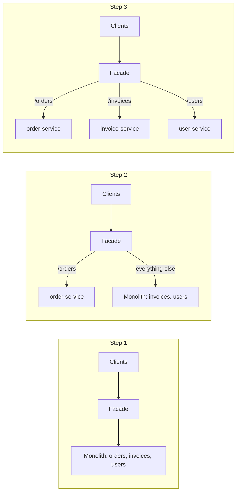

#### 📘 Terms Explained

| Term | Simple meaning |
|---|---|
| **Strangler Fig** | Incrementally replacing a legacy system by routing parts of it to new implementations. |
| **Routing facade** | A proxy/gateway in front of the old system that decides where each request goes. |
| **Big-bang rewrite** | Replacing the whole system at once (high risk; often fails). |
| **Canary release** | Sending a small share of traffic to the new version first. |

---

## 13.2 Why Do We Need It?

| Big-bang rewrite | Strangler Fig |
|---|---|
| Months/years with no value delivered | Value delivered with every migrated capability |
| New system must match every old feature before launch | Migrate one capability at a time |
| One huge, risky cut-over | Small, reversible steps (route back if needed) |
| The old system keeps changing while you rewrite it ("moving target") | New features go straight into new services |

---

## 13.3 How It Works: Steps and Techniques

1. **Put a facade in front** of the monolith (API gateway, Nginx, Spring Cloud Gateway). All traffic flows through it.
2. **Pick a capability** to extract: loosely coupled, valuable, and well understood (often *not* the most central one first).
3. **Build the new service**, with its own database.
4. **Migrate the data:** sync from the monolith DB with **CDC** (Debezium) while both run, or move ownership with a one-off migration.
5. **Shift traffic gradually:** canary by user/percentage, then 100%. Keep the ability to route back.
6. **Remove the old code** from the monolith. Repeat.

| Technique | Purpose |
|---|---|
| **Anti-Corruption Layer** | Translate between the monolith's model and the new service's clean model ([03_Structural_Pattern.md](../01_LLD/03_Structural_Pattern.md#154-anti-corruption-layer-system-level-adapter)) |
| **Branch by abstraction** | Inside the monolith, put an interface in front of the old code so callers can switch to the new service |
| **Parallel run / shadow traffic** | Send requests to both old and new, compare results, but only return the old one until confident |
| **Event interception** | The monolith publishes events (via CDC/outbox) so new services can build their own data |
| **Feature flags** | Switch individual users or tenants over |

---

## 13.4 Complete Java Example - A Routing Facade with Gradual Rollout

```java
import java.util.LinkedHashMap;
import java.util.Map;
import java.util.function.Function;

// Routing facade in front of the monolith: moves traffic to new services route by route
class StranglerFacade {
    private final Function<String, String> monolith;
    private final Map<String, Function<String, String>> migrated = new LinkedHashMap<>();   // path prefix -> new service
    private final Map<String, Integer> canaryPercent = new LinkedHashMap<>();               // gradual rollout

    StranglerFacade(Function<String, String> monolith) { this.monolith = monolith; }

    void migrate(String prefix, Function<String, String> newService, int percent) {
        migrated.put(prefix, newService);
        canaryPercent.put(prefix, percent);
    }

    String handle(String userId, String path) {
        for (var entry : migrated.entrySet()) {
            if (path.startsWith(entry.getKey())) {
                int bucket = Math.floorMod(userId.hashCode(), 100);                 // same user -> same side (sticky)
                if (bucket < canaryPercent.get(entry.getKey())) return entry.getValue().apply(path);
            }
        }
        return monolith.apply(path);                                               // everything else: legacy
    }
}

public class StranglerFigDemo {
    public static void main(String[] args) {
        StranglerFacade facade = new StranglerFacade(path -> "MONOLITH  " + path);
        String[] users = {"asha", "ravi", "meera", "kiran", "zoya", "dev", "anil", "priya", "sam", "lata"};

        System.out.println("Phase 1: nothing migrated");
        report(facade, users, "/orders/1");

        System.out.println("Phase 2: new order-service gets 30% of /orders traffic (canary)");
        facade.migrate("/orders", path -> "ORDER-SVC " + path, 30);
        report(facade, users, "/orders/1");

        System.out.println("Phase 3: /orders at 100%; /invoices still on the monolith");
        facade.migrate("/orders", path -> "ORDER-SVC " + path, 100);
        report(facade, users, "/orders/1");
        report(facade, users, "/invoices/9");
    }

    static void report(StranglerFacade facade, String[] users, String path) {
        int toNew = 0;
        for (String u : users) if (!facade.handle(u, path).startsWith("MONOLITH")) toNew++;
        System.out.printf("  %-12s -> %d/10 users on the new service, e.g. %s%n", path, toNew, facade.handle(users[0], path));
    }
}
```

**Output:**
```
Phase 1: nothing migrated
  /orders/1    -> 0/10 users on the new service, e.g. MONOLITH  /orders/1
Phase 2: new order-service gets 30% of /orders traffic (canary)
  /orders/1    -> 2/10 users on the new service, e.g. MONOLITH  /orders/1
Phase 3: /orders at 100%; /invoices still on the monolith
  /orders/1    -> 10/10 users on the new service, e.g. ORDER-SVC /orders/1
  /invoices/9  -> 0/10 users on the new service, e.g. MONOLITH  /invoices/9
```

What the output shows:
- **Phase 1:** everything still goes to the monolith; clients don't notice the facade.
- **Phase 2:** a **canary**: about 30% of users (with only 10 users the split is approximate, here 2 of 10) are sent to the new order-service. Each user is **sticky** (hash of the user ID), so they don't flip between old and new on each request.
- **Phase 3:** `/orders` is fully migrated, while `/invoices` still runs on the monolith. Both live side by side.

---

## 13.5 Strangler Fig with Spring Cloud Gateway

```yaml
spring:
  cloud:
    gateway:
      routes:
        - id: orders-new                       # 20% of /orders traffic to the new service
          uri: lb://order-service
          predicates:
            - Path=/orders/**
            - Weight=orders, 20
        - id: orders-legacy
          uri: http://legacy-monolith:8080
          predicates:
            - Path=/orders/**
            - Weight=orders, 80
        - id: everything-else                  # catch-all: the monolith (declared last)
          uri: http://legacy-monolith:8080
          predicates:
            - Path=/**
```

```properties
# CDC from the monolith database into Kafka, so the new order-service can build its own data
connector.class=io.debezium.connector.mysql.MySqlConnector
database.hostname=legacy-db
database.include.list=shop
table.include.list=shop.orders,shop.order_lines
topic.prefix=legacy
```

> `Weight` routing is per request, not sticky per user. For sticky canaries, route on a header/cookie set from the user ID, or use feature flags.

#### 📘 Terms Explained

| Term | Simple meaning |
|---|---|
| **`Weight` predicate** | Spring Cloud Gateway predicate that splits traffic between routes in the same group by percentage. |
| **Sticky routing** | The same user always goes to the same version. |
| **Shadow traffic / dark launch** | Copying real traffic to the new system without using its responses. |
| **Branch by abstraction** | Introduce an interface in front of the old implementation, add the new one behind it, then switch. |

---

## 13.6 Pros, Cons, Pitfalls and Interview Questions

| Pros | Cons |
|---|---|
| Low-risk, incremental, reversible migration | Old and new run side by side for a long time (double maintenance) |
| Delivers value continuously | Data synchronisation between old and new is hard |
| Learn and adjust boundaries as you go | The facade becomes critical infrastructure |

| Pitfall | Fix |
|---|---|
| New service still reading the monolith's tables | Give it its own DB, synced by CDC until ownership moves. |
| Extracting the most tangled module first | Start with something loosely coupled and valuable. |
| Migration that never finishes ("half-strangled" forever) | Plan to delete old code; track progress; stop adding features to the monolith. |
| Distributed monolith result (new services all call each other synchronously) | Use events and database-per-service from the start. |
| No way to compare behaviour | Parallel runs / shadow traffic, metrics per route. |

**Q1. How would you migrate a monolith to microservices?** With the Strangler Fig pattern: a routing facade in front, extract one capability at a time into a service with its own data (CDC to sync), shift traffic gradually with canaries, use an anti-corruption layer, then delete the old code. Avoid a big-bang rewrite.

**Q2. Which part would you extract first?** Something loosely coupled, high-value or fast-changing, and well understood, e.g. notifications, search or catalogue, rather than the core order/payment logic.

**Q3. How do you handle data during migration?** Give the new service its own database; keep it in sync with the monolith via CDC (Debezium) or events while both run; then switch ownership and make the monolith read from the new service (or its events).

**Q4. What is branch by abstraction?** Inside the monolith, put an interface in front of the code being replaced, implement it with a call to the new service, and switch implementations behind a flag.

---

## 13.7 Strangler Fig - Cheat Sheet

```
STRANGLER FIG  Replace a monolith gradually: routing facade -> extract one capability -> redirect its traffic -> delete old code.
          Facade: API gateway / Nginx / Spring Cloud Gateway (Path + Weight predicates, catch-all to monolith last).
          Data: new service owns its DB; CDC (Debezium) / events from the monolith while both run.
          Techniques: anti-corruption layer, branch by abstraction, parallel run / shadow traffic, sticky canary, feature flags.
          Start with loosely coupled, valuable modules. Finish the job (delete old code). No big-bang rewrites.
```

---

## 13.8 Types and Variants

| Variant | How traffic moves to the new system | Notes |
|---|---|---|
| **Edge/proxy routing** | A gateway routes some URLs to the new service, the rest to the monolith | The classic strangler |
| **Event interception** | Capture the monolith's events (CDC or messages) to feed the new service | Debezium on the monolith's DB |
| **Branch by abstraction** | Inside the code: introduce an interface, implement anew, switch over | For deep internal parts ([12_Legacy_Migration_Pattern.md](12_Legacy_Migration_Pattern.md)) |
| **Parallel run** | Old and new both process; compare results before switching | High-risk logic (payments, pricing) |
| **Dark launch / shadow traffic** | Copy traffic to the new service without using its answers | Validate performance first |
| **Feature-flag cutover** | Per user/tenant switch to the new path | Gradual, reversible |

# 14. How the Microservices Patterns Fit Together

## 14.1 One-Line Summary of Each

| Pattern | Question it answers | One-line answer |
|---|---|---|
| **Service Discovery** | "Where is inventory-service right now?" | Registry of live instances; client- or server-side lookup. |
| **API Gateway / BFF** | "How do clients reach 40 services?" | One entry point per client type; routing + cross-cutting concerns. |
| **API Composition** | "How do I show data from 4 services?" | Call them in parallel, join in memory, fall back for optional parts. |
| **Database per Service** | "Who owns this data?" | Exactly one service; others use its API/events; CQRS views for queries. |
| **Saga** | "How do I keep data consistent across services?" | Local transactions + compensations; orchestration or choreography. |
| **Domain Events** | "How do others learn what changed?" | Publish business facts reliably (outbox); react idempotently. |
| **Communication Styles** | "Call or message?" | Sync for queries needing answers now; async for everything else. |
| **Externalized Configuration** | "How does one build run everywhere?" | Config and secrets injected at runtime; fail fast if missing. |
| **Access Token** | "How do services trust a request?" | Signed JWTs verified by every service; client credentials between services. |
| **Observability** | "What's happening across services?" | Logs + metrics + traces linked by trace ID; audit logs; health. |
| **Sidecar / Service Mesh** | "How do I add networking features without code?" | Proxy next to every service, configured centrally. |
| **Chassis / Template** | "How do I avoid every team reinventing the basics?" | Shared framework + generated starter projects. |
| **Strangler Fig** | "How do I get from a monolith to here?" | Facade + incremental extraction + gradual traffic shift. |

## 14.2 One Request Through the Whole Architecture (Interview Imp - Java)

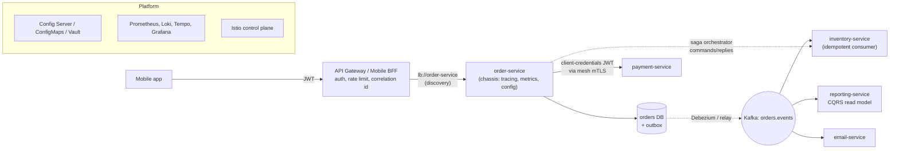

| Step | Patterns |
|---|---|
| Request enters | API Gateway/BFF, Access Token, Rate Limiting, Correlation ID |
| Gateway finds the service | Service Discovery (or Kubernetes Service) |
| Service starts with the right settings | Externalized Configuration, Chassis |
| Business logic + local data | Database per Service |
| Calls to other services | Communication Styles, Access Token (client credentials), Sidecar/Mesh (mTLS, retries), Circuit Breaker |
| Multi-service business transaction | Saga (orchestration or choreography) |
| Telling others what happened | Domain Events + Transactional Outbox |
| Screens needing data from many services | API Composition or CQRS read model |
| Understanding and fixing problems | Observability (logs, metrics, traces, audit, health) |
| Getting there from the old system | Strangler Fig |

## 14.3 Decision Guide

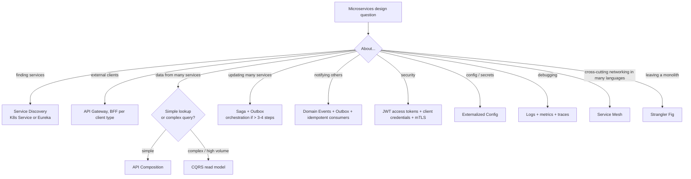

| If you hear... | Think... |
|---|---|
| "IP addresses change", "Eureka", "Kubernetes Service" | Service Discovery |
| "Single entry point", "mobile vs web needs", "Spring Cloud Gateway" | API Gateway / BFF |
| "Product page needs 4 services" | API Composition |
| "Can services share a database?", "join across services" | Database per Service, CQRS |
| "Distributed transaction", "2PC", "compensate" | Saga |
| "Event-driven", "OrderPlaced", "Debezium" | Domain Events + Outbox |
| "REST or Kafka?", "gRPC" | Communication Styles |
| "Different config per environment", "secrets", "Config Server" | Externalized Configuration |
| "JWT", "OAuth2", "service-to-service auth" | Access Token |
| "Trace a slow request", "ELK", "Prometheus" | Observability |
| "Istio", "Envoy", "mTLS everywhere" | Sidecar / Service Mesh |
| "Every team does logging differently" | Chassis / Template |
| "Rewrite the monolith" | Strangler Fig |

## 14.4 Look-Alike Patterns

| Pair | Difference |
|---|---|
| **API Gateway vs Service Mesh** | Gateway: north-south traffic (clients → services) at the edge. Mesh: east-west traffic (service ↔ service) inside the cluster. |
| **API Gateway vs BFF** | One generic gateway vs one tailored backend per client type. |
| **API Composition vs CQRS read model** | Query owners live, join in memory vs pre-joined copy built from events. |
| **Orchestration vs Choreography** | Central coordinator with commands vs services reacting to events. |
| **Saga vs 2PC** | Local commits + compensation (available, no isolation) vs atomic commit with locks (blocking). |
| **Client-side vs server-side discovery** | Caller picks the instance vs a router picks it. |
| **Chassis vs Template** | Upgradeable dependency vs one-time project skeleton. |
| **Strangler Fig vs Big-bang rewrite** | Incremental and reversible vs all-at-once and risky. |

## 14.5 Microservices Inside Spring Cloud and Kubernetes

| Pattern | Spring / Spring Cloud | Kubernetes / platform |
|---|---|---|
| Service Discovery | Eureka, Consul, Spring Cloud LoadBalancer, `@LoadBalanced`, Feign | Services + DNS, endpoints, readiness probes |
| API Gateway | Spring Cloud Gateway (routes, filters, TokenRelay, RequestRateLimiter) | Ingress / Gateway API, Istio ingress gateway |
| API Composition | `CompletableFuture`, WebClient + `Mono.zip`, virtual threads | GraphQL Federation router |
| Database per Service | Flyway per service, separate datasources/schemas | Managed DBs, operators (CloudNativePG) |
| Saga | Hand-written orchestrator + outbox, Axon, Temporal SDK | Temporal/Camunda clusters |
| Domain Events | `AbstractAggregateRoot`, Spring Modulith, Spring Kafka, Spring Cloud Stream | Kafka (Strimzi), Debezium on Kafka Connect |
| Communication | RestClient, HTTP Interface clients, gRPC, Feign | Mesh retries/timeouts |
| Externalized Config | `@ConfigurationProperties`, Spring Cloud Config, `@RefreshScope`, Vault | ConfigMaps, Secrets, External Secrets Operator |
| Access Token | Spring Security resource server + OAuth2 client | Keycloak, mesh mTLS + AuthorizationPolicy |
| Observability | Actuator, Micrometer, Micrometer Tracing (OTel), structured logging | Prometheus, Grafana, Loki, Tempo, OTel Collector |
| Sidecar / Mesh | n/a (outside the app) | Istio, Linkerd, native sidecars |
| Chassis / Template | Spring Boot starters, Spring Initializr | Backstage templates, Helm charts |
| Strangler Fig | Spring Cloud Gateway `Weight`/`Path` routes | Ingress routing, Debezium CDC |

## 14.6 Comparison Table

| Pattern | Main problem solved | Key mechanism | Biggest risk | Interview favourite |
|---|---|---|---|---|
| **Service Discovery** | Dynamic addresses | Registry + health + lookup | Stale entries, registry outage | Client- vs server-side |
| **API Gateway / BFF** | One entry point | Routes + filters | God gateway, bottleneck | Gateway vs LB vs mesh |
| **API Composition** | Cross-service reads | Parallel calls + in-memory join | Latency/availability of slowest part | vs CQRS |
| **Database per Service** | Coupling via shared data | Private data, APIs/events | Cross-service queries/transactions | Why not shared DB |
| **Saga** | Cross-service consistency | Local TX + compensation | No isolation, complex failure paths | Orchestration vs choreography, vs 2PC |
| **Domain Events** | Notify other services | Outbox + broker | Dual writes, schema evolution | Reliable publishing |
| **Communication Styles** | Coupling via calls | Sync vs async | Long sync chains | REST vs gRPC vs messaging |
| **Externalized Config** | Per-environment builds, secrets | Runtime config sources | Leaked secrets | Precedence, Config Server |
| **Access Token** | Trust between services | Signed JWT, client credentials | Not checking audience/expiry | JWT structure, RS256 |
| **Observability** | Understanding behaviour | Logs/metrics/traces + IDs | High cardinality, no trace IDs | Debug a slow request |
| **Sidecar / Mesh** | Networking in every language | Proxies + control plane | Operational complexity | Mesh vs libraries |
| **Chassis / Template** | Duplicated basics | Shared starter + generator | Business logic in shared libs | Chassis vs template |
| **Strangler Fig** | Risky rewrites | Facade + incremental extraction | Never finishing | Monolith migration plan |

---

# 15. Microservices Patterns Cheat Sheet

```
DISCOVERY       Registry of live instances. Client-side (Eureka + LoadBalancer, @LoadBalanced, Feign) vs server-side
                (K8s Service/kube-proxy, ALB). Self vs third-party registration. Leases + heartbeats; HA registry.
API GATEWAY     Single entry: routing + TLS/auth/rate limit/CORS/correlation id. BFF per client type. No business logic.
                Spring Cloud Gateway: lb://svc, Path, StripPrefix, CircuitBreaker, RequestRateLimiter, TokenRelay.
API COMPOSITION Parallel calls (CompletableFuture/Mono.zip), timeouts, optional parts fall back. Big queries -> CQRS.
DB PER SERVICE  Owner-only data (schema + DB user per service). Shared DB = anti-pattern. CQRS read models via events.
                Eventual consistency across services; CAP: usually A over C across services.
SAGA            Local TXs + compensations (reverse order). Orchestration (Temporal/Camunda/hand-written) vs choreography.
                Not 2PC. Compensatable -> pivot -> retriable. Semantic locks. Persist state, outbox, idempotent steps.
DOMAIN EVENTS   Past-tense facts; outbox + polling publisher / log tailing (Debezium); idempotent consumers; key = aggregate id.
COMMUNICATION   Sync (REST/gRPC) for queries now; async messaging for commands/events. No long sync chains. Contracts + tests.
EXTERNAL CONFIG Same artifact everywhere; precedence jar < profile < external < import < env < -D < --args.
                @ConfigurationProperties + @Validated; Config Server + @RefreshScope; ConfigMaps/Secrets/Vault.
ACCESS TOKEN    JWT verified in every service: signature (RS256 + JWKS), exp, iss, aud, scope. Client credentials s2s.
                Signed not encrypted. Spring Security resource server; OAuth2ClientHttpRequestInterceptor. + mTLS.
OBSERVABILITY   JSON logs to stdout + aggregation; Micrometer/Prometheus (RED/USE, low cardinality); OTel tracing
                (traceparent, sampling); Sentry; audit (JPA auditing, Envers); health probes.
SIDECAR / MESH  Envoy sidecars + control plane: mTLS, retries, timeouts, outlier detection, canary, AuthorizationPolicy.
                Mesh = transport; app = business fallbacks. Retry in one layer only.
CHASSIS         Spring Boot/Cloud + company starter (auto-config, ProblemDetail, tags). Template = generated starter repo.
STRANGLER FIG   Facade -> extract one capability (own DB, CDC sync) -> canary -> 100% -> delete old code. ACL. No big bang.
```

### Quick Decision Table

| Need | Use |
|---|---|
| Find services whose IPs keep changing | Service Discovery (Kubernetes Service / Eureka) |
| One front door for clients | API Gateway (+ BFF per client type) |
| Show data from several services on one screen | API Composition |
| Complex reports across services | CQRS read model / materialized view |
| Each team can change its schema safely | Database per Service |
| Business transaction across services | Saga (+ Outbox) |
| Tell other services something happened | Domain Events (+ Outbox, idempotent consumers) |
| Answer needed immediately | REST/gRPC with timeouts and breakers |
| Same build in every environment | Externalized Configuration |
| Trust and authorize calls | JWT access tokens + client credentials + mTLS |
| Debug across services | Logs + metrics + traces (trace IDs everywhere) |
| mTLS/retries/canaries in many languages | Service Mesh |
| Consistent basics in every service | Microservice Chassis + Service Template |
| Move off a monolith safely | Strangler Fig |
| Small team, one product, early stage | A modular monolith. Not microservices yet. |

### Top Interview Traps

1. **Microservices are not the default.** Start with a modular monolith; split for team scale, independent deployment or scaling needs.
2. **A shared database creates a distributed monolith.** Each service owns its data.
3. **No 2PC across services:** use sagas with compensations, and remember sagas have **no isolation** (use PENDING states).
4. **Saving to the DB and then publishing an event is a dual write;** use the outbox (or CDC).
5. **Consumers must be idempotent;** events are delivered at least once.
6. **Long synchronous call chains** multiply latency and failure; prefer events and parallel composition.
7. **The gateway must not hold business logic;** BFFs belong to frontend teams.
8. **JWTs are signed, not encrypted;** always check `aud`, `exp` and scopes in every service.
9. **Kubernetes already gives you discovery** (Services + DNS + readiness); don't add Eureka on top by default.
10. **Observability needs trace IDs in logs, metrics with low-cardinality tags, and sampling.** Without them, debugging 40 services is guesswork.

> **Related files:** [04_Messaging_Pattern.md](../03_System_Design/04_Messaging_Pattern.md) (outbox, idempotent consumers, Kafka/RabbitMQ, correlation IDs) · [02_Reliability_Pattern.md](../03_System_Design/02_Reliability_Pattern.md) (timeouts, retries, circuit breakers, bulkheads, health checks) · [01_Scalability_Pattern.md](../03_System_Design/01_Scalability_Pattern.md) (load balancing, scaling, caching, sharding) · [03_Structural_Pattern.md](../01_LLD/03_Structural_Pattern.md) (Facade, Proxy, Adapter, Anti-Corruption Layer) · [04_Behavioral_Pattern.md](../01_LLD/04_Behavioral_Pattern.md) (State, Observer, Chain of Responsibility, Mediator) · [00_Design_Patterns_Complete_List.md](../00_Design_Patterns_Complete_List.md) (master list) · [00_Kubernetes_Index.md](../../kubernetes/00_Kubernetes_Index.md)
