# Data Storage Patterns (Data Patterns - Extended)

> **Note**: Patterns marked with **(Interview Imp - Java)** are frequently asked in Java interviews
>
> **How to read this file:** Every section ends with a **📘 Terms Explained** table. If you see a word you don't know, check the table right below that section. Each pattern goes from the basic idea to advanced usage (plain Java simulation of how the store works inside, Spring Boot / Spring Data usage, pitfalls) and ends with interview questions and a mini cheat sheet.
>
> **What is this file about?** System-design interviews almost always include *"Which database would you use here, and why?"*. This file covers the master list's **Data Patterns (Extended)**: polyglot persistence, the main NoSQL families (key-value, in-memory, document, wide-column, graph, time-series, search engine), multi-tenancy, federation, denormalization, command sourcing, and the probabilistic data structures (Bloom filter, Count-Min Sketch, HyperLogLog). For each store you'll see **how it works inside**, because that's what explains what it is good and bad at.
>
> **What lives elsewhere:** Sharding, caching (cache-aside, read-through, write-through, write-behind, refresh-ahead), distributed/near caches and event-sourcing snapshots already have detailed sections in other files. [Section 12](#12-data-patterns-covered-in-other-files) maps them with direct links. Consistency models and CAP are in [05_Data_Management_Pattern.md](../03_System_Design/05_Data_Management_Pattern.md#6-cap-theorem-interview-imp---java). SQL itself (joins, indexes, normalization) is in [MySQL_Complete_Guide.md](../../mysql/MySQL_Complete_Guide.md) and [SQL_Database_Essentials_Syllabus_Guide.md](../../mysql/SQL_Database_Essentials_Syllabus_Guide.md).
>
> **Verified code:** Every main "Complete Java Example" in this file is **plain Java 17 (no libraries)** and was compiled and run **three times** with identical output (fixed data and random seeds). To run one, save it as `<ClassName>.java` and run `javac <ClassName>.java && java <ClassName>`. (Running it directly with `java <ClassName>.java` won't work when the class with `main` is not the first class in the file.) Spring Data, Redis, MongoDB, Cassandra, Neo4j and Elasticsearch snippets are configuration/usage examples and were **not** executed.

---

## Table of Contents
- [Big Picture: One Application, Many Data Stores](#big-picture-one-application-many-data-stores)
1. [Polyglot Persistence and Choosing a Database](#1-polyglot-persistence-and-choosing-a-database-interview-imp---java) **(Interview Imp - Java)**
   - [1.1 What is Polyglot Persistence?](#11-what-is-polyglot-persistence)
   - [1.2 Why Do We Need It?](#12-why-do-we-need-it)
   - [1.3 How It Works: Choose by Access Pattern](#13-how-it-works-choose-by-access-pattern)
   - [1.4 Polyglot Persistence in Spring Boot](#14-polyglot-persistence-in-spring-boot)
   - [1.5 Pros and Cons](#15-pros-and-cons)
   - [1.6 Pitfalls, Interview Questions and Cheat Sheet](#16-pitfalls-interview-questions-and-cheat-sheet)
2. [Key-Value Stores and In-Memory Databases](#2-key-value-stores-and-in-memory-databases-interview-imp---java) **(Interview Imp - Java)**
   - [2.1 What Are They?](#21-what-are-they)
   - [2.2 Why Do We Need Them?](#22-why-do-we-need-them)
   - [2.3 How It Works](#23-how-it-works)
   - [2.4 Variants](#24-variants)
   - [2.5 Complete Java Example - A Mini Redis: TTL, LRU Eviction and AOF Recovery](#25-complete-java-example---a-mini-redis-ttl-lru-eviction-and-aof-recovery)
   - [2.6 Redis in Spring Boot](#26-redis-in-spring-boot)
   - [2.7 Pros and Cons](#27-pros-and-cons)
   - [2.8 Pitfalls, Interview Questions and Cheat Sheet](#28-pitfalls-interview-questions-and-cheat-sheet)
3. [Document Stores](#3-document-stores-interview-imp---java) **(Interview Imp - Java)**
   - [3.1 What is a Document Store?](#31-what-is-a-document-store)
   - [3.2 Why Do We Need It?](#32-why-do-we-need-it)
   - [3.3 How It Works](#33-how-it-works)
   - [3.4 Variants](#34-variants)
   - [3.5 Complete Java Example - Embedding, Nested Queries and Schema Versions](#35-complete-java-example---embedding-nested-queries-and-schema-versions)
   - [3.6 MongoDB with Spring Data](#36-mongodb-with-spring-data)
   - [3.7 Pros and Cons](#37-pros-and-cons)
   - [3.8 Pitfalls, Interview Questions and Cheat Sheet](#38-pitfalls-interview-questions-and-cheat-sheet)
4. [Wide-Column Stores (Column-Family Stores)](#4-wide-column-stores-column-family-stores)
   - [4.1 What is a Wide-Column Store?](#41-what-is-a-wide-column-store)
   - [4.2 Why Do We Need It?](#42-why-do-we-need-it)
   - [4.3 How It Works](#43-how-it-works)
   - [4.4 Variants](#44-variants)
   - [4.5 Complete Java Example - Partitions, Clustering Order and an LSM Tree](#45-complete-java-example---partitions-clustering-order-and-an-lsm-tree)
   - [4.6 Cassandra with Spring Data](#46-cassandra-with-spring-data)
   - [4.7 Pros and Cons](#47-pros-and-cons)
   - [4.8 Pitfalls, Interview Questions and Cheat Sheet](#48-pitfalls-interview-questions-and-cheat-sheet)
5. [Graph Databases](#5-graph-databases-interview-imp---java) **(Interview Imp - Java)**
   - [5.1 What is a Graph Database?](#51-what-is-a-graph-database)
   - [5.2 Why Do We Need It?](#52-why-do-we-need-it)
   - [5.3 How It Works](#53-how-it-works)
   - [5.4 Variants](#54-variants)
   - [5.5 Complete Java Example - Friends of Friends, Recommendations, Shortest Path](#55-complete-java-example---friends-of-friends-recommendations-shortest-path)
   - [5.6 Neo4j with Spring Data](#56-neo4j-with-spring-data)
   - [5.7 Pros and Cons](#57-pros-and-cons)
   - [5.8 Pitfalls, Interview Questions and Cheat Sheet](#58-pitfalls-interview-questions-and-cheat-sheet)
6. [Time-Series Databases](#6-time-series-databases)
   - [6.1 What is a Time-Series Database?](#61-what-is-a-time-series-database)
   - [6.2 Why Do We Need It?](#62-why-do-we-need-it)
   - [6.3 How It Works](#63-how-it-works)
   - [6.4 Variants](#64-variants)
   - [6.5 Complete Java Example - Rollups, Retention and Timestamp Compression](#65-complete-java-example---rollups-retention-and-timestamp-compression)
   - [6.6 Time-Series in Java / Spring](#66-time-series-in-java--spring)
   - [6.7 Pros and Cons](#67-pros-and-cons)
   - [6.8 Pitfalls, Interview Questions and Cheat Sheet](#68-pitfalls-interview-questions-and-cheat-sheet)
7. [Search Engines](#7-search-engines-interview-imp---java) **(Interview Imp - Java)**
   - [7.1 What is a Search Engine (as a Data Store)?](#71-what-is-a-search-engine-as-a-data-store)
   - [7.2 Why Do We Need It?](#72-why-do-we-need-it)
   - [7.3 How It Works](#73-how-it-works)
   - [7.4 Variants](#74-variants)
   - [7.5 Complete Java Example - Analyzer, Inverted Index and BM25 Ranking](#75-complete-java-example---analyzer-inverted-index-and-bm25-ranking)
   - [7.6 Elasticsearch with Spring Data](#76-elasticsearch-with-spring-data)
   - [7.7 Pros and Cons](#77-pros-and-cons)
   - [7.8 Pitfalls, Interview Questions and Cheat Sheet](#78-pitfalls-interview-questions-and-cheat-sheet)
8. [Multi-Tenancy Pattern](#8-multi-tenancy-pattern-interview-imp---java) **(Interview Imp - Java)**
   - [8.1 What is Multi-Tenancy?](#81-what-is-multi-tenancy)
   - [8.2 Why Do We Need It?](#82-why-do-we-need-it)
   - [8.3 How It Works: Three Data Isolation Models](#83-how-it-works-three-data-isolation-models)
   - [8.4 Complete Java Example - Tenant Context, a Data Leak and the Three Models](#84-complete-java-example---tenant-context-a-data-leak-and-the-three-models)
   - [8.5 Multi-Tenancy in Spring Boot and PostgreSQL](#85-multi-tenancy-in-spring-boot-and-postgresql)
   - [8.6 Pros and Cons](#86-pros-and-cons)
   - [8.7 Pitfalls, Interview Questions and Cheat Sheet](#87-pitfalls-interview-questions-and-cheat-sheet)
   - [8.8 Types and Variants](#88-types-and-variants)
9. [Denormalization and Database Federation](#9-denormalization-and-database-federation-interview-imp---java) **(Interview Imp - Java)**
   - [9.1 What Are They?](#91-what-are-they)
   - [9.2 Why Do We Need Them?](#92-why-do-we-need-them)
   - [9.3 How It Works](#93-how-it-works)
   - [9.4 Complete Java Example - Join on Read vs Copy on Write](#94-complete-java-example---join-on-read-vs-copy-on-write)
   - [9.5 In Spring Boot](#95-in-spring-boot)
   - [9.6 Pros and Cons](#96-pros-and-cons)
   - [9.7 Pitfalls, Interview Questions and Cheat Sheet](#97-pitfalls-interview-questions-and-cheat-sheet)
10. [Command Sourcing (and Event-Store Snapshots)](#10-command-sourcing-and-event-store-snapshots)
   - [10.1 What is Command Sourcing?](#101-what-is-command-sourcing)
   - [10.2 Why Do We Need It (and When Not)?](#102-why-do-we-need-it-and-when-not)
   - [10.3 How It Works](#103-how-it-works)
   - [10.4 Complete Java Example - Replaying Commands vs Replaying Events](#104-complete-java-example---replaying-commands-vs-replaying-events)
   - [10.5 In Java / Spring](#105-in-java--spring)
   - [10.6 Pros and Cons](#106-pros-and-cons)
   - [10.7 Pitfalls, Interview Questions and Cheat Sheet](#107-pitfalls-interview-questions-and-cheat-sheet)
11. [Probabilistic Data Structures: Bloom Filter, Count-Min Sketch, HyperLogLog](#11-probabilistic-data-structures-bloom-filter-count-min-sketch-hyperloglog-interview-imp---java) **(Interview Imp - Java)**
   - [11.1 What Are They?](#111-what-are-they)
   - [11.2 Why Do We Need Them?](#112-why-do-we-need-them)
   - [11.3 How They Work](#113-how-they-work)
   - [11.4 Variants and Where They're Used](#114-variants-and-where-theyre-used)
   - [11.5 Complete Java Example - Bloom Filter](#115-complete-java-example---bloom-filter)
   - [11.6 Complete Java Example - Count-Min Sketch](#116-complete-java-example---count-min-sketch)
   - [11.7 Complete Java Example - HyperLogLog with Merge](#117-complete-java-example---hyperloglog-with-merge)
   - [11.8 In Java and Spring](#118-in-java-and-spring)
   - [11.9 Pros and Cons](#119-pros-and-cons)
   - [11.10 Pitfalls, Interview Questions and Cheat Sheet](#1110-pitfalls-interview-questions-and-cheat-sheet)
12. [Data Patterns Covered in Other Files](#12-data-patterns-covered-in-other-files)
13. [How the Data Storage Patterns Fit Together](#13-how-the-data-storage-patterns-fit-together)
14. [Data Storage Patterns Cheat Sheet](#14-data-storage-patterns-cheat-sheet)

---

## Big Picture: One Application, Many Data Stores

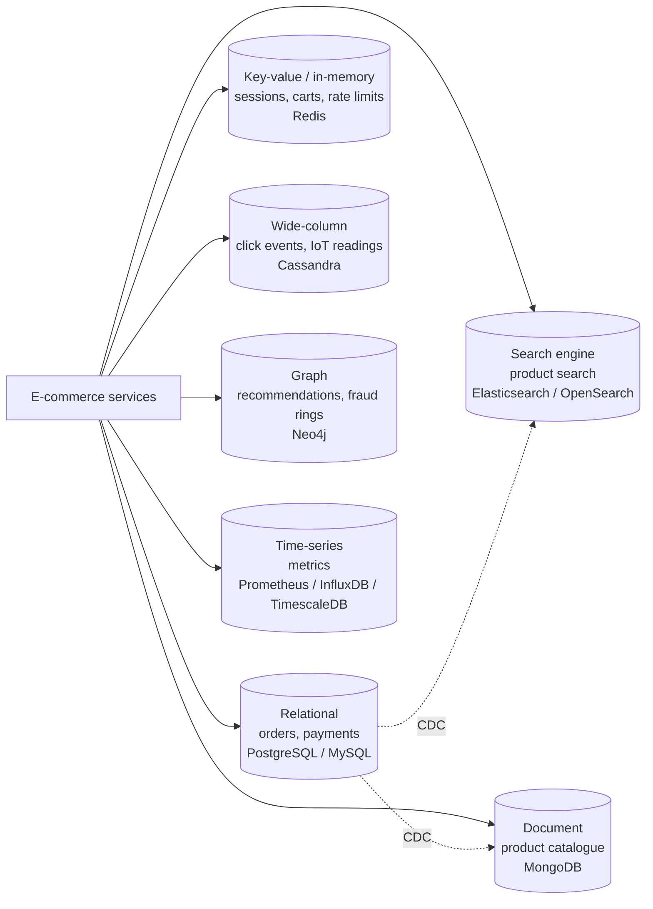

| Family | Data shape | Superpower | Weakness | Examples |
|---|---|---|---|---|
| **Relational** | Tables, rows, joins | Transactions, ad-hoc queries, constraints | Horizontal write scaling, rigid schema | PostgreSQL, MySQL, Oracle |
| **Key-value** | `key → blob` | Sub-millisecond get/set, simple scaling | Only lookups by key | Redis, DynamoDB, Memcached |
| **Document** | JSON-like trees | Flexible schema, whole aggregate in one read | Cross-document joins and transactions are limited | MongoDB, Couchbase, Firestore |
| **Wide-column** | Partitions of sorted rows | Massive write throughput, linear scale | Queries must match the key design | Cassandra, ScyllaDB, HBase, Bigtable |
| **Graph** | Nodes + relationships | Multi-hop traversals | Big aggregations, sharding the graph | Neo4j, Amazon Neptune |
| **Time-series** | (time, value, labels) | Ingest + downsample + compress | Updates, general queries | Prometheus, InfluxDB, TimescaleDB |
| **Search engine** | Inverted index | Full-text, relevance, facets | Not a source of truth, near-real-time | Elasticsearch, OpenSearch, Solr |

### 📘 Terms Explained

| Term | Meaning |
|---|---|
| **NoSQL** | "Not only SQL": databases that don't use the relational table model (key-value, document, wide-column, graph...) |
| **Data store** | Any system that stores data: database, cache, search index, object storage |
| **Aggregate** | A cluster of objects treated as one unit (an order with its items), a DDD term |
| **Transaction** | A group of operations that succeed or fail together (ACID) |
| **Horizontal scaling** | Adding more machines, as opposed to a bigger machine |
| **Source of truth** | The store whose copy of the data is authoritative; others are derived from it |

---

# 1. Polyglot Persistence and Choosing a Database (Interview Imp - Java)

## 1.1 What is Polyglot Persistence?

**Polyglot persistence** means using **different kinds of databases for different needs inside one system**, instead of forcing all data into one database. The term comes from "polyglot programming" (using several languages) and was popularised by Martin Fowler and Pramod Sadalage.

**Simple analogy:** A kitchen has a fridge, a freezer, a spice rack and a bread bin. You *could* keep everything in the fridge, but bread goes stale and spices get damp. Each kind of food has a storage that suits it.

## 1.2 Why Do We Need It?

- One relational DB for everything works well **for a long time**, and should be the default. But at scale, some workloads fight each other: full-text search with `LIKE '%x%'`, 50,000 sensor writes per second, 6-hop friend recommendations, 1 ms session lookups.
- Each NoSQL family is **optimised for one access pattern**, and is often 10-100× better than a general database at that pattern.
- In microservices, **database per service** ([02_Microservices_Pattern.md](02_Microservices_Pattern.md#4-database-per-service-pattern-interview-imp---java)) naturally lets each service pick the store that fits.

## 1.3 How It Works: Choose by Access Pattern

Start from **how the data is read and written**, not from the data itself.

| Question | If yes, consider |
|---|---|
| Do I need multi-row transactions, constraints, ad-hoc reporting? | **Relational** (default choice) |
| Always fetched by one key, needs < 1 ms, can expire? | **Key-value / in-memory** (Redis) |
| Read and written as a whole nested object, shape varies? | **Document** (MongoDB) |
| Huge append-heavy writes, queried by a known key + range? | **Wide-column** (Cassandra) |
| Questions are about connections ("friends of friends", "paths")? | **Graph** (Neo4j) |
| Timestamped measurements, queried by time window, aggregated? | **Time-series** (Prometheus, TimescaleDB) |
| Free-text search, relevance, typo tolerance, facets? | **Search engine** (Elasticsearch/OpenSearch) |
| Large files (images, PDFs, backups)? | **Object storage** (S3, Azure Blob), see [01_Cloud_Native_Pattern.md](01_Cloud_Native_Pattern.md#4-valet-key-claim-check-and-static-content-hosting-interview-imp---java) |

**Keep one source of truth.** The usual shape is: the relational DB (or an event log) is the source of truth, and the other stores are **derived views** kept in sync with CDC or events ([05_Data_Management_Pattern.md](../03_System_Design/05_Data_Management_Pattern.md#9-change-data-capture-cdc-pattern)). If a derived store is lost, you rebuild it.

**Also consider multi-model databases first.** PostgreSQL alone can do JSON documents (`jsonb`), full-text search (`tsvector`), time-series (TimescaleDB extension), geospatial (PostGIS) and vectors (pgvector). Each extra database is extra operations work: backups, upgrades, monitoring, on-call. Add one only when the gain is clear.

## 1.4 Polyglot Persistence in Spring Boot

Spring Data gives every store the same repository style, so one service can use several stores side by side:

```java
// One service, four stores. Each repository package is bound to its own Spring Data module.
@SpringBootApplication
@EnableJpaRepositories(basePackages = "shop.orders.jpa")                 // PostgreSQL: orders, payments
@EnableMongoRepositories(basePackages = "shop.catalog.mongo")            // MongoDB: product catalogue
@EnableRedisRepositories(basePackages = "shop.cart.redis")               // Redis: carts with TTL
@EnableElasticsearchRepositories(basePackages = "shop.search.es")        // Elasticsearch: product search
public class ShopApplication { public static void main(String[] a) { SpringApplication.run(ShopApplication.class, a); } }

interface OrderRepository extends JpaRepository<Order, Long> {}
interface ProductRepository extends MongoRepository<Product, String> { List<Product> findByAttributesColor(String color); }
interface CartRepository extends CrudRepository<Cart, String> {}          // @RedisHash(value = "cart", timeToLive = 86400)
interface ProductSearchRepository extends ElasticsearchRepository<ProductDoc, String> { Page<ProductDoc> findByTitle(String q, Pageable p); }
```

```yaml
spring:
  datasource: { url: jdbc:postgresql://pg:5432/shop }
  data:
    mongodb: { uri: mongodb://mongo:27017/catalog }
    redis:   { host: redis, port: 6379 }
  elasticsearch:
    uris: http://es:9200
```

When modules overlap (e.g. both JPA and Mongo repositories on the classpath), Spring Data switches to **strict repository configuration**: use separate packages (as above) or store-specific annotations (`@Entity`, `@Document`) so each repository is assigned to the right store.

## 1.5 Pros and Cons

| Pros | Cons |
|---|---|
| Each workload gets a store that fits | More technologies to learn, run, back up, secure |
| Better performance and cost at scale | Data spread across stores: consistency and sync work (CDC, events) |
| Teams can evolve stores independently | No transactions across stores |
| | Harder local development and testing (use Testcontainers) |

## 1.6 Pitfalls, Interview Questions and Cheat Sheet

**Common pitfalls**
- **Résumé-driven design:** adding MongoDB + Cassandra + Neo4j to an app with 10,000 users.
- **Dual writes** from the app to two stores → drift. Use CDC/outbox ([12_Legacy_Migration_Pattern.md](12_Legacy_Migration_Pattern.md#6-database-migration-and-expand-contract-interview-imp---java)).
- **Treating a derived store (search index, cache) as the source of truth** → data lost on reindex.
- **Choosing NoSQL "for scale"** before modelling access patterns. Most NoSQL stores punish queries you didn't design for.

**Interview questions**
1. *What is polyglot persistence? Give an example.* → Different stores per need: Postgres for orders, Redis for sessions, Elasticsearch for search, Cassandra for events; one source of truth, others fed by CDC.
2. *SQL or NoSQL for a new service?* → Default to relational unless the access pattern clearly needs something else (extreme write volume, key-only access, flexible documents, graph traversals, full-text search). Explain the trade-off you accept.
3. *How do you keep Elasticsearch in sync with Postgres?* → CDC (Debezium → Kafka → indexer) or outbox events; idempotent indexing by ID; ability to rebuild the index from Postgres.
4. *What are the operational costs of adding a new database?* → Backups/restore drills, upgrades, monitoring, security, skills, on-call, local dev setup.

**Cheat sheet**
```
Default        relational; add a store only for a clear access-pattern win
Choose by      how data is read/written (key? nested object? range by time? hops? free text?)
Shape          one source of truth + derived stores via CDC/events, rebuildable
Spring         one service, several Spring Data modules, separate repository packages
```

### 📘 Terms Explained

| Term | Meaning |
|---|---|
| **Polyglot persistence** | Using several types of databases in one system, each for what it does best |
| **Access pattern** | How data is queried and updated: by which key, how often, how much, in what shape |
| **Multi-model database** | One database supporting several data models (e.g. Postgres with JSON, full-text, time-series extensions) |
| **Derived store / view** | A copy of data in another form, built from the source of truth |
| **Spring Data** | Spring's family of modules giving a common repository API over many stores |
| **Strict repository configuration** | Spring Data mode where each repository must clearly belong to one store module |
| **Testcontainers** | Java library that starts real databases in Docker for tests |

---

# 2. Key-Value Stores and In-Memory Databases (Interview Imp - Java)

## 2.1 What Are They?

- A **key-value store** keeps data as `key → value`, like a giant distributed `HashMap`. You can get, set and delete by key, and that's (almost) all.
- An **in-memory database** keeps its working data in **RAM** instead of on disk, so reads and writes take microseconds. It uses snapshots and/or a write log to survive restarts.

**Redis** is both: an in-memory key-value store with rich value types (strings, hashes, lists, sets, sorted sets, streams, HyperLogLog). Other examples: **Memcached** (cache only), **Amazon DynamoDB** (disk-based, managed key-value/document store), **Hazelcast**, **Apache Ignite**, **Valkey** (an open-source fork of Redis).

**Simple analogy:** A coat check. You hand over a coat and get ticket #42; later you show #42 and get the coat back instantly. The attendant doesn't know or care what's in the pockets, and can't answer "which coats are blue?".

## 2.2 Why Do We Need Them?

| Use case | Why key-value / in-memory fits |
|---|---|
| Sessions, auth tokens, carts | Always read by one key, need TTL |
| Caching DB results | Microsecond reads, offloads the DB ([Caching](../03_System_Design/01_Scalability_Pattern.md#8-caching-interview-imp---java)) |
| Rate limiting, counters | Atomic `INCR` with expiry ([02_Reliability_Pattern.md](../03_System_Design/02_Reliability_Pattern.md#6-rate-limiting-pattern-interview-imp---java)) |
| Leaderboards | Sorted sets: `ZADD`, `ZREVRANGE` in O(log n) |
| Distributed locks, dedup keys | `SET key value NX PX 30000` |
| Pub/sub, lightweight queues | Redis Streams / pub/sub |

## 2.3 How It Works

1. **Hashing:** the key is hashed to find the value in O(1). In a cluster, the hash also picks the node (Redis Cluster: 16,384 hash slots; DynamoDB: partition key hash). See [07_Distributed_Systems_Pattern.md](../03_System_Design/07_Distributed_Systems_Pattern.md).
2. **Expiry (TTL):** each key may carry an expiry time. Redis removes expired keys **lazily** (when accessed) plus **actively** (sampling some keys periodically).
3. **Eviction:** when memory is full, a policy decides what to throw away: `allkeys-lru`, `allkeys-lfu`, `volatile-ttl`, or `noeviction` (reject writes).
4. **Durability for in-memory stores:**
   - **Snapshot (RDB):** periodically dump the whole dataset to disk. Fast restarts, but you lose writes since the last snapshot.
   - **Append-only file (AOF):** log every write; replay on restart. `appendfsync everysec` loses at most ~1 s of writes.
   - **Replication:** copies on other nodes (Redis Sentinel / Cluster replicas) for failover.

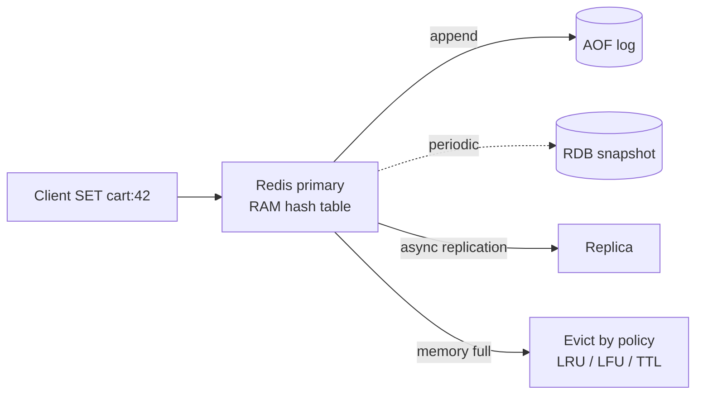

## 2.4 Variants

| Variant | Examples | Notes |
|---|---|---|
| **Pure cache** | Memcached | No persistence, multi-threaded, strings only |
| **In-memory data structure store** | Redis, Valkey | Rich types, persistence optional, mostly single-threaded command execution |
| **Managed, disk-based key-value** | DynamoDB, Azure Cosmos DB (Table API) | Durable, auto-scaling, single-digit ms; partition + sort key |
| **In-memory data grid** | Hazelcast, Apache Ignite | Java-native, distributed maps, compute next to data |
| **Embedded key-value** | RocksDB, LevelDB, Chronicle Map | Inside your process; used *inside* other databases (Kafka Streams, CockroachDB) |
| **In-memory relational** | H2 (tests), SAP HANA, VoltDB | SQL with RAM speed |

## 2.5 Complete Java Example - A Mini Redis: TTL, LRU Eviction and AOF Recovery

```java
import java.util.ArrayList;
import java.util.LinkedHashMap;
import java.util.List;
import java.util.Map;

// A tiny Redis-like in-memory key-value store: O(1) get/set, TTL expiry, LRU eviction when memory is full,
// and an append-only file (AOF) so data survives a restart.
class MiniKv {
    private record Entry(String value, long expiresAt) {}
    private final int maxKeys;
    private final LinkedHashMap<String, Entry> data;                           // access-order = LRU bookkeeping
    final List<String> aof = new ArrayList<>();                               // the append-only file (one line per write)
    long now = 0;
    int evicted = 0;

    MiniKv(int maxKeys) {
        this.maxKeys = maxKeys;
        this.data = new LinkedHashMap<>(16, 0.75f, true) {
            @Override protected boolean removeEldestEntry(Map.Entry<String, Entry> eldest) {
                boolean full = size() > MiniKv.this.maxKeys;
                if (full) { evicted++; aof.add("DEL " + eldest.getKey()); System.out.println("    evict (LRU): " + eldest.getKey()); }   // evictions are logged too
                return full;
            }
        };
    }

    void set(String k, String v, long ttlSeconds) { apply(k, v, ttlSeconds == 0 ? Long.MAX_VALUE : now + ttlSeconds); aof.add("SET " + k + " " + v + " " + ttlSeconds + " @" + now); }
    private void apply(String k, String v, long exp) { data.put(k, new Entry(v, exp)); }
    String get(String k) {
        Entry e = data.get(k);
        if (e == null) return null;
        if (now >= e.expiresAt()) { data.remove(k); return null; }            // lazy expiry, like Redis
        return e.value();
    }
    long incr(String k) { long n = Long.parseLong(get(k) == null ? "0" : get(k)) + 1; set(k, Long.toString(n), 0); return n; }

    static MiniKv replay(List<String> aof, int maxKeys, long now) {           // restart: rebuild state from the log
        MiniKv kv = new MiniKv(Integer.MAX_VALUE);                            // replay exactly what the log says, no new evictions
        for (String line : aof) {
            String[] p = line.split(" ");
            if (p[0].equals("DEL")) { kv.data.remove(p[1]); continue; }
            long at = Long.parseLong(p[4].substring(1)), ttl = Long.parseLong(p[3]);
            kv.apply(p[1], p[2], ttl == 0 ? Long.MAX_VALUE : at + ttl);
        }
        kv.now = now; kv.aof.addAll(aof);
        return kv;
    }
}

public class KeyValueStoreDemo {
    public static void main(String[] args) {
        MiniKv kv = new MiniKv(3);
        kv.set("session:abc", "user=42", 1800);                 // session with a 30-minute TTL
        kv.set("cart:42", "[book,pen]", 0);
        kv.incr("views:product:7"); kv.incr("views:product:7");
        System.out.println("t=0     session=" + kv.get("session:abc") + " cart=" + kv.get("cart:42") + " views=" + kv.get("views:product:7"));
        kv.get("session:abc");                                   // touch: session becomes most recently used
        System.out.println("t=0     add a 4th key with room for 3:");
        kv.set("rate:ip:10.0.0.1", "17", 60);                    // cart:42 is least recently used -> evicted
        kv.now = 1800;
        System.out.println("t=1800  session=" + kv.get("session:abc") + " (expired)  rate=" + kv.get("rate:ip:10.0.0.1") + " (expired)  views=" + kv.get("views:product:7"));

        System.out.println("crash! restart and replay " + kv.aof.size() + " AOF lines");
        MiniKv restarted = MiniKv.replay(kv.aof, 3, 1810);
        System.out.println("t=1810  after replay: views=" + restarted.get("views:product:7") + " cart=" + restarted.get("cart:42") + " session=" + restarted.get("session:abc"));
        System.out.println("same state as before the crash: TTLs were stored as absolute times and the eviction was logged as a DEL");
    }
}
```

**Output:**
```
t=0     session=user=42 cart=[book,pen] views=2
t=0     add a 4th key with room for 3:
    evict (LRU): cart:42
t=1800  session=null (expired)  rate=null (expired)  views=2
crash! restart and replay 6 AOF lines
t=1810  after replay: views=2 cart=null session=null
same state as before the crash: TTLs were stored as absolute times and the eviction was logged as a DEL
```

**What to notice:**
- `LinkedHashMap(..., accessOrder = true)` + `removeEldestEntry` is the classic Java **LRU cache** (an interview favourite). Reading `session:abc` made it "recent", so `cart:42` was evicted instead.
- Expiry is **lazy**: expired keys disappear when they're read.
- The AOF stores **absolute** expiry times and also logs the eviction as `DEL`. That's why replay rebuilds exactly the pre-crash state. Real Redis does both.

## 2.6 Redis in Spring Boot

```java
@Service
class CartService {
    private final StringRedisTemplate redis;
    CartService(StringRedisTemplate redis) { this.redis = redis; }

    void addItem(String userId, String sku) {
        String key = "cart:" + userId;
        redis.opsForHash().increment(key, sku, 1);             // HINCRBY cart:42 BOOK-1 1
        redis.expire(key, Duration.ofDays(7));                  // abandoned carts expire
    }

    boolean allowRequest(String ip) {                           // fixed-window rate limit
        String key = "rate:" + ip + ":" + Instant.now().getEpochSecond() / 60;
        Long n = redis.opsForValue().increment(key);            // INCR is atomic
        if (n != null && n == 1) redis.expire(key, Duration.ofMinutes(2));
        return n != null && n <= 100;
    }

    List<String> topPlayers() {                                  // leaderboard with a sorted set
        return new ArrayList<>(redis.opsForZSet().reverseRange("leaderboard", 0, 9));
    }
}
```

```properties
# redis.conf essentials
maxmemory 2gb
maxmemory-policy allkeys-lru     # cache use; use noeviction if Redis holds data you can't lose
appendonly yes
appendfsync everysec
```

## 2.7 Pros and Cons

| Pros | Cons |
|---|---|
| Microsecond latency, very high throughput | Only key lookups (no ad-hoc queries, no joins) |
| Simple model, easy horizontal partitioning | RAM is expensive; dataset limited by memory |
| Built-in TTL, atomic counters, rich types (Redis) | Durability is weaker than a disk DB (async replication can lose recent writes on failover) |
| Great for caching, sessions, rate limits | Multi-key operations limited in a cluster (keys must share a hash slot) |

## 2.8 Pitfalls, Interview Questions and Cheat Sheet

**Common pitfalls**
- **Hot keys and big keys:** one key with millions of hash fields, or read by every request, overloads one node. Split it, or cache it locally too (near cache).
- **`KEYS *` in production** blocks Redis (single-threaded execution). Use `SCAN`.
- **No TTL on cache keys** → memory fills, evictions hit useful data.
- **Using Redis as the only copy of important data** with `allkeys-lru` → data silently evicted.

**Interview questions**
1. *How would you implement an LRU cache in Java?* → `LinkedHashMap` with `accessOrder=true` and `removeEldestEntry`, or a `HashMap` + doubly linked list for O(1); in production, Caffeine (W-TinyLFU).
2. *How does Redis persist data if it's in memory?* → RDB snapshots and/or AOF log (fsync policy), plus replication; trade-off between performance and how much you can lose.
3. *Why is Redis fast even though it's mostly single-threaded?* → In-memory data, efficient data structures, no lock contention, I/O multiplexing (event loop); I/O threads in newer versions.
4. *Redis vs Memcached?* → Redis: rich types, persistence, replication, Lua, streams. Memcached: simple multi-threaded string cache.
5. *What happens when Redis runs out of memory?* → Eviction policy decides: LRU/LFU/TTL-based eviction, or errors on writes with `noeviction`.

**Cheat sheet**
```
Model       key -> value, O(1), TTL, eviction (LRU / LFU / TTL / noeviction)
Durability  RDB snapshot + AOF (everysec) + replicas
Use         cache, sessions, carts, counters, rate limits, leaderboards, locks
Avoid       KEYS *, big/hot keys, no TTL, sole copy of critical data
Java        LinkedHashMap LRU, Caffeine, StringRedisTemplate / Spring Data Redis
```

### 📘 Terms Explained

| Term | Meaning |
|---|---|
| **Key-value store** | Database that stores and retrieves values only by a unique key |
| **In-memory database** | Database whose working data lives in RAM for speed |
| **TTL** | Time To Live: how long a key exists before it expires |
| **LRU / LFU** | Least Recently Used / Least Frequently Used: rules for choosing what to evict |
| **RDB / AOF** | Redis snapshot file / Redis append-only log of every write |
| **fsync** | Forcing the operating system to physically write data to disk |
| **Hash slot** | One of 16,384 buckets Redis Cluster uses to spread keys over nodes |
| **Sorted set** | Redis type: unique members ordered by a score (leaderboards, time indexes) |
| **Hot key** | A key accessed so often that its node becomes a bottleneck |
| **Caffeine** | High-performance Java in-process cache library |

---

# 3. Document Stores (Interview Imp - Java)

## 3.1 What is a Document Store?

A **document store** saves each record as a self-contained **document**, usually JSON (MongoDB stores BSON, a binary JSON). A document can contain nested objects and arrays, and different documents in the same collection can have different fields. Examples: **MongoDB**, **Couchbase**, **Amazon DocumentDB**, **Azure Cosmos DB**, **Google Firestore**.

**Simple analogy:** A relational DB is like a set of spreadsheets you join together. A document store is like a folder of filled-in forms: each form holds everything about one order on a single sheet, including the list of items.

## 3.2 Why Do We Need It?

- An order with items and addresses needs **3-4 joined tables** in SQL. In a document store it's **one read and one write**.
- **Varying attributes:** a product catalogue where shoes have `size` and laptops have `ram` and `cpu`. In SQL that becomes many nullable columns or an EAV table.
- **Schema evolution** without migrations: new fields just appear in new documents.
- Maps naturally onto Java objects and REST JSON payloads.

## 3.3 How It Works

**Modelling rule: design documents around how the data is read.**

| Choose | When | Example |
|---|---|---|
| **Embed** (nest inside) | Data is read together, belongs to the parent, bounded size | Order items inside the order |
| **Reference** (store an ID) | Shared by many parents, changes independently, or unbounded | Customer referenced by `customerId` from orders |
| **Hybrid (extended reference)** | Copy the few fields you display, reference the rest | Order stores `customer.id` + `customer.name` |

Inside MongoDB:
- Documents live in **collections**; each has a unique `_id` (indexed).
- **Secondary indexes** on any field, including nested ones (`customer.address.city`) and array elements (multikey indexes).
- **Single-document writes are atomic.** Multi-document ACID transactions exist (MongoDB 4.0+) but cost more, so a good model rarely needs them.
- **Replica sets** (one primary, secondaries) for availability. **Sharding** by a shard key for scale.
- Document size limit: **16 MB** in MongoDB, a reminder not to embed unbounded arrays.

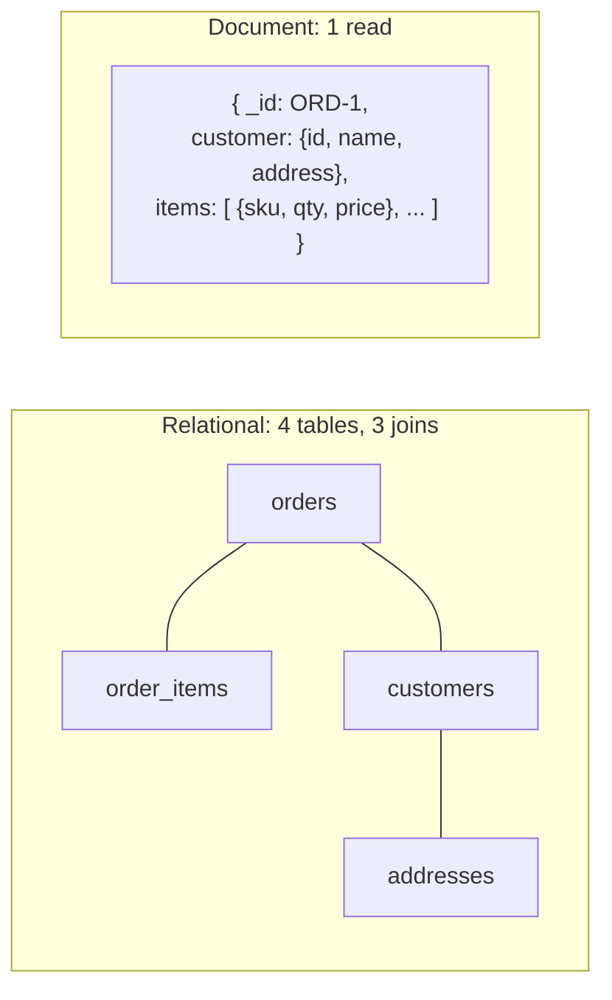

## 3.4 Variants

| Variant | Examples |
|---|---|
| General-purpose document DB | MongoDB, Couchbase |
| Managed, serverless, multi-region | Cosmos DB, Firestore, DynamoDB (as a document store) |
| Mobile/offline sync | Couchbase Lite, Firestore, Realm |
| JSON inside a relational DB | PostgreSQL `jsonb` with GIN indexes, MySQL `JSON` columns |

## 3.5 Complete Java Example - Embedding, Nested Queries and Schema Versions

```java
import java.util.ArrayList;
import java.util.LinkedHashMap;
import java.util.List;
import java.util.Map;
import java.util.function.Predicate;

// Document store (MongoDB-like): each record is a self-contained JSON-like tree. Read the whole aggregate in ONE lookup.
public class DocumentStoreDemo {
    @SuppressWarnings("unchecked")
    static Object path(Map<String, Object> doc, String dotted) {              // "customer.address.city"
        Object cur = doc;
        for (String part : dotted.split("\\.")) { if (!(cur instanceof Map)) return null; cur = ((Map<String, Object>) cur).get(part); }
        return cur;
    }

    static Map<String, Object> m(Object... kv) {
        Map<String, Object> map = new LinkedHashMap<>();
        for (int i = 0; i < kv.length; i += 2) map.put((String) kv[i], kv[i + 1]);
        return map;
    }

    public static void main(String[] args) {
        List<Map<String, Object>> orders = new ArrayList<>();
        // EMBEDDED: items and shipping address live inside the order (read together, written together)
        orders.add(m("_id", "ORD-1", "schemaVersion", 2, "status", "SHIPPED",
                "customer", m("id", "C1", "name", "Asha", "address", m("city", "Pune", "pin", "411001")),
                "items", List.of(m("sku", "BOOK-1", "qty", 2, "price", 450), m("sku", "PEN-9", "qty", 1, "price", 40))));
        orders.add(m("_id", "ORD-2", "schemaVersion", 2, "status", "NEW",
                "customer", m("id", "C2", "name", "Ravi", "address", m("city", "Delhi", "pin", "110001")),
                "items", List.of(m("sku", "LAMP-3", "qty", 1, "price", 1200)), "giftWrap", true));    // extra field: no migration needed
        // An OLD document written before "customer" was nested (schema version 1)
        orders.add(m("_id", "ORD-0", "schemaVersion", 1, "status", "DELIVERED", "customerName", "Neha", "city", "Pune",
                "items", List.of(m("sku", "BOOK-1", "qty", 1, "price", 450))));

        System.out.println("1 lookup returns the whole order: " + orders.get(0));

        Predicate<Map<String, Object>> inPune = d -> "Pune".equals(
                ((int) d.get("schemaVersion")) >= 2 ? path(d, "customer.address.city") : d.get("city"));   // read old + new shapes
        System.out.println("orders shipped to Pune (both schema versions): " + orders.stream().filter(inPune).map(d -> d.get("_id")).toList());

        @SuppressWarnings("unchecked")
        long total = ((List<Map<String, Object>>) orders.get(0).get("items")).stream()
                .mapToLong(i -> (int) i.get("qty") * (int) i.get("price")).sum();
        System.out.println("ORD-1 total computed from embedded items: " + total);

        // REFERENCING: when Asha changes her name, every embedded copy is now stale
        System.out.println("trade-off: customer name is COPIED into each order (fast reads); renaming a customer"
                + " means updating " + orders.stream().filter(d -> "C1".equals(path(d, "customer.id"))).count()
                + "+ documents, or storing only customer.id and doing a second lookup");
    }
}
```

**Output:**
```
1 lookup returns the whole order: {_id=ORD-1, schemaVersion=2, status=SHIPPED, customer={id=C1, name=Asha, address={city=Pune, pin=411001}}, items=[{sku=BOOK-1, qty=2, price=450}, {sku=PEN-9, qty=1, price=40}]}
orders shipped to Pune (both schema versions): [ORD-1, ORD-0]
ORD-1 total computed from embedded items: 940
trade-off: customer name is COPIED into each order (fast reads); renaming a customer means updating 1+ documents, or storing only customer.id and doing a second lookup
```

**What to notice:**
- `giftWrap` exists only in ORD-2: no `ALTER TABLE` needed.
- Old documents (`schemaVersion: 1`) and new ones live side by side. Your code must read **both shapes**, or migrate old documents lazily on read, or with a background job. "Schemaless" really means "**the schema lives in your code**".
- Embedding makes the order read cheap, but copying the customer's name means renames must update many documents.

## 3.6 MongoDB with Spring Data

```java
@Document("orders")
@CompoundIndex(def = "{'customer.id': 1, 'createdAt': -1}")       // "my recent orders" query
public record Order(@Id String id, int schemaVersion, String status, CustomerRef customer,
                    List<OrderItem> items, Instant createdAt) {}
public record CustomerRef(String id, String name, Address address) {}  // extended reference: id + display fields
public record OrderItem(String sku, int qty, long pricePaise) {}

interface OrderRepository extends MongoRepository<Order, String> {
    List<Order> findByCustomerIdOrderByCreatedAtDesc(String customerId, Pageable page);   // uses the compound index
    @Query("{ 'customer.address.city': ?0, 'status': 'SHIPPED' }")
    List<Order> shippedTo(String city);
}

// Atomic in-place update of one document: no read-modify-write race
mongoTemplate.updateFirst(
        Query.query(Criteria.where("_id").is("ORD-1").and("status").is("NEW")),
        new Update().set("status", "PAID").push("history", new StatusChange("PAID", Instant.now())),
        Order.class);

// Aggregation pipeline: revenue per city
Aggregation agg = Aggregation.newAggregation(
        Aggregation.unwind("items"),
        Aggregation.project().and("customer.address.city").as("city").andExpression("items.qty * items.pricePaise").as("line"),
        Aggregation.group("city").sum("line").as("revenue"));
```

## 3.7 Pros and Cons

| Pros | Cons |
|---|---|
| Whole aggregate in one read/write; natural fit for JSON and objects | Joins (`$lookup`) are limited and slower than SQL joins |
| Flexible schema, easy evolution | Duplicated data must be kept in sync by you |
| Rich queries and secondary indexes (unlike pure key-value) | Multi-document transactions are costlier; design to avoid them |
| Built-in replication and sharding | "Schemaless" can become "schema chaos" without validation |

## 3.8 Pitfalls, Interview Questions and Cheat Sheet

**Common pitfalls**
- **Modelling it like SQL** (one collection per table, references everywhere) → many round trips, no benefit.
- **Unbounded arrays** (all comments inside a post) → huge documents, 16 MB limit, slow updates. Use a separate collection or bucketing.
- **No schema validation**: use JSON Schema validation in MongoDB, and a `schemaVersion` field.
- **Poor shard key** (monotonic `_id` or low-cardinality `country`) → hot shard.

**Interview questions**
1. *When would you choose MongoDB over PostgreSQL?* → Aggregate-oriented reads/writes, highly variable attributes, rapid schema evolution, horizontal scale needs; not when you need complex joins and multi-entity transactions everywhere.
2. *Embed or reference?* → Embed if read together, owned, and bounded; reference if shared, independently updated, or unbounded; extended reference for display fields.
3. *Is MongoDB ACID?* → Single-document operations are atomic; multi-document transactions are supported (replica sets and sharded clusters) but should be the exception.
4. *How do you handle schema changes in a document DB?* → Version field, code that reads old and new shapes, lazy migration on read/write or a background migration, validation rules.

**Cheat sheet**
```
Model        design around reads: embed (owned, bounded) | reference (shared, unbounded) | extended reference
Atomicity    one document = atomic; multi-doc transactions are the exception
Schema       lives in code: schemaVersion + validation + lazy migration
Watch        unbounded arrays, 16 MB limit, SQL-style modelling, bad shard keys
Spring       @Document, MongoRepository, MongoTemplate updates, Aggregation
```

### 📘 Terms Explained

| Term | Meaning |
|---|---|
| **Document** | A self-contained record, usually JSON, that can contain nested objects and arrays |
| **Collection** | A group of documents (similar to a table) |
| **BSON** | Binary JSON: MongoDB's storage format, with extra types like dates and decimals |
| **Embedding / referencing** | Storing related data inside the document / storing only its ID |
| **Extended reference** | Keeping a reference plus a few copied fields for display |
| **Multikey index** | A MongoDB index on an array field, with one entry per element |
| **Replica set** | A group of MongoDB servers holding copies of the same data, with one primary |
| **Aggregation pipeline** | MongoDB's staged query processing (`$match`, `$unwind`, `$group`...) |
| **EAV** | Entity-Attribute-Value: a SQL workaround that stores attributes as rows; hard to query |
| **Shard key** | Field used to distribute documents across shards |

---

# 4. Wide-Column Stores (Column-Family Stores)

## 4.1 What is a Wide-Column Store?

A **wide-column** (or **column-family**) store organises data into **partitions**. Each partition is identified by a **partition key** and holds many rows **sorted by a clustering key**. A partition can be very "wide" (millions of rows, e.g. every reading of one sensor). Examples: **Apache Cassandra**, **ScyllaDB**, **HBase**, **Google Bigtable**, **Azure Cosmos DB (Cassandra API)**, **Amazon Keyspaces**.

> **Not the same as a columnar database.** "Wide-column" (Cassandra) is about partitioned, sorted rows for fast writes and key lookups. "Columnar" (ClickHouse, Redshift, BigQuery, Parquet) stores each column separately for fast analytics scans.

**Simple analogy:** A filing cabinet with one drawer per sensor (partition). Inside each drawer, the papers are always kept in date order (clustering key). Finding "sensor 1, readings after 9:05" is instant: open one drawer and start at the right page. Finding "all readings above 22°C" means opening every drawer.

## 4.2 Why Do We Need It?

- **Write-heavy, huge data:** IoT telemetry, click streams, messaging history, activity feeds. Hundreds of thousands of writes per second.
- **Linear scaling:** double the nodes → roughly double the throughput. No single primary: every node accepts writes (masterless, Dynamo-style).
- **Multi-data-centre** replication with tunable consistency.

## 4.3 How It Works

**Data model: query-first design.** You design **one table per query**:

```sql
-- CQL (Cassandra Query Language)
CREATE TABLE readings_by_sensor (
    sensor_id    text,
    day          date,               -- part of the partition key to keep partitions bounded ("bucketing")
    reading_time timestamp,
    temperature  double,
    PRIMARY KEY ((sensor_id, day), reading_time)    -- (partition key), clustering key
) WITH CLUSTERING ORDER BY (reading_time DESC);

SELECT * FROM readings_by_sensor WHERE sensor_id = 's1' AND day = '2026-10-30' AND reading_time >= '2026-10-30 09:05';
```

**Storage engine: the LSM tree (log-structured merge tree).**
1. A write goes to the **commit log** (for durability) and the in-memory **memtable** (sorted). Done: writes never read or update in place, which is why they're so fast.
2. A full memtable is **flushed** to disk as an immutable, sorted **SSTable**.
3. A read checks the memtable, then SSTables from newest to oldest (Bloom filters skip SSTables that can't contain the key, see [Section 11](#11-probabilistic-data-structures-bloom-filter-count-min-sketch-hyperloglog-interview-imp---java)).
4. **Compaction** merges SSTables in the background, keeping the newest value per key and removing deleted data.
5. A delete writes a **tombstone** marker, because SSTables are immutable. Tombstones are removed by compaction after `gc_grace_seconds`.

**Distribution:** partition key → hash → token on a **consistent-hashing ring** → replicas on N nodes (replication factor). Each read/write picks a **consistency level** (`ONE`, `QUORUM`, `LOCAL_QUORUM`, `ALL`). With `R + W > RF` (e.g. QUORUM writes + QUORUM reads with RF=3), reads see the latest write. See [07_Distributed_Systems_Pattern.md](../03_System_Design/07_Distributed_Systems_Pattern.md).

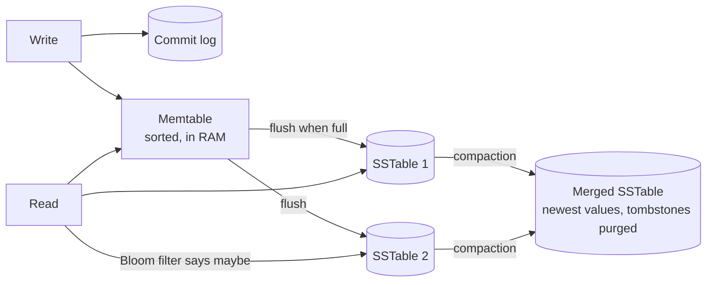

## 4.4 Variants

| Store | Notes |
|---|---|
| **Cassandra** | Masterless, tunable consistency, CQL, Java-based |
| **ScyllaDB** | Cassandra-compatible rewrite in C++, shard-per-core |
| **HBase** | On HDFS, strongly consistent per row, region servers with a master |
| **Bigtable** | Google's managed original; HBase API compatible |
| **LSM elsewhere** | RocksDB, LevelDB, Kafka Streams state stores and many NewSQL databases use LSM trees too |

## 4.5 Complete Java Example - Partitions, Clustering Order and an LSM Tree

Row keys are `partition|clustering`, so a `TreeMap` keeps each sensor's rows together and in time order, just like a partition.

```java
import java.util.ArrayList;
import java.util.List;
import java.util.Map;
import java.util.NavigableMap;
import java.util.TreeMap;

// Wide-column store (Cassandra-like):
//  - data model: partition key decides the node; clustering key keeps rows SORTED inside the partition
//  - storage: LSM tree - writes go to an in-memory memtable, flushed as immutable sorted SSTables; deletes are tombstones
public class WideColumnDemo {
    static final String TOMBSTONE = "<deleted>";
    static TreeMap<String, String> memtable = new TreeMap<>();
    static final List<TreeMap<String, String>> sstables = new ArrayList<>();   // newest last

    static void write(String key, String value) { memtable.put(key, value); if (memtable.size() >= 4) flush(); }
    static void flush() { sstables.add(memtable); System.out.println("    flush memtable -> SSTable #" + sstables.size() + " " + memtable.keySet()); memtable = new TreeMap<>(); }

    static String read(String key) {                                          // newest data wins: memtable, then SSTables newest-first
        String v = memtable.get(key); int looked = 1;
        for (int i = sstables.size() - 1; v == null && i >= 0; i--) { v = sstables.get(i).get(key); looked++; }
        System.out.println("    read " + key + " checked " + looked + " structures");
        return TOMBSTONE.equals(v) ? null : v;
    }

    static void compact() {                                                   // merge all SSTables, keep newest value, drop tombstones
        TreeMap<String, String> merged = new TreeMap<>();
        for (TreeMap<String, String> t : sstables) merged.putAll(t);
        merged.values().removeIf(TOMBSTONE::equals);
        sstables.clear(); sstables.add(merged);
        System.out.println("    compaction -> 1 SSTable, " + merged.size() + " live rows");
    }

    public static void main(String[] args) {
        // Table: readings_by_sensor  PRIMARY KEY ((sensor_id), reading_time) WITH CLUSTERING ORDER BY (reading_time DESC)
        // Row key = partition|clustering. Inside a partition rows are sorted by time.
        String[][] writes = {{"s1|09:00", "21.5"}, {"s2|09:00", "30.1"}, {"s1|09:05", "21.9"}, {"s1|09:10", "22.4"},
                             {"s2|09:05", "30.4"}, {"s1|09:15", "22.8"}, {"s1|09:05", "21.7"}, {"s2|09:00", TOMBSTONE}};
        for (String[] w : writes) write(w[0], w[1]);

        System.out.println("s1|09:05 = " + read("s1|09:05") + "   (updated value, found in a newer structure)");
        System.out.println("s2|09:00 = " + read("s2|09:00") + "   (tombstone hides the old value)");

        compact();
        NavigableMap<String, String> all = new TreeMap<>(sstables.get(0)); all.putAll(memtable);
        // Efficient query: one partition, a range of the clustering key -> a contiguous slice, no scan of other sensors
        System.out.println("SELECT * WHERE sensor_id='s1' AND reading_time >= '09:05' -> " + all.subMap("s1|09:05", true, "s1|~", false));
        System.out.println("A query by value (temperature > 22) has no key to use: Cassandra refuses it without ALLOW FILTERING");
    }
}
```

**Output:**
```
    flush memtable -> SSTable #1 [s1|09:00, s1|09:05, s1|09:10, s2|09:00]
    flush memtable -> SSTable #2 [s1|09:05, s1|09:15, s2|09:00, s2|09:05]
    read s1|09:05 checked 2 structures
s1|09:05 = 21.7   (updated value, found in a newer structure)
    read s2|09:00 checked 2 structures
s2|09:00 = null   (tombstone hides the old value)
    compaction -> 1 SSTable, 5 live rows
SELECT * WHERE sensor_id='s1' AND reading_time >= '09:05' -> {s1|09:05=21.7, s1|09:10=22.4, s1|09:15=22.8}
A query by value (temperature > 22) has no key to use: Cassandra refuses it without ALLOW FILTERING
```

**What to notice:**
- `s1|09:05` was written twice. Both versions exist on disk until compaction; the **newest wins** on read.
- The delete of `s2|09:00` is a **tombstone** that hides the older value until compaction removes both.
- The range query is a **contiguous slice** of one partition. A query on a non-key column has no slice to read.

## 4.6 Cassandra with Spring Data

```java
@Table("readings_by_sensor")
public record Reading(@PrimaryKey ReadingKey key, double temperature) {}

@PrimaryKeyClass
public record ReadingKey(
        @PrimaryKeyColumn(name = "sensor_id", type = PrimaryKeyType.PARTITIONED, ordinal = 0) String sensorId,
        @PrimaryKeyColumn(name = "day", type = PrimaryKeyType.PARTITIONED, ordinal = 1) LocalDate day,
        @PrimaryKeyColumn(name = "reading_time", type = PrimaryKeyType.CLUSTERED, ordinal = 2,
                          ordering = Ordering.DESCENDING) Instant readingTime) {}

interface ReadingRepository extends CassandraRepository<Reading, ReadingKey> {
    List<Reading> findByKeySensorIdAndKeyDayAndKeyReadingTimeGreaterThanEqual(String sensorId, LocalDate day, Instant from);
}
```

```yaml
spring:
  cassandra:
    keyspace-name: telemetry
    contact-points: cassandra-1:9042,cassandra-2:9042
    local-datacenter: dc1
    request:
      consistency: local_quorum
```

## 4.7 Pros and Cons

| Pros | Cons |
|---|---|
| Huge write throughput (append-only LSM) | Queries must follow the key design; no joins, limited secondary indexes |
| Linear horizontal scaling, no single primary | Data duplicated across query tables; you keep them in sync |
| Multi-region, tunable consistency, high availability | Deletes are tricky (tombstones); updates are new writes |
| Efficient time-ordered range reads within a partition | Eventual consistency by default; lightweight transactions (Paxos) are slow |

## 4.8 Pitfalls, Interview Questions and Cheat Sheet

**Common pitfalls**
- **Unbounded partitions** (all readings of a sensor forever in one partition) → huge partitions. Add a time bucket (`day`) to the partition key.
- **Modelling tables like SQL and filtering** with `ALLOW FILTERING` → full cluster scans.
- **Tombstone storms:** many deletes (or TTL expiry) in one partition make reads scan thousands of tombstones.
- **Using it for small data or ad-hoc analytics**: it's built for scale and known queries.

**Interview questions**
1. *How does Cassandra achieve fast writes?* → Commit log append + in-memory memtable, no read-before-write, immutable SSTables, background compaction.
2. *What are partition and clustering keys?* → Partition key → which nodes store the data; clustering key → sort order of rows inside the partition, enabling range queries.
3. *How do you model "messages in a chat room, newest first"?* → `PRIMARY KEY ((room_id, month), sent_at DESC)` with time bucketing.
4. *What is a tombstone and why can it hurt?* → A delete marker in immutable storage; reads must skip them until compaction; too many slow reads down or fail them.
5. *How does tunable consistency work?* → Per-request levels; `R + W > RF` gives read-your-writes (e.g. QUORUM/QUORUM with RF=3).

**Cheat sheet**
```
Model     one table per query; PRIMARY KEY ((partition), clustering...); bucket by time
Engine    commit log + memtable -> SSTables -> compaction; deletes = tombstones
Scale     consistent-hash ring, RF replicas, consistency ONE/QUORUM/ALL, R + W > RF
Avoid     ALLOW FILTERING, unbounded partitions, delete-heavy patterns, ad-hoc queries
```

### 📘 Terms Explained

| Term | Meaning |
|---|---|
| **Wide-column store** | Database storing partitions of sorted rows, scaled by partition key |
| **Partition key** | The part of the primary key that decides which node(s) store the data |
| **Clustering key** | The part of the primary key that sorts rows within a partition |
| **LSM tree** | Log-Structured Merge tree: write to memory, flush sorted files, merge them later |
| **Memtable / SSTable** | In-memory sorted write buffer / immutable Sorted String Table file on disk |
| **Compaction** | Background merging of SSTables to remove old versions and deleted data |
| **Tombstone** | A marker recording that data was deleted |
| **Replication factor (RF)** | How many nodes keep a copy of each partition |
| **Consistency level** | How many replicas must answer for a read/write to succeed |
| **Bucketing** | Adding a time unit (day, month) to the partition key to keep partitions bounded |
| **Columnar database** | A different thing: stores each column separately for analytics (ClickHouse, BigQuery) |

---

# 5. Graph Databases (Interview Imp - Java)

## 5.1 What is a Graph Database?

A **graph database** stores **nodes** (things: users, products, accounts) and **relationships** (edges: FOLLOWS, BOUGHT, TRANSFERRED_TO) as first-class data, both with properties. Queries **traverse** relationships. Examples: **Neo4j** (query language **Cypher**), **Amazon Neptune** (Gremlin, openCypher, SPARQL), **JanusGraph**, **ArangoDB**, **TigerGraph**. The ISO standard graph query language **GQL** (2024) is largely based on Cypher.

**Simple analogy:** A relational DB is a phone book: to find your friend's friends you look each name up again in the index. A graph DB is a map of strings tied between people: from you, you just follow the strings.

## 5.2 Why Do We Need It?

| Question | Relational | Graph |
|---|---|---|
| Friends of friends of friends | 3 self-joins on a huge `follows` table | Follow pointers 3 hops |
| Shortest path between two accounts | Recursive CTE, slow on large data | Built-in `shortestPath` |
| Fraud rings (accounts sharing phone/device/address) | Many joins, hard to express | Pattern match on a subgraph |
| Recommendations ("people who bought X also bought") | Heavy aggregation joins | Traversal + count |
| Knowledge graphs, access-control hierarchies, network topology | Awkward | Natural |

## 5.3 How It Works

- **Index-free adjacency** (Neo4j): each node stores direct references to its relationships, so a hop costs about the same whether the graph has 1,000 or 1 billion nodes. A SQL join's cost grows with the tables' (index) size.
- Queries describe **patterns**:

```cypher
// People asha may know: followed by people she follows, but not followed by her
MATCH (a:User {name:'asha'})-[:FOLLOWS]->(:User)-[:FOLLOWS]->(fof:User)
WHERE NOT (a)-[:FOLLOWS]->(fof) AND fof <> a
RETURN fof.name, count(*) AS mutual ORDER BY mutual DESC;

// Fraud ring: accounts linked through shared devices or phone numbers, up to 4 hops
MATCH ring = (a:Account)-[:USES_DEVICE|HAS_PHONE*2..4]-(b:Account)
WHERE a.flagged = true RETURN ring;
```

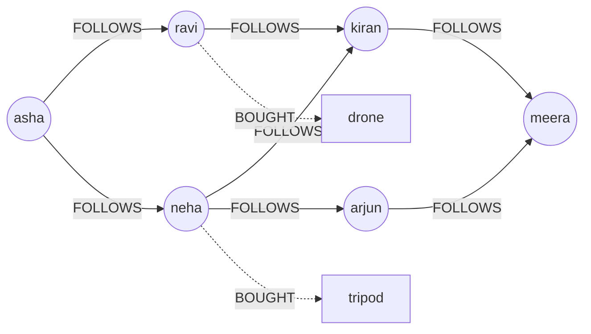

## 5.4 Variants

| Variant | Examples | Notes |
|---|---|---|
| **Property graph** | Neo4j, Neptune, JanusGraph | Nodes and edges with key-value properties; Cypher/Gremlin |
| **RDF triple store** | GraphDB, Neptune (SPARQL), Apache Jena | Subject-predicate-object triples; semantic web, ontologies |
| **Graph in a relational DB** | PostgreSQL + Apache AGE, recursive CTEs, SQL/PGQ (SQL:2023) | Good for occasional graph queries |
| **Graph analytics engines** | Spark GraphX, Neo4j Graph Data Science | PageRank, community detection over the whole graph (batch) |

## 5.5 Complete Java Example - Friends of Friends, Recommendations, Shortest Path

```java
import java.util.ArrayDeque;
import java.util.ArrayList;
import java.util.Deque;
import java.util.LinkedHashMap;
import java.util.LinkedHashSet;
import java.util.List;
import java.util.Map;
import java.util.Set;
import java.util.TreeMap;

// Graph database idea: relationships are stored as direct pointers ("index-free adjacency"),
// so following them costs per hop, not per table size. Typical queries: friends-of-friends, shortest path, recommendations.
public class GraphDemo {
    static final Map<String, List<String>> follows = new LinkedHashMap<>();
    static final Map<String, List<String>> bought = new LinkedHashMap<>();

    static void edge(Map<String, List<String>> g, String a, String b) { g.computeIfAbsent(a, k -> new ArrayList<>()).add(b); }

    static List<String> shortestPath(String from, String to) {
        Map<String, String> parent = new LinkedHashMap<>(); Deque<String> q = new ArrayDeque<>(List.of(from)); parent.put(from, null);
        while (!q.isEmpty()) {
            String cur = q.poll();
            if (cur.equals(to)) break;
            for (String n : follows.getOrDefault(cur, List.of())) if (!parent.containsKey(n)) { parent.put(n, cur); q.add(n); }
        }
        List<String> path = new ArrayList<>();
        for (String at = to; at != null; at = parent.get(at)) path.add(0, at);
        return path.get(0).equals(from) ? path : List.of();
    }

    public static void main(String[] args) {
        String[][] f = {{"asha", "ravi"}, {"asha", "neha"}, {"ravi", "kiran"}, {"neha", "kiran"}, {"neha", "arjun"}, {"kiran", "meera"}, {"arjun", "meera"}};
        for (String[] e : f) edge(follows, e[0], e[1]);
        String[][] b = {{"ravi", "drone"}, {"neha", "tripod"}, {"kiran", "drone"}, {"arjun", "camera"}, {"meera", "drone"}, {"asha", "camera"}};
        for (String[] e : b) edge(bought, e[0], e[1]);

        // Friends of friends (2 hops), excluding people asha already follows
        Set<String> direct = new LinkedHashSet<>(follows.get("asha"));
        Set<String> fof = new LinkedHashSet<>();
        for (String d : direct) for (String x : follows.getOrDefault(d, List.of())) if (!direct.contains(x) && !x.equals("asha")) fof.add(x);
        System.out.println("people asha may know (2 hops): " + fof);

        // "People you follow bought..." recommendation, ranked by how many of them bought it
        Map<String, Integer> score = new TreeMap<>();
        for (String d : direct) for (String p : bought.getOrDefault(d, List.of())) if (!bought.get("asha").contains(p)) score.merge(p, 1, Integer::sum);
        System.out.println("recommended for asha: " + score);

        System.out.println("shortest path asha -> meera: " + shortestPath("asha", "meera"));
        System.out.println("SQL equivalent of a 3-hop path = 3 self-JOINs on a follows table; each extra hop adds a JOIN.");
        System.out.println("Cypher: MATCH p = shortestPath((a:User {name:'asha'})-[:FOLLOWS*..5]->(m:User {name:'meera'})) RETURN p");
    }
}
```

**Output:**
```
people asha may know (2 hops): [kiran, arjun]
recommended for asha: {drone=1, tripod=1}
shortest path asha -> meera: [asha, ravi, kiran, meera]
SQL equivalent of a 3-hop path = 3 self-JOINs on a follows table; each extra hop adds a JOIN.
Cypher: MATCH p = shortestPath((a:User {name:'asha'})-[:FOLLOWS*..5]->(m:User {name:'meera'})) RETURN p
```

**What to notice:** every query starts at **one node** and walks outwards: the work depends on the neighbourhood size, not on how many users exist. That's the property graph databases are built around. The shortest path is a **breadth-first search (BFS)**.

## 5.6 Neo4j with Spring Data

```java
@Node("User")
public class User {
    @Id String name;
    @Relationship(type = "FOLLOWS", direction = Relationship.Direction.OUTGOING)
    Set<User> follows = new HashSet<>();
}

interface UserRepository extends Neo4jRepository<User, String> {
    @Query("""
           MATCH (a:User {name: $name})-[:FOLLOWS]->(:User)-[:FOLLOWS]->(fof:User)
           WHERE NOT (a)-[:FOLLOWS]->(fof) AND fof <> a
           RETURN fof.name AS name, count(*) AS mutual ORDER BY mutual DESC LIMIT 10""")
    List<Suggestion> suggestions(String name);
}
public record Suggestion(String name, long mutual) {}
```

```yaml
spring:
  neo4j:
    uri: bolt://neo4j:7687
    authentication: { username: neo4j, password: ${NEO4J_PASSWORD} }
```

## 5.7 Pros and Cons

| Pros | Cons |
|---|---|
| Multi-hop queries are fast and easy to express | Whole-dataset aggregations (sum of all orders) are better in SQL/columnar stores |
| Flexible: add new relationship types any time | Sharding a graph is hard (relationships cross partitions) |
| Natural for fraud, recommendations, networks, permissions | Smaller ecosystem and skills pool than SQL |
| Visual, intuitive data model | Supernodes (a celebrity with 50M followers) slow traversals |

## 5.8 Pitfalls, Interview Questions and Cheat Sheet

**Common pitfalls**
- **Using a graph DB as the main store for non-graph data** (orders, invoices).
- **Unbounded variable-length patterns** (`[:FOLLOWS*]`) → explosive traversals. Always cap the depth.
- **Supernodes**: model them differently (e.g. relationship buckets, or skip them in traversals).
- **No index on the start node's lookup property** (`name`, `id`) → every query starts with a full scan.

**Interview questions**
1. *When would you use a graph database?* → When the questions are about relationships and paths: social graphs, recommendations, fraud rings, knowledge graphs, network/IAM hierarchies.
2. *Why is a graph DB faster than SQL for multi-hop queries?* → Index-free adjacency: each hop follows stored pointers; SQL repeats index lookups/joins per hop, and cost grows with table size and depth.
3. *How would you detect fraud rings?* → Model accounts, devices, phones, addresses as nodes; find connected components or short paths between flagged and new accounts.
4. *What's a supernode problem?* → A node with a huge number of relationships makes any traversal through it expensive.

**Cheat sheet**
```
Model    nodes + relationships (+ properties); property graph (Cypher/Gremlin) or RDF (SPARQL)
Fast at  k-hop neighbours, shortest path, pattern matching, recommendations, fraud rings
Slow at  global aggregations, sharding, supernodes
Rules    index start-node properties, cap path depth, keep the system of record elsewhere
Java     Spring Data Neo4j (@Node, @Relationship, @Query Cypher)
```

### 📘 Terms Explained

| Term | Meaning |
|---|---|
| **Graph database** | Database storing data as nodes and relationships, optimised for traversals |
| **Node / relationship (edge)** | An entity / a typed, directed connection between two entities |
| **Property graph** | Graph model where nodes and relationships carry key-value properties |
| **Cypher / Gremlin / SPARQL / GQL** | Graph query languages (Neo4j / Apache TinkerPop / RDF / ISO standard) |
| **Index-free adjacency** | Each node directly references its neighbours, so hops don't need index lookups |
| **Traversal** | Walking from node to node along relationships |
| **BFS** | Breadth-first search: explore all neighbours at distance 1, then 2, etc.; finds shortest paths in unweighted graphs |
| **Supernode** | A node with an extremely high number of relationships |
| **Recursive CTE** | SQL `WITH RECURSIVE` query, the relational way to walk hierarchies and graphs |

---

# 6. Time-Series Databases

## 6.1 What is a Time-Series Database?

A **time-series database (TSDB)** is optimised for **timestamped measurements**: CPU usage every 10 seconds, stock prices, sensor readings, request latency. Each data point is `(series identity + labels, timestamp, value)`. Examples: **Prometheus**, **InfluxDB**, **TimescaleDB** (PostgreSQL extension), **VictoriaMetrics**, **QuestDB**, **Amazon Timestream**, **Apache Druid** (analytics).

**Simple analogy:** A heart monitor's paper roll. Values are always added at the end, nobody edits yesterday's line, and the doctor usually asks "what did the last hour look like?", not "find the reading with ID 4,812,337".

## 6.2 Why Do We Need It?

| Time-series workload | Why a general DB struggles |
|---|---|
| Millions of points per second, append-only | B-tree index updates per row are expensive |
| Queries over time windows with aggregation (avg per 5 min) | Full scans of huge tables |
| Old data needed only in summary form | Manual deletion and rollup jobs |
| Storage cost | Timestamps and values compress extremely well if stored column-wise |

## 6.3 How It Works

1. **Series and labels:** `http_requests_total{service="orders", status="500"}`. Each unique label combination is its own series. The number of series is the **cardinality**: keep it bounded (no user IDs in labels; see [10_Observability_Pattern.md](../03_System_Design/10_Observability_Pattern.md#2-metrics-pattern-interview-imp---java)).
2. **Time-partitioned storage:** data is written into time **blocks/chunks** (Prometheus: 2-hour blocks; TimescaleDB: hypertable chunks). Recent blocks are hot, old ones are compacted and can be dropped whole.
3. **Compression:** timestamps with **delta-of-delta** encoding (regular intervals → mostly zeros) and values with **XOR** encoding (Facebook's Gorilla paper). Typically ~1-2 bytes per sample instead of 16.
4. **Downsampling / rollups:** pre-aggregate raw data into coarser resolution (min/avg/max per 10 min, per hour) via continuous aggregates or recording rules.
5. **Retention policies:** drop raw data after N days, keep rollups for longer.

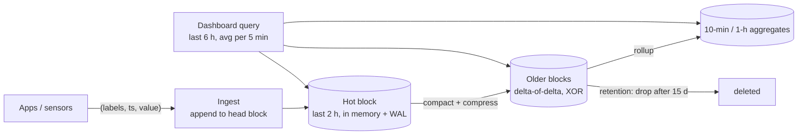

## 6.4 Variants

| Variant | Examples | Notes |
|---|---|---|
| **Pull-based metrics TSDB** | Prometheus (+ Thanos, Mimir, VictoriaMetrics for long-term) | Scrapes `/metrics`; PromQL |
| **Push-based TSDB** | InfluxDB, Timestream | Line protocol, IoT-friendly |
| **SQL time-series** | TimescaleDB, QuestDB | Full SQL + joins with business data |
| **Real-time analytics (OLAP)** | Apache Druid, ClickHouse, Apache Pinot | Event analytics with time as the main dimension |

## 6.5 Complete Java Example - Rollups, Retention and Timestamp Compression

```java
import java.util.ArrayList;
import java.util.List;
import java.util.Map;
import java.util.TreeMap;

// Time-series database ideas: append-only by time, downsampling (rollups), retention, and compression of timestamps.
public class TimeSeriesDemo {
    public static void main(String[] args) {
        long start = 1_761_800_000L;                     // fixed epoch seconds
        List<long[]> raw = new ArrayList<>();            // [timestamp, value] - CPU % every 10 s for 1 hour
        long seed = 7;
        for (int i = 0; i < 360; i++) {
            seed = seed * 6364136223846793005L + 1442695040888963407L;
            long jitter = (seed >>> 60);                  // 0..15
            raw.add(new long[]{start + i * 10L, 40 + (i / 60) * 5 + jitter});   // load climbs every 10 minutes
        }

        // Downsampling: 10-second raw -> 10-minute rollup (min/avg/max), the shape dashboards actually need
        Map<Long, long[]> rollup = new TreeMap<>();      // bucket -> [min, max, sum, count]
        for (long[] p : raw) {
            long bucket = (p[0] - start) / 600;
            long[] r = rollup.computeIfAbsent(bucket, k -> new long[]{Long.MAX_VALUE, Long.MIN_VALUE, 0, 0});
            r[0] = Math.min(r[0], p[1]); r[1] = Math.max(r[1], p[1]); r[2] += p[1]; r[3]++;
        }
        System.out.println("raw points: " + raw.size() + " -> 10-min rollups: " + rollup.size());
        rollup.forEach((k, r) -> System.out.printf("  minutes %02d-%02d  min=%d avg=%.1f max=%d%n", k * 10, k * 10 + 9, r[0], (double) r[2] / r[3], r[1]));

        // Delta-of-delta timestamp encoding (Gorilla / Prometheus style): regular intervals compress to almost nothing
        int zeros = 0;
        long prevDelta = 10;
        for (int i = 1; i < raw.size(); i++) { long delta = raw.get(i)[0] - raw.get(i - 1)[0]; if (delta - prevDelta == 0) zeros++; prevDelta = delta; }
        System.out.println("timestamps: " + raw.size() + " x 8 bytes = " + raw.size() * 8 + " bytes raw; delta-of-delta is 0 for "
                + zeros + " of " + (raw.size() - 1) + " -> ~1 bit each ≈ " + (8 + (zeros + 7) / 8) + " bytes");

        // Retention: keep raw for 1 day, rollups for 1 year
        System.out.println("retention policy: raw 10s points kept 1 day, 10-min rollups kept 1 year -> 60x fewer points to store long term");
    }
}
```

**Output:**
```
raw points: 360 -> 10-min rollups: 6
  minutes 00-09  min=40 avg=47.1 max=55
  minutes 10-19  min=45 avg=52.0 max=60
  minutes 20-29  min=51 avg=57.3 max=65
  minutes 30-39  min=55 avg=62.5 max=70
  minutes 40-49  min=60 avg=67.8 max=75
  minutes 50-59  min=65 avg=72.1 max=80
timestamps: 360 x 8 bytes = 2880 bytes raw; delta-of-delta is 0 for 359 of 359 -> ~1 bit each ≈ 53 bytes
retention policy: raw 10s points kept 1 day, 10-min rollups kept 1 year -> 60x fewer points to store long term
```

**What to notice:**
- 360 raw points became 6 rollup rows, and the dashboard can still see the trend (load climbing every 10 minutes) and the extremes.
- Regular 10-second timestamps make every delta-of-delta **zero**: 2,880 bytes shrink to about 53. This is why TSDBs store years of metrics cheaply.

## 6.6 Time-Series in Java / Spring

```java
// Micrometer -> Prometheus: the app exposes metrics, Prometheus stores them as time series
@Component
class CheckoutMetrics {
    private final Timer checkout;
    CheckoutMetrics(MeterRegistry registry) {
        checkout = Timer.builder("checkout.duration").tag("channel", "web")     // bounded label values only
                .publishPercentileHistogram().register(registry);
    }
    void record(Runnable work) { checkout.record(work); }
}
```

```sql
-- TimescaleDB: hypertable + continuous aggregate (rollup) + retention policy
CREATE TABLE readings (time timestamptz NOT NULL, sensor_id text NOT NULL, temperature double precision);
SELECT create_hypertable('readings', 'time');                          -- newer versions: by_range('time')

CREATE MATERIALIZED VIEW readings_10m WITH (timescaledb.continuous) AS
SELECT time_bucket('10 minutes', time) AS bucket, sensor_id,
       min(temperature) AS min_t, avg(temperature) AS avg_t, max(temperature) AS max_t
FROM readings GROUP BY bucket, sensor_id;

SELECT add_retention_policy('readings', INTERVAL '1 day');             -- raw data
SELECT add_retention_policy('readings_10m', INTERVAL '365 days');      -- rollups
```

```promql
# PromQL: p99 checkout latency over 5-minute windows
histogram_quantile(0.99, sum by (le) (rate(checkout_duration_seconds_bucket[5m])))
```

## 6.7 Pros and Cons

| Pros | Cons |
|---|---|
| Massive ingest rates, append-optimised | Updates/deletes of individual points are slow or unsupported |
| 10-20× compression | Label cardinality explosions kill performance |
| Built-in rollups, retention, time functions | Not for transactional business data |
| Fast time-window aggregations | Prometheus alone isn't long-term or highly available storage (needs Thanos/Mimir) |

## 6.8 Pitfalls, Interview Questions and Cheat Sheet

**Common pitfalls**
- **High-cardinality labels** (`user_id`, `order_id`, full URLs) → millions of series, memory explosion.
- **Keeping raw data forever** instead of rolling up.
- **Using a TSDB for event logs** that need full detail per event (use logs/OLAP stores).
- **Averages of averages** across rollups: store sum + count, not just avg, so you can re-aggregate correctly.

**Interview questions**
1. *How would you store metrics from 1 million IoT devices?* → TSDB (InfluxDB/TimescaleDB/Timestream) or wide-column with time bucketing; batched ingestion via a queue; rollups and retention; bounded labels.
2. *Why do TSDBs compress so well?* → Points are ordered by time; timestamps are regular (delta-of-delta ≈ 0) and values change slowly (XOR of consecutive floats has many zero bits); columnar storage.
3. *What is downsampling and why store min/max too?* → Lower-resolution aggregates for old data; avg alone hides spikes; keep sum/count for correct re-aggregation.
4. *What is label cardinality?* → Number of distinct series created by label combinations; each one costs memory and index space.

**Cheat sheet**
```
Point     (metric + labels, timestamp, value); series = unique label set; keep cardinality low
Storage   time blocks/chunks, delta-of-delta + XOR compression, append-only
Lifecycle raw -> rollups (min/avg/max, sum+count) -> retention drops old blocks
Tools     Prometheus(+Thanos/Mimir), InfluxDB, TimescaleDB, VictoriaMetrics; Micrometer in Java
```

### 📘 Terms Explained

| Term | Meaning |
|---|---|
| **Time series** | A sequence of values for one thing, ordered by time |
| **TSDB** | Time-Series Database |
| **Label / tag** | A key-value attribute identifying a series (`service="orders"`) |
| **Cardinality** | Number of distinct series (label combinations) |
| **Downsampling / rollup** | Storing data at a coarser time resolution as aggregates |
| **Retention policy** | Rule that deletes data older than a set age |
| **Delta-of-delta encoding** | Storing the change between consecutive time gaps; regular intervals give zeros |
| **Hypertable / chunk** | TimescaleDB's time-partitioned table / one time partition of it |
| **Continuous aggregate** | A materialized view in TimescaleDB that is refreshed incrementally |
| **PromQL** | Prometheus Query Language |

---

# 7. Search Engines (Interview Imp - Java)

## 7.1 What is a Search Engine (as a Data Store)?

A **search engine** stores documents in an **inverted index**, a map from every word (term) to the documents that contain it, so it can answer full-text queries in milliseconds and **rank** results by relevance. Examples: **Elasticsearch**, **OpenSearch** (the open-source fork), **Apache Solr** (all built on the Java library **Apache Lucene**), plus **Meilisearch**, **Typesense**, **Algolia**.

**Simple analogy:** The index at the back of a textbook. To find "photosynthesis" you don't read every page: the index lists pages 41, 87 and 203. A search engine builds that index for every word in every document, and also knows which page mentions the word the most.

## 7.2 Why Do We Need It?

| Need | SQL `LIKE '%shoes%'` | Search engine |
|---|---|---|
| Speed on millions of rows | Full table scan (leading `%` can't use a B-tree index) | Index lookup |
| "running shoes" should match "Run shoe" | No | Analyzers: lowercase, stemming, synonyms |
| Typo tolerance ("snekers") | No | Fuzzy queries (edit distance) |
| Best results first | No ranking | BM25 relevance scoring, boosting |
| Facets ("Brand: Nike (120), Adidas (98)") | Heavy GROUP BYs | Aggregations on the result set |
| Autocomplete, highlighting, geo search | Hard | Built in |

## 7.3 How It Works

1. **Analysis** (at index *and* query time): character filters → **tokenizer** (split into words) → token filters (lowercase, stop words, **stemming** `running → run`, synonyms). The same analyzer must run on both sides, or terms won't match.
2. **Inverted index:** `term → postings list [(docId, term frequency, positions)]`, stored in immutable **segments** (like SSTables) that are merged in the background.
3. **Scoring with BM25:** a document scores higher when the query term appears **often in it** (term frequency, with diminishing returns), the term is **rare across all documents** (inverse document frequency), and the document is **short** (length normalisation).
4. **Near-real-time (NRT):** new documents become searchable after a **refresh** (default every 1 s in Elasticsearch), not instantly.
5. **Distribution:** an index is split into **shards** (each a Lucene index) with **replicas**. A query is sent to all shards (scatter), and the top results are merged (gather).

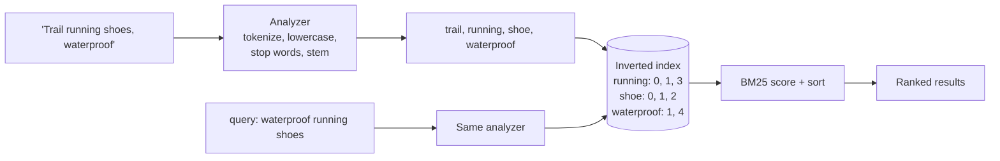

## 7.4 Variants

| Variant | Examples |
|---|---|
| Distributed search + analytics | Elasticsearch, OpenSearch, Solr |
| Developer-friendly, typo-tolerant site search | Meilisearch, Typesense, Algolia (SaaS) |
| Full-text inside the DB | PostgreSQL `tsvector` + GIN index, MySQL `FULLTEXT` |
| Vector / semantic search | Elasticsearch/OpenSearch k-NN, pgvector, dedicated vector DBs; often combined with BM25 ("hybrid search") |
| Log search | Elasticsearch/OpenSearch (ELK), Loki (labels only, cheaper) |

## 7.5 Complete Java Example - Analyzer, Inverted Index and BM25 Ranking

```java
import java.util.ArrayList;
import java.util.Comparator;
import java.util.LinkedHashMap;
import java.util.List;
import java.util.Map;
import java.util.Set;
import java.util.TreeMap;
import java.util.TreeSet;

// Search engine core (Lucene / Elasticsearch / OpenSearch): analyzer -> inverted index -> BM25 relevance ranking
public class SearchEngineDemo {
    static final Set<String> STOP = Set.of("the", "a", "for", "and", "with", "of");
    static final Map<String, Map<Integer, Integer>> index = new TreeMap<>();     // term -> (docId -> term frequency)
    static final Map<Integer, Integer> docLength = new LinkedHashMap<>();
    static final List<String> docs = new ArrayList<>();

    static List<String> analyze(String text) {                                    // lowercase, split, drop stop words, crude stemming
        List<String> out = new ArrayList<>();
        for (String t : text.toLowerCase().split("[^a-z0-9]+")) {
            if (t.isEmpty() || STOP.contains(t)) continue;
            out.add(t.endsWith("s") && !t.endsWith("ss") ? t.substring(0, t.length() - 1) : t);   // shoes -> shoe, boots -> boot
        }
        return out;
    }

    static void add(String text) {
        int id = docs.size(); docs.add(text);
        List<String> terms = analyze(text); docLength.put(id, terms.size());
        for (String t : terms) index.computeIfAbsent(t, k -> new TreeMap<>()).merge(id, 1, Integer::sum);
    }

    static List<String> search(String query) {
        double k1 = 1.2, b = 0.75, avgLen = docLength.values().stream().mapToInt(Integer::intValue).average().orElse(1);
        Map<Integer, Double> scores = new TreeMap<>();
        for (String t : analyze(query)) {
            Map<Integer, Integer> postings = index.getOrDefault(t, Map.of());
            double idf = Math.log(1 + (docs.size() - postings.size() + 0.5) / (postings.size() + 0.5));   // rare terms count more
            for (var p : new TreeMap<>(postings).entrySet()) {
                double tf = p.getValue(), len = docLength.get(p.getKey());
                scores.merge(p.getKey(), idf * tf * (k1 + 1) / (tf + k1 * (1 - b + b * len / avgLen)), Double::sum);
            }
        }
        return scores.entrySet().stream().sorted(Map.Entry.<Integer, Double>comparingByValue(Comparator.reverseOrder()).thenComparing(Map.Entry.comparingByKey()))
                .map(e -> String.format("%.2f  #%d %s", e.getValue(), e.getKey(), docs.get(e.getKey()))).toList();
    }

    public static void main(String[] args) {
        add("Running shoes for men with extra cushioning");
        add("Trail running shoes, waterproof");
        add("Leather office shoes");
        add("Running socks and running shorts for the gym");
        add("Waterproof hiking boots");

        System.out.println("analyze(\"Running Shoes for MEN\") -> " + analyze("Running Shoes for MEN"));
        System.out.println("postings 'running'    -> " + index.get("running") + "   (docId -> count)");
        System.out.println("postings 'waterproof' -> " + index.get("waterproof"));
        System.out.println("query: waterproof running shoes");
        search("waterproof running shoes").forEach(r -> System.out.println("  " + r));
        Set<Integer> likeScan = new TreeSet<>();
        for (int i = 0; i < docs.size(); i++) if (docs.get(i).toLowerCase().contains("shoes")) likeScan.add(i);
        System.out.println("SQL LIKE '%shoes%' finds " + likeScan + " but scans every row, and has no ranking, stemming or typo tolerance");
    }
}
```

**Output:**
```
analyze("Running Shoes for MEN") -> [running, shoe, men]
postings 'running'    -> {0=1, 1=1, 3=2}   (docId -> count)
postings 'waterproof' -> {1=1, 4=1}
query: waterproof running shoes
  1.95  #1 Trail running shoes, waterproof
  0.98  #0 Running shoes for men with extra cushioning
  0.98  #4 Waterproof hiking boots
  0.69  #3 Running socks and running shorts for the gym
  0.60  #2 Leather office shoes
SQL LIKE '%shoes%' finds [0, 1, 2] but scans every row, and has no ranking, stemming or typo tolerance
```

**What to notice:**
- The analyzer turned "Shoes" into `shoe` and dropped "for". Document 1 matches **all three** query terms and wins.
- Document 4 ("Waterproof hiking boots") ranks as high as document 0 because `waterproof` is **rarer** than `running`/`shoe`, so it carries more weight (IDF).
- Document 3 says "running" **twice** but matches no other query term. BM25's term frequency **saturates** (the second "running" adds much less than the first) and the document is longer than average, so it stays below documents matching more or rarer terms.

## 7.6 Elasticsearch with Spring Data

```java
@Document(indexName = "products")
@Setting(settingPath = "/es/product-settings.json")                    // custom analyzers, synonyms
public record ProductDoc(
        @Id String id,
        @Field(type = FieldType.Text, analyzer = "english") String title,     // analysed: full-text search
        @Field(type = FieldType.Keyword) String brand,                         // not analysed: filters, facets, sorting
        @Field(type = FieldType.Double) double price) {}

interface ProductSearchRepository extends ElasticsearchRepository<ProductDoc, String> {}

@Service
class ProductSearch {
    private final ElasticsearchOperations ops;
    ProductSearch(ElasticsearchOperations ops) { this.ops = ops; }

    SearchHits<ProductDoc> search(String text, String brand) {
        NativeQuery q = NativeQuery.builder()
                .withQuery(qb -> qb.bool(b -> b
                        .must(m -> m.match(mt -> mt.field("title").query(text).fuzziness("AUTO")))   // typo-tolerant
                        .filter(f -> f.term(t -> t.field("brand").value(brand)))))                 // exact filter, not scored
                .withAggregation("brands", Aggregation.of(a -> a.terms(t -> t.field("brand"))))    // facets
                .build();
        return ops.search(q, ProductDoc.class);
    }
}
```

Keep the index in sync from the source of truth with CDC or events, and be able to **rebuild** it: create `products_v2`, reindex, then switch an **alias** (`products → products_v2`) with zero downtime.

## 7.7 Pros and Cons

| Pros | Cons |
|---|---|
| Fast full-text search with relevance ranking | Not a source of truth: no multi-document transactions, weaker durability guarantees historically |
| Typo tolerance, synonyms, autocomplete, highlighting, facets | Near-real-time: writes visible after refresh (~1 s) |
| Scales horizontally (shards, replicas) | Mapping changes often require a full reindex |
| Also great for log/analytics search | Memory- and ops-hungry clusters; deep pagination is expensive |

## 7.8 Pitfalls, Interview Questions and Cheat Sheet

**Common pitfalls**
- **Using it as the primary database** → data loss risk, no transactions. Keep the source of truth elsewhere.
- **Wrong field types:** `text` for IDs/brands (can't filter exactly) or `keyword` for descriptions (no full-text). Often map both (`title` + `title.keyword`).
- **Deep pagination** with `from: 10000` → expensive. Use `search_after` (keyset style).
- **Too many shards** for small indexes → overhead. Aim for shards of tens of GB.
- **Dynamic mapping explosion** from indexing arbitrary JSON keys.

**Interview questions**
1. *How does full-text search work?* → Analyzer → inverted index of terms → postings lists; query is analysed the same way; BM25 scores by term frequency, rarity (IDF) and document length.
2. *Why not just use SQL `LIKE`?* → No index use with leading wildcards, no stemming/synonyms/typos, no ranking, no facets.
3. *How do you keep Elasticsearch in sync with your DB?* → CDC/outbox events → idempotent indexer; periodic reconciliation; rebuild via new index + alias switch.
4. *`text` vs `keyword`?* → `text` is analysed for full-text; `keyword` is stored as-is for exact match, sorting and aggregations.
5. *Why can't I read my write immediately?* → Near-real-time refresh interval; use `refresh=wait_for` sparingly when needed.

**Cheat sheet**
```
Core       analyzer (tokenize, lowercase, stop words, stem, synonyms) -> inverted index -> BM25
Fields     text = full-text, keyword = exact/sort/facets; same analyzer at index + query time
Ops        shards + replicas, NRT refresh ~1 s, segments merge, reindex + alias for mapping changes
Rules      not the source of truth; sync via CDC; search_after for deep paging; bounded mappings
```

### 📘 Terms Explained

| Term | Meaning |
|---|---|
| **Inverted index** | Map from each term to the list of documents containing it |
| **Analyzer / tokenizer** | Pipeline that turns text into searchable terms / the step that splits text into words |
| **Stemming** | Reducing words to a root form (`running`, `runs` → `run`) |
| **Stop words** | Very common words ignored in search (`the`, `for`) |
| **Postings list** | The list of documents (and positions/frequencies) for one term |
| **BM25** | The standard relevance scoring formula in Lucene-based engines |
| **TF / IDF** | Term frequency (how often in this doc) / inverse document frequency (how rare across docs) |
| **Near-real-time (NRT)** | New data becomes searchable after a short refresh delay |
| **Lucene** | The Java search library underneath Elasticsearch, OpenSearch and Solr |
| **Facet** | A count of results per category/value shown next to search results |
| **Alias** | A stable index name pointing to a real index, switchable without downtime |

---

# 8. Multi-Tenancy Pattern (Interview Imp - Java)

## 8.1 What is Multi-Tenancy?

**Multi-tenancy** means **one running application (and often one database) serves many customers**, called **tenants**. Each tenant is usually a company with its own users and data: Slack workspaces, Shopify stores, Jira sites. The opposite is **single-tenancy**: a separate installation per customer.

**Simple analogy:** An apartment building. Tenants share the building, plumbing and lift (cheap), but each has a locked flat (isolation). The hard part is making sure keys never open the wrong door, and that one tenant's party doesn't keep the whole building awake (noisy neighbour).

## 8.2 Why Do We Need It?

| Single-tenant per customer | Multi-tenant |
|---|---|
| 1,000 customers = 1,000 deployments to patch | One deployment to upgrade |
| Idle capacity per customer | Shared, pooled capacity: much cheaper |
| Onboarding = provisioning infrastructure | Onboarding = inserting a row |
| Strong isolation | Isolation must be engineered |

## 8.3 How It Works: Three Data Isolation Models

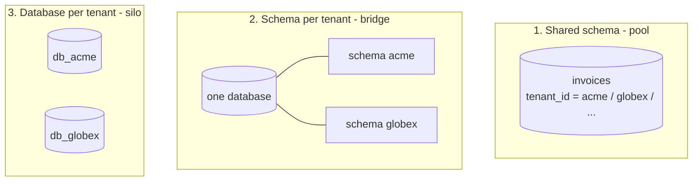

| Model | Isolation | Cost per tenant | Ops effort | Good for |
|---|---|---|---|---|
| **Shared schema** (`tenant_id` column) **(Interview Imp - Java)** | Logical (filters, row-level security) | Lowest | One schema to migrate | Many small tenants (B2C-ish SaaS) |
| **Schema per tenant** | Medium (separate tables, shared server) | Medium | Migrations run N times | Hundreds of mid-size tenants |
| **Database per tenant** | Strong (own DB, own backups, own encryption keys) | Highest | N databases to run | Enterprise/regulated customers |
| **Hybrid** | Mix: small tenants pooled, big ones siloed | Varies | Routing logic | Most mature SaaS |

How a request finds its tenant:
1. **Identify** the tenant: subdomain (`acme.app.com`), JWT claim (`tenant_id`), header, or API key.
2. **Store it in a request context** (a `ThreadLocal` or Spring bean scope; with virtual threads/reactive code use `ScopedValue` or Reactor context).
3. **Apply it everywhere**: repository filters, DB row-level security, cache keys (`acme:product:7`), message headers, logs and metrics labels, file storage prefixes.
4. **Clear it** at the end of the request (thread pools reuse threads).

**Defence in depth:** do the tenant filter in the application **and** in the database (PostgreSQL **row-level security**), so one forgotten `WHERE tenant_id = ?` doesn't leak data.

**Noisy neighbours:** one tenant's heavy report can slow everyone in a shared model. Mitigate with per-tenant rate limits and quotas, separate queues or worker pools for heavy jobs, and moving very large tenants to their own stamp/database (see [Deployment Stamps](01_Cloud_Native_Pattern.md#10-deployment-stamps-and-geode-patterns)).

## 8.4 Complete Java Example - Tenant Context, a Data Leak and the Three Models

```java
import java.util.ArrayList;
import java.util.LinkedHashMap;
import java.util.List;
import java.util.Map;

// Multi-tenancy: one deployment serves many customers (tenants). The #1 rule: a tenant must never see another tenant's data.
public class MultiTenancyDemo {
    record Invoice(String tenantId, String id, long amount) {}

    static final ThreadLocal<String> CURRENT_TENANT = new ThreadLocal<>();       // set from the JWT / subdomain by a filter
    static final List<Invoice> sharedTable = new ArrayList<>();                   // model 1: shared schema with tenant_id column

    static List<Invoice> findAllUnsafe() { return new ArrayList<>(sharedTable); }  // forgot the tenant filter
    static List<Invoice> findAll() {                                              // repository that ALWAYS applies the filter
        String t = CURRENT_TENANT.get();
        if (t == null) throw new IllegalStateException("no tenant in context: refusing to query");
        return sharedTable.stream().filter(i -> i.tenantId().equals(t)).toList();
    }

    public static void main(String[] args) {
        sharedTable.add(new Invoice("acme", "INV-1", 5_000));
        sharedTable.add(new Invoice("globex", "INV-1", 9_900));                     // same invoice number, different tenant
        sharedTable.add(new Invoice("acme", "INV-2", 1_200));

        CURRENT_TENANT.set("acme");
        System.out.println("acme, unsafe query : " + findAllUnsafe().size() + " invoices  <- data leak (globex's invoice included)");
        System.out.println("acme, safe query   : " + findAll());
        CURRENT_TENANT.remove();                                                    // ALWAYS clear: threads are reused by the pool
        try { findAll(); } catch (IllegalStateException e) { System.out.println("no tenant         : " + e.getMessage()); }

        // The three isolation models, and what a "noisy neighbour" does to each
        Map<String, String[]> models = new LinkedHashMap<>();
        models.put("shared schema (tenant_id)", new String[]{"lowest", "row filter / row-level security", "all tenants slow down"});
        models.put("schema per tenant", new String[]{"medium", "search_path / schema switch", "shared DB CPU, separate tables"});
        models.put("database per tenant", new String[]{"highest", "separate connection pool", "isolated (own DB resources)"});
        System.out.printf("%-27s %-8s %-34s %s%n", "model", "cost", "isolation mechanism", "a noisy neighbour's heavy report...");
        models.forEach((k, v) -> System.out.printf("%-27s %-8s %-34s %s%n", k, v[0], v[1], v[2]));
    }
}
```

**Output:**
```
acme, unsafe query : 3 invoices  <- data leak (globex's invoice included)
acme, safe query   : [Invoice[tenantId=acme, id=INV-1, amount=5000], Invoice[tenantId=acme, id=INV-2, amount=1200]]
no tenant         : no tenant in context: refusing to query
model                       cost     isolation mechanism                a noisy neighbour's heavy report...
shared schema (tenant_id)   lowest   row filter / row-level security    all tenants slow down
schema per tenant           medium   search_path / schema switch        shared DB CPU, separate tables
database per tenant         highest  separate connection pool           isolated (own DB resources)
```

**What to notice:**
- The unsafe query returned **another customer's invoice**. Note both tenants have an `INV-1`: IDs are only unique **per tenant**, so the tenant must also be part of keys and unique constraints.
- The safe repository **refuses** to run without a tenant instead of returning "everything".
- `CURRENT_TENANT.remove()` matters: a pooled thread that still holds `acme` would serve the next request (maybe from `globex`) as `acme`.

## 8.5 Multi-Tenancy in Spring Boot and PostgreSQL

```java
// 1) Resolve the tenant once per request
@Component
class TenantFilter extends OncePerRequestFilter {
    @Override
    protected void doFilterInternal(HttpServletRequest req, HttpServletResponse res, FilterChain chain) throws IOException, ServletException {
        Jwt jwt = (Jwt) SecurityContextHolder.getContext().getAuthentication().getPrincipal();
        TenantContext.set(jwt.getClaimAsString("tenant_id"));          // never trust a tenant id sent as a plain header
        try { chain.doFilter(req, res); } finally { TenantContext.clear(); }
    }
}

// 2a) Shared schema: Hibernate 6 adds the tenant filter to every query on @TenantId entities
@Entity
class Invoice {
    @Id @GeneratedValue Long id;
    @TenantId String tenantId;                                         // set and filtered automatically
    String number; long amountPaise;
}

@Component
class CurrentTenantResolver implements CurrentTenantIdentifierResolver<String> {
    public String resolveCurrentTenantIdentifier() { return TenantContext.getOrDefault("unknown"); }
    public boolean validateExistingCurrentSessions() { return true; }
}
// register it: spring.jpa.properties.hibernate.tenant_identifier_resolver = <bean>  (or via HibernatePropertiesCustomizer)

// 2b) Database per tenant: route the DataSource by tenant
class TenantRoutingDataSource extends AbstractRoutingDataSource {
    @Override protected Object determineCurrentLookupKey() { return TenantContext.get(); }
}
```

```sql
-- 3) Database-level safety net: PostgreSQL row-level security
ALTER TABLE invoice ENABLE ROW LEVEL SECURITY;
CREATE POLICY tenant_isolation ON invoice
    USING (tenant_id = current_setting('app.tenant_id'));
-- per transaction, the app runs: SET LOCAL app.tenant_id = 'acme';
-- note: RLS is bypassed by table owners/superusers; connect as a non-owner role (or use FORCE ROW LEVEL SECURITY)
```

## 8.6 Pros and Cons

| Pros | Cons |
|---|---|
| Much lower cost per customer | Data leak risk: a single missing filter exposes other tenants |
| One version to upgrade and monitor | Noisy neighbours |
| Fast onboarding | Per-tenant backup/restore is hard in shared schema |
| Easy cross-tenant analytics (for the provider) | Customisation per tenant is limited; compliance asks may force silos |

## 8.7 Pitfalls, Interview Questions and Cheat Sheet

**Common pitfalls**
- **Tenant taken from a client-controlled header or query param** → anyone can switch tenants. Derive it from the authenticated token.
- **Caches without tenant in the key** → tenant A sees tenant B's cached data.
- **Async work loses the context** (`@Async`, Kafka consumers, schedulers). Pass the tenant explicitly in messages and restore it.
- **Unique constraints without `tenant_id`** (`UNIQUE(invoice_number)`) → tenants block each other's numbers.
- **Running schema migrations on 2,000 tenant schemas** with no plan: make them idempotent, batched, and monitored.

**Interview questions**
1. *How would you design multi-tenancy for a SaaS app?* → Choose isolation model per tier (pool, bridge, silo), resolve tenant from the token, propagate it everywhere, enforce in app + DB (RLS), tenant-aware caches/queues/logs, quotas against noisy neighbours.
2. *Shared schema vs database per tenant?* → Cost and simplicity vs isolation, per-tenant backup/keys and blast radius; many products use hybrid.
3. *How do you prevent cross-tenant data leaks?* → Mandatory tenant filters (Hibernate `@TenantId`, repository base class), RLS in the DB, tenant in every key, tests that try to read another tenant's data.
4. *What's the noisy neighbour problem and how do you handle it?* → One tenant consuming shared resources; rate limits/quotas, separate pools/queues, move big tenants to their own stamp.
5. *How do you propagate tenant context in async processing?* → Put `tenantId` in message headers/payloads; set and clear the context in the consumer; use `TaskDecorator` for `@Async` executors.

**Cheat sheet**
```
Models     shared schema (tenant_id) | schema per tenant | DB per tenant | hybrid
Resolve    from JWT/subdomain, never from a plain header; store in request context; ALWAYS clear
Enforce    app filter (Hibernate @TenantId) + DB row-level security + tenant in cache/msg/file keys
Protect    per-tenant quotas, heavy-job queues, silo the giants
Test       "can tenant A read tenant B?" for every endpoint
```

## 8.8 Types and Variants

| Model | Isolation | Cost per tenant | Example |
|---|---|---|---|
| **Pool (shared schema)** | `tenant_id` column + row-level security | Lowest | Most B2C/SMB SaaS |
| **Bridge (schema per tenant)** | Separate schema in a shared database | Medium | Hibernate multi-tenancy `SCHEMA` strategy |
| **Silo (database per tenant)** | Separate database or cluster | Highest | Enterprise tenants with compliance needs |
| **Hybrid / tiered** | Small tenants pooled, large tenants siloed | Mixed | Common in mature SaaS |
| **Cell-based** | Groups of tenants per independent stack (cell) | Medium | Limits blast radius ([Deployment Stamps](01_Cloud_Native_Pattern.md)) |
| **Application-level vs database-enforced** | Filters in code vs PostgreSQL RLS policies | | Use both: defence in depth |

### 📘 Terms Explained

| Term | Meaning |
|---|---|
| **Tenant** | A customer (usually an organisation) using a shared SaaS deployment |
| **Multi-tenancy / single-tenancy** | Many customers share one deployment / each customer has its own |
| **Pool / bridge / silo** | Common names for shared schema / schema per tenant / database per tenant |
| **Row-level security (RLS)** | Database feature that filters rows automatically by a policy |
| **Noisy neighbour** | A tenant whose heavy usage degrades performance for others |
| **`ThreadLocal`** | Java variable with a separate value per thread, used for request context |
| **`@TenantId`** | Hibernate 6 annotation for automatic shared-schema tenant filtering |
| **`AbstractRoutingDataSource`** | Spring class that picks a target DataSource per call (e.g. per tenant) |
| **`TaskDecorator`** | Spring hook to copy context (like tenant ID) into `@Async` threads |

---

# 9. Denormalization and Database Federation (Interview Imp - Java)

## 9.1 What Are They?

- **Denormalization:** deliberately **duplicating data** so reads need fewer joins or lookups. Example: storing `category_name` in the product row (or product view) instead of only `category_id`. It reverses normalization ([MySQL guide - Normalisation](../../mysql/MySQL_Complete_Guide.md#2010-normalisation-in-60-seconds-interview-imp)) for performance.
- **Database federation (functional partitioning):** **split one database into several by function**: users DB, products DB, orders DB, each on its own server. Different from sharding, which splits **the same table by rows**.

**Simple analogy:** Denormalization is writing your friend's phone number in several notebooks so it's always at hand, and accepting that you must update all of them when it changes. Federation is a company splitting one overloaded front desk into separate desks for billing, support and sales.

## 9.2 Why Do We Need Them?

- Joins over huge tables, or across services, are slow or impossible (in microservices each service owns its DB, so there's no cross-DB join at all).
- NoSQL stores (document, wide-column, key-value) don't do joins well. **Denormalization is the normal modelling technique there.**
- One database server hits its limits (CPU, connections, storage, replication lag). Federation spreads load by function **before** you need sharding.

## 9.3 How It Works

**Denormalization techniques**

| Technique | Example |
|---|---|
| Duplicate a column | `orders.customer_name` copied from `customers.name` |
| Precomputed aggregate | `posts.comment_count` instead of `COUNT(*)` on every page view |
| Embedded document | Order items inside the order document |
| Read model / view | A `product_view` table/index built from several sources ([CQRS](../03_System_Design/05_Data_Management_Pattern.md#1-cqrs-pattern-interview-imp---java), [Materialized View](../03_System_Design/05_Data_Management_Pattern.md#8-materialized-view-pattern)) |
| Query tables (wide-column) | Same data written to `orders_by_customer` and `orders_by_status` |

**Keeping copies in sync:** in the same transaction (one DB), with triggers, or asynchronously via events/CDC (eventual consistency). Decide how stale each copy may be.

**Federation:**

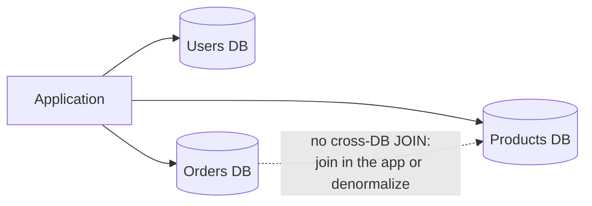

| | Federation | Sharding |
|---|---|---|
| Splits by | Function / table group | Rows of the same table (shard key) |
| Example | users DB, orders DB | orders 0-999 on shard A, 1000-1999 on shard B |
| Join problem | Across functions | Across shards |
| Covered in | This section | [01_Scalability_Pattern.md](../03_System_Design/01_Scalability_Pattern.md#6-database-sharding-interview-imp---java) |

## 9.4 Complete Java Example - Join on Read vs Copy on Write

```java
import java.util.ArrayList;
import java.util.LinkedHashMap;
import java.util.List;
import java.util.Map;

// Normalized (join on read) vs denormalized (copy on write): count the work for reads and for updates
public class DenormalizationDemo {
    record Product(String id, String name, String categoryId) {}
    record Category(String id, String name) {}
    record ProductView(String id, String name, String categoryName) {}            // denormalized read model

    public static void main(String[] args) {
        Map<String, Category> categories = new LinkedHashMap<>();
        categories.put("CAT-1", new Category("CAT-1", "Shoes"));
        categories.put("CAT-2", new Category("CAT-2", "Bags"));
        List<Product> products = new ArrayList<>();
        for (int i = 1; i <= 10_000; i++) products.add(new Product("P" + i, "item" + i, i % 10 == 0 ? "CAT-2" : "CAT-1"));

        // Normalized read: product page needs category name -> a lookup (JOIN) on every read
        int lookups = 0;
        for (int r = 0; r < 1_000; r++) { Product p = products.get(r); categories.get(p.categoryId()); lookups++; }
        System.out.println("normalized   : 1,000 product page reads -> " + lookups + " extra category lookups (JOINs)");

        // Denormalized: copy the category name into each product view at write time
        Map<String, ProductView> views = new LinkedHashMap<>();
        for (Product p : products) views.put(p.id(), new ProductView(p.id(), p.name(), categories.get(p.categoryId()).name()));
        System.out.println("denormalized : 1,000 product page reads -> 0 joins, one key lookup each");

        // The price: renaming a category must update every copy
        categories.put("CAT-1", new Category("CAT-1", "Footwear"));
        int rewritten = 0;
        for (Product p : products) if (p.categoryId().equals("CAT-1")) { views.put(p.id(), new ProductView(p.id(), p.name(), "Footwear")); rewritten++; }
        System.out.println("rename 'Shoes' -> 'Footwear': normalized = 1 row updated, denormalized = " + rewritten + " copies rewritten");
        System.out.println("P1 view now: " + views.get("P1") + " (done async via events/CDC in real systems -> briefly stale)");
        System.out.println("rule: denormalize data that is READ often and CHANGES rarely (category names: yes; stock levels: no)");
    }
}
```

**Output:**
```
normalized   : 1,000 product page reads -> 1000 extra category lookups (JOINs)
denormalized : 1,000 product page reads -> 0 joins, one key lookup each
rename 'Shoes' -> 'Footwear': normalized = 1 row updated, denormalized = 9000 copies rewritten
P1 view now: ProductView[id=P1, name=item1, categoryName=Footwear] (done async via events/CDC in real systems -> briefly stale)
rule: denormalize data that is READ often and CHANGES rarely (category names: yes; stock levels: no)
```

**What to notice:** the trade is explicit. **Normalized** = cheap writes, extra work on every read. **Denormalized** = cheap reads, a write fan-out (9,000 copies) when the duplicated data changes. Category names change rarely and are read constantly, so denormalizing them is a good deal.

## 9.5 In Spring Boot

```java
// Denormalized counter updated in the same transaction (one DB)
@Transactional
public Comment addComment(long postId, String text) {
    Comment c = commentRepository.save(new Comment(postId, text));
    postRepository.incrementCommentCount(postId);              // @Modifying @Query("update Post p set p.commentCount = p.commentCount + 1 where p.id = :id")
    return c;
}

// Denormalized copy in another service, updated from events (eventual consistency)
@KafkaListener(topics = "category-events")
void onCategoryRenamed(CategoryRenamed e) {
    productViewRepository.updateCategoryName(e.categoryId(), e.newName());   // bulk update of the copies
}
```

```yaml
# Federation: one Spring Boot app (or one service each) with separate DataSources per function
app:
  datasource:
    users:    { url: jdbc:postgresql://users-db:5432/users }
    catalog:  { url: jdbc:postgresql://catalog-db:5432/catalog }
    orders:   { url: jdbc:postgresql://orders-db:5432/orders }
```

## 9.6 Pros and Cons

| Pros | Cons |
|---|---|
| Faster reads, fewer joins and round trips | Write fan-out; update anomalies if a copy is missed |
| Natural fit for NoSQL and microservices | Copies can be stale (eventual consistency) |
| Federation spreads load and failure domains | Federation: no cross-DB joins or transactions |
| Precomputed aggregates make pages cheap | More storage; harder to reason about the "truth" |

## 9.7 Pitfalls, Interview Questions and Cheat Sheet

**Common pitfalls**
- **Denormalizing fast-changing data** (stock levels, prices during sales) → constant fan-out and stale reads.
- **No owner for the original**: copies get edited directly and diverge. One source of truth, copies are read-only.
- **Counters updated with read-modify-write** (`count = count + 1` done in Java) → lost updates. Use atomic SQL updates or DB-side increments.
- **Federating too early**: one well-tuned database handles a lot.

**Interview questions**
1. *When would you denormalize?* → Read-heavy data that changes rarely, expensive joins/aggregates, NoSQL models, cross-service read models; accept write fan-out and staleness.
2. *What is an update anomaly?* → A change applied to some copies but not others, leaving inconsistent data; the main risk of denormalization.
3. *Federation vs sharding?* → Federation splits by function (separate DBs for users/orders); sharding splits one table's rows by a key.
4. *How do you show "comment count" for millions of posts efficiently?* → Denormalized counter column updated atomically (or a Redis counter flushed periodically), not `COUNT(*)` per view.

**Cheat sheet**
```
Denormalize   read often + change rarely; copies are read-only; sync in tx / triggers / events-CDC
Watch         write fan-out, update anomalies, staleness, read-modify-write counters
Federation    split DB by function (users / catalog / orders); no cross-DB joins -> app joins or copies
Sharding      split by rows of one table (Scalability file)
```

### 📘 Terms Explained

| Term | Meaning |
|---|---|
| **Normalization** | Organising tables to avoid duplicated data (1NF, 2NF, 3NF...) |
| **Denormalization** | Intentionally duplicating data to make reads faster |
| **Update anomaly** | Inconsistency caused by updating one copy of duplicated data but not another |
| **Write fan-out** | One logical change requiring many physical writes |
| **Database federation** | Splitting a database into several databases by function |
| **Functional partitioning** | Another name for federation |
| **Read model** | A data structure shaped for a specific query, derived from the source data |
| **Precomputed aggregate** | A stored summary value (count, sum) maintained on write |

---

# 10. Command Sourcing (and Event-Store Snapshots)

> [Event Sourcing](../03_System_Design/05_Data_Management_Pattern.md#2-event-sourcing-pattern-interview-imp---java) (store every change as an event, rebuild state by replaying) and **snapshots** (save state every N events so replay starts from the latest snapshot) are covered with working code in 05_Data_Management_Pattern.md. This section covers **command sourcing**, its close and often-confused cousin.

## 10.1 What is Command Sourcing?

**Command sourcing** stores every **command** (a *request* to do something: `DepositUsd(100)`) in a log, and rebuilds state by **re-executing** the commands through the business logic. **Event sourcing** stores the **events** (the *facts* that resulted: `DepositedInr(8217)`) and rebuilds state by **applying** them, with no business logic re-run.

| | Command sourcing | Event sourcing |
|---|---|---|
| Stores | Intentions: "deposit 100 USD" | Facts: "8,217 INR were deposited" |
| Replay runs | Validation + business rules + side effects | Only state updates |
| Replay result depends on | Today's code, rules and external data | Nothing but the events |
| Typical users | In-memory systems (LMAX, Prevayler-style), deterministic engines, game input recording | Most event-sourced business systems |

**Simple analogy:** Command sourcing keeps the **recipe instructions** you were given ("add a cup of sugar"). Event sourcing keeps the **photos of each step** ("this is what the cake looked like after the sugar"). If someone changes the recipe book, re-following the instructions gives a different cake. The photos never change.

## 10.2 Why Do We Need It (and When Not)?

- Useful when **business logic is deterministic** and you want to rebuild state in memory very fast by re-running inputs (a matching engine, a game simulation, an in-memory ledger).
- Useful for **audit of intent**: what users *asked* for, including rejected requests.
- **Dangerous** when logic, rules or external inputs change over time, or when commands have **side effects** (emails, payments): replay changes history or repeats effects.

## 10.3 How It Works

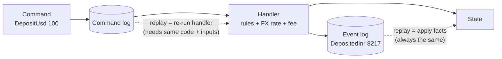

Rules if you use command sourcing:
1. **Deterministic handlers:** no `Instant.now()`, `Random`, or remote calls inside. Record the inputs (time, FX rate) **inside the command** when it's accepted.
2. **Version the handlers:** replay old commands with the code version that originally handled them, or migrate them explicitly.
3. **Suppress side effects during replay** (a "replay mode" flag): no emails, no payments.
4. Often you **combine** both: log commands for audit, and emit events as the source of truth.

## 10.4 Complete Java Example - Replaying Commands vs Replaying Events

```java
import java.util.ArrayList;
import java.util.List;

// Command sourcing stores the REQUESTS ("deposit 100") and re-executes them to rebuild state.
// Event sourcing stores the FACTS that resulted ("deposited 100, new balance 100"). Replay shows why the difference matters.
public class CommandSourcingDemo {
    record Command(String type, long amount) {}
    record Event(String type, long amount, long fxRateMilli) {}

    static long feePercent = 1;                          // business rule that can change over time
    static long fxRateMilli = 83_000;                    // external input (USD->INR x1000) that changes over time
    static int emailsSent = 0;

    static long execute(long balance, Command c, List<Event> events) {   // side effects + rules + external data
        switch (c.type()) {
            case "DEPOSIT_USD" -> {
                long inr = c.amount() * fxRateMilli / 1000;
                long fee = inr * feePercent / 100;
                events.add(new Event("DEPOSITED_INR", inr - fee, fxRateMilli));
                emailsSent++;                            // side effect: notify the customer
                return balance + inr - fee;
            }
            case "WITHDRAW_INR" -> { events.add(new Event("WITHDRAWN_INR", c.amount(), 0)); emailsSent++; return balance - c.amount(); }
            default -> throw new IllegalArgumentException(c.type());
        }
    }

    public static void main(String[] args) {
        List<Command> commandLog = List.of(new Command("DEPOSIT_USD", 100), new Command("WITHDRAW_INR", 2_000), new Command("DEPOSIT_USD", 50));
        List<Event> eventLog = new ArrayList<>();
        long balance = 0;
        for (Command c : commandLog) balance = execute(balance, c, eventLog);
        System.out.println("live balance          : " + balance + " INR, emails sent " + emailsSent);

        // A year later: the fee rule and the exchange rate have changed
        feePercent = 2; fxRateMilli = 86_500;
        int emailsBefore = emailsSent;
        long fromCommands = 0;
        for (Command c : commandLog) fromCommands = execute(fromCommands, c, new ArrayList<>());
        System.out.println("replay COMMANDS       : " + fromCommands + " INR  <- different! new fee + new rate; and " + (emailsSent - emailsBefore) + " duplicate emails sent");

        long fromEvents = 0;
        for (Event e : eventLog) fromEvents += e.type().equals("DEPOSITED_INR") ? e.amount() : -e.amount();
        System.out.println("replay EVENTS         : " + fromEvents + " INR  <- same as live: facts don't depend on today's rules");
        System.out.println("use command sourcing only with deterministic handlers, recorded inputs, and side effects disabled during replay");
    }
}
```

**Output:**
```
live balance          : 10326 INR, emails sent 3
replay COMMANDS       : 10716 INR  <- different! new fee + new rate; and 3 duplicate emails sent
replay EVENTS         : 10326 INR  <- same as live: facts don't depend on today's rules
use command sourcing only with deterministic handlers, recorded inputs, and side effects disabled during replay
```

**What to notice:** a year later, the fee rule and the exchange rate have changed. Replaying the **commands** produces a different balance and sends 3 duplicate emails. Replaying the **events** reproduces the real history exactly. The events stored the FX rate that was actually used, which is the "record the inputs" rule above.

## 10.5 In Java / Spring

```java
// Accept a command: validate, capture non-deterministic inputs INTO the command, persist it, then handle it
@Transactional
public void deposit(String accountId, BigDecimal usd) {
    DepositUsd cmd = new DepositUsd(UUID.randomUUID(), accountId, usd,
            fxService.currentRate("USD", "INR"), clock.instant());      // recorded now, reused on replay
    commandLog.append(cmd);                                              // audit of intent
    List<Object> events = accountHandler.handle(cmd);                    // pure, deterministic
    eventStore.append(accountId, events);                                // source of truth
    outbox.publish(events);                                              // side effects driven by events, once
}
```

Frameworks: **Axon Framework** separates commands, command handlers and event-sourced aggregates; **LMAX Disruptor**-style systems journal input commands and replay them through deterministic in-memory processors.

## 10.6 Pros and Cons

| Pros | Cons |
|---|---|
| Complete audit of user intent, including rejected requests | Replay depends on code version, rules and external data |
| Very fast in-memory rebuild for deterministic engines | Side effects can repeat on replay |
| Simple to implement for small deterministic systems | Harder schema/code evolution than events |

## 10.7 Pitfalls, Interview Questions and Cheat Sheet

**Common pitfalls**
- Calling something "event sourcing" while storing **commands** (`CreateOrderRequested`) → replay surprises.
- Reading the clock, random numbers or remote services inside handlers.
- Replaying with side effects enabled.

**Interview questions**
1. *Command sourcing vs event sourcing?* → Commands are requests re-executed on replay (results can change); events are facts re-applied (results never change). Most business systems should source events.
2. *What do snapshots solve in event sourcing?* → Long replay times: store state at version N, then replay only later events ([05_Data_Management_Pattern.md](../03_System_Design/05_Data_Management_Pattern.md#2-event-sourcing-pattern-interview-imp---java)).
3. *How do you make command handlers replay-safe?* → Determinism (inputs captured in the command), versioned handlers, side effects suppressed in replay mode.

**Cheat sheet**
```
Command  = intention (may be rejected), replay RE-EXECUTES logic -> can differ
Event    = fact (already happened), replay RE-APPLIES state      -> always the same
Command sourcing needs: deterministic handlers, recorded inputs, versioned code, no side effects on replay
Snapshot: state at version N + later events = fast load (event sourcing)
```

### 📘 Terms Explained

| Term | Meaning |
|---|---|
| **Command** | A request to change something; it can be validated and rejected |
| **Event** | A record of something that has already happened; it can't be rejected |
| **Command sourcing** | Persisting commands and rebuilding state by re-executing them |
| **Event sourcing** | Persisting events and rebuilding state by applying them |
| **Deterministic** | Always producing the same output from the same input |
| **Snapshot** | Saved state at a known version, to shorten replay |
| **Replay mode** | Running handlers to rebuild state while side effects are switched off |
| **Axon Framework** | Java framework for CQRS and event sourcing |

---

# 11. Probabilistic Data Structures: Bloom Filter, Count-Min Sketch, HyperLogLog (Interview Imp - Java)

## 11.1 What Are They?

**Probabilistic data structures** answer questions about huge data sets **approximately**, using **tiny, fixed memory**, with a known, tunable error.

| Structure | Question it answers | Error type | Memory |
|---|---|---|---|
| **Bloom filter** **(Interview Imp - Java)** | "Have I seen X?" | False positives possible, **no false negatives** | ~10 bits per item for 1% error |
| **Count-Min Sketch** | "How many times did X appear?" | Over-counts, **never under-counts** | width × depth counters, fixed |
| **HyperLogLog** **(Interview Imp - Java)** | "How many **distinct** items?" | ±~1% (standard error 1.04/√m) | ~12 KB in Redis, for any count |

**Simple analogy:**
- **Bloom filter:** a bouncer with a fuzzy memory of faces. If they say "never seen you", that's certain. If they say "you look familiar", they might be confusing you with someone.
- **Count-Min Sketch:** several tally sheets with only a few columns each. Different names sometimes share a column, so counts can be a bit high, never low. Taking the smallest of a name's tallies across the sheets gives the best guess.
- **HyperLogLog:** guessing how many people flipped coins by asking "what's the longest run of heads anyone got?". A run of 10 heads suggests about 2¹⁰ people tried.

## 11.2 Why Do We Need Them?

- Exact answers need memory **proportional to the data**: a `HashSet` of 1 billion user IDs needs tens of GB. A HyperLogLog needs 12 KB.
- Many questions don't need exact answers: "about 1.2 M unique visitors today", "this hashtag is trending", "this key is definitely not on disk".
- They are **mergeable**: compute per server/per hour, then combine. That's perfect for distributed systems.

## 11.3 How They Work

**Bloom filter**
- A bit array of `m` bits and `k` hash functions.
- **Add:** set the `k` bits the item hashes to.
- **Query:** if any of the `k` bits is 0 → **definitely not present**; if all are 1 → **probably present**.
- Sizing: `m = -n·ln(p) / (ln 2)²`, `k = (m/n)·ln 2`. For n = 100,000 and p = 1%: ~958,000 bits (117 KB), k = 7.
- Can't delete (use a **Counting Bloom filter** or a **Cuckoo filter** if you need to).

**Count-Min Sketch**
- `depth` rows of `width` counters, one hash function per row.
- **Add:** increment one counter in each row.
- **Estimate:** take the **minimum** over the rows (the least-collided counter).
- Error ≤ ε·N with probability 1-δ, where width = e/ε and depth = ln(1/δ). Hot items (heavy hitters) are estimated very accurately.

**HyperLogLog**
- Hash each item. The first `p` bits pick one of `m = 2^p` registers. Count the leading zeros of the remaining bits + 1 = **rank**. Keep the **max rank** per register.
- Estimate = bias-corrected **harmonic mean** of `2^rank` over all registers. Small counts use linear counting.
- **Merge** two HLLs by taking the register-wise max: the union's distinct count, with no double-counting.

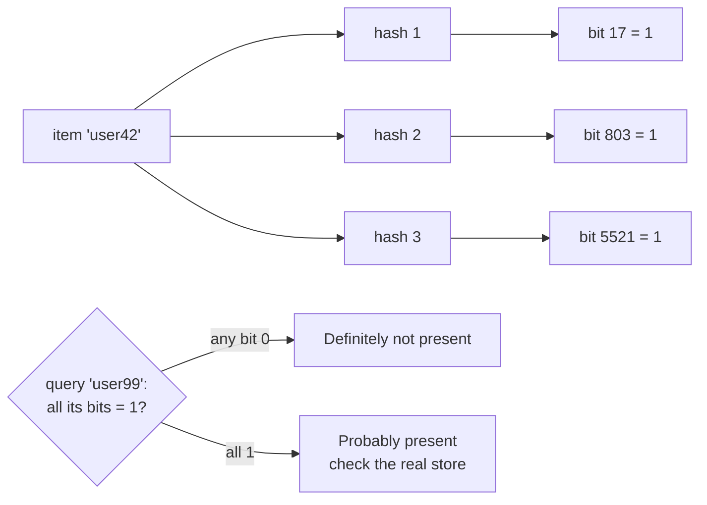

## 11.4 Variants and Where They're Used

| Structure | Real-world uses |
|---|---|
| Bloom filter | Cassandra/HBase/RocksDB skip SSTables that can't contain a key; "username taken?" pre-check; Chrome's old Safe Browsing list; CDN "one-hit wonder" filtering; Medium/Quora "already shown" lists |
| Cuckoo / counting Bloom | Membership with deletes |
| Count-Min Sketch | Trending topics, heavy-hitter detection (DDoS/abusive IPs), approximate top-K, TinyLFU admission in the Caffeine cache |
| HyperLogLog | Unique visitors/users per page/day (Redis `PFADD`/`PFCOUNT`/`PFMERGE`), `APPROX_COUNT_DISTINCT` in BigQuery/Snowflake/Spark, distinct metrics in Druid |
| Related | **t-digest** / **KLL** (approximate percentiles), **MinHash** (set similarity), **Top-K / Space-Saving** (heavy hitters) |

## 11.5 Complete Java Example - Bloom Filter

```java
import java.nio.charset.StandardCharsets;
import java.util.BitSet;

// Bloom filter: "is X in the set?" -> "definitely NO" or "PROBABLY yes", in a tiny fixed amount of memory.
public class BloomFilterDemo {
    final BitSet bits; final int m, k;

    BloomFilterDemo(int expected, double fpRate) {
        m = (int) Math.ceil(-expected * Math.log(fpRate) / (Math.log(2) * Math.log(2)));   // optimal number of bits
        k = Math.max(1, (int) Math.round((double) m / expected * Math.log(2)));           // optimal number of hash functions
        bits = new BitSet(m);
    }

    private int[] positions(String item) {                    // double hashing: h1 + i*h2 gives k positions from 2 hashes
        byte[] b = item.getBytes(StandardCharsets.UTF_8);
        int h1 = fnv1a(b, 0x811C9DC5), h2 = fnv1a(b, 0x01000193) | 1;
        int[] p = new int[k];
        for (int i = 0; i < k; i++) p[i] = Math.floorMod(h1 + i * h2, m);
        return p;
    }
    static int fnv1a(byte[] data, int seed) { int h = seed; for (byte x : data) { h ^= x; h *= 0x01000193; } h ^= h >>> 15; h *= 0x2c1b3c6d; h ^= h >>> 12; return h; }

    void add(String item) { for (int p : positions(item)) bits.set(p); }
    boolean mightContain(String item) { for (int p : positions(item)) if (!bits.get(p)) return false; return true; }

    public static void main(String[] args) {
        int n = 100_000;
        BloomFilterDemo usernames = new BloomFilterDemo(n, 0.01);
        for (int i = 0; i < n; i++) usernames.add("user" + i);
        System.out.println("items=" + n + " bits=" + usernames.m + " (" + usernames.m / 8 / 1024 + " KB) hashes=" + usernames.k
                + "  vs ~" + n * 40 / 1024 + " KB+ to store the strings in a HashSet");

        int falseNegatives = 0;
        for (int i = 0; i < n; i++) if (!usernames.mightContain("user" + i)) falseNegatives++;
        int falsePositives = 0, probes = 100_000;
        for (int i = 0; i < probes; i++) if (usernames.mightContain("other" + i)) falsePositives++;
        System.out.println("false negatives: " + falseNegatives + " (never possible)");
        System.out.printf("false positives: %d of %d = %.2f%% (target 1%%)%n", falsePositives, probes, 100.0 * falsePositives / probes);
        System.out.println("use: 'username taken?' check, skip DB/disk reads for keys that don't exist (Cassandra, HBase, RocksDB SSTables), "
                + "malicious-URL lists, 'already recommended' filters");
    }
}
```

**Output:**
```
items=100000 bits=958506 (117 KB) hashes=7  vs ~3906 KB+ to store the strings in a HashSet
false negatives: 0 (never possible)
false positives: 1047 of 100000 = 1.05% (target 1%)
use: 'username taken?' check, skip DB/disk reads for keys that don't exist (Cassandra, HBase, RocksDB SSTables), malicious-URL lists, 'already recommended' filters
```

**What to notice:** 117 KB instead of ~4 MB, **zero** false negatives, and a measured false-positive rate of 1.05%, right at the 1% target the formula promised.

## 11.6 Complete Java Example - Count-Min Sketch

```java
import java.util.LinkedHashMap;
import java.util.Map;
import java.util.TreeMap;

// Count-Min Sketch: approximate frequency counts for a huge stream in fixed memory. Never UNDER-counts; may over-count.
public class CountMinSketchDemo {
    final int width, depth; final long[][] table; final int[] seeds;

    CountMinSketchDemo(int width, int depth) {
        this.width = width; this.depth = depth; table = new long[depth][width]; seeds = new int[depth];
        for (int i = 0; i < depth; i++) seeds[i] = 0x9E3779B9 * (i + 1);
    }
    int bucket(String item, int row) { int h = item.hashCode() * seeds[row]; h ^= h >>> 16; h *= 0x85EBCA6B; h ^= h >>> 13; return Math.floorMod(h, width); }
    void add(String item) { for (int r = 0; r < depth; r++) table[r][bucket(item, r)]++; }
    long estimate(String item) { long min = Long.MAX_VALUE; for (int r = 0; r < depth; r++) min = Math.min(min, table[r][bucket(item, r)]); return min; }

    public static void main(String[] args) {
        CountMinSketchDemo cms = new CountMinSketchDemo(500, 4);              // 2,000 counters, fixed, whatever the stream size
        Map<String, Long> exact = new TreeMap<>();
        long seed = 12345;
        long events = 0;
        for (int i = 0; i < 200_000; i++) {                                   // skewed stream: a few hot hashtags, a long tail
            seed = seed * 6364136223846793005L + 1442695040888963407L;
            int r = (int) ((seed >>> 33) % 1000);
            String tag = r < 300 ? "#ipl" : r < 450 ? "#budget" : r < 520 ? "#monsoon" : "#tag" + (r * 37 % 5000);
            cms.add(tag); exact.merge(tag, 1L, Long::sum); events++;
        }
        System.out.println("stream: " + events + " events, " + exact.size() + " distinct tags; sketch uses " + cms.width * cms.depth + " counters");
        Map<String, Long> show = new LinkedHashMap<>();
        for (String t : new String[]{"#ipl", "#budget", "#monsoon", "#tag4100", "#tag999"}) show.put(t, exact.getOrDefault(t, 0L));
        show.forEach((t, real) -> {
            long est = cms.estimate(t);
            System.out.printf("  %-9s exact=%6d  estimate=%6d  error=+%d%n", t, real, est, est - real);
        });
        System.out.println("hot items are accurate to well under 1%; rare items can be over-counted (hash collisions), never under-counted");
        System.out.println("use: trending topics / heavy hitters, per-IP request counting for abuse detection, approximate top-K");
    }
}
```

**Output:**
```
stream: 200000 events, 483 distinct tags; sketch uses 2000 counters
  #ipl      exact= 60038  estimate= 60223  error=+185
  #budget   exact= 29998  estimate= 29998  error=+0
  #monsoon  exact= 13873  estimate= 13873  error=+0
  #tag4100  exact=     0  estimate=   179  error=+179
  #tag999   exact=     0  estimate=     0  error=+0
hot items are accurate to well under 1%; rare items can be over-counted (hash collisions), never under-counted
use: trending topics / heavy hitters, per-IP request counting for abuse detection, approximate top-K
```

**What to notice:** 2,000 counters track a stream of 200,000 events. The hot tags are within about 0.3% of the truth (`#ipl` over-counted by 185 out of 60,038). A tag that **never appeared** (`#tag4100`) still gets 179, because in every row it shares a counter with other tags. Errors only ever go **up**.

## 11.7 Complete Java Example - HyperLogLog with Merge

```java
import java.util.HashSet;
import java.util.Set;

// HyperLogLog: count DISTINCT items (unique visitors) in ~12 KB, whatever the cardinality, with ~1% error.
// Idea: in random hashes, seeing a run of z leading zeros suggests about 2^z distinct values; average over many registers.
public class HyperLogLogDemo {
    final int p, m; final byte[] registers;
    HyperLogLogDemo(int p) { this.p = p; this.m = 1 << p; registers = new byte[m]; }

    static long mix(long x) { x ^= x >>> 33; x *= 0xff51afd7ed558ccdL; x ^= x >>> 33; x *= 0xc4ceb9fe1a85ec53L; x ^= x >>> 33; return x; }

    void add(long item) {
        long h = mix(item);
        int idx = (int) (h >>> (64 - p));                            // first p bits choose the register
        long rest = h << p;
        int rank = Math.min(Long.numberOfLeadingZeros(rest), 64 - p) + 1;   // position of the first 1-bit in the remaining bits
        if (rank > registers[idx]) registers[idx] = (byte) rank;
    }

    double estimate() {
        double sum = 0; int zeros = 0;
        for (byte r : registers) { sum += Math.pow(2, -r); if (r == 0) zeros++; }
        double alpha = 0.7213 / (1 + 1.079 / m);
        double e = alpha * m * m / sum;
        if (e <= 2.5 * m && zeros > 0) e = m * Math.log((double) m / zeros);    // small-range correction (linear counting)
        return e;
    }

    void merge(HyperLogLogDemo o) { for (int i = 0; i < m; i++) registers[i] = (byte) Math.max(registers[i], o.registers[i]); }

    public static void main(String[] args) {
        HyperLogLogDemo monday = new HyperLogLogDemo(14), tuesday = new HyperLogLogDemo(14);     // 16,384 registers ≈ 16 KB as bytes (Redis packs them into 12 KB)
        Set<Long> exactMon = new HashSet<>(), exactAll = new HashSet<>();
        for (long u = 0; u < 1_000_000; u++) { long user = u % 600_000; monday.add(user); exactMon.add(user); exactAll.add(user); }   // repeats
        for (long u = 400_000; u < 900_000; u++) { tuesday.add(u); exactAll.add(u); }                                              // overlap 400k-600k
        System.out.printf("Monday   : exact=%,d  HLL=%,.0f  error=%.2f%%%n", exactMon.size(), monday.estimate(), 100 * (monday.estimate() - exactMon.size()) / exactMon.size());
        monday.merge(tuesday);                                                                    // union = register-wise max
        System.out.printf("Mon ∪ Tue: exact=%,d  HLL=%,.0f  error=%.2f%%%n", exactAll.size(), monday.estimate(), 100 * (monday.estimate() - exactAll.size()) / exactAll.size());
        System.out.println("memory: HashSet of 900k Longs ≈ tens of MB; HLL = " + monday.m + " registers, fixed. Redis: PFADD / PFCOUNT / PFMERGE");
    }
}
```

**Output:**
```
Monday   : exact=600,000  HLL=601,640  error=0.27%
Mon ∪ Tue: exact=900,000  HLL=894,736  error=-0.58%
memory: HashSet of 900k Longs ≈ tens of MB; HLL = 16384 registers, fixed. Redis: PFADD / PFCOUNT / PFMERGE
```

**What to notice:** 1,000,000 visits with repeats → 600,000 distinct users, estimated within 0.3%. Merging Monday and Tuesday counts the 200,000 overlapping users **once**, which adding two numbers can't do. The standard error for 16,384 registers is 1.04/√16384 ≈ 0.81%, and both results are within it.

## 11.8 In Java and Spring

```java
// Guava Bloom filter
BloomFilter<String> taken = BloomFilter.create(Funnels.stringFunnel(StandardCharsets.UTF_8), 10_000_000, 0.01);
taken.put("asha");
if (!taken.mightContain(name)) return available();           // definitely free, no DB call
return userRepository.existsByUsername(name) ? taken() : available();   // "maybe": confirm in the DB

// Redis HyperLogLog via Spring Data Redis
redis.opsForHyperLogLog().add("uv:2026-10-30", userId);       // PFADD
Long today = redis.opsForHyperLogLog().size("uv:2026-10-30"); // PFCOUNT
redis.opsForHyperLogLog().union("uv:2026-w44", "uv:2026-10-26", "uv:2026-10-27" /* ... */);   // PFMERGE

// Redis Stack / RedisBloom module: BF.ADD, BF.EXISTS, CMS.INCRBY, CMS.QUERY, TOPK.ADD (commands via redis.execute or Jedis/Lettuce)
```

## 11.9 Pros and Cons

| Pros | Cons |
|---|---|
| Tiny, fixed memory regardless of data size | Answers are approximate |
| Very fast (a few hash computations) | Bloom: no deletes, no listing of members |
| Mergeable across servers and time windows | CMS: rare items heavily over-counted |
| Error rates are mathematically bounded and tunable | HLL: can't tell *which* items, only how many |

## 11.10 Pitfalls, Interview Questions and Cheat Sheet

**Common pitfalls**
- **Undersized Bloom filter** (more items than planned) → false-positive rate shoots up. Size for the real n, or use scalable Bloom filters.
- **Weak or correlated hash functions** → errors far above the theory. Use good mixing (Murmur3, xxHash) and double hashing.
- **Using a Bloom filter where false positives are unacceptable** without a confirming lookup.
- **Expecting exact billing counts** from HLL or CMS.

**Interview questions**
1. *How would you check username availability for 1 billion users quickly?* → Bloom filter in memory: "definitely not taken" answers instantly; "maybe" falls back to a DB/index lookup.
2. *Can a Bloom filter have false negatives?* → No (unless items are removed or it's corrupted); only false positives.
3. *How do you count unique visitors per page per day at scale?* → HyperLogLog per page/day (Redis PFADD), merge for weeks/months; ~12 KB each, ~1% error.
4. *How do you find trending hashtags in a stream?* → Count-Min Sketch for counts + a small heap for the top-K, per time window; decay or rotate windows.
5. *How does Cassandra use Bloom filters?* → One per SSTable, to skip SSTables that can't contain the requested partition key, cutting disk reads.

**Cheat sheet**
```
Bloom     membership; "no" is certain, "yes" maybe; m = -n ln p / (ln2)^2, k = (m/n) ln2; no deletes
CMS       frequency; d rows x w counters, estimate = min; over-counts only; heavy hitters / top-K
HLL       distinct count; 2^p registers of max leading-zero rank; merge = max; ~1.04/sqrt(m) error
Use when  approximate is fine, data is huge, results must merge across nodes/windows
Java      Guava BloomFilter, Redis PF* commands, RedisBloom (BF/CMS/TOPK), stream-lib, Apache DataSketches
```

### 📘 Terms Explained

| Term | Meaning |
|---|---|
| **Probabilistic data structure** | A structure giving approximate answers with bounded error in small memory |
| **False positive / false negative** | Saying "yes" when the truth is "no" / saying "no" when the truth is "yes" |
| **Bloom filter** | Bit array + several hashes for approximate set membership |
| **Count-Min Sketch** | Grid of counters for approximate frequency counts |
| **HyperLogLog** | Register-based algorithm for approximate distinct counts |
| **Cardinality** | Number of distinct elements in a set |
| **Heavy hitters** | The most frequent items in a stream |
| **Double hashing** | Generating many hash values as h1 + i·h2 from just two hashes |
| **Harmonic mean** | An average that reduces the effect of large outliers, used by HyperLogLog |
| **Mergeable** | Two summaries can be combined into the summary of the combined data |
| **Apache DataSketches** | Java library of production-grade sketches (HLL, theta, quantiles, frequent items) |

---

# 12. Data Patterns Covered in Other Files

The master list's Data Patterns (Extended) category overlaps with other files. Here's where each remaining pattern is explained in depth:

| # | Pattern (master list) | Detailed section |
|---|---|---|
| 246 | **Snapshot** (event sourcing) **(Interview Imp - Java)** | [Data Management - Event Sourcing](../03_System_Design/05_Data_Management_Pattern.md#2-event-sourcing-pattern-interview-imp---java) |
| 249 | **Database Sharding** **(Interview Imp - Java)** | [Scalability - Database Sharding](../03_System_Design/01_Scalability_Pattern.md#6-database-sharding-interview-imp---java), [Partitioning](../03_System_Design/01_Scalability_Pattern.md#7-partitioning) |
| 252 | **Read-Through Cache** | [Scalability - Cache-Aside vs Read-Through](../03_System_Design/01_Scalability_Pattern.md#95-cache-aside-vs-read-through) |
| 253 | **Write-Through Cache** **(Interview Imp - Java)** | [Scalability - Write-Through Cache](../03_System_Design/01_Scalability_Pattern.md#10-write-through-cache) |
| 254 | **Write-Behind Cache** **(Interview Imp - Java)** | [Scalability - Write-Back Cache](../03_System_Design/01_Scalability_Pattern.md#11-write-back-cache-write-behind) |
| 255 | **Refresh-Ahead Cache** | [Performance - Caching Strategy](../03_System_Design/03_Performance_Pattern.md#1-caching-strategy-multi-level-caching-and-memoization-interview-imp---java) (Caffeine `refreshAfterWrite`) |
| 256 | **Distributed Cache** **(Interview Imp - Java)** | [Distributed Systems - Distributed Cache](../03_System_Design/07_Distributed_Systems_Pattern.md#1-distributed-cache-pattern-interview-imp---java) |
| 257 | **Near Cache** | [Distributed Systems - Local vs Shared vs Near Cache](../03_System_Design/07_Distributed_Systems_Pattern.md#14-complete-java-example---local-vs-shared-vs-near-cache) |
| - | Caching fundamentals, eviction, invalidation, Redis with Spring | [Scalability - Caching](../03_System_Design/01_Scalability_Pattern.md#8-caching-interview-imp---java) |
| - | Index tables for NoSQL stores | [Cloud-Native - Index Table](01_Cloud_Native_Pattern.md#9-index-table-pattern) |
| - | Materialized views, CQRS read models, CDC | [Data Management](../03_System_Design/05_Data_Management_Pattern.md#8-materialized-view-pattern) |
| - | Data lake and data warehouse | [Data Management - Data Lake and Data Warehouse](../03_System_Design/05_Data_Management_Pattern.md#10-data-lake-and-data-warehouse) |
| - | SQL indexes, `EXPLAIN` | [MySQL - Indexes and EXPLAIN](../../mysql/MySQL_Complete_Guide.md#14-indexes-and-explain-interview-imp), [Performance - Indexing](../03_System_Design/03_Performance_Pattern.md#6-indexing-interview-imp---java) |

### 📘 Terms Explained

| Term | Meaning |
|---|---|
| **Read-through / write-through / write-behind** | Cache strategies where the cache loads on miss / writes synchronously to the DB / writes to the DB later in batches |
| **Refresh-ahead** | Reloading popular cache entries before they expire |
| **Near cache** | A small local cache in each app instance in front of a shared distributed cache |

---

# 13. How the Data Storage Patterns Fit Together

**Worked example:** the data layer of a large e-commerce marketplace.

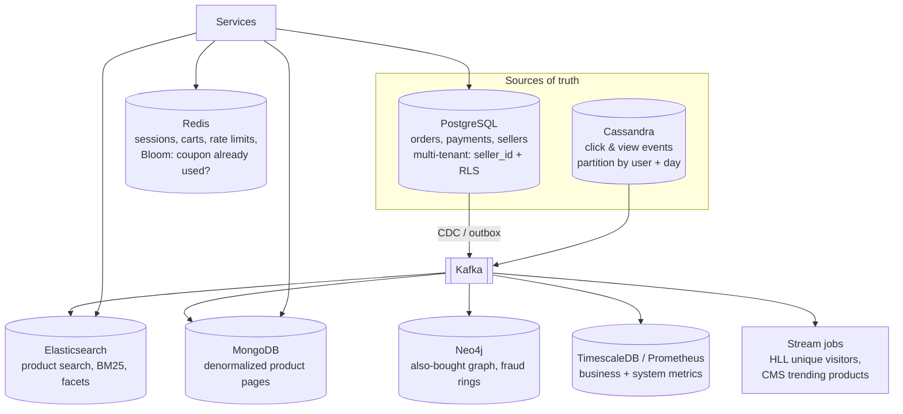

| Need in the marketplace | Pattern / store |
|---|---|
| Orders and payments must be correct | Relational DB, transactions, source of truth |
| Thousands of sellers on one platform | Multi-tenancy (shared schema + RLS, big sellers on their own stamp) |
| Search box with typos and filters | Search engine fed by CDC |
| Product page in one fast read | Denormalized document (category name, seller name, rating copied in) |
| Billions of click events | Wide-column store with time-bucketed partitions |
| "Customers also bought", fraud rings | Graph database |
| Sessions, carts, rate limits | Key-value / in-memory store with TTL |
| Dashboards over time | Time-series DB with rollups and retention |
| Unique visitors, trending items, "seen before?" | HyperLogLog, Count-Min Sketch, Bloom filter |
| Audit of what users asked for | Command log next to the event store (command sourcing for audit, events for truth) |
| Users DB, catalogue DB, orders DB on separate servers | Database federation (then sharding per DB if needed) |

**Look-alike patterns**

| Pair | Difference |
|---|---|
| Wide-column vs columnar | Partitioned sorted rows for writes and key lookups (Cassandra) vs column files for analytics scans (ClickHouse, BigQuery) |
| Key-value vs document | Opaque value, lookup by key only vs queryable nested fields and secondary indexes |
| Federation vs sharding | Split by function vs split rows of one table |
| Denormalization vs materialized view | Copies of fields inside records vs a whole precomputed query result |
| Command vs event sourcing | Re-execute intentions vs re-apply facts |
| Bloom filter vs HyperLogLog | "Is X in the set?" vs "How many distinct items?" |

### 📘 Terms Explained

| Term | Meaning |
|---|---|
| **Stream job** | A continuously running computation over events (Kafka Streams, Flink, Spark Streaming) |
| **Fed by CDC** | Kept up to date from a database's change log |
| **Look-alike patterns** | Patterns with similar names or shapes that solve different problems |

---

# 14. Data Storage Patterns Cheat Sheet

| Pattern / store | Best for | Avoid for | Key Java / Spring tools | Interview trap |
|---|---|---|---|---|
| **Polyglot persistence** **(Interview Imp - Java)** | Different access patterns at scale | Small systems (ops cost) | Multiple Spring Data modules | One source of truth; no dual writes |
| **Key-value / in-memory** **(Interview Imp - Java)** | Sessions, caches, counters, rate limits | Ad-hoc queries, sole copy of key data | Spring Data Redis, Caffeine | Eviction policy, RDB vs AOF, hot keys |
| **Document** **(Interview Imp - Java)** | Aggregates, variable attributes | Many-to-many joins everywhere | Spring Data MongoDB | Embed vs reference; schema lives in code |
| **Wide-column** | Massive writes, time-ordered per key | Ad-hoc queries, small data | Spring Data Cassandra | Query-first tables; tombstones; bucketing |
| **Graph** **(Interview Imp - Java)** | Multi-hop relationships, fraud, recommendations | Global aggregations | Spring Data Neo4j | Index-free adjacency; supernodes |
| **Time-series** | Metrics, IoT, monitoring | Updating individual points | Micrometer, TimescaleDB, PromQL | Label cardinality; rollups keep sum+count |
| **Search engine** **(Interview Imp - Java)** | Full-text, relevance, facets | Source of truth | Spring Data Elasticsearch | Analyzer, inverted index, BM25, NRT refresh |
| **Multi-tenancy** **(Interview Imp - Java)** | SaaS cost efficiency | Customers demanding full isolation (use silos) | Hibernate `@TenantId`, `AbstractRoutingDataSource`, Postgres RLS | Tenant from token, clear ThreadLocal, tenant in cache keys |
| **Denormalization** **(Interview Imp - Java)** | Read-heavy, rarely changing data | Fast-changing values | Events/CDC to update copies | Update anomalies, write fan-out |
| **Federation** | One DB server overloaded by many functions | Data that must be joined constantly | Multiple DataSources | Federation ≠ sharding |
| **Command sourcing** | Deterministic engines, intent audit | Logic/rules that change; side effects | Axon, journaling | Replay differs unless inputs recorded |
| **Bloom filter** **(Interview Imp - Java)** | "Definitely not" checks | When any false positive is unacceptable alone | Guava, RedisBloom | No false negatives; can't delete |
| **Count-Min Sketch** | Frequencies, heavy hitters | Exact counts of rare items | RedisBloom CMS, DataSketches | Over-counts only; take the min |
| **HyperLogLog** **(Interview Imp - Java)** | Distinct counts at scale | Listing the items | Redis `PFADD`/`PFCOUNT`/`PFMERGE` | ~12 KB, ~0.81% error, mergeable |

**Top interview one-liners**
```
Choose a DB by access pattern; default relational; derived stores fed by CDC
Redis: in-memory KV, TTL + eviction, RDB/AOF; LRU in Java = LinkedHashMap(accessOrder) + removeEldestEntry
Mongo: model around reads, embed owned+bounded data, single-doc atomicity
Cassandra: one table per query, (partition) + clustering keys, LSM writes, tombstones, R + W > RF
Neo4j: relationships are pointers -> hops cost per neighbourhood, not per table size
TSDB: append by time, delta-of-delta compression, rollups + retention, low label cardinality
Elasticsearch: analyzer -> inverted index -> BM25; text vs keyword; never the source of truth
Multi-tenancy: pool / bridge / silo; tenant from JWT; app filter + RLS; clear the ThreadLocal
Denormalize what is read often and changes rarely; federation splits by function, sharding by rows
Bloom = maybe/no, CMS = min of counters, HLL = max leading zeros; all tiny and mergeable
```

### 📘 Terms Explained

| Term | Meaning |
|---|---|
| **Interview trap** | A detail interviewers often probe to check real understanding |
| **One-liner** | A short, memorable answer you can expand on in an interview |
