# Integration Patterns

> **Note**: Patterns marked with **(Interview Imp - Java)** are frequently asked in Java interviews
>
> **How to read this file:** Every section ends with a **📘 Terms Explained** table. If you see a word you don't know, check the table right below that section. Each pattern goes from the basic idea to advanced usage (a plain Java example, then Spring Integration / Apache Camel / Kafka / JMS code, pros and cons, pitfalls) and ends with interview questions and a mini cheat sheet.
>
> **What are integration patterns?** They answer: *"How do separate applications, often written by different teams, in different languages, years apart, exchange data reliably?"* They come from Gregor Hohpe and Bobby Woolf's book *Enterprise Integration Patterns* (EIP, 2003), which is the vocabulary behind **Spring Integration**, **Apache Camel**, MuleSoft and most message brokers. This file covers all 38 **Integration Patterns** in the [master list](../00_Design_Patterns_Complete_List.md#integration-patterns).
>
> **Builds on (linked, not repeated):** [04_Messaging_Pattern.md](../03_System_Design/04_Messaging_Pattern.md) already covers the core messaging patterns in depth: [message queue / point-to-point and competing consumers](../03_System_Design/04_Messaging_Pattern.md#1-message-queue-pattern-interview-imp---java), [publish-subscribe](../03_System_Design/04_Messaging_Pattern.md#2-publish-subscribe-pub-sub-pattern-interview-imp---java), [request-reply](../03_System_Design/04_Messaging_Pattern.md#3-request-reply-pattern), [message router](../03_System_Design/04_Messaging_Pattern.md#7-message-router-pattern), [message translator](../03_System_Design/04_Messaging_Pattern.md#8-message-translator-pattern), [content-based router](../03_System_Design/04_Messaging_Pattern.md#9-content-based-router-pattern), [correlation identifier](../03_System_Design/04_Messaging_Pattern.md#10-correlation-identifier-pattern), [dead letter queue](../03_System_Design/04_Messaging_Pattern.md#11-dead-letter-queue-pattern-interview-imp---java), [idempotent consumer](../03_System_Design/04_Messaging_Pattern.md#12-idempotent-consumer-pattern-interview-imp---java) and [guaranteed delivery / transactional outbox](../03_System_Design/04_Messaging_Pattern.md#13-guaranteed-delivery-and-the-transactional-outbox-interview-imp---java). This file covers **everything else** in the EIP catalogue, and summarises those with a link where they belong to a group. Sagas are in [02_Microservices_Pattern.md](02_Microservices_Pattern.md#5-saga-pattern-interview-imp---java); the Anti-Corruption Layer in [01_Architectural_Pattern.md](../02_HLD/01_Architectural_Pattern.md#123-strategic-ddd-bounded-contexts-and-context-maps).
>
> **Verified code:** Every main "Complete Java Example" is **plain Java 17 (no libraries)**: small in-memory channels and brokers on a virtual clock stand in for RabbitMQ/Kafka/JMS. Each was compiled and run **three times** with identical output. To run one, save it as `<ClassName>.java` and run `javac <ClassName>.java && java <ClassName>`. (Running it directly with `java <ClassName>.java` won't work when the class with `main` is not the first class in the file.) The Spring Integration / Camel / Kafka / JMS snippets show real APIs but are illustrations, not compiled projects.

---

## Table of Contents
0. [Before You Start: The EIP Map](#before-you-start-the-eip-map)
1. [Integration Styles: File Transfer, Shared Database, RPC, Messaging](#1-integration-styles-file-transfer-shared-database-rpc-messaging-interview-imp---java) **(Interview Imp - Java)**
   - [1.1 What Are They?](#11-what-are-they)
   - [1.2 Why Does the Choice Matter?](#12-why-does-the-choice-matter)
   - [1.3 How They Compare](#13-how-they-compare)
   - [1.4 Complete Java Example - Four Ways to Tell Billing About an Order](#14-complete-java-example---four-ways-to-tell-billing-about-an-order)
   - [1.5 In the Java World](#15-in-the-java-world)
   - [1.6 Pros, Cons, Pitfalls, Interview Questions and Cheat Sheet](#16-pros-cons-pitfalls-interview-questions-and-cheat-sheet)
   - [1.7 Types and Variants](#17-types-and-variants)
2. [Channel Patterns](#2-channel-patterns-interview-imp---java) **(Interview Imp - Java)**
   - [2.1 What Are They?](#21-what-are-they)
   - [2.2 Why Do We Need Them?](#22-why-do-we-need-them)
   - [2.3 How They Work](#23-how-they-work)
   - [2.4 Complete Java Example - Datatype, Invalid, Dead Letter, Adapter, Bridge, Bus](#24-complete-java-example---datatype-invalid-dead-letter-adapter-bridge-bus)
   - [2.5 In Spring Integration, RabbitMQ, Kafka and Camel](#25-in-spring-integration-rabbitmq-kafka-and-camel)
   - [2.6 Pros, Cons, Pitfalls, Interview Questions and Cheat Sheet](#26-pros-cons-pitfalls-interview-questions-and-cheat-sheet)
3. [Endpoint Patterns: Messaging Gateway, Service Activator, Transactional Client](#3-endpoint-patterns-messaging-gateway-service-activator-transactional-client-interview-imp---java) **(Interview Imp - Java)**
   - [3.1 What Are They?](#31-what-are-they)
   - [3.2 Why Do We Need Them?](#32-why-do-we-need-them)
   - [3.3 How They Work](#33-how-they-work)
   - [3.4 Complete Java Example - Gateway, Activator and a Transactional Consumer](#34-complete-java-example---gateway-activator-and-a-transactional-consumer)
   - [3.5 In Spring Integration, JMS and Kafka](#35-in-spring-integration-jms-and-kafka)
   - [3.6 Pros, Cons, Pitfalls, Interview Questions and Cheat Sheet](#36-pros-cons-pitfalls-interview-questions-and-cheat-sheet)
4. [Consumer Patterns: Polling, Event-Driven, Selective, Durable, Dispatcher](#4-consumer-patterns-polling-event-driven-selective-durable-dispatcher-interview-imp---java) **(Interview Imp - Java)**
   - [4.1 What Are They?](#41-what-are-they)
   - [4.2 Why Do We Need Them?](#42-why-do-we-need-them)
   - [4.3 How They Work](#43-how-they-work)
   - [4.4 Complete Java Example - Polling Cost, Selectors, Durability, Dispatching](#44-complete-java-example---polling-cost-selectors-durability-dispatching)
   - [4.5 In Spring (JMS, Kafka, Spring Integration)](#45-in-spring-jms-kafka-spring-integration)
   - [4.6 Pros, Cons, Pitfalls, Interview Questions and Cheat Sheet](#46-pros-cons-pitfalls-interview-questions-and-cheat-sheet)
5. [Message Construction: Envelope Wrapper, Format Indicator, Message Expiration, Claim Check](#5-message-construction-envelope-wrapper-format-indicator-message-expiration-claim-check)
   - [5.1 What Are They?](#51-what-are-they)
   - [5.2 Why Do We Need Them?](#52-why-do-we-need-them)
   - [5.3 How They Work](#53-how-they-work)
   - [5.4 Complete Java Example - Headers, Versions, TTLs and Claim Checks](#54-complete-java-example---headers-versions-ttls-and-claim-checks)
   - [5.5 In Spring Integration, Kafka, RabbitMQ and Camel](#55-in-spring-integration-kafka-rabbitmq-and-camel)
   - [5.6 Pros, Cons, Pitfalls, Interview Questions and Cheat Sheet](#56-pros-cons-pitfalls-interview-questions-and-cheat-sheet)
6. [Message Transformation: Canonical Data Model, Normalizer, Content Enricher, Content Filter](#6-message-transformation-canonical-data-model-normalizer-content-enricher-content-filter)
   - [6.1 What Are They?](#61-what-are-they)
   - [6.2 Why Do We Need Them?](#62-why-do-we-need-them)
   - [6.3 How They Work](#63-how-they-work)
   - [6.4 Complete Java Example - Three Partner Formats, One Canonical Order](#64-complete-java-example---three-partner-formats-one-canonical-order)
   - [6.5 In Spring Integration and Camel](#65-in-spring-integration-and-camel)
   - [6.6 Pros, Cons, Pitfalls, Interview Questions and Cheat Sheet](#66-pros-cons-pitfalls-interview-questions-and-cheat-sheet)
7. [Splitter and Aggregator](#7-splitter-and-aggregator-interview-imp---java) **(Interview Imp - Java)**
   - [7.1 What Are They?](#71-what-are-they)
   - [7.2 Why Do We Need Them?](#72-why-do-we-need-them)
   - [7.3 How They Work: Correlation, Completion and Timeouts](#73-how-they-work-correlation-completion-and-timeouts)
   - [7.4 Complete Java Example - Split an Order, Aggregate Out-of-Order Results](#74-complete-java-example---split-an-order-aggregate-out-of-order-results)
   - [7.5 In Spring Integration, Camel and Kafka Streams](#75-in-spring-integration-camel-and-kafka-streams)
   - [7.6 Pros, Cons, Pitfalls, Interview Questions and Cheat Sheet](#76-pros-cons-pitfalls-interview-questions-and-cheat-sheet)
8. [Resequencer](#8-resequencer)
   - [8.1 What Is It?](#81-what-is-it)
   - [8.2 Why Do We Need It?](#82-why-do-we-need-it)
   - [8.3 How It Works](#83-how-it-works)
   - [8.4 Complete Java Example - Reordering a Ledger Stream with a Gap Timeout](#84-complete-java-example---reordering-a-ledger-stream-with-a-gap-timeout)
   - [8.5 In Spring Integration, Camel and Kafka](#85-in-spring-integration-camel-and-kafka)
   - [8.6 Pros, Cons, Pitfalls, Interview Questions and Cheat Sheet](#86-pros-cons-pitfalls-interview-questions-and-cheat-sheet)
   - [8.7 Types and Variants](#87-types-and-variants)
9. [Scatter-Gather and Composed Message Processor](#9-scatter-gather-and-composed-message-processor)
   - [9.1 What Are They?](#91-what-are-they)
   - [9.2 Why Do We Need Them?](#92-why-do-we-need-them)
   - [9.3 How They Work](#93-how-they-work)
   - [9.4 Complete Java Example - Best Courier Quote and Per-Warehouse Routing](#94-complete-java-example---best-courier-quote-and-per-warehouse-routing)
   - [9.5 In Spring Integration and Camel](#95-in-spring-integration-and-camel)
   - [9.6 Pros, Cons, Pitfalls, Interview Questions and Cheat Sheet](#96-pros-cons-pitfalls-interview-questions-and-cheat-sheet)
10. [Routing Slip and Process Manager](#10-routing-slip-and-process-manager)
    - [10.1 What Are They?](#101-what-are-they)
    - [10.2 Why Do We Need Them?](#102-why-do-we-need-them)
    - [10.3 How They Work](#103-how-they-work)
    - [10.4 Complete Java Example - Document Pipeline vs Loan Application](#104-complete-java-example---document-pipeline-vs-loan-application)
    - [10.5 In Spring Integration, Camel and Workflow Engines](#105-in-spring-integration-camel-and-workflow-engines)
    - [10.6 Pros, Cons, Pitfalls, Interview Questions and Cheat Sheet](#106-pros-cons-pitfalls-interview-questions-and-cheat-sheet)
11. [Message Store](#11-message-store)
    - [11.1 What Is It?](#111-what-is-it)
    - [11.2 Why Do We Need It?](#112-why-do-we-need-it)
    - [11.3 How It Works](#113-how-it-works)
    - [11.4 Complete Java Example - Audit Trail, Statistics and Replay](#114-complete-java-example---audit-trail-statistics-and-replay)
    - [11.5 In Spring Integration, Camel and Kafka](#115-in-spring-integration-camel-and-kafka)
    - [11.6 Pros, Cons, Pitfalls, Interview Questions and Cheat Sheet](#116-pros-cons-pitfalls-interview-questions-and-cheat-sheet)
12. [How the Integration Patterns Fit Together](#12-how-the-integration-patterns-fit-together)
    - [12.1 One-Line Summary of Each](#121-one-line-summary-of-each)
    - [12.2 One Order Through an Integration Flow (Interview Imp - Java)](#122-one-order-through-an-integration-flow-interview-imp---java)
    - [12.3 Spring Integration and Apache Camel Equivalents](#123-spring-integration-and-apache-camel-equivalents)
    - [12.4 Decision Guide](#124-decision-guide)
    - [12.5 Look-Alike Concepts](#125-look-alike-concepts)
13. [Integration Patterns Cheat Sheet](#13-integration-patterns-cheat-sheet)

---

## Before You Start: The EIP Map

EIP describes a **message** travelling from a **sending application**, through **channels** and **processing steps**, to a **receiving application**. Every pattern fits one of these groups:

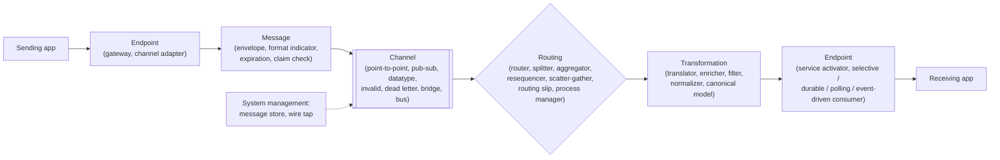

| Group | Patterns in this file | Covered in 04_Messaging_Pattern.md |
|---|---|---|
| **Integration styles** | File Transfer, Shared Database, Remote Procedure Call, Messaging | Messaging basics |
| **Channels** | Datatype, Invalid Message, Message Bus, Channel Adapter, Message Bridge | Point-to-Point, Publish-Subscribe, Dead Letter, Guaranteed Delivery |
| **Message construction** | Envelope Wrapper, Format Indicator, Message Expiration, Claim Check | Request-Reply, Correlation Identifier |
| **Routing** | Splitter, Aggregator, Resequencer, Composed Message Processor, Scatter-Gather, Routing Slip, Process Manager | Message Router, Content-Based Router |
| **Transformation** | Canonical Data Model, Normalizer, Content Enricher, Content Filter | Message Translator |
| **Endpoints** | Messaging Gateway, Service Activator, Transactional Client, Polling / Event-Driven / Selective / Durable consumers, Message Dispatcher | Competing Consumers, Idempotent Receiver |
| **System management** | Message Store | — |

#### 📘 Terms Explained

| Term | Simple meaning |
|---|---|
| **EIP** | *Enterprise Integration Patterns*, the 2003 book and catalogue of 65 messaging patterns. |
| **Integration** | Making separate applications work together by exchanging data or calling each other. |
| **Message** | A packet of data (headers + body/payload) sent through a channel. |
| **Channel** | A named pipe that carries messages from senders to receivers (a queue or topic). |
| **Endpoint** | The code that connects an application to a messaging channel. |
| **Spring Integration / Apache Camel** | Java frameworks that implement the EIP patterns as configurable building blocks. |

---

# 1. Integration Styles: File Transfer, Shared Database, RPC, Messaging (Interview Imp - Java)

## 1.1 What Are They?

EIP names four basic ways for two applications to share data:

| Style | How | Example |
|---|---|---|
| **File Transfer** | One app writes a file; the other reads it later | Nightly CSV export to the bank, SFTP drops, data-lake dumps |
| **Shared Database** | Both apps read and write the **same database** | Billing queries the Orders tables directly |
| **Remote Procedure Call (RPC)** | One app **calls a function** in the other over the network and waits for the result | REST, gRPC, SOAP, Java RMI, OpenFeign |
| **Messaging** | One app **sends a message** to a channel; the other receives it asynchronously | RabbitMQ, Kafka, JMS (ActiveMQ/IBM MQ), SQS |

**Analogy:** Sharing news with a colleague. **File transfer:** leave a printed report in their tray for tomorrow. **Shared database:** both of you write in the same notebook (and argue about its format). **RPC:** phone them and wait on the line until they answer. **Messaging:** send a WhatsApp message: they read it when they can, and it waits safely until then.

#### 📘 Terms Explained

| Term | Simple meaning |
|---|---|
| **Integration style** | A basic approach to connecting applications (files, shared DB, calls, messages). |
| **Temporal coupling** | Both applications must be running at the same time for the exchange to work. |
| **Schema coupling** | Applications depend on the same data structure, so changing it affects all of them. |
| **Batch** | Processing data in large groups at intervals (e.g. nightly) instead of immediately. |
| **gRPC** | A high-performance RPC framework using HTTP/2 and Protocol Buffers. |

---

## 1.2 Why Does the Choice Matter?

The choice sets **how fresh** the data is, **how coupled** the applications are, and **what happens when one is down**:

| | File Transfer | Shared Database | RPC | Messaging |
|---|---|---|---|---|
| Data freshness | Hours (batch) | Immediate | Immediate | Near real-time |
| Works when the other app is down? | ✅ | ✅ (DB must be up) | ❌ caller fails | ✅ messages wait |
| Schema/format coupling | File format | **Tables (strongest)** | API contract | Message contract |
| Temporal coupling | None | None | **Strong** | None |
| Encapsulation of each app's data | Good | **Broken** | Good | Good |
| Complexity | Low | Low (at first) | Low-medium | Medium (broker, async thinking) |
| Typical today | Partner/B2B, banking, analytics exports | Legacy systems; reporting replicas | Queries, synchronous commands, BFFs | Events, commands, workflows between services |

---

## 1.3 How They Compare

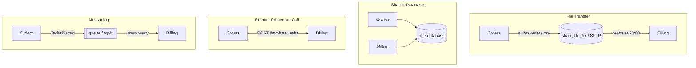

Most real systems mix them: **RPC** for queries that need an answer now, **messaging** for events and commands between services, **file transfer** for partners and bulk data, and the **shared database** only where it can't be avoided (and then preferably read-only, through views or a replica).

---

## 1.4 Complete Java Example - Four Ways to Tell Billing About an Order

Orders must tell Billing about four orders; Billing is **down from 10:00 to 10:30**.

```java
import java.util.ArrayDeque;
import java.util.ArrayList;
import java.util.Deque;
import java.util.LinkedHashMap;
import java.util.List;
import java.util.Map;

// The four integration styles (Hohpe & Woolf): File Transfer, Shared Database, Remote Procedure Call, Messaging.
// Scenario: the Orders app must tell the Billing app about new orders. Billing is DOWN from 10:00 to 10:30.

public class IntegrationStylesDemo {
    record OrderEvt(String id, int minute, long paise) {}            // minute = minutes after 09:00

    static final List<OrderEvt> ORDERS = List.of(new OrderEvt("O1", 30, 499_00), new OrderEvt("O2", 65, 1_299_00),
            new OrderEvt("O3", 80, 799_00), new OrderEvt("O4", 120, 2_499_00));
    static boolean billingUp(int minute) { return minute < 60 || minute >= 90; }     // down 10:00-10:30
    static String t(int minute) { return String.format("%02d:%02d", 9 + minute / 60, minute % 60); }

    public static void main(String[] args) {
        System.out.println("=== 1) FILE TRANSFER: Orders writes orders.csv; Billing imports it nightly at 23:00 ===");
        StringBuilder csv = new StringBuilder("id,amount\n");
        for (OrderEvt o : ORDERS) csv.append(o.id()).append(',').append(o.paise()).append('\n');
        int importAt = 14 * 60;                                          // 23:00
        System.out.println("  file:\n    " + csv.toString().trim().replace("\n", "\n    "));
        System.out.println("  billed at " + t(importAt) + " -> O1 waited " + (importAt - 30) / 60 + " h; outage didn't matter; data is STALE all day");

        System.out.println("=== 2) SHARED DATABASE: Billing reads the Orders tables directly ===");
        Map<String, Object> ordersTable = new LinkedHashMap<>(Map.of("id", "VARCHAR", "amount", "BIGINT"));
        System.out.println("  billing query: SELECT id, amount FROM orders  -> works, data is fresh");
        ordersTable.remove("amount"); ordersTable.put("total_paise", "BIGINT");   // Orders team renames a column
        System.out.println("  Orders team renames amount -> total_paise for their own reasons");
        System.out.println("  billing query now fails: " + (ordersTable.containsKey("amount") ? "ok" : "ERROR column \"amount\" does not exist")
                + "  -> two apps coupled through one schema");

        System.out.println("=== 3) RPC: Orders calls POST billing/invoices synchronously during checkout ===");
        for (OrderEvt o : ORDERS) {
            boolean up = billingUp(o.minute());
            System.out.println("  " + t(o.minute()) + " " + o.id() + " -> " + (up ? "invoice created immediately" : "Billing unavailable -> checkout FAILS (or must retry/compensate)"));
        }

        System.out.println("=== 4) MESSAGING: Orders sends OrderPlaced to a durable queue; Billing consumes when it can ===");
        Deque<OrderEvt> queue = new ArrayDeque<>(); List<String> billed = new ArrayList<>(); int next = 0;
        for (int minute = 0; minute <= 180; minute++) {
            while (next < ORDERS.size() && ORDERS.get(next).minute() == minute) {
                queue.add(ORDERS.get(next)); System.out.println("  " + t(minute) + " " + ORDERS.get(next).id() + " published (checkout succeeds)"); next++;
            }
            if (billingUp(minute) && !queue.isEmpty()) {
                OrderEvt o = queue.poll();
                billed.add(o.id() + "@" + t(minute) + (minute - o.minute() > 0 ? " (waited " + (minute - o.minute()) + " min)" : ""));
            }
        }
        System.out.println("  billed: " + billed);
        System.out.println("  -> no lost orders, no failed checkouts, near-real-time when both are up, no shared schema");
    }
}
```

**Output:**
```
=== 1) FILE TRANSFER: Orders writes orders.csv; Billing imports it nightly at 23:00 ===
  file:
    id,amount
    O1,49900
    O2,129900
    O3,79900
    O4,249900
  billed at 23:00 -> O1 waited 13 h; outage didn't matter; data is STALE all day
=== 2) SHARED DATABASE: Billing reads the Orders tables directly ===
  billing query: SELECT id, amount FROM orders  -> works, data is fresh
  Orders team renames amount -> total_paise for their own reasons
  billing query now fails: ERROR column "amount" does not exist  -> two apps coupled through one schema
=== 3) RPC: Orders calls POST billing/invoices synchronously during checkout ===
  09:30 O1 -> invoice created immediately
  10:05 O2 -> Billing unavailable -> checkout FAILS (or must retry/compensate)
  10:20 O3 -> Billing unavailable -> checkout FAILS (or must retry/compensate)
  11:00 O4 -> invoice created immediately
=== 4) MESSAGING: Orders sends OrderPlaced to a durable queue; Billing consumes when it can ===
  09:30 O1 published (checkout succeeds)
  10:05 O2 published (checkout succeeds)
  10:20 O3 published (checkout succeeds)
  11:00 O4 published (checkout succeeds)
  billed: [O1@09:30, O2@10:30 (waited 25 min), O3@10:31 (waited 11 min), O4@11:00]
  -> no lost orders, no failed checkouts, near-real-time when both are up, no shared schema
```

What the output shows:
- **File transfer** was immune to the outage, but O1 waited **13 hours** to be billed.
- **Shared database** gave fresh data until the Orders team renamed a column for their own reasons, and Billing broke: the two apps are coupled through the schema.
- **RPC** was instant when Billing was up, but **two checkouts failed** during the outage (or would need retries and compensation).
- **Messaging** accepted every checkout; O2 and O3 waited in the queue and were billed when Billing came back (25 and 11 minutes late). No lost orders, no shared schema.

---

## 1.5 In the Java World

| Style | Java / Spring tools |
|---|---|
| File Transfer | Spring Batch (`FlatFileItemReader`), Spring Integration `Files`/`Sftp` adapters, Apache Camel `file:`/`sftp:` components |
| Shared Database | JDBC/JPA on both sides; better: DB views, read replicas, or **CDC** (Debezium) to turn table changes into messages ([05_Data_Management_Pattern.md](../03_System_Design/05_Data_Management_Pattern.md#9-change-data-capture-cdc-pattern)) |
| RPC | Spring `RestClient`/`WebClient`, OpenFeign, `@HttpExchange` clients, gRPC-Java, Spring for GraphQL ([08_API_Design_Pattern.md](../03_System_Design/08_API_Design_Pattern.md)) |
| Messaging | Spring for Apache Kafka, Spring AMQP (RabbitMQ), Spring JMS, Spring Cloud Stream, Spring Integration, Apache Camel ([04_Messaging_Pattern.md](../03_System_Design/04_Messaging_Pattern.md)) |

---

## 1.6 Pros, Cons, Pitfalls, Interview Questions and Cheat Sheet

| Style | Pros | Cons |
|---|---|---|
| **File Transfer** | Simple, universal, decoupled in time, good for bulk | Stale data, partial/duplicate files, manual error handling |
| **Shared Database** | Immediate consistency, no extra infrastructure | Breaks encapsulation; schema changes break others; contention |
| **RPC** | Simple request-response, familiar programming model | Temporal coupling, cascading failures, latency adds up |
| **Messaging** | Decoupled in time and space, buffering, reliable delivery, fan-out | Broker to operate, eventual consistency, harder debugging |

| Pitfall | Fix |
|---|---|
| Treating remote calls like local calls ("the network is reliable") | Timeouts, retries, circuit breakers ([02_Reliability_Pattern.md](../03_System_Design/02_Reliability_Pattern.md)). |
| Several services writing the same tables | Database per service; integrate via APIs/events. |
| Reading half-written files | Write to a temp name and rename atomically; use `.done` marker files. |
| Using messaging for queries that need an immediate answer | Use RPC for queries; messaging for events/commands. |

**Q1. What are the four integration styles?** File transfer, shared database, remote procedure call and messaging. They differ in freshness, coupling and failure behaviour; messaging gives the loosest coupling with near-real-time delivery.

**Q2. Why is a shared database considered an anti-pattern between services?** It couples services through the schema, breaks encapsulation (anyone can change any data), creates contention, and prevents independent deployment.

**Q3. RPC vs messaging?** RPC is synchronous and needs the other side to be up (temporal coupling) but gives an immediate answer; messaging is asynchronous, buffered and survives outages, at the cost of eventual consistency.

```
STYLES   File Transfer (batch, stale, decoupled) | Shared Database (fresh, schema-coupled - avoid between services) |
         RPC (sync, temporal coupling: REST/gRPC/Feign) | Messaging (async, buffered, decoupled: Kafka/RabbitMQ/JMS).
         Mix: RPC for queries, messaging for events/commands, files for partners/bulk, CDC instead of shared DB.
```

---

## 1.7 Types and Variants

| Style | Coupling | Timeliness | Typical Java tooling |
|---|---|---|---|
| **File transfer** | Low (agreed format only) | Batch (hours) | Spring Batch, SFTP (Spring Integration), CSV/fixed-width parsers |
| **Shared database** | High (schema coupling) | Immediate | JDBC/JPA on the same schema (anti-pattern between services) |
| **Remote procedure call** | Medium-high (synchronous, interface coupling) | Immediate | REST (`RestClient`, Feign), gRPC, SOAP (JAX-WS) |
| **Messaging** | Low (asynchronous, broker in between) | Near real time | JMS, AMQP (RabbitMQ), Kafka, Spring Integration/Camel |
| **Event streaming / CDC** | Low | Near real time | Kafka + Debezium, Kafka Connect |
| **API-led / iPaaS** | Medium | Varies | MuleSoft, Apache Camel K, Boomi |

# 2. Channel Patterns (Interview Imp - Java)

## 2.1 What Are They?

| Pattern | What it is | Where covered |
|---|---|---|
| **Point-to-Point Channel** | Each message is consumed by **exactly one** receiver (a queue) | [Messaging §1](../03_System_Design/04_Messaging_Pattern.md#1-message-queue-pattern-interview-imp---java) |
| **Publish-Subscribe Channel** | Each message is delivered to **every** subscriber (a topic) **(Interview Imp - Java)** | [Messaging §2](../03_System_Design/04_Messaging_Pattern.md#2-publish-subscribe-pub-sub-pattern-interview-imp---java) |
| **Datatype Channel** | A separate channel **per message type**, so receivers know what they're getting | here |
| **Invalid Message Channel** | Where a receiver puts messages it **can't understand** (malformed, unknown version) | here |
| **Dead Letter Channel** | Where the messaging system puts messages it **can't deliver or process** after retries **(Interview Imp - Java)** | here + [Messaging §11](../03_System_Design/04_Messaging_Pattern.md#11-dead-letter-queue-pattern-interview-imp---java) |
| **Guaranteed Delivery** | Messages are **persisted** so they survive broker/app crashes **(Interview Imp - Java)** | [Messaging §13](../03_System_Design/04_Messaging_Pattern.md#13-guaranteed-delivery-and-the-transactional-outbox-interview-imp---java) |
| **Channel Adapter** | Connects an application or system that **doesn't speak messaging** (files, DB, HTTP, email) to a channel | here |
| **Message Bridge** | Connects **two different messaging systems** so messages flow between them | here |
| **Message Bus** | Shared messaging infrastructure + agreed channels and formats, so apps plug in like devices on a hardware bus **(Interview Imp - Java)** | here |

**Analogy:** A postal system. **Point-to-point:** a registered letter to one person. **Pub-sub:** a newsletter to all subscribers. **Datatype channel:** separate counters for parcels, letters and money orders. **Invalid message channel:** the "unreadable address" bin. **Dead letter channel:** the "undeliverable mail" office. **Channel adapter:** a scanning service that turns your paper bills into emails. **Message bridge:** the agreement between two countries' postal services. **Message bus:** the whole national postal network with its standard addresses and envelope sizes.

#### 📘 Terms Explained

| Term | Simple meaning |
|---|---|
| **Queue / topic** | Point-to-point channel / publish-subscribe channel. |
| **Invalid message** | A message the receiver can't parse or doesn't understand. |
| **Dead letter** | A valid message that couldn't be delivered or processed after retries. |
| **Adapter** | A component that translates between a non-messaging system and a channel. |
| **Bridge** | A component that copies messages between two messaging systems. |
| **Message bus** | An architecture where apps share a common messaging backbone, channel names and formats. |

---

## 2.2 Why Do We Need Them?

| Problem | Pattern |
|---|---|
| One channel carries orders, refunds and stock updates; every consumer must inspect and guess the type | **Datatype channels**: `orders.v1`, `refunds.v1`, `stock.v1` |
| A malformed message blocks the consumer or is silently dropped | **Invalid message channel**: park it, alert the sender |
| A message fails forever (downstream bug) and gets retried endlessly (poison message) | **Dead letter channel** after N attempts |
| A legacy app writes files or DB rows, not messages | **Channel adapter** (file/JDBC/HTTP inbound adapter) |
| On-prem IBM MQ must feed cloud Kafka during a migration | **Message bridge** (Kafka Connect, Camel route, Solace bridge) |
| Every new app negotiates its own point-to-point links | **Message bus**: plug in to the shared backbone |

**Invalid vs dead letter:** an *invalid* message is the **sender's** fault (bad format); a *dead letter* is a **valid** message the system couldn't deliver or process (receiver down, business error, retries exhausted). Keep them separate: they need different people to fix them.

---

## 2.3 How They Work

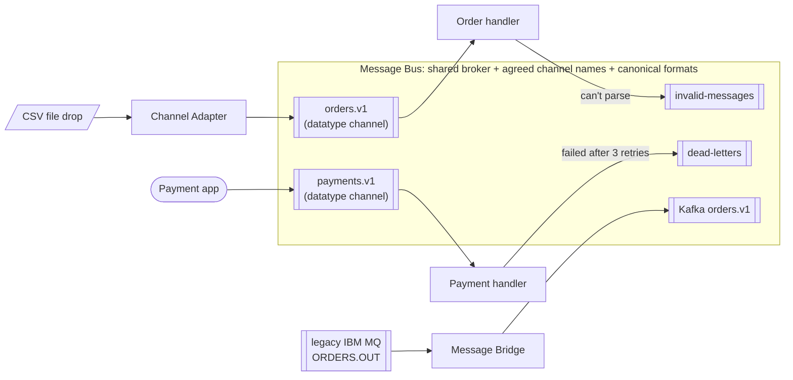

---

## 2.4 Complete Java Example - Datatype, Invalid, Dead Letter, Adapter, Bridge, Bus

A file **channel adapter** turns CSV lines into messages on a **datatype channel**; a malformed line goes to the **invalid message channel**; a payment that keeps failing goes to the **dead letter channel** after 3 retries; a **bridge** copies a legacy MQ message into "Kafka"; the **bus** knows all channel names.

```java
import java.util.ArrayList;
import java.util.LinkedHashMap;
import java.util.List;
import java.util.Map;
import java.util.function.Consumer;

// Channel patterns: Datatype Channel, Invalid Message Channel, Dead Letter Channel, Message Bus, Channel Adapter, Message Bridge.

record Msg(String type, String body, int attempts) {
    Msg retry() { return new Msg(type, body, attempts + 1); }
}

class Channel {
    final String name; final List<Consumer<Msg>> subscribers = new ArrayList<>(); final List<Msg> stored = new ArrayList<>();
    Channel(String name) { this.name = name; }
    void send(Msg m) { if (subscribers.isEmpty()) stored.add(m); else subscribers.forEach(s -> s.accept(m)); }
}

// MESSAGE BUS: shared infrastructure + agreed channel names + canonical formats, so apps plug in without knowing each other
class MessageBus {
    final Map<String, Channel> channels = new LinkedHashMap<>();
    Channel channel(String name) { return channels.computeIfAbsent(name, Channel::new); }
}

public class ChannelPatternsDemo {
    public static void main(String[] args) {
        MessageBus bus = new MessageBus();
        Channel invalid = bus.channel("invalid-messages"), dead = bus.channel("dead-letters");
        List<String> log = new ArrayList<>();

        // DATATYPE CHANNELS: one channel per message type, so a consumer always knows what it will receive
        bus.channel("orders.v1").subscribers.add(m -> {
            if (!m.body().matches("\\{\"id\":\"\\w+\",\"amount\":\\d+}")) { invalid.send(m); return; }     // can't be parsed -> INVALID
            log.add("order-handler processed " + m.body());
        });
        bus.channel("payments.v1").subscribers.add(new Consumer<>() {
            public void accept(Msg m) {
                try {
                    if (m.body().contains("\"gateway\":\"down\"")) throw new IllegalStateException("payment gateway timeout");
                    log.add("payment-handler processed " + m.body());
                } catch (IllegalStateException e) {                                                        // valid message, can't be processed
                    if (m.attempts() < 3) { log.add("  retry " + (m.attempts() + 1) + " for " + m.body()); accept(m.retry()); }
                    else dead.send(m);                                                                     // retries exhausted -> DEAD LETTER
                }
            }
        });

        // CHANNEL ADAPTER: connects a non-messaging source (a CSV file drop) to a channel
        List<String> csvFileLines = List.of("O1,49900", "O2,abc", "O3,129900");
        for (String line : csvFileLines) {
            String[] p = line.split(",");
            bus.channel("orders.v1").send(new Msg("order", "{\"id\":\"" + p[0] + "\",\"amount\":" + p[1] + "}", 0));
        }
        bus.channel("payments.v1").send(new Msg("payment", "{\"order\":\"O1\",\"gateway\":\"ok\"}", 0));
        bus.channel("payments.v1").send(new Msg("payment", "{\"order\":\"O3\",\"gateway\":\"down\"}", 0));

        // MESSAGE BRIDGE: copy messages between two messaging systems (e.g. on-prem RabbitMQ -> cloud Kafka)
        Channel legacyMq = new Channel("legacy-mq/ORDERS.OUT"), kafka = new Channel("kafka/orders.v1");
        legacyMq.subscribers.add(m -> kafka.send(new Msg(m.type(), m.body().replace("AMT=", "amount="), m.attempts())));   // bridge + light translation
        legacyMq.send(new Msg("order", "ID=O9;AMT=5000", 0));

        System.out.println("=== Processing log ===");
        log.forEach(l -> System.out.println("  " + l));
        System.out.println("=== Invalid Message Channel (malformed: fix the SENDER) ===");
        invalid.stored.forEach(m -> System.out.println("  " + m.body()));
        System.out.println("=== Dead Letter Channel (valid but undeliverable/unprocessable: investigate and replay) ===");
        dead.stored.forEach(m -> System.out.println("  " + m.body() + " after " + m.attempts() + " retries"));
        System.out.println("=== Message Bridge ===");
        System.out.println("  " + legacyMq.name + " -> " + kafka.name + ": " + kafka.stored.get(0).body() + " (stored: no Kafka consumer yet)");
        System.out.println("=== Message Bus: channels agreed by all apps ===");
        System.out.println("  " + bus.channels.keySet());
    }
}
```

**Output:**
```
=== Processing log ===
  order-handler processed {"id":"O1","amount":49900}
  order-handler processed {"id":"O3","amount":129900}
  payment-handler processed {"order":"O1","gateway":"ok"}
    retry 1 for {"order":"O3","gateway":"down"}
    retry 2 for {"order":"O3","gateway":"down"}
    retry 3 for {"order":"O3","gateway":"down"}
=== Invalid Message Channel (malformed: fix the SENDER) ===
  {"id":"O2","amount":abc}
=== Dead Letter Channel (valid but undeliverable/unprocessable: investigate and replay) ===
  {"order":"O3","gateway":"down"} after 3 retries
=== Message Bridge ===
  legacy-mq/ORDERS.OUT -> kafka/orders.v1: ID=O9;amount=5000 (stored: no Kafka consumer yet)
=== Message Bus: channels agreed by all apps ===
  [invalid-messages, dead-letters, orders.v1, payments.v1]
```

What the output shows:
- The adapter turned 3 CSV lines into messages; **O2** (`amount: abc`) couldn't be parsed and went to the **invalid message channel** (fix the sender).
- The O3 payment was a valid message but the gateway kept failing; after 3 retries it went to the **dead letter channel** (investigate, then replay).
- The **bridge** copied a legacy-format message into the Kafka-side channel, with a light translation; it's **stored** because no Kafka consumer exists yet.
- The **bus** lists the agreed channels every application can use.

---

## 2.5 In Spring Integration, RabbitMQ, Kafka and Camel

```java
// Spring Integration: channel adapter (files) -> datatype channel, with an error channel for invalid messages
@Bean
IntegrationFlow csvOrders() {
    return IntegrationFlow
            .from(Files.inboundAdapter(new File("/data/in")).patternFilter("*.csv"), e -> e.poller(Pollers.fixedDelay(Duration.ofSeconds(5))))
            .split(Files.splitter().markers(false))                     // one message per line
            .transform(OrderCsvParser::parse)                           // throws on malformed lines
            .channel("orders.v1")
            .get();
}

@Bean
IntegrationFlow invalidMessages() {                                     // errors from the flow above end up here
    return IntegrationFlow.from("errorChannel").handle(m -> alerting.notifySender(m)).get();
}
```

```yaml
# Spring Kafka: dead letter topic after retries (DefaultErrorHandler + DeadLetterPublishingRecoverer as beans), or simply:
spring:
  cloud:
    stream:
      kafka:
        bindings:
          handlePayment-in-0:
            consumer:
              enable-dlq: true                    # failed records go to error.<topic>.<group>
              dlq-name: payments.v1.DLT
      bindings:
        handlePayment-in-0:
          consumer:
            max-attempts: 3
```

```text
RabbitMQ: queue argument x-dead-letter-exchange=dlx (+ x-dead-letter-routing-key) -> rejected/expired messages go there.
Message bridge: Kafka Connect (JMS/IBM MQ source connector -> Kafka topic), RabbitMQ Shovel/Federation, or a Camel route:
    from("jms:queue:ORDERS.OUT").convertBodyTo(String.class).to("kafka:orders.v1?brokers=kafka:9092");
```

#### 📘 Terms Explained

| Term | Simple meaning |
|---|---|
| **`Files.inboundAdapter`** | Spring Integration adapter that turns files in a directory into messages. |
| **`errorChannel`** | Spring Integration's default channel for exceptions thrown in flows. |
| **`DeadLetterPublishingRecoverer`** | Spring Kafka component that publishes failed records to a dead letter topic. |
| **`x-dead-letter-exchange`** | RabbitMQ queue argument naming where rejected/expired messages go. |
| **Kafka Connect** | Kafka's framework for source/sink connectors to other systems. |
| **RabbitMQ Shovel / Federation** | RabbitMQ plugins that move messages between brokers. |

---

## 2.6 Pros, Cons, Pitfalls, Interview Questions and Cheat Sheet

| Pros | Cons |
|---|---|
| Clear, typed flows; consumers know what they get | More channels to name, secure and monitor |
| Bad messages are isolated instead of blocking flows | Invalid/dead letter channels are useless if nobody watches them |
| Adapters and bridges connect legacy and new systems | Bridges add latency and another failure point |

| Pitfall | Fix |
|---|---|
| One "everything" channel with a `type` field | Datatype channels (or at least a format indicator, [section 5](#5-message-construction-envelope-wrapper-format-indicator-message-expiration-claim-check)). |
| Mixing invalid and dead-letter messages | Separate channels, separate owners and alerts. |
| No alert or replay tool for the dead letter channel | Dashboards, alerts on depth, a replay procedure. |
| Bridges without idempotency (duplicates on restart) | At-least-once + idempotent consumers. |

**Q1. Invalid message channel vs dead letter channel?** Invalid: the receiver can't understand the message (malformed, wrong schema): the sender must fix it. Dead letter: a valid message that couldn't be delivered/processed after retries: investigate the receiver or data, then replay.

**Q2. What is a channel adapter?** A component that connects a non-messaging system (files, database, HTTP, email, FTP) to a messaging channel, in either direction.

**Q3. What is a message bus?** A shared messaging backbone with common channel names and data formats, so applications plug in and communicate without point-to-point integrations.

```
CHANNELS  Point-to-point (one receiver, queue) | Pub-sub (all subscribers, topic) | Datatype (channel per type) |
          Invalid Message (can't parse: sender's fault) | Dead Letter (valid but failed/undeliverable: retries exhausted) |
          Guaranteed Delivery (persisted) | Channel Adapter (files/DB/HTTP <-> channel) | Message Bridge (broker <-> broker) |
          Message Bus (shared backbone + agreed channels/formats). Spring Integration adapters, Kafka DLT, RabbitMQ DLX, Kafka Connect.
```

---

# 3. Endpoint Patterns: Messaging Gateway, Service Activator, Transactional Client (Interview Imp - Java)

## 3.1 What Are They?

**Endpoints** are the code at the edge of an application that sends or receives messages.

| Pattern | What it does |
|---|---|
| **Messaging Gateway** | Hides all messaging code behind a **plain Java interface**. Callers invoke `creditGateway.check(customer)`; the gateway builds the message, sends it, waits for/correlates the reply. |
| **Service Activator** | The receiving side: listens on a channel, **calls an ordinary service method** with the message payload, and (optionally) sends the return value as a reply. The service knows nothing about messaging. |
| **Transactional Client** | Makes **receiving/sending messages part of a transaction**, together with other work (DB writes), so they succeed or fail together. **(Interview Imp - Java)** |
| **Channel Adapter** | Connects a non-messaging system to a channel (see [section 2](#2-channel-patterns-interview-imp---java)). |

**Analogy:** A company's switchboard. The **gateway** is the receptionist you hand a note to ("ask Credit about Asha") who handles the internal mail and brings back the answer. The **service activator** is the clerk in the Credit department who reads incoming notes and calls the right expert. The **transactional client** is the rule that a request isn't removed from the in-tray until the expert's answer is filed.

#### 📘 Terms Explained

| Term | Simple meaning |
|---|---|
| **Messaging gateway** | A facade that hides messaging behind a domain-specific interface. |
| **Service activator** | An endpoint that invokes a plain service when a message arrives. |
| **Transactional client** | A client that sends/receives messages within a transaction. |
| **POJO** | Plain Old Java Object: a class with no framework dependencies. |
| **Ack (acknowledgement)** | Telling the broker a message has been processed and can be removed. |

---

## 3.2 Why Do We Need Them?

| Problem | Pattern |
|---|---|
| Business code full of `JmsTemplate`, headers, reply queues and correlation logic | **Messaging Gateway** |
| Service classes that can only be called from one listener; hard to unit test | **Service Activator**: the service stays a POJO |
| Message consumed and acked, then the DB write fails → message lost | **Transactional Client**: ack only if the DB commit succeeds |
| DB committed, then sending the event fails → other services never hear about it | **Transactional Client** on the sending side, usually via the [outbox](../03_System_Design/04_Messaging_Pattern.md#13-guaranteed-delivery-and-the-transactional-outbox-interview-imp---java) |

---

## 3.3 How They Work

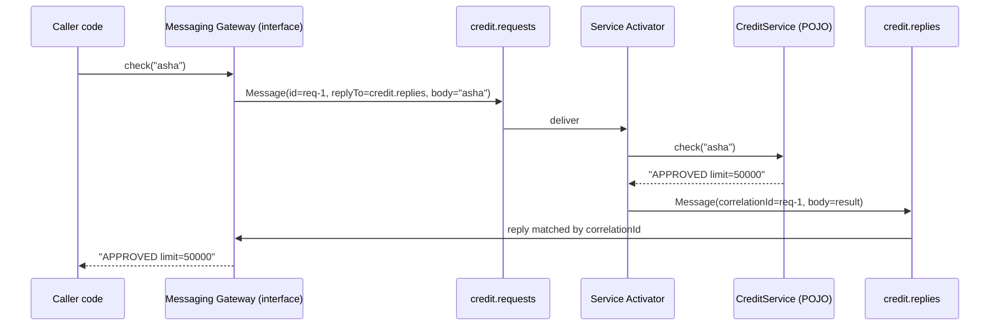

**Transactional client (receiving side):** begin transaction → receive message → write to DB → commit both (DB commit + message ack). On any failure: roll back both, so the message is **redelivered** and the DB has no half-written data. Across two different resources (DB + broker) true atomicity needs XA/2PC, so in practice you use **local transactions plus idempotent consumers**, or the outbox for sending.

---

## 3.4 Complete Java Example - Gateway, Activator and a Transactional Consumer

```java
import java.util.ArrayDeque;
import java.util.ArrayList;
import java.util.Deque;
import java.util.HashMap;
import java.util.List;
import java.util.Map;

// Messaging endpoint patterns: Messaging Gateway, Service Activator, Transactional Client.

record Message(String id, String correlationId, String replyTo, String payload) {}

class Broker {
    final Map<String, Deque<Message>> queues = new HashMap<>();
    void send(String q, Message m) { queues.computeIfAbsent(q, k -> new ArrayDeque<>()).add(m); }
    Message receive(String q) { Deque<Message> d = queues.get(q); return d == null ? null : d.poll(); }
    void requeueFront(String q, Message m) { queues.get(q).addFirst(m); }
    int depth(String q) { Deque<Message> d = queues.get(q); return d == null ? 0 : d.size(); }
}

// ---- plain business service: knows NOTHING about messaging ----
class CreditService {
    String check(String customer) { return customer.startsWith("bad") ? "REJECTED" : "APPROVED limit=50000"; }
}

// ---- SERVICE ACTIVATOR: receives a message, calls the plain service, sends the reply ----
class CreditServiceActivator {
    private final Broker broker; private final CreditService service;
    CreditServiceActivator(Broker b, CreditService s) { broker = b; service = s; }
    void pollOnce() {
        Message m = broker.receive("credit.requests");
        if (m == null) return;
        String result = service.check(m.payload());                                  // the service is a POJO
        broker.send(m.replyTo(), new Message("r-" + m.id(), m.id(), null, result));   // correlation = request id
    }
}

// ---- MESSAGING GATEWAY: the caller sees a normal Java interface; messaging details are hidden inside ----
interface CreditGateway { String check(String customer); }
class MessagingCreditGateway implements CreditGateway {
    private final Broker broker; private final CreditServiceActivator remote; private int seq = 0;
    MessagingCreditGateway(Broker b, CreditServiceActivator remote) { broker = b; this.remote = remote; }
    public String check(String customer) {
        String id = "req-" + (++seq);
        broker.send("credit.requests", new Message(id, null, "credit.replies", customer));
        remote.pollOnce();                                                           // (in reality: another process)
        Message reply = broker.receive("credit.replies");
        if (reply == null || !id.equals(reply.correlationId())) throw new IllegalStateException("no matching reply");
        return reply.payload();
    }
}

// ---- TRANSACTIONAL CLIENT: receive + DB write + ack succeed or fail TOGETHER ----
class InvoiceConsumer {
    final Broker broker; final List<String> invoicesTable = new ArrayList<>(); int failNext = 0;
    InvoiceConsumer(Broker b) { broker = b; }
    void consumeTransactionally() {
        Message m = broker.receive("invoices");                                      // BEGIN (message is "in flight")
        if (m == null) return;
        List<String> txBuffer = new ArrayList<>();
        try {
            txBuffer.add("INSERT invoice for " + m.payload());
            if (failNext-- > 0) throw new IllegalStateException("DB deadlock");
            invoicesTable.addAll(txBuffer);                                          // COMMIT db + ACK message together
            System.out.println("    committed + acked " + m.id());
        } catch (IllegalStateException e) {
            broker.requeueFront("invoices", m);                                      // ROLLBACK: nothing written, message NOT acked -> redelivered
            System.out.println("    rolled back " + m.id() + " (" + e.getMessage() + "), message back on the queue");
        }
    }
}

public class EndpointPatternsDemo {
    public static void main(String[] args) {
        Broker broker = new Broker();
        System.out.println("=== Messaging Gateway + Service Activator (request-reply over queues) ===");
        CreditGateway credit = new MessagingCreditGateway(broker, new CreditServiceActivator(broker, new CreditService()));
        for (String c : List.of("asha", "bad-actor")) System.out.println("  credit.check(\"" + c + "\") -> " + credit.check(c) + "   (caller never touched a queue)");

        System.out.println("=== Transactional Client ===");
        InvoiceConsumer consumer = new InvoiceConsumer(broker);
        broker.send("invoices", new Message("m1", null, null, "O1"));
        broker.send("invoices", new Message("m2", null, null, "O2"));
        consumer.failNext = 1;
        for (int i = 0; i < 3; i++) consumer.consumeTransactionally();
        System.out.println("  invoices table: " + consumer.invoicesTable + ", queue depth: " + broker.depth("invoices")
                + " -> no lost message, no half-written invoice");
    }
}
```

**Output:**
```
=== Messaging Gateway + Service Activator (request-reply over queues) ===
  credit.check("asha") -> APPROVED limit=50000   (caller never touched a queue)
  credit.check("bad-actor") -> REJECTED   (caller never touched a queue)
=== Transactional Client ===
    rolled back m1 (DB deadlock), message back on the queue
    committed + acked m1
    committed + acked m2
  invoices table: [INSERT invoice for O1, INSERT invoice for O2], queue depth: 0 -> no lost message, no half-written invoice
```

What the output shows:
- The caller used `credit.check("asha")` like a normal method; the **gateway** created the request, set `replyTo`, and matched the reply by **correlation id**. The **service activator** called a plain `CreditService` that has no messaging code.
- The **transactional client** hit a deadlock on m1: the DB write was rolled back **and** the message went back on the queue; on the next attempt both committed. The table ends with exactly one invoice per order and nothing is left on the queue.

---

## 3.5 In Spring Integration, JMS and Kafka

```java
// MESSAGING GATEWAY: Spring Integration generates the implementation of this interface
@MessagingGateway
public interface CreditGateway {
    @Gateway(requestChannel = "credit.requests", replyTimeout = 2000)
    String check(String customerId);
}

// SERVICE ACTIVATOR: a POJO method bound to a channel
@Component
class CreditServiceActivator {
    private final CreditService credit;
    CreditServiceActivator(CreditService credit) { this.credit = credit; }

    @ServiceActivator(inputChannel = "credit.requests")
    public String handle(String customerId) { return credit.check(customerId); }    // return value = reply
}
```

```java
// TRANSACTIONAL CLIENT with JMS: receive + DB write in one local transaction (redelivered on rollback)
@JmsListener(destination = "invoices", containerFactory = "transactedFactory")      // factory.setSessionTransacted(true)
@Transactional
public void onInvoice(InvoiceRequested e) {
    if (invoices.existsByOrderId(e.orderId())) return;     // idempotent: a redelivery after a crash between commits is harmless
    invoices.save(Invoice.from(e));
}

// TRANSACTIONAL CLIENT with Kafka: consume-process-produce exactly-once within Kafka
@KafkaListener(topics = "orders", groupId = "billing")
@Transactional("kafkaTransactionManager")                  // spring.kafka.producer.transaction-id-prefix=billing-tx-
public void onOrder(OrderPlaced e) {
    kafkaTemplate.send("invoices", e.orderId(), Invoice.from(e));   // sent + consumer offset committed atomically
}
```

**Plain `@KafkaListener` / `@RabbitListener` are service activators too:** the annotated method is a normal method that the container invokes per message. Keep the business logic in a separate service so it can be called and tested without messaging.

---

## 3.6 Pros, Cons, Pitfalls, Interview Questions and Cheat Sheet

| Pros | Cons |
|---|---|
| Business code free of messaging APIs; easy to test | Hidden asynchrony: a gateway call looks local but involves the network |
| Swap transport (JMS → Kafka) behind the same interface | Request-reply gateways need timeouts and reply-channel management |
| Transactional clients prevent lost/half-processed messages | Transactions across DB + broker need XA, outbox or idempotency |

| Pitfall | Fix |
|---|---|
| Gateway without a reply timeout → caller threads hang | `replyTimeout` / `CompletableFuture` return type with timeouts. |
| Business logic inside `@KafkaListener` methods | Delegate to a service; the listener is just the activator. |
| Acking before the DB commit | Container-managed acks after successful processing; transacted sessions. |
| Relying on XA everywhere | Prefer outbox + idempotent consumers. |

**Q1. What is a messaging gateway?** A facade interface that hides messaging (building messages, sending, waiting for correlated replies) so application code just calls a method. Spring Integration's `@MessagingGateway`.

**Q2. What is a service activator?** An endpoint that receives messages from a channel and invokes a plain service method with the payload, sending the result back if needed: `@ServiceActivator`, and effectively `@KafkaListener`/`@JmsListener` methods.

**Q3. How do you avoid losing a message when the DB write fails?** Transactional client: acknowledge the message only after the DB transaction commits (transacted JMS session or manual Kafka offset commit), and make the consumer idempotent for redeliveries.

```
ENDPOINTS  Messaging Gateway (@MessagingGateway: plain interface hides send/receive/correlation, set replyTimeout) |
           Service Activator (@ServiceActivator / @KafkaListener calls a POJO service) |
           Transactional Client (receive + DB + ack together: transacted JMS, Kafka transactions; outbox for sends; idempotent).
```

---

# 4. Consumer Patterns: Polling, Event-Driven, Selective, Durable, Dispatcher (Interview Imp - Java)

## 4.1 What Are They?

| Pattern | What it does |
|---|---|
| **Polling Consumer** | The receiver **asks** the channel for messages when it is ready ("anything for me?"), e.g. on a schedule |
| **Event-Driven Consumer** | The messaging system **pushes** each message to the receiver as it arrives (callback/listener) **(Interview Imp - Java)** |
| **Selective Consumer** | Receives only messages that **match a criteria** (header-based selector) |
| **Durable Subscriber** | A pub-sub subscriber whose messages are **kept while it is offline** and delivered when it reconnects **(Interview Imp - Java)** |
| **Message Dispatcher** | One consumer receives messages and **hands them out** to a pool of performers (threads/handlers) |
| **Competing Consumers** | Several consumers on one queue share the load ([Messaging §1](../03_System_Design/04_Messaging_Pattern.md#1-message-queue-pattern-interview-imp---java)) |
| **Idempotent Receiver** | Handles duplicate deliveries safely ([Messaging §12](../03_System_Design/04_Messaging_Pattern.md#12-idempotent-consumer-pattern-interview-imp---java)) **(Interview Imp - Java)** |

**Analogy:** Getting your post. **Polling:** walking to the post office every hour to check your PO box. **Event-driven:** the postman rings the bell when a letter arrives. **Selective:** a secretary who only accepts letters marked "Sales". **Durable subscriber:** the post office holds your mail while you're on holiday. **Dispatcher:** an office mail room that sorts and hands letters to each clerk.

#### 📘 Terms Explained

| Term | Simple meaning |
|---|---|
| **Poll** | Actively ask for new messages. |
| **Push / listener / callback** | The broker or client library delivers messages to your code as they arrive. |
| **Message selector** | A filter expression on message headers (JMS: `region = 'IN'`). |
| **Durable subscription** | A subscription the broker remembers across disconnections. |
| **Consumer group** | Kafka's named group whose committed offsets make subscriptions durable. |
| **Performer** | A worker that actually processes a message handed over by a dispatcher. |

---

## 4.2 Why Do We Need Them?

| Need | Pattern |
|---|---|
| Control **when** to consume (batch windows, rate limits, back-pressure) | Polling consumer |
| Lowest latency, no wasted empty checks | Event-driven consumer |
| Several consumer types share one channel but need different subsets | Selective consumer (or better, separate datatype channels) |
| A reporting service must not miss events while it's being deployed | Durable subscriber |
| Process in parallel but keep **per-key order** (all messages for one customer in sequence) | Message dispatcher with key-based assignment |

> Under the hood, most "event-driven" Java consumers **poll**: the Kafka client calls `poll()` in a loop and your `@KafkaListener` is invoked for each record. To your code it looks event-driven; you still tune the poll (`max.poll.records`, `max.poll.interval.ms`).

---

## 4.3 How They Work

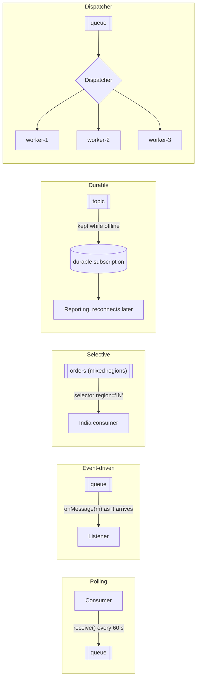

---

## 4.4 Complete Java Example - Polling Cost, Selectors, Durability, Dispatching

```java
import java.util.ArrayList;
import java.util.LinkedHashMap;
import java.util.List;
import java.util.Map;
import java.util.function.Predicate;

// Consumer patterns: Polling vs Event-Driven Consumer, Selective Consumer, Durable Subscriber, Message Dispatcher.

public class ConsumerPatternsDemo {
    record Msg(int seq, Map<String, String> headers, String body) {}

    public static void main(String[] args) {
        System.out.println("=== 1) Polling vs Event-Driven consumer: 5 messages arrive over 10 minutes ===");
        int[] arrivals = {12, 130, 131, 400, 590};                       // seconds
        for (int pollEvery : new int[]{60, 5}) {
            int polls = 0, empty = 0; long totalDelay = 0; int i = 0;
            for (int t = 0; t <= 600; t += pollEvery) {
                polls++;
                int got = 0;
                while (i < arrivals.length && arrivals[i] <= t) { totalDelay += t - arrivals[i]; i++; got++; }
                if (got == 0) empty++;
            }
            System.out.printf("  POLLING every %2ds : %3d polls (%3d empty), average delay %5.1f s%n", pollEvery, polls, empty, (double) totalDelay / arrivals.length);
        }
        System.out.println("  EVENT-DRIVEN      :   0 polls, broker pushes each message as it arrives -> delay ~0 s (a thread waits on the connection)");

        System.out.println("=== 2) Selective Consumer: take only messages whose headers match ===");
        List<Msg> stream = List.of(new Msg(1, Map.of("region", "IN", "priority", "high"), "order A"),
                new Msg(2, Map.of("region", "US", "priority", "low"), "order B"),
                new Msg(3, Map.of("region", "IN", "priority", "low"), "order C"));
        Predicate<Msg> indiaOnly = m -> "IN".equals(m.headers().get("region"));       // like a JMS selector "region = 'IN'"
        stream.stream().filter(indiaOnly).forEach(m -> System.out.println("  india-consumer took #" + m.seq() + " " + m.body()));

        System.out.println("=== 3) Durable vs non-durable subscriber: 'reporting' is offline for messages 2-4 ===");
        List<String> published = List.of("evt1", "evt2", "evt3", "evt4", "evt5");
        Map<String, List<String>> durableBacklog = new LinkedHashMap<>();
        List<String> durableGot = new ArrayList<>(), nonDurableGot = new ArrayList<>();
        for (int k = 0; k < published.size(); k++) {
            boolean online = k == 0 || k == 4;
            String e = published.get(k);
            if (online) {
                durableGot.addAll(durableBacklog.getOrDefault("reporting", List.of())); durableBacklog.clear();   // catch up on reconnect
                durableGot.add(e); nonDurableGot.add(e);
            } else durableBacklog.computeIfAbsent("reporting", x -> new ArrayList<>()).add(e);                    // broker keeps them
        }
        System.out.println("  durable subscriber received     : " + durableGot);
        System.out.println("  non-durable subscriber received : " + nonDurableGot + "  (missed everything while offline)");

        System.out.println("=== 4) Message Dispatcher: one consumer hands messages to a pool of performers ===");
        String[] performers = {"worker-1", "worker-2", "worker-3"};
        Map<String, List<Integer>> assigned = new LinkedHashMap<>();
        for (String p : performers) assigned.put(p, new ArrayList<>());
        for (int seq = 1; seq <= 7; seq++) {
            String key = "customer-" + (seq % 3 == 0 ? "A" : seq % 3 == 1 ? "B" : "C");
            String performer = performers[Math.floorMod(key.hashCode(), performers.length)];   // same key -> same performer (keeps per-key order)
            assigned.get(performer).add(seq);
        }
        assigned.forEach((p, msgs) -> System.out.println("  " + p + " got messages " + msgs));
    }
}
```

**Output:**
```
=== 1) Polling vs Event-Driven consumer: 5 messages arrive over 10 minutes ===
  POLLING every 60s :  11 polls (  7 empty), average delay  35.4 s
  POLLING every  5s : 121 polls (116 empty), average delay   1.4 s
  EVENT-DRIVEN      :   0 polls, broker pushes each message as it arrives -> delay ~0 s (a thread waits on the connection)
=== 2) Selective Consumer: take only messages whose headers match ===
  india-consumer took #1 order A
  india-consumer took #3 order C
=== 3) Durable vs non-durable subscriber: 'reporting' is offline for messages 2-4 ===
  durable subscriber received     : [evt1, evt2, evt3, evt4, evt5]
  non-durable subscriber received : [evt1, evt5]  (missed everything while offline)
=== 4) Message Dispatcher: one consumer hands messages to a pool of performers ===
  worker-1 got messages [1, 4, 7]
  worker-2 got messages [2, 5]
  worker-3 got messages [3, 6]
```

What the output shows:
- **Polling every 60 s:** 11 polls (7 empty) but messages waited **35 s** on average. **Every 5 s:** delay drops to 1.4 s, but 116 of 121 polls were **wasted**. **Event-driven** avoids both.
- The **selective consumer** took only the two `region=IN` messages.
- The **durable** subscriber received all 5 events after reconnecting; the **non-durable** one missed the 3 published while it was offline.
- The **dispatcher** sent all messages for the same customer to the same worker (customer B → worker-1: messages 1, 4, 7), so each customer's messages stay in order while different customers are processed in parallel.

---

## 4.5 In Spring (JMS, Kafka, Spring Integration)

```java
// EVENT-DRIVEN consumers (listener containers)
@KafkaListener(topics = "orders", groupId = "billing", concurrency = "3")   // consumer GROUP = durable (offsets are stored)
void onOrder(OrderPlaced e) { billing.handle(e); }

@JmsListener(destination = "orders", selector = "region = 'IN'")             // SELECTIVE consumer (JMS selector on headers)
void onIndianOrder(OrderPlaced e) { ... }

@JmsListener(destination = "price-updates", containerFactory = "durableTopicFactory",
             subscription = "reporting-sub")                                 // DURABLE subscriber on a JMS topic
void onPrice(PriceChanged e) { ... }
// factory.setPubSubDomain(true); factory.setSubscriptionDurable(true); factory.setClientId("reporting")

// POLLING consumer: Spring Integration with an explicit poller
@Bean
IntegrationFlow pollInbox() {
    return IntegrationFlow.from(Jms.inboundAdapter(connectionFactory).destination("inbox"),
                    e -> e.poller(Pollers.fixedDelay(Duration.ofSeconds(60)).maxMessagesPerPoll(100)))
            .handle(inboxService, "process").get();
}
```

| Broker | Selective consumer | Durable subscriber | Dispatcher / ordering |
|---|---|---|---|
| **JMS** (ActiveMQ, IBM MQ) | Broker-side selectors on headers | Durable/shared durable topic subscriptions | `JMSXGroupID` message groups |
| **RabbitMQ** | Topic/header exchanges with binding patterns | Durable queues bound to an exchange | Single active consumer, consistent-hash exchange |
| **Kafka** | No broker-side selectors: filter in the consumer (`RecordFilterStrategy`) or use separate topics | Consumer groups with committed offsets (and retention) | Partition key → one consumer per partition |

---

## 4.6 Pros, Cons, Pitfalls, Interview Questions and Cheat Sheet

| | Pros | Cons |
|---|---|---|
| **Polling** | Consumer controls rate and timing; simple | Latency vs wasted polls trade-off |
| **Event-driven** | Low latency, efficient | Less control; needs back-pressure/concurrency limits |
| **Selective** | Share a channel among specialised consumers | Unselected messages pile up if nobody takes them; filter cost |
| **Durable** | No missed messages during downtime | Backlogs grow (storage, retention limits) |
| **Dispatcher** | Parallelism with per-key ordering | Hot keys overload one performer |

| Pitfall | Fix |
|---|---|
| Kafka consumer filtering 95% of messages it doesn't want | Separate topics (datatype channels) instead of selective consumption. |
| Durable subscriptions left behind by retired apps → broker disk fills | Remove/expire unused subscriptions; monitor backlog. |
| Event-driven consumer with unbounded concurrency overwhelms the DB | Limit listener concurrency; prefetch limits. |
| Dispatching by random thread → per-customer order lost | Key-based assignment (partition key, message groups). |

**Q1. Polling vs event-driven consumer?** Polling: the consumer asks for messages on its schedule (control, but latency/wasted polls). Event-driven: messages are pushed to a listener as they arrive (low latency). Kafka listeners are event-driven on top of an internal poll loop.

**Q2. What is a durable subscriber?** A pub-sub subscriber whose subscription persists while it's disconnected, so it receives messages published during its downtime. In Kafka, consumer groups with committed offsets give this behaviour (within retention).

**Q3. How do you get parallel processing but keep order per customer?** Assign by key: Kafka partition key = customerId (one consumer per partition), JMS message groups, or a dispatcher hashing the key to a fixed worker.

```
CONSUMERS  Polling (consumer pulls on schedule) vs Event-Driven (pushed to listener; Kafka = poll loop under the hood).
           Selective (header selector: JMS selector; Kafka: filter or separate topics) | Durable Subscriber (kept while offline;
           JMS durable subs, Kafka consumer groups) | Message Dispatcher (one receiver -> performers, key-based for order) |
           Competing Consumers + Idempotent Receiver -> Messaging_Pattern §1, §12.
```

---

# 5. Message Construction: Envelope Wrapper, Format Indicator, Message Expiration, Claim Check

## 5.1 What Are They?

| Pattern | What it does |
|---|---|
| **Envelope Wrapper** | Wraps the application data in an **envelope** with headers the messaging infrastructure needs (IDs, routing, security, tracing), and unwraps it at the other end, leaving the payload unchanged |
| **Format Indicator** | A field/header saying **which format/version** the body is in, so receivers can handle several versions during an upgrade |
| **Message Expiration** | A **time-to-live / expiry** after which the message is useless and must not be acted on |
| **Claim Check** | Store a **large payload** in external storage and send only a **reference** (the "claim check"); receivers fetch the data if and when they need it |

**Analogy:** Sending a parcel. The **envelope wrapper** is the shipping label and outer box (addresses, tracking number) around your gift. The **format indicator** is a "Hindi / English instructions inside" sticker. **Expiration** is "perishable, use by Friday". **Claim check** is the airport luggage tag: you don't carry the suitcase on board, you carry the tag and collect the suitcase at the destination.

#### 📘 Terms Explained

| Term | Simple meaning |
|---|---|
| **Envelope / headers** | Metadata around the payload: message id, correlation id, timestamps, routing keys, trace ids. |
| **Payload / body** | The application data the message carries. |
| **Schema version** | The version of the data structure used in the payload. |
| **TTL (time to live)** | How long a message stays valid before it expires. |
| **Claim check** | A reference (key/URL) to data stored elsewhere. |
| **CloudEvents** | A CNCF standard envelope for events (id, source, type, specversion, datacontenttype...). |

---

## 5.2 Why Do We Need Them?

| Problem | Pattern |
|---|---|
| Infrastructure needs routing/tracing data, but the business payload must stay clean | **Envelope wrapper** (headers) |
| Producers upgrade to v2 while consumers still read v1 (or both coexist) | **Format indicator** (`schema-version`, `content-type`, schema-registry ID) |
| A price quote, OTP or "driver nearby" notification acted on after it's stale causes harm | **Message expiration** |
| A 5 MB PDF exceeds the broker's message limit (Kafka default ~1 MB, SQS 256 KB) and slows everything | **Claim check** |

---

## 5.3 How They Work

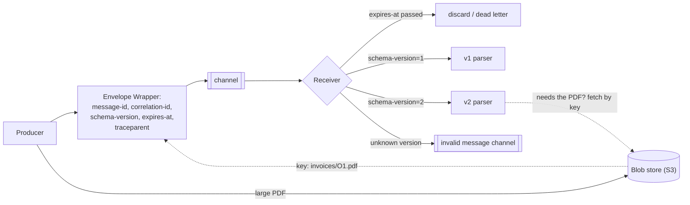

---

## 5.4 Complete Java Example - Headers, Versions, TTLs and Claim Checks

```java
import java.nio.charset.StandardCharsets;
import java.util.ArrayList;
import java.util.HashMap;
import java.util.List;
import java.util.Map;
import java.util.TreeMap;

// Message construction patterns: Envelope Wrapper, Format Indicator, Message Expiration, Claim Check.

public class MessageConstructionDemo {
    record Envelope(Map<String, String> headers, String payload) {           // ENVELOPE WRAPPER: headers around an unchanged payload
        Envelope { headers = new TreeMap<>(headers); }
        int sizeBytes() { return payload.getBytes(StandardCharsets.UTF_8).length + headers.toString().length(); }
    }

    static String parseOrder(Envelope e) {                                    // FORMAT INDICATOR: header says how to read the body
        switch (e.headers().getOrDefault("schema-version", "1")) {
            case "1": return "v1 order " + e.payload().split(",")[0] + " amount " + e.payload().split(",")[1];          // CSV
            case "2": return "v2 order " + e.payload().replaceAll(".*\"id\":\"(\\w+)\".*", "$1")
                    + " amount " + e.payload().replaceAll(".*\"totalPaise\":(\\d+).*", "$1");                           // JSON
            default: throw new IllegalArgumentException("unknown schema-version " + e.headers().get("schema-version"));
        }
    }

    public static void main(String[] args) {
        System.out.println("=== Envelope Wrapper: wrap for transport, unwrap at the destination ===");
        String businessPayload = "O1,49900";
        Envelope wrapped = new Envelope(Map.of("message-id", "m-1", "correlation-id", "c-77", "source", "orders-app",
                "content-type", "text/csv", "schema-version", "1"), businessPayload);
        System.out.println("  on the wire: " + wrapped.headers() + " | " + wrapped.payload());
        System.out.println("  receiver unwraps -> payload '" + wrapped.payload() + "' unchanged; routing used only headers");

        System.out.println("=== Format Indicator: v1 and v2 producers on the same channel ===");
        List<Envelope> mixed = List.of(wrapped,
                new Envelope(Map.of("message-id", "m-2", "schema-version", "2", "content-type", "application/json"), "{\"id\":\"O2\",\"totalPaise\":129900}"),
                new Envelope(Map.of("message-id", "m-3", "schema-version", "9"), "???"));
        for (Envelope e : mixed) {
            try { System.out.println("  " + e.headers().get("message-id") + ": " + parseOrder(e)); }
            catch (IllegalArgumentException ex) { System.out.println("  " + e.headers().get("message-id") + ": -> invalid message channel (" + ex.getMessage() + ")"); }
        }

        System.out.println("=== Message Expiration: a price quote is useless after 30 s ===");
        long now = 100_000;                                                    // ms on a virtual clock
        List<Envelope> quotes = List.of(
                new Envelope(Map.of("message-id", "q-1", "expires-at", String.valueOf(now - 5_000)), "INR/USD 0.01198"),
                new Envelope(Map.of("message-id", "q-2", "expires-at", String.valueOf(now + 25_000)), "INR/USD 0.01201"));
        for (Envelope q : quotes) {
            boolean expired = Long.parseLong(q.headers().get("expires-at")) < now;
            System.out.println("  " + q.headers().get("message-id") + " " + q.payload() + " -> " + (expired ? "EXPIRED: discarded / sent to dead letters, not acted on" : "used"));
        }

        System.out.println("=== Claim Check: big payload goes to storage, the message carries only a reference ===");
        Map<String, byte[]> blobStore = new HashMap<>();                       // S3 / Azure Blob / GCS in real life
        byte[] scannedInvoice = new byte[4_500_000];                           // a 4.5 MB PDF
        String key = "invoices/2026/11/O1.pdf";
        blobStore.put(key, scannedInvoice);                                    // 1) check the luggage
        Envelope small = new Envelope(Map.of("message-id", "m-9", "claim-check", key), "{\"order\":\"O1\",\"invoice\":\"" + key + "\"}");
        System.out.printf("  message size: %,d bytes instead of %,d (most brokers limit messages to ~1 MB)%n", small.sizeBytes(), scannedInvoice.length);
        byte[] retrieved = blobStore.get(small.headers().get("claim-check")); // 2) consumer redeems the ticket only if it needs the data
        System.out.printf("  consumer retrieved %,d bytes using the claim check; consumers that don't need the PDF never download it%n", retrieved.length);
        List<String> notes = new ArrayList<>(List.of("delete the blob after all consumers are done (lifecycle rule / TTL)", "secure the store: the reference is not the data's permission"));
        notes.forEach(n -> System.out.println("  note: " + n));
    }
}
```

**Output:**
```
=== Envelope Wrapper: wrap for transport, unwrap at the destination ===
  on the wire: {content-type=text/csv, correlation-id=c-77, message-id=m-1, schema-version=1, source=orders-app} | O1,49900
  receiver unwraps -> payload 'O1,49900' unchanged; routing used only headers
=== Format Indicator: v1 and v2 producers on the same channel ===
  m-1: v1 order O1 amount 49900
  m-2: v2 order O2 amount 129900
  m-3: -> invalid message channel (unknown schema-version 9)
=== Message Expiration: a price quote is useless after 30 s ===
  q-1 INR/USD 0.01198 -> EXPIRED: discarded / sent to dead letters, not acted on
  q-2 INR/USD 0.01201 -> used
=== Claim Check: big payload goes to storage, the message carries only a reference ===
  message size: 103 bytes instead of 4,500,000 (most brokers limit messages to ~1 MB)
  consumer retrieved 4,500,000 bytes using the claim check; consumers that don't need the PDF never download it
  note: delete the blob after all consumers are done (lifecycle rule / TTL)
  note: secure the store: the reference is not the data's permission
```

What the output shows:
- The **envelope** carried IDs, source, content type and version in headers; the payload `O1,49900` arrived unchanged.
- The **format indicator** let one consumer read a v1 CSV message and a v2 JSON message from the same channel, and send an unknown v9 to the invalid message channel.
- The **expired** quote (q-1) was discarded instead of being used to price an order.
- The **claim check** shrank a 4.5 MB message to **103 bytes**; only consumers that need the PDF download it.

---

## 5.5 In Spring Integration, Kafka, RabbitMQ and Camel

```java
// Envelope: Spring's Message<T> = headers + payload; Kafka record headers; CloudEvents for a standard envelope
Message<OrderPlaced> msg = MessageBuilder.withPayload(event)
        .setHeader("schema-version", "2")                       // format indicator
        .setHeader(KafkaHeaders.KEY, event.orderId())
        .setHeader("expires-at", Instant.now().plusSeconds(30).toEpochMilli())   // expiration (application-level)
        .build();
streamBridge.send("orders-out-0", msg);

// Claim check in Spring Integration (store payload, send a UUID header; check out on the other side)
@Bean
IntegrationFlow claimCheckFlow(MessageStore store) {             // e.g. JdbcMessageStore or a Redis store
    return IntegrationFlow.from("bigDocs").claimCheckIn(store).channel("docs.out").get();
}
@Bean
IntegrationFlow claimCheckOutFlow(MessageStore store) {
    return IntegrationFlow.from("docs.in").claimCheckOut(store).handle(docService, "process").get();
}
```

| Concern | Kafka | RabbitMQ | JMS | Camel |
|---|---|---|---|---|
| Envelope headers | Record headers | Message properties/headers | JMS headers/properties | Exchange headers |
| Format indicator | Schema Registry ID (Avro/Protobuf/JSON Schema) in the payload prefix, `content-type` header | `content_type`, custom headers | `JMSType`, properties | `Content-Type` header |
| Expiration | No per-message TTL (topic retention only): check an application header | Per-message `expiration` or queue `x-message-ttl` → DLX | `setTimeToLive()` / `JMSExpiration` | `JMSExpiration`, filter on header |
| Claim check | Store in S3, send key (also: Kafka's large-message serializers) | Same | Same | `.claimCheck(ClaimCheckOperation.Push/Pop)` |

---

## 5.6 Pros, Cons, Pitfalls, Interview Questions and Cheat Sheet

| Pros | Cons |
|---|---|
| Clean payloads, routable/traceable messages | Header conventions must be agreed and documented |
| Rolling upgrades with mixed versions | Consumers must support several versions for a while |
| Stale messages don't cause harm | Clock skew affects expiry checks |
| Small, fast messages even for big data | Claim check adds a second store, permissions and cleanup |

| Pitfall | Fix |
|---|---|
| Business data hidden in headers | Headers for infrastructure metadata; business data in the payload. |
| No version on messages | Format indicator or schema registry from day one. |
| Expiry based on producer and consumer clocks that disagree | Generous TTLs; NTP; broker-side TTL where available. |
| Claim-checked blobs never deleted | Lifecycle rules / TTL on the bucket. |
| Claim check URL that anyone can read | Private storage + access control or short-lived signed URLs. |

**Q1. What is the claim check pattern?** Storing a large payload in external storage (S3) and sending only a reference in the message; consumers fetch it when needed. It keeps messages small and within broker limits.

**Q2. How do you evolve message formats without breaking consumers?** A format indicator (version header or schema registry ID), backward-compatible changes, consumers that handle old and new versions during the transition, and compatibility checks in CI.

**Q3. How do you expire messages in Kafka?** Kafka has no per-message TTL (only topic retention), so add an `expires-at` header and skip expired records in the consumer; RabbitMQ and JMS support per-message TTL natively.

```
CONSTRUCTION  Envelope Wrapper (headers: ids, routing, tracing, around an unchanged payload; CloudEvents) |
              Format Indicator (schema-version / content-type / schema registry id; route unknown -> invalid channel) |
              Message Expiration (TTL: RabbitMQ expiration, JMS TTL; Kafka: header check) |
              Claim Check (payload in S3, reference in message; cleanup + access control; SI claimCheckIn/Out, Camel claimCheck).
```

---

# 6. Message Transformation: Canonical Data Model, Normalizer, Content Enricher, Content Filter

## 6.1 What Are They?

The base pattern, **Message Translator** (convert one format to another), is covered in [Messaging §8](../03_System_Design/04_Messaging_Pattern.md#8-message-translator-pattern). These four build on it:

| Pattern | What it does |
|---|---|
| **Canonical Data Model** | One **shared, application-independent** data format that all integrations translate to and from, instead of every pair of apps translating directly |
| **Normalizer** | Accepts messages that mean the same thing in **different formats** (JSON, XML, CSV from different partners), detects each format, and translates all of them into the canonical format |
| **Content Enricher** | **Adds** missing data to a message by looking it up elsewhere (CRM, cache, another service) |
| **Content Filter** | **Removes** data a recipient doesn't need or must not see (PII, internal fields), simplifying the message |

**Analogy:** A United Nations meeting. Instead of every delegate learning every other language (point-to-point), everything is interpreted into one working language (**canonical model**). The interpreters' desk that accepts speeches in any language and outputs that working language is the **normalizer**. An aide who adds "(Minister of Finance, Kenya)" next to each speaker's name is the **content enricher**; one who removes delegates' private phone numbers from the published minutes is the **content filter**.

#### 📘 Terms Explained

| Term | Simple meaning |
|---|---|
| **Canonical data model** | A common format all integrated applications agree to map to. |
| **Normalizer** | A router + set of translators that converts many incoming formats to one. |
| **Content enricher** | A step that adds data from another source to a message. |
| **Content filter** | A step that removes unneeded or sensitive fields from a message. |
| **PII** | Personally Identifiable Information: names, emails, phone numbers, IDs. |

---

## 6.2 Why Do We Need Them?

| Problem | Pattern |
|---|---|
| 8 apps × 7 partners each = 56 translators to write and maintain | **Canonical model**: 16 (each app to/from canonical) |
| Each partner sends orders in its own format | **Normalizer** |
| The event says `customerId: C-1` but the email service needs the name and language | **Content enricher** (or event-carried state transfer) |
| Analytics or a partner must not receive emails/phones; mobile clients want small payloads | **Content filter** |

---

## 6.3 How They Work

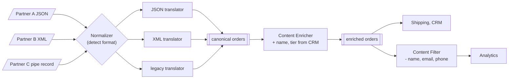

**Enricher variants:** look up synchronously (call CRM per message, with a cache), join with a local copy kept up to date by events (Kafka Streams `KStream`-`KTable` join), or ask the producer to include the data (event-carried state transfer).

---

## 6.4 Complete Java Example - Three Partner Formats, One Canonical Order

```java
import java.util.LinkedHashMap;
import java.util.List;
import java.util.Map;

// Message transformation patterns: Canonical Data Model, Normalizer, Content Enricher, Content Filter.

public class TransformationDemo {
    // The CANONICAL order every internal system agrees on
    record CanonicalOrder(String orderId, String customerId, long amountPaise, String currency) {}
    record EnrichedOrder(CanonicalOrder order, String customerName, String tier, String email, String phone) {}

    // ---- NORMALIZER: detect each partner's format and translate it to the canonical model ----
    static CanonicalOrder normalize(String raw) {
        if (raw.startsWith("{")) {                                         // partner A: JSON, rupees with decimals
            return new CanonicalOrder(field(raw, "orderRef"), field(raw, "cust"),
                    Math.round(Double.parseDouble(field(raw, "total")) * 100), "INR");
        }
        if (raw.startsWith("<")) {                                         // partner B: XML, paise
            return new CanonicalOrder(tag(raw, "id"), tag(raw, "customer"), Long.parseLong(tag(raw, "amountPaise")), tag(raw, "ccy"));
        }
        String[] p = raw.split("\\|");                                     // partner C: fixed pipe-delimited legacy record
        return new CanonicalOrder(p[1].trim(), p[2].trim(), Long.parseLong(p[3].trim()) * 100, "INR");
    }
    static String field(String json, String k) { return json.replaceAll(".*\"" + k + "\":\"?([^\",}]+)\"?.*", "$1"); }
    static String tag(String xml, String t) { return xml.replaceAll(".*<" + t + ">([^<]+)</" + t + ">.*", "$1"); }

    // ---- CONTENT ENRICHER: add data the message doesn't carry, from another source ----
    static final Map<String, String[]> CRM = Map.of("C-1", new String[]{"Asha Rao", "GOLD", "asha@example.com", "+91-9800000001"},
            "C-2", new String[]{"Ravi K", "STANDARD", "ravi@example.com", "+91-9800000002"});
    static EnrichedOrder enrich(CanonicalOrder o) {
        String[] c = CRM.getOrDefault(o.customerId(), new String[]{"UNKNOWN", "STANDARD", "", ""});
        return new EnrichedOrder(o, c[0], c[1], c[2], c[3]);
    }

    // ---- CONTENT FILTER: remove what a downstream system must not / need not see ----
    static Map<String, Object> forAnalytics(EnrichedOrder e) {
        Map<String, Object> m = new LinkedHashMap<>();
        m.put("orderId", e.order().orderId()); m.put("tier", e.tier()); m.put("amountPaise", e.order().amountPaise());
        return m;                                                           // no name, email or phone (PII)
    }

    public static void main(String[] args) {
        System.out.println("=== Why a Canonical Data Model: translators needed between N applications ===");
        for (int n : new int[]{4, 8, 15})
            System.out.printf("  %2d apps: point-to-point %3d translators | canonical model %2d translators%n", n, n * (n - 1), 2 * n);

        System.out.println("=== Normalizer: three partner formats -> one canonical order ===");
        List<String> incoming = List.of(
                "{\"orderRef\":\"A-100\",\"cust\":\"C-1\",\"total\":\"499.00\"}",
                "<order><id>B-7</id><customer>C-2</customer><amountPaise>129900</amountPaise><ccy>INR</ccy></order>",
                "ORD| C-55 | C-1 |  2499 ");
        for (String raw : incoming) System.out.println("  " + (raw.length() > 40 ? raw.substring(0, 40) + "..." : raw) + "  ->  " + normalize(raw));

        System.out.println("=== Content Enricher: add customer name and tier from the CRM ===");
        EnrichedOrder e = enrich(normalize(incoming.get(0)));
        System.out.println("  " + e);

        System.out.println("=== Content Filter: analytics gets only what it needs (no PII) ===");
        System.out.println("  " + forAnalytics(e));
    }
}
```

**Output:**
```
=== Why a Canonical Data Model: translators needed between N applications ===
   4 apps: point-to-point  12 translators | canonical model  8 translators
   8 apps: point-to-point  56 translators | canonical model 16 translators
  15 apps: point-to-point 210 translators | canonical model 30 translators
=== Normalizer: three partner formats -> one canonical order ===
  {"orderRef":"A-100","cust":"C-1","total"...  ->  CanonicalOrder[orderId=A-100, customerId=C-1, amountPaise=49900, currency=INR]
  <order><id>B-7</id><customer>C-2</custom...  ->  CanonicalOrder[orderId=B-7, customerId=C-2, amountPaise=129900, currency=INR]
  ORD| C-55 | C-1 |  2499   ->  CanonicalOrder[orderId=C-55, customerId=C-1, amountPaise=249900, currency=INR]
=== Content Enricher: add customer name and tier from the CRM ===
  EnrichedOrder[order=CanonicalOrder[orderId=A-100, customerId=C-1, amountPaise=49900, currency=INR], customerName=Asha Rao, tier=GOLD, email=asha@example.com, phone=+91-9800000001]
=== Content Filter: analytics gets only what it needs (no PII) ===
  {orderId=A-100, tier=GOLD, amountPaise=49900}
```

What the output shows:
- With **15 applications**, direct translation needs up to **210** translators; a canonical model needs **30**.
- The **normalizer** recognised JSON (rupees as a decimal string), XML (paise) and a pipe-delimited legacy record, and produced the same `CanonicalOrder` shape for all three (₹499.00 became 49,900 paise).
- The **enricher** added the customer's name, tier and contact details from the CRM.
- The **content filter** gave analytics only `orderId`, `tier` and `amountPaise`: no PII.

---

## 6.5 In Spring Integration and Camel

```java
@Bean
IntegrationFlow partnerOrders() {
    return IntegrationFlow.from("partner.orders.raw")
            .route(Message.class, m -> detectFormat(m),                       // NORMALIZER = router + translators
                    r -> r.subFlowMapping("json", sf -> sf.transform(jsonToCanonical))
                          .subFlowMapping("xml",  sf -> sf.transform(xmlToCanonical))
                          .subFlowMapping("pipe", sf -> sf.transform(legacyToCanonical)))
            .enrich(e -> e.requestChannel("crm.lookup")                        // CONTENT ENRICHER
                          .requestPayload(m -> ((CanonicalOrder) m.getPayload()).customerId())
                          .propertyFunction("customerName", m -> ((Customer) m.getPayload()).name())
                          .propertyFunction("tier", m -> ((Customer) m.getPayload()).tier()))
            .channel("orders.canonical")
            .get();
}

@Bean
IntegrationFlow toAnalytics() {
    return IntegrationFlow.from("orders.canonical")
            .transform(EnrichedOrder.class, o -> new AnalyticsOrder(o.orderId(), o.tier(), o.amountPaise()))   // CONTENT FILTER
            .channel("analytics.orders")
            .get();
}
```

```java
// Apache Camel equivalents
from("jms:partner.orders")
    .choice()
        .when(body().startsWith("{")).unmarshal().json(PartnerAOrder.class).bean(Mappers.class, "fromA")
        .when(body().startsWith("<")).unmarshal().jacksonXml(PartnerBOrder.class).bean(Mappers.class, "fromB")
        .otherwise().bean(Mappers.class, "fromLegacy")
    .end()
    .enrich("direct:crmLookup", new CustomerAggregationStrategy())       // content enricher
    .to("kafka:orders.canonical");
```

**Canonical model in practice:** define it as a schema (Avro/Protobuf/JSON Schema/OpenAPI) owned by an integration or platform team; version it; in a DDD world, a "published language" between bounded contexts ([01_Architectural_Pattern.md](../02_HLD/01_Architectural_Pattern.md#123-strategic-ddd-bounded-contexts-and-context-maps)) plays the same role without forcing one model inside every service.

---

## 6.6 Pros, Cons, Pitfalls, Interview Questions and Cheat Sheet

| | Pros | Cons |
|---|---|---|
| **Canonical model** | Fewer translators, shared vocabulary, easier onboarding of new systems | A "god schema" that tries to fit everyone becomes huge and slow to change |
| **Normalizer** | One clean downstream format for many sources | Format detection rules must be robust |
| **Enricher** | Consumers get complete data | Extra lookups (latency, load, coupling to the source); stale data if cached |
| **Filter** | Less data exposed, smaller messages | Filtered-out data must be fetched again if needed later |

| Pitfall | Fix |
|---|---|
| Canonical model containing every field of every system | Keep it to the shared concepts; let contexts keep their own models (ACL). |
| Enricher calling a slow service per message without caching | Cache, batch lookups, or keep a local replica via events. |
| Sending PII to systems that don't need it | Content filter by default for analytics/partners. |

**Q1. Why use a canonical data model?** To reduce N×(N−1) point-to-point translations to 2N and give integrations a shared vocabulary; risk: an overgrown, slow-changing "enterprise model".

**Q2. Content enricher vs content filter?** An enricher adds data from another source (e.g. customer details from CRM); a filter removes unnecessary or sensitive fields before passing a message on.

**Q3. What is a normalizer?** A router plus translators that convert semantically equivalent messages arriving in different formats into one common (canonical) format.

```
TRANSFORM  Translator (Messaging §8) + Canonical Data Model (2N mappings not N(N-1); versioned schema; avoid god schema) |
           Normalizer (detect format -> per-format translator -> canonical) | Content Enricher (add data: lookup/cache/KTable join) |
           Content Filter (remove unneeded/PII fields). SI: route+subFlowMapping, .enrich(), .transform(). Camel: choice/enrich.
```

---

# 7. Splitter and Aggregator (Interview Imp - Java)

## 7.1 What Are They?

- **Splitter:** breaks **one** message containing several elements into **several** messages, one per element (an order with 3 lines → 3 line messages). Each part gets headers linking it back: **correlation id**, **sequence number**, **sequence size**.
- **Aggregator:** the opposite, and a **stateful** filter: it collects related messages (same **correlation id**) and, when a **completion condition** is met (all parts arrived, a count, a timeout, a "last" marker), combines them into **one** message. **(Interview Imp - Java)**

**Analogy:** A restaurant order. The waiter **splits** a table's order into separate tickets for the grill, the tandoor and the dessert station. At the pass, the head chef **aggregates**: plates for table 7 are collected until all three are ready (or a time limit passes, when the waiter takes what's ready and apologises for the rest).

#### 📘 Terms Explained

| Term | Simple meaning |
|---|---|
| **Splitter** | Turns one message into many, one per element. |
| **Aggregator** | Combines related messages into one when a completion condition is met. |
| **Correlation strategy** | How the aggregator decides which messages belong together (e.g. by orderId). |
| **Release / completion strategy** | When a group is complete (all parts, count, predicate). |
| **Group timeout** | Maximum wait for a group before releasing it partially or discarding it. |
| **Aggregation strategy** | How the collected messages are combined into the result. |

---

## 7.2 Why Do We Need Them?

| Problem | Pattern |
|---|---|
| One big message (an order, a file with 10,000 records, a batch) must be processed item by item, possibly in parallel or by different systems | **Splitter** |
| The caller needs one combined answer (order status) after the parts are processed independently | **Aggregator** |
| Some parts may never come back (a service is down) | Aggregator with a **timeout** and partial-result policy |
| Parts finish in a different order than they were sent | Aggregator sorts by **sequence number** (or use a resequencer, [section 8](#8-resequencer)) |

Split + process in parallel + aggregate is the core of the **composed message processor** and **scatter-gather** patterns ([section 9](#9-scatter-gather-and-composed-message-processor)).

---

## 7.3 How They Work: Correlation, Completion and Timeouts

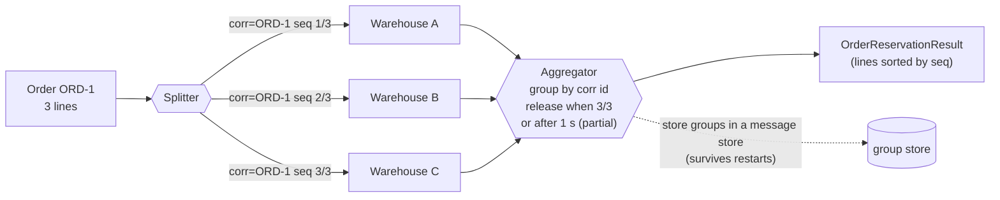

The aggregator must decide:
1. **Correlation:** which header/field groups messages (`orderId`).
2. **Completion:** all `sequenceSize` parts? a count? a predicate ("any OUT_OF_STOCK → stop waiting")? an end-of-batch marker?
3. **Timeout:** how long to wait, and then **release partial**, **discard**, or **send to an error channel**.
4. **Combination:** how to build the result (list, sum, best value, merged object).
5. **State storage:** in memory (lost on restart) or a persistent group store (JDBC, Redis, Kafka state store).
6. **Late arrivals:** what to do with a part that arrives after its group was released (drop, log, or start a new group).

---

## 7.4 Complete Java Example - Split an Order, Aggregate Out-of-Order Results

Two orders are split into line messages. Warehouses answer in a different order, one line is out of stock, and one warehouse never answers. The aggregator releases groups on **completion** or after a **1,000 ms timeout**.

```java
import java.util.ArrayList;
import java.util.LinkedHashMap;
import java.util.List;
import java.util.Map;
import java.util.stream.Collectors;

// Splitter + Aggregator: split an order into one message per line, process lines independently
// (they finish out of order, one never comes back), then aggregate them by correlation id with a
// completion condition (all lines arrived) OR a timeout (release a partial result).

public class SplitterAggregatorDemo {
    record Line(String sku, int qty) {}
    record LineMsg(String correlationId, int sequence, int sequenceSize, Line line) {}       // headers like Spring Integration's
    record LineResult(String correlationId, int sequence, int sequenceSize, String sku, String status, int arrivedAtMs) {}

    // ---- SPLITTER ----
    static List<LineMsg> split(String orderId, List<Line> lines) {
        List<LineMsg> out = new ArrayList<>();
        for (int i = 0; i < lines.size(); i++) out.add(new LineMsg(orderId, i + 1, lines.size(), lines.get(i)));
        return out;
    }

    // ---- AGGREGATOR ----
    static class Aggregator {
        final long timeoutMs; final Map<String, List<LineResult>> groups = new LinkedHashMap<>(); final Map<String, Integer> startedAt = new LinkedHashMap<>();
        Aggregator(long timeoutMs) { this.timeoutMs = timeoutMs; }
        void accept(LineResult r) {
            groups.computeIfAbsent(r.correlationId(), k -> new ArrayList<>()).add(r);        // correlate by order id
            startedAt.putIfAbsent(r.correlationId(), r.arrivedAtMs());
            List<LineResult> g = groups.get(r.correlationId());
            if (g.size() == r.sequenceSize()) release(r.correlationId(), r.arrivedAtMs(), "complete");   // completion condition
        }
        void tick(int now) {
            for (String id : new ArrayList<>(groups.keySet()))
                if (now - startedAt.get(id) >= timeoutMs) release(id, now, "TIMEOUT, partial");          // group timeout
        }
        void release(String id, int now, String why) {
            List<LineResult> g = groups.remove(id); startedAt.remove(id);
            String summary = g.stream().sorted((a, b) -> Integer.compare(a.sequence(), b.sequence()))      // re-order by sequence
                    .map(x -> x.sku() + ":" + x.status()).collect(Collectors.joining(", "));
            int expected = g.get(0).sequenceSize();
            System.out.printf("  t=%4dms AGGREGATED %s (%s): %d/%d lines [%s]%n", now, id, why, g.size(), expected, summary);
        }
    }

    public static void main(String[] args) {
        System.out.println("=== Split two orders into line messages ===");
        List<LineMsg> msgs = new ArrayList<>();
        msgs.addAll(split("ORD-1", List.of(new Line("KEYBOARD", 1), new Line("MOUSE", 2), new Line("MONITOR", 1))));
        msgs.addAll(split("ORD-2", List.of(new Line("CABLE", 5), new Line("DOCK", 1))));
        msgs.forEach(m -> System.out.println("  " + m));

        System.out.println("=== Lines are reserved by different warehouses and come back in a different order ===");
        // fixed, repeatable completion times; DOCK's warehouse never answers
        Map<String, Integer> doneAt = Map.of("MOUSE", 120, "KEYBOARD", 300, "CABLE", 80, "MONITOR", 450);
        List<LineResult> results = msgs.stream().filter(m -> doneAt.containsKey(m.line().sku()))
                .map(m -> new LineResult(m.correlationId(), m.sequence(), m.sequenceSize(), m.line().sku(),
                        m.line().sku().equals("MONITOR") ? "OUT_OF_STOCK" : "RESERVED", doneAt.get(m.line().sku())))
                .sorted((a, b) -> Integer.compare(a.arrivedAtMs(), b.arrivedAtMs())).collect(Collectors.toList());
        results.forEach(r -> System.out.println("  t=" + r.arrivedAtMs() + "ms result " + r.correlationId() + "#" + r.sequence() + " " + r.sku() + " " + r.status()));

        System.out.println("=== Aggregator: complete when all lines arrived, or after 1,000 ms ===");
        Aggregator agg = new Aggregator(1_000);
        int next = 0;
        for (int now = 0; now <= 1_500; now++) {
            while (next < results.size() && results.get(next).arrivedAtMs() == now) agg.accept(results.get(next++));
            agg.tick(now);
        }
        System.out.println("  -> ORD-1 completed with an OUT_OF_STOCK line (the business decides: ship partially or cancel);");
        System.out.println("     ORD-2 was released by the TIMEOUT so it doesn't wait forever for the missing DOCK reply");
    }
}
```

**Output:**
```
=== Split two orders into line messages ===
  LineMsg[correlationId=ORD-1, sequence=1, sequenceSize=3, line=Line[sku=KEYBOARD, qty=1]]
  LineMsg[correlationId=ORD-1, sequence=2, sequenceSize=3, line=Line[sku=MOUSE, qty=2]]
  LineMsg[correlationId=ORD-1, sequence=3, sequenceSize=3, line=Line[sku=MONITOR, qty=1]]
  LineMsg[correlationId=ORD-2, sequence=1, sequenceSize=2, line=Line[sku=CABLE, qty=5]]
  LineMsg[correlationId=ORD-2, sequence=2, sequenceSize=2, line=Line[sku=DOCK, qty=1]]
=== Lines are reserved by different warehouses and come back in a different order ===
  t=80ms result ORD-2#1 CABLE RESERVED
  t=120ms result ORD-1#2 MOUSE RESERVED
  t=300ms result ORD-1#1 KEYBOARD RESERVED
  t=450ms result ORD-1#3 MONITOR OUT_OF_STOCK
=== Aggregator: complete when all lines arrived, or after 1,000 ms ===
  t= 450ms AGGREGATED ORD-1 (complete): 3/3 lines [KEYBOARD:RESERVED, MOUSE:RESERVED, MONITOR:OUT_OF_STOCK]
  t=1080ms AGGREGATED ORD-2 (TIMEOUT, partial): 1/2 lines [CABLE:RESERVED]
  -> ORD-1 completed with an OUT_OF_STOCK line (the business decides: ship partially or cancel);
     ORD-2 was released by the TIMEOUT so it doesn't wait forever for the missing DOCK reply
```

What the output shows:
- Each split message carries **correlation id + sequence + sequence size**, so the aggregator knows which order a line belongs to and how many to expect.
- Results came back **out of order** (MOUSE before KEYBOARD, ORD-2's CABLE first of all), but the released group is **sorted by sequence**.
- **ORD-1** completed as soon as its 3rd result arrived (t = 450 ms), including the OUT_OF_STOCK line: the aggregator reports it; the business process decides what to do.
- **ORD-2** never got its DOCK reply, and the **timeout** released a partial result at t = 1,080 ms (1,000 ms after its first part) instead of holding the order forever.

---

## 7.5 In Spring Integration, Camel and Kafka Streams

```java
// Spring Integration: split -> parallel processing -> aggregate
@Bean
IntegrationFlow reserveOrder() {
    return IntegrationFlow.from("orders.in")
            .split(Order.class, Order::lines)                                     // adds correlationId, sequenceNumber, sequenceSize headers
            .channel(c -> c.executor(Executors.newFixedThreadPool(8)))            // process lines in parallel
            .handle(warehouseService, "reserve")
            .aggregate(a -> a
                    .correlationStrategy(m -> m.getHeaders().get(IntegrationMessageHeaderAccessor.CORRELATION_ID))
                    .releaseStrategy(g -> g.size() == g.getSequenceSize())        // default behaviour, shown explicitly
                    .groupTimeout(1_000)
                    .sendPartialResultOnExpiry(true)                              // release what we have on timeout
                    .messageStore(jdbcMessageStore)                               // groups survive restarts
                    .outputProcessor(g -> OrderReservation.of(g.getMessages())))
            .channel("orders.reserved")
            .get();
}
```

```java
// Apache Camel
from("kafka:orders")
    .split(simple("${body.lines}")).parallelProcessing()
        .to("direct:reserveLine")
    .end();
from("direct:reserved")
    .aggregate(header("orderId"), new LinesAggregationStrategy())
        .completionSize(header("lineCount"))
        .completionTimeout(1000)
    .to("kafka:orders.reserved");
```

**Kafka Streams:** split with `flatMapValues(order -> order.lines())`; aggregate with `groupByKey().aggregate(...)` (optionally `windowedBy(...)` for time-based completion), with the state kept in a fault-tolerant state store.

---

## 7.6 Pros, Cons, Pitfalls, Interview Questions and Cheat Sheet

| | Pros | Cons |
|---|---|---|
| **Splitter** | Parallel, independent processing of parts; smaller messages | More messages and correlation headers to manage |
| **Aggregator** | One combined result from distributed work | **Stateful**: memory, persistence, timeouts, late arrivals, duplicates |

| Pitfall | Fix |
|---|---|
| Aggregator groups that never complete → memory leak | Group timeout + expiry of empty/old groups. |
| In-memory aggregator state lost on restart | Persistent message group store / Kafka state store. |
| Duplicate parts counted twice | Deduplicate by sequence number within a group. |
| Late part after release starts a phantom group | `expireGroupsUponCompletion(false)` style handling or explicit late-arrival logic. |
| Splitting a 1 GB file into a list in memory first | Stream the split (iterator/`Files.splitter()`), don't materialise everything. |

**Q1. How does an aggregator know when it's done?** A release/completion strategy: all parts (sequence size), a count, a predicate on the content, an end marker, or a timeout; groups are formed by a correlation strategy (e.g. orderId).

**Q2. What happens if a part never arrives?** A group timeout releases a partial result (or sends the group to an error/discard channel), so the process doesn't wait forever; late parts are handled explicitly.

**Q3. Why must aggregator state be persistent?** Groups can be in progress for seconds to hours; if state is only in memory, a restart loses partial groups and the corresponding processes stall.

```
SPLITTER     1 message -> N parts with correlationId + sequenceNumber + sequenceSize headers. Stream big inputs.
AGGREGATOR   Stateful: correlation strategy (orderId) + release strategy (all parts / count / predicate) + group timeout
             (partial or discard) + combination + PERSISTENT group store + dedupe + late-arrival handling.
             SI: .split().aggregate(a -> a.correlationStrategy/releaseStrategy/groupTimeout/sendPartialResultOnExpiry/messageStore)
             Camel: .split().parallelProcessing(), .aggregate(header, strategy).completionSize/completionTimeout. Kafka Streams: groupByKey().aggregate.
```

---

# 8. Resequencer

## 8.1 What Is It?

A **resequencer** receives a stream of related messages that may arrive **out of order** and releases them **in the correct order**, using a **sequence number** each message carries. It buffers early messages until the missing ones arrive.

**Analogy:** A book printed in chapters by several printers. The binder receives chapters 2, 1, 4, 3 in that order, keeps chapter 2 on the table until chapter 1 arrives, then binds 1-2, keeps 4 waiting until 3 arrives, and so on.

#### 📘 Terms Explained

| Term | Simple meaning |
|---|---|
| **Resequencer** | A stateful component that reorders messages by sequence number. |
| **Sequence number** | A per-stream counter set by the producer (1, 2, 3...). |
| **Gap** | A missing sequence number that blocks later messages. |
| **Gap timeout** | How long to wait for a missing message before skipping it. |
| **Release partial sequences** | Releasing messages that are in order so far, instead of waiting for the whole batch. |

---

## 8.2 Why Do We Need It?

Order matters when later messages depend on earlier ones: ledger entries (deposit before withdrawal), state changes (created → paid → shipped), document versions, chat messages. Messages get out of order because of:
- **Parallel processing** (competing consumers, a splitter with parallel branches).
- **Retries and redelivery** (message 3 fails and is redelivered after message 4).
- **Multiple partitions or channels** carrying one logical stream.
- **Network paths** with different latencies.

> **First choice: avoid the need.** Kafka keeps order **within a partition**, so use the entity ID as the key; use one consumer per key (message groups). Use a resequencer when ordering really is lost on the way.

---

## 8.3 How It Works

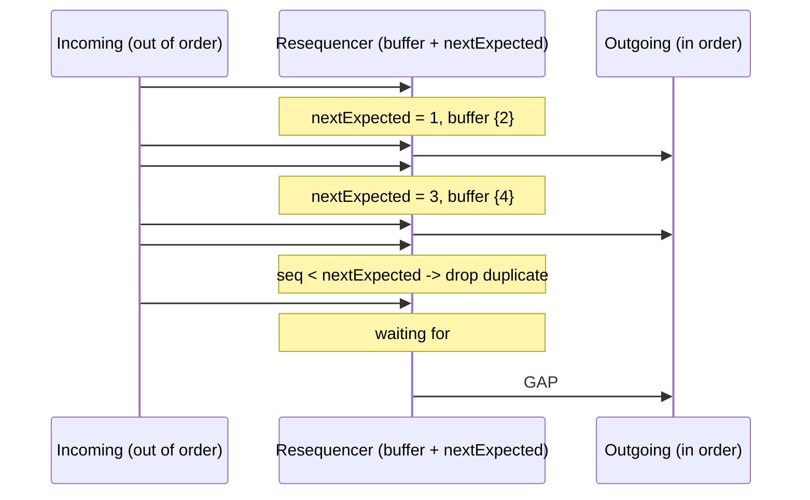

---

## 8.4 Complete Java Example - Reordering a Ledger Stream with a Gap Timeout

```java
import java.util.ArrayList;
import java.util.List;
import java.util.TreeMap;

// Resequencer: messages arrive out of order (parallel processing, retries, several partitions);
// buffer them and release in sequence order. A gap is skipped after a timeout so the stream doesn't stall forever.

public class ResequencerDemo {
    record Event(int seq, String what, int arrivedAt) {}

    static class Resequencer {
        final int gapTimeout; int nextExpected = 1; int waitingSince = -1;
        final TreeMap<Integer, Event> buffer = new TreeMap<>(); final List<String> released = new ArrayList<>();
        Resequencer(int gapTimeout) { this.gapTimeout = gapTimeout; }
        void accept(Event e, int now) {
            if (e.seq() < nextExpected) { released.add("t=" + now + " DROP duplicate/late #" + e.seq()); return; }
            buffer.put(e.seq(), e);
            drain(now);
        }
        void tick(int now) {
            if (!buffer.isEmpty() && buffer.firstKey() > nextExpected && waitingSince >= 0 && now - waitingSince >= gapTimeout) {
                released.add("t=" + now + " GAP: #" + nextExpected + " missing for " + gapTimeout + " ticks -> skip it (alert / fetch it later)");
                nextExpected = buffer.firstKey();
                drain(now);
            }
        }
        void drain(int now) {
            while (buffer.containsKey(nextExpected)) {
                Event e = buffer.remove(nextExpected++);
                released.add("t=" + now + " release #" + e.seq() + " " + e.what());
            }
            waitingSince = buffer.isEmpty() ? -1 : (waitingSince < 0 ? now : waitingSince);
        }
    }

    public static void main(String[] args) {
        // account ledger events: order matters (you can't withdraw before the deposit is applied)
        List<Event> arrivals = List.of(new Event(2, "deposit 500", 1), new Event(1, "open account", 3), new Event(4, "withdraw 200", 4),
                new Event(3, "deposit 100", 6), new Event(3, "deposit 100 (redelivered)", 7), new Event(6, "withdraw 50", 8),
                new Event(7, "close request", 9));
        System.out.println("arrival order: " + arrivals.stream().map(e -> "#" + e.seq()).toList() + "  (#5 is lost)");
        Resequencer r = new Resequencer(5);
        int i = 0;
        for (int now = 0; now <= 20; now++) {
            while (i < arrivals.size() && arrivals.get(i).arrivedAt() == now) r.accept(arrivals.get(i++), now);
            r.tick(now);
        }
        r.released.forEach(s -> System.out.println("  " + s));
    }
}
```

**Output:**
```
arrival order: [#2, #1, #4, #3, #3, #6, #7]  (#5 is lost)
  t=3 release #1 open account
  t=3 release #2 deposit 500
  t=6 release #3 deposit 100
  t=6 release #4 withdraw 200
  t=7 DROP duplicate/late #3
  t=13 GAP: #5 missing for 5 ticks -> skip it (alert / fetch it later)
  t=13 release #6 withdraw 50
  t=13 release #7 close request
```

What the output shows:
- `#2` arrived before `#1` and was **held**; when `#1` arrived both were released in order (open account, then deposit 500).
- The redelivered `#3` was **dropped** as a duplicate, because sequence 3 had already been released.
- `#5` was lost, so `#6` and `#7` waited. After the **gap timeout** (5 ticks) the resequencer skipped `#5`, raised a gap event, and released `#6` and `#7`. Without the timeout the stream would stall forever; with it, you must handle the gap (alert, fetch it from the source, or reconcile).

---

## 8.5 In Spring Integration, Camel and Kafka

```java
// Spring Integration: resequence by the sequenceNumber header within a correlation group
@Bean
IntegrationFlow ledger() {
    return IntegrationFlow.from("ledger.unordered")
            .resequence(r -> r.releasePartialSequences(true)     // release in-order prefixes immediately
                              .groupTimeout(5_000)               // don't wait forever for a gap
                              .sendPartialResultOnExpiry(true)
                              .messageStore(jdbcMessageStore))
            .channel("ledger.ordered")
            .get();
}

// Apache Camel: stream resequencer by a header, with a timeout
from("jms:ledger.unordered")
    .resequence(header("seq")).stream().timeout(5000)
    .to("jms:ledger.ordered");
```

**Kafka:** prefer ordering by design (key = accountId → same partition → one consumer). If you must reorder (e.g. events from several topics), use a Kafka Streams processor with a state store holding out-of-order events and a punctuator for timeouts. Consumers can also **reject stale updates** using a version number instead of reordering.

---

## 8.6 Pros, Cons, Pitfalls, Interview Questions and Cheat Sheet

| Pros | Cons |
|---|---|
| Restores order after parallel processing and retries | Adds latency (waiting for gaps) |
| Detects missing and duplicate messages | Stateful: buffers memory, must survive restarts |
| Lets you parallelise upstream safely | A lost message stalls the stream until the timeout |

| Pitfall | Fix |
|---|---|
| No gap timeout → stream blocked forever | Timeout + gap alert + reconciliation. |
| Unbounded buffer when a sequence breaks | Cap buffer size; alert. |
| Producers without reliable sequence numbers | Generate per-entity sequences at the source (or use versions). |
| Resequencing a global stream (one sequence for everything) | Sequence per entity (per account/order), process entities in parallel. |

**Q1. What does a resequencer do?** It buffers out-of-order messages and releases them in sequence-number order, handling duplicates and gaps (with a timeout).

**Q2. How do you keep order in Kafka without a resequencer?** Use the entity ID as the message key so all its events go to one partition and are consumed in order by one consumer; avoid parallel processing of the same key.

```
RESEQUENCER  Buffer out-of-order messages, release by sequence number; drop duplicates (seq < nextExpected); gap timeout ->
             skip + alert. Stateful (persistent store). Prefer ordering by design: Kafka key -> partition, message groups,
             version checks. SI .resequence(releasePartialSequences, groupTimeout). Camel .resequence(header).stream().timeout().
```

---

## 8.7 Types and Variants

| Variant | How it decides what is "next" | Example |
|---|---|---|
| **Sequence-number resequencer** | Holds messages until the next expected sequence number arrives | Spring Integration `resequencer`, Camel `resequence` (batch or stream mode) |
| **Batch resequencer** | Collects a batch, sorts it, releases it | Camel batch resequencer (by size/timeout) |
| **Stream resequencer** | Continuous reordering with a capacity and timeout | Camel stream resequencer |
| **Timestamp-based** | Orders by event time with a watermark | Kafka Streams / Flink event-time processing |
| **Avoiding the need** | Keep order at the source: partition by key, single consumer per key | Kafka key partitioning, SQS FIFO groups |

# 9. Scatter-Gather and Composed Message Processor

## 9.1 What Are They?

- **Scatter-Gather:** **broadcast** one request to **several recipients** (often doing the same job), then **gather** their replies with an aggregator into one answer (best price, merged results, first valid answer), usually within a **deadline**.
- **Composed Message Processor:** **split** a message into parts, **route** each part to the **processor that handles that kind of part**, then **aggregate** the results into one message. (Splitter + content-based router + aggregator.)

**Analogy:**
- **Scatter-gather:** asking four courier companies for a quote at once and choosing the cheapest that replies before you have to decide.
- **Composed message processor:** a hospital check-up: the doctor's order is split into blood test, X-ray and ECG, each sent to its own department, and the results are compiled into one report.

#### 📘 Terms Explained

| Term | Simple meaning |
|---|---|
| **Scatter** | Send copies of a request to several recipients (recipient list or pub-sub). |
| **Gather** | Collect and combine the replies (an aggregator). |
| **Recipient list** | A router that sends a message to a dynamic list of destinations. |
| **Deadline / gather timeout** | How long to wait for replies before deciding with what has arrived. |
| **Composed message processor** | Split, route each part to its processor, and re-aggregate. |

---

## 9.2 Why Do We Need Them?

| Need | Pattern |
|---|---|
| Best price / availability from several suppliers, airlines, couriers, payment providers | Scatter-gather |
| Search across several indexes/shards and merge results | Scatter-gather |
| Redundant requests for low latency ("hedged requests": first answer wins) | Scatter-gather |
| Order lines must be handled by different warehouses/systems by category | Composed message processor |
| Each part of a document needs a different specialist service | Composed message processor |

---

## 9.3 How They Work

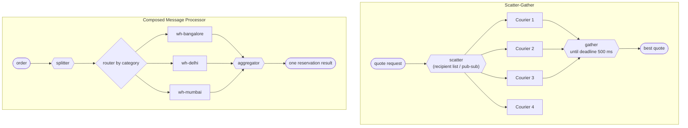

Both run the branches **in parallel**, so total latency is roughly the **slowest needed branch** or the **deadline**, not the sum ([03_Performance_Pattern.md](../03_System_Design/03_Performance_Pattern.md#4-asynchronous-processing-interview-imp---java)).

---

## 9.4 Complete Java Example - Best Courier Quote and Per-Warehouse Routing

```java
import java.util.ArrayList;
import java.util.Comparator;
import java.util.LinkedHashMap;
import java.util.List;
import java.util.Map;
import java.util.Optional;
import java.util.stream.Collectors;

// Scatter-Gather: broadcast a request to several recipients, gather the replies that arrive before a deadline,
// and aggregate them into one answer (best quote).
// Composed Message Processor: split a message, route each part to the right processor, re-aggregate the results.

public class ScatterGatherDemo {
    record Quote(String supplier, long pricePaise, int replyAtMs) {}

    public static void main(String[] args) {
        System.out.println("=== Scatter-Gather: ask 4 couriers for a price, deadline 500 ms ===");
        // each supplier's reply time and price (fixed, repeatable); 'SlowShip' is cheapest but too late, 'DownExpress' never answers
        List<Quote> replies = List.of(new Quote("BlueDart-ish", 180_00, 120), new Quote("QuickParcel", 165_00, 340),
                new Quote("SlowShip", 120_00, 900));
        List<String> recipients = List.of("BlueDart-ish", "QuickParcel", "SlowShip", "DownExpress");
        System.out.println("  scatter to " + recipients + " (in parallel)");
        int deadline = 500;
        List<Quote> gathered = replies.stream().filter(q -> q.replyAtMs() <= deadline).collect(Collectors.toList());
        replies.stream().filter(q -> q.replyAtMs() > deadline).forEach(q -> System.out.println("  " + q.supplier() + " replied at " + q.replyAtMs() + " ms -> too late, ignored"));
        System.out.println("  DownExpress -> no reply (timeout covers it)");
        Optional<Quote> best = gathered.stream().min(Comparator.comparingLong(Quote::pricePaise));
        System.out.println("  gathered " + gathered.size() + "/" + recipients.size() + " quotes by " + deadline + " ms -> best: "
                + best.map(q -> q.supplier() + " Rs " + q.pricePaise() / 100).orElse("none"));
        System.out.println("  latency = deadline (or the slowest wanted reply), NOT the sum of all calls");

        System.out.println("=== Composed Message Processor: one order, lines routed to the warehouse that stocks them ===");
        Map<String, String> warehouseFor = Map.of("ELECTRONICS", "wh-bangalore", "BOOKS", "wh-delhi", "GROCERY", "wh-mumbai");
        List<String[]> lines = List.of(new String[]{"phone", "ELECTRONICS"}, new String[]{"novel", "BOOKS"},
                new String[]{"rice", "GROCERY"}, new String[]{"charger", "ELECTRONICS"});
        Map<String, List<String>> byWarehouse = new LinkedHashMap<>();
        for (String[] l : lines) byWarehouse.computeIfAbsent(warehouseFor.get(l[1]), k -> new ArrayList<>()).add(l[0]);   // split + route
        List<String> shipments = new ArrayList<>();
        byWarehouse.forEach((wh, items) -> {
            String result = wh + " reserved " + items + (wh.equals("wh-mumbai") ? " (ships tomorrow)" : " (ships today)");
            System.out.println("  " + result);
            shipments.add(wh);
        });
        System.out.println("  aggregated reply for ORD-5: " + shipments.size() + " shipments from " + shipments + ", all lines reserved");
    }
}
```

**Output:**
```
=== Scatter-Gather: ask 4 couriers for a price, deadline 500 ms ===
  scatter to [BlueDart-ish, QuickParcel, SlowShip, DownExpress] (in parallel)
  SlowShip replied at 900 ms -> too late, ignored
  DownExpress -> no reply (timeout covers it)
  gathered 2/4 quotes by 500 ms -> best: QuickParcel Rs 165
  latency = deadline (or the slowest wanted reply), NOT the sum of all calls
=== Composed Message Processor: one order, lines routed to the warehouse that stocks them ===
  wh-bangalore reserved [phone, charger] (ships today)
  wh-delhi reserved [novel] (ships today)
  wh-mumbai reserved [rice] (ships tomorrow)
  aggregated reply for ORD-5: 3 shipments from [wh-bangalore, wh-delhi, wh-mumbai], all lines reserved
```

What the output shows:
- **Scatter-gather** asked 4 couriers; 2 replied before the 500 ms **deadline**, SlowShip's cheaper quote came too late, and DownExpress never answered. The gatherer chose the best **available** quote instead of waiting.
- The **composed message processor** split the order's lines, routed each to the warehouse that stocks its category (both electronics items to Bangalore), and aggregated one result: 3 shipments, all lines reserved.

---

## 9.5 In Spring Integration and Camel

```java
// Spring Integration scatter-gather: recipient flows + a gatherer with release strategy and timeout
@Bean
IntegrationFlow courierQuotes() {
    return IntegrationFlow.from("quotes.requests")
            .scatterGather(
                    scatterer -> scatterer.applySequence(true)
                            .recipientFlow(f -> f.handle(courierA, "quote"))
                            .recipientFlow(f -> f.handle(courierB, "quote"))
                            .recipientFlow(f -> f.handle(courierC, "quote")),
                    gatherer -> gatherer.releaseStrategy(g -> g.size() == 3)
                            .outputProcessor(g -> g.getMessages().stream().map(m -> (Quote) m.getPayload())
                                    .min(Comparator.comparing(Quote::price)).orElseThrow()),
                    sg -> sg.gatherTimeout(500))
            .channel("quotes.best")
            .get();
}

// Apache Camel: multicast in parallel with an aggregation strategy and a timeout
from("direct:quote")
    .multicast(new CheapestQuoteStrategy()).parallelProcessing().timeout(500)
        .to("http://courier-a/quote", "http://courier-b/quote", "http://courier-c/quote")
    .end();
```

**Without an integration framework:** `CompletableFuture` fan-out with `completeOnTimeout` per call and `allOf`, or Reactor `Flux.merge(...).take(Duration.ofMillis(500))`.

---

## 9.6 Pros, Cons, Pitfalls, Interview Questions and Cheat Sheet

| Pros | Cons |
|---|---|
| Parallel requests: latency ≈ deadline, not the sum | Extra load on all recipients (N requests per question) |
| Best result from several providers; tolerates slow/dead ones | Partial results; the decision logic must handle missing replies |
| Each part handled by the right specialist (composed processor) | Aggregation state and correlation to manage |

| Pitfall | Fix |
|---|---|
| Waiting for all replies with no deadline | Gather timeout; decide with what you have. |
| Hammering every supplier for every request | Cache quotes briefly; limit recipients; rate limits. |
| Treating "no reply" as "price 0" or an error | Model missing replies explicitly. |
| Composed processor where one category's failure blocks the whole order | Timeouts + partial results + compensation. |

**Q1. What is scatter-gather?** Broadcasting a request to several recipients in parallel and aggregating their replies (within a timeout) into one result, e.g. the best quote.

**Q2. Composed message processor vs scatter-gather?** A composed message processor splits a message into **different** parts routed to **different** processors and re-aggregates; scatter-gather sends the **same** request to **several** recipients and combines their answers.

```
SCATTER-GATHER     Broadcast same request to N recipients in parallel (recipient list / pub-sub) -> gather replies with an
                   aggregator until a DEADLINE -> best/merged answer. SI .scatterGather(...gatherTimeout), Camel multicast().timeout().
COMPOSED PROCESSOR Split -> route each part to its processor -> aggregate (splitter + content-based router + aggregator).
```

---

# 10. Routing Slip and Process Manager

## 10.1 What Are They?

Two ways to send a message through a **sequence of processing steps** that isn't fixed for every message:

- **Routing Slip:** when the message enters the system, a **list of steps is attached to the message** (like a routing slip clipped to a document). Each step does its work, removes itself from the slip, and forwards the message to the next step on the slip. No central component tracks the message.
- **Process Manager:** a **central component** that keeps the **state** of each process instance, receives each step's result, and **decides the next step** based on it (branching, waiting for events, retries, compensation). It's the EIP name for what microservices call **saga orchestration** and what workflow engines (Camunda, Temporal) implement.

**Analogy:**
- **Routing slip:** an office file with a sticky note: "Accounts → Legal → Director". Each desk signs and passes it on. Nobody needs to know where it is, but if Legal says "no", the slip can't easily change the plan.
- **Process manager:** a case manager who tracks every file, looks at each department's answer, and decides what happens next ("Legal rejected it, so send it back to the customer with a letter").

#### 📘 Terms Explained

| Term | Simple meaning |
|---|---|
| **Routing slip** | A list of remaining processing steps carried inside the message. |
| **Process manager** | A stateful coordinator that routes messages through steps based on intermediate results. |
| **Process instance** | One run of a process (e.g. loan application L-3) with its own state. |
| **Orchestration** | Central control of a multi-step process (vs choreography: each service reacts to events). |
| **Workflow engine** | Software that runs long-lived processes with state, timers and retries (Camunda, Temporal, Step Functions). |
| **Compensation** | An action that undoes a completed step when a later step fails. |

---

## 10.2 Why Do We Need Them?

| Situation | Choose |
|---|---|
| The steps for a message are **known when it arrives** (document type → fixed list), linear, no branching on results | **Routing slip** |
| Steps depend on **results** ("if credit score < 600 reject, if amount > 10 lakh wait for a human") | **Process manager** |
| The process is **long-running** (hours/days), waits for external events or people | Process manager / workflow engine |
| You need to answer "what state is application L-3 in?" | Process manager (state in one place) |
| Failures need **compensation** across services | Process manager (saga orchestrator) |

Compared with a fixed pipeline ([pipe and filter](../02_HLD/01_Architectural_Pattern.md#6-pipe-and-filter-architecture)), both allow a different path per message.

---

## 10.3 How They Work

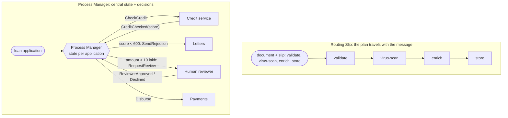

---

## 10.4 Complete Java Example - Document Pipeline vs Loan Application

```java
import java.util.ArrayDeque;
import java.util.ArrayList;
import java.util.Deque;
import java.util.LinkedHashMap;
import java.util.List;
import java.util.Map;
import java.util.function.UnaryOperator;

// Routing Slip: the message carries its own list of remaining steps (sequence decided up front, no central state).
// Process Manager: a central component keeps the state of each process and decides the next step from each result
// (can branch, wait, retry, compensate).

public class RoutingSlipProcessManagerDemo {
    record Doc(String id, Deque<String> slip, Map<String, String> data, List<String> trail) {}

    static final Map<String, UnaryOperator<Doc>> STEPS = new LinkedHashMap<>();
    static {
        STEPS.put("validate", d -> { d.data().put("valid", "yes"); return d; });
        STEPS.put("translate", d -> { d.data().put("lang", "en"); return d; });
        STEPS.put("virus-scan", d -> { d.data().put("clean", "yes"); return d; });
        STEPS.put("enrich", d -> { d.data().put("customer", "Asha"); return d; });
        STEPS.put("store", d -> { d.data().put("stored", "s3://docs/" + d.id()); return d; });
    }

    // ---- ROUTING SLIP: each step pops the next destination from the message itself ----
    static Doc runRoutingSlip(Doc d) {
        while (!d.slip().isEmpty()) {
            String step = d.slip().poll();
            STEPS.get(step).apply(d);
            d.trail().add(step);
        }
        return d;
    }

    // ---- PROCESS MANAGER: loan application with branching on results ----
    enum State { RECEIVED, CREDIT_CHECKED, MANUAL_REVIEW, APPROVED, REJECTED, DISBURSED }
    static class LoanProcessManager {
        final Map<String, State> state = new LinkedHashMap<>(); final List<String> log = new ArrayList<>();
        void start(String id, int score, long amount, boolean reviewerApproves) {
            state.put(id, State.RECEIVED); log.add(id + ": RECEIVED -> send CheckCredit");
            // reply from credit service:
            state.put(id, State.CREDIT_CHECKED); log.add(id + ": CreditChecked(score=" + score + ")");
            if (score < 600) { reject(id, "low score"); return; }
            if (amount > 10_00_000) {                              // big loans need a human: the process WAITS for an event
                state.put(id, State.MANUAL_REVIEW); log.add(id + ": amount > 10 lakh -> MANUAL_REVIEW, waiting for reviewer");
                if (!reviewerApproves) { reject(id, "reviewer declined"); return; }
                log.add(id + ": ReviewerApproved");
            }
            state.put(id, State.APPROVED); log.add(id + ": APPROVED -> send Disburse");
            state.put(id, State.DISBURSED); log.add(id + ": Disbursed -> process complete");
        }
        void reject(String id, String why) { state.put(id, State.REJECTED); log.add(id + ": REJECTED (" + why + ") -> send RejectionLetter"); }
    }

    public static void main(String[] args) {
        System.out.println("=== Routing Slip: the slip is attached when the document enters ===");
        Doc pdf = new Doc("D1", new ArrayDeque<>(List.of("validate", "virus-scan", "enrich", "store")), new LinkedHashMap<>(), new ArrayList<>());
        Doc foreign = new Doc("D2", new ArrayDeque<>(List.of("validate", "translate", "virus-scan", "store")), new LinkedHashMap<>(), new ArrayList<>());
        for (Doc d : List.of(pdf, foreign)) {
            Doc done = runRoutingSlip(d);
            System.out.println("  " + done.id() + " went through " + done.trail() + " -> " + done.data());
        }

        System.out.println("=== Process Manager: central state machine, next step depends on each result ===");
        LoanProcessManager pm = new LoanProcessManager();
        pm.start("L-1", 780, 5_00_000, true);
        pm.start("L-2", 540, 2_00_000, true);
        pm.start("L-3", 720, 25_00_000, false);
        pm.log.forEach(l -> System.out.println("  " + l));
        System.out.println("  current state of each process: " + pm.state + "   (queryable in one place)");
    }
}
```

**Output:**
```
=== Routing Slip: the slip is attached when the document enters ===
  D1 went through [validate, virus-scan, enrich, store] -> {valid=yes, clean=yes, customer=Asha, stored=s3://docs/D1}
  D2 went through [validate, translate, virus-scan, store] -> {valid=yes, lang=en, clean=yes, stored=s3://docs/D2}
=== Process Manager: central state machine, next step depends on each result ===
  L-1: RECEIVED -> send CheckCredit
  L-1: CreditChecked(score=780)
  L-1: APPROVED -> send Disburse
  L-1: Disbursed -> process complete
  L-2: RECEIVED -> send CheckCredit
  L-2: CreditChecked(score=540)
  L-2: REJECTED (low score) -> send RejectionLetter
  L-3: RECEIVED -> send CheckCredit
  L-3: CreditChecked(score=720)
  L-3: amount > 10 lakh -> MANUAL_REVIEW, waiting for reviewer
  L-3: REJECTED (reviewer declined) -> send RejectionLetter
  current state of each process: {L-1=DISBURSED, L-2=REJECTED, L-3=REJECTED}   (queryable in one place)
```

What the output shows:
- **Routing slip:** the PDF (D1) and the foreign-language document (D2) followed **different** step lists attached at entry (D2 needed `translate`, D1 needed `enrich`), with no central coordinator.
- **Process manager:** each loan's path depended on **results**: L-1 went straight to disbursement; L-2 was rejected after the credit check; L-3 needed **manual review** (the process waited for a human event) and was then declined.
- The process manager can answer "**what state is each application in?**" from one place; with a routing slip you'd have to search the message's current location.

---

## 10.5 In Spring Integration, Camel and Workflow Engines

```java
// Spring Integration: routing slip set as a header; each step's output goes to the next channel on the slip
@Bean
IntegrationFlow documents() {
    return IntegrationFlow.from("docs.in")
            .enrichHeaders(h -> h.routingSlip(true, "validate", "virusScan", "enrich", "store"))   // channel names (or expressions)
            .get();
}

// Apache Camel: the slip is a header listing endpoints
from("jms:docs.in")
    .setHeader("slip", method(SlipPlanner.class, "planFor"))       // e.g. "direct:validate,direct:translate,direct:store"
    .routingSlip(header("slip"));
```

**Process managers in Java:**

| Tool | Notes |
|---|---|
| **Saga orchestrator** written with Spring + a state table | Simple processes; see [02_Microservices_Pattern.md](02_Microservices_Pattern.md#5-saga-pattern-interview-imp---java) |
| **Spring State Machine** | Explicit states/transitions in code |
| **Camunda 8 (Zeebe)** | BPMN diagrams, human tasks, timers; Java job workers |
| **Temporal** | Durable workflows written as ordinary Java code; retries, timers and state handled by the engine |
| **AWS Step Functions** | Managed state machines for serverless flows |

```java
// Temporal-style process manager: the code reads like a script, but its state is durable across crashes and days of waiting
@WorkflowInterface
public interface LoanWorkflow {
    @WorkflowMethod String process(LoanApplication app);
    @SignalMethod void reviewerDecision(boolean approved);
}
```

---

## 10.6 Pros, Cons, Pitfalls, Interview Questions and Cheat Sheet

| | Pros | Cons |
|---|---|---|
| **Routing slip** | Simple, no central state, flexible per message, scales well | Can't branch on results; hard to see where a message is; changes mid-flight are awkward |
| **Process manager** | Branching, waiting, retries, compensation; process state visible in one place | A central component to build, run and scale; risk of putting business logic of every service into it |

| Pitfall | Fix |
|---|---|
| Routing slips with conditional logic hidden in every step | Use a process manager when branching appears. |
| Process manager holding state only in memory | Persist instance state (DB or workflow engine). |
| A "god orchestrator" making every decision for every service | Orchestrate the process; keep domain rules inside each service. |
| No timeouts for steps that never reply | Timers per state, escalation and compensation. |

**Q1. Routing slip vs process manager?** A routing slip attaches a fixed sequence of steps to the message at entry (no central state, no branching on results). A process manager keeps central state per process instance and decides each next step from the previous result (branching, waiting, compensation).

**Q2. How does a process manager relate to sagas?** An orchestration-based saga is a process manager: it sends commands to services, tracks the saga's state, and triggers compensating actions on failure.

```
ROUTING SLIP     Step list attached to the message at entry; each step pops itself and forwards. No central state, no branching
                 on results. SI enrichHeaders(h -> h.routingSlip(...)), Camel .routingSlip(header).
PROCESS MANAGER  Central stateful coordinator per process instance; next step depends on results; waits, timers, compensation.
                 = saga orchestrator. Spring State Machine, Camunda, Temporal, Step Functions. Persist state; avoid god orchestrator.
```

---

# 11. Message Store

## 11.1 What Is It?

A **Message Store** keeps a **copy of messages** (with metadata: channel, time, correlation id, outcome) **outside the main message flow**, without changing how messages are delivered. A **wire tap** on a channel copies each message to the store.

It's used for **auditing**, **debugging** ("what happened to order 42?"), **statistics**, and **replaying** messages after a bug is fixed. The same idea also backs stateful patterns (aggregator groups, claim checks, idempotency keys).

**Analogy:** A courier company's tracking database. Parcels move through hubs as usual, but every scan is recorded, so you can see the full history of a parcel, count how many went missing at one hub, and resend lost ones.

#### 📘 Terms Explained

| Term | Simple meaning |
|---|---|
| **Message store** | A persistent record of messages and their metadata, separate from delivery. |
| **Wire tap** | A component that copies every message on a channel to a second channel/store. |
| **Replay** | Re-sending stored messages to a (fixed) consumer. |
| **Audit trail** | A tamper-evident record of what happened, when and to which data. |
| **Retention** | How long stored messages are kept. |

---

## 11.2 Why Do We Need It?

| Question | Answered by the store |
|---|---|
| "Customer says order 42 was never shipped. What happened?" | All messages with correlation id ORD-42, in order, with outcomes |
| "How many shipment requests failed today, and where?" | Per-channel statistics |
| "We fixed the label-service bug. Can we re-run the failed shipments?" | Replay the failed messages |
| "Regulators need proof of every payment instruction we sent" | Audit trail with retention |

> **Kafka is partly a message store already:** topics keep messages for the retention period, and consumers can re-read from any offset. A separate store is still useful for **indexed search** (by correlation id), long-term **audit**, and data from brokers that delete messages after delivery (RabbitMQ, JMS).

---

## 11.3 How It Works

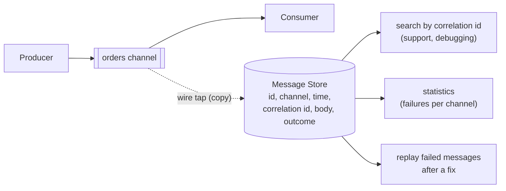

---

## 11.4 Complete Java Example - Audit Trail, Statistics and Replay

```java
import java.util.ArrayList;
import java.util.List;
import java.util.stream.Collectors;

// Message Store: keep a copy of every message (with metadata) outside the main flow, for auditing,
// debugging ("what happened to order 42?"), statistics, and replaying messages after a bug fix.

public class MessageStoreDemo {
    record Stored(long at, String channel, String messageId, String correlationId, String type, String body, String outcome) {}

    static final List<Stored> STORE = new ArrayList<>();                    // a DB table / log index in real life

    // A wire tap: every message passing through a channel is also copied to the store
    static void flow(long at, String channel, String id, String corr, String type, String body, String outcome) {
        STORE.add(new Stored(at, channel, id, corr, type, body, outcome));
    }

    public static void main(String[] args) {
        flow(1000, "orders", "m1", "ORD-41", "OrderPlaced", "{amount:49900}", "OK");
        flow(1005, "orders", "m2", "ORD-42", "OrderPlaced", "{amount:129900}", "OK");
        flow(1010, "payments", "m3", "ORD-41", "PaymentCaptured", "{ref:P-9}", "OK");
        flow(1020, "payments", "m4", "ORD-42", "PaymentCaptured", "{ref:P-10}", "OK");
        flow(1030, "shipping", "m5", "ORD-42", "ShipmentRequested", "{zone:NATIONAL}", "FAILED: NPE in label service v1.4");
        flow(1031, "shipping", "m6", "ORD-41", "ShipmentRequested", "{zone:LOCAL}", "OK");
        flow(1040, "shipping", "m7", "ORD-43", "ShipmentRequested", "{zone:NATIONAL}", "FAILED: NPE in label service v1.4");

        System.out.println("=== Audit / debugging: everything that happened to ORD-42, in order ===");
        STORE.stream().filter(s -> s.correlationId().equals("ORD-42"))
                .forEach(s -> System.out.println("  t=" + s.at() + " " + s.channel() + " " + s.type() + " " + s.body() + " -> " + s.outcome()));

        System.out.println("=== Statistics: messages per channel and failure rate ===");
        STORE.stream().collect(Collectors.groupingBy(Stored::channel, java.util.TreeMap::new, Collectors.toList()))
                .forEach((ch, list) -> System.out.printf("  %-9s %d messages, %d failed%n", ch, list.size(),
                        list.stream().filter(s -> s.outcome().startsWith("FAILED")).count()));

        System.out.println("=== Replay after the fix: re-send only the failed messages (label service v1.5 deployed) ===");
        List<Stored> failed = STORE.stream().filter(s -> s.outcome().startsWith("FAILED")).toList();
        for (Stored s : failed) {
            String outcome = "OK (replayed)";                                      // the fixed consumer now succeeds
            System.out.println("  replay " + s.messageId() + " " + s.type() + " for " + s.correlationId() + " -> " + outcome);
        }
        System.out.println("  consumers must be idempotent: a replayed message may have been partly processed before");
    }
}
```

**Output:**
```
=== Audit / debugging: everything that happened to ORD-42, in order ===
  t=1005 orders OrderPlaced {amount:129900} -> OK
  t=1020 payments PaymentCaptured {ref:P-10} -> OK
  t=1030 shipping ShipmentRequested {zone:NATIONAL} -> FAILED: NPE in label service v1.4
=== Statistics: messages per channel and failure rate ===
  orders    2 messages, 0 failed
  payments  2 messages, 0 failed
  shipping  3 messages, 2 failed
=== Replay after the fix: re-send only the failed messages (label service v1.5 deployed) ===
  replay m5 ShipmentRequested for ORD-42 -> OK (replayed)
  replay m7 ShipmentRequested for ORD-43 -> OK (replayed)
  consumers must be idempotent: a replayed message may have been partly processed before
```

What the output shows:
- **Audit:** the complete history of ORD-42 across three channels, in time order, ending with the shipping failure.
- **Statistics:** failures were concentrated in the shipping channel (2 of 3).
- **Replay:** after deploying the fixed label service, only the **failed** messages were re-sent. Because some of them may have been partly processed the first time, the consumer must be [idempotent](../03_System_Design/04_Messaging_Pattern.md#12-idempotent-consumer-pattern-interview-imp---java).

---

## 11.5 In Spring Integration, Camel and Kafka

```java
// Spring Integration: wire-tap every message on a channel into an audit flow backed by a JDBC store
@Bean
IntegrationFlow orders() {
    return IntegrationFlow.from("orders.in")
            .wireTap("audit")                                         // copy, don't change the main flow
            .handle(orderService, "place")
            .get();
}

@Bean
IntegrationFlow audit(JdbcTemplate jdbc) {
    return IntegrationFlow.from("audit")
            .handle(m -> jdbc.update("INSERT INTO message_audit(message_id, correlation_id, channel, body, at) VALUES (?,?,?,?,?)",
                    m.getHeaders().getId().toString(), m.getHeaders().get("orderId"), "orders.in",
                    m.getPayload().toString(), Instant.now()))
            .get();
}
// Spring Integration's JdbcMessageStore / JdbcChannelMessageStore persist message GROUPS and queued messages (for aggregators, claim checks, durable channels).
```

```java
// Apache Camel
from("jms:orders").wireTap("direct:audit").to("bean:orderService");
from("direct:audit").to("jpa:com.shop.MessageAudit");
```

**Kafka:** replay by resetting a consumer group's offsets (`kafka-consumer-groups --reset-offsets --to-datetime ...`) or by a replay tool that reads a DLT and re-publishes; stream topics into Elasticsearch/OpenSearch or a data lake for indexed search and long-term audit.

---

## 11.6 Pros, Cons, Pitfalls, Interview Questions and Cheat Sheet

| Pros | Cons |
|---|---|
| End-to-end visibility and audit | Storage cost and retention management |
| Replay after fixes without asking producers to resend | Copies of sensitive data (PII, card data) to secure |
| Statistics and debugging without touching the main flow | Extra write per message (do it asynchronously) |

| Pitfall | Fix |
|---|---|
| Storing full PII/secrets in plain text | Mask/encrypt; store references; strict access control. |
| Synchronous audit writes slowing the main flow | Asynchronous wire tap / a separate consumer. |
| Replaying into non-idempotent consumers | Idempotency keys before any replay. |
| Keeping everything forever | Retention by data class (debug 30 days, audit 7 years). |

**Q1. What is a message store?** A persistent copy of messages and their metadata, captured (usually via a wire tap) outside the main flow, for audit, debugging, statistics and replay.

**Q2. How do you safely replay messages?** Select only the relevant messages (e.g. failed ones after a fix), make consumers idempotent, replay at a controlled rate, and record the replay itself.

```
MESSAGE STORE  Copy of every message + metadata via WIRE TAP (async). Audit trail by correlation id, statistics, REPLAY after fixes
               (consumers idempotent). Also backs aggregator groups / claim checks (SI JdbcMessageStore). Kafka retention + offset
               reset for replay; index into Elasticsearch for search. Mask PII, retention policy.
```

---

# 12. How the Integration Patterns Fit Together

## 12.1 One-Line Summary of Each

| Pattern | One line |
|---|---|
| **File Transfer** | Share data through files written and read later. |
| **Shared Database** | Apps read/write the same tables (tight schema coupling). |
| **Remote Procedure Call** | Call a function in another app and wait. |
| **Messaging** | Send messages through channels asynchronously. |
| **Point-to-Point Channel** | One receiver per message (queue). |
| **Publish-Subscribe Channel** | Every subscriber gets each message (topic). |
| **Datatype Channel** | One channel per message type. |
| **Invalid Message Channel** | Park messages that can't be understood. |
| **Dead Letter Channel** | Park valid messages that couldn't be delivered/processed. |
| **Guaranteed Delivery** | Persist messages so they survive crashes. |
| **Channel Adapter** | Connect non-messaging systems to channels. |
| **Message Bridge** | Connect two messaging systems. |
| **Message Bus** | Shared messaging backbone with agreed channels and formats. |
| **Message Dispatcher** | One receiver distributes messages to performers. |
| **Selective Consumer** | Receive only messages matching a selector. |
| **Durable Subscriber** | Keep a subscriber's messages while it's offline. |
| **Idempotent Receiver** | Process duplicates safely. |
| **Service Activator** | Invoke a plain service from a message. |
| **Messaging Gateway** | Hide messaging behind a plain interface. |
| **Transactional Client** | Send/receive messages inside a transaction. |
| **Polling Consumer** | Pull messages when ready. |
| **Event-Driven Consumer** | Messages pushed to a listener as they arrive. |
| **Message Expiration** | Discard messages after their TTL. |
| **Format Indicator** | Header saying which format/version the body uses. |
| **Canonical Data Model** | One shared format all integrations map to. |
| **Envelope Wrapper** | Infrastructure headers around an unchanged payload. |
| **Content Enricher** | Add missing data from another source. |
| **Content Filter** | Remove unneeded/sensitive data. |
| **Claim Check** | Store the big payload, send a reference. |
| **Normalizer** | Many input formats → one canonical format. |
| **Splitter** | One message → many. |
| **Aggregator** | Many related messages → one. |
| **Resequencer** | Restore message order. |
| **Composed Message Processor** | Split, route parts to processors, re-aggregate. |
| **Scatter-Gather** | Broadcast a request, gather replies within a deadline. |
| **Routing Slip** | Message carries its own list of steps. |
| **Process Manager** | Central stateful coordinator choosing the next step. |
| **Message Store** | Persistent copy of messages for audit, stats and replay. |

---

## 12.2 One Order Through an Integration Flow (Interview Imp - Java)

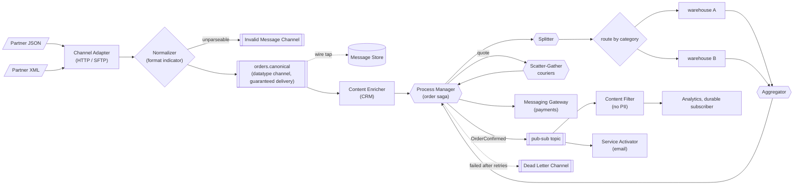

---

## 12.3 Spring Integration and Apache Camel Equivalents

| Pattern | Spring Integration (Java DSL) | Apache Camel |
|---|---|---|
| Channel adapter | `Files.inboundAdapter`, `Http.inboundGateway`, `Jms.messageDrivenChannelAdapter`, `Kafka.messageDrivenChannelAdapter` | `from("file:...")`, `from("platform-http:...")`, `from("jms:...")`, `from("kafka:...")` |
| Messaging gateway | `@MessagingGateway` | `ProducerTemplate`, `@Produce` |
| Service activator | `@ServiceActivator`, `.handle(bean, "method")` | `.bean(Service.class, "method")` |
| Content-based router | `.route(...)`, `.routeToRecipients(...)` | `.choice().when(...)` |
| Filter / selective | `.filter(...)` | `.filter(...)` |
| Translator / filter | `.transform(...)` | `.transform()`, `.process()`, `.marshal()/unmarshal()` |
| Enricher | `.enrich(...)`, `.enrichHeaders(...)` | `.enrich(...)`, `.pollEnrich(...)` |
| Splitter | `.split()` | `.split(...)` |
| Aggregator | `.aggregate(...)` | `.aggregate(...)` |
| Resequencer | `.resequence(...)` | `.resequence(...)` |
| Scatter-gather | `.scatterGather(...)` | `.multicast(strategy)`, `.recipientList(...)` |
| Routing slip | `enrichHeaders(h -> h.routingSlip(...))` | `.routingSlip(header("slip"))` |
| Claim check | `.claimCheckIn/Out(store)` | `.claimCheck(...)` |
| Wire tap | `.wireTap("channel")` | `.wireTap("endpoint")` |
| Dead letter | `errorChannel`, Kafka DLT, RabbitMQ DLX | `deadLetterChannel("...")` error handler |
| Polling consumer | `Pollers.fixedDelay(...)` | `scheduler:`/`timer:` + polling consumer components |

**Spring Integration vs Apache Camel:** both implement EIP. Spring Integration fits naturally into Spring applications (beans, channels, Spring Boot auto-configuration); Camel has a huge library of 300+ connectors and a concise route DSL, and runs on Spring Boot or Quarkus. For **service-to-service** event streaming in microservices, many teams use Kafka + Spring Cloud Stream / Kafka Streams directly and reach for Spring Integration or Camel for **integration-heavy** work (files, partners, legacy protocols).

---

## 12.4 Decision Guide

| Need | Use |
|---|---|
| Connect two apps, other side may be down, no immediate answer needed | Messaging (queue/topic) |
| Need an immediate answer | RPC (REST/gRPC) with timeouts, or request-reply over messaging |
| Legacy system that only writes files/DB rows | Channel adapter (or CDC) |
| Two brokers (on-prem MQ and cloud Kafka) | Message bridge (Kafka Connect, Camel, Shovel) |
| Many apps and partners with different formats | Canonical data model + normalizer |
| Message lacks data the consumer needs | Content enricher (or event-carried state transfer) |
| Consumer must not see PII | Content filter |
| Big payloads | Claim check |
| Mixed versions during an upgrade | Format indicator / schema registry |
| Stale messages are harmful | Message expiration |
| Process each item of a batch/order separately, then combine | Splitter + aggregator |
| Order lost by parallelism | Ordering by key, else resequencer |
| Best answer from several providers | Scatter-gather |
| Different processors per part of a message | Composed message processor |
| Fixed per-message sequence of steps | Routing slip |
| Steps depend on results, long-running, compensation | Process manager / workflow engine / saga |
| Audit, debug, replay | Message store + wire tap |
| Malformed vs undeliverable messages | Invalid message channel vs dead letter channel |

---

## 12.5 Look-Alike Concepts

| Look-alikes | Difference |
|---|---|
| **Invalid message vs dead letter channel** | Can't be understood (sender's fault) vs valid but couldn't be delivered/processed. |
| **Splitter vs router** | One message becomes many vs one message goes to one (or some) destination(s). |
| **Aggregator vs resequencer** | Combines related messages into one vs reorders messages, keeping them separate. |
| **Scatter-gather vs composed message processor** | Same request to many recipients vs different parts to different processors. |
| **Routing slip vs process manager** | Plan travels with the message, no branching on results vs central state and decisions. |
| **Process manager vs choreography** | Central orchestrator vs services reacting to each other's events. |
| **Message translator vs normalizer** | One format → another vs many formats → one canonical format. |
| **Content enricher vs content filter** | Adds data vs removes data. |
| **Envelope wrapper vs format indicator** | Infrastructure headers around the payload vs a marker saying how to parse the payload. |
| **Claim check vs message store** | Store a payload so the message stays small vs keep copies of messages for audit/replay. |
| **Polling vs event-driven consumer** | Consumer pulls on its schedule vs messages pushed to a listener. |
| **Durable subscriber vs guaranteed delivery** | Keep messages for an offline subscriber vs persist messages against crashes. |
| **Messaging gateway vs service activator** | Sending side: interface hiding messaging vs receiving side: message invokes a plain service. |
| **Message bus vs ESB** | Shared messaging backbone with agreed channels/formats vs a product that often adds central routing/transformation logic ("smart pipes"). |
| **Channel adapter vs message bridge** | Non-messaging system ↔ channel vs messaging system ↔ messaging system. |
| **Shared database vs database per service** | Integration through common tables vs each service owns its data and integrates via APIs/events. |

---

# 13. Integration Patterns Cheat Sheet

```
STYLES          File Transfer (batch) | Shared DB (avoid between services) | RPC (sync, temporal coupling) | Messaging (async, buffered).
CHANNELS        P2P queue | Pub-sub topic | Datatype (channel per type) | Invalid Message (can't parse) | Dead Letter (failed after retries)
                | Guaranteed Delivery (persisted; outbox) | Channel Adapter (files/DB/HTTP <-> channel) | Message Bridge (broker <-> broker)
                | Message Bus (shared backbone + agreed channels/formats).
ENDPOINTS       Messaging Gateway (@MessagingGateway, replyTimeout) | Service Activator (@ServiceActivator, @KafkaListener -> POJO)
                | Transactional Client (ack after commit; Kafka transactions; outbox; idempotent).
CONSUMERS       Polling (pull, Pollers) vs Event-Driven (listener; Kafka poll loop inside) | Selective (JMS selector; Kafka: filter/topics)
                | Durable Subscriber (JMS durable sub; Kafka consumer group) | Dispatcher (key-based for per-key order)
                | Competing Consumers + Idempotent Receiver (Messaging_Pattern §1, §12).
CONSTRUCTION    Envelope Wrapper (headers, CloudEvents) | Format Indicator (schema-version / registry id) | Expiration (TTL; Kafka: header)
                | Claim Check (payload in S3, key in message; cleanup + ACL).
TRANSFORMATION  Translator (§8 Messaging) | Canonical Data Model (2N not N(N-1); no god schema) | Normalizer (detect -> translate -> canonical)
                | Content Enricher (add from CRM/cache/KTable) | Content Filter (drop PII/unneeded).
ROUTING         Splitter (corrId + seq + size) | Aggregator (correlation + release + TIMEOUT + persistent store + dedupe) | Resequencer
                (buffer by seq, gap timeout; prefer Kafka key ordering) | Scatter-Gather (parallel, deadline, best answer) | Composed
                Message Processor (split -> route -> aggregate) | Routing Slip (steps in the message) | Process Manager (central state = saga
                orchestrator; Camunda/Temporal).
MANAGEMENT      Message Store + Wire Tap: audit by correlation id, statistics, replay (idempotent consumers), mask PII, retention.
FRAMEWORKS      Spring Integration (Java DSL: split/aggregate/resequence/scatterGather/enrich/claimCheck/wireTap) | Apache Camel routes.
```

### Quick Decision Table

| Interview question | Short answer |
|---|---|
| "How would you integrate with a partner who sends orders as XML files?" | Channel adapter (SFTP/file) → normalizer → canonical model → messaging; invalid message channel for bad files. |
| "How do you process an order's lines in parallel and return one result?" | Splitter → parallel processing → aggregator with correlation id, completion condition and timeout. |
| "A 10 MB document must go through Kafka." | Claim check: store in S3, send the key. |
| "Get the best price from 5 suppliers in under a second." | Scatter-gather with a gather timeout. |
| "Messages arrive out of order after parallel processing." | Key-based ordering by design, else a resequencer with a gap timeout. |
| "A multi-step loan process with human approval." | Process manager / workflow engine (Camunda, Temporal) with persisted state. |
| "How do you find out what happened to one order across systems?" | Correlation id on every message + message store/wire tap (plus distributed tracing). |
| "Spring Integration or Camel?" | Both implement EIP; SI fits Spring apps, Camel has more connectors; for microservice events, Kafka + Spring Cloud Stream. |

### Top Interview Traps

| Trap | Correct answer |
|---|---|
| "Dead letter channel and invalid message channel are the same" | Invalid = can't be understood; dead letter = valid but undeliverable/unprocessable. |
| "An aggregator is just a list" | It's stateful: correlation, completion, timeouts, persistence, duplicates, late arrivals. |
| "Kafka has per-message TTL" | Only topic retention; expire via headers in the consumer. |
| "Kafka supports message selectors" | No broker-side selectors; filter in the consumer or use separate topics. |
| "A shared database is the simplest way to integrate services" | It couples schemas and deployments; prefer APIs/events (or CDC). |
| "Routing slips can handle any workflow" | No branching on results or long waits; use a process manager. |
| "A canonical data model should contain everything" | Keep it to shared concepts or it becomes an unchangeable god schema. |
| "Replaying messages is always safe" | Only with idempotent consumers. |
