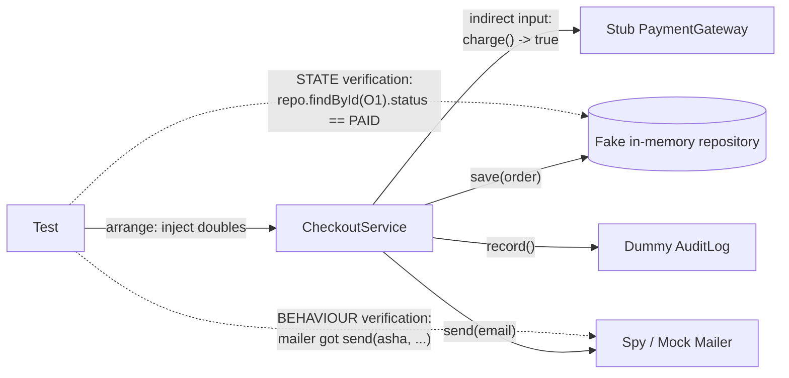
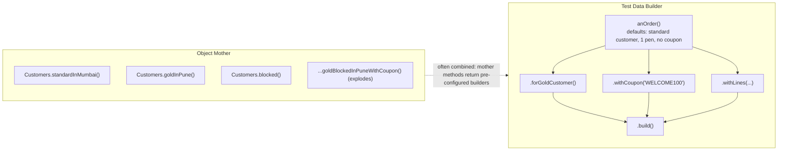
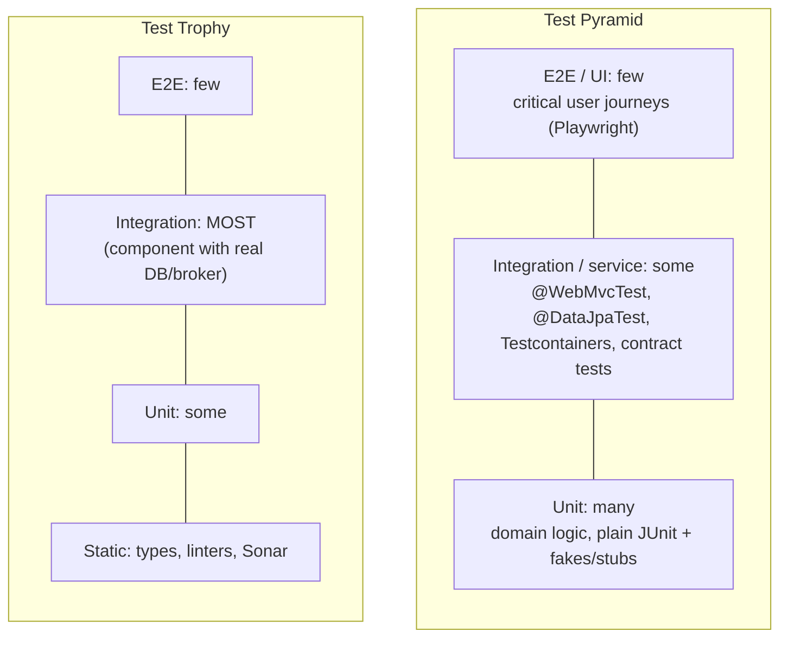
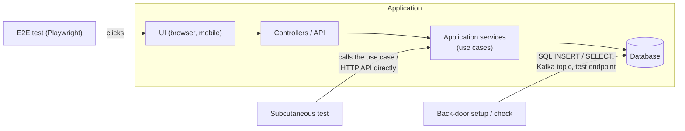
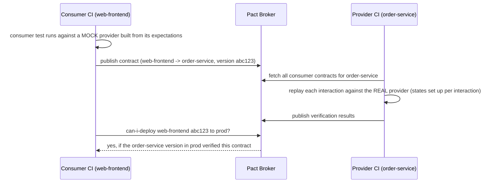
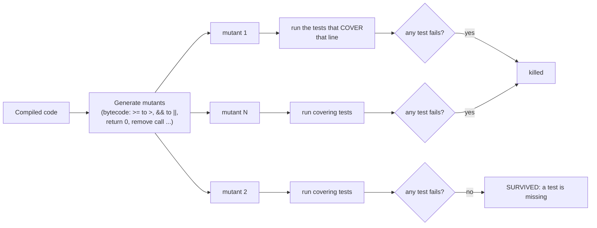
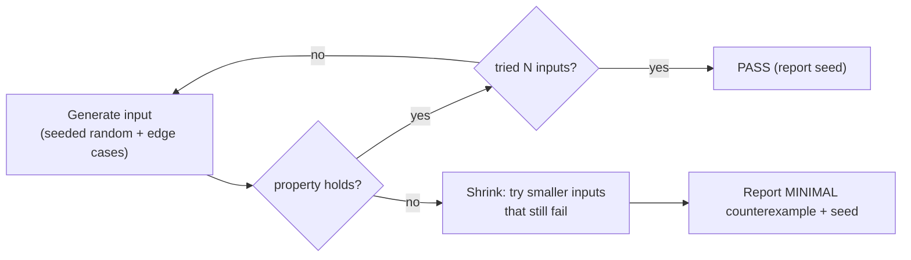
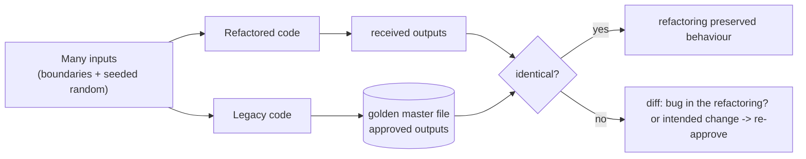
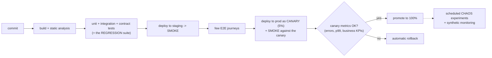
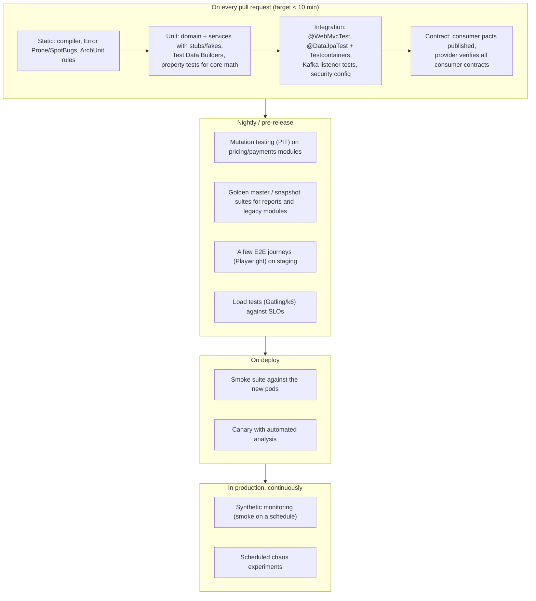

# Testing Patterns

> **Note**: Patterns marked with **(Interview Imp - Java)** are frequently asked in Java interviews
>
> **How to read this file:** Every section ends with a **📘 Terms Explained** table. If you see a word you don't know, check the table right below that section. Each pattern goes from the basic idea to advanced usage (a plain Java example, then JUnit 5 / Mockito / Spring Boot / Testcontainers / Pact / PIT / jqwik code, pros and cons, pitfalls) and ends with interview questions and a mini cheat sheet.
>
> **What are testing patterns?** They answer: *"How do we get fast, trustworthy feedback that our code works, and keeps working as it changes?"* This file covers all 25 **Testing Patterns** in the [master list](../00_Design_Patterns_Complete_List.md#testing-patterns): the test doubles (Dummy, Stub, Fake, Spy, Mock), test data (Builder for Tests, Test Data Builder, Object Mother, Fixture), test structure (Layered Tests, Test Pyramid, Test Trophy, Subcutaneous Test, Back Door Manipulation), contracts (Contract Test, Consumer-Driven Contract), test-quality techniques (Mutation, Property-Based, Snapshot, Golden Master) and release-time testing (Smoke, Regression, Canary, Chaos).
>
> **Builds on (linked, not repeated):** JUnit 5 / Mockito / AssertJ basics in [Java_Complete_Guide.md](../../java/Java_Complete_Guide.md#153-testing-with-junit-5-mockito-assertj-interview-imp), canary releases in [09_Deployment_Pattern.md](../03_System_Design/09_Deployment_Pattern.md#3-canary-deployment-pattern-interview-imp---java), chaos engineering in [02_Reliability_Pattern.md](../03_System_Design/02_Reliability_Pattern.md#12-chaos-engineering), synthetic monitoring in [10_Observability_Pattern.md](../03_System_Design/10_Observability_Pattern.md#7-synthetic-monitoring-pattern), hexagonal "ports and adapters" (which makes testing easy) in [01_Architectural_Pattern.md](../02_HLD/01_Architectural_Pattern.md#3-hexagonal-architecture-ports-and-adapters-interview-imp---java), and the Builder pattern in [02_Creational_Pattern.md](../01_LLD/02_Creational_Pattern.md).
>
> **Verified code:** Every main "Complete Java Example" is **plain Java 17 with no libraries**: a few lines of hand-written test harness stand in for JUnit, so you can see exactly what the frameworks do. Each was compiled and run **three times** with identical output; random data uses fixed seeds, and the smoke-test example talks to a **real local HTTP server**. Some examples contain **deliberately failing tests** to show a pitfall; the text says which. To run one, save it as `<ClassName>.java` and run `javac <ClassName>.java && java <ClassName>`. (Running it directly with `java <ClassName>.java` won't work when the class with `main` is not the first class in the file.) The JUnit / Spring / Pact / PIT / jqwik snippets show real APIs but are illustrations, not compiled projects.

---

## Table of Contents
0. [Before You Start: Vocabulary and Good-Test Rules](#before-you-start-vocabulary-and-good-test-rules)
1. [Test Doubles: Dummy, Stub, Fake, Spy and Mock](#1-test-doubles-dummy-stub-fake-spy-and-mock-interview-imp---java) **(Interview Imp - Java)**
   - [1.1 What Are They?](#11-what-are-they)
   - [1.2 Why Do We Need Them?](#12-why-do-we-need-them)
   - [1.3 How They Work: State vs Behaviour Verification](#13-how-they-work-state-vs-behaviour-verification)
   - [1.4 Complete Java Example - All Five Doubles, and a Brittle Mock](#14-complete-java-example---all-five-doubles-and-a-brittle-mock)
   - [1.5 With Mockito and Spring Boot](#15-with-mockito-and-spring-boot)
   - [1.6 Pros, Cons, Pitfalls, Interview Questions and Cheat Sheet](#16-pros-cons-pitfalls-interview-questions-and-cheat-sheet)
2. [Test Data: Test Data Builder, Object Mother and Fixtures](#2-test-data-test-data-builder-object-mother-and-fixtures-interview-imp---java) **(Interview Imp - Java)**
   - [2.1 What Are They?](#21-what-are-they)
   - [2.2 Why Do We Need Them?](#22-why-do-we-need-them)
   - [2.3 How They Work](#23-how-they-work)
   - [2.4 Complete Java Example - Mother vs Builder, Shared vs Fresh Fixture](#24-complete-java-example---mother-vs-builder-shared-vs-fresh-fixture)
   - [2.5 In JUnit 5 and Spring Boot](#25-in-junit-5-and-spring-boot)
   - [2.6 Pros, Cons, Pitfalls, Interview Questions and Cheat Sheet](#26-pros-cons-pitfalls-interview-questions-and-cheat-sheet)
3. [Layered Tests: Test Pyramid and Test Trophy](#3-layered-tests-test-pyramid-and-test-trophy-interview-imp---java) **(Interview Imp - Java)**
   - [3.1 What Are They?](#31-what-are-they)
   - [3.2 Why Does the Shape Matter?](#32-why-does-the-shape-matter)
   - [3.3 How It Works: What Goes in Each Layer](#33-how-it-works-what-goes-in-each-layer)
   - [3.4 Complete Java Example - Runtime and Flakiness of Three Suite Shapes](#34-complete-java-example---runtime-and-flakiness-of-three-suite-shapes)
   - [3.5 Each Layer in Spring Boot (Slices and Testcontainers)](#35-each-layer-in-spring-boot-slices-and-testcontainers)
   - [3.6 Pros, Cons, Pitfalls, Interview Questions and Cheat Sheet](#36-pros-cons-pitfalls-interview-questions-and-cheat-sheet)
4. [Subcutaneous Tests and Back Door Manipulation](#4-subcutaneous-tests-and-back-door-manipulation)
   - [4.1 What Are They?](#41-what-are-they)
   - [4.2 Why Do We Need Them?](#42-why-do-we-need-them)
   - [4.3 How They Work](#43-how-they-work)
   - [4.4 Complete Java Example - UI vs Subcutaneous vs Back Door](#44-complete-java-example---ui-vs-subcutaneous-vs-back-door)
   - [4.5 In Spring Boot (MockMvc, `@Sql`, Repositories)](#45-in-spring-boot-mockmvc-sql-repositories)
   - [4.6 Pros, Cons, Pitfalls, Interview Questions and Cheat Sheet](#46-pros-cons-pitfalls-interview-questions-and-cheat-sheet)
5. [Contract Tests and Consumer-Driven Contracts](#5-contract-tests-and-consumer-driven-contracts-interview-imp---java) **(Interview Imp - Java)**
   - [5.1 What Are They?](#51-what-are-they)
   - [5.2 Why Do We Need Them?](#52-why-do-we-need-them)
   - [5.3 How They Work](#53-how-they-work)
   - [5.4 Complete Java Example - Consumer Contracts Verified Against Three Provider Versions](#54-complete-java-example---consumer-contracts-verified-against-three-provider-versions)
   - [5.5 With Pact and Spring Cloud Contract](#55-with-pact-and-spring-cloud-contract)
   - [5.6 Pros, Cons, Pitfalls, Interview Questions and Cheat Sheet](#56-pros-cons-pitfalls-interview-questions-and-cheat-sheet)
6. [Mutation Testing](#6-mutation-testing)
   - [6.1 What Is It?](#61-what-is-it)
   - [6.2 Why Do We Need It?](#62-why-do-we-need-it)
   - [6.3 How It Works](#63-how-it-works)
   - [6.4 Complete Java Example - 100% Coverage, 50% Mutation Score](#64-complete-java-example---100-coverage-50-mutation-score)
   - [6.5 With PIT (pitest)](#65-with-pit-pitest)
   - [6.6 Pros, Cons, Pitfalls, Interview Questions and Cheat Sheet](#66-pros-cons-pitfalls-interview-questions-and-cheat-sheet)
   - [6.7 Types and Variants](#67-types-and-variants)
7. [Property-Based Testing](#7-property-based-testing)
   - [7.1 What Is It?](#71-what-is-it)
   - [7.2 Why Do We Need It?](#72-why-do-we-need-it)
   - [7.3 How It Works: Generate, Check, Shrink](#73-how-it-works-generate-check-shrink)
   - [7.4 Complete Java Example - Finding and Shrinking a Bill-Splitting Bug](#74-complete-java-example---finding-and-shrinking-a-bill-splitting-bug)
   - [7.5 With jqwik](#75-with-jqwik)
   - [7.6 Pros, Cons, Pitfalls, Interview Questions and Cheat Sheet](#76-pros-cons-pitfalls-interview-questions-and-cheat-sheet)
8. [Snapshot and Golden Master Testing](#8-snapshot-and-golden-master-testing)
   - [8.1 What Are They?](#81-what-are-they)
   - [8.2 Why Do We Need Them?](#82-why-do-we-need-them)
   - [8.3 How They Work](#83-how-they-work)
   - [8.4 Complete Java Example - Characterising Legacy Code, Then Refactoring](#84-complete-java-example---characterising-legacy-code-then-refactoring)
   - [8.5 With ApprovalTests and Jest](#85-with-approvaltests-and-jest)
   - [8.6 Pros, Cons, Pitfalls, Interview Questions and Cheat Sheet](#86-pros-cons-pitfalls-interview-questions-and-cheat-sheet)
   - [8.7 Types and Variants](#87-types-and-variants)
9. [Smoke, Regression, Canary and Chaos Testing](#9-smoke-regression-canary-and-chaos-testing-interview-imp---java) **(Interview Imp - Java)**
   - [9.1 What Are They?](#91-what-are-they)
   - [9.2 Why Do We Need Them?](#92-why-do-we-need-them)
   - [9.3 How They Fit in a Delivery Pipeline](#93-how-they-fit-in-a-delivery-pipeline)
   - [9.4 Complete Java Example - Post-Deploy Smoke Suite and Regression Tests on a Real Server](#94-complete-java-example---post-deploy-smoke-suite-and-regression-tests-on-a-real-server)
   - [9.5 In Practice (Spring Boot, CI/CD, Kubernetes)](#95-in-practice-spring-boot-cicd-kubernetes)
   - [9.6 Pros, Cons, Pitfalls, Interview Questions and Cheat Sheet](#96-pros-cons-pitfalls-interview-questions-and-cheat-sheet)
10. [How the Testing Patterns Fit Together](#10-how-the-testing-patterns-fit-together)
    - [10.1 One-Line Summary of Each](#101-one-line-summary-of-each)
    - [10.2 A Test Strategy for a Spring Boot Microservice (Interview Imp - Java)](#102-a-test-strategy-for-a-spring-boot-microservice-interview-imp---java)
    - [10.3 Decision Guide](#103-decision-guide)
    - [10.4 Look-Alike Concepts](#104-look-alike-concepts)
11. [Testing Patterns Cheat Sheet](#11-testing-patterns-cheat-sheet)

---

## Before You Start: Vocabulary and Good-Test Rules

| Term | Meaning |
|---|---|
| **SUT** (System Under Test) | The class, component or system a test exercises. |
| **Collaborator / dependency** | Something the SUT uses (repository, HTTP client, clock). |
| **Test double** | Any object that stands in for a real collaborator in a test ([section 1](#1-test-doubles-dummy-stub-fake-spy-and-mock-interview-imp---java)). |
| **Fixture** | Everything a test needs set up before it runs ([section 2](#2-test-data-test-data-builder-object-mother-and-fixtures-interview-imp---java)). |
| **Assertion** | A check that fails the test if an expectation isn't met. |
| **Flaky test** | A test that sometimes passes and sometimes fails without any code change. |
| **Test coverage** | Which lines/branches the tests executed (not whether they checked anything; see [section 6](#6-mutation-testing)). |

### The structure of a good test: Arrange-Act-Assert (Given-When-Then)

```java
@Test
void goldCustomersGetTenPercentOff() {
    // Arrange (Given): build the inputs and collaborators
    Order order = anOrder().forGoldCustomer().withLines(new Line("BOOK", 2, 500_00)).build();
    // Act (When): do exactly one thing
    long total = Pricing.total(order);
    // Assert (Then): check the outcome
    assertThat(total).isEqualTo(900_00);
}
```

### FIRST: properties of good unit tests

| Letter | Property | Meaning |
|---|---|---|
| **F** | Fast | Milliseconds, so you run them constantly |
| **I** | Independent / Isolated | No test depends on another or on run order |
| **R** | Repeatable | Same result on every machine and every run (no real clock, network or random without a seed) |
| **S** | Self-validating | Pass or fail automatically; no reading logs |
| **T** | Timely | Written with (or before, in TDD) the code |

**Also:** test **behaviour**, not implementation details; one reason to fail per test; descriptive names (`declinedPaymentSendsNoEmail`); and treat test code with the same care as production code.

### The Java testing toolbox

| Need | Tools |
|---|---|
| Test runner | **JUnit 5** (Jupiter): `@Test`, `@ParameterizedTest`, `@Nested`, extensions |
| Assertions | **AssertJ** (`assertThat(x).isEqualTo(y)`), Hamcrest |
| Test doubles | **Mockito**, hand-written fakes, WireMock (HTTP) |
| Spring | `spring-boot-starter-test`: `@SpringBootTest`, slices (`@WebMvcTest`, `@DataJpaTest`), MockMvc, `@MockitoBean` |
| Real infrastructure | **Testcontainers** (PostgreSQL, Kafka, Redis in Docker), embedded servers |
| Contracts | **Pact**, Spring Cloud Contract |
| Test quality | **PIT** (mutation testing), JaCoCo (coverage), **jqwik** (property-based), ApprovalTests (golden master/snapshots) |
| End to end / UI | Selenium, **Playwright**, REST Assured, Karate |
| Performance | Gatling, k6, JMH (micro) |

#### 📘 Terms Explained

| Term | Simple meaning |
|---|---|
| **Arrange-Act-Assert / Given-When-Then** | The three-part structure of a test: set up, do one thing, check the result. |
| **TDD (Test-Driven Development)** | Write a failing test, make it pass, refactor (red-green-refactor). |
| **BDD (Behaviour-Driven Development)** | Describing behaviour in business language (Given/When/Then), often with Cucumber. |
| **JUnit 5 / AssertJ / Mockito** | The standard Java test runner / fluent assertion library / mocking library. |
| **Test slice** | A Spring Boot test that starts only part of the application (e.g. just the web layer). |

---

# 1. Test Doubles: Dummy, Stub, Fake, Spy and Mock (Interview Imp - Java)

## 1.1 What Are They?

A **test double** (Gerard Meszaros, *xUnit Test Patterns*) is any object that **replaces a real collaborator** in a test, like a stunt double replaces an actor. "Mock" is often used loosely for all of them, but there are five kinds:

| Double | What it does | Example | Verifies |
|---|---|---|---|
| **Dummy** | Passed around but **never used**; only fills a parameter | `new DummyAuditLog()` passed to a constructor | Nothing |
| **Stub** | Returns **canned answers** to calls made during the test | Payment gateway that always returns `true`; a fixed `Clock` | Nothing (drives the SUT down a path) |
| **Fake** | A **working**, simplified implementation, unsuitable for production | In-memory repository, H2 instead of PostgreSQL, fake SMTP server | Nothing itself; you check its state |
| **Spy** | A stub that also **records** how it was called | Mailer that stores every sent email in a list | Test asserts on recorded calls afterwards |
| **Mock** | Pre-programmed with **expectations**; fails if called unexpectedly / not called as expected | Mailer that expects exactly `send("asha", "Order O3 confirmed")` | **Itself** (behaviour verification) |

**Analogy:** Filming a movie.
- **Dummy:** a mannequin in the background, never touched.
- **Stub:** a prop phone that always plays the same recorded reply.
- **Fake:** a real working car with a lawnmower engine: it drives, just not on the motorway.
- **Spy:** a hidden camera that records what the actor did, reviewed later.
- **Mock:** a strict choreographer who stops the scene the moment a step is wrong.

#### 📘 Terms Explained

| Term | Simple meaning |
|---|---|
| **Test double** | A stand-in object used instead of a real dependency in a test. |
| **Canned answer** | A fixed, pre-defined response returned by a stub. |
| **Expectation** | A mock's pre-declared idea of which calls it should receive. |
| **Interaction** | A method call from the SUT to a collaborator. |
| **Indirect input / output** | Values the SUT gets from collaborators (stubbed) / calls it makes to them (spied or mocked). |

---

## 1.2 Why Do We Need Them?

| Problem with real collaborators in unit tests | Double that helps |
|---|---|
| Slow (database, network, external APIs) | Fake / stub |
| Non-deterministic (time, random, network failures) | Stub (fixed `Clock`, seeded `Random`) |
| Hard to trigger edge cases (payment declined, timeout, disk full) | Stub that returns/throws exactly that |
| Side effects you can't allow (charging cards, sending emails) | Spy / mock / fake |
| Not built yet (another team's service) | Stub / fake |
| You need to check an **outgoing** call happened ("an email was sent") | Spy / mock |

---

## 1.3 How They Work: State vs Behaviour Verification



| | State verification | Behaviour verification |
|---|---|---|
| Question | "Is the **result / end state** correct?" | "Did the SUT **call its collaborators** correctly?" |
| Uses | Stubs, fakes | Spies, mocks |
| Style | "Classicist" / Detroit school | "Mockist" / London school |
| Robust to refactoring? | ✅ Usually | ❌ Breaks when internal calls change |
| Use when | There's an observable result | The outcome **is** the call (sending an email, publishing an event, charging a card) |

**Guideline:** prefer **state** verification with stubs and fakes; use mocks/spies for **outgoing commands** at the system's edges (email, payment, message broker) and check only what matters.

---

## 1.4 Complete Java Example - All Five Doubles, and a Brittle Mock

`CheckoutService` has five collaborators; each test uses the right kind of double. The last two tests compare an **over-specified mock** with a spy that checks only what matters. **The one FAIL in the output is intentional.**

```java
import java.time.Clock;
import java.time.Instant;
import java.time.ZoneOffset;
import java.util.ArrayList;
import java.util.HashMap;
import java.util.List;
import java.util.Map;
import java.util.Optional;

// The five test doubles (Gerard Meszaros' names), hand-written, around one class under test.
// A tiny assertion harness replaces JUnit so this runs with plain Java.

// ---------------- production code ----------------
interface PaymentGateway { boolean charge(String customer, long paise); }
interface OrderRepository { void save(Order o); Optional<Order> findById(String id); }
interface AuditLog { void record(String event); }
interface Mailer { void send(String to, String body); }
record Order(String id, String customer, long paise, String status) {}

class CheckoutService {
    private final PaymentGateway payments; private final OrderRepository orders; private final Mailer mailer;
    private final AuditLog audit; private final Clock clock;
    CheckoutService(PaymentGateway p, OrderRepository o, Mailer m, AuditLog a, Clock c) { payments = p; orders = o; mailer = m; audit = a; clock = c; }

    Order checkout(String id, String customer, long paise) {
        if (paise <= 0) throw new IllegalArgumentException("amount must be positive");
        boolean night = clock.instant().atZone(ZoneOffset.UTC).getHour() < 6;
        if (night && paise > 50_000_00) throw new IllegalStateException("large payments are blocked between 00:00 and 06:00");
        Order o = new Order(id, customer, paise, payments.charge(customer, paise) ? "PAID" : "DECLINED");
        orders.save(o);
        if (o.status().equals("PAID")) mailer.send(customer, "Order " + id + " confirmed");
        audit.record("checkout " + id + " " + o.status());
        return o;
    }
}

// ---------------- the five doubles ----------------
class DummyAuditLog implements AuditLog {                     // DUMMY: passed only to satisfy the constructor, never relevant
    public void record(String e) {}
}
class StubPaymentGateway implements PaymentGateway {          // STUB: returns canned answers, drives the code down one path
    private final boolean answer; StubPaymentGateway(boolean answer) { this.answer = answer; }
    public boolean charge(String c, long p) { return answer; }
}
class FakeOrderRepository implements OrderRepository {        // FAKE: a real, working, simplified implementation (in-memory)
    final Map<String, Order> rows = new HashMap<>();
    public void save(Order o) { rows.put(o.id(), o); }
    public Optional<Order> findById(String id) { return Optional.ofNullable(rows.get(id)); }
}
class SpyMailer implements Mailer {                           // SPY: records how it was called, so the test can check afterwards
    final List<String> sent = new ArrayList<>();
    public void send(String to, String body) { sent.add(to + ": " + body); }
}
class MockMailer implements Mailer {                          // MOCK: pre-programmed with EXPECTATIONS, verifies itself
    private final List<String> expected = new ArrayList<>(); private final List<String> actual = new ArrayList<>();
    MockMailer expect(String to, String body) { expected.add(to + ": " + body); return this; }
    public void send(String to, String body) {
        String call = to + ": " + body;
        if (!expected.contains(call)) throw new AssertionError("unexpected call send(" + call + ")");   // fails fast on surprises
        actual.add(call);
    }
    void verify() { if (!actual.equals(expected)) throw new AssertionError("expected " + expected + " but got " + actual); }
}

public class TestDoublesDemo {
    static int passed = 0, failed = 0;
    static void test(String name, Runnable body) {
        try { body.run(); passed++; System.out.println("  PASS " + name); }
        catch (AssertionError | RuntimeException e) { failed++; System.out.println("  FAIL " + name + " -> " + e.getMessage()); }
    }
    static void assertEquals(Object expected, Object actual) {
        if (!expected.equals(actual)) throw new AssertionError("expected <" + expected + "> but was <" + actual + ">");
    }

    static final Clock NOON = Clock.fixed(Instant.parse("2026-11-02T12:00:00Z"), ZoneOffset.UTC);   // a STUB clock
    static final Clock NIGHT = Clock.fixed(Instant.parse("2026-11-02T02:00:00Z"), ZoneOffset.UTC);

    public static void main(String[] args) {
        System.out.println("=== Tests using each kind of test double ===");
        test("paid order is saved as PAID (stub + fake)", () -> {
            FakeOrderRepository repo = new FakeOrderRepository();
            new CheckoutService(new StubPaymentGateway(true), repo, new SpyMailer(), new DummyAuditLog(), NOON).checkout("O1", "asha", 499_00);
            assertEquals("PAID", repo.findById("O1").orElseThrow().status());          // STATE verification
        });
        test("declined payment sends no email (spy)", () -> {
            SpyMailer mailer = new SpyMailer();
            new CheckoutService(new StubPaymentGateway(false), new FakeOrderRepository(), mailer, new DummyAuditLog(), NOON).checkout("O2", "ravi", 499_00);
            assertEquals(List.of(), mailer.sent);
        });
        test("paid order sends exactly one confirmation (mock)", () -> {
            MockMailer mailer = new MockMailer().expect("asha", "Order O3 confirmed");
            new CheckoutService(new StubPaymentGateway(true), new FakeOrderRepository(), mailer, new DummyAuditLog(), NOON).checkout("O3", "asha", 499_00);
            mailer.verify();                                                            // BEHAVIOUR verification
        });
        test("large payment at 02:00 is blocked (stub clock)", () -> {
            try {
                new CheckoutService(new StubPaymentGateway(true), new FakeOrderRepository(), new SpyMailer(), new DummyAuditLog(), NIGHT).checkout("O4", "meera", 60_000_00);
                throw new AssertionError("expected IllegalStateException");
            } catch (IllegalStateException expected) { assertEquals("large payments are blocked between 00:00 and 06:00", expected.getMessage()); }
        });

        System.out.println("=== Over-specified mock: the code still works, but the test breaks ===");
        test("mock pinned to the exact email text", () -> {
            MockMailer mailer = new MockMailer().expect("asha", "Your order O5 is confirmed!");  // copywriter changed the wording
            new CheckoutService(new StubPaymentGateway(true), new FakeOrderRepository(), mailer, new DummyAuditLog(), NOON).checkout("O5", "asha", 499_00);
            mailer.verify();
        });
        test("spy asserting only what matters (one email to asha)", () -> {
            SpyMailer mailer = new SpyMailer();
            new CheckoutService(new StubPaymentGateway(true), new FakeOrderRepository(), mailer, new DummyAuditLog(), NOON).checkout("O6", "asha", 499_00);
            assertEquals(1, mailer.sent.size());
            assertEquals(true, mailer.sent.get(0).startsWith("asha: "));
        });
        System.out.println(passed + " passed, " + failed + " failed (the failure is a BRITTLE test, not a bug)");
    }
}
```

**Output:**
```
=== Tests using each kind of test double ===
  PASS paid order is saved as PAID (stub + fake)
  PASS declined payment sends no email (spy)
  PASS paid order sends exactly one confirmation (mock)
  PASS large payment at 02:00 is blocked (stub clock)
=== Over-specified mock: the code still works, but the test breaks ===
  FAIL mock pinned to the exact email text -> unexpected call send(asha: Order O5 confirmed)
  PASS spy asserting only what matters (one email to asha)
5 passed, 1 failed (the failure is a BRITTLE test, not a bug)
```

What the output shows:
- **Stub + fake:** the stub forced the "payment approved" path; the fake repository let the test check the **resulting state** (`PAID`).
- **Spy:** recorded zero emails for a declined payment. **Mock:** expected one exact call and **verified itself**.
- **Stub clock:** a fixed `Clock` at 02:00 made the night-time rule testable, repeatably, at any real time of day.
- **Brittle mock:** the mock pinned the exact email wording, so a harmless copy change failed the test (**FAIL**) even though the behaviour was fine. The spy test asserted only "one email to asha" and survived. Over-specified mocks are the most common source of tests that break on every refactor.

---

## 1.5 With Mockito and Spring Boot

```java
@ExtendWith(MockitoExtension.class)                       // strict stubs: unused stubbings fail the test
class CheckoutServiceTest {
    @Mock PaymentGateway payments;                        // Mockito "mock" (used as stub AND/OR mock)
    @Mock Mailer mailer;
    @Spy FakeOrderRepository orders = new FakeOrderRepository();   // a real fake, wrapped to also record calls
    @Mock AuditLog audit;                                 // effectively a dummy here
    Clock clock = Clock.fixed(Instant.parse("2026-11-02T12:00:00Z"), ZoneOffset.UTC);

    @Test
    void paidOrderSendsConfirmation() {
        when(payments.charge("asha", 499_00)).thenReturn(true);                    // stubbing
        CheckoutService sut = new CheckoutService(payments, orders, mailer, audit, clock);

        sut.checkout("O3", "asha", 499_00);

        assertThat(orders.findById("O3")).get().extracting(Order::status).isEqualTo("PAID");   // state
        ArgumentCaptor<String> body = ArgumentCaptor.forClass(String.class);
        verify(mailer).send(eq("asha"), body.capture());                            // behaviour, loosely
        assertThat(body.getValue()).contains("O3");
    }

    @Test
    void gatewayTimeoutPropagates() {
        when(payments.charge(anyString(), anyLong())).thenThrow(new GatewayTimeoutException());
        assertThatThrownBy(() -> new CheckoutService(payments, orders, mailer, audit, clock).checkout("O9", "asha", 100))
                .isInstanceOf(GatewayTimeoutException.class);
        verifyNoInteractions(mailer);
    }
}

// Spring Boot: replace a bean in the application context with a Mockito mock
@WebMvcTest(CheckoutController.class)
class CheckoutControllerTest {
    @Autowired MockMvc mvc;
    @MockitoBean CheckoutService checkout;                 // Spring Framework 6.2+ (replaces the deprecated @MockBean)

    @Test
    void returns201() throws Exception {
        when(checkout.checkout(any(), any(), anyLong())).thenReturn(new Order("O1", "asha", 499_00, "PAID"));
        mvc.perform(post("/checkout").contentType(APPLICATION_JSON).content("{\"customer\":\"asha\",\"amount\":49900}"))
           .andExpect(status().isCreated()).andExpect(jsonPath("$.status").value("PAID"));
    }
}
```

| Mockito feature | Use |
|---|---|
| `when(...).thenReturn/thenThrow/thenAnswer` | Stubbing |
| `verify(mock, times(1)).method(args)`, `verifyNoInteractions`, `never()` | Behaviour verification |
| `ArgumentCaptor` | Capture arguments to assert on them flexibly |
| Argument matchers `any()`, `eq()`, `argThat(...)` | Loose matching (all args must use matchers if one does) |
| `@Spy` / `spy(realObject)` | Partial mock: real methods unless stubbed (use `doReturn().when(spy)` for spies) |
| `mockStatic(...)`, `mockConstruction(...)` | Last resort for static/`new` calls in legacy code; prefer injecting a dependency |

**Fakes worth knowing:** WireMock (fake HTTP APIs), GreenMail (fake SMTP), Testcontainers (real DB instead of a fake), `Clock.fixed`, in-memory `Map` repositories, Spring Kafka's `EmbeddedKafka`.

#### 📘 Terms Explained

| Term | Simple meaning |
|---|---|
| **`@Mock` / `@InjectMocks`** | Mockito: create a mock / create the SUT with mocks injected. |
| **Strict stubs** | Mockito mode that fails tests with stubbings that were never used. |
| **`ArgumentCaptor`** | Mockito helper that captures the arguments of a call for later assertions. |
| **`@MockitoBean`** | Spring test annotation that replaces a bean in the context with a Mockito mock. |
| **WireMock** | A library that runs a fake HTTP server with programmable responses. |
| **`Clock.fixed`** | A `java.time.Clock` that always returns the same instant: a stub for time. |

---

## 1.6 Pros, Cons, Pitfalls, Interview Questions and Cheat Sheet

| Pros | Cons |
|---|---|
| Fast, deterministic, isolated unit tests | Doubles can drift from real behaviour ("passes with mocks, fails in prod") |
| Easy to simulate errors and edge cases | Over-mocking couples tests to implementation |
| Verify side effects without performing them | Mock-heavy tests are hard to read |

| Pitfall | Fix |
|---|---|
| Mocking everything, including value objects and the SUT's own internals | Mock only collaborators at boundaries; use real objects for values and pure logic. |
| Mocking types you don't own (e.g. `RestTemplate`, JPA `EntityManager`) | Wrap them in your own interface (a port) and mock that, or use a fake/WireMock/Testcontainers. |
| Verifying every call (`verifyNoMoreInteractions` everywhere) | Verify only the interactions that are the point of the test. |
| Stubbing what the test doesn't need | Strict stubs flag them; remove them. |
| Fakes that behave differently from the real thing | Run the same contract tests against the fake and the real implementation. |
| `mockStatic` all over the codebase | Inject `Clock`, `IdGenerator`, etc. |

**Q1. Mock vs stub?** A stub provides canned answers so the SUT can run (state verification). A mock has expectations about the calls it should receive and verifies them (behaviour verification).

**Q2. Fake vs mock?** A fake is a working lightweight implementation (in-memory DB); a mock is a programmed object that checks interactions. Fakes support state-based testing; mocks interaction-based.

**Q3. What is a spy in Mockito?** A wrapper around a real object: real methods run unless stubbed, and calls can be verified. Use `doReturn(x).when(spy).method()` to stub spies safely.

**Q4. When should you not use mocks?** For value objects, pure functions, data structures, and types you don't own; and when an in-memory fake or a real dependency in a container gives a more realistic test at acceptable speed.

```
TEST DOUBLES  Dummy (fills a param) | Stub (canned answers) | Fake (working simplified impl: in-memory repo, WireMock)
              | Spy (stub + records calls) | Mock (expectations, self-verifying).
              State verification (stubs/fakes, robust) vs behaviour verification (spies/mocks, for outgoing commands).
              Mockito: when/thenReturn, verify, ArgumentCaptor, @Spy + doReturn, strict stubs. Spring: @MockitoBean.
              Don't mock what you don't own; don't over-specify; inject Clock instead of mockStatic.
```

---

# 2. Test Data: Test Data Builder, Object Mother and Fixtures (Interview Imp - Java)

## 2.1 What Are They?

| Pattern | Idea | Example |
|---|---|---|
| **Fixture** | Everything a test needs in place before it runs: objects, data, files, DB rows, running servers | `@BeforeEach` creating a fresh service with a fake repository |
| **Object Mother** | A class of **factory methods** that return named, ready-made example objects | `Customers.goldInPune()`, `Orders.paidOrderWithTwoLines()` |
| **Test Data Builder** (the **Builder pattern for tests**) | A fluent builder with **sensible defaults**; each test overrides only the fields it cares about | `anOrder().forGoldCustomer().withCoupon("WELCOME100").build()` |

**Kinds of fixtures:**
- **Fresh fixture:** built new for every test (default; tests can't affect each other).
- **Shared fixture:** built once and reused (faster for expensive setup, but risky if anything mutates it).
- **Persistent fixture:** data that outlives the test (DB rows, files) and must be cleaned up.

**Analogy:** Setting a table in a restaurant. The **fixture** is the set table. An **Object Mother** is a menu of set meals ("Thali No. 3"): quick, but you end up with dozens of slightly different set meals. A **Test Data Builder** is a waiter who brings the standard plate and asks "anything you want changed?": "the standard, but extra spicy".

#### 📘 Terms Explained

| Term | Simple meaning |
|---|---|
| **Fixture** | The prepared state and objects a test runs against. |
| **Fresh / shared fixture** | Rebuilt for each test / built once and reused by several tests. |
| **Object Mother** | A factory class returning named example objects for tests. |
| **Test Data Builder** | A builder with defaults that lets a test override only relevant fields. |
| **Obscure test** | A test whose important detail is hidden among irrelevant setup. |
| **Test pollution / leakage** | One test's leftover state changing another test's result. |

---

## 2.2 Why Do We Need Them?

| Problem | Pattern |
|---|---|
| `new Order(new Customer("X", GOLD, new Address("P", "4"), false), List.of(...), null)` in every test: noisy, and the *one* relevant field (GOLD) is hidden | Builder: `anOrder().forGoldCustomer()` |
| A new required constructor parameter breaks 300 tests | Builder/mother: change it in one place |
| Same example objects copied across test classes | Object Mother |
| Tests pass alone but fail together (or in a different order) | Fresh fixtures, cleanup |
| Expensive setup (starting a DB) repeated for every test | Shared **immutable** infrastructure fixture (one container per test class/run) with fresh **data** per test |

---

## 2.3 How They Work



**Builder rules:** defaults must be **valid** and **boring** (so tests only state what matters); override methods use **domain words** (`forGoldCustomer()`, not `setTier(GOLD)`); `build()` returns a new object each time; mothers can return builders (`Orders.aPaidOrder()` returning an `OrderBuilder`) to combine both.

---

## 2.4 Complete Java Example - Mother vs Builder, Shared vs Fresh Fixture

The same pricing rule is tested with raw constructors, an Object Mother and a Test Data Builder; then a **shared mutable fixture** makes a test's result depend on test order. **The one FAIL in the output is intentional.**

```java
import java.util.ArrayList;
import java.util.List;

// Test data patterns: Object Mother, Test Data Builder, and Fixtures (fresh vs shared).

enum Tier { STANDARD, GOLD }
record Address(String city, String pin) {}
record Customer(String name, Tier tier, Address address, boolean blocked) {}
record Line(String sku, int qty, long unitPaise) {}
record Order(Customer customer, List<Line> lines, String coupon) {}

class Pricing {                                                // production code under test
    static long total(Order o) {
        if (o.customer().blocked()) throw new IllegalStateException("blocked customer");
        long t = o.lines().stream().mapToLong(l -> l.qty() * l.unitPaise()).sum();
        if (o.customer().tier() == Tier.GOLD) t = t * 90 / 100;
        if ("WELCOME100".equals(o.coupon())) t = Math.max(0, t - 100_00);
        return t;
    }
}

// ---------- OBJECT MOTHER: named, ready-made example objects ----------
class Customers {
    static Customer standardInMumbai() { return new Customer("Asha", Tier.STANDARD, new Address("Mumbai", "400001"), false); }
    static Customer goldInPune() { return new Customer("Ravi", Tier.GOLD, new Address("Pune", "411001"), false); }
    static Customer blocked() { return new Customer("Mallory", Tier.STANDARD, new Address("Delhi", "110001"), true); }
    // ...the mother keeps growing: goldBlockedInPuneWithCoupon(), standardInMumbaiWithTwoLines()...
}

// ---------- TEST DATA BUILDER: sensible defaults + fluent overrides of only what the test cares about ----------
class OrderBuilder {
    private String name = "Any Customer"; private Tier tier = Tier.STANDARD; private boolean blocked = false;
    private final List<Line> lines = new ArrayList<>(List.of(new Line("PEN", 1, 100_00))); private String coupon = null;
    static OrderBuilder anOrder() { return new OrderBuilder(); }
    OrderBuilder forGoldCustomer() { tier = Tier.GOLD; return this; }
    OrderBuilder forBlockedCustomer() { blocked = true; return this; }
    OrderBuilder withLines(Line... ls) { lines.clear(); lines.addAll(List.of(ls)); return this; }
    OrderBuilder withCoupon(String c) { coupon = c; return this; }
    Order build() { return new Order(new Customer(name, tier, new Address("Anytown", "000000"), blocked), List.copyOf(lines), coupon); }
}

public class TestDataDemo {
    static int passed, failed;
    static void test(String name, Runnable r) {
        try { r.run(); passed++; System.out.println("  PASS " + name); }
        catch (AssertionError | RuntimeException e) { failed++; System.out.println("  FAIL " + name + " -> " + e.getMessage()); }
    }
    static void eq(long expected, long actual) { if (expected != actual) throw new AssertionError("expected " + expected + " but was " + actual); }

    // ---------- FIXTURE: shared mutable state vs fresh per test ----------
    static final List<Line> SHARED_CART = new ArrayList<>();            // a "shared fixture" reused by every test

    public static void main(String[] args) {
        System.out.println("=== Raw constructors: the important detail is buried ===");
        test("gold discount (raw constructor)", () -> eq(900_00, Pricing.total(new Order(
                new Customer("X", Tier.GOLD, new Address("Pune", "411001"), false), List.of(new Line("BOOK", 2, 500_00)), null))));

        System.out.println("=== Object Mother ===");
        test("gold discount (mother)", () -> eq(900_00, Pricing.total(new Order(Customers.goldInPune(), List.of(new Line("BOOK", 2, 500_00)), null))));

        System.out.println("=== Test Data Builder: each test states only what matters ===");
        test("gold customers get 10% off", () -> eq(900_00, Pricing.total(anOrderWith2Books().forGoldCustomer().build())));
        test("WELCOME100 takes Rs 100 off", () -> eq(900_00, Pricing.total(anOrderWith2Books().withCoupon("WELCOME100").build())));
        test("coupon never makes total negative", () -> eq(0, Pricing.total(OrderBuilder.anOrder().withLines(new Line("PEN", 1, 20_00)).withCoupon("WELCOME100").build())));
        test("gold discount applies BEFORE the coupon", () -> eq(800_00, Pricing.total(anOrderWith2Books().forGoldCustomer().withCoupon("WELCOME100").build())));
        test("blocked customer is rejected", () -> {
            try { Pricing.total(OrderBuilder.anOrder().forBlockedCustomer().build()); throw new AssertionError("no exception"); }
            catch (IllegalStateException expected) {}
        });

        System.out.println("=== Shared mutable fixture: tests pass or fail depending on ORDER ===");
        Runnable addsItem = () -> { SHARED_CART.add(new Line("PEN", 1, 100_00)); eq(100_00, Pricing.total(new Order(Customers.standardInMumbai(), SHARED_CART, null))); };
        Runnable expectsEmpty = () -> eq(0, Pricing.total(new Order(Customers.standardInMumbai(), SHARED_CART, null)));
        test("expectsEmpty (runs first)", expectsEmpty);
        test("addsItem", addsItem);
        test("expectsEmpty (runs again later)", expectsEmpty);                 // fails: state leaked from the previous test

        System.out.println("=== Fresh fixture: new state per test (what @BeforeEach gives you) ===");
        for (int run = 1; run <= 2; run++) {
            List<Line> cart = new ArrayList<>();                               // set up fresh for each test
            int r = run;
            test("expectsEmpty with fresh fixture, run " + r, () -> eq(0, Pricing.total(new Order(Customers.standardInMumbai(), cart, null))));
        }
        System.out.println(passed + " passed, " + failed + " failed");
    }

    static OrderBuilder anOrderWith2Books() { return OrderBuilder.anOrder().withLines(new Line("BOOK", 2, 500_00)); }
}
```

**Output:**
```
=== Raw constructors: the important detail is buried ===
  PASS gold discount (raw constructor)
=== Object Mother ===
  PASS gold discount (mother)
=== Test Data Builder: each test states only what matters ===
  PASS gold customers get 10% off
  PASS WELCOME100 takes Rs 100 off
  PASS coupon never makes total negative
  PASS gold discount applies BEFORE the coupon
  PASS blocked customer is rejected
=== Shared mutable fixture: tests pass or fail depending on ORDER ===
  PASS expectsEmpty (runs first)
  PASS addsItem
  FAIL expectsEmpty (runs again later) -> expected 0 but was 10000
=== Fresh fixture: new state per test (what @BeforeEach gives you) ===
  PASS expectsEmpty with fresh fixture, run 1
  PASS expectsEmpty with fresh fixture, run 2
11 passed, 1 failed
```

What the output shows:
- All three styles test the same rule, but only the **builder** versions read like a specification ("gold customers get 10% off", "gold discount applies BEFORE the coupon": 1000 → 900 → 800). The detail that matters is on the line; everything else is a default.
- The edge case "coupon never makes total negative" was one line to write because the builder handled the rest.
- **Shared mutable fixture:** `expectsEmpty` passed the first time and **FAILED** the second time, purely because `addsItem` ran in between and left an item in the shared cart. That's test pollution: tests that pass or fail depending on order (JUnit 5 doesn't guarantee method order by default).
- **Fresh fixtures** (a new cart per test, which is what `@BeforeEach` gives you) made the same test pass every time.

---

## 2.5 In JUnit 5 and Spring Boot

```java
// Test Data Builder as a reusable test helper (or Lombok @Builder(toBuilder = true) on test-only classes)
public final class OrderBuilder {
    private Customer customer = CustomerBuilder.aCustomer().build();
    private List<Line> lines = List.of(new Line("PEN", 1, 100_00));
    private String coupon;
    public static OrderBuilder anOrder() { return new OrderBuilder(); }
    public OrderBuilder forGoldCustomer() { customer = CustomerBuilder.aCustomer().gold().build(); return this; }
    public OrderBuilder withCoupon(String c) { coupon = c; return this; }
    public Order build() { return new Order(customer, lines, coupon); }
}

class PricingTest {
    PricingService pricing;

    @BeforeEach                                   // FRESH fixture for every test
    void setUp() { pricing = new PricingService(new InMemoryCouponRepository()); }

    @ParameterizedTest(name = "{0} pays {2}")
    @CsvSource({ "STANDARD, , 100000", "GOLD, , 90000", "GOLD, WELCOME100, 80000" })
    void totals(Tier tier, String coupon, long expected) {
        assertThat(pricing.total(anOrder().withTier(tier).withCoupon(coupon).withLines(new Line("BOOK", 2, 500_00)).build()))
                .isEqualTo(expected);
    }

    @Test
    void writesInvoiceFile(@TempDir Path dir) { /* JUnit creates and deletes a temp directory per test */ }
}

// Spring: SHARED infrastructure, FRESH data
@SpringBootTest
@Testcontainers
class OrderRepositoryIT {
    @Container @ServiceConnection
    static PostgreSQLContainer<?> db = new PostgreSQLContainer<>("postgres:16-alpine");   // one container for the class (shared)

    @Autowired OrderRepository orders;

    @BeforeEach void clean() { orders.deleteAll(); }                                     // fresh data per test
    // or annotate tests with @Transactional: Spring rolls back after each test method
}
```

**Random-but-valid data:** libraries like **Instancio** or **Datafaker** fill in fields you don't care about, which also catches tests that accidentally depend on default values. Use a fixed seed (or log the seed) so failures are reproducible.

---

## 2.6 Pros, Cons, Pitfalls, Interview Questions and Cheat Sheet

| | Pros | Cons |
|---|---|---|
| **Object Mother** | Quick, named, reusable examples | Grows into hundreds of near-identical methods; hidden coupling (change one, break many tests) |
| **Test Data Builder** | Tests show only relevant data; resilient to constructor changes; composable | Builder code to write and maintain |
| **Fresh fixture** | Independent, order-free tests | Can be slow for expensive setup |
| **Shared fixture** | Fast for expensive setup | Test pollution if mutable; order dependence |

| Pitfall | Fix |
|---|---|
| Mystery guest (test depends on data defined far away, in a SQL file or another class) | Show relevant data in the test (builder overrides). |
| Mother methods with long combinatorial names | Switch to builders (mother returns builders). |
| Shared mutable static fixtures | Fresh per test; shared only for immutable or infrastructure fixtures. |
| Tests relying on DB IDs or row order from previous tests | Clean DB per test, or `@Transactional` rollback. |
| Builder defaults that are "interesting" (e.g. a blocked customer) | Defaults must be valid and neutral. |

**Q1. Object Mother vs Test Data Builder?** A mother offers fixed, named example objects (simple but grows and couples tests). A builder offers neutral defaults and fluent overrides so each test states only what it cares about; mothers often return pre-configured builders.

**Q2. What is a test fixture and why prefer fresh fixtures?** The setup a test needs. Fresh fixtures (rebuilt per test, e.g. `@BeforeEach`) keep tests independent and order-free; shared mutable fixtures leak state between tests.

**Q3. How do you keep DB integration tests independent?** One shared container (expensive) but fresh data per test: delete/truncate in `@BeforeEach`, `@Sql` scripts, or `@Transactional` tests rolled back automatically.

```
TEST DATA   Fixture = prepared state. FRESH per test (@BeforeEach) by default; SHARED only if immutable/expensive infra (one container).
            Object Mother: named examples (Customers.goldInPune()) - grows, couples. Test Data Builder: neutral defaults + domain-named
            overrides (anOrder().forGoldCustomer().build()) - each test shows only what matters. Mother can return builders.
            @ParameterizedTest/@CsvSource, @TempDir, @Transactional rollback, Instancio/Datafaker with fixed seeds.
```

---

# 3. Layered Tests: Test Pyramid and Test Trophy (Interview Imp - Java)

## 3.1 What Are They?

**Layered tests** means organising tests by **scope**: small tests of one unit, medium tests of a component with its real infrastructure, and a few big tests of the whole system. The **shape** of the portfolio says how many of each you have.

| Shape | Who | Idea |
|---|---|---|
| **Test Pyramid** | Mike Cohn (2009), popularised by Martin Fowler | **Many** fast unit tests, **some** integration/service tests, **few** end-to-end/UI tests |
| **Test Trophy** | Kent C. Dodds (2018, front-end world) | Static analysis at the base, a **thick middle of integration tests**, fewer unit and E2E tests: "write tests, not too many, mostly integration" |
| **Testing Honeycomb** | Spotify (microservices) | Mostly **integration tests of each service** (with real dependencies), few "implementation detail" unit tests, few integrated E2E tests |
| **Ice-cream cone** *(anti-pattern)* | — | Mostly manual/UI/E2E tests, few unit tests: slow, flaky, expensive |

**Analogy:** Checking a car before a long trip. **Unit:** test each part on a bench (battery voltage, tyre pressure): quick, precise. **Integration:** start the engine with the real fuel system: catches parts that don't fit together. **End-to-end:** drive it around the block: realistic, but slow, and when it fails you don't know which part did.

#### 📘 Terms Explained

| Term | Simple meaning |
|---|---|
| **Unit test** | Tests one small unit (class/function) in isolation, in milliseconds. |
| **Integration test** | Tests several units together, often with real infrastructure (DB, broker). |
| **Component / service test** | Tests one deployable service as a black box with its dependencies faked or containerised. |
| **End-to-end (E2E) test** | Tests a full user journey through the deployed system (UI to database). |
| **Static analysis** | Checks without running code: compiler, type checks, linters (Checkstyle, SpotBugs, Error Prone, Sonar). |
| **Ice-cream cone** | Anti-pattern portfolio with most tests at the slow, manual/UI end. |

---

## 3.2 Why Does the Shape Matter?

| As tests get bigger (unit → integration → E2E) | Effect |
|---|---|
| Realism / confidence per test | ⬆ higher |
| Speed | ⬇ ms → seconds → minutes |
| Flakiness (network, timing, data) | ⬆ |
| Precision of failure (where is the bug?) | ⬇ |
| Cost to write and maintain | ⬆ |

So you want **enough** big tests for confidence that the pieces work together, and **lots** of small tests for fast, precise feedback. Pyramid vs trophy is a debate about the **middle**: modern tools (Testcontainers, Spring slices) made integration tests fast enough that many teams put most of their tests there.

---

## 3.3 How It Works: What Goes in Each Layer



| Layer | Test here | Don't test here |
|---|---|---|
| **Static** | Types, null-safety, code smells, security patterns (SpotBugs, Error Prone, Sonar, ArchUnit rules) | Behaviour |
| **Unit** | Business rules, calculations, state machines, value objects, mappers, edge cases and boundaries | Framework wiring, SQL, HTTP serialisation |
| **Integration** | Repository queries against a real DB, JSON (de)serialisation, controller validation + error mapping, Kafka listeners, transactions, security config | Every combination of business rules |
| **Contract** | The API shape between services ([section 5](#5-contract-tests-and-consumer-driven-contracts-interview-imp---java)) | Business behaviour of the provider |
| **E2E** | A handful of money-making journeys (sign up, search, checkout) | Edge cases (do those lower down) |
| **Exploratory / manual** | Usability, things no one thought to automate | Regression checks (automate them) |

---

## 3.4 Complete Java Example - Runtime and Flakiness of Three Suite Shapes

A cost model of three suites with ~2,000 tests each. Per-test runtimes and flakiness rates are illustrative but typical (unit 5 ms, integration 0.8 s, E2E 20 s; flaky rates 0.001%, 0.05%, 1%).

```java
import java.util.LinkedHashMap;
import java.util.Map;

// Test portfolio shapes as a cost model: Pyramid vs Ice-Cream Cone vs Trophy.
// Per-test runtime and flakiness are illustrative but typical orders of magnitude.

public class TestPortfolioDemo {
    record Kind(String name, double seconds, double flakyRate) {}
    static final Kind UNIT = new Kind("unit", 0.005, 0.00001);               // in-memory, no I/O
    static final Kind INTEGRATION = new Kind("integration", 0.8, 0.0005);   // Spring slice + Testcontainers DB
    static final Kind E2E = new Kind("e2e", 20, 0.01);                       // browser + whole deployed system

    static void evaluate(String shape, int unit, int integration, int e2e, int parallelism) {
        Map<Kind, Integer> suite = new LinkedHashMap<>();
        suite.put(UNIT, unit); suite.put(INTEGRATION, integration); suite.put(E2E, e2e);
        double seconds = 0, pAllGreen = 1;
        for (var e : suite.entrySet()) {
            seconds += e.getKey().seconds() * e.getValue();
            pAllGreen *= Math.pow(1 - e.getKey().flakyRate(), e.getValue());   // chance no test fails randomly
        }
        System.out.printf("  %-15s unit %5d | integ %4d | e2e %4d -> %6.1f min on %d workers | red builds from flakiness: %5.1f%%%n",
                shape, unit, integration, e2e, seconds / 60 / parallelism, parallelism, 100 * (1 - pAllGreen));
    }

    public static void main(String[] args) {
        System.out.println("=== ~2,000 tests each, same total count, different shapes ===");
        evaluate("Pyramid", 1700, 250, 50, 4);
        evaluate("Trophy", 800, 1100, 100, 4);
        evaluate("Ice-cream cone", 300, 400, 1300, 4);

        System.out.println("=== Why a failing test's LOCATION matters (time to find the bug) ===");
        System.out.println("  unit test fails      -> names one class + method       -> minutes");
        System.out.println("  integration fails    -> one service + its DB/broker    -> tens of minutes");
        System.out.println("  e2e fails            -> any of 12 services, UI, data   -> hours");

        System.out.println("=== Chance that ONE flaky e2e test (1% each) breaks a run ===");
        for (int n : new int[]{10, 50, 100, 300})
            System.out.printf("  %3d e2e tests -> %5.1f%% of runs fail for no real reason%n", n, 100 * (1 - Math.pow(0.99, n)));
    }
}
```

**Output:**
```
=== ~2,000 tests each, same total count, different shapes ===
  Pyramid         unit  1700 | integ  250 | e2e   50 ->    5.0 min on 4 workers | red builds from flakiness:  47.5%
  Trophy          unit   800 | integ 1100 | e2e  100 ->   12.0 min on 4 workers | red builds from flakiness:  79.1%
  Ice-cream cone  unit   300 | integ  400 | e2e 1300 ->  109.7 min on 4 workers | red builds from flakiness: 100.0%
=== Why a failing test's LOCATION matters (time to find the bug) ===
  unit test fails      -> names one class + method       -> minutes
  integration fails    -> one service + its DB/broker    -> tens of minutes
  e2e fails            -> any of 12 services, UI, data   -> hours
=== Chance that ONE flaky e2e test (1% each) breaks a run ===
   10 e2e tests ->   9.6% of runs fail for no real reason
   50 e2e tests ->  39.5% of runs fail for no real reason
  100 e2e tests ->  63.4% of runs fail for no real reason
  300 e2e tests ->  95.1% of runs fail for no real reason
```

What the output shows:
- The **pyramid** runs in **5 minutes**, the **trophy** in **12**, the **ice-cream cone** in almost **2 hours**, with the same number of tests.
- Flakiness compounds: with 1,300 E2E tests at 1% flakiness, essentially **every** run is red for no reason, so people stop trusting (and reading) the build. Even 50 E2E tests at 1% make ~40% of runs red: flaky tests must be fixed or quarantined, not retried forever.
- When a unit test fails it points at **one method**; an E2E failure can be anywhere. That's the hidden cost the runtime numbers don't show.
- The trophy costs more time than the pyramid but gives more realistic tests per test; it's a reasonable choice **if** integration tests are kept fast (containers reused, parallel runs).

---

## 3.5 Each Layer in Spring Boot (Slices and Testcontainers)

```java
// UNIT: plain JUnit, no Spring context (milliseconds)
class PricingTest {
    @Test void goldDiscount() { assertThat(Pricing.total(anOrder().forGoldCustomer().build())).isEqualTo(9_000); }
}

// INTEGRATION (web slice): controller + JSON + validation + @ControllerAdvice, service mocked
@WebMvcTest(OrderController.class)
class OrderControllerTest {
    @Autowired MockMvc mvc;
    @MockitoBean OrderService service;
    @Test void rejectsInvalidQuantity() throws Exception {
        mvc.perform(post("/orders").contentType(APPLICATION_JSON).content("{\"productId\":1,\"quantity\":0}"))
           .andExpect(status().isBadRequest()).andExpect(jsonPath("$.detail").exists());
    }
}

// INTEGRATION (data slice): real queries against a REAL PostgreSQL in Docker
@DataJpaTest
@AutoConfigureTestDatabase(replace = AutoConfigureTestDatabase.Replace.NONE)   // don't swap in H2
@Testcontainers
class OrderRepositoryTest {
    @Container @ServiceConnection static PostgreSQLContainer<?> pg = new PostgreSQLContainer<>("postgres:16-alpine");
    @Autowired OrderRepository orders;
    @Test void findsPaidOrdersNewestFirst() { /* save 3, assert order and filtering */ }
}

// COMPONENT: the whole service on a random port, real DB + Kafka in containers, external HTTP faked with WireMock
@SpringBootTest(webEnvironment = SpringBootTest.WebEnvironment.RANDOM_PORT)
@Testcontainers
class CheckoutComponentTest {
    @Container @ServiceConnection static PostgreSQLContainer<?> pg = new PostgreSQLContainer<>("postgres:16-alpine");
    @Container @ServiceConnection static KafkaContainer kafka = new KafkaContainer(DockerImageName.parse("apache/kafka:3.8.0"));
    @Autowired TestRestTemplate http;
    @Test void checkoutPublishesOrderPlaced() { /* POST /checkout, then consume from Kafka and assert */ }
}
```

| Spring Boot test annotation | Starts | Typical speed |
|---|---|---|
| none (plain JUnit) | Nothing | ms |
| `@WebMvcTest` | MVC layer: controllers, advice, filters, converters | ~1 s |
| `@DataJpaTest` | JPA, repositories, a DB (transactional, rolled back) | ~1-3 s (+ container start once) |
| `@JsonTest`, `@RestClientTest`, `@DataRedisTest`, `@WebFluxTest` | One technology slice | ~1 s |
| `@SpringBootTest` | The whole application context | several s (contexts are cached and reused across test classes with the same config) |

**Speed tips:** reuse Spring contexts (avoid needless `@MockitoBean`/property differences between test classes, since each unique config builds a new context); start containers once per JVM (static containers, or Testcontainers' reusable containers locally); run tests in parallel (JUnit 5 `junit.jupiter.execution.parallel.enabled=true`, Maven Surefire/Failsafe forks); split unit (`*Test`, Surefire) from integration (`*IT`, Failsafe).

#### 📘 Terms Explained

| Term | Simple meaning |
|---|---|
| **`@WebMvcTest` / `@DataJpaTest`** | Spring Boot slice tests for the web layer / the JPA layer. |
| **`@ServiceConnection`** | Spring Boot 3.1+: auto-configures connection properties from a Testcontainers container. |
| **MockMvc** | Spring tool to call controllers through the MVC stack without a real HTTP server. |
| **Context caching** | Spring reuses an application context across test classes with identical configuration. |
| **Surefire / Failsafe** | Maven plugins that run unit tests / integration tests. |
| **Quarantine** | Moving a flaky test out of the blocking suite until it's fixed. |

---

## 3.6 Pros, Cons, Pitfalls, Interview Questions and Cheat Sheet

| | Pros | Cons |
|---|---|---|
| **Pyramid** | Fast feedback; precise failures; cheap to run on every commit | Many mocks can miss integration bugs; can over-test implementation details |
| **Trophy / honeycomb** | Realistic tests that survive refactoring | Slower; needs Docker/Testcontainers; failures less precise |
| **Ice-cream cone** | Feels "realistic" | Slow, flaky, expensive, late feedback |

| Pitfall | Fix |
|---|---|
| H2 in tests, PostgreSQL in production (SQL dialect/feature differences) | Testcontainers with the same DB and version. |
| E2E tests for every edge case | Push edge cases down to unit/integration tests. |
| Flaky tests "fixed" by automatic retries | Find the cause (time, order, async waits, shared data); quarantine meanwhile. |
| `Thread.sleep` in async tests | Awaitility (`await().atMost(5, SECONDS).until(...)`). |
| Every test class uses a slightly different context config | Standardise test configuration to benefit from context caching. |
| Counting tests or coverage as the goal | Aim for confidence per minute of build time; check test quality with mutation testing. |

**Q1. Explain the test pyramid.** Many fast, isolated unit tests at the base; fewer integration/service tests in the middle; very few slow end-to-end tests at the top. It balances fast, precise feedback with confidence that parts work together.

**Q2. Pyramid vs trophy?** The trophy (and honeycomb) put most tests in the integration layer, since modern tools make them fast and they test real behaviour that survives refactoring; the pyramid emphasises unit tests. Both agree: few E2E tests and no ice-cream cone.

**Q3. What do you test with `@DataJpaTest` vs plain unit tests?** `@DataJpaTest`: custom queries, mappings, constraints, transactions against a real DB (Testcontainers). Unit tests: business logic in services/domain objects with fakes or stubs.

**Q4. How do you deal with flaky tests?** Measure and quarantine them, then fix root causes: hidden shared state, real time/clock, async without proper waiting, random data without seeds, external dependencies, test order.

```
LAYERED TESTS  Static -> Unit (many, ms, precise) -> Integration/component (real DB/broker via Testcontainers, slices)
               -> Contract -> E2E (few critical journeys). PYRAMID: mostly unit. TROPHY/HONEYCOMB: mostly integration.
               ICE-CREAM CONE = anti-pattern. Flakiness compounds: 1 - (1-p)^n. Quarantine + fix flaky tests; Awaitility not sleep.
               Spring: plain JUnit, @WebMvcTest, @DataJpaTest (+Replace.NONE), @SpringBootTest(RANDOM_PORT), @ServiceConnection,
               context caching, Surefire (*Test) vs Failsafe (*IT), parallel runs.
```

---

# 4. Subcutaneous Tests and Back Door Manipulation

## 4.1 What Are They?

- **Subcutaneous test** ("just under the skin", Martin Fowler): a test that drives the application **just below the user interface**, through the same application/service layer the UI calls, instead of clicking through a browser. It tests real business flows end to end through the back end without the slow, fragile UI.
- **Back Door Manipulation** (Meszaros): setting up the fixture or verifying the outcome **directly through a back door** (the database, a message topic, a test-only endpoint) instead of through the public API, usually to reach a specific state quickly or to check something the API doesn't expose.

**Analogy:** Testing a vending machine's coin logic. **Through the UI:** insert real coins and press buttons for each test. **Subcutaneous:** connect a test rig to the machine's controller board and send "coin inserted" signals directly. **Back door:** open the service hatch and set the coin counter to 99 before testing what happens at 100.

#### 📘 Terms Explained

| Term | Simple meaning |
|---|---|
| **Subcutaneous test** | A test that exercises the application layer just under the UI. |
| **Back door** | A route into the system's state that bypasses its normal public interface (DB, test endpoint). |
| **Round-trip test** | A test that sets up and verifies only through the public API (the opposite of back-door). |
| **Test-only endpoint** | An API enabled only in test environments to set up or inspect state. |

---

## 4.2 Why Do We Need Them?

| Problem | Pattern |
|---|---|
| UI tests are slow (seconds per click) and break when a button moves | **Subcutaneous**: same flow, no browser |
| Business logic is in the back end, but most test effort goes into clicking | Subcutaneous for business flows; a few UI tests for the UI itself |
| Reaching a state takes many steps (a customer with 999 points needs 20 purchases) | **Back door**: insert the state directly |
| The outcome isn't visible through the API (audit row, outbox entry, message sent) | **Back door verification**: query the table / consume the topic |

---

## 4.3 How They Work



**Where to enter "under the skin":** the application service (in-process, fastest), or the HTTP API (MockMvc or a real port; still no browser). The thinner the UI layer (logic in the back end, not in JavaScript), the more a subcutaneous test covers.

---

## 4.4 Complete Java Example - UI vs Subcutaneous vs Back Door

The same rule (GOLD at 1,000 points) tested three ways, with an illustrative cost per step (UI 1.5 s, API 50 ms, SQL 5 ms).

```java
import java.util.ArrayList;
import java.util.LinkedHashMap;
import java.util.List;
import java.util.Map;

// Subcutaneous tests (test just BELOW the UI, through the application layer) and
// Back Door Manipulation (set up / check state directly in the database instead of through the UI/API).
// Cost model: each UI step ~1.5 s (browser), each API call ~50 ms, each direct DB statement ~5 ms.

class Db { final Map<String, Map<String, Object>> rows = new LinkedHashMap<>(); }

class LoyaltyService {                                         // application layer: what the UI calls
    private final Db db; LoyaltyService(Db db) { this.db = db; }
    void register(String user) { db.rows.put(user, new LinkedHashMap<>(Map.of("points", 0, "tier", "SILVER"))); }
    void recordPurchase(String user, long rupees) {
        Map<String, Object> u = db.rows.get(user);
        int points = (int) u.get("points") + (int) (rupees / 100);
        u.put("points", points);
        u.put("tier", points >= 1000 ? "GOLD" : "SILVER");     // the rule under test
    }
    String tier(String user) { return (String) db.rows.get(user).get("tier"); }
}

public class SubcutaneousDemo {
    static double ms = 0; static final List<String> steps = new ArrayList<>();
    static void cost(double c, String s) { ms += c; steps.add(s); }

    public static void main(String[] args) {
        System.out.println("Rule under test: a customer becomes GOLD at 1,000 points (Rs 100 = 1 point)");

        System.out.println("=== 1) Through the UI (E2E): register + 20 purchases of Rs 5,000, click by click ===");
        Db db1 = new Db(); LoyaltyService s1 = new LoyaltyService(db1); ms = 0;
        cost(1500 * 4, "UI: open signup, fill form, submit, confirm"); s1.register("asha");
        for (int i = 0; i < 20; i++) { cost(1500 * 3, "UI: add item, checkout, pay"); s1.recordPurchase("asha", 5_000); }
        cost(1500, "UI: open profile page and read tier");
        System.out.printf("  tier=%s, %d UI steps, ~%.0f s%n", s1.tier("asha"), 4 + 20 * 3 + 1, ms / 1000);

        System.out.println("=== 2) Subcutaneous: same scenario through the application API, no browser ===");
        Db db2 = new Db(); LoyaltyService s2 = new LoyaltyService(db2); ms = 0;
        cost(50, "API register"); s2.register("asha");
        for (int i = 0; i < 20; i++) { cost(50, "API purchase"); s2.recordPurchase("asha", 5_000); }
        cost(50, "API tier");
        System.out.printf("  tier=%s, 22 calls, ~%.1f s  (same business rule exercised, UI excluded)%n", s2.tier("asha"), ms / 1000);

        System.out.println("=== 3) Back door: put the customer at 999 points directly in the DB, then do ONE purchase ===");
        Db db3 = new Db(); LoyaltyService s3 = new LoyaltyService(db3); ms = 0;
        cost(5, "SQL: INSERT customer asha points=999 tier=SILVER");
        db3.rows.put("asha", new LinkedHashMap<>(Map.of("points", 999, "tier", "SILVER")));
        cost(50, "API purchase Rs 100"); s3.recordPurchase("asha", 100);
        cost(5, "SQL: SELECT tier (back-door verification)");
        System.out.printf("  tier=%s after crossing 999 -> 1000, ~%.2f s; the exact BOUNDARY is tested, not just 'lots of points'%n",
                db3.rows.get("asha").get("tier"), ms / 1000);
        System.out.println("  risk: the back door bypasses validation and can create states the real app never produces");
    }
}
```

**Output:**
```
Rule under test: a customer becomes GOLD at 1,000 points (Rs 100 = 1 point)
=== 1) Through the UI (E2E): register + 20 purchases of Rs 5,000, click by click ===
  tier=GOLD, 65 UI steps, ~98 s
=== 2) Subcutaneous: same scenario through the application API, no browser ===
  tier=GOLD, 22 calls, ~1.1 s  (same business rule exercised, UI excluded)
=== 3) Back door: put the customer at 999 points directly in the DB, then do ONE purchase ===
  tier=GOLD after crossing 999 -> 1000, ~0.06 s; the exact BOUNDARY is tested, not just 'lots of points'
  risk: the back door bypasses validation and can create states the real app never produces
```

What the output shows:
- **UI test:** 65 browser steps, ~98 seconds, to check one business rule.
- **Subcutaneous:** the same scenario through the application API in ~1 second, exercising exactly the same rule.
- **Back door:** inserting a customer at **999 points** and making one purchase tested the **exact boundary** in a few milliseconds, which the other two styles only approximated ("lots of points").
- The risk is printed too: a back door can create states the real application would never produce (e.g. a GOLD tier with 10 points), so keep back-door setups realistic.

---

## 4.5 In Spring Boot (MockMvc, `@Sql`, Repositories)

```java
@SpringBootTest
@AutoConfigureMockMvc
class LoyaltySubcutaneousTest {
    @Autowired MockMvc mvc;                    // subcutaneous via HTTP API (no browser, no server port)
    @Autowired LoyaltyService loyalty;         // or straight at the application service
    @Autowired JdbcTemplate jdbc;              // back door

    @Test
    @Sql(statements = "INSERT INTO customer(id, points, tier) VALUES ('asha', 999, 'SILVER')")   // back-door SETUP
    void crossingThousandPointsMakesGold() throws Exception {
        mvc.perform(post("/purchases").contentType(APPLICATION_JSON).content("{\"customer\":\"asha\",\"rupees\":100}"))
           .andExpect(status().isCreated());

        String tier = jdbc.queryForObject("SELECT tier FROM customer WHERE id = 'asha'", String.class);           // back-door CHECK
        assertThat(tier).isEqualTo("GOLD");
    }
}
```

**BDD on the subcutaneous layer:** Cucumber/JBehave scenarios ("Given a customer with 999 points, When they spend ₹100, Then they become GOLD") whose step definitions call the service layer or API, not the browser.

**Test-only endpoints:** expose them only under a test profile (`@Profile("test")`) and never in production builds.

---

## 4.6 Pros, Cons, Pitfalls, Interview Questions and Cheat Sheet

| Pros | Cons |
|---|---|
| Fast, stable tests of real business flows | Doesn't test the UI itself (layout, JS logic) |
| Back door reaches hard states and boundaries quickly | Back-door tests couple to the DB schema |
| Can verify outcomes the API doesn't expose | Back-door setup can create impossible states |

| Pitfall | Fix |
|---|---|
| Business logic living in the UI, so subcutaneous tests miss it | Keep logic in the back end; test UI logic with component tests. |
| Back-door data that violates invariants | Insert states the real app could produce; prefer API setup when cheap. |
| Back-door checks on internal tables for things the API should expose | Prefer verifying through the public API when possible. |

**Q1. What is a subcutaneous test?** A test that drives the application just below the UI (the service layer or HTTP API), testing complete business flows quickly and reliably without a browser.

**Q2. What is back-door manipulation and its risk?** Setting up or verifying state directly (DB, topic, test endpoint) instead of through the public interface. It's fast and reaches hard states, but couples tests to internals and may create states the app never produces.

```
SUBCUTANEOUS   Test just under the UI: application service or HTTP API (MockMvc). Real flows, no browser; seconds not minutes.
BACK DOOR      Set up / verify via DB (@Sql, JdbcTemplate), topics or test-only endpoints (@Profile("test")).
               Fast, reaches boundaries (999 -> 1000 points). Risk: schema coupling, impossible states.
```

---

# 5. Contract Tests and Consumer-Driven Contracts (Interview Imp - Java)

## 5.1 What Are They?

- **Contract test:** checks that the **interface** between two services (HTTP API or message format) matches what both sides expect, **without** running both services together. Each side is tested **separately** against a shared contract.
- **Consumer-Driven Contract (CDC):** the **consumers** write the contract, describing only the requests they make and the response fields they actually read. The **provider** runs all its consumers' contracts in its own build. The provider can then change anything nobody uses, and learns immediately when a change would break someone.

| Style | Who writes the contract | Tools |
|---|---|---|
| **Consumer-driven** | Each consumer, from its tests | **Pact** (with a Pact Broker / PactFlow) |
| **Provider-driven / producer contracts** | The provider team | **Spring Cloud Contract** (Groovy/YAML/Java DSL in the producer repo), OpenAPI-based tests |
| **Schema-based** | Shared schema (OpenAPI, Avro/Protobuf with a schema registry, AsyncAPI) | Schema compatibility checks in CI |

**Analogy:** A power plug and socket. Instead of testing every appliance in every house (end-to-end), you check each appliance's plug and each socket against the standard plug shape (the contract). Consumer-driven: the appliance makers tell the socket maker exactly which pins they use.

#### 📘 Terms Explained

| Term | Simple meaning |
|---|---|
| **Consumer / provider** | The service that calls an API / the service that offers it. |
| **Contract** | A machine-readable description of requests and expected responses (or messages). |
| **Interaction** | One request/response pair (with a provider state) in a contract. |
| **Provider state** | A named precondition the provider must set up (e.g. "order 42 exists"). |
| **Pact Broker** | A server storing contracts and verification results; answers "can I deploy?" |
| **`can-i-deploy`** | Pact Broker check: is this version compatible with everything in the target environment? |

---

## 5.2 Why Do We Need Them?

| Approach for "do services still work together?" | Problem |
|---|---|
| Integrated E2E tests with all services deployed | Slow, flaky, need a full environment, and break late (after merge) |
| Provider's own unit/integration tests | Test what the provider *thinks* clients need, not what they actually use |
| Mocks/WireMock stubs written by consumers by hand | Drift: the stub says `status`, the real service renamed it to `state` |
| **Contract tests** | Fast, independent per service, fail **in the provider's build** before deploy, stubs generated from the same contract the provider verifies |

They're the backbone of independent deployability in microservices ([02_Microservices_Pattern.md](02_Microservices_Pattern.md)).

---

## 5.3 How They Work



**What a contract should contain:** only what the consumer **needs**: the request, status code, required fields with **types/matchers** (not exact values unless they matter), and provider states. Extra fields in the response are fine (consumers should ignore unknown fields: the "tolerant reader").

---

## 5.4 Complete Java Example - Consumer Contracts Verified Against Three Provider Versions

Two consumers (web-frontend, shipping-service) declare what they use from `order-service`. The consumer side is tested against a stub generated from its contract; the provider verifies both contracts against three implementations.

```java
import java.util.ArrayList;
import java.util.LinkedHashMap;
import java.util.List;
import java.util.Map;
import java.util.TreeMap;
import java.util.function.Function;

// Consumer-Driven Contract testing in miniature (what Pact / Spring Cloud Contract automate).
// 1) Each CONSUMER writes the interactions it relies on (request + the response fields/types it reads).
// 2) The consumer is tested against a stub generated from its contract.
// 3) The PROVIDER replays every consumer's contract against its real implementation in its own build.

record Request(String method, String path) {}
record Response(int status, Map<String, Object> body) {}

record Interaction(String description, Request request, int status, Map<String, Class<?>> requiredFields) {
    Interaction { requiredFields = new TreeMap<>(requiredFields); }   // sorted: stable output
}
record Contract(String consumer, String provider, List<Interaction> interactions) {}

class ContractVerifier {
    static List<String> verify(Contract c, Function<Request, Response> provider) {
        List<String> problems = new ArrayList<>();
        for (Interaction i : c.interactions()) {
            Response r = provider.apply(i.request());
            if (r.status() != i.status()) { problems.add(i.description() + ": status " + r.status() + " != " + i.status()); continue; }
            i.requiredFields().forEach((field, type) -> {
                Object v = r.body().get(field);
                if (v == null) problems.add(i.description() + ": missing field '" + field + "'");
                else if (!type.isInstance(v)) problems.add(i.description() + ": field '" + field + "' is " + v.getClass().getSimpleName() + ", expected " + type.getSimpleName());
            });
        }
        return problems;
    }
    // Consumer side: a stub server built FROM the contract (so the consumer's tests don't need the real provider)
    static Function<Request, Response> stubFrom(Contract c) {
        return req -> c.interactions().stream().filter(i -> i.request().equals(req)).findFirst()
                .map(i -> { Map<String, Object> body = new LinkedHashMap<>();
                            i.requiredFields().forEach((f, t) -> body.put(f, t == String.class ? "sample" : t == Long.class ? 1L : Boolean.TRUE));
                            return new Response(i.status(), body); })
                .orElse(new Response(500, Map.of("error", "no interaction for " + req)));
    }
}

public class ContractTestDemo {
    static Map<String, Object> body(Object... kv) { Map<String, Object> m = new LinkedHashMap<>(); for (int i = 0; i < kv.length; i += 2) m.put((String) kv[i], kv[i + 1]); return m; }

    public static void main(String[] args) {
        // Two consumers of order-service, each declaring ONLY what it uses
        Contract web = new Contract("web-frontend", "order-service", List.of(
                new Interaction("get existing order", new Request("GET", "/orders/42"), 200, Map.of("id", String.class, "status", String.class, "totalPaise", Long.class)),
                new Interaction("get missing order", new Request("GET", "/orders/999"), 404, Map.of())));
        Contract shipping = new Contract("shipping-service", "order-service", List.of(
                new Interaction("get order for shipping", new Request("GET", "/orders/42"), 200, Map.of("id", String.class, "address", String.class))));

        System.out.println("=== Consumer side: web-frontend tests run against a stub generated from ITS contract ===");
        Response stubbed = ContractVerifier.stubFrom(web).apply(new Request("GET", "/orders/42"));
        System.out.println("  stub returned " + stubbed.status() + " " + stubbed.body() + " -> frontend parsing code tested without the real service");

        Function<Request, Response> v1 = req -> req.path().equals("/orders/42")
                ? new Response(200, body("id", "42", "status", "PAID", "totalPaise", 49_900L, "address", "Pune", "createdBy", "asha"))
                : new Response(404, body("error", "not found"));
        Function<Request, Response> v2Additive = req -> req.path().equals("/orders/42")      // adds a field: safe
                ? new Response(200, body("id", "42", "status", "PAID", "totalPaise", 49_900L, "address", "Pune", "currency", "INR"))
                : new Response(404, body());
        Function<Request, Response> v3Breaking = req -> req.path().equals("/orders/42")      // renames + retypes fields
                ? new Response(200, body("id", "42", "state", "PAID", "total", "499.00", "address", "Pune"))
                : new Response(404, body());

        System.out.println("=== Provider side: order-service verifies ALL consumer contracts in its own CI ===");
        Map<String, Function<Request, Response>> versions = new LinkedHashMap<>();
        versions.put("v1 (current)", v1); versions.put("v2 adds 'currency', drops unused 'createdBy'", v2Additive); versions.put("v3 renames status->state, total as String", v3Breaking);
        versions.forEach((name, impl) -> {
            System.out.println("  " + name + ":");
            for (Contract c : List.of(web, shipping)) {
                List<String> problems = ContractVerifier.verify(c, impl);
                System.out.println("    " + c.consumer() + ": " + (problems.isEmpty() ? "OK" : "BROKEN " + problems));
            }
        });
        System.out.println("  -> v2 can be deployed (nobody read 'createdBy'); v3 is blocked BEFORE it reaches any environment");
    }
}
```

**Output:**
```
=== Consumer side: web-frontend tests run against a stub generated from ITS contract ===
  stub returned 200 {id=sample, status=sample, totalPaise=1} -> frontend parsing code tested without the real service
=== Provider side: order-service verifies ALL consumer contracts in its own CI ===
  v1 (current):
    web-frontend: OK
    shipping-service: OK
  v2 adds 'currency', drops unused 'createdBy':
    web-frontend: OK
    shipping-service: OK
  v3 renames status->state, total as String:
    web-frontend: BROKEN [get existing order: missing field 'status', get existing order: missing field 'totalPaise']
    shipping-service: OK
  -> v2 can be deployed (nobody read 'createdBy'); v3 is blocked BEFORE it reaches any environment
```

What the output shows:
- The **consumer** tested its parsing against a stub **generated from its own contract**, with no running provider.
- **v2** added `currency` and dropped `createdBy`: both contracts still passed, because **no consumer used** `createdBy`. Consumer-driven contracts tell the provider which fields are actually in use, so it can change the rest freely.
- **v3** renamed `status` and changed the total's type: web-frontend's contract **broke in the provider's own CI**, before any deployment. Shipping-service, which only reads `id` and `address`, was unaffected; the failure points at exactly who would break and why.

---

## 5.5 With Pact and Spring Cloud Contract

**Pact, consumer side (JUnit 5):**

```java
@ExtendWith(PactConsumerTestExt.class)
@PactTestFor(providerName = "order-service")
class OrderClientPactTest {

    @Pact(consumer = "web-frontend")
    V4Pact existingOrder(PactDslWithProvider builder) {
        return builder
            .given("order 42 exists")                                         // provider state
            .uponReceiving("get existing order")
                .path("/orders/42").method("GET")
            .willRespondWith()
                .status(200)
                .body(new PactDslJsonBody()
                        .stringType("id", "42")                               // type matchers, not exact values
                        .stringMatcher("status", "PAID|SHIPPED|CANCELLED", "PAID")
                        .integerType("totalPaise", 49900))
            .toPact(V4Pact.class);
    }

    @Test
    @PactTestFor(pactMethod = "existingOrder")
    void parsesOrder(MockServer mockServer) {
        OrderClient client = new OrderClient(RestClient.create(mockServer.getUrl()));
        assertThat(client.get("42").status()).isEqualTo("PAID");
    }
}
```

**Pact, provider side:**

```java
@Provider("order-service")
@PactBroker(url = "${PACT_BROKER_URL}")
@SpringBootTest(webEnvironment = SpringBootTest.WebEnvironment.RANDOM_PORT)
class OrderServicePactVerificationTest {
    @LocalServerPort int port;
    @Autowired OrderRepository orders;

    @BeforeEach void target(PactVerificationContext ctx) { ctx.setTarget(new HttpTestTarget("localhost", port)); }

    @TestTemplate
    @ExtendWith(PactVerificationInvocationContextProvider.class)
    void verify(PactVerificationContext ctx) { ctx.verifyInteraction(); }

    @State("order 42 exists")
    void order42() { orders.save(OrderBuilder.anOrder().withId("42").paid().build()); }
}
```

```bash
# In the deploy pipeline
pact-broker can-i-deploy --pacticipant web-frontend --version $GIT_SHA --to-environment production
```

**Spring Cloud Contract (provider-owned contracts):** contracts live in the **producer** repo (`src/test/resources/contracts/*.groovy|yml`); the plugin **generates provider tests** and a **stubs JAR** (WireMock mappings) that consumers use:

```yaml
# src/test/resources/contracts/shouldReturnOrder.yml
request:
  method: GET
  url: /orders/42
response:
  status: 200
  headers: { Content-Type: application/json }
  body: { id: "42", status: "PAID", totalPaise: 49900 }
  matchers:
    body:
      - path: $.totalPaise
        type: by_type
```

```java
// Consumer side: run against the generated stubs
@SpringBootTest
@AutoConfigureStubRunner(ids = "com.shop:order-service:+:stubs:8090", stubsMode = StubRunnerProperties.StubsMode.LOCAL)
class OrderClientStubTest { /* call http://localhost:8090/orders/42 */ }
```

**Messaging contracts:** both Pact (message pacts) and Spring Cloud Contract support Kafka/RabbitMQ message contracts; for event schemas also use a **schema registry** with compatibility rules (BACKWARD/FORWARD/FULL).

---

## 5.6 Pros, Cons, Pitfalls, Interview Questions and Cheat Sheet

| Pros | Cons |
|---|---|
| Catches breaking API changes in the provider's build, before deploy | Requires coordination, a broker, and team discipline |
| Fast and independent (no shared environment) | Tests the **shape**, not the business behaviour of the provider |
| Providers learn which fields are actually used | Contracts can become over-specified (exact values) and brittle |
| Replaces most integrated E2E tests between services | Doesn't cover non-HTTP coupling unless you add message contracts |

| Pitfall | Fix |
|---|---|
| Exact-value matching everywhere | Type and regex matchers; exact values only when meaningful. |
| Consumer contracts listing every field "just in case" | Only fields the consumer reads (tolerant reader). |
| Using contract tests to test provider business logic | Keep that in the provider's own tests. |
| Not running provider verification on every provider change | Webhook from the broker triggers provider builds; block deploys with `can-i-deploy`. |
| Provider states that depend on shared test data | Each state sets up its own data. |

**Q1. What is consumer-driven contract testing?** Consumers define the requests they make and the response parts they rely on; these contracts are verified against the real provider in its CI. Breaking changes are found before deployment, and each service is tested independently.

**Q2. Contract test vs integration test vs E2E?** A contract test checks the interface agreement between two services in isolation; an integration test checks a component with its real infrastructure; an E2E test runs the whole deployed system. Contract tests replace most cross-service E2E tests.

**Q3. Pact vs Spring Cloud Contract?** Pact is consumer-driven and language-agnostic, with a broker and `can-i-deploy`. Spring Cloud Contract is producer-owned (contracts in the provider repo), generates provider tests and WireMock stubs, and fits all-Spring/JVM teams.

```
CONTRACT / CDC  Test the interface between services separately against a shared contract. CDC: consumers declare what they USE;
                provider verifies all consumer contracts in its CI; broker + can-i-deploy gate deployments.
                Pact (consumer-driven, broker, provider states, matchers) | Spring Cloud Contract (producer contracts -> generated
                tests + WireMock stubs JAR, @AutoConfigureStubRunner) | schema registry compatibility for events.
                Type matchers not exact values; tolerant reader; not for business logic.
```

---

# 6. Mutation Testing

## 6.1 What Is It?

**Mutation testing** measures **how good your tests are** at catching bugs. A tool makes many small, deliberate changes to your production code, each one a **mutant** (e.g. `>=` becomes `>`, `&&` becomes `||`, a return value is replaced, a method call is removed), and runs your tests against each mutant:

- If some test **fails**, the mutant is **killed** ✅ (your tests noticed the bug).
- If all tests still **pass**, the mutant **survived** ❌ (a real bug like that would go unnoticed).

**Mutation score** = killed ÷ total mutants. In Java the standard tool is **PIT (pitest)**.

**Analogy:** Testing a smoke alarm by lighting a match under it. Code coverage only tells you the alarm is **installed** in every room; mutation testing checks it actually **goes off** when there's smoke.

#### 📘 Terms Explained

| Term | Simple meaning |
|---|---|
| **Mutant** | A copy of the code with one small deliberate change. |
| **Mutation operator / mutator** | A rule that creates mutants (change a boundary, negate a condition, remove a call). |
| **Killed / survived** | A test failed on the mutant / all tests passed on the mutant. |
| **Mutation score** | Percentage of mutants killed. |
| **Equivalent mutant** | A mutant that behaves exactly like the original, so no test can kill it. |
| **Line / branch coverage** | Percentage of lines / decision outcomes executed by tests. |

---

## 6.2 Why Do We Need It?

**Coverage lies.** A test that calls a method and asserts nothing gives 100% line coverage. Coverage tells you what was **executed**, not what was **checked**.

| Weak test smell | Mutation that survives |
|---|---|
| No assertion, or `assertNotNull(result)` only | Any change to the computed value |
| Only "happy middle" values tested (age 70, not 60) | Boundary mutations (`>=` → `>`) |
| Asserting "less than" instead of the exact value | Arithmetic mutations (80% → 90%) |
| Exceptions swallowed in tests | Removed throw / changed condition |

---

## 6.3 How It Works



PIT keeps this fast by mutating **bytecode** in memory, running only the tests that **cover** each mutated line, and supporting **incremental** analysis (only changed code).

---

## 6.4 Complete Java Example - 100% Coverage, 50% Mutation Score

A senior-discount rule (age ≥ 60 **and** amount ≥ ₹1000 → 20% off), six typical mutants, and two test suites that **both** have 100% line and branch coverage.

```java
import java.util.ArrayList;
import java.util.LinkedHashMap;
import java.util.List;
import java.util.Map;
import java.util.function.Predicate;

// Mutation testing in miniature (what PIT / pitest does to bytecode):
// make small deliberate bugs ("mutants") in the code, run the tests, and see whether the tests notice.
// A mutant that makes some test fail is KILLED; one that survives reveals a weak test.

public class MutationTestingDemo {
    interface Discount { long apply(int age, long amountPaise); }

    // Production rule: seniors (age >= 60) get 20% off orders of Rs 1000 or more.
    static final Discount ORIGINAL = (age, amt) -> (age >= 60 && amt >= 1000_00) ? amt * 80 / 100 : amt;

    // Mutants a tool would generate automatically: boundary changes, negated conditions, swapped operators, removed calls
    static final Map<String, Discount> MUTANTS = new LinkedHashMap<>();
    static {
        MUTANTS.put("age >= 60  ->  age > 60", (age, amt) -> (age > 60 && amt >= 1000_00) ? amt * 80 / 100 : amt);
        MUTANTS.put("amt >= 1000 ->  amt > 1000", (age, amt) -> (age >= 60 && amt > 1000_00) ? amt * 80 / 100 : amt);
        MUTANTS.put("&&  ->  ||", (age, amt) -> (age >= 60 || amt >= 1000_00) ? amt * 80 / 100 : amt);
        MUTANTS.put("80/100  ->  90/100", (age, amt) -> (age >= 60 && amt >= 1000_00) ? amt * 90 / 100 : amt);
        MUTANTS.put("return discounted -> return amt", (age, amt) -> amt);
        MUTANTS.put("negate condition", (age, amt) -> !(age >= 60 && amt >= 1000_00) ? amt * 80 / 100 : amt);
    }

    record TestCase(String name, Predicate<Discount> passes) {}

    // A WEAK suite: executes every line and branch (100% line + branch coverage) but checks little
    static final List<TestCase> WEAK = List.of(
            new TestCase("senior big order is discounted", d -> d.apply(70, 5000_00) < 5000_00),
            new TestCase("young customer pays full price", d -> d.apply(30, 5000_00) == 5000_00));

    // A STRONG suite: exact values and the boundaries
    static final List<TestCase> STRONG = List.of(
            new TestCase("senior big order: exactly 20% off", d -> d.apply(70, 5000_00) == 4000_00),
            new TestCase("young customer pays full price", d -> d.apply(30, 5000_00) == 5000_00),
            new TestCase("age 60 is a senior (boundary)", d -> d.apply(60, 5000_00) == 4000_00),
            new TestCase("Rs 1000 exactly qualifies (boundary)", d -> d.apply(70, 1000_00) == 800_00),
            new TestCase("senior small order pays full price", d -> d.apply(70, 999_00) == 999_00));

    static void run(String suiteName, List<TestCase> suite) {
        System.out.println("=== " + suiteName + " (" + suite.size() + " tests) ===");
        boolean originalGreen = suite.stream().allMatch(t -> t.passes().test(ORIGINAL));
        System.out.println("  all tests pass on the original code: " + originalGreen + "  (line/branch coverage: 100%)");
        int killed = 0; List<String> survivors = new ArrayList<>();
        for (var m : MUTANTS.entrySet()) {
            String killer = suite.stream().filter(t -> !t.passes().test(m.getValue())).map(TestCase::name).findFirst().orElse(null);
            if (killer != null) { killed++; System.out.println("  KILLED   " + m.getKey() + "   (by: " + killer + ")"); }
            else { survivors.add(m.getKey()); System.out.println("  SURVIVED " + m.getKey()); }
        }
        System.out.printf("  mutation score: %d/%d = %.0f%%%n", killed, MUTANTS.size(), 100.0 * killed / MUTANTS.size());
    }

    public static void main(String[] args) {
        run("Weak suite", WEAK);
        run("Strong suite", STRONG);
    }
}
```

**Output:**
```
=== Weak suite (2 tests) ===
  all tests pass on the original code: true  (line/branch coverage: 100%)
  SURVIVED age >= 60  ->  age > 60
  SURVIVED amt >= 1000 ->  amt > 1000
  KILLED   &&  ->  ||   (by: young customer pays full price)
  SURVIVED 80/100  ->  90/100
  KILLED   return discounted -> return amt   (by: senior big order is discounted)
  KILLED   negate condition   (by: senior big order is discounted)
  mutation score: 3/6 = 50%
=== Strong suite (5 tests) ===
  all tests pass on the original code: true  (line/branch coverage: 100%)
  KILLED   age >= 60  ->  age > 60   (by: age 60 is a senior (boundary))
  KILLED   amt >= 1000 ->  amt > 1000   (by: Rs 1000 exactly qualifies (boundary))
  KILLED   &&  ->  ||   (by: young customer pays full price)
  KILLED   80/100  ->  90/100   (by: senior big order: exactly 20% off)
  KILLED   return discounted -> return amt   (by: senior big order: exactly 20% off)
  KILLED   negate condition   (by: senior big order: exactly 20% off)
  mutation score: 6/6 = 100%
```

What the output shows:
- The **weak suite** executes every line and both branches, yet three mutants **survived**: changing the age boundary, the amount boundary, or the discount from 20% to 10% would all ship unnoticed. Mutation score **50%**.
- The **strong suite** added exact expected values and the two **boundaries** (age 60, exactly ₹1000) and killed all six: **100%**.
- Each "SURVIVED" line is effectively a to-do item: it names the missing test.

---

## 6.5 With PIT (pitest)

```xml
<plugin>
  <groupId>org.pitest</groupId>
  <artifactId>pitest-maven</artifactId>
  <version>1.17.0</version>
  <dependencies>
    <dependency>                                    <!-- JUnit 5 support -->
      <groupId>org.pitest</groupId>
      <artifactId>pitest-junit5-plugin</artifactId>
      <version>1.2.1</version>
    </dependency>
  </dependencies>
  <configuration>
    <targetClasses><param>com.shop.pricing.*</param></targetClasses>   <!-- focus on business logic -->
    <targetTests><param>com.shop.pricing.*</param></targetTests>
    <mutators><mutator>DEFAULTS</mutator></mutators>                   <!-- or STRONGER -->
    <mutationThreshold>80</mutationThreshold>                          <!-- fail the build below 80% -->
    <withHistory>true</withHistory>                                    <!-- incremental: reuse previous results -->
    <threads>4</threads>
  </configuration>
</plugin>
```

```bash
mvn test-compile org.pitest:pitest-maven:mutationCoverage     # HTML report in target/pit-reports
```

**Practical use:** run PIT on **domain/business modules**, not on generated code, DTOs or configuration; run it nightly or on changed code in PRs (e.g. the Arcmutate git integration) rather than on every commit; treat surviving mutants as review prompts, not as a number to game.

---

## 6.6 Pros, Cons, Pitfalls, Interview Questions and Cheat Sheet

| Pros | Cons |
|---|---|
| Measures test **effectiveness**, not just execution | Slow on large codebases (many mutants × tests) |
| Points at the exact missing assertion or boundary | Equivalent mutants create noise |
| Encourages precise, boundary-aware tests | Can push teams to test trivial code |

| Pitfall | Fix |
|---|---|
| Treating coverage % as the quality goal | Combine coverage with mutation score on core logic. |
| Running mutation testing on the whole monolith every commit | Target business packages; incremental/history; nightly or PR-diff only. |
| Chasing 100% everywhere | Focus on code where bugs are expensive (pricing, money, permissions). |

**Q1. What is mutation testing?** Automatically injecting small bugs (mutants) into the code and checking whether the tests fail; the mutation score shows how many injected bugs the tests catch. In Java: PIT.

**Q2. Why isn't code coverage enough?** Coverage shows which code ran, not whether results were checked: a test without assertions can give 100% coverage. Mutation testing checks that tests actually detect changes in behaviour.

**Q3. What is an equivalent mutant?** A mutation that doesn't change observable behaviour (e.g. changing a loop bound in a way that never matters), so no test can kill it; it lowers the score without indicating a weakness.

```
MUTATION     Inject small bugs (>= to >, && to ||, change return, remove call); tests fail = KILLED, pass = SURVIVED (missing test).
             Score = killed/total. Coverage = executed, not checked. PIT (pitest-maven + pitest-junit5-plugin), targetClasses,
             mutationThreshold, withHistory, threads. Focus on business logic; nightly or on PR diffs; ignore equivalent mutants.
```

---

## 6.7 Types and Variants

| Mutation operator | Change made to the code | Example |
|---|---|---|
| **Conditionals boundary** | `<` ↔ `<=`, `>` ↔ `>=` | Off-by-one checks |
| **Negate conditionals** | `==` ↔ `!=`, `if (a)` → `if (!a)` | Branch logic |
| **Math** | `+` ↔ `-`, `*` ↔ `/` | Calculations |
| **Return values / empty returns** | Return `0`, `null`, empty collection, `true`/`false` | Results that tests never assert |
| **Void method call removal** | Remove a call like `audit.log(...)` | Side effects nobody checks |
| **Increments / invert negatives** | `i++` ↔ `i--`, `-x` → `x` | Loops, signs |

Tools: **PIT (pitest)** for Java (Maven/Gradle plugin, incremental analysis, `STRONGER` mutator group), Stryker for JavaScript/.NET. Run it on core domain modules or changed code only (it is slow on large codebases).

# 7. Property-Based Testing

## 7.1 What Is It?

In **example-based testing** you pick inputs and expected outputs by hand (`split(1000, 4) == [250, 250, 250, 250]`). In **property-based testing** you state a **property** that must be true for **all** valid inputs ("the parts always add up to the total"), and the framework **generates** hundreds or thousands of inputs to try to break it. When it finds a failing input, it **shrinks** it to the **smallest** input that still fails, so the bug is easy to understand.

Java tools: **jqwik** (JUnit 5 engine), junit-quickcheck. The idea comes from Haskell's QuickCheck.

**Analogy:** Testing a new lock. Example-based: try your three keys. Property-based: "no key except the right one opens it", then hire a locksmith to try thousands of random keys; when one opens it, they file it down to the simplest shape that still works and hand it to you.

#### 📘 Terms Explained

| Term | Simple meaning |
|---|---|
| **Property** | A statement that must hold for every valid input (an invariant). |
| **Generator / arbitrary** | Code that produces random valid inputs of a type. |
| **Shrinking** | Reducing a failing input to a minimal failing input. |
| **Seed** | The starting value for random generation; the same seed reproduces the same inputs. |
| **Round-trip property** | `decode(encode(x)) == x`. |
| **Oracle** | A trusted reference implementation to compare against. |

---

## 7.2 Why Do We Need It?

| Example tests miss | Properties catch |
|---|---|
| Inputs you didn't think of (remainders, empty lists, negative numbers, Unicode, huge values) | Thousands of generated inputs, including edge cases generators favour (0, 1, max, empty) |
| Bugs that need a combination of conditions | Random combinations |
| "Works for my examples" implementations | Invariants that any correct implementation must satisfy |

**Common property patterns:**

| Pattern | Example |
|---|---|
| **Invariant** | Sorting keeps the same elements and length; split parts sum to the total |
| **Round trip** | `fromJson(toJson(order)).equals(order)`; decrypt(encrypt(x)) == x |
| **Idempotence** | `sort(sort(x)) == sort(x)`; applying a discount code twice = once |
| **Oracle / reference** | New fast algorithm == old slow but trusted one |
| **Metamorphic** | Adding an item never decreases the cart total |
| **Commutativity** | Order of applying independent events doesn't matter |

---

## 7.3 How It Works: Generate, Check, Shrink



---

## 7.4 Complete Java Example - Finding and Shrinking a Bill-Splitting Bug

`splitBuggy` divides an amount into equal parts but drops the remainder; `splitFixed` distributes it. Both pass the hand-written examples. A seeded generator plus a simple shrinker test the property "parts sum to the total **and** differ by at most one paisa".

```java
import java.util.ArrayList;
import java.util.Arrays;
import java.util.List;
import java.util.Random;
import java.util.function.Function;
import java.util.function.Predicate;

// Property-based testing in miniature (what jqwik / junit-quickcheck do):
// instead of a few hand-picked examples, state a PROPERTY that must hold for ALL inputs,
// generate hundreds of random inputs (fixed seed = reproducible), and SHRINK any failure to a minimal example.

public class PropertyBasedDemo {
    // Split an amount into n parts that must add up exactly (e.g. splitting a bill)
    static long[] splitBuggy(long totalPaise, int parts) {           // naive: drops the remainder
        long[] r = new long[parts]; Arrays.fill(r, totalPaise / parts); return r;
    }
    static long[] splitFixed(long totalPaise, int parts) {           // distribute the remainder one paisa at a time
        long[] r = new long[parts]; Arrays.fill(r, totalPaise / parts);
        for (int i = 0; i < totalPaise % parts; i++) r[i]++;
        return r;
    }

    record Input(long total, int parts) { @Override public String toString() { return "total=" + total + ", parts=" + parts; } }

    static Input generate(Random rnd) { return new Input(rnd.nextInt(1_000_000), 1 + rnd.nextInt(12)); }

    // Shrinking: try "smaller" inputs that still fail, until none is smaller
    static Input shrink(Input failing, Predicate<Input> property) {
        Input best = failing; boolean progress = true;
        while (progress) {
            progress = false;
            List<Input> candidates = new ArrayList<>();
            for (long t : new long[]{0, 1, best.total() / 2, best.total() - 1})      // smallest totals first
                if (t >= 0 && t < best.total()) candidates.add(new Input(t, best.parts()));
            for (int p : new int[]{1, 2, best.parts() - 1})                            // then fewer parts
                if (p >= 1 && p < best.parts()) candidates.add(new Input(best.total(), p));
            for (Input c : candidates) if (!property.test(c)) { best = c; progress = true; break; }
        }
        return best;
    }

    static void check(String name, Function<Input, long[]> impl, int tries, long seed) {
        Predicate<Input> sumsUp = in -> Arrays.stream(impl.apply(in)).sum() == in.total();
        Predicate<Input> fair = in -> { long[] r = impl.apply(in); return Arrays.stream(r).max().getAsLong() - Arrays.stream(r).min().getAsLong() <= 1; };
        Predicate<Input> property = sumsUp.and(fair);
        Random rnd = new Random(seed);
        for (int i = 1; i <= tries; i++) {
            Input in = generate(rnd);
            if (!property.test(in)) {
                Input minimal = shrink(in, property);
                System.out.printf("  %s: FALSIFIED after %d tries%n    original failing input: %s -> %s%n    shrunk to minimal input: %s -> %s%n",
                        name, i, in, Arrays.toString(impl.apply(in)).replaceAll("(.{60}).*", "$1..."), minimal, Arrays.toString(impl.apply(minimal)));
                return;
            }
        }
        System.out.println("  " + name + ": OK, property held for " + tries + " generated inputs (seed " + seed + ")");
    }

    public static void main(String[] args) {
        System.out.println("=== Example-based tests: both implementations pass these ===");
        for (var impl : List.<Function<Input, long[]>>of(in -> splitBuggy(in.total(), in.parts()), in -> splitFixed(in.total(), in.parts()))) {
            boolean ok = Arrays.equals(impl.apply(new Input(1000, 4)), new long[]{250, 250, 250, 250})
                    && Arrays.equals(impl.apply(new Input(900, 3)), new long[]{300, 300, 300});
            System.out.println("  split(1000,4) and split(900,3) as expected: " + ok);
        }
        System.out.println("=== Property: parts always sum to the total AND differ by at most 1 paisa ===");
        check("splitBuggy", in -> splitBuggy(in.total(), in.parts()), 1000, 42);
        check("splitFixed", in -> splitFixed(in.total(), in.parts()), 1000, 42);

        System.out.println("=== Classic properties for a sort function ===");
        Random rnd = new Random(7); int checked = 0;
        for (int i = 0; i < 500; i++) {
            int[] a = rnd.ints(rnd.nextInt(20), -50, 50).toArray(), s = a.clone(); Arrays.sort(s);
            boolean ordered = true; for (int k = 1; k < s.length; k++) ordered &= s[k - 1] <= s[k];
            boolean samePermutation = Arrays.equals(Arrays.stream(a).sorted().toArray(), s);
            int[] again = s.clone(); Arrays.sort(again);
            if (ordered && samePermutation && Arrays.equals(again, s) && s.length == a.length) checked++;
        }
        System.out.println("  ordered + same elements + same length + idempotent: held for " + checked + "/500 random arrays");
    }
}
```

**Output:**
```
=== Example-based tests: both implementations pass these ===
  split(1000,4) and split(900,3) as expected: true
  split(1000,4) and split(900,3) as expected: true
=== Property: parts always sum to the total AND differ by at most 1 paisa ===
  splitBuggy: FALSIFIED after 1 tries
    original failing input: total=431130, parts=4 -> [107782, 107782, 107782, 107782]
    shrunk to minimal input: total=1, parts=2 -> [0, 0]
  splitFixed: OK, property held for 1000 generated inputs (seed 42)
=== Classic properties for a sort function ===
  ordered + same elements + same length + idempotent: held for 500/500 random arrays
```

What the output shows:
- Both implementations **passed the example tests** (1000/4 and 900/3 happen to divide evenly).
- The property **falsified** `splitBuggy` on the **first** generated input (431,130 paise in 4 parts loses 2 paise), and shrinking reduced it to the **minimal** case: **1 paisa split 2 ways gives [0, 0]**, which makes the bug obvious.
- `splitFixed` held for 1,000 generated inputs with seed 42; rerunning with the same seed reproduces exactly the same inputs.
- The sort properties (ordered, same elements, same length, idempotent) held for 500 random arrays.

---

## 7.5 With jqwik

```xml
<dependency>
  <groupId>net.jqwik</groupId>
  <artifactId>jqwik</artifactId>
  <version>1.9.1</version>
  <scope>test</scope>
</dependency>
```

```java
class SplitProperties {

    @Property(tries = 1000)                                  // jqwik generates, runs and SHRINKS automatically
    void partsAlwaysSumToTotal(@ForAll @LongRange(min = 0, max = 10_000_000) long total,
                               @ForAll @IntRange(min = 1, max = 12) int parts) {
        long[] split = Money.split(total, parts);
        assertThat(Arrays.stream(split).sum()).isEqualTo(total);
        assertThat(Arrays.stream(split).max().getAsLong() - Arrays.stream(split).min().getAsLong()).isLessThanOrEqualTo(1);
    }

    @Property
    void jsonRoundTrip(@ForAll("orders") Order order) throws Exception {
        assertThat(mapper.readValue(mapper.writeValueAsString(order), Order.class)).isEqualTo(order);
    }

    @Provide
    Arbitrary<Order> orders() {                              // custom generator for domain objects
        Arbitrary<String> ids = Arbitraries.strings().alpha().ofLength(8);
        Arbitrary<Long> amounts = Arbitraries.longs().between(1, 10_000_000);
        return Combinators.combine(ids, amounts).as((id, amt) -> new Order(id, "asha", amt, "PAID"));
    }
}
// On failure jqwik prints the shrunk sample and the seed; rerun with @Property(seed = "...") to reproduce.
```

**Stateful property testing:** generate random **sequences of operations** (add item, remove item, apply coupon) and check invariants after each step: jqwik's `ActionChain` / state machine support. Good for caches, carts, account ledgers.

---

## 7.6 Pros, Cons, Pitfalls, Interview Questions and Cheat Sheet

| Pros | Cons |
|---|---|
| Finds edge cases humans don't think of | Choosing good properties takes practice |
| Shrinking gives minimal, readable counterexamples | Slower than a few examples; random coverage of huge spaces is still partial |
| Properties double as precise documentation of invariants | Generators for complex domain objects take effort |

| Pitfall | Fix |
|---|---|
| Re-implementing the code inside the property ("expected = total / parts") | State relationships (sum, ordering, round-trip), not the algorithm. |
| Generators producing mostly invalid inputs filtered out | Constrain generators (`@LongRange`), build valid objects directly. |
| Non-reproducible failures | Log and pin seeds. |
| Replacing all example tests | Keep a few readable examples alongside properties. |

**Q1. What is property-based testing?** Stating invariants that must hold for all inputs and letting a framework generate many random inputs to falsify them, then shrinking failures to minimal counterexamples. Java: jqwik.

**Q2. Give useful properties.** Round-trip (serialize/deserialize), invariants (sum preserved, sorted output), idempotence (applying twice = once), oracle comparison (new vs reference implementation), metamorphic relations.

```
PROPERTY-BASED  State a PROPERTY for all inputs; generate many (seeded), find a failure, SHRINK to minimal counterexample.
                Patterns: invariant, round trip, idempotence, oracle, metamorphic, commutativity; stateful (action sequences).
                jqwik: @Property(tries, seed), @ForAll + @IntRange/@LongRange, @Provide Arbitrary<T>, Combinators. Keep a few examples too.
```

---

# 8. Snapshot and Golden Master Testing

## 8.1 What Are They?

Both compare **current output** against a **previously recorded, approved output**, instead of hand-writing expected values:

- **Golden Master** (also *characterization test*, *approval test*): for **legacy code** with unknown or undocumented behaviour, record what it **currently** does for many inputs (the "golden master"), then refactor and check the output is unchanged. It doesn't say the behaviour is *right*, only that it didn't *change*.
- **Snapshot testing:** record a rendered output (a UI component's markup, a JSON response, a generated report or email) as an approved **snapshot file**; later runs compare against it; intended changes are reviewed and **re-approved**.

**Analogy:** Restoring an old painting. Before touching it, you take a high-resolution photo (golden master). After each cleaning step, you compare with the photo: any difference you didn't intend is a mistake. Snapshot testing is the same idea for a page or document you produce every day.

#### 📘 Terms Explained

| Term | Simple meaning |
|---|---|
| **Golden master** | A recorded set of outputs from the current system used as the reference. |
| **Characterization test** | A test that captures what code does now (not what it should do), so it can be changed safely. |
| **Approval testing** | Comparing output with an approved file; a human approves intended changes. |
| **Snapshot** | A stored serialized output (markup, JSON, text) used for comparison. |
| **Received / approved file** | ApprovalTests' names for the new output and the accepted reference. |
| **Scrubbing** | Replacing changing values (timestamps, IDs) before comparing. |

---

## 8.2 Why Do We Need Them?

| Situation | Why these help |
|---|---|
| Legacy code with no tests and nobody who knows all the rules | Golden master captures **all** current behaviour in minutes, so you can refactor safely |
| Output is large or complex (reports, invoices, HTML, PDFs, JSON documents) | Hand-writing expected values is impractical; review a diff instead |
| You want to detect **any** unintended change in generated output | Snapshot diff shows exactly what changed |

---

## 8.3 How They Work



**Rules:** make output **deterministic** (fixed seeds and clocks, sorted collections, scrubbed IDs/timestamps); include **boundary** inputs plus a wide random spread; store master/snapshot files in version control; review snapshot diffs like code (don't blindly "update all snapshots").

---

## 8.4 Complete Java Example - Characterising Legacy Code, Then Refactoring

A messy legacy shipping-fee function is characterised with 521 inputs (boundaries + 500 seeded random), then compared with a clean refactoring and with a refactoring that contains a subtle slip. Finally a small snapshot comparison shows a diff.

```java
import java.util.ArrayList;
import java.util.List;
import java.util.Random;
import java.util.function.BiFunction;

// Golden Master (characterization) testing for legacy code, and Snapshot testing.
// 1) Record the CURRENT outputs of untested legacy code for many generated inputs (the golden master).
// 2) Refactor. 3) Compare new outputs with the master: any difference = behaviour changed.

public class GoldenMasterDemo {
    // Legacy shipping-fee calculator nobody fully understands (deliberately ugly)
    static String legacyFee(int weightGrams, String zone) {
        double fee;
        if (zone.equals("LOCAL")) { if (weightGrams <= 500) fee = 40; else fee = 40 + Math.ceil((weightGrams - 500) / 500.0) * 15; }
        else if (zone.equals("NATIONAL")) { if (weightGrams <= 500) fee = 70; else fee = 70 + Math.ceil((weightGrams - 500) / 500.0) * 25; if (weightGrams > 10000) fee = fee * 1.1; }
        else { fee = 300 + weightGrams / 1000 * 120; }
        return String.format("%s %dg -> Rs %.2f", zone, weightGrams, fee);
    }

    // Refactoring #1: cleaner structure, intended to be identical
    record Rate(int base, int perStep) {}
    static String refactoredFee(int weightGrams, String zone) {
        if (zone.equals("INTERNATIONAL")) return String.format("%s %dg -> Rs %.2f", zone, weightGrams, 300.0 + weightGrams / 1000 * 120);
        Rate r = zone.equals("LOCAL") ? new Rate(40, 15) : new Rate(70, 25);
        double fee = r.base() + Math.max(0, Math.ceil((weightGrams - 500) / 500.0)) * r.perStep();
        if (zone.equals("NATIONAL") && weightGrams > 10000) fee *= 1.1;
        return String.format("%s %dg -> Rs %.2f", zone, weightGrams, fee);
    }

    // Refactoring #2: someone "simplified" the international formula
    static String refactoredFeeWithSlip(int weightGrams, String zone) {
        if (zone.equals("INTERNATIONAL")) return String.format("%s %dg -> Rs %.2f", zone, weightGrams, 300.0 + weightGrams / 1000.0 * 120);  // integer division lost!
        return refactoredFee(weightGrams, zone);
    }

    static List<String> record(BiFunction<Integer, String, String> f) {
        Random rnd = new Random(2026);                              // fixed seed: the same inputs every run
        String[] zones = {"LOCAL", "NATIONAL", "INTERNATIONAL"};
        List<String> out = new ArrayList<>();
        for (int w : new int[]{0, 1, 500, 501, 1000, 10000, 10001}) for (String z : zones) out.add(f.apply(w, z));   // boundaries
        for (int i = 0; i < 500; i++) out.add(f.apply(rnd.nextInt(20_000), zones[rnd.nextInt(3)]));                  // random spread
        return out;
    }

    static void compare(String name, List<String> master, List<String> candidate) {
        int diffs = 0; String first = null;
        for (int i = 0; i < master.size(); i++) if (!master.get(i).equals(candidate.get(i))) { diffs++; if (first == null) first = "expected '" + master.get(i) + "' got '" + candidate.get(i) + "'"; }
        System.out.println("  " + name + ": " + (diffs == 0 ? "MATCHES golden master (" + master.size() + " cases)" : diffs + " of " + master.size() + " cases differ, first: " + first));
    }

    public static void main(String[] args) {
        System.out.println("=== Golden master: record legacy behaviour, then refactor safely ===");
        List<String> master = record(GoldenMasterDemo::legacyFee);      // in real life saved to src/test/resources/golden/fees.txt
        System.out.println("  recorded " + master.size() + " outputs, e.g. " + master.get(10) + " | " + master.get(20));
        compare("refactoredFee", master, record(GoldenMasterDemo::refactoredFee));
        compare("refactoredFeeWithSlip", master, record(GoldenMasterDemo::refactoredFeeWithSlip));

        System.out.println("=== Snapshot test: compare a rendered output with an approved snapshot ===");
        String approved = "Invoice #42\n  2 x Keyboard  Rs 4998.00\n  Shipping      Rs 40.00\n  TOTAL         Rs 5038.00";
        String rendered = "Invoice #42\n  2 x Keyboard  Rs 4998.00\n  Shipping      Rs 40.00\n  Total         Rs 5038.00";
        System.out.println("  snapshot " + (approved.equals(rendered) ? "matches" : "DIFFERS -> review: intended change? then re-approve, else fix"));
        String[] a = approved.split("\n"), r = rendered.split("\n");
        for (int i = 0; i < a.length; i++) if (!a[i].equals(r[i])) System.out.println("    - " + a[i] + "\n    + " + r[i]);
    }
}
```

**Output:**
```
=== Golden master: record legacy behaviour, then refactor safely ===
  recorded 521 outputs, e.g. NATIONAL 501g -> Rs 95.00 | INTERNATIONAL 10001g -> Rs 1500.00
  refactoredFee: MATCHES golden master (521 cases)
  refactoredFeeWithSlip: 166 of 521 cases differ, first: expected 'INTERNATIONAL 1g -> Rs 300.00' got 'INTERNATIONAL 1g -> Rs 300.12'
=== Snapshot test: compare a rendered output with an approved snapshot ===
  snapshot DIFFERS -> review: intended change? then re-approve, else fix
    -   TOTAL         Rs 5038.00
    +   Total         Rs 5038.00
```

What the output shows:
- The clean refactoring **matched all 521 recorded outputs**, so it can replace the legacy code with confidence even though nobody wrote down the rules.
- The "simplified" version changed integer division (`weight / 1000`) to decimal division, a slip easy to miss in review. The golden master caught it in **166 of 521 cases** and showed the first difference (₹300.00 vs ₹300.12).
- The snapshot comparison flagged a one-word change (`TOTAL` → `Total`): a human decides whether it's intended (re-approve) or a regression (fix).

---

## 8.5 With ApprovalTests and Jest

```xml
<dependency>
  <groupId>com.approvaltests</groupId>
  <artifactId>approvaltests</artifactId>
  <version>24.9.0</version>
  <scope>test</scope>
</dependency>
```

```java
class ShippingFeeGoldenMasterTest {
    @Test
    void feesAreUnchanged() {
        String all = Stream.of(0, 1, 500, 501, 1000, 10_000, 10_001)
                .flatMap(w -> Stream.of("LOCAL", "NATIONAL", "INTERNATIONAL").map(z -> ShippingFees.fee(w, z)))
                .collect(Collectors.joining("\n"));
        Approvals.verify(all);     // compares with ShippingFeeGoldenMasterTest.feesAreUnchanged.approved.txt
    }                              // on mismatch writes .received.txt and can open a diff tool

    @Test
    void combinations() {          // all combinations of inputs in one approved file
        CombinationApprovals.verifyAllCombinations(ShippingFees::fee,
                new Integer[]{0, 500, 501, 10_000, 10_001}, new String[]{"LOCAL", "NATIONAL", "INTERNATIONAL"});
    }

    @Test
    void invoiceJson() { Approvals.verify(JsonApprovals.asJson(invoiceService.render(42))); }
}
```

**Front end (Jest, React Testing Library):** `expect(container).toMatchSnapshot()` or inline snapshots; update intentionally with `jest -u` after reviewing the diff. Prefer small, focused snapshots (one component's output) over whole-page dumps. See [React_Complete_Guide.md](../../react/React_Complete_Guide.md).

**Visual regression:** screenshot comparison (Playwright `toHaveScreenshot()`, Percy, Chromatic) is snapshot testing for pixels.

---

## 8.6 Pros, Cons, Pitfalls, Interview Questions and Cheat Sheet

| Pros | Cons |
|---|---|
| Safety net for legacy code in minutes | Doesn't say behaviour is **correct**, only unchanged (bugs are preserved) |
| Great for large, structured outputs | Large snapshots get rubber-stamped ("update all") |
| Diffs show exactly what changed | Brittle with non-deterministic data unless scrubbed |

| Pitfall | Fix |
|---|---|
| Timestamps, random IDs, unordered maps in output | Fixed clock/seed, scrubbers, sorted output. |
| Huge snapshots nobody reads | Small, focused snapshots; review diffs in PRs. |
| Keeping golden-master tests forever after the refactoring | Replace with proper unit tests of the clarified rules over time. |
| Treating the golden master as a spec | It's a characterisation; known bugs in it are still bugs. |

**Q1. What is a golden master (characterization) test?** Recording the current outputs of existing code for many inputs, then checking a changed version produces exactly the same outputs. Used to refactor legacy code safely before proper tests exist.

**Q2. Snapshot testing risks?** Rubber-stamping updates, brittle tests from non-deterministic data, and huge snapshots that hide what matters. Keep them small, deterministic and reviewed.

```
GOLDEN MASTER   Record legacy outputs for many inputs (boundaries + seeded random), refactor, compare. "Unchanged", not "correct".
SNAPSHOT        Approved serialized output (HTML/JSON/report); diff on change; review + re-approve intended changes.
                Deterministic output (fixed clock/seed, scrub IDs), small snapshots, files in git.
                ApprovalTests (Approvals.verify, CombinationApprovals), Jest toMatchSnapshot, Playwright toHaveScreenshot.
```

---

## 8.7 Types and Variants

| Variant | What is compared | Tools / examples |
|---|---|---|
| **Snapshot testing** | Serialized output (JSON, HTML, UI render) against a stored snapshot | Jest snapshots, Java `json-unit`, `selfie` |
| **Approval testing** | Output written to a `.received` file and approved by a human into `.approved` | ApprovalTests.Java |
| **Golden master (characterisation)** | Legacy system's outputs for many inputs, recorded before refactoring | Recorded files + a comparison test |
| **Visual regression** | Screenshots compared pixel- or perceptually-wise | Playwright screenshots, Percy, Chromatic |
| **Contract snapshots** | API schemas/contracts against stored versions | OpenAPI diff, Spring Cloud Contract |
| **Scrubbed snapshots** | Volatile parts (timestamps, ids) replaced before comparing | Scrubbers in ApprovalTests/json-unit ignore paths |

# 9. Smoke, Regression, Canary and Chaos Testing (Interview Imp - Java)

## 9.1 What Are They?

Four kinds of testing named for **when and why** they run rather than for their size:

| Type | Question | When |
|---|---|---|
| **Smoke test** | "Is the build/deployment **basically alive**? Can it start and serve its most critical paths?" | Right after build or deploy, before anything else; seconds |
| **Regression test** | "Did a change **break something that used to work**?" (especially previously fixed bugs) | Every commit/PR (the whole automated suite is a regression suite) |
| **Canary testing** | "Does the new version behave well for a **small slice of real users**?" | During a progressive rollout ([09_Deployment_Pattern.md](../03_System_Design/09_Deployment_Pattern.md#3-canary-deployment-pattern-interview-imp---java)) |
| **Chaos testing** | "Does the system **survive failures** (instances dying, latency, network loss)?" | Regularly, in controlled experiments ([02_Reliability_Pattern.md](../03_System_Design/02_Reliability_Pattern.md#12-chaos-engineering)) |

The name "smoke test" comes from hardware: switch on a new board and see whether smoke comes out.

**Analogy:** Opening a restaurant each morning. **Smoke:** lights on, gas works, fridge cold, card machine responds. **Regression:** the dish that made someone ill last month is now always checked. **Canary:** try the new menu item on two tables before adding it to everyone's menu. **Chaos:** a planned drill where the head chef is "absent" to see if the kitchen copes.

#### 📘 Terms Explained

| Term | Simple meaning |
|---|---|
| **Smoke test** | A small, fast test of critical functionality to decide whether further testing/deployment makes sense. |
| **Sanity test** | A narrow check that a specific fix or area works after a change (often used loosely like smoke). |
| **Regression** | Something that used to work and now doesn't. |
| **Canary** | A new version exposed to a small fraction of traffic while metrics are compared with the stable version. |
| **Chaos experiment** | A controlled injection of failure with a hypothesis about how the system should respond. |
| **Blast radius** | How many users/systems an experiment or failure can affect. |

---

## 9.2 Why Do We Need Them?

| Without | Risk | With |
|---|---|---|
| Smoke tests | A broken deploy (wrong config, missing secret, DB unreachable) serves errors until users complain | Automatic rollback within seconds of deploy |
| Regression tests | The same bug comes back months later | One test per fixed bug, forever |
| Canary | A bad version reaches 100% of users at once | Problems found at 1-5% traffic, rollback automatically |
| Chaos testing | Resilience features (retries, failover, circuit breakers) untested until a real outage | Weaknesses found on a calm Tuesday, not during Black Friday |

---

## 9.3 How They Fit in a Delivery Pipeline



---

## 9.4 Complete Java Example - Post-Deploy Smoke Suite and Regression Tests on a Real Server

A real local HTTP server exposes a health endpoint, a product endpoint and a discount endpoint that once had a case-sensitivity bug (BUG-1432). A smoke suite and regression tests run against it; then a "bad deploy" (database down) is simulated.

```java
import com.sun.net.httpserver.HttpServer;
import java.io.OutputStream;
import java.net.InetSocketAddress;
import java.net.URI;
import java.net.http.HttpClient;
import java.net.http.HttpRequest;
import java.net.http.HttpResponse;
import java.nio.charset.StandardCharsets;
import java.time.Duration;
import java.util.List;
import java.util.Map;

// Smoke tests (is the deployed thing basically alive?) and regression tests (does an old bug stay fixed?)
// run against a REAL local HTTP server, the way a post-deploy pipeline step would.

public class SmokeRegressionDemo {
    static volatile boolean dbUp = true;

    // Production code with a past bug: coupon codes were compared case-sensitively ("welcome10" was rejected).
    static int discountPercent(String coupon) { return coupon != null && coupon.trim().equalsIgnoreCase("WELCOME10") ? 10 : 0; }

    record Check(String name, String path, int expectedStatus, String mustContain) {}

    public static void main(String[] args) throws Exception {
        HttpServer server = HttpServer.create(new InetSocketAddress("127.0.0.1", 0), 0);
        server.createContext("/actuator/health", ex -> respond(ex, dbUp ? 200 : 503, dbUp ? "{\"status\":\"UP\"}" : "{\"status\":\"DOWN\",\"db\":\"DOWN\"}"));
        server.createContext("/api/products/1", ex -> respond(ex, dbUp ? 200 : 500, dbUp ? "{\"id\":1,\"name\":\"Keyboard\"}" : "{\"error\":\"db\"}"));
        server.createContext("/api/discount", ex -> {
            String q = ex.getRequestURI().getQuery();
            respond(ex, 200, "{\"percent\":" + discountPercent(q == null ? null : q.replace("code=", "")) + "}");
        });
        server.start();
        String base = "http://127.0.0.1:" + server.getAddress().getPort();
        HttpClient client = HttpClient.newBuilder().connectTimeout(Duration.ofSeconds(2)).build();

        List<Check> smoke = List.of(
                new Check("health endpoint UP", "/actuator/health", 200, "\"UP\""),
                new Check("key read path works", "/api/products/1", 200, "Keyboard"));

        System.out.println("=== Smoke suite after deploy (seconds, not minutes; a few critical paths only) ===");
        runSuite(client, base, smoke);

        System.out.println("=== Regression tests: one per fixed bug, kept forever ===");
        Map<String, Integer> cases = Map.of("WELCOME10", 10, "welcome10", 10, "%20Welcome10%20", 10, "WELCOME20", 0);
        cases.entrySet().stream().sorted(Map.Entry.comparingByKey()).forEach(c -> {
            String body = get(client, base + "/api/discount?code=" + c.getKey()).body();
            boolean ok = body.contains("\"percent\":" + c.getValue());
            System.out.println("  " + (ok ? "PASS" : "FAIL") + " BUG-1432 coupon '" + c.getKey().replace("%20", " ") + "' -> " + body);
        });

        System.out.println("=== The same smoke suite after a bad deploy (database credentials wrong) ===");
        dbUp = false;
        boolean green = runSuite(client, base, smoke);
        System.out.println("  pipeline decision: " + (green ? "promote" : "ROLL BACK automatically (before users notice)"));
        server.stop(0);
    }

    static boolean runSuite(HttpClient client, String base, List<Check> checks) {
        boolean all = true;
        for (Check c : checks) {
            HttpResponse<String> r = get(client, base + c.path());
            boolean ok = r.statusCode() == c.expectedStatus() && r.body().contains(c.mustContain());
            all &= ok;
            System.out.println("  " + (ok ? "PASS" : "FAIL") + " " + c.name() + " -> " + r.statusCode() + " " + r.body());
        }
        return all;
    }

    static HttpResponse<String> get(HttpClient client, String url) {
        try { return client.send(HttpRequest.newBuilder(URI.create(url)).timeout(Duration.ofSeconds(2)).build(), HttpResponse.BodyHandlers.ofString()); }
        catch (Exception e) { throw new IllegalStateException(e); }
    }

    static void respond(com.sun.net.httpserver.HttpExchange ex, int status, String body) throws java.io.IOException {
        byte[] b = body.getBytes(StandardCharsets.UTF_8);
        ex.sendResponseHeaders(status, b.length);
        try (OutputStream os = ex.getResponseBody()) { os.write(b); }
    }
}
```

**Output:**
```
=== Smoke suite after deploy (seconds, not minutes; a few critical paths only) ===
  PASS health endpoint UP -> 200 {"status":"UP"}
  PASS key read path works -> 200 {"id":1,"name":"Keyboard"}
=== Regression tests: one per fixed bug, kept forever ===
  PASS BUG-1432 coupon ' Welcome10 ' -> {"percent":10}
  PASS BUG-1432 coupon 'WELCOME10' -> {"percent":10}
  PASS BUG-1432 coupon 'WELCOME20' -> {"percent":0}
  PASS BUG-1432 coupon 'welcome10' -> {"percent":10}
=== The same smoke suite after a bad deploy (database credentials wrong) ===
  FAIL health endpoint UP -> 503 {"status":"DOWN","db":"DOWN"}
  FAIL key read path works -> 500 {"error":"db"}
  pipeline decision: ROLL BACK automatically (before users notice)
```

What the output shows:
- The **smoke suite** checked only two things (health and one critical read path) and ran in well under a second: enough to know the deployment is alive.
- The **regression tests** pin the fixed bug: `welcome10` and `' Welcome10 '` must keep working, and a wrong code must keep giving 0%. If anyone "simplifies" `equalsIgnoreCase` back to `equals`, these fail.
- After the bad deploy, both smoke checks **failed** (503 health, 500 product) and the pipeline decided to **roll back automatically**, before users notice.

---

## 9.5 In Practice (Spring Boot, CI/CD, Kubernetes)

```java
// Smoke test run against a deployed URL (tagged so CI can run just this group after deploy)
@Tag("smoke")
class PostDeploySmokeTest {
    static final String BASE = System.getenv().getOrDefault("APP_URL", "http://localhost:8080");
    HttpClient http = HttpClient.newHttpClient();

    @Test void healthIsUp() throws Exception {
        var r = http.send(HttpRequest.newBuilder(URI.create(BASE + "/actuator/health")).build(), BodyHandlers.ofString());
        assertThat(r.statusCode()).isEqualTo(200);
        assertThat(r.body()).contains("\"UP\"");
    }
    @Test void criticalReadPathWorks() throws Exception { /* GET /api/products/1 -> 200 */ }
}

// Regression test named after the bug, kept forever
@Test
@DisplayName("BUG-1432: coupon codes are case-insensitive and trimmed")
void bug1432() {
    assertThat(Coupons.discountPercent(" welcome10 ")).isEqualTo(10);
}
```

```bash
# CI: run only the smoke group after deploying (JUnit 5 tags via Maven Surefire)
mvn -Dgroups=smoke -DAPP_URL=https://orders.staging.example.com test
```

| Where | How |
|---|---|
| **Kubernetes** | Readiness/liveness/startup probes on Actuator health groups are continuous smoke checks; a failing readiness probe keeps a pod out of the load balancer ([02_Reliability_Pattern.md](../03_System_Design/02_Reliability_Pattern.md#8-health-check-pattern-interview-imp---java)) |
| **Canary analysis** | Argo Rollouts / Flagger compare error rate and latency of canary vs stable and roll back automatically |
| **Chaos** | Chaos Monkey for Spring Boot (latency/exception assaults on beans), Toxiproxy (network faults in tests), Chaos Mesh / LitmusChaos / AWS FIS for clusters |
| **Synthetic monitoring** | The smoke suite, scheduled every minute against production ([10_Observability_Pattern.md](../03_System_Design/10_Observability_Pattern.md#7-synthetic-monitoring-pattern)) |
| **Resilience in integration tests** | Testcontainers + Toxiproxy: add 2 s latency to the DB connection and assert timeouts/circuit breakers behave |

---

## 9.6 Pros, Cons, Pitfalls, Interview Questions and Cheat Sheet

| | Pros | Cons |
|---|---|---|
| **Smoke** | Seconds; catches broken deploys immediately | Shallow by design |
| **Regression** | Bugs stay fixed; safe refactoring | Suite grows; must stay fast and non-flaky |
| **Canary** | Real users, real data, small blast radius | Needs good metrics, traffic splitting and automated analysis |
| **Chaos** | Proves resilience before real outages | Needs maturity, safeguards and organisational buy-in |

| Pitfall | Fix |
|---|---|
| Smoke suite that grows into a full E2E suite | Keep it to a few critical paths, under a minute. |
| Fixing a bug without adding a regression test | Test first: reproduce the bug in a failing test, then fix. |
| Canary judged by eye | Automated metric analysis with thresholds. |
| Chaos in production without stop conditions | Start in staging, small blast radius, abort conditions, on-call ready. |
| Smoke tests that modify real production data | Read-only checks or dedicated test accounts. |

**Q1. Smoke vs regression testing?** Smoke: a quick check of a few critical functions after a build/deploy to decide whether to continue. Regression: re-running tests after changes to ensure existing behaviour (and fixed bugs) still works; usually the whole automated suite.

**Q2. What is canary testing?** Releasing a new version to a small percentage of real traffic and comparing its metrics with the stable version, promoting it gradually or rolling back automatically.

**Q3. What is chaos testing?** Deliberately injecting failures (killed instances, latency, network partitions) in controlled experiments to verify the system degrades gracefully and recovers.

```
SMOKE       Few critical checks right after build/deploy (health + key paths), seconds; fail -> automatic rollback. @Tag("smoke").
REGRESSION  Existing behaviour + every fixed bug keeps working; the automated suite on every change; one test per bug.
CANARY      New version to ~1-5% real traffic, automated metric comparison, promote or roll back (Argo Rollouts, Flagger).
CHAOS       Controlled failure injection with a hypothesis + stop conditions (Chaos Monkey for Spring Boot, Toxiproxy, Chaos Mesh).
```

---

# 10. How the Testing Patterns Fit Together

## 10.1 One-Line Summary of Each

| Pattern | One line |
|---|---|
| **Dummy** | A placeholder argument that's never used. |
| **Stub** | Returns canned answers so the SUT can run a path. |
| **Fake** | A working lightweight implementation (in-memory repo, WireMock). |
| **Spy** | Records calls for later assertions. |
| **Mock** | Pre-programmed expectations, verifies interactions. |
| **Test Double** | The umbrella term for all of the above. |
| **Fixture** | The prepared state a test runs against; fresh per test by default. |
| **Object Mother** | Factory of named example objects. |
| **Test Data Builder / Builder for Tests** | Defaults + fluent overrides so tests show only what matters. |
| **Back Door Manipulation** | Set up or verify state directly (DB, topic) instead of via the public API. |
| **Layered Tests** | Unit, integration, contract, E2E: each with its own job. |
| **Test Pyramid** | Many unit, some integration, few E2E. |
| **Test Trophy** | Mostly integration, plus static checks. |
| **Subcutaneous Test** | Test the app just under the UI. |
| **Contract Test** | Verify the interface between two services separately. |
| **Consumer-Driven Contract** | Consumers define what they use; provider verifies all. |
| **Mutation Testing** | Inject bugs to measure whether tests catch them. |
| **Property-Based Testing** | Invariants checked on generated inputs, with shrinking. |
| **Snapshot Testing** | Compare output to an approved snapshot. |
| **Golden Master Testing** | Characterise legacy behaviour, refactor safely. |
| **Smoke Testing** | Quick "is it alive?" after build/deploy. |
| **Regression Testing** | Keep old behaviour and fixed bugs working. |
| **Canary Testing** | New version on a small slice of real traffic. |
| **Chaos Testing** | Inject failures to prove resilience. |

---

## 10.2 A Test Strategy for a Spring Boot Microservice (Interview Imp - Java)



**How to describe it in an interview:** "Business rules are unit-tested with fakes and builders; persistence, web and messaging are integration-tested with Spring slices and Testcontainers; service interfaces are covered by consumer-driven contracts instead of a big shared E2E environment; a handful of E2E journeys run on staging; deployments are protected by smoke tests and canaries; resilience is proven with chaos experiments. Test quality is checked with mutation testing on critical modules, not by coverage alone."

---

## 10.3 Decision Guide

| Need | Use |
|---|---|
| Test a business rule fast and precisely | Unit test + stubs/fakes + Test Data Builder |
| Check that an email/event/payment call happens | Spy or mock (verify only what matters) |
| Test SQL queries, mappings, transactions | `@DataJpaTest` + Testcontainers (real DB) |
| Test controller validation, JSON and error mapping | `@WebMvcTest` + MockMvc |
| Test an external HTTP client | WireMock fake or a provider-generated stub |
| Stop breaking another team's service | Consumer-driven contracts (Pact / Spring Cloud Contract) |
| Test a whole business flow without a browser | Subcutaneous test (service layer / API) |
| Reach a hard-to-create state | Back-door setup (`@Sql`) |
| Refactor legacy code with no tests | Golden master first, then unit tests |
| Check generated documents/UI output | Snapshot / approval tests |
| Find edge cases in math, parsing, serialization | Property-based testing |
| Know whether the tests are any good | Mutation testing |
| Protect deployments | Smoke tests, canary analysis |
| Prove resilience | Chaos experiments, Toxiproxy in integration tests |

---

## 10.4 Look-Alike Concepts

| Look-alikes | Difference |
|---|---|
| **Mock vs stub** | Verifies interactions vs provides canned answers. |
| **Fake vs stub** | Working simplified implementation vs fixed responses. |
| **Spy vs mock** | Records and you assert afterwards vs expectations set up front and self-verified. |
| **Mockito `@Mock` vs `@Spy`** | Everything stubbed/empty by default vs real methods unless stubbed. |
| **Object Mother vs Test Data Builder** | Fixed named examples vs defaults + overrides. |
| **Fresh vs shared fixture** | Rebuilt per test vs reused across tests. |
| **Unit vs integration test** | One unit isolated vs several parts with real infrastructure. |
| **Integration vs contract test** | Component + its infrastructure vs the interface agreement between two services. |
| **Contract vs E2E test** | Each side tested separately against a contract vs all services running together. |
| **Pyramid vs trophy** | Most tests unit vs most tests integration. |
| **Subcutaneous vs E2E** | Below the UI vs through the UI. |
| **Coverage vs mutation score** | Code executed vs bugs detected. |
| **Property-based vs fuzzing** | Checks stated properties with structured generators vs throws random/malformed input looking for crashes. |
| **Golden master vs snapshot** | Characterise legacy behaviour for refactoring vs guard current output against unintended change. |
| **Smoke vs sanity** | Broad, shallow "is it alive?" vs narrow check of a specific fix. |
| **Smoke vs synthetic monitoring** | After deploy vs on a schedule in production (often the same checks). |
| **Canary vs A/B test** | Is the new version safe? vs which variant performs better for the business? |
| **Chaos testing vs load testing** | Inject failures vs inject traffic. |

---

# 11. Testing Patterns Cheat Sheet

```
BASICS          AAA / Given-When-Then; FIRST (Fast, Independent, Repeatable, Self-validating, Timely); test behaviour not internals.
TEST DOUBLES    Dummy (unused) | Stub (canned) | Fake (working, in-memory/WireMock) | Spy (records) | Mock (expectations, verifies).
                Prefer state verification; mocks for outgoing commands; don't mock what you don't own; inject Clock.
                Mockito: when/thenReturn, verify, ArgumentCaptor, strict stubs, @Spy + doReturn. Spring: @MockitoBean.
TEST DATA       Fresh fixture per test (@BeforeEach); shared only immutable/expensive infra (one container). Object Mother (named
                examples) vs Test Data Builder (defaults + domain overrides). @ParameterizedTest, @TempDir, @Transactional rollback.
LAYERS          Static -> unit (many) -> integration (@WebMvcTest, @DataJpaTest, Testcontainers @ServiceConnection) -> contract
                -> few E2E. Pyramid vs Trophy/Honeycomb; avoid ice-cream cone. Flakiness 1-(1-p)^n: quarantine + fix; Awaitility.
SUBCUTANEOUS    Test just under the UI (service/API, MockMvc). BACK DOOR: @Sql / JdbcTemplate / test endpoints; realistic states only.
CONTRACTS       CDC: consumers declare what they use; provider verifies all; broker + can-i-deploy. Pact (consumer-driven) vs
                Spring Cloud Contract (producer, stubs JAR, @AutoConfigureStubRunner). Type matchers; tolerant reader.
MUTATION        Inject bugs; killed vs survived; score. Coverage = executed, not checked. PIT + pitest-junit5-plugin, threshold, history.
PROPERTY-BASED  Invariants on generated inputs; shrink to minimal counterexample; seeds. jqwik @Property/@ForAll/@Provide.
SNAPSHOT/GOLDEN Approved outputs; diff and re-approve. Golden master = characterise legacy, refactor safely. Deterministic + scrubbed.
                ApprovalTests, Jest toMatchSnapshot, Playwright toHaveScreenshot.
RELEASE-TIME    Smoke (health + critical paths after deploy, auto rollback) | Regression (one test per fixed bug) |
                Canary (small traffic, automated analysis) | Chaos (controlled failure injection, stop conditions).
```

### Quick Decision Table

| Interview question | Short answer |
|---|---|
| "Mock vs stub vs fake vs spy?" | Stub = canned answers; fake = working light implementation; spy = records calls; mock = verifies expected calls. |
| "How do you test a repository query?" | `@DataJpaTest` with Testcontainers (same DB as production), not H2 and not mocks. |
| "How do you avoid breaking consumers of your API?" | Consumer-driven contract tests verified in the provider's CI, `can-i-deploy` before release. |
| "Is 90% coverage enough?" | Coverage shows execution, not checking; use mutation testing on critical code. |
| "How do you test legacy code with no tests?" | Golden master / characterization tests, refactor in small steps, then add unit tests. |
| "How do you keep tests from interfering?" | Fresh fixtures, cleanup/rollback per test, no shared mutable statics, fixed clocks/seeds. |
| "What's in your test pyramid for a microservice?" | Many unit, a solid layer of slice/Testcontainers integration tests, contracts between services, few E2E, smoke + canary on deploy. |

### Top Interview Traps

| Trap | Correct answer |
|---|---|
| "All test doubles are mocks" | Five kinds; mocks specifically verify interactions. |
| "More mocks = better unit tests" | Over-mocking couples tests to implementation; prefer fakes and real value objects. |
| "100% coverage means well tested" | Assertions may be missing; mutation score shows test strength. |
| "E2E tests give the most confidence, so write many" | They're slow, flaky and imprecise; keep few, push checks down. |
| "H2 is fine for repository tests" | Dialect and feature differences hide bugs; use Testcontainers. |
| "Contract tests test the provider's business logic" | They test the interface shape; logic is the provider's own tests' job. |
| "Snapshot tests prove correctness" | They prove *unchanged*; review what you approve. |
| "Retrying flaky tests fixes them" | It hides real problems (races, shared state, time); fix the root cause. |
| "`Thread.sleep` waits for async results" | Use Awaitility with a timeout. |
