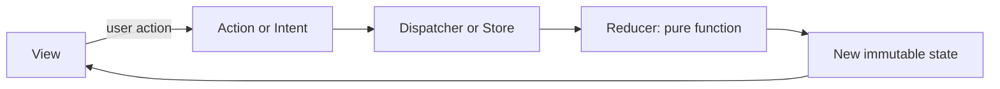
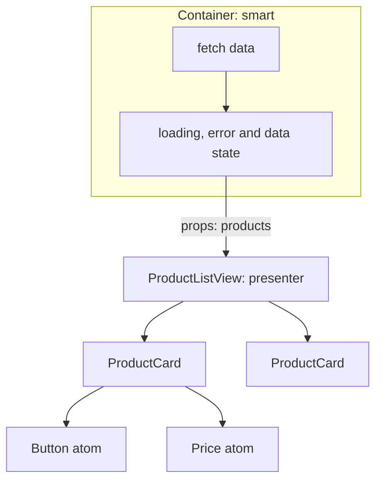
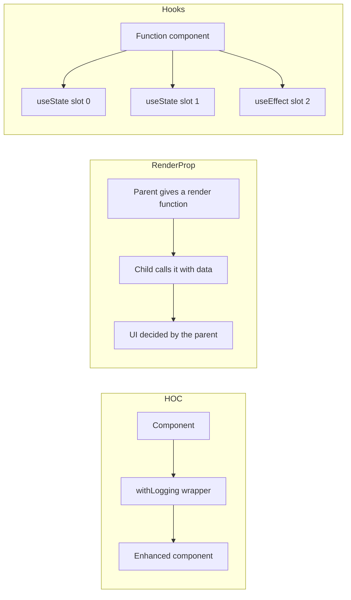
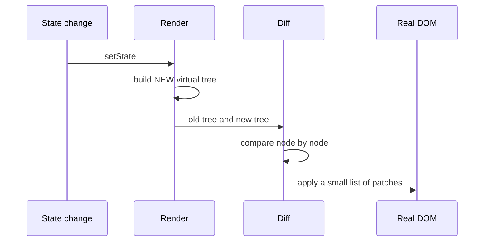
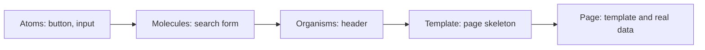
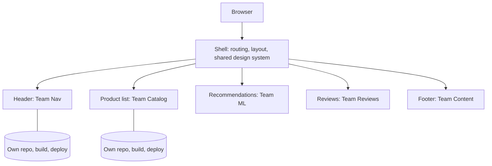
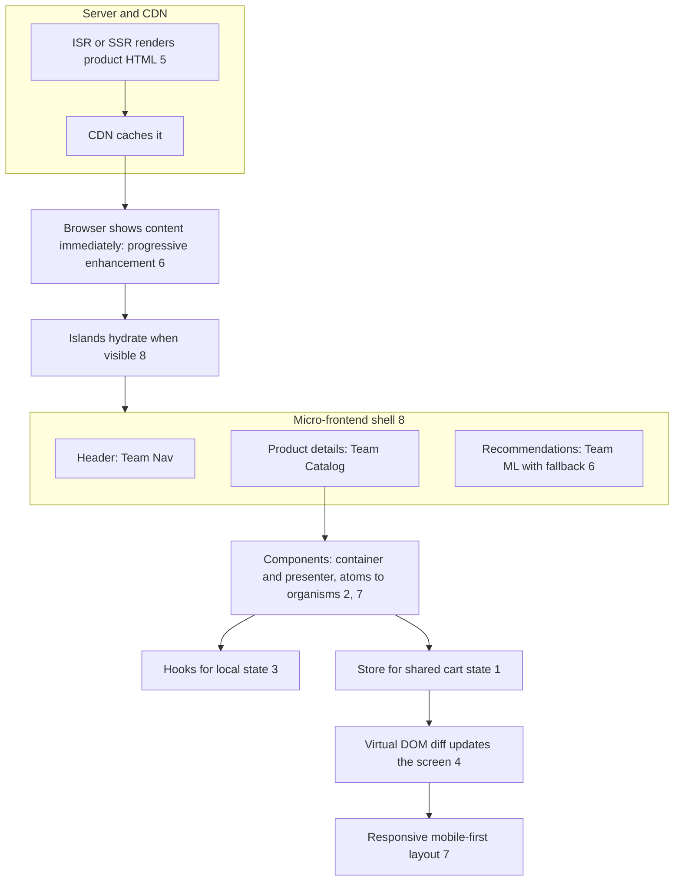

---
mdx:
  format: md
---

# UI/UX Architecture Patterns (State Flow, Components, Rendering, Layout, Micro-Frontends)

> **Note**: Patterns marked with **(Interview Imp - Java)** are frequently asked in Java interviews
>
> **How to read this file:** Every section ends with a **📘 Terms Explained** table. If you see a word you don't know, check the table right below that section. Each pattern goes from the basic idea to a plain-Java model of how it works inside, JavaScript/React and Spring Boot usage, pitfalls, interview questions and a mini cheat sheet.
>
> **What is this file about?** The master list's **UI/UX Patterns** (#361–379): how front-end applications are structured (data flow, components, rendering, layout, splitting a big UI between teams). Full-stack Java developers and architects are asked about these in system-design rounds ("SSR or SPA?", "how does Redux work?", "what is a micro-frontend?"). The React syntax itself is in [../react/React_Complete_Guide.md](../../react/React_Complete_Guide.md); how browsers and servers talk is in [../web-architecture/Client_Server_Web_Architecture_Guide.md](../../web-architecture/Client_Server_Web_Architecture_Guide.md).
>
> **Why Java for front-end ideas?** The browser code is JavaScript, but the *ideas* (a reducer, a virtual-DOM diff, hook slots, render strategies) are language-neutral. Modelling them in Java lets you run and see exactly what happens, and the same ideas appear on the Java side (Spring MVC + Thymeleaf server rendering, Vaadin, JavaFX/Android MVI). JavaScript/React snippets are shown next to them.
>
> **What lives elsewhere:** Performance tricks such as code splitting, lazy loading, tree shaking, critical CSS and image formats are in [03_Performance_Pattern.md](../03_System_Design/03_Performance_Pattern.md). API styles (REST/GraphQL/BFF) are in [08_API_Design_Pattern.md](../03_System_Design/08_API_Design_Pattern.md). [Section 9](#9-ui-patterns-and-the-building-blocks-they-reuse) maps each UI pattern to other files.
>
> **Verified code:** Every main "Complete Java Example" is **plain Java 17 (no libraries)** and was compiled and run **three times** with identical output (fixed seeds). To run one, save it as `<ClassName>.java` and run `javac <ClassName>.java && java <ClassName>`. JavaScript, React, Spring Boot, Thymeleaf and CSS snippets are usage examples and were **not** executed. Latencies and file sizes in the micro-frontend and rendering examples are **assumed inputs** to the simulation, not measurements.

---

## Table of Contents
- [Big Picture: What Happens Between a Click and a Pixel](#big-picture-what-happens-between-a-click-and-a-pixel)
1. [Unidirectional Data Flow: MVI, Flux and Redux](#1-unidirectional-data-flow-mvi-flux-and-redux-interview-imp---java) **(Interview Imp - Java)**
   - [1.1 What Are They?](#11-what-are-they)
   - [1.2 Why Do We Need Them?](#12-why-do-we-need-them)
   - [1.3 How It Works](#13-how-it-works)
   - [1.4 Types and Variants](#14-types-and-variants)
   - [1.5 Complete Java Example - A Redux Store With Reducer, Middleware, Time Travel](#15-complete-java-example---a-redux-store-with-reducer-middleware-time-travel)
   - [1.6 In JavaScript / React and in Java](#16-in-javascript--react-and-in-java)
   - [1.7 Pros and Cons](#17-pros-and-cons)
   - [1.8 Pitfalls, Interview Questions and Cheat Sheet](#18-pitfalls-interview-questions-and-cheat-sheet)
2. [Component-Based Architecture, Container/Presenter, Smart/Dumb](#2-component-based-architecture-containerpresenter-smartdumb)
   - [2.1 What Are They?](#21-what-are-they)
   - [2.2 Why Do We Need Them?](#22-why-do-we-need-them)
   - [2.3 How It Works](#23-how-it-works)
   - [2.4 Types and Variants](#24-types-and-variants)
   - [2.5 Complete Java Example - Presenter, Container, HOC and Render Prop](#25-complete-java-example---presenter-container-hoc-and-render-prop)
   - [2.6 In React and in Spring](#26-in-react-and-in-spring)
   - [2.7 Pros and Cons](#27-pros-and-cons)
   - [2.8 Pitfalls, Interview Questions and Cheat Sheet](#28-pitfalls-interview-questions-and-cheat-sheet)
3. [Higher-Order Components, Render Props and Hooks](#3-higher-order-components-render-props-and-hooks)
   - [3.1 What Are They?](#31-what-are-they)
   - [3.2 Why Do We Need Them?](#32-why-do-we-need-them)
   - [3.3 How It Works](#33-how-it-works)
   - [3.4 Types and Variants](#34-types-and-variants)
   - [3.5 Complete Java Example - How `useState` Works With Slots, and Why Order Matters](#35-complete-java-example---how-usestate-works-with-slots-and-why-order-matters)
   - [3.6 In React](#36-in-react)
   - [3.7 Pros and Cons](#37-pros-and-cons)
   - [3.8 Pitfalls, Interview Questions and Cheat Sheet](#38-pitfalls-interview-questions-and-cheat-sheet)
4. [Virtual DOM](#4-virtual-dom)
   - [4.1 What Is It?](#41-what-is-it)
   - [4.2 Why Do We Need It?](#42-why-do-we-need-it)
   - [4.3 How It Works](#43-how-it-works)
   - [4.4 Types and Variants](#44-types-and-variants)
   - [4.5 Complete Java Example - A Mini Virtual-DOM Diff With Keys](#45-complete-java-example---a-mini-virtual-dom-diff-with-keys)
   - [4.6 In React](#46-in-react)
   - [4.7 Pros and Cons](#47-pros-and-cons)
   - [4.8 Pitfalls, Interview Questions and Cheat Sheet](#48-pitfalls-interview-questions-and-cheat-sheet)
5. [Server-Side Rendering and Static Site Generation](#5-server-side-rendering-and-static-site-generation-interview-imp---java) **(Interview Imp - Java)**
   - [5.1 What Are They?](#51-what-are-they)
   - [5.2 Why Do We Need Them?](#52-why-do-we-need-them)
   - [5.3 How It Works](#53-how-it-works)
   - [5.4 Types and Variants](#54-types-and-variants)
   - [5.5 Complete Java Example - Counting Server Renders and Stale Pages for Each Strategy](#55-complete-java-example---counting-server-renders-and-stale-pages-for-each-strategy)
   - [5.6 In Spring Boot and in JavaScript](#56-in-spring-boot-and-in-javascript)
   - [5.7 Pros and Cons](#57-pros-and-cons)
   - [5.8 Pitfalls, Interview Questions and Cheat Sheet](#58-pitfalls-interview-questions-and-cheat-sheet)
6. [Progressive Enhancement and Graceful Degradation](#6-progressive-enhancement-and-graceful-degradation)
   - [6.1 What Are They?](#61-what-are-they)
   - [6.2 Why Do We Need Them?](#62-why-do-we-need-them)
   - [6.3 How It Works](#63-how-it-works)
   - [6.4 Types and Variants](#64-types-and-variants)
   - [6.5 Complete Java Example - The Same Four Clients, Built Bottom-Up vs Top-Down](#65-complete-java-example---the-same-four-clients-built-bottom-up-vs-top-down)
   - [6.6 In HTML, JavaScript and Spring](#66-in-html-javascript-and-spring)
   - [6.7 Pros and Cons](#67-pros-and-cons)
   - [6.8 Pitfalls, Interview Questions and Cheat Sheet](#68-pitfalls-interview-questions-and-cheat-sheet)
7. [Responsive Design, Mobile-First and Atomic Design](#7-responsive-design-mobile-first-and-atomic-design)
   - [7.1 What Are They?](#71-what-are-they)
   - [7.2 Why Do We Need Them?](#72-why-do-we-need-them)
   - [7.3 How It Works](#73-how-it-works)
   - [7.4 Types and Variants](#74-types-and-variants)
   - [7.5 Complete Java Example - Atoms to Organism in HTML and the Mobile-First Breakpoints](#75-complete-java-example---atoms-to-organism-in-html-and-the-mobile-first-breakpoints)
   - [7.6 In React, Spring and CSS](#76-in-react-spring-and-css)
   - [7.7 Pros and Cons](#77-pros-and-cons)
   - [7.8 Pitfalls, Interview Questions and Cheat Sheet](#78-pitfalls-interview-questions-and-cheat-sheet)
8. [Micro-Frontends and Islands Architecture](#8-micro-frontends-and-islands-architecture)
   - [8.1 What Are They?](#81-what-are-they)
   - [8.2 Why Do We Need Them?](#82-why-do-we-need-them)
   - [8.3 How It Works](#83-how-it-works)
   - [8.4 Types and Variants](#84-types-and-variants)
   - [8.5 Complete Java Example - Parallel Fragment Assembly With Timeouts, Failure Isolation and JavaScript Savings](#85-complete-java-example---parallel-fragment-assembly-with-timeouts-failure-isolation-and-javascript-savings)
   - [8.6 In JavaScript and Spring](#86-in-javascript-and-spring)
   - [8.7 Pros and Cons](#87-pros-and-cons)
   - [8.8 Pitfalls, Interview Questions and Cheat Sheet](#88-pitfalls-interview-questions-and-cheat-sheet)
9. [UI Patterns and the Building Blocks They Reuse](#9-ui-patterns-and-the-building-blocks-they-reuse)
10. [How the UI Patterns Fit Together](#10-how-the-ui-patterns-fit-together)
11. [UI/UX Patterns Cheat Sheet](#11-uiux-patterns-cheat-sheet)

---

## Big Picture: What Happens Between a Click and a Pixel


| Question | Pattern | Section |
|---|---|---|
| Where does state live and how does it change? | MVI, Flux, Redux | [1](#1-unidirectional-data-flow-mvi-flux-and-redux-interview-imp---java) |
| How do I split a screen into reusable pieces? | Component-based, Container/Presenter, Smart/Dumb | [2](#2-component-based-architecture-containerpresenter-smartdumb) |
| How do I share behaviour between components? | HOC, Render Props, Hooks | [3](#3-higher-order-components-render-props-and-hooks) |
| How does the screen update efficiently? | Virtual DOM | [4](#4-virtual-dom) |
| Where is the HTML produced? | SSR, SSG (and CSR, ISR) | [5](#5-server-side-rendering-and-static-site-generation-interview-imp---java) |
| What if the browser is old or JS fails? | Progressive Enhancement, Graceful Degradation | [6](#6-progressive-enhancement-and-graceful-degradation) |
| How does it fit all screens? | Responsive, Mobile-First, Atomic Design | [7](#7-responsive-design-mobile-first-and-atomic-design) |
| How do many teams ship one UI? | Micro-Frontends, Islands | [8](#8-micro-frontends-and-islands-architecture) |

### 📘 Terms Explained

| Term | Meaning |
|---|---|
| **DOM** | Document Object Model: the browser's tree of page elements |
| **SPA** | Single-Page Application: one HTML page; JavaScript changes the screen |
| **Component** | A reusable piece of UI with its own markup and logic |
| **State** | The data that decides what the screen shows right now |
| **Render** | Producing the UI (HTML or DOM) from state |

---

# 1. Unidirectional Data Flow: MVI, Flux and Redux (Interview Imp - Java)

## 1.1 What Are They?

All three patterns (#361 MVI, #362 Flux, #363 Redux) answer the same question: *how do we keep UI state predictable when many parts of the screen can change it?* The answer: **data flows in one direction**.



| Pattern | Idea | Where you see it |
|---|---|---|
| **Flux** (Facebook, 2014) | Actions → Dispatcher → Stores → Views; several stores | Original architecture, ideas live on in everything below |
| **Redux** | Flux simplified: **one store**, **pure reducers**, immutable state | React, Angular (NgRx), Vue (Vuex/Pinia similar) |
| **MVI** (Model-View-Intent) | The view emits **Intents**; a function turns Intent + old state into a new **Model** (state); the view renders the Model | Android (Jetpack Compose), Kotlin/Java mobile apps, cycle.js |

## 1.2 Why Do We Need Them?

Without a pattern, any component can change any data, and bugs like "who changed this value?" take hours:

| Problem | Unidirectional flow |
|---|---|
| Two components edit the same data and disagree | One source of truth (the store) |
| Hard to know why the screen looks as it does | State + action log explain everything |
| Bugs that can't be reproduced | Replay the recorded actions (time travel) |
| Hard to test UI logic | Reducers are pure functions: `(state, action) → state` |

## 1.3 How It Works

The three rules of Redux:
1. **Single source of truth:** the whole app state is one object tree in one store.
2. **State is read-only:** the only way to change it is to dispatch an **action** (a plain description: `{type: "cart/add", sku: "PHONE"}`).
3. **Changes are made by pure reducers:** `newState = reducer(oldState, action)` with no side effects. A reducer never edits the old state; it **returns a new object** (so changes are detectable by `oldState !== newState`).

**Side effects** (HTTP calls, timers) do not belong in reducers. They go into **middleware / thunks / sagas / effects**, which dispatch further actions ("cart/loadStarted", "cart/loadSucceeded").

## 1.4 Types and Variants

| Variant | Note |
|---|---|
| **Redux Toolkit** | Modern, less boilerplate (`createSlice`) |
| **Context + `useReducer`** | Built into React; fine for small apps |
| **Zustand, Recoil, Jotai, MobX** | Lighter state libraries |
| **NgRx** | Redux for Angular |
| **MVI on Android** | `ViewModel` holds a `StateFlow<UiState>`; the UI sends `Intent`s |
| **Server state libraries (React Query, SWR)** | Cache API data separately from UI state |
| **Event sourcing** | The server-side cousin: store the action log ([05_Data_Management_Pattern.md](../03_System_Design/05_Data_Management_Pattern.md#2-event-sourcing-pattern-interview-imp---java)) |

## 1.5 Complete Java Example - A Redux Store With Reducer, Middleware, Time Travel

**What it shows:** immutable `CartState`, sealed `Action`s, a pure `reduce` function, a `Store` with subscribers and middleware, a reducer that returns the *same object* when nothing changed (so no re-render), and time travel using the saved history.

```java
import java.util.*;
import java.util.function.*;

public class StoreDemo {

    // ---------- immutable state ----------
    record Item(String sku, int qty) {}
    record CartState(List<Item> items, String status) {
        static CartState empty() { return new CartState(List.of(), "IDLE"); }
        int totalQty() { return items.stream().mapToInt(Item::qty).sum(); }
    }

    // ---------- actions: the ONLY way to ask for a change ----------
    sealed interface Action permits Add, Remove, Checkout, Reset {}
    record Add(String sku) implements Action {}
    record Remove(String sku) implements Action {}
    record Checkout() implements Action {}
    record Reset() implements Action {}

    // ---------- reducer: pure function (oldState, action) -> newState ----------
    static CartState reduce(CartState s, Action a) {
        if (a instanceof Add add) {
            List<Item> next = new ArrayList<>(); boolean found = false;
            for (Item i : s.items()) {
                if (i.sku().equals(add.sku())) { next.add(new Item(i.sku(), i.qty() + 1)); found = true; } else next.add(i);
            }
            if (!found) next.add(new Item(add.sku(), 1));
            return new CartState(List.copyOf(next), s.status());
        }
        if (a instanceof Remove rem) {
            List<Item> next = s.items().stream().filter(i -> !i.sku().equals(rem.sku())).toList();
            return next.size() == s.items().size() ? s : new CartState(next, s.status());      // nothing changed -> SAME object
        }
        if (a instanceof Checkout) return s.items().isEmpty() ? s : new CartState(s.items(), "PAID");
        if (a instanceof Reset) return CartState.empty();
        return s;
    }

    // ---------- store: holds state, applies actions, notifies subscribers ----------
    static class Store {
        private CartState state = CartState.empty();
        private final List<Consumer<CartState>> subscribers = new ArrayList<>();
        private final List<CartState> history = new ArrayList<>(List.of(state));      // makes time travel possible
        private final List<BiConsumer<CartState, Action>> middleware = new ArrayList<>();

        void subscribe(Consumer<CartState> s) { subscribers.add(s); }
        void use(BiConsumer<CartState, Action> m) { middleware.add(m); }
        CartState getState() { return state; }

        void dispatch(Action a) {
            middleware.forEach(m -> m.accept(state, a));                               // e.g. logging
            CartState next = reduce(state, a);
            if (next == state) return;                                                 // same reference: no notification, no re-render
            state = next; history.add(next);
            subscribers.forEach(s -> s.accept(next));
        }
        void timeTravel(int index) { state = history.get(index); subscribers.forEach(s -> s.accept(state)); }
        int historySize() { return history.size(); }
    }

    public static void main(String[] args) {
        Store store = new Store();
        int[] renders = {0};
        store.subscribe(s -> { renders[0]++; System.out.println("   [UI render #" + renders[0] + "] " + s.items() + " status=" + s.status()); });
        store.use((s, a) -> System.out.println("dispatch " + a));

        System.out.println("1) actions flow one way: UI -> dispatch -> reducer -> new state -> UI");
        store.dispatch(new Add("PHONE"));
        store.dispatch(new Add("CASE"));
        store.dispatch(new Add("PHONE"));
        store.dispatch(new Remove("LAPTOP"));            // not in the cart: reducer returns the same state
        store.dispatch(new Checkout());

        System.out.println("2) the reducer is pure, so the old states are untouched");
        System.out.println("   history length = " + store.historySize() + ", UI renders = " + renders[0] + "  (the Remove of a missing item caused no render)");

        System.out.println("3) time travel (debugging): jump back to state #2");
        store.timeTravel(2);
        System.out.println("   total quantity now = " + store.getState().totalQty());

        System.out.println("4) pure functions are trivial to test:");
        CartState t = reduce(CartState.empty(), new Add("X"));
        System.out.println("   reduce(empty, Add X) = " + t + "   same input again equals: " + t.equals(reduce(CartState.empty(), new Add("X"))));
    }
}
```

**Output** (identical on all 3 runs):

```text
1) actions flow one way: UI -> dispatch -> reducer -> new state -> UI
dispatch Add[sku=PHONE]
   [UI render #1] [Item[sku=PHONE, qty=1]] status=IDLE
dispatch Add[sku=CASE]
   [UI render #2] [Item[sku=PHONE, qty=1], Item[sku=CASE, qty=1]] status=IDLE
dispatch Add[sku=PHONE]
   [UI render #3] [Item[sku=PHONE, qty=2], Item[sku=CASE, qty=1]] status=IDLE
dispatch Remove[sku=LAPTOP]
dispatch Checkout[]
   [UI render #4] [Item[sku=PHONE, qty=2], Item[sku=CASE, qty=1]] status=PAID
2) the reducer is pure, so the old states are untouched
   history length = 5, UI renders = 4  (the Remove of a missing item caused no render)
3) time travel (debugging): jump back to state #2
   [UI render #5] [Item[sku=PHONE, qty=1], Item[sku=CASE, qty=1]] status=IDLE
   total quantity now = 2
4) pure functions are trivial to test:
   reduce(empty, Add X) = CartState[items=[Item[sku=X, qty=1]], status=IDLE]   same input again equals: true
```

**What the output shows**
- **1:** each `dispatch` runs middleware (the logging line), the reducer, and then subscribers. The UI is re-rendered only with the new state.
- **`Remove[LAPTOP]` produced no render.** The reducer found nothing to remove and returned the *same object*; the store compared references (`next == state`) and skipped notification. This is exactly how React-Redux avoids useless re-renders.
- **2:** history has 5 states (initial + 4 changes), but only 4 renders happened.
- **3:** time travel simply points the store at an older immutable state. This is how Redux DevTools lets you step back through a bug.
- **4:** the reducer is a pure function, so the test is one line with no mocks.

## 1.6 In JavaScript / React and in Java

```javascript
// Redux Toolkit (JavaScript): "mutating" syntax is converted to immutable updates by Immer
const cartSlice = createSlice({
  name: 'cart',
  initialState: { items: [], status: 'IDLE' },
  reducers: {
    added(state, action) {
      const found = state.items.find(i => i.sku === action.payload);
      found ? found.qty++ : state.items.push({ sku: action.payload, qty: 1 });
    },
  },
  extraReducers: b => b.addCase(checkout.fulfilled, s => { s.status = 'PAID'; }),
});
const checkout = createAsyncThunk('cart/checkout', async (cart) => (await fetch('/api/orders', {method:'POST', body: JSON.stringify(cart)})).json());

function CartBadge() {                                   // a component that READS state and DISPATCHES actions
  const qty = useSelector(s => s.cart.items.reduce((n, i) => n + i.qty, 0));
  const dispatch = useDispatch();
  return <button onClick={() => dispatch(cartSlice.actions.added('PHONE'))}>Cart ({qty})</button>;
}
```

```java
// Java / Android MVI: the ViewModel exposes one immutable UiState; the screen sends Intents
public record CartUiState(List<Item> items, boolean loading, String error) {}
public sealed interface CartIntent permits AddItem, Checkout {}

class CartViewModel extends ViewModel {
    private final MutableStateFlow<CartUiState> state = ...;
    void onIntent(CartIntent intent) { state.setValue(reduce(state.getValue(), intent)); }
}
```
In Spring MVC the same discipline appears as "the controller builds one view model, the template only renders it".

## 1.7 Pros and Cons

| Pros | Cons |
|---|---|
| Predictable, testable, debuggable | Boilerplate (less with Redux Toolkit) |
| Time travel and action logs | Overkill for small local state |
| Easy to see where state changes | Putting everything in the global store makes it a "god object" |

## 1.8 Pitfalls, Interview Questions and Cheat Sheet

**Common pitfalls**
- Mutating state inside a reducer (no re-render, broken history).
- Side effects (fetch, random, `Date.now()`) in reducers: they stop being pure.
- Storing everything globally, including form-field text and server data copies.
- Non-serialisable values in state (functions, class instances).
- Deeply nested state that is hard to update (normalise it: items by id).

**Interview questions**
1. *Explain Redux in one minute.* → One store, state is read-only, changed by dispatching actions to pure reducers that return new state; views subscribe.
2. *Why must reducers be pure and immutable?* → So changes are detectable by reference comparison, history/time travel works, and tests are trivial.
3. *Where do API calls go?* → Middleware: thunks, sagas, or effects (RTK Query/React Query for server state).
4. *Flux vs Redux?* → Flux has a dispatcher and many stores; Redux has one store and reducers.
5. *What is MVI?* → View sends Intents; a function produces a new immutable Model/State; the view renders it. Same unidirectional idea (popular on Android).
6. *When not to use Redux?* → Small apps or purely local state; use component state or Context.

**Cheat sheet**
```
View -> Action -> Reducer(oldState, action) -> newState -> View
One store, immutable state, pure reducers, side effects in middleware
Same object returned => no change => no re-render
Debugging: log actions, replay them, time travel
```

### 📘 Terms Explained

| Term | Meaning |
|---|---|
| **Action** | A plain object describing what happened ("add PHONE") |
| **Reducer** | A pure function that computes the next state from the old state and an action |
| **Store** | The object holding state, applying actions and notifying subscribers |
| **Immutable** | Never changed after creation; changes make a new copy |
| **Pure function** | Same input always gives the same output, with no side effects |
| **Middleware** | Code between dispatch and reducer, used for logging and async work |
| **Selector** | A function that picks (and computes) a piece of state for a component |
| **Time travel** | Stepping back through saved states to debug |
| **Intent (MVI)** | The user's wish sent by the view, such as "add item" |

---

# 2. Component-Based Architecture, Container/Presenter, Smart/Dumb

## 2.1 What Are They?

- **Component-based architecture (#364):** build the UI as a tree of small, reusable, self-contained pieces (button → search box → header → page). Each component takes **props** (inputs) and returns UI.
- **Container/Presenter (#365)** and **Smart/Dumb components (#366)** are two names for one split:

| | Container (smart) | Presenter (dumb) |
|---|---|---|
| Knows where data comes from | **Yes** (API, store) | No |
| Holds state / handles loading and errors | **Yes** | No |
| Describes how things look | No | **Yes** |
| Reuse and testing | Tested with fake API | Tested with plain data, snapshot tests |

This is the UI form of **separation of concerns** and of MVC's controller/view split ([01_Architectural_Pattern.md](../02_HLD/01_Architectural_Pattern.md)).

## 2.2 Why Do We Need Them?

| Problem | Fix |
|---|---|
| One 800-line component that fetches, filters and draws | Split into container + presenter |
| Same list needed on 3 pages with different data | One presenter, three containers |
| Hard to test UI because it calls the server | Test the presenter with plain data |
| Designers want to change the look without touching logic | Presenter only |
| Large teams editing the same files | Clear component ownership |

## 2.3 How It Works



Rules of thumb: data flows **down** through props; events flow **up** through callbacks (`onAdd`); a presenter has **no side effects**; keep state as low in the tree as possible, and "lift it up" to the nearest common parent only when two siblings need it.

## 2.4 Types and Variants

| Variant | Note |
|---|---|
| **Presentational + container** | The classic split (Dan Abramov called it optional now: hooks can replace containers) |
| **Custom hooks as the "container"** | `useProducts()` returns data, loading, error; the component just renders |
| **Compound components** | `<Tabs><Tab/><Panel/></Tabs>` share hidden state |
| **Controlled vs uncontrolled** | Parent owns the input value / the DOM owns it |
| **Feature-sliced structure** | Components grouped by feature, not by type |
| **Design system** | A shared, documented component library (Material UI, Ant, Storybook) |

## 2.5 Complete Java Example - Presenter, Container, HOC and Render Prop

**What it shows:** a pure presentational function, a container that handles success and failure, the *same* view reused with another data source, a higher-order wrapper, and a render-prop list. (Sections 2 and 3 share this example.)

```java
import java.util.*;
import java.util.function.*;

public class ComponentsDemo {

    record Product(String name, int priceRupees) {}

    // ---------- "dumb" / presentational component: data in, markup out, no fetching, no state ----------
    static String productListView(List<Product> products) {
        if (products.isEmpty()) return "<p>No products</p>";
        StringBuilder sb = new StringBuilder("<ul>");
        for (Product p : products) sb.append("<li>").append(p.name()).append(" - Rs ").append(p.priceRupees()).append("</li>");
        return sb.append("</ul>").toString();
    }

    // ---------- "smart" / container component: knows WHERE data comes from and which state we are in ----------
    interface ProductApi { List<Product> fetch(); }

    static String productListContainer(ProductApi api) {
        try {
            List<Product> data = api.fetch();           // data loading lives here
            return productListView(data);               // rendering is delegated
        } catch (RuntimeException e) {
            return "<p class=error>Could not load: " + e.getMessage() + "</p>";
        }
    }

    // ---------- higher-order component: takes a component, returns a new component with extra behaviour ----------
    static <P> Function<P, String> withLogging(String name, Function<P, String> component, List<String> log) {
        return props -> { log.add("render " + name); return component.apply(props); };
    }
    static <P> Function<P, String> withBorder(Function<P, String> component) {
        return props -> "<div class=border>" + component.apply(props) + "</div>";
    }

    // ---------- render prop: the parent decides HOW each item looks, the child decides WHEN/WHAT ----------
    static <T> String list(List<T> items, Function<T, String> renderItem) {
        StringBuilder sb = new StringBuilder();
        for (int i = 0; i < items.size(); i++) sb.append(i == 0 ? "" : " | ").append(renderItem.apply(items.get(i)));
        return sb.toString();
    }

    public static void main(String[] args) {
        // 1) the presentational component can be tested with plain data, no server
        System.out.println("1) dumb view   : " + productListView(List.of(new Product("Phone", 49999), new Product("Case", 499))));
        System.out.println("   empty case  : " + productListView(List.of()));

        // 2) the container handles loading and errors, the view does not care
        System.out.println("2) container ok: " + productListContainer(() -> List.of(new Product("Phone", 49999))));
        System.out.println("   container err: " + productListContainer(() -> { throw new RuntimeException("503 from catalogue"); }));

        // 3) reuse the same view with a different data source
        System.out.println("3) same view, other source: " + productListContainer(() -> List.of(new Product("Wishlist item", 1200))));

        // 4) HOC adds behaviour without touching the component
        List<String> log = new ArrayList<>();
        Function<List<Product>, String> enhanced = withBorder(withLogging("ProductListView", ComponentsDemo::productListView, log));
        System.out.println("4) HOC result  : " + enhanced.apply(List.of(new Product("Phone", 49999))));
        System.out.println("   HOC log     : " + log);

        // 5) render prop
        List<Product> ps = List.of(new Product("Phone", 49999), new Product("Case", 499));
        System.out.println("5) render prop (compact) : " + list(ps, p -> p.name()));
        System.out.println("   render prop (detailed): " + list(ps, p -> p.name() + " @ Rs " + p.priceRupees()));
    }
}
```

**Output** (identical on all 3 runs):

```text
1) dumb view   : <ul><li>Phone - Rs 49999</li><li>Case - Rs 499</li></ul>
   empty case  : <p>No products</p>
2) container ok: <ul><li>Phone - Rs 49999</li></ul>
   container err: <p class=error>Could not load: 503 from catalogue</p>
3) same view, other source: <ul><li>Wishlist item - Rs 1200</li></ul>
4) HOC result  : <div class=border><ul><li>Phone - Rs 49999</li></ul></div>
   HOC log     : [render ProductListView]
5) render prop (compact) : Phone | Case
   render prop (detailed): Phone @ Rs 49999 | Case @ Rs 499
```

**What the output shows**
- **1:** the view is a pure function from data to markup. It is tested with plain data and an empty-list case, and no server is needed.
- **2:** the container turns an API failure into an error message without the view knowing anything about HTTP.
- **3:** swapping the data source needs no change to the view: reuse.
- **4–5:** the HOC and the render prop are covered in [Section 3](#3-higher-order-components-render-props-and-hooks).

## 2.6 In React and in Spring

```jsx
// Presenter: props in, JSX out
function ProductListView({ products, onAdd }) {
  if (products.length === 0) return <p>No products</p>;
  return <ul>{products.map(p => <li key={p.id}>{p.name} - Rs {p.price} <button onClick={() => onAdd(p.id)}>Add</button></li>)}</ul>;
}

// Container, modern style: a hook does the data work
function ProductListContainer() {
  const { data, isLoading, error } = useQuery({ queryKey: ['products'], queryFn: () => fetch('/api/products').then(r => r.json()) });
  const add = useCartStore(s => s.add);
  if (isLoading) return <Spinner />;
  if (error) return <ErrorBox message={error.message} />;
  return <ProductListView products={data} onAdd={add} />;
}
```

```java
// Server-side equivalent with Spring MVC + Thymeleaf: controller = container, template fragment = presenter
@Controller
class ProductPage {
    @GetMapping("/products")
    String list(Model model) { model.addAttribute("products", catalogue.findAll()); return "products"; }
}
// products.html:  <ul th:replace="~{fragments/product-list :: view(${products})}"></ul>      (reusable fragment)
```

## 2.7 Pros and Cons

| Pros | Cons |
|---|---|
| Reusable, testable, easy to reason about | More files and prop passing ("prop drilling") |
| Teams can work in parallel | Strict splitting can be over-engineering for tiny components |
| Designers can iterate on presenters | Deep trees need Context or a store to avoid drilling |

## 2.8 Pitfalls, Interview Questions and Cheat Sheet

**Common pitfalls**
- Presenters that fetch data "just this once".
- Containers that also contain markup, so nothing is reusable.
- Passing 15 props through 6 levels (use Context/store/composition).
- Putting derived data in state instead of computing it from props.
- Huge "god components".

**Interview questions**
1. *Container vs presentational component?* → Container: data, state, side effects. Presentational: markup from props. The split improves reuse and testing.
2. *What is prop drilling and how do you avoid it?* → Passing props through many layers; use Context, a store, or component composition (`children`).
3. *What is "lifting state up"?* → Moving shared state to the nearest common ancestor.
4. *Controlled vs uncontrolled components?* → Controlled: React state owns the value. Uncontrolled: the DOM owns it, read via a ref.
5. *Do hooks make containers obsolete?* → Mostly: a custom hook plays the container's role without an extra component.

**Cheat sheet**
```
Props down, events up
Container (data, state, effects)  +  Presenter (pure markup)
Custom hook = modern container;  Context/store/composition against prop drilling
Test presenters with plain data, containers with a fake API
```

### 📘 Terms Explained

| Term | Meaning |
|---|---|
| **Props** | Inputs passed from a parent component to a child |
| **Presentational (dumb) component** | Shows data; has no data-loading logic |
| **Container (smart) component** | Loads data and manages state |
| **Prop drilling** | Passing props through components that don't use them |
| **Lifting state up** | Moving state to a shared parent |
| **Composition** | Building components by nesting them instead of inheriting |
| **Design system** | A shared library of components and style rules |
| **Storybook** | A tool for developing and documenting components in isolation |

---

# 3. Higher-Order Components, Render Props and Hooks

## 3.1 What Are They?

Three ways to **share behaviour between components** (logging, data fetching, permissions, window size), from oldest to newest:

| Pattern | Idea | Java analogy |
|---|---|---|
| **Higher-Order Component (HOC) (#367)** | A function that takes a component and returns a new component with extra behaviour: `withAuth(Page)` | **Decorator pattern** |
| **Render Props (#368)** | A component receives a *function* prop that tells it what to render: `<Mouse render={pos => <Dot at={pos}/>} />` | **Strategy / callback** |
| **Hooks (#369)** | Functions (`useState`, `useEffect`, your own `useMouse`) that give a function component state and lifecycle, and can be reused | A small framework that remembers state per call position |

## 3.2 Why Do We Need Them?

Before these patterns, sharing logic meant class inheritance or copy-paste. HOCs and render props solved it but created problems (wrapper hell, naming clashes, hard-to-read trees). Hooks solved sharing without extra components in the tree.

| Pattern | Problem it has |
|---|---|
| HOC | "Wrapper hell" (`withA(withB(withC(X)))`), props can collide, static typing is awkward |
| Render props | Deep nesting ("callback pyramid") in JSX |
| Hooks | Rules: order of calls matters (see example) |

## 3.3 How It Works



**How hooks work inside:** the framework keeps, per component instance, an **array of slots**. Every render resets a cursor to 0, and each hook call takes the next slot. `useState(0)` on the first render *creates* slot 0; on later renders it *finds* slot 0 by position. So hooks have no names: **the call order is the identity**. This is why they must not be placed in `if`, loops or after early returns.

## 3.4 Types and Variants

| Hook | Purpose |
|---|---|
| `useState` | Local state |
| `useEffect` | Side effects after render (fetch, subscribe) with cleanup |
| `useReducer` | State with a reducer (mini Redux) |
| `useContext` | Read shared context (avoid prop drilling) |
| `useMemo` / `useCallback` | Cache a computed value / function between renders |
| `useRef` | Mutable box that doesn't trigger re-render; DOM access |
| **Custom hooks** | Your own reusable logic: `useDebounce`, `useFetch`, `useOnlineStatus` |
| **Rules of Hooks** | Only at the top level of a component or hook; only in function components/hooks |

## 3.5 Complete Java Example - How `useState` Works With Slots, and Why Order Matters

**What it shows:** a ~25-line mini runtime. State lives outside the component function in numbered slots. A correct component keeps its values across re-renders. A component with a hook inside an `if` gets values mixed up.

```java
import java.util.*;
import java.util.function.*;

public class HooksDemo {

    // A tiny "React": state lives OUTSIDE the component function, in numbered slots.
    // useState() is identified only by the ORDER of the calls during a render.
    static class Runtime {
        final List<Object> slots = new ArrayList<>();
        int cursor;
        Runnable rerender;

        class State<T> {
            final int slot;
            State(int slot) { this.slot = slot; }
            @SuppressWarnings("unchecked") T get() { return (T) slots.get(slot); }
            void set(T value) { slots.set(slot, value); rerender.run(); }       // setting state schedules a new render
        }

        <T> State<T> useState(T initial) {
            int mySlot = cursor++;
            if (mySlot >= slots.size()) slots.add(initial);                       // first render: create the slot
            return new State<>(mySlot);                                           // later renders: reuse slot by position
        }
        void render(Consumer<Runtime> component) { cursor = 0; component.accept(this); }
    }

    public static void main(String[] args) {
        // ---------- correct component ----------
        Runtime rt = new Runtime();
        Object[] handles = new Object[2];
        Consumer<Runtime> good = r -> {
            Runtime.State<Integer> count = r.useState(0);
            Runtime.State<String> name = r.useState("Asha");
            handles[0] = count; handles[1] = name;
            System.out.println("   render: count=" + count.get() + " name=" + name.get() + "   slots=" + r.slots);
        };
        rt.rerender = () -> rt.render(good);

        System.out.println("1) hooks used in the same order on every render");
        rt.render(good);
        @SuppressWarnings("unchecked") Runtime.State<Integer> count = (Runtime.State<Integer>) handles[0];
        count.set(count.get() + 1);
        count.set(count.get() + 1);

        // ---------- broken component: a hook inside an if ----------
        Runtime bad = new Runtime();
        Object[] h2 = new Object[1];
        Consumer<Runtime> broken = r -> {
            Runtime.State<Integer> c = r.useState(0);
            h2[0] = c;
            String extra = "-";
            if (c.get() > 0) { Runtime.State<String> e = r.useState("EXTRA"); extra = e.get(); }   // conditional hook!
            Runtime.State<String> n = r.useState("Asha");
            System.out.println("   render: count=" + c.get() + " extra=" + extra + " name=" + n.get() + "   slots=" + r.slots);
        };
        bad.rerender = () -> bad.render(broken);
        System.out.println("2) a hook inside an if: the order changes between renders");
        bad.render(broken);
        @SuppressWarnings("unchecked") Runtime.State<Integer> c2 = (Runtime.State<Integer>) h2[0];
        c2.set(1);
        System.out.println("   -> 'extra' now shows 'Asha' and 'name' reads a new slot: values are mixed up.");
        System.out.println("   That is why the Rules of Hooks say: call hooks at the top level, never in conditions or loops.");
    }
}
```

**Output** (identical on all 3 runs):

```text
1) hooks used in the same order on every render
   render: count=0 name=Asha   slots=[0, Asha]
   render: count=1 name=Asha   slots=[1, Asha]
   render: count=2 name=Asha   slots=[2, Asha]
2) a hook inside an if: the order changes between renders
   render: count=0 extra=- name=Asha   slots=[0, Asha]
   render: count=1 extra=Asha name=Asha   slots=[1, Asha, Asha]
   -> 'extra' now shows 'Asha' and 'name' reads a new slot: values are mixed up.
   That is why the Rules of Hooks say: call hooks at the top level, never in conditions or loops.
```

**What the output shows**
- **1:** `count` goes 0 → 1 → 2 and `name` is preserved: the slots survive each render because the hook order is stable.
- **2:** once `count > 0`, an extra hook is called *before* `name`. `extra` now reads slot 1 (which holds `"Asha"`) instead of its own initial `"EXTRA"`, and `name` moves to a new slot. This is the bug the **Rules of Hooks** prevent (React's lint rule `react-hooks/rules-of-hooks` catches it).
- The HOC (`withBorder(withLogging(...))`) and render-prop (`list(items, renderItem)`) in the [Section 2 example](#25-complete-java-example---presenter-container-hoc-and-render-prop) show the two older styles in plain Java: a function wrapping a function, and a function passed as a parameter.

## 3.6 In React

```jsx
// HOC: wraps a component, adds behaviour (the Decorator pattern)
const withAuth = (Component) => (props) => useAuth().loggedIn ? <Component {...props} /> : <Redirect to="/login" />;
const SecureDashboard = withAuth(Dashboard);

// Render prop: the child supplies data, the parent supplies markup
<MouseTracker render={({x, y}) => <Dot left={x} top={y} />} />

// Custom hook: the same logic, no extra components in the tree
function useMouse() {
  const [pos, setPos] = useState({ x: 0, y: 0 });
  useEffect(() => {
    const on = e => setPos({ x: e.clientX, y: e.clientY });
    window.addEventListener('mousemove', on);
    return () => window.removeEventListener('mousemove', on);       // cleanup on unmount
  }, []);                                                           // [] = run once
  return pos;
}
function Dot() { const { x, y } = useMouse(); return <div style={{ left: x, top: y }} />; }
```
**Dependency arrays:** `useEffect(fn, [a, b])` re-runs when `a` or `b` change. A missing dependency causes stale values; a new object/function created every render in the array causes endless re-runs.

## 3.7 Pros and Cons

| | HOC | Render props | Hooks |
|---|---|---|---|
| Pros | Works with class and function components; a clean Decorator | Explicit data flow | Flat trees, easy reuse, composable |
| Cons | Wrapper hell, prop clashes | Nested callbacks | Order rules, stale-closure bugs, dependency arrays |

## 3.8 Pitfalls, Interview Questions and Cheat Sheet

**Common pitfalls**
- Hooks in conditions, loops or after `return`.
- Creating a HOC inside `render` (a new component type every time, so state resets).
- Missing or wrong `useEffect` dependencies (stale values, infinite loops).
- Forgetting to clean up subscriptions/timers in `useEffect`.
- Calling `setState` with a value derived from the old state without the functional form (`setCount(c => c + 1)`) inside async code.

**Interview questions**
1. *HOC vs render props vs hooks?* → All share logic; HOC wraps a component, render props pass a render function, hooks reuse stateful functions without changing the tree. Hooks are today's default.
2. *Why can't hooks be called conditionally?* → The framework identifies a hook by its call order in a slot array; changing the order mixes up state.
3. *What does the dependency array of `useEffect` do?* → The effect re-runs only when a listed value changes; `[]` means once after mount.
4. *`useMemo` vs `useCallback`?* → `useMemo` caches a computed value; `useCallback` caches a function identity; use them only after measuring.
5. *Which GoF pattern is a HOC?* → Decorator. Render props: Strategy/Template Method style callback.

**Cheat sheet**
```
HOC          : f(Component) -> Component    (Decorator)
Render props : <Child render={data => <UI/>}/>   (Strategy / callback)
Hooks        : slots by call order -> top level only; useEffect deps; cleanup function
Custom hook  : use* function that composes other hooks
```

### 📘 Terms Explained

| Term | Meaning |
|---|---|
| **HOC** | A function that takes a component and returns an enhanced component |
| **Render prop** | A prop whose value is a function that returns UI |
| **Hook** | A function that lets a function component use state and lifecycle features |
| **Slot** | The numbered place where the framework stores one hook's value |
| **Dependency array** | The list of values that trigger an effect to run again |
| **Stale closure** | A function that still sees old values from an earlier render |
| **Side effect** | Anything that touches the outside world: network, timers, DOM |
| **Decorator pattern** | Wrapping an object to add behaviour without changing it ([03_Structural_Pattern.md](../01_LLD/03_Structural_Pattern.md)) |

---

# 4. Virtual DOM

## 4.1 What Is It?

The **real DOM** is the browser's heavyweight tree of page elements. Touching it often is slow (layout and repaint). The **virtual DOM (#370)** is a cheap in-memory copy: plain objects that describe the UI. When state changes, the framework:

1. Renders the component to a **new** virtual tree.
2. **Diffs** it against the previous virtual tree.
3. Applies only the **differences** (patches) to the real DOM.

You write "what the screen should look like"; the framework works out "what to change".

## 4.2 Why Do We Need It?

| Without it | With it |
|---|---|
| Manually calling `getElementById(...).textContent = ...` all over | Declarative UI: describe the result |
| Rebuilding the whole page on every change (slow, loses scroll/focus/input text) | Update only what changed |
| Bugs from forgetting to update one place | The UI is a function of the state |

It is not magic fast: the diff has a cost too. The win is developer productivity and *good enough* speed. Newer frameworks (Svelte, SolidJS, Vue's compiler, Angular signals) skip the virtual DOM and update exact nodes.

## 4.3 How It Works



**Diff heuristics (what makes it O(n) instead of O(n³)):**
1. Elements of **different types** (`<div>` → `<span>`) → throw away the whole subtree and rebuild.
2. Same type → keep the node, update only changed attributes, recurse into children.
3. Lists: compare **by position** by default, or **by `key`** if you provide one. Keys let the framework recognise "this is the same item, just moved" and keep its DOM node, input text and focus.

## 4.4 Types and Variants

| Approach | Used by |
|---|---|
| **Virtual DOM diffing** | React, Preact, Vue 2/3 (with compile-time hints) |
| **Fine-grained reactivity / signals** | SolidJS, Vue Vapor, Angular signals, Svelte (compile-time) |
| **Incremental DOM** | Angular Ivy, Google's IDOM |
| **React Fiber** | React's scheduler: splits work into small units that can pause (concurrent rendering) |
| **Shadow DOM** | A different thing: encapsulated DOM for web components |

## 4.5 Complete Java Example - A Mini Virtual-DOM Diff With Keys

**What it shows:** a `Node` record as a virtual element, a `diff` that emits patches, a small edit (3 patches instead of rebuilding 13 nodes), and how keys change the result when a list is reordered.

```java
import java.util.*;

public class VDomDemo {

    // A virtual DOM node: a cheap plain object describing what the real DOM should look like
    record Node(String tag, String key, String text, Map<String, String> props, List<Node> children) {
        static Node el(String tag, String key, Map<String, String> props, Node... kids) { return new Node(tag, key, null, props, List.of(kids)); }
        static Node text(String t) { return new Node("#text", null, t, Map.of(), List.of()); }
        static Node li(String key, String label, String cls) { return el("li", key, Map.of("class", cls), text(label)); }
        int size() { int n = 1; for (Node c : children) n += c.size(); return n; }
    }

    static List<String> patches = new ArrayList<>();

    static void diff(Node a, Node b, String path) {
        if (a.tag().equals("#text")) {
            if (!Objects.equals(a.text(), b.text())) patches.add("SET_TEXT   " + path + " '" + a.text() + "' -> '" + b.text() + "'");
            return;
        }
        for (var e : b.props().entrySet())
            if (!e.getValue().equals(a.props().get(e.getKey()))) patches.add("SET_PROP   " + path + " " + e.getKey() + "=" + e.getValue());
        diffChildren(a.children(), b.children(), path);
    }

    static void diffChildren(List<Node> olds, List<Node> news, String path) {
        boolean keyed = !news.isEmpty() && news.get(0).key() != null;
        if (keyed) {                                                          // match by key, not by position
            Map<String, Integer> oldIndex = new HashMap<>();
            for (int i = 0; i < olds.size(); i++) oldIndex.put(olds.get(i).key(), i);
            Set<String> newKeys = new HashSet<>();
            int lastKept = -1;
            for (int i = 0; i < news.size(); i++) {
                Node n = news.get(i); newKeys.add(n.key());
                Integer oi = oldIndex.get(n.key());
                if (oi == null) { patches.add("INSERT     " + path + " <" + n.tag() + " key=" + n.key() + "> at " + i); continue; }
                diff(olds.get(oi), n, path + "/" + n.key());
                if (oi < lastKept) patches.add("MOVE       " + path + " key=" + n.key() + " to " + i); else lastKept = oi;
            }
            for (Node o : olds) if (!newKeys.contains(o.key())) patches.add("REMOVE     " + path + " key=" + o.key());
        } else {                                                              // match by position
            int common = Math.min(olds.size(), news.size());
            for (int i = 0; i < common; i++) {
                if (olds.get(i).tag().equals(news.get(i).tag())) diff(olds.get(i), news.get(i), path + "/" + i);
                else patches.add("REPLACE    " + path + "/" + i + " <" + olds.get(i).tag() + "> -> <" + news.get(i).tag() + ">");
            }
            for (int i = common; i < news.size(); i++) patches.add("INSERT     " + path + "/" + i);
            for (int i = common; i < olds.size(); i++) patches.add("REMOVE     " + path + "/" + i);
        }
    }

    static Node list(Node... items) { return Node.el("ul", null, Map.of("class", "todos"), items); }

    public static void main(String[] args) {
        // 1) small change in a list of 5: one label changes, one item is completed (class changes), one item added
        Node before = list(Node.li("a", "Buy milk", "todo"), Node.li("b", "Pay rent", "todo"), Node.li("c", "Call mom", "todo"),
                           Node.li("d", "Gym", "todo"), Node.li("e", "Read", "todo"));
        Node after  = list(Node.li("a", "Buy milk", "todo"), Node.li("b", "Pay rent", "done"), Node.li("c", "Call mum", "todo"),
                           Node.li("d", "Gym", "todo"), Node.li("e", "Read", "todo"), Node.li("f", "Sleep", "todo"));
        diff(before, after, "ul");
        System.out.println("1) virtual DOM diff: " + patches.size() + " real DOM operations (instead of rebuilding " + after.size() + " nodes)");
        patches.forEach(p -> System.out.println("   " + p));

        // 2) reorder with keys: move one item to the top
        patches.clear();
        Node reordered = list(Node.li("e", "Read", "todo"), Node.li("a", "Buy milk", "todo"), Node.li("b", "Pay rent", "todo"),
                              Node.li("c", "Call mom", "todo"), Node.li("d", "Gym", "todo"));
        Node original = list(Node.li("a", "Buy milk", "todo"), Node.li("b", "Pay rent", "todo"), Node.li("c", "Call mom", "todo"),
                             Node.li("d", "Gym", "todo"), Node.li("e", "Read", "todo"));
        diff(original, reordered, "ul");
        System.out.println("2) WITH keys, moving 'Read' (last) to the top: " + patches.size() + " operation(s)");
        patches.forEach(p -> System.out.println("   " + p));

        // moving the FIRST item to the end is cheap: only that one node moves
        patches.clear();
        Node firstToLast = list(Node.li("b", "Pay rent", "todo"), Node.li("c", "Call mom", "todo"), Node.li("d", "Gym", "todo"),
                                Node.li("e", "Read", "todo"), Node.li("a", "Buy milk", "todo"));
        diff(original, firstToLast, "ul");
        System.out.println("2b) WITH keys, moving 'Buy milk' (first) to the end: " + patches.size() + " operation(s)");
        patches.forEach(p -> System.out.println("   " + p));

        // same reorder WITHOUT keys (matched by position) -> every row looks different
        patches.clear();
        Node o2 = list(unkeyed("Buy milk"), unkeyed("Pay rent"), unkeyed("Call mom"), unkeyed("Gym"), unkeyed("Read"));
        Node r2 = list(unkeyed("Read"), unkeyed("Buy milk"), unkeyed("Pay rent"), unkeyed("Call mom"), unkeyed("Gym"));
        diff(o2, r2, "ul");
        System.out.println("3) WITHOUT keys, moving 'Read' to the top: " + patches.size() + " operations (every row's text is rewritten)");
    }

    static Node unkeyed(String label) { return Node.el("li", null, Map.of("class", "todo"), Node.text(label)); }
}
```

**Output** (identical on all 3 runs):

```text
1) virtual DOM diff: 3 real DOM operations (instead of rebuilding 13 nodes)
   SET_PROP   ul/b class=done
   SET_TEXT   ul/c/0 'Call mom' -> 'Call mum'
   INSERT     ul <li key=f> at 5
2) WITH keys, moving 'Read' (last) to the top: 4 operation(s)
   MOVE       ul key=a to 1
   MOVE       ul key=b to 2
   MOVE       ul key=c to 3
   MOVE       ul key=d to 4
2b) WITH keys, moving 'Buy milk' (first) to the end: 1 operation(s)
   MOVE       ul key=a to 4
3) WITHOUT keys, moving 'Read' to the top: 5 operations (every row's text is rewritten)
```

**What the output shows**
- **1:** editing a label, completing one task and adding one task produces just **3 operations** (`SET_PROP`, `SET_TEXT`, `INSERT`) rather than recreating 13 nodes. Unchanged rows are left alone.
- **2 vs 2b:** with keys, the diff recognises items by identity. Moving the **first** item to the end is **1 move**. Moving the **last** item to the front is **4 moves**, because this (React-style) algorithm walks the list and moves each item that is now "behind" one already placed. A known limitation; it is why you should avoid moving items to the front of huge lists.
- **3:** without keys, items are matched by position, so the same reorder looks like "every row's text changed" (5 text rewrites). The values end up correct, but the DOM nodes are **reused for the wrong items**. If those rows contain input fields or animations, their state (typed text, focus) stays at the old position. Keys are about *identity*, not just speed.

## 4.6 In React

```jsx
// Always give list items a stable, unique key (an id), not the array index
{todos.map(t => <li key={t.id} className={t.done ? 'done' : 'todo'}>{t.text}</li>)}

// Avoid pointless re-renders
const Row = React.memo(function Row({ todo }) { return <li>{todo.text}</li>; });   // skips render if props are equal (shallow)
```
For huge lists, don't render all rows: **virtual scrolling / windowing** (react-window) renders only the visible ones ([03_Performance_Pattern.md](../03_System_Design/03_Performance_Pattern.md)). On the Java side, server-driven UI frameworks (Vaadin, htmx with Thymeleaf fragments) keep the diffing on the server or swap server-rendered HTML fragments.

## 4.7 Pros and Cons

| Pros | Cons |
|---|---|
| Declarative, simpler code | Diff + render work on every state change |
| Cross-platform (React Native reuses the idea) | Memory for two trees |
| Predictable updates | Newer compile-time frameworks can be faster |

## 4.8 Pitfalls, Interview Questions and Cheat Sheet

**Common pitfalls**
- Using the array **index** as a key for lists that can be reordered, inserted into or filtered.
- Random keys (`Math.random()`): every render looks like all-new items.
- Creating new objects/functions in props each render, which defeats `React.memo`.
- Mutating state directly, so the diff sees "no change".
- Believing "virtual DOM is always faster than the DOM".

**Interview questions**
1. *What is the virtual DOM and why use it?* → A lightweight copy of the UI used to compute minimal real-DOM updates; it enables declarative UI.
2. *Why are keys needed?* → To identify items across renders so the diff can move/reuse nodes correctly and preserve their state.
3. *How does the diff stay fast?* → Heuristics: different types → rebuild; same type → update props; lists compared by key.
4. *Is the virtual DOM faster than the real DOM?* → Not by itself; it avoids unnecessary DOM writes and gives a good developer experience.
5. *What is React Fiber?* → A rewrite of React's reconciler that splits rendering into interruptible units for concurrent features.

**Cheat sheet**
```
state change -> render NEW virtual tree -> diff with OLD -> patch real DOM
Different type => rebuild subtree;  same type => update props + recurse
Lists: stable unique key (id), never the index, never random
Reduce work: React.memo, stable props, windowing for long lists
```

### 📘 Terms Explained

| Term | Meaning |
|---|---|
| **Virtual DOM** | An in-memory tree of plain objects describing the UI |
| **Diffing / reconciliation** | Comparing old and new virtual trees to find changes |
| **Patch** | One small instruction to change the real DOM |
| **Key** | A stable id that identifies a list item across renders |
| **Hydration** | Attaching JavaScript behaviour to server-rendered HTML |
| **Signals** | Fine-grained reactive values that update only what depends on them |
| **Windowing (virtual scrolling)** | Rendering only the visible part of a long list |
| **Memoization** | Reusing a previous result when the inputs have not changed |

---

# 5. Server-Side Rendering and Static Site Generation (Interview Imp - Java)

## 5.1 What Are They?

Where is the HTML for a page produced? There are four answers (SSR #371 and SSG #372 are the two the master list names; CSR and ISR complete the picture):

| Strategy | HTML is produced... | Example |
|---|---|---|
| **CSR** (Client-Side Rendering) | In the **browser**, by JavaScript, after downloading an almost-empty page | A plain React/Angular SPA |
| **SSR** (Server-Side Rendering) | On the **server, for every request** | Spring MVC + Thymeleaf/JSP, Next.js `getServerSideProps`, PHP |
| **SSG** (Static Site Generation) | At **build time**, once, saved as files | Next.js `getStaticProps`, Hugo, Jekyll, Gatsby, documentation sites |
| **ISR** (Incremental Static Regeneration) | Static files that are **regenerated in the background** after a time limit | Next.js `revalidate`, CDN "stale-while-revalidate" |

## 5.2 Why Do We Need Them?

| Concern | CSR | SSR | SSG |
|---|---|---|---|
| **First content on screen** | Slow (download JS → run → fetch data → draw) | Fast (HTML already contains content) | Fastest (a file from a CDN) |
| **SEO / link previews** | Weak unless crawler runs JS | Good | Good |
| **Always fresh data** | Yes | Yes | No (as old as the last build) |
| **Server cost** | Low (static files + API) | High (CPU per request) | Very low |
| **Personalised pages** | Easy | Easy | Hard (needs client-side fetch) |
| **Interactivity** | After JS loads | After **hydration** | After hydration |

## 5.3 How It Works

```mermaid
sequenceDiagram
    participant B as Browser
    participant S as Server or CDN
    participant A as API
    Note over B,A: CSR
    B->>S: GET /page
    S-->>B: empty shell and JS bundle
    B->>A: fetch data
    A-->>B: JSON
    B->>B: render, user sees content
    Note over B,A: SSR
    B->>S: GET /page
    S->>A: fetch data
    S->>S: render HTML
    S-->>B: full HTML (content visible immediately)
    B->>S: download JS then hydrate (page becomes interactive)
    Note over B,A: SSG
    S->>S: at build time render all pages to files
    B->>S: GET /page
    S-->>B: ready-made HTML file from CDN
```



**Hydration:** the server sends HTML (fast to read), then the browser downloads the JavaScript and "attaches" event handlers to that HTML. Until hydration finishes, buttons may look alive but do nothing (the "uncanny valley"). **Streaming SSR** and **islands** (Section 8) reduce this gap.

**ISR / stale-while-revalidate:** serve the cached page immediately, even if slightly old, and rebuild it in the background so the *next* visitor gets the fresh version.

## 5.4 Types and Variants

| Variant | Note |
|---|---|
| **Classic server templates** | Thymeleaf, JSP, FreeMarker, Mustache: HTML rendered on the Java server, almost no JS |
| **Universal / isomorphic SSR** | The same React/Vue code runs on server and client (Next.js, Nuxt, Angular Universal) |
| **Streaming SSR** | Server sends HTML in chunks as data becomes ready |
| **Edge rendering** | SSR running on CDN nodes near the user |
| **Pre-rendering for bots only** | Serve rendered HTML to crawlers, SPA to users |
| **Hybrid per page** | Marketing pages SSG, product pages ISR, account pages CSR/SSR |
| **htmx / server-driven UI** | The server returns small HTML fragments; the browser swaps them in |

## 5.5 Complete Java Example - Counting Server Renders and Stale Pages for Each Strategy

**What it shows:** 1,000 requests over 600 seconds to 10 pages. Page 3 is edited at t = 300 s. For each strategy the program counts how many times the **server renders** and how many visitors were served **out-of-date content**. (CSR does its rendering in the browser, so the server renders nothing.)

```java
import java.util.*;

public class RenderingDemo {
    static final int PAGES = 10, REQUESTS = 1000, DURATION = 600;       // 600 seconds of traffic
    static final int CHANGE_AT = 300, CHANGED_PAGE = 3, REVALIDATE = 60; // page 3's content changes at t=300s

    record Req(int page, int time) {}

    // content version of a page at a time (page 3 goes from v1 to v2 at t=300)
    static int version(int page, int t) { return page == CHANGED_PAGE && t >= CHANGE_AT ? 2 : 1; }

    public static void main(String[] args) {
        Random r = new Random(12);
        List<Req> reqs = new ArrayList<>();
        for (int i = 0; i < REQUESTS; i++) reqs.add(new Req(r.nextInt(PAGES), r.nextInt(DURATION)));
        reqs.sort(Comparator.comparingInt(Req::time));
        long onPage3 = reqs.stream().filter(q -> q.page() == CHANGED_PAGE && q.time() >= CHANGE_AT).count();

        System.out.println(REQUESTS + " requests over " + DURATION + "s to " + PAGES + " pages; page " + CHANGED_PAGE
                + " is edited at t=" + CHANGE_AT + "s (" + onPage3 + " requests arrive after the edit)");
        System.out.println();
        System.out.printf("%-28s %-15s %-17s %s%n", "strategy", "server renders", "stale responses", "who builds the HTML");

        // CSR: server sends a static shell + JS; the browser calls an API and renders. Always fresh, but the server renders nothing.
        System.out.printf("%-28s %-15d %-17d %s%n", "CSR (client-side)", 0, 0, "browser, after JS + API calls");

        // SSR: render on every request
        System.out.printf("%-28s %-15d %-17d %s%n", "SSR (every request)", REQUESTS, 0, "server, per request");

        // SSR + cache with 60s TTL
        Map<Integer, int[]> cache = new HashMap<>();                        // page -> {renderedAt, version}
        int renders = 0, stale = 0;
        for (Req q : reqs) {
            int[] c = cache.get(q.page());
            if (c == null || q.time() - c[0] >= REVALIDATE) { c = new int[]{q.time(), version(q.page(), q.time())}; cache.put(q.page(), c); renders++; }
            if (c[1] < version(q.page(), q.time())) stale++;
        }
        System.out.printf("%-28s %-15d %-17d %s%n", "SSR + 60s cache", renders, stale, "server, once per page per 60s");

        // SSG: built once at deploy time (t=0), never rebuilt until the next deploy
        stale = 0;
        for (Req q : reqs) if (1 < version(q.page(), q.time())) stale++;
        System.out.printf("%-28s %-15d %-17d %s%n", "SSG (build once)", PAGES, stale, "build step, before any request");

        // ISR: static pages, regenerated in the background at most every 60s (stale-while-revalidate)
        Map<Integer, int[]> isr = new HashMap<>();
        int regen = PAGES; stale = 0;
        for (int p = 0; p < PAGES; p++) isr.put(p, new int[]{0, 1});
        for (Req q : reqs) {
            int[] c = isr.get(q.page());
            if (c[1] < version(q.page(), q.time())) stale++;                // the visitor gets the cached copy...
            if (q.time() - c[0] >= REVALIDATE) { isr.put(q.page(), new int[]{q.time(), version(q.page(), q.time())}); regen++; }   // ...and a rebuild starts
        }
        System.out.printf("%-28s %-15d %-17d %s%n", "ISR (revalidate 60s)", regen, stale, "build step + background regeneration");
    }
}
```

**Output** (identical on all 3 runs):

```text
1000 requests over 600s to 10 pages; page 3 is edited at t=300s (56 requests arrive after the edit)

strategy                     server renders  stale responses   who builds the HTML
CSR (client-side)            0               0                 browser, after JS + API calls
SSR (every request)          1000            0                 server, per request
SSR + 60s cache              96              5                 server, once per page per 60s
SSG (build once)             10              56                build step, before any request
ISR (revalidate 60s)         97              6                 build step + background regeneration
```

**What the output shows**
- **CSR:** 0 server renders and 0 stale pages: data is fetched at view time. The cost is moved to every visitor's browser and to the API.
- **SSR on every request:** 1,000 renders, never stale. This is the highest server cost.
- **SSR with a 60-second cache:** just **96** renders (about 10× fewer) and only 5 visitors saw old content for page 3. A tiny cache removes most of the load.
- **SSG:** 10 renders (at build), but all **56** visitors who requested the edited page after t = 300 s got the old version, since the pages are only refreshed on the next deploy.
- **ISR:** 97 renders (10 at build + background regenerations) and only **6** stale responses: it gets close to SSG's cost with SSR-like freshness.

## 5.6 In Spring Boot and in JavaScript

```java
// Classic SSR in Java: Spring MVC + Thymeleaf. HTML is produced on the server for every request.
@Controller
class ProductPageController {
    private final ProductService products;

    @GetMapping("/products/{id}")
    String page(@PathVariable long id, Model model) {
        model.addAttribute("product", products.get(id));          // data fetched on the server
        return "product";                                          // templates/product.html
    }
}
// product.html:  <h1 th:text="${product.name}">Name</h1>  <p th:text="${#numbers.formatCurrency(product.price)}"></p>

// Add a cache to SSR (see the 96 vs 1000 renders above): HTTP caching headers or Spring Cache
@GetMapping("/products/{id}")
ResponseEntity<String> cachedPage(@PathVariable long id) {
    return ResponseEntity.ok().cacheControl(CacheControl.maxAge(60, TimeUnit.SECONDS).cachePublic()).body(render(id));
}
```

```javascript
// Next.js (React): choose the strategy per page
export async function getServerSideProps() { /* SSR: runs on EVERY request */ return { props: { data: await fetchData() } }; }
export async function getStaticProps()     { /* SSG: runs at BUILD time */  return { props: { data: await fetchData() } }; }
// ISR = the same getStaticProps, plus a revalidate time:  return { props: { data }, revalidate: 60 };   // regenerate at most every 60 s
```
Static site output can be served by Nginx or a CDN ([Client_Server_Web_Architecture_Guide.md](../../web-architecture/Client_Server_Web_Architecture_Guide.md)). With Spring Boot, put the built SPA in `src/main/resources/static` for CSR, or use a Node SSR server next to the Java API.

## 5.7 Pros and Cons

| | CSR | SSR | SSG | ISR |
|---|---|---|---|---|
| Pros | Rich interactivity, cheap hosting | Fast first paint, SEO, fresh | Fastest, cheapest, secure | Fast + reasonably fresh |
| Cons | Slow first paint, weak SEO | Server load, TTFB depends on data | Stale, long builds for huge sites | Complexity, stale window |

## 5.8 Pitfalls, Interview Questions and Cheat Sheet

**Common pitfalls**
- SSR without caching (every visitor costs CPU).
- Hydration mismatch: server HTML differs from what the client renders (dates, random ids, `window` access).
- Caching a personalised SSR page publicly (user A sees user B's data).
- SSG for data that changes by the minute.
- Huge JavaScript bundles making SSR pages look ready but unresponsive.

**Interview questions**
1. *CSR vs SSR vs SSG?* → Where the HTML is built: browser, server per request, or build time.
2. *Why choose SSR over a plain SPA?* → Faster first meaningful paint and better SEO/link previews.
3. *What is hydration?* → Attaching JavaScript event handlers to server-rendered HTML.
4. *When is SSG a bad idea?* → Frequently changing or per-user data, or millions of pages.
5. *What is ISR / stale-while-revalidate?* → Serve the cached page now, rebuild in the background for the next visitor.
6. *How do you speed up SSR?* → Cache (CDN, `Cache-Control`), stream, render fragments, avoid slow data calls, edge rendering.

**Cheat sheet**
```
CSR : empty shell + JS in browser    -> cheap server, slow first paint, weak SEO
SSR : HTML per request on server     -> fast paint, SEO, high CPU (cache it!)
SSG : HTML at build time -> CDN      -> fastest/cheapest, stale until next build
ISR : SSG + background regeneration  -> near-static cost with bounded staleness
Always: hydrate carefully; never publicly cache personalised pages
```

### 📘 Terms Explained

| Term | Meaning |
|---|---|
| **CSR / SSR / SSG / ISR** | Client-side / Server-side rendering, Static Site Generation, Incremental Static Regeneration |
| **Hydration** | Making server-rendered HTML interactive by attaching JavaScript |
| **TTFB** | Time To First Byte: how long until the browser receives the first response byte |
| **FCP / LCP** | First / Largest Contentful Paint: when meaningful content appears |
| **SEO** | Search Engine Optimization: making pages easy for search engines to read |
| **CDN** | Network of servers that deliver files from a location near the user |
| **Stale-while-revalidate** | Serve the old copy now and refresh it in the background |
| **Thymeleaf** | A Java template engine for server-side HTML |

---

# 6. Progressive Enhancement and Graceful Degradation

## 6.1 What Are They?

Both aim for a UI that **still works when the browser or network is weaker than expected**, but they start from opposite ends:

- **Progressive enhancement (#373):** start with a **baseline that works everywhere** (plain HTML, links and forms). Then **add layers** (CSS, JavaScript, live updates) for browsers that support them.
- **Graceful degradation (#374):** build the **full-featured experience first**, then define **fallbacks** for when a feature is missing or fails.

## 6.2 Why Do We Need Them?

| Reality | Consequence |
|---|---|
| JavaScript can fail to load (flaky mobile network, ad blocker, CDN error) | Without a baseline the page is blank or a button does nothing |
| Not all devices are equal (old phones, low memory, Data Saver) | Heavy features should be optional |
| Accessibility tools and search crawlers read HTML | Content must exist in HTML |
| Government/enterprise browsers may be old | Core tasks must still be possible |

## 6.3 How It Works


**Feature detection, not browser sniffing:** ask "does `fetch` exist?" (`if ('fetch' in window)`), not "is this Internet Explorer?". CSS has `@supports`. Server side, check `Accept` headers and the `Save-Data` hint.

**In practice** most teams combine them: server-rendered, working HTML (PE), enhanced with JavaScript, with fallbacks for the optional parts (GD).

## 6.4 Types and Variants

| Variant | Meaning |
|---|---|
| **Feature detection** | Test the capability, then choose the code path |
| **Polyfill** | A script that adds a missing feature in old browsers |
| **`<noscript>` fallback** | Content shown when JS is off |
| **Network-aware loading** | Skip heavy resources on slow or Data Saver connections |
| **Offline-first / PWA** | Service worker caches the app shell; works without a network |
| **Error boundaries** | A crash in one component shows a fallback instead of a white screen |
| **Server-side fallback** | If the recommendation service is down, hide the widget (see [Graceful Degradation](../03_System_Design/02_Reliability_Pattern.md)) |

## 6.5 Complete Java Example - The Same Four Clients, Built Bottom-Up vs Top-Down

**What it shows:** four kinds of client (JS blocked, old browser, modern browser, modern with Data Saver). The enhancement function adds layers only when the capability exists. The degradation function walks down fallbacks from the full experience.

```java
import java.util.*;

public class ProgressiveDemo {

    record Client(String name, boolean js, boolean fetch, boolean websocket, boolean saveData) {}

    // PROGRESSIVE ENHANCEMENT: start from the basic HTML that everyone gets, then ADD layers when the browser can do them
    static List<String> progressive(Client c) {
        List<String> layers = new ArrayList<>(List.of("HTML form (POST + full page reload)"));         // layer 0 works everywhere
        if (c.js() && c.fetch()) layers.add("submit without reload (fetch)");
        if (c.js() && c.fetch() && c.websocket() && !c.saveData()) layers.add("live updates (WebSocket)");
        return layers;
    }

    // GRACEFUL DEGRADATION: build the full experience first, then define what to do when a part is missing
    static String degrade(Client c) {
        if (!c.js()) return "NOTHING WORKS unless a noscript fallback was written";
        if (c.websocket() && !c.saveData()) return "live updates (WebSocket)";
        if (c.fetch()) return "polling every 10s (fallback for WebSocket)";
        return "manual refresh button (fallback for fetch)";
    }

    public static void main(String[] args) {
        List<Client> clients = List.of(
            new Client("text browser / JS blocked", false, false, false, false),
            new Client("old browser (JS, no fetch)", true, false, false, false),
            new Client("modern browser",            true, true, true, false),
            new Client("modern, Data Saver on",     true, true, true, true));

        System.out.println("PROGRESSIVE ENHANCEMENT: layers each client receives (bottom-up)");
        for (Client c : clients) System.out.printf("   %-28s -> %s%n", c.name(), progressive(c));

        System.out.println("GRACEFUL DEGRADATION: what each client ends up with (top-down, if the author planned the fallbacks)");
        for (Client c : clients) System.out.printf("   %-28s -> %s%n", c.name(), degrade(c));
    }
}
```

**Output** (identical on all 3 runs):

```text
PROGRESSIVE ENHANCEMENT: layers each client receives (bottom-up)
   text browser / JS blocked    -> [HTML form (POST + full page reload)]
   old browser (JS, no fetch)   -> [HTML form (POST + full page reload)]
   modern browser               -> [HTML form (POST + full page reload), submit without reload (fetch), live updates (WebSocket)]
   modern, Data Saver on        -> [HTML form (POST + full page reload), submit without reload (fetch)]
GRACEFUL DEGRADATION: what each client ends up with (top-down, if the author planned the fallbacks)
   text browser / JS blocked    -> NOTHING WORKS unless a noscript fallback was written
   old browser (JS, no fetch)   -> manual refresh button (fallback for fetch)
   modern browser               -> live updates (WebSocket)
   modern, Data Saver on        -> polling every 10s (fallback for WebSocket)
```

**What the output shows**
- **Progressive enhancement:** *every* client gets the HTML form as its base layer. Modern browsers get fetch submission and live updates, but with Data Saver on, the expensive WebSocket layer is skipped on purpose.
- **Graceful degradation:** modern browsers get the full experience, others land on polling or a refresh button **only because the author wrote those fallbacks**. The text-only client gets "nothing works unless a noscript fallback was written". That is the weakness of the top-down approach: the fallbacks are an afterthought and are often untested.
- For core tasks (login, search, checkout) prefer enhancement; for optional extras (live ticker, animations) degradation is fine.

## 6.6 In HTML, JavaScript and Spring

```html
<!-- Layer 0: works with no JavaScript at all (server handles POST and redirects) -->
<form action="/comments" method="post">
  <textarea name="text" required></textarea>
  <button>Post</button>
</form>

<script>
// Layer 2: enhance only if the browser can do it
const form = document.querySelector('form[action="/comments"]');
if (form && 'fetch' in window) {
  form.addEventListener('submit', async e => {
    e.preventDefault();
    const res = await fetch(form.action, { method: 'POST', body: new FormData(form), headers: { 'X-Requested-With': 'fetch' } });
    document.querySelector('#comments').insertAdjacentHTML('beforeend', await res.text());     // server returns an HTML fragment
    form.reset();
  });
}
</script>
```

```java
// Spring: the SAME endpoint serves both layers
@PostMapping("/comments")
Object post(@Valid CommentForm form, BindingResult errors, @RequestHeader(value = "X-Requested-With", required = false) String ajax, Model model) {
    if (errors.hasErrors()) return "comments";                          // full page with error messages (works without JS)
    Comment saved = comments.save(form);
    if (ajax != null) { model.addAttribute("comment", saved); return "fragments/comment :: item"; }   // fragment for fetch
    return "redirect:/comments";                                        // Post/Redirect/Get for plain forms
}
```
For graceful degradation of services, combine with [Circuit Breaker and Fallback](../03_System_Design/02_Reliability_Pattern.md): when the recommendations service is down, return an empty list and the page simply omits that section.

## 6.7 Pros and Cons

| | Progressive enhancement | Graceful degradation |
|---|---|---|
| Pros | Works for everyone, good for SEO and accessibility, resilient | Rich experience for most users, faster to start building |
| Cons | More discipline and server-side work | Fallbacks are often forgotten or untested; worst case is a broken page |

## 6.8 Pitfalls, Interview Questions and Cheat Sheet

**Common pitfalls**
- Buttons that are `<div onclick>` instead of real `<button>`/`<a>` elements (nothing works without JS).
- Browser sniffing (`userAgent`) instead of feature detection.
- Fallbacks that exist in code but were never tested.
- Content only reachable via JS-rendered routes (invisible to crawlers).
- Ignoring slow networks: giant bundles delivered to everyone.

**Interview questions**
1. *Progressive enhancement vs graceful degradation?* → PE builds up from a working baseline; GD builds the full thing and adds fallbacks. Same goal (works everywhere), opposite direction.
2. *Why use feature detection rather than user-agent checks?* → User agents lie and change; capabilities are what matter.
3. *How do you make a form work without JavaScript?* → A real `<form>` with `action`/`method`, server-side validation, redirect after POST; enhance with fetch.
4. *How does this relate to SSR?* → SSR HTML is the baseline that works before JavaScript loads.
5. *Example of graceful degradation in a backend?* → Recommendations service down → page renders without that widget.

**Cheat sheet**
```
PE : HTML works -> add CSS -> add JS only if the feature exists
GD : full experience -> define fallbacks (WebSocket -> polling -> refresh -> noscript)
Detect features (fetch, @supports), never browser names
Core flows: PE.   Optional extras: GD.   Backend: circuit breaker + fallback
```

### 📘 Terms Explained

| Term | Meaning |
|---|---|
| **Progressive enhancement** | Building from a basic working version upward |
| **Graceful degradation** | Building the full version, then providing fallbacks |
| **Feature detection** | Checking whether the browser supports a capability |
| **Polyfill** | Code that adds a modern feature to older browsers |
| **PWA** | Progressive Web App: a web app that can work offline and be installed |
| **Service worker** | A browser script that can cache files and handle network requests |
| **Post/Redirect/Get** | After a form POST, redirect so refresh doesn't resubmit |
| **Data Saver / Save-Data** | A user setting asking sites to use less data |

---

# 7. Responsive Design, Mobile-First and Atomic Design

## 7.1 What Are They?

- **Responsive design (#375):** one codebase whose layout **adapts** to the screen width (phone, tablet, desktop) using flexible grids, flexible images and CSS media queries.
- **Mobile-first (#376):** a responsive strategy where you write the **small-screen layout as the default** and use `min-width` queries to **add** features for larger screens.
- **Atomic design (#377)** (Brad Frost): organise UI components in five levels, from smallest to largest.

| Atomic level | Meaning | Example |
|---|---|---|
| **Atoms** | Smallest elements | Button, input, label, colour, font |
| **Molecules** | A few atoms together | Search form = label + input + button |
| **Organisms** | Distinct sections | Header = logo + search + cart button |
| **Templates** | Page layout with placeholders | Header + grid + footer, no real data |
| **Pages** | Templates filled with real data | The "Phone details" page |

## 7.2 Why Do We Need Them?

| Reason | Detail |
|---|---|
| **Most traffic is mobile** | Design for the hardest case first: small screen, slow network, touch |
| **Avoid separate sites** | `m.example.com` and `www.example.com` double the work |
| **Mobile-first is simpler** | Phone layout = single column = few rules; desktop only adds columns |
| **Consistency** | Atomic design gives a shared vocabulary between designers and developers |
| **Reuse** | A button defined once is the same everywhere |

## 7.3 How It Works



**Mobile-first CSS cascade.** The base rules are for the smallest screen. Each `min-width` breakpoint *adds or overrides* rules for wider screens:

```css
.cards { display: grid; grid-template-columns: 1fr; gap: 16px; }                       /* phone: 1 column (default) */
@media (min-width: 600px)  { .cards { grid-template-columns: repeat(2, 1fr); } }       /* tablet */
@media (min-width: 1024px) { .cards { grid-template-columns: repeat(4, 1fr); } }       /* desktop */
```
Desktop-first does the opposite with `max-width`, so phones have to **undo** many desktop rules (more CSS and more bugs).

**Responsive ingredients:** `<meta name="viewport" content="width=device-width, initial-scale=1">`, relative units (`rem`, `%`, `fr`, `vw`), `max-width: 100%` images, `srcset` for different image sizes, touch targets of at least 44×44 px, **container queries** (a component adapts to its container's width, not the screen's).

## 7.4 Types and Variants

| Variant | Note |
|---|---|
| **Fluid layouts** | Percent/`fr` widths that stretch |
| **Adaptive layouts** | A few fixed layouts chosen per breakpoint |
| **Responsive images** | `srcset`, `sizes`, `<picture>` ([03_Performance_Pattern.md](../03_System_Design/03_Performance_Pattern.md)) |
| **Container queries** | Components respond to the space they are given |
| **Design tokens** | Named values (colour, spacing) shared across platforms |
| **Utility CSS** | Tailwind: mobile-first prefixes (`md:grid-cols-2 lg:grid-cols-4`) |
| **Component libraries** | Storybook documents atoms/molecules/organisms |
| **Separate native apps** | When the web UI cannot meet the experience |

## 7.5 Complete Java Example - Atoms to Organism in HTML and the Mobile-First Breakpoints

**What it shows:** a button atom, a search-form molecule and a header organism, composed from each other as plain functions; the mobile-first CSS; and how many grid columns each viewport width gets.

```java
import java.util.*;

public class AtomicDemo {

    // ---------- ATOMS: smallest building blocks, no knowledge of the page ----------
    static String button(String label, String cls) { return "<button class=\"btn " + cls + "\">" + label + "</button>"; }
    static String input(String name, String placeholder) { return "<input name=\"" + name + "\" placeholder=\"" + placeholder + "\">"; }
    static String logo(String text) { return "<a class=\"logo\">" + text + "</a>"; }

    // ---------- MOLECULES: a few atoms working together ----------
    static String searchForm() { return "<form class=\"search\">" + input("q", "Search products") + button("Go", "primary") + "</form>"; }

    // ---------- ORGANISMS: distinct sections made of molecules and atoms ----------
    static String header() { return "<header>" + logo("ShopCo") + searchForm() + button("Cart", "secondary") + "</header>"; }

    // ---------- TEMPLATE: the layout skeleton with slots ----------
    static String template(String headerHtml, String mainHtml) { return "<body>" + headerHtml + "<main>" + mainHtml + "</main></body>"; }

    // ---------- MOBILE-FIRST CSS: base rules are for the smallest screen, bigger screens ADD rules with min-width ----------
    static final String CSS =
        "main{display:grid;grid-template-columns:1fr}\n" +
        "@media (min-width:600px){main{grid-template-columns:repeat(2,1fr)}}\n" +
        "@media (min-width:1024px){main{grid-template-columns:repeat(4,1fr)}}";

    // what the browser would pick, computed by hand to show the cascade
    static int columns(int widthPx) { int cols = 1; if (widthPx >= 600) cols = 2; if (widthPx >= 1024) cols = 4; return cols; }

    public static void main(String[] args) {
        System.out.println("1) atom     : " + button("Go", "primary"));
        System.out.println("   molecule : " + searchForm());
        System.out.println("   organism : " + header());
        System.out.println("   page     : " + template(header(), "<p>product cards go here</p>").length() + " characters of HTML built from reusable parts");

        System.out.println("2) mobile-first CSS (the default is the phone layout):");
        for (String line : CSS.split("\n")) System.out.println("   " + line);

        System.out.println("3) grid columns chosen by viewport width:");
        for (int w : new int[]{360, 599, 600, 768, 1024, 1440})
            System.out.printf("   %4d px -> %d column(s)%n", w, columns(w));
    }
}
```

**Output** (identical on all 3 runs):

```text
1) atom     : <button class="btn primary">Go</button>
   molecule : <form class="search"><input name="q" placeholder="Search products"><button class="btn primary">Go</button></form>
   organism : <header><a class="logo">ShopCo</a><form class="search"><input name="q" placeholder="Search products"><button class="btn primary">Go</button></form><button class="btn secondary">Cart</button></header>
   page     : 253 characters of HTML built from reusable parts
2) mobile-first CSS (the default is the phone layout):
   main{display:grid;grid-template-columns:1fr}
   @media (min-width:600px){main{grid-template-columns:repeat(2,1fr)}}
   @media (min-width:1024px){main{grid-template-columns:repeat(4,1fr)}}
3) grid columns chosen by viewport width:
    360 px -> 1 column(s)
    599 px -> 1 column(s)
    600 px -> 2 column(s)
    768 px -> 2 column(s)
   1024 px -> 4 column(s)
   1440 px -> 4 column(s)
```

**What the output shows**
- **1:** the search form re-uses the *same* `button` atom, and the header re-uses the search form. Changing the button's markup once changes it everywhere.
- **2:** the CSS has one default rule (single column) and two additive rules. A phone reads only the first.
- **3:** 599 px still gets 1 column and 600 px switches to 2 (the breakpoint is inclusive with `min-width`). 1,024 px and above get 4.

## 7.6 In React, Spring and CSS

```jsx
// Atoms/molecules as components; the organism composes them
const Button = ({ variant = 'primary', ...p }) => <button className={`btn ${variant}`} {...p} />;
const SearchForm = ({ onSearch }) => (<form onSubmit={onSearch}><input name="q" placeholder="Search products" /><Button>Go</Button></form>);
const Header = () => (<header><Logo /><SearchForm /><Button variant="secondary">Cart</Button></header>);
```

```css
/* Design tokens as CSS variables (one place to change the brand) */
:root { --space: 8px; --brand: #0b5fff; }
.btn { padding: calc(var(--space) * 1.5) calc(var(--space) * 3); background: var(--brand); min-height: 44px; }
/* Container query: the card re-flows based on ITS width */
.card-wrap { container-type: inline-size; }
@container (min-width: 400px) { .card { display: flex; } }
```
In Spring + Thymeleaf, atoms/molecules become **fragments** (`th:fragment="button(label)"`) composed with `th:replace`, so server-rendered sites get the same reuse. Tailwind or Bootstrap give mobile-first breakpoints out of the box.

## 7.7 Pros and Cons

| Pros | Cons |
|---|---|
| One codebase for all screens | Testing many sizes and devices |
| Mobile-first keeps CSS small and the page fast | Complex data tables and dashboards are hard on phones |
| Atomic design = shared vocabulary and reuse | The five levels can be over-structured; classification debates |

## 7.8 Pitfalls, Interview Questions and Cheat Sheet

**Common pitfalls**
- Missing the viewport meta tag (phones render a zoomed-out desktop page).
- Fixed pixel widths and fixed-height boxes that break on translation or zoom.
- Hover-only interactions (no hover on touch).
- Tiny tap targets and unreadable text on small screens.
- Hiding content with CSS but still downloading it (mobile pays the cost).
- Breakpoints based on named devices instead of where the layout breaks.

**Interview questions**
1. *What is responsive design?* → One layout that adapts to screen sizes using fluid grids, flexible media and media queries.
2. *Mobile-first vs desktop-first?* → Mobile-first writes small-screen CSS as the default and adds with `min-width`; desktop-first starts big and removes with `max-width`. Mobile-first usually yields less CSS and faster phones.
3. *Explain atomic design.* → Atoms → molecules → organisms → templates → pages.
4. *Responsive vs adaptive?* → Responsive is fluid and continuous; adaptive picks one of a few fixed layouts.
5. *What are container queries?* → Media queries scoped to a component's container size, making components truly reusable.

**Cheat sheet**
```
Viewport meta + fluid units (%, rem, fr) + flexible images (max-width:100%, srcset)
Mobile-first: default = phone, @media (min-width: 600px / 1024px) adds layout
Atomic: atom -> molecule -> organism -> template -> page
Touch targets >= 44px; no hover-only features; container queries for components
```

### 📘 Terms Explained

| Term | Meaning |
|---|---|
| **Breakpoint** | A screen width at which the layout changes |
| **Media query** | A CSS rule that applies only under certain conditions (such as width) |
| **Viewport** | The visible area of the page in the browser |
| **Fluid grid** | A layout whose columns scale with the available width |
| **`srcset`** | An HTML attribute offering several image sizes for the browser to choose |
| **Design token** | A named design value (colour, spacing) reused everywhere |
| **Container query** | A CSS rule based on the size of the parent container |
| **Atomic design** | Organising UI into atoms, molecules, organisms, templates and pages |

---

# 8. Micro-Frontends and Islands Architecture

## 8.1 What Are They?

- **Micro-frontends (#378):** split a large web UI into **independently developed and deployed pieces**, each owned by one team (like microservices, but for the front end). A **shell** (container app) assembles them into one page.
- **Islands architecture (#379):** the page is mostly **static HTML**, with small **interactive "islands"** that load their own JavaScript only where needed. The rest ships zero JavaScript.

## 8.2 Why Do We Need Them?

| Problem | Micro-frontends | Islands |
|---|---|---|
| 8 teams in one giant SPA: merge conflicts, slow builds, big-bang releases | Each team deploys its own slice | |
| Upgrading a framework for the whole app is a multi-year project | Pieces can upgrade independently | |
| One slow or crashing widget breaks the page | Failure isolation per fragment | |
| Content sites ship 300 KB of JavaScript for a page that is 95% text | | Ship JS only for interactive parts |
| Slow hydration of the whole page | | Hydrate each island separately and lazily |

## 8.3 How It Works



**Composition styles**

| Style | How the pieces are joined | Notes |
|---|---|---|
| **Build-time** | npm packages combined into one bundle | Simple but not independent deploys |
| **Server-side includes / edge composition** | Server (Nginx SSI, ESI at CDN, Podium, Tailor) stitches HTML fragments | Good SEO, fast first paint |
| **Run-time via Module Federation** | The shell loads other teams' JS bundles in the browser (Webpack 5) | Real independent deploys, shared libraries |
| **Iframes** | Each piece in its own iframe | Strong isolation, awkward UX and sizing |
| **Web Components / custom elements** | `<team-cart>` as a framework-neutral element | Works across frameworks |
| **Single-SPA** | A router that mounts/unmounts different framework apps | Migration friendly |

**Islands:** the server (or build) renders full HTML. Interactive pieces are marked (`<Cart client:visible />` in Astro). The browser loads that island's JavaScript only when it becomes visible or idle. Frameworks: **Astro**, Fresh (Deno), Eleventy Islands, Marko; React Server Components follow a similar idea.

**Rules for micro-frontends:** agree on a **contract** (events, URLs, props), share a design system (but avoid sharing state), isolate CSS (naming, Shadow DOM), and avoid direct calls between pieces (use custom events or a small message bus). Don't share a global store.

## 8.4 Types and Variants

| Variant | Use |
|---|---|
| **Vertical split** | Each team owns a full page/route (checkout team, search team) |
| **Horizontal split** | Several teams contribute fragments to one page (as in the example) |
| **Module Federation** | Webpack/Rspack: expose and consume modules at run time |
| **Backend-for-Frontend per fragment** | Each micro-frontend has its own BFF ([08_API_Design_Pattern.md](../03_System_Design/08_API_Design_Pattern.md)) |
| **Islands** | Static first; hydrate selected parts; partial hydration |
| **Server components** | Components that render only on the server and ship no JS |

## 8.5 Complete Java Example - Parallel Fragment Assembly With Timeouts, Failure Isolation and JavaScript Savings

**What it shows:** five fragments owned by different teams. The shell asks them in parallel with a 300 ms timeout. One is slow, one crashes, and the page still renders. Then the JavaScript shipped by a full hydration is compared with islands. **Latencies and KB figures are assumptions** chosen to illustrate the idea.

```java
import java.util.*;

public class MicroFrontendDemo {

    // Each team owns one fragment of the page. Latencies and sizes below are ASSUMED inputs for the simulation.
    record Fragment(String team, String name, int latencyMs, boolean fails, boolean interactive, int jsKb) {}

    public static void main(String[] args) {
        List<Fragment> page = List.of(
            new Fragment("Team Nav",     "header",          30,  false, true,  25),
            new Fragment("Team Catalog", "product-list",   120,  false, true,  60),
            new Fragment("Team ML",      "recommendations", 900, false, true,  45),   // slow service
            new Fragment("Team Reviews", "reviews",         90,  true,  false,  0),   // crashes
            new Fragment("Team Content", "footer",          15,  false, false,  0));

        int timeoutMs = 300;

        // 1) composition: the shell asks all fragments IN PARALLEL, each with a timeout and a fallback
        int sequential = page.stream().mapToInt(Fragment::latencyMs).sum();
        int parallelNoTimeout = page.stream().mapToInt(Fragment::latencyMs).max().orElse(0);
        int parallelWithTimeout = page.stream().mapToInt(f -> Math.min(f.latencyMs(), timeoutMs)).max().orElse(0);
        System.out.println("1) page assembly time");
        System.out.println("   one after another            : " + sequential + " ms");
        System.out.println("   in parallel, no timeout      : " + parallelNoTimeout + " ms   (waits for the slowest team)");
        System.out.println("   in parallel + " + timeoutMs + " ms timeout  : " + parallelWithTimeout + " ms   (slow fragment gets a placeholder)");

        System.out.println("2) failure isolation (each fragment is independent):");
        for (Fragment f : page) {
            String result = f.fails() ? "ERROR  -> fallback '" + f.name() + " unavailable', rest of the page is fine"
                          : f.latencyMs() > timeoutMs ? "TIMEOUT -> placeholder, loaded later by the browser"
                          : "ok (" + f.latencyMs() + " ms)";
            System.out.printf("   %-13s %-16s %s%n", f.team(), f.name(), result);
        }

        // 3) islands: ship JavaScript only for the interactive parts
        int fullHydration = page.size() * 40 + 60;                                   // every component hydrated + framework runtime (assumed 60 KB)
        int islands = page.stream().filter(Fragment::interactive).mapToInt(Fragment::jsKb).sum() + 10;   // only interactive widgets + tiny loader
        System.out.println("3) JavaScript shipped to the browser (assumed sizes)");
        System.out.println("   whole page as one SPA (hydrate everything)   : " + fullHydration + " KB");
        System.out.println("   islands (only interactive fragments hydrate) : " + islands + " KB   (static fragments ship 0 KB of JS)");
    }
}
```

**Output** (identical on all 3 runs):

```text
1) page assembly time
   one after another            : 1155 ms
   in parallel, no timeout      : 900 ms   (waits for the slowest team)
   in parallel + 300 ms timeout  : 300 ms   (slow fragment gets a placeholder)
2) failure isolation (each fragment is independent):
   Team Nav      header           ok (30 ms)
   Team Catalog  product-list     ok (120 ms)
   Team ML       recommendations  TIMEOUT -> placeholder, loaded later by the browser
   Team Reviews  reviews          ERROR  -> fallback 'reviews unavailable', rest of the page is fine
   Team Content  footer           ok (15 ms)
3) JavaScript shipped to the browser (assumed sizes)
   whole page as one SPA (hydrate everything)   : 260 KB
   islands (only interactive fragments hydrate) : 140 KB   (static fragments ship 0 KB of JS)
```

**What the output shows**
- **1:** one after another the page needs 1,155 ms; in parallel it waits for the slowest fragment, 900 ms (the recommendations team); with a 300 ms timeout the page is ready in **300 ms**, and the slow part shows a placeholder and loads later.
- **2:** the crashing `reviews` fragment shows "unavailable" and nothing else is affected. In one big SPA, one uncaught exception can blank everything (unless error boundaries are used).
- **3:** with these assumed sizes, hydrating the whole page ships 260 KB of JavaScript; islands ship 140 KB, because the static fragments need none. Real savings depend on your page. Content-heavy pages gain the most.

## 8.6 In JavaScript and Spring

```javascript
// Module Federation (Webpack 5): the shell loads a remote team's component at run time
new ModuleFederationPlugin({
  name: 'shell',
  remotes: { catalog: 'catalog@https://cdn.example.com/catalog/remoteEntry.js' },
  shared: { react: { singleton: true }, 'react-dom': { singleton: true } },      // one copy of React
});
// const ProductList = React.lazy(() => import('catalog/ProductList'));
// <ErrorBoundary fallback={<Unavailable/>}><Suspense fallback={<Spinner/>}><ProductList/></Suspense></ErrorBoundary>

// Framework-neutral contract between pieces: custom events
window.dispatchEvent(new CustomEvent('cart:add', { detail: { sku: 'PHONE' } }));
window.addEventListener('cart:add', e => updateBadge(e.detail.sku));
```

```html
<!-- Server-side composition with Edge Side Includes (supported by Varnish/Fastly/Akamai): the CDN stitches fragments -->
<esi:include src="https://catalog.internal/fragments/product-list" onerror="continue" />
<esi:include src="https://reviews.internal/fragments/reviews" onerror="continue" />
```

```java
// Java service as a fragment provider (each team's Spring Boot service returns an HTML fragment + its own assets)
@RestController
class RecommendationsFragment {
    @GetMapping(value = "/fragments/recommendations", produces = MediaType.TEXT_HTML_VALUE)
    String render(@RequestParam long productId) { return templates.render("recs", Map.of("items", recs.forProduct(productId))); }
}
// The shell (or an API gateway) calls fragments in parallel with a timeout (CompletableFuture.orTimeout) and a fallback
```
Islands example (Astro): `<Cart client:visible />` hydrates only when scrolled into view; `<Footer />` stays pure HTML.

## 8.7 Pros and Cons

| | Micro-frontends | Islands |
|---|---|---|
| Pros | Independent teams and releases, incremental upgrades, failure isolation | Little JavaScript, fast load, good SEO |
| Cons | Duplicate dependencies, inconsistent UX, harder integration testing, operational overhead | Not ideal for highly interactive apps (dashboards, editors); cross-island state is awkward |

## 8.8 Pitfalls, Interview Questions and Cheat Sheet

**Common pitfalls**
- Splitting before there are multiple teams (the cost without the benefit).
- Each micro-frontend loading its own copy of React (megabytes).
- Style clashes (global CSS leaking between pieces).
- Sharing a global store or calling each other's internals, so they are no longer independent.
- No timeouts or error boundaries, so one slow fragment blocks the page.
- Inconsistent look and feel; no shared design system.

**Interview questions**
1. *What are micro-frontends and when are they worth it?* → Independently built and deployed UI slices, owned by separate teams. Worth it for large organisations with many teams on one product; not for small teams.
2. *How do you compose them?* → Build time, server/edge includes, run-time Module Federation, web components or iframes.
3. *How do the pieces communicate?* → Custom events, URL/query params, or a thin shared bus. Avoid shared state.
4. *What is islands architecture?* → Mostly static HTML with small independently hydrated interactive components.
5. *Islands vs SPA?* → Islands ship less JS and hydrate partially; SPAs hydrate the whole app but make cross-page state easier.
6. *How do you keep a consistent look?* → A shared design system and tokens, versioned and consumed by all teams.

**Cheat sheet**
```
Micro-frontends : team-owned slices + shell + contract; compose via SSI/ESI, Module Federation, web components
Rules           : no shared global state, timeouts + error boundaries, one design system, share frameworks (singleton)
Islands         : static HTML + small hydrated parts (visible/idle/interaction), ship less JS
Use when        : many teams / content-heavy pages;   avoid when : one small team
```

### 📘 Terms Explained

| Term | Meaning |
|---|---|
| **Micro-frontend** | An independently built and deployed part of a web UI |
| **Shell / container app** | The host that assembles the pieces |
| **Module Federation** | A Webpack feature to load code from other builds at run time |
| **ESI (Edge Side Includes)** | Markup that a CDN uses to stitch page fragments together |
| **Web Component / Custom element** | A browser-standard reusable element such as `<team-cart>` |
| **Island** | A small interactive component inside otherwise static HTML |
| **Partial hydration** | Hydrating only some parts of the page |
| **Error boundary** | A component that catches errors in its children and shows a fallback |
| **Single-SPA** | A framework that mounts several framework apps on one page |

---

# 9. UI Patterns and the Building Blocks They Reuse

| UI pattern | Reuses (backend / general patterns) | Detailed file |
|---|---|---|
| Redux / Flux / MVI | Event Sourcing (action log), Command pattern, Observer | [05_Data_Management_Pattern.md](../03_System_Design/05_Data_Management_Pattern.md), [04_Behavioral_Pattern.md](../01_LLD/04_Behavioral_Pattern.md) |
| Container/Presenter, Smart/Dumb | MVC, Separation of Concerns, Dependency Injection | [01_Architectural_Pattern.md](../02_HLD/01_Architectural_Pattern.md), [02_Enterprise_Application_Pattern.md](../02_HLD/02_Enterprise_Application_Pattern.md) |
| HOC, Render Props | Decorator, Strategy | [03_Structural_Pattern.md](../01_LLD/03_Structural_Pattern.md), [04_Behavioral_Pattern.md](../01_LLD/04_Behavioral_Pattern.md) |
| Hooks | State, Template Method (lifecycle), Closure | [04_Behavioral_Pattern.md](../01_LLD/04_Behavioral_Pattern.md) |
| Virtual DOM | Flyweight/immutability, diff algorithms | [03_Structural_Pattern.md](../01_LLD/03_Structural_Pattern.md) |
| SSR / SSG / ISR | Caching, CDN, Cache-Aside, stale-while-revalidate | [01_Scalability_Pattern.md](../03_System_Design/01_Scalability_Pattern.md), [03_Performance_Pattern.md](../03_System_Design/03_Performance_Pattern.md) |
| Progressive enhancement / degradation | Graceful Degradation, Circuit Breaker, Fallback, Feature Flags | [02_Reliability_Pattern.md](../03_System_Design/02_Reliability_Pattern.md), [09_Deployment_Pattern.md](../03_System_Design/09_Deployment_Pattern.md) |
| Responsive / Atomic | Composite pattern, design systems | [03_Structural_Pattern.md](../01_LLD/03_Structural_Pattern.md) |
| Micro-frontends | Microservices, API Gateway, BFF, Strangler Fig (migration) | [02_Microservices_Pattern.md](02_Microservices_Pattern.md), [08_API_Design_Pattern.md](../03_System_Design/08_API_Design_Pattern.md), [12_Legacy_Migration_Pattern.md](12_Legacy_Migration_Pattern.md) |
| Code splitting, tree shaking, critical CSS, resource hints, lazy loading | Performance patterns | [03_Performance_Pattern.md](../03_System_Design/03_Performance_Pattern.md) |

**Coverage check (master list #361–379):** MVI (361), Flux (362), Redux (363) in Section 1; Component-Based (364), Container-Presenter (365), Smart/Dumb (366) in Section 2; HOC (367), Render Props (368), Hooks (369) in Section 3; Virtual DOM (370) in Section 4; SSR (371) and SSG (372) in Section 5; Progressive Enhancement (373) and Graceful Degradation (374) in Section 6; Responsive Design (375), Mobile-First (376), Atomic Design (377) in Section 7; Micro-Frontends (378) and Islands (379) in Section 8.

### 📘 Terms Explained

| Term | Meaning |
|---|---|
| **Building block** | A general pattern reused inside a UI solution |
| **BFF** | Backend for Frontend: a backend tailored to one UI |
| **Strangler Fig** | Gradually replacing an old system piece by piece |

---

# 10. How the UI Patterns Fit Together

A modern e-commerce product page uses most of them at once:



**A decision guide**

| Question | Choose |
|---|---|
| Content site, blog, docs | SSG (+ islands for the few interactive widgets) |
| Product catalogue, changing but cacheable | ISR or SSR with caching |
| Logged-in dashboard, lots of interaction | CSR (SPA) with a good loading state |
| Internal Java app, forms | Thymeleaf SSR + progressive enhancement (htmx) |
| Many teams on one big product | Micro-frontends (vertical split first) |
| Complex shared client state | Redux Toolkit / Zustand / NgRx; otherwise local state + server-state library |
| Anything user-facing | Mobile-first responsive, accessible HTML baseline |

**Three rules shared by all UI patterns**
- **UI = f(state):** keep one source of truth and derive the screen from it.
- **Data down, events up:** predictable flow makes bugs easy to find.
- **Start from working HTML:** layers and fallbacks are easier than rescuing a blank page.

### 📘 Terms Explained

| Term | Meaning |
|---|---|
| **UI = f(state)** | The idea that the screen is a function of the current data |
| **Source of truth** | The one place where the real value lives |
| **htmx** | A small library that swaps server-rendered HTML fragments into the page |

---

# 11. UI/UX Patterns Cheat Sheet

| Pattern | Core idea | Key rule | Typical tool |
|---|---|---|---|
| **MVI / Flux / Redux** **(Interview Imp - Java)** | One-way data flow, pure reducers | Never mutate; same object = no re-render | Redux Toolkit, NgRx, Android ViewModel |
| **Component-based** | UI as a tree of reusable parts | Props down, events up | React, Angular, Vue |
| **Container/Presenter, Smart/Dumb** | Split data logic from markup | Presenters are pure | Custom hooks, Thymeleaf fragments |
| **HOC / Render props** | Share behaviour by wrapping / callbacks | Don't create HOCs inside render | Decorator / Strategy in JS form |
| **Hooks** | State by call order | Top level only; correct deps; cleanup | `useState`, `useEffect`, custom hooks |
| **Virtual DOM** | Diff trees, patch the real DOM | Stable unique keys | React, Vue, Preact |
| **SSR / SSG / ISR** **(Interview Imp - Java)** | Where HTML is built | Cache SSR; SSG for static; hydrate carefully | Next.js, Thymeleaf, Astro, CDN |
| **Progressive enhancement** | Working HTML first, add layers | Feature detect | Forms + fetch + htmx |
| **Graceful degradation** | Full first, then fallbacks | Test the fallbacks | Error boundaries, circuit breakers |
| **Responsive / Mobile-first** | Fluid layout, small screen default | `min-width` queries, viewport meta | CSS Grid, Tailwind |
| **Atomic design** | Atoms to pages | One definition per atom | Storybook, design system |
| **Micro-frontends** | Team-owned slices + shell | No shared global state; timeouts | Module Federation, ESI, single-spa |
| **Islands** | Static HTML + small hydrated parts | Hydrate on visible/idle | Astro, Fresh |

**Top interview one-liners**
```
Redux: view -> action -> pure reducer -> new immutable state -> view; side effects live in middleware
Container = data and state, Presenter = markup from props; a custom hook is the modern container
Hooks work by call order in a slot array, so never put them in if/loops
Virtual DOM: render new tree, diff with old, patch only the difference; keys = identity, not index
CSR = browser builds HTML, SSR = server per request, SSG = build time, ISR = static + background refresh
Progressive enhancement builds up from HTML; graceful degradation falls back from the full version
Mobile-first = default CSS is the phone; min-width adds layout; atomic = atom, molecule, organism, template, page
Micro-frontends = team-owned UI slices composed by a shell; islands = static page + small hydrated parts
```

### 📘 Terms Explained

| Term | Meaning |
|---|---|
| **Interview one-liner** | A short memorable answer you can expand on |
| **Cheat sheet** | A one-page summary for revision |
| **Storybook** | A workshop for building and viewing components in isolation |
